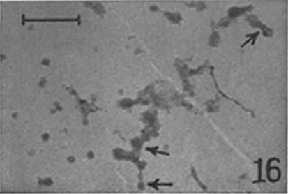
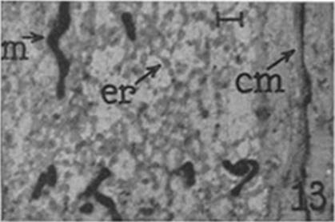
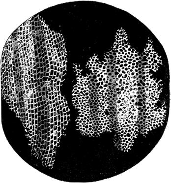
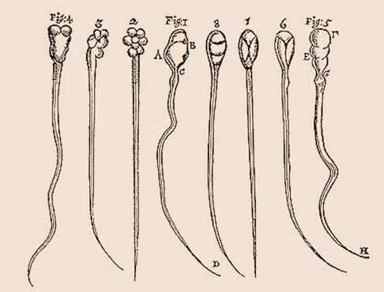
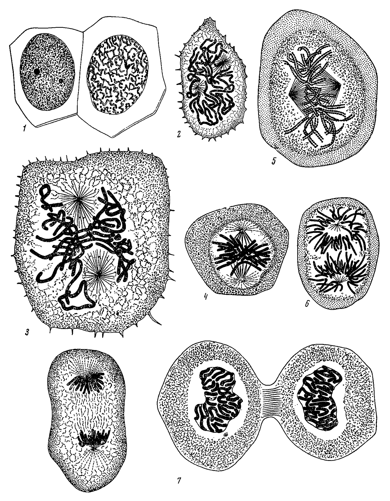
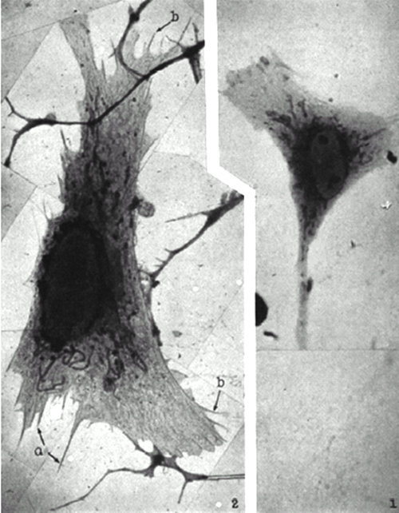
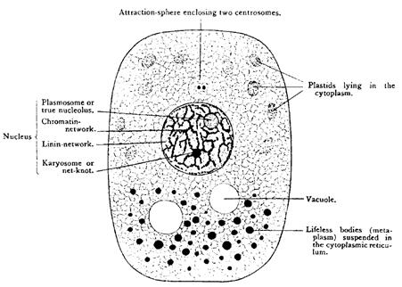
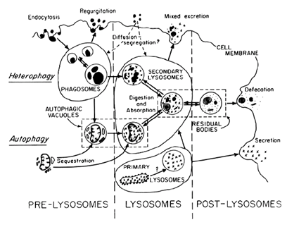
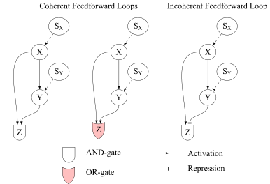

# Philosophy of Cell Biology
**First published Tue Oct 15, 2019; substantive revision Tue Jan 6, 2026**

*Bechtel, William, Bollhagen, Andrew*

Among biological entities, cells are regarded as of special importance since they are widely viewed as the simplest organized systems that are unambiguously alive. Although one can debate about entities such as viruses, there is little debate that cells are living. Cells perform all the activities critical to life, from metabolism to reproduction. All cells alive today maintain themselves far from thermodynamic equilibrium with their environment and are the product of a continuous lineage of cell division that goes back approximately 4 billion years. The study of cells has required developing means of materially manipulating them and our contemporary understanding of cellular phenomena integrates results from a wide range of material interventions. In introducing a special issue of *Studies in History and Philosophy of Biological and Biomedical Sciences* on the cell, O’Malley and Müller-Wille assert

> The cell, we suggest, is a nexus: a connection point between disciplines, methods, technologies, concepts, structures and processes. Its importance to life, and to the life sciences and beyond, is because of this remarkable position as a nexus, and because of the cell’s apparently inexhaustible potential to be found in such connective relationships. (2010: 169)

The examination of cell biology, in turn, is a potent nexus for productive interactions between philosophers, historians, social scientists, as well as cell biologists, each of whom raises questions about the study of cells relevant to the others.

During the period when philosophy of science focused primarily on laws, cell biology was largely neglected. Although it is important to cell biologists to discover useful generalizations, these are seldom characterized as laws. Once philosophers of science turned their attention from laws to mechanisms, from representational realism to models and their functionality, and from concepts and theories to experiments and instrumentation, more philosophers of science have turned their attention to the practices of cell biology. These practices are epistemically challenging. Due to the fact that cells are mostly microscopic, their study raises traditional philosophical issues concerning the status of unobservables and the trustworthiness of evidence. Since a major concern of cell biology is to relate functions (e.g., biochemical reactions) to cell structures, cell biologists need not just to observe but also to physically manipulate cells and their constituent structures and to develop informative representations. Their activities thus provide rich examples for philosophers. Although a great deal of cell biology has yet to be tapped for philosophical analysis, we provide examples in which philosophers (as well as historians) have investigated and analyzed material practices in cell biology. We start, however, closer to theoretical interests, examining how the discipline of cell biology developed and how metaphors have played crucial roles in shaping how scientists have conceptualized cells. Subsequently we turn to controversies over whether cells can be understood mechanistically or require a vitalist or holist perspective. After that, we turn to questions of epistemology, including strategies for representing cells visually and for developing mechanistic accounts of cell functioning.

## 1. What is Cell Biology?

It is sometimes assumed that scientific disciplines are sharply delineated and can be defined by their subject matter. In fact, however, they are dynamically changing, shaped in large part by scientists, their research tools, and academic and research institutions. This is clearly true in the case of cell biology. Scientists began investigating cells in the seventeenth century after Hooke and van Leeuwenhoek reported what they saw with newly invented microscopes. Hooke (1665)[^hooke-1665] gave cells their name. But the cell did not become a focal unit for studying biological processes until Schleiden (1838)[^schleiden-1838] and Schwann (1839)[^schwann-1839] advanced the cell theory according to which cells are the basic living units. The term *cytology* was widely used for the studies that ensued, which focused mainly on describing cells as seen under the light microscope. Although Wilson used the phrase *cellular biology* in his introduction to Cowdry’s *General Cytology* (Cowdry 1924)[^cowdry-1924], and many of its contributors aspired to integrate disciplines studying cells, the term *cell biology* was only introduced in the years immediately after World War II. Those adopting the term *cell biology* advocated complementing new higher-resolution images created with the electron microscope with results from biochemical, biophysical, and molecular approaches to cells. This transition is exemplified in the naming of what would become the flagship journal in the field. The working title used in discussions about founding a new journal was *Journal of Cytology*. At the time of the first issue in 1955, it was called the *Journal of Biophysical and Biochemical Cytology*, a title chosen to emphasize the integration of multiple approaches to the study of cells. In 1962 it was re-christened *The Journal of Cell Biology*, by which time the International Society for Cell Biology and the American Society for Cell Biology had also been established and the term *cell biology* had acquired general currency for an integrated approach to cells. (Bechtel 2006: chapter 7, examines the establishment and renaming of the journal as well as the creation of the American Society for Cell Biology.)[^bechtel-2006]

The introduction of new research techniques, especially cell fractionation and electron microscopy, figured centrally in the efforts to establish cell biology as a distinct discipline in the post-World War II period as they enabled constructing what Palade (1987)[^palade-1987] termed a bridge between morphological observations and biochemistry. Cell fractionation employs the ultracentrifuge to separate cell contents into fractions that contain the enzymes responsible for distinct cell activities while electron microscopy enables these fractions to be linked to organelles identifiable in cells. Bechtel (2006)[^bechtel-2006] and Matlin (2018)[^matlin-2018][^matlin-2018-2] describe how Claude employed centrifugation to identify microsomes which exhibited high concentrations of RNA. Porter’s (1953)[^porter-1953][^porter-1953-2] complementary micrographs of these particles in fractions and tissue slices (Figure 1) linked microsomes to the intracellular structure he had named the *endoplasmic reticulum*. As Matlin describes, this cycling between cell fractionation to establish function and electron microscopy to localize it to a structure was pursued repeatedly in cell biology.

 

*Figure 1:* Micrographs of a fraction containing microsome and of a thin-sliced preparation from a cell showing the endoplasmic reticulum (marked as *er*). From Porter (1953)[^porter-1953][^porter-1953-2], plate 48.

In terms of content, however, the break between cytology and cell biology was nowhere near as sharp as the founders of cell biology portrayed. Cowdry’s *General Cytology* (1924) clearly had similar aspirations of linking studies of morphology and studies of cellular chemistry (see discussions by historians, philosophers, and biologists of Cowdry’s project in Matlin, Maienschein, & Laubichler 2018)[^matlin-2018][^matlin-2018-2]. But in terms of the institutions in which scientists conducted their research, the break was quite significant. With the creation of professional societies using the name *cell biology*, biologists began to self-identify as cell biologists. Laboratories and academic departments adopted the name *cell biology* and funding agencies recognized cell biology as a supported field of research.

Although cell biologists actively courted biochemists and to some degree biophysicists to join their new discipline, these efforts largely failed. The most enduring connections were with molecular biology, which was established as a new discipline in the same period (see the entry on molecular biology). While molecular biology began with a focus on bacterial phage (viruses that infect bacteria) and cell biology with eukaryotic cells from mammals and plants, by the 1970s each discipline had broadened its focus and soon many cell biologists were adopting a molecular approach to cell structure and function. (A continuing point of difference between cell biology and molecular biology is that cell biology placed high value on linking chemical and molecular processes to cell structure; see Matlin 2016; 2022)[^matlin-2016]. Academic departments began to include both *cell* and *molecular* in their names. In November 1989 the American Society for Cell Biology created a new journal, *Cell Regulation*, but with its third volume in January 1992, the name was changed to *Molecular Biology of the Cell*. Although there are textbooks that reference just *cell biology* in their title, several of the most prominent textbooks feature both *cell* and *molecular*. These include Alberts’ *Molecular Biology of the Cell* (Alberts, Johnson, Lewis et al. 2015)[^alberts-2015], Cooper and Hausman’s *The Cell: A Molecular Approach* (2007), and Iwasa and Marshall’s *Karp’s Cell and Molecular Biology* (2016). The first edition of Alberts’ *Molecular Biology of the Cell* (Alberts, Bray, Lewis et al. 1983)[^alberts-1983] was modeled in part on Watson’s *Molecular Biology of the Gene* (1976) and included Watson as a co-editor. Alberts attributes the vision of integrating cell and molecular biology to Watson (see interview with Alberts in the Oral History Collection at Cold Springs Harbor Laboratory linked in Other Internet Resources below)

## 2. Ontological Issues I: What is a Cell?

Not only have the disciplines studying cells undergone historical transformations, so has the understanding of what cells are. As Hesse (1966)[^hesse-1966] argued, in many fields the objects of study are characterized through metaphors to more familiar objects. In examining the different metaphors that have been invoked for cells, Reynolds argues that the choice of metaphor has consequences for how cells are understood:

> Metaphorical language … has been essential not only to the activity of *describing* cells but also to *seeing* and *understanding* them, and has played no less a fundamental role than the literal and material lenses of the microscope. (2018: 4)

Reynolds distinguishes two fundamental classes of metaphors: *cells as human artifacts* and *cells as organisms.* Each has taken on a variety of more specific forms. Among artifacts, cells have been characterized as spaces enclosed by solid walls, building blocks, factories, various types of machines, and electronic computers. The organismal metaphors have suggested a conceptualization of cells as elementary organisms (like unicellular amoebae) or citizens in a state or society in which there is a division of labor and in which cells make decisions that determine their own developmental ‘fates’, including the ultimate decision to initiate programmed cell death (Reynolds 2014; see also Reynolds 2022)[^reynolds-2014][^reynolds-2022]. These metaphors have given rise to distinctive research agendas that focus on specific aspects of cells and their relationship to other cells and their environment. Although it cannot be given proper due here, the relations of cells to their environment, especially other cells, is often critical to their functioning. Bacterial cells have long been viewed as solitary, in part because they are generally studied in culture, but in fact most live in complex biofilms and engage in complex communication both between individuals in a species and those in different species (Liu, Martinez-Corral, Prindle et al. 2017)[^liu-2017].

When Hooke introduced the term *cell* in *Micrographia* in 1665 to describe the microscopic structure of cork that he observed using a compound microscope (Figure 2A), he was comparing cells to the polygonal cells of beeswax and the small rooms occupied by monks in a monastery. (Hooke 1665: 116, also commented on the fluid content of cells, labeling them “*succus nutritus*, or appropriate juices of vegetables”. As discussed below, the fluid content of cells took on new importance with the advent of the protoplasm theories in the mid-nineteenth century.)[^hooke-1665] Although researchers who focused on plants tended to find Hooke’s metaphor appropriate, since plant cells have clearly observable walls, others, beginning with van Leeuwenhoek, who examined spermatozoa (Figure 2B), animal tissues, and bacteria, tended to adopt other terms such as *corpuscle* or *globule*.

*A.* Hooke’s (1665: Schem: XI, fig. 1 facing page 115) drawing of his observations of cells in cork.

*B.*Van Leeuwenhoek’s drawing of spermatozoa from his Letter to Nehemiah Grew, 18 March 1678.

*Figure 2:* Hooke’s drawing clearly shows cells as areas enclosed by walls whereas van Leeuwenhoek’s presents what we call *cells* as simple organisms.

Most of these early investigators focused on describing what they saw in the microscope. But some, such as Buffon (1749)[^buffon-1749], began to view cells as basic living units. Nicholson characterizes this as the beginning of an atomist tradition in biology that identified

> a basic indivisible unit of life and [sought] to explain the morphological constitution and physiological operation of all living beings in terms of these fundamental units. (2010: 203)

This more theoretically committed conception of cells is exemplified in the publications of Schleiden (1838)[^schleiden-1838] and Schwann (1839)[^schwann-1839], who are generally credited with establishing the cell theory, the fundamental tenet of which is that cells are the basic units of living things.

Focusing exclusively on plants, Schleiden asserted that “… every plant … is an aggregate of fully individualized, independent, separate beings, the cells themselves” (1838 [1847: 231–2]). In addition to their walls, Schleiden appealed to the nucleus, which had been identified with improved microscopes by Brown (1833)[^brown-1833], to identify plant cells. The nucleus figured centrally in Schleiden’s account of cell formation according to which a new cell formed through a process like crystal formation—one type of material is deposited around the nucleolus to form the nucleus and then other material was deposited to form the cell body. The metaphor comparing cell formation to crystal formation played a yet larger role when Schwann confronted the challenge that animal cells differ vastly in their appearance. Schwann argued that they were nonetheless all cells since they all formed through a process analogous to crystal formation:

> The elementary parts of all tissues are formed of cells in an analogous, though very diversified manner, so that it may be asserted *that there is one universal principle of development for the elementary parts of organisms, however different, and that this principle is the formation of cells.* (Schwann 1839 [1847: 165])[^schwann-1839]

(For discussion of this and other uses of the crystal metaphor in biology, see Haraway 1976.)[^haraway-1976]

Given that Schwann and Schleiden were masters of microscopy (as witnessed by their drawings based on their microscopic observations), and that other equally competent microscopists reported cells dividing, their claim that cells form like crystals seems anomalous. Bechtel (1984)[^bechtel-1984] argues that Schwann’s strong commitment to developing mechanistic accounts of vital processes may have played a major role in how he interpreted what he saw—the crystal formation metaphor provided a mechanistic model whereas at the time there were no mechanical models for cell division. In any case, Schleiden’s and Schwann’s accounts of cell formation were soon set aside as more researchers reported on cell division and Schwann’s concerns with mechanism were supplanted by other concerns. Virchow (1855)[^virchow-1855], a pathologist, offered a theoretic argument that only a process like cell division could explain the transmission of disease and coined the oft-cited dictum “*omnis cellula e cellula*” (all cells come from cells).

Schwann’s “theory of the cell”, however, was much richer than his soon rejected view of cell formation. He argued that cells were the basic units in which the processes of life (he coined the term *metabolism*) occurred. He viewed metabolic processes as catalyzed by the specific materials that were deposited in cells as they formed. Schwann (1836)[^schwann-1836] had himself recently discovered pepsin, a catalyst that breaks down egg albumin. (Pepsin operates, however, not within cells but after being secreted into intercellular spaces.) When a year later he argued that fermentation could not occur without the involvement of a whole living yeast cell (Schwann 1837)[^schwann-1837], some critics took Schwann to be claiming that living systems exhibited mysterious vital properties. But for Schwann this was consistent with his mechanist approach—the metabolic processes only occurred when the responsible catalysts were brought together in cells.

In the mid- to late-nineteenth century theorizing about cells went in a number of directions. One direction focused even more than Schwann on the material stuff constituting the cell. In the same period as Schwann was advancing his theory of the cell, von Mohl (1835)[^mohl-1835], a plant researcher, introduced the name *protoplasm* for the fluid material in cells. Animal researchers such as Dujardin (1835)[^dujardin-1835] called the fluid seen in animal cells *sarcode*. Remak (1852)[^remak-1852] proposed the protoplasm theory according to which the basic material of plants and animal was identical and T. H. Huxley (1869)[^huxley-1869] took this a step further, arguing that protoplasm was the “physical basis of life”. As discussed by Reynolds, protoplasm theory offered a different fundamental biological theory—whereas Schleiden and Schwann

> sought to unify all the various forms of life through a common morphological type and developmental principle, the protoplasm theory attempted to achieve this through the identification of a common substance or material. (2018: 32)

Accordingly, some supporters of protoplasm sought to dislodge the cell as a basic living unit. The botanist Julius Sachs (1892)[^sachs-1892], for example, asserted “to call the protoplasm unit a cell was about as appropriate as calling a live bee in a honeycomb a cell” (as translated by Welch & Clegg 2010: C1281)[^welch-2010]. Since protoplasm appears as a viscous substance that is only artificially constrained by cell boundaries, some protoplasm theorists viewed it as supplanting the cell as an organizing unit. Where Schwann understood the cell to be the fundamental unit of biological development, protoplasm theorists understood protoplasm to drive ontogeny and cells to be merely secondary structures deposited in the course of this primary substance’s development. In the 20ᵗʰ century a number of researchers focused on how protoplasm streams in both plants and slime molds (see Dietrich 2015 for a detailed discussion of this research)[^dietrich-2015]. Recently a few biologists (Welch & Clegg 2010, 2012)[^welch-2010][^welch-2012] and philosophers (Nicholson, 2010)[^nicholson-2010] have argued for reviving protoplasm theory. Their argument is that protoplasm theory presents a more holistic systems or organismal perspective. (We discuss holism and organicism in Section 3.)

The characterization of protoplasm as just a viscous substance existing on its own was complicated by the identification of the cell membrane as a structure distinct from the cell wall and, as discussed below, of membrane-bound organelles. In the end, most biologists acquiesced in some version of Schultze’s (1861: 11; as translated by Hall, 1951: 451)[^hall-1951] compromise position that raised protoplasm to be one defining feature of cells when he defined a cell as “a lump of protoplasm inside of which lies a nucleus”. Those who adopted such a compromise position often invoked a metaphor, originating with Raspail, according to which the cell is “a kind of laboratory within which all tissues organize and grow” (1843: 28; as translated by Harris, 1999: 32)[^harris-1999]. The laboratory metaphor encouraged attempts to develop chemical explanations for all the reactions occurring in cells. There were a number of variants on this theme. Unger analogized the plant cell with a “mächtige chemische Werkstätte” (powerful chemical workshop) (1851: 23) and Virchow stated that “starch is transformed into sugar in the plant and animal just as it is in a factory” (1858: 107).

Embracing this chemical perspective, several chemists sought to identify the chemical catalysts needed for the reactions to occur. Fermentation was a common focus and Kühne (1877)[^kühne-1877] coined the term *enzyme* (Greek for “in yeast”) for the putative catalyst operative in yeast. Enthusiasm for this effort was temporarily dampened by Pasteur (1860)[^pasteur-1860]. A noted chemist, he nonetheless maintained that fermentation could only be carried out in whole living cells. This reflects a conception of the cell as an explanatorily irreducible unit of life—a conception associated with vitalism (discussed in more detail below). Enthusiasm for the factory conception, though, was rekindled by Buchner (1897)[^buchner-1897]. Guided by Pasteur’s contention that fermentation could not occur in the absence of cells, he added sugar to an extract he prepared by destroying all whole cells, thinking it would serve as a preservative. When he observed the emission of bubbles, indicating fermentation in the absence of living cells, he changed course and galvanized the pursuit of chemical investigations of metabolism that resulted in the establishment of modern biochemistry in the first decades of the twentieth century (Kohler 1971; Cornish-Bowden 1997)[^cornish-bowden-1997][^kohler-1971]. One of its early successes was the characterization in the 1930s of a pathway of enzyme catalyzed reactions responsible for fermentation.

At first the factory metaphor simply identified the cell as the place in which chemical reactions occur, but over time researchers began to focus on the different machines within the factory. This focus on separate machines in the factory was promoted in the late nineteenth and early twentieth century when, using improved microscopes and applying stains to enhance contrast, investigators began to identify structures within cells and theorize about their functional significance. Researchers were particularly successful in characterizing the nuclear events in cell division and fertilization. Flemming (1879, 1882)[^flemming-1879][^flemming-1882] described in detail how the threads that he called *chromatin* (due to their absorption of dye), later named *chromosomes*, divided longitudinally, with the two halves moving apart so that one of each would end up in each daughter cell (Figure 3). Soon after researchers such as Weismann and Correns pointed to links between chromosome transmission and heredity, but it was Boveri (1902)[^boveri-1902] and Sutton (1903)[^sutton-1903] who provided the compelling evidence that Mendel’s factors (what would soon be called *genes*) are in or on chromosomes. Darden and Maull (1977) analyze the linking of genes to chromosomes as a major example of what they termed *interfield theories*, theories that do not try to reduce one account to another but integrate the findings of different fields in a theory that bridges them.

[^flemming-1882]

*Figure 3:* Flemming’s (1882)[^flemming-1882] drawings of the stages of mitosis that highlights the formation of spindles and their role in segregating chromosomes. Images 1–3 are from Tafel IIIa (Figures 31, 36, 38); 4–7 from Tafel IIIb (Figures 39, 41, and 44–46). (Figure from [wiki commons](https://commons.wikimedia.org/wiki/File:Cell_division_according_to_W._Flemming_(1882).png).)

Late in the nineteenth century cytologists also succeeded in identifying membrane-enclosed structures in the cytoplasm that came to be known as *organelles*. Altmann (1890)[^altmann-1890], using new stains he developed, observed filaments within cells that he took to be elementary organisms (a view he explicitly set in opposition to the protoplasm theory). Although many researchers challenged Altmann’s observations, Benda (1899)[^benda-1899] confirmed the existence of filaments using a different stain and gave them the name *mitochondria* (Greek for “thread” and “granule”). Because of their reactivity with oxidative stains, Michaelis (1899)[^michaelis-1899] proposed that they figured in oxidative reactions in cells. Yet other researchers identified other organelles such as the Golgi apparatus (Golgi 1898)[^golgi-1898] and ergastoplasm (Garnier 1897)[^garnier-1897], which was ultimately identified as the endoplasmic reticulum.

In the early decades in the twentieth century biochemists and cytologists developed their own research techniques and pursued their investigations independently of the other. Most biochemists implicitly embraced the assumption that the cell was a bag of chemicals that could be studied in the extracts remaining after cell structure was destroyed whereas those pursuing cytological inquiries tended to embrace the factory metaphor in which organelles were distinct machines. As witnessed by Cowdry’s (1924)[^cowdry-1924] *General Cytology* and Bourne’s (1942)[^bourne-1942] *Cytology and Cell Physiology*, there were researchers who desired to build bridges between biochemistry and cytology. There were some techniques, albeit limited, for determining the chemical composition of organelles (essentially, those of cytochemistry and histochemistry, which relied on determining to which chemicals various stains bound). The nearly simultaneous introduction of cell fractionation and electron microscopy in the late 1940s provided the needed research techniques and, as noted in Section 1, helped establish modern cell biology. In addition to the linkage of microsomes to the endoplasmic reticulum, described above, researchers linked oxidative metabolism to the inner membrane of the mitochondrion. New structures were also discovered and connected to functions, such as the lysosome which was linked to the breakdown and recycling of disrupted cell components (de Duve 1958)[^duve-1958].

The process of advancing new conceptions of cells continues. We note just one example here. The pioneers of cell biology in the 1940s and 1950s embraced the "machines in a factory" metaphor, treating cell organelles as compartments in which different chemical reactions were catalyzed by the enzymes housed there. Once formed, the compartments, on this view, did not change—the crucial activities occurred within them. Over time, however, some researchers within cell biology began to identify cell structures that executed mechanical movements, as anticipated by Flemming’s (1882)[^flemming-1882] characterization of the cell spindle as pulling chromosomes apart in mitosis. Of particular importance was research on the cytoskeleton (now understood to consist of actin fibres, intermediate filaments, and microtubules). The term *cytoskeleton*was invoked in the 1930s and 1940s to denote a rigid structure, and indeed it does help give cells their shape, albeit not a rigid one. It was soon found to be the locus of movement. H. E. Huxley (1969)[^huxley-1969] advanced an account of muscle contraction as resulting from myosin molecules forming bridges that pull on actin filaments. Both actin filaments and microtubules were found to continually extend themselves at one end by incorporating new proteins while removing them from the other, a process characterized as *treadmilling* (Cleveland 1982)[^cleveland-1982]. Video observations of organelles moving along microtubules (R. Allen et al. 1982)[^allen-1982] led to the discovery of kinesins (Vale, Reese, & Sheetz 1985)[^vale-1985], molecular motors that *walk* along microtubules carrying cargo. (For more detailed historical discussion of the discovery of kinesin, see Mattlin 2020 and Bechtel & Bollhagen 2021)[^bechtel-2021][^bollhagen-2021]. It also focused new attention on dyneins (Paschal & Vallee 1987)[^paschal-1987], previously only known for their roles in cilia and flagella, as carrying cargo in the opposite direction. Recognition of this continual movement of material within cells gave rise to a new metaphor of the cell as a city with bustling traffic (Vale & Milligan 2000)[^vale-2000].

## 3. Ontological Issues II: Mechanists Vs. Vitalists and Holists (Organicists)

Most of those pursuing the various metaphors discussed in the previous section embraced a view that had its origins in Descartes, who maintained both non-living and living systems (with the exception of the human mind) operated like machines. But a significant number of researchers rejected this perspective and maintained that living organisms, including cells, are fundamentally different from ordinary physical, mechanical systems. They argued that in one way or another composition from material components is insufficient to account for the phenomena associated with cells. We begin with these opponents of mechanistic conceptions of cells and then examine how those advocating mechanistic approaches responded.

In the eighteenth and nineteenth century the opponents of mechanism were typically referred to as *vitalists*. The various vitalists all rejected mechanism, taken as the view that organisms are composed of physical parts that operate in accord with the same principles as processes in the non-living world. Their positive views varied. Some vitalists adopted a position much like that of substance dualists with respect to the mind, arguing that some non-material component—a vital force (*vis vitalis*)—operates in living beings and accounts for their distinctive activities. Others avoided positing an extra component but maintained that different laws apply in living organisms than in non-living systems (for discussions of these different versions of vitalism, see Wolfe 2023 and contributions in Normandin & Wolfe 2013 and Donohue and Wolfe 2023)[^donohue-2023][^normandin-2013][^wolfe-2023]. Regardless of how they expressed their positive views, vitalists commonly pointed to activities of living organisms that they claimed could not be accounted for in the same manner as physical processes. This is well illustrated in Bichat (1805)[^bichat-1805], who focused first on the apparent lack of determinism in the behavior of biological organisms and second on the fact that organisms seemed to oppose physical processes that threatened to destroy them (in his words, they *resist death*). As noted above, Schwann and Pasteur both claimed that living yeast are needed to produce fermentation. While for Schwann this only entailed that fermentation depended on the specific combination of materials found in cells, for vitalists it entailed that living cells perform activities that could not be performed by the collection of component molecules. Bichat and Pasteur, as well as other prominent vitalists such as Müller (1837–1840), embraced empirical and experimental research, but drew limits with respect to what could be explained by appeal to the material components of an organism alone.

In many cases, mechanists did not explicitly respond to vitalists but simply moved forward with their research. Bernard (1865)[^bernard-1865] was an exception. He addressed Bichat’s challenges by introducing a distinction between an organism’s internal and external environment. Mechanistic operations within organisms are carried out in the internal environment and jointly serve to maintain that environment in a constant state. Because mechanistic operations respond to conditions in the internal environment, they appear indeterminate when considered only in relation to external stimuli. Moreover, because these mechanisms work to maintain a constant internal environment, one could explain the ability of organisms to resist physical processes that might otherwise destroy them (for discussions of Bernard see Holmes 1974 and LaFollette & Shanks 1994)[^holmes-1974][^lafollette-1994]. Bernard’s approach was the foundation for Cannon’s later well-known work on homeostasis (1929). (For a more detailed account of Bernard and Cannon’s contribution to homeostasis and the central role that concept plays in accounts of how mechanisms in cells are regulated, see Bechtel and Bich 2025.)[^bechtel-2025]

By the beginning of the twentieth century few biologists investigating cells (Driesch, 1914, being a notable exception)[^driesch-1914] espoused vital forces and vitalism *per se* ceased to be regarded as a tenable position. But many biologists were still concerned to account for differences between living cells and ordinary material systems. A prominent position adopted by many investigators (Haldane 1929, 1931; Lillie 1934; Needham 1936; Russell 1945, 1930; Von Bertalanffy 1952; Weiss 1963; Woodger 1929)[^haldane-1929][^haldane-1931][^lillie-1934][^needham-1936][^russell-1930][^russell-1945][^von-1952][^weiss-1963][^woodger-1929] was *holism*, sometimes referred to as *organicism*. (See Nicholson and Gawne 2015, Peterson 2016, and contributions to Wolfe 2024 for analyses of how the organicists differentiated their position from both vitalism and mechanism.)[^nicholson-2015][^peterson-2016][^wolfe-2024] Holists accepted that living systems were built out of material parts. They insisted, however, that the activities performed by components of living systems depended not just on those components and their composition but on their organization. Accordingly, one cannot just add together the activities of the components to account for the whole (“the whole is not just the sum of its parts”). The organized whole in part determines how the parts behave. This attitude is manifest, for example, in J. S. Haldane’s opposition to investigating the origins of life from non-living matter: “There is and can be no origin of life out of mechanical conditions. Such an origin is inconceivable” (Haldane 1930: 12)[^haldane-1930].

The organization of cellular systems plays a central role in the dialectic between mechanistic biologists and holists. Holists often construe mechanistic biologists as downplaying the importance of organization, but many mechanistic biologists deny this. Bernard had emphasized the role of organization in allowing components to maintain the constancy of the internal environment and those seeking to explain homeostasis appealed to feedback loops. Recognizing that mechanistic accounts are not limited to a simple, additive view of organization, J. S. Haldane’s son, J. B. S. Haldane, abandoned his father’s commitment to holism and embraced a mechanistic framework that emphasized how biological components are affected by being incorporated within organized systems. In making this break with his father he was heavily influenced by working with the biochemist Hopkins (1913)[^hopkins-1913], who likewise made organization central to his accounts of biochemical processes. Accordingly, J. B. S. Haldane became one of the pioneers in formulating biological inquiry into the origins of life while still insisting that complex organization figured centrally in activities of living organisms (Martin 2010)[^martin-2010]. While contemporary cell biologists only rarely invoke the term “organicism,” sufficient interest in the concept persists among philosophers of biology that in 2025 Matlin and Reynolds convened a seminar entitled “Is Organicism a Useful Concept: A Critical Historical and Philosophical Analysis” at the Marine Biological Laboratory at Woods Hole, MA.

Philosophers and scientists often invoke the word *emergent* for phenomena that are different from the phenomena generated by their components (see the entry on emergent properties). Sometimes emergent phenomena are viewed as incapable of being explained in terms of their constituents. In the context of characterizing systems biological accounts of cell phenomena, Boogerd et al. (2005) develop an account according to which emergent phenomena are ones that are fully explicable in terms of how their constituents behave in the organized system, but not in terms of how they behave in simpler (less complexly organized) systems. This recognizes that many cellular constituents behave differently when incorporated into particular systems in which they receive distinctive inputs. For other recent treatments of emergence and its applications to cell biology, see (Hooker 2011a; S. Mitchell 2012; Mossio, Bich, & Moreno 2013; Winning & Bechtel 2019)[^hooker-2011a][^mitchell-2012][^mossio-2013][^winning-2019].

The desire to understand how the organization in cells and multicellular organisms differs from that found in most naturally occurring systems or human-made artifacts motivated a body of research in *theoretical biology* in the 1970s and 1980s. Among the most prominent contributors to theoretical biology were Pattee (many of his most important papers have been collected in Pattee 2012)[^pattee-2012], Rosen (1985, 1991)[^rosen-1985][^rosen-1991], Polanyi (1968)[^polanyi-1968], and Waddington (1961)[^waddington-1961]. Philosophy of biology, as it developed as a specialty in philosophy of science in the 1970s and 1980s, largely ignored this tradition. Today, however, a number of philosophers concerned with cell biology are drawing upon its insights. Here we focus on one key conceptual tool theoretical biologists provide for understanding the distinctive activities of living systems such as cells: constraints. The notion of constraint is drawn from classical mechanics, where constraints serve to constitute macro-scale objects from their micro-scale particles. Constraints thus account for why macro-scale objects exhibit different properties than their constituents. Constraints are not explained by laws but rather serve as boundary conditions that must be ascertained empirically. Accordingly, to the degree constraints explain biological activities of cells, these activities cannot be reduced, in the sense of being derived from the principles of chemistry or physics. Instead, researchers must, on the basis of empirical inquiry, identify the constraints actually realized in living cells.

The importance of constraints for understanding cellular and other biological phenomena has been developed recently by Hooker (2011b, 2013)[^hooker-2011b][^hooker-2013] and Moreno and Mossio (2015). Hooker makes clear that, although the term *constraint* suggests limitations, constraints also extend possibilities—to offer a cellular example, microtubules that run from the cell center to the periphery restrict the movement of the kinesin and dynein motors that move on them but also provide a possibility for transport of organelles to distant locations. Moreno and Mossio in particular develop a perspective that links the focus on constraints to the idea that living cells are autopoietic. Drawing upon Maturana and Varela’s (1980) conception of living systems as autopoietic machines—machines that provide a network of production that enables the construction of the living system—Moreno and Mossio add a focus on the thermodynamic requirements of cells. Cells, as highly organized systems, are far from equilibrium and require a continual source of free energy to carry out the operations required to synthesize new components and resist the tendency towards equilibrium. What constraints do in organisms, on their account, is direct flows of free energy to perform the work of building, repairing, and reproducing the organism. (For a related, but distinct, account of the role of constraints in understanding biological systems, see Matlin and Green 2024.)[^matlin-2024]

Some constraints are flexible, and these make possible an important feature of living systems—the ability of organisms to control production mechanisms (such as those involved in fermentation or muscle contraction) through the actions of control mechanisms. On Pattee’s account, control mechanisms change the flexible constraints in *production mechanisms*in light of information that is procured by making measurements. Negative feedback control mechanisms, such as thermostats, are simple examples: the thermostat makes a measurement of a variable (temperature in the room) that is affected by the operation of the production mechanisms—the furnace—and based on the measurement executes action on the constraints in the furnace mechanism. Examples of feedback control mechanisms are widespread in cells. Some of the best-known examples are the *lac* operon (Jacob & Monod 1961)[^jacob-1961] and feedback control of glycolysis by ATP (Ghosh & Chance 1964)[^ghosh-1964]. The measurements used by control systems need not be restricted to states affected by the activity of the production mechanism; they can also measure states in the organism or states in its environment. Using such measurements, production mechanisms can be controlled so as to operate only in particular circumstances, enabling the organism, for example, to navigate to a food source or avoid a predator as needed.

Moreno and Mossio (2015) offer an account in which appropriately organized productive and control mechanisms enable cells, and by extension multi-cellular organisms, to achieve what they refer to as *biological autonomy*:

> a distinctive regime of causation, able not only of producing and maintaining the parts that contribute to the functioning of the system as an integrated, operational, and topologically distinct whole but also able to promote the conditions of its own existence through its interaction with the environment. (2015: xvi–xvii; see also Bich 2024)

Note that mechanisms, on this view, are contained within cells and that it is cells, not mechanisms that are autonomous. What becomes crucial for understanding the autonomy of cells is the organization of control mechanisms that orchestrate the activities of various productive mechanisms so as to maintain the cell (or the multicellular organism). One notable feature of this focus on the organization needed to maintain autonomy is that it is compatible with the more traditional philosophical accounts of mechanism (discussed in section 5) but emphasizes a feature not prominent in them—that production mechanisms are subject to control mechanisms. To understand the behavior of cellular mechanisms, researchers must not only look inside mechanisms to their organized parts and operations but outside to how they are situated in cells and organisms in such a way that they can be controlled by other mechanisms (Winning & Bechtel 2018)[^winning-2018]. Such an ontological framework for understanding cells (as well as multicellular organisms) integrates insights from traditional mechanists in biology and their vitalist/organicist/holist critics, capturing what is distinctive of living organisms within a framework that accepts them as consisting of mechanisms, but mechanisms organized in appropriate ways (Bich & Bechtel (2022)[^bechtel-2022].

As the discussion makes clear, the metaphor of mechanism has played a major role in both biologists’ and philosophers’ understanding of cells. Nicholson (2013, 2019)[^nicholson-2013][^nicholson-2019] has argued against those who have invoked the metaphor at the level of the cell, seeing the cell as itself a machine. Many cell biologists invoke the metaphor not for the whole cell but for its component, treating the cell as consisting of machines (or more commonly mechanisms). Machine-like entities and processes are invoked in explaining the activities of cells. Bechtel & Bollhagen (2021)[^bollhagen-2021], for example, discuss the explanations cell biologists give of molecular motor activity as involving the conversion of chemical energy stored in ATP into mechanical motion on analogy with how a combustion engine converts the chemical energy in gasoline into motion. Nicholson (2019, 2020)[^nicholson-2019][^nicholson-2020] has also challenged this use of the machine metaphor, arging that these entities operate at the nanoscale and so don’t behave like machines.

While maintaining the framework of mechanism in explaining cell processes, Levy and Bechtel (2020) have emphasized ways in which some mechanisms invoked in cell biology are less machine-like than traditionally assumed—mechanisms in which, for example, it is bulk properties such as relative concentrations of components that determine the activity or in which it is changes that the mechanism components undergo that matter. In other cases, such as research on the cytoskeleton and extracellular matrix, however, Bechtel, Bich, & Bollhagen (forthcoming) have shown that biologists have appealed to mechanisms that behave very much like those in human made machines. For recent defenses of the invocation of machines or mechanisms in understanding cells, see Levy (2023), Barwich and Rodriguez (2024) and Militello & Moreno (2018).

## 4. Epistemic issues I: Representing cells and cellular processes

We turn now from questions about the ontological status of cells to epistemic questions about how scientists study them. We begin with how scientists represent cells and information about them. Traditionally, philosophy of science has focused on linguistic representations of scientific knowledge. But in many fields of biology and especially in cell biology, information is often presented in images. Scientists’ very familiarity with cells results from visual representations generated using microscopes. Developing microscopes and techniques for using them to produce interpretable images presented a number of challenges. We begin in section 4.1 with the challenges in generating images (micrographs) at all and in section 4.2 consider challenges in evaluating the reliability of the resulting images. Beyond these replete (highly detailed) representations, cell biologists rely on a variety of less replete diagrams. (The characterization of images as “replete” is due to Perini, 2013. Drawing on Goodman, she uses relative repleteness to differentiate diagrams from pictures.)[^perini-2013] In particular, as discussed in section 4.3, when they are developing mechanistic hypotheses about cells, cell biologists rely on cell diagrams that represent types of cell components and mechanism diagrams that represent select components within cells that are hypothesized to constitute parts of the mechanism responsible for a given phenomenon (Downes 1992)[^downes-1992].

### 4.1 Micrographs

As discussed above, in the seventeenth century both Hooke and van Leeuwenhoek pioneered the use of light microscopes to observe cells. Subsequent investigators often designed their own microscopes. The variations in these designs contributed to variability in the resulting images. (Before photography, microscopists drew what they saw using the microscope, introducing another source of variation.) The variability of the images different researchers produced was one factor that led biologists in the eighteenth and nineteenth centuries to examine more carefully the processes through which microscopes generate images (Schickore 2001, 2007)[^schickore-2001][^schickore-2007]. In his theoretical studies of lenses, Newton (1704)[^newton-1704] characterized two types of aberrations created by lenses: spherical aberrations, resulting from light rays coming into focus at different points, and chromatic aberrations, resulting from light of different wavelengths being refracted at different angles. Schickore (2007)[^schickore-2007] describes the many efforts by microscope developers to correct for these aberrations and the creation of test objects for evaluating the reliability of particular microscopes. During the same time enthusiasts were advancing many claims about what they saw, some of which were shown later to be artifacts. For example, both Milne-Edwards (1823)[^milne-edwards-1823] and Dutrochet (1824)[^dutrochet-1824] reported round structures of a constant size similar to that reported for cells, which they termed *globules*. (See Schickore 2009 for a detailed examination of the reports of globules and an argument that it was the variability in these reports that contributed to the growing sense that something was amiss in the practices of the microscopists.)[^schickore-2009] Globules were, however, soon shown to be the products of spherical aberrations. In the early nineteenth century several lens makers developed strategies for eliminating spherical aberrations and greatly limiting chromatic aberration (chromatic aberrations were not fully eliminated until the introduction of the apochromatic lenses in mid-century). As a result, the observations by Schleiden, Schwann, and others discussed above were largely free of these distortions.

Light microscopes faced another limit, that on magnification (a limitation imposed by the wavelength of light). For cell researchers to obtain higher-resolution images that could reveal constituents of cells, a microscope relying on different physical principles was required. The most important alternative to the light microscope for studying cells was the (transmission) electron microscope, which employs beams of electrons to create images in a manner comparable to photography: locations on the photographic plate hit by many electrons are black in the negative and white in the positive image. Although electron microscopes were available in the early 1930s, only in the years just before and during World War II did biologists begin to explore their potential. One difficulty they confronted is that most eukaryotic cells are too thick to be penetrated by the 50kV electron beam available in the first electron microscopes. Microtomes had been developed for cutting slices of cells for light microscopy, but new approaches to microtome design were required to slice cells sufficiently thinly without creating distortions. This problem was not solved until the early 1950s (Porter & Blum 1953)[^porter-1953][^porter-1953-2]. Accordingly, some of the first electron micrograph studies focused on fibrous material such as collagen (Schmitt, Hall, & Jakus 1942)[^schmitt-1942] or on bacteria (Stanley & Anderson 1941)[^stanley-1941]. Porter, Claude, and Fullam (1945) created the first electron micrograph of a eukaryotic cell by culturing it under conditions where the periphery spread very thinly, allowing electrons to penetrate. They generated an image (Figure 4) that showed at the periphery

> filamentous mitochondria of various lengths and fairly constant width; scattered, small elements of high density especially abundant around the nucleus and presumably representing Golgi bodies; and a delicate lace-work extending throughout the cytoplasm. (1945: 246)

*Figure 4:* Comparison of images of fibroblast from a tissue cultured chick embryo as seen with electron microscope (left) and light microscope (right). From Porter, Claude, and Fullam (1945: plate 10).

Besides the challenge of creating preparations sufficiently thin to be penetrated by the electron beam, researchers confronted a number of other challenges in preparing biological material for electron microscopy. For example, specimens must be placed in vacuum, and this requires first removing all water, the primary constituent of cells, without inducing too many distortions. Several historians and philosophers (Rheinberger 1995, Rasmussen 1997, and Bechtel 2006)[^bechtel-2006][^rasmussen-1997][^rheinberger-1995] have examined how biologists confronted these challenges and evaluated the reliability of the resulting micrographs. How they addressed one challenge—that of creating sufficient contrast in the images—greatly affected the images that were produced. This was already a challenge with light microscopy: cell material is mostly translucent so that the light transmitted is mostly of the same wavelength, making it hard to differentiate the various structures in the image. To address the challenge, light microscopists in the mid-nineteenth century began experimenting with dyes used for fabrics. As noted in Section 2, Flemming named the nuclear structures he observed chromatin since they bound the aniline dye he was using. The problem for electron microscopy was similar—cell components differ little in their ability to block electron transmission. Electron microscopists found that several of the fixatives used in light microscopy, especially those involving heavy metals, enhanced the ability to block electrons, and accordingly the contrast in the resulting images. Given that there was little knowledge about what given chemicals would bind to within the cell, the investigation of these stains was mostly pursued by researchers trying out different compounds and procedures for applying them (exemplified in Palade’s 1952, study of osmium tetroxide)[^palade-1952] to see what images they could generate. Indeed, different stains (osmium tetroxide, glutaraldehyde, etc.) did yield different images.

The latter half of the twentieth century saw important innovations in light microscopy that depended upon the ability to make and analyze film of cell movement. Microcinematography, as the technique was initially called, allowed researchers to record cell movement over many hours and to create time-lapse movies that made apparent movements to slow to be discerned otherwise (Landecker 2011)[^landecker-2011]. In 1978, at the Marine Biological Laboratory in Woods Hole, MA, Robert and Nina Allen accidentally discovered that they could detect structure in cells below the resolution of normal light microscopy while teaching an advanced microscopy course. The Allens connected a differential interference contrast microscope to a video camera so that students in the course could see images without having to look through the microscope’s eyepieces. Nina Allen found that if she changed the “illumination in such a way that the image field was flooded with light to the point where almost nothing was visible and then manually adjusted the black level on the video camera, she was able to see details of cell structure on the video monitor that had never been seen before” (Matlin 2020)[^matlin-2020]. Dietrich (2015)[^dietrich-2015] analyzes studies of the motility of protoplasm in slime molds and plants that drew upon the contributions of the Allens.

### 4.2 The Artifact Challenge

As we have noted, the generation of images of cells generally requires stains. Since, especially when stains were first introduced, there was little understanding about what they bound to, skeptics often raised doubts that they were revealing actual structures in cells (Schickore 2009)[^schickore-2009]. Bechtel (2006)[^bechtel-2006] highlights three considerations that often figured in scientists’ evaluation of whether micrographs were informative about cells or only artifacts of the methods of preparation: (1) the quality of the micrographs themselves—do they exhibit distinct patterns? (2) the robustness of the results—can comparable results be generated with different techniques (e.g., with light and electron microscopy or with multiple stains)? and (3) the theoretical plausibility of the results—do they fit into a coherent theoretical account? While the first is seldom commented on in philosophical accounts, it is notable that scientists are inclined to assume that if an image reveals a distinct, replicable pattern, it reflects something in the source (although this assessment may be retracted if, for example, a researcher shows how the pattern could be generated by other means). There has been extensive philosophical discussion of the second—the inference that when the same result is generated by independent means, it reflects a preexisting entity in the world (Culp 1995; Stegenga & Menon 2017)[^culp-1995][^stegenga-2017]. However, this criterion proves insufficient at just the point at which results with new techniques, such as the electron microscope, are most controversial—when the images contain structures beyond those that can be detected with other existing techniques. In these cases, the distinctness of the patterns together with considerations as to the theoretical plausibility of the findings are the criteria researchers can use. Appeal to theoretical plausibility, however, would seem to be circular since, in traditional philosophical accounts, theories are tested by the evidence generated by the technique. But developing a plausible theory that fits with an experimental finding and other evidence is not easy and when they are able to do so, scientists view it as buttressing their judgments that the images reflect real structures. How cell biologists have invoked these considerations is examined in philosophers’ discussions of two historical cases in which biologists contested whether the structure shown in microscopic images was real or an artifact. The cases ended differently, one with the acceptance of the structure, one with its rejection.

The first case involves the Golgi apparatus, first described by Golgi (1898)[^golgi-1898] in light microscope studies using the silver nitrate stain he had introduced. Palade and Claude (1949a,b), two of the pioneers of modern cell biology, who would ultimately share the Nobel Prize, argued that it was an artifact of staining, including with osmium tetroxide (which Palade helped establish as a primary stain for electron microscopy), appealing to their ability to create myelin figures similar in appearance to the Golgi bodies by adding osmium to egg white. Although Palade remained a skeptic about the Golgi apparatus for 15 years (researchers in his lab reported that they were not allowed to mention it during that interval), once researchers in his laboratory demonstrated that many newly synthesized proteins pass through the region of the cell where the Golgi apparatus appeared on their way to being secreted, he accepted it as a cell organelle. In describing the case, Bechtel (2006)[^bechtel-2006] argues it was the discovery that it figured in an important cell function that led to Palade’s acceptance of it as real and that this is often a major factor in researchers’ acceptance of the reality of entities identified through new techniques.

The second example stems from early electron microscopy of bacterial cells. Chapman and Hillier (1953) observed invaginations of the plasma membrane in gram-negative bacteria, which they called *peripheral bodies*. Robertson (1958)[^robertson-1958] renamed them *mesosomes* and they were implicated by many researchers in a variety of cell functions before being rejected as artifacts in the 1970s (Silva et al. 1976)[^silva-1976]. Analyzing this example, Rasmussen (1993)[^rasmussen-1993] argues that philosophical criteria for distinguishing real entities from artifacts, such as robustness, are insufficient to explain scientists’ changing judgments about the mesosome. He argues that Chapman and Hillier maintained the reality of mesosomes in the course of advancing the case for use of electron microscopes is the study of bacteria. The eventual rejection of the mesosome as a real structure, he argues resulted from competing finding using different techniques. Culp (1994)[^culp-1994] challenged Rasmussen’s interpretation of the history of mesosomes, contending that the rejection of mesosomes as an artifact is in fact best explained on grounds of the robustness of these competing finding. In a later paper, Rasmussen responds to Culp’s analysis, continuing to maintain that local details, not principles like robustness, determine scientists’ judgments about artifacts:

> general principles like robustness are too vague to warrant anything whatsoever, because when described in sufficient detail it emerges that the way such principles are instantiated is in flux—and the devil is in the details. (2001: 643)

Several other philosophers have further pursued the case of the mesosome and the arguments that led to its dismissal as an artifact--see Allchin (2000)[^allchin-2000], Weber (2005)[^weber-2005], and Hudson (2014: chapter 2).

Detecting and arguing for artifacts is one example of identifying and resolving error in science. A common response to a demonstration of error is that the error must have been the result of poorly done science. Allchin (2025)[^allchin-2025], however, presents a compelling case that in making errors, like affirming the existence of mesosomes or denying the existence of the Golgi apparatus, scientists often advance what seems to be compelling warrant for their claims. Moreover, he argues that making such errors is an important feature of science. They provide the target for research that detects and diagnoses the error, constituing an advancement in science. Allchin provides detailed illustration of many such errors and the processes through which they were diagnosed in the history of science, including in cell biology.

### 4.3 Diagrams in Cell Biology

Microscopic images, whether hand-drawn, as they were in the nineteenth century, or captured in photographs, are highly detailed or replete (see discuss of Perini above). However, the knowledge cytologists and cell biologists seek to develop is more abstract and general—they seek to identify the types of structures found in cells, not all their instances. Accordingly, cell biologists frequently generate diagrams that leave out details. Maienschein (1991)[^maienschein-1991] examines the origin of this practice in Wilson’s (1896)[^wilson-1896] classic text, *The Cell in Development and Inheritance.* Early in the book Wilson provided a diagram (Figure 5A) which abstracts from the much more replete photographs he had presented just a year earlier (Wilson 1895)[^wilson-1895]. Instead of showing all the instances of different organelles, he presents just a few instances of each type. Organelles are shown using icons that are suggestive of their shapes. Such diagrams serve to convey the types of organelles found in cells and their typical location but falsely suggest that most of the space in the cell is empty. Maienschein contends that this transition from photographs to abstract diagrams reflects Wilson’s growing confidence in the correctness of his interpretation of what he was seeing through the microscope and a transition “from presenting data to representing theory” (Maienschein 1991: 252)[^maienschein-1991]. A sign of their theoretical status is that such figures, unlike micrographs or data plots, often undergo numerous revisions as scientists develop their account. Revising these diagrams is a means, in fact, of developing theory. With the development of biochemical and molecular accounts of cell phenomena, researchers often make what Serpente (2011)[^serpente-2011] characterizes as a transition from the iconic to the symbolic. He presents protein-protein interaction maps and gene regulatory diagrams as examples of symbolic representations.

*A.* Wilson’s (1896: 14, figure 5) cell diagram that leaves out much of the detail that would be seen through the microscope to focus on

*B.* A mechanism diagram of the processes of heterophagy and autophagy from de Duve and Wattiaux (1966: 468, figure 6).

*Figure 5*

Similar points also apply to another type of diagram that appears frequently in cell biology—diagrams of hypothesized mechanisms that are taken to be responsible for a particular phenomenon (Sheredos et al. 2013; Abrahamsen, Sheredos, & Bechtel 2018)[^abrahamsen-2018][^sheredos-2013]. Such diagrams do not try to show all the organelle types but, as in Figure 5B, only those thought to be involved in generating a particular phenomenon—in this case, the breakdown of materials taken into the cell (heterophagy) or of cell components themselves (autophagy). One challenge with mechanism diagrams is that they are static whereas mechanisms (see entry on mechanisms in science) are engaged in change (the digestion of organelles and the expulsion of the remaining material). One common strategy is to use arrows to represent activities, although often within the same diagram arrows may have multiple different meanings. Ultimately, however, it is up to the viewer to animate a mechanism diagram (Hegarty 1992)[^hegarty-1992]—to rehearse mentally the different activities that are represented and to imagine the changes that are being produced by different parts.

One might think that diagrams are only important as a means of illustrating results that are presented textually. But examination of the practices of cell biologists reveals that they are far more central to their reasoning. Early in the development of a hypothesis scientists sketch their ideas (e.g., about how fibroblasts move--see Cronin and DeMali, 2022)[^cronin-2022]. Often diagrams (as well as the other figures that show data or the workflow of the research) are crafted long before text is drafted. Diagrams are commonly presented in lab meetings and revised multiple times as scientists are refining their claims. Researchers often generate the text of the paper only at the end of this process. Taking advantage of access to the draft figures and text for two research projects, Sheredos and Bechtel (2020) examined the process of interactive engagement in which the investigators modified diagrams, changed text, and then further modified the diagram. In one of the cases they examined, an early version of a diagram serves to pose a question that was addressed through the experimental studies, resulting in a final diagram that offers an answer to the question posed.

Anderson, Dupré, and Wakefield (2019), report on a collaboration between an artist, a philosopher and a cell biologist engaging in a series of Drawing Labs, one-on-one sessions in which they explored how scientists can learn to represent the process of cell division in one connected image. Across three sessions, the artist encouraged “scientists to use drawing to explore the scope and limits of their knowledge while simultaneously learning about cell division.” Since these first three sessions revealed difficulties scientists had in breaking out of traditional “structure-based” representations of the process, the artist introduced principles of choreography and the idea of a musical score as an analogical source to encourage the scientists to think about mitosis more “processually.” In the end, the exercise enabled scientists to formulate a list of questions that were new to the scientist involved in the project in spite of the fact that they had been studying cellular processes for twenty years. The study concludes that “[d]rawing shifts the focus from the image as product … to the production of the image as an integral part of research. This activity … can contribute to scientific insights and hypotheses.” Representing process is often just the beginning. Jones and Wolkenhauer (2012) show in their analysis of other diagrammatic representations of cell division how diagrams serve to locate information required for a computational model in a representation of the cellular mechanism that is being modeled.

## 5. Epistemic Issues II: Strategies for Explaining Cell Activities Mechanistically

Historically prominent philosophers of science such as Popper and Reichenbach rejected inquiries into how scientific theories are discovered as not philosophical (see the entry on scientific discovery). Beginning with Hanson (1958)[^hanson-1958], though, discovery has attracted the interest of many philosophers of science. Investigations into discovery in cell biology (and related fields such as biochemistry, molecular biology, and neuroscience) inspired Bechtel and Richardson (1993 [2010]) to argue that the goal in these fields was not to construct nomological explanations (Hempel 1965)[^hempel-1965] but rather to identify the mechanism responsible for a phenomenon and determine how it worked. Examples from cell biology have also figured prominently in accounts of mechanistic explanation by Machamer, Darden, and Craver (2000), Craver and Darden (2013), Bechtel (2006)[^bechtel-2006], and others (see Glennan & Illari, 2018, for a compendium of contemporary accounts of mechanisms and mechanistic explanation, and the entry mechanisms in science)[^glennan-2018]. The concept *mechanism* figures both in discussion of ontological issues and epistemic issues, but the two uses can be distinguished in the manner proposed by G. Allen (2005)[^allen-2005]. In this section, we are concerned with what he called “operative or explanatory mechanism” (2005: 261; the thesis that for explanatory purposes components of cells should be conceived to function *as if* they were machines).

One of the central objectives of many philosophers of science focused on mechanistic explanations is to characterize reasoning strategies or heuristics that scientists use to develop mechanistic explanations (Bechtel & Richardson 1993 [2010]; Craver & Darden 2013; Gross 2018)[^bechtel-1993][^craver-2013][^gross-2018]. We discuss reasoning strategies that figure in different phases of developing mechanistic explanations in cell biology: delineating phenomena and situating them in responsible mechanisms, identifying and characterizing the components of mechanisms (a reductionistic phase), and determining the organization within mechanisms and between mechanisms and their contexts (a more holistic phase).

### 5.1 Delineating Cell Phenomena and Associating Them with Responsible Mechanisms

Challenging the common characterization of explanations as explaining data, Bogen and Woodward advanced the claim that scientific explanations are targeted at phenomena. Instead of defining what phenomena are, they give examples: “weak neutral currents, the decay of the proton, and chunking and recency effects in human memory” (1988: 306). From these examples, it is clear that Bogen and Woodward understand phenomena to be repeatable processes that can be observationally or experimentally detected in multiple ways. On this characterization, cell activities such as protein synthesis or cell division count as cellular phenomena. Although phenomena are often construed as the starting point of research, Craver and Darden (2013: Chapter 4) identify some of the experimental tasks involved in characterizing phenomena such as identifying precipitating conditions, manifestations, inhibiting conditions, modulating conditions, and nonstandard conditions that alter the manifestation of the phenomenon. They also emphasize the role of multiple experimental techniques in specifying features of phenomena. A good deal of research in cell biology is devoted to determining conditions under which cell phenomena such as programmed cell death are initiated or inhibited and cell biologists have been inventive in developing experimental techniques needed to produce these phenomena. The resulting targets of explanation in cell biology range from highly specific (protein synthesis in liver cells under low oxygen conditions) to much more general (protein synthesis generically). Individual research projects often address highly specific phenomena whereas textbooks or review articles discuss more general phenomena.

While some account of the phenomenon under study is generally adopted before researchers set out to identify the responsible mechanism, the characterization often changes radically as research on the responsible mechanism proceeds. This is illustrated with an example from the study of cells. A starting point for early inquiries into how animals store energy for their activities focused on the heat generated by metabolizing foodstuffs. This heat was assumed to power other activities and approximately a hundred years of research was devoted to explaining animal heat (see Mendelsohn 1964)[^mendelsohn-1964]. However, after Lohmann (1929)[^lohmann-1929] and Fiske and Subbarow (1929) had identified adenosine triphosphate (ATP) and demonstrated that when hydrolyzed it would release considerable energy, heat was determined to be just a waste product of metabolism and researchers instead focused on the synthesis and hydrolysis of ATP. This became the reconstituted phenomenon to which much of the older research was now applied.

Recent philosophical work on characterizing phenomena points out that the traditional mechanist view tends to render research seeking to characterize phenomena subordinate to that seeking to explain phenomena. In response, a number of recent philosophical expositions argue for more autonomy for investigations of phenomena vis-à-vis explanatory investigation and draw on cell biological practice to make the case. Bollhagen (2021)[^bollhagen-2021] analyzes how cell biologists studying the “walking” motor protein kinesin recharacterized its “stepping pattern” in the context of an experimental practice dedicated solely to characterizing, as opposed to explaining, this phenomenon. This shows that phenomenon reconstitution can occur even in the absence of explanatory insights (see also Bollhagen 2025)[^bollhagen-2025]. Bechtel and Vagnino (2022) discuss how it took over a century of research in electrophysiology to characterize electrical potentials in neurons and muscles and the action potential of neurons. Research devoted to discovering phenomena independently of attempts to explain it is not unique to cell biology: see Feest 2011, 2017; Colaço 2018, 2020; and Dresow & Love 2025 for other discussions of phenomenon characterization in related domains of science.

### 5.2 Reductionist Strategies: Decomposition and Localization

Most explanations in cell biology decompose cells into the parts or entities that constitute them and the operations or activities performed by these entities that contribute to realizing the cellular phenomenon. Although sometimes researchers can proceed by reasoning *a priori* about what component activities would be required to produce a given phenomenon, most often the decomposition is developed on the basis of experiments. While the goal is to identify both parts and operations and to link them, a given group of researchers may only have research techniques that allow them to identify one or the other. This was the case in cell biology. As discussed in Section 1, microscopic research enabled researchers to identify component parts (organelles) of cells, but except for indirect clues such as shape or the ability of an organelle to take up a stain, these researchers were unable to procure information about the functions they performed. Biochemists on the other hand were able to identify reactions involved in many cell activities, but since they studied these in chemical soups made by grinding up the cell, they were not able to link these to cell structures. Cell biology developed with the introduction of new techniques such as cell fractionation and electron microscopy that opened up the possibility of localizing biochemical reactions in organelles.

How scientists pursue reductionistic explanatory strategies like decomposition and localization can change with the advent of new instrumentation and techniques. Worlizcek, Matlin and Green (2025) argue that the development of immunofluorescent microscopy has provided means of decomposing cell parts and localizing function to them without physically destroying the cell, as in cell fractionation. They illustrate what they term *exposing* cell activities with research coupling fluorescent probes to antibodies that bind to specific proteins. This allows cell biologists to spatially localize specific proteins in cells. Using the spatial location and behavior of these proteins, now visualizable under the light microscope, scientists can formulate hypotheses about their function in the cell. This technique facilitates cell biologists investigating cell mechanisms reductionistically while heeding what Matlin (2022)[^matlin-2022] argues is cell biology’s distinctive epistemological imperative to “preserve the cellular context.”

Additional fluorescence visualization techniques have been developed since the early 2000s that are collectively labelled “super-resolution fluorescence microscopy.” The first of these was FIONA—Fluorescence Imaging with One-Nanometer Accuracy—developed by Ahmet Yildez while studying the stepwise movements of molecular motor proteins like myosin and kinesin. This technique records fluorescence emitted from single dye molecules attached to a biological system of interest and models the recorded bright spots as Gaussian functions which enables researchers to identify the center of the dye and localize the fluorescent tag to within one nanometer (Wang et al., 2014)[^wang-2014]. Building on FIONA, super-resolution fluorescence microscopy techniques include PALM—Photoactivated Localization Microscopy—which uses photoactivatable dye that can be switched on and off with light. By activating only a few fluorescent tags at a time over thousands of imaging cycles, this technique avoids generating overlapping spots in densely packed samples and enables visualization of the distribution and dynamics of closely spaced subcellular structures (Betzig et al., 2006). The development and practice of these and other high-resolution visualization techniques such as MINIFLUX (minimal photon fluxes; Balzarotti et al. 2017)[^balzarotti-2017] and fluoRBT (fluorescence rotor bead tracking; Ivanov et al. 2017)[^ivanov-2017] are opening up many new modes to investigate activities within cells.

In addition to microscopic techniques taking advantage of fluorescence, cell biologists have developed a host of other new technologies for investigating metabolic activities in cells. The development in the early 2000s of techniques to sequence RNA (RNA-seq) by first extracting RNA, reverse transcribing it into DNA, and applying DNA sequencing to identify the sequence of bases in the DNA, and then determing the RNA makeup of the, which can be a single cell (Molla Desta & Birhanu, 2025)[^molla-2025]. For a philosophical analysis of the epistemic challenges involved in RNA-seq, see Tulodziecki (2025). A variety of imaginge techniques, such as cryo-electron microcopy (Nogales & Mahamid, 2024)[^nogales-2024] and cryo-electron tomography (Young & Villa, 2023)[^young-2023]. While these can only be applied to dead cells, other researchers are establishing tools for imaging living cells at increasingly high resolution (Jacquemet, Carisey, Hamidi, Henriques, & Leterrier, 2020; Laine et al., 2023)[^jacquemet-2020][^laine-2023]. These techniques often provide enormous quantities of data. To deal with this, researchers have turned to machine learning techniques such as the use of AlphaFold to determine protein structure (Senior et al., 2020)[^senior-2020]. One problem to which these techniques have been applied is understanding the structure and functioning of pores between the nucleus and the cytoplasm (Schwartz, 2022)[^schwartz-2022]. Many of these techniques operate at different spatial and temporal scales, leading to efforts to integrate results over these scales (McCafferty et al., 2024)[^mccafferty-2024]. As a result of these and other newly developed techniques, cell biologists now have many new ways to decompose cells and understand the activities of their components. These present rich targets for further philosophical analysis.

It is worth emphasizing that the sense in which decomposition, both as traditionally pursued by literally taking cells apart and now through techniques of imaging structures in living cells, is reductionistic is very different from that advanced in more traditional philosophical accounts of theory reduction. Since theory reduction involves the derivation of one theory from another (Nagel 1961; see the entries on scientific reduction and reductionism in biology)[^nagel-1961], it can only be pursued when there are full theories, some of which can be derived from the others. Researchers pursue decomposition without assuming the existence of full theories at either level or that a theory at one level can be derived from one at a lower level. Moreover, in pursuing decomposition researchers typically do not assume that knowledge of the lower-level components is sufficient for explaining the phenomena—at a minimum, they recognize that how the components are organized is also important. The association of a cell process with a specific enzyme is not the end of the explanatory process—the activity of enzymes is often affected by the context in which the enzyme exists, for example, in a membrane. For this reason, researchers value *in vitro* reconstitution experiments in establishing that they have correctly accounted for a phenomenon.

Allchin (1996, 2007)[^allchin-1996][^allchin-2007], Weber (2002)[^weber-2002], and Matlin (2016)[^matlin-2016] analyze an important reconstitution experiment at the interface of cell biology and biochemistry that played a major role in resolving a conflict between two opposing accounts of the synthesis of ATP in oxidative metabolism. Biochemists spent a couple decades trying to identify a purely chemical pathway that used the energy released in oxidative metabolism to synthesize ATP (as happens in glycolysis). Peter Mitchell (1961)[^mitchell-1961] advanced an alternative, chemiosmotic hypothesis according to which energy was transferred via the creation of a proton gradient over a membrane. Kagawa and Racker (1966) had already linked ATP synthase to small *knobs* on the inner mitochondrial membrane, but it was an *in vitro* chimeric system combining fragments from bacteria, plants, and animals created by Racker and Stoeckenius (1974) that demonstrated that energy could first be captured in a proton gradient and then used in mitochondria to synthesize ATP. Unlike purely biochemical accounts that discounted cell structure, this research showed the importance of not just enzymes but how they are situated with respect to cell structures in explaining cellular phenomena. For another example, Matlin (2022)[^matlin-2022] discusses how biologist Günter Blobel’s research on the signal hypothesis—which explains how proteins are targeted to specific locations within the cell—succeeded by developing an *in vitro* system that preserved enough of the cell’s topological organization to study these processes in a biologically meaningful way. By "preserving the cellular context," cell biologists avoid studying mere "biochemical events" that have no order, location, or relation to morphological structure in the cell. According to Matlin, that cell biologists preserve the cellular context is key for understanding the epistemological distinctiveness of cell biology vis-à-vis molecular biology.

As we noted at the outset, cell biology came into its own as techniques for decomposing cells into their constituent mechanisms developed. However, that mechanistic explanation might not be the only kind of explanation relevant to understanding explanatory practice in cell biology. Recently Ross (2018, 2021) has argued for distinguishing pathways from mechanisms (and both from cascades). On her account, mechanisms address the lower-level machinery through which a phenomenon is produced whereas a pathway is “a sequence of causal steps that string together an upstream cause to a set of causal intermediates to some downstream outcome” (Ross 2021). Sometimes what is needed for explanation is just the sequence of steps. We can explain why a particular city, C, has a supply of corn that is contaminated, while others do not by appealing to the presence of a toxin in the corn supply at a certain factory and that roadways connect this source to city C, but not the others. Ross argues that in cell biology developmental pathways, signal transduction pathways, and metabolic pathways provide similar explanations. By showing how cell biologists seek explanations by a cellular events into pathways Ross has expanded our understanding of research strategies in cell biology. For some cell biologists, identifying the pathway often doesn’t represent the end of research. Christensen et al. (2018) have recently advanced symbolic control analysis as a tool for analyzing pathway models in order to reach a mechanistic understanding of their behavior. This promises to be a useful locus for further philosophical analysis of the relationship between pathways and mechanisms.

### 5.3 Holistic Strategies: Characterizing Organization

Even in chemical soups, individual molecules are arranged in a particular pattern. This pattern affects, for example, which molecule encounters another. When analyzing such soups, however, chemists do not try to decipher the arrangement but instead rely on statistical measures about the likelihood of encounters. But cells are different—different molecules are segregated in different locations and how they are organized affects the resulting behavior (this is true even in prokaryotic cells that lack internal membranes, with molecules segregated in different parts of the cell, sometimes changing location over the course of a day; see Cohen, Erb, Selimkhanov, et al., 2014)[^cohen-2014]. Organization is also important in manufactured products. If the parts of your computer were distributed on your desk, and each part was provided with some input so that it was performing an operation, the parts would still not carry out the same activities as they do when they are in their proper arrangement. Organization ensures that the outputs of one component are passed to the appropriate others as inputs. The importance of organization is further recognized when one considers that what human designers do is impose new organization on existing components to achieve novel desired effects. Evolution often does the same in biology.

Organization is especially important for attempts to understand the activities of cells but, until recently, cell biologists have had to cleverly use rather limited tools to determine the modes of organization realized in cells. At a coarse-grained level, the combination of cell fractionation and electron microscopy provided information about organization and this provided insight into how cells perform their activities. For example, recognizing that enzymes that can break apart cell components are segregated from the rest of the cell within the lysosome explains why they only carry out their activities on structures that are first transported into the lysosome. And knowing that a collection of enzymes is localized in an adjacent membrane explains how products of one reaction are readily taken up in another. In these cases the organization realized in cells and its consequences can be characterized qualitatively and presented in a mechanism diagram, as discussed in section 4.3. In other cases, however, the organization is more complex than can be described in such qualitative terms. Especially when components are organized into feedback loops, and the individual operations are characterized in nonlinear functions, cell biologists turn to computational models to understand their behavior. Bechtel and Abrahamsen (2010) and Brigandt (2013)[^brigandt-2013] describe a number of examples from recent research on cell phenomena that require computational models and refer to the resulting explanations that apply dynamical analysis to mechanistic accounts as “dynamical mechanistic explanations”. Using computational modeling of spindle formation in cell division as an example, Gross (2018)[^gross-2018] shows how computational models can go beyond what has been established experimentally and serve as heuristics guiding further research.

In recent years cell biologists have acquired new tools for studying organization, many of these advanced in systems biology (Green 2017; see the entry on philosophy of systems and synthetic biology)[^green-2017]. One approach in systems biology seeks to develop comprehensive detailed models of the numerous components identified as involved in specific phenomena (Gross & Green 2017)[^green-2017][^gross-2017]. High-throughput data about, for example, which proteins in a cell can bind to each other or which pairs of genes, when mutated together, are lethal, has massively increased the number of cell components associated with any given phenomenon. To make sense of this cell researchers often seek abstract models by constructing networks in which nodes stand for entities and edges for interactions between entities (Green et al. 2018)[^green-2018]. The challenge researchers face is to make sense of these networks—given the large number of entities involved and their many interactions, these networks can often appear as hairballs. We briefly consider two strategies for analyzing networks in cell biology that philosophers have analyzed.

Alon and his collaborators, focusing on gene transcription networks and metabolic networks in bacteria and yeast, identified “recurring, significant patterns of interconnections” involving two, three, or four nodes, which they called *motifs* (Milo et al., 2002: 824). One example, occurring in “hundreds of non-homologous gene systems” (Mangan, Zaslaver, & Alon 2003: 197)[^mangan-2003] in the transcription network of *E. coli*, is the *feedforward loop*. In a feedforward loop (Figure 6), one unit sends inputs to two other units, the first of which also sends an input to the other, which serves as the final output unit. Using Boolean models, Alon and his colleagues demonstrated that depending on whether the connections are excitatory or inhibitory, such a motif can perform a number of different functions. For example, if all the connections are excitatory and the final output unit is only active when it receives input from both of the other units (the connections to it constitute an AND-gate, as shown on the left in Figure 6), then the feedforward loop functions as a persistence detector—the output unit only becomes active when the input to the first unit endures at least until the second unit becomes active. This, as Mangan et al. explain, protects the output (which might serve to start the transcription of a gene) from being generated in response to random noise presented to the input unit. The feedforward loop and Alon’s other motifs are characterized abstractly without specific reference to what entities and interactions correspond to the nodes and edges. Philosophers who have examined this research refer to these organizational patterns as *design principles* that enable generalization of explanations without invoking evolutionary considerations such as adaptation (Green 2015; Green, Levy, & Bechtel 2015; Bollhagen & Bechtel 2022)[^bechtel-2015][^bechtel-2022][^bollhagen-2022][^green-2015][^green-2015-2].

*Figure 6:* Three examples of feedforward loops studied by Alon and his colleagues

The second strategy employs computational tools such as cluster analysis to find collections of nodes that are especially highly interconnected. To interpret these clusters in terms of mechanisms operative in the cell, researchers often align them with Gene Ontology (GO), a resource that was developed to represent published information about cell components, molecular functions, and biological processes in directed acyclic graphs so as to facilitate communication between researchers working on different species (Ashburner et al. 2000)[^ashburner-2000]. Leonelli (2016)[^leonelli-2016] examines many of the epistemic issues the developers of GO confronted in developing such a resource. Beyond its original function, GO is now widely used to interpret network graphs mechanistically. By annotating nodes in cellular networks with information from GO when it is available researchers interpret these clusters as corresponding to known mechanisms or sometimes as constituting previously unknown mechanisms. Researchers make inferences about nodes for which such information is lacking using principles such as *guilt by association*—the entity is inferred to occur in the same location or to contribute to the same process as those with which it clusters (Bechtel 2017 analyzes several examples)[^bechtel-2017].

As a result of computational models and analyses of large networks, cell biology in the twenty-first century is much more focused on organization and appears much less reductionistic than it did in the mid twentieth century. For some philosophers, this reliance on network analyses represents a move away from mechanistic explanations towards a process view (Théry 2015; Nicholson 2018; Dupré 2012)[^dupré-2012][^nicholson-2018][^théry-2015]. Huneman (2010, 2018)[^huneman-2010][^huneman-2018] construes the explanations resulting from network analysis as a distinct type of explanation he labels *topological explanation* (see also Kostić 2020)[^kostić-2020]. Some, however, argue that since these analyses still draw upon the components constituting the system and the biologists developing them continue to think of them as mechanistic, we should extend the conception of mechanistic explanation to include the holistic focus on organization developed in computational and network analyses (Baetu 2015; Levy 2014)[^baetu-2015][^levy-2014]. Others, such as Darrason (2018)[^darrason-2018] and Moreno and Suárez (2020), advocate a pluralist perspective in which mechanisms, networks, and potentially other explanatory frameworks are integrated to explain various cellular phenomena. See Burnston (forthcoming) for further discussion of the dialectic between mechanists and their critics.

## 6. Specialized Domains in Cell Biology

We have focused on core domains of cell biology, concerned with explaining the basic activities of cells. There are, though, many specialized fields concerned with cells. Some of these have become active areas for philosophical inquiry in their own right. Here we merely identify some of these and point readers to relevant work by philosophers, including in several cases entries in the SEP. One such domain is microbiology, concerned with single-cell organisms, whether prokaryotic (lacking a nucleus and other organelles) or eukaryotic. O’Malley (2014)[^o’malley-2014] has identified distinctive features of microorganisms (e.g., lateral gene transfer) and explores how features of microorganismal life challenge major assumptions about living organisms that have resulted from focusing predominantly on multi-cellular organisms. In other work (O’Malley 2010)[^o’malley-2010][^o’malley-2010-2], she has examined from a philosophical perspective the competing hypotheses about the origin of eukaryotic cells from prokaryotic cells.

Much of cell biology has focused on mature cells of specific types and has attended less to the processes by which cells in multi-cellular organisms differentiate from a common cell, known as a *stem cell*. Fagan (2013, 2021, 2025)[^fagan-2013][^fagan-2021][^fagan-2025] has pioneered the philosophical examination of stem-cell research, including the advent of techniques to revert mature cells to stem cells. For additional philosophical research focused on stem cells, see Laplane and Solary (2019) and Laplane (2022). Cells are not only transformed in developmental processes in multi-cell organisms, but also in diseases such as cancer in which cells not only proliferate in uncontrolled ways but also defeat many normally operating cellular mechanisms that normally prevent proliferation (Laplane, 2016, 2018)[^laplane-2016][^laplane-2018]. Plutynski (2018)[^plutynski-2018] has identified these and many other philosophical challenges arising in the study of cancer (see the entry on cancer and Pradeu et al., 2023)[^pradeu-2023]. An important capability of many multicell organisms is the ability to detect pathogens, viruses, and other threats and defend against them. Such immune responses require, among other things, the capacity to distinguish cells that belong to the organism itself from others (see the entry on philosophy of immunology).

A fundamental issue that arises in many of these contexts as well as topics raised above is whether and how one should conceptualize cells as individuals or agents (see the entry on the biological notion of individual). In cancer research, Soto and Sonnenschein (2005; 2018) develop what they call a “tissue organization field theory” of carcinogenesis that they explicitly describe as “emergentist” and “organicist.” They identify and reject three “reductionist” assumptions that, they argue, form the core of the “prevailing paradigm” in cancer research: 1) that cancer is derived from a single somatic cell that has accumulated genetic mutations, 2) quiescence is the default state of cell proliferation in metazoan, and 3) cancer is due to cell proliferation caused by mutations in genes that control proliferation. Rejecting these propositions, Soto and Sonnenschein propose that proliferation and motility is the “default state” of cells and that cancer should be understood as a problem of tissue organization (rather than one of genes or single cells). On their view, carcinogens disrupt normal interactions between cells in a tissue that lead to normal tissue development. As a consequence, the cells proliferate, as they do by default, but in the absence of the cues that typically determine cell positionality within the tissue leading to a disrupted tissue organizational pattern.

Soto and Sonnenschein’s view of the “default state” pertains to the foundational ability of cells to generate action and, therefore, involves the attribution of agency to single-cells, which Newman et al. (2025) characterize, in general terms, as “behavior intrinsic to an organism and initiated by it.” Mossio, Montevil, & Longo (2016) further develop Soto and Sonnenschein’s idea of the cellular “default state,” characterizing it as a “fundamental principle for a theory of organisms” (see also Soto, Longo & Noble 2016)[^soto-2016].

In addition to approaching cells as objects of scientific study, contemporary researchers often adopt an engineering approach to cells. One context is in the domain of synthetic biology in which researchers engineer cells, sometimes for research ends but other times to generate products society finds useful (see Meng and Ellis 2020 as well as the entry on philosophy of systems and synthetic biology)[^meng-2020]. The recent development of gene editing tools such as CRISPR opens up both epistemic and ethical issues (for the ethical issues, see the entry on neuroethics). One context in which attempts to synthesize cells has played a central role is in the attempt to understand the origins of life. Much of the research on origins of life involves the development of protocells—self-organized, spherical systems composed of lipids (Rasmussen et al. 2009)[^rasmussen-2009]. Inquiring into how life (cells) began has become a prominent topic of inquiry for both theoretically minded biologists and philosophers of biology (see the entry on life; Bedau 2012; Moreno 2016; Dunér, Malaterre, and Geppert 2016; Moreno and Peretó, forthcoming)[^bedau-2012][^dunér-2016][^moreno-2016].

## References（引用注释）

> 原文参考文献已转为脚注引用：文内“作者-年份”引用组后附 [^key] 标记，完整条目见本文末脚注定义。

## Academic Tools

> |   | [How to cite this entry](https://plato.stanford.edu/cgi-bin/encyclopedia/archinfo.cgi?entry=cell-biology). |
> | --- | --- |
> |   | [Preview the PDF version of this entry](https://leibniz.stanford.edu/friends/preview/cell-biology/) at the [Friends of the SEP Society](https://leibniz.stanford.edu/friends/). |
> |   | [Look up topics and thinkers related to this entry](https://www.inphoproject.org/entity?sep=cell-biology&redirect=True) at the Internet Philosophy Ontology Project (InPhO). |
> |   | [Enhanced bibliography for this entry](https://philpapers.org/sep/cell-biology/) at [PhilPapers](https://philpapers.org/), with links to its database. |

## Other Internet Resources

- [Interview: Bruce Alberts on Working with Jim Watson on “Molecular Biology of the Cell”](https://library.cshl.edu/oralhistory/interview/james-d-watson/writer/alberts-working-with-jim-watson-on-molecular-biolo/) in the Oral History Collection at Cold Springs Harbor Laboratory

## Related Entries

biological individuals | cancer | emergent properties | immunology, philosophy of | life | molecular biology | neuroethics | reduction, scientific | reduction, scientific: in biology | scientific discovery | systems and synthetic biology, philosophy of

### Acknowledgments

We are most grateful for the helpful comments provided on earlier drafts of this manuscript by Douglas Allchin, Sara Green, Arnon Levy, Alan Love, Jane Maienschein, Karl Matlin, Maureen O’Malley, Anya Plutynski, Andrew Reynolds, Hans-Jörg Rheinberger, James Tabery, and Marcel Weber.

[^abrahamsen-2018]: Abrahamsen, Adele, Benjamin Sheredos, and William Bechtel, 2018, “Explaining Visually Using Mechanism Diagrams”, in Glennan & Illari 2018: 238–254.

[^alberts-1983]: Alberts, Bruce, Dennis Bray, Julian Lewis, Martin Raff, Keith Roberts, and James D. Watson, 1983, *The Molecular Biology of the Cell*, first edition, New York: Garland.

[^alberts-2015]: Alberts, Bruce, Alexander Johnson, Julian Lewis, David Morgan, Martin Raff, Keith Roberts, and Peter Walter, 2015, *Molecular Biology of the Cell*, sixth edition, New York: Garland Science. doi:10.1201/9781315735368

[^allchin-1996]: Allchin, Douglas Kellogg, 1996, “Cellular and Theoretical Chimeras: Piecing Together How Cells Process Energy”, *Studies in History and Philosophy of Science Part A*, 27(1): 31–41. doi:10.1016/0039-3681(95)00027-5

[^allchin-2000]: –––, 2000, “*The Epistemology of Error*”, Paper presented at the Philosophy of Science Association, Vancouver, 2000. [[Allchin 2000 available online](http://douglasallchin.net/papers/epist)]

[^allchin-2007]: –––, 2007, “Efraim Racker”, in *New Dictionary of Scientific Biography*, Noretta Koertge (ed.), Detroit: Charles Scribner’s Sons, volume 6.

[^allchin-2025]: –––, 2025, *Towards a Philosophy of Error in Science*, Oxford: Oxford University Press.

[^allen-2005]: Allen, Garland E., 2005, “Mechanism, Vitalism and Organicism in Late Nineteenth and Twentieth-Century Biology: The Importance of Historical Context”, *Studies in History and Philosophy of Science Part C: Studies in History and Philosophy of Biological and Biomedical Sciences*, 36(2): 261–283. doi:10.1016/j.shpsc.2005.03.003

[^allen-1982]: Allen, Robert Day, Janis Metuzals, Ichiji Tasaki, Scott T. Brady, and Susan P. Gilbert, 1982, “Fast Axonal Transport in Squid Giant Axon”, *Science*, 218(4577): 1127–1129. doi:10.1126/science.6183744

[^alon-2007]: Alon, Uri, 2007, “Network Motifs: Theory and Experimental Approaches”, *Nature Reviews Genetics*, 8(6): 450–461. doi:10.1038/nrg2102

[^altmann-1890]: Altmann, Richard, 1890, *Die Elementarorganismen und ihre Beziehungen zu den Zellen*, Leipzig: von Veit.

[^anderson-2019]: Anderson, Gemma, John Dupré, and James G. Wakefield, 2019, “Drawing and the Dynamic Nature of Living Systems”, *eLife*, 8, e46962. doi:10.7554/eLife.46962

[^ashburner-2000]: Ashburner, Michael, Catherine A. Ball, Judith A. Blake, David Botstein, Heather Butler, J. Michael Cherry, Allan P. Davis, Kara Dolinski, Selina S. Dwight, Janan T. Eppig, Midori A. Harris, David P. Hill, Laurie Issel-Tarver, Andrew Kasarskis, Suzanna Lewis, John C. Matese, Joel E. Richardson, Martin Ringwald, Gerald M. Rubin, and Gavin Sherlock, 2000, “Gene Ontology: Tool for the Unification of Biology”, *Nature Genetics*, 25(1): 25–29. doi:10.1038/75556

[^baetu-2015]: Baetu, Tudor M., 2015, “From Mechanisms to Mathematical Models and Back to Mechanisms: Quantitative Mechanistic Explanations”, in Braillard and Malaterre 2015: 345–363. doi:10.1007/978-94-017-9822-8_15

[^balzarotti-2017]: Balzarotti, Francisco, Yvan Eilers, Klaus C. Gwosch, Arvid H. Gynnå, Volker Westphal, Fernando D. Stefani, Elf, Johan, and Stefan W. Hell, 2017, “Nanometer Resolution Imaging and Tracking of Fluorescent Molecules with Minimal Photon Fluxes”, *Science*, 355(6325): 606–612. doi:10.1126/science.aak9913

[^barwich-2024]: Barwich, Ann-Sophie, and Matthew James Rodriguez, 2024, “Rage against the What? The Machine Metaphor in Biology”, *Biology and Philosophy*, 39: article number 14. doi:10.1007/s10539-024-09950-4

[^bechtel-1984]: Bechtel, William, 1984, “The Evolution of Our Understanding of the Cell: A Study in the Dynamics of Scientific Progress”, *Studies in History and Philosophy of Science Part A*, 15(4): 309–356. doi:10.1016/0039-3681(84)90014-1

[^bechtel-2006]: –––, 2006, *Discovering Cell Mechanisms: The Creation of Modern Cell Biology*, Cambridge: Cambridge University Press. doi:10.1017/CBO9781139164962

[^bechtel-2015]: –––, 2015, “Generalizing Mechanistic Explanations Using Graph-Theoretic Representations”, in Braillard and Malaterre 2015: 199–225. doi:10.1007/978-94-017-9822-8_9

[^bechtel-2017]: –––, 2017, “Using the Hierarchy of Biological Ontologies to Identify Mechanisms in Flat Networks”, *Biology & Philosophy*, 32(5): 627–649. doi:10.1007/s10539-017-9579-x

[^bechtel-2010]: Bechtel, William and Adele Abrahamsen, 2010, “Dynamic Mechanistic Explanation: Computational Modeling of Circadian Rhythms as an Exemplar for Cognitive Science”, *Studies in History and Philosophy of Science Part A*, 41(3): 321–333. doi:10.1016/j.shpsa.2010.07.003

[^bechtel-2025]: Bechtel, William, and Leonardo Bich, 2025, “Rediscovering Bernard and Cannon: Restoring the Broader Vision of Homeostasis Eclipsed by the Cyberneticists”, *Philosophy of Science*, 92(3): 584–605. doi:10.1017/psa.2024.72

[^bechtel-2021]: Bechtel, William, and Andrew Bollhagen, 2021, “Active Biological Mechanisms: Transforming Energy into Motion in Molecular Motors”, *Synthese*, 199(5-6): 12705–12729. doi:10.1007/s11229-021-03350-x

[^bechtel-nd]: Bechtel, William, Andrew Bollhagen, and Leonardo Bich, forthcoming, “Mechanical Mechanisms even in Bacteria,” in M. Hermida and J. Ladyman (eds.), *The Philosophy of Biophysics*, Cambridge, MA; MIT Press.

[^bechtel-1993]: Bechtel, William and Robert C. Richardson, 1993 [2010], *Discovering Complexity: Decomposition and Localization as Strategies in Scientific Research*, Princeton, NJ: Princeton University Press. MIT Press edition, Cambridge, MA: MIT Press, 2010.

[^bechtel-2022]: Bechtel, William, and Richard Vagnino, 2022, “Figuring out What Is Happening: The Discovery of Two Electrophysiological Phenomena”, *History and Philosophy of the Life Sciences*, 44(2): 20. doi:10.1007/s40656-022-00502-1

[^bedau-2012]: Bedau, Mark A., 2012, “A Functional Account of Degrees of Minimal Chemical Life”, *Synthese*, 185(1): 73–88. doi:10.1007/s11229-011-9876-x

[^benda-1899]: Benda, C., 1899, “Weitere Mitteilungen Über Die Mitochondria”, *Archiv für Anatomie und Physiologie* (Physiologische Abteilung), 376–383.

[^bernard-1865]: Bernard, Claude, 1865, *Introduction à l’étude de la médecine expérimentale*, Paris: J. B. Baillière et fils; translated as *An Introduction to the Study of Experimental Medicine*, Henry Copley Greene (trans.), New York: Macmillan, 1927; reprinted New York: Dover, 1957.

[^bichat-1805]: Bichat, Xavier, 1805, *Recherches Physiologiquess sur la Vie et la Mort*, third edition, Paris: Machant.

[^bogen-1988]: Bogen, James and James Woodward, 1988, “Saving the Phenomena”, *The Philosophical Review*, 97(3): 303–352. doi:10.2307/2185445

[^bollhagen-2021]: Bollhagen, Andrew, 2021, “The Inchworm Episode: Reconstituting the Phenomenon of Kinesin Motility”, *European Journal for Philosophy of Science*, 11(2): 50. doi:10.1007/s13194-021-00358-5

[^bollhagen-2025]: –––, 2025, “Creativity and Practical Underdetermination: How Experimental Science Steps into the Epistemic Adjacent Possible”, *Biological Theory*, online 01 December 2025. 10.1007/s13752-025-00518-3

[^bollhagen-2022]: Bollhagen, Andrew, and Bechtel, William, 2022, “Discovering Autoinhibition as a Design Principle for the Control of Biological Mechanisms”, *Studies in History and Philosophy of Science*, 95: 145–157. doi:10.1016/j.shpsa.2022.08.008

[^boogerd-2005]: Boogerd, F. C., F. J. Bruggeman, R. C. Richardson, A. Stephan, and H. V. Westerhoff, 2005, “Emergence and Its Place in Nature: A Case Study of Biochemical Networks”, *Synthese*, 145(1): 131–164. doi:10.1007/s11229-004-4421-9

[^boudry-2013]: Boudry, Maarten, and Pigliucci, Massimo, 2013, “The Mismeasure of Machine: Synthetic Biology and the Trouble with Engineering Metaphors”, *Studies in History and Philosophy of Science Part C: Studies in History and Philosophy of Biological and Biomedical Sciences* (Part B), 44(4): 660-668. doi:10.1016/j.shpsc.2013.05.013

[^bourne-1942]: Bourne, Geoffrey H. (ed.), 1942, *Cytology and Cell Physiology*, first edition, Oxford: Clarendon Press.

[^boveri-1902]: Boveri, Theodor, 1902, “Über mehrpolige Mitosen als Mittel zur Analyse des Zellkerns”, *Verhandlungen der Physikalisch-medizinischen Gesellschaft zu Würzburg*, Neu Folge 35: 67–90.

[^braillard-2015]: Braillard, Pierre-Alain and Christophe Malaterre (eds.), 2015, *Explanation in Biology: An Enquiry into the Diversity of Explanatory Patterns in the Life Sciences*, (History, Philosophy and Theory of the Life Sciences 11), Dordrecht: Springer Netherlands. doi:10.1007/978-94-017-9822-8

[^brigandt-2013]: Brigandt, Ingo, 2013, “Systems Biology and the Integration of Mechanistic Explanation and Mathematical Explanation”, *Studies in History and Philosophy of Science Part C: Studies in History and Philosophy of Biological and Biomedical Sciences*, 44(4): 477–492. doi:10.1016/j.shpsc.2013.06.002

[^brown-1833]: Brown, Robert, 1833, “On the Organs and Mode of Fecundation in Orchideæ and Asclepiadeæ”, *Transactions of the Linnean Society of London*, 16(3): 685–738. Followed by “Additional Observations on the Mode of Fecundation in Orchideæ and Asclepiadeæ”, 16(3): 739–745. doi:10.1111/j.1095-8339.1829.tb00158.x doi:10.1111/j.1095-8339.1829.tb00159.x

[^buchner-1897]: Buchner, Eduard, 1897, “Alkoholische Gährung ohne Hefezellen (Vorläufige Mittheilung)”, *Berichte der deutschen chemischen Gesellschaft*, 30(1): 117–124. doi:10.1002/cber.18970300121

[^buffon-1749]: Buffon, G. L. L., 1749, *Histoire Naturelle, Générale Et Particulière, Avec La Description Du Cabinet Du Roi*, Paris: Imprimerie royale.

[^burnston-nd]: Burnston, Daniel, forthcoming, “The Bechtel Approach to the Scope and Limits of Mechanistic Explanation”, *Biological Theory*.

[^cannon-1929]: Cannon, Walter B., 1929, “Organization for Physiological Homeostasis”, *Physiological Reviews*, 9(3): 399–431. doi:10.1152/physrev.1929.9.3.399

[^christensen-2018]: Christensen, Carl D., Jan-Hendrik S. Hofmeyr, andJohann M. Rohwer, 2018, “Delving Deeper: Relating the Behaviour of a Metabolic System to the Properties of Its Components Using Symbolic Metabolic Control Analysis”, *PLOS ONE*, 13(11): e0207983. 10.1371/journal.pone.0207983

[^chapman-1953]: Chapman, George B. and James Hillier, 1953, “Electron Microscopy of Ultra-Thin Sections of Bacteria: I. Cellular Divion in Bacillus Cereus”, *Journal of Bacteriology*, 66(3): 362–373.

[^cleveland-1982]: Cleveland, Don W., 1982, “Treadmilling of Tubulin and Actin”, *Cell*, 28(4): 689–691. doi:10.1016/0092-8674(82)90048-4

[^cohen-2014]: Cohen, Susan E., Marcella L. Erb, Jangir Selimkhanov, Guogang Dong, Jeff Hasty, Joe Pogliano, and Susan S. Golden, 2014, “Dynamic Localization of the Cyanobacterial Circadian Clock Proteins”, *Current Biology*, 24(16): 1836–1844. doi:10.1016/j.cub.2014.07.036

[^colaço-2018]: Colaço, David, 2018, “Rip It up and Start Again: The Rejection of a Characterization of a Phenomenon”, *Studies in History and Philosophy of Science* (Part A), 72: 32–40. doi:10.1016/j.shpsa.2018.04.003

[^colaço-2020]: Colaço, David, 2020, “Recharacterizing Scientific Phenomena”, *European Journal for Philosophy of Science*, 10, 2 14. doi:10.1007/s13194-020-0279-z

[^cooper-2007]: Cooper, Geoffrey M. and Robert E. Hausman, 2007, *The Cell: A Molecular Approach*, fourth edition, Washington, DC: Sinauer Associates.

[^cornish-bowden-1997]: Cornish-Bowden, Athel (ed.), 1997, *Old Wine in a New Bottle: Eduard Buchner and the Growth of Biochemical Knowledge*, València, Spain: Universitat de València.

[^cowdry-1924]: Cowdry, Edward Vincent (ed.), 1924, *General Cytology: A Textbook of Cellular Structure and Function for Students of Biology and Medicine*, Chicago: University of Chicago Press.

[^craver-2013]: Craver, Carl F. and Lindley Darden, 2013, *In Search of Mechanisms: Discoveries across the Life Sciences*, Chicago: University of Chicago Press.

[^cronin-2022]: Cronin, Nicholas M., and Kris A. DeMali, 2022, “Dynamics of the Actin Cytoskeleton at Adhesion Complexes”, *Biology*, 11: 52.

[^culp-1994]: Culp, Sylvia, 1994, “Defending Robustness: The Bacterial Mesosome as a Test Case”, *PSA: Proceedings of the Biennial Meeting of the Philosophy of Science Association*, 1: 46–57. doi:10.1086/psaprocbienmeetp.1994.1.193010

[^culp-1995]: –––, 1995, “Objectivity in Experimental Inquiry: Breaking Data-Technique Circles”, *Philosophy of Science*, 62(3): 438–458. doi:10.1086/289877

[^darden-1977]: Darden, Lindley and Nancy Maull, 1977, “Interfield Theories”, *Philosophy of Science*, 44(1): 43–64. doi:10.1086/288723

[^darrason-2018]: Darrason, Marie, 2018, “Mechanistic and Topological Explanations in Medicine: The Case of Medical Genetics and Network Medicine”, *Synthese*, 195(1): 147–173. doi:10.1007/s11229-015-0983-y

[^duve-1958]: de Duve, Christian, 1958, “Lysosomes, a New Group of Cytoplasmic Particles”, in Teru Hayashi (ed.), *Subcellular Particles*, New York: The Road Press Company, pp. 128–159.

[^duve-1966]: de Duve, Christian and Robert Wattiaux, 1966, “Functions of Lysosomes”, *Annual Review of Physiology*, 28(1): 435–492. doi:10.1146/annurev.ph.28.030166.002251

[^dietrich-2015]: Dietrich, Michael R., 2015, “Explaining the “Pulse of Protoplasm”: The Search for Molecular Mechanisms of Protoplasmic Streaming”, *Journal of Integrative Plant Biology*, 57(1): 14–22. doi:10.1111/jipb.12317

[^donohue-2023]: Donohue, Christopher , and Charles T. Wolfe (eds.), 2023, *Vitalism and Its Legacy in Twentieth Century Life Sciences and Philosophy*, Cham: Springer.

[^downes-1992]: Downes, Stephen M., 1992, “The Importance of Models in Theorizing: A Deflationary Semantic View”, *PSA: Proceedings of the Biennial Meeting of the Philosophy of Science Association, 1992*, 1: 142–153. doi:10.1086/psaprocbienmeetp.1992.1.192750

[^dresow-2025]: Dresow, Max, and Alan C. Love, 2025, “The Interdisciplinary Entanglement of Characterization and Explanation”, *The British Journal for the Philosophy of Science*, 76(3): 519–545. doi:10.1086/720414

[^driesch-1914]: Driesch, H., 1914. *The History and Theory of Vitalism*, London: Macmillan.

[^dujardin-1835]: Dujardin, F., 1835, “Recherches Sur Les Organismes Inférieurs”, *Annales des Science Naturelles: Zoologie*, 2nd series, 4: 343–377.

[^dunér-2016]: Dunér, David, Christophe Malaterre, and Wolf Geppert, 2016, “The History and Philosophy of the Origin of Life”, *International Journal of Astrobiology*, 15(4): e1. doi:10.1017/S1473550416000197

[^dupré-2012]: Dupré, John, 2012, *Processes of Life: Essays in the Philosophy of Biology*, Oxford: Oxford University Press. doi:10.1093/acprof:oso/9780199691982.001.0001

[^dutrochet-1824]: Dutrochet, M. Henri, 1824, *Recherches Anatomiques et Physiologiques sur da Structure Intime des Animaux et des Végétaux et sur Leur Motilité*, Paris: J. B. Baillière.

[^fagan-2013]: Fagan, Melinda Bonnie, 2013, *Philosophy of Stem Cell Biology: Knowledge in Flesh and Blood*, (New Directions in the Philosophy of Science), Basingstoke, Hampshire: Palgrave Macmillan. doi:10.1057/9781137296023

[^fagan-2021]: –––, 2021, *Stem Cells*, Cambridge: Cambridge University Press. doi:10.1017/9781108680783

[^fagan-2025]: –––, 2025, *Explanatory particularism in scientific practice*, New York: Oxford University Press.

[^feest-2011]: Feest, Uljana, 2011, “What Exactly Is Stabilized When Phenomena Are Stabilized?”, *Synthese*, 182(1): 57–71. doi:10.1007/s11229-009-9616-7

[^feest-2017]: –––, 2017, “Phenomena and Objects of Research in the Cognitive and Behavioral Sciences”, *Philosophy of Science*, 84(5): 1165–1176. doi:10.1086/694155

[^fiske-1929]: Fiske, Cyrus H. and Y. Subbarow, 1929, “Phosphorus Compounds of Muscle and Liver”, *Science*, 70(1816): 381–382. doi:10.1126/science.70.1816.381-a

[^flemming-1879]: Flemming, Walther, 1879, “Beiträge zur Kenntniss der Zelle und ihrer Lebenserschemungen, Theil I”, *Archiv für mikroskopische Anatomie*, 16: 302–346.

[^flemming-1882]: –––, 1882, *Zellsubstanz, Kern, und Zelltheilung*, Leipzig: Vogel. [[Flemming 1882 available online](https://archive.org/details/zellsubstanzker02flemgoog/page/n6)]

[^garnier-1897]: Garnier, Charles, 1897, “Les ‘Filaments Basaux’ Des Cellules Glandulaires”, *Bibliographie anatomique*, 5: 278–289.

[^ghosh-1964]: Ghosh, A. and B. Chance, 1964, “Oscillations of Glycolytic Intermediates in Yeast Cells”, *Biochemical and Biophysical Research Communications*, 16(2): 174–181. doi:10.1016/0006-291X(64)90357-2

[^glennan-2018]: Glennan, Stuart and Phyllis Illari (eds.), 2018, *The Routledge Handbook of Mechanisms and Mechanical Philosophy*, New York: Routledge. doi:10.4324/9781315731544

[^golgi-1898]: Golgi, Camillo, 1898, “Intorno Alla Struttura Delle Cellule Nervose”, *Bollettino della Società Medico-Chirurgica di Pavia*, 13: 3–16.

[^green-2015]: Green, Sara, 2015, “Revisiting Generality in Biology: Systems Biology and the Quest for Design Principles”, *Biology & Philosophy*, 30(5): 629–652. doi:10.1007/s10539-015-9496-9

[^green-2017]: ––– (ed.), 2017, *Philosophy of Systems Biology: Perspectives from Scientists and Philosophers*, (History, Philosophy and Theory of the Life Sciences 20), Cham: Springer International Publishing. doi:10.1007/978-3-319-47000-9

[^green-2015-2]: Green, Sara, Arnon Levy, and William Bechtel, 2015, “Design sans Adaptation”, *European Journal for Philosophy of Science*, 5(1): 15–29. doi:10.1007/s13194-014-0096-3

[^green-2018]: Green, Sara, Maria Şerban, Raphael Scholl, Nicholaos Jones, Ingo Brigandt, and William Bechtel, 2018, “Network Analyses in Systems Biology: New Strategies for Dealing with Biological Complexity”, *Synthese*, 195(4): 1751–1777. doi:10.1007/s11229-016-1307-6

[^gross-2018]: Gross, Fridolin, 2018, “Updating Cowdry’s Theories: The Role of Models in Contemporary Experimental and Computational Cell Biology”, in Matlin, Maienschein, and Laubichler 2018: ch. 14.

[^gross-2017]: Gross, Fridolin and Sara Green, 2017, “The Sum of the Parts: Large-Scale Modeling in Systems Biology”, *Philosophy, Theory, and Practice in Biology*, 9(10). doi:10.3998/ptb.6959004.0009.010

[^haldane-1929]: Haldane, J. S., 1929, *Mechanism, Life and Personality: An Examination of the Mechanistic Theory of Life and Mind*, second edition, London: John Murray.

[^haldane-1930]: –––, 1930, “Religion and Realism”, *The Realist*, 3: 8–21.

[^haldane-1931]: –––, 1931, *The Philosophical Basis of Biology: Donnellan Lectures, University of Dublin, 1930*, Garden City, N. Y.: Doubleday, Doran & Company, Inc.

[^hall-1951]: Hall, T. S., 1951, *A Source Book in Animal Biology*, 1st edition, New York: McGraw-Hill.

[^hanson-1958]: Hanson, Norwood Russell, 1958, *Patterns of Discovery: An Inquiry Into the Conceptual Foundations of Science*, Cambridge: Cambridge University Press.

[^haraway-1976]: Haraway, Donna J. 1976, *Crystals, Fabrics, and Fields: Metaphors of Organicism in Twentieth-Century Developmental Biology*, New Haven, CT: Yale University Press.

[^harris-1999]: Harris, H., 1999, *The Birth of the Cell*, New Haven: Yale University Press.

[^hegarty-1992]: Hegarty, Mary, 1992, “Mental Animation: Inferring Motion from Static Displays of Mechanical Systems”., *Journal of Experimental Psychology: Learning, Memory, and Cognition*, 18(5): 1084–1102. doi:10.1037/0278-7393.18.5.1084

[^hempel-1965]: Hempel, Carl G., 1965, *Aspects of Scientific Explanation, and Other Essays in the Philosophy of Science*, New York: Free Press.

[^hesse-1966]: Hesse, Mary B., 1966, *Models and Analogies in Science*, Notre Dame, IN: University of Notre Dame Press.

[^holmes-1974]: Holmes, Frederic Lawrence, 1974, *Claude Bernard and Animal Chemistry: The Emergence of a Scientist*, Cambridge, MA: Harvard University Press.

[^hooke-1665]: Hooke, Robert, 1665, *Micrographia: or Some Physiological Descriptions of Minute Bodies Made by Magnifying Glasses with Observations and Inquiries Thereupon*, London: John Martin and James Allestry. [[Hooke 1665 available online](https://archive.org/details/mobot31753000817897/page/n1)]

[^hooker-2011a]: Hooker, Cliff, 2011a, “Conceptualising Reduction, Emergence and Self-Organisation in Complex Dynamical Systems”, in Hooker 2011c: 195–222. doi:10.1016/B978-0-444-52076-0.50007-9

[^hooker-2011b]: –––, 2011b, “Introduction to Philosophy of Complex Systems: A. Towards a Framework for Complex Systems”, in Hooker 2011c: 3–90. doi:10.1016/B978-0-444-52076-0.50001-8

[^hooker-2011c]: ––– (ed.), 2011c, *Philosophy of Complex Systems*, (Handbook of the Philosophy of Science 10), Amsterdam: Elsevier. doi:10.1016/C2009-0-06625-2

[^hooker-2013]: –––, 2013, “On the Import of Constraints in Complex Dynamical Systems”, *Foundations of Science*, 18(4): 757–780. doi:10.1007/s10699-012-9304-9

[^hopkins-1913]: Hopkins, F. Gowland, 1913, “The Dynamic Side of Biochemistry”, *British Medical Journal*, 2(2751): 713–717. Also in the same year *Nature*, 92(2294): 213–223. doi:10.1136/bmj.2.2751.713 doi:10.1038/092207a0

[^hudson-2014]: Hudson, Robert, 2014, *Seeing Things: The Philosophy of Reliable Observation*, Oxford: Oxford University Press. doi:10.1093/acprof:oso/9780199303281.001.0001

[^huneman-2010]: Huneman, Philippe, 2010, “Topological Explanations and Robustness in Biological Sciences”, *Synthese*, 177(2): 213–245. doi:10.1007/s11229-010-9842-z

[^huneman-2018]: –––, 2018, “Diversifying the Picture of Explanations in Biological Sciences: Ways of Combining Topology with Mechanisms”, *Synthese*, 195(1): 115–146. doi:10.1007/s11229-015-0808-z

[^huxley-1969]: Huxley, H. E., 1969, “The Mechanism of Muscular Contraction”, *Science*, 164(3886): 1356–1366. doi:10.1126/science.164.3886.1356

[^huxley-1869]: Huxley, Thomas H., 1869, “On the Physical Basis of Life”, *The Fortnightly Review*, 26: 129–145. [[T.H. Huxley 1869 available online](https://archive.org/details/onphysicalbasiso00huxlrich/page/n7)]

[^ivanov-2017]: Ivanov, Ivan E., Paul Lebel, Florian C. Oberstrass, and Zev Bryant, 2017, “Fluorbt: A Multimodal Method for Investigating Singleolecule Dynamics”, *Biophysical Journal*, 112(3): 299a. doi:10.1016/j.bpj.2016.11.1618

[^iwasa-2016]: Iwasa, Janet and Wallace Marshall (eds.), 2016, *Karp’s Cell and Molecular Biology: Concepts and Experiments*, eighth edition, Hoboken, NJ: John Wiley.

[^jacob-1961]: Jacob, François and Jacques Monod, 1961, “Genetic Regulatory Mechanisms in the Synthesis of Proteins”, *Journal of Molecular Biology*, 3(3): 318–356. doi:10.1016/S0022-2836(61)80072-7

[^jacquemet-2020]: Jacquemet, Guillaume, Alexandre F. Carisey, Hellyeh Hamidi, Ricardo Henriques, and Christophe Leterrier, 2020, “The Cell Biologist’s Guide to Super-Resolution Microscopy”, *Journal of Cell Science*, 133(11): jcs240713. doi:10.1242/jcs.240713

[^jones-2012]: Jones, Nicholaos and Olaf Wolkenhauer, 2012, “Diagrams as Locality Aids for Explanation and Model Construction in Cell Biology”, *Biology & Philosophy*, 27(5): 705–721. doi:10.1007/s10539-012-9311-9

[^kagawa-1966]: Kagawa, Yasuo and Efraim Racker, 1966, “Partial Resolution of the Enzymes Catalyzing Oxidative Phosphorylation X. Correlation of Morphology and Function in Submitochondrial Particles”, *Journal of Biological Chemistry*, 241(10): 2475–2482.

[^kohler-1971]: Kohler, Robert, 1971, “The Background to Eduard Buchner’s Discovery of Cell-Free Fermentation”, *Journal of the History of Biology*, 4(1): 35–61. doi:10.1007/BF00356976

[^kostić-2020]: Kostić, Daniel, 2020, “General Theory of Topological Explanations and Explanatory Asymmetry”, *Philosophical Transactions of the Royal Society B: Biological Sciences*, 375(1796): 20190321. doi:10.1098/rstb.2019.0321

[^kühne-1877]: Kühne, W. F., 1877, “Erfahrungen und Bemerkungen über Enzyme und Fermente”, *Untersuchungen aus dem physiologischen Institut Heidelberg*, 1: 291–324.

[^lafollette-1994]: LaFollette, Hugh and Niall Shanks, 1994, “Animal Experimentation: The Legacy of Claude Bernard”, *International Studies in the Philosophy of Science*, 8(3): 195–210. doi:10.1080/02698599408573495

[^laine-2023]: Laine, Romain F., Hannah S. Heil, Simao Coelho, Jonathon Nixon-Abell, Angélique Jimenez, Theresa Wiesner, Damián Martínez, Tommaso Galgani, Louise Régnier, Aki Stubb, Gautier Follain, Samantha Webster, Jesse Goyette, Aurelien Dauphin, Audrey Salles, Siân Culley, Guillaume Jacquemet, Bassam Hajj, Christophe Leterrier, and Ricardo Henriques, 2023, “High-Fidelity 3d Live-Cell Nanoscopy through Data-Driven Enhanced Super-Resolution Radial Fluctuation,” *Nature Methods*, 20(12): 1949-1956. doi:10.1038/s41592-023-02057-w

[^landecker-2011]: Landecker, Hannah, 2011, “Creeping, Drinking, Dying: The Cinematic Portal and the Microscopic World of the Twentieth-Century Cell”, *Science in Context*, 24(3): 381-416. doi:10.1017/s0269889711000160

[^laplane-2016]: Laplane, Lucie. 2016, *Cancer Stem Cells: Philosophy and Therapie*s, Cambridge, MA: Harvard University Press.

[^laplane-2018]: –––, 2018, “Cancer Stem Cells Modulate Patterns and Processes of Evolution in Cancers”, *Biology & Philosophy*, 33(3): 18. doi:10.1007/s10539-018-9629-z

[^laplane-2015]: –––, 2015, “Stem Cell Epistemological Issues”, in P. Charbord & C. Durand (Eds.), *Stem Cell Biology and Regenerative Medicine*, Aalborg: River Publishers, pp. 693–712.

[^laplane-2019]: Laplane, Lucie, and Eric Solary, 2019, “Towards a Classification of Stem Cells”, *Elife*, 8. doi:10.7554/eLife.46563

[^leeuwenhoek-1678]: Leeuwenhoek, Antoni van, 1678 [1941], Letter to Nehemiah Grew, Secretary of the Royal Society, 18 March 1678, printed in his *The Collected Letters* (Volume II: 1676–1679), Amsterdam: Swets and Zeitlinger, 1941: number 38 (Cole’s number 24).

[^leonelli-2016]: Leonelli, Sabina, 2016, *Data-Centric Biology: A Philosophical Study*, Chicago: University of Chicago Press.

[^levy-2014]: Levy, Arnon, 2014, “Machine-Likeness and Explanation by Decomposition”, *Philosopher’s Imprint*, 14(6). [[Levy 2014 available online](http://hdl.handle.net/2027/spo.3521354.0014.006)]

[^levy-2020]: Levy, Arnon, and William Bechtel, 2020, “Beyond Machine-Like Mechanisms”, in S. Holm & M. Serban (Eds.), *Philosophical Perspectives on the Engineering Approach in Biology: Living Machines?*, New York: Routledge.

[^lillie-1934]: Lillie, Ralph S., 1934, “The Problem of Vital Organization”, *Philosophy of Science*, 1(3): 296–312. doi:10.1086/286329

[^liu-2017]: Liu, Jintao, Rosa Martinez-Corral, Arthur Prindle, Dong-yeon D. Lee, Joseph Larkin, Marçal Gabalda-Sagarra, Jordi Garcia-Ojalvo, and Gürol M. Süel, 2017, “Coupling between Distant Biofilms and Emergence of Nutrient Time-Sharing”, *Science*, 356(6338): 638–642. doi:10.1126/science.aah4204

[^lohmann-1929]: Lohmann, K., 1929, “Über die Pyrophosphatfraktion im Muskel”, *Die Naturwissenschaften*, 17(31): 624–625. doi:10.1007/BF01506215

[^machamer-2000]: Machamer, Peter, Lindley Darden, and Carl F. Craver, 2000, “Thinking about Mechanisms”, *Philosophy of Science*, 67(1): 1–25. doi:10.1086/392759

[^maienschein-1991]: Maienschein, Jane, 1991, “From Presentation to Representation in E. B. Wilson’s *The Cell*”, *Biology & Philosophy*, 6(2): 227–254. doi:10.1007/BF02426839

[^mangan-2003]: Mangan, S., A. Zaslaver, and U. Alon, 2003, “The Coherent Feedforward Loop Serves as a Sign-Sensitive Delay Element in Transcription Networks”, *Journal of Molecular Biology*, 334(2): 197–204. doi:10.1016/j.jmb.2003.09.049

[^martin-2010]: Martin, Eric Collin, 2010, “Examining Life’s Origins : History and Epistemic Principles in the Search for the Origins of Life”, Ph.D. thesis, Philosophy, UC San Diego. [[Martin 2010 available online](https://escholarship.org/uc/item/09p75718)]

[^matlin-2016]: Matlin, Karl S., 2016, “The Heuristic of Form: Mitochondrial Morphology and the Explanation of Oxidative Phosphorylation”, *Journal of the History of Biology*, 49(1): 37–94. doi:10.1007/s10739-015-9418-3

[^matlin-2018]: –––, 2018, “Pictures and Parts: Representation of Form and the Epistemic Strategy of Cell Biology”, in Matlin, Maienschein, and Laubichler 2018: ch. 11.

[^matlin-2020]: –––, 2020, “Microscopes and Moving Molecules: The Discovery of Kinesin at the Marine Biological Laboratory”, in K. S. Matlin, J. Maienschein & R. A. Ankeny (Eds.), *Why Study Biology by the Sea?*, Chicago: University of Chicago Press, pp. 211-248.

[^matlin-2022]: –––, 2022, *Crossing the Boundaries of Life: Günter Blobel and the Origins of Molecular Cell Biology*, Chicago: University of Chicago Press.

[^matlin-2024]: Matlin, Karl S., and Sara Green, 2024, “Constraint-Based Reasoning in Cell Biology: On the Explanatory Role of Context”, *History and Philosophy of the Life Sciences*, 46(3): 30. doi:10.1007/s40656-024-00628-4

[^matlin-2018-2]: Matlin, Karl S., Jane Maienschein, and Manfred Dietrich Laubichler (eds.), 2018, *Visions of Cell Biology: Reflections Inspired by Cowdry’s General Cytology* (Convening Science), Chicago: The University of Chicago Press.

[^maturana-1980]: Maturana, Humberto R. and Francisco J. Varela, 1980, *Autopoiesis and Cognition: The Realization of the Living*, (Boston Studies in the Philosophy and History of Science, 42), Dordrecht: Springer Netherlands. doi:10.1007/978-94-009-8947-4

[^mccafferty-2024]: McCafferty, Caitlyn L., Sven Klumpe, Rommie E. Amaro, Wanda Kukulski, Lucy Collinson, and Benjamin D. Engel, 2024, “Integrating Cellular Electron Microscopy with Multimodal Data to Explore Biology across Space and Time,” *Cell*, 187(3): 563–584. doi:10.1016/j.cell.2024.01.005

[^mendelsohn-1964]: Mendelsohn, Everett, 1964, *Heat and Life: The Development of the Theory of Animal Heat*, Cambridge, MA: Harvard University Press.

[^meng-2020]: Meng, Fankang, and Tom Ellis, 2020, “The Second Decade of Synthetic Biology: 2010–2020”, *Nature Communications*, 11(1): 5174. doi:10.1038/s41467-020-19092-2

[^michaelis-1899]: Michaelis, L., 1899, “Die vitale Färbung, eine Darstellungsmethode der Zellgranula”, *Archiv für Mikroskopische Anatomie*, 55(1): 558–575. doi:10.1007/BF02977747

[^milne-edwards-1823]: Milne-Edwards, Henri, 1823, *Mémoire Sur La Structure Élémentaire Des Pincipaux Tissus Organiques Des Animaux*, Paris: Lejeune.

[^mitchell-1961]: Mitchell, Peter, 1961, “Coupling of Phosphorylation to Electron and Hydrogen Transfer by a Chemi-Osmotic Type of Mechanism”, *Nature*, 191(4784): 144–148. doi:10.1038/191144a0

[^mitchell-2012]: Mitchell, Sandra D., 2012, “Emergence: Logical, Functional and Dynamical”, *Synthese*, 185(2): 171–186. doi:10.1007/s11229-010-9719-1

[^molla-2025]: Molla Desta, Getnet, and Alemayehu Godana Birhanu, 2025, “Advancements in Single-Cell Rna Sequencing and Spatial Transcriptomics: Transforming Biomedical Research”, *Acta Biochimica Polonica*, 72: 13922. doi:10.3389/abp.2025.13922

[^moreno-2016]: Moreno, Alvaro, 2016, “Some Conceptual Issues in the Transition from Chemistry to Biology”, *History and Philosophy of the Life Sciences*, 38(4): 16. doi:10.1007/s40656-016-0117-y

[^moreno-2015]: Moreno, Alvaro and Matteo Mossio, 2015, *Biological Autonomy: A Philosophical and Theoretical Enquiry*, (History, Philosophy and Theory of the Life Sciences 12), Dordrecht: Springer Netherlands. doi:10.1007/978-94-017-9837-2

[^moreno-nd]: Moreno, Alvaro, and Juli Peretó, forthcoming, *An Evolutionary Story of Agency: How Life Evolved to Act on Its Own*, Cham: Springer.

[^moreno-2020]: Moreno, Alvaro, and JavierSuárez, 2020, “Plurality of Explanatory Strategies in Biology: Mechanisms and Networks”, in W. J. Gonzalez (Ed.), *Methodological Prospects for Scientific Research: From Pragmatism to Pluralism*, Cham: Springer International Publishing, pp. 141–165.

[^mossio-2013]: Mossio, Matteo, Leonardo Bich, and Alvaro Moreno, 2013, “Emergence, Closure and Inter-Level Causation in Biological Systems”, *Erkenntnis*, 78(S2): 153–178. doi:10.1007/s10670-013-9507-7

[^mossio-2016]: Mossio, Matteo, MaëlMontévil, and Giuseppe Longo, 2016, “Theoretical principles for biology: Organization”, *Progress in Biophysics and Molecular Biology*, 122(1): 24–35.

[^müller-1837]: Müller, Johannes, 1837-1840, *Handbuch Der Physiologie Des Menschen Für Vorlesungen*, Coblenz: Verlag von J. Hölscher.

[^nagel-1961]: Nagel, Earnest, 1961, *The Structure of Science*, New York: Harcourt, Brace.

[^needham-1936]: Needham, Joseph, 1936, *Order and Life*, New Haven: Yale University Press.

[^newman-2025]: Newman, Stuart A., Mariana Benítez, Ramray Bhat, Tilmann Glimm, K. Vijay Kumar, Vidyanand Nanjundiah, Daniel J. Nicholson, and Sahotra Sarkar, 2025, “Agency in the Evolutionary Transition to Multicellularity,” *The Quarterly Review of Biology*, 100(2): 83–118. doi:10.1086/735964=

[^newton-1704]: Newton, Isaac, 1704, *Opticks: Or, a Treatise of the Reflexions, Refractions, Inflexions and Colours of Light. Also Two Treatises of the Species and Magnitude of Curvilinear Figures*, London: Printed for S. Smith and B. Walford.

[^nicholson-2010]: Nicholson, Daniel J., 2010, “Biological Atomism and Cell Theory”, *Studies in History and Philosophy of Science Part C: Studies in History and Philosophy of Biological and Biomedical Sciences*, 41(3): 202–211. doi:10.1016/j.shpsc.2010.07.009

[^nicholson-2013]: –––, 2013, “Organisms ≠ Machines”, *Studies in History and Philosophy of Biological and Biomedical Sciences* (Part B), 44(4): 669–678. doi:10.1016/j.shpsc.2013.05.014

[^nicholson-2018]: –––, 2018, “Reconceptualizing the Organism: From Complex Machine to Flowing Stream”, in *Everything Flows: Towards a Processual Philosophy of Biology*, Daniel J. Nicholson and John Dupré (eds.), Oxford: Oxford University Press, 139–166. doi:10.1093/oso/9780198779636.003.0007

[^nicholson-2019]: –––, 2019, “Is the Cell Really a Machine?”, *Journal of Theoretical Biology*, 477: 108–126. doi:10.1016/j.jtbi.2019.06.002

[^nicholson-2020]: –––, 2020, “On Being the Right Size, Revisited: The Problem with Engineering Metaphors in Molecular Biology”, in S. Holm & M. Serban (Eds.), Philosophical Perspectives on the Engineering Approach in Biology: Living Machines? London: Routledge, pp. 40–68.

[^nicholson-2015]: Nicholson, Daniel J. and Richard Gawne, 2015, “Neither Logical Empiricism nor Vitalism, but Organicism: What the Philosophy of Biology Was”, *History and Philosophy of the Life Sciences*, 37(4): 345–381. doi:10.1007/s40656-015-0085-7

[^nogales-2024]: Nogales, Eva, and Julia Mahamid, 2024, “Bridging Structural and Cell Biology with Cryo-Electron Microscopy”, *Nature*, 628(8006): 47–56. doi:10.1038/s41586-024-07198-2

[^normandin-2013]: Normandin, Sebastian and Charles T. Wolfe (eds.), 2013, *Vitalism and the Scientific Image in Post-Enlightenment Life Science, 1800–2010*, (History, Philosophy and Theory of the Life Sciences, 2), Dordrecht: Springer. doi:10.1007/978-94-007-2445-7

[^o’malley-2010]: O’Malley, Maureen A., 2010, “The First Eukaryote Cell: An Unfinished History of Contestation”, *Studies in History and Philosophy of Science Part C: Studies in History and Philosophy of Biological and Biomedical Sciences*, 41(3): 212–224. doi:10.1016/j.shpsc.2010.07.010

[^o’malley-2014]: –––, 2014, *Philosophy of Microbiology*, Cambridge: Cambridge University Press. doi:10.1017/CBO9781139162524

[^o’malley-2010-2]: O’Malley, Maureen A. and Staffan Müller-Wille, 2010, “The Cell as Nexus: Connections between the History, Philosophy and Science of Cell Biology”, *Studies in History and Philosophy of Science Part C: Studies in History and Philosophy of Biological and Biomedical Sciences*, 41(3): 169–171. doi:10.1016/j.shpsc.2010.07.005

[^palade-1952]: Palade, G. E., 1952, “A Study of Fixation for Electron Microscopy”, *Journal of Experimental Medicine*, 95(3): 285–298. doi:10.1084/jem.95.3.285

[^palade-1987]: –––, 1987, “Cell Fractionation”, in *The American Association of Anatomists, 1888–1987. Essays on the History of Anatomy in America and a Report on the Membership—Past and Present*, John E. Pauly (ed.), Baltimore: Williams and Wilkins.

[^palade-1949a]: Palade, George E. and Albert Claude, 1949a, “The Nature of the Golgi Apparatus. I. Parallelism between Intercellular Myelin Figures and Golgi Apparatus in Somatic Cells”, *Journal of Morphology*, 85(1): 35–69. doi:10.1002/jmor.1050850103

[^palade-1949b]: –––, 1949b, “The Nature of the Golgi Apparatus. II. Identification of the Golgi Apparatus with a Complex of Myelin Figures”, *Journal of Morphology*, 85(1): 71–111. doi:10.1002/jmor.1050850104

[^paschal-1987]: Paschal, Bryce M. and Richard B. Vallee, 1987, “Retrograde Transport by the Microtubule-Associated Protein MAP 1C”, *Nature*, 330(6144): 181–183. doi:10.1038/330181a0

[^pasteur-1860]: Pasteur, Louis, 1860, “Mémoire sur la Fermentation Alcoolique”, *Annales de Chimie*, 3e Ser, 58: 323–426.

[^pattee-2012]: Pattee, Howard Hunt, 2012, *Laws, Language and Life: Howard Pattee’s Classic Papers on the Physics of Symbols with Contemporary Commentary*, Joanna Rączaszek-Leonardi (ed.), (Biosemiotics 7), Dordrecht: Springer. doi:10.1007/978-94-007-5161-3

[^perini-2013]: Perini, L., 2013, “Diagrams in Biology”, *The Knowledge Engineering Review*, 28(Special Issue 3): 273–286. doi:10.1017/S0269888913000246

[^peterson-2016]: Peterson, Erik L. 2016, *The Life Organic: The Theoretical Biology Club and the Roots of Epigenetics*, Pittsburgh: University of Pittsburgh Press.

[^plutynski-2018]: Plutynski, Anya, 2018, *Explaining Cancer: Finding Order in Disorder*, New York: Oxford University Press. doi:10.1093/oso/9780199967452.001.0001

[^polanyi-1968]: Polanyi, M., 1968, “Life’s Irreducible Structure: Live Mechanisms and Information in DNA Are Boundary Conditions with a Sequence of Boundaries above Them”, *Science*, 160(3834): 1308–1312. doi:10.1126/science.160.3834.1308

[^porter-1953]: Porter, K. R., 1953, “Observations on a Submicroscopic Basophilic Component of Cytoplasm”, *Journal of Experimental Medicine*, 97(5): 727–750. doi:10.1084/jem.97.5.727

[^porter-1953-2]: Porter, Keith R. and J. Blum, 1953, “A Study in Microtomy for Electron Microscopy”, *The Anatomical Record*, 117(4): 685–709. doi:10.1002/ar.1091170403

[^porter-1945]: Porter, Keith R., Albert Claude, and Ernest F. Fullam, 1945, “A Study of Tissue Culture Cells by Electron Microscopy: Methods and Preliminary Observations”, *The Journal of Experimental Medicine*, 81(3): 233–246. doi:10.1084/jem.81.3.233

[^pradeu-2023]: Pradeu, Thomas, Bertrand Daignan-Fornier, Andrew Ewald, Pierre-Luc Germain, Samir Okasha, Anya Plutynski, Sébastien Benzekry, Marta Bertolaso, Mina Bissell, Joel S. Brown, Benjamin Chin-Yee, Ian Chin-Yee, Hans Clevers, Laurent Cognet, Marie Darrason, Emmanuel Farge, Jean Feunteun, Jérôme Galon, Elodie Giroux, Sara Green, Fridolin Gross, Fanny Jaulin, Rob Knight, Ezio Laconi, Nicolas Larmonier, Carlo Maley, Alberto Mantovani, Violaine Moreau, Pierre Nassoy, Elena Rondeau, David Santamaria, Catherine M. Sawai, Andrei Seluanov, Gregory D. Sepich-Poore, Vanja Sisirak, Eric Solary, Sarah Yvonnet, and Lucie Laplane, 2023, “Reuniting Philosophy and Science to Advance Cancer Research,” *Biological Reviews*, 98(5): 1668-1686. doi:10.1111/brv.12971

[^racker-1974]: Racker, Efraim and Walther Stoeckenius, 1974, “Reconstitution of Purple Membrane Vesicles Catalyzing Light-Driven Proton Uptake and Adenosine Triphosphate Formation”, *Journal of Biological Chemistry*, 249(2): 662–663.

[^rasmussen-1993]: Rasmussen, Nicolas, 1993, “Facts, Artifacts, and Mesosomes: Practicing Epistemology with the Electron Microscope”, *Studies in History and Philosophy of Science Part A*, 24(2): 227–265. doi:10.1016/0039-3681(93)90047-N

[^rasmussen-1997]: –––, 1997, *Picture Control: The Electron Microscope and the Transformation of Biology in America*, Stanford, CA: Stanford University Press.

[^rasmussen-2001]: –––, 2001, “Evolving Scientific Epistemologies and the Artifacts of Empirical Philosophy of Science: A Reply Concerning Mesosomes”, *Biology & Philosophy*, 16(5): 627–652. doi:10.1023/A:1012038815107

[^rasmussen-2009]: Rasmussen, Steen, Mark A. Bedau, Liaohai Chen, David Deamer, David C. Krakauer, Norman H. Packard, and Peter F. Stadler (eds.), 2009, *Protocells: Bridging Nonliving and Living Matter*, Cambridge, MA: MIT Press. doi:10.7551/mitpress/9780262182683.001.0001

[^raspail-1845]: Raspail, F.-V., 1845, *Histoire Naturelle de la Santé et de la Maladie Chez les Végétaux et Chez les Animaux en Général*, Paris: A. Levavasseur etc.

[^remak-1852]: Remak, R., 1852, “Ueber Extracellulare Entstehung Thierischer Zellen Und Über Vermehrung Derselben Durch Theilung”, *Archiv für Anatomie, Physiologie und wissenschaftliche Medicin*, 47–57.

[^reynolds-2014]: Reynolds, Andrew S., 2014, “The Deaths of a Cell: How Language and Metaphor Influence the Science of Cell Death”, *Studies in History and Philosophy of Science Part C: Studies in History and Philosophy of Biological and Biomedical Sciences*, 48: 175–184. doi:10.1016/j.shpsc.2014.06.003

[^reynolds-2018]: –––, 2018, *The Third Lens: Metaphor and the Creation of Modern Cell Biology*, Chicago: University of Chicago Press.

[^reynolds-2022]: –––, 2022, U*nderstanding Metaphors in the Life Sciences*, Cambridge: Cambridge University Press.

[^rheinberger-1995]: Rheinberger, Hans-Jörg, 1995, “From Microsomes to Ribosomes: ‘Strategies’ of ‘representation’”, *Journal of the History of Biology*, 28(1): 49–89. doi:10.1007/BF01061246

[^robertson-1958]: Robertson, J. D., 1958, “The Ultra Structure of Cell Membranes and Their Derivatives”, in *The Structure and Function of Subcellular Components: Biochemical Society symposium no. 16 held at the Senate House, University of London, on 23 February 1957*, E. M. Crook (ed.), Cambridge: Cambridge University Press.

[^rosen-1985]: Rosen, Robert, 1985, *Anticipatory Systems: Philosophical, Mathematical, and Methodological Foundations*, first edition, Oxford: Pergamon Press.

[^rosen-1991]: –––, 1991, *Life Itself: A Comprehensive Inquiry into the Nature, Origin, and Fabrication of Life*, New York: Columbia.

[^russell-1930]: Russell, E. S., 1930, *The Interpretation of Development and Heredity; a Study in Biological Method*, Oxford: The Clarendon Press.

[^russell-1945]: –––, 1945, *The Directiveness of Organic Activities*, Cambridge: Cambridge University Press.

[^sachs-1892]: Sachs, J. v., 1892, “Beiträge Zur Zellentheorie”, *Energiden und Zellen Flora*, 75: 57–67.

[^schickore-2001]: Schickore, Jutta, 2001, “Ever-Present Impediments: Exploring Instruments and Methods of Microscopy”, *Perspectives on Science*, 9(2): 126–146. doi:10.1162/106361401317447255

[^schickore-2007]: –––, 2007, *The Microscope and the Eye: A History of Reflections, 1740–1870*, Chicago: University of Chicago Press.

[^schickore-2009]: –––, 2009, “Error as Historiographical Challenge: The Infamous Globule Hypothesis”, in *Going Amiss In Experimental Research*, Giora Hon, Jutta Schickore, and Friedrich Steinle (eds.) (267), Dordrecht: Springer, 27–45. doi:10.1007/978-1-4020-8893-3_3

[^schleiden-1838]: Schleiden, M. J., 1838 [1847], “Beiträge zur Phytogenesis”, *Archiv für Anatomie, Physiologie und wissenschaftliche Medecin*, 137–176. Translated as “Contributions to Phytogenesis” in T. Schwann’s *Microscopical Researches into the Accordance in the Structure and Growth of Animals and Plants*, Henry Smith (trans.), London: Sydenham Society, 1847: 229–263.

[^schmitt-1942]: Schmitt, Francis O., Cecil E. Hall, and Marie A. Jakus, 1942, “Electron Microscope Investigations of the Structure of Collagen”, *Journal of Cellular and Comparative Physiology*, 20(1): 11–33. doi:10.1002/jcp.1030200103

[^schultze-1861]: Schultze, M., 1861, “Über Muskelkörperchen und das, Was Man Eine Zelle Zu Nennen Habe”, *Müllers Archiv für Anatomie, Physiologie, und wissenschaftliche Medizin*, 1–27.

[^schwann-1836]: Schwann, T., 1836, “Über Das Wesen Des Verdauungsprocesses”, *Archiv für Anatomie, Physiologie und wissenschaftliche Medecin*, 90–138.

[^schwann-1837]: –––, 1837, “Vorläufige Mitteilung, Betreffend Versuche Über Die Weingärung Und Faulnis”, *Poggendorf’s Annalen der Physik und Chemie*, 41: 184–193.

[^schwann-1839]: –––, 1839 [1847], *Mikroskopische Untersuchungen über die Uebereinstimmung in der Struktur und dem Wachsthum der Thiere und Pflanzen*, Berlin: Sander. Translated as *Microscopical Researches into the Accordance in the Structure and Growth of Animals and Plants*, Henry Smith (trans.), London: Sydenham Society, 1847.

[^schwartz-2022]: Schwartz, Thomas U., 2022, “Solving the Nuclear Pore Puzzle”, *Science*, 376(6598): 1158–1159. doi:10.1126/science.abq4792

[^senior-2020]: Senior, Andrew W., Richard Evans, John Jumper, James Kirkpatrick, Laurent Sifre, Tim Green, Chongli Qin, Augustin Žídek, Alexander W. R. Nelson, Alex Bridgland, Hugo Penedones, Stig Petersen, Karen Simonyan, Steve Crossan, Pushmeet Kohli, David T. Jones, David Silver, Koray Kavukcuoglu, and Demis Hassabis, 2020, “Improved Protein Structure Prediction Using Potentials from Deep Learning,” *Nature*, 577(7792): 706–710. doi:10.1038/s41586-019-1923-7

[^serpente-2011]: Serpente, Norberto, 2011, “Cells from Icons to Symbols: Molecularizing Cell Biology in the 1980s”, *Studies in History and Philosophy of Science Part C: Studies in History and Philosophy of Biological and Biomedical Sciences*, 42(4): 403–411. doi:10.1016/j.shpsc.2011.07.006

[^sheredos-2020]: Sheredos, Benjamin and William Bechtel, 2020, “Imagining Mechanisms with Diagrams”, in Peter Godfrey-Smith and Arnon Levy (eds.), *The Scientific Imagination: Philosophical and Psychological Perspectives*, Oxford: Oxford University Press.

[^sheredos-2013]: Sheredos, Benjamin, Daniel Burnston, Adele Abrahamsen, and William Bechtel, 2013, “Why Do Biologists Use So Many Diagrams?”, *Philosophy of Science*, 80(5): 931–944. doi:10.1086/674047

[^silva-1976]: Silva, M.T., J.C.F. Sousa, J.J. Polónia, M.A.E. Macedo, and Ana M. Parente, 1976, “Bacterial Mesosomes: Real Structures of Artifacts?”, *Biochimica et Biophysica Acta (BBA) - Biomembranes*, 443(1): 92–105. doi:10.1016/0005-2736(76)90493-4

[^soto-2016]: Soto, Ana M., Longo, Giuseppe, Montévil, Maël, and Sonnenschein, Carlos, 2016, “The Biological Default State of Cell Proliferation with Variation and Motility, a Fundamental Principle for a Theory of Organisms”, *Progress in Biophysics and Molecular Biology*, 122(1): 16-23. doi:10.1016/j.pbiomolbio.2016.06.006

[^soto-2005]: Soto, Ana M., and Sonnenschein, Carlos, 2005, “Emergentism as a Default: Cancer as a Problem of Tissue Organization”, *Journal of Biosciences*, 30(1): 103–118. doi:10.1007/BF02705155

[^stanley-1941]: Stanley, W. M. and Thomas F. Anderson, 1941, “A Study of Purified Viruses with the Electron Microscope”, *Journal of Biological Chemistry*, 139(1): 325–338.

[^stegenga-2017]: Stegenga, Jacob and Tarun Menon, 2017, “Robustness and Independent Evidence”, *Philosophy of Science*, 84(3): 414–435. doi:10.1086/692141

[^sutton-1903]: Sutton, Walter S., 1903, “The Chromosomes in Heredity”, *The Biological Bulletin*, 4(5): 231–251. doi:10.2307/1535741

[^théry-2015]: Théry, Frédérique, 2015, “Explaining in Contemporary Molecular Biology: Beyond Mechanisms”, in Braillard and Malaterre 2015: 113–133. doi:10.1007/978-94-017-9822-8_6

[^unger-1851]: Unger, F. J. A. N., 1851, *Die Urwelt in Ihren Verschiedenen Bildungsperioden*, Leipzig: T. O. Weigel.

[^vale-2000]: Vale, Ronald D. and Ronald A. Milligan, 2000, “The Way Things Move: Looking Under the Hood of Molecular Motor Proteins”, *Science*, 288(5463): 88–95. doi:10.1126/science.288.5463.88

[^vale-1985]: Vale, Ronald D., Thomas S. Reese, and Michael P. Sheetz, 1985, “Identification of a Novel Force-Generating Protein, Kinesin, Involved in Microtubule-Based Motility”, *Cell*, 42(1): 39–50. doi:10.1016/S0092-8674(85)80099-4

[^virchow-1855]: Virchow, Rudolf, 1855 [1958], “Cellular Pathologie”, *Archiv für pathologische Anatomie und Physiologie und für klinische Medizin*, 8: 3–39; translated as “Cellular Pathology” by Lelland J. Rather in *Disease, Life, and Man: Selected Essays of Rudolf Virchow*, Stanford: Stanford University Press, 1958, pp. 71–101.

[^virchow-1858]: –––, 1858, *Die Cellularpathologie in Ihrer Begründung auf Physiologische und Pathologische Gewebelehre*, Berlin: August Hirschwald; translated as *Cellular Pathology as Based upon Physiological and Pathological Histology*, Frank Chance (trans.), Philadelphia: Lippincott, 1863.

[^von-1952]: Von Bertalanffy, Ludwig, 1952, *Problems of Life: An Evaluation of Modern Biological and Scientific Thought*, New York: Harper & Brothers.

[^mohl-1835]: von Mohl, H., 1835, “Über Die Vermehrung Der Pflanzenzellen Durch Teilung”. Inaugural-Dissertation. Tübingen: Fuss.

[^waddington-1961]: Waddington, C. H., 1961, *The Nature of Life*, London: George Allen & Unwin.

[^wang-2014]: Wang, Yong, En Cai, Janet Sheung, Sang Hak Lee, Kai Wen Teng, and Paul R. Selvin, 2014, “Fluorescence Imaging with One-Nanometer Accuracy (Fiona),” *Journal of Visualized Experiments*, 91: e51774. doi:10.3791/51774

[^watson-1976]: Watson, James D., 1976, *Molecular Biology of the Gene*, third edition, Menlo Park, CA: W. A. Benjamin.

[^weber-2002]: Weber, Marcel, 2002, “Theory Testing in Experimental Biology: The Chemiosmotic Mechanism of ATP Synthesis”, *Studies in History and Philosophy of Science Part C: Studies in History and Philosophy of Biological and Biomedical Sciences*, 33(1): 29–52. doi:10.1016/S1369-8486(01)00016-4

[^weber-2005]: –––, 2005, *Philosophy of Experimental Biology*, Cambridge: Cambridge University Press. doi:10.1017/CBO9780511498596

[^weiss-1963]: Weiss, Paul, 1963, “The Cell as Unit”, *Journal of Theoretical Biology*, 5(3): 389–397. doi:10.1016/0022-5193(63)90085-7

[^welch-2010]: Welch, G. Rickey and James S. Clegg, 2010, “From Protoplasmic Theory to Cellular Systems Biology: A 150-Year Reflection”, *American Journal of Physiology-Cell Physiology*, 298(6): C1280–C1290. doi:10.1152/ajpcell.00016.2010

[^welch-2012]: –––, 2012, “Cell versus Protoplasm: Revisionist History”, *Cell Biology International*, 36(7): 643–647. doi:10.1042/CBI20120128

[^wilson-1895]: Wilson, Edward Beecher, 1895, *An Atlas of the Fertilization and Karyokinesis of the Ovum*, New York: Macmillan and Co.

[^wilson-1896]: –––, 1896, *The Cell in Development and Inheritance*, New York: Macmillan.

[^winning-2018]: Winning, Jason and William Bechtel, 2018, “Rethinking Causality in Biological and Neural Mechanisms: Constraints and Control”, *Minds and Machines*, 28(2): 287–310. doi:10.1007/s11023-018-9458-5

[^winning-2019]: Winning, Jason and William Bechtel, 2019, “Being Emergence vs. Pattern Emergence: Complexity, Control and Goal-Directedness in Biological Systems”, in *The Routledge Handbook of Emergence*, Sophie Gibb, Robin Findlay Hendry, and Tom Lancaster (eds.), London: Routledge, 134–144.

[^wolfe-2023]: Wolfe, Charles T., 2023, “Vitalism and the Construction of Biology: A Historico-Epistemological Reflection”, in P.-O. Méthot (ed.), *Philosophy, History and Biology: Essays in Honour of Jean Gayon*, Cham: Springer International Publishing, pp. 227–244.

[^wolfe-2024]: Wolfe, Charles T., 2024, “Varieties of Organicism: A Critical Analysis”, in M. Mossio (Ed.), *Organization in Biology*, Cham: Springer International Publishing, pp. 41–58.

[^woodger-1929]: Woodger, Joseph Henry, 1929, *Biological Principles: A Critical Study*, London: Routledge.

[^worlizcek-2025]: Worlizcek, Hanna-Lucia, Karl S. Matlin and Sara Green, 2025, “Illuminating Cells: Mechanistic Heuristics in the Age of Fluorescence Microscopy”, *Biological Theory*, 03 November 2025. doi:10.1007/s13752-025-00512-9

[^young-2023]: Young, Lindsey N., and Elizabeth Villa, 2023, “Bringing Structure to Cell Biology with Cryo-Electron Tomography”, *Annual Review of Biophysics*, 52: 573–595. doi:10.1146/annurev-biophys-111622-091327
