# Cellular Automata
**First published Mon Mar 26, 2012; substantive revision Fri Dec 15, 2023**

*Berto, Francesco, Tagliabue, Jacopo*

Cellular automata (henceforth: CA) are *discrete*, *abstract computational systems* that have proved useful both as general models of complexity and as more specific representations of non-linear dynamics in a variety of scientific fields. Firstly, CA are (typically) spatially and temporally *discrete*: they are composed of a finite or denumerable set of homogeneous, simple units, the *atoms* or *cells*. At each time unit, the cells instantiate one of a finite set of states. They evolve in parallel at discrete time steps, following state update functions or dynamical transition rules: the update of a cell state obtains by taking into account the states of cells in its local neighborhood (there are, therefore, no actions at a distance). Secondly, CA are *abstract*: they can be specified in purely mathematical terms and physical structures can implement them. Thirdly, CA are *computational* systems: they can compute functions and solve algorithmic problems. Despite functioning in a different way from traditional, Turing machine-like devices, CA with suitable rules can emulate a universal Turing machine (see entry), and therefore compute, given Turing’s thesis (see entry on Church-Turing thesis), anything computable.

The mark of CA is in their displaying complex emergent behavior, starting from simple atoms following simple local rules. Because of this, CA attract a growing number of researchers from the cognitive and natural sciences willing to study pattern formation and complexity in a pure, abstract setting. This entry provides an introduction to CA and focuses on some of their philosophical applications: these range from the philosophy of computation and information processing, to accounts of reduction and emergence in metaphysics and cognition, to debates around the foundations of physics.

We will proceed as follows. In the introductory Section 1, CA are first explained via an example: Section 1.1 describes a simple one-dimensional automaton displaying an intuitively manifest behavior. Sections 1.2–1.3 provide a short survey of the history and main applications of CA.

In Section 2, the general theory of CA is explained, together with a selection of computational and complexity-theoretic results in the field. Section 2.1 provides a fourfold schematic definition of CA. Sections 2.2–2.3 explain the classification of one-dimensional CA proposed by Stephen Wolfram. Section 2.4 introduces the Edge of Chaos hypothesis, a key CA-related conjecture in complexity theory. Sections 2.5–2.7 generalize to automata occupying more than one spatial dimension, and/or relaxing some parameters in the definition of 2.1. We focus on the Game of Life—possibly the most popular CA—and its computational capabilities.

Section 3 describes four main uses of CA in philosophical investigation. Firstly, since CA display complex behavioral patterns emerging from simple local rules, they have been naturally linked to *emergence*: this topic is dealt with in Section 3.1, where different notions of emergence are considered. Secondly, Section 3.2 explores how CA have been put to work, both by philosophers and by scientists, to address the traditional philosophical problems of *free will* and *determinism*. Thirdly, Section 3.3 describes the impact of CA theories on the philosophy of computation. Finally, Section 3.4 addresses ontological issues ranging from the sense in which CA count as modelling portions of reality, to the bold philosophical conjecture of some scientists, who claim that the physical world itself may be, at its bottom, a discrete, digital automaton.

## 1. Introduction

### 1.1 Getting Started: A Very Simple CA

We introduce CA using a simple example. Think of an automaton as a one-dimensional grid of simple elements (the cells). Each of them can only instantiate one of two states; let us say that each cell can be turned *on* or *off*. The evolution of the system is determined by a transition rule, to be thought of as implemented in each cell. At each time step, each cell updates its status in response to what happens to its neighboring cells, following the rule.

*Fig. 1*

Although CA are abstract, having a concrete instance in mind can help in the beginning. So think of Fig. 1 as representing the front row of a high school classroom. Each box stands for a student wearing (black) or not wearing (white) a hat. Let us make the two following assumptions:

> *Hat rule*: a student will wear the hat in the following class if one or the other—but not both—of the two classmates sitting immediately on her left and on her right has the hat in the current class (if nobody wears a hat, a hat is out of fashion; but if both neighbors wear it, a hat is now too popular to be trendy).
>
> *Initial class*: during the first class in the morning, only one student in the middle shows up with a hat (see Fig. 2).

*Fig. 2*

Fig. 3 shows what happens as time goes by. Consecutive rows represent the evolution in time through subsequent classes.

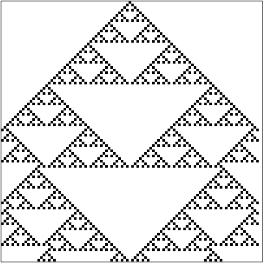

*Fig. 3*

Fig. 3 may be surprising. The evolutionary pattern displayed contrasts with the simplicity of the underlying law (the “Hat rule”) and ontology (for in terms of object and properties, we only need to take into account simple cells and two states). The global, emergent behavior of the system supervenes upon its local, simple features, at least in the following sense: the scale at which the decision to wear the hat is made (immediate neighbors) is not the scale at which the interesting patterns become manifest.

This example is a paradigmatic illustration of what makes CA appealing to a vast range of researchers:

> even perfect knowledge of individual decision rules does not always allow us to predict macroscopic structure. We get macro-surprises despite complete micro-knowledge. (Epstein 1999: 48)[^epstein-1999]

Since the notion of *emergence* and the micro–macro interplay have such an important role in science and philosophy (see the entries on supervenience and emergent properties; for a sample of scientific applications, see Mitchell 2009: 2–13; Gell-Mann 1994: Ch. 9)[^gell-mann-1994][^mitchell-2009], it has been suggested that many scientific as well as conceptual puzzles can be addressed by adopting the CA perspective. Stephen Wolfram has gone as far as claiming that CA may help us to solve longstanding issues in philosophy:

> Among them [the fundamental issues philosophers address] are questions about the ultimate limits of knowledge, free will, the uniqueness of the human condition and the inevitability of mathematics. Much has been said over the course of philosophical history about each of these. Yet inevitably it has been informed only by current intuitions about how things are supposed to work. But my discoveries in this book [*A New Kind of Science*] lead to radically new intuitions. (Wolfram 2002: 10)[^wolfram-2002]

These are very bold claims. In order to assess them, let us take a closer look at the field.

### 1.2 An Overview of CA’s Capabilities

The surprising patterns in the aforementioned classroom example were generated by boxes in a line with just two states and a simple rule. One may wonder how many variations are possible on such a basic framework. To address this issue, let us begin by considering how Andrew Ilachinski, in his review of the literature, narrows down CA applications to four main areas, which will be referred to in the rest of this entry (Ilachinski 2001: 7)[^ilachinski-2001]:

**(CA₁)**

As powerful computational engines.

**(CA₂)**

As discrete dynamical system simulators.

**(CA₃)**

As conceptual vehicles for studying pattern formation and complexity.

**(CA₄)**

As original models of fundamental physics.

(CA₁) emphasizes that CA perform computations. Just like Turing machines, they can be specified in mathematical terms, and implemented in different physical systems. However, CA are peculiar in two important ways. First, unlike Turing machines and von Neumann-architecture conventional computers, CA compute in a *parallel*, distributed fashion. Second, computation is pretty much “in the eye of the beholder”: there is no tape, but the evolution of the cells’ states can often be interpreted as a meaningful computational procedure (e.g., bits can be encoded using the *white*/*black* cell states). Computational hardware inspired by CA can help solve important technological problems (see Ilachinski 2001: 8)[^ilachinski-2001], but apart from engineering issues, (CA₁) also points to major conceptual questions, such as how exactly a universal Turing machine and an automaton can be rigorously compared (see Beraldo-de-Araújo & Baravalle 2017)[^beraldo-de-araújo-2017] and what are, if any, the philosophical implications of this comparison (see Wolfram 2002: Ch. 12)[^wolfram-2002].

(CA₂) comprises scientific applications of CA to the modelling of specific problems—to mention just a few: urban evolution (Batty 2005)[^batty-2005], Ising models (Creutz 1986)[^creutz-1986], neural networks (Franceschetti et al. 1992: 124–128)[^franceschetti-1992], lattice fluids (Barberousse & Imbert 2013)[^barberousse-2013], security (Ray et al. 2023 [Other Internet Resources]), bioinformatics (Xiao et al. 2011)[^xiao-2011], and even turbulence phenomena (Chen et al. 1983)[^chen-1983]. As Ilachinski remarks, for instance, discrete models of turbulence show that

> very simple finite dynamical implementations of local conservation laws are capable of exactly reproducing continuum system behavior on the macroscale. (Ilachinski 2001: 8)[^ilachinski-2001]

(CA₃) and (CA₄) enter very directly into the philosophical arena: as for (CA₃), Daniel Dennett has resorted to a famous automaton we describe below, Conway’s *Game of Life*, to make his point on determinism and the attribution of high-level concepts to emergent patterns (Dennett 1991, 2003)[^dennett-1991][^dennett-2003]. As for (CA₄), CA can provide an account of microphysical dynamics by representing discrete counterparts of quantum field theories (see entry on Quantum Field Theory) alternative to the standard continuous frames. But the more philosophical, and quite bolder, claim in this area is that nature itself may be a CA: Edward Fredkin, for instance, has advanced his “Finite Nature” hypothesis that our universe is an automaton which, at each time step, digitally and locally processes its state for the next time step (see Fredkin 1993)[^fredkin-1993]. Apart from the interest generated by Fredkin’s claim, entertaining the hypothesis raises a number of questions at the crossroads of physics and metaphysics (what is a natural law?), epistemology (what are the limits of physical systems predictability?) and the philosophy of information (what is the role of information in the physical world?). We will address each of these questions in the third Section of this entry.

### 1.3 A Brief History

The father of CA is John von Neumann (von Neumann 1951). Working on self-replication and attempting to provide a reductionist theory of biological development, von Neumann was trying to conceive a system capable of producing exact copies of itself. Now biology *prima facie* appears to be the realm of fluidity and continuous dynamics. But following a suggestion of his colleague Stanislaw Ulam, von Neumann decided to focus on a discrete, two-dimensional system. Instead of just *black*-or-*white* cells, von Neumann’s automaton used 29 different states and rather complicated dynamics, and was capable of self-reproduction. Von Neumann’s CA was also the first discrete parallel computational model in history formally shown to be a universal computer, i.e., capable of emulating a universal Turing machine and computing all recursive functions (see entry).

In the early Sixties, E.F. Moore (1962)[^moore-1962] and Myhill (1963)[^myhill-1963] proved the Garden-of-Eden theorems stating conditions for the existence of so-called Gardens of Eden, i.e., patterns that cannot appear on the lattice of a CA except as initial conditions. Gustav Hedlund (1969)[^hedlund-1969] investigated cellular automata within the framework of symbolic dynamics. In 1970 the mathematician John Conway introduced his aforementioned *Life* game (Berkelamp, Conway, & Guy 1982), arguably the most popular automaton ever, and one of the simplest computational models ever proved to be a universal computer. In 1977, Tommaso Toffoli used cellular automata to directly model physical laws, laying the foundations for the study of reversible CA (Toffoli 1977)[^toffoli-1977].

Stephen Wolfram’s works in the 1980s contributed to putting the growing community of CA followers on the scientific map. In a series of papers, Wolfram extensively explored one-dimensional CA, providing the first qualitative taxonomy of their behavior and laying the groundwork for further research. A particular transition rule for one-dimensional CA, known as *Rule 110*, was conjectured to be universal by Wolfram. Some twenty years after the conjecture, Matthew Cook proved that *Rule 110* is capable of universal computation (Cook 2004; Wolfram 2002 also contains a sketch of the proof)[^cook-2004][^wolfram-2002].

## 2. Some Basic Notions and Results

### 2.1 Basic Definitions

We are now taking a closer look at CA, focusing on models and results of philosophical interest. Although the variety of systems to be found in the CA literature is vast, one can generate virtually all CA by tuning the four parameters that define their structure:

1. *Discrete n-dimensional lattice of cells*: We can have one-dimensional, two-dimensional, …, *n*-dimensional CA. The atomic components of the lattice can be differently shaped: for example, a 2D lattice can be composed of triangles, squares, or hexagons. Usually *homogeneity* is assumed: all cells are qualitatively identical.
2. *Discrete states*: At each discrete time step, each cell is in one and only one state, $\sigma \in \Sigma, \Sigma$ being a set of finite cardinality $|\Sigma| = k$.
3. *Local interactions*: Each cell’s behavior depends only on what happens within its local *neighborhood* of cells (which may or may not include the cell itself). Lattices with the same basic topology may have different definitions of neighborhood, as we will see below. It is crucial, however, to note that “actions at a distance” are not allowed.
4. *Discrete dynamics*: At each time step, each cell updates its current state according to a deterministic transition function $\phi: \Sigma^n \rightarrow \Sigma$ mapping neighborhood configurations (*n*-tuples of states of $\Sigma$) to $\Sigma$. It is also usually, though not necessarily, assumed that (i) the update is *synchronous*, and (ii) $\phi$ takes as input at time step *t* the neighborhood states at the immediately *previous* time step $t - 1$.

One can exhaustively describe, for instance, the automaton of our classroom example:

1. 1-dimensional lattice of square cells on a line.
2. $\Sigma = {1, 0}$ (1 = black or hat on, 0 = white or hat off), so $|\Sigma| = 2$.
3. Each cell’s neighborhood is composed by the two nearest cells. If we index the cells by the integers, so that $c_i$ is cell number *i*, then the neighborhood of $c_i$ is $N(c_i) = \langle c_{i - 1}, c_{i + 1}\rangle$.
4. The transition rule $\phi$ is simple: At each time step *t*, a cell state is 1 if exactly one of the neighboring cells was 1 at $t - 1, 0$ otherwise.

A rule for a CA can be expressed as a conditional instruction: “If the neighborhood is this-and-this, then turn to state *s*”. One can write the general form of the rule for one-dimensional CA:

$$\tag{Rule1D} \sigma_i (t + 1) = \phi(\sigma_{i - r} (t), \sigma_{i - r + 1} (t), \ldots, \sigma_{i + r - 1} (t), \sigma_{i + r} (t)) $$

where $\sigma_{i}(t) \in \Sigma = \{0, 1, \ldots, k - 1\}$ is the state of cell number *i* at time step *t*; *r* specifies the *range*, that is, how many cells on any side count as neighbors for a given cell; and $\phi$ is defined explicitly by assigning values in $\Sigma$ to each of the $k^{2r+1} (2r + 1)$-tuples representing all the possible neighborhood configurations. For example, with $r = 1, \Sigma = \{1, 0\}$, a possible transition rule $\phi$ can be expressed as in Fig. 4 (with 1 being represented as *black*, 0 as *white*):

*Fig. 4*

For a given cell, each triple at the top represents a possible neighborhood configuration at *t*, the cell at issue being the one in the middle: for each configuration, the square at the bottom specifies the cell’s state at $t + 1$. This is our classroom example: you will have a black cell just in case precisely one of the neighbors was black.

### 2.2 The Wolfram Classification Scheme

This simple representation is also at the core of the widely adopted Wolfram code (Wolfram 1983)[^wolfram-1983], assigning to each rule a number: with *black* = 1 and *white* = 0, the bottom row can be read as a binary number (01011010); converting to decimal gives you the rule’s name (in this case, *Rule 90*). Since rules for CA with $r = 1$ and $k = 2$ differ just in the bottom row of the diagram, this encoding scheme effectively identifies each possible rule in the class. One-dimensional CA with $r = 1$ and $k = 2$ are among the simplest CA one can define, yet their behavior is at times quite interesting. When Stephen Wolfram started to explore this field in the Eighties, that class seemed a perfect fit. With $r = 1$, there are 8 possible neighborhood configurations (see Fig. 4 above) to be mapped to ${1, 0}$, giving a total of $2^8 = 256$ rules. Starting with random initial conditions, Wolfram went on to observe the behavior of each rule in many simulations. As a result, he was able to classify the qualitative behavior of each rule in one of four distinct classes. Repeating the original experiment, we simulated the evolution of two rules for each class of Wolfram’s scheme.

### 2.3 The Classes of the 256 Rules

*Class₁* rules leading to homogeneous states, all cells stably ending up with the same value:

*Rule 250*

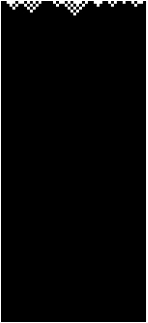

*Rule 254*

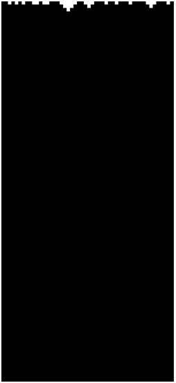

*Class₂* rules leading to stable structures or simple periodic patterns:

*Rule 4*

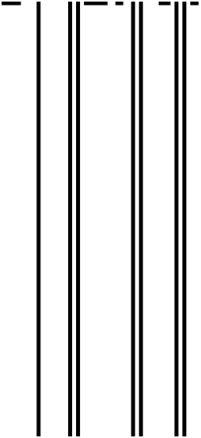

*Rule 108*

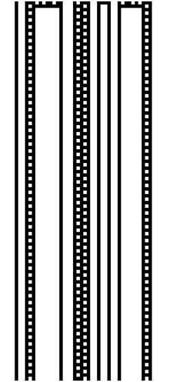

*Class₃* rules leading to seemingly chaotic, non-periodic behavior:

*Rule 30*

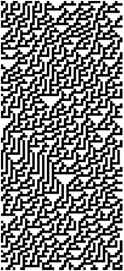

*Rule 90*

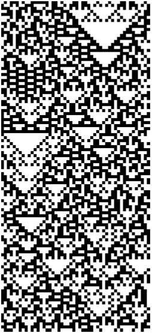

*Class₄* rules leading to complex patterns and structures propagating locally in the lattice:

*Rule 54*

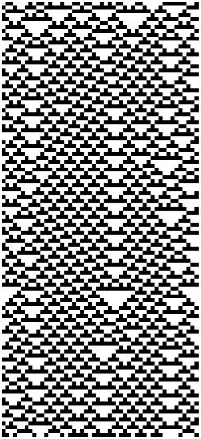

*Rule 110*

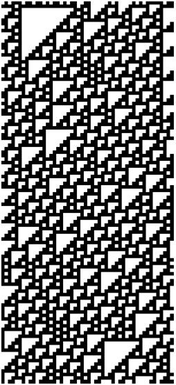

Class₁ comprises the rules that quickly produce uniform configurations. Rules in Class₂ produce a uniform final pattern, or a cycling between final patterns, depending on the initial configurations. The configurations produced by members of Class₃ are pretty much random-looking, although some regular patterns and structures may be present.

Class₄ deserves special attention. If we observe the universe generated by *Rule 110* we see regular patterns (although not as regular as in *Rule 108*) as well as some chaotic behavior (although not as noisy as in *Rule 90*). Now the basic feature a CA needs to perform computations is the capacity of its transition rule of producing “particle-like persistent propagating patterns” (Ilachinski 2001: 89)[^ilachinski-2001], that is, localized, stable, but non-periodic configurations of groups of cells, sometimes called *solitons* in the literature, that can preserve their shape. These configurations can be seen as *encoding* packets of information, *preserving* them through time, and *moving* them from one place to another: information can propagate in time and space without undergoing important decay. The amount of unpredictability in the behavior of Class₄ rules also hints at computationally interesting features: by the Halting Theorem (see section in entry on Turing machines), it is a key feature of universal computation that one cannot in principle predict whether a given computation will halt given a certain input. These insights led Wolfram to conjecture that Class₄ CA were (the only ones) capable of universal computation. Intuitively, if we interpret the initial configuration of a Class₄ CA as its input data, a universal Class₄ CA can evaluate any effectively computable function and emulate a universal Turing machine. As we mentioned above, *Rule 110* was indeed proved to be computationally universal.

(See the supplementary document [The 256 Rules](cellular-automata.supplement.md).)

### 2.4 The Edge of Chaos

The intermediate nature of Class₄ rules is connected to the idea that *interesting* complexity, such as the one displayed by biological entities and their dynamics, lies in a middle area between the two extremes of boring regularities and noisy chaos:

> Perhaps the most exciting implication [of CA representation of biological phenomena] is the possibility that life had its origin in the vicinity of a phase transition and that evolution reflects the process by which life has gained local control over a successively greater number of environmental parameters affecting its ability to maintain itself at a critical balance point between order and chaos. (Langton 1990: 13)[^langton-1990]

CA provided not just the intuition, but a formal framework to investigate the hypothesis. In the late Eighties the “Edge of Chaos” picture received considerable interest by CA practitioners. Packard 1988 and Langton 1990 were the first studies to give to the Edge of Chaos a now well-known interpretation in the CA context. As Miller and Page put it, “these early experiments suggested that systems poised at the edge of chaos had the capacity for emergent computation” (Miller & Page 2007: 129)[^miller-2007][^miller-2007-2]. The idea is simple enough: what happens if we take a rule like *Rule 110* and introduce a small perturbation? If we are to believe the Edge of Chaos hypothesis, we should expect the rules obtained by small changes in *Rule 110* to exhibit either simple or chaotic behavior. Let us consider a single switch from 1 to 0 or 0 to 1 in the characteristic mapping of *Rule 110*. The results are the following eight neighboring rules, each differing from *Rule 110* by a single bit (the diagonal in the array, with numbers in italics):

|   | **110** | **111** | **108** | **106** | **102** | **126** | **78** | **46** | **228** |
| --- | --- | --- | --- | --- | --- | --- | --- | --- | --- |
| *000* | 0 | *1* | 0 | 0 | 0 | 0 | 0 | 0 | 0 |
| *001* | 1 | 1 | *0* | 1 | 1 | 1 | 1 | 1 | 1 |
| *010* | 1 | 1 | 1 | *0* | 1 | 1 | 1 | 1 | 1 |
| *011* | 1 | 1 | 1 | 1 | *0* | 1 | 1 | 1 | 1 |
| *100* | 0 | 0 | 0 | 0 | 0 | *1* | 0 | 0 | 0 |
| *101* | 1 | 1 | 1 | 1 | 1 | 1 | *0* | 1 | 1 |
| *110* | 1 | 1 | 1 | 1 | 1 | 1 | 1 | *0* | 1 |
| *111* | 0 | 0 | 0 | 0 | 0 | 0 | 0 | 0 | *1* |
| Class | 4 | 2 | 2 | 3 | 3 | 3 | 1 | 2 | 1 |

At a first approximation, the Edge of Chaos hypothesis is confirmed: three of the eight neighbors are Class₃, three are Class₂, two are Class₁: *Rule 110* is the only Class₄ in the table. To generalize these findings to the entire class of rules for one-dimensional CA, Langton introduced a parameter, $\lambda$, that applies to each $\phi$: for $k = 2$, $r = 1$ (binary-state, unary-range) CA, $\lambda(\phi)$ can be computed as the fraction of entries of the transition rule table that are mapped to a non-zero output (see Langton 1990: 14, for the general definition)[^langton-1990]. In our case this means: $\lambda(\phi)$ will be equal to the number of ones in the rule column—e.g., $\lambda(\phi) = 5/8$ for $\phi$ = *Rule 110* and $\lambda(\phi) = 1/2$ for $\phi$ = *Rule 46*. Langton’s major finding was that a simple measure such as $\lambda$ correlates with the system behavior: as $\lambda$ goes from 0 to 1, the average behavior of the systems goes from freezing to periodic patterns to chaos. Langton singled out 1/2 as the value of $\lambda$ at which the average behavior first shows evidence of chaos: rules $\phi$ with $\lambda(\phi) \sim 1/2$ were highlighted as being on the Edge (see Miller & Page 2001: 133).

| **$\lambda$** | **All Rules** | **Chaotic Rules** | **Complex Rules** |
| --- | --- | --- | --- |
| *0* | 1 | 0 | 0 |
| *1/8* | 8 | 0 | 0 |
| *1/4* | 28 | 2 | 0 |
| *3/8* | 56 | 4 | 1 |
| *1/2* | 70 | 20 | 4 |
| *5/8* | 56 | 4 | 1 |
| *3/4* | 28 | 3 | 0 |
| *7/8* | 8 | 0 | 0 |
| *1* | 1 | 0 | 0 |

Both chaotic and complex rules have an average $\lambda$ value around 1/2, thus apparently supporting the Edge of Chaos hypothesis. It is fair to say, though, that some have cast doubts on the explanatory role of parameter $\lambda$ and the inferences drawn from it. In particular, the transition region of the Edge of Chaos seems to be itself complex. Miller and Page note that “there are multiple edges, not just a single one” (Miller & Page 2007: 133)[^miller-2007][^miller-2007-2]. Aggregate results do not hold when we analyze individual rules, even paradigmatic ones:

|   | **110** | **111** | **108** | **106** | **102** | **126** | **78** | **46** | **228** |
| --- | --- | --- | --- | --- | --- | --- | --- | --- | --- |
| $\lambda$ | 5/8 | 3/4 | 1/2 | 1/2 | 1/2 | 3/4 | 1/2 | 1/2 | 3/4 |

As the table shows, among the *Rule 110* neighbors, some chaotic rules $\phi$ have $\lambda(\phi) = 3/4$, some cyclic ones have $\lambda(\phi) = 1/2$ and, indeed,

> every one of the rules classified as complex in this space has at least one chaotic neighbor with a lower $\lambda$ value and one with higher value. (Miller & Page 2007: 135)[^miller-2007][^miller-2007-2]

Melanie Mitchell, Peter Hraber, and James Crutchfield replicated Langton and Packard’s experiments, reporting very different results (Mitchell, Hraber, & Crutchfield 1994)[^mitchell-1994]. In particular, they report that serious computational phenomena take place much closer to a chaotic $\lambda(\phi) = 1/2$ than it was previously thought. Apart from technical points, a conceptual flaw in the original findings is the use of aggregate statistics, which are difficult to interpret in a high variance context:

> if, instead, the hypotheses are concerned with generic, statistical properties of CA rule space—the “average” behavior of an “average CA” at a given $\lambda$—then the notion of “average behavior” must be better defined. (Mitchell, Hraber, & Crutchfield 1994: 14)[^mitchell-1994]

While it is fair to conclude that complex behavior does not lie at the Edge of Chaos taken in a simplistic sense (i.e., it is not straightforwardly correlated with the simple $\lambda$), the interest in the connection between computational capabilities and phase transitions in the CA rule space has been growing since then. We will consider such developments below, specifically in the context of CA and the philosophy of computation.

### 2.5 CA in More Dimensions: the *Game of Life*

Notwithstanding the computational interest of one-dimensional CA, philosophical issues have been discussed more often in connection with two-dimensional CA. The first CA, von Neumann’s self-reproducing automaton, inhabited a two-dimensional grid. Besides, two-dimensional CA are suitable for representing many physical, biological, and even human phenomena, ranging from the dynamics of perfect gases to the movements of birds in a storm and soldiers on a battlefield. The most common configurations have either square or hexagonal cells, given their translational and rotational symmetries. Moving to two dimensions, of course, also expands the possibly interesting combinations of rules and neighborhoods. As for the latter, the two most common options in a grid of squares are the *von Neumann* neighborhood, where each cell interacts only with its four horizontal and vertical adjacent mates, and the *Moore* neighborhood, comprising all the eight immediately adjacent cells.

By way of example, we introduce the famous *Game of Life* (or, more briefly, *Life*) by John Conway (see Berkelamp, Conway, & Guy 1982). *Life* fits well with our usual schema:

1. 2-dimensional lattice of square cells in an orthogonal grid.
2. $\Sigma = \{1, 0\}$, so $|\Sigma| = 2$ (for reasons we are about to see, we can picture 1 as the state of being alive for a given cell, 0 as the state of being dead).
3. Each cell’s neighborhood is composed of all its eight neighboring cells (the Moore neighborhood).
4. *Life*’s transition rule goes as follows. At each time step *t* exactly one of three things can happen to a cell:
5. *Birth*: If the cell state at $t - 1$ was 0 (dead), the cell state becomes 1 (alive) if exactly three neighbors were 1 (alive) at $t - 1$;
6. *Survival*: If the cell state at $t - 1$ was 1 (alive), the cell state is still 1 if either two or three neighbors were 1 (alive) at $t - 1$;
7. *Death*: If the cell state at $t - 1$ was 1 (alive), the cell state becomes 0 (dead) if either fewer than two or more than three neighbors were 1 (alive) at $t - 1$ (cells can die of “loneliness” or “overpopulation”).

*Life* would definitely be considered a Class₄ CA by Wolfram’s taxonomy. In this simple setting, periodic structures, stable blocks and complex moving patterns come into existence, even starting from a very simple initial configuration. Conway remarked:

> It’s probable, given a large enough *Life* space, initially in a random state, that after a long time, intelligent, self-reproducing animals will emerge and populate some parts of the space. (cited in Ilachinski 2001: 131)[^ilachinski-2001]

*Life*-fans explored the CA’s possible patterns of evolution, and shared their findings in what has been called *Life*’s zoology (Dennett 2003: 41)[^dennett-2003]. Here is a small gallery of samples together with snapshots of a typical simulation (for more pictures and animations, see Other Internet Resources at the end). *Gliders* are the most popular among the basic *Life* inhabitants: a simple 5-bit structure, a glider can travel the *Life* grid in a 4-time step cycle:

*Glider*

$t_{0}$

$t_{1}$

$t_{12}$

*Toads* are period 2 blinking configurations: together with *Blinkers* and *Beacons* they are the simplest oscillators of the universe.

*Toad*

$t_{0}$

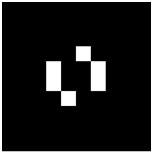

$t_{1}$

$t_{3}$

*Eaters* have the feature of devouring other configurations, e.g., gliders, maintaining intact their own form (because of this, they play an important role for *Life*’s computational abilities).

*An Eater devouring a Glider*

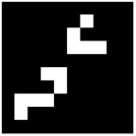

$t_{0}$

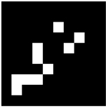

$t_{2}$

$t_{4}$

A typical evolution of *Life* starting from random initial conditions may contain all of the above notable figures and much more. Some initial configurations may end up, even after few time steps, into static or simple periodic structures. Other configurations, though, can produce non-periodic, increasingly complex environments whose development can be unpredictable (even in the computational sense we are about to explore). As Ilachinski has suggestively conjectured from this:

> Upon observing the seemingly unlimited complexity and variety of *Life*’s evolving patterns, it becomes almost impossible to refrain from imagining, along with Conway, that, were the game really to be played on an infinite lattice, there must surely arise true living “life-forms”, perhaps themselves evolving into more complex, possibly sentient, “organisms”. (Ilachinski 2001: 133)[^ilachinski-2001]

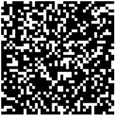

$t_{0}$

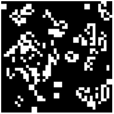

$t_{10}$

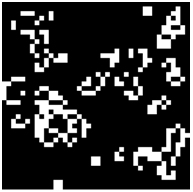

$t_{20}$

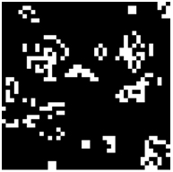

$t_{30}$

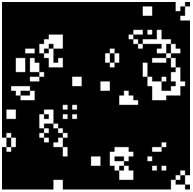

$t_{40}$

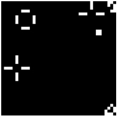

$t_{175}$

The mathematical literature on CA does not refrain from describing the *Life* configurations using the same imaginative vocabulary we used: items are *born*, *live*, *move* around, *eat* other figures, *die*, etc. The universe these patterns inhabit may also be described, though, as a collection of individual cells, each of which does not directly depend on what is happening on the macro-scale. And the life on *Life* can also be described in the simple mathematical language of matrices and discrete sequences. But if one is only told the basic *Life* rule, one could hardly imagine the complexity it can generate—until one sees it. *Life*’s reputation among scientists and philosophers arguably comes from its challenging naive intuitions about complexity, pattern formation and reality, persistence, and continuity: as a toy universe we ourselves built, we feel we should know in advance what dynamics are allowed. This has been shown to be impossible, in a mathematically precise sense.

### 2.6 *Life* as a Universal Turing Machine

Like any other CA, *Life* can be considered a computational device: an initial configuration of the automaton can encode an input string. One can let the system run and, at some point, read the current configuration as the result of the computation performed so far, decoding it into an output string. But exactly what can *Life* compute? It turns out that *Life* can compute everything a universal Turing machine can and therefore, taking on board Turing’s Thesis, function as a general purpose computer: a suitable selection of initial conditions can ensure that the system carry out arbitrary algorithmic procedures.

The proof of the universal computational capacities of *Life* presented in Berkelamp, Conway, and Guy 1982 consists in showing that the basic building blocks or primitives of standard digital computation can be emulated by appropriate patterns generated by *Life*—in particular: (a) data storage or memorization, (b) data transmission requiring wires and an internal clock, and (c) data processing requiring a universal set of logic gates, like negation, conjunction, and disjunction—an actual Turing machine was later explicitly implemented in *Life* by Paul Rendell (see Other Internet Resources).

This finding is not of great engineering importance (no one would spend their time translating “$24 + 26 / 13$” into *Life*). However, it raises a conceptual issue about any universe sharing the capacity of producing and hosting universal computers: because of the aforementioned Halting Theorem, no general algorithm can decide whether, given some initial configuration as input, *Life* will eventually die out or halt. It is in this sense that the evolution of the automaton is unpredictable. Given that the development of CA that are computationally universal cannot be predicted by direct mathematical analysis alone, it is no surprise that CA practitioners have adopted the language of philosophy and talked of *phenomenological studies* of CA (we will come back to this terminology in more detail in Section 3.4 below, discussing how CA model whatever they can model). Here the automaton is realized as a computer software, and the observable emergent properties of its evolution are empirically registered as the computer simulation advances. In Wolfram’s turn of phrase, *Life* is *algorithmically irreducible*: no algorithmic shortcut is available to anticipate the outcome of the system given its initial input. “*Life*—like all computationally universal systems—defines the most efficient simulation of its own behavior” (Ilachinski 2001: 15)[^ilachinski-2001]. This raises the important philosophical question of the limits of the predictability of any universe capable, just as *Life* is, of producing and hosting universal computers.

### 2.7 Further CA

Notwithstanding the historical and conceptual centrality of the CA described in this section, many important developments in the field could not be presented in the space allowed for this entry. One can relax some of the assumptions in the general characterization of CA provided in Section 2.1 and get interesting results. The transition rule can be *probabilistic* and take into consideration more than just one time step (see Richards, Meyer, & Packard 1990: probabilistic automata are widely used to represent the stochastic dynamics of microphysical systems)[^richards-1990]; the cell state updating can be *asynchronous* (see Ingerson & Buvel 1984)[^ingerson-1984]; the lattice can be made of *non-homogeneous* cells following different transition rules (see Kauffman 1984)[^kauffman-1984]; even the discreteness constraint can be relaxed by having the set of states be the set of *real numbers* (see Wolfram 2002: 155–157)[^wolfram-2002].

CA are also being fruitfully used in connection with the issue of the thermodynamic limits of computation: is there a minimum amount of energy needed to perform a logical operation? Landauer (1961)[^landauer-1961] argued that irreversible logical operations (i.e., operations that, not corresponding to bijections, cannot be run backwards as they entail some information loss) necessarily dissipate energy. The invention of the Fredkin reversible logical gate and of the Billiard Ball Model of reversible computation (Fredkin & Toffoli 1982)[^fredkin-1982] strengthened the importance of the link between universal reversible automata and the physical properties of computation (for an overview, see Ilachinski 2001: 309–323; for a sample reversible CA, see Berto, Rossi, & Tagliabue 2016)[^berto-2016][^ilachinski-2001].

In recent years, the growth of Artificial Intelligence (AI) as a prominent sub-field in computer science led to interesting contamination between AI and CA. On the one hand, prominent AI researchers explicitly mentioned contributions from the complex system literature – such as CA – as alternative ways to model collective behavior (Ha & Tang 2022). On the other, traditional CA-based modeling has been extended to leverage the “powerful language of loss functions” (Mordvintsev et al. 2020)[^mordvintsev-2020] for differentiable rules, and take advantage of the extensive tooling built for gradient-based numerical optimization: CA built on top of neural networks showcase (learned) asynchronous rules (Mordvintsev et al. 2020)[^mordvintsev-2020] for morphogenesis, as well as (learned) variable neighborhood composition (Grattarola et al. 2021)[^grattarola-2021].

Finally, it is worth mentioning that *genetic algorithms* have been used with CA to study how evolution creates computation (for a survey of important results, see Mitchell, Crutchfield, & Das 1996)[^mitchell-1996]. While the aforementioned sources further explore these possibilities, the sample CA models discussed so far will be sufficient for the philosophical arguments we are going to address henceforth.

## 3. CA and Philosophy

A growing number of CA-related philosophical arguments are being produced, both by philosophers and by scientists interested in the conceptual implications of their work. Among the interesting issues addressed through the CA approach in the philosophical market are the structure of emergence, free will, the nature of computation, and the physical plausibility of a digital world.

### 3.1 CA and Emergence

CA can be considered a paradigmatic locus for the study of phenomena related to *emergence* (for an introduction, see the entry on emergent properties). One can initially divide the problem of emergence into two separate questions, roughly corresponding to epistemological and ontological issues: How can we *recognize* emergence? What is the *ontological status* of the high-level properties and features? As a matter of historical fact, CA have been invoked mainly to address the former, but we will see in Section 3.4 below that there is work for CA also on the ontological side.

Epistemological issues have often been raised in connection with complex systems in general. In their open agenda for complex social systems, Miller and Page include the following question: “Is there an objective basis for recognizing emergence and complexity?” (Miller & Page 2007: 233–234)[^miller-2007][^miller-2007-2]. The literature on CA has variously addressed the issue. On the one hand, being a low-level simple and controllable environment, CA present themselves as a natural framework for tackling the problem in its purest form. On the other hand, CA researchers have recognized how the systemic and global features of a complex CA system can be hard to predict even with perfect knowledge of low-level entities and laws:

> Over and over again we will see the same kind of thing: that even though the underlying rules for a system are simple, and even though the system is started from simple initial conditions, the behavior that the system shows can nevertheless be highly complex. (Wolfram 2002: 28)[^wolfram-2002]
>
> Due to the local nature of a CA’s operations, it is typically very hard, if not impossible, to understand the CA’s global behavior … by directly examining either the bits in the lookup table or the temporal sequence of raw 1–0 spatial configurations of the lattice. (Hordijk, Crutchfield, & Mitchell 1996: 2)[^hordijk-1996][^mitchell-1996]

Now the issue of detecting emergence is connected to the conceptual problems of defining what an emerging feature is: we need *some* idea of what we are looking for in order to scan the space-time evolution of a system and recognize its patterns. We may start with the four characterizations of emergence provided in Clark 2013. Emergence may be taken:

**(E1)**

as collective self-organisation,

**(E2)**

as unprogrammed functionality,

**(E3)**

as interactive complexity, or

**(E4)**

as incompressible unfolding.

In the first sense, an emergent feature is “any interesting behaviour that arises as a direct result of multiple self-organizing … interactions occurring in a system of simple elements” (Clark 2013: 132)[^clark-2013]. CA clearly fit the E1 bill, but that is because this is a rather generic characterization (What counts as interesting? What is self-organization?). Things get a bit more precise with E2: emergent features here are taken as *unprogrammed*, that is, as such that there is no program explicitly encoding the relevant phenomena, features, or processes in the target system (a typical example is cricket phonotaxis, see Clark 2013: 120: female crickets move towards males via a mechanical body system directing them to the source of sounds of particular wavelengths; one can describe this as females aiming towards males after hearing their sound, but what is encoded in the cricket’s body functions is just an automatic earlier activation of the side of the body first reached by the sounds). According to the concept embodied in E3, we get emergence as interactive complexity when “complex, cyclic interactions give rise to stable and salient patterns of systemic behavior” (Clark 2013: 134)[^clark-2013]; in particular, the interactions are supposed to be nonlinear (a typical example are convection rolls in a fluid heated in a pan; see Kelso 1995: 5)[^kelso-1995].

Now the emergent properties attracting CA scholars’ attention, unsurprisingly, have mainly been computational properties, i.e., the features enabling a system to perform complex calculations in spite of not being explicitly computationally encoded at the base level (which sits in the vicinity of E2). Additionally, as we have seen during our discussion of the Edge of Chaos hypothesis, CA scholars have focused on the study of nonlinear global dynamics emerging from the local interactions of the CA cells (which sits in the vicinity of E3). In order to introduce the formal work on emergent CA computation, and to compare these findings with the available philosophical accounts, we can start again with a concrete example. This is the “classification problem”.

We want to design a one-dimensional automaton that answers a simple question: Are there more white or black cells at a given time $t_0$? Starting from any initial conditions with more white (black) cells, the ideal automaton will halt having all its cells turned white (black) after a given number of time steps (designing an automaton that always gives the right answer is not feasible in practice; so the performance is judged by the fraction of random initial conditions that are correctly classified).

$t_0$

$\longrightarrow$

$t_n$

The task is far from trivial in a CA, involving the intricacy of the emergence in both E2 and E3 sense. The answer requires a global perspective (how many cells are white (black) in the lattice as a whole?). However, the cells work with only local rules explicitly encoded in them: no single cell can do the counting. The ideal automaton should find a way to aggregate information from several parts of its own lattice to give the final answer. A kind of emergent computation is needed to successfully solve this density classification task. It has been proved that no CA can solve this problem precisely (see Land & Belew 1995)[^land-1995]. Since, however, CA with larger neighborhoods achieve better results in tasks of this kind, *genetic algorithms* are used to efficiently search the solution space (genetic algorithms are computational analogues of genetic evolution, in which a computational problem is addressed by producing, combining, and selecting solutions to it; the details of the procedure as applied to the classification problem are not important for our purpose, but, for an accessible presentation, see Mitchell 2009: 22; for a general introduction see Mitchell 1998). The following is a diagram of the “Rule $\phi_{17083}$”, discovered by James Crutchfield and Melanie Mitchell (1995). The CA implementing the rule starts from an initial state with more white cells:

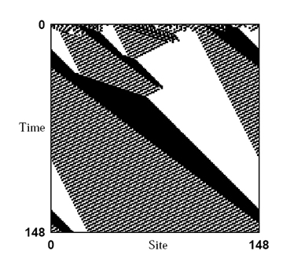

*Fig. 5*

At time step 250 (not shown in Fig. 5), the grey areas disappear and all cells end up white, i.e., the classification made by the automaton is correct. A high-level description of what is going on would have it that the white, black, and grey regions are “expanding”, “contracting”, “moving”, these being nonlinear effects of the low-level working of the cells computing their local states, and by so doing manage to carry signals along the lattice. But how are we to explain the emergent computation CA of this kind perform via such nonlinear dynamics? Building on previous works on computation theory applied to CA (Hanson & Crutchfield 1992; Crutchfield & Hanson 1993)[^crutchfield-1993][^hanson-1992], Mitchell and Crutchfield filtered out from the original diagram what they call “domains”, i.e., dynamically homogeneous spatial regions (Crutchfield & Mitchell 1995: 10745)[^crutchfield-1995]:

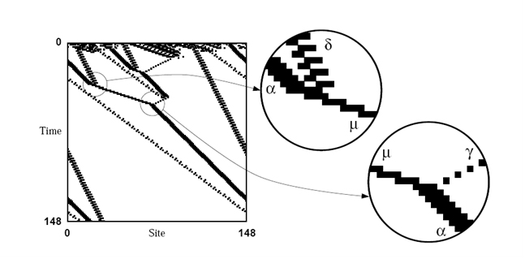

*Fig. 6*

Although in this case the “domains” are manifest, it is crucial to point out that their definition is rigorously mathematical. The whole process of domain-detection can be carried out algorithmically (see Hanson & Crutchfield 1992 for details)[^hanson-1992]. When the boundary of a domain remains spatially localized over time, then the domain becomes a “particle”:

> Embedded particles are a primary mechanism for carrying information … over long space-time distances. (…) Logical operations on the signals are performed when the particles interact. The collection of domains, domain walls, particles and particle interactions for a CA represents the basic information processing elements embedded in the CA’s behavior—the CA’s “intrinsic” computation. (Crutchfield & Mitchell 1995: 10744)[^crutchfield-1995]

There are five stable particles (termed α, γ, δ, ε, µ) and one unstable particle (β) for this automaton: their interaction (annihilation, decay, reaction) supports the emergent logic of the system. The two circles in the image above are examples of what may happen during an interaction. In the first case, $\alpha + \delta \rightarrow \mu$, a spatial configuration representing high, low, and then ambiguous densities is mapped to a high-density signal µ; in the second, $\mu + \gamma \rightarrow \alpha$, a spatial configuration representing high, ambiguous, and then low density is mapped to an ambiguous-density signal α (Crutchfield & Mitchell 1995: 10745)[^crutchfield-1995]. The whole computational mechanics is worth being explored in more detail, but we can already safely generalize to the basic philosophical point of this and related works.

According to O’Connor and Wong 2015, in the context of dynamic systems and the study of complexity, emergence is characterized by most authors

> strictly in terms of limits on human knowledge of complex systems. Emergence for such theorists is fundamentally an epistemological, not metaphysical, category. (O’Connor & Wong 2015: Sec. 2)[^o’connor-2015]

But the Crutchfield–Mitchell approach suggests a different perspective. Firstly, the emergent (both in the E2- and in the E3-sense) computational properties in CA can in an important sense be objectively defined (see Crutchfield 1994a and the more accessible Crutchfield 1994b)[^crutchfield-1994a][^crutchfield-1994b]: although it is customary in this setting to talk of emergent computation being “in the eye of the beholder”, because not explicitly encoded at the base level, the detection and classification of patterns is itself algorithmic. Secondly, Crutchfield characterizes CA-emergence of this kind as, in a sense, intrinsic: the emerging patterns “are important *within* the system” (Crutchfield 1994b: 3)[^crutchfield-1994b], not merely important for an observer *outside* the system. More precisely: they are mathematically grounded on the basic features of the system, despite not being explicitly mentioned in the standard abstract characterization of the program, that is, the transition rule implemented in the CA cells (Crutchfield mentions as non-intrinsic emergent phenomena the patterns in the Belousov–Zhabotinsky reaction and the energy recurrence in harmonic oscillator chains reported by Fermi, Pasta, and Ulam—see Crutchfield 1994b)[^crutchfield-1994b].

Crutchfield infers from this that many cases of emergence are indeed not reducible to some interaction with an observer. They are genuine instances of an intrinsic phenomenon, not the results of some human-biased discovery (Crutchfield 1994b: 2)[^crutchfield-1994b]. If emergence were not intrinsic, scientific activity would indeed be a subjective enterprise of “pattern discovery”:

> Why? Simply because emergence defined without this closure leads to an infinite regress of observers detecting patterns of observers detecting patterns … (Crutchfield 1994b: 10)[^crutchfield-1994b]

Summarizing Crutchfield’s work, Miller and Page say that the concept of emergence

> has thus made the transition from metaphor to a measure, from something that could only be identified by ocular magic to something that can be captured using standard statistics. (Miller & Page 2007: 234)[^miller-2007][^miller-2007-2]

Such remarks may sound philosophically naive to a trained epistemologist. It is not obvious, for instance, that the existence of a mathematical or specifically algorithmic emergent pattern would block a supposed regress entailed by a non-mathematical emergence. Why would science as an activity of (occasionally) non-algorithmic pattern discovery be a merely subjective enterprise? If these claims can be re-phrased in a philosophically sophisticated way, though, they may challenge standard definitions of *weakly emergent* properties (in the sense of Chalmers 2002)[^chalmers-2002]. Teller 1992, Clark 1996, and Bedau 1997, for instance, all run together instances of “pattern discovery”—taken as a subjective, observer-dependent activity—with instances of intrinsic emergence—a phenomenon that, as we have just seen, can be characterized in the context of CA as objective and statistically significant (see the relevant section of the entry on emergent properties).

Finally, on to E4: emergence as incompressible unfolding. Bedau 1997 defines a macro-state *emergent* in this sense just in case it can be derived from knowledge of the system’s micro-components only by direct simulation of the overall system evolution. Here the idea is one of “emergent phenomena as those for which *prediction* requires *simulation*” (Clark 2013: 134)[^clark-2013]: E4-emergent macro-features would be those that can only be predicted by directly modelling the micro-features, with no computational shortcut to compress the information at micro-level. The first thing to notice, according to Clark, is that this notion of emergence is at odds with at least some of the previous ones: E3-emergence has it that

> emergent phenomena are often *precisely* those phenomena in which complex interactions yield robust, salient patterns capable of supporting prediction (ibid.),

that is, patterns that deliver compressible information. Next, while the characterization of E4, Bedau-style emergence may work pretty well in the case of completely chaotic systems, it does not sit well with such CA as Rule $\phi_{17083}$. According to the proposed definition, the answer to the classification problem given by Rule $\phi_{17083}$ is an emergent phenomenon just in case the only way to go from $t_0$ to $t_n$ is by explicitly simulating the system evolution.

$t_0$

$\longrightarrow$

$t_n$

As it turns out, however, this is not the case. Using Crutchfield’s particle model it is possible to predict the result of the classification by simply making particle-calculations, without bothering about the underlying dynamics (Hordijk, Crutchfield, & Mitchell 1996)[^hordijk-1996][^mitchell-1996]. Here then, the emerging computation in the CA would not be a case of emergence for Bedau.

What about the ontological side of emergence? The issue of the reality of emerging patterns in CA has been examined both by reductionist (Dennett 2003)[^dennett-2003] and by emergentist philosophers (Thompson 2007)[^thompson-2007]. It is fair to say that the CA literature so far has not significantly contributed to the ongoing philosophical debate on the purely ontological side of reductionism. CA patterns that are “objectively” detected via computation, as per the Mitchell–Crutchfield approach, are not *ipso facto* new primitives to be included in an ontology. It may well be that features of a CA that are objective, in the sense of not depending on the interaction with an observer, are nevertheless ontologically reducible to more basic entities via suitable definitions (see Kim 1999; Dennett 1991)[^dennett-1991][^kim-1999].

### 3.2 CA and Free Will

Philosophers have debated the relationship between determinism and free will for over two millennia. Two opposite stances can be taken towards the problem: *compatibilism* maintains that free will is compatible with a deterministic world, which *incompatibilism* denies (see the entries on free will and compatibilism). Surprisingly enough, both Daniel Dennett and Stephen Wolfram argued that adopting the CA perspective can provide a solution, or perhaps a dissolution, of the longstanding mystery of free will.

A major obstacle to accepting compatibilism is our persuasion that determinism implies inevitability (Dennett 2003: 25)[^dennett-2003]. We may thus make compatibilism palatable by exhibiting an intuitive counterexample to that conviction: a deterministic world in which, however, not everything is inevitable, i.e., some things are avoidable (ibid.: 56). Dennett maintains that CA can do this. He takes *Life* as a vivid illustration of how, in a deterministic but complex enough world, we can abstract away from the bottom level and the micro-laws deterministically governing it, and describe what is happening by taking the emergent level seriously. Recall the eater–glider dynamics:

*An Eater devouring a Glider*

$t_0$

$t_2$

$t_4$

At $t_0$, an observer aiming at predicting the evolution of this space-time region has basically two choices: she can take into account (what Dennett calls) the *physical level*, and compute pixel by pixel the value of each cell state at each time step; or, she can focus on the *design level*, and employ high-level concepts such as those of *glider* and *eater* to ground her predictions (Dennett 2003: 39)[^dennett-2003]. The first option is perfectly deterministic, but has a flaw: it is time consuming, in such a way that, by the time you have made the required computation, the world has already evolved (this is especially true of a *universal* CA—as we have already hinted at above, and shall expand on soon). The second option is much faster: you know without much calculation what is going to happen to a glider meeting an eater. The predictions, though, cannot be 100% reliable:

> Whereas at the physical level, there are absolutely no exceptions to the general law, at the design level our generalizations have to be hedged: they require “usually” clauses … . Stray bits of debris from earlier events can “break” or “kill” one of the objects in the ontology at this level. Their salience as real things is considerable, but not guaranteed. (Dennett 2003: 40)[^dennett-2003]

Dennett’s point is that *avoidance* itself is a high-level concept. As such, it is compatible with a deterministic bottom level (because the concepts at the emergent level are, by design, independent from the micro-laws). The *physical description* and the *design description* of *Life* are different interpretations of the same basic ontology, namely, the sparse ontology of CA. While in theory we could avoid the introduction of emergent concepts, in practice it is only by speaking of gliders, movements, and avoidance that we can make sense of the evolution of the system (Dennett 2003: 43–44)[^dennett-2003]. Even without knowing *Life*’s physics, we could do a good job if we predicted the future by mentioning only high-level patterns. *Life* is just a toy universe but, Dennett claims, these new intuitions are sufficient to see that, in some deterministic worlds, someth things are avoidable. For instance, it is true at the design level that gliders actually avoid eaters. Thus, the inference from determinism to inevitability can be blocked.

A reply to Dennett’s argument consists in denying that *Life*-avoidance is real avoidance. Dennett himself puts a version of this argument in the mouth of Conrad, a fictional skeptic philosopher discussing Dennett’s idea throughout his book:

> It may look like avoidance, but it’s not real avoidance. Real avoidance involves changing something that was going to happen into something that doesn’t happen. (Dennett 2003: 58)[^dennett-2003]

Rephrasing Dennett’s example, we can identify an ambiguity in Conrad’s argument. Imagine that a baseball is *going to* hit you in the face—but you dodge it: a clear case of *real* human avoidance. In what sense was the baseball “going to” hit you in the face? (Dennett 2003: 59)[^dennett-2003]? One might say that it was *never* really going to hit you, precisely because it triggered the reaction of whatever “avoidance system” you have. What is the difference between this avoidance and *Life*-avoidance? For Dennett, this is not a difference in kind, but in complexity: gliders and humans both have avoidance systems, but human systems are much more sophisticated. The choice of a universal CA as a toy universe allows us to draw a stronger conclusion: since we know that *Life* is equivalent to a universal Turing machine, as explained above, some patterns in that universe may display avoidance systems at least as complex as ours. Dennett claims that compatibilism has thus won the first round:

> you agree that … I’ve shifted the burden of proof: there shall be no inferring inevitability in any sense from determinism without mounting a supporting argument. (Dennett 2003: 61)[^dennett-2003]

Stephen Wolfram addresses the phenomenon of free will in his book on CA, with an ambitious tone:

> From the discoveries in this book it finally now seems possible to give an explanation for this [free will]. And the key, I believe, is the phenomenon of computational irreducibility. (Wolfram 2002: 750)[^wolfram-2002]

We have introduced the issue of computational (or algorithmic) irreducibility when we explained the philosophical consequence of a universality proof for an automaton, namely that, although a system follows definite underlying laws, “its overall behavior can still have aspects that fundamentally cannot be described by reasonable laws” (Wolfram 2002: 750)[^wolfram-2002]. This is again the issue of predictability via step-by-step micro-computations. In this “separation between the underlying rules for the system and its overall behavior” (Wolfram 2002: 751)[^wolfram-2002] lies the secret of free will, since it seems that we attribute free will to a system just when “we cannot readily make predictions about the behavior of the system” (Wolfram 2002: 751)[^wolfram-2002]. According to Wolfram, CA play a leading role in providing a new framework to understand the phenomenon. While explanations from chaos theory and quantum randomness have recently been proposed (see the entry on chaos), “nothing like this is actually needed” (Wolfram 2002: 752)[^wolfram-2002]. By observing CA, we can understand how something with simple and definite micro-rules, like those governing our neurons, can produce a behavior free of obvious rules:

> the crucial point is that this happens just through the intrinsic evolution of the system—without the need for any additional input from outside or from any sort of explicit source of randomness. (Wolfram 2002: 752)[^wolfram-2002]

Wolfram’s point is similar to some of Dennett’s remarks, namely: taking some sort of “design stance”, Wolfram suggests that one can talk about a cellular automaton as if it just “decides” to do this or that—“thereby effectively attributing to it some sort of free will” (Wolfram 2002: 752)[^wolfram-2002]. One easily sees the closeness to Dennett’s famous intentional stance (Dennett 1987; see the entry on intentionality, esp. Section 9)[^dennett-1987].

How important are CA to these accounts? Dennett and Wolfram both use CA as intuition pumps. However, their positions seem to be slightly different. For while the former sees CA as a “useful toolkit” to develop intuitions and vividly illustrate his arguments (Dennett 2003: 40)[^dennett-2003], the latter claims that CA provides a “new kind of intuition”, one that “no branch of everyday experience” could provide (Wolfram 2002: 41)[^wolfram-2002].

The importance Wolfram attaches to CA seems to rely on a single, generic “indispensability argument” to the conclusion that CA justify the foundation of “a new kind of science” (Wolfram 2002: 7–16)[^wolfram-2002]. We can reconstruct this argument as follows:

**(NKS₁)**

The observation of CA evolution leads to a scientific discovery: “very simple rules produce highly complex behavior” (Wolfram 2002: 39)[^wolfram-2002].

**(NKS₂)**

This discovery—the “new intuition”—promises to explain old and new phenomena and uncover important regularities.

**(NKS₃)**

Therefore, the core of our current scientific practices (based on the “old intuition”) should be radically changed to accommodate this discovery.

(NKS₁) is to be taken at face value. It entails that the concepts involved were not previously known. Wolfram talks in terms of “the single most surprising scientific discovery I have ever made” (Wolfram 2002: 27)[^wolfram-2002]. Is (NKS₁) true? For sure, the idea that a deterministic and simple system may produce unpredictable behavior started circulating in the scientific community well before Wolfram’s work. Signs of what is now chaos theory can be traced back to the 19th and early 20th century, e.g., to the work of Poincaré 1914. One might grant that CA allowed the discovery that *simple* systems may produce *complex* behavior via the proof that they have unpredictable emergent computational complexity (although this discovery itself, as outlined in our brief historical section, was not made but only greatly publicized by Wolfram). Why was this discovery not made earlier? Wolfram’s own diagnosis is twofold: on the one hand, we have the “engineering” intuition that to produce something complex we should build something complex—that is because this is how ordinary machines work. On the other, CA were not obviously connected to any established discipline, and therefore they were not studied in academic circles.

As for (NKS₂), we just examined the case of free will. In Wolfram’s perspective, free will looks just like another puzzling philosophical phenomenon explained away by the advance of (a new kind of) science. Just as life was puzzling before the discovery of the double helix, free will was puzzling before the discovery of a suitable scientific theory, one that can finally account for the separation between micro and macro level. Many reductionist philosophers are no strangers to this kind of argument. The concepts and intuitions used in contemporary philosophy are often rooted in current scientific practices. When groundbreaking discoveries are made, old arguments may be revised: troublesome concepts become harmless and new challenges are introduced. From this perspective, Wolfram’s account of the free will problem may lack philosophical rigor, but it is a promising start to re-address the challenge armed with new scientific models of determinism and complexity—pretty much as Dennett does. While many successful applications are needed to fully vindicate (NKS₂), our first assessment concludes that, at the very least, it is not obviously false. As for the “new regularities” promised by (NKS₂), we will address them in the next section.

### 3.3 CA and the Philosophy of Computation

CA are computational systems that perform complex tasks on the basis of the collective behavior of simple items. What, if anything, does it tell us about the importance of computation for systems in nature?

Different conclusions have been drawn by practitioners in the field. Some have endorsed the more modest claim that the computational features of CA are important to understand and compare social, biological, and physical systems modeled by them; but others have taken CA to support the view that computation and information processing in a discrete setting lie at the very foundations of reality. We will explore the stronger claim in Section 3.4 below. As for the weaker claim, it is not possible here to address the general importance of computational properties across the sciences (see Mitchell 2009: 169–185)[^mitchell-2009]. We will focus instead on a specific, and controversial, principle put forward by Stephen Wolfram, the so-called “Principle of Computational Equivalence”:

> There are various ways to state the Principle of Computational Equivalence, but probably the most general is just to say that almost all processes that are not obviously simple can be viewed as computations of equivalent sophistication. (Wolfram 2002: 716–717)[^wolfram-2002]

The Principle is the most fundamental law of Wolfram’s *New Kind of Science*, as well as a prominent regularity featured by (NKS₂): “its implications are broad and deep, addressing a host of longstanding issues not only in science, but also in mathematics, philosophy and elsewhere” (Wolfram 2002: 715)[^wolfram-2002]. Contrary to Wolfram’s claims, the Principle may not be new to philosophy at all. That “all processes can be viewed as computations” (Wolfram 2002: 715)[^wolfram-2002] has often been argued for in the history of philosophy, just as the claim that universal computation is a widespread phenomenon in the natural world (see, e.g., Searle 1992; Putnam 1988 and the entry on computation in physical systems)[^putnam-1988][^searle-1992]. However, Wolfram’s explanation of the Principle includes two further, and more specific, statements: *i*) No natural system can compute more things than a universal digital computer (see Wolfram 2002: 730)[^wolfram-2002], that is, “universal computation is an upper limit on the complexity of computation” (Mitchell 2009: 157)[^mitchell-2009]; and *ii*) The computations performed by natural systems are essentially equivalent in sophistication (see Wolfram 2002: 719–726)[^wolfram-2002].

The first point is relevant once we compare digital computation with the idea of a computer working with real numbers in continuous time. It has been proved (see C. Moore 1996)[^moore-1996] that such a device would be able to compute more functions than a traditional Turing machine. However, proponents of a discrete space-time like Wolfram treat continuous processes as, in a sense, epiphenomenal, since they already have independent reasons (some of which will be addressed below) to believe in a fundamentally discrete universe. As for the second point, its main problem is that the interpretation of “equivalent sophistication” is not straightforward. For even assuming that universal computation is widespread, it does not seem to follow that all computation is equivalent in sophistication. Complexity scientists, even after having agreed with Wolfram on the importance of computation for social, biological, and physical systems, and even on the extent to which universal computation is supported in nature, are puzzled by his claim:

> I find it plausible that my brain can support universal computation … and that the brain of the worm *C. elegans* is also (approximately) universal, but I don’t buy the idea that the actual computations we engage in, respectively, are equivalent in sophistication. (Mitchell 2009: 158)[^mitchell-2009]

> It is not clear what to make of computational equivalence. Yes, there is a threshold in which systems are related to one another, but given the difficulty of moving among them, is this any more useful than saying that skateboards and Ferraris are equivalent means of moving about? (Miller & Page 2007: 232)[^miller-2007][^miller-2007-2]

Miller and Page argue that, for all scientific purposes, “representations do matter, and what can be easily computed in one system is often difficult (but still possible) to compute in another”. Even if Wolfram is right when he claims that a simple automaton can calculate the first few prime numbers (Wolfram 2002: 640)[^wolfram-2002], the calculation we have to do to encode the input and decode the output is very complex:

> This latter calculation could be much more “difficult” to compute than the original problem, just as the complexity of a compiler can far exceed the complexity of the programs it produces. (Miller & Page 2007: 232)[^miller-2007][^miller-2007-2]

Taking these objections ever further, the crucial consideration is that any system with a large enough state space could be shown to be (in Wolfram’ sense) equivalent to “intelligent systems”. Far from supporting some form of universality, Aaronson argues that this type of “equivalence” stems from a misunderstanding of the role of computational reductions:

> Suppose we want to claim, for example, that a computation that plays chess is “equivalent” to some other computation that simulates a waterfall. Then our claim is only non-vacuous if it’s possible to exhibit the equivalence (i.e., give the reductions) within a model of computation that isn’t itself powerful enough to solve the chess or waterfall problems. (2011: 285–286)

In other words, unless it can be proved that the encoding/decoding functions are not doing all the heavy lifting (and just use a secondary system, a waterfall or a CA, to vacuously transmit information), it is hard to consider the alleged “equivalence” meaningful at all: “we are merely trading an infeasible search among programs for an infeasible search among input encoding schemes” (Aaronson 2002: 413)[^aaronson-2002]. Moreover, a rationale for studying CA (Ilachinski 2001: 8)[^ilachinski-2001] is that their implementation can be massively optimized for specific problems with significant performance gain on standard computers (see, e.g., Zaheer et al. 2016)[^zaheer-2016]. Unless Wolfram’s notion of “equivalent sophistication” simply means “they compute the same functions”—in which case the claim is a truism—the Principle cannot explain this empirical difference. The Principle may have a more substantive reading if understood as a metaphysical thesis about the universe in general, not as a scientific generalization having merely heuristic value. Under this stronger reading, the Principle is no more concerned with particular systems that can be fruitfully analyzed via computation theory, but with the fact that (different epistemological properties notwithstanding) the world itself is a computer. In a sense, any system would just be the emergent manifestation of a unique, underlying computational reality. Which naturally leads us to finally address the boldest question: What if the universe itself was a CA?

### 3.4 CA as Models of Reality

When discussing CA as models of reality we need to carefully distinguish the different meanings of *modelling*. (CA₁) above (section 1.2) discussed CA as “models of computation”: CA model parallel computations in the rather trivial sense that they *perform* them; for that is what their cells do: they associate inputs to outputs by implementing algorithmic functions, together with their mates. In other words, they model computation as Turing machines do (but, of course, with different underlying ideas).

(CA₂) introduced a different sense of *modelling* for CA, viz., the idea that CA are fruitfully used in current scientific practices to study an incredible variety of phenomena: chemical systems (e.g., Kier, Seybold, & Cheng 2005)[^kier-2005], urban growth (e.g., Aburas et al. 2016), traffic flow (e.g., Lárragaa et al. 2005)[^lárragaa-2005], even warfare (e.g., Ilachinski 2004)[^ilachinski-2004]. According to the characterization of Barberousse, Franceschelli, and Imbert 2007 (Other Internet Resources), a common technique is “phenomenological” modelling. Phenomenological modelling happens when one models in a direct way, that is, without making use of a previous explanatory theory: one looks at how traffic flows and tries to build a CA that reproduces a sufficiently similar behavior and allows to make useful predictions. The key question for modellers here is,

> Are there well established correspondence rules that I can use to translate features of the system I want to model into specifications for an adequate cellular automaton model of it? (Toffoli & Margolus 1990: 244)[^toffoli-1990]

In this sense, CA modelling is a special case of “agent-based modelling” (Miller & Page 2007)[^miller-2007][^miller-2007-2]: the modeller starts with micro-rules to explore macro-behavior: e.g., in social sciences, see the classic Schelling 1978, in decision theory see Grim et al. 1997, in political theory Grim et al. 2005.

Starting from (CA₂), it is natural to ask whether it is possible to push the boundaries even further, viz., using CA to model more “fundamental” parts of reality. For example, Toffoli 1984 conjectures that CA may allow us to *replace* physical modelling with differential equations (and related notions of real variables, continuity, etc.). Computations with differential equations, Toffoli claims, are

> at least three levels removed from the physical world that they try to represent. That is, first (a) we stylize physics into differential equations, then (b) we force these equations into the mold of discrete space and time and truncate the resulting power series, so as to arrive at finite difference equations, and finally, in order to commit the latter to algorithms, (c) we project real-valued variables onto finite computer words (“round-off”). At the end of the chain we find the computer – again a physical system; isn’t there a less roundabout way to make nature model itself? (Toffoli 1984: 121)[^toffoli-1984]

Such a less roundabout way can be provided, so the proposal goes, by CA. We see here a path, from the view that CA are useful as a phenomenological heuristic to predict the behavior of some aspects of reality, to the claim that CA modelling may, in a sense, be closer to the underlying physics than any non-discrete alternative, as anticipated in (CA₄) above.

We are now ready to move to the final step, taking us into speculative metaphysics of physics. In the last fifty years various scientists (see Zuse 1982; Fredkin 1993; Wolfram 2002)[^fredkin-1993][^wolfram-2002][^zuse-1982] have advanced a bold conjecture: that the physical universe *is*, fundamentally, a discrete computational structure. Everything in our world—quarks, trees, human beings, remote galaxies—is just a pattern in a CA, much like a glider in *Life*.

One may dispute the very meaningfulness of claims of this kind, concerning the world as a whole: something that, to speak Kantian, is never given to us in experience. Floridi 2009 has argued against such digital ontology, not by defending a continuous picture of reality, but by arguing that the world is not the right kind of thing to which such notions as discreteness and continuity can meaningfully apply. These concern rather, in Kantian fashion, our ways of modelling reality, or “modes of presentation of being”. If one, on the contrary, thinks that there must be a fact of the matter about the discrete vs. continuous nature of the world (as argued in Berto & Tagliabue 2014, on the basis of considerations from cardinality and general mereology; see entry on mereology)[^berto-2014], then the next issue is: what does (the philosophy of) fundamental physics have to say about this? It is fair to claim that the issue is open. Scholars such as Nobel prize winner ’t Hooft (1997)[^hooft-1997] seriously explore discretist views, and approaches based on so-called causal set theory (see Dowker 2003; Malament 2006)[^dowker-2003][^malament-2006] take the geometry of real-world spacetime as such that at the Planck length ($10^{-33}$ cm) it is discrete. Cognate strategies take spacetime as made of polysimplexes, usually multidimensional counterparts of tetrahedra (see Ambjorn et al. 2004)[^ambjorn-2004]; adding the claim that such polysimplexes compute functions takes us already in the vicinity of CA. Other scholars, instead, are against the idea of a digital world. Deutsch (2005)[^deutsch-2005] and Hardy (2005)[^hardy-2005] reject the view that quantum probabilities and quantum computing vindicate a discrete structure of space-time, and claim that quantum mechanics complies with the idea that the world is continuous even more than classical physics. While we are, thus, in the realm of speculation, we can nevertheless single out two main reasons to investigate the provocative claim that the world is a discrete CA. First, the arguments put forward to support the view may be philosophically interesting in themselves. Second, the ontological structure of a CA-world can be fruitfully compared to existing metaphysical accounts. Let us take each point in turn.

The picture of nature as a CA is supported by an epistemological *desideratum*, viz., having exact computational models of the physical world (see, e.g., the discussion of *ontic pancomputationalism* in the entry on computation in physical systems). While this is certainly one of the arguments involved, it is not the only one and probably not the strongest. As Piccinini points out, even someone who shares that desire “may well question why we should expect nature to fulfill it” (Piccinini 2010: Section 3.4)[^piccinini-2010].

Ilachinski proposes a different “argument from epistemology” (Ilachinski 2001: 661–2)[^ilachinski-2001]. Let us consider again the space-time diagram of *Rule 110*:

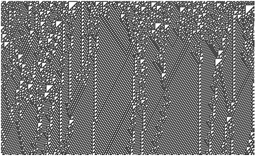

*Fig. 7*

Let us imagine we ignore its being generated by the iteration of a simple local rule, or even that it is an automaton. Then, says Ilachinski:

> Noticing that the figure consists of certain particle-like objects sprinkled on a more-or-less static background, the simplest (most natural?) thing for you to do … is to begin cataloging the various “particles” and their “interactions.” … What you almost assuredly will not have, is any idea that the underlying physics really consists of a single—very simple—local deterministic rule … . *How different is this alien two-dimensional world from our own*? (Ilachinski 2001: 662)[^ilachinski-2001]

This highlights how CA may generate situations that we view as physically realistic. But one may consider this as a mere suggestion: that we cannot rule out *a priori* our universe’s being, at its bottom level, a CA does not entail that it actually *is* a CA.

A firmer ground to explore the hypothesis comes from some independent reasons of theoretical dissatisfaction with contemporary physics. We will limit ourselves to what we may call *conceptual* complaints, as opposed to ones more closely related to scientific practice, such as the failure of reductions of quantum mechanics and relativity to a *Theory of Everything*. We will examine the following three: (*i*) the problem of infinity, (*ii*) the need for a transparent ontology, (*iii*) the physical role of information.

As for complaint (*i*): While infinite and infinitesimal quantities provide us with powerful tools to model and advance predictions on the physical world, it remains controversial what ontological conclusions should be drawn from this fact. Since the discovery of Zeno’s Paradox (see entry), the continuity of space-time, as well as other fundamental physical variables, have puzzled philosophers and scientists alike. In the words of the physicist Richard Feynman:

> It bothers me that, according to the laws as we understand them today, it takes a computing machine an infinite number of logical operations to figure out what goes on in no matter how tiny a region of space, and no matter how tiny a region of time. How can all that be going on in that tiny space? Why should it take an infinite amount of logic to figure out what a tiny piece of space-time is going to do? So I have often made the hypothesis that ultimately physics will not require a mathematical statement, that in the end the machinery will be revealed and the laws will turn out to be simple, like the checker board with all its apparent complexities. (Feynman 1965)[^feynman-1965]

One way theoretical physicists have approached the problem is to conjecture a fundamental layer of reality along the lines of Edward Fredkin’s “Finite Nature Hypothesis”:

> Finite Nature is a hypothesis that ultimately every quantity of physics, including space and time, will turn out to be discrete and finite; that the amount of information in any small volume of space-time will be finite and equal to one of a small number of possibilities. … We take the position that Finite Nature implies that the basic substrate of physics operates in a manner similar to the workings of certain specialized computers called cellular automata. (Fredkin 1993: 116)[^fredkin-1993]

If a cellular automaton is a model satisfying this hypothesis, then “underneath the laws of physics as we know them today it could be that there lies a simple program from which all the known laws … emerge” (Wolfram 2002: 434)[^wolfram-2002]. If, as we have seen above, currently there is no agreement on the issue whether physical reality is fundamentally continuous or discrete, at least the Finite Nature Hypothesis seems to be a no less falsifiable prediction (see Fredkin 1990)[^fredkin-1990] than many speculative metaphysical pictures. Unfortunately, although we have attempts to recapture field theory within CA theory (see, e.g., Svozil 1987, Lee 1986)[^lee-1986][^svozil-1987], there is no agreed-upon derivation of today’s continuous physics within a CA framework; it is therefore safe to say that no party has a clear advantage here.

As for complaint (*ii*): One reason to adopt the view of CA as models of a fundamentally discrete world is the desire for a transparent ontology. Take a materialist philosopher for whom the task of physics is to provide an ultimate description of reality on the basis of a handful of basic physical properties and relations. As argued in Beraldo-de-Araújo & Baravalle 2017, a digital ontology may take different models of computation as its foundation: by analyzing the ontological commitments of CA (vs. traditional Turing machines), they conclude that CA are very close to supporting a traditional form of physicalism. In this perspective, a CA-based physics may provide a neat and elegant ontological picture: one that would be describable in a first-order formal theory including the axioms of standard mereology (see entry) (even of mereotopology, as presented, e.g., in Casati & Varzi 1999)[^casati-1999], and whose theorems would be computable in finite time (see Berto, Rossi & Tagliabue 2010: 73–87)[^berto-2010]. Besides, CA make easier to reconcile prima facie contradictory properties of different physical laws, such as the *reversibility* of micro-laws and the *irreversibility* of the Second Law of Thermodynamics (see, e.g., Wolfram 2002: 441–457; Berto, Rossi & Tagliabue 2010: 43–46)[^berto-2010][^wolfram-2002]. There is no agreement on whether the Second Law gives us a fundamental feature of physical reality or is a spin-off of underlying principles which are time-reversal invariant and act on an initial state of the universe at low entropy (see Albert 2000)[^albert-2000]. If the world is discrete and temporal reversibility is fundamental, reversible CA like, e.g., that of Berto, Rossi & Tagliabue (2016) may be more than mere computational tools achieving some degree of computational efficiency via their reversibility.

As for point (*iii*), concerning the physical role of information: CA can accommodate a speculative hypothesis entertained by a number of scientists (Wheeler 1990, Ilachinski 2001)[^ilachinski-2001][^wheeler-1990] and philosophers (Chalmers 1996)[^chalmers-1996], namely that information is not just one aspect of the physical world, but, in a sense, the most fundamental. For instance, Fredkin’s Finite Nature Hypothesis not only stresses the importance of the informational aspects of physics, but “it insists that the informational aspects are all there is to physics at the most microscopic level” (see Fredkin 1993)[^fredkin-1993].

One way in which this idea has been developed is the so-called “*it from bit*” theory (see again Wheeler 1990)[^wheeler-1990]. In David Chalmers’ words, this approach “stems from the observation that in physical theories, fundamental physical states are individuated as *informational states*” (Chalmers 1996: 302)[^chalmers-1996]. Physics is silent on what accomplishes the specified functional roles, so “any realization of these information states will serve as well for the purpose of a physical theory” (Chalmers 1996: 302)[^chalmers-1996]. The “it from bit” approach is particularly appealing to Chalmers as a philosopher of mind committed to *qualia* being intrinsic, non-reducible properties, because it allows for a simple unification: we need intrinsic properties to make sense of conscious experience, and we need intrinsic properties to ground the informational states that make up the world’s physics. If we claim that all the informational states are grounded in phenomenal or proto-phenomenal properties, we “get away with a cheap and elegant ontology, and solve two problems in a single blow” (Chalmers 1996: 305)[^chalmers-1996]. The cell states in a CA fit the bill: if we interpret them as proto-phenomenal properties, we obtain the intrinsic structure of some sort of computational neutral monism (for an historical introduction, see the entry on neutral monism).

Albeit individually controversial, taken together the three points support a simple and elegant metaphysical picture which is not evidently false or incoherent.

Supposing that the actual physical world is a giant, discrete automaton, are there philosophically interesting conclusions to be drawn? A first one has already been partially explored in connection with *Life*: if nature is a CA, it has to be a *universal* CA, given that universal computers (e.g., the one on which you are probably reading this entry) uncontroversially exist in the physical world. Then its evolution is algorithmically irreducible, given the Halting Problem. Notwithstanding the opportunity of devising approximate forecast tools, we are left with a universe whose evolution is unpredictable for a reason quite different from the ones commonly adduced by resorting to standard physics, such as quantum effects or random fluctuations: it is unpredictable just because of its computational complexity.

A second philosophical topic is the connection between a CA-world and one of the most famous and controversial contemporary metaphysical theses, namely David Lewis’ *Humean Supervenience* (HS). Using Ned Hall’s characterization (see the section on Humean supervenience in the entry on David Lewis’ metaphysics), we can state HS as the collection of these four claims about the structure of our world:

**(HS₁)**

There are particulars (space-time points).

**(HS₂)**

They are, or are wholly composed of, simples—particulars that have no other particulars as parts.

**(HS₃)**

These simples have various perfectly natural monadic properties.

**(HS₄)**

They stand in various spatiotemporal relations to one another.

If we substitute “space-time points” with “cells”, HS gets very close to a CA ontology: cells are arranged in a lattice, have various spatiotemporal relations to one another (e.g., *being in a neighborhood of*), and have monadic properties (states) which can be considered *perfectly natural*, i.e., the basic properties out of which any other can be construed. A CA universe is thus a *prima facie* abstract model of Lewis’ HS and can be fruitfully used to illustrate Lewis’ original point, which was a reductionist one:

> The point of defending Humean Supervenience is not to support reactionary physics, but rather to resist philosophical arguments that there are more things in heaven and earth than physics has dreamt of. (Lewis 1994: 474)[^lewis-1994].

There are, however, two differences between the ontology naturally suggested by CA theories and Lewis’ view. First, for Lewis space-time is an essentially continuous, four-dimensional manifold, eternalistically conceived (see the section on eternalism in the entry on time and the discussion on four-dimensionalism in the entry on temporal parts for an introduction), while in a standard CA-driven ontology, it is not. Second, Lewis reduces laws of nature to particulars while, as we have seen in Section 2 above, CA rules are always included as a *further* specification of the model.

The first disagreement may not be very substantial. A CA-world is compatible, for instance, with an eternalist conception. The idea that the world’s next state is computed at any time step can be seen as a merely heuristic device, a “shortcut” for a more proper eternalist description in which the cell’s states are once and for all “stuck” in their space-time position (we did this ourselves when describing the first picture in this section as the complete space-time evolution of a micro-universe).

The second disagreement concerning the laws of nature may instead be a thorny issue. According to Lewis 1973, laws of nature are the true generalizations found in the deductive system that best describes our world (where “best” basically refers to the optimal trade-off between strength and simplicity; see the entry on laws of nature for an introduction to, and further details on, this debate): laws of nature supervene on the four-dimensional arrangement of particulars and their properties. To the contrary, the standard description of a CA does not take the space-time evolution for granted: it takes the automaton’s initial conditions as given, and generates the system evolution over time via the CA transition function. Particulars depend on laws, not *vice versa*. A CA world is not laid out in advance, but it grows as long as the laws are applied to particulars (a similar point is also made in Wolfram 2002: 484–486)[^wolfram-2002].

On the other hand, one may tentatively interpret, in Lewisian fashion, the laws of a CA as the generalizations contained within the deductive system that best describes the CA behavior. Let us consider one last time our micro-universe from *Rule 110*:

*Fig. 7*

A suitable deductive system for this space-time diagram may be obtained with just two axioms, one stating the initial conditions of the system, the other phrased as a conditional expressing the CA transition rule. If this conditional is a true generalization embedded in the deductive system that best describes our toy universe, then *Rule 110* can count as a Lewisian law of nature in this universe, as expected.

## 4. Concluding Remarks

Although some CA topics are still relatively untouched by philosophers (e.g., the nature of space and time [see Wolfram 2002: 481–496][^wolfram-2002], the representation of knowledge in Artificial Intelligence (see Berto, Rossi, & Tagliabue: 15–26), the relationship between information and energy (see Fredkin & Toffoli 1982)[^fredkin-1982]), there are many conceptual challenges raised in connection with CA. While in some cases the CA contribution was indeed overrated by practitioners, in others CA proved to be useful models of important phenomena.

As a final comment: what is left, from a purely scientific perspective, of the *NKS Argument*? Let us go through it again:

**(NKS₁)**

The observation of CA evolution leads to a scientific discovery: “very simple rules produce highly complex behavior” (Wolfram 2002: 39)[^wolfram-2002].

**(NKS₂)**

This discovery—the “new intuition”—promises to explain old and new phenomena and uncover important regularities.

**(NKS₃)**

Therefore, the core of our current scientific practices (based on the “old intuition”) should be radically changed to accommodate this discovery.

Even granting the truth of the two premises (that is, even granting the troublesome Principle of Computational Equivalence), it is doubtful the desired conclusion would follow. Surely, CA have provided new intuitions and explanations for a set of phenomena—Wolfram quite successfully applies his “discovery” to biology, computer science, physics, finance. However, there is no evidence that many of our best scientific explanations will soon be reduced to the CA framework, and indeed many aspects of complexity itself still lie outside the CA paradigm, with no unification in sight. Paradigm shifts usually require the new paradigm to explain the same phenomena the old one did, and some more. CA are a promising field, but many developments are still needed for (NKS₃) to be true.

## References（引用注释）

> 原文参考文献已转为脚注引用：文内“作者-年份”引用组后附 [^key] 标记，完整条目见本文末脚注定义。

## Academic Tools

> |   | [How to cite this entry](https://plato.stanford.edu/cgi-bin/encyclopedia/archinfo.cgi?entry=cellular-automata). |
> | --- | --- |
> |   | [Preview the PDF version of this entry](https://leibniz.stanford.edu/friends/preview/cellular-automata/) at the [Friends of the SEP Society](https://leibniz.stanford.edu/friends/). |
> |   | [Look up topics and thinkers related to this entry](https://www.inphoproject.org/entity?sep=cellular-automata&redirect=True) at the Internet Philosophy Ontology Project (InPhO). |
> |   | [Enhanced bibliography for this entry](https://philpapers.org/sep/cellular-automata/) at [PhilPapers](https://philpapers.org/), with links to its database. |

## Other Internet Resources

- Barberousse, A., Franceschelli, S., Imbert, C., 2007, “[Cellular Automata, Modeling, and Computation](http://philsci-archive.pitt.edu/3579/),” manuscript available at the University of Pittsburgh Philosophy of Science Archive.
- Ray, Annie, Raymond Laflamme, and Aleksander Kubica, 2023, “[Protecting information via probabilistic cellular automata](https://arxiv.org/abs/2304.03240)”, manuscript at arXiv.org (2304.03240).
- [Cellular Automata](http://mathworld.wolfram.com/CellularAutomaton.html), MathWorld.
- [Game of Life](http://mathworld.wolfram.com/GameofLife.html), MathWorld.
- [Cellular Automata](http://en.wikipedia.org/wiki/Cellular_automaton), Wikipedia.
- [*Rule 110*](http://www.wolframalpha.com/input/?i=rule+110), WolframAlpha.
- [Game of Life](http://en.wikipedia.org/wiki/Conway%27s_Game_of_Life), Wikipedia.
- [NetLogo](http://ccl.northwestern.edu/netlogo/), an easy-to-use Java-based platform, already containing examples of CA (the pictures in this entry were generated using *NetLogo*; code available under request)
- [Santa Fe Institute](https://www.santafe.edu/), founded in 1984, the first research center on *complex systems*; it has been playing since then a prominent role in shaping the field.
- [Turing machine in *Life*](http://rendell-attic.org/gol/tm.htm), Paul Rendell’s web page.

## Related Entries

chaos | Church-Turing Thesis | compatibilism | computability and complexity | computation: in physical systems | emergent properties | free will | laws of nature | quantum theory: quantum field theory | recursive functions | supervenience | Turing machines

### Acknowledgments

The authors would like to thank three anonymous referees, Scott Aaronson, Anouk Barberousse, Matteo Colombo, Michele Di Francesco, Cyrille Imbert, Giulia Livio, Massimo Mastrangeli, Mattia Pavoni, Andrea Polonioli, Gabriele Rossi, Marta Rossi, Katherine Yoshida for helpful comments, discussions, suggestions, and references, and Dr. Robert Plant for checking our English. The editors would like to thank Christopher von Bülow for pointing out a number of infelicities, including typographical errors, formatting issues, etc..

[^miller-2007]: Miller & Page 2007 and Mitchell 2009 both contain a chapter devoted to CA: they are accessible introductions written by notable scholars. Ilachinski 2001 is an excellent starting point for the exploration of the CA literature: although not up to date on some technical points, the volume nicely introduces the field and covers its most important applications. Wolfram 2002 took some twenty-years and 1200 pages to be finished and is a passionate journey including bold speculations on the role of CA for understanding the universe and our place in it.

[^aaronson-2002]: Aaronson, Scott, 2002, “On ‘A New Kind of Science’ by Stephen Wolfram ”, *Quantum Information and Computation*, 2(5): 410–423. [[Aaronson 2002 preprint available online](https://arxiv.org/pdf/quant-ph/0206089.pdf)]

[^aaronson-2011]: –––, 2011, “Why Philosophers Should Care About Computational Complexity”, in *Computability Turing, Gödel, Church, and Beyond*, B. Jack Copeland, Carl J. Posy, and Oron Shagrir (eds.), Cambridge, MA: MIT Press: 261–328. [[Aaronson 2011 preprint available online](http://www.scottaaronson.com/papers/philos.pdf)]

[^aburasa-2016]: Aburasa, Maher Milad, Yuek Ming Hoa, Mohammad Firuz Ramlia, and Zulfa Hanan Ash’aaria, 2016, “The simulation and prediction of spatio-temporal urban growth trends using cellular automata models: A review”, *International Journal of Applied Earth Observation and Geoinformation*, 52: 380–389. doi:10.1016/j.jag.2016.07.007

[^albert-2000]: Albert, David Z., 2000, *Time and Chance*, Cambridge, MA: Harvard University Press.

[^ambjorn-2004]: Ambjorn, J., J. Jurkiewicz, and R. Lolli, 2004, “Emergence of a 4D World from Causal Quantum Gravity”, *Physical Review Letters*, 98(13): 131–301. doi:10.1103/PhysRevLett.93.131301

[^barberousse-2013]: Barberousse, Anouk and Cyrille Imbert, 2013, “New Mathematics for Old Physics. The Case of Lattice Fluids”, *Studies in History and Philosophy of Modern Physics*, 44(3): 231–241. doi:10.1016/j.shpsb.2013.03.003

[^barrow-2005]: Barrow, John D., Paul C.W. Davies, and Charles L. Harper, Jr (eds.), 2005, *Science and Ultimate Reality*, Cambridge: Cambridge University Press.

[^batty-2005]: Batty, Michael, 2005, *Cities and Complexity, Understanding Cities with Cellular Automata, Agent-Based Models, and Fractals*, Cambridge, MA: MIT Press.

[^bedau-1997]: Bedau, Mark A., 1997, “Weak Emergence”, in *Philosophical Perspectives, 11: Mind, Causation, and World*, J. Tomberlin (ed.), Oxford: Blackwell Publishers, pp. 375–399. doi:10.1111/0029-4624.31.s11.17

[^beraldo-de-araújo-2017]: Beraldo-de-Araújo, Anderson and Lorenzo Baravalle, 2017, “The Ontology of Digital Physics”, *Erkenntnis*, 82: 1211–1231. doi:10.1007/s10670-016-9866-y

[^berto-2010]: Berto, Francesco, Gabriele Rossi, and Jacopo Tagliabue, 2010, *The Mathematics of the Models of Reference*, London: College Publications.

[^berto-2016]: –––, 2016, “There’s Plenty of Boole at the Bottom: A Reversible CA Against Information Entropy”, *Minds and Machines*, 26(4): 341–367. doi:10.1007/s11023-016-9401-6

[^berto-2014]: Berto, Francesco and Jacopo Tagliabue, 2014, “The World is Either Digital or Analogue”, *Synthese*, 191(3): 481–497. doi:10.1007/s11229-013-0285-1

[^berlekamp-1982]: Berlekamp, Elwyn R., John H. Conway, and Richard K. Guy, 1982, *Winning Ways for Your Mathematical Plays*, Vol. 2, London: Academic Press.

[^casati-1999]: Casati, Roberto and Achille C. Varzi, 1999, *Parts and Places: The Structures of Spatial Representation*, Cambridge, MA: MIT Press.

[^chalmers-1996]: Chalmers, David John, 1996, *The Conscious Mind*, Oxford: Oxford University Press.

[^chalmers-2002]: –––, 2002, “Strong and Weak Emergence”, in *The Re-Emergence of Emergence*, Philip Clayton and Paul Davies (eds.), Oxford: Oxford University Press, pp. 244–255.

[^chen-1983]: Chen, Hudong, Shiyi Chen, Gary Doolen, and Y.C. Lee, 1983, “Simple Lattice Gas Models for Waves”, *Complex Systems*, 2(3): 259–267.

[^clark-1996]: Clark, Andy, 1996, *Being There: Putting Brain, Body, and World Together Again*, Cambridge, MA: MIT Press.

[^clark-2013]: –––, 2013, *Mindware: An Introduction to the Philosophy of Cognitive Science*, second edition, Oxford: Oxford University Press.

[^cook-2004]: Cook, Matthew, 2004, “Universality in Elementary Cellular Automata”, *Complex Systems*, 15(1): 1–40.

[^creutz-1986]: Creutz, Michael, 1986, “Deterministic Ising Dynamics”, *Annals of Physics*, 167(1): 62–76. doi:10.1016/S0003-4916(86)80006-9

[^crutchfield-1994a]: Crutchfield, James .P., 1994a, “The Calculi of Emergence: Computation, Dynamics, and Induction”, *Physica D*, 75(1–3): 11–54. doi:10.1016/0167-2789(94)90273-9

[^crutchfield-1994b]: –––, 1994b, “Is Anything Ever New? Considering Emergence”, in *Complexity: Metaphors, Models, and Reality*, G. Cowan, D. Pines, D. Melzner (eds.), (SFI Series in the Sciences of Complexity XIX), Redwood City, CA: Addison-Wesley, pp. 479–497.

[^crutchfield-1993]: Crutchfield, James P. and James E. Hanson, 1993, “Turbulent Pattern Bases for Cellular Automata”, *Physica D*, 69(3–4): 279–301. doi:10.1016/0167-2789(93)90092-F

[^crutchfield-1995]: Crutchfield, James P. and M. Mitchell, 1995, “The Evolution of Emergent Computation”, *Proceedings of the National Academy of Sciences*, 92(23): 10742–10746.

[^dennett-1987]: Dennett, Daniel C., 1987, *The Intentional Stance*, Cambridge, MA: MIT Press.

[^dennett-1991]: –––, 1991, “Real Patterns”, *Journal of Philosophy*, 88(1): 27–51. doi:10.2307/2027085

[^dennett-2003]: –––, 2003, *Freedom Evolves*, New York: Viking Penguin.

[^deutsch-2005]: Deutsch, David, 2005, “It from Qubit”. in Barrow, Davies, & Harper 2005: 90–102.

[^dowker-2003]: Dowker, Fay, 2003, “Real Time”, *New Scientist*, 180(2415): 36–39.

[^epstein-1999]: Epstein, Joshua M., 1999, “Agent-Based Computational Models and Generative Social Science”, *Complexity*, 4(5): 41–60. doi:10.1002/(SICI)1099-0526(199905/06)4:5<41::AID-CPLX9>3.0.CO;2-F

[^feynman-1965]: Feynman, Richard P., 1965, *The Character of Physical Law*, Cambridge, MA: MIT Press.

[^floridi-2009]: Floridi, Luciano, 2009, “Against Digital Ontology”, *Synthese*, 168(1): 151–178. doi:10.1007/s11229-008-9334-6

[^franceschetti-1992]: Franceschetti, Donald R., D. Wayne Jones, Bruce W. Campbell and John W. Hamneken, 1992, “Hamming Nets, Ising Sets, Cellular Automata, Neural Nets and Random Walks”, *American Journal of Physics*, 61: 50–53. doi:10.1119/1.17409

[^fredkin-1990]: Fredkin, Edward, 1990, “Digital Mechanics: An Information Process Based on Reversible Universal Cellular Automata”, *Physica D*, 45(1–3): 254–270. doi:10.1016/0167-2789(90)90186-S

[^fredkin-1993]: –––, 1993, “A New Cosmogony”, in *PhysComp ’92: Proceedings of the Workshop on Physics and Computation*, IEEE Computer Society Press, pp. 116–121. doi:10.1109/PHYCMP.1992.615507

[^fredkin-1982]: Fredkin, Edward and Tommaso Toffoli, 1982, “Conservative Logic”, *International Journal of Theoretical Physics*, 21(3–4): 219–253. doi:10.1007/BF01857727

[^gell-mann-1994]: Gell-Mann, Murray, 1994, *The Quark and the Jaguar: Adventures in the Simple and the Complex*, New York: W.H. Freeman and Company.

[^grattarola-2021]: Grattarola, Daniele, Lorenzo Livi and Cesare Alippi, 2021, “Learning Graph Cellular Automata”, *Advances in Neural Information Processing Systems*, 34: 20983–20994.

[^grim-1997]: Grim, Patrick, 1997, “The Undecidability of the Spatialized Prisoner’s Dilemma”, *Theory and Decision*, 42: 53–80.

[^grim-2005]: Grim, Patrick, Evan Selinger, William Braynen, Robert Rosenberger, Randy Au, Nancy Louie and John Connolly, 2005, “Modeling Prejudice Reduction: Spatialized Game Theory and the Contact Hypothesis”, *Public Affairs Quarterly*, 19(2): 95–125.

[^ha-2022]: Ha, David and Yujin Tang, 2022, “Collective Intelligence for Deep Learning: A Survey of Recent Developments”, *Collective Intelligence*, 1(1). doi:10.1177/26339137221114874

[^hanson-1992]: Hanson, James E. and James P. Crutchfield, 1992, “The Attractor-Basin Portrait of a Cellular Automaton”, *Journal of Statistical Physics*, 66(5–6): 1415–1462. doi:10.1007/BF01054429

[^hardy-2005]: Hardy, Lucien, 2005, “Why is Nature Described by Quantum Physics”, in Barrow, Davies, & Harper 2005: 45–71.

[^hedlund-1969]: Hedlund, G.A., 1969, “Endomorphisms and Automorphisms of the Shift Dynamical System”, *Mathematical Systems Theory*, 3(4): 51–59. doi:10.1007/BF01691062

[^hooft-1997]: ’t Hooft, Gerard, 1997, *In Search of the Ultimate Building Blocks*, Cambridge: Cambridge University Press.

[^hordijk-1996]: Hordijk, Wim, James P. Crutchfield, and Melanie Mitchell, 1996, “Embedded Particle Computation in Evolved Cellular Automata”, in *Proceedings of the Conference on Physics and Computation*, T. Toffoli, M. Biafore and J. Leao (eds.), Boston: New England Complex Systems Institute, pp. 153–158.

[^ilachinski-2001]: Ilachinski, Andrew, 2001, *Cellular Automata*, Singapore: World Scientific Publishing.

[^ilachinski-2004]: –––, 2004, *Artificial War. Multiagent-Based Simulation of Combat*, Singapore: World Scientific Publishing.

[^ingerson-1984]: Ingerson, T.E. and R.L. Buvel, 1984, “Structure in Asynchronous Cellular Automata”, *Physica D*, 10(1–2): 59–68. doi:10.1016/0167-2789(84)90249-5

[^kauffman-1984]: Kauffman, Stuart A., 1984, “Emergent Properties in Random Complex Automata”, *Physica D*, 10(1–2): 145–156. doi:10.1016/0167-2789(84)90257-4

[^kelso-1995]: Kelso, J.A. Scott, 1995, *Dynamic Patterns: The Self-Organization of Brain and Behavior*, Cambridge, MA: MIT Press.

[^kier-2005]: Kier, Lemont B., Paul G. Seybold, and Chao-Kun Cheng, 2005, *Modeling Chemical Systems using Cellular Automata*, Dordrecht: Springer.

[^kim-1999]: Kim, Jaegwon, 1999, “Making Sense of Emergence”, *Philosophical Studies*, 95(1/2): 3–36. doi:10.1023/A:1004563122154

[^land-1995]: Land, Mark and Richard K. Belew, 1995, “No Perfect Two-State Cellular Automata for Density Classification Exist”, *Physical Review Letters*, 74(25): 1548–1550. doi:10.1103/PhysRevLett.74.5148

[^landauer-1961]: Landauer, R., 1961, “Irreversibility and Heat Generation in the Computing Process”, *IBM Journal of Research and Develop men*, 5(3): 183–191.

[^langton-1990]: Langton, Chris G., 1990, “Computation at the Edge of Chaos: Phase Transitions and Emergent Computation”, *Physica D*, 42(1–3): 12–37. doi:10.1016/0167-2789(90)90064-V

[^lárragaa-2005]: Lárragaa, M.E., J.A. del Ríob, and L. Alvarez-lcaza, 2005, “Cellular Automata for One-Lane Traffic Flow Modeling”, *Transportation Research Part C: Emerging Technologies*, 13(1): 63–74. doi:10.1016/j.trc.2004.12.001

[^lee-1986]: Lee, T.D., 1986, “Solutions of Discrete Mechanics Near the Continuum Limit”, in *Rationale of Being: Recent Developments in Particle, Nuclear, and General Physics, Festschrift in honor of Gyō Takeda*, Kenzo Ishikawa *et al*. (eds.), Singapore: World Scientific Publishing.

[^lewis-1973]: Lewis, David, 1973, *Counterfactuals*, Oxford: Blackwell Publishers.

[^lewis-1994]: –––, 1994, “Humean Supervenience Debugged”, *Mind*, 103(412): 473–490. doi:10.1093/mind/103.412.473

[^malament-2006]: Malament, David B., 2006, “Classical General Relativity”, In Jeremy Butterfield & John Earman (eds.), *Philosophy of Physics*, (Handbook of the Philosophy of Science), Amsterdam: Elsevier. doi:10.1016/B978-044451560-5/50006-3

[^miller-2007-2]: Miller, John H. and Scott E. Page, 2007, *Complex Adaptive System*, Princeton, NJ: Princeton University Press.

[^mitchell-1998]: Mitchell, Melanie, 1998, *An Introduction to Genetic Algorithms*, Cambridge, MA: MIT Press.

[^mitchell-2009]: –––, 2009, *Complexity: A Guided Tour*, Oxford: Oxford University Press.

[^mitchell-1996]: Mitchell, Melanie, James P. Crutchfield, and Rajarshi Das, 1996, “Evolving Cellular Automata with Genetic Algorithm: A Review of Recent Works”, in *Proceedings of the First International Conference on Evolutionary Computation and Its Applications*, Russian Academy of Science. [[Mitchell, Crutchfield, & Das 1996 preprint available online](http://csc.ucdavis.edu/~evca/Papers/evca-review.html)]

[^mitchell-1994]: Mitchell, Melanie, Peter T. Hraber, and James P. Crutchfield, 1994, “Revisiting the Edge of Chaos: Evolving Cellular Automata to Perform Computations”, *Complex Systems*, 7(2): 89–130.

[^moore-1996]: Moore, Christopher, 1996, “Recursion Theory on the Reals and Continuous-Time Computation”, *Theoretical Computer Science*, 162(1): 23–44. doi:10.1016/0304-3975(95)00248-0

[^moore-1962]: Moore, E.F., 1962, “Machine Models of Self-Reproduction”, *Proceedings of Symposia in Applied Mathematics*, 14: 17–33.

[^mordvintsev-2020]: Mordvintsev, Alexander, Ettore Randazzo, Eyvind Niklasson and Michael Levin, 2020, “Growing Neural Cellular Automata”, *Distill*. doi:10.23915/distill.00023.

[^myhill-1963]: Myhill, John, 1963, “The Converse of Moore’s Garden-of-Eden Theorem”, *Proceedings of the American Mathematical Society*, 14(4): 685–686. doi:10.1090/S0002-9939-1963-0155764-9

[^o’connor-2015]: O’Connor, Timothy and Wong, Hong Yu, 2015, “Emergent Properties”, *The Stanford Encyclopedia of Philosophy*, (Summer 2015 Edition), Edward N. Zalta (ed.), URL = <[https://plato.stanford.edu/archives/sum2015/entries/properties-emergent/](https://plato.stanford.edu/archives/sum2015/entries/properties-emergent/)>

[^packard-1988]: Packard, Norman H., 1988, “Adaptation toward the Edge of Chaos”, in *Dynamic Patterns in Complex Systems*, J.A. Scott Kelso, Arnold J. Mandell and Michael F. Schlesinger (eds.), Singapore: World Scientific Publishing, pp. 293–301.

[^piccinini-2010]: Piccinini, Gualtiero, 2010, “Computation in Physical Systems”, *The Stanford Encyclopedia of Philosophy*, (Fall 2010 Edition), Edward N. Zalta (ed.), URL = <[https://plato.stanford.edu/archives/fall2010/entries/computation-physicalsystems/](https://plato.stanford.edu/archives/fall2010/entries/computation-physicalsystems/)>

[^poincaré-1914]: Poincaré, Henri, 1914, *Science and Method*, New York: Nelsons and Sons.

[^putnam-1988]: Putnam, Hilary, 1988, *Representation and Reality*, Cambridge, MA: MIT Press.

[^richards-1990]: Richards, Fred C., Thomas P. Meyer, and Norman H. Packard, 1990, “Extracting Cellular Automaton Rules Directly from Experimental Data”, *Physica D*, 45(1–3): 189–202. doi:10.1016/0167-2789(90)90182-O

[^schelling-1978]: Schelling, Thomas C., 1978, *Micromotives and Macrobehavior*, New York: Norton.

[^searle-1992]: Searle, John R., 1992, *The Rediscovery of the Mind*, Cambridge, MA: MIT Press.

[^svozil-1987]: Svozil, Karl, 1987, “Are Quantum Fields Cellular Automata?”, *Physics Letters*, 119(4): 153–6. doi:10.1016/0375-9601(86)90436-6

[^teller-1992]: Teller, Paul, 1992, “A Contemporary Look at Emergence”, in *Emergence or Reduction? Essays on the Prospects of Nonreductive Physicalism*, Ansgar Beckermann, Hans Flohr and Jaegwon Kim (eds.), Berlin: Walter de Gruyter. doi:10.1515/9783110870084.139

[^thompson-2007]: Thompson, Evan, 2007, *Mind in Life. Biology, Phenomenology, and the Sciences of Mind*, Cambridge, MA: Harvard University Press.

[^toffoli-1977]: Toffoli, Tommaso, 1977, “Computation and Construction Universality of Reversible Cellular Automata”, *Journal of Computer and System Science*, 15(2): 213–231. doi:10.1016/S0022-0000(77)80007-X

[^toffoli-1984]: –––, 1984, “Cellular Automata as an Alternative to (Rather Than an Approximation of) Differential Equations in Modeling Physics”, *Physica D*, 10(1–2): 117–127. doi:10.1016/0167-2789(84)90254-9

[^toffoli-1990]: Toffoli, Tommaso and Norman H. Margolus, 1990, “Invertible Cellular Automata: A review”, *Physica D*, 45(1–3): 229–253. doi:10.1016/0167-2789(90)90185-R

[^turing-1936]: Turing, Alan M., 1936, “On Computable Numbers with an Application to the Entscheideungproblem”, *Proceeding of the London Mathematical Society*, 42: 230–265. doi:10.1112/plms/s2-42.1.230

[^vichniac-1984]: Vichniac, Gérard Y., 1984, “Simulating Physics With Cellular Automata”, *Physica D*, 10(1–2): 96–110. doi:10.1016/0167-2789(84)90253-7

[^von-1951]: Von Neumann, John, 1951, “The General and Logical Theory of Automata”, in *Cerebral Mechanisms in Behavior: The Hixon Symposium*, New York: John Wiley & Sons.

[^wheeler-1990]: Wheeler, John Archibald, 1990, “Information, Physics, Quantum: The Search for Links”, in *Complexity, Entropy, and the Physics of Information*, Wojciech H. Zurek (ed.), Boston: Addison-Wesley.

[^wolfram-1983]: Wolfram, S., 1983, “Statistical Mechanics of Cellular Automata”, *Reviews of Modern Physics*, 55(3): 601–644. doi:10.1103/RevModPhys.55.601

[^wolfram-2002]: –––, 2002, *A New Kind of Science*, Champaign, IL: Wolfram Media.

[^xiao-2011]: Xiao, Xuan, Pu Wang, and Kuo-Chen Chou, 2011, “Cellular Automata and Its Applications in Protein Bioinformatics”, *Current Protein & Peptide Science*, 12(6): 508–19. doi:10.2174/138920311796957720

[^zaheer-2016]: Zaheer, Manzil, Michael Wick, Jean-Baptiste Tristan, Alex Smola, and Guy L. Steele, 2016, “Exponential Stochastic Cellular Automata for Massively Parallel Inference”, *Proceedings of the 19th International Conference on Artificial Intelligence and Statistics*, PMLR 51: 966–975. [[Zaheer et al. 2016 available online](http://proceedings.mlr.press/v51/zaheer16.html)]

[^zuse-1982]: Zuse, Konrad, 1982, “The Computing Universe”, *International Journal of Theoretical Physics*, 21(6–7): 589–600. doi:10.1007/BF02650187
