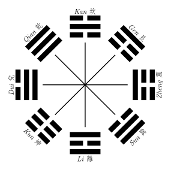
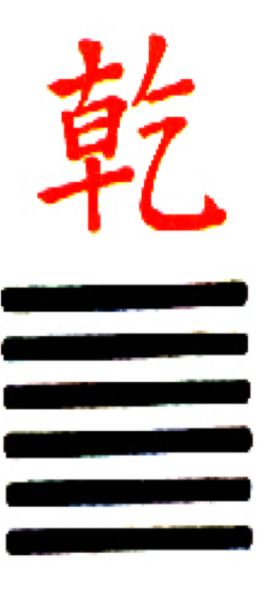

# chinese-change — appendix（supplement）

> （《chinese-change》词条补充材料，源：plato.stanford.edu/entries/chinese-change/appendix.html）

#### Supplement to Chinese Philosophy of Change (Yijing)

## Appendices

### Appendix 1. 8 Trigrams

Trigrams (and hexagrams) are described from the bottom line to the top line (e.g., line 1 is the lowest line). For accessibility, trigrams and hexagrams listed below are annotated in square brackets with ‘u’ for *yang* or unbroken lines and ‘w’ for *yin* or broken lines.

- *Kan* 坎 ☵ [wuw]
- *Qian* 乾 ☰ [uuu]
- *Dui* 兌 ☱ [uuw]
- *Kun* 坤 ☷ [www]
- *Li* 離 ☲ [uwu]
- *Sun* 巽 ☴ [wuu]
- *Zheng* 震 ☳ [uww]
- *Gen* 艮 ☶ [wwu]

### Appendix 2. 64 Hexagrams

| （嵌套表：\| 8 \| \| --- \| \| ䷇ \| \| *Bi* 比 \|） | （嵌套表：\| 7 \| \| --- \| \| ䷆ \| \| *Shi* 師 \|） | （嵌套表：\| 6 \| \| --- \| \| ䷅ \| \| *Song* 訟 \|） | （嵌套表：\| 5 \| \| --- \| \| ䷄ \| \| *Xu* 需 \|） | （嵌套表：\| 4 \| \| --- \| \| ䷃ \| \| *Meng* 蒙 \|） | （嵌套表：\| 3 \| \| --- \| \| ䷂ \| \| *Zhun* 屯 \|） | （嵌套表：\| 2 \| \| --- \| \| ䷁ \| \| *Kun* 坤 \|） | （嵌套表：\| 1 \| \| --- \| \| ䷀ \| \| *Qian* 乾 \|） |
| --- | --- | --- | --- | --- | --- | --- | --- |
| （嵌套表：\| 16 \| \| --- \| \| ䷏ \| \| *Yu* 豫 \|） | （嵌套表：\| 15 \| \| --- \| \| ䷎ \| \| *Qian* 謙 \|） | （嵌套表：\| 14 \| \| --- \| \| ䷍ \| \| *Dayou* 大有 \|） | （嵌套表：\| 13 \| \| --- \| \| ䷌ \| \| *Tongren* 同人 \|） | （嵌套表：\| 12 \| \| --- \| \| ䷋ \| \| *Pi* 否 \|） | （嵌套表：\| 11 \| \| --- \| \| ䷊ \| \| *Tai* 泰 \|） | （嵌套表：\| 10 \| \| --- \| \| ䷉ \| \| *Lü* 履 \|） | （嵌套表：\| 9 \| \| --- \| \| ䷈ \| \| *Xiaoxu* 小畜 \|） |
| （嵌套表：\| 24. \| \| --- \| \| ䷗ \| \| *Fu* 復 \|） | （嵌套表：\| 23. \| \| --- \| \| ䷖ \| \| *Bo* 剝 \|） | （嵌套表：\| 22. \| \| --- \| \| ䷕ \| \| *Bi* 賁 \|） | （嵌套表：\| 21. \| \| --- \| \| ䷔ \| \| *Shike* 噬嗑 \|） | （嵌套表：\| 20 \| \| --- \| \| ䷓ \| \| *Guan* 觀 \|） | （嵌套表：\| 19 \| \| --- \| \| ䷒ \| \| *Lin* 臨 \|） | （嵌套表：\| 18 \| \| --- \| \| ䷑ \| \| *Gu* 蠱 \|） | （嵌套表：\| 17 \| \| --- \| \| ䷐ \| \| *Sui* 隨 \|） |
| （嵌套表：\| 32 \| \| --- \| \| ䷟ \| \| *Heng* 恆 \|） | （嵌套表：\| 31 \| \| --- \| \| ䷞ \| \| *Xian* 咸 \|） | （嵌套表：\| 30 \| \| --- \| \| ䷝ \| \| *Li* 離 \|） | （嵌套表：\| 29 \| \| --- \| \| ䷜ \| \| *Xikan* 習坎 \|） | （嵌套表：\| 28 \| \| --- \| \| ䷛ \| \| *Daguo* 大過 \|） | （嵌套表：\| 27 \| \| --- \| \| ䷚ \| \| *Yi* 頤 \|） | （嵌套表：\| 26 \| \| --- \| \| ䷙ \| \| *Daxu* 大畜 \|） | （嵌套表：\| 25. \| \| --- \| \| ䷘ \| \| *Wuwang* 无 妄 \|） |
| （嵌套表：\| 40 \| \| --- \| \| ䷧ \| \| *Jie* 解 \|） | （嵌套表：\| 39 \| \| --- \| \| ䷦ \| \| *Jian* 蹇 \|） | （嵌套表：\| 38 \| \| --- \| \| ䷥ \| \| *Kui* 睽 \|） | （嵌套表：\| 37 \| \| --- \| \| ䷤ \| \| *Jiaren* 家人 \|） | （嵌套表：\| 36 \| \| --- \| \| ䷣ \| \| *Mingyi* 明夷 \|） | （嵌套表：\| 35 \| \| --- \| \| ䷢ \| \| *Jin* 晉 \|） | （嵌套表：\| 34 \| \| --- \| \| ䷡ \| \| *Dazhuang* 大壯 \|） | （嵌套表：\| 33 \| \| --- \| \| ䷠ \| \| *Dun* 遯 \|） |
| （嵌套表：\| 48 \| \| --- \| \| ䷯ \| \| *Jing* 井 \|） | （嵌套表：\| 47 \| \| --- \| \| ䷮ \| \| *Kun* 困 \|） | （嵌套表：\| 46 \| \| --- \| \| ䷭ \| \| *Sheng* 升 \|） | （嵌套表：\| 45 \| \| --- \| \| ䷬ \| \| *Cui* 萃 \|） | （嵌套表：\| 44 \| \| --- \| \| ䷫ \| \| *Gou* 姤 \|） | （嵌套表：\| 43 \| \| --- \| \| ䷪ \| \| *Guai* 夬 \|） | （嵌套表：\| 42 \| \| --- \| \| ䷩ \| \| *Yi* 益 \|） | （嵌套表：\| 41 \| \| --- \| \| ䷨ \| \| *Sun* 損 \|） |
| （嵌套表：\| 56 \| \| --- \| \| ䷷ \| \| *Lü* 旅 \|） | （嵌套表：\| 55 \| \| --- \| \| ䷶ \| \| *Feng* 豐 \|） | （嵌套表：\| 54 \| \| --- \| \| ䷵ \| \| *Guimei* 歸妹 \|） | （嵌套表：\| 53 \| \| --- \| \| ䷴ \| \| *Jian* 漸 \|） | （嵌套表：\| 52 \| \| --- \| \| ䷳ \| \| *Gen* 艮 \|） | （嵌套表：\| 51 \| \| --- \| \| ䷲ \| \| *Zhen* 震 \|） | （嵌套表：\| 50 \| \| --- \| \| ䷱ \| \| *Ding* 鼎 \|） | （嵌套表：\| 49 \| \| --- \| \| ䷰ \| \| *Ge* 革 \|） |
| （嵌套表：\| 64 \| \| --- \| \| ䷿ \| \| *Weiji* 未濟 \|） | （嵌套表：\| 63 \| \| --- \| \| ䷾ \| \| *Jiji* 既濟 \|） | （嵌套表：\| 62 \| \| --- \| \| ䷽ \| \| *Xiaoguo* 小過 \|） | （嵌套表：\| 61 \| \| --- \| \| ䷼ \| \| *Zhongfu* 中孚 \|） | （嵌套表：\| 60 \| \| --- \| \| ䷻ \| \| *Jie* 節 \|） | （嵌套表：\| 59 \| \| --- \| \| ䷺ \| \| *Huan* 渙 \|） | （嵌套表：\| 58. \| \| --- \| \| ䷹ \| \| *Dui* 兌 \|） | （嵌套表：\| 57 \| \| --- \| \| ䷸ \| \| *Xun* 巽 \|） |

### Appendix 3. Names of the 64 Hexagrams

Hexagrams (and trigrams) are described from the bottom line to the top line (e.g., line 1 is the lowest line). For accessibility, trigrams and hexagrams listed below are annotated in square brackets with ‘u’ for *yang* or unbroken lines and ‘w’ for *yin* or broken lines.

1. *Qian* 乾 (The Creative) ䷀ [uuu uuu]
2. *Kun* 坤 (The Receptive) ䷁ [www www]
3. *Zhun* 屯 (Difficulty at the Beginning) ䷂ [uww wuw]
4. *Meng* 蒙 (Youthful Folly) ䷃ [wuw wwu]
5. *Xu* 需 (Waiting) ䷄ [uuu wuw]
6. *Song* 訟 (Contention) ䷅ [wuw uuu]
7. *Shi* 師 (The Army) ䷆ [wuw www]
8. *Bi* 比 (Holding Together) ䷇ [www wuw]
9. *Xiaoxu* 小畜 (Lesser Domestication) ䷈ [uuu wuu]
10. *Lü* 履 (Treading) ䷉ [uuw uuu]
11. *Tai* 泰 (Peace) ䷊ [uuu www]
12. *Pi* 否 (Obstruction) ䷋ [www uuu]
13. *Tongren* 同人 (Fellowship) ䷌ [uwu uuu]
14. *Dayou* 大有 (Great Holdings) ䷍ [uuu uwu]
15. *Qian* 謙 (Modesty) ䷎ [wwu www]
16. *Yu* 豫 (Contentment) ䷏ [www uww]
17. *Sui* 隨 (Following) ䷐ [uww uuw]
18. *Gu* 蠱 (Ills to Be Cured) ䷑ [wuu wwu]
19. *Lin* 臨 (Overseeing) ䷒ [uuw www]
20. *Guan* 觀 (Viewing) ䷓ [www wuu]
21. *Shike* 噬嗑 (Bite Together) ䷔ [uww uwu]
22. *Bi* 賁 (Elegance) ䷕ [uwu wwu]
23. *Bo* 剝 (Peeling) ䷖ [www wwu]
24. *Fu* 復 (Return) ䷗ [uww www]
25. *Wuwang* 无妄 (No Errancy) ䷘ [uww uuu]
26. *Daxu* 大畜 (Great Domestication) ䷙ [uuu wwu]
27. *Yi* 頤 (Nourishment) ䷚ [uww wwu]
28. *Daguo* 大過 (Major Superiority) ䷛ [wuu uuw]
29. *Xikan* 習坎 (The Constant Sink Hole) ䷜ [wuw wuw]
30. *Li* 離 (Cohesion) ䷝ [uwu uwu]
31. *Xian* 咸 (Reciprocity) ䷞ [wwu uuw]
32. *Heng* 恆 (Perseverance) ䷟ [wuu uww]

1. *Dun* 遯 (Withdraw) ䷠ [wwu uuu]
2. *Dazhuang* 大壯 (Great Strength) ䷡ [uuu uww]
3. *Jin* 晉 (Advance) ䷢ [www uwu]
4. *Mingyi* 明夷 (Suppression of the Light) ䷣ [uwu www]
5. *Jiaren* 家人 (The Family) ䷤ [wuw wuu]
6. *Kui* 睽 (Contrariety) ䷥ [uuw uwu]
7. *Jian* 蹇 (Adversity) ䷦ [wwu wuw]
8. *Jie* 解 (Release) ䷧ [wuw uww]
9. *Sun* 損 (Diminution) ䷨ [uuw wwu]
10. *Yi* 益 (Increase) ䷩ [uww wuu]
11. *Guai* 夬 (Resolution) ䷪ [uuu uuw]
12. *Gou* 姤 (Encounter) ䷫ [wuu uuu]
13. *Cui* 萃 (Gathering) ䷬ [wws uuw]
14. *Sheng* 升 (Climbing) ䷭ [wuu www]
15. *Kun* 困 (Impasse) ䷮ [wuw uuw]
16. *Jing* 井 (The Well) ䷯ [wuu wuw]
17. *Ge* 革 (Radical Change) ䷰ [uwu uuw]
18. *Ding* 鼎 (The Cauldron) ䷱ [wuu uwu]
19. *Zhen* 震 (Quake) ䷲ [uww uww]
20. *Gen* 艮 (Restraint) ䷳ [wwu wwu]
21. *Jian* 漸 (Gradual Advance) ䷴ [wwu wuu]
22. *Guimei* 歸妹 (Marrying Maid) ䷵ [uuw uww]
23. *Feng* 豐 (Abundance) ䷶ [uwu uww]
24. *Lü* 旅 (The Wanderer) ䷷ [wwu uwu]
25. *Xun* 巽 (Compliance) ䷸ [wuu wuu]
26. *Dui* 兌 (Joy) ䷹ [uuw uuw]
27. *Huan* 渙 (Dispersion) ䷺ [wuw wuu]
28. *Jie* 節 (Control) ䷻ [uuw wuw]
29. *Zhongfu* 中孚 (Inner Trust) ䷼ [uuw wuu]
30. *Xiaoguo* 小過 (Minor Superiority) ䷽ [wwu uww]
31. *Jiji* 既濟 (Ferrying Complete) ䷾ [uwu wuw]
32. *Weiji* 未濟 (Ferrying Incomplete) ䷿ [wuw uwu]

### Appendix 4. Ten Wings

1. *Tuan* 彖 (Judgment) I
2. *Tuan* 彖 (Judgment) II
3. *Xiang* 象 (Image) I
4. *Xiang* 象 (Image) II
5. *Wenyang* 文言 (Words of Text)
6. *Xici* 繫辭 (Great Treatise) I
7. *Xici* 繫辭 (Great Treatise) II
8. *Xugua* 序卦 (Sequence of Hexagrams)
9. *Shuogua* 說卦 (Discussions of Trigrams)
10. *Zagua* 雜卦 (Miscellaneous Notes on Hexagrams)

### Appendix 5. *Qian* hexagram (#1)

6ᵗʰ line: Arrogant Dragon 5ᵗʰ line: Flying Dragon 4ᵗʰ line: Leaping Dragon 3ʳᵈ line: Diligent Gentleman 2ⁿᵈ line: Emerging Dragon 1ˢᵗ line: Hidden Dragon
