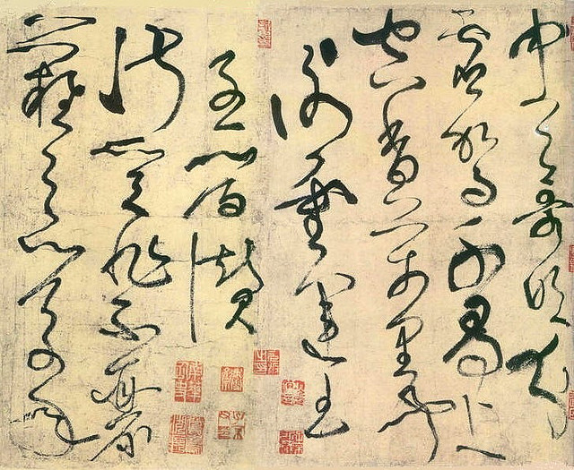
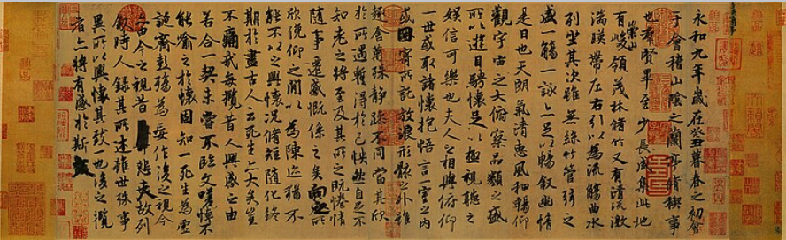
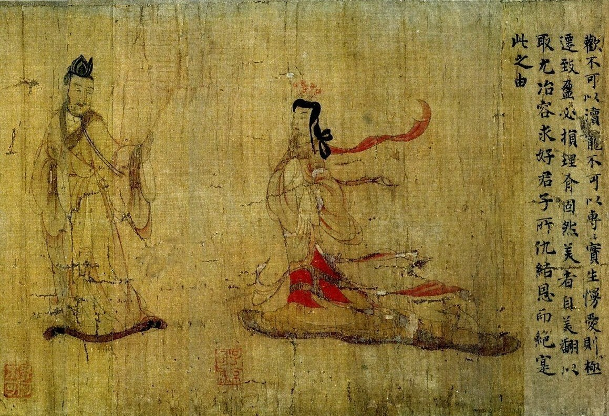
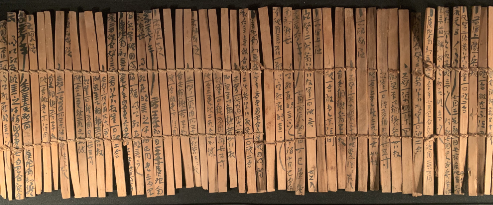
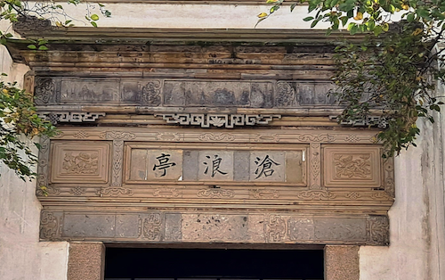
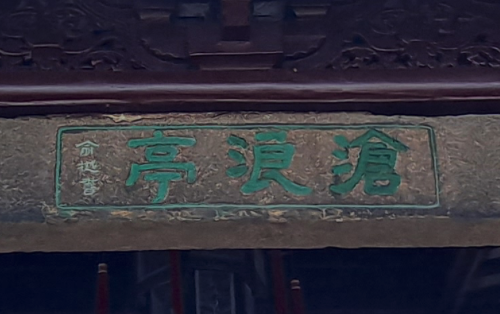
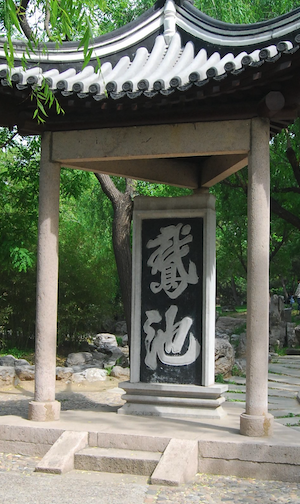
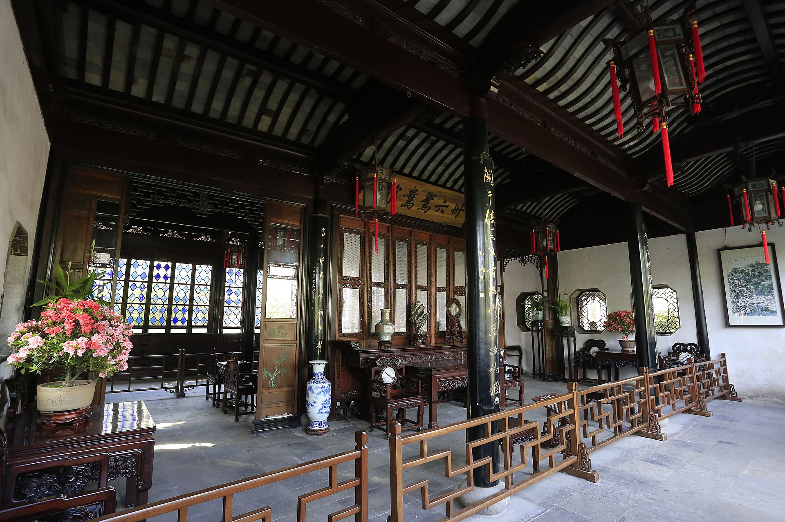

# Aesthetics in Chinese Philosophy: Painting and Calligraphy
**First published Wed Feb 25, 2026**

*Escande, Yolaine*

Although there is no word such as “aesthetics” in Chinese philosophy, if we understand it not in the restrictive sense of the science of beauty but in the broader sense of reflection on the theory of art, then aesthetics does indeed exist in Chinese philosophy, even if the matters and concerns that arose differed from those dominant in Europe.

Undoubtedly, the terms “philosophy” and “aesthetics” belong to a modern vocabulary imported into China via Japan in the early 20th century (Ghilardi 2015; 2021)[^ghilardi-2015]. The term “aesthetics” has also given rise to controversies regarding the Chinese literary tradition (Egan 2006, Saussy 1993)[^egan-2006][^saussy-1993]. Aesthetics has even been questioned in Europe (Schaeffer 2000)[^schaeffer-2000].

However, if we engage the analysis by mobilizing another term, namely art (*yi*), then the problem is largely solved: on the one hand, there is a highly developed theory of art in China, which includes music, literature and graphic arts. On the other hand, art in this tradition has a profound philosophical meaning.

Let us recall that in the Chinese tradition, “art” is not associated with technology and science, as it is in Europe, but with self-cultivation. The etymology of “art” in Chinese references the verbs “plant, cultivate”. This “art” of self-cultivation has a moral significance: “Concentrate your will on the Way … and take pleasure in the arts” (*Analects*, VII.6), Confucius urges. This is a hedonic and aesthetic practice, sometimes called the art of living (Lin Yutang 1937)[^lin-1937], because it is not limited to the practice of the canonical (i.e. theorized) arts alone, but extends to all bodily and daily activities. For this reason, artistic practice, which since the first centuries of our era has mainly concerned writing, painting, poetry and music, corresponds to a “philosophy” today perceived as a core feature of China’s identity (Cheng 2007)[^cheng-2007].

Aesthetics is therefore not to be understood in the narrow sense of the study of beauty, but in its broad sense of appreciation, evaluation and reflection on works, artists and practices. Indeed, “art” in the Chinese sense is an aesthetic and playful activity that also enables us to protract our life and live in harmony with the world.

Aesthetics in Chinese philosophy raises theoretical questions that have not received necessary attention from mainstream Western aesthetics, not because it would be of lesser importance, but because the point of view adopted is deliberately different. Following an introduction to the characteristics of Chinese aesthetics (characteristics of Chinese aesthetics and art theory; the creative process; the aesthetics of the stroke and suggestiveness), these questions address the nature of aesthetic appreciation and the way in which humans relate to the world. In fact, it is not merely a matter of aesthetic experience or of directing the philosophical gaze towards it, as in phenomenology (Dufrenne 1973)[^dufrenne-1973]; nor is it the description of an experience that provides access to a hidden reality (see the entries on Maurice Merleau-Ponty and Edmund Husserl), or an illustration of the interpretation of works of art and aesthetic experiences (see the entry on Roman Ingarden). Aesthetic and hedonic appreciation in Chinese philosophy aims to achieve a long life, even immortality, through a withdrawal of self-consciousness in favor of an appreciation of the infinite, purposeless, reasonless movement of the universe. But this appreciation belongs to everyday life (see the entry on aesthetics of everyday life) and to common experience. And reality is conceived as tangible (see the entry on metaphysics in Chinese philosophy; Jullien 2009)[^jullien-2009].

By raising these issues from the perspective of the Chinese practitioner, based on the Chinese literati’s theory of art, aesthetics in Chinese philosophy challenges long-held assumptions underlying the discourse on Chinese philosophy. However, consideration of aesthetics in Chinese philosophy does not raise these challenges in order to disqualify the established philosophical discourse. Rather, it is intended to shed new light on the dominant discourse. Thus, aesthetics in Chinese philosophy offers a contribution to the development of the discourse on aesthetics by opening up new avenues of inquiry. Accordingly, the following account of aesthetics in Chinese philosophy, centered on painting and calligraphy, will focus on the issues that have been raised to illuminate and challenge the prevailing discourse in contemporary Western philosophy regarding aesthetics in Chinese philosophy.

## 1. Characteristics of Chinese aesthetics

Before delving into the subject of Chinese aesthetics, it is worth raising a few methodological issues regarding theorization in Chinese philosophy in relation to the arts.

### 1.1 Characteristics of Chinese aesthetics and theory of arts

The first theoretical texts on calligraphy and painting date back to the 2nd to 4th centuries CE. Since then, treatises have piled up to represent a substantial body of literary art. Methodologically, the history of Chinese art theory poses a challenge: the Chinese did not engage in studying the history of their own theoretical and aesthetic thought before the 17ᵗʰ and 18ᵗʰ centuries, then adopting a so-called “historical” perspective, but this “historical” angle is alien to its Western counterpart (see the entry “Hegel’s Aesthetics”). As a result, the terminology used in Chinese art seems not to expand from the origins of theorization up to the present day. The same vocabulary is in actuality employed to describe practices and realities evolving over time, which may cause confusion. Thus, the Chinese comprehend their aesthetic theory in the framework of an enduring continuity; they consider the developments only to use them philologically, for didactic, ideological or political purposes. For example, a fifth-century term or expression is elucidated by eighth- or eleventh-century exegesis and consequently used in a new sense for specific purposes. It is therefore difficult for us to ignore this tradition, which has not gone extinct and is being still handed down, but we must also point out its limitations wherever possible.

On the other hand, 20ᵗʰ Chinese theorists often adopt Western analytical techniques, and their studies of these secular arts are generally influenced by modern Western theories, particularly the three most influential philosophers of aesthetics: Zhu Guangqian (1897–1986), Zong Baihua (1897–1987), and Li Zehou (1930–2021); this may be accounted for by developments in recent Chinese history. In the 19th and early 20th centuries, literati’s art and thought were deemed a major factor in China’s decadence and subjugation to the West. The Chinese Revolution in 1911, and especially the movement of China’s first intellectuals launched on 4 May 1919, opposed the spirit of the literati. As a result, modern communist China rejected any piece of expression of the literati, fiercely at times. It is only in the early eighties that the Chinese took a renewed interest in the literati’s art, although it is now the focus of new considerations.

The theory of calligraphy and painting developed as early as the first centuries of the common era, when these two arts were appreciated and practiced by many high-ranking officials and scholars. As these arts are imparted by means of initiation, practice is absolutely essential, yet it is taken for granted by theorists. Theory is therefore concerned with the principles of calligraphy and painting, not their practice in an exclusively literati’s sense. Thus, court painters, academics and professional artists wrote close to nothing with respect to their work. For example, sculpture, architecture or garden design are not considered “art”, and although achievements in these fields are absolutely remarkable from an artistic point of view, and there is aesthetic appreciation of them, there are few theoretical writings addressing these spheres, not before the 12ᵗʰ century for buildings (Guo 1998)[^guo-1998], the 17ᵗʰ century for gardens (Ji 1631–1634).

Moreover, in the Chinese artistic tradition, only artists may theorize, whereas in Europe, serious writings on art are considered to be authored by philosophers essentially, not by artists, whom art historians and aesthetics specialists usually distrust. There is a general sense that there is a marked discrepancy between what artists say and what they do. In the Chinese tradition, the gap between theory and practice must be bridged through transmission, so Chinese scholars seek not only to persuade but also to philosophize through artistic activity. The status of theory and practice in China is therefore markedly different from that in Europe or the West in general. For example, the appraisals of theorists, which logically lead to rankings, are not based solely on an appreciation of the works, but also take into account the morality of the artists; this is why anecdotes referring to the artists’ lives play an essential role in the theorizing, and rankings concern essentially the artists and not only their works. It is therefore the relationships between the beholder, the artwork and the person who produced it—or is alleged to have produced it—that are taken into account, rather than the artwork as an object. Chinese aesthetic categories have been examined in context, in poetry (Wixted 1983)[^wixted-1983] and in calligraphy and painting (Escande 2021)[^escande-2021].

Thus, Chinese aesthetic categories do not revolve around the final product, but around the whole creative process. This process sets out with “intention”, which corresponds to the availability of the “heart” (this point will be explained below, see **1.2**) and is characterized by a period of meditation before writing or painting. The process begins with “inspiration”, flow in which the gesture is not solely accounted for by the artist: they let the Dao (the principle in action of the movement of the world, without cause, purpose or reason) act within them, they are only a medium, the gesture is never pushed forward. This is actualized in the brush stroke, but it is not yet complete, because the intention guiding the execution is passed on to the beholder.

In other words, what counts in Chinese art theory is not the relationship to the artwork, but the relationship established through the work, between the viewer and the maker, for the purpose of transmission. This means that the artist is first and foremost a medium. What’s more, the artwork needs not be authentically original in order to convey certain qualities (Escande 2021)[^escande-2021]. Aesthetic evaluation embraces the whole process.

An artwork worthy of transmission is one that is considered to contain moral and spiritual qualities passed down from one generation to the next through standardized and interpreted forms. In order to be conveyed, these qualities are embodied in shapes. And these are traced by famous scholars and literati.

### 1.2 The creative process

Much of Chinese aesthetics eludes our understanding, because activities that do not qualify as art are not theorized, even though they may be aesthetic. However, it is certain that prominent features of Chinese graphic arts—those of allusiveness, implicitness and suggestiveness—characterize Chinese aesthetics per se, and this it has indeed been theorized. Moreover, they can also be extended to activities other than those traditionally considered as belonging to the “arts”. On the one hand, literati’s painting, the only form of painting theorized in the Chinese tradition, values a form of painting described as “writing intention” (*xieyi*), which denotes suggestive painting. On the other hand, the fundamental principle guiding any Chinese garden is to conjure up images and references in the senses and mind of the visitor, skilfully suggested by the designer. The garden, whether wide or tiny, e.g. the size of a pot, is an essential part of every Chinese person’s life (Stein 1990)[^stein-1990].

Mobilizing Chinese aesthetic categories—which focus more on the process than the final outcome of the artwork—this entry examines questions of intention prior and following the realization of the work, which imply the consideration and aesthetic appreciation of allusion, the implicit, the unfinished, the draft.

It is in calligraphy theory that the basic principle of the creative process in Chinese aesthetics is elaborated, with expressions that emphasize “intention”: “the intention precedes the execution” (*yi zai bi qian*) and “intention endures after the tracing” (*yi cun bi hou*). In both expressions the nodal term is “intention”, *yi*. The term *yi*意, an ideogram composed of the radical for “heart” 心 (there are 214 radicals in Chinese used to classify all characters) and the element for “sound” 音, originally meant “the sound of the heart”.

*Yi* may somehow correspond to the concept of imagination. In Western terms, we could say that, if we consider that imagination stems from the senses and produces the sensible world (Merleau-Ponty 1953)[^merleau-ponty-1953], that there is therefore an imaginative relationship to the sensible world, that imagination is an interface between reason and the sensible world, then this issue has indeed been theorized in Chinese. But in Chinese terms, we cannot strictly oppose emotions (originating in the five the senses) and reason. Curie Virág has demonstrated that early Chinese philosophers were indeed aware of the potential tension between cognitive and emotional influences, while simultaneously attempting to reconcile this tension through various models of the moral subject (Virág 2017: 4, 6–8, 12)[^virág-2017]. She stresses that any resolution of that tension was to be achieved through practical action by the fully realized person—the sage—rather than at a theoretical level (Virág 2017: 19)[^virág-2017]. The emotions were patterns of disposition that everyone shared and which, if realized properly, aligned with the patterns of the natural world (Virág 2017: 190)[^virág-2017]. The question of the relationship between emotion / feeling (*qing* 情) and the world pattern (*li* 理) was raised as early as the beginnings of landscape poetry (the “mountains and waters”, *shanshui*, pictorial and literary landscape) under the Six Dynasties (Cai & Wu 2019: 4–6)[^cai-2019].

Later, intention was also studied in painting, especially in the painting of “mountains and waters”, and in the designing of gardens. In the Chinese garden, for example, perception is enriched by “borrowing”, especially “scene borrowing” (*jiejing*), and the stroller must be able to attain a certain state through imagination. The role of painting, like that of the garden, is to conjure up, in the mind of the stroller or beholder, an “imaginary world”, a *jingjie* or *yijing* (an expression that includes the character of “intention”) which should enable them to revitalize when embarking on an imaginary journey.

But the imaginative process doesn’t simply initiate in the mind of the artist as an artist-creator. It sets out well ahead of the calligrapher’s “heart” (*xin*), conceived as the seat of consciousness and thought, but also as the point of contact between “me and the world” (*wanwu yuwo weiyi*, “I and all things are one”), in the words of *Zhuangzi* (chapter 2), a fundamental Daoist philosophical text often invoked by artists. For example, the calligrapher and minister Yu Shinan (BL: 558–638) states in *Bisuilun* (The quintessence of the brush):

> For slowness and rapidity, emptiness and fullness, we must, like Lunbian, who carved wheels, neither hurry nor delay. First, we must seize the movement with our heart before our hand may echo it. This cannot be expressed by words. (BL: 111, trans. Escande).

Yu evokes how the brush glides when writing Chinese characters. He compares this gesture to that of the wheelwright Lunbian, a figure from an anecdote in Chapter 13 of the *Zhuangzi*. The main point here is that the calligrapher’s “heart” “seizes the movement” of the universe, enabling the hand holding the brush to glide easily, effortless.

Shen Zongqian (c. 1734–before 1803), a professional painter and theoretician of the Qing Dynasty who also was a literatus, explains this concept of the intention prior to the artist’s heart in his *Jiezhou xuehua bian* (1781, Jiezhou’s apprenticeship on painting):

> Although [painting] is merely an art, [its process] really participates in the same creation that operates between heaven and earth. It is important to know that the existing are created between heaven and earth by animated breaths (*lingqi*) and that paintings are completed by humans also by means of animated breaths. This is why [heaven and earth] create the limitless living things and [humans] create limitless paintings, for all stem from animated breaths and are endowed with spirits (*shen*), derived from their transformations. If now [the painter] stretches out a sheet of silk to spread the ink, what they foresee in their heart is limited to the given kind of brush technique and the given kind of composition [they will resort to], so when they spreade out [their ink] at their leisure according to their inspiration, and the tip of the hair [of the brush] expresses it entirely in myriads of shapes, these evades the whole they had originally foreseen. Today, they produce it this way, and tomorrow they will produce it in a different way. If they absolutely want to reproduce what they did the day before, they won’t succeed. Why can’t they? Because, when one absolutely wishes to do things a certain way, it hampers the animated flavor (*lingqu*). (Shen 1781: chap. 2, p. 20a–20b, trans. Escande)[^shen-1781].

Shen points out that paintings are no imitation of nature, but their process is analogous to the creation between heaven and earth. The world is not seen as immutable, but in a state of perpetual motion and transformation. It is this movement between heaven and earth that creates all the living beings with the “animated breaths”. The “heart” of the painter is “inspired”, literally “stirred” by this creation giving birth to all living beings. What is in the painter’s power is only to prepare the “given kind of brush technique and the given kind of composition.” But then, their heart is guided by the movement between heaven and earth, and is inspired by the moment. This is why it cannot be reproduced.

Thus, what is valued in aesthetics is the stroke or the realization that shows this process participating in the more general movement of creation.

### 1.3 The aesthetics of stroke and suggestiveness

Indeed, the aesthetics of the stroke initiates the reflection on intention. By definition, the stroke is at the forefront of what the Chinese consider to be the most accomplished art, the art of writing (*shufa*), expediently translated as “calligraphy”. *Shufa* means literally “discipline of writing”. The brush stroke (*hua*) must first be distinguished from the line, as it must give the impression of a living body (Escande 2021: 157–163)[^escande-2021]. A brushstroke is described in terms of its “bone” (structure), “flesh” (thickness), “sinew” (tension), and “blood” (ink), amongst other terms. What’s more, it must be part of the natural process of the Dao, as Shen Zongqian described it.

But the brush stroke is also what defines Chinese painting and its aesthetics. In Chinese, “to paint” translates with *hua*畫; this character does not mean to apply colors: its etymology is “to trace, to delimit”. *Hua* refers to the act of tracing, to the brush stroke and to its result (the painting). But *hua* also refers more generally to the stroke, the brushstroke, whether pictorial or calligraphic, for painting or writing.

Regarding painting, Zhang Yanyuan (9ᵗʰ century), a theorist of painting and calligraphy who wrote the monumental *Lidai minghua ji* (Annals of Famous Painters of Successive Dynasties), stresses the importance of the brushstroke. He contends that the stroke is what defines painting, as opposed to colors or washes. Zhang Yanyuan explains that even if a skilled painter can use expedients such as blowing colors onto moistened silk to create the effect of moving clouds, he believes that this “cannot be called painting (*hua*), because there are no brushstrokes involved.” (Zhang 847: p. 95, trans. Escande) For Zhang Yanyuan, “coloring” silk in such a manner is tantamount to decoration, which reduces the coloring painter’s technique to a mere ornamental process. On the other hand, he places emphasis on the brushstroke. The importance of Zhang Yanyuan’s Annals is paramount. Following art historian Yu Shaosong (1883–1949), whose work in the fields of calligraphy and painting has influenced modern art historians, Zhang Yanyuan is “the progenitor of the history of [Chinese] painting as well as painting history *par excellence*” (Wu 2022: 155–174).

We might think that “to paint” in Chinese precisely echoes “to draw” in English, since “drawing” has been the part of painting in opposition to color since the Renaissance. However, even if *hua* looks like a drawing to us, in China *hua* is considered painting and is highly valued precisely because it is based on the brush stroke and not on colors or washes. Consequently, *hua* is a monochrome painting based on brush strokes, sometimes enhanced with pale colors and always relatively suggestive compared to Western painting. Such painting is self-sufficient and considered a work of art, in contrast to color painting, which is often devalued in the literati’s tradition and dismissed as mere craftsmanship. Precisely, Chinese painting is valued for its incompleteness. An incomplete painting by no means entails that it is not achieved or finished.

As a result, Chinese art theory and practice do not address finished works, but mainly “drafts”, sketches and roughs, whether in writing or painting. To such an extent that writing became an art form at the beginning of the common era, and was appreciated as early as the 2nd century for its unbridled, rough feature. The meaning of “cursive”, *cao*草, at first was, paradoxically, “draft” and appears in the pamphlet *Fei Caoshu* (Against cursive script) by Zhao Yi (c. 130–185), the first treatise on Chinese writing as an art. But a draft is first and foremost an initial attempt, a sketch, something that has not yet been completed. A good example of such a writing is calligrapher and official Zhang Xu’s *Gushi sitie* (Four ancient poems, Shenyang Museum, see Figure 1).

*Figure 1.*

Figure 1. (See figure 1 photo credit below.)

Although Zhang Xu (ca. 675–ca. 759) is labeled as “mad” because his calligraphy seems unreadable, this artwork is actually still the best model for learning Chinese cursive script.

This is all the more true as the greatest Chinese masterpiece of all time, on which most treatises are based, the famous *Lanting xu* (Preface to the Orchid Pavilion, 353), is a calligraphy brimming with cross-outs (See Figure 2.)

*Figure 2.*

Figure 2. (See figure 2 photo credit below.)

On the other hand, more virtuoso, polished or beautiful works are considered secondary, even artisanal, and demoted to the state of a work of the hand rather than a work of the spirit; they are not objects of theorization. Even if such polished and virtuoso works can be appreciated in certain cases, they are always inferior to those that express freedom, even if it shows blotting-outs, and in any case they do not attract the attention of critics.

In other words, in the case of calligraphy, especially the cursive script *cao* or *caoshu*, and in the case of *hua* painting, what is valued is not a finished drawing as such, in the sense that it requires no further explication, that it is satisfactorily self-sufficient and explicit to avoid sparking confusion or debate. On the contrary, a sketch or an unfinished stroke indeed leaves room for interpretation and imagination, and that is valued for its ability to stimulate the imagination, producing an effect in the beholder that connects them to the artist and to creation in general. However, they are not necessarily a draft of something meant to be later fulfilled.

## 2. To paint is to “write the intention”

In fact, any work of art, before it produces a visual effect, before it exists definitively, is first and foremost an “intention”. Chinese categories are concerned not only with the end result, the final aspect of the artwork, but also with the process, the visible as well as the implicit, the perceptible as well as the imperceptible. It is the whole process that matters, starting from the intention guiding the creation to what remains after the completion.

On the question of intention, we might be tempted to relate it to the sense of “designing-design” or “drawing-design” as it was understood in the Renaissance. The origin of today’s drawing, the Italian word *disegno*, is both drawing in the sense of tracing and design in the sense of intention. It was not until the 18th century that the two meanings were separated in French, German and English. The difference, however, is that, in Chinese, the intention must be perceptible even after the completion of the work, which must be characterized by its incompleteness.

### 2.1 The intention precedes the execution

The expression “the intention precedes the execution” (literally “the intention precedes the brushwork”) is attributed to the calligrapher and poet Wang Xizhi (303–361), *Wei Furen Bizhentu hou* (Afterword to Lady Wei’s Battle Plan of the Brush):

> They who wish to write calligraphy must […] concentrate their spirit (*shen*) and assuage their thoughts, by conceiving in advance the shape and size of the characters, their position, and animating with movement each vertical or horizontal stroke, so that all the strokes are connected by the same impulse; the intention must precede the execution (*yi zai bi qian*), then the character is realized. (Wang: 26, trans. Escande)

In this excerpt, the author describes what is meant by “the intention precedes the execution”: it consists in conceiving the composition of characters and individual strokes. This preliminary conception warrants that calligraphy is by no means an accumulation of strokes, but produces the effect of a whole, integrated and bound in the same breath.

Then, the intention that remains following the stroke is described by theorist Zhang Huaiguan (8ᵗʰ century) in relation to Wang Xizhi’s son, Wang Xianzhi (344–386):

> If we examine its origin, the intention was unconstrained in [the use of] the brush, and we can’t see where it ends. (Zhang 724–727: p. 180, trans. Escande)

This suggests the achievement of Wang Xianzhi is related to the never-ending feature of his intention perceptible in his brushstroke. Never ending means that it is transmitted to the beholder.

The same terminology is used in painting, by Zhang Yanyuan. When asked to give his opinion on the brushwork of the famous painter of Antiquity Gu Kaizhi (c. 345–406), Zhang states:

> In Gu’s works, [the strokes] are bound with tension and vigor, in a swift circular motion; his rhythm and style are unrestrained and smooth, as impetuous as the wind and swift as lightning. His intention precedes execution (*yi cun bi xian*) and, once the work is completed, his intention remains (*huajin yizai*); this is why it is entirely animated by spiritual breath. (Zhang 847: pp. 92–93, trans. Escande)

Here, his “intention remains” means that the beholder accesses it by its “spiritual breath”. His fine, light brushstrokes give the characters a touch of grace. This characteristic can be seen on an 8th-century copy of a work by Gu Kaizhi in the British Museum. (See Figure 3).

*Figure 3.*

Figure 3. (See figure 3 photo credit below.)

On Wu Daozi (685?–758?), deemed the Chinese Rembrandt, Zhang Yanyuan elaborates:

> Master Wu […] preserved his spirit, he concentrated and united with the work of creation that had borrowed Master Wu’s brush, this is what has previously been described as ‘the intention that precedes the execution’ (*yi cun bi xian*) and, ‘after the work is completed, the intention that remains’.” (Zhang 847: p. 93, trans. Escande)

In this excerpt, Master Wu is not described as a creative genius expressing his singularity, but as the medium of the creative movement. In this context, Zhang Yanyuan further asserts that “the arts of writing and painting must be, literally, ‘actualized within the breath of intention’.” (Zhang 847: p. 156, trans. Escande) He then puts forward two examples of the transmission of the “intention” from one artist to another: first, Wu Daozi who was inspired by the sword dance of General Pei Min (active 713–742); and secondly, calligrapher Zhang Xu who was inspired by the sword dance of Lady Gongsun (active 713–742). Both created masterpieces. Therefore, the intention does not belong to the artist or the artwork itself, but can be appreciated through it. The role of the artist is to seize this intention and pass it on.

The principle is that the intention should be able to express itself unhindered, according to the theory of “the intention precedes the execution” (*yi zai bi qian*) expressed in the first centuries of the common era. In painting, this includes the sketches that precede the final tracing, which is always *hua*, or unfinished.

### 2.2 Sketch and draft: the unfinished

The notion of sketch or design does indeed exist in Chinese, but it is included in the course of the creative process and cannot be separated from it; it is an integral part of it. In other words, the tension existing between the idea of a project and its actuality is taken into account in the creative process and its theorization. In figure painting, for example, one evokes “nine drafts before the realization of a single stroke” (*jiuxiu yiba*). Deng Chun, a painter and theorist from the Song period (12th century), articulated this expression in his *Huaji* (Continuation to the [Histories of] Painters, 1167, a work that explicitly follows Zhang Yanyuan’s *Lidai minghua ji*, Annals of Famous Painters of Successive Dynasties):

> When one paints figures, it is essential to make “nine drafts before completing a single stroke,” which implies to first endeavor to capture the likeness with charcoal and amend several times, that is why it is called ‘nine drafts’ (*jiuxiu*) before completing with a pale ink stroke, that is why it is called ‘completing a single stroke’ (*yiba*). Ba means ‘to complete’.” (Deng 1167: 793, trans. Escande)

In the 12th century, Deng Chun describes the pictorial process used to paint figures on a mural. Charcoal drafts fade away, while the ink stroke only remains in the final execution.

The 18th-century painter and theorist Shen Zongqian commented upon this extract:

> Figure [painters] seek likeness for every thing, but when it comes to capturing their intention directly, they do so with a single stroke (*yibi*). The ancients spoke of ‘nine drafts before completing a single stroke’; ‘nine drafts’ refers to never relenting to amending; ‘completing a single stroke’ implies a smooth tracing. Painting is no different from calligraphy, which does not allow for improvised or added strokes. Thus, to make ‘nine drafts before completing a single stroke’ corresponds to the practice of the intention preceding the execution. Once the intention and the thought settled, the brush can be glided across the paper without constraint, like a hawk swooping down on a hare; the vital energy is set in motion and the brush follows the intention, moving with an innate flavor, forming images at each contact with the paper. Even if some mistakes slip through, they don’t alter [the totality of the work]. (Shen 1781, chap. 4, p. 35a–b, trans. Escande)[^shen-1781]

This time, Shen Zongqian does not deal with murals, but with painting on silk or paper. In this case, rather than executing the nine drafts for the final painting on a single sheet, successive trials are performed on different sheets, like in calligraphy. In literatis’ painting and in calligraphy, it is possible to resort to trials, e.g. to experiment (“the nine drafts”), and either select the best among them, or produce a final calligraphy or painting after practicing (“completing a single stroke”). But at any rate, whether murals or paintings on paper or silk, the final stroke cannot be picked up again. Consequently, unlike Western painting, where the process of realization can be reconstructed through the successive layers of material visible in the work itself, in Chinese painting, the accumulation must remain invisible.

Shen relates the capacity of “completing a single stroke” with “the intention and the thought settled”, which leads to “the brush following the intention”. This is possible only if the writer or the painter attains the availability of the heart, because “Characters have an appearance, secondary to the heart (*xin*), which awakens in the absence of the heart (*xin*) and unites with the marvelous,” says calligrapher Yu Shinan (Yu [BL]: 113, trans. Escande). The “absence of heart” signifies that the heart is “void”. If instead it is full of thoughts and constraints, it will be impossible for the calligrapher or the painter to seize the movement of creation between heaven and earth. This is why Yu Shinan stresses the importance of meditating before picking up the brush:

> When you want to practice calligraphy, you have to focus your gaze, listen to nothing else, brush your worries aside, concentrate your mind, maintain your heart and breath constant, and then you’ll be attuned to the marvelous. (Yu [BL]: 113, trans. Escande)

These recommendations are still practised today. To create a stroke conveying intention, all these steps must be undertaken.

Essential notions, particularly in apprenticeship, such as “the intention precedes the execution” or “nine drafts before completing a single stroke”, implement the principles that serve to define literati’s art, not as a manual activity, where the gesture and the making would take precedence, but as a spiritual activity, where the emphasis is placed on the capacity for meditation, which leads to the availability of the heart. If this was not the case, the brush stroke would be constrained and the work of art would be likened to craft. Therefore, even though calligraphy and painting involve the entire person, body and heart, the time and effort dedicated on an artwork are never emphasized. On the contrary, the ease and fluidity depending on the availability of the heart are highlighted.

The resulting aesthetics underscores this fluidity, which may include erasures.

## 3. The incompleteness of the brush stroke

This probably explains why, in Chinese art, incompleteness or rough drafts are so highly valued, in calligraphy and painting alike.

### 3.1 Calligraphy’s draft writing

Indeed, writing emerged as an art with the cursive script known as *caoshu*: *shu* means “writing”, and *cao* “draft”, according to Zhang Huaiguan in his *Shuduan* (Judgments on Calligraphers). In *Shuduan*, Zhang presents the outcome of his research into the origins and development of different calligraphic scripts. However, he also introduces an innovative personal reflection to this traditional historical approach, particularly with regard to the origin of cursive script. He displays all the historical data available and compares them systematically. For this reason, his treatise remains a point of reference. Here is his explanation about the origin of cursive script:

> According to [my] analysis, draft (*gao*) is also cursive (*cao*); it is precisely because it is cursive that it is qualified as draft, exactly like correct regular writing is also qualified as draft (*caogao*) once it has been crossed out and corrected; Ru Chun [3rd century] said: ‘Cursive (*cao*) serves to make drafts (*gao*)’. Along similar lines, Yao Cha [533–606] comments: ‘Cursive means coarse; when a design is coarse it is called a draft (*gao*)’. It is likely that this is where cursive originated: The beginnings of cursive writing resulted from drafting projects in rough form.” (Zhang 724–727: p. 163, trans. Escande)

Zhang Huaiguan relates the origin of cursive writing (its outlining across time) to the swift writing of drafts (*caogao*), not by ordinary people but by high-ranking officials (Zhang 724–727: pp. 162–163). His explanation is based on the similarity of the term *cao* (“rough outline”) to the common name for drafts. He seems to have been the first proponent of this theory. Today, however, it is widely accepted in dictionaries and appears to be the authoritative explanation.

Thus, (ancient) cursive script accounts for writing becoming the noblest and most valued art in China. It was Zhang Huaiguan who explained the origin of cursive script as an art in connection to that of rough writing or rough composition (*zhangcao*), translated as “ancient cursive”:

> If we look at the ancient cursive script (*zhangcao*), it was created by the Han Annalist You [active c. 48–33], prefect of the Yellow Gate. […] Wang Yin said that at the time of the Han emperor Yuan [reign: 48–33], ‘the annalist You wrote the composition in haste (*jijiu zhang*) by *untying and loosening the composition of the clerical handwriting, and he wrote it roughly*; under the Han it was customary out of carelessness and indolence, and gradually this practice became common’; this is true; it *briefly retains the whole character, but undermines the standards of clerical writing*. [Its forms] are loose and unconstrained, [in] a continuous and rapid movement, in haste (*jijiu*); because of its meaning of rough creation, it was called rough writing (*caoshu*). (Zhang 724–727: p. 162, trans. Escande)

Therefore, cursive script is a modified version of clerical script, which was the standard writing style of the time, by untying and loosening the composition of its characters. The example below shows a rubbing of an engraving of the *Jijiuzhang* (Composition in Haste), written by 3rd-century Han dynasty calligrapher Huang Xiang (see *Jijiuzhang* in the Other Internet Resources). The rubbing shows six columns on each page. The second, fourth and sixth columns, starting from the right, are in clerical script. To the right of these stand the first, third and fifth columns, which show the same characters written in ancient cursive script.

Zhang Huaiguan explains that, firstly, what is called “rough writing” (*caoshu*) was particularly appreciated by the successive sovereigns and ministers. They required from those of their subordinate officials who excelled in cursive script to write for them letters and “to present matters to the court [by letters] in cursive script.” (Zhang 724–727: pp. 162–163, trans. Escande)

And Zhang Huaiguan further elaborates: “It is probably because of the composition (*zhang*) of these memoirs addressed to the Emperor that later generations called [this style] ‘rough composition’ (*zhangcao*).” (Zhang 724–727: p. 163) *Zhangcao* is how ancient cursive script is referred to. It differs from usual cursive script in that the composition of each character is schematized and simplified within the character itself. However, the characters are not linked together. In today’s cursive script, for example Zhang Xu’s, the character layout is simplified and the characters are linked vertically, as Chinese is written from top to bottom and from right to left in columns. An example of ancient cursive script (*zhangcao*) can be observed at the Taipei National Palace Museum (see zhangcao in the Other Internet Resources), and is attributed to Wang Xizhi, considered the greatest calligrapher of all times. All the columns on the left page are written in ancient cursive script, whereas the author’s name is written in regular script on the right page.

Zhang Huaiguan finaly concludes: “Annalist You’s cursive was called rough composition; thanks to Zhang Boying [Zhang Zhi, ?–192] it is called cursive script.” (Zhang 724–727: p. 163) Zhang Zhi was the first calligrapher to be recognized for his cursive script, and has even been called the “saint of cursive” (*caosheng*). Unfortunately, none of his works have outlived their author.

Unlike Huang Xiang’s ancient cursive script, which is considered a continuation of Zhang Zhi’s style, this example of ancient cursive script for military documents, found in Juyan (Gansu province), is merely a “rough composition” embodying the origins of cursive script. (See Figure 4.)

*Figure 4.*

Figure 4. (See figure 4 photo credit below.)

Let us summarize: the origin of calligraphy as an art is related to the aesthetic appreciation of written drafts, and the most appreciated style of writing is cursive script as a rough composition.

Thus, the much-admired and much-valued cursive script, for which emperors and private collectors are keen to spend fortunes, is as a matter of fact a draft. But let us make no mistake: whether draft, sketch or outline, this does not mean there are no rules. It is clear that this cursive, rough composition is the result of mastering, then loosening, the structure of official clerical writing. It is not the result of an absence of or insufficient mastery, but a “looseness” and “absence of constraint” (Zhang 724–727: p. 163), which refer to an aesthetic characterized by lightness, ease of the brushstroke, fluidity of the movement, stemming from perfect mastery of the instrument and of the highly restrictive standards of Chinese writing.

It is precisely this ease that allows the intention to express itself.

### 3.2 Incompleteness in painting

On account of the tracing and of the brushstroke, which define painting and will influence the entire history of Chinese art, Zhang Yanyuan also highlights the importance of the unfinished in painting. Moreover, in Zhang Yanyuan’s *Lidai minghua ji* (Annals of Famous Painters of Successive Dynasties), it is not completeness that is extolled as the supreme value, but incompleteness. Here is what Zhang Yanyuan explains in his Annals:

> When painting existing things, it is especially important to avoid depicting the formal aspect clearly and distinctly with colors and outlines, with too much meticulousness and detail, but also to openly show one’s skill and know-how. Therefore, we should not deplore incompleteness, but completeness: knowing that a thing is complete [by itself], why complete it? Because [unfinished] does not mean incomplete. Not knowing how to recognize completeness is true incompleteness. (Zhang 847: p. 94, trans. Escande, different from Bush & Shih’s, 63)

In other words, actual completeness lies in incompleteness, and in the ability to allow this incompleteness to take place. Incompleteness introduces the evolutionary process into painting, leaving room for the beholder’s imagination who will mentally recompose the gaps or absences in tracing and color. Painting, according to Zhang Yanyuan, does not consist in painting a set of fixed forms, but in suggesting the life of existing things. Here, the intention that guided the work lives on after its completion, and is sensed by the beholder through their imagination.

Two slightly different cases coexist then: rough cursive on one side, and unfinished painting on the other, but what they share in common, however, is the aesthetic appreciation of the unfinished, which either is fully fulfilled in the beholder’s imagination, in the case of painting, or is appreciated as a draft, in the case of cursive script, because of the effect of fluency, ease, movement—in short, life—that this style provides.

Therefore, while appreciation may seem to focus on the brushstroke, it is actually primarily concerned with the relationship between the beholder and the artist. Since the 11th century, Chinese tradition has held that the viewer of a painting, when observing the tracing on a scroll, not only mentally reproduces the gesture produced by the tracing, but can also perceive or sense this tracing in their own body, like in the calligraphic tradition (Ye 2021: 57–58, 72; Escande 2021: 157–158)[^escande-2021]. During the apprenticeship, copying a model is not only imitating forms, but also reliving the brush stroke intimately through the relived and reactualized gesture. In other words, through and due to the stroke, the calligrapher or painter absorbed in it establishes a body (the writer’s stroke)-to-body (the beholder’s) connection with the writer. The intention passes from one to the other.

## 4. Visible and invisible

From a more philosophical point of view, what makes the draft, the unfinished, particularly appreciated is precisely that they leave room for the invisible, and it is through the invisible that the visible emerges. In traditional Chinese aesthetics, the visible and the invisible are not opposites; rather, they are complementary.

### 4.1 Formal resemblance and spiritual resemblance

The treatises on painting echo the reflections developed by poets, and cannot be understood without taking them into account. For example, it is useful to examine the theory of Tang poet Sikong Tu (837–908), a contemporary of Zhang Yanyuan, who states:

> Similar to the search for a shadow in the water, or the writing of the dawning spring, or the changing movement of clouds in the breeze, or the spirit of plants and flowers, or the waves of the sea, or the rugged relief of a mountain, all these are similar to the great Dao, marvelously understood in the world of dust: the *resemblance is obtained by leaving the form behind*. (trans. Escande, different from Owen 1992: 344)[^owen-1992]

The last sentence can be translated as “abandon form (*xing*) to obtain resemblance (*si*)”. “Form” refers to formal resemblance (*xingsi*), and “resemblance” corresponds to spiritual resemblance (*shensi*) (Owen 1992: 345)[^owen-1992]. The poet’s first suggestion is that the changing movements of nature are indescribable and elusive. How can we capture them? These mutations of nature are of the same essence as “the great Dao”, which is also indescribable and elusive. That is why focusing on the form of things does not allow us to seize their entirety. However, it is in the sensible world (the visible) that the movement of the Dao is perceived. Consequently, spiritual resemblance (the elusive movement) is inseparable from formal resemblance, but exceeds it by encompassing it. Nevertheless, Sikong Tu deals with literature, not painting.

### 4.2 Resemblance and truth

Shortly after Sikong Tu’s text, in the 10th century, Jing Hao wrote a fundamental treatise on Chinese pictorial theory, *Bifa ji* (On the Technique of the Brush), in which he explores the relationship between resemblance and pictorial truth, which is grounded in the relationship between the visible and the invisible. He believes that a painting may indeed achieve formal resemblance through the appearance of the object, but argues that a painter must strive to achieve truth, which is not limited to appearance, but must also render “breath”. Jing Hao stages a novice and the master who has agreed to be his mentor:

> ‘Painting (*hua*) is the stroke (*hua*). Consider the image of the object to attain its truth (*zhen*): grasp both its blossom/appearance (*hua*) and its germ/reality (*shi*), but beware of not confusing the two. If you don’t understand this process, you’ll somehow get the likeness, but you won’t be able to attain the truth (*zhen*) in the drawing.’ I asked him: ‘What is formal resemblance (*si*) and what is truth (*zhen*)?’ The old man said: ‘Formal resemblance means obtaining the apparent form (*xing*) but leaving out its breath (*qi*). Truth means that breath as well as substance are perfectly rendered. In general, if the breath is conveyed in the appearance (*hua*), but left outside image, it is lifeless.’ (Jing *Bifa ji*: 194, trans. Escande)

The sage insists on the pictorial stroke and its spirit, implying that the stroke must be animated by breaths. And yet, while formal resemblance (*si*) is different from truth (*zhen*), they are not mutually exclusive: in fact, we must proceed through appearance/flowering (*hua*華, a different character from *hua* 畫painting) to grasp the truth, i.e. the visible, without forgetting its reality in the state of germ (*shi*), i.e. the invisible. Truth comprises two aspects: the visible external manifestation, and the invisible reality in the germ state. In other words, the simple opposition between resemblance and truth does not hold, and if truth goes beyond resemblance, it does encompass it. Thus, there is no contradiction between the visible and the invisible: the visible is not illusory, but it is finite and limited. And it is indispensable in providing access to the unlimited infinite. The draft, by analogy, or the stroke, are by definition limited, but they give access to the unlimited by the very fact of their limit, their incompleteness. If they were completed, if they didn’t give access to the imagination and to all kinds of interpretations, they would be lifeless tracings.

## 5. The “image outside image” in the garden

The case of Chinese gardens can also be approached from an aesthetic point of view. Although gardens were theorized in China only recently, today they can be viewed as showcasing the thought and expression of the literati—in other words, what we might call Chinese aesthetics. But gardens are also characterized by their “incompleteness”. After all, a garden is never ever finished.

What’s more, what singles out the aesthetics of the gardens is the creating of imaginary scenes in the mind of the stroller, in relation to what they perceive in the garden itself.

### 5.1 Scene borrowing

Whereas painting could become an art only when it adopted the techniques, practices and aesthetics of the art of writing, architecture as an art was generally considered as such only as an integral part of the art of garden designing. Although the achievements of Chinese architecture were, and still are, remarkable, it was not an “artistic” activity in the Chinese sense, nor was it considered a “philosophy” by the literati. The art of garden designing was belatedly theorized by a minor official, Ji Cheng (1582–1642?), in his *Yuanye* (Treatise on the Garden), written between 1631 and 1634 (trans. Alison Hardie), whereas in Japan the first treatises on gardens are issued as early as the 11th century with the *Sakutei-ki* (Records of Garden Making) (Takei & Keane). In China, the very first technical text addressing architectural construction was written up at the beginning of the Song dynasty, in the 10th century (Needham).

The principles set out in Ji Cheng’s treatise were rediscovered in the 20th century and became a reference, particularly by garden specialists such as Chen Congzhou (1918–2000), who referred to literati theory to explain Chinese garden aesthetics. Ji Cheng believed that the success of a garden depended on two essential factors: “adaptation to the site” and “borrowing”.

“Adaptation to the site” concerns both the writing and the architecture of the garden alike. This principle applies not only to the natural conditions in which the garden is set, but also to calligraphy. Calligraphy is particularly well-suited to helping garden designers create the desired atmosphere. First, the writing is adapted to the surface on which it appears: on pillars and columns, it is written vertically; on tablets, it is written horizontally. On rocks, it is vertical generally. The inscription is usually first written with a brush on paper before being engraved in wood or stone, and sometimes directly traced onto the final material before carving. The style and content of the inscription are designed to evoke the atmosphere of the garden scene set before the reader’s eyes by the designer. Calligraphy is therefore closely linked to literature and poetry. This is why walking through a Chinese garden is like viewing an exhibition of calligraphy in various forms. At the entrance to the Canglang Ting (Azure Waves Pavilion) garden in Suzhou, for example, a solemn calligraphic inscription in regular script is carved horizontally above the door. (See Figure 5.)

*Figure 5.*

Figure 5. (See figure 5 photo credit below.)

This displays the name of the garden to its visitors and signifies that they are crossing the threshold of a special place. The same inscription, this time in a clerical style with a simpler and coarser outline, can be found on a horizontal wooden shelf in the center of the garden. Again, it indicates the Azure Waves Pavilion (see Figure 6). The script thus adapts to its function, complementing the architecture and conveying its meaning. Consequently, the stone at the entrance appears more majestic than the wooden pavilion, and the inscription is more impressive.

*Figure 6.*

Figure 6. (See figure 6 photo credit below.)

In the Wangshiyuan or the Master of Nets Garden, the famous room known as the Jixuzhai, the Studio for Meditation (literally “Studio for Gathering Emptiness”) is featuring numerous calligraphies and paintings intended to prompt meditation and serve as decoration. Writing was employed as an ornament, a slogan, a discourse, and an invitation to reverie.

Calligraphy is prevalent in gardens, including contemporary ones. At the Expo 2010 in Shanghai, for example, the garden in China’s pavilion featured calligraphic inscriptions on all the scenic elements of Mu Zhong Shanshui (“Mountains and Waters” in an Acre), and even calligraphic poems engraved on flagstones on the ground (see Expo 2010 in the Other Internet Resources).

Clearly, calligraphy and its text are integral part of the garden and adapt to it.

As for borrowing, it requires resorting to writing and literature in the broadest sense, and concerns the borrowing of views as well as scenes. It is not merely a matter of borrowing a view beyond the garden’s boundary to create a particular scene and connect the garden’s inside with the outside world, but even more a matter of borrowing historical, literary, philosophical and, above all, poetic references to conjure up images in the mind (the “heart”) of the stroller enjoying the garden, which will lay the grounds for the state of availability of their heart, as evoked above with regard to the meditative state prior to commencing calligraphy. This access to a “void heart” revitalizes them, prolonging their life by providing them with pleasure. In this way, the stroller establishes a connection not only with the outside world, but also with their own inner self, which they unify with the movement of the greater whole, by fully enjoying the garden through the five senses.

In this process, writing is at the very heart of the Chinese garden, giving it soul, meaning and scope. Without calligraphy, poetry could not develop its full flavor within the garden. High-quality calligraphy and outstanding poetry are considered to be the “pointing eyes” of a garden (Chen 1984: Eng. 12, Ch. 26)[^chen-1984], in reference to breathing life into a portrait by producing the eyes. The garden is built, the buildings have been erected, but they are deprived of life; it is the calligraphy that provides them with existence.

This explains why the modern scholar of classical Chinese gardens, Chen Congzhou, in *On Chinese Gardens*, asserts: “Inscriptions are designed to bring out the scenery” (Chen 1984: 12)[^chen-1984], and “Paintings would look vulgar without a proper inscription, and the beauty of the scenery would be obscured if unaided by cliff-side carvings (or carved couplets)” (Chen 1984: 23)[^chen-1984].

### 5.2 The implicit deriving from waiting

The implicit covers the borrowing of scenes insofar as it concerns “gardens outside gardens” and “scenery outside scenery”, which includes that which everyone carries in their hearts (Chen 1984: 5)[^chen-1984]. In gardens, the implicit is indispensable, as it leads to contemplation (Chen 1984: 3)[^chen-1984]. Contemplation is considered essential, the main goal of artistic activity as a matter of fact. The contemporary Chinese philosopher Zong Baihua puts it this way:

> All the arts are characterized by *wang*: they all mean ‘appreciate’ (*xinshang*). Not only can the ‘walking’ (*you*) produce the effect of ‘waiting’ (the long passageway in the garden of the Summer Palace leads us not only to ‘walking’, but also to ‘waiting’), i.e. to ‘stop’, but it forces us to ‘look’ (*wang*). Windows are not merely meant for circulating the air, but also for looking outward, for waiting for a new intentional state (*jingjie*), which leads to an aesthetic emotion. (Zong 1981: 55, trans. Escande)[^zong-1981]

The verb *wang* covers both the meanings of “look, observe” and “hope, wait”. It refers to the ability to place oneself in a state of inner receptivity. The word *you* refers to the “lying journey” (*woyou*, literally “travel while lying down”) of the “mountains and waters” painter Zong Bing (375–443) (Bush 1983)[^bush-1983], or the “carefree journey” (*xiaoyaoyou*) of Zhuangzi, both of which involve physical and spiritual wandering. The whole garden promenade serves one purpose: to bring out what Ji Cheng calls *jingjie*, the inner world brought into harmony with the outer world. It is no sightseeing tour, but a journey inspiring a state of availability of the heart.

“The more revealed the physical objects, the more diminished the artistically conceptualized world (*jingjie*) becomes”, Chen Congzhou notices (Chen 1984: 29)[^chen-1984]. In the garden, the implicit is therefore an essential criterion for eliciting the *yijing*, which he translates as “artistic conception”, which is in his view synonymous with *jingjie* or, in his words, “the world conceptualized in art” (Chen 1984: 28)[^chen-1984]. This dimension is as fundamental to gardens as it is to poetry or painting.

Indeed, thanks to this “waiting” mental images and images stemming from the five senses can emerge.

### 5.3 The “image outside image”

In the Chinese categories, a key point in Chinese literature and theory of the arts is called the “image outside image”, *xiang wai xiang*, interpreted by Chen Congzhou as “the “scenery outside scenery” and “gardens outside gardens” (Chen 1984: 5)[^chen-1984]. The “image outside image” is first to be found in poetry, under the brush of Tang dynasty poet Sikong Tu (837–908). In his *Yu Jipu shu* (Letter to Jipu)*,* he states, “The image outside image, the scene outside scene, how could one easily talk of this?” (Sikong [SB]: 215, trans. Escande) Jipu is the nickname of Wang Ji, a friend of Sikong Tu’s.

In his letter, the poet emphasizes that what is present before our eyes only gives us access to a limited part of the reality that can be extended and intensified through the imagination, which is itself aroused by the style reporting the actual events. This image outside image infers a relationship between the two images, the real one and the imaginary one, produced by the beholder.

To understand this principle, let us pick an example from the Chinese gardens. Indeed, the main aim of the garden designer is to create these “images outside image” during the visitor’s stroll. The person enjoying the garden sees scenes appearing before their eyes and their senses during the promenade: the actual scene that appears is the second “image,” or the second “scene,” of the phrase “image outside image”. For example, it may be the small bridge over a lotus pond, or the balustrade overlooking the same pond. However, this real scene is not the only one before our eyes, it conjures up other images, which are the “image outside image” or the “scene outside scene”, and which correspond to the first image and the first scene of the sentence.

Next to the balustrade overlooking the pond is an inscription that reads “Goose Pond” (Echi), which any stroller may or may not read. (See Figure 7.)

*Figure 7.*

Figure 7. (See photo credit below.)

The Goose Pond immediately refers to one of the most famous themes in Chinese art history, namely the fact that Wang Xizhi, is said to have comprehended the mystery of calligraphy by watching geese, and in particular, the mystery of the movement of the brush in the movement of their neck. The balustrade at the edge of the pond lends itself to approaching the edge and looking at the pond, the inscription encourages the garden’s visitors to think of this famous anecdote and thus to imagine an event that is present not physically but only in thought. By leaning over the balustrade, the stroller perceives themself as Wang Xizhi and travels mentally into the past while remaining in the present. The gap between what they actually see—the pond, the geese gliding on the lake perhaps—and what they imagine both in the past and in the present is the image outside the image. If the stroller leaning on the balustrade is a calligrapher, they will imagine themself as an artist capable of creating a masterpiece. If they are not a calligrapher, they will imagine themself as a calligrapher, which is socially highly valued in China. Well-being or satisfaction is necessarily entailed by this process. Another stroller may feel a form of nostalgia at the thought that Wang Xizhi has long since disappeared, but in any case, the emotions and images aroused by the real scene are very present and sometimes so powerful that they can stay with the beholder for days.

This process of one image (together with senses and feelings) conjuring up others takes place by means of the imagination of the person wandering through the garden, an imagination that is implemented through various processes: poetic, historical and artistic inscriptions, carved on wood or stone, in each scene, scenic allusions (through colors, shapes, plants), etc. These inscriptions and scenic allusions call upon the personal memories or lived experience of each stroller in the garden who, according to their own history, their own feelings, recalls the poem or quotation in question in a specific way. This characteristic process has a name in Chinese garden theory: it is called “scene borrowing” (*jiejing*) (Ji Cheng 1631–1634; Chen 1984: 11)[^chen-1984][^ji-1631].

It is not only the titles of the garden features, engraved on columns, doors, pavilion entrances, rocks, etc., that bear literary allusions, but also the poetic, literary and graphic interplay between the place and the people enjoying it. For example, a poem is written by the owner or a famous poet, calligraphed and then engraved in stone to testify to the reciprocal exchange between the landscape and the person. The result is a series of quotations that pile up over months and years, enriching the experience of the place. The garden isn’t finished when the building work terminates, it actually grows as it is appreciated. The creativity of those enjoying the garden is encouraged, whether through poetry, calligraphy or painting.

The garden is valued above all for its collective representation in quotations, poetry, calligraphy and painting, based on shared literary, historical and philosophical memories and references. Nowadays, it is common practice to ask a high-ranking official or renowned calligrapher to calligraph a poetic parallel sentence appreciating a scenic element of the garden, or that a belvedere, a pavilion, etc. should be named after them.

“The inscribed tablets placed on pavilions, houses and terraces offer suggestions on how to enjoy the scenery” (Chen 1984: 4)[^chen-1984], Chen Congzhou declares. They lead us to meditate, and to single out a scene. In a building, “the calligraphies and paintings intensify the effect of light and sound and produce a feeling of clarity and serenity” (Chen 1984: 4)[^chen-1984]. The inscriptions are composed following inspiration, based on the feelings aroused by the scene. In addition to the name of the architectural element or landscape suggested, the inscription may recall a poem or an event, which may have occurred in the garden or in a place that the garden is supposed to recall. For example, in one of the most famous gardens in China, the Zhuozhengyuan (Garden of the Humble Administrator, see Figure 8).

*Figure 8.*

Figure 8. (See photo credit below.)

Calligraphic inscriptions adorn every pavilion, most notably the Lanxuetang (Hall of Orchid Snow). The phrase “Orchid Snow” derives from a poem by Tang dynasty poet Li Bo (701–762), in which he praises Lu Zhonglian (c. 305–c. 245) for his eloquence and modesty. Lu Zhonglian was a political advisor during the Warring States period. The poem is titled Bie Lu Song (Ode to Farewell to Lu Zhonglian). The calligraphed and carved characters “Orchid Snow Hall” replicate the verse “Standing alone between heaven and earth, the breeze sprinkles orchid snow”; this refers to the fragrance of the orchid and the whiteness of the snow, and therefore alludes to the moral character of the garden’s owner, which is compared to that of Lu Zhonglian.

This process requires resorting to the imagination and memory to create a reality that is both real and imaginary. I deliberately do not employ the term fictitious, since the scenario is not a fiction, but a reality translated according to each person’s experience. Therefore, each person’s experience may construct a new reality. For example, a painter visits a garden in which they see geese, they remember Wang Xizhi, and in turn paints a scroll on the theme that inspired them. Seeing this scroll, another painter, several centuries later, lays an inscription on this scroll and paints another scroll, etc. This process does not involve fictional “immersion” as it may be conceived in the reading of a narrative, following Jean-Marie Schaeffer’s words (2010), which presupposes an opposition or a contrast between perception and imaginative activity. However, in this case, there seems to be no disconnection from reality during the imaginary reliving, because the stroller always uses their five senses.

Thus, an accumulation of references on the same theme builds up, which are all interpretations and translations of the original image or scene. This original image or scene might as well be fictitious: in the Chinese traditional beliefs, the immortals lived in high mountains, and these mountains are symbolized by rocks or fake mountains, which are real in the garden. The accumulations of references can also occur in the same place, in a garden for example, or on the same painting, through the accumulation of inscriptions on the paper of the artwork itself or on the scenic elements of the garden.

Immersed in the discovery of the garden as one might be in the reading of a book, but the use of their five senses entails it is no fictional world, the contemporary stroller perceives themself as the link within a long lineage, connected to their historical past, which reassures and comforts them in their way of life and beliefs. The poetic and historical references are so many summonings from the past and/or from distant places in space that contribute to the transcending of the vicissitudes and brevity of human life and spatial constraints. In Chinese culture and aesthetics, this hedonic activity, thus, is believed to contribute to the prolonging of life, and as participating in the movement of Dao.

## References（引用注释）

> 原文参考文献已转为脚注引用：文内“作者-年份”引用组后附 [^key] 标记，完整条目见本文末脚注定义。

### References（引用注释）

> 原文参考文献已转为脚注引用：文内“作者-年份”引用组后附 [^key] 标记，完整条目见本文末脚注定义。

### Figure Credits

- Figure 1: Public domain image of calligraphy by Zhang Xu, from The China Online Museum. [https://commons.wikimedia.org/wiki/File:Crazyzhangxu.jpg](https://commons.wikimedia.org/wiki/File:Crazyzhangxu.jpg)
- Figure 2: Public domain image part of *Lanting Xu*, Tand Dynasty copy, calligraphy by Feng Chengsu, from Palace Museum in Beijing. Full file is available at [https://commons.wikimedia.org/wiki/File:神龍蘭亭序全.JPG](https://commons.wikimedia.org/wiki/File:%E7%A5%9E%E9%BE%8D%E8%98%AD%E4%BA%AD%E5%BA%8F%E5%85%A8.JPG)
- Figure 3: Public domain image of the “Admonitions Scroll” by Gu Kaizhi, from the British Museum [https://commons.wikimedia.org/wiki/File:Admonitions_Scroll_Scene_10.jpg](https://commons.wikimedia.org/wiki/File:Admonitions_Scroll_Scene_10.jpg)
- Figure 4: CC-BY-SA-4.0 image taken by Tbatb of military records from the Guangdi South Platoon in the Yongyuan Era [https://commons.wikimedia.org/wiki/File:Military_documents_on_bamboo_slips_scroll_in_Han_Dynasty_08.jpg](https://commons.wikimedia.org/wiki/File:Military_documents_on_bamboo_slips_scroll_in_Han_Dynasty_08.jpg)
- Figure 5: CC-BY-SA-4.0 image taken by 钉钉 of the entrance to the Canglang Ting (Azure Waves Pavilion) garden in Suzhou. [https://commons.wikimedia.org/wiki/File:Entrance_to_Great_Wave_Pavilion.jpg](https://commons.wikimedia.org/wiki/File:Entrance_to_Great_Wave_Pavilion.jpg)
- Figure 6: CC-BY-SA-4.0 image taken by 钉钉 of the Great Wave Pavilion in Suzhou. [https://commons.wikimedia.org/wiki/File:Suzhou_Great_Wave_Pavilion.jpg](https://commons.wikimedia.org/wiki/File:Suzhou_Great_Wave_Pavilion.jpg)
- Figure 7: CC-BY-SA-2.0 image taken by shizhao of a calligraphic inscription 鹅池 (“Goose Pond”). [https://commons.wikimedia.org/wiki/File:鹅池.jpg](https://commons.wikimedia.org/wiki/File:%E9%B9%85%E6%B1%A0.jpg)
- Figure 8: CC-BY-SA-4.0 image taken by Zhangzhugang of the Hall of 36 Mandarin Ducks and 18 Camellias in Zhuozhengyuan (the Garden of the Humble Administrator). [https://en.wikipedia.org/wiki/File:Suzhou_Zhuozheng_Yuan_2015.04.23_08-33-20.jpg](https://en.wikipedia.org/wiki/File:Suzhou_Zhuozheng_Yuan_2015.04.23_08-33-20.jpg)

## Academic Tools

> |   | [How to cite this entry](https://plato.stanford.edu/cgi-bin/encyclopedia/archinfo.cgi?entry=chinese-aesthetics). |
> | --- | --- |
> |   | [Preview the PDF version of this entry](https://leibniz.stanford.edu/friends/preview/chinese-aesthetics/) at the [Friends of the SEP Society](https://leibniz.stanford.edu/friends/). |
> |   | [Look up topics and thinkers related to this entry](https://www.inphoproject.org/entity?sep=chinese-aesthetics&redirect=True) at the Internet Philosophy Ontology Project (InPhO). |
> |   | [Enhanced bibliography for this entry](https://philpapers.org/sep/chinese-aesthetics/) at [PhilPapers](https://philpapers.org/), with links to its database. |

## Other Internet Resources

- [*Jijiuzhang* (Composition in Haste)](http://www.chinaknowledge.de/Literature/Science/Images/calligraphy_jijiuzhang.jpg), by 3rd-century Han dynasty calligrapher Huang Xiang, from entry on [Jijiupian](http://www.chinaknowledge.de/Literature/Science/jijiupian.html) at ChinaKnowledge.de
- [*Zhangcao* (example of ancient cursive script)](https://digitalarchive.npm.gov.tw/Integrate/IIIFViewer?id=24423&dep=P&imageName=479998%5E%5E%5E80393021726), attributed to calligrapher Wang Xizhi, Taipet National Palace Museum
- [Expo 2010 Garden in China’s Pavilion](https://www.zhulong.com/bbs/d/10129788.html)

## Related Entries

aesthetics of the everyday | Chinese Philosophy: metaphysics | Husserl, Edmund | Ingarden, Roman | Merleau-Ponty, Maurice

[^bush-1983]: Bush, Susan, 1983, “Tsung Ping’s Essay on Painting Landscape and ‘Landscape Buddhism’ of Mount Lu”, in *Theories of the Arts in China*, Susan Bush and Christian Murck, eds., Princeton: Princeton University Press, pp. 132–164.

[^bush-1985]: Bush, Susan; Shih, Hsio-yen, 1985, *Early Chinese Texts on Painting*, Cambridge (Mass.), London: Harvard University Press.

[^cai-2019]: Cai, Zong-qi and Wu, Shengqing, 2019, “Introduction: Emotion, Patterning, and Visuality in Chinese Literary Thought and Beyond”, *Journal of Chinese Literature and Culture*, 6 (1): 1–14.

[^chen-1984]: Chen, Congzhou, 1984, *On Chinese Gardens*, Shanghai: Tongji University Press.

[^cheng-2007]: Cheng, Anne, 2007, “Les tribulations de la ‘philosophie chinoise’ en Chine”, in *Penser en Chine aujourd’hui*, Anne Cheng, ed., Paris: Gallimard, pp. 159–184.

[^deng-1995]: Deng, Chun, 1167, *Huaji* (Continuation to the [Histories of] Painters), in *Zhongguo hualun* (Chinese treatises on painting), Wu, Mengfu, Guo, Yin, eds., 1995, Hefei: Anhui Meishu chubanshe, pp. 779–840.

[^dufrenne-1973]: Dufrenne, Mikel, 1973, *The Phenomenology of Aesthetic Experience*, trans. Edward S. Casey et al., Evanston: Northwestern University Press.

[^egan-2006]: Egan, Ronald, 2006, *The Problem of Beauty. Aesthetic Thought and Pursuits in Northern Song Dynasty China*, Harvard: Harvard University Asia Center.

[^escande-2021]: Escande, Yolaine, 2021, “Some Aesthetic and Artistic Categories in Chinese Painting and Calligraphy,” in *The Bloomsbury Research Handbook of Chinese Aesthetics and Philosophy of Art*, Marcello Ghilardi and Hans-Georg Moeller, eds., London, New York, Oxford, New Delhi, Sydney: Bloomsbury Academic, pp. 155–182.

[^ghilardi-2015]: Ghilardi, Marcello, 2015, *The Line of the Arch: Intercultural Issues between Aesthetics and Ethics*, Milan: Mimesis International.

[^ghilardi-2021]: Ghilardi, Marcello, and Hans-Georg Moeller, (eds.), 2021, *The Bloomsbury Research Handbook of Chinese Aesthetics and Philosophy of Art*, London, New York, Oxford, New Delhi, Sydney: Bloomsbury Academic.

[^guo-1998]: Guo, Qinghua, 1998, “*Yingzao Fashi*: Twelfth-Century Chinese Building Manual”, *Architectural History*, Vol. 41, pp. 1–13.

[^ji-1631]: Ji, Cheng, 1631–1634, *The Craft of Gardens*, trans. Alison Hardie, 1988, New Haven, London: Yale University Press.

[^jing-1995]: Jing, Hao, *Bifa ji* (On the technique of the brush), in *Zhongguo Hualun* (Chinese treatises on painting), Wu, Mengfu; Guo, Yin, eds., 1995, Hefei: Anhui Meishu chubanshe, pp. 194–199.

[^jullien-2009]: Jullien, Francois, 2009, *The Great Image Has No Form, or On the Nonobject through Painting*, trans. Jane Marie Todd, Chicago: University of Chicago Press.

[^li-1988]: Li, Zehou, 1988, *The Path of Beauty*. *A Study of Chinese Aesthetics* (*Mei de licheng*, 1981), trans. Gong, Lizeng, Peking: Morning Glory Publishers; Oxford: Oxford University Press, 1994.

[^lin-1937]: Lin, Yutang, 1937, *The Importance of Living*, New York: John Day.

[^merleau-ponty-1953]: Merleau-Ponty, Maurice, 1953 [2020], *The Sensible World and the World of Expression. Course Notes from the Collège de France, 1953*, trans. Bryan Smyth, Evanston: Northwestern University Press.

[^needham-1954]: Needham, Joseph, 1954–1971, *Science and Civilisation in China*, 4 vol., Cambridge: Cambridge University Press, vol. 4.

[^owen-1992]: Owen, Stephen, 1992, *Readings in Chinese Literary Thought*, Cambridge (Mass.): Harvard University Press.

[^saussy-1993]: Saussy, Haun, 1993, *The Problem of a Chinese Aesthetic*, Stanford: Stanford University Press.

[^shen-1781]: Shen, Zongqian, 1781, *Jiezhou xuehua bian* (Jiezhou’s apprenticeship on painting), Pavilion of the Frozen Pot (Binghu ge) edition.

[^schaeffer-2000]: Schaeffer, Jean-Marie, 2000, *Adieu à l’esthétique*, Paris: Presses universitaires de France.

[^schaeffer-2010]: Schaeffer, Jean-Marie, 2010, *Why Fiction?,* trans. Dorrit Cohn, Lincoln, London: University of Nebraska Press.

[^sikong-2002]: Sikong, Tu, [SB], *Sikong Biaosheng shi wenji jiaojian*) (Collected poems and writings of Sikong Biaosheng), Zu, Baoquan; Tao, Litian, eds., 2002, Hefei: Anhui daxue chubanshe.

[^stein-1990]: Stein, Rolf Alfred, 1990, *The World in Miniature. Container Gardens and Dwellings in Far Eastern Religious Thought*, trans. Phyllis Brooks, Stanford: Stanford University Press.

[^takei-2001]: Takei, Jiro; Keane, Marc P., 2001, *Sakuteiki. Visions of the Japanese Garden. A modern translation of Japan’s gardening classic*, North Clarendon: Tuttle Publishing.

[^virág-2017]: Virág, Curie, 2017, *The Emotions in Early Chinese Philosophy*, New York: Oxford University Press.

[^wang-1979]: Wang, Xizhi, *Wei Furen Bizhentu hou* (Afterword to Lady Wei’s Battle Plan of the Brush), in *Lidai Shufa Lunwen Xuan* (Anthology of texts on calligraphy of the successive dynasties), Huang, Jian, ed., 1979, Shanghai: Shuhua Chubanshe, pp. 26–27.

[^wixted-1983]: Wixted, John Timothy, 1983, “The Nature of Evaluation in the *Shih-p’in (Gradings of Poets*) by Chung Hung (A.D. 469–518),” in *Theories of the Arts in China*, Susan Bush and Christian Murck, eds., Princeton: Princeton University Press, pp. 225–64.

[^wu-2022]: Wu, Hung, 2022, “Art History and Dynastic Time Reading Zhang Yanyuan,” in *Chinese Art and Dynastic Time*, Princeton: Princeton University Press, pp. 155–74.

[^ye-2021]: Ye, Lang, 2021, “*Beauty Lies in the Image*: Endowing Fundamental Theories of Aesthetics with Chinese Characteristics”, in *The Bloomsbury Research Handbook of Chinese Aesthetics and Philosophy of Art*, Marcello Ghilardi and Hans-Georg Moeller, eds., London, New York, Oxford, New Delhi, Sydney: Bloomsbury Academic, pp. 51–61.

[^yu-1979]: Yu, Shinan, [BL], *Bisui Lun* (The quintessence of the brush), in *Lidai Shufa Lunwen Xuan* (Anthology of texts on calligraphy of the successive dynasties), Huang, Jian, ed., 1979, Shanghai: Shuha Chubanshe, pp. 110–115.

[^zhang-1979]: Zhang, Huaiguan, 724–727, *Shuduan* (Judgements on calligraphers), in *Lidai Shufa Lunwen Xuan* (Anthology of texts on calligraphy of the successive dynasties), Huang, Jian, ed., 1979, Shanghai: Shuha Chubanshe, pp. 154–208.

[^zhang-1995]: Zhang, Yanyuan, 847, *Lidai minghua ji* (Annals of Famous Painters of Successive Dynasties), in *Zhongguo hualun* (Chinese treatises on painting), Wu, Mengfu, Guo, Yin, eds., 1995, Hefei: Anhui Meishu chubanshe, pp. 78–193.

[^zhu-1957]: Zhu, Guangqian, 1957, *Meixue wenti taolun ji* (Collected Debates on Aesthetic Issues), Peking: Zuojia chubanshe.

[^zong-1981]: Zong, Baihua, 1981, *Meixue Sanbu* (Aesthetic Wanderings). Shanghai: Shanghai renmin chubanshe.
