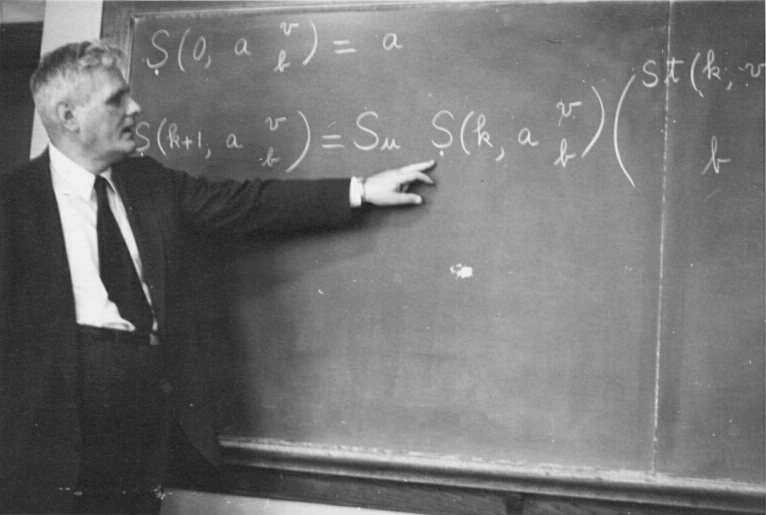

# Alonzo Church

*Deutsch, Harry, Marshall, Oliver*

Photo from Burge & Enderton 2019, reproduced with permission from the editor.
# Alonzo Church
**First published Thu Oct 21, 2021; substantive revision Thu Feb 24, 2022**

Alonzo Church (1903–1995) was a renowned mathematical logician, philosophical logician, philosopher, teacher and editor. He was one of the founders of the discipline of mathematical logic as it developed after Cantor, Frege and Russell. He was also one of the principal founders of the *Association for Symbolic Logic* and the *Journal of Symbolic Logic*. The list of his students, mathematical and philosophical, is striking as it contains the names of renowned logicians and philosophers. In this article, we focus primarily on Church’s philosophical contributions. (For an account of his life and academic history see the Introduction to *The Collected Works of Alonzo Church* (2019).) However, we also discuss his mathematical results when it is desirable to do so in order to pursue a philosophical issue. In Church’s case, the distinction between philosopher and formal logician/mathematician is not entirely correct, since *all* of his work (except for the occasional paper on some purely mathematical subject) concerns logical issues in one way or another.

Church brought both the general outlook and the specific distinctions of formal logic to bear on philosophy in a distinctive way by applying his “logistic method” to the philosophical topics he discussed. Conversely, he also wove certain aspects of his philosophy into the fabric of formal, mathematical logic as he presented it. The result was a formidable combination of philosophical vision and focused argumentation. For Church, the logistic method (or formalization) was not only necessary to obtain additional clarification beyond informal discussion and to make meta-mathematical investigations possible; it was also the ideal method for dealing with philosophical problems in epistemology, metaphysics and philosophy of language. It was Church’s view that one who does not aspire to this ideal falls short. However, he also recognized that formalization is not always appropriate. He did not demand that the natural sciences be formalized and even provided an informal philosophical discussion of semantics in the introductory chapter of his *Introduction to Mathematical Logic* (1956a). The theories and arguments discussed in this article describe and illustrate Church’s logistic method.

In the following, we often use the notational conventions that Church adopted from *Principia Mathematica* (Whitehead & Russell 1910; hereafter PM). When we do so, these conventions are explained and sometimes compared with modern notation.

## 1. Computability and Church’s Thesis

### 1.1 Church’s Seminal Paper

Church was the first to devise a formalism—the λ-calculus—within which it was possible to define a class of functions that coincide, arguably, with the intuitively computable functions—those that can be evaluated by means of an algorithm, i.e., a computer program. He also provided, again arguably, the first example of a particular significant function that is *not* computable. (Other examples, due independently to Kleene (1936) and Turing (1936) followed quickly.) He did this by constructing a function that is provably not recursive in the sense defined slightly earlier by Gödel and Herbrand. He then appealed to the assumption that *any intuitively computable function is recursive* to conclude that the function in question is not computable—in Church’s terminology it is not *effectively calculable*. (We will continue to use the terms “computable” and “intuitively computable” rather than “effectively calculable” since they are more readily understood by non-specialists.) Given the nature of this function, this meant that a certain problem of elementary number theory is unsolvable: there is no way it could be solved by algorithmic means. It also implied a negative solution to the *Entscheidungsproblem* first enunciated by Hilbert and Ackerman (1928): the problem whether there is a decision procedure for first order logic. The italicized assumption later came to be known as “Church’s thesis” (Kleene 1952)[^kleene-1952].

The paper in which this result is presented, entitled “An Unsolvable Problem of Elementary Number Theory” (1936a), is a great classic of logic and computability theory, but it has been somewhat overshadowed by the almost contemporaneous and brilliant paper by Turing (1936), as well as the earlier remarkable incompleteness theorems of Gödel (1931). In this section, Church’s paper takes center stage.

Section 7 of Church’s paper contains the first explicit formulation of Church’s thesis (apart from a preliminary statement in 1935c):

> We now define the notion, already discussed, of an effectively calculable function of positive integers by identifying it with the notion of a recursive function of positive integers (or of a lambda-definable function of positive integers). This definition is thought to be justified by the considerations which follow, so far as positive justification can ever be obtained for the selection of a formal definition to correspond to an intuitive notion. (1936a [BE: 119])

Church goes on to consider two natural ways one might seek to expand the notion of computability beyond that of recursiveness (or λ-definability) and he argued that each of these methods results in functions that are already recursive (and λ-definable) and so concludes:

> Thus it is shown that no more general definition of effective calculability than that proposed above can be obtained by either of two methods which naturally suggest themselves (1) by defining a function to be effectively calculable if there exists an algorithm for the calculation of its values (2) by defining a function $F$ (of one positive integer) to be effectively calculable if, for every positive integer $m$, there exists a positive integer $n$ such that $F(m) = n$ is a provable theorem. (1936a [BE: 121])

Kleene (1952: 222–223) discusses these two classic arguments for Church’s thesis. (See supplement A.2 for further details.)

### 1.2 What is Church’s Thesis?

Church’s thesis is the first of the following two propositions, but the second plays an important role in discussions of the first. We use the term “CT” for the conjunction of the two:

**CT1**

Every intuitively computable function is recursive

**CT2**

Every recursive function is intuitively computable.

CT might be formulated in terms of λ-definability or Turing computability or a number of other distinct mathematical conditions known to be extensionally equivalent to recursiveness. Despite these equivalences, the differences are significant. On several occasions, Gödel expressed a strong preference for Turing’s analysis and there are good reasons for Gödel’s preference. These are amply detailed elsewhere (see the entry on the Church-Turing thesis as well as Davis 1965)[^davis-1965]. Church himself thought that Turing’s analysis was superior to his:

> computability by a Turing machine … has the advantage of making the identification with effectiveness in the ordinary (not explicitly defined) sense evident immediately. (Church 1937a [BE: 934])

The identification of λ-definability with intuitive computability was certainly not “evident immediately”. In fact, Church’s student, Stephen Cole Kleene, reports that it only gradually dawned on Church, Rosser (J. Barkley Rosser, also Church’s student), and himself that λ-definability may serve as a precise counterpart of intuitive computability (Kleene 1981)[^kleene-1981]. Kleene also describes the difficulty of giving λ-definitions of certain basic number theoretic functions—particularly the predecessor function—given the particular way Church gives λ-expressions standing for integers (1981: 56; these λ-expressions are described in [supplement D](church.supplementD.md)). But the fundamental difficulty with CT1 as Church (1936a) enunciates it is that it is given as a definition without any accompanying justification other than a brief sketch of a proof of the extensional equivalence of λ-definability and recursiveness (Kleene [1936] gives a more detailed proof). Gödel complained of exactly this:

> He [Gödel] insisted … that it was “thoroughly unsatisfactory” to define the effectively calculable functions to be some particular class without first showing that “the generally accepted properties” of the notion of effective calculability necessarily lead to this class. (Davis 1982:12)[^davis-1982]

Gödel eventually held up Turing’s analysis as a better model of computation precisely because Turing justifies the identification of intuitive computation with Turing machine computation on the basis of a detailed analysis of what a human computer, equipped with paper and pencil, must actually do (Turing 1936: §9)[^turing-1936]. It seems that a counterpart of Turing’s compelling analysis has yet to be given for the case of λ-computation. It should be emphasized, however, that Church’s main aim was not to defend an analysis of computability but rather to set the stage for a proof that a particular number theoretic combinatorial problem is not solvable. So long as computation is defined as a finite process, cardinality considerations imply that non-computable functions must exist, and Church wished to demonstrate that his combinatorial problem was one of these.

For most of its life, Church’s view—that CT1 is not subject to mathematical proof, or any sort of mathematical treatment at all—has prevailed. But some such as Shoenfield, (and Church himself), have observed that CT2 is subject to intuitive proof *despite* the lack of a mathematically precise definition of “computable” (Shoenfield 1967: 120)[^shoenfield-1967]. Shoenfield’s view of CT2 has been seconded by Kripke. All that is needed, Kripke says, is “just a direct argument” (2013). Moreover, Kripke and others (e.g., Mendelson 1990)[^mendelson-1990] have challenged the received view that CT1 is not amenable to mathematical treatment. Accordingly, the discussion of CT1 divides into two parts: The first part is the evidence usually adduced for CT1 on the assumption that it is a definition or hypothesis not amenable to proof; and the second part is the evidence derived from recent attempts to support CT1 by mathematical arguments. The first sort of evidence we may term “external” and the second “internal”. The emphasis in what follows is on Church’s role in these developments.

### 1.3 The Role of CT1

In Church’s terms, the decision problem for a logistic system is the problem of finding

> an effective procedure, a *decision procedure*, by which, for an arbitrary wff of the system, it is possible to determine whether or not it is a theorem (and if it is a theorem, to obtain a proof of it). (1956a: 273)

In a footnote, Church remarked that from a classical point of view, the parenthetical condition is not required, but is in “the direction of” intuitionism, which he described as “radical”, but the proviso nonetheless was, in subsequent parts of his 1956a, always included. But such a determination must be made on the basis of a precise counterpart of the concept of an effective procedure, such as a recursive or λ-definable procedure. In case there is a positive result, CT2 allows one to infer that a computable (effective) procedure exists; and if the result is negative, CT1 allows the inference to its non-existence. This has been the role of CT in computability theory and the development of logic. A particularly telling example is Church’s negative solution to the *Entscheidungsproblem*—the decision problem for first order logic, now known as “Church’s theorem” (1936b). It was felt that a positive solution would render mathematics completely mechanical at least in principle. Every mathematical problem could in principle be solved by an algorithm. On the other hand, the shape of a negative solution was a mystery. It is reported that von Neumann declared that “We have no clue how to prove it” (Gandy 1988: 62). Church’s result rendered a negative solution conceivable and gave some hope that the solution to mathematical problems would continue to require human ingenuity. In any case, appeals to CT1 have sometimes been viewed as part of the *proofs* giving the solutions to decision problems and sometimes not, depending on the required degree of formalization. To prove, for example, that some axiomatic theory is undecidable is to prove that its set of theorems is not recursive (or not Turing computable, etc.) and the appeal to CT1 often comes after the strictly mathematical work. However, it has not been common to suggest that one or other of the precise counterparts of intuitive computability should actually *replace* it; and although Gödel comes close to such a view (in the case of Turing computability), this is not the standard view. Other reductions of intuitive notions to mathematical terms have often been viewed as replacements (cf. Mendelson 1990)[^mendelson-1990]; but there has been resistance to this view in the case of Church’s thesis, for otherwise logicians should long ago have ceased to speak of intuitive computability (effective calculability).

However, significant developments in computability theory often take the form of informal mathematics, as with the rest of mathematics. An informal method of computation is given, where it is clear that it could be replaced by a formal one although such a demonstration might be thought to be unnecessary or cumbersome. To give a simple example: Proofs of Craig’s theorem that any recursively enumerable set of formulas is recursively axiomatizable often take the form of an informal argument that the set of Craig-axioms is decidable; and then CT1 is applied to conclude that it is recursive (cf. Craig 1953)[^craig-1953]. Rogers (1967) gives many examples of the role of informal mathematics in conjunction with CT1 in computability theory. In fact, Rogers’ classic text uses informal mathematics together with Church’s thesis in its positive (non-contrapositive) form to develop recursive function theory as a whole. By contrast, Davis (1958) gives a fully formal account and so uses CT1 mainly in its contrapositive form, or, equivalently, in its positive form but resting on a *reductio* assumption. A third role of CT1 has been to motivate the proofs that certain basic sets and relations are recursive. For example, membership in the set of formulas of a standard formalized language is intuitively computable. Hence by CT1 it must be recursive, but a proof that it is recursive can be surprisingly complex (see Boolos et al. 2007: Ch. 15)[^boolos-2007].

### 1.4 The External Evidence

The classic account of the external evidence for CT1 is by Kleene (1952: 318–323). Kleene organizes the evidence under four headings:

**(A)**

Heuristic evidence,

**(B)**

Equivalence of diverse formulations,

**(C)**

Turing’s concept of a Turing machine, and

**(D)**

Symbolic logics and symbolic algorithms.

(A) is the fact that large families of functions had been shown to be λ-definable and hence recursive. (B) is the striking fact that the various mathematically precise counterparts of computability—λ-definability, recursiveness, Turing computability and others of the period due to Gödel and Post—despite being technically quite different from one another—turn out to lead to the same class of functions. (Not everyone is impressed by this “confluence” of definitions; cf. Kreisel 1987.)[^kreisel-1987] As for (C), Kleene observes that Turing’s analysis constitutes a direct attempt to give a mathematical account of the actions of a human computor and thus differs from the other analyses (in terms of recursiveness and λ-definability), which “arose differently”. He remarks that Turing’s identification of intuitive computability with computability by a (Turing) machine constitutes an “independent statement of Church’s thesis”. For this reason CT1 has come to be known as the Church-Turing Thesis. Both Church (1937b) and Kleene (1952) also note that Post (1936) independently gives an analysis very similar to Turing’s. Perhaps, then, CT1 should properly be known as the Church-Turing-Post-Thesis.

Kleene’s (D) consists of the two arguments mentioned earlier by Church (1936a: section 7). The first argument is that the notion of computation by means of an algorithm does not lead outside the class of recursive functions (cf. Shoenfield [1967: 120] for an argument of the same sort). The second of these concerns the relation between recursive functions and formal systems of “symbolic logic”. Church argues that in any such system whose set of theorems is recursively enumerable, if $f$ is a unary (“singulary” is Church’s term) function of positive integers and if it is true that

$$\tag{*} f(m) = n,$$

for integers $m$ and $n$, then (in essence) $(*)$ is provable in the system; and if $(*)$ is false, then it is not provable in the system, then $f$ is recursive. See supplement A.2 for a more detailed discussion of this controversial argument—controversial because Church simply *assumes* that the set of axioms and rules of a symbolic logic must be recursive, and this has seemed to some to beg the question of the truth of CT1 and thus to constitute a “stumbling block” to the acceptance of Church’s argument (Sieg 1997)[^sieg-1997].

### 1.5 The Internal Evidence

Mendelson challenged the view that CT1 is not subject to mathematical treatment by citing cases in which an intuitive concept has literally been *replaced* by a corresponding mathematically precise one. It is not a mere *thesis* that the limit concept, for example, is given by the familiar epsilon-delta definition. The definition replaces the intuitive concept (Mendelson 1990)[^mendelson-1990]. Others have gone further, arguing that computability may be taken as a primitive concept subject to an axiomatic treatment, as Gödel had once suggested (according to Church’s letter to Kleene, 1935d [BE: 1000]). Sieg proposes an axiomatization based on Turing’s analysis of a person who computes (“a computor”). In section 9 of his (1936), Turing argues (argument I) that the Turing machine is a good model of a computor, who, as such, is subject to certain constraints such as that

1. the behavior of the computor is completely determined by the symbols observed and the computor’s state of mind;
2. that there is a finite bound on the number of symbols observed at any one time;
3. that only a finite number of states of mind are involved at any one time (a condition that Gödel [1972] disputed); and
4. that each newly observed symbol is within finitely many steps of earlier ones.

Sieg, building on work of Gandy, formulates axioms corresponding to such conditions and claims that these constitute an axiomatization of computability (Gandy 1988; Sieg 1997)[^sieg-1997].

In a recent paper (2013), Kripke argues that CT may be regarded as a “special corollary” of the completeness theorem for first order logic. Kripke’s argument is reminiscent of one given earlier by Kreisel (1987) concerning, not CT, but rather the relation between informal validity, on the one hand, and formal validity and provability on the other. It is useful to consider Kreisel’s argument first and Kripke’s afterwards (some details of the following are not Kreisel’s):

Let $TA$, $VA$, and $DA$ mean respectively that $A$ is a first order translation of an informal argument that is intuitively valid “in virtue of form alone”, that $A$ is valid according to the standard model theoretic definition of validity for first order logic, and that $A$ is derivable in a first order formal system of deduction, $D$, that is sound and complete in the usual sense. Then informally, we have that $DA$ implies $TA$. If an argument is formally derivable, we regard it as valid in virtue of its form alone. At least that is often taught to students. And also $TA$ implies $VA$—something also taught to students. By completeness, $VA$ implies $DA$. And so it follows that $TA$—an informal notion—is equivalent to $DA$, a formal notion, for the case of first order logic. (It might be assumed in addition that any intuitively valid argument is formalizable in a first order language, but Kreisel does not assume this.)

Now, Kripke summarizes his argument as follows:

> Suppose one has any valid argument whose steps can be stated in a first-order language. It is an immediate consequence of the Gödel completeness theorem for first-order logic with identity that the premises of the argument can be formalized in any conventional formal system of first-order logic. Granted that the proof relation of such a system is recursive (computable), it immediately follows in the special case where one is computing a function (say, in the language of arithmetic) that the function must be recursive (Turing computable). (2013: 81)

Kripke assumes “Hilbert’s thesis”:

> namely that the steps of any mathematical argument can be given in a language based on first order logic (with identity)

and he assumes that the proof relation is recursive and hence that the provability relation is semirecursive. Thus, the argument runs as follows: (1) Let $A$ be a valid mathematical argument that is a calculation, “where one is computing a function (say, in the language of arithmetic)”. Then, (2) by Hilbert’s thesis, the steps of $A$ can be stated in a first order language (and so the premises and conclusion of $A$ can be stated in such a language). But then (3) by the completeness theorem, there is a formal derivation of the conclusion of $A$—the final result of the calculation—from its premises, and so (4) “it immediately follows” that the function representing the calculation is recursive. This is a proof of Church’s thesis, assuming Hilbert’s, and, as Kripke mentions, it might therefore be viewed alternatively as a reduction of Church’s thesis to Hilbert’s.

The similarity to Kreisel’s argument is clear: Define $C(A)$ to mean that $A$ is a is correct mathematical calculation; then by Hilbert’s thesis, $C(A)$ implies $V(A)$ and by completeness $C(A)$ implies $D(A)$. Moreover, apart from the appeal to the completeness theorem, Kripke’s argument is essentially the same as the Church-Kleene argument mentioned earlier and discussed in supplement A.1:

> It is because of these considerations that I take myself to be reviving somewhat neglected arguments already given by Church, and especially Turing. (Kripke 2013: 81)[^kripke-2013]

One important consequence of Kripke’s argument, in particular, is that as he observes, there is—and has been from the beginning—a characterization of computable functions in terms of first order provability that is fully equivalent to the others (2013: 82).

## 2. Philosophy of Logic

In this section we describe how Church’s wove certain philosophical doctrines about logic into the fabric of formal, mathematical logic as he presented it in (Church 1956a, 1959, 1962b, 1956–72). Church’s early philosophy of logic is described in [supplement B](church.supplementB.md).

### 2.1 Philosophy of Logic and the Logistic Method

In Church’s philosophy of logic, the phenomenon of deductive reasoning is assumed to be “already known, from experience with particular instances of it” and the stated goal of logic is to provide a theory of such reasoning

> plus whatever is required in object language or metalanguage for the adequacy, generality, and simplicity of the theory. (1962b [BE: 608])

This attitude required Church to accept not only first order logic but also the logic of second and higher orders, so that he could study logic in all its generality. It was not enough to accept, for example, “$(x) F(x) \supset F(y)$”, because there are infinitely many sentences of this form requiring one to also accept “$(F)(y) \hdot (x) F(x) \supset F(y)$” “by generalization from infinitely many analytic sentences of the appropriate form” (1962b [BE: 608]). (Note Church’s notational convention that a dot placed before a connective or (as above) a quantifier brackets a proposition.)

Another consideration Church offered in favor of second order logic was the more pragmatic one that a greater understanding of mathematical theories could be obtained by comparing their formulations in first and second order languages (1956a: chapter V). (Discussion of this topic is beyond the scope of this entry; but see Myhill (1953), Shapiro (1991, 2001), Button and Walsh (2018) and the citations therein. See also the entries on model theory, second and higher order logic, and Skolem’s Paradox.)

Church’s philosophy of logic was shaped not only on the one hand by a belief in the generality of logic but also on the other by the need to avoid the paradoxes to be discussed in section 4. In order to avoid the paradoxes to which Frege’s position lead, Church was forced to work primarily within a type-theoretic framework—the logic of second, third and higher orders up to and including *w*—with different kinds of variables, with different restricted domains of individuals, classes, relations, etc. (Church’s type theory is described in [supplement D](church.supplementD.md).) Moreover, as we will now see, Church departed even further from Frege and Russell by presenting these ideas in terms of conventional model theory.

The purpose of formal logic, in Church’s view, was first and foremost to study the *form* of correct deductive reasoning in abstraction from its subject matter (1956a: §00). For Church, deductive reasoning operates on propositions, and so the study of such reasoning is the study of the logical form of propositions—which Church distinguished from their “content” or “matter” (ibid)—via the study of the logical forms of sentences that express them (ibid; cf. 1959 [BE: 475]). This way of studying logical form invoked what Church called the “logistic method” (1956a). This required him to distinguish between informal languages and formalized languages, because

> the natural languages, including English, have been evolved over a long period of history to serve practical purposes of facility of communication, and these are not always compatible with soundness and precision of logical analysis… To adopt a particular language thus involves adopting a particular theory or system of logical analysis. (1956a: §00)

In order to adopt a formal language, one first devises what Church calls “a particular theory or system” (1956a [BE: 373]), which is a syntactic theory. This specifies the *primitive symbols* and *formation rules* for building *the well-formed expressions (the wffs)* of the theory, as well as what are the *axioms* and *inference rules.* The *theorems* are the wffs that occur at the end of *proofs*, which are themselves specified as finite sequences of wffs that are either axioms or inferable from prior wffs in the sequence according to the inference rules. In order for this theory to serve as a *language*, it must be provided with semantic rules that assign *designata* (or denotations) to the names of the theory, as well as *values* to expressions containing free occurrences of variables.

The logical forms of sentences are the ways that sentences are built up from the logical particles. From this perspective, to say that a wff B is a *logical consequence* of a set of wffs $\Sigma$ is to say that the logical forms of B and the wffs in $\Sigma$ are so related that if the wffs in $\Sigma$ are true, so is B. Moreover, since logical form is sufficient to ensure this, for any argument of *the same logical form*, if the premises are true, so is the conclusion. This leads to the now familiar idea that

> the proof of a theorem (of the object language) shall make no reference to or use of any interpretation, but shall proceed purely by the rules of the logistic system. (1956a: §07)

Church gave three reasons for this requirement. First, it adheres to extant standards of mathematical rigor. Secondly, reasoning purely by the rules of the logistic system is safer than reasoning about any interpretation one may wish to adopt, because—as is discussed in 2.2—the object language is set up using an informal meta-language that is “so elementary and restricted that its essential reliability can hardly be doubted if mathematics is to be possible at all” (1956a [BE: 415]). Finally, it allows one to draw a precise distinction between form and content:

Returning to B and $\Sigma$, if the former is a logical consequence of the latter, then, if we do *not* reinterpret the logical particles but *do* reinterpret the nonlogical vocabulary by associating it with different rules, then it will still be the case that if all the wffs in $\Sigma$ are true, so is B. In this way, we can isolate the form of a proposition by studying the corresponding sentence and reinterpreting its non-logical vocabulary.

This, of course, is the now conventional model-theoretic treatment of logical consequence originally due to Tarski (1937 [1941]) and extended to the logic of higher orders by Church’s student Leon Henkin (1950), which is presented in Church (1956a). (For more on Henkin’s contribution, see the entries on second and higher order logic and on Church’s type theory.) It should be noted that Church, in addition to working in classical model theory with restricted universes that can be accommodated in ZF set theory, was also willing to allow the existence of a universal set (1974c). Further, he not only distinguished between sharply between model theoretic interpretations and intended interpretations (1956a), but also argued that giving a particular model theoretic interpretation of a formal language was not sufficient for describing its logic. In particular, he argued that giving a formal language containing empty names (like ‘Pegasus’) an interpretation with inner and outer domains that invalidates Existential Generalization (as well as, presumably, Universal Instantiation) was not sufficient for describing the logic of that language (1965).

### 2.2 Adopting a Formalized Language

Central to the logistic method is the process of adopting a formalized language. This process takes place in an informal meta-language (such as a fragment of English) that

> deals with matters of everyday human experience, going beyond such matters only in that no finite upper limit is imposed on the number of objects that may be involved in any particular case, or on the time that may be required for their manipulation according to instructions. (1956a: §07)

Included in Church’s description of the process of adopting a formalized language is that one first specifies the primitive symbols and formation rules, which together with the axioms and inference rules constitute *the primitive basis* of the logistic system (which will become a language once semantical rules are added). The description of this process assumes that the person who undergoes it has a stock of information about language and the world, the ability to understand definitions (such as the definition of “primitive symbol”) as well as the ability to understand and follow instructions. Church also provided a rational reconstruction of how we learn our first language and suggested that this method could, in principle, be used to learn a formalized language rather than a natural language as a first language:

> Some part of the language must first be learned approximately by the method of example and imitation; then this imprecisely known part of the language is applied in order to state rules of the language (and perhaps to correct initial misconceptions); then the known part of the language may be extended by further learning by example and imitation, and so on in alternate steps, until some precision in knowledge of the language is reached. There is no reason in principle why a first language, learned in this way, should not be one of the formalized languages of this book, instead of one of the natural languages. (1956a: §07)

This assumes that the person who undergoes this process can not only state rules but also apply them, so it assumes that such a person can reason as well as imitate behavior. In this way, it resembles, somewhat, Church’s earlier philosophy of logic in which he distinguished between *intuitive* logic and *formal* logic and maintained that intuitive logic cannot be learned and is a precondition of reasoning in formal logic. (Church’s early philosophy of logic is described in [supplement B](church.supplementB.md).) One reason for the absence of the locution “intuitive logic” from Church’s mature philosophy might be that he wanted to avoid the impression that there is some essential difference between what should take place in an informal meta-language and what should take place in a formalized object language. In fact, he was adamant that basic deductive reasoning should not *have to* take place in an informal meta-language. Rather, once the object language has been set up it

> shall be an independent language capable, without continued support and supplementation from the meta-language, of expressing those things for which it was designed. (1956a: fn. 121)

The idea is that a person who can already reason as well as use an informal meta-language to set up the object language can come to reason with greater rigor and to a greater extent in the object language. At which point, having pulled herself up by her bootstraps, she should no longer have any need for an informal meta-language. (Of course, a meta-language is still needed to prove certain meta-theorems about the object language such as its consistency.)

### 2.3 Logic and Communication

When one is setting up a logistic system, the well-formed expressions, axioms and rules of inference must all be specified *effectively* in order that there can be an effective test of whether a purported proof is really a proof. Intuitively, the requirement is that one can test—by looking at the symbols and following a fixed set of instructions for performing concrete operations with symbols—whether a given finite sequence of symbols is a wff, or whether a given finite sequence of wffs is a proof of the last wff in the sequence. In the absence of such a method.

> a proof would not necessarily carry conviction, the proposer of a proof could fairly be asked to give a proof that it was a proof—in short the formal analysis of what constitutes a proof (in the sense of a cogent demonstration) would be incomplete (1959 [BE: 477–8]).

The philosophy underlying Church’s position is that mathematical proof and logical analysis—as well as other attempts at precise reasoning—should be *public* and *communicable*. Just as one should be able to convince an interlocutor that a mathematical proof is really a proof, so one should be able to convince her that an argument more generally is cogent, which will also require convincing her that meaningful assertions have been made. Further, these questions should be addressed *by the object language in which one is speaking* (although one will often have to look beyond the language to convince an interlocutor that one’s assertions are true):

> But without the requirements of effectiveness, it might happen that someone confronted with a proof of a theorem (and admitting the axioms and rules of inference) might nevertheless continue to doubt the theorem, because of doubt that the alleged proof actually is a proof…. the proposer of the proof might be fairly asked to give supplementary proof that it is a proof—and for the purposes of deductive logic, this supplementary proof ought then to be treated as part of the whole proof, and included with it when the process of proof is formalized by the logistic method. (1956–71 [BE: 703])

For example, while there may be advantages to using the deduction theorem as a primitive rule of inference, there is also reason to avoid doing so, i.e., to obviate the need for supplementary proof (1956a: §29 and fn. 181).

For Church, it is constitutive of a language that it provides the foregoing connection between reasoning and communication:

> For, however indefinite or imprecisely fixed the common idea of a language may be, it is at least fundamental to it that a language shall serve the purpose of communication. And to the extent that requirements of effectiveness fail, the purpose of communication is defeated. (1956a: §07)
>
> To say that an assertion has been made if there is a meaning evades the issue unless an effective criterion is provided for the presence of meaning. An understanding of the language, however reached, must include effective ability to recognize meaningfulness (in some appropriate sense), and in the purely formal aspect of the language, the logistic system, this appears as an effective criterion of well-formedness. (1956a: fn. 120)

In short, an assertion can be recognized as meaningful only if there is an effective method for determining whether it is meaningful; Church’s logistic method provides such a method by way of well-formedness. Further, since communication and conviction are at issue (as well as mere judgments of meaningfulness), one must also be able to tell *which* propositions have been asserted and, in particular, which ones have been proved.

However, some critics have questioned the cogency of Church’s philosophical arguments for his requirement of effectiveness (Anderson 1998)[^anderson-1998]. Moreover, it should be noted that logical consequence is not in general an effective notion. By Church’s Theorem (1936a), there is no effective test for deciding the validity or provability of the wffs of first order logic or of logics of any higher order (as Church himself notes; 1956–71 [BE: 703]). Further, as Church was acutely aware, there is a price to be paid for communicating and verifying proofs in a formalized language that meets the requirement of effectiveness. If the formalized language is sufficiently expressive, it will be subject to Gödel’s incompleteness theorems (see §5.4).

It should also be noted that the question what exactly is an effective procedure spurred Church’s work on effective calculability and the decision problem (see section 1). It is also motivated some of his other technical work such as his work on constructive ordinals (1938).

In addition to the requirement of effectiveness, Church also demands that proofs should be constructive. However, in later years his attitude became more ecumenical. See (1936b: fn. 10 added 1971 [BE: 128]).

## 3. Applications of the Logistic Method

Church used the logistic method to apply the general outlook and specific distinctions of formal logic to problems in philosophy. In this section we describe five such applications.

### 3.1 Against Logical Empiricism

Church was never a member of the Vienna Circle and neither were Kleene nor Rosser (an ocean separated them from Vienna); nor did they show particular sympathy for the Circle and its aims. Church was, however, appreciative of the work of Carnap in particular (cf. Church’s [1939a] review of Carnap’s *Foundations of Logic and Mathematics* [1939]). But commenting on Carnap’s Circle-inspired view that the sole task of philosophy is semantical analysis, Church remarked that this “represents an extreme view” (1943a). Church adds that, nonetheless, the importance of semantical investigations to philosophy should not be underestimated.

Thus, Church was among those logicians and philosophers who did *not* subscribe to the Circle’s approach to the question of meaning. This, of course, is not to deny that the Circle was a powerful force in the development of analytic philosophy (see the entry on logical empiricism). But Church and many of his students did not participate in the Circle.

The logical empiricists tried to explicate the notion of empirical verification in terms of logical entailment. We begin with their second attempt, an explication known as “weak verifiability”, which (like its predecessor, “strong verifiability”) was framed in terms of logical entailment or logical deducibility:

> *S* is empirically verifiable iff *S* logically entails *A*1, *A*2…,

(perhaps with the help of additional premises). More specifically, the form A. J. Ayer initially gave to this idea was as follows:

> It is the mark of a genuine factual proposition…that some experiential [observation] propositions can be deduced from it in conjunction with certain other premises without being deducible from these other premises alone (1936 [1952: 38–39]).

For example, from “This is a swan” together with “All swans are white” we can deduce “This is white” although the latter cannot be deduced from “All swans are white” alone. Thus, “All swans are white” counts as meaningful.

But this is obviously unacceptable and (as with its predecessor) it is properties of logical entailment that cause the problem. To borrow Ayer’s own example (given in the second edition of his 1936 [1952]), from “The Absolute is lazy” together with “If the Absolute is lazy, then this is white”, it follows that “This is white”, and this does not follow from the conditional premise alone. Hence, contrary to every bone in the logical empiricist’s body, “The Absolute is lazy” is meaningful. The argument can be redeployed to show that any sentence whatsoever is meaningful.

In the second edition of *Language, Truth, and Logic*, Ayer attempted to remedy this problem. In a review, Church (1949a) roundly refuted Ayer’s proposal. This rebuttal sent verificationism and logical empiricism itself into a tailspin. Carnap tried to rescue these doctrines by adopting an approach not based directly on logical entailment but this effort was refuted by Kaplan (1975a). Despite these difficulties, there is currently an intense revival of interest in the question of the empirical structure and content of scientific theories and in Carnap’s work in particular (see the entry on Rudolph Carnap).

Ayer’s revised criterion of empirical verification is as follows:

> *S* is *directly* verifiable iff either *S* is an observation sentence or else *S*, perhaps in conjunction with other observation sentences *A*, *B*, *C*,…, logically implies an observation sentence that is not implied by *A*, *B*, *C*….

In addition:

> *S* is *indirectly* verifiable if and only if *S*, perhaps in conjunction with other sentences *P*, *Q*, *R*,… logically implies a directly verifiable sentence *D* that is not implied by *P*, *Q*, *R*,…. Furthermore, these sentences *P*, *Q*, *R* are each either analytic or directly verifiable.

In sum:

> A sentence is meaningful if and only if it is directly or indirectly verifiable, or else analytic.

Church argues as follows: Let $O1,$ $O2,$ and $O3$ be independent observation sentences (no one of them entails any other), and suppose $S$ is any sentence whatsoever—it might be “The Nothing Nots”. Church shows that Ayer’s definition entails that either $S$ or its negation “It is not the case that the Nothing Nots”, is meaningful. For consider the disjunctive sentence

$$ R: (\nsim O1 \cdot O2) \lor (O3 \cdot \nsim S) $$

$R$ together with $O1$ entails the observation sentence $O3$ and hence $R$ is directly verifiable. Also, $S$ and $R$ entail $O2$. This means that $S$ is indirectly verifiable, *unless* $R$ alone entails $O2$. But if $R$ alone entails $O2,$ then its right hand disjunct alone entails $O2,$ and hence $\nsim S$ is directly verifiable. So either $S$ or $\nsim S$ is meaningful and therefore many sentences that Ayer would reject as meaningless are meaningful according to his definitions.

It is worth mentioning that the foregoing argument may *seem* to depend crucially on a somewhat contested feature of classical propositional logic. The argument appeals to the principle that if $A \lor B$ logically entails $C$, then $B$ alone logically entails $C$. But this in turn rests on the principle that $B$ alone logically entails $A \lor B$, for any $A$, and this principle is rejected by so-called containment logics (for which see §3.1 of the entry on connexive logic). However, it is possible to revise Church’s argument so that it is compatible with containment-logical principles. So in fact Church’s argument is not in this way beholden to classical logic.

### 3.2 The Slingshot Argument

In Frege’s logical system, declarative sentences stand for (*bedeuten*) truth values, which are two distinct abstract objects in Frege’s ontology. Thus Frege treated such sentences as a special kind of name. But others, Carnap in particular, viewed sentences as standing for propositions. In response, Church gave an argument, directly traceable to Frege, that the denotations of sentences are indeed their truth values, and so cannot be propositions as Carnap supposed. (While we prefer “designate” we will follow Church and use “denote” in this section.) This argument has become known as “the Slingshot”, invoking the slaying of Goliath by David, for its ability to refute looming hypotheses such as that sentences are correlated directly with facts or propositions.

Church argued that sentences *must* stand for truth values, for if sentences stood for propositions, there would only be two propositions. A similar argument that all true sentences stand for the same thing (and that all false sentences stand for a distinct thing) was suggested by Gödel (1944; for an extended discussion of truth values, the slingshot, and generalized truth values see the entry on truth values). Here we focus exclusively on Church’s review, and his related commentary in (1956a: §04), which constitute the *locus classicus* of the Slingshot argument.

Here is a simple, ingenious, logic-notation-free version of the argument given by Church (1956a: §04): Assume first that sentences do denote something or other. Now consider the following list of sentences:

**(1)**

Sir Walter Scott is the author of Waverley

**(2)**

Sir Walter Scott is Sir Walter Scott

**(3)**

Sir Walter Scott is the man who wrote twenty-nine Waverley novels altogether

**(4)**

The number such that Sir Walter Scott is the man who wrote that many Waverley novels is twenty-nine.

**(5)**

The number of counties in Utah is twenty-nine.

Church argued that (1) and (5), which seem totally unrelated in meaning, must denote the same thing, namely, their truth value (since that is all they have in common). The only additional assumptions Church works with are the following two:

**(A)**

Co-denoting names or definite descriptions are interchangeable.

**(B)**

Synonymous sentences (or, Church remarks, nearly synonymous sentences such as (3) and (4)) have the same denotation.

Assumption (A) allows that an occurrence of a name or a definite description N in a sentence S may be replaced by a name or description M that denotes the same thing without altering the denotation of S. Thus, (2) comes from (1) by (A). (But it is not clear what role, if any, (2) plays in the argument.) (3) comes from (1) by (A); (4) comes from (3) by (B); and (5) comes from (4) by (A). A similar argument can be used to show that all false sentences denote the same thing. A further conclusion, important to Church, is that if, as this argument seems to demonstrate, (1) and (5) denote the same thing, this cannot be the propositions expressed by each, since those are clearly different. (For further discussion see supplement C.1 as well as the supplement to the entry on truth values.)

### 3.3 The Translation Argument

Consider the sentences

**(1)**

Seneca said that man is a rational animal

**(2)**

Columbus believed that the world is round.

A natural analysis of such sentences is that they express a relation between Seneca or Columbus and the propositions that man is a rational animal or that the world is round, where such propositions are objective abstract entities that are the ultimate vehicles of truth and meaning. But there has been—and no doubt always will be—skepticism about the existence of such entities and this has motivated the view that sentences such as (1) and (2) express relations between agents and sentence types or even particular inscriptions (or other tokens) of sentences of a particular language, where sentences are assumed to be more concrete than propositions. While this assumption of concreteness seems highly questionable in the case of sentence types, Carnap and others nevertheless vigorously pursued the project of analyzing (1) and (2) in terms that relate agents to such types. (The theory that saying and believing are relations to particular physical tokens is obviously implausible. Contrary to what it predicts, the destruction of such tokens would not have voided Seneca’s belief.) In response, Church deployed his translation argument (CTA) that if we limit our ontology to sentence types, then our semantic theory will not be able to provide a true analysis of sentences like (1) and (2). (This is a crucial part of Church’s broader argument that no philosophical theory that is both true and humanly understandable can do without propositions. We return to the rest of the argument in §6.3.)

CTA—as formulated in Church’s (1950a)—is specifically directed at Carnap’s (1947) analysis of sentences like (1) and (2), which in turn appeals to a particular notion of synonymy. However, since Church has shown that Carnap’s notion of synonymy is incorrect (via an argument described in [supplement E](church.supplementE.md)), we can safely omit the details of Carnap’s notion for present purposes and speak simply in terms of synonymy. Now, according to Carnap’s analysis, (2) is synonymous with

**(3)**

Columbus was disposed to an affirmative response to the English sentence “the world is round”.

This is presumed true in virtue of Columbus’ disposition to affirm, say, “*El mundo es redondo*” or a synonymous sentence in some other language (such as the English sentence “The earth is round”).

Church suggested that the reader translate (2) and (3) into German making sure that, among other things, “that the world is round” as it occurs in (2) is translated as “*dass die welt rund ist*”, whereas “the world is round” as it occurs in (3) is translated as “the world is round”. The difference is that the sentence “the world is round” is *mentioned* in (3), whereas it is *used* in (2); moreover, (3) does not mention the German sentence “*die welt rund ist*”, only the English sentence “the world is round” and so a proper translation of (2)—one that preserves meaning (and not merely “the main point”)—will mention the latter not the former. So, the translations are:

**(4)**

*Columbus glaubte, dass die Welt rund ist*

**(5)**

*Columbus war bereit, den englischen Satze* “The world is round” *zu bejahen*.

(Notice that if we replace “The world is round” in (5) by its German translation, the result is clearly false, since the German translation is not a sentence of English.)

Church concluded this version of CTA by noting that (4) and (5) are clearly not synonymous, since they convey different information to a German speaker who does not speak English. Church concluded that, therefore, (2) and (3) are not synonymous (1951a [BE: 294]). Church assumed, plausibly, that synonymy is an equivalence relation—reflexive, symmetric, and transitive. Hence, the basic structure of CTA is as follows: Assume that (2) and (3) are synonymous. Then (4) and (5) are synonymous. But (4) and (5) are not synonymous, and so neither are (2) and (3), and therefore (3) cannot serve as an analysis of (2).

However, Church argued that translation is not needed to establish that (2) and (3) are not synonymous, and he gave another argument that does not appeal to translation:

> It is not possible to infer [(2)] as a consequence of [(3)], on logical grounds alone—but only by making use of an item of factual information not contained in [(3)], namely, that “the earth is round” means in English that the earth is round. (1950a [BE: 280])

The point is that it is only a contingent fact about the English language that the particular sequence of symbols and associated sounds “the earth is round” mean in English that the earth is round. (Compare Church’s summary of his argument where he says that it is designed to “dispel any remnants of an illusion that there is something in some way necessary or transparent about the connection between a word or sentence and its meaning, whereas, of course, this connection is entirely artificial and arbitrary” (1951a [BE: 294]).) Moreover, this additional factual information is needed to infer (2) from (3). For example, the language might have developed in such a way that “round” and “square” were interchanged, so that to say “the earth is square” in this version of English is to say that the earth is round. Note that the following would nonetheless be true in this new version of English:

> “the earth is square” means that the earth is square,

where the latter *used* occurrence of “the earth is square” is a pronouncement of the new version of English, not the familiar one. This shows that the aforementioned factual information is needed to infer (2) from (3), since otherwise the expression “the earth is round” need not represent Columbus’ belief. This argument that CTA does not essentially involve translation is worth a closer look, since Church himself describes the argument as expressing “the main point” he is trying make via CTA:

> The main point is that [(3)] is inadequate as an analysis of [(2)] because it conveys less information than [(2)] does. (1950b [BE: 1061]; cf. Salmón 2001)[^salmón-2001]

The information conveyed by (2) but not (3) is:

**(6)**

“The earth is round” means in English that the earth is round.

Church claims that this is “an item of factual information not contained in [(3)]”, and it was Church’s view that the word “English” as commonly used contains “reference to matters of pragmatics” (1950b [BE: 1060]). By this he meant that the word “English” means something like, as Church puts it, “the language that was current in the United States, Canada and Great Britain in 1949 AD”, since it allows that English is an evolving rather than a fixed system (1950). If so, it seems clear that the information given by [(2)] is not contained in [(3)] and that translation is not required to establish this.

However, in a further twist, Carnap responds that “English” as $he$ intends it means something like “the unique language having such and such semantical rules” and he brings this to Church’s attention in his letter (1950b [BE: 1063]), thus challenging Church’s claim that (5) is an item of factual information not contained in (3) but needed to infer (2) from (3). Church recognizes the threat:

> The objection would then be less immediate that [(2)] is not a logical consequence of [(3)] and it is possible that it would disappear. (1950a [BE: 280])

The point is that if English is defined to be the unique language with such and such semantical rules and (5) is one such rule, then it looks as though (2) *would* be a logical consequence of (3), so interpreted.

In the last paragraph of (1950a), Church briefly states two arguments that he obviously views as cementing the falsehood of Carnap’s analysis, even if English is taken to be the language with such and such fixed semantical rules. He first observes that if Carnap’s proposal is discussed in German rather than English, then it will not be synonymous with the English version! The one version involves an English sentence while the other a German sentence. Church’s assumption appears to be that a correct analysis of (2) should be language independent. Next, he observes that even if (3) logically entails (2), a person might not see the entailment, and so not draw the inference, leading her to believe (3) and yet not believe (2). Is Church’s assumption here that if (3) were a correct analysis of (2), then understanding and believing it should entail understanding and believing (2)? If so, this would conflict with Church’s own way of dealing with the Paradox of Analysis. Moreover, there is arguably an outright inconsistency between Church’s solution to this paradox and his solution to the Mates puzzle, which we discuss in [supplement C](church.supplementC.md). Church’s criticism of Carnap’s notion of synonymy is discussed in [supplement E](church.supplementE.md).

### 3.4 The Paradox of Analysis

Church’s brief remarks on the paradox of analysis focus exclusively on the sentence

**(1)**

A brother is a male sibling.

(While this is an example of a trivial analysis, its triviality does not affect the cogency of Church’s discussion.) Church renders (1) as

**(2)**

$b = \textit{ms}$

which he thinks of as an expression “of the Boolean algebra of classes—or better, of class concepts” (1946a [BE: 956]). According to this proposal, the concept of a brother is a kind of “product” of the concepts of a male and a sibling. (Of course, this ignores the relational nature of both sides of the equation. For example, the only siblings relevant to the definition are the brother’s siblings; other siblings are ignored, and so the analysis is incomplete. But we shall nonetheless stick to Church’s formulation.) The problem as Church sees it is this:

> If $b$ and $\textit{ms}$ are the same concept, then it must be possible to introduce either in place of the other without alteration of meaning—indeed this is clearly the intention, or part of the intention, of any analysis in the sense of Moore. Hence in particular the analysis $b = \textit{ms}$ must not be different from $b = b$ or $\textit{ms} = \textit{ms}$. This would seem to reduce analysis to something trivial and uninformative. But it is evident otherwise—especially from cases in which, though a concept is in some sense known, its analysis presents difficulty—that analysis is not always trivial. (1946a [BE: 956])

Church argues that the paradox is a special case of what is now known as “Frege’s Puzzle”. It is unclear how a statement of the form $a = b$ can be both true and informative; for if it is true, then it would seem to say the same thing as $a = a$, since this is the result of substituting $a$ for $b$ in $a = b$. Moreover, Church views (2) as a special case of an informative identity statement, with the difference that (2)—unlike a statement of the form $a = a$ that asserts the identity of objects—asserts the identity of concepts or senses. That is, Church takes “brother” and “male sibling” to designate concepts in the context of (2), rather than classes, since (2) is meant to be an analysis. Further, while “brother” and “male sibling” designate the same concept, viz. *brother* or *male sibling*, they may nevertheless differ in sense (that is, though they designate the same concept the express, they *express* different concepts as senses); and this is what explains how (2) can be informative and how the proposition expressed by (2) can differ from that expressed by the trivial $b = b$ or $\textit{ms} = \textit{ms}$.

The power of Church’s proposal may not yet be apparent due to the triviality of the sample analysis. Recall Church’s remark that there are cases of analyses (or hoped for analyses) where

> though a concept is in some sense known, its analysis presents difficulty—that analysis is not always trivial. (1946a [BE: 956])

In philosophy the correct analysis of the concept of knowledge has proved to be profoundly elusive. In mathematics, the analysis of the concept of the limit of a function was a triumph, as was the analysis of the concept of an effectively calculable (computable) function. Church would view these as cases where *analysans* and *analysandum* designate the same concept but express radically different senses; and this does seem exactly right. Some, however, have thought that Church’s way of dealing with the paradox of analysis and his way of dealing with Mates’ problem are incompatible. This is discussed in supplement C.2.

### 3.5 The Logic of Sense and Denotation

Church’s (1943a) review of Carnap’s *Introduction to Semantics* (1942) constitutes an important early step in the application of the logistic method to the subject of semantics (see also Church 1943c, 1951b, 1952, 1956a). Like Frege, Church believed that the *Sinn* or sense of an expression is an *objective*—i.e., mind-and-language independent—abstract entity (cf. §3.3 and §6.3) and that senses are needed in semantics for their power to explain the informative nature of identity statements containing co-designating names, as well as to explain the failure of the substitutivity of co-designating names in intensional contexts (1943a; 1956a: §01). Moreover, Church also shared Frege’s highly controversial view that in addition to assigning senses to expressions in scientific language, one should also assign them to expressions in natural language. (See [supplement E](church.supplementE.md) for discussion.)

However, given that senses and propositions are objective, one might wonder whether theorizing about them via the logistic method should *really* proceed *indirectly*, via the study of intensional semantic theories of possible languages (again, see [supplement E](church.supplementE.md)), or whether the logistic method should instead study senses *directly* by theorizing about how these entities are related to one another and to the *designata* that they determine. Church himself distinguishes these two approaches and claims that if a theory could be formulated in a satisfactory way using the direct method, then “it should be a comparatively simple matter to devise a language with the desired sort of semantics” (1979 [BE: 807]). He pursued this direct approach in his papers on the *Logic of Sense and Denotation* or “LSD” (1946b, 1951a, 1973b, 1974a, 1993).

The fundamental difference between the intensional semantic approach to language and the direct LSD approach to senses can be seen from the following. Church’s view that the sense assigned to a name by a semantic theory is *univocal* raises the question of *which* sense to assign to “Hesperus”. Further, names can occur not only in *customary* contexts like

**(1)**

Hesperus is a planet

but also in *indirect* contexts such as:

**(2)**

Hammurabi believes that (1).

Which sense do we assign to “Hesperus” in (2)? From the perspective of a Fregean semantic theory, this question has the following answer. First, we distinguish the expression “Hesperus” from an *occurrence* of it in a non-customary syntactic position such as in (2). Secondly, we assign a non-customary sense to its occurrence in (2) so that this occurrence expresses not the customary sense of “Hesperus” (say, *the first planet visible in the evening*) but its indirect sense. Thirdly, we claim that this indirect sense determines the expression’s customary sense as the designatum of the non-customary occurrence (cf. Frege 1892a; Salmón 1993)[^frege-1892a][^salmón-1993]. However, such subtleties will require us to complicate the background logic. In this case, we have to prohibit the application of Leibniz law to indirect contexts; this is because names with the same customary designatum but *different* customary senses cannot be substituted *salva veritate* within contexts where they designate their customary senses. For example, (2) can be true while (2*) is false:

(2*)

Hammurabi believes that Phosphorus is a planet.

From the perspective of LSD, these complications pertaining to indirect contexts can be avoided by replacing the occurrence of “Hesperus” in (2) with a new name; and likewise for all other occurrences that *would* be assigned a non-customary *designatum* were we still working in a semantic theory. For example, we can replace the customary occurrence of “Hesperus” in (1) with a constant “$a_0$” and replace the non-customary occurrence of “Hesperus” in (2) with “$a_1$”. This raises the question of the relationship between these constants.

LSD was originally formulated in a simply typed λ-calculus (of the kind described in [supplement D](church.supplementD.md)), which allows the subject matter of the theory to be sorted into various type hierarchies. Individuals (like Hesperus) are of type $\iota_0$. Senses (which Church calls “concepts”) that determine individuals—i.e., “individual concepts”—are of type $\iota_1$ etc. In another hierarchy, truth values are of type $o_0$, concepts of truth values—i.e., propositions—are of type $o_1$, concepts of propositions—i.e., “propositional concepts”—are of type $o_2$ etc. (Individuals are designated by constants, truth values are designated by sentences while propositions are designated by complex names corresponding to “that”-clauses.) In addition to typed hierarchies of concepts of individuals and concepts of truth values, there is also a hierarchy of functions and concepts of functions; for any types $\alpha_k$ and $\beta_k$, there exists a type $\ulcorner$($\alpha_k$ $\beta_k )\urcorner$ of functions from entities of $\beta_k$ to entities of type $\alpha_k$.

In this framework, “$a_0$” designates an individual of type $\iota_0$ and expresses an individual concept of type $\iota_1$. Further, “$a_1$” designates this individual concept in virtue of expressing a concept of type $\iota_2$ of the individual concept. However, and crucially, in LSD this concept of type $\iota_2$ is *not* the Fregean indirect sense of “$a_0$”; rather, it is a distinct semantic primitive that is assigned to “$a_1$” only. How, then, are these concepts related?

Church tells us that there is a relation $\Delta$ that holds between concepts of each type within a hierarchy and the entities of the type immediately below it, for example between a concept of type $\iota_2$ and another concept of $\iota_1$. But something more needs to be said to illuminate the nature of this relationship. This is because although it helps to increase the numerical value of a subscript in order to remove ambiguity from our notation and indicate a corresponding increase in type, *this provides little or no insight into the relationships among the concepts themselves*, which are neither related by the numerical successor relation, nor dependent for their existence and identity on the notation for them. Moreover, expressing concepts may require adding new expressions to the language, so not everything can be expressed using a fixed vocabulary like the numerals.

This bring us to an objection, which arises from the fact that intensional contexts can be iterated:

**(1)**

Hesperus is a planet

**(2)**

Hammurabi believes that (1)

**(3)**

Monica said that (2)

*Ad infinitum.*

Replacing such constructions with the corresponding ones in LSD requires an infinity of independent names, “Hesperus₀”—“Hesperus_{*n*}”, corresponding to the occurrences of “Hesperus” in (1), (2), (3), etc. If these names named an infinity of primitive and independent concepts, Church’s proposal would be subject to the objection that a language for which LSD was a semantic theory could not be learned (Davidson 1965)[^davidson-1965]. To meet this objection, something more needs to be said about the nature of the relation $\Delta$. The issue is discussed in [supplement E](church.supplementE.md), as are Church’s numerous other achievements in the philosophy of language.

A more formidable problem is that John Myhill was able to derive a version of the so-called “Russell-Myhill paradox (RM)” within Church’s initial formulation of LSD (see Myhill 1958)[^myhill-1958]. In response, Church reformulated LSD by ramifying the relation $\Delta$ (1973–4). In response, Anderson (1987) showed that the source of the inconsistency of LSD lay in its axioms. We turn to the subject of antinomy and paradox and their impact on Church’s work in the next section.

Before we do so, it should be noted that LSD had some influence on the development of intensional logic. Both Kaplan (1964) and Montague (1969, 1970b) built on Church’s work, combining type theory with Carnap’s (1947) notion of an intension as a function from worlds to extensions. However, to the extent that Kaplan and Montague favored Carnap’s notion of an intension they disagreed with Church himself, who rejected this notion and treated senses along the same lines as Frege (again, see [supplement E](church.supplementE.md)). Anderson (1980, 1987, 2001), Klement (2002), T. Parsons (2001) and Salmón (2010) follow Frege and Church more closely. Bealer (1982) also responded to Church. (See also the entry on intensional logic.)

## 4. Paradox

### 4.1 Antinomy in Church’s Work

Church’s work was dogged by what he termed “antinomies”, which he distinguished from paradoxes in that the former result in outright contradiction whereas the latter give rise only to unacceptable conclusions. (Quine’s paradox discussed in [supplement C](church.supplementC.md) is an example of a paradox that is not an antinomy.) His early attempt at providing foundations for mathematics turned out to be susceptible to Russell’s antinomy (Church 1932) and Richard’s antinomy (Church 1933). (Hereafter we use “paradox” rather than “antinomy” since that is the current usage; but bear in mind that there are then two kinds of paradox.) His later attempts to formulate LSD gave rise to the Russell-Myhill paradox and Anderson’s (1987) paradox, which drove Church to turn to Ramified Type Theory (or “RTT”) as a solution (see below §4.4 and §5). In addition Church was convinced that Simple Type Theory (or “STT”, see [supplement D](church.supplementD.md)) supplemented with a semantical predicate is threatened by the semantical paradoxes and in particular by the Grelling-Nelson paradox (the “heterological” paradox), hereafter “Grelling’s paradox” or GP. Church had an intense desire to show first how GP may be derived in STT so supplemented, secondly, how RTT resolves the problem, third, that adding the axioms of reducibility does not restore the paradox and in fact leads to an important definability result concerning RTT with reducibility, and finally, fourth, that the resolution of GP by means of RTT does not differ significantly from a Tarskian resolution in terms of the distinction between object and metalanguage.

### 4.2 Grelling’s Paradox

This paradox is usually—and was originally—formulated as pertaining to adjectives expressing properties that are or are not true of the adjective (the word) itself. For example, “short” is short, whereas “red” is not red. Those adjectives that have the properties they express are termed “autological” and those that don’t are termed “heterological”. The problem arises with the question: Is “heterological” heterological or not? And the answer is that it is if and only if it’s not. But the paradox is better formulated in terms of the extensions, in general, of any sort of predicate—adjective, common noun, or verb phrase. Some predicates belong to their own extensions and some do not. The problem arises if it supposed that there is a predicate—“heterological”—whose extension consists of exactly those predicates that do not belong to their own extensions, since then “heterological” belongs to its extension if and only if it does not.

Viewed in this way, the reasoning of the paradox is in direct violation of Cantor’s theorem. The latter theorem is usually thought of as the principle that the cardinality of the power set of a set is greater than that of the set; and applied to an infinite set, this leads to the sequence of ever larger infinite cardinal numbers. But in its most basic form—from which the result about cardinality follows as a corollary—Cantor’s theorem is the following set theoretical principle:

Cantor’s Lemma (CL) Let $f$ be a function with domain $A$ and range $B$. Then the set: $D_{f} = \{x \in A: x \not\in f(x)\}$ is not in $B$.

*Proof*. If $D_f$ is in $B$, then there is some $y$ in $A$ such that $f(y) = D_f$. It now follows that $y$ is in $D_f$ iff it’s not. Contradiction. Note that when $A = B$ and $f$ is the identity map defined on $A$, the result is (a form of) the theorem asserting that the set of non-self-membered sets does not exist.

It’s worth mentioning, firstly, that this principle underlies diagonal argumentation in general (cf. Gaifman 2006)[^gaifman-2006]. Even venerable examples such as Post’s informal argument that there is a recursively enumerable set of positive integers whose complement is not recursively enumerable, rely in essence on CL (Davis 1965: 312)[^davis-1965]. A slight variant of CL is frequently found in the literature on undecidability (cf. Shoenfield 1967: 131)[^shoenfield-1967]. Secondly, the proof of CL only relies on minimal set-theoretic resources. Of course, the famous corollary of CL about cardinality relies on the power set axiom. But the theorem that there can be no one-one function from a set onto its power set is otherwise a direct consequence of CL. In this case, $D_f$ must be in $B$, since it belongs to the power set of $A$, and the conclusion must be that $f$ does not exist. Third, Grelling’s paradox as well as Berry’s paradox can be used as a basis for alternative proofs of the first incompleteness theorem (Boolos et al. 2007; Kripke 2014)[^boolos-2007][^kripke-2014]. Lastly, a somewhat more general form of CL pertaining to relations in general—not just to functions—, which is now accepted as a version of Cantor’s Theorem, was already noticed by Russell (1903). Whereas CL is essentially a principle of first order logic, the relational version is second order in nature.

To say that $D_f$ is not an element of $B$, where $B$ is the range of $f$, is to say that there is no element $x$ of $A$ such that $f(x) = D_f$. Applied to predicates and their extensions, CL implies that for any function $g$ mapping *some* predicates $A$ to their extensions, there is a predicate “heterological$_g$” whose extension is $D_g$ although this predicate cannot be in the domain of $g$. However, assuming that there is a function, $h$, mapping *every* predicate to its extension, there can be no predicate, heterological$_h$, *at all*, whose extension is $D_h$. From a Tarskian point of view, heterological$_h$, must be a predicate of the metalanguage. From Church’s point of view, there are a multiplicity of heterological predicates analogous to, but not the same as, the heterological$_g$ predicates, distinguished by their types and orders in the ramified hierarchy. CL is exploited in the next section.

### 4.3 Comparing Russell and Tarski

In an important paper but one still not widely discussed in print, “A Comparison of Russell’s Resolution of the Semantical Antinomies with that of Tarski” (1976), reprinted with some additions and corrections in Martin (1984) and *The Collected Works* (2019), Church does the following:

1. He gives an elegant formulation of RTT as a straightforward complication of STT. (See [supplement D](church.supplementD.md). We adopt the definitions and notations used there.)
2. He shows how Grelling’s paradox, GP, may be derived within STT with the addition of a semantical predicate Val in the object language interpreting “forms” (wffs containing free variables) and governed by appropriate postulates.
3. He shows how RTT resolves GP and how it answers the question whether “heterological” is heterological or not. Depending on its level, it sometimes is and sometimes is not; but the assignment of levels is not *ad hoc*. It emerges as a product of RTT along with the axioms about Val.
4. He defines languages $L_1,$ $L_2,$…, $L_{n + 1},$…, $L_w = L,$ in terms of the *r*-types and Val, where $L_{n + 1}$ is a semantical metalanguage for $L_n$.
5. He shows how analogues of Tarski’s definitions of satisfaction and truth and Tarski’s theorem are obtained for the languages $L_n$ and concludes that Russell’s resolution of GP is a special case of Tarski’s.
6. He formulates the axioms of reducibility which are needed to restore the impredicative definitions required for classical mathematics. He then shows that reducibility does not, at least not in any obvious way, reinstate GP. However, the system with Val and reducibility does prove certain results about definability and nameability of propositional functions.

### 4.4 The Derivation and Dissolution of GP

In the following, we focus on Church’s Russellian resolution of GP and leave aside most of the remaining issues. In this we are aided by a simplified account of the matter prepared by Church (1995a). The simplification does not omit anything essential to the argument of Church (1976) regarding GP specifically. It is clear that a main concern of Church was to communicate once and for all Russell’s resolution of the semantic paradoxes to a wider audience.

Church’s *r*-typed Val predicate is rather clumsy, but it is required for the generalizations in (1976) to accomplish all the goals listed above. In the simplified account, however, Val is replaced by a denotation predicate $D(v, F)$, where $v$ is a word, understood to be an individual, and $F$ is a propositional function of any *r*-type. $D(v, F)$ is read “$v$ denotes $F$”. Church remarks that

> We shall make use only of the case that the second argument of $D$ is a singulary functional variable or singulary functional constant of lowest type, so fixing the type of $D$. (1995a [BE: 929])

The *r*-type of $D$ is then $(i (i))/1$, for the purposes of the following.

Church first shows how GP may be derived within STT using certain principles concerning $D$, the first of which is a principle of “univocacy”:

$$\tag{*} D(v,F) \supset_{v F} \hdot D(v,G) \supset_{G} \hdot F(x) \equiv_{x} G(x).$$

(Note the following notational conventions. Firstly, a connective can take a variable as subscript: that variable becomes a universal quantifier whose scope is precisely that of the connective. Secondly, a dot placed before a connective brackets a proposition. The stars are also Church’s notation.) Church decides to avoid the stronger axiom asserting that $D$ is functional due to complications concerning identity in the ramified theory, but the effect is the same. The axiom * guarantees a weaker form of functionality: It is a function from words as individuals to extensions of propositional functions, assuming the axiom of extensionality for such extensions. Next Church invokes an informally stated principle that he describes as “reasonable”:

**

Whenever an individual or a propositional function has been determined in some unique way, it is permissible to extend the language by introducing a constant (a word) which denotes it.

On this basis, he says, the constant “het” may be introduced together with an axiom defining it implicitly:

$$\tag*{***} \het(w) \equiv_{w} (\exists F) \hdot D(w, F) \cdot \nsim F(w).$$

(Note the difference between the dot placed before the connective and the conjunction sign itself.) By a simple deduction from the three starred principles and basic logic, Church derives both $\het(v)$ and $\nsim \het(v)$. Church’s deduction closely resembles one given by Copi (1971), who attributes it to Ramsey. (See [supplement F](church.supplementF.md).)

Church clearly thinks that the starred principles are “reasonable” and that the only problem is that they make use of an impredicative definition, namely, ***, and that when the starred principles are suitably ramified, the problem can be solved in the manner Russell (1908) foresaw and implemented, if imperfectly (PM). He remarks that

$$\tag*{****} \het^{m+1} (w) \equiv_{w} (\exists F^{1/m}) \hdot D(w,F) \cdot \nsim F(w)$$

which replaces ***, when level indicators are supplied, defines an infinite list of het predicates, “het²”, “het³”, …, and the two other starred principles are also to be supplied with level indicators. Church now gives what appears to be a hastily composed list of inferences with annotations but no comment. However, Church in effect here proves the analogues of theorems (6) and (7) of (1976), with $D$ in place of Val. These are:

$$\tag{\(6'\)} \left[D^{m +1} (v, G^{1/m+1}) \hdot G(x) \equiv_{x} \het^{m+1} (x)\right] \supset \nsim \het^{n+1} (v), \textrm{ if } m \ge n $$ $$ \tag{\(7'\)} \left[D^{m +1} (v, G^{1/m+1}) \hdot G(x) \equiv_{x} \het^{m+1} (x)\right] \supset \het^{n+1} (v), \textrm{ if } m \lt n. $$

To derive these, Church assumes that:

$$\tag{5} \het^{n+1} (v) \supset \het^{m+1} (v), \text{ if } m \ge n.$$

(5) is a theorem of (1976).

Note that, as in the case of Val, the level $m+1$ of $D^{m+1}$ is determined entirely by the level of its second argument place. (5) is needed as a lemma in the proofs of ($6'$) and ($7'$). In (1995a) Church appeals to (5) without comment, perhaps assuming implicitly the $D$-analogue of axiom (4) of (1976) reflecting that the types of the semantical predicates are cumulative—as are the types of (1976) in general. It is also worth noting that in the background is an *r*-typed version of the principle ** asserting that at any level $m$ there is a word $v$ denoting a property having the same extension as $\het^m$. (Compare theorem (8) of (1976).)

In this scheme, the question whether the word “heterological” is heterological becomes the question whether a word $v$ denoting that property, or rather a word with same extension, is heterological; and the answer is that it depends on the level of the property $\het^{m+1}$.

At levels equal to or less than $m+1$, $\het(v)$ is false; that is, $v$ is autological. At levels greater than $m+1$, v is heterological; this, according to ($6'$) and ($7'$). There is, therefore, no *one* property of heterologicality such that it is possible to ask whether a word for it is heterological or not; and this blocks GP.

Church’s point of view is that the semantical primitives and principles, including **, that were added to STT to obtain GP are all “reasonable”. The only thing missing is ramification. This is in essence why Church thought that RTT provides the framework for the solution to the semantical paradoxes. (For more details see [supplement F](church.supplementF.md).)

In an undated typescript newly published in *The Collected Works* (n.d., [BE: 928]), Church formulates conditions required for the derivation of the Berry paradox within STT and indicates how it is resolved in RTT. He uses Val to formulate a condition giving the “Berry number” of a formula. His formulation is quite similar to that found in Boolos et al. [2007: 228). But in this short note he does not give a derivation of the paradox within STT.

### 4.5 The Russell-Myhill Paradox

In a later paper, Church turns his attention to a paradox that Russell formulates in Appendix B of *Principles of Mathematics* (1903). Once again, Church’s aim is first to show how this contradiction arises in STT, and then to appeal to RTT as a means of solving the problem. This time, however, STT is not supplemented directly by any overt semantic principles concerning denotation or predication, but only by a predicate for identity of propositions and axioms supporting Russell’s view as of 1903, that if a pair of propositions differ by a constituent, then they are different propositions. For example, if $X$ and $Y$ are distinct classes of propositions, then the propositions expressed by “Every proposition in $X$ is true” differs from that expressed by “Every proposition in $Y$ is true”. Given this principle—call it “Structure”—if such propositions are correlated with the classes they mention, then it is possible to diagonalize and obtain a contradiction. For let $W$ be the class of propositions that are not in the classes with which they are correlated, and consider the proposition expressed by “Every proposition in $W$ is true”. Then this proposition is in $W$ if and only if it’s not. (Note that this argument involves yet another violation of CL, since in effect it defines a function $f$ from propositions to sets of them, and then assumes that $D_f$ is in the range of $f$. ) Church gives a careful proof theoretical analysis of this argument showing exactly what formal principles must be assumed for it to be formally derivable. (See [supplement F](church.supplementF.md) for a sketch of some details.)

In a certain form, this contradiction actually rose up to bite Church himself, because Myhill (1958) was able to derive a version of it within Church’s initial formulation of LSD. Thus it has come to be called “the Russell-Myhill paradox (RM)”. In fact, RM can be deployed to prove the inconsistency of popular accounts of propositions such as that of Soames (1987, 2010; see Deutsch 2008, 2014, 2019)[^deutsch-2008]. Recently, however, higher order versions of RM have enjoyed attention from philosophers seeking to draw metaphysical morals (Goodman 2017; Uzquiano 2015)[^goodman-2017][^uzquiano-2015]. These writers see the contradiction as a proof that Russell’s Structure principle is false. But neither Russell nor Church saw it that way. Russell left the problem open and Church turned to RTT for a resolution.

### 4.6 The Knowability Paradox

In the course of writing a referee’s report on a paper submitted to the *Journal of Symbolic Logic* by Frederick Fitch, Church gives the following inspired argument:

> Then it may plausibly be maintained that if $a$ is not omniscient, there is always a true proposition which it is empirically impossible for $a$ to know at time $t$. For let $k$ be a true proposition which is unknown to $a$ at time $t$, and let $k'$ be the proposition that $k$ is true but unknown to $a$ at time $t$. Then $k'$ is true. But it would seem that if $a$ knows $k'$ at time $t$, then $a$ must know $k$ at time $t$, and must also know that he does not know $k$ at time $t$ … this is a contradiction. (1945b [Salerno (ed.) 2009: 14])

It follows that it is impossible for $a$ to know $k'$ at time $t$. A generalization of this argument appears to show that if there are true propositions that are not known to be true, then there are true propositions that cannot be known—that are unknowable. Contrapositively, if every true proposition can be known, then every true proposition is known—which is clearly absurd.

The generalization—which Church does not formulate and which was first formulated by Fitch (1963)—has become known as “The Knowability Paradox” or “Fitch’s Paradox” and it has been the subject of a great deal of wide-ranging commentary collected in Salerno’s (2009). Fitch’s argument may be formulated as follows:

1. Assume for *reductio* that $K(p \hdot \neg Kp)$.
2. Then $Kp \hdot K\neg Kp$, assuming $K(q \hdot r)$ implies $Kq \hdot Kr$, for arbitrary $q$ and $r$.
3. $\neg Kp$, assuming $Kq$ implies $q$, for arbitrary $q$.
4. Hence, $Kp \hdot \neg Kp$ by logic.
5. Therefore, $K(p \hdot \neg Kp)$ cannot possibly be true, and therefore, $p \hdot \neg Kp$ is unknowable.

Fitch, in his (1963), does not state the argument 1—5, but instead notes that the proof of his generalized conclusion is “similar” to Church’s argument. Surprisingly, Church does not comment on the incompatibility of a Fitch-style generalization with the logical positivist doctrine that any meaningful and true proposition is in principle verifiable and hence knowable. The contemporary revival of Fitch’s argument, however, is almost entirely devoted to this issue and, more generally, to the consequences of Fitch’s argument for widely held views committed to the principle that there are no unknowable truths.

Church remarks in effect that step 2, the distribution of $K$ over a conjunction, is an instance of the doubtful principle that the logical consequences of a known proposition are also known. He also notes that there are “fools” who would believe a conjunction and yet not believe its conjuncts. But could there be such foolishness as to count a conjunction as *known* and yet not count its conjuncts as such? Most find this highly implausible. Finally, Church suggests that his argument runs afoul of type restrictions. Linsky, in his (2009), gives a lucid account of the application of Church’s 1976 version of RTT to the knowability paradox. See also the entry on Fitch’s Paradox of Knowability.

## 5. Foundations of Mathematics

Church was primarily concerned with providing a foundational system that meets two basic conditions: (1) it avoids the paradoxes, and (2) it is adequate for extant mathematics. These two conditions will be the main focus of this section.

### 5.1 Attempts at Type-Free Foundations

Later in his career, Church looked to RTT to meet conditions (1) and (2); but in his early forays into foundations he was quite dismissive of RTT:

> Rather than adopt the method of Russell for avoiding the paradoxes of mathematical logic, or that of Zermelo, both of which appear somewhat artificial, we introduce for this purpose, as we have said, a certain restriction on the law of excluded middle. (1932 [BE: 52])

It turned out that despite this restriction a form of Russell’s paradox is derivable in the system of 1932. Nevertheless, it was here that Church first formulated the (untyped) λ-calculus as a mere part of the whole system. This part turned out to be of great importance for the theory of computation, formal semantics and for the foundations of mathematics in general. So much for inconsistency! (See [supplement D](church.supplementD.md) for a description of the λ-calculus).

In the second paper (Church 1933), the problem about Russell’s paradox was corrected. But Kleene and Rosser (1935) established that both systems—those of Church 1932 and 1933—as well as related early systems of combinatory logic fell prey to Richard’s paradox. The mere part—the pure untyped λ-calculus—is, however, consistent in the sense that not all equations between λ terms are derivable. This follows from an early result due to Church himself and Rosser (1936)—the Church-Rosser theorem (see the entry on the lambda calculus for discussion). Significant mathematical models for the λ-calculus were developed later (Scott and Strachey 1971; Plotkin 1993; see Hindley & Seldin 2008: ch. 16)[^hindley-2008][^plotkin-1993][^scott-1971]. Church also proved the consistency of a variant of the system of (1933) by elementary means (1934), thus escaping, as he hoped, the incompleteness theorems of Gödel (1931). But this system was too weak to satisfy requirement (2), and Church abandoned the system. (A type-free system with a similar motivation was proposed later by Myhill 1975.)[^myhill-1975] It is remarkable that in his failed struggle to produce a consistent, type-free foundational system, Church nevertheless introduced ideas that have profoundly affected the development of logic.

### 5.2 Type-theoretic vs. Set-theoretic Foundations

In 1940 Church turned away from a type-free approach and published a version of STT that incorporated λ-abstraction (see [supplement D](church.supplementD.md)). Although Church had developed what became the most useful and famous version of STT (1940), he thought that it was not enough to meet condition (1), since he thought that STT when augmented with a semantical predicate was vulnerable to the semantical paradoxes such as the Epimenides and Grelling’s paradox (cf. section 4 above). To avoid these he thought it necessary to appeal to RTT (with reducibility).

Regarding condition (2), STT with axioms of infinity and choice permits the full development of classical number theory and analysis. Church (1959 [BE: 493]) notes that STT with an axiom of infinity and Zermelo set theory (Z) are of “comparable” provability strength but that Z is slightly stronger. (Indeed, the first detailed proof that Z is stronger than STT with infinity is given in a thesis written under Church’s supervision by Kemeny (1949). It is now known that STT with an axiom of infinity is equi-consistent with and has as much provability strength as *bounded* Zermelo set theory (see Farmer 2008 and the citations therein)[^farmer-2008]. Moreover, Church’s STT has turned out to be an important tool in the investigation of automated reasoning and proof verification in computer science. The typed system with λ is particularly well suited for the use and development of programming languages and paradigms (such as Haskell and Functional Programming [Hudak 1989])[^hudak-1989]. Thus, Church succeeded in providing a type theoretical alternative to set theory as a foundation for mathematics. (It’s also worth mentioning that through his work on finite automata, Church contributed in yet another fundamental way to computer science [1960, 1962a].)

However, for the most part, at this point, Church focused on the development of intensional logic in the form of LSD (see §3) and on condition (1)—viz. the problem of *semantical* paradox. In his 1976, his aim is clearly to communicate the resolution via RTT of the semantical paradoxes:

> To avoid impredicativity the essential restriction is that quantification over any domain (type) must not be allowed to add new members to the domain, as it is held that adding new members changes the meaning of quantification over the domain in such a way that a vicious circle results. (1976 [BE: 794]).

Given the rest of 1976, it is natural to view Church as defending Russell’s diagnosis of the paradoxes. (This contrasts with Church’s early view that RTT embodies an “ad hoc” resolution; see the quotes at the beginning of this section.) Church’s final position seems to have been, then, that both RTT and Russell’s rationale for it are correct.

As for the axioms of reducibility, Church’s view was that the axioms only reinstate impredicativity for extensional notions and that *intensional notions remain unaffected*: “Thus the rejection of impredicative definition is annulled in extensional but not in intensional matters”. In this way, RTT with the axioms of reducibility permits the full development of classical number theory and analysis and blocks the semantical paradoxes. This is a view shared by Kripke (2011b) and Myhill (1979).

Church’s published remarks on set theory are scattered, relatively brief and stop short of full endorsement. However, his overall attitude towards set theory was accepting and conciliatory, although he was skeptical of some of its axioms, including separation and choice. His doctoral dissertation (under Veblen) was on “Alternatives to Zermelo’s Assumption” (1927)—namely, the axiom of choice. He viewed Zermelo’s axiomatization of set theory as “transferring” the concepts of class and class membership from the “(unformalized) logical level” to the “(formalized) mathematical level”, but viewed the improvements due to von Neumann, Fraenkel and Skolem as bringing it continually closer to (formalized) logic, so that

> it is now possible to formulate the theory as a system of symbolic logic in the same sense as the system of *Principia*. (1939b [BE: 156])

These improvements brought with them an emphasis on formalization (such as Skolem’s isolation of first order logic) and that was for Church a sign that logic was being done; although he no doubt modified his view as the distinction between logic and proper theory became pronounced. Later on, Church himself contributed again to set theory. His paper on set theory with a universal set shows great ingenuity in the analysis of a route to a consistent set theory (consistent relative to ZF) with a universal set (1974c). But he did not think that set theory could handle intensional notions, despite the success of set theoretic model theory for modal logic. For a treatment of intensional notions he continued to look to RTT.

### 5.3 Logicism and Intuitionism

Church (1962b) distinguished sharply between which systems provide foundations for “the whole of presently extant mathematics” and which ones provide “an economical basis” for particular branches such as arithmetic. Church’s view was that while the study of logicism had led to the discovery of type theory and so to the discovery of adequate foundations for the whole of extant mathematics (see §5.2), it did *not* succeed in putting arithmetic on the most economical basis possible (for reasons explained, in [supplement D](church.supplementD.md) on TT). Moreover:

> A more satisfactorily economical basis for elementary arithmetic is provided either by one of the standard formulations of first-order arithmetic employing primitive notations special to arithmetic and special arithmetic postulates, or by a weak set theory which is adequate for the treatments of finite sets but omits all the standard set-theoretic axioms that are not needed for this purpose (including the axiom of infinity). (1962b [BE: 611])

For example, elementary arithmetic can be represented in the universe of hereditarily finite sets (HF), without the axiom of infinity (for discussion and history see C. Parsons 1987, 2007)[^parsons-1987].

As for intuitionism, early on Church rejected Brouwer’s view that in mathematics the truth of a proposition is identical with the possibility of proving the proposition, because

> it seems more in accord with our usual ideas to think of truth as a property of a proposition independent of our ability to prove it. (1928a [BE: 44])

But he welcomed Heyting’s formalization of intuitionism as providing needed clarification. Later in a discussion of intuitionistic objections to logicism, he pointed out that Heyting’s work was a concession to the method of logistic characteristic of logic, and hence in tension with Brouwer’s view that mathematics is prior to logic (1962b [BE: 611]). The point is a powerful one. Even those seeking to replace, for example, Kripke’s proof within classical logic of the completeness of intuitionistic propositional calculus, with an intuitionistically acceptable argument, have had to use the logistic method in their investigation.

### 5.4. The Significance of Gödel’s Theorems and the Continuum Problem

Church was acutely conscious of the effect on the question of foundations of Gödel’s incompleteness theorems. His early attitude was that they were “unpleasant” results to be circumvented, if at all possible (1934). His work in this direction is related to Alan Turing’s work on “ordinal logics” in his Princeton doctoral thesis completed under Church’s direction (see Turing’s [1939] paper and Feferman [1995]). Turing’s idea, encouraged by Church, was to extend an incomplete system by adding to it the sentences unprovable in it and iterating this operation into the transfinite. However, the iteration must be effective and involve only ordinals that are constructive in the sense defined and studied earlier by Church (1938) and Kleene (1938). This idea is still being investigated today.

Church also noted that while the pure λ-calculus escapes Gödel’s first incompleteness theorem, this is only in virtue of its lack of provability strength, and so:

> The sense in which it escapes the Gödel theorem is not significant from the point of view of logic as a foundation of mathematics. (1984 [BE: 829])

On the other hand, he also noted that for any sufficiently strong formalized language, such as STT with the axiom of infinity,

> no proof of consistency… is known, except by methods involving assumptions so strong as to destroy any major significance. (1959 [BE: 488])

Moreover, he was aware that the incompleteness theorems are a price that has to be paid for communicating and verifying proofs in a sufficiently strong formalized language that *also* meets his requirement of effectiveness (discussed in §2). The theorems, their significance for Hilbert’s program, their relation to effectiveness, and their relation to Tarski’s work are discussed in some detail in chapter VIII of Church’s textbook on mathematical logic (1968/1972/1976; printed in BE). Here Church also acknowledged the value of Gentzen’s and Gödel’s consistency proofs, but apparently did not think their significance was “major”. A finitary consistency proof in the sense of Hilbert was desirable but impossible.

Elsewhere, Church comments that:

> The feeling that there is an absolute realm of sets, somehow determined in spite of the non-existence of a complete axiomatic characterization, receives more of a blow from the solution (better, the unsolving) of the continuum problem than from the famous Gödel incompleteness theorems. It is not a question of realism… versus either conceptualism or nominalism, but if one chooses realism, whether there can be a “genetic” realism without axiomatic specification. (1966 [BE: 677]).

While Church may have wished to postulate an absolute realm of sets, just as he postulated such a realm of senses, in neither case was he happy to affirm the existence of such entities without first formulating an axiomatic theory of them and then evaluating it for truth (see section 6). The independence from the axioms of ZFC of a natural set-theoretic question like that of the cardinality of the continuum showed that Church’s strictures could not be met without the discovery of another axiom. Absent this discovery, Church hesitated to postulate an absolute realm of sets and even noted the possibility of set-theoretic relativism: that there could be “rival set theories” and that sets “have their reality only relative to and within a certain theory” (1966 [BE: 677]).

## 6. Metaphysics

### 6.1 Metaphysics and the Logistic Method

Church’s mature view was that discussion of metaphysical doctrines is only worthwhile if they can be reformulated and developed using the logistic method. For example, he thought that the question of the legitimacy of the distinction between form and matter should be investigated by setting up a formal language, which is used to isolate the form of a proposition as well as of the corresponding sentence, so that one can reinterpret its non-logical vocabulary and study what is common under various reinterpretations: “this may be considered a more precise formulation of the traditional distinction between form and matter” (1956a [BE: 372–3 and 379]; 1956–72 [BE: 697]; 1959 [BE: 415, 475]).

Another question that receives such a reformulation is that of the existence of abstract entities, which, according to Church, are “postulated” as ontological commitments of a true sentence or theory that has been developed in accordance with the strictures of the logistic method. The basic idea is that theory $T$ is ontologically committed to entities of kind $K$ if the truth of $T$ implies that there are $K$s (1958a). Moreover, as Church clarified later, “theory” was intended to encompass not only formal theories but also

> systems of notions which arose long before scientific method came to be consciously used and which have therefore become embedded matters of “common sense” in the natural languages (1951b, fn. Added 1971 [BE: 287]).

This would suggest that numbers were postulated when notations for them first entered human culture—long before the advent of modern science and the discovery of the logistic method. (For an example of how natural numbers have become embedded in natural language, see the discussion of “descendant” in [supplement D](church.supplementD.md).) Presumably, however, according to the logistic method, such notations must ultimately be included in a formalized object language to which the criterion of ontological commitment is then applied. Further, given this commitment:

> If [the philosopher] maintains, for example, that numbers do not exist but nevertheless asserts, or is persuaded to admit, “1729 is the sum of two cubes in more than one way”, he is, at least *prima facie*, involved in contradiction, because by naming the number 1729 and attributing a property to it he seems to be committed to the existence of at least this one number. (1958a [BE: 438])

More generally,

> those philosophers who speak of “existence”, “reality”, and the like are to be understood as meaning the existential quantifier, and are to be condemned as inconsistent if on this basis inconsistency appears in their writings. The justification is that no other reasonable meaning of “existence” has ever been provided (which would fit into contexts of the kind that were quoted), and the burden of providing such a second meaning of “existence” rests on those whose writings or whose philosophical views require it. (1958a [BE: 442]).

Recently, Jody Azzouni (2004, 2010) has attempted to shoulder this burden. For discussion of nominalism and Church’s criterion see Church (1958a,b), Burgess (2001) as well as Salmón (2020).

### 6.2 Church’s Modest Realism

Church was at pains to distinguish his preferred brand of realism from Platonism (1973a [BE: 748]). Moreover, he was also clear that his realism was not

> even the extreme realism of Frege and Gödel, but rather only in opposition to the claim of superior reality for physical or spatio-temporal entities. (1951b, fn. Added 1971 [BE: 287])

To show the contrast with Frege, Church stated that while his own view is that the two truth values are “postulated”:

> To Frege, as a thoroughgoing Platonic realist, our use of the word “postulate” here would not be acceptable. (1956a: §4)

Frege’s position, according to Church, is that “*there are* two such things as truth and falsehood” (1956a: §4). Of course, it also follows from Church’s semantic theory together with his criterion of ontological commitment that *there are* two such things as truth and falsehood. What, then, is the disagreement with Frege? It appears to be that because Church postulated the two truth values relative to a logistic theory, and because he did not claim to have demonstrated conclusively the truth of one such theory, he still saw room for consideration of competing logistic theories, and so competing ontologies, which do not postulate truth values as objects (cf. 1966).

Nevertheless, according to Church, theories that are effectively specifiable (cf. 2.3) can be communicated, inspected, compared with each other and with observational data—as well as evaluated for truth by other rational, checkable procedures. So there is no *principled* reason (other than Church’s Theorem) why, after rational debate has come to an end, we could not assert the truth of our theory and postulate the existence of its ontological commitments with near certainty. (Of course, in some cases the theory may be underdetermined by the data; and in the case of set theory there may be genuine theory relativity; cf. §5.4.)

Returning to Church’s “opposition to the claim of superior reality for physical or spatio-temporal entities”, his reason was that spatio-temporal entities are, like abstract entities, postulated ontological commitments of theories. For this reason, terminology for spatio-temporal entities does *not* “belong to the vocabulary in which the observational data are stated;” rather they are theoretical constructs the terminology for which “belongs to a theoretical language” (1951b, fn. Added 1971 [BE: 287]; cf. 1975 [BE: 983–4].)

Complementary to Church’s “opposition to the claim of superior reality for spatio-temporal entities” was his view that abstract entities—assuming they exist—are no more remote from causal explanations than are spatio-temporal ones. To Carnap, who claimed that abstracts entities may be avoided in causal explanations of phenomena (1963), Church responded by claiming

> the cause of an event is never a physical object or even another event but a total situation, in the description of which many entities, both abstract and concrete, must in general be mentioned (1951b, fn. Added 1971 [BE: 287]).

Moreover, Church added that if we assume that the objects of linguistic understanding and (other) propositional attitudes are propositions (cf. §3.3 and §6.3), then propositions are also an essential part of any adequate causal explanation of behavior.

Given all this, it is not surprising that Church did not see a *special* problem about our epistemological access to concepts and propositions:

> But the preference of (say) seeing over understanding as a method of observation seems to me capricious. For just as an opaque body may be seen, so a concept may be understood or grasped. And the parallel between the two cases is indeed rather close. In both cases the observation is not direct but through intermediaries—light, lens of eye or optical instrument, and retina in the case of visible body, linguistic expressions in the case of the concept. And in both cases there are or may be tenable theories according to which the entity in question, opaque body or concept, is not assumed, but only those things which would otherwise be called its effects. (1951b [BE: 287])

It should be emphasized that Church’s realism about propositions is not supposed to follow from their role in causal explanations but from his view that no logistic theory that is both true and humanly understandable can do without them. It is to this that we now turn.

### 6.3 Realism about Propositions

The notion of *proposition* that Church argued must be postulated by semantics is the “abstract notion”:

> independent alike of any particular expression in words and of any particular psychological act of judgment or conception—not the particular declarative sentence, but the content or meaning which is common to the sentence and its translation into another language—not the particular judgment, but the objective content of the judgment, which is capable of being the common property of many. (1956–72 [BE: 742])

Church credited Leibniz with an important argument that goes some way to establishing the need for this notion in semantics. The argument, as reported by Church (1956b), is as follows:

Truth cannot attach to actual particular thoughts (*cogitationes*) or particular acts of judgment, since what is thought or judged by no one may nevertheless be true. Perhaps, then, truth attaches to things (*res*) rather than particular thoughts. However, falsehood cannot attach to things, only to thoughts. In which case, if truth attaches to things and falsehood attaches to thoughts, then we cannot say that the same subject might be true or false. Leibniz’s way out, as reported by Church, is that truth and falsehood attach to *possible thoughts*. This is the notion that Church considered an important step towards the abstract notion of a proposition.

Church (1956b) noted that instead of making the final step from possible thoughts to propositions, we might claim that truth and falsehood attach to *possible sentences* of some language—those that the syntactical rules of the language allow as well formed. He added that this move won’t serve the nominalist like Goodman—who denies propositions because they are abstract—since the move also invokes abstract types. Further, and for the reasons discussed in §3.3, if we abandon nominalism but continue to limit our ontology to possible sentences, then our semantic theory will provide a false analysis of attributions of assertion and belief.

Church (1956b) also considered rejecting the first line of argument and insisting that truth and falsehood *do* attach only to actual particular thoughts or sentences. In that case, he argued, we would be limited to those things that we could actually think or say in a reasonable amount of time. In which case, there would no longer be a distinction between statements that are unproved because of human limitations and those that are *unprovable* as a matter of mathematical necessity.

Moreover, Church pointed out that those who are willing to accept these limitations must, at the very best, face an excessively complicated theory of syntax and semantics (one that, for example, would have to be formulated without the notion of an infinite sequence):

> Indeed the justification would seem to be basically the same for extended physical objects in macrophysical theory and for ideal sentences in logical syntax: both are postulated entities—some may prefer to say inferred entities—without which the theory would be intolerably complex if not impossible. (1956b [BE: 359–60])

Returning to Leibniz’s dialogue, Church pointed out that it contained an important assumption about logical form (which Church accepted): that there is some *thing*—whether a thought or another kind of thing—that is the logical subject of attributions of truth and falsehood as well as the logical object of attributions of assertion and belief, including attributions containing bound variables such as “there is something that Church asserts and Goodman denies”. Church was scathingly critical of those (like Goodman) who denied this assumption without also providing, in sufficient detail, their own corresponding analyses of attributions of assertion and belief. Church (1956b; 1973) noted that Scheffler (1954) was almost alone in offering such an analysis and defended the assumption by submitting Scheffler’s proposal to extensive criticism. Especially puzzling to Church was Scheffler’s willingness to admit that there is a philosophical problem about the existence of physical objects while also insisting, without argument, that there is a problem about the existence of propositions and sentence types that is different in kind.

In sum, Church’s argument for the existence of propositions is as follows. (1) Actual thought or sentence tokens, as well as possible sentences, are insufficient for semantics to be a true and humanly understandable theory. Rather, (2) propositions are also needed. Further, by Church’s criterion of ontological commitment, (3) if entities of kind $K$ are entailed by a true theory, then there exist entities of kind $K$. So, (4) there exist propositions. Church (1952, 1958a) chides Ayer and Ryle for not taking this last step, that is for inadvertently committing themselves to propositions while talking about propositional attitudes but denying their existence while talking explicitly about propositions as theoretical commitments.

Regarding the second premise, it remains to be shown that we need to take the step from the notion of a *possible thought*—which is abstracted from the notion of a possible mind that is capable of error and so of thinking something false—to the notion of an abstract proposition. Church attributed the discovery of the latter notion to both Bolzano and Frege (Church 1943a; 1956a,b). However, Church did not endorse Bolzano’s arguments so much as his conclusion. (For the argument, see §3.3 of the entry on Bolzano.) And as for Frege, Church simply reiterated his remarks about the objectivity, mind and language independence, and publicity of *Gedanke*, without telling us exactly why possible thoughts are not also objective, mind-and-language-independent, abstract and public. Perhaps the issue is that the existence of possible thoughts depends on the existence of possible minds, whereas propositions, such as *that two and two are four*, do not depend on the existence of possible minds, since, intuitively, they would be true if there were no minds at all. Arguably, then, the notion of an abstract proposition must be postulated by and so is an ontological commitment of a theory that can explain the foregoing intuition.

## References（引用注释）

> 原文参考文献已转为脚注引用：文内“作者-年份”引用组后附 [^key] 标记，完整条目见本文末脚注定义。

### Primary Sources

### Secondary Sources

## Academic Tools

> |   | [How to cite this entry](https://plato.stanford.edu/cgi-bin/encyclopedia/archinfo.cgi?entry=church). |
> | --- | --- |
> |   | [Preview the PDF version of this entry](https://leibniz.stanford.edu/friends/preview/church/) at the [Friends of the SEP Society](https://leibniz.stanford.edu/friends/). |
> |   | [Look up topics and thinkers related to this entry](https://www.inphoproject.org/entity?sep=church&redirect=True) at the Internet Philosophy Ontology Project (InPhO). |
> |   | [Enhanced bibliography for this entry](https://philpapers.org/sep/church/) at [PhilPapers](https://philpapers.org/), with links to its database. |

## Other Internet Resources

- [Alonzo Church’s JSL Reviews](https://johnmacfarlane.net/church.html)

## Related Entries

Bolzano, Bernard | Carnap, Rudolf | Church-Turing Thesis | empiricism: logical | lambda calculus, the | logic: connexive | logic: intensional | logic: second-order and higher-order | logical pluralism | model theory | paradox: Skolem’s | *Principia Mathematica* | *Principia Mathematica*: notation in | quantum theory: quantum logic and probability theory | truth values | Turing machines | type theory: Church’s type theory

### Acknowledgments

The authors are grateful to C. Anthony Anderson, Allen Hazen, Hasen Khudairi, Gary Ostertag, Nathan Salmón and to those who participated in the Santa Barbarians Discussion Group in 2020. We are also grateful to the referees for their comments on an earlier version.

[^be-2019]: [BE] Burge, Tyler and Herbert Enderton (eds), 2019, *The Collected Works of Alonzo Church*, Cambridge, MA: MIT Press.

[^church’s-nd]: Church’s papers are located at the Princeton University Library

[^church’s-1927]: 1927, “Alternatives to Zermelo’s Assumption”, *Transactions of the American Mathematical Society*, 29(1): 178–208. Reprinted in BE: 19–42. doi:10.2307/1989285

[^church’s-1928a]: 1928a, “On the Law of Excluded Middle”, *Bulletin of the American Mathematical Society*, 34(1): 75–79. Reprinted in BE: 43–45. doi:10.1090/S0002-9904-1928-04516-0

[^church’s-1928b]: 1928b, “Review of *Principia Mathematica*, by Alfred North Whitehead and Bertrand Russell”, *Bulletin of the American Mathematical Society*, 34(2): 237–241. Reprinted in BE: 46–48. doi:10.1090/S0002-9904-1928-04525-1

[^church’s-1932]: 1932, “A Set of Postulates for the Foundation of Logic”, *The Annals of Mathematics*, 33(2): 346–366. Reprinted in BE: 51–67. doi:10.2307/1968337

[^church’s-1933]: 1933, “A Set of Postulates For the Foundation of Logic (2)”, *The Annals of Mathematics*, 34(4): 839–864. Reprinted in BE: 68–87. doi:10.2307/1968702

[^church’s-1934]: 1934, “The Richard Paradox”, *The American Mathematical Monthly*, 41(6): 356–361. Reprinted in BE: 94–98. doi:10.1080/00029890.1934.11987569

[^church’s-1935a]: 1935a, “A Proof of Freedom from Contradiction”, *Proceedings of the National Academy of Sciences*, 21(5): 275–281. Reprinted in BE: 99–104. doi:10.1073/pnas.21.5.275

[^church’s-1935b]: 1935b, “Review of *A System of Logistic*, by W. V. O. Quine”, *Bulletin of the American Mathematical Society*, 41(9): 598–604. Reprinted in BE: 105–109. doi:10.1090/S0002-9904-1935-06146-4

[^church’s-1935c]: 1935c, “An Unsolvable Problem of Elementary Number Theory: Preliminary Report”, *Bulletin of the AMS*, 41(5): 332–333. Reprinted in BE: 110. doi:10.1090/S0002-9904-1935-06097-5

[^church’s-1935d]: 1935d, “Letter to Kleene”. Printed in BE: 1000. November 15, 1935.

[^church’s-1935e]: 1935e, “Letter to Bernays”. Printed in BE: 995–997. July 15, 1935.

[^church’s-1936a]: 1936a, “An Unsolvable Problem of Elementary Number Theory”, *American Journal of Mathematics*, 58(2): 345–363. Reprinted in BE: 111–125. doi:10.2307/2371045

[^church’s-1936b]: 1936b, “A Note on the Entscheidungsproblem”, *Journal of Symbolic Logic*, 1(1): 40–41. Reprinted in BE: 126–129. doi:10.2307/2269326

[^church’s-1937a]: 1937a, “Review of ‘On Computable Numbers, with an Application to the Entscheidungsproblem’, by A. M. Turing”, *Journal of Symbolic Logic*, 2(1): 42–43. Reprinted in BE: 934. doi:10.1017/S002248120003958X

[^church’s-1937b]: 1937b, “Review of ‘Finite Combinatory Processes—Formulation 1’, by Emil L. Post”, *Journal of Symbolic Logic*, 2(1): 43. doi:10.1017/S0022481200039591

[^church’s-1937c]: 1937c, “Review of ‘The Logic of Quantum Mechanics’, by Garrett Birkhoff and John von Neumann”, *Journal of Symbolic Logic*, 2(1): 44–45. doi:10.1017/S0022481200039633

[^church’s-1938]: 1938, “The Constructive Second Number Class”, *Bulletin of the American Mathematical Society*, 44: 224–232. Reprinted in BE: 148–154.

[^church’s-1939a]: 1939a, “Review of *Foundations of Logic and Mathematics*, by Rudolf Carnap”, *Bulletin of the American Mathematical Society*, 45(11): 821–822. Reprinted in BE: 161–162. doi:10.1090/S0002-9904-1939-07085-7

[^church’s-1939b]: 1939b, “The Present Situation in the Foundations of Mathematics”, in *Philosophie mathématique*, by F. Gonseth, (Actualités scientifiques et industrielles 837), Paris: Hermann et Cie, pp. 67–72. Reprinted in BE: 155–160.

[^church’s-1939c]: 1939c, “Review of ‘A Logistical Approach to the Ontological Problem’., by W. V. O. Quine”, *Journal of Symbolic Logic*, 4(4): 170. Reprinted in BE: 937–938. doi:10.2307/2268739

[^church’s-1940]: 1940, “A Formulation of the Simple Theory of Types”, *Journal of Symbolic Logic*, 5(2): 56–68. Reprinted in BE: 171–183. doi:10.2307/2266170

[^church’s-1941]: 1941, *The Calculi of Lambda Conversion* (Annals of Mathematics Studies 6), Princeton, NJ: Princeton University Press. Reprinted in BE: 201–255.

[^church’s-1943a]: 1943a, “Carnap’s *Introduction to Semantics* (1942)”, *The Philosophical Review*, 52(3): 298–304. Reprinted in BE: 259–264. doi:10.2307/2180923

[^church’s-1943b]: 1943b/1968, “Review of ‘Notes on Existence and Necessity’, by W. V. O. Quine”, *Journal of Symbolic Logic*, 8(2): 45–47. Postscript, 1968, originally published in 1973, *Semántica filosófica*, Thomas Moro Simpson (ed.). Reprinted with postscript in BE: 942–948. doi:10.2307/2267994

[^church’s-1943c]: 1943c, “Correspondence with W. V. Quine”. Printed in BE: 1074–1090.

[^church’s-1944a]: 1944a, “Review of *Formalization of Logic*, by Rudolf Carnap”, *The Philosophical Review*, 53(5): 493. Reprinted in BE: 265–269. doi:10.2307/2181359

[^church’s-1944b]: 1944b, *Introduction to Mathematical Logic, Part I*, (Annals of Mathematics Studies, 13), Princeton, NJ: Princeton University Press. Revised and enlarged in Church 1956a.

[^church’s-1945a]: 1945a, “Review of ‘Logic without Ontology’, by Ernest Nagel”, *Journal of Symbolic Logic*, 10(1): 16–18; reprinted in BE: 951–953. doi:10.2307/2267202

[^church’s-1945b]: 1945b, “Referee Reports on Fitch’s ‘A Definition of Value’ ”, in J. Salerno (ed.) 2009, 13–20.

[^church’s-1946a]: 1946a, “Review of ‘A Note on the Paradox of Analysis’, by Morton G. White; ‘The Paradox of Analysis Again: A Reply’, by Max Black; ‘Analysis and Identity: A Rejoinder’, by Morton G. White; ‘How Can Analysis Be Informative?’ by Max Black”, *Journal of Symbolic Logic*, 11(4): 132–133. Reprinted in BE: 956–957. doi:10.2307/2268327

[^church’s-1946b]: 1946b, “A Formulation of the Logic of Sense and Denotation”, Abstract from the Eighth Meeting of the Association for Symbolic Logic, *Journal of Symbolic Logic*, 11(1): 31. Reprinted in BE: 270–272. doi:10.2307/2269172

[^church’s-1949a]: 1949a, “Review of *Language, Truth and Logic*, by Alfred Jules Ayer”, *Journal of Symbolic Logic*, 14(1): 52–53. Reprinted in BE: 963–964. doi:10.2307/2268980

[^church’s-1949b]: 1949b, “Grelling’s Antinomy for the System of *A Formulation of the Simple Theory of Types*”, previously unpublished manuscript. Printed in BE: 276–278.

[^church’s-1950a]: 1950a, “On Carnap’s Analysis of Statements of Assertion and Belief”, *Analysis*, 10(5): 97–99. Reprinted in BE: 279–281. doi:10.1093/analys/10.5.97

[^church’s-1950b]: 1950b, “Letter to Carnap”. Printed in BE: 1063–1064. July 11, 1950.

[^church’s-1950c]: 1950c, “Review of ‘Modern Logic and the Synthetic A Priori’, by Irving M. Copi”, *Journal of Symbolic Logic*, 15(3): 221. doi:10.2307/2266825

[^church’s-1951a]: 1951a, “A Formulation of the Logic of Sense and Denotation”, in *Structure, Method and Meaning: Essays in Honor of Henry M. Sheffer*, Paul Henley, H. M. Kallen, and S. K. Langer (eds), New York: The Liberal Arts Press, pp. 3–24. Reprinted in BE: 292–306.

[^church’s-1951b]: 1951b, “The Need for Abstract Entities in Semantic Analysis”, *Proceedings of the American Academy of Arts and Sciences*, 80(1): 100–112. Reprinted as “Intensional Semantics” in BE: 282–291. doi:10.2307/20023640

[^church’s-1952]: 1952, “Review of ‘Introduction’ by A. G. N. Flew; ‘Systematically Misleading Expressions’ by Gilbert Ryle; and ‘Verifiability’ by Friedrich Waismann in *Essays on Logic and Language*”, *Journal of Symbolic Logic*, 17(4): 284–285. Reprinted in BE: 966–968. doi:10.2307/2266640

[^church’s-1954]: 1954, “Intensional Isomorphism and Identity of Belief”, *Philosophical Studies*, 5(5): 65–73. Reprinted in BE: 349–355. doi:10.1007/BF02221771

[^church’s-1956a]: 1956a, *Introduction to Mathematical Logic, Volume I,*, Princeton, NJ: Princeton University Press. Revised and enlarged version of 1944b; the second volume was never published. Reprinted in BE: 372–425.

[^church’s-1956b]: 1956b, “Propositions and Sentences”, in *The Problem of Universals: A Symposium*, I.M. Bochenski, Alonzo Church, and Nelson Goodman, Notre Dame, IN: University of Notre Dame Press pp. 1–12. Reprinted in BE: 356–361.

[^church’s-1956]: 1956–72, Articles from *Encyclopedia Britannica*. Reprinted in BE: 692–746.

[^church’s-1958a]: 1958a, “Ontological Commitment”, *The Journal of Philosophy*, 55(23): 1008–1014. Reprinted in BE: 356–361. doi:10.2307/2021909

[^church’s-1958b]: 1958b, “Misogyny and Ontological Commitment”. Printed in BE: 443–447.

[^church’s-1959]: 1959, Articles from *the Dictionary of Philosophy*, D. D. Runes (ed.), New York: Philosophical Library. Reprinted in BE: 448–530.

[^church’s-1960]: 1960, “Application of Recursive Arithmetic to the Problem of Circuit Synthesis”, in *Summaries of Talks Presented at the Summer Institute for Symbolic Logic, CornellUniversity*, 1957, 2nd ed., Princeton, NJ: Communications Research Division, Institute for Defense Analyses, pp. 3–50.

[^church’s-1962a]: 1962a, “Logic, Arithmetic, and Automata”, *Proceedings of the International Congress of Mathematicians, 1962*, volume 1, pp. 23–35.

[^church’s-1962b]: 1962b, “Mathematics and Logic”, *Logic, Methodology and Philosophy of Science: Proceedings of the 1960 International Congress*, Ernest Nagel, Patrick Suppes, and Alfred Tarski (eds), Stanford, CA: Stanford University Press, pp. 181–186. Reprinted in BE: 608–612.

[^church’s-1965]: 1965, “Review of ‘Existential Import Revisited’ by Karel Lambert”, *Journal of Symbolic Logic*, 30(1): 103–104.

[^church’s-1966]: 1966, “Paul J. Cohen and the Continuum Problem”, *Proceedings of the International Congress of Mathematicians 1966*, volume 1, pp. 15–20. Reprinted in BE: 675–679.

[^church’s-1968]: 1968/1972/1976, “Partial Outline of *Introduction to Mathematical Logic* Chapter VIII”, unpublished manuscripts, printed BE: 889–927.

[^church’s-1973a]: 1973a, “On Scheffler’s Approach to Indirect Quotation”, in *Sobre el análisis del discurso indirecto propuesto por Scheffler, Semántica filosófica: Problemas y discusiones*, Thomas Moro Simpson (ed.), Siglo XXI Argentina Editores S.A., Buenos Aires, pp. 363–369. Reprint in BE: 747–750.

[^church’s-1973b]: 1973b, “Outline of a Revised Formulation of the Logic of Sense and Denotation (Part I)”, *Noûs*, 7(1): 24–33. Reprinted in BE: 751–772. doi:10.2307/2216181

[^church’s-1974a]: 1974a, “Outline of a Revised Formulation of the Logic of Sense and Denotation (Part II)”, *Noûs*, 8(2): 135–156. Reprinted in BE: 751–772. doi:10.2307/2214782

[^church’s-1974b]: 1974b, “Russellian Simple Type Theory”, *Proceedings and Addresses of the American Philosophical Association*, 47: 21–33. Reprinted in BE: 773–783. doi:10.2307/3129899

[^church’s-1974c]: 1974c, “Set Theory with a Universal Set”, *Proceedings of the Tarski Symposium in American Mathematical Society: Proceedings of Symposia in Pure Mathematics*, volume 25: 297–308. Reprinted in BE: 784–793. doi:10.1090/pspum/025/0369069

[^church’s-1975]: 1975, “Review of ‘Realism as a Philosophy of Mathematics’ by Stephen F. Barker in *Foundations of mathematics, Symposium papers commemorating the sixtieth birthday of Kurt Godel*”, *Journal of Symbolic Logic*, 40: 593. Reprinted in BE: 983-984.

[^church’s-1976]: 1976, “Comparison of Russell’s Resolution of the Semantical Antinomies with That of Tarski”, *Journal of Symbolic Logic*, 41(4): 747–760. Reprinted in BE: 794–806. doi:10.2307/2272393

[^church’s-1979]: 1979, “How Far Can Frege’s Intensional Logic be Reproduced Within Russell’s Theory of Descriptions”, previously unpublished abstract of a lecture. Printed in BE: 807–808.

[^church’s-1982]: 1982, “A Remark Concerning Quine’s Paradox About Modality”, *Una Observacion respecto a la Paradoja de Quine sobre la Modalidad*, special issue of *Análisis Filosófico*, 2(1/2): 25–32. Reprinted in BE: 809–814.

[^church’s-1984]: 1984, “Russell’s Theory of Identity of Propositions”, *Philosophia Naturalis*, 21(2/4): 513–522. Reprinted in BE: 815–821.

[^church’s-1989]: 1989, “Intensionality and the Paradox of the Name Relation”, in Almog, Perry, and Wettstein 1989: 151–165. Reprinted in BE: 834–844.

[^church’s-1993]: 1993, “A Revised Formulation of the Logic of Sense and Denotation. Alternative (1)”, *Noûs*, 27(2): 141–157. Reprinted in BE: 845–859. doi:10.2307/2215752

[^church’s-1995a]: 1995a, “Grelling’s Antinomy”, printed BE: 929–931.

[^church’s-1995b]: 1995b, “Corrections and Minor Comments Affecting Heyting’s *Intuitionism,* Edition of 1976”. Printed in BE: 932–933.

[^church’s-1995c]: 1995c, “A Theory of the Meaning of Names”, in *The Heritage of Kazimierz Ajdukiewicz*, Vito Sinisi and Jan Woleński (eds), Amsterdam: Rodopi, 69–74. Reprinted in BE: 859–863.

[^resolution-nd]: n.d., “Resolution of Berry’s Antinomy by Ramified Type Theory”, printed in BE: 928.

[^church-1936]: Church, Alonzo and J. B. Rosser, 1936, “Some Properties of Conversion”, *Transactions of the American Mathematical Society*, 39(3): 472–482. Reprinted in BE: 130–138. doi:10.1090/S0002-9947-1936-1501858-0

[^ajdukiewicz-1960]: Ajdukiewicz, Kazimierz, 1960, “A Method of Eliminating Intensional Sentences and Sentential Formulae”:, in *Atti Del XII Congresso Internazionale Di Filosofia*, Sansoni Editore, 5:17–24. doi:10.5840/wcp1219605242

[^ajdukiewicz-1967]: –––, 1967, “Intensional Expressions”, *Studia Logica*, 20: 63–86. doi:10.1007/BF02340029

[^almog-2009]: Almog, Joseph and Paolo Leonardi (eds.), 2009, *The Philosophy of David Kaplan*, Oxford: Oxford University Press. doi:10.1093/acprof:oso/9780195367881.001.0001

[^almog-1989]: Almog, Joseph, John Perry, and Howard Wettstein (eds), 1989, *Themes from Kaplan*, New York: Oxford University Press.

[^anderson-1980]: Anderson, C. Anthony, 1980, “Some New Axioms for the Logic of Sense and Denotation: Alternative (0)”, *Noûs*, 14(2): 217–234. doi:10.2307/2214862

[^anderson-1983]: –––, 1983, “The Paradox of the Knower”, *The Journal of Philosophy*, 80(6): 338–355. doi:10.2307/2026335

[^anderson-1986]: –––, 1986, “Some Difficulties Concerning Russellian Intensional Logic”, *Noûs*, 20(1): 35–43. doi:10.2307/2215278

[^anderson-1987]: –––, 1987, “Semantical Antinomies in the Logic of Sense and Denotation”, *Notre Dame Journal of Formal Logic*, 28(1): 99–114. doi:10.1305/ndjfl/1093636849

[^anderson-1998]: –––, 1998, “Alonzo Church’s Contributions to Philosophy and Intensional Logic”, *Bulletin of Symbolic Logic*, 4(2): 129–171. doi:10.2307/421020

[^anderson-2001]: –––, 2001, “Alternative (1*): A Criterion of Identity for Intensional Entities”, in Anderson and Zelëny 2001: 395–427. doi:10.1007/978-94-010-0526-5_19

[^anderson-2001-2]: Anderson, C. Anthony and Michael Zelëny (eds.), 2001, *Logic, Meaning and Computation: Essays in Memory of Alonzo Church*, Dordrecht: Kluwer. doi:10.1007/978-94-010-0526-5

[^anderson-1975]: Anderson, Alan Ross, Ruth Barcan Marcus, and R. M. Martin (eds.), 1975, *The Logical Enterprise*, New Haven, CT: Yale University Press.

[^andrews-1986]: Andrews, P.B., 1986, *Introduction to Mathematical Logic and Type Theory: To Truth Through Proof*, Orlando, FL: Academic Press.

[^ayer-1936]: Ayer, A.J., 1936 [1952], *Language, Truth and Logic*, London: V. Gollancz. Reprinted New York: Dover Publications, 1952.

[^azzouni-2004]: Azzouni, Jody, 2004, *Deflating Existential Consequence: A Case for Nominalism*, New York: Oxford University Press. doi:10.1093/0195159888.001.0001

[^azzouni-2010]: –––, 2010, *Talking About Nothing: Numbers, Hallucinations and Fictions*, New York: Oxford University Press. doi:10.1093/acprof:oso/9780199738946.001.0001

[^bealer-1982]: Bealer, George, 1982, *Quality and Concept*, Oxford: Clarendon Press. doi:10.1093/acprof:oso/9780198244288.001.0001

[^bernays-1961]: Bernays, Paul, 1961, “Zur Rolle der Sprache in erkenntnistheoretischer Hinsicht”, *Synthese*, 13(3): 185–200. Translated as “On the Role of Language from An Epistemological Point of View” by Dirk Schlimm with revisions by Steve Awodey, Bernays Project, Text No. 25, no date. doi:10.1007/BF00489883 [[Translation of Bernays 1961 available online](https://www.semanticscholar.org/paper/On-the-role-of-language-from-an-epistemological-of-Bernays-Schlimm/f88411614be76b47ce69155d9bb2dffcc1930dde)]

[^boolos-2007]: Boolos, George S., John P. Burgess, and Richard C. Jeffrey, 2007, *Computability and Logic*, fifth edition, Cambridge: Cambridge University Press. First edition by George Boolos and Richard Jeffrey, 1974. doi:10.1017/CBO9780511804076

[^burge-1978]: Burge, Tyler, 1978, “Belief and Synonymy”, *The Journal of Philosophy*, 75(3): 119–138. doi:10.2307/2025424

[^burge-2005a]: –––, 2005a, *Truth, Thought, Reason: Essays on Frege*, Oxford: Clarendon Press. doi:10.1093/acprof:oso/9780199278534.001.0001

[^burge-2005b]: –––, 2005b, “Introduction”, in Burge 2005a: 1–68.

[^burge-2005c]: –––, 2005c, “Postscript to *Frege and the Hierarchy*”, in Burge 2005a: 167–210.

[^burge-2007]: –––, 2007, “Postscript to ‘Belief *De Re*’”, in his *Foundations of Mind*, Oxford: Clarendon Press, 65–81.

[^burge-2009]: –––, 2009, “Five Theses on De Re States and Attitudes”, in Almog and Leonardi 2009: 246–316. doi:10.1093/acprof:oso/9780195367881.003.0015

[^burge-2019]: –––, 2019, “Alonzo Church: Life and Work”, in BE: xx–xxiv.

[^burgess-2001]: Burgess, John P., 2001, “Nominalist Paraphrase and Ontological Commitment”, in Anderson and Zelëny 2001: 429–443. doi:10.1007/978-94-010-0526-5_20

[^button-2018]: Button, Tim and Sean Walsh, 2018, *Philosophy and Model Theory*, Oxford: Oxford University Press. doi:10.1093/oso/9780198790396.001.0001

[^carnap-1939]: Carnap, Rudolf, 1939, *Foundations of Logic and Mathematics*, (International Encyclopedia of Unified Science, vol. 1, no. 3), Chicago, IL: University of Chicago Press.

[^carnap-1942]: –––, 1942, *Introduction to Semantics*, Cambridge, MA: Harvard University Press.

[^carnap-1947]: –––, 1947, *Meaning and Necessity: A Study in Semantics and Modal Logic*, Chicago, IL: University of Chicago Press.

[^carnap-1964]: –––, 1964, “Replies and Systematic Expositions”, in *The Philosophy of Rudolph Carnap*, Paul Arthur Schilpp (ed.), Illinois: La Salle.

[^carroll-1895]: Carroll, Lewis, 1895, “What the Tortoise Said to Achilles”, *Mind*, 4(14): 278–280. doi:10.1093/mind/IV.14.278

[^copi-1971]: Copi, Irving, 1971, *The Theory of Logical Types*, London: Routledge and Kegan Paul.

[^craig-1953]: Craig, William, 1953, “On Axiomatizability within a System”, *Journal of Symbolic Logic*, 18(1): 30–32. doi:10.2307/2266324

[^davidson-1965]: Davidson, Donald, 1965, “Theories of Meaning and Learnable Languages”, in *Proceedings of the International Congress for Logic, Methodology, and Philosophy of Science*, Yehoshua Bar-Hillel (ed.), Dordrecht: North-Holland, 3–17.

[^davis-1958]: Davis, Martin, 1958, *Computability and Unsolvability*, New York: McGraw Hill.

[^davis-1965]: ––– (ed.), 1965, *The Undecidable: Basic Papers on Undecidable Propositions, Unsolvable Problems and Computable Functions*, Hewlett, NY: Raven Press.

[^davis-1982]: –––, 1982, “Why Gödel Didn’t Have Church’s Thesis”, *Information and Control*, 54(1–2): 3–24. doi:10.1016/S0019-9958(82)91226-8

[^deutsch-2008]: Deutsch, Harry, 2008, “Review of *The Nature and Structure of Content*, by Jeffrey C. King”, Notre Dame Philosophical Reviews, 2008.05.24. [[Deutsch 2008 available online](https://ndpr.nd.edu/reviews/the-nature-and-structure-of-content/)]

[^deutsch-2014]: –––, 2014, “Resolution of Some Paradoxes of Propositions”, *Analysis*, 74(1): 26–34. doi:10.1093/analys/ant089

[^deutsch-2019]: –––, 2019, “Propositional Paradox”, in *The Routledge Handbook of Propositions*, Chris Tillman (ed.), Taylor and Francis.

[^farmer-2008]: Farmer, William M., 2008, “The Seven Virtues of Simple Type Theory”, *Journal of Applied Logic*, 6(3): 267–286. doi:10.1016/j.jal.2007.11.001

[^feferman-1995]: Feferman, Sol, 1995, “Ordinal logic”, *The Cambridge Dictionary of Philosophy*, Cambridge: Cambridge University Press, 550–551.

[^fitch-1963]: Fitch, Frederick, 1963, “A Logical Analysis of Some Value Concepts”, *Journal of Symbolic Logic*, 28(2): 135–142; reprinted in J. Salerno (ed.) 2009, 21–28.

[^fitting-1998]: Fitting, Melvin and Richard L. Mendelsohn, 1998, *First-Order Modal Logic*, Dordrecht: Kluwer. doi:10.1007/978-94-011-5292-1

[^frege-1884]: Frege, Gottlob, 1884 [1953], *Die Grundlagen der Arithmetik: eine logisch mathematische Untersuchung über den Begriff der Zahl*, Breslau: W. Koebner. Translated as *The Foundations of Arithmetic.*, J. L. Austin (trans.), New York: Harper, 1950; second edition, 1953.

[^frege-1891]: –––, 1891, “Funktion und Begriff”, (Vortrag, gehalten in der Sitzung vom 9. Januar 1891 der Jenaischen Gesellschaft für Medizin und Naturwissenschaft), Jena: Hermann Pohle. Translated as “On Function and Concept” in Frege 1997: 130–148.

[^frege-1892a]: –––, 1892a, “Über Sinn und Bedeutung”, *Zeitschrift für Philosophie und philosophische Kritik*, 100: 25–50. Translated as “On Sense and Reference” in Frege 1997: 151–171.

[^frege-1892b]: –––, 1892b, “Über Begriff und Gegenstand”, *Vierteljahrsschrift für wissenschaftliche Philosophie*, 16: 192–205. Translated as “On Concept and Object” in Frege 1997: 181–193.

[^frege-1997]: –––, 1997, *The Frege Reader*, Michael Beaney (ed.), Oxford: Blackwell Publishers.

[^gaifman-2006]: Gaifman, Haim, 2006, “Naming and Diagonalization, from Cantor to Gödel to Kleene”, *Logic Journal of IGPL*, 14(5): 709–728. doi:10.1093/jigpal/jzl006

[^gandy-1980]: Gandy, Robin, 1980, “Church’s Thesis and Principles for Mechanisms”, in *The Kleene Symposium*, Jon Barwise, H. Jerome Keisler, and Kenneth Kunen (eds.), (Studies in Logic and the Foundations of Mathematics 101), Amsterdam: North-Holland, 123–148. doi:10.1016/S0049-237X(08)71257-6

[^gandy-1992]: –––, 1992, “The Confluence of Ideas in 1936”, in *The Universal Turing Machine: A Half-Century Survey*, Rolf Herken (ed.), Oxford: Oxford University Press, 55–111.

[^gödel-1931]: Gödel, Kurt, 1931 [1986], “Über formal unentscheidbare Sätze der *Principia mathematica* und verwandter Systeme I (1931)”, *Monatshefte für Mathematik und Physik*, 38: 173–198. Reprinted and translated as “On Formally Undecidable Propositions of *Principia Mathematica* and Related Systems I” in Gödel CW I: 144–195. doi:10.1007/BF01700692 (1931)

[^gödel-1944]: –––, 1944 [1951], “Russell’s Mathematical Logic”, in *The Philosophy of Bertrand Russell* (Library of Living Philosophers), Paul Arthur Schilpp (ed.), New York: Tudor. Third edition, 1951, pp. 123–153.

[^gödel-1972]: –––, 1972, “Remark 3 (1972a): A Philosophical Error in Turing’s Work”. Printed in Gödel CW II: 306.

[^gödel-1986]: –––, [CW I] 1986, *Collected Works, Volume I: Publications 1929–1936*, Sol Feferman (editor-in-chief), New York: Oxford University Press.

[^gödel-1989]: –––, [CW II] 1989, *Collected Works, Volume II: Publications 1938–1974*, Sol Feferman (editor-in-chief), New York: Oxford University Press.

[^goodman-2017]: Goodman, Jeremy, 2017, “Reality Is Not Structured”, *Analysis*, 77(1): 43–53. doi:10.1093/analys/anw002

[^heim-1998]: Heim, Irene and Angelika Kratzer, 1998, *Semantics in Generative Grammar*, (Blackwell Textbooks in Linguistics 13), Malden, MA: Blackwell.

[^henkin-1950]: Henkin, Leon, 1950, “Completeness in the Theory of Types”, *Journal of Symbolic Logic*, 15(2): 81–91. doi:10.2307/2266967

[^hilbert-1926]: Hilbert, David, 1926 [1967], “Über das Unendliche”, *Mathematische Annalen*, 95: 161–190; presented to the Westphalian Mathematical Society 4 June 1925. Translated as “On the Infinite”, Stefan Bauer-Mengelberg (trans.), in *From Frege to Gödel: A Source Book in Mathematical Logic, 1879–1931*, Jean van Heijenoort (ed.), Cambridge, MA: Harvard University Press, 1967, pp. 367–392. doi:10.1007/BF01206605 (German)

[^hilbert-1928]: Hilbert, David and W. Ackerman, 1928 [1950], *Grundzuge der theoretischen Logik*, Berlin: J. Springer. Translated as *Principles of Mathematical Logic*, Lewis M. Hammond, George G. Leckie, and F. Steinhardt (trans), New York: Chelsea Publishing Company.

[^hilbert-1934]: Hilbert, David and Bernays, Paul, 1934 [1968], *Grundlagen der Mathematik I*, *Die Grundlehren der mathematischen Wissenschaften*, 40, 2nd edition, Berlin: J. Springer.

[^hindley-2008]: Hindley, J. Roger and Jonathan P. Seldin, 2008, *Lambda-Calculus and Combinators: An Introduction*, second edition, Cambridge: Cambridge University Press. doi:10.1017/CBO9780511809835

[^hudak-1989]: Hudak, Paul, 1989, “Conception, Evolution, and Application of Functional Programming Languages”, *ACM Computing Surveys*, 21(3): 359–411. doi:10.1145/72551.72554

[^kaplan-1964]: Kaplan, David, 1964, *Foundations of Intensional Logic*, Ph.D. Thesis, University of California, Los Angeles.

[^kaplan-1975a]: –––, 1975a, “Significance and Analyticity”, in *Rudolf Carnap, Logical Empiricist*, Jaakko Hintikka (ed.), Boston: Dordecht Reidel, pp. 87–94.

[^kaplan-1975b]: –––, 1975b, “How to Russell a Frege-Church”, *The Journal of Philosophy*, 72(19): 716–729. doi:10.2307/2024635

[^kaplan-1989]: –––, 1989, “Demonstratives”, in Almog, Perry, and Wettstein 1989: 481–564.

[^kaplan-2005]: –––, 2005, “Reading ‘On Denoting’ on Its Centenary”, *Mind*, 114(456): 933–1003. doi:10.1093/mind/fzi933

[^kemeny-1949]: Kemeny, John George, 1949, *Type-theory vs. Set-theory*, Ph.D. Thesis, Princeton University.

[^kleene-1936]: Kleene, Stephen C., 1936, “General Recursive Functions of Natural Numbers”, *Mathematische Annalen*, 112: 727–742. doi:10.1007/BF01565439

[^kleene-1938]: –––, 1938, “On Notations for Ordinal Numbers”, *The Journal of Symbolic Logic*, 3(4): 150–155.

[^kleene-1952]: –––, 1952, *Introduction to Metamathematics*, New York: Van Nostrand.

[^kleene-1981]: –––, 1981, “Origins of Recursive Function Theory”, *Annals of the History of Computing*, 3(1): 52–67. doi:10.1109/MAHC.1981.10004

[^kleene-1935]: Kleene, Stephen C. and J. B. Rosser, 1935, “The Inconsistency of Certain Formal Logics”, *The Annals of Mathematics*, 36(3): 630–636. doi:10.2307/1968646

[^klement-2002]: Klement, Kevin C., 2002, *Frege and the Logic of Sense and Reference*, New York: Routledge.

[^kreisel-1987]: Kreisel, Georg, 1987, “Church’s Thesis and the Ideal of Informal Rigour”, *Notre Dame Journal of Formal Logic*, 28(4): 499–519. doi:10.1305/ndjfl/1093637646

[^kripke-1979]: Kripke, Saul A., 1979, “A Puzzle about Belief”, in Margalit 1979: 239–283. doi:10.1007/978-1-4020-4104-4_20

[^kripke-2005]: –––, 2005, “Russell’s Notion of Scope*”, *Mind*, 114(456): 1005–1037. doi:10.1093/mind/fzi1005

[^kripke-2008]: –––, 2008 [2011a], “Frege’s Theory of Sense and Reference: Some Exegetical Notes”, *Theoria*, 74(3): 181–218. Reprinted in Kripke 2011c: ch. 9, pp. 254–291. doi:10.1111/j.1755-2567.2008.00018.x

[^kripke-2011b]: –––, 2011b, “A Puzzle about Time and Thought”, in Kripke 2011c: ch. 13, pp. 273–380.

[^kripke-2011c]: –––, 2011c, *Philosophical Troubles: Collected Papers, Volume 1*, Oxford: Oxford University Press. doi:10.1093/acprof:oso/9780199730155.001.0001

[^kripke-2013]: –––, 2013, “The Church-Turing ‘Thesis’ as a Special Corollary of Gödel’s Completeness Theorem”, in *Computability: Turing, Gödel, Church, and Beyond*, Jack Copeland, Carl Posy, and Oron Shagrir (eds), Cambridge, MA: MIT Press, pp. 77–104.

[^kripke-2014]: –––, 2014, “The Road to Gödel”, in *Naming, Necessity, and More: Explorations in the Philosophical Work of Saul Kripke*, Jonathan Berg (ed.), London: Palgrave Macmillan UK, 223–241. doi:10.1057/9781137400932_11

[^linsky-2009]: Linsky, Bernard, 2009, “Logical Types in Some Arguments about Knowability and Belief”, in J. Salerno (ed.) 2009, 263–282.

[^margalit-1979]: Margalit, Avishai (ed.), 1979, *Meaning and Use: Papers Presented at the Second Jerusalem Philosophical Encounter April 1976*, (Synthese Language Library 3), Dordrecht: Springer Netherlands. doi:10.1007/978-1-4020-4104-4

[^martin-1984]: Martin, Robert L., 1984, *Recent Essays on Truth and the Liar Paradox*, Oxford: Clarendon Press.

[^mates-1950]: Mates, Benson, 1950, “Synonymity”, in *University of California Publications in Philosophy*, volume 25, Berkeley, CA: University of California Press, pp. 201–266.

[^mendelson-1990]: Mendelson, Elliott, 1990, “Second Thoughts about Church’s Thesis and Mathematical Proofs”, *The Journal of Philosophy*, 87(5): 225–233. doi:10.2307/2026831

[^montague-1962]: Montague, Richard, 1962, “Syntactical Treatments of Modality, with Corollaries on Reflexion Principles and Finite Axiomatizability”, in *Proceedings of a Colloquium on Modal and Many-valued Logics, Helsinki, 23–26 August, 1962*, *Acta philosophica Fennica*, 16: 153–167.

[^montague-1969]: –––, 1969, “On the Nature of Certain Philosophical Entities”:, *The Monist*, 53(2): 159–194. doi:10.5840/monist19695327

[^montague-1970a]: –––, 1970a, “Universal Grammar”, *Theoria*, 36: 373-398.

[^montague-1970]: –––, 1970, “Pragmatics and Intensional Logic”, *Synthese*, 22(1–2): 68–94. doi:10.1007/BF00413599

[^myhill-1953]: Myhill, John R., 1953, “Symposium: On the Ontological Significance of the Löwenheim-Skolem Theorem II”, in *Academic Freedom, Logic, and Religion*, Morton White (ed.), Philadelphia, PA: University of Pennsylvania Press, 57–70. doi:10.9783/9781512808520-002

[^myhill-1958]: –––, 1958, “Problems Arising in the Formalization of Intensional Logic”, *Logique et Analyse*, new series 1(2): 74–83.

[^myhill-1975]: –––, 1975, “Levels of Implication”, in Anderson et al. 1975: 1979–185.

[^myhill-1979]: –––, 1979, “A Refutation of An Unjustified Attack on the Axiom of Reducibility”, *Bertrand Russell Memorial Volume*, George W. Roberts (ed.), New York: Humanities Press. pp. 81–90.

[^padró-2015]: Padró, Romina, 2015, *What the Tortoise Said to Kripke: the Adoption Problem and the Epistemology of Logic*, Ph.D. Thesis, City University of New York.

[^parsons-1982]: Parsons, Charles, 1982, “Intensional Logic in Extensional Language”, *Journal of Symbolic Logic*, 47(2): 289–328. doi:10.2307/2273143

[^parsons-1987]: –––, 1987, “Developing Arithmetic in Set Theory without Infinity: Some Historical Remarks”, *History and Philosophy of Logic*, 8(2): 201–213. doi:10.1080/01445348708837116

[^parsons-2007]: –––, 2007, *Mathematical Thought and Its Objects*, Cambridge: Cambridge University Press. doi:10.1017/CBO9780511498534

[^parsons-1986]: Parsons, Terence, 1986, “Why Frege Should Not Have Said ‘The Concept *Horse* Is Not a Concept’”, *History of Philosophy Quarterly*, 3(4): 449–465.

[^parsons-2001]: –––, 2001, “The Logic of Sense and Denotation: Extensions and Applications”, in Anderson and Zelëny 2001: 507–543. doi:10.1007/978-94-010-0526-5_25

[^partee-1990]: Partee, Barbara H., Alice ter Meulen, and Robert E. Wall, 1990, *Mathematical Methods in Linguistics*, (Studies in Linguistics and Philosophy 30), Dordrecht: Kluwer. doi:10.1007/978-94-009-2213-6

[^peacocke-2008]: Peacocke, Christopher, 2008, *Truly Understood*, Oxford: Oxford University Press. doi:10.1093/acprof:oso/9780199239443.001.0001

[^plotkin-1993]: Plotkin, Gordon D., 1993, “Set-Theoretical and Other Elementary Models of the λ-Calculus”, *Theoretical Computer Science*, 121(1–2): 351–409. doi:10.1016/0304-3975(93)90094-A

[^poincaré-1906]: Poincaré, Jules H., 1906, “Mathematcs and Logic III”, translated by Halsted, G. & Ewald, W. In Ewald (ed.), 1996, *From Kant to Hilbert: A Sourcebook in the Foundations of Mathematics* (2 volumes), Oxford: Clarendon Press.

[^post-1936]: Post, Emil L., 1936, “Finite Combinatory Processes—Formulation”, *Journal of Symbolic Logic*, 1(3): 103–105. doi:10.2307/2269031

[^putnam-1954]: Putnam, Hilary, 1954, “Synonymity, and the Analysis of Belief Sentences”, *Analysis*, 14(5): 114–122. doi:10.1093/analys/14.5.114

[^quine-1939]: Quine, Willard V., 1939, ‘A Logistical Approach to the Ontological Problem’, *Journal of Symbolic Logic*, 4(4): 170.

[^quine-1943]: –––, 1943, “Notes on Existence and Necessity”, *The Journal of Philosophy*, 40(5): 113–127. doi:10.2307/2017458

[^rogers-1967]: Rogers, Hartley, 1967, *Theory of Recursive Functions and Effective Computability*, New York: McGraw-Hill.

[^rosser-1939]: Rosser, Barkley, 1939, “An Informal Exposition of Proofs of Gödel’s Theorems and Church’s Theorem”, *Journal of Symbolic Logic*, 4(2): 53–60. doi:10.2307/2269059

[^russell-1903]: Russell, Betrand, 1903, *The Principles of Mathematics*, Cambridge: Cambridge University Press.

[^russell-1905]: –––, 1905, “On Denoting”, *Mind*, 14(4): 479–493. doi:10.1093/mind/XIV.4.479

[^russell-1908]: –––, 1908, “Mathematical Logic as Based on the Theory of Types”, *American Journal of Mathematics*, Jul., 30(3): 222-262.

[^salerno-2009]: Salerno, Joe (ed.), 2009, *New Essays on the Knowability Paradox*, Oxford: Oxford University Press.

[^salmón-1986]: Salmón, Nathan, 1986, “Reflexivity”, *Notre Dame Journal of Formal Logic*, 27(3): 401–429. doi:10.1305/ndjfl/1093636683

[^salmón-1993]: –––, 1993, “A Problem in the Frege-Church Theory of Sense and Denotation”, *Noûs*, 27(2): 158–166. doi:10.2307/2215753

[^salmón-2001]: –––, 2001, “The Very Possibility of Language”, in Anderson and Zelëny 2001: 573–595. doi:10.1007/978-94-010-0526-5_27

[^salmón-2006]: –––, 2006, “A Theory of Bondage”, *Philosophical Review*, 115(4): 415–448. doi:10.1215/00318108-2006-009

[^salmón-2010]: –––, 2010, “Lambda in Sentences with Designators: An Ode to Complex Predication”, *The Journal of Philosophy*, 107(9): 445–468. doi:10.5840/jphil2010107930

[^salmón-2020]: –––, 2020, “On What Exists”, in *Quine, Structure, and Ontology*, Frederique Janssen-Lauret (ed.), Oxford: Oxford University Press, 200–229. doi:10.1093/oso/9780198864288.003.0010

[^scott-1971]: Scott, Dana, and Strachey, Christopher, 1971, “Toward a Mathematical Semantics for Computer Languages”, *Proceedings of the Symposium on Computers and Automata, Microwave Research Institute Symposia Series*, 21, Polytechnic Institute of Brooklyn.

[^shapiro-1991]: Shapiro, Stewart, 1991, *Foundations without Foundationalism: The Case for Second-Order Logic*, Oxford: Clarendon Press.

[^shapiro-2001]: –––, 2001, “The ‘Triumph’ of First-Order Languages”, in Anderson and Zelëny 2001: 219–259. doi:10.1007/978-94-010-0526-5_10

[^scheffler-1954]: Scheffler, Israel, 1954, “An Inscriptional Approach to Indirect Quotation”, *Analysis*, 14(4): 83–90. doi:10.1093/analys/14.4.83

[^shoenfield-1967]: Shoenfield , Joseph R., 1967, *Mathematical Logic*, Reading, MA: Addison-Wesley.

[^shoenfield-1993]: –––, 1993, *Recursion Theory* (Lecture Notes in Logic, 1), Berlin/New York: Springer Verlag.

[^sieg-1997]: Sieg, Wilfried, 1997, “Step by Recursive Step: Church’s Analysis of Effective Calculability”, *Bulletin of Symbolic Logic*, 3(2): 154–180. doi:10.2307/421012

[^smullyan-1947]: Smullyan, Arthur Francis, 1947, “Review of ‘The Problem of Interpreting Modal Logic’, by W. V. Quine”, *The Journal of Symbolic Logic*, 12(4): 139–141. doi:10.2307/2266498

[^smullyan-1948]: –––, 1948, “Modality and Description”, *Journal of Symbolic Logic*, 13(1): 31–37. doi:10.2307/2268137

[^soames-1987]: Soames, Scott, 1987, “Direct Reference, Propositional Attitudes, and Semantic Content”, *Philosophical Topics*, 15(1): 47–87. doi:10.5840/philtopics198715112

[^soames-2010]: –––, 2010, *What is Meaning?*, Princeton, NJ: Princeton University Press.

[^tarski-1936]: Tarski, Alfred, 1936 [1941], *O logice matematycznej i metodzie dedukcyjnej* (Bibljoteczka matematyczna 3–5), Lwów and Warsaw: Ksiażnica-Atlas. German translation *Einfuhrung in die mathe- matische Logik und in die Methodologie der Mathematik*, Vienna: Julius Springer. Translated from the German as *Introduction to Logic and to the Methodology of Deductive Science*, with additions, Olaf Helmer (trans.), Oxford: Oxford University Press, 1941.

[^taylor-1992]: Taylor, Barry and A.P. Hazen, 1992, “Flexibly Structured Predication”, *Logique et Analyse*, 35(139/140): 375–393.

[^turing-1936]: Turing, Alan M., 1936 [1965], “On Computable Numbers, with an Application to the Entscheidungsproblem”, *Proceedings of the London Mathematical Society*, series 2, 42(1): 230–265. Reprinted in Davis 1965: 115–153. doi:10.1112/plms/s2-42.1.230

[^turing-1939]: –––, (1939) “Systems of Logic Based on Ordinals”, *Proceedings of the London Mathematical Society* 2: 161–228.

[^uzquiano-2015]: Uzquiano, Gabriel, 2015, “A Neglected Resolution of Russell’s Paradox of Propositions”, *The Review of Symbolic Logic*, 8(2): 328–344. doi:10.1017/S1755020315000106

[^pm-1910]: [PM] Whitehead, Alfred North and Bertrand Russell, 1910 [1925–1927], *Principia Mathematica*, vol. I, Cambridge: Cambridge University Press. Second edition 1925–1927.
