# Common Knowledge
**First published Tue Aug 28, 2001; substantive revision Fri Aug 5, 2022**

*Vanderschraaf, Peter, Sillari, Giacomo*

A proposition $A$ is *mutual knowledge* among a set of agents if each agent knows that $A$. Mutual knowledge by itself implies nothing about what, if any, knowledge anyone attributes to anyone else. Suppose each student arrives for a class meeting knowing that the instructor will be late. That the instructor will be late is mutual knowledge, but each student might think only she knows the instructor will be late. However, if one of the students says openly “Peter told me he will be late again,” then each student knows that each student knows that the instructor will be late, each student knows that each student knows that each student knows that the instructor will be late, and so on, *ad infinitum.* The announcement made the mutually known fact *common knowledge* among the students.

Common knowledge is a phenomenon which underwrites much of social life. In order to communicate or otherwise coordinate their behavior successfully, individuals typically require mutual or common understandings or background knowledge. Indeed, if a particular interaction results in “failure”, the usual explanation for this is that the agents involved did not have the common knowledge that would have resulted in success. If a married couple are separated in a department store, they stand a good chance of finding one another because their common knowledge of each others’ tastes and experiences leads them each to look for the other in a part of the store both know that both would tend to frequent. Since the spouses both love cappuccino, each expects the other to go to the coffee bar, and they find one another. But in a less happy case, if a pedestrian causes a minor traffic jam by crossing against a red light, she explains her mistake as the result of her not noticing, and therefore not knowing, the status of the traffic signal that all the motorists knew. The spouses coordinate successfully given their common knowledge, while the pedestrian and the motorists miscoordinate as the result of a breakdown in common knowledge.

Given the importance of common knowledge in social interactions, it is remarkable that only quite recently have philosophers and social scientists attempted to analyze the concept. David Hume (1740)[^hume-1740] was perhaps the first to make explicit reference to the role of mutual knowledge in coordination. In his account of convention in *A Treatise of Human Nature*, Hume argued that a necessary condition for coordinated activity was that agents all know what behavior to expect from one another. Without the requisite mutual knowledge, Hume maintained, mutually beneficial social conventions would disappear. Much later, J. E. Littlewood (1953)[^littlewood-1953] presented some examples of common-knowledge-type reasoning, and Thomas Schelling (1960)[^schelling-1960] and John Harsanyi (1967–1968) argued that something like common knowledge is needed to explain certain inferences people make about each other. The philosopher Robert Nozick describes, but does not develop, the notion in his doctoral dissertation (Nozick 1963)[^nozick-1963], while the first mathematical analysis and application of the notion of common knowledge is found in the technical report by Friedell (1967)[^friedell-1967], then published as (Friedell 1969)[^friedell-1969].[^note-1] The first full-fledged philosophical analysis of common knowledge was offered by David Lewis (1969)[^lewis-1969][^lewis-1969-2] in the monograph *Convention.* Stephen Schiffer (1972)[^schiffer-1972], Robert Aumann (1976)[^aumann-1976][^aumann-1976-2], and Gilbert Harman (1977)[^harman-1977] independently gave alternate definitions of common knowledge. Jon Barwise (1988, 1989)[^barwise-1988][^barwise-1989] gave a precise formulation of Harman’s intuitive account. Throughout the 1980s a number of epistemic logicians, both from philosophy and from computer science, studied the logical structure of common knowledge, and the interested reader should consult the relevant portions of the two important monographs (Fagin et al. 1995)[^fagin-1995] and (Meyer and Van der Hoek 1995)[^meyer-1995]. Margaret Gilbert (1989)[^gilbert-1989] proposed a somewhat different account of common knowledge which she argues is preferable to the standard account. Others have developed accounts of mutual knowledge, *approximate common knowledge*, and *common belief* which require less stringent assumptions than the standard account, and which serve as more plausible models of what agents know in cases where strict common knowledge seems impossible (Brandenburger and Dekel 1987,  Monderer and Samet 1989, Rubinstein 1992)[^monderer-1989][^brandenburger-1992][^brandenburger-1987][^monderer-1989-2]. The analysis and applications of common knowledge and related multi-agent knowledge concepts has become a lively field of research.

The purpose of this essay is to overview of some of the most important results stemming from this contemporary research. The topics reviewed in each section of this essay are as follows: Section 1 gives motivating examples which illustrate a variety of ways in which the actions of agents depend crucially upon their having, or lacking, certain common knowledge. Section 2 discusses alternative analyses of common knowledge. Section 3 reviews applications of multi-agent knowledge concepts, particularly to *game theory* (von Neumann and Morgenstern 1944)[^neumann-1944], in which common knowledge assumptions have been found to have great importance in justifying *solution concepts* for mathematical games. Section 4 discusses skeptical doubts about the attainability of common knowledge. Finally, Section 5 discusses the *common belief* concept which result from weakening the assumptions of Lewis’ account of common knowledge.

## 1. Motivating Examples

Most of the examples in this section are familiar in the common knowledge literature, although some of the details and interpretations presented here are new. Readers may want to ask themselves what, if any, distinctive aspects of mutual and common knowledge reasoning each example illustrates.

### 1.1. The Clumsy Waiter

A waiter serving dinner slips, and spills gravy on a guest’s white silk evening gown. The guest glares at the waiter, and the waiter declares “I’m sorry. It was my fault.” Why did the waiter say that he was at fault? He knew that he was at fault, and he knew from the guest’s angry expression that she knew he was at fault. However, the sorry waiter wanted assurance that the guest *knew that he knew* he was at fault. By saying openly that he was at fault, the waiter knew that the guest knew what he wanted her to know, namely, that he knew he was at fault. Note that the waiter’s declaration established at least three levels of nested knowledge.[^note-2]

Certain assumptions are implicit in the preceding story. In particular, the waiter must know that the guest knows he has spoken the truth, and that she can draw the desired conclusion from what he says in this context. More fundamentally, the waiter must know that if he announces “It was my fault” to the guest, she will interpret his intended meaning correctly and will infer what his making this announcement ordinarily implies in this context. This in turn implies that the guest must know that if the waiter announces “It was my fault” in this context, then the waiter indeed knows he is at fault. Then on account of his announcement, the waiter knows that the guest knows that he knows he was at fault. The waiter’s announcement was meant to generate *higher-order* levels of knowledge of a fact each already knew.

Just a slight strengthening of the stated assumptions results in even higher levels of nested knowledge. Suppose the waiter and the guest each know that the other can infer what he infers from the waiter’s announcement. Can the guest now believe that the waiter does not know that she knows that he knows he is at fault? If the guest considers this question, she reasons that if the waiter falsely believes it is possible that she does not know that he knows he is at fault, then the waiter must believe it to be possible that she cannot infer that he knows he is at fault from his own declaration. Since she knows she *can* infer that the waiter knows he is at fault from his declaration, she knows that the waiter knows she can infer this, as well. Hence the waiter’s announcement establishes the fourth-order knowledge claim: The guest knows that the waiter knows that she knows that he knows he is at fault. By similar, albeit lengthier, arguments, the agents can verify that corresponding knowledge claims of even higher-order must also obtain under these assumptions.

### 1.2 The Barbecue Problem

This is a variation of an example first published by Littlewood (1953)[^littlewood-1953], although he notes that his version of the example was already well-known at the time.[^note-3] $N$ individuals enjoy a picnic supper together which includes barbecued spareribs. At the end of the meal, $k \ge 1$ of these diners have barbecue sauce on their faces. Since no one can see her own face, none of the messy diners knows whether he or she is messy. Then the cook who served the spareribs returns with a carton of ice cream. Amused by what he sees, the cook rings the dinner bell and makes the following announcement: “At least one of you has barbecue sauce on her face. I will ring the dinner bell over and over, until anyone who is messy has wiped her face. Then I will serve dessert.” For the first $k - 1$ rings, no one does anything. Then, at the $k$ᵗʰ ring, each of the messy individuals suddenly reaches for a napkin, and soon afterwards, the diners are all enjoying their ice cream.

How did the messy diners finally realize that their faces needed cleaning? The $k = 1$ case is easy, since in this case, the lone messy individual will realize he is messy immediately, since he sees that everyone else is clean. Consider the $k = 2$ case next. At the first ring, messy individual $i_1$ knows that one other person, $i_2$, is messy, but does not yet know about himself. At the second ring, $i_1$ realizes that he must be messy, since had $i_2$ been the only messy one, $i_2$ would have known this after the first ring when the cook made his announcement, and would have cleaned her face then. By a symmetric argument, messy diner $i_2$ also concludes that she is messy at the second ring, and both pick up a napkin at that time.

The general case follows by induction. Suppose that if $k = j$, then each of the $j$ messy diners can determine that he is messy after $j$ rings. Then if $k = j + 1$, then at the $j + 1$ˢᵗ ring, each of the $j + 1$ individuals will realize that he is messy. For if he were not messy, then the other $j$ messy ones would have all realized their messiness at the $j$ᵗʰ ring and cleaned themselves then. Since no one cleaned herself after the $j$ᵗʰ ring, at the $j + 1$ˢᵗ ring each messy person will conclude that someone besides the other $j$ messy people must also be messy, namely, himself.

The “paradox” of this argument is that for $k \gt 1$, like the case of the clumsy waiter of Example 1.1, the cook’s announcement told the diners something that each already knew. Yet apparently the cook’s announcement also gave the diners useful information. How could this be? By announcing a fact already known to every diner, the cook made this fact *common knowledge* among them, enabling each of them to eventually deduce the condition of his own face after sufficiently many rings of the bell.[^note-4]

### 1.3 The Farmer’s Dilemma

Does meeting one’s obligations to others serve one’s self-interest? Plato and his successors recognized that in certain cases, the answer seems to be “No.” Hobbes (1651, pp. 101–102) considers the challenge of a “Foole”, who claims that it is irrational to honor an agreement made with another who has already fulfilled his part of the agreement. Noting that in this situation one has gained all the benefit of the other’s compliance, the Foole contends that it would now be best for him to break the agreement, thereby saving himself the costs of compliance. Of course, if the Foole’s analysis of the situation is correct, then would the other party to the agreement not anticipate the Foole’s response to agreements honored, and act accordingly?

Hume (1740, pp. 520–521) takes up this question, using an example: Two neighboring farmers each expect a bumper crop of corn. Each will require his neighbor’s help in harvesting his corn when it ripens, or else a substantial portion will rot in the field. Since their corn will ripen at different times, the two farmers can ensure full harvests for themselves by helping each other when their crops ripen, and both know this. Yet the farmers do not help each other. For the farmer whose corn ripens later reasons that if she were to help the other farmer, then when her corn ripens he would be in the position of Hobbes’ Foole, having already benefited from her help. He would no longer have anything to gain from her, so he would not help her, sparing himself the hard labor of a second harvest. Since she cannot expect the other farmer to return her aid when the time comes, she will not help when his corn ripens first, and of course the other farmer does not help her when her corn ripens later.

The structure of Hume’s *Farmers’ Dilemma* problem can be summarized using the following tree diagram:

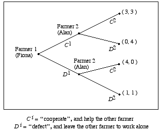

*Figure 1.1a*

This tree is an example of a *game in extensive form.* At each stage $i$, the agent who moves can either choose $C^i$, which corresponds to helping or *cooperating*, or $D^i$, which corresponds to not helping or *defecting*. The relative preferences of the two agents over the various outcomes are reflected by the ordered pairs of *payoffs* each receives at any particular outcome. If, for instance, Fiona chooses $C^i$ and Alan chooses $D^i$, then Fiona’s payoff is 0, her worst payoff, and Alan’s is 4, his best payoff. In a game such as the Figure 1.1.a game, agents are *(Bayesian) rational* if each chooses an act that maximizes her expected payoff, given what she knows.

In the Farmers’ Dilemma game, following the $C^1,C^2$-path is strictly better for both farmers than following the $D^1,D^2$-path. However, Fiona chooses $D^1$, as the result of the following simple argument: “If I were to choose $C^1$, then Alan, who is rational and who knows the payoff structure of the game, would choose $D^2$. I am also rational and know the payoff structure of the game. So I should choose $D^1$.” Since Fiona knows that Alan is rational and knows the game’s payoffs, she concludes that she need only analyze the *reduced* game in the following figure:

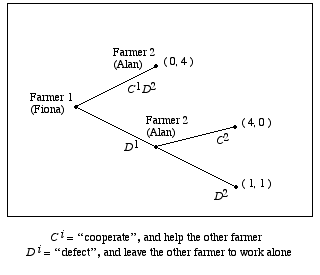

*Figure 1.1b*

In this reduced game, Fiona is certain to gain a strictly higher payoff by choosing $D^1$ than if she chooses $C^1$, so $D^1$ is her unique best choice. Of course, when Fiona chooses $D^1$, Alan, being rational, responds by choosing $D^2$. If Fiona and Alan know: (i) that they are both rational, (ii) that they both know the payoff structure of the game, and (iii) that they both know (i) and (ii), then they both can predict what the other will do at every node of the Figure 1.1.a game, and conclude that they can rule out the $D^1,C^2$-branch of the Figure 1.1.b game and analyze just the reduced game of the following figure:

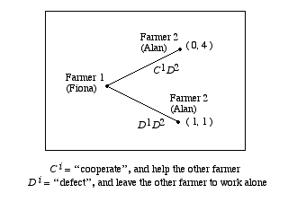

*Figure 1.1c*

On account of this *mutual knowledge*, both know that Fiona will choose $D^1$, and that Alan will respond with $D^2$. Hence, the $D^1,D^2$-outcome results if the Farmers’ Dilemma game is played by agents having this mutual knowledge, though it is suboptimal since both agents would fare better at the $C^1,C^2$-branch.[^note-5] This argument, which in its essentials is Hume’s argument, is an example of a standard technique for solving sequential games known as *backwards induction.*[^note-6] The basic idea behind backwards induction is that the agents engaged in a sequential game deduce how each will act throughout the entire game by ruling out the acts that are not payoff-maximizing for the agents who would move last, then ruling out the acts that are not payoff-maximizing for the agents who would move next-to-last, and so on. Clearly, backwards induction arguments rely crucially upon what, if any, mutual knowledge the agents have regarding their situation, and they typically require the agents to evaluate the truth values of certain subjunctive conditionals, such as “If I (Fiona) were to choose $C^1$, then Alan would choose $D^2$”.

### 1.4 The Centipede

The mutual knowledge assumptions required to construct a backwards induction solution to a game become more complex as the number of stages in the game increases. To see this, consider the sequential *Centipede* game depicted in the following figure:

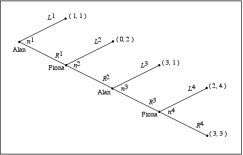

*Figure 1.2*

At each stage i\\), the agent who moves can either choose $R^i$, which in the first three stages gives the other agent an opportunity to move, or $L^i$, which ends the game.

Like the Farmers’ Dilemma, this game is a commitment problem for the agents. If each agent could trust the other to choose $R^i$ at each stage, then they would each expect to receive a payoff of 3. However, Alan chooses $L^1$, leaving each with a payoff of only 1, as the result of the following backwards induction argument: “If node $n_4$ were to be reached, then Fiona, (being rational) would choose $L^4$. I, knowing this, would (being rational) choose $L^3$ if node $n_3$ were to be reached. Fiona, knowing *this*, would (being rational) choose $L^2$ if node $n_2$ were to be reached. Hence, I (being rational) should choose $L^1$.” To carry out this backwards induction argument, Alan implicitly assumes that: (i) he knows that Fiona knows he is rational, and (ii) he knows that Fiona knows that he knows she is rational. Put another way, for Alan to carry out the backwards induction argument, at node $n_1$ he must know what Fiona must know at node $n_2$ to make $L^2$ her best response should $n_2$ be reached. While in the Farmer’s Dilemma Fiona needed only *first-order* knowledge of Alan’s rationality and *second-order* knowledge of Alan’s knowledge of the game to derive the backwards induction solution, in the Figure 1.2 game, for Alan to be able to derive the backwards induction solution, the agents must have *third-order mutual knowledge* of the game and *second-order mutual knowledge* of rationality, and Alan must have *fourth-order* knowledge of this mutual knowledge of the game and *third-order* knowledge of their mutual knowledge of rationality. This argument also involves several counterfactuals, since to construct it the agents must be able to evaluate conditionals of the form, “If node $n_i$ were to be reached, Alan (Fiona) would choose $L^i (R^i)$”, which for $i \gt 1$ are counterfactual, since third-order mutual knowledge of rationality implies that nodes $n_2,$ $n_3$, and $n_4$ are never reached.

The method of backwards induction can be applied to any sequential game of *perfect information*, in which the agents can observe each others’ moves in turn and can recall the entire history of play. However, as the number of potential stages of play increases, the backwards induction argument evidently becomes harder to construct. This raises certain questions: (1) What precisely are the mutual or common knowledge assumptions that are required to justify the backwards induction argument for a particular sequential game? (2) As a sequential game increases in complexity, would we expect the mutual knowledge that is required for backwards induction to start to fail?

### 1.5 The Department Store

> When a man loses his wife in a department store without any prior understanding on where to meet if they get separated, the chances are good that they will find each other. It is likely that each will think of some obvious place to meet, so obvious that each will be sure that it is “obvious” to both of them. One does not simply predict where the other will go, which is wherever the first predicts the second to predict the first to go, and so *ad infinitum.* Not “What would I do if I were she?” but “What would I do if I were she wondering what she would do if she were wondering what I would do if I were she … ?” —Thomas Schelling, *The Strategy of Conflict*

Schelling’s department store problem is an example of a *pure coordination problem*, that is, an interaction problem in which the interests of the agents coincide perfectly. Schelling (1960)[^schelling-1960] and Lewis (1969)[^lewis-1969][^lewis-1969-2], who were the first to make explicit the role common knowledge plays in social coordination, were also among the first to argue that coordination problems can be modeled using the analytic vocabulary of game theory. A very simple example of such a coordination problem is given in the next figure:

|   |   | Robert |   |   |   |
| --- | --- | --- | --- | --- | --- |
|   |   | $s_1$ | $s_2$ | $s_3$ | $s_4$ |
| Liz | $s_1$ | (4,3) | (1,2) | (1,2) | (3,4) |
| $s_3$ | (3,4) | (1,3) | (1,3) | (4,3) |   |
| $s_3$ | (3,4) | (1,3) | (1,3) | (4,3) |   |
| $s_3$ | (3,4) | (1,3) | (1,3) | (4,3) |   |

$s_i =$ search on floor $i$, $1 \leq i \leq 4$

*Figure 1.3*

The matrix of Figure 1.3 is an example of a *game in strategic form.* At each outcome of the game, which corresponds to a cell in the matrix, the row (column) agent receives as payoff the first (second) element of the ordered pair in the corresponding cell. However, in strategic form games, each agent chooses without first being able to observe the choices of any other agent, so that all must choose as if they were choosing simultaneously. The Figure 1.3 game is a game of *pure coordination* (Lewis 1969)[^lewis-1969][^lewis-1969-2], that is, a game in which at each outcome, each agent receives exactly the same payoff. One interpretation of this game is that Schelling’s spouses, Liz and Robert, are searching for each other in the department store with four floors, and they find each other if they go to the same floor. Four outcomes at which the spouses coordinate correspond to the strategy profiles $(s_j, s_j), 1 \le j \le 4$, of the Figure 1.3 game. These four profiles are strict *Nash equilibria* (Nash 1950, 1951)[^nash-1950][^nash-1951] of the game, that is, each agent has a decisive reason to follow her end of one of these strategy profiles provided that the other also follows this profile.[^note-7]

The difficulty the agents face is trying to select an equilibrium to follow. For suppose that Robert hopes to coordinate with Liz on a particular equilibrium of the game, say $(s_2, s_2)$. Robert reasons as follows: “Since there are several strict equilibria we might follow, I should follow my end of $(s_2, s_2)$ if, and only if, I have sufficiently high expectations that Liz will follow her end of $(s_2, s_2)$. But I can only have sufficiently high expectations that Liz will follow $(s_2, s_2 )$ if she has sufficiently high expectations that I will follow $(s_2, s_2)$. For her to have such expectations, Liz must have sufficiently high (second-order) expectations that I have sufficiently high expectations that she will follow $(s_2, s_2)$, for if Liz doesn’t have these (second-order) expectations, then she will believe I don’t have sufficient reason to follow $(s_2, s_2)$ and may therefore deviate from $(s_2, s_2)$ herself. So I need to have sufficiently high (third-order) expectations that Liz has sufficiently high (second-order) expectations that I have sufficiently high expectations that she will follow $(s_2, s_2 )$, which involves her in fourth-order expectations regarding me, which involves me in fifth-order expectations regarding Liz, and so on.” What would suffice for Robert, and Liz, to have decisive reason to follow $(s_2, s_2)$ is that they each *know* that the other *knows* that … that the other will follow $(s_2, s_2)$ for any number of levels of knowledge, which is to say that between Liz and Robert it is common knowledge that they will follow $(s_2, s_2)$. If agents follow a strict equilibrium in a pure coordination game as a consequence of their having common knowledge of the game, their rationality and their intentions to follow this equilibrium, and no other, then the agents are said to be following a *Lewis-convention* (Lewis 1969)[^lewis-1969][^lewis-1969-2].

Lewis’ theory of convention applies to a more general class of games than pure coordination games, but pure coordination games already model a variety of important social interactions. In particular, Lewis models conventions of language as equilibrium points of a pure coordination game. The role common knowledge plays in games of pure coordination sketched above of course raises further questions: (1) Can people ever attain the common knowledge which characterizes a Lewis-convention? (2) Would less stringent epistemic assumptions suffice to justify Nash equilibrium behavior in a coordination problem?

## 2. Alternative Accounts of Common Knowledge

- 2.1 The Hierarchical Account
- 2.2 Lewis’ Account
- 2.3 Aumann’s Account
- 2.4 Barwise’s Account
- 2.5 Gilbert’s Account

Informally, a proposition $A$ is *mutually known* among a set of agents if each agent knows that $A$. Mutual knowledge by itself implies nothing about what, if any, knowledge anyone attributes to anyone else. Suppose each student arrives for a class meeting knowing that the instructor will be late. That the instructor will be late is mutual knowledge, but each student might think only she knows the instructor will be late. However, if one of the students says openly “Peter told me he will be late again,” then the mutually known fact is now *commonly known.* Each student now knows that the instructor will be late, and so on, *ad infinitum.* The agents have common knowledge in the sense articulated informally by Schelling (1960)[^schelling-1960], and more precisely by Lewis (1969)[^lewis-1969][^lewis-1969-2] and Schiffer (1972)[^schiffer-1972]. Schiffer uses the formal vocabulary of epistemic logic (Hintikka 1962)[^hintikka-1962] to state his definition of common knowledge. Schiffer’s general approach was to augment a system of sentential logic with a set of knowledge operators corresponding to a set of agents, and then to define common knowledge as a hierarchy of propositions in the augmented system. Bacharach (1992)[^bacharach-1992] and Bicchieri (1993)[^bicchieri-1993] adopt this approach, and develop logical theories of common knowledge which include soundness and completeness theorems in the style of (Fagin et al. 1995)[^fagin-1995]. One can also develop formal accounts of common knowledge in set-theoretic terms, as it was done in the early Friedell (1969)[^friedell-1969] and in the economic literature after Aumann (1976)[^aumann-1976][^aumann-1976-2]. Such an approach, easily proven to be equivalent to the ones cast in epistemic logic, is taken also in this article.[^note-8]

### 2.1 The Hierarchical Account

Monderer and Samet (1988) and Binmore and Brandenburger (1989) give a particularly elegant set-theoretic definition of common knowledge. I will review this definition here, and then show that it is logically equivalent to the ‘$i$ knows that $j$ knows that $\ldots k$ knows that A’ hierarchy that Lewis (1969)[^lewis-1969][^lewis-1969-2] and Schiffer (1972)[^schiffer-1972] argue characterizes common knowledge.[^note-9]

Some preliminary notions must be stated first. Following C. I. Lewis (1943–1944) and Carnap (1947)[^carnap-1947], propositions are formally subsets of a set $\Omega$ of *state descriptions* or *possible worlds.* One can think of the elements of $\Omega$ as representing Leibniz’s possible worlds or Wittgenstein’s possible states of affairs. Some results in the common knowledge literature presuppose that $\Omega$ is of finite cardinality. If this admittedly unrealistic assumption is needed in any context, this will be explicitly stated in this essay, and otherwise one may assume that $\Omega$ may be either a finite or an infinite set. A distinguished actual world $\omega_{\alpha}$ is an element of $\Omega$. A proposition $A \subseteq \Omega$ obtains (or is true) if the actual world $\omega_{\alpha} \in A$. In general, we say that $A$ *obtains at* a world $\omega \in \Omega$ if $\omega \in A$. What an agent $i$ knows about the possible worlds is stated formally in terms of a *knowledge operator* $\mathbf{K}_i$. Given a proposition $A \subseteq \Omega , \mathbf{K}_i (A)$ denotes a new proposition, corresponding to the set of possible worlds at which agent $i$ knows that A obtains. $\mathbf{K}_i (A)$ is read as ‘$i$ knows (that) $A$ (is the case)’. The knowledge operator $\mathbf{K}_i$ satisfies certain axioms, including:

$$\begin{align} \tag{K1} \mathbf{K}_i (A) &\subseteq A \\ \tag{K2} \Omega &\subseteq \mathbf{K}_i (\Omega) \\ \tag{K3} \mathbf{K}_i(\bigcap_k A_k) &= \bigcap_k \mathbf{K}_i (A_k) \\ \tag{K4} \mathbf{K}_i (A) &\subseteq \mathbf{K}_i\mathbf{K}_i(A) \\ \tag{K5} -\mathbf{K}_i (A) &\subseteq \mathbf{K}_i -\mathbf{K}_{i}(A) \end{align}$$

In words, K1 says that if $i$ knows $A$, then $A$ must be the case. K2 says that $i$ knows that some possible world in $\Omega$ occurs no matter which possible world *ω* occurs. K3[^note-10] says that $i$ knows a conjunction if, and only if, $i$ knows each conjunct. K4 is a *reflection axiom*, sometimes also presented as the *axiom of transparency* (or of *positive introspection*), which says that if $i$ knows $A$, then $i$ knows that she knows $A$. Finally, K5 says that if the agent does *not* know an event, then she knows that she does not know. This axiom is presented as the axiom of *negative introspection*, or as the *axiom of wisdom* (since the agents possess Socratic wisdom, knowing that they do not know.) Note that by K3, if $A \subseteq B$ then $\mathbf{K}_i (A) \subseteq \mathbf{K}_i (B)$, by K1 and K2, $\mathbf{K}_i (\Omega) = \Omega$, and by K1 and K4, $\mathbf{K}_i (A) = \mathbf{K}_i \mathbf{K}_i (A)$. Any system of knowledge satisfying K1–K5 corresponds to the modal system S5, while any system satisfying K1–K4 corresponds to S4 (Kripke 1963). If one drops the K1 axiom and retains the others, the resulting system would give a formal account of what an agent *believes*, but does not necessarily *know*.

A useful notion in the formal analysis of knowledge is that of a *possibility set.* An agent i’s possibility set at a state of the world $\Omega$ is the smallest set of possible worlds that $i$ thinks could be the case if *ω* is the actual world. More precisely,

**Definition 2.1** Agent $i$’s *possibility set* $\mathcal{H}_i (\omega)$ at $\omega \in \Omega$ is defined as

$$\mathcal{H}_i (\omega) \equiv \bigcap \{ E \mid \omega \in \mathbf{K}_i (E) \}$$

The collection of sets

$$\mathcal{H}_i = \bigcup_{\omega \in \Omega} \mathcal{H}_{i}(\omega)$$

is $i$’s *private information system*.

Since in words, $\mathcal{H}_i (\omega)$ is the intersection of all propositions which $i$ knows at $\omega , \mathcal{H}_i (\omega)$ is the smallest proposition in $\Omega$ that $i$ knows at *ω*. Put another way, $\mathcal{H}_i (\omega)$ is the most specific information that $i$ has about the possible world *ω*. The intuition behind assigning agents private information systems is that while an agent $i$ may not be able to perceive or comprehend every last detail of the world in which $i$ lives, $i$ does know certain facts about that world. The elements of $i$’s information system represent what $i$ knows immediately at a possible world. We also have the following:

**Proposition 2.2** $\mathbf{K}_i (A) = \{ \omega \mid \mathcal{H}_i (\omega) \subseteq A \}$

In many formal analyses of knowledge in the literature, possibility sets are taken as primitive and Proposition 2.2 is given as the definition of knowledge. If one adopts this viewpoint, then the axioms K1–K5 follow as consequences of the definition of knowledge. In many applications, the agents’ possibility sets are assumed to *partition*[^note-11] the set, in which case $\mathcal{H}_i$ is called i’s *private information partition*. Notice that if axioms K1–K5 hold, then the possibility sets of each agent always partition the state set, and vice versa.

To illustrate the idea of possibility sets, let us return to the Barbecue Problem described in Example 1.2. Suppose there are three diners: Cathy, Jennifer and Mark. Then there are 8 relevant states of the world, summarized by Table 2.1:

*Table 2.1*

|   | $\omega_1$ | $\omega_2$ | $\omega_3$ | $\omega_4$ | $\omega_5$ | $\omega_6$ | $\omega_7$ | $\omega_8$ |
| --- | --- | --- | --- | --- | --- | --- | --- | --- |
| Cathy | clean | messy | clean | clean | messy | messy | clean | messy |
| Jennifer | clean | clean | messy | clean | messy | clean | messy | messy |
| Mark | clean | clean | clean | messy | clean | messy | messy | messy |

Each diner knows the condition of the other diners’ faces, but not her own. Suppose the cook makes no announcement, after all. Then none of the diners knows the true state of the world whatever $\omega \in \Omega$ the actual world turns out to be, but they do know *a priori* that certain propositions are true at various states of the world. For instance, Cathy’s information system before any announcement is made is depicted in Figure 2.1a:

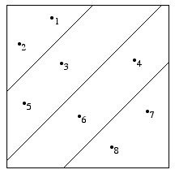

*Figure 2.1a*

In this case, Cathy’s information system is a partition $\mathcal{H}_1$ of $\Omega$ defined by

$$ \mathcal{H}_1 = \{H_{CC}, H_{CM}, H_{MC}, H_{MM}\} $$

where

$$\begin{align} H_{CC} &= \{\omega_1, \omega_2\} \text{ (i.e., Jennifer and Mark are both clean)} \\ H_{CM} &= \{\omega_4, \omega_6\} \text{ (i.e., Jennifer is clean and Mark is messy)} \\ H_{MC} &= \{\omega_3, \omega_5\} \text{ (i.e., Jennifer is messy and Mark is clean)} \\ H_{MM} &= \{\omega_7, \omega_8\} \text{ (i.e., Jennifer and Mark are both messy)} \end{align}$$

Cathy knows immediately which cell $\mathcal{H}_1 (\omega)$ in her partition is the case at any state of the world, but does not know which is the true state at any $\omega \in \Omega$.

If we add in the assumption stated in Example 1.2 that if there is at least one messy diner, then the cook announces the fact, then Cathy’s information partition is depicted by Figure 2.1b:

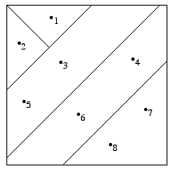

*Figure 2.1b*

In this case, Cathy’s information system is a partition $\mathcal{H}_1$ of $\Omega$ defined by

$$ \mathcal{H}_1 = \{H_{CCC}, H_{MCC}, H_{CM}, H_{MC}, H_{MM}\} $$

where

$$\begin{align} H_{CCC} &= \{\omega_1\} &&\text{ (i.e., Jennifer, Mark, and I are all clean)} \\ H_{MCC} &= \{\omega_2\} &&\text{ (i.e., Jennifer and Mark are clean and I am messy)} \\ H_{CM} &= \{\omega_4, \omega_6\} && \text{ (i.e., Jennifer is clean and Mark is messy)} \\ H_{MC} &= \{\omega_3, \omega_5\} &&\text{ (i.e., Jennifer is messy and Mark is clean)} \\ H_{MM} &= \{\omega_7, \omega_8\} &&\text{ (i.e., Jennifer and Mark are both messy)} \end{align}$$

In this case, Cathy’s information partition is a *refinement* of the partition she has when there is no announcement, for in this case, then Cathy knows *a priori* that if $\omega_1$ is the case there will be no announcement and will know immediately that she is clean, and Cathy knows *a priori* that if $\omega_2$ is the case, then she will know immediately from the cook’s announcement that she is messy.

Similarly, if the cook makes an announcement only if he sees at least two messy diners, Cathy’s possibility set is the one represented in fig. 2.1c:

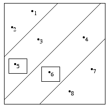

*Figure 2.1c*

Cathy’s information partition is now defined by

$$ \mathcal{H}_1 = \{H_{CC}, H_{CMC}, H_{CCM}, H_{MMC}, H_{MCM}, H_{MM}\} $$

where

$$\begin{align} H_{CC} &= \{\omega_1, \omega_2\} &&\text{ (i.e., Jennifer and Mark are both clean)} \\ H_{CMC} &= \{\omega_3\} &&\text{ (i.e., Mark and I are clean, Jennifer is messy)} \\ H_{CCM} &= \{\omega_4\} &&\text{ (i.e., Jennifer and I are clean, Mark is messy)} \\ H_{CCM} &= \{\omega_5\} &&\text{ (i.e., Jennifer and I are messy, Mark is clean)} \\ H_{CCM} &= \{\omega_6\} &&\text{ (i.e., Mark and I are messy, Jennifer is clean)} \\ H_{MM} &= \{\omega_7, \omega_8\} &&\text{ (i.e., Jennifer and Mark are both messy)} \end{align}$$

In this case, Cathy knows *a priori* that if $\omega_3$ obtains there will be no announcement, and similarly for $\omega_4$. Thus, she will be able to distinguish these states from $\omega_5$ and $\omega_6$, respectively.

As mentioned earlier in this subsection, the assumption that agents’ possibility sets partition the state space depends on the modeler’s choice of specific axioms for the knowledge operators. For example, if we drop axiom K5 (preserving the validity of K1–K4) the agent’s possibility sets need not partition the space set (follow the link for an [example](common-knowledge.example2-1.md). For more details and applications, cf. Samet 1990.) It was conjectured (cf. Geanakoplos 1989)[^geanakoplos-1989] that lack of negative introspection (i.e. systems without K5) would allow to incorporate unforeseen contingencies in the epistemic model, by representing the agents’ *unawareness* of certain events (i.e. the case in which the agent does not know that an event occurs and also does not know that she does not know that.) It was later shown by Dekel et al. (1998) that standard models are not suitable to represent agents’ unawareness. An original non-standard model to represent unawareness is provided in Heifetz *et al*. (2006). For a comprehensive bibliography on modeling unawareness and applications of the notion, cf. the external links at the end on this entry.

We can now define mutual and common knowledge as follows:

**Definition 2.3** Let a set $\Omega$ of possible worlds together with a set of agents $N$ be given.

1. The proposition that $A$ is *(first level* or *first order)* *mutual knowledge for the agents of* N, $\mathbf{K}^{1}_N (A)$, is the set defined by

$$ \mathbf{K}^1_N (A) \equiv \bigcap_{i\in N} \mathbf{K}_i(A). $$

2. The proposition that $A$ is $m$ᵗʰ *level* (or $m$ᵗʰ *order*) *mutual knowledge among the agents of N*, $\mathbf{K}^m_N(A),$ is defined recursively as the set

$$ \mathbf{K}^m_N(A) \equiv \bigcap_{i\in N} \mathbf{K}_i (\mathbf{K}^{m-1}_N(A)). $$

3. The proposition that $A$ is *common knowledge* among the agents of $N, \mathbf{K}^{*}_N (A),$ is defined as the set[^note-12]

$$ \mathbf{K}^*_N (A) \equiv \bigcap_{m=1}^{\infty} \mathbf{K}^m_N(A). $$

Common knowledge of a proposition $E$ implies common knowledge of all that $E$ implies, as is shown in the following:

**Proposition 2.4** If $\omega \in \mathbf{K}^{*}_N (E)$ and $E \subseteq F$, then $\omega \in \mathbf{K}^{*}_N (F)$. [Proof](common-knowledge.proof2-04.md).

Note that $(\mathbf{K}^m_N(E))_{m\ge 1}$ is a decreasing sequence of events, in the sense that $\mathbf{K}^{m+1}_N (E) \subseteq \mathbf{K}^m_N(E)$, for all $m \ge 1$. It is also easy to check that if everyone knows $E$, then $E$ must be true, that is, $\mathbf{K}^1_N (E) \subseteq E$. If $\Omega$ is assumed to be finite, then if $E$ is common knowledge at *ω*, this implies that there must be a finite $m$ such that

$$ \mathbf{K}^m_N(E) = \bigcap_{n=1}^{\infty} \mathbf{K}^n_N(E). $$

The following result relates the set-theoretic definition of common knowledge to the hierarchy of ‘$i$ knows that $j$ knows that … knows $A$’ statements.

**Proposition 2.5** $\omega \in \mathbf{K}^m_N(A)$ iff

(1) For all agents $i_1, i_2 , \ldots ,i_m \in N, \omega \in \mathbf{K}_{i_1}\mathbf{K}_{i_2} \ldots \mathbf{K}_{i_m}(A)$

Hence, $\omega \in \mathbf{K}^*_N (A)$ iff (1) is the case for each $m \ge 1$. [Proof](common-knowledge.proof2-05.md).

The condition that $\omega \in \mathbf{K}_{i_1}\mathbf{K}_{i_2} \ldots \mathbf{K}_{i_m}(A)$ for all $m \ge 1$ and all $i_1, i_2 , \ldots ,i_m \in N$ is Schiffer’s definition of common knowledge, and is often used as the definition of common knowledge in the literature.

### 2.2 Lewis’ Account

Lewis is credited with the idea of characterizing common knowledge as a hierarchy of ‘$i$ knows that $j$ knows that … knows that $A$’ propositions. However, Lewis is aware of the difficulties that such an infinitary definition raises. A first problem is whether it is possible to reduce the infinity inherent in the hierarchical account into a workable finite definition. A second problem is the issue that finite agents cannot entertain the infinite amount of epistemic states which is necessary for common knowledge to obtain. Lewis tackles both problems, but his presentation is informal. Aumann is often credited with presenting the first finitary method of generating the common knowledge hierarchy (Aumann 1976)[^aumann-1976][^aumann-1976-2], even though (Friedell 1969)[^friedell-1969] in fact predates both Aumann’s and Lewis’s work. Recently, Cubitt and Sugden (2003) have argued that Aumann’s and Lewis’ accounts of common knowledge are radically different and irreconcilable.

Although Lewis introduced the technical term ‘common knowledge,’ his analysis is about belief, rather than knowledge. Indeed, Lewis offers his solution to the second problem mentioned above by introducing a distinction between *actual belief* and *reason to believe*. Reasons to believe are interpreted as potential beliefs of agents, so that the infinite hierarchy of epistemic states becomes harmless, consisting in an infinite number of states of potential belief. The solution to the first problem is given by providing a finite set of conditions that, if met, generate the infinite series of reasons to believe. Such conditions taken together represent Lewis’ official definition of common knowledge. Notice that it would be more appropriate to speak of ‘common reason to believe,’ or, at least, of ‘common belief.’ Lewis himself later acknowledges that “[t]hat term [common knowledge] was unfortunate, since there is no assurance that it will be knowledge, or even that it will be true.” Cf. (Lewis 1978, p. 44, n.13)[^lewis-1978] Disregarding the distinction between reasons to believe and actual belief, we follow (Vanderschraaf 1998)[^vanderschraaf-1998] to give the details of a formal account of Lewis’s definition here, and show that Lewis’ analysis does result in the common knowledge hierarchy following from a finite set of axioms. It is however debatable whether a possible worlds approach can properly render the subtleties of Lewis’ characterization. Cubitt and Sugden (2003), for example, abandon the possible worlds framework altogether and propose a different formal interpretation of Lewis in which, among other elements, the distinction between reasons to believe and actual belief is taken into account. An attempt to reconcile the two positions can be found in (Sillari 2005)[^sillari-2005], where Lewis’ characterization is formalized in a richer possible worlds semantic framework where the distinction between reasons to believe and actual believe is represented.

Lewis presents his account of common knowledge on pp. 52–57 of *Convention*. Lewis does not specify what account of knowledge is needed for common knowledge. As it turns out, Lewis’ account is satisfactory for any formal account of knowledge in which the knowledge operators $\mathbf{K}_i, i \in N$, satisfy K1, K2, and K3. A crucial assumption in Lewis’ analysis of common knowledge is that agents know they share the same “rationality, inductive standards and background information” (Lewis 1969, p. 53)[^lewis-1969][^lewis-1969-2] with respect to a state of affairs $A'$, that is, if an agent can draw any conclusion from $A'$, she knows that all can do likewise. This idea is made precise in the following:

**Definition 2.6** Given a set of agents $N$ and a proposition $A' \subseteq \Omega$, the agents of $N$ are *symmetric reasoners with respect to* $A' (or A'$*-symmetric reasoners*) iff, for each $i, j \in N$ and for any proposition $E \subseteq \Omega$, if $\mathbf{K}_i (A') \subseteq \mathbf{K}_i (E)$ and $\mathbf{K}_i (A') \subseteq \mathbf{K}_i\mathbf{K}_j(A')$, then $\mathbf{K}_i (A') \subseteq \mathbf{K}_i\mathbf{K}_j(E)$.[^note-13]

The definiens says that for each agent $i$, if $i$ can infer from $A'$ that $E$ is the case and that everyone knows that $A'$ is the case, then $i$ can also infer that everyone knows that $E$ is the case.

**Definition 2.7** A proposition $E$ is *Lewis-common knowledge at* $\omega \in \Omega$ among the agents of a set $N = \{1, \ldots ,n\}$ iff there is a proposition $A$\* such that $\omega \in A$\*, the agents of $N$ are $A$\*-symmetric reasoners, and for every $i \in N$, $$\begin{align} \tag{L1} &\omega \in \mathbf{K}_i (A^*) \\ \tag{L2} &\mathbf{K}_i(A*) \subseteq \mathbf{K}_i(\bigcap_{j\in N} \mathbf{K}_j(A^*)) \\ \tag{L3} &\mathbf{K}_i (A*) \subseteq \mathbf{K}_i (E) \end{align}$$

$A$\* is a *basis* for the agents’ common knowledge. $\mathbf{L}*_N (E)$ denotes the proposition defined by L1–L3 for a set $N$ of $A$\*-symmetric reasoners, so we can say that $E$ is Lewis-common knowledge for the agents of $N$ iff $\omega \in \mathbf{L}*_N (E)$.

In words, L1 says that $i$ knows $A$\* at *ω*. L2 says that if $i$ knows that $A$\* obtains, then $i$ knows that everyone knows that $A$\* obtains. This axiom is meant to capture the idea that common knowledge is based upon a proposition $A$\* that is *publicly known*, as is the case when agents hear a public announcement. If the agents’ knowledge is represented by partitions, then a typical basis for the agents’ common knowledge would be an element $\mathcal{M}(\omega)$ in the meet[^note-14] of their partitions. L3 says that $i$ can infer from $A$\* that $E$. Lewis’ definition implies the entire common knowledge hierarchy, as is shown in the following result.

**Proposition 2.8** $\mathbf{L}*_N (E) \subseteq \mathbf{K}*_N (E)$, that is, Lewis-common knowledge of $E$ implies common knowledge of $E$. [Proof](common-knowledge.proof2-08.md).

As mentioned above, it has recently come into question whether a formal rendition of Lewis’ definition as the one given above adequately represents all facets of Lewis’ approach. Cubitt and Sugden (2003) argue that it does not, their critique hinging on a feature of Lewis’ analysis that is lost in the possible worlds framework, namely the 3-place relation of *indication* used by Lewis. The definition of indication can be found at pp. 52–53 of *Convention*:

**Definition 2.9** A state of affairs $A$ *indicates* $E$ to agent $i$ $(A \indi E)$ if and only if, if $i$ had reason to believe that $A$ held, $i$ would thereby have reason to believe that $E$

The wording of Lewis’ definition and the use he makes of the indication relation in the definitory clauses for common knowledge, suggest that Lewis is careful to distinguish indication and material implication. Cubitt and Sugden (2003) incorporate such distinction in their formal reconstruction. Paired with their interpretation of “$i$ has reason to believe $x$” as “$x$ is yielded by some logic of reasoning that $i$ endorses,” we have that, if $A \indi x,$ then $i$’s reason to believe $A$ provides $i$ with reason to believe $x$ as well. Given that Lewis does want to endow agents with deductive reasoning, (Cubitt and Sugden 2003)[^cubitt-2003] list the following axioms, claiming that they capture the desired properties of indication. For all agents $i, j,$ with $\mathbf{R}_i A$ standing for “agent $i$ has reason to believe A”, we have

$$\begin{align} \tag{CS1} (\mathbf{R}_i A \wedge A \indi x) &\to \mathbf{R}_i x \\ \tag{CS2} (A \text{ entails } B) &\to A \indi B \\ \tag{CS3} (A \indi x \wedge A \indi y) &\to A \indi (x \wedge y) \\ \tag{CS4} (A \indi B \wedge B \indi x) &\to A \indi x \\ \tag{CS5} ((A \indi \mathbf{R}_j B) \wedge \mathbf{R}_i(B \indj x)) &\to A \indi \mathbf{R}_j x \end{align}$$

The first axioms captures the intuition behind indication. It says that if an agent has reason to believe that $A$ holds, then, if $A$ indicates $x$ to her, she has reason to believe $x$ as well. CS2 says that indication extends material implication. CS3 says that if two propositions $x$ and $y$ are indicated to an agent by a proposition $A$, then $A$ indicates to her also the conjunction of $x$ and $y$. The next axiom states that indication is transitive. CS5 says that if a proposition $A$ indicates to $i$ that agent $j$ has reason to believe $B$, and $i$ has reason to believe that $B$ indicates $x$ to $j$, then $A$ indicates to $i$ also that $j$ has reason to believe $x$.

Armed with these axioms, it is possible to give the following definition.

**Definition 2.10** In any given population $P$ a proposition $A$ is a *reflexive common indicator that x* if and only if, for all $i, j \in P$ and all propositions $x, y,$ the following four conditions hold:

$$\begin{align} \tag{RCI1} &A \to \mathbf{R}_i A \\ \tag{RCI2} &A \indi \mathbf{R}_j A \\ \tag{RCI3} &A \indi x \\ \tag{RCI4} &A \indj y \to \mathbf{R}_i(A \indj y) \end{align}$$

Clauses RCI1–RCI3 above render L1–L3 of definition 2.7 above in the formal language that underlies axioms CS1–CS5; while RCI4 affirms (cf. definition 2.6 above) that agents are symmetric reasoners, i.e. that if a proposition indicates another proposition to a certain agent, then it does so to all agents in the population.

The following proposition shows that RCI1–RCI4 are sufficient conditions for ‘common reason to believe’ to arise:

**Proposition 2.11** If $A$ holds, and if $A$ is a common reflexive indicator in the population $P$ that $x$, then there is common reason to believe in $P$ that $x$. [Proof](common-knowledge.proof2-11.md).

A group of (ideal) *faultless reasoners* who have common reason to believe that $p$, will achieve common belief in $p$.

Is it possible to take formally in account the insights of Lewis’ definition of common knowledge without abandoning the possible world framework? (Sillari 2005)[^sillari-2005] puts forth an attempt to give a positive answer to that question by articulating in a possible world semantics the distinction between actual belief and reason to believe. As in (Cubitt and Sugden 2003)[^cubitt-2003], the basic epistemic operator represents reasons to believe. The idea is then to impose an *awareness structure* over possible worlds, adopting the framework first introduced by Fagin and Halpern (1988). Simply put, an awareness structure associates to each agent, for every possible world, a set of events of which the agent is said to be aware. An agent entertains an actual belief that a certain event occurs if and only if she has reason to believe that the event occurs *and* such event is in her awareness set at the world under consideration. A different avenue to the formalization of Lewis’s account of common knowledge is offered by Paternotte (2011)[^paternotte-2011], where the central notion is probabilistic common belief (see section 5.2 below).

### 2.3 Aumann’s Account

Aumann (1976)[^aumann-1976][^aumann-1976-2] gives a different characterization of common knowledge which gives another simple algorithm for determining what information is commonly known. Aumann’s original account assumes that the each agent’s possibility set forms a private information partition of the space $\Omega$ of possible worlds. Aumann shows that a proposition C is common knowledge if, and only if, C contains a cell of the meet of the agents’ partitions. One way to compute the meet $\mathcal{M}$ of the partitions $\mathcal{H}_i, i \in N$ is to use the idea of “reachability”.

**Definition 2.13** A state $\omega ' \in \Omega$ is *reachable* from $\omega \in \Omega$ iff there exists a sequence

$$\omega =\omega_0, \omega_1, \omega_2 , \ldots ,\omega_m =\omega'$$

such that for each $k \in \{0,1, \ldots ,m-1\}$, there exists an agent $i_k \in N$ such that $\mathcal{H}_{i_{ k} }(\omega_k) = \mathcal{H}_{i_{ k} }(\omega_{k+1})$.

In words, $\omega '$ is reachable from *ω* if there exists a sequence or “chain” of states from *ω* to $\omega '$ such that two consecutive states are in the same cell of some agent’s information partition. To illustrate the idea of reachability, let us return to the modified Barbecue Problem in which Cathy, Jennifer and Mark receive no announcement. Their information partitions are all depicted in Figure 2.1d:

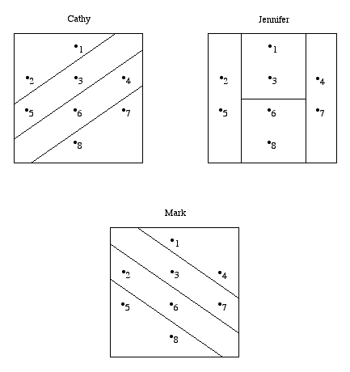

*Figure 2.1d*

One can understand the importance of the notion of reachability in the following way: If $\omega '$ is reachable from *ω*, then if *ω* obtains then some agent can reason that some other agent thinks that $\omega '$ is possible. Looking at Figure 2.1d, if $\omega = \omega_1$ occurs, then Cathy (who knows only that $\{\omega_1, \omega_2\}$ has occurred) knows that Jennifer thinks that $\omega_5$ might have occurred (even though Cathy knows that $\omega_5$ did not occur). So Cathy cannot rule out the possibility that Jennifer thinks that Mark thinks that that $\omega_8$ might have occurred. And Cathy cannot rule out the possibility that Jennifer thinks that Mark thinks that Cathy believes that $\omega_7$ is possible. In this sense, $\omega_7$ is reachable from $\omega_1$. The chain of states which establishes this is $\omega_1, \omega_2, \omega_5, \omega_8, \omega_7$, since $\mathcal{H}_1 (\omega_1) = \mathcal{H}_1 (\omega_2),$ $\mathcal{H}_2 (\omega_2) = \mathcal{H}_2 (\omega_5),$ $\mathcal{H}_3 (\omega_5) = \mathcal{H}_3 (\omega_8),$ and $\mathcal{H}_1 (\omega_8) = \mathcal{H}_1 (\omega_7)$. Note that one can show similarly that in this example any state is reachable from any other state. This example also illustrates the following immediate result:

**Proposition 2.14** $\omega'$ is reachable from *ω* iff there is a sequence $i_1, i_2 , \ldots ,i_m \in N$ such that

$$ \omega' \in \mathcal{H}_{i_m}(\cdots(\mathcal{H}_{i_2}(\mathcal{H}_{i_1}(\omega)))) $$

One can read (1) as: ‘At $\omega , i_1$ thinks that $i_2$ thinks that $\ldots ,i_m$ thinks that $\omega'$ is possible.’

We now have:

**Lemma 2.15** $\omega' \in \mathcal{M}(\omega)$ iff $\omega '$ is reachable from *ω*. [Proof](common-knowledge.proof2-15.md).

and

**Lemma 2.16** $\mathcal{M}(\omega)$ is common knowledge for the agents of $N$ at *ω*. [Proof](common-knowledge.proof2-16.md).

and

**Proposition 2.17** (Aumann 1976)[^aumann-1976][^aumann-1976-2] Let $\mathcal{M}$ be the meet of the agents’ partitions $\mathcal{H}_i$ for each $i \in N$. A proposition $E \subseteq \Omega$ is common knowledge for the agents of $N$ at *ω* iff $\mathcal{M}(\omega) \subseteq E$. (In Aumann (1976)[^aumann-1976][^aumann-1976-2], $E$ is *defined* to be common knowledge at *ω* iff $\mathcal{M}(\omega) \subseteq E$.) [Proof](common-knowledge.proof2-17.md).

If $E = \mathbf{K}^1_N (E)$, then $E$ is a *public event* (Milgrom 1981)[^milgrom-1981] or a *common truism* (Binmore and Brandenburger 1989). Clearly, a common truism is common knowledge whenever it occurs, since in this case $E = \mathbf{K}^1_N (E) = \mathbf{K}^2_N (E) =\ldots$ , so $E = \mathbf{K}^*_N (E)$. The proof of Proposition 2.17 shows that the common truisms are precisely the elements of $\mathcal{M}$ and unions of elements of $\mathcal{M}$, so any commonly known event is the consequence of a common truism.

### 2.4 Barwise’s Account

Barwise (1988)[^barwise-1988] proposes another definition of common knowledge that avoids explicit reference to the hierarchy of ‘$i$ knows that $j$ knows that … knows that $A$’ propositions. Barwise’s analysis builds upon an informal proposal by Harman (1977)[^harman-1977]. Consider the situation of the guest and clumsy waiter in Example 1 when he announces that he was at fault. They are now in a setting where they have heard the waiter’s announcement and know that they are in the setting. Harman adopts the circularity in this characterization of the setting as fundamental, and propses a definition of common knowledge in terms of this circularity. Barwise’s formal analysis gives a precise formulation of Harman’s intuitive analysis of common knowledge as a *fixed point*. Given a function $f, A$ is a fixed point of $f$ if $f(A)=A.$ Now note that

$$\begin{align} \mathbf{K}^1_N (E \cap \bigcap_{m=1}^{\infty} \mathbf{K}^m_N(E)) &= \mathbf{K}^1_N (E) \cap \mathbf{K}^1_N( \bigcap_{m=1}^{\infty} \mathbf{K}^m_N(E)) \\ &= \mathbf{K}^1_N (E) \cap (\bigcap_{m=1}^{\infty} \mathbf{K}^1_N (\mathbf{K}^m_N (E))) \\ &= \mathbf{K}^1_N (E) \cap (\bigcap_{m=1}^{\infty} \mathbf{K}^m_N (E)) \\ &= \bigcap_{m=1}^{\infty} \mathbf{K}^m_N (E) \end{align}$$

So we have established that $\mathbf{K}^{*}_N (E)$ is a fixed point of the function $f_E$ defined by $f_E (X) = \mathbf{K}^{1}_N (E \cap X). f_E$ has other fixed points. For instance, any contradiction $B \cap B^c = \varnothing$ is a fixed point of $f_E$.[^note-15] Note also that if $A \subseteq B$, then $E \cap A \subseteq E \cap B$ and so

$$ f_E (A) = \mathbf{K}^1_N (E \cap A) \subseteq \mathbf{K}^1_N (E \cap B) = f_E(B) $$

that is, $f_E$ is *monotone*. (We saw that $\mathbf{K}^1_N$ is also monotone in the proof of Proposition 2.4.) Barwise’s analysis of common knowledge can be developed using the following result from set theory:

**Proposition** A monotone function $f$ has a unique fixed point $C$ such that if $B$ is a fixed point of $f$, then $B\subseteq C.$ $C$ is the *greatest fixed point of* $f.$

This proposition establishes that $f_E$ has a greatest fixed point, which characterizes common knowledge in Barwise’s account. As Barwise himself observes, the fixed point analysis of common knowledge is closely related to Aumann’s partition account. This is easy to see when one compares the fixed point analysis to the notion of common truisms that Aumann’s account generates. Some authors regard the fixed point analysis as an alternate formulation of Aumann’s analysis. Barwise’s fixed point analysis of common knowledge is favored by those who are especially interested in the applications of common knowledge to problems in logic, while the hierarchical and the partition accounts are favored by those who wish to apply common knowledge in social philosophy and social science. When knowledge operators satisfy the axioms (K1)-(K5), the Barwise account of common knowledge is equivalent to the hierarchical account.

**Proposition 2.18** Let $C^*_N$ be the greatest fixed point of $f_E.$ Then $C^{*}_N (E) = K^*_N (E).$ (In Barwise (1988, 1989)[^barwise-1988][^barwise-1989], $E$ is *defined* to be common knowledge at *ω* iff $\omega \in C^*_N(E).)$ [Proof](common-knowledge.proof2-18.md).

Barwise argues that in fact the fixed point analysis is more flexible and consequently more general than the hierarchical account. This may surprise readers in light of Proposition 2.18, which shows that Barwise’s fixed point definition is *equivalent* to the hierarchical account. Indeed, while Barwise (1988, 1989)[^barwise-1988][^barwise-1989] proves a result showing that the fixed point account implies the hierarchical account and gives examples that satisfy the common knowledge hierarchy but fail to be fixed points, a number of authors who have written after Barwise have given various proofs of the equivalence of the two definitions, as was shown in Proposition 2.18. In fact, as (Heifetz 1999)[^heifetz-1999] shows, the hierarchical and fixed-point accounts are equivalent for all finite levels of iteration, while fixed-point common knowledge implies the conjunction of mutual knowledge up to any transfinite order, but it is never implied by any such conjunction.

### 2.5 Gilbert’s Account

Gilbert (1989, Chapter 3) presents an alternative account of common knowledge, which is meant to be more intuitively plausible than Lewis’ and Aumann’s accounts. Gilbert gives a highly detailed description of the circumstances under which agents have common knowledge.

**Definition 2.19** A set of agents $N$ are in a *common knowledge situation* $\mathcal{S}(A)$ with respect to a proposition $A$ if, and only if, $\omega \in A$ and for each $i \in N$,

**($G_1$)**

$i$ is *epistemically normal*, in the sense that $i$ has normal perceptual organs which are functioning normally and has normal reasoning capacity.[^note-16]

**($G_2$)**

$i$ has the concepts needed to fulfill the other conditions.

**($G_3$)**

$i$ perceives the other agents of $N$.

**($G_4$)**

$i$ perceives that G$_1$ and G$_2$ are the case.

**($G_5$)**

$i$ perceives that the state of affairs described by $A$ is the case.

**($G_6$)**

$i$ perceives that all the agents of $N$ perceive that $A$ is the case.

Gilbert’s definition appears to contain some redundancy, since presumably an agent would not perceive A unless A is the case. Gilbert is evidently trying to give a more explicit account of single agent knowledge than Lewis and Aumann give. For Gilbert, agent $i$ knows that a proposition $E$ is the case if, and only if, $\omega \in E$, that is, $E$ is true, and either $i$ perceives that the state of affairs $E$ describes obtains or $i$ can infer $E$ as a consequence of other propositions $i$ knows, given sufficient inferential capacity.

Like Lewis, Gilbert recognizes that human agents do not in fact have unlimited inferential capacity. To generate the infinite hierarchy of mutual knowledge, Gilbert introduces the device of an agent’s *smooth-reasoner counterpart.* The smooth-reasoner counterpart $i'$ of an agent $i$ is an agent that draws every logical conclusion from every fact that $i$ knows. Gilbert stipulates that $i'$ does not have any of the constraints on time, memory, or reasoning ability that $i$ might have, so $i'$ can literally think through the infinitely many levels of a common knowledge hierarchy.

**Definition 2.20** If a set of agents $N$ are in a common knowledge situation $\mathcal{S}_N (A)$ with respect to $A$, then the corresponding set $N'$ of their smooth-reasoner counterparts is in a *parallel situation* $\mathcal{S}'_{N'}(A)$ if, and only if, for each $i' \in N$,

| ($G'_1$) | $i'$ can perceive anything that the counterpart $i$ can perceive. |
| --- | --- |
| ($G_2'$) | $G_2$–$G_6$ obtain for $i'$ with respect to $A$ and $N'$, same as for the counterpart $i$ with respect to $A$ and $N$. |
| ($G_3'$) | $i'$ perceives that all the agents of $N'$ are smooth-reasoners. |

From this definition we get the following immediate consequence:

**Proposition 2.21** If a set of smooth-reasoner counterparts to a set $N$ of agents are in a situation $\mathcal{S}'_{N'}(A)$ parallel to a common knowledge situation $\mathcal{S}_N (A)$ of $N$, then

for all $m \in \mathbb{N}$ and for any $i_1', \ldots ,i_m', \mathbf{K}_{i_1'}\mathbf{K}_{i_2'} \ldots \mathbf{K}_{i_m'}(A)$.

Consequently, $\mathbf{K}^{m}_{N'}(A)$ for any $m \in \mathbb{N}.$

Gilbert argues that, given $\mathcal{S}'_{N'}(A)$, the smooth-reasoner counterparts of the agents of $N$ actually satisfy a much stronger condition, namely mutual knowledge $\mathbf{K}^{\alpha}_{N'}(A)$ to the level of any ordinal number *α*, finite or infinite. When this stronger condition is satisfied, the proposition $A$ is said to be *open\* to the agents of* $N$. With the concept of open\*-ness, Gilbert gives her definition of common knowledge.

**Definition 2.22** A proposition $E \subseteq \Omega$ is *Gilbert-common knowledge* among the agents of a set $N = \{1, \ldots,n\},$ if and only if,

| ($G_1^*$) | $E$ is open\* to the agents of $N$. |
| --- | --- |
| ($G_2^*$) | For every $i \in N,$ $\mathbf{K}_i(G_1^*).$ |

$\mathbf{G}_N^*(E)$ denotes the proposition defined by $G_1^*$ and $G_2^*$ for a set $N$ of $A^*$-symmetric reasoners, so we can say that $E$ is Lewis-common knowledge for the agents of $N$ iff $\omega \in \mathbf{G}_N^*(E)$.

One might think that an immediate corollary to Gilbert’s definition is that Gilbert-common knowledge implies the hierarchical common knowledge of Proposition 2.5. However, this claim follows only on the assumption that an agent knows all of the propositions that her smooth-reasoner counterpart reasons through. Gilbert does not explicitly endorse this position, although she correctly observes that Lewis and Aumann are committed to something like it.[^note-17] Gilbert maintains that her account of common knowledge expresses our intuitions with respect to common knowledge better than Lewis’ and Aumann’s accounts, since the notion of open\*-ness presumably makes explicit that when a proposition is common knowledge, it is “out in the open”, so to speak.

## 3. Applications of Mutual and Common Knowledge

Readers primarily interested in philosophical applications of common knowledge may want to focus on the No Disagreement Theorem and Convention subsections. Readers interested in applications of common knowledge in game theory may continue with the Strategic Form Games, and Games of Perfect Information subsections.

- 3.1 The “No Disagreement” Theorem
- 3.2 Convention
- 3.3 Strategic Form Games
- 3.4 Games of Perfect Information
- 3.5 Communication Networks

### 3.1 The “No Disagreement” Theorem

Aumann (1976)[^aumann-1976][^aumann-1976-2] originally used his definition of common knowledge to prove a celebrated result that says that in a certain sense, agents cannot “agree to disagree” about their beliefs, formalized as probability distributions, if they start with common prior beliefs. Since agents in a community often hold different opinions and know they do so, one might attribute such differences to the agents’ having different private information. Aumann’s surprising result is that even if agents condition their beliefs on private information, mere common knowledge of their conditioned beliefs and a common prior probability distribution implies that their beliefs cannot be different, after all!

**Proposition 3.1** Let $\Omega$ be a finite set of states of the world. Suppose that

1. Agents $i$ and $j$ have a common prior probability distribution $\mu(\cdot)$ over the events of $\Omega$ such that $\mu(\omega) \gt 0$, for each $\omega \in \Omega$, and
2. It is common knowledge at *ω* that $i$’s posterior probability of event $E$ is $q_i(E)$ and that $j$’s posterior probability of $E$ is $q_j(E)$.

Then $q_i(E) = q_j(E)$.

[Proof](common-knowledge.proof3-01.md). [Note that in the proof of this proposition, and in the sequel, $\mu(\cdot\mid B)$ denotes conditional probability; that is, given $\mu(B)\gt 0, \mu(A\mid B) = \mu(A\cap B)/\mu(B)$.]

In a later article, Aumann (1987)[^aumann-1987] argues that the assumptions that $\Omega$ is finite and that $\mu(\omega) \gt 0$ for each $\omega \in \Omega$ reflect the idea that agents only regard as “really” possible a finite collection of salient worlds to which they assign positive probability, so that one can drop the states with probability 0 from the description of the state space. Aumann also notes that this result implicitly assumes that the agents have common knowledge of their partitions, since a description of each possible world includes a description of the agents’ possibility sets. And of course, this result depends crucially upon (i), which is known as the *common prior assumption* (CPA).

Aumann’s “no disagreement” theorem has been generalized in a number of ways in the literature. Cave 1983 generalizes the argument to 3 agents. Bacharach 1985 extends it to cases in which agents observe each other’s decisions rather than posteriors. Milgrom and Stokey, 1982 use it crucially for their no-trade theorem, applying no disagreement to show that speculative trade is impossible. Geanakoplos and Polemarchakis 1982 generalize the argument to a dynamic setting in which two agents communicate their posterior probabilities back and forth until they reach an agreement – this particular take on the agreement theorem has been characterized in terms of dynamic epistemic logic by Dégremont and Roy, 2009 and applied to cases of epistemic peer disagreement by Sillari 2019. McKelvey and Page 1986 further extend the results of Geanakoplos and Polemarchakis to the case of $n$ individuals. (See also Monderer and Samet 1989 and, for a survey, Geanakoplos 1994.)[^monderer-1989][^geanakoplos-1994][^monderer-1989-2]

However, all of these “no disagreement” results raise the same philosophical puzzle raised by Aumann’s original result: How are we to explain differences in belief? Aumann’s result leaves us with two options: (1) admit that at some level, common knowledge of the agents’ beliefs or how they form their beliefs fails, or (2) deny the CPA. Thus, even if agents do assign precise posterior probabilities to an event, Aumann shows that if they have merely first-order mutual knowledge of the posteriors, they can “agree to disagree”.[^note-18] Another way Aumann’s result might fail is if agents do not have common knowledge that they update their beliefs by Bayesian conditionalization. Then clearly, agents can explain divergent opinions as the result of others having modified their beliefs in the “wrong” way. However, there are cases in which neither explanation will seem convincing and denying the requisite common knowledge seems a rather *ad hoc* move. Why should one think that such failures of common knowledge provide a general explanation for divergent beliefs?

What of the second option, that is, denying the CPA?[^note-19] The main argument put forward in favor of the CPA is that any differences in agents’ probabilities should be the result of their having different information only, that is, there is no reason to think that the different beliefs that agents have regarding the same event are the result of anything other than their having different information. However, one can reply that this argument amounts simply to a restatement of the Harsanyi Doctrine.[^note-20]

### 3.2 Convention

Schelling’s Department Store problem of Example 1.5 is a very simple example in which the agents “solve” their coordination problem appropriately by establishing a *convention.* (see also the entry on convention in this encyclopedia.) Using the vocabulary of game theory, Lewis (1969)[^lewis-1969][^lewis-1969-2] defines a convention as a *strict coordination equilibrium* of a game which agents follow on account of their common knowledge that they all prefer to follow this coordination equilibrium in a recurrent coordination problem. A coordination equilibrium of a game is a strategy combination such that no agent is better off if any agent unilaterally deviates from this combination. As with equilibria in general, a coordination equilibrium is *strict* if any agent who deviates unilaterally from the equilibrium is strictly worse off. The strategic form game of Figure 1.3 summarizes Liz’s and Robert’s situation. The Department Store game has four Nash equilibrium outcomes in pure strategies: $(s_1, s_1),$ $(s_2, s_2),$ $(s_3, s_3)$, and $(s_4, s_4)$.[^note-21] These four equilibria are all strict coordination equilibria. If the agents follow either of these equilibria, then they coordinate successfully. For agents to be following a Lewis-convention in this situation, they must follow one of the game’s coordination equilibria. However, for Lewis to follow a coordination equilibrium is not a sufficient condition for agents to be following a convention. For suppose that Liz and Robert fail to analyze their predicament properly at all, but Liz chooses $s_2$ and Robert chooses $s_2$, so that they coordinate at $(s_2, s_2)$ by sheer luck. Lewis does not count accidental coordination of this sort as a convention.

Suppose next that both agents are Bayesian rational, and that part of what each agent knows is the payoff structure of the Intersection game. If the agents expect each other to follow $(s_2, s_2)$ and they consequently coordinate successfully, are they then following a convention? Not necessarily, contends Lewis in a subtle argument on p. 59 of *Convention.* For while each agent knows the game and that she is rational, still she might not attribute the same knowledge to the other agent. If each agent believes that the other agent will follow her end of the $(s_2, s_2)$ equilibrium mindlessly, then her best response is to follow her end of $(s_2, s_2)$. But in this case the agents coordinated as the result of their each falsely believing that the other acts like an automaton, and Lewis thinks that any proper account of convention must require that agents have *correct* beliefs about one another. In particular, Lewis requires that each agent involved in a convention must have mutual expectations that each is acting with the aim of coordinating with the other. The argument can be carried further on. What if both agents believe that they will follow $(s_2, s_2)$, and believe that each other will do so thinking that the other will choose $s_2$ rationally and not mindlessly? Then, say, Liz would coordinate as the result of her false second-order belief that Robert believes that Liz acts mindlessly. Similarly for third-order beliefs and so on for any higher order of knowledge.

Lewis concludes that a necessary condition for agents to be following a convention is that their preferences to follow the corresponding coordination equilibrium be common knowledge (the issue whether conventions need to be common knowledge has been debated recently, cf. Cubitt and Sugden 2003, Binmore 2008, Sillari 2008, and, for an experimental approach, see Devetag et al. 2013, for a connection to the topic of rule-following, see Sillari 2013)[^binmore-2008][^cubitt-2003][^devetag-2013][^sillari-2008][^sillari-2013]. So on Lewis’ account, a convention for a set of agents is a coordination equilibrium which the agents follow on account of their common knowledge of their rationality, the payoff structure of the relevant game and that each agent follows her part of the equilibrium.

> A regularity $R$ in the behavior of members of a population $P$ when they are agents in a recurrent situation $S$ is a *convention* if and only if it is true that, and it is common knowledge in $P$ that, in any instance of $S$ among the members of $P$,
>
> 1. everyone conforms to $R$;
> 2. everyone expects everyone else to conform to $R$;
> 3. everyone has approximately the same preferences regarding all possible combinations of actions;
> 4. everyone prefers that everyone conform to $R$, on condition that at least all but one conform to R;
> 5. everyone would prefer that everyone conform to $R'$, on condition that at least all but one conform to $R'$,
>
> where $R'$ is some possible regularity in the behavior of members of $P$ in $S$, such that no one in any instance of $S$ among members of $P$ could conform both to $R'$ and to $R$.
> (Lewis 1969, p. 76)[^lewis-1969][^lewis-1969-2][^note-22]

Lewis includes the requirement that there be an alternate coordination equilibrium $R'$ besides the equilibrium $R$ that all follow in order to capture the fundamental intuition that how the agents who follow a convention behave depends crucially upon how they expect the others to behave.

Sugden (1986)[^sugden-1986] and Vanderschraaf (1998)[^vanderschraaf-1998] argue that it is not crucial to the notion of convention that the corresponding equilibrium be a coordination equilibrium. Lewis’ key insight is that a convention is a pattern of mutually beneficial behavior which depends on the agents’ common knowledge that all follow *this* pattern, and no other. Vanderschraaf gives a more general definition of convention as a *strict* equilibrium together with common knowledge that all follow this equilibrium and that all would have followed a different equilibrium had their beliefs about each other been different. An example of this more general kind of convention is given below in the discussion of the Figure 3.1 example.

### 3.3 Strategic Form Games

Lewis formulated the notion of common knowledge as part of his general account of conventions. In the years following the publication of *Convention*, game theorists have recognized that any explanation of a particular pattern of play in a game depends crucially on mutual and common knowledge assumptions. More specifically, *solution concepts* in game theory are both motivated and justified in large part by the mutual or common knowledge the agents in the game have regarding their situation.

To establish the notation that will be used in the discussion that follows, the usual definitions of a game in strategic form, expected utility and agents’ distributions over their opponents’ strategies, are given here:

**Definition 3.2** A *game* *Γ* is an ordered triple $(N, S, \boldsymbol{u})$ consisting of the following elements:

1. A finite set $N = \{1,2, \ldots ,n\}$, called the *set of agents* or *players.*
2. For each agent $k \in N$, there is a finite set $S_k = \{s_{k1},s_{k2}, \ldots ,s_{kn_k}\}$, called the *alternative pure strategies* for agent $k$. The Cartesian product $S = S_1 \times \ldots \times S_n$ is called the *pure strategy set* for the game *Γ*.
3. A map $\boldsymbol{u} : S \rightarrow \Re^n,$ called the *utility* or *payoff function* on the pure strategy set. At each strategy combination $\boldsymbol{s} = (s_{1j_1}, \ldots ,s_{nj_n}) \in S$, agent $k$’s particular payoff or utility is given by the $k$ᵗʰ component of the value of $\boldsymbol{u}$, that is, agent $k$’s utility $u_k$ at $\boldsymbol{s}$ is determined by $$ u_k (\boldsymbol{s}) = I_k (\boldsymbol{u}(s_{1j_1}, \ldots ,s_{nj_n})) $$ where $I_k (\boldsymbol{x})$ projects $\boldsymbol{x} \in \Re^n$ onto its $k$ᵗʰ component.

The subscript ‘$-k$’ indicates the result of removing the $k$ᵗʰ component of an $n$-tuple or an $n$-fold Cartesian product. For instance,

$$ S_{-k} = S_1 \times \ldots \times S_{k-1} \times S_{k+1} \times \ldots \times S_n $$

denotes the pure strategy combinations that agent $k$’s opponents may play.

Now let us formally introduce a system of the agents’ beliefs into this framework. $\Delta_k (S_{-k})$ denotes the set of probability distributions over the measurable space $(S_{-k}, \mathfrak{F}_k)$, where $\mathfrak{F}_k$ denotes the Boolean algebra generated by the strategy combinations $S_{-k}$. Each agent $k$ has a probability distribution $\mu_k \in \Delta_k(S_{-k})$, and this distribution determines the (*Savage*) *expected utilities* for each of $k$’s possible acts:

$$ E(u_k (s_{k j})) = \sum_{A_{-k} \in S_{-k}} u_k (s_{kj}, \boldsymbol{s}_{-k}) \mu_k (\boldsymbol{s}_{-k}),\ j = 1, 2, \ldots ,n_k $$

If $i$ is an opponent of $k$, then $i$’s individual strategy $s_{i j}$ may be characterized as a union of strategy combinations $\bigcup\{\boldsymbol{s}_{-k}\mid s_{ij}\in \boldsymbol{s}_{-k}\} \in \mathfrak{F}_k$, and so $k$’s marginal probability for $i$’s strategy $s_{i j}$ may be calculated as follows:

$$ \mu_k (s_{ij}) = \sum_{\{s_{-k}\mid s_{ij}\in s_{-k}\}} \mu_{k}(s_{-k}) $$

$\mu_k(\cdot \mid A)$ denotes $k$’s conditional probability distribution given a set $A$, and $E(\cdot \mid A)$ denotes $k$’s conditional expectation given $\mu_k(\cdot\mid A).$

Suppose first that the agents have common knowledge of the full payoff structure of the game they are engaged in and that they are all rational, and that no other information is common knowledge. In other words, each agent knows that her opponents are expected utility maximizers, but does not in general know exactly which strategies they will choose or what their probabilities for her acts are. These common knowledge assumptions are the motivational basis for the solution concept for noncooperative games known as *rationalizability*, introduced independently by Bernheim (1984)[^bernheim-1984] and Pearce (1984)[^pearce-1984]. Roughly speaking, a *rationalizable strategy* is any strategy an agent may choose without violating common knowledge of Bayesian rationality. Bernheim and Pearce argue that when only the structure of the game and the agents’ Bayesian rationality are common knowledge, the game should be considered “solved” if every agent plays a rationalizable strategy. For instance, in the “Chicken” game with payoff structure defined by Figure 3.1,

|   |   | Joanna |   |
| --- | --- | --- | --- |
|   |   | $s_1$ | $s_2$ |
| Lizzi | $s_1$ | (3,3) | (2,4) |
| $s_2$ | (4,2) | (0,0) |   |

*Figure 3.1*

if Joanna and Lizzi have common knowledge of all of the payoffs at every strategy combination, and they have common knowledge that both are Bayesian rational, then any of the four pure strategy profiles is rationalizable. For if their beliefs about each other are defined by the probabilities

$$\begin{align} \alpha_1 &= \mu_1 \text{ (Joanna plays } s_1), \text{ and} \\ \alpha_2 &= \mu_2 \text{ (Lizzi plays } s_1) \end{align}$$

then

$$ E(u_i (s_1)) = 3\alpha_i + 2(1 - \alpha_i) = \alpha_i + 2 $$

and

$$ E(u_i (s_2)) = 4\alpha_i + 0(1 - \alpha_i) = 4\alpha_i, \ i = 1, 2 $$

so each agent maximizes her expected utility by playing $s_1$ if $\alpha_i + 2 \ge 4\alpha_i$ or $\alpha_i \le 2/3$ and maximizes her expected utility by playing $s_2$ if $\alpha_i \ge 2/3$. If it so happens that $\alpha_i \gt 2/3$ for both agents, then both conform with Bayesian rationality by playing their respective ends of the strategy combination $(s_2,s_2)$ *given their beliefs*, even though each would want to defect from this strategy combination were she to discover that the other is in fact going to play $s_2$. Note that the game’s pure strategy Nash equilibria, $(s_1, s_2)$ and $(s_2, s_1)$, are rationalizable, since it is rational for Lizzi and Joanna to conform with either equilibrium given appropriate distributions. In general, the set of a game’s rationalizable strategy combinations contains the set of the game’s pure strategy Nash equilibria.[^note-23]

Rationalizability can be defined formally in several ways. A variation of Bernheim’s original (1984) definition is given here.

**Definition 3.3** Given that each agent $k \in N$ has a probability distribution $\mu_k \in \Delta_k(s_{-k})$, the system of beliefs $$ \boldsymbol{\mu} = (\mu_1 , \ldots ,\mu_n) \in \Delta_1 (S_{-1}) \times \cdots \times \Delta_n (S_{-n}) $$

is *Bayes concordant* if and only if,

**(3.i)**

For $i \ne k, \mu_i (s_{kj}) \gt 0 \Rightarrow s_{kj}$ maximizes $k$’s expected utility for some $\sigma_k \in \Delta_k(s_{-k}),$

and (3.i) is common knowledge. A pure strategy combination $\boldsymbol{s} = (s_{1j_1}, \ldots ,s_{nj_n}) \in S$ is *rationalizable* if and only if the agents have a Bayes concordant system **$\mu$** of beliefs and, for each agent $k \in N$,

**(3.ii)**

$E(u_k (s_{kj_k})) \ge E(u_k (s_{ki_k})),$ for $i_k \ne j_k$.[^note-24]

The following result shows that the common knowledge restriction on the distributions in Definition 3.1 formalizes the assumption that the agents have common knowledge of Bayesian rationality.

**Proposition 3.4** In a game *Γ*, common knowledge of Bayesian rationality is satisfied if, and only if, (3.i) is common knowledge. [Proof](common-knowledge.proof3-04.md).

When agents have common knowledge of the game and their Bayesian rationality only, one can predict that they will follow a rationalizable strategy profile. However, rationalizability becomes an unstable solution concept if the agents come to know more about one another. For instance, in the Chicken example above with $\alpha_i \gt 2/3, i = 1, 2$, if either agent were to discover the other agent’s beliefs about her, she would have good reason not to follow the $(s_2,s_2)$ profile and to revise her own beliefs regarding the other agent. If, in the other hand, it so happens that $\alpha_1 = 1$ and $\alpha_2 = 0$, so that the agents maximize expected payoff by following the $(s_2, s_1)$ profile, then should the agents discover their beliefs about each other, they will still follow $(s_2, s_1)$. Indeed, if their beliefs are common knowledge, then one can predict with certainty that they will follow $(s_2,s_1)$. The Nash equilibrium $(s_2,s_1)$ is characterized by the belief distributions defined by $\alpha_1 = 1$ and $\alpha_2 = 0$.

The Nash equilibrium is a special case of *correlated equilibrium concepts*, which are defined in terms of the belief distributions of the agents in a game. In general, a correlated equilibrium-in-beliefs is a system of agents’ probability distributions which remains stable given common knowledge of the game, rationality and the *beliefs themselves*. We will review two alternative correlated equilibrium concepts (Aumann 1974, 1987; Vanderschraaf 1995, 2001)[^aumann-1974][^aumann-1987][^vanderschraaf-1995][^vanderschraaf-2001], and show how each generalizes the Nash equilibrium concept.

**Definition 3.5** Given that each agent $k \in N$ has a probability distribution $\mu_k \in \Delta_k (s_{-k})$, the system of beliefs

$$ \boldsymbol{\mu}^* = (\mu_1^*, \ldots ,\mu_n^* ) \in \Delta_1 (s_{-1}) \times \ldots \times \Delta_n (s_{-n}) $$

is an *endogenous correlated equilibrium* if, and only if,

**(3.iii)**

For $i \ne k, \mu_i^*(s_{kj}) \gt 0 \Rightarrow s_{kj}$ maximizes $k$’s expected utility given $\mu_k^*.$

If $\boldsymbol{\mu}^*$ is an endogenous correlated equilibrium a pure strategy combination $\boldsymbol{s}^* = (s_1^*, \ldots ,s_n^*) \in S$ is an *endogenous correlated equilibrium strategy combination given* $\boldsymbol{\mu}^*$ if, and only if, for each agent $k \in N,$

**(3.iv)**

$E(u_k (s_k^*)) \ge E(u_k (s_{ki}))$ for $s_{ki} \ne s_k^*.$

Hence, the endogenous correlated equilibrium $\boldsymbol{\mu}^*$ restricts the set of strategies that the agents might follow, as do the Bayes concordant beliefs of rationalizability. However, the endogenous correlated equilibrium concept is a proper refinement of rationalizability, because the latter does not presuppose that condition (3.iii) holds with respect to the beliefs one’s opponents actually have. If exactly one pure strategy combination $\boldsymbol{s}^*$ satisfies (3.iv) given $\boldsymbol{\mu}^*$, then $\boldsymbol{\mu}^*$ is a *strict equilibrium*, and in this case one can predict with certainty what the agents will do given common knowledge of the game, rationality and their beliefs. Note that Definition 3.5 says nothing about whether or not the agents regard their opponents’ strategy combinations as probabilistically independent. Also, this definition does not require that the agents’ probabilities are *consistent*, in the sense that agents’ probabilities for a mutual opponent’s acts agree. A simple refinement of the endogenous correlated equilibrium concept characterizes the Nash equilibrium concept.

**Definition 3.6** A system of agents’ beliefs $\boldsymbol{\mu}^*$ is a *Nash equilibrium* if, and only if,

1. condition (3.iii) is satisfied,
2. For each $k \in N, \mu_k^*$ satisfies probabilistic independence, and
3. For each $s_{kj} \in s_k$, if $i, l \ne k$ then $\mu_i^*(s_{kj}) = \mu_l^*(s_{kj})$.

In other words, an endogenous correlated equilibrium is a Nash equilibrium-in-beliefs when each agent regards the moves of his opponents as probabilistically independent and the agents’ probabilities are consistent. Note that in the 2-agent case, conditions (b) and (c) of the Definition 3.6 are always satisfied, so for 2-agent games the endogenous correlated equilibrium concept reduces to the Nash equilibrium concept. Conditions (b) and (c) are traditionally assumed in game theory, but Skyrms (1991)[^skyrms-1991] and Vanderschraaf (1995, 2001)[^vanderschraaf-1995][^vanderschraaf-2001] argue that there may be good reasons to relax these assumptions in games with 3 or more agents.

Brandenburger and Dekel (1988) show that in 2-agent games, if the beliefs of the agents are common knowledge, condition (3.iii) characterizes a Nash equilibrium-in-beliefs. As they note, condition (3.iii) characterizes a Nash equilibrium in beliefs for the $n$-agent case if the probability distributions are consistent and satisfy probabilistic independence. Proposition 3.7 extends Brandenburger and Dekel’s result to the endogenous correlated equilibrium concept by relaxing the consistency and probabilistic independence assumptions.

**Proposition 3.7** Assume that the probabilities

$$ \mu = (\mu_1 ,\ldots ,\mu_n) \in \Delta_1 (s_{-1}) \times \ldots \times \Delta_n (s_{-n}) $$

are common knowledge. Then common knowledge of Bayesian rationality is satisfied if, and only if, $\boldsymbol{\mu}$ is an endogenous correlated equilibrium. [Proof](common-knowledge.proof3-07.md).

In addition, we have:

**Corollary 3.8** (Brandenburger and Dekel, 1988)[^brandenburger-1988] Assume in a 2-agent game that the probabilities

$$ \boldsymbol{\mu} = (\mu_1,\mu_2) \in \Delta_1 (s_{-1}) \times \Delta_2 (s_{-2}) $$

are common knowledge. Then common knowledge of Bayesian rationality is satisfied if, and only if, $\boldsymbol{\mu}$ is a Nash equilibrium.

**Proof.** The endogenous correlated equilibrium concept reduces to the Nash equilibrium concept in the 2-agent case, so the corollary follows by Proposition 3.7.

If $\boldsymbol{\mu}^*$ is a strict equilibrium, then one can predict which pure strategy profile the agents in a game will follow given common knowledge of the game, rationality and $\boldsymbol{\mu}^*.$ But if $\boldsymbol{\mu}^*$ is such that several distinct pure strategy profiles satisfy (3.iv) with respect to $\boldsymbol{\mu}^*$, then one can no longer predict with certainty what the agents will do. For instance, in the Chicken game of Figure 3.1, the belief distributions defined by $\alpha_1 = \alpha_2 = 2/3$ together are a Nash equilibrium-in-beliefs. Given common knowledge of this equilibrium, either pure strategy is a best reply for each agent, in the sense that either pure strategy maximizes expected utility. Indeed, if agents can also adopt randomized or *mixed* strategies at which they follow one of several pure strategies according to the outcome of a chance experiment, then any of the infinitely mixed strategies an agent might adopt in Chicken is a best reply given $\boldsymbol{\mu}^*$.[^note-25] So the endogenous correlated equilibrium concept does not determine the exact outcome of a game in all cases, even if one assumes probabilistic consistency and independence so that the equilibrium is a Nash equilibrium.

Another correlated equilibrium concept formalized by Aumann (1974, 1987)[^aumann-1974][^aumann-1987] does give a determinate prediction of what agents will do in a game given appropriate common knowledge. To illustrate Aumann’s correlated equilibrium concept, let us consider the Figure 3.1 game once more. If Joanna and Lizzi can tie their strategies to their knowledge of the possible worlds in a certain way, they can follow a system of correlated strategies which will yield a payoff vector they both prefer to that of the mixed Nash equilibrium and which is itself an equilibrium. One way they can achieve this is to have their friend Ron play a variation of the familiar shell game by hiding a pea under one of three walnut shells, numbered 1, 2 and 3. Joanna and Lizzi both think that each of the three relevant possible worlds corresponding to $\omega_k = \{$the pea lies under shell $k\}$ is equally likely. Ron then gives Lizzi and Joanna each a private recommendation, based upon the outcome of the game, which defines a system of strategy combinations f as follows

$$\tag{\(\star\)} f(\omega) = \begin{cases} (s_1, s_1) \text{ if } \omega_k = \omega_1 \\ (s_1, s_2) \text{ if } \omega_k = \omega_2 \\ (s_2, s_1) \text{ if } \omega_k = \omega_3 \end{cases} $$

$f$ is a *correlated* strategy system because the agents tie their strategies, by following their recommendations, to the same set of states of the world $\Omega$. $f$ is also a strict *Aumann correlated equilibrium*, for if each agent knows how Ron makes his recommendations, but knows only the recommendation he gives her, either would do strictly worse were she to deviate from her recommendation.[^note-26] Since there are several strict equilibria of Chicken, $f$ corresponds to a convention as defined in Vanderschraaf (1998)[^vanderschraaf-1998]. The overall expected payoff vector of $f$ is (3,3), which lies outside the convex hull of the payoffs for the game’s Nash equilibria and which Pareto-dominates the expected payoff vector (4/3, 4/3), of the mixed Nash equilibrium defined by $\alpha_1 = 2/3$, $i = 1, 2.$[^note-27] The correlated equilibrium f is characterized by the probability distribution of the agents’ play over the strategy profiles, given in Figure 3.3:

|   |   | Joanna |   |
| --- | --- | --- | --- |
|   |   | $s_1$ | $s_2$ |
| Lizzi | $s_1$ | ⅓ | ⅓ |
| $s_2$ | ⅓ | 0 |   |

*Figure 3.3*

Aumann (1987)[^aumann-1987] proves a result relating his correlated equilibrium concept to common knowledge. To review this result, we must give the formal definition of Aumann correlated equilibrium.

**Definition 3.9** Given a game $\Gamma = (N, S, \boldsymbol{u})$ together with a finite set of possible worlds $\Omega$, the vector valued function $f: \Omega \rightarrow S$ is a *correlated n-tuple.* If $f(\omega) = (f_1 (\omega), \ldots ,f_n (\omega))$ denotes the components of $f$ for the agents of $N$, then agent $k$’s *recommended strategy* at *ω* is $f_k (\omega).$ $f$ is an *Aumann correlated equilibrium* iff $$ E(u_k \circ f) \ge E(u_k (f_{-k}, g_k)), $$

for each $k \in N$ and for any function $g_k$ that is a function of $f_i$.

The agents are at Aumann correlated equilibrium if at each possible world $\omega \in \Omega$, no agent will want to deviate from his recommended strategy, given that the others follow their recommended strategies. Hence, Aumann correlated equilibrium uniquely specifies the strategy of each agent, by explicitly introducing a space of possible worlds to which agents can correlate their acts. The deviations $g_i$ are required to be functions of $f_i$, that is, compositions of some other function with $f_i$, because $i$ is informed of $f_i (\omega)$ only, and so can only distinguish between the possible worlds of $\Omega$ that are distinguished by $f_i$. As noted already, the primary difference between Aumann’s notion of correlated equilibrium and the endogenous correlated equilibrium is that in Aumann’s correlated equilibrium, the agents correlate their strategies to some event $\omega \in \Omega$ that is external to the game. One way to view this difference is that agents who correlate their strategies exogenously can calculate their expected utilities conditional on their own strategies.

In Aumann’s model, a description of each possible world *ω* includes descriptions of the following: the game *Γ*, the agent’s private information partitions, and the actions chosen by each agent at *ω*, and each agent’s prior probability distribution $\mu_k(\cdot)$ over $\Omega$. The basic idea is that conditional on *ω*, everyone knows everything that can be the object of uncertainty on the part of any agent, but in general, no agent necessarily knows which world *ω* is the actual world. The agents can use their priors to calculate the probabilities that the various act combinations $\boldsymbol{s} \in S$ are played. If the agents’ priors are such that for all $i, j \in N,$ $\mu_i(\omega) = 0$ iff $\mu_j (\omega) = 0,$ then the agents’ priors are *mutually absolutely continuous*. If the agents’ priors all agree, that is, $\mu_1 (\omega) = \ldots = \mu_n (\omega) = \mu(\omega)$ for each $\omega \in \Omega$, then it is said that the *common prior assumption*, or CPA, is satisfied. If agents are following an Aumann correlated equilibrium $f$ and the CPA is satisfied, then $f$ is an *objective* Aumann correlated equilibrium. An Aumann correlated equilibrium is a Nash equilibrium if the CPA is satisfied and the agents’ distributions satisfy probabilistic independence.[^note-28]

Let $s_i (\omega)$ denote the strategy chosen by agent $i$ at possible world *ω*. Then $s: \Omega \rightarrow S$ defined by $s(\omega) = ( s_1 (\omega),\ldots ,s_n (\omega) )$ is a correlated $n$-tuple. Given that $\mathcal{H}_i$ is a partition of $\Omega$,[^note-29] the function $s_i : \Omega \rightarrow s_i$ defined by $s$ is $\mathcal{H}_i$-*measurable* if for each $\mathcal{H}_{ij} \in \mathcal{H}_{i}, s_i (\omega')$ is constant for each $\omega' \in \mathcal{H}_{ij}.$ $\mathcal{H}_i$-measurability is a formal way of saying that $i$ knows what she will do at each possible world, given her information.

**Definition 3.10** Agent $i$ is *Bayes rational* with respect to $\omega \in \Omega$ (alternatively, ω*-Bayes rational*) iff $s_i$ is $\mathcal{H}_i$-measurable and

$$ E(u_i \circ s \mid \mathcal{H}_i)(\omega) \ge E(u_i (v_i, s_{-i}) \mid \mathcal{H}_i)(\omega) $$

for any $\mathcal{H}_i$-measurable function $v_i : \Omega \rightarrow s_i$.

Note that Aumann’s definition of *ω*-Bayesian rationality implies that $\mu_i (\mathcal{H}_i (\omega)) \gt 0$, so that the conditional expectations are defined. Aumann’s main result, given next, implicitly assumes that $\mu_i (\mathcal{H}_i (\omega)) \gt 0$ for every agent $i \in N$ and every possible world $\omega \in \Omega$. This poses no technical difficulties if the CPA is satisfied, or even if the priors are only mutually absolutely continuous, since if this is the case then one can simply drop any *ω* with zero prior from consideration.

**Proposition 3.11** (Aumann 1987)[^aumann-1987] If each agent $i \in N$ is *ω*-Bayes rational at each possible world $\omega \in \Omega$, then the agents are following an Aumann correlated equilibrium. If the CPA is satisfied, then the correlated equilibrium is objective. [Proof](common-knowledge.proof3-11.md).

Part of the uncertainty the agents might have about their situation is whether or not all agents are rational. But if it is assumed that all agents are *ω*-Bayesian rational at each $\omega \in \Omega$, then a description of this fact forms part of the description of each possible *ω* and thus lies in the meet of the agents’ partitions. As noted already, descriptions of the agents’ priors, their partitions and the game also form part of the description of each possible world, so propositions corresponding to these facts also lie in the meet of the agents’ partitions. So another way of stating Aumann’s main result is as follows: *Common knowledge of* *ω*-*Bayesian rationality at each possible world implies that the agents follow an Aumann correlated equilibrium*.

Propositions 3.7 and 3.11 are powerful results. They say that common knowledge of rationality and of agents beliefs about each other, quantified as their probability distributions over the strategy profiles they might follow, implies that the agents’ beliefs characterize an equilibrium of the game. Then if the agents’ beliefs are unconditional, Proposition 3.7 says that the agents are rational to follow a strategy profile consistent with the corresponding endogenous correlated equilibrium. If their beliefs are conditional on their private information partitions, then Proposition 3.11 says they are rational to follow the strategies the corresponding Aumann correlated equilibrium recommends. However, we must not overestimate the importance of these results, for they say nothing about the *origins* of the common knowledge of rationality and beliefs. For instance, in the Chicken game of Figure 3.1, we considered an example of a correlated equilibrium in which it was *assumed* that Lizzi and Joanna had common knowledge of the system of recommended strategies defined by $(\star).$ Given this common knowledge, Joanna and Lizzi indeed have decisive reason to follow the Aumann correlated equilibrium f. But where did this common knowledge come from? How, in general, do agents come to have the common knowledge which justifies their conforming to an equilibrium? Philosophers and social scientists have made only limited progress in addressing this question.

### 3.4 Games of Perfect Information

In extensive form games, the agents move in sequence. At each stage, the agent who is to move must base her decisions upon what she knows about the preceding moves. This part of the agent’s knowledge is characterized by an *information set*, which is the set of alternative moves that an agent knows her predecessor might have chosen. For instance, consider the extensive form game of Figure 3.4:

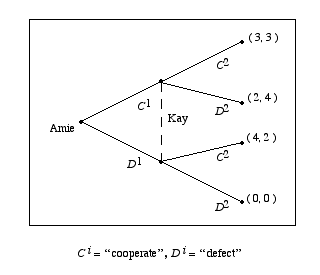

*Figure 3.4*

When Joanna moves she is at her information set $I^{22} = \{C^1, D^1\},$ that is, she moves knowing that Lizzi might have chosen either $C^1$ or $D^1$, so this game is an extensive form representation of the Chicken game of Figure 3.1.

In a game of perfect information, each information set consists of a single node in the game tree, since by definition at each state the agent who is to move knows exactly how her predecessors have moved. In Example 1.4 it was noted that the method of backwards induction can be applied to any game of perfect information.[^note-30] The backwards induction solution is the unique Nash equilibrium of a game of perfect information. The following result gives sufficient conditions to justify backwards induction play in a game of perfect information:

**Proposition 3.12** (Bicchieri 1993)[^bicchieri-1993] In an extensive form game of perfect information, the agents follow the backwards induction solution if the following conditions are satisfied for each agent $i$ at each information set $I^{ik}$:

1. $i$ is rational, $i$ knows this and $i$ knows the game, and
2. At any information set $I^{jk + 1}$ that immediately follows $I^{ik}, i$ knows at $I^{ik}$ what $j$ knows at $I^{jk + 1}$.

[Proof](common-knowledge.proof3-12.md).

Proposition 3.12 says that far less than common knowledge of the game and of rationality suffices for the backwards induction solution to obtain in a game of perfect information. All that is needed is for each agent at each of her information sets to be rational, to know the game and to know what the next agent to move knows! For instance, in the Figure 1.2 game, if $R_1 (R_2)$ stands for “Alan (Fiona) is rational” and $\mathbf{K}_i (\Gamma)$ stands for “$i$ knows the game *Γ*”, then the backwards induction solution is implied by the following:

1. At $I^{24}, R_2$ and $\mathbf{K}_2 (\Gamma)$.
2. At $I^{13}, R_1, \mathbf{K}_1 (\Gamma), \mathbf{K}_1 (R_2)$, and $\mathbf{K}_1\mathbf{K}_2 (\Gamma)$.
3. At $I^{22}, \mathbf{K}_2 (R_1), \mathbf{K}_2\mathbf{K}_1 (R_2)$, and $\mathbf{K}_2\mathbf{K}_1\mathbf{K}_2 (\Gamma)$.
4. At $I ^{11}, \mathbf{K}_1\mathbf{K}_2 (R_1), \mathbf{K}_1\mathbf{K}_2\mathbf{K}_1 (R_2)$, and $\mathbf{K}_1\mathbf{K}_2\mathbf{K}_1\mathbf{K}_2 (\Gamma)$.[^note-31]

One might think that a corollary to Proposition 3.11 is that in a game of perfect information, common knowledge of the game and of rationality implies the backwards induction solution. This is the *classical argument* for the backwards induction solution. Many game theorists continue to accept the classical argument, but in recent years, the argument has come under strong challenge, led by the work of Reny (1988, 1992)[^reny-1988][^reny-1992], Binmore (1987)[^binmore-1987] and Bicchieri (1989, 1993)[^bicchieri-1989][^bicchieri-1993]. The basic idea underlying their criticisms of backwards induction can be illustrated with the Figure 1.2 game. According to the classical argument, if Alan and Fiona have common knowledge of rationality and the game, then each will predict that the other will follow her end of the backwards induction solution, to which his end of the backwards induction solution is his unique best response. However, what if Fiona reconsiders what to do if she finds herself at the information set $I^{22}$? If the information set $I^{22}$ is reached, then Alan has of course not followed the backwards induction solution. If we assume that at $I^{22}$, Fiona knows only what is stated in (iii), then she can explain her being at $I^{22}$ as a failure of either $\mathbf{K}_1\mathbf{K}_2\mathbf{K}_1 (R_2)$ or $\mathbf{K}_1\mathbf{K}_2\mathbf{K}_1\mathbf{K}_2 (\Gamma)$ at $I^{11}$. In this case, Fiona’s thinking that either $\neg\mathbf{K}_1\mathbf{K}_2\mathbf{K}_1 (R_2)$ or $\neg\mathbf{K}_1\mathbf{K}_2\mathbf{K}_1\mathbf{K}_2(\Gamma)$ at $I^{11}$ is compatible with what Alan in fact does know at $I^{11}$, so Fiona should not necessarily be surprised to find herself at $I^{22}$, and given that what she knows there is characterized by (iii), following the backwards induction solution is her best strategy. But if rationality and the game are common knowledge, or even if Fiona and Alan both have just have mutual knowledge of the statements characterized by (iii) and (iv), then at $I^{22}$, Fiona knows that $\mathbf{K}_1\mathbf{K}_2\mathbf{K}_1 (R_2)$ or $\mathbf{K}_1\mathbf{K}_2\mathbf{K}_1\mathbf{K}_2 (\Gamma)$ at $I^{11}$. Hence given this much mutual knowledge, Fiona no longer can explain why Alan has deviated from the backwards induction solution, since this deviation contradicts part of what is their mutual knowledge. So if she finds herself at $I^{22}$, Fiona does not necessarily have good reason to think that Alan will follow the backwards induction solution of the subgame beginning at $I^{22}$, and hence she might not have good reason to follow the backwards induction solution, either. Bicchieri (1993)[^bicchieri-1993], who along with Binmore (1987)[^binmore-1987] and Reny (1988, 1992)[^reny-1988][^reny-1992] extends this argument to games of perfect information with arbitrary length, draws a startling conclusion: If agents have strictly too few or *strictly too many* levels of mutual knowledge of rationality and the game relative to the number of potential moves, one cannot predict that they will follow the backwards induction solution. This would undermine the central role backwards induction has played in the analysis of extensive form games. For why should the number of levels of mutual knowledge the agents have depend upon the length of the game?

The classical argument for backwards induction implicitly assumes that at each stage of the game, the agents discount the preceding moves as strategically irrelevant. Defenders of the classical argument can argue that this assumption makes sense, since by definition at any agents’ decision node, the previous moves that led to this node are now fixed. Critics of the classical argument question this assumption, contending that when reasoning about how to move at any of his information sets, *including those not on the backwards induction equilibrium path*, part of what an agent must consider is what conditions might have led to his being at that information set. In other words, agents should incorporate reasoning about the reasoning of the previous movers, or *forward induction* reasoning, into their deliberations over how to move at a given information set. Binmore (1987)[^binmore-1987] and Bicchieri (1993)[^bicchieri-1993] contend that a backwards induction solution to a game should be consistent with the solution a corresponding forward induction argument recommends. As we have seen, given common knowledge of the game and of rationality, forward induction reasoning can lead the agents to an apparent contradiction: The classical argument for backwards induction is predicated on what agents predict they would do at nodes in the tree that are never reached. They make these predictions based upon their common knowledge of the game and of rationality. But forward induction reasoning seems to imply that if any off-equilibrium node had been reached, common knowledge of rationality and the game must have failed, so how could the agents have predicted what would happen at these nodes?

### 3.5 Communication Networks

Situations in which a member of a population $P$ is willing to engage in a certain course of action provided that a large enough portion of $P$ engages in some appropriate behavior are typical problems of *collective action*. Consider the case of an agent who is debating whether to join a revolt. Her decision to join or not to join will depend on the number of other agents whom she expects to join the revolt. If such a number is too low, she will prefer not to revolt, while if the number is sufficiently large, she will prefer to revolt. Michael Chwe proposes a model where such a situation is modeled game-theoretically. Players’ knowledge about other players’ intentions depends on a *social network* in which players are located. The individual ‘thresholds’ for each player (the number of other agents that are needed for that specific player to revolt) are only known by the immediate neighbors in the network. Besides the intrinsic value of the results obtained by Chwe’s analysis regarding the subject of collective action, his model also provides insights about both the relation between social networks and common knowledge and about the role of common knowledge in collective action. For example, in some situations, first-order knowledge of other agents’ personal thresholds is not sufficient to motivate an agent to take action, whereas higher-order knowledge or, in the limit, common knowledge is.

We present Chwe’s model following (Chwe 1999)[^chwe-1999] and (Chwe 2000)[^chwe-2000]. Suppose there is a group $P$ of $n$ people, and each agent has two strategies: $r$ (revolt, that is participating in the collective action) and $s$ (stay home and not participate). Each agent has her own individual *threshold* $\theta \in \{1, 2,\ldots, n+1\}$ and she prefers $r$ over $s$ if and only if the total number of players who revolt is greater than or equal to her threshold. An agent with threshold 1 always revolts; an agent with threshold 2 revolts only if another agent does; an agent with threshold $n$ revolts only if all agents do; an agent with threshold $n+1$ never revolts, etc. The agents are located in a social network, represented by a binary relation $\rightarrow$ over $P$. The intended meaning of $i \rightarrow j$ is that agent $i$ ‘talks’ to agent $j$, that is to say, agent $i$ *knows* the threshold of agent $j.$ If we define $B(i)$ to be the set $\{j \in P : j \rightarrow i\},$ we can interpret $B(i)$ as $i$’s ‘neighborhood’ and say that, in general, $i$ knows the thresholds of all agents in her neighborhood. A further assumption is that, for all $j,k \in B(i),$ $i$ knows whether $j \rightarrow k$ or not, that is, every agent knows whether her neighbors are communicating with each other. The relation $\rightarrow$ is taken to be reflexive (one knows her own threshold).

Players’ knowledge is represented as usual in a possible worlds framework. Consider for example the case in which there are two agents, both with one of thresholds 1, 2 or 3. There are nine possible worlds represented by ordered pairs of numbers, representing the first and second player’s individual thresholds respectively: 11, 12, 13,…, 32, 33. If the players do not communicate, each knows her own threshold only. Player 1’s information partition reflects her ignorance about player’s 2 threshold and it consists of the sets $\{11, 12, 13\},$ $\{21, 22, 23\},$ $\{31, 32, 33\};$ whereas, similarly, player 2’s partition consists of the sets $\{11, 21, 31\},$ $\{12, 22, 32\},$ $\{13, 23, 33\}.$ If player 1’s threshold is 1, she revolts no matter what player 2’s threshold is. Hence, player 1 revolts in $\{11, 12, 13\}$. If player 1’s threshold is 3, she never revolts. Hence, she plays $s$ in $\{31, 32, 33\}$. If her threshold is 2, she revolts only if the other player revolts as well. Since in this example we are assuming that there is no communication between the agents, player 1 cannot be sure of player’s 2 action, and chooses the non-risky $s$ in $\{21, 22, 23\}$ as well. Similarly, player 2 plays $r$ in $\{11, 21, 31\}$ and $s$ otherwise. Consider now the case in which $1 \rightarrow 2$ and $2 \rightarrow 1$. Both players have now the finest information partitions. Thresholds of 1 and 3 yield $r$ and $s$, respectively, for both players again. However, in player 1’s cells $\{21\}$ and $\{22\}$, she knows that player 2 will revolt, and, having threshold 2, she revolts as well. Similarly for player 2 in his cells $\{12\}$ and $\{22\}$. Note, that the case in which both players have threshold 2, yields both the equilibrium in which both players revolt and the equilibrium in which each player stays home. It is assumed that in the case of multiple equilibria, the one which results in the most revolt will obtain.

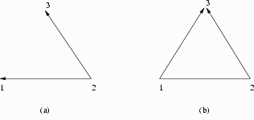

*Figure 3.5*

The analysis of the example above applies to general networks with $n$ agents. Consider for example the three person network $1 \rightarrow 2, 2 \rightarrow 1, 2 \rightarrow 3$, represented in figure 3.5a (notice that symmetric links are represented by a line without arrowheads) and assume that each player has threshold 2. The network between players 1 and 2 is the same as the one above, hence if they have threshold 2, they both revolt regardless of the threshold of player 3. Player 3, on the other hand, knows her own threshold and player 2’s. Hence, if they all have threshold 2, she cannot distinguish between the possibilities in the set $\{122, 222, 322, 422\}$. At 422, in particular, neither player 1 nor player 2 revolt, hence player 3 cannot take the risk and does not revolt, *even if*, in fact, she has a neighbor who revolts. Adding the link $1 \rightarrow 3$ to the network (cf. figure 3.5b) we provide player 3 with knowledge about player 1’s action, hence in this case, if they all have threshold 2, they all revolt. Notice that if we break the link between players 1 and 2 (so that the network is $1 \rightarrow 3$ and $2 \rightarrow 3)$, player 3 knows that 1 and 2 cannot communicate and hence do not revolt at 222, therefore she chooses $s$ as well. Knowledge of what other players know about other players is crucial.

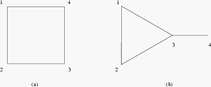

*Figure 3.6*

The next example reveals that in some cases not even first-order knowledge is sufficient to trigger action, and higher levels of knowledge are necessary. Consider four players, each with threshold 3, in the two different networks represented in figure 3.6 (‘square’, in figure 3.6a, and ‘kite’, in figure 3.6b.) In the *square* network, player 1 knows that both 2 and 4 have threshold 3. However, she does not know about player 3’s threshold. If player 3 has threshold 5, then player 2 will never revolt, since he does not know about player 4’s threshold and it is then possible for him that player 4 has threshold 5 as well. Player 1’s uncertainty about player 3 together with player 1’s knowledge of player 2’s uncertainty about player 4 force her not to revolt, although she has threshold 3 and two neighbors with threshold 3 as well. Similar reasoning applies to all other players, hence in the square no one revolts. Consider now the *kite* network. Player 4 ignores player 1’s and player 2’s thresholds, hence he does not revolt. However, player 1 knows that players 2 and 3 have threshold 3, that they know that they do, and that they know that player 1 knows that they do. This is enough to trigger action $r$ for the three of them, and indeed if players 1, 2 and 3 all revolt in all states in $\{3331, 3332, 3333, 3334, 3335\}$, this is an equilibrium since in all states at least three people revolt each with threshold three.

The difference between the square and the kite networks is that, although in the square enough agents are willing to revolt for a revolt to actually take place, and they all individually know this, no agent knows that others know it. In the kite, on the other hand, agents in the triangle not only know that there are three agents with threshold 3, but they also know that they all know it, know that they all know that they all know it, and so on. There is common knowledge of such fact among them. It is interesting to notice that in Chwe’s model, common knowledge obtains without there been a *publicly known* fact (cf. section 2.2). The proposition “players 1, 2 and 3 all have threshold 3” (semantically: the event $\{3331, 3332, 3333, 3334, 3335\})$ is known by players 1, 2 and 3 because of the network structure, and becomes common knowledge because the network structure is known by the players. To be sure, the network structure is not just simply known, but it is actually commonly known by the players. Player 1, for example, does not only know that players 2 and 3 communicate with each other. She also knows that players 2 and 3 know that she knows that they communicate with each other, and so on.

In *complete* networks (networks in which all players communicate with everyone else, as within the triangle in the kite network) the information partitions of the players coincide, and they are the finest partitions of the set of possible worlds. Hence, if players have sufficiently low thresholds, such fact is commonly known and there is an equilibrium in which all players revolt.

**Definition 3.13** We say that $\rightarrow$ is a *sufficient network* if there is an equilibrium such that all players choose to revolt.

For a game in which all players have sufficiently low thresholds, the complete network is clearly sufficient. Is the complete network necessary to obtain an equilibrium in which all players revolt? It turns out that it is not. A crucial role is played by structures of the same kind as the ‘triangle’ group in the kite network, called *cliques*. In such structures, ‘local’ common knowledge (that is, limited to the players part of the structure) arises naturally. In a complete network (that is, a network in which there is sufficient but not superfluous communication for it to fully revolt) in which cliques cover the entire population, if one clique speaks to another then every member of that clique speaks to every member of the other clique. Moreover, for every two cliques such that one is talking to the other, there exists a ‘chain’ of cliques with a starting element. In other words, every pair of cliques in the relation are part of a chain (of length at least 2) with a starting element (a *leading* clique.) Revolt propagates in the network moving from ‘leading adopters’ to ‘followers’, according to the *social role hierarchy* defined by the cliques and their relation. Consider the following example, in which cliques are represented by circles and numbers represent the thresholds of individual players:

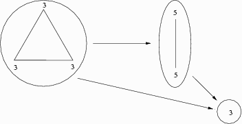

*Figure 3.7*

Here the threshold 3 clique is the leading clique, igniting revolt in the threshold 5 follower clique. In turn, the clique of a single threshold 3 element follows. Notice that although she does not need to know that the leading clique actually revolts to be willing to revolt, that information is needed to ensure that the threshold 5 clique does revolt, and hence that it is safe for her to join the revolt. While in each clique information about thresholds and hence willingness to revolt is common knowledge, in a chain of cliques information is ‘linear’; each clique knows about the clique of which it is a follower, but does not know about earlier cliques.

Analyzing Chwe’s models for collective action under the respect of weak versus strong links (cf. both Chwe 1999 and Chwe 2000)[^chwe-1999][^chwe-2000] provides further insights about the interaction between communication networks and common knowledge. A strong link, roughly speaking, joins close friends, whereas a weak link joins acquaintances. Strong links tend to increase more slowly than weak ones, since people have common close friends more often than they share acquaintances. In terms of spreading information and connecting society, then, weak links do a better job than strong links, since they traverse society more quickly and have therefore larger reach. What role do strong and weak links play in collective action? In Chwe’s dynamic analysis, strong links fare better when thresholds are low, whereas weak links are better when players’ thresholds are higher. Intuitively, one sees that strong links tend to form small cliques right away (because of the symmetry intrinsic in them: my friends’ friends tend to be my friends as well); common knowledge arises quickly at the local level and, if thresholds are low, there is a better chance that a group tied by a strong link becomes a leading clique initiating revolt. If, on the other hand, thresholds are high, local common knowledge in small cliques is fruitless, and weak links, reaching further distances more quickly, speed up communication and building of the large cliques needed to sparkle collective action. Such considerations shed some light on the relation between social networks and common knowledge. While it is true that knowledge spreads faster in networks in which weak links predominate, higher-order knowledge (and, hence, common knowledge) tends to arise more slowly in this kind of networks. Networks with a larger number of strong links, on the other hand, facilitate the formation of common knowledge at the local level.

## 4. Is Common Knowledge Attainable?

Lewis formulated an account of common knowledge which generates the hierarchy of ‘$i$ knows that $j$ knows that … $k$ knows that $A$’ propositions in order to ensure that in his account of convention, agents have correct beliefs about each other. But since human agents obviously cannot reason their way through such an infinite hierarchy, it is natural to wonder whether any group of people can have full common knowledge of any proposition. More broadly, the analyses of common knowledge reviewed in §3 would be of little worth to social scientists and philosophers if this common knowledge lies beyond the reach of human agents.

Fortunately for Lewis’ program, there are strong arguments that common knowledge is indeed attainable. Lewis (1969)[^lewis-1969][^lewis-1969-2] argues that the common knowledge hierarchy should be viewed as a chain of implications, and not as steps in anyone’s actual reasoning. He gives informal arguments that the common knowledge hierarchy is generated from a finite set of axioms. We saw in §2 that it is possible to formulate Lewis’ axioms precisely and to derive the common knowledge hierarchy from these axioms and a *public event* functioning as a basis for common knowledge. Again, the basic idea behind Lewis’ argument is that for a set of agents, if a proposition $A$ is publicly known among them and each agent knows that everyone can draw the same conclusion $p$ from $A$ that she can, then $p$ is common knowledge. These conditions are obviously context dependent, just as an individual’s knowing or not knowing a proposition is context dependent. Yet there are many cases where it is natural to assume that a public event generates common knowledge, because it is properly broadcast, agents in the group are in ideal conditions to perceive it, the inference from the public event to the object of common knowledge is immediate, etc. However, common knowledge could fail if some of the people failed to perceive the public event, or if some of them believed that some of the others could not understand the announcement, or hear it, or could not draw the necessary inferences, and so on.

In fact, skeptical doubt about the attainability of common knowledge is certainly possible. A strong skeptical argument has been recently put forth by Lederman (2018b)[^lederman-2018b]. Lederman builds an argument meant to undermine the possibility of deriving the common knowledge hierarchy, as done in §2, on the basis of a public event or, as Lederman calls it, *public information*. The principle that Lederman targets is what he calls *ideal common knowledge* (or belief), that is: If $p$ is public information in a group $G$ then $p$ is common knowledge in $G$, provided the agents in $G$ are ideal reasoners. The argument rests on the privacy and interpersonal incomparability of mental states among agents, and although it is offered in terms of perceptual knowledge, its scope goes beyond perception to question the possibility of common knowledge tout court.

Lederman (2018b)[^lederman-2018b] uses the following scenario: Two contestants, Alice and Bob, observe the height of the mast of a toy sailboat (100 cm) that is subsequently replaced with a randomly selected sailboat whose mast may be more or less tall than 100 cm. As a matter of fact, the mast of the selected boat is 300 cm tall. It is therefore public information that the mast is taller than 100 cm. The *ideal common knowledge* principle above, along with assumptions about Alice and Bob’s visual systems and their publicity, would entail that Alice and Bob have common knowledge that the mast is taller than 100 cm, and yet Lederman’s argument shows that they do not. The main idea is that there is some degree of approximation in how humans perceive, among other things, heights. Thus, for Alice it is epistemically compatible with the mast looking 300 cm tall to her, that the mast looks somewhat shorter than 300 cm to Bob, say 299 cm. Also, Alice knows that if the mast looks 299 cm tall to Bob, then it is epistemically compatible for him that the mast looks 298 cm tall to Alice. Also, Bob knows that Alice knows that if the mast looks 298 cm tall to Alice, then it is epistemically compatible for her that the mast looks 297 cm tall to Bob. The reasoning can be repeated until there it is epistemically compatible for Alice and Bob that the mast is not taller than 100 cm, against the intuition that they have common knowledge that the mast is over 100 cm tall!

Lederman (2018b)[^lederman-2018b] generalizes the argument to arbitrary cases and sources of public information, to conclude that people never achieve common knowledge or belief. In his view, the unattainability of common knowledge is not a concern in terms of a possible loss of explanatory power for social behavior. While common knowledge and public information from which it proceeds have long been considered crucial for coordinating behavior, Lederman claims that in fact coordination requires neither (see the discussion of Lederman 2018a in the next section.)[^lederman-2018a] Against Lederman, Immerman (2021)[^immerman-2021] argues that the skeptical argument sketched here fails in a large set of circumstances, and hence fails to prove the unattainability of common knowledge. The key idea in Immerman’s attempt to refute Lederman’s argument is that there are many perceptual values that agents will not entertain to begin with, as if, in the original sailboat example, they knew that all masts within 100 and 300 cm tall had been stolen. According to Immerman, cases of such “knowledge of gaps” are not at all uncommon and their availability prevents Lederman’s argument to go through.

Even if one were to reject Lederman’s skeptical argument (be it by agreeing with Immerman’s argument above, or with the argument by Thomason (2021)[^thomason-2021] addressed in the next section, or otherwise), care must be taken in ascribing common knowledge to a group of human agents. Common knowledge is a phenomenon highly sensitive to the agents’ circumstances. The following section gives an example that shows that in order for $A$ to be a common truism for a set of agents, they ordinarily must perceive an event which implies $A$ *simultaneously* and *publicly.*

## 5. Coordination and Common $p$-Belief

In certain contexts, agents might not be able to achieve common knowledge. The skeptical argument put forth by Lederman (2018b)[^lederman-2018b], indeed, rests on and generalizes related arguments about the attainability of common knowledge that were made in theoretical computer science in relation to the *coordinated attack* problem (see Lederman 2018a, Halpern and Moses, 1990 and Fagin et al. 1995, esp. chapters 6 and 11)[^fagin-1995][^halpern-1990][^lederman-2018a]. In the context of distributed systems, using the formal systems of epistemic logic that, as mentioned above, are equivalent to the semantic approach privileged by economists, it can be proven formally that (i) common knowledge is necessary for coordination and that (ii) the attainability of common knowledge depends on assumptions made about the system. In particular, asynchronous systems do not allow for common knowledge of a communicated message to arise, making coordination impossible. Might the agents achieve something “close” to common knowledge? There are various weakenings of the notion of common knowledge that can be of use: *ε*-common knowledge (agents will achieve common knowledge within time *ε*, hence they will coordinate within time $\varepsilon)$, eventual common knowledge (agents will achieve common knowledge and therefore coordinate eventually), probabilistic common knowledge (agents will achieve probability $p$ common belief, and hence with probability $p$ successfully coordinate), etc. Such weakenings of the notion of common knowledge might prove useful depending on the intended application.

Another weakening of common knowledge to consider is of course $m$ᵗʰ level mutual knowledge. For a high value of $m, \mathbf{K}^m_N(A)$ might seem a good approximation of $\mathbf{K}^{*}_N(A)$. However, point (i) above maintains that no arbitrary high value of $m$ will help for instance with the practical task of achieving coordination, so that the full force of common knowledge is needed. We illustrate the point through the following example, due to Rubinstein (1989, 1992), showing that simply truncating the common knowledge hierarchy at any finite level can lead agents to behave as if they had no mutual knowledge at all.[^note-32]

### 5.1 The E-mail Coordination Example

Lizzi and Joanna are faced with the coordination problem summarized in the following figure:

|   |   | Joanna |   |
| --- | --- | --- | --- |
|   |   | $A$ | $B$ |
| Lizzi | $A$ | (2,2) | (0,−4) |
| $B$ | (−4,0) | (0,0) |   |

*Figure 5.1a* $\quad\omega_1, \mu(\omega_1)=0.51$

|   |   | Joanna |   |
| --- | --- | --- | --- |
|   |   | $A$ | $B$ |
| Lizzi | $A$ | (2,2) | (0,−4) |
| $B$ | (−4,0) | (0,0) |   |

*Figure 5.1b* $\quad\omega_2, \mu(\omega_2)=0.49$

In Figure 5.1, the payoffs are dependent upon a pair of possible worlds. World $\omega_1$ occurs with probability $\mu(\omega_1) = .51,$ while $\omega_2$ occurs with probability $\mu(\omega_2) = .49.$ Hence, they coordinate with complete success by both choosing $A(B)$ only if the state of the world is $\omega_1(\omega_2)$.

Suppose that Lizzi can observe the state of the world, but Joanna cannot. We can interpret this game as follows: Joanna and Lizzi would like to have a dinner together prepared by Aldo, their favorite chef. Aldo alternates between $A$ and $B$, the two branches of Sorriso, their favorite restaurant. State $\omega_i$ is Aldo’s location that day. At state $\omega_1 (\omega_2)$, Aldo is at $A (B)$. Lizzi, who is on Sorriso’s special mailing list, receives notice of $\omega_i$. Lizzi’s and Joanna’s best outcome occurs when they meet where Aldo is working, so they can have their planned dinner. If they meet but miss Aldo, they are disappointed and do not have dinner after all. If either goes to $A$ and finds herself alone, then she is again disappointed and does not have dinner. But what each really wants to avoid is going to $B$ if the other goes to $A$. If either of them arrives at $B$ alone, she not only misses dinner but must pay the exorbitant parking fee of the hotel which houses $B$, since the headwaiter of $B$ refuses to validate the parking ticket of anyone who asks for a table for two and then sits alone. This is what Harsanyi (1967)[^harsanyi-1967] terms a game of *incomplete information*, since the game’s payoffs depend upon states which not all the agents know.

$A$ is a “play-it-safe” strategy for both Joanna and Lizzi.[^note-33] By choosing $A$ whatever the state of the world happens to be, the agents run the risk that they will fail to get the positive payoff of meeting where Aldo is, but each is also sure to avoid the really bad consequence of choosing $B$ if the other chooses $A$. And since only Lizzi knows the state of the world, neither can use information regarding the state of the world to improve their prospects for coordination. For Joanna has no such information, and since Lizzi knows this, she knows that Joanna has to choose accordingly, so Lizzi must choose her best response to the move she anticipates Joanna to make regardless of the state of the world Lizzi observes. Apparently Lizzi and Joanna cannot achieve expected payoffs greater than 1.02 for each, their expected payoffs if they choose $(A, A)$ at either state of the world.

If the state *ω* were common knowledge, then the conditional strategy profile $(A, A)$ if $\omega = \omega_1$ and $(B, B)$, if $\omega = \omega_2$ would be a strict Nash equilibrium at which each would achieve a payoff of 2. So the obvious remedy to their predicament would be for Lizzi to tell Joanna Aldo’s location in a face-to-face or telephone conversation and for them to agree to go where Aldo is, which would make the state *ω* and their intentions to coordinate on the best outcome given *ω* common knowledge between them. Suppose for some reason they cannot talk to each other, but they prearrange that Lizzi will send Joanna an e-mail message if, and only if, $\omega_2$ occurs. Suppose further that Joanna’s and Lizzi’s e-mail systems are set up to send a reply message automatically to the sender of any message received and viewed, and that due to technical problems there is a small probability, $\varepsilon \gt 0$, that any message can fail to arrive at its destination. Then if Lizzi sends Joanna a message, and receives an automatic confirmation, then Lizzi knows that Joanna knows that $\omega_2$ has occurred. If Joanna receives an automatic confirmation of Lizzi’s automatic confirmation, then Joanna knows that Lizzi knows that Joanna knows that $\omega_2$ occurred, and so on. That $\omega_2$ has occurred would become common knowledge if each agent received infinitely many automatic confirmations, assuming that all the confirmations could be sent and received in a finite amount of time.[^note-34] However, because of the probability *ε* of transmission failure at every stage of communication, the sequence of confirmations stops after finitely many stages with probability one. With probability one, therefore, the agents fail to achieve full common knowledge. But they do at least achieve something “close” to common knowledge. Does this imply that they have good prospects of settling upon $(B, B)$?

Rubinstein shows by induction that if the number of automatically exchanged confirmation messages is finite, then $A$ is the only choice that maximizes expected utility for each agent, given what she knows about what they both know.

> [Rubinstein’s Proof](common-knowledge.rubinsteinsproof.md)

So even if agents have “almost” common knowledge, in the sense that the number of levels of knowledge in “Joanna knows that Lizzi knows that … that Joanna knows that $\omega_2$ occurred” is very large, their behavior is quite different from their behavior given common knowledge that $\omega_2$ has occurred. Indeed, as Rubinstein points out, given merely “almost” common knowledge, the agents choose as if no communication had occurred at all! Rubinstein also notes that this result violates our intuitions about what we would expect the agents to do in this case. (See Rubinstein 1992, p. 324.) If $T_i = 17$, wouldn’t we expect agent $i$ to choose $B$? Indeed, in many actual situations we might think it plausible that the agents would each expect the other to choose $B$ even if $T_1 = T_2 = 2$, which is all that is needed for Lizzi to know that Joanna has received her original message and for Joanna to know that Lizzi knows this! Binmore and Samelson (2001) in fact show that if Joanna and Lizzi incur a cost when paying attention to the messages they exchange, or if sending a message is costly, then longer streams of messages are not paid attention to or do not occur, respectively.

Lederman (2018a)[^lederman-2018a] proposes a radical solution to the paradoxes. In the case of the coordinated attack, he argues that *rational* generals who commonly know that they are rational will attack if (and only if) they have common knowledge that they will attack; since common knowledge is not attainable by exchanging messages, they will not attack. However, admitting that the generals do not commonly believe that they are rational, a simple model can be built showing that such generals do attack without common knowledge that they will. Similarly, in the case of the e-mail game, he shows that if players can be of an irrational type (so that she chooses game $B$ even if her expected payoff is lower than for choosing game $A$,) and one player believes with sufficiently high probability that the other player is of the irrational type, then players can coordinate on game $B$ after a finite number of messages have been exchanged. Thus, Lederman (2018a)[^lederman-2018a] argues that we should take common knowledge of rationality to be a simplifying assumption, useful to produce tractable mathematical models and yet generally false “in the wild,” where a commonsense notion of rationality does let generals and laymen easily coordinate after a small number of message exchanges. Thomason (2021)[^thomason-2021] takes issue with Lederman’s use of the notion of commonsense rationality, and argues about the importance of considering instead the cognitive and deliberative processes that lead to the emergence of both individual and commonly held attitudes. Despite their disagreement, both Lederman (2018a, 2018b)[^lederman-2018a][^lederman-2018b] and Thomason (2021)[^thomason-2021] emphasize the importance of the relation between (commonly) held beliefs or knowledge and practical reasoning. An interesting application of practical issues pertaining to the attainability of common knowledge is offered in Halpern and Pass (2017), where a blockchain protocol (and consensus and hence coordination therein) is analyzed in terms of suitable weakenings of the notion of common knowledge.[^note-35]

### 5.2 Common $p$-Belief

The example in Section 5.1 hints that mutual knowledge is not the only weakening of common knowledge that is relevant to coordination. Brandenburger and Dekel (1987) and Monderer and Samet (1989) explore another option, which is to weaken the properties of the $\mathbf{K}^{*}_N$ operator. Monderer and Samet motivate this approach by noting that even if a mutual knowledge hierarchy stops at a certain level, agents might still have higher level mutual *beliefs* about the proposition in question. So they replace the knowledge operator $\mathbf{K}_i$ with a *belief operator* $\mathbf{B}^p_i$:

**Definition 5.1** If $\mu_i(\cdot)$ is agent $i$’s probability distribution over $\Omega$, then

$$ \mathbf{B}^p_i(A) = \{\omega \mid \mu_i (A \mid \mathcal{H}_i (\omega)) \ge p \} $$

$\mathbf{B}^p_i(A)$ is to be read ‘$i$ believes $A$ (given $i$’s private information) with probability at least $p$ at *ω*’, or ‘$i$ $p$-believes $A$’. The belief operator $\mathbf{B}^p_i$ satisfies axioms K2, K3, and K4 of the knowledge operator. $\mathbf{B}^p_i$ does not satisfy K1, but does satisfy the weaker property

$$ \mu_i (A \mid \mathbf{B}^p_i(A)) \ge p $$

that is, if one believes $A$ with probability at least $p$, then the probability of $A$ is indeed at least $p$.

One can define *mutual* and *common p-beliefs* recursively in a manner similar to the definition of mutual and common knowledge:

**Definition 5.2** Let a set $\Omega$ of possible worlds together with a set of agents $N$ be given.

(1) The proposition that $A$ is *(first level or first order) mutual* p-belief for the agents of $N, \mathbf{B}^p_{N^1}(A),$ is the set defined by

$$ \mathbf{B}^p_{N^1}(A) \equiv \bigcap_{i\in N} \mathbf{B}^p_i(A). $$

(2) The proposition that $A$ is $m$ᵗʰ *level* (or $m$ᵗʰ *order*) *mutual*$p$-belief among the agents of $N, \mathbf{B}^p_{N^m}(A),$ is defined recursively as the set

$$ \mathbf{B}^p_{N^m}(A) \equiv \bigcap_{i\in N} \mathbf{B}^p_i (\mathbf{B}^p_{N^{m-1}}(A)) $$

(3) The proposition that $A$ is *common p-belief* among the agents of $N, \mathbf{B}^p_{N^*}(A),$ is defined as the set

$$ \mathbf{B}^p_{N^*}(A) \equiv \bigcap_{m=1}^{\infty} \mathbf{B}^p_{N^m}(A). $$

If $A$ is common (or $m$ᵗʰ level mutual) knowledge at world *ω*, then $A$ is common $(m$ᵗʰ level) $p$-belief at *ω* for every value of $p$. So mutual and common $p$-beliefs formally generalize the mutual and common knowledge concepts. However, note that $\mathbf{B}^1_{N^*}(A)$ is not necessarily the same proposition as $\mathbf{K}^{*}_N (A)$, that is, even if $A$ is common 1-belief, $A$ can fail to be common knowledge.

Common $p$-belief forms a hierarchy similar to a common knowledge hierarchy:

**Proposition 5.3** $\omega \in \mathbf{B}^{p}_{N^m}(A)$ iff

(∗) For all agents $i_1, i_2 , \ldots ,i_m \in N,$ $\omega \in \mathbf{B}^{p}_{i_1}\mathbf{B}^p_{i_2} \ldots \mathbf{B}^p_{i_m}(A)$

Hence, $\omega \in \mathbf{B}^{p}_{N^*}(A)$ iff (∗) is the case for each $m \ge 1.$

**Proof**. Similar to the [Proof of Proposition 2.5](common-knowledge.proof2-05.md).

One can draw several morals from the e-mail game of Example 5.1. Rubinstein (1987)[^rubinstein-1987] argues that his conclusion seems paradoxical for the same reason the backwards induction solution of Alan’s and Fiona’s perfect information game might seem paradoxical: Mathematical induction does not appear to be part of our “everyday” reasoning. This game also shows that in order for A to be a common truism for a set of agents, they ordinarily must perceive an event which implies A *simultaneously* in each others’ presence. A third moral is that in some cases, it may make sense for the agents to employ some solution concept weaker than Nash or correlated equilibrium. In their analysis of the e-mail game, Monderer and Samet (1989) introduce the notions of *ex ante* and *ex post ε-equilibrium.* An *ex ante* equilibrium $h$ is a system of strategy profiles such that no agent $i$ expects to gain more than *ε*-utiles if $i$ deviates from $h$. An *ex post* equilibrium $h'$ is a system of strategy profiles such that no agent $i$ expects to gain more than *ε*-utiles by deviating from $h'$ given $i$’s private information. When $\varepsilon = 0$, these concepts coincide, and $h$ is a Nash equilibrium. Monderer and Samet show that, while the agents in the e-mail game can never achieve common knowledge of the world *ω*, if they have common $p$-belief of *ω* for sufficiently high $p$, then there is an *ex ante* equilibrium at which they follow $(A,A)$ if $\omega = \omega_1$ and $(B,B)$, if $\omega = \omega_2$. This equilibrium turns out not to be *ex post.* However, if the situation is changed so that there are no replies, then Lizzi and Joanna could have at most first order mutual knowledge that $\omega = \omega_2$. Monderer and Samet show that in this situation, given sufficiently high common $p$-belief that $\omega = \omega_2$, there is an *ex post* equilibrium at which Joanna and Lizzi choose $(B,B)$ if $\omega = \omega_2$! So another way one might view this third moral of the e-mail game is that agents’ prospects for coordination can sometimes improve dramatically if they rely on their common beliefs as well as their mutual knowledge. More recently, the notion of $p$-belief and $p$-common belief proved useful (Paternotte, 2011)[^paternotte-2011] to analyze and formalize Lewis’s account of common knowledge, while Paternotte (2017)[^paternotte-2017], establishing a link between “ordinary” common knowledge and $p$-common belief, uses the latter to show that only a limited number of exchanges in the e-mail game or coordinated attack paradox would be sufficient to determine coordination. The result, building on foundations provided by Leitgeb (2014)[^leitgeb-2014], is used to show that our “ordinary” understanding of common knowledge is captured by probabilistic common belief, although at the price of decreased robustness relative to the number of individuals sharing common belief and their awareness.

## References（引用注释）

> 原文参考文献已转为脚注引用：文内“作者-年份”引用组后附 [^key] 标记，完整条目见本文末脚注定义。

### Annotations

### References（引用注释）

> 原文参考文献已转为脚注引用：文内“作者-年份”引用组后附 [^key] 标记，完整条目见本文末脚注定义。

## Academic Tools

> |   | [How to cite this entry](https://plato.stanford.edu/cgi-bin/encyclopedia/archinfo.cgi?entry=common-knowledge). |
> | --- | --- |
> |   | [Preview the PDF version of this entry](https://leibniz.stanford.edu/friends/preview/common-knowledge/) at the [Friends of the SEP Society](https://leibniz.stanford.edu/friends/). |
> |   | [Look up topics and thinkers related to this entry](https://www.inphoproject.org/entity?sep=common-knowledge&redirect=True) at the Internet Philosophy Ontology Project (InPhO). |
> |   | [Enhanced bibliography for this entry](https://philpapers.org/sep/common-knowledge/) at [PhilPapers](https://philpapers.org/), with links to its database. |

## Other Internet Resources

- [Applications of Circumscription to Formalizing Common Sense Knowledge](http://www-formal.stanford.edu/jmc/applications/applications.html)
- [Burkhard C. Schipper’s Unawareness Bibliography](http://www.econ.ucdavis.edu/faculty/schipper/unaw.htm)

## Related Entries

convention | game theory | logic: epistemic | prisoner’s dilemma | social norms

## Notes（原文脚注）

[^note-1]: Thanks to Scott Boorman, Johan van Benthem, and Brian Skyrms, who called our attention on Friedell’s work.

[^note-2]: Thanks to Alan Hájek for this example, the only example in this section which does not appear elsewhere in the literature.

[^note-3]: The version of the story Littlewood analyzes involves a group of cannibals, some of whom are marrried to unfaithful wives, and a missionary who visits the group and makes a public announcement of the fact.

[^note-4]: Robert Vanderschraaf reminded me in conversation that a crucial assumption in this problem is that the cook is telling the diners the truth, that is, the cook’s announcement generates common knowledge and not merely *common belief* that there is at least one messy individual. For if the agents believe the cook’s announcements even if the cook does not reliably tell the truth, then should the cook mischeviously announce that there is at least one messy individual when in fact all are clean, all will wipe their faces at once.

[^note-5]: The mutual knowledge characterized by (i), (ii), and (iii) is sufficient both to account for the agents’ following the $D^1,D^2$-outcome, and for their being able to predict each others’ moves. However, weaker knowledge assumptions imply that the agents will play $D^1,D^2$, even if they might not both be able to predict this outcome before the start of play. As Fiona’s quoted argument implies, if both are rational, both know the game, and Fiona knows that Alan is rational and knows the game, then the $D^1,D^2$-outcome is the result, even if Alan does not know that Fiona is rational or knows the game

[^note-6]: Hume’s analysis of the Farmer’s Dilemma is perhaps the earliest example of a backwards induction argument applied to a sequential decision problem. See Skyrms (1998)[^skyrms-1998] and Vanderschraaf (1996) for more extended discussions of this argument.

[^note-7]: See §3 for a formal definition of the Nash equilibrium concept.

[^note-8]: Aumann (1976)[^aumann-1976][^aumann-1976-2] himself gives a set-theoretic account of common knowledge, which has been generalized in several articles in the literature, including Monderer and Samet (1988) and Binmore and Brandenburger (1989). Vanderschraaf (1997) gives the set-theoretic formulation of Lewis’ account of common knowledge reviewed in this paper.

[^note-9]: This result appears in several articles in the literature, including Monderer and Samet’s and Binmore and Brandenburger’s articles on common knowledge.

[^note-10]: K3 abuses notation slightly, with ‘$\mathbf{K}_i\mathbf{K}_j(A)$’ for ‘$\mathbf{K}_i (\mathbf{K}_j(A))$’.

[^note-11]: A partition of a set $\Omega$ is a collection of sets $\mathcal{H} = \{H_1, H_2 , \ldots \}$ such that $H_i\cap H_j = \varnothing$ for $i\ne j,$ and $\bigcup_i H_i = \Omega$.

[^note-12]: As a consequence of Proposition 2.2, the agents’ private information systems determine an *a priori* structure of propositions over the space of possible worlds regarding what they can know, including what mutual and common knowledge they potentially have. The world $\omega \in \Omega$ which obtains determines *a posteriori* what individual, mutual and common knowledge agents in fact have. Hence, one can read $\omega \in \mathbf{K}_i (A)$ as ‘$i$ knows $A$ at (possible world) *ω*’, $\omega \in \mathbf{K}^m_N(A)$ as ‘$A$ is $m$ᵗʰ level mutual knowledge for the agents of $N$ at *ω*’, and so on. If *ω* obtains, then one can conclude that $i$ does know $A$, that $A$ is $m$ᵗʰ level mutual knowledge, and so on.

[^note-13]: Thanks to Chris Miller and Jarah Evslin for suggesting the term ‘symmetric reasoner’ to decribe the parity of reasoning powers that Lewis relies upon in his treatment of common knowledge. Lewis does not explicitly include the notion of $A'$-symmetric reasoning into his definition of common knowledge, but he makes use of the notion implicitly in his argument for how his definition of common knowledge generates the mutual knowledge hierarchy.

[^note-14]: The *meet* $\mathcal{M}$ of a collection $\mathcal{H}_i, i \in N$ of partitions is the finest common coarsening of the partitions. More specifically, for any $\omega \in \Omega$, if $\mathcal{M}(\omega)$ is the element of $\mathcal{M}$ containing *ω*, then

1. $\mathcal{H}_i (\omega) \subseteq \mathcal{M}(\omega)$ for all $i \in N$, and
2. For any other $\mathcal{M}'$ satisfying (i), $\mathcal{M}(\omega) \subseteq \mathcal{M}'(\omega)$.

[^note-15]: $B^c$ denotes the complement of $B$, that is $B^c = \omega - B = \{\omega \in \Omega :\omega \not\in \Omega\}$. $B^c$ can be read “not-$B$”.

[^note-16]: Gilbert does not elaborate further on what counts as epistemic normality.

[^note-17]: Gilbert (1989, p. 193) also maintains that her account of common knowledge has the advantage of not requiring that the agents reason through an infinite hierarchy of propositions. On her account, the agents’ smooth-reasoner counterparts do all the necessary reasoning for them. However, Gilbert fails to note that Aumann’s and Lewis’ accounts of common knowledge also have this advantage.

[^note-18]: Suppose the following all hold:

$$\begin{align} \Omega &= \{\omega_1, \omega_2, \omega_3, \omega_4\}, \\ \mathcal{H}_1 &= \{\{\omega_1,\omega_2\}, \{\omega_3,\omega_4\}\} \\ \mathcal{H}_2 &= \{\{\omega_1,\omega_2,\omega_3\}, \{\omega_4\}\} \\ \mu(\omega_i) &= 1/4 \end{align}$$

Then if $E = \{\omega_1,\omega_4\}$, then at $\omega_1$, we have:

$$\begin{align} q_1 (E) &= \mu(E \mid \{\omega_1,\omega_2\}) = 1/2, \text{ and} \\ q_2 (E) &= \mu(E \mid \{\omega_1,\omega_2,\omega_3\}) = 1/3 \end{align}$$

Moreover, at $\omega = \omega_1$, Agent 1 knows that $\mathcal{H}_2 (\omega) = \{\omega_1,\omega_2,\omega_3\}$, so she knows that $q_2 (E) = 1/3$. Agent 2 knows at $\omega_1$ that either $\mathcal{H}_1 (\omega) = \{\omega_1,\omega_2\}$ or $\mathcal{H}_1 (\omega) = \{\omega_3,\omega_4\}$, so either way he knows that $q_1 (E) = 1/2$. Hence the agents’ posteriors are mutually known, and yet they are unequal. The reason for this is that the posteriors are not common knowledge. For Agent 2 does not know what Agent 1 thinks $q_2 (E)$ is, since if $\omega = \omega_3$, which is consistent with what Agent 2 knows, then Agent 1 will believe that $q_2 (E) = 1/3$ with probability 1/2 (if $\omega = \omega_3)$ and $q_2 (E) = 1$ with probability 1/2 (if $\omega = \omega_4)$.

[^note-19]: Harsanyi (1968) is the most famous defender of the CPA. Indeed, Aumann (1974, 1987)[^aumann-1974][^aumann-1987] calls the CPA the *Harsanyi Doctrine* in Harsanyi’s honor.

[^note-20]: Alan Hájek first pointed this out to the first author in conversation.

[^note-21]: An agent’s *pure strategies* in a noncooperative game are simply the alternative acts the agent might choose as defined by the game. A mixed strategy $\sigma_k (\cdot)$ is a probability distribution defined over $k$’s pure strategies by some random experiment such as the toss of a coin or the spin of a roulette wheel. $k$ plays each pure strategy $s_{k j}$ with probability $\sigma_k (s_{k j})$ according to the outcome of the experiment, which is assumed to be probabilistically independent of the others’ experiments. A strategy is *completely mixed* when each pure strategy has a positive probability of being the one selected by the mixing device.

[^note-22]: Lewis (1969)[^lewis-1969][^lewis-1969-2], p. 76. Lewis gives a further definition of agents following a convention to a *certain degree* if only a certain percentage of the agents actually conform to the coordination equilibrium corresponding to the convention. See Lewis (1969, pp. 78–89).

[^note-23]: To show that the containment can be proper and hence that rationalizability is a nontrivial notion, consider the 2-agent game with payoff structure defined by Figure 3.2a:

|   |   | Joanna |   |   |
| --- | --- | --- | --- | --- |
|   |   | $s_1$ | $s_2$ | $s_3$ |
| Lizzi | $s_1$ | (4,3) | (1,2) | (3,4) |
| $s_2$ | (1,1) | (0,5) | (1,1) |   |
| $s_3$ | (3,4) | (1,3) | (4,3) |   |

*Figure 3.2a*

In this game, $s_1$ and $s_3$ strictly dominate $s_2$ for Lizzi, so Lizzi cannot play $s_2$ on pain of violating Bayesian rationality. Joanna knows this, so Joanna knows that the only pure strategy profiles which are possible outcomes of the game will be among the six profiles in which Lizzi does not choose $s_2$. In effect, the $3 \times 3$ game is reduced to the $2 \times 3$ game defined by Figure 3.2b:

|   |   | Joanna |   |   |
| --- | --- | --- | --- | --- |
|   |   | $s_1$ | $s_2$ | $s_3$ |
| Lizzi | $s_1$ | (4,3) | (1,2) | (3,4) |
| $s_3$ | (3,4) | (1,3) | (4,3) |   |

*Figure 3.2b*

In this reduced game, $s_2$ is strictly dominated for Joanna by $s_1$, and so Joanna will rule out playing $s_2$. Lizzi knows this, and so she rules out strategy combinations in which Joanna plays $s_2$. The rationalizable strategy profiles are the four profiles that remain after deleting all of the strategy combinations in which either Lizzi or Joanna play $s_2$. In effect, common knowledge of Bayesian rationality reduces the $3 \times 3$ game of Figure 3.2a to the $2 \times 2$ game defined by Figure 3.2c:

|   |   | Joanna |   |
| --- | --- | --- | --- |
|   |   | $s_1$ | $s_3$ |
| Lizzi | $s_1$ | (4,3) | (3,4) |
| $s_3$ | (3,4) | (4,3) |   |

*Figure 3.2c*

since Lizzi and Joanna both know that the only possible outcomes of the game are $(s_1, s_1), (s_1, s_3), (s_3, s_1)$, and $(s_3, s_3)$.

[^note-24]: In their original papers, Bernheim (1984)[^bernheim-1984] and Pearce (1984)[^pearce-1984] included in their definitions of rationalizability the requirement that the agents’ probability distributions over their opponents satisy *probabilistic independence*, that is, for each agent $k$ and for each $$ \mathbf{s}_{-k} = (s_{1j_1}, \ldots ,s_{k-1j_{k-1}}, s_{k+1j_{k+1}}, \ldots ,s_{nj_{ n} }) \in S_{-k} $$

$k$’s joint probability must equal the product of k’s marginal probabilities, that is,

$$ \mu_k (\mathbf{s}_{-k}) = \mu_k (s_{1j_1}) \cdots \mu_k (s_{k-1j_{k-1}}) \cdot \mu_k (s_{k+1j_{k+1}}) \cdots \mu_k (s_{nj_{ n} }) $$

Brandenburger and Dekel (1987), Skyrms (1990)[^skyrms-1990], and Vanderschraaf (1995)[^vanderschraaf-1995] all argue that the probabilistic independence requirement is not well-motivated, and do not include this requirement in their presentations of rationalizability. Bernheim (1984)[^bernheim-1984] calls a Bayes concordant system of beliefs a “consistent” system of beliefs. Since the term “consistent beliefs” is used in this paper to describe probability distributions that agree with respect to a mutual opponent’s strategies, I use the term “Bayes concordant system of beliefs” rather than Bernheim’s “consistent system of beliefs”.

[^note-25]: A mixed strategy is a propbability distribution $\sigma_k (\cdot)$ defined over $k$’s pure strategies by some random experiment such as the toss of a coin or the spin of a roulette wheel. $k$ plays each pure strategy *s$_{kj}$* with probability $\sigma_k$(*s$_{kj}$*) according to the outcome of the experimentm which is assumed to be probabilistically independent of the others’ experiments. A strategy is *completely mixed* when each pure strategy has a positive probability of being the one selected by the mixing device.

Nash (1950, 1951)[^nash-1950][^nash-1951] originally developed the Nash equilibrium concept in terms of mixed strategies. In subsequent years, game theorists have realized that the Nash and more general correlated equilibrium concepts can be defined entirely in terms of agents’ beliefs, without recourse to mixed strategies. See Aumann (1987)[^aumann-1987], Brandenburger and Dekel (1988), and Skyrms (1991)[^skyrms-1991] for an extended discussion of equilibrium-in-beliefs.

[^note-26]: Ron’s private recommendations in effect partition $\Omega$ as follows: $$\begin{align} \mathcal{H}_1 &= \{ \{\omega_1,\omega_2\}, \{\omega_3\} \}, \text{ and} \\ \mathcal{H}_2 &= \{ \{\omega_1,\omega_3\}, \{\omega_2\} \}. \end{align}$$

These partitions are diagrammed below:

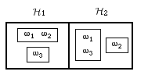

Partition diagram for $\mathcal{H}_1$ and $\mathcal{H}_2$

Given their private information, at each possible world *ω* to which an agent $i$ assigns positive probability, following $f$ maximizes $i$’s expected utility. For instance, at $\omega = \omega_2$,

$$\begin{align} E(u_1 (A_1) \mid \mathcal{H}_1)(\omega_2) &= \tfrac{1}{2} \cdot 3 + \tfrac{1}{2} \cdot 2 &\\ &= \qquad \tfrac{5}{2} &\\ &\gt \qquad 2 &&= \tfrac{1}{2}\cdot 4 + \tfrac{1}{2}\cdot 0 \\ & &&= E(u_1 (A_2) \mid \mathcal{H}_1)(\omega_2) \end{align}$$

and

$$\begin{align} E(u_2 (A_2) \mid \mathcal{H}_2)(\omega_2) &= \quad 4 &\\ &\gt \quad 3 &&= E(u_2 (A_1) \mid \mathcal{H}_1)(\omega_2) \end{align}$$

[^note-27]: An outcome $\mathbf{s}_1$ of a game Pareto-dominates an outcome $\mathbf{s}_2$ if, and only if,

1. $E(u_k (\mathbf{s}_1)) \ge E(u_k (\mathbf{s}_2))$ for all $k \in N$.
2. $\mathbf{s}_1$ strictly dominates $\mathbf{s}_2$ if the inequalities of (i) are all srict.

[^note-28]: While both the endogenous and the Aumann correlated equilibrium concepts generalize the Nash equilibrium, neither correlated equilibrium concept contains the other. See Chapter 2 of Vanderschraaf (1995)[^vanderschraaf-1995] for examples which show this.

[^note-29]: Aumann (1987)[^aumann-1987] notes that it is possible to extend the definitions of Aumann correlated equilibrium and $\mathcal{H}_i$-measurability to allow for cases in which $\Omega$ is infinite and the $\mathcal{H}_i$’s are not necessarily partitions. However, he argues that there is nothing to be gained conceptually by doing so.

[^note-30]: In general, the method of backwards induction is undefined for games of imperfect information, although backwards induction reasoning can be applied to a limited extent in such games.

[^note-31]: By the elementary properties of the knowledge operator, we have that $\mathbf{K}_2\mathbf{K}_1\mathbf{K}_2 (\Gamma) \subseteq \mathbf{K}_2\mathbf{K}_1 (\Gamma)$ and $\mathbf{K}_1\mathbf{K}_2\mathbf{K}_1\mathbf{K}_2 (\Gamma) \subseteq \mathbf{K}_1\mathbf{K}_2\mathbf{K}_1 (\Gamma)$, so we needn’t explicitly state that at $I^{22},$ $\mathbf{K}_2\mathbf{K}_1 (\Gamma)$ and at $I^{11},$ $\mathbf{K}_1\mathbf{K}_2\mathbf{K}_1 (\Gamma)$. By the same elementary properties, the knowledge assumptions at the latter two information sets imply that Fiona and Alan have third-order mutual knowledge of the game and second-order mutual knowledge of rationality. For instance, since $\mathbf{K}_2\mathbf{K}_1 (\Gamma)$ is given at $I^{22}$, we have that $\mathbf{K}_2\mathbf{K}_1\mathbf{K}_1 (\Gamma)$ because $\mathbf{K}_1 (\Gamma) \subseteq \mathbf{K}_1\mathbf{K}_1 (\Gamma)$ and so $\mathbf{K}_2\mathbf{K}_1 (\Gamma) \subseteq \mathbf{K}_2\mathbf{K}_1\mathbf{K}_1 (\Gamma)$. The other statements which characterize third order mutual knowledge of the game and second order mutual knowledge of rationality are similarly derived.

[^note-32]: The version of the example Rubinstein presents is more general than the version presented here. Rubinstein notes that this game is closely related to the *coordinated attack problem* analyzed in Halpern (1986).

[^note-33]: In the terminology of decision theory, $A$ is each agents’ *maximin* strategy.

[^note-34]: This could be achieved if the e-mail systems were constructed so that each $n$ᵗʰ confirmation is sent $2^{-n}$ seconds after receipt of the $n$ᵗʰ message.

[^note-35]: A blockchain is a distributed ledger constituted by a sequence of blocks of data. The way proof-of-work blockchains are constructed is compatible with different agents holding different versions of the ledger. Moreover, the set of agents (i.e. nodes of the blockchain) changes over time. Some agents are possibly dishonest, because of faultiness or because of maliciousness. Finally, the system is asynchronous (delivery time is bounded but uncertain.) Yet a proof-of-work blockchain allows agents (nodes in the network) to reach a consensus about the distributed ledger. Halpern and Pass (2017) offer a knowledge-based analysis of the blockchain desirable properties that make it possible to reach a distributed consensus. The first property is *T-consistency*: A blockchain protocol is said to be *T-consistent* when, except for the last $T$ transactions, all honest agents agree on the initial part of the ledger up to $T$. *T-consistency* is not strong enough to make the blockchain a useful ledger for transactions, as nothing prevents a transaction $x$ to be in $T$ for agent $i$ and yet never appear on agent $j$’s ledger, because $j$’s ledger never grows to include the block in which $x$ is to be recorded.

To avoid this, we need a second property, said $\Delta$-*growth*, stating that if $i$ is honest and her ledger at time $t$ has length $N$, then all honest agents at time $i + \Delta$ will have ledgers of length $N$. A blockchain protocol that satisfies $T$-consistency and $\Delta$-*growth* guarantees that, within time $\Delta$ and from that point in time onwards, all honest agents will know that within time $\Delta$ and from that point in time onwards, all honest agents will know that… etc. This is called $\Delta\text{-}\Box$-*common knowledge*. There are two more factors to take into consideration: one is that the set of agents (nodes in the blockchain) is not constant. The result is shown to hold in that the “all honest agents” above should read as “all honest agents present in the blockchain at that particular point in time.” The way the result is preserved is by introducing indexical formulas and specifying semantical clauses indexed by specific agents. The second element is that, in actual blockchains, neither $T$-consistency nor $\Delta$-*growth* are guaranteed to hold but with high probability, thus the group attitude emerging from the blockchain is $\Delta\text{-}\Box$-*common knowledge*, stating that within time $\Delta$ and from that point in time onwards, all honest agents will know with probability $p$ that within time $\Delta$ and from that point in time onwards, all honest agents will know probability $p$ that… etc.

### Notes to Rubinstein’s Proof

1. If this does not look immediately obvious, consider that either

$E = [T_2 = t] =$ my (Lizzi’s) $t$ᵗʰ confirmation was lost,

or

$F = [T_2 = t] =$ my $t$ᵗʰ confirmation was received and Joanna’s $t$ᵗʰ confirmation was lost

must occur, and that $\mu_1 (T_1 = t \mid E) = \mu_1 (T_1 = t \mid F) = 1$ because Lizzi can see her own computer screen, so we can apply Bayes’ Theorem as follows:

$$\begin{align} \mu_1 (E \mid T_1 = t) &= \frac{\mu_1 (T_1 = t \mid E) \mu_1 (E)}{\mu_1 (T_1 = t \mid E) \mu_1 (E) + \mu_1 (T_1 = t \mid F) \mu_1 (F)} \\ &= \frac{\mu_1 (E)}{\mu_1 (E) + \mu_1 (F)} \\ &= \frac{\varepsilon}{\varepsilon + (1-\varepsilon)\varepsilon} \end{align}$$

[^lewis-1969]: Lewis (1969) is the classic pioneering study of common knowledge and its potential applications to conventions and game theory. As Lewis acknowledges, parts of his work are foreshadowed in Hume (1740) and Schelling (1960).

[^aumann-1976]: Aumann (1976) gives the first mathematically rigorous formulation of common knowledge using set theory. Schiffer (1972) uses the formal vocabulary of *epistemic logic* (Hintikka 1962) to state his definition of common knowledge. Schiffer’s general approach is to augment a system of sentential logic with a set of knowledge operators corresponding to a set of agents, and then to define common knowledge as a hierarchy of propositions in the augmented system. Bacharach (1992), Bicchieri (1993) and Fagin, *et al*. (1995) adopt this approach, and develop logical theories of common knowledge which include soundness and completeness theorems. Fagin, et al. show that the syntactic and set-theoretic approaches to developing common knowledge are logically equivalent.

[^aumann-1995]: Aumann (1995) gives a recent defense of the classical view of backwards induction in games of imperfect information. For criticisms of the classical view, see Binmore (1987), Reny (1992), Bicchieri (1989) and especially Bicchieri (1993). Brandenburger (1992) surveys the known results connecting mutual and common knowledge to solution concepts in game theory. For more in-depth survey articles on common knowledge and its applications to game theory, see Binmore and Brandenburger (1989), Geanakoplos (1994) and Dekel and Gul (1997). For her alternate account of common knowledge along with an account of conventions which opposes Lewis’ account, see Gilbert (1989).

[^monderer-1989]: Monderer and Samet (1989) remains one of the best resources for the study of common p-belief.

[^alberucci-2005]: Alberucci, Luca and Jaeger, Gerhard, 2005, “About cut elimination for logics of common knowledge”, *Annals of Pure and Applied Logic*, 133(1–3): 73–99.

[^aumann-1974]: Aumann, Robert, 1974, “Subjectivity and Correlation in Randomized Strategies”, *Journal of Mathematical Economics*, 1: 67–96.

[^aumann-1976-2]: –––, 1976, “Agreeing to Disagree”, *Annals of Statistics*, 4: 1236–9.

[^aumann-1987]: –––, 1987, “Correlated Equilibrium as an Expression of Bayesian Rationality”, *Econometrica*, 55: 1–18.

[^aumann-1995-2]: –––, 1995, “Backward Induction and Common Knowledge of Rationality”, *Games and Economic Behavior* 8: 6–19.

[^bacharach-1985]: Bacharach, Michael, 1985 “Some Extensions of a Claim of Aumann in an Axiomatic Model of Knowledge”, *Journal of Economic Theory*, 37(1): 167–190.

[^bacharach-1992]: –––, 1992.“Backward Induction and Beliefs About Oneself”, *Synthese*, 91: 247–284.

[^barwise-1988]: Barwise, Jon, 1988, “Three Views of Common Knowledge”, in *Proceedings of the Second Conference on Theoretical Aspects of Reasoning About Knowledge*, M.Y. Vardi (ed.), San Francisco: Morgan Kaufman, pp. 365–379.

[^barwise-1989]: –––, 1989, *The Situation in Logic*, Stanford: Center for the Study of Language and Information.

[^bernheim-1984]: Bernheim, B. Douglas, 1984, “Rationalizable Strategic Behavior”, *Econometrica*, 52: 1007–1028.

[^bicchieri-1989]: Bicchieri, Cristina, 1989, “Self Refuting Theories of Strategic Interaction: A Paradox of Common Knowledge”, *Erkenntnis*, 30: 69–85.

[^bicchieri-1993]: –––, 1993, *Rationality and Coordination*, Cambridge: Cambridge University Press.

[^bicchieri-2006]: –––, 2006, *The Grammar of Society*, Cambridge: Cambridge University Press.

[^binmore-1987]: Binmore, Ken, 1987, “Modelling Rational Players I”, *Economics and Philosophy*, 3: 179–241.

[^binmore-1992]: –––, 1992, *Fun and Games*, Lexington, MA: D. C. Heath.

[^binmore-2008]: –––, 2008, “Do Conventions Need to be Common Knowledge?”, *Topoi*, 27: 17–27.

[^binmore-1988]: Binmore, Ken and Brandenburger, Adam, 1988, “Common knowledge and Game theory” ST/ICERD Discussion Paper 88/167, London School of Economics.

[^binmore-2001]: Binmore, Ken and Samuelson, Larry, 2001, “Coordinated Action in the Electronic Mail Game” *Games and Economic Behavior*, 35(1): 6–30.

[^bonanno-1999]: Bonanno, Giacomo and Battigalli, Pierpaolo, 1999, “Recent Results on Belief, Knowledge and the Epistemic Foundations of Game Theory”, *Research in Economics*, 53(2): 149–225.

[^bonnay-2009]: Bonnay, D. and Egré, Paul, 2009, “Inexact Knowledge with Introspection”, *Journal of Philosophical Logic*, 38: 179–227.

[^brandenburger-1992]: Brandenburger, Adam, 1992, “Knowledge and Equilibrium in Games”, *Journal of Economic Perspectives*, 6: 83–101.

[^brandenburger-1987]: Brandenburger, Adam, and Dekel, Eddie, 1987, “Common Knowledge with Probability 1”, *Journal of Mathematical Economics*, 16: 237–245.

[^brandenburger-1988]: –––, 1988, “The Role of Common Knowledge Assumptions in Game Theory”, in *The Economics of Missing Markets, Information and Games*, Frank Hahn (ed.), Oxford: Clarendon Press, 46–61.

[^bruni-2018]: Bruni, Riccardo and Giacomo Sillari, 2018, “A Rational Way of Playing: Revision Theory for Strategic Interaction”, *Journal of Philosophical Logic*, 47(3), 419–448.

[^carnap-1947]: Carnap, Rudolf, 1947, *Meaning and Necessity: A Study in Semantics and Modal Logic*, Chicago, University of Chicago Press.

[^cave-1983]: Cave, Jonathan AK, 1983, “Learning to Agree”, *Economics Letters*, 12(2): 147–152.

[^chwe-1999]: Chwe, Michael, 1999, “Structure and Strategy in Collective Action”, *American Journal of Sociology* 105: 128–56.

[^chwe-2000]: –––, 2000, “Communcation and Coordination in Social Networks”, *Review of Economic Studies*, 67: 1–16.

[^chwe-2001]: –––, 2001, *Rational Ritual*, Princeton, NJ: Princeton University Press

[^cubitt-2003]: Cubitt, Robin and Sugden, Robert, 2003, “Common Knowledge, Salience and Convention: A Reconstruction of David Lewis’ Game Theory”, *Economics and Philosophy*, 19: 175–210.

[^dégremont-2012]: Dégremont, Cédric, and Oliver Roy, 2012, “Agreement Theorems in Dynamic-Epistemic Logic”, *Journal of Philosophical Logic*, 41(4): 735-764.

[^dekel-1997]: Dekel, Eddie and Gul, Faruk, 1997, “Rationality and Knowledge in Game Theory”, in *Advances in Economic Theory: Seventh World Congress of the Econometric Society*, D. Kreps and K. Wallace eds., Cambridge: Cambridge University Press.

[^dekel-1998]: Dekel, Eddie, Lipman, Bart and Rustichini, Aldo, 1998, “Standard State-Space Models Preclude Unawareness,” *Econometrica*, 66: 159–173.

[^devetag-2013]: Devetag, Giovanna, Hosni, Hykel and Sillari, Giacomo, 2013, “Play 7: Mutual Versus Common Knowledge of Advice in a Weak-Link Game,” *Synthese*, 190(8): 1351–1381

[^fagin-1988]: Fagin, Ronald and Halpern, Joseph Y., 1988, “Awareness and Limited Reasoning,” *Artificial Intelligence*, 34: 39–76.

[^fagin-1995]: Fagin, Ronald, Halpern, Joseph Y., Moses, Yoram and Vardi, Moshe Y., 1995, *Reasoning About Knowledge*, Cambridge, MA: MIT Press.

[^friedell-1967]: Friedell, Morris, 1967, “On the Structure of Shared Awareness,” *Working papers of the Center for Research on Social Organizations* (Paper #27), Ann Arbor: University of Michigan.

[^friedell-1969]: –––, 1969, “On the Structure of Shared Awareness,” *Behavioral Science*, 14(1): 28–39.

[^geanakoplos-1989]: Geanakoplos, John, 1989, “Games Theory without Partitions, and Applications to Speculation and Consensus,” Cowles Foundation Discussion Paper, No. 914.

[^geanakoplos-1994]: –––, 1994, “Common Knowledge”, in *Handbook of Game Theory* (Volume 2), Robert Aumann and Sergiu Hart (eds.), Amsterdam: Elsevier Science B.V., 1438–1496.

[^geanakoplos-1982]: Geanakoplos, John and Heraklis M. Polemarchakis, 1982, “We Can’t Disagree Forever” *Journal of Economic theory* 28(1): 192–200.

[^gilbert-1989]: Gilbert, Margaret, 1989, *On Social Facts*, Princeton: Princeton University Press.

[^halpern-2001]: Halpern, Jospeh, 2001, “Alternative Semantics for Unawareness”, *Games and Economic Behavior*, 37(2): 321–339

[^halpern-1990]: Halpern, J. Y., & Moses, Y. , 1990, “Knowledge and common Knowledge in a Distributed Environment”. *Journal of the Association for Computing Machinery*, 37(3): 549–587.

[^halpern-2017]: Halpern, J. Y., & Pass, R., 2017, “A Knowledge-Based Analysis of the Blockchain Protocol”. *arXiv preprint* arXiv:1707.08751.

[^harman-1977]: Harman, Gilbert, 1977, “Review of *Linguistic Behavior* by Jonathan Bennett”, *Language*, 53: 417–424.

[^harsanyi-1967]: Harsanyi, J., 1967, “Games with Incomplete Information Played by ”Bayesian“ Players, I: The basic model”, *Management Science*, 14: 159–82.

[^harsanyi-1968a]: –––, 1968a, “Games with Incomplete Information Played by ”Bayesian“ Players, II: Bayesian Equilibrium Points”, *Management Science*, 14: 320–324.

[^harsanyi-1968b]: –––, 1968b, “Games with Incomplete Information Played by ”Bayesian“ Players, III: The basic probability distribution of the game”, *Management Science*, 14: 486–502.

[^heifetz-1999]: Heifetz, Aviad, 1999, “Iterative and Fixed Point Common Belief”, *Journal of Philosophical Logic*, 28(1): 61–79.

[^heifetz-2006]: Heifetz, Aviad, Meier, Martin and Schipper, Burkhard, 2006, “Interactive Unawareness”, *Journal of Economic Theory*, 130: 78–94.

[^hintikka-1962]: Hintikka, Jaakko, 1962, *Knowledge and Belief*, Ithaca, NY: Cornell University Press.

[^hume-1740]: Hume, David, 1740 [1888, 1976], *A Treatise of Human Nature*, L. A. Selby-Bigge (ed.), rev. 2nd. edition P. H. Nidditch (ed.), Oxford: Clarendon Press.

[^immerman-2021]: Immerman, D., 2021, “How Common Knowledge Is Possible”. *Mind*, first online 17 January 2021. doi:10.1093/mind/fzaa090

[^jäger-2016]: Jäger, Gerhard and Michel Marti, 2016, “Intuitionistic Common Knowledge or Belief”, *Journal of Applied Logic*, 18: 150–163

[^lederman-2018a]: Lederman, Harvey, 2018a, “Two Paradoxes of Common Knowledge: Coordinated Attack and Electronic Mail”, *Noûs*, 52: 921–945.

[^lederman-2018b]: –––, 2018b, “Uncommon Knowledge” *Mind* 127, 1069–1105.

[^leitgeb-2014]: Leitgeb, Hannes, 2014, “The Stability Theory of Belief”, *The Philosophical Review*, 123(2): 131–171.

[^lewis-1943]: Lewis, C. I., 1943, “The Modes of Meaning”, *Philosophy and Phenomenological Research*, 4: 236–250.

[^lewis-1969-2]: Lewis, David, 1969, *Convention: A Philosophical Study*, Cambridge, MA: Harvard University Press.

[^lewis-1978]: –––, 1978, “Truth in Fiction”, *American Philosophical Quarterly*, 15: 37–46.

[^littlewood-1953]: Littlewood, J. E., 1953, *A Mathematical Miscellany*, London: Methuen; reprinted as *Littlewood’s Miscellany*, B. Bollobas (ed.), Cambridge: Cambridge University Press, 1986.

[^mckelvey-1986]: McKelvey, Richard and Page, Talbot, 1986, “Common Knowledge, Consensus and Aggregate Information”, *Econometrica*, 54: 109–127.

[^meyer-1995]: Meyer, J.-J.Ch. and van der Hoek, Wiebe, 1995, *Epistemic Logic for Computer Science and Artificial Intelligence* (Cambridge Tracts in Theoretical Computer Science 41), Cambridge: Cambridge University Press.

[^milgrom-1981]: Milgrom, Paul, 1981, “An Axiomatic Characterization of Common Knowledge”, *Econometrica*, 49: 219–222.

[^milgrom-1982]: Milgrom, Paul, and Nancy Stokey, 1982, “Information, Trade and Common Knowledge”, *Journal of Economic Theory*, 26(1): 17–27.

[^monderer-1989-2]: Monderer, Dov and Samet, Dov, 1989, “Approximating Common Knowledge with Common Beliefs”, *Games and Economic Behavior*, 1: 170–190.

[^nash-1950]: Nash, John, 1950, “Equilibrium Points in N-person Games”. *Proceedings of the National Academy of Sciences of the United States*, 36: 48–49.

[^nash-1951]: –––, 1951, “Non-Cooperative Games”. *Annals of Mathematics*, 54: 286–295.

[^nozick-1963]: Nozick, Robert, 1963, *The Normative Theory of Individual Choice*, Ph.D. dissertation, Princeton University

[^paternotte-2011]: Paternotte, Cédric, 2011, “Being Realistic about Common Knowledge: a Lewisian Approach”, *Synthese*, 183(2): 249–276.

[^paternotte-2017]: –––, 2017, “The Fragility of Common Knowledge”, *Erkenntnis*, 82(3): 451–472.

[^pearce-1984]: Pearce, David, 1984, “Rationalizable Strategic Behavior and the Problem of Perfection”, *Econometrica*, 52: 1029–1050.

[^reny-1988]: Reny, Philip J, 1988, “Common Knowledge and Games with Perfect Information.” In *PSA: Proceedings of the Biennial Meeting of the Philosophy of Science Association*, vol. 1988, no. 2, pp. 363–369. East Lansing: Philosophy of Science Association.

[^reny-1992]: –––, 1992, “Rationality in Extensive Form Games”, *Journal of Economic Perspectives*, 6: 103–118.

[^rubinstein-1987]: Rubinstein, Ariel, 1987, “A Game with ”Almost Common Knowledge“: An Example”, in *Theoretical Economics*, D. P. 87/165. London School of Economics.

[^samet-1990]: Samet, Dov, 1990, “Ignoring Ignorance and Agreeing to Disagree”, *Journal of Economic Theory*, 52: 190–207.

[^schelling-1960]: Schelling, Thomas, 1960, *The Strategy of Conflict*, Cambridge, MA: Harvard University Press.

[^schiffer-1972]: Schiffer, Stephen, 1972, *Meaning*, Oxford: Oxford University Press.

[^sillari-2005]: Sillari, Giacomo, 2005, “A Logical Framework for Convention”, *Synthese*, 147(2): 379–400.

[^sillari-2008]: –––, 2008, “Common Knowledge and Convention”, *Topoi*, 27(1): 29–39.

[^sillari-2013]: –––, 2013, “Rule-Following as Coordination: a Game-Theoretic Approach”, *Synthese*, 190(5): 871–890.

[^sillari-2019]: –––, 2019, “Logics of Belief”, *Rivista di Filosofia*, 110(2): 243–262.

[^skyrms-1984]: Skyrms, Brian, 1984, *Pragmatics and Empiricism*, New Haven: Yale University Press.

[^skyrms-1990]: –––, 1990, *The Dynamics of Rational Deliberation*, Cambridge, MA: Harvard University Press

[^skyrms-1991]: –––, 1991, “Inductive Deliberation, Admissible Acts, and Perfect Equilibrium”, in *Foundations of Decision Theory*, Michael Bacharach and Susan Hurley eds., Cambridge, MA: Blackwell, pp. 220–241.

[^skyrms-1998]: –––, 1998, “The Shadow of the Future”, in *Rational Commitment and Social Justice: Essays for Gregory Kavka*, Jules Coleman and Christopher Morris eds., Cambridge: Cambridge University Press, pp. 12–22.

[^sugden-1986]: Sugden, Robert, 1986, *The Economics of Rights, Cooperation and Welfare*, New York: Basil Blackwell.

[^thomason-2021]: Thomason, R. H., 2021, “Common Knowledge, Common Attitudes and Social Reasoning”, *Bulletin of the Section of Logic*, 50(2): 229–247.

[^vanderschraaf-1995]: Vanderschraaf, Peter, 1995, “Endogenous Correlated Equilibria in Noncooperative Games”, *Theory and Decision*, 38: 61–84.

[^vanderschraaf-1998]: Vanderschraaf, Peter, 1998, “Knowledge, Equilibrium and Convention”, *Erkenntnis*, 49: 337–369.

[^vanderschraaf-2001]: –––, 2001. *A Study in Inductive Deliberation*, New York: Routledge.

[^neumann-1944]: von Neumann, John and Morgenstern, Oskar, 1944, *Theory of Games and Economic Behavior*, Princeton: Princeton University Press.
