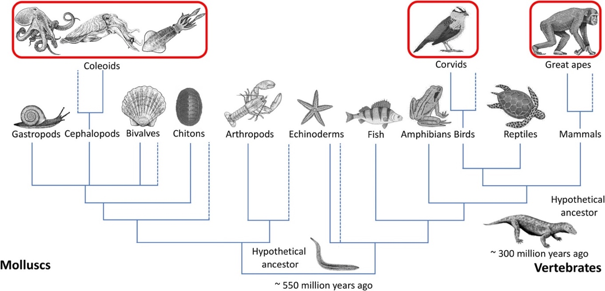

# Methods in Comparative Cognition
**First published Wed Sep 6, 2023**

*Halina, Marta*

Comparative cognition is the study of cognition across the tree of life. Nonhuman animals (hereafter animals) display a broad and often surprising range of cognitive abilities. Kea (a species of large parrot endemic to New Zealand) solve problems using domain-general statistical inference (Bastos & Taylor 2020)[^bastos-2020], Eurasian jays are deceived by magic tricks (Garcia-Pelegrin et al. 2021)[^garcia-pelegrin-2021], and bumblebees may be conscious (Gibbons et al. 2022)[^gibbons-2022]. Researchers in the field of comparative cognition seek to understand the cognitive mechanisms giving rise to animal behavior, including their evolutionary, developmental, and socioecological history. Comparative cognition is an interdisciplinary field bringing together tools from ecology, ethology, cognitive science, developmental psychology, evolutionary biology, and neuroscience, among others (Shettleworth 2009)[^shettleworth-2009]. There is also a robust philosophical literature on the methods of comparative cognition. Philosophers aim to address questions such as, “what is evidentially required to show that animals have causal reasoning?” and “how can we avoid anthropocentricism in the study of nonhuman minds?” How best to define “cognition” is an area of debate (Allen 2017)[^allen-2017]. For our purposes, we can follow Sara Shettleworth’s broad characterization of cognition as “the mechanisms by which animals acquire, process, store and act upon information from the environment” (2010a: 4; see also entry on animal cognition).

## 1. Evolution, Development, and Culture

Research in comparative cognition takes place against a backdrop of evolutionary, developmental, and socioecological considerations. Natural selection leads to the convergence and divergence of cognitive traits over evolutionary time. Cognitive traits might converge because two species face similar socioecological problems, such as navigating a similar foraging environment. Alternatively, two species might share cognitive abilities because they have inherited them from a shared ancestor or have developmental modules in common. Finally, cognitive abilities interact with evolution in ways that not only alter a species trajectory through phenotypic space, but their evolvability (Brown 2013)[^brown-2013]. Considerations such as these help researchers predict and explain cognitive and behavioral abilities across taxa:

> Only by investigating proximate (mechanism and ontogeny) and ultimate (phylogeny and function) causes can we fully understand the nature and origin of behavior. (Krupenye & Call 2019: 16)[^krupenye-2019]

This section presents several key ways in which evolutionary, developmental, and socioecological considerations shape methods in comparative cognition.

### 1.1 Convergent Evolution

The evolution of wings is a paradigm case of convergent evolution. Wings have the function of sustaining flight and have evolved in many different organisms, including birds, bats, and insects. The structures comprising wings differ across these groups—bat wings consist of extended digits, bird wings evolved from an extended forelimb, and insect wings are outgrowths of exoskeleton. Although wings in these groups differ in their underlying structures, they share features like rigidity, which allow them to perform the same function—producing lift and enabling flight. Similarities in traits such as these can be explained in part by appealing to shared selection pressures.

Adaptive considerations such at these guide theorizing in comparative cognition. In this case, a “psychological trait is treated as a design problem” (Ereshefsky 2007: 670)[^ereshefsky-2007]. One determines the function that a psychological trait serves and asks what selection pressures might have led to that evolutionary outcome. For example, research on western scrub jays suggests that they have episodic-like memory or the ability to remember the “what, where, and when” features of specific events (Clayton et al. 2001)[^clayton-2001]. Scrub jays are “scatter-hoarders”, hiding food in multiple places for later recovery. Caching behavior such as this enables individuals to survive in environments with fluctuating food supplies. When recovering their caches, scrub jays remember where and when they have cached a specific food item. For example, they avoid searching for perishable food (like a worm) if its window of freshness has elapsed (Clayton & Dickinson 1998)[^clayton-1998]. Recent work on cuttlefish suggests that they face similar foraging challenges to scatter-hoarding birds. They live in environments with variable food supplies and appear to keep track of what they have eaten, as well as where and when they ate (Jozet-Alves, Bertin, & Clayton 2013; Schnell, Clayton, et al. 2021a). Cuttlefish are cephalopod mollusks and diverged from vertebrates like scrub jays over 550 million years ago (Figure 1). Given this phylogenetic distance, if cuttlefish and western scrub jays share the capacity for episodic-like memory, this cognitive trait may have evolved independently in these two taxa as a common solution to similar ecological problems.

*Figure 1.*

Figure 1. Distantly related organisms may share similar cognitive abilities because they face similar socioecological selection pressures over evolutionary time. Image adapted from Schnell, Amodio, Boeckle, and Clayton (2021b: 4). [An extended description of figure 1 is in the supplement.]

Alexandra Schnell and colleagues argue that studying phylogenetically distant species like chimpanzees, corvids, and cephalopods, allows researchers to better understand the selection pressures that give rise to “complex cognition” like episodic-like memory, future planning, causal reasoning, and imagination (Schnell et al. 2021b; see also van Horik et al. 2012, Powell et al. 2017, Amodio et al. 2019)[^amodio-2019][^powell-2017][^schnell-2021b]. For example, the Social Intelligence Hypothesis holds that complex cognition is a product of selection pressures that arise from living in complex social groups (see Byrne & Whiten 1988)[^byrne-1988][^whiten-1988]. However, many cephalopods live short and solitary lives. If these cephalopods do have cognitive capacities such as causal reasoning, these may have evolved in response to selective pressures emerging from something other than complex social environments. Focusing on socially complex vertebrates like chimpanzees and corvids alone makes it “difficult to uncouple the effects of ecological and social pressures on cognitive evolution” (Schnell et al. 2021a: 172). If it can be shown that organisms such as corvids and cephalopods (e.g., the octopus) have the same cognitive capacities (e.g., causal reasoning), then researchers might be better placed to infer the environmental demands that led to the emergence of adaptations in these distantly related taxa.

### 1.2 Homology and Development

There are several approaches to determining what counts as a homologous trait. The “phylogenetic approach” holds that two traits are homologous when they are derived from a common ancestor (Brigandt 2007)[^brigandt-2007]. Humans and chimpanzees have similar physical-cognitive abilities like tool use (Herrmann et al. 2007)[^herrmann-2007]. Under the phylogenetic approach, these abilities are homologous insofar as they were inherited from the evolutionary ancestor that humans and chimpanzees shared 6–8 million years ago. The “developmental approach” to homology holds that two traits are homologous when they’re produced by the same developmental module (Ereshefsky 2012)[^ereshefsky-2012]. Mammalian vertebrae, arthropod limbs, and bird feathers are often viewed as homologues in this sense. Some hold that homology is best understood as having both phylogenetic and developmental components (Ereshefsky 2007, 2012)[^ereshefsky-2007]. Under this view, a developmental module imposes proximate constraints on how a homologous trait is constructed, while evolution explains why that developmental module is found across taxa (namely, through common descent).

Some philosophers argue that psychologists should focus on identifying homologous rather than convergent traits, given their interest in the mechanisms responsible for behavior (see Matthen 2007; Clark 2010)[^clark-2010][^matthen-2007]. For example, Paul Griffiths (1997, 2007a, 2007b) argues that identifying cognitive traits as convergent is epistemically more demanding than identifying cognitive traits as homologous. Explanations that appeal to convergent evolution often adopt a lock-and-key model of adaptation where a trait is viewed as a solution to an existing socioecological problem (e.g., episodic-like memory as a solution to the foraging problem that western scrub jays face today). However, Griffiths argues that it is unlikely that minds evolved in response to contemporary socioecological problems. Instead, the structure and organization of an organism’s phenotype and niche coevolve. Moreover, what counts as a “problem” depends on many factors, such as resource constraints and the developmental plasticity of an organism. Griffiths writes:

> Problems whose solutions cannot be developmentally dissociated must be solved as a single problem and so are not separate problems from the standpoint of adaptive evolution. (2007b: 203)

To provide a compelling case of convergent evolution, one must take such constraints under account. In the case of complex cognitive traits, researchers often know little about the resource and developmental constraints at play in an organism’s evolutionary history. In this way, identifying cognitive traits as convergent may be epistemically demanding.

### 1.3 Culture

In addition to evolutionary and developmental factors, comparative cognition researchers aim to understand how cultural factors affect cognitive capacities. Philosophers and scientists have also argued that understanding animal cultures has important implications for conservation efforts (Brakes et al. 2019)[^brakes-2019] and animal welfare (Fitzpatrick & Andrews 2022)[^fitzpatrick-2022]. Broadly, culture can be defined as

> information transmitted between individuals or groups, where this information flows through and brings about the reproduction of, and a lasting change in, the behavioral trait. (Ramsey 2017: 348; see also Ramsey 2013; Andrews 2015 [2020]: chapter 8; and entry on cultural evolution)[^andrews-2015][^ramsey-2013][^ramsey-2017]

For example, the skills required to use a tool effectively might be transmitted through social learning (such as copying), creating a lasting change in a recipient’s subsequent behavioral abilities and reproductive fitness. Cultural transmission has been described as a form of “soft inheritance” or the idea that organisms can inherit phenotypic variation that is the result of non-genetic effects (Mayr 1982)[^mayr-1982]. Eva Jablonka and colleagues argue that many animal traditions are transmitted in this way (Avital & Jablonka 2000; Jablonka & Lamb 2008)[^avital-2000][^jablonka-2008]. For example, the behavioral innovation of opening milk bottles spread quickly through Eurasian blue tit populations in the early twentieth century. Studies suggest that this innovation spread through a mixture of local enhancement (naïve birds learning that milk bottles are a source of food by spending time near birds capable of exploiting this food source) and observational learning (naïve birds copying the behavior of experienced innovators) (Aplin, Sheldon, & Morand-Ferron 2013).

One advantage of understanding culture in terms of soft inheritance is that some of the methods and models employed in the study of biological evolution can be applied to the study of culture (Mesoudi, Whiten, & Laland 2006). Rachael Brown (2017a) also argues that animal traditions are important for understanding genetic evolution. For example, recent studies suggest that the diversification of beak morphologies in Galápagos finches is the result of behavioral foraging innovations spread through cultural transmission. The presence and spread of these behavioral innovations (e.g., using one’s beak to puncture the skin and drink the blood of sea birds, as in the case of “vampire finches”) may have been required to allow sufficient selective pressure for morphological adaptation to occur. Despite the links between culture and genetic evolution, there remains disagreement regarding whether the modern synthesis in evolutionary biology should be extended to include processes such as soft inheritance (see Pigliucci 2007; Laland et al. 2015)[^laland-2015][^pigliucci-2007]. Nevertheless, research on animal culture is flourishing with observational and experimental studies revealing both its cognitive underpinnings and effects (see Whiten 2022 for a recent review)[^whiten-2022].

### 1.4 Cognition in the Wild and Captivity

As noted, comparative cognition is a field that draws on methods from a variety of disciplines, including ethology, experimental psychology, and neuroscience. Philosophers and scientists have debated the relative merits of these methods for understanding animal minds. A central method in ethology is fieldwork on wild animals, for instance, while experimental psychology relies primarily on laboratory studies on captive animals. Wild and captive animals often lead different kinds of lives. For example, captive chimpanzees tend to have regular access to food, extensive experience with human objects (including objects designed for enrichment), and live in a relatively small space. Wild chimpanzees typically live in territories that are many square kilometers in size, spend much time foraging, and must overcome life-threatening problems not typically found in captivity, such as competition with neighboring groups and predators (Boesch 2022)[^boesch-2022]. In comparative cognition, many researchers stress the importance of observing animals in their natural environment. From an ethological perspective, this is crucial for understanding how animal minds evolved because “it is in this situation that natural selection acts” (Healy & Hurly 2003: 326)[^healy-2003].

Other researchers note that control conditions like those found in the laboratory are necessary for investigating animal minds. For example, Heyes and Dickinson (1990) argue that identifying the mental states responsible for a given action requires determining

> what the animal would have done if its circumstances had been different in certain, specifiable respects from those in which the action actually occurred. (1990: 88; but see Allen & Bekoff 1997: chapter 9)[^allen-1997]

Observing animals in their natural environment often precludes varying the environment in systematic ways, while laboratory studies are designed to control for alternative explanations and nuisance variables (see section 2). Some researchers also argue that “unnatural” environments might direct development and learning in ways that supports the emergence of new or enhanced cognitive capacities. Captive great apes, for example, develop problem-solving and communicative abilities not found in their wild conspecifics, such as tool use, pointing, and sign language (Tomasello & Call 2008; Bandini & Harrison 2020)[^bandini-2020][^tomasello-2008]. Studying animals outside of their natural environment might provide insight into their cognitive potential when appropriately scaffolded by the environment.

Overall, most researchers acknowledge that a plurality of methods is needed for understanding animal minds. For example, Michael Tomasello and Josep Call write regarding primate cognition research that,

> fieldwork is primary. It tells us what animals do; it sets the problem. But then if we wish to figure out what is the nature of the cognitive skill, if any, underlying some activity in the wild, we need experiments. (2008: 451)

Kristin Andrews documents different possible sources of bias in the field and laboratory. For example, in the field, ethograms might lead to confirmation bias, while in the laboratory, the importance of the relationships between human experimenters and study participants is often underemphasized (see Andrews 2020: 42–61)[^andrews-2020]. Andrews concludes that comparative psychologists should aim to employ and integrate a variety of methods for studying animal minds, rather than seek to eliminate bias. Colin Allen and Marc Bekoff (1997) similarly emphasize the need for an interdisciplinary approach:

> Science is not likely to make complete contact with the nature of animal minds at any single point—many methods will be useful, and competing hypotheses should be evaluated. (1997: 180)

## 2. Eliminating Alternative Explanations

Comparative cognition researchers often test hypotheses about animal minds through behavioral studies or experiments. These studies are designed to determine whether a species, group, or individual animal behaves as one would expect on the assumption that a given hypothesis is true. Often these hypotheses specify to some degree the cognitive processes thought to underlie a given suite of behaviors. As Shettleworth notes, researchers seek

> not just to confirm that animals are (or are not) capable of doing something “clever” but to discover *how* they do what they do. (Shettleworth 2013: 4)[^shettleworth-2013]

In this section, we consider the role that statistical nulls, alternative explanations, epistemic values, and non-epistemic values play in the evaluation of hypotheses in comparative cognition.

### 2.1 Null Hypotheses in Comparative Cognition

A central element of experimental work in the sciences involves controlling for extraneous or “nuisance” variables. Comparative cognition is like other sciences in employing experimental and statistical methods to control for such variables (Bausman & Halina 2018; Dacey 2023)[^bausman-2018][^bausman-2018-2][^dacey-2023]. The aim of an experiment is generally to determine whether there is a relationship between the independent and dependent variables. For example, crows drop nuts onto roads and retrieve the cracked nuts (Shettleworth 2010a)[^shettleworth-2010a]. Are they doing this because they’ve learned that cars can be used as “nutcrackers”? Or has the behavior of dropping nuts from a height evolved over many generations (perhaps before the advent of cars)? As a first step towards answering these questions, one might experimentally investigate whether the presence of approaching cars on a road (the independent variable) affects nut-dropping behavior in crows (the dependent variable) (Cristol et al. 1997)[^cristol-1997]. To detect this effect, however, one must control for the “noise” created by extraneous variables—i.e., those variables that are also likely to affect the dependent variable. In the case of foraging crows, extraneous variables may include time of day, season, proximity to nut trees, etc. In an experiment, the statistical null hypothesis typically holds that any differences observed in the dependent variable can be attributed to extraneous variables and thus there is no evidence that the independent variable has had an effect (see Sani & Todman 2006)[^sani-2006]. Whether an observed difference in the dependent variable can be attributed to the independent variable (i.e., whether the difference is statistically significant) depends on one’s test statistic, which reflects the variability of the data due to known extraneous variables. If proximity to nut trees can explain the difference observed in nut-dropping behavior, for example, then there is insufficient evidence to conclude that nut-dropping behavior has been affected by the presence or absence of approaching cars.

The term “null hypothesis” is sometimes used more broadly to refer to an alternative or competing hypothesis, rather than a statistical null hypothesis. For example, associative learning, behavior reading, and hypotheses that deny animals “special” human-like cognitive abilities are often referred to as “null hypotheses” (see Hanus 2016; Dickinson 2012; Andrews & Huss 2014; Mikhalevich 2015)[^andrews-2014][^dickinson-2012][^hanus-2016][^mikhalevich-2015]. These hypotheses are typically contrasted with those that attribute complex or human-like cognitive abilities to animals like causal reasoning or theory of mind. One problem with this broad use is that the term “null” suggests that a hypothesis should be epistemically privileged (in the sense that it must be rejected before accepting any alternative hypothesis) when in many of these cases it is not clear the purported null should be privileged in this way. As Andrews and Huss (2014) write:

> the onus is on the skeptic to explain why the skeptical hypothesis and not the optimistic hypothesis that animals do have psychological properties is the proper null hypothesis. (2014: 720–721)

Statistical null hypotheses are epistemically privileged in the sense that they must be rejected before one can conclude that the variable of interest (the independent variable) has had an effect. This inference strategy is justified in the context of statistical hypothesis testing due to the nature of experimental design and inferential statistics (Bausman & Halina 2018)[^bausman-2018][^bausman-2018-2]. However, the features that justify this strategy in the statistical case are not present in hypothesis evaluation more generally (the latter lacks a test statistic, for example). Instead, one must supply compelling reasons for preferring one hypothesis (such as associative learning) over another (such as causal reasoning). Such reasons may be theoretical (e.g., that one hypothesis has epistemic virtues like predictive power that the other lacks) or empirical (e.g., that one hypothesis already has independent empirical support, while the other does not). The next three sections discuss hypothesis evaluation in comparative cognition in this broader sense. For additional discussion of statistical null hypotheses, null modeling, and default models, see Bausman 2018, Zhang 2020, and Dacey 2023.

### 2.2 Cognitive and Associative Explanations

As noted above, to provide compelling evidence that an animal has cognitive capacities like episodic memory or theory of mind, researchers aim to eliminate plausible alternative explanations for behavior. This research strategy is not unique to comparative cognition but is found across the sciences. For example, Julian Reiss argues that a hypothesis is warranted insofar as one has eliminated alternative hypotheses. That is, the strength of the warrant depends on how many alternatives have been eliminated and how compelling or salient those alternatives are (Reiss 2015)[^reiss-2015]. In comparative cognition, associative learning is regularly advanced as a salient alternative that must be eliminated before concluding that an animal has complex cognition. As Starzak and Gray (2021) write,

> Over and over again the familiar refrain is, “do animals have complex human-like cognitive abilities or can their behavior be explained in terms of simpler processes such as associative learning?”. (2021: 2)

What is associative learning? Broadly, associative learning is a class of learning mechanisms characterized by a change in association between two or more variables. Two common forms of associative learning are classical (Pavlovian) conditioning and operant (instrumental) conditioning. In classical conditioning, a stimulus comes to elicit a response in an organism because it has become associated with another stimulus. For example, drawing on the studies of the Russian psychologist Ivan Pavlov, dogs naturally salivate in response to the taste of food (this response does not require training or conditioning, so is an *unconditioned response* to an *unconditioned stimulus*). However, one can pair another stimulus, like the sound of a bell, with the arrival of food. Over time, dogs will learn to associate the food with the sound of the bell, such that the sound of the bell will become sufficient on its own to elicit salivation (the sound has become a *conditioned stimulus* leading to a *conditioned response*). In operant conditioning, an organism’s behavior changes in response to the consequences of that behavior. For example, a cat might behave in many ways while interacting with a puzzle box (which, say, contains food the cat likes) with some behaviors resulting in the cat successfully opening the puzzle box by accident. Over time, the successful behaviors will be strengthened, and the unsuccessful behaviors weakened, such that the cat will be able to quickly open the puzzle box as a result of operant conditioning alone. The tendency for behaviors to be strengthened or weakened in response to their positive and negative consequences respectively is known as Thorndike’s law of effect after the American psychologist Edward Thorndike.

It is often possible to formulate plausible associative learning accounts that can accommodate data originally believed to support hypotheses like causal reasoning or theory of mind (for examples, see Taylor, Medina, et al. 2010; Heyes 2012; Halina 2022)[^halina-2022][^heyes-2012]. In many cases, this is taken to undermine the original interpretation of the data because associative learning is taken to be preferred as an explanation of animal behavior over capacities that require “complex” or human-like cognitive abilities (Buckner 2011; Hanus 2016)[^buckner-2011][^hanus-2016]. One justification for this preference is that associative learning is “simpler” than alternative cognitive explanations and thus should be preferred all else being equal (see section 2.3). Philosophers have argued, however, that appealing to simplicity alone in this context is not enough. Instead, one must show that the associative and cognitive explanations in question can in fact be ordered by complexity and that there are good reasons for preferring the simpler explanation in a particular case (e.g., because the more complex cognitive ability presupposes or requires the simpler associative ability) (Heyes 2012; Meketa 2014; Dacey 2016, 2017)[^dacey-2016][^heyes-2012][^meketa-2014]. A second justification for preferring associative learning as an explanation is that it is phylogenetically widespread. If associative learning is phylogenetically widespread, then it is reasonable to assume that many animals will use it to solve physical and social cognition tasks. Irina Mikhalevich (publishing as Meketa 2014)[^meketa-2014] refers to this as the “taxonomic ubiquity argument” (2014: 737). One concern with this approach is that if it is standard practice to believe that associative learning trumps complex cognition (in cases where both are consistent with the data), then this practice might itself result in associative learning appearing more taxonomically ubiquitous. Thus, relying on such results to justify associative learning as a preferred hypothesis appears to beg the question (Meketa 2014, but see Heyes 2012)[^heyes-2012][^meketa-2014].

The above discussion presumes that associative learning and complex cognition are mutually exclusive—that one or the other, but not both, are needed to explain a behavior of interest. One explanation for this assumption is that it is simply part of typical definitions of complex cognition and associative learning. For example, Amanda Seed and colleagues note that complex cognition is often “defined by exclusion, rather than by some positive assessment of the mechanisms underpinning it” (Seed, Emery, & Clayton 2009: 402). Such an approach identifies a flexible or novel behavior as best explained by complex cognition when it “cannot easily be explained in terms of simple conditioning, or hardwired action patterns” (Seed et al. 2009: 410)[^seed-2009]. Under this view, complex cognition and associative learning are mutually exclusive by definition. However, researchers have expressed concerns with the associative-cognitive distinction (Allen 2006; Buckner 2017)[^allen-2006][^buckner-2017]. One concern is that associative learning models are now sophisticated enough to capture paradigm cases of cognitive processes (see Buckner 2011, forthcoming; Dickinson 2012)[^buckner-2011][^dickinson-2012]. Another concern is that cognition does not lend itself to precise definition or clear categorization. Allen (2017), for example, advances a “relaxed pluralism” about cognition, allowing for multiple incompatible accounts. Those who reject the associative-cognitive distinction often urge researchers to focus on more specific capacities instead. As David Papineau and Cecilia Heyes write,

> research should refocus on specific explanations of how animals do specific things, rather than on the presence or absence of some general or ideal form of rationality that contrasts with associative mechanisms. (2006: 187)

Dacey (2016) also argues that the concept of “association” is best understood as a “highly abstract filler term” that can be implemented by a wide range of cognitive mechanisms (2016: 3763). Understood this way, associative learning and complex cognition are not mutually exclusive: both may be needed to explain a given behavior.

### 2.3 The Role of Epistemic Values

Epistemic values can be broadly characterized as those features (of a theory or a theory in relation to evidence) that scientists value because they’re believed to lead to epistemic goods like truth and understanding. Heather Douglas distinguishes between those epistemic values that are minimal criteria versus ideal desiderata. Minimal criteria are those values that are epistemically necessary: they are “genuinely truth assuring” and their absence indicates “something is wrong with our theory” (Douglas 2013: 799)[^douglas-2013][^douglas-2013-2]. These include features like internal consistency and empirical adequacy. In contrast, ideal desiderata are not required, but are useful and often provide assurance that we are on the right track or that, if we’re not on the right track, we will find out sooner rather than later. Ideal desiderata include values like simplicity, unification, and novel prediction. For example, a simpler theory may be easier to use and a theory capable of making novel predictions might assure researchers that the theory is not overfitting the available data (Douglas 2009a, 2009b; Douglas & Magnus 2013)[^douglas-2009a][^douglas-2013][^douglas-2013-2].

Comparative cognition researchers also appeal to epistemic values when evaluating theories and hypotheses. Researchers minimally expect theories to be internally consistent and empirically adequate. When two competing theories are both consistent with the available empirical data, researchers evaluate them with respect to other epistemic values. For example, in the context of chimpanzee theory of mind research, Tomasello and Call (2006) note that two hypotheses—theory of mind and learned behavioral rules—account for the available experimental data. However, they argue that theory of mind provides a unified explanation of the existing data, while the claim that chimpanzees rely on learned behavioral rules requires positing a unique behavioral rule for each experimental result. They also express concern that behavioral rules are ad hoc. Fletcher & Carruthers (2013) concur, maintaining that

> the behavior-rule account is only capable of “predicting” new findings after they are discovered, postulating a novel behavior-rule for the purpose. (2013: 88)

Here, we find researchers arguing in favor of one explanatory theory over another based on epistemic values like predictive power, unification, and coherence.

One epistemic value that has received a lot of attention from scientists and philosophers working in comparative cognition is simplicity or parsimony (Dacey 2016)[^dacey-2016]. As we saw in the previous section, the epistemic value of simplicity is often attributed to associative learning, leading to debates about whether associative learning is truly simple and, if so, what this means for theory choice. However, another reason why simplicity has received a lot of attention is its connection to Morgan’s Canon—a methodological principle widely adopted in research on animal cognition. This principle holds that when there are two or more plausible explanations for an animal’s behavior, psychologists should favor the explanation that appeals to “lower” rather than “higher” psychical faculties (Fitzpatrick 2008)[^fitzpatrick-2008].

Many philosophers have rejected Morgan’s Canon as a useful methodological principle. First, they argue that what counts as “sophisticated” is often ambiguous (Sober 2005; Fitzpatrick 2008; Meketa 2014)[^fitzpatrick-2008][^meketa-2014][^sober-2005]. Simplicity has been used to distinguish between sensory and conceptual reasoning, stimulus-response mechanisms and conscious thought, associative and non-associative learning. Moreover, in all these cases, the contrast seems problematic (Andrews & Huss 2014)[^andrews-2014]. Second, if Morgan’s Canon is interpreted as no more than the dictum that “simpler is better or more likely to be true”, then it is a poor research guide. There are numerous parsimony considerations one can make in comparative research (ontological parsimony, explanatory parsimony, evolutionary parsimony): often these considerations pull in different directions and rarely do they favor the conclusion urged by Morgan’s Canon (Sober 2005; Fitzpatrick 2008; Dacey 2016)[^dacey-2016][^fitzpatrick-2008][^sober-2005]. Finally, philosophers of science have argued that justifying simplicity as a virtue is context dependent—that is, it is not a virtue that applies across the board (see Longino 2008)[^longino-2008]. As Elliott Sober writes:

> When a scientist uses the idea [of parsimony], it has meaning only because it is embedded in a very specific context of inquiry. Only because of a set of background assumptions does parsimony connect with plausibility in a particular research problem. What makes parsimony reasonable in one context therefore may have nothing in common with why it matters in another. (Sober 1990 [1994: 140])[^sober-1990]

If Sober is correct, then determining whether one should prefer the simpler explanation will depend on the case at hand. Insofar as Morgan’s Canon is a general methodological principle, meant to hold across a wide range of disparate cases or a “blanket bias towards endorsing lower explanations”, it should be rejected, according to this view (Fitzpatrick 2008: 243)[^fitzpatrick-2008]. Comparative cognition researchers have reached similar conclusions. For example, Tomasello and Call (2006) write,

> we are not strong proponents either of parsimony (unless one clearly defines the criteria for parsimony) or of Morgan’s Canon—certainly not as substitutes for grappling with data when there is plenty of it. (2006: 381)

It is worth noting that not all accounts of Morgan’s Canon characterize it as a simplicity principle. For example, Simon Fitzpatrick and Grant Goodrich (2017) argue that when one looks at Conwy Lloyd Morgan’s own formulation of the canon, it does not take the form of a simplicity principle. Indeed, Morgan explicitly rejected simplicity as a criterion for choosing between competing explanations. Instead, he held that one should choose the explanation that best coheres with our observations and broader background knowledge. One such piece of background knowledge for Morgan was that “higher” faculties evolve from “lower” ones; thus, the former will be rarer in nature than the latter, and this should inform our choice of explanation. Similarly, Adrian Currie (2021) argues that Morgan’s Canon is best understood as holding that evolutionary ancient and highly evolvable traits are more likely to be found across the tree of life. Thus, explanations that appeal to such “lower” traits should be preferred over those that do not. Under this view, whether a cognitive trait is simple or complex is not relevant—it is its expected taxonomic distribution and evolvability that matters.

### 2.4 The Role of Non-Epistemic Values

Philosophers have argued that non-epistemic values, such as practical and ethical ones, play an important role in science. Such values are needed to evaluate the risk of uncertainty associated with a hypothesis (see Rudner 1953; Douglas 2009a)[^douglas-2009a][^rudner-1953]. Hypotheses are not deductively entailed by the evidence. Instead, one must determine the appropriate trade-off between false positive and false negatives for any given test. A test with a high bar for hypothesis acceptance will result in more false negatives, while a test with a low bar for hypothesis acceptance will result in more false positives. Determining the right balance between errors often requires taking non-epistemic factors into account. For example, if a false negative has consequences we wish to avoid as a society (e.g., death due to lack of treatment), while a false positive for the same test does not (e.g., the treatment is harmless and has negligible economic costs), then we should err on the side of the false positive. Of course, often the calculus is not this simple and numerous social and economic factors must be considered.

The results of comparative cognition research are used to inform laws and welfare policies concerning animals. For example, in December 2013, a group of lawyers, scientists, and policy experts filed a petition for a writ of habeas corpus in a New York State Supreme Court (Grimm 2013)[^grimm-2013]. A writ of habeas corpus is a court order to “produce the body”. It requires any person or institution holding a prisoner to bring the captive to court and justify her imprisonment and treatment. The writ was filed on behalf of Tommy, a male chimpanzee. At the time of the filing, Tommy was seen living alone in a dark shed. If recognized by the court, the writ would require Tommy’s holder to justify Tommy’s captivity and treatment. This was the first time a habeas corpus had been filed on behalf of a nonhuman animal and, if successful, would represent the first case of an animal being given the right not to be treated as property in the United States. The case on behalf of Tommy was made in part by drawing on cognitive evidence. The plaintiffs argued that the cognitive abilities of chimpanzees are such that solitary confinement causes harm. Numerous comparative cognition researchers and philosophers have testified in support of this case (See [Nonhuman Rights Project: Client, Tommy (Chimpanzee)](https://www.nonhumanrights.org/client-tommy/); Andrews, Comstock, et al. 2018). Thus, how we treat and think we ought to treat animals often depends on our knowledge of their cognitive abilities (Bekoff & Gruen 1993)[^bekoff-1993]. Such knowledge can be used to prevent negative states of mind, such as loneliness, anxiety, and distress, as well as restore and promote positive mental states.

Should the methods of comparative cognition take non-epistemic values into account? Jonathan Birch (2018) argues that when there are “clear policy applications in view” comparative cognition researchers should adjust their standards to reflect the moral consequences of error (2018: 1028). Birch advances a criterion to help determine when an animal welfare scientist (*X*) should accept the hypothesis that some species (*S*) has a mental state (*M*), given a particular policy context (*P*) (Birch 2018)[^birch-2018]. Under this view, a welfare scientist should accept that some species has a mental state in a particular policy context *P* if and only if the expected sum of the possible welfare outcomes given the scientist’s background knowledge and the decision to affirm the hypothesis that *S* has *M* in *P* is *greater* than the expected sum of the possible welfare outcomes given the scientist’s background knowledge and the decision not to affirm the hypothesis that *S* has *M* in *P*. One concern with precautionary approaches such as this one is that it is challenging to agree on where to set the burden of proof in any given case. For example, Birch (2017) proposes to set the evidential bar for animal sentience at “at least one credible indicator of sentience in at least one species of that order” (2017: 5). Other researchers, however, have objected that this evidential bar is either too weak or too strong. For example, Michael Woodruff (2017) argues that this evidential bar is too weak and should be raised to include many more independent indicators of sentience to decrease uncertainty regarding the principle’s level of scientific support. In contrast, Rachael Brown (2017b) argues that Birch’s evidential bar is too strong for those situations in which there is no statistically significant evidence of a single credible indicator of sentience, but instead “multiple, weak, but convergent, lines of evidence that a species is sentient” (2017b: 2). Despite these differences, there is general agreement that expected welfare consequences should affect evidential standards in those areas of comparative cognition that have clear policy implications, and that the right evidential standard must be determined on a case-by-case basis (see also Benz-Schwarzburg, Monsó, & Huber. 2020; Crump et al. 2022)[^crump-2022].

## 3. Methodological Challenges

### 3.1 Anthropomorphism

A perennial concern in animal cognition research is whether researchers are being “anthropomorphic”. Shettleworth defines anthropomorphism as

> the attribution of human qualities to other animals, usually with the implication it is done without sound justification. (Shettleworth 2010b: 477)[^shettleworth-2010b]

The term “human qualities” refers to those properties that we readily accept as characteristic of humans. These may include cognitive abilities such as future planning, empathizing, insightful problem solving, and reliving past experiences. In comparative cognition, researchers may attribute such states to animals based on the available empirical evidence. In our everyday lives, we also often attribute human-like states to animals (Serpell 2005)[^serpell-2005]. In both cases, there’s a question whether one’s attributions are correct or not.

Concerns surrounding anthropomorphism have dramatically influenced the methods and conclusions drawn from animal studies throughout the twentieth and twenty-first centuries. Behaviorism within animal cognition research, for example, can be understood in part as a response to concerns about anthropomorphism (Wynne 2007)[^wynne-2007]. For those worried that we are misattributing human-like cognitive states to nonhuman animals, one solution is to focus on describing observed relationships between environmental cues and behavior instead. Although traditional behaviorism is widely rejected today, there are contemporary scholars who hold that behaviorism had something right in its unwillingness to anthropomorphize. As Clive Wynne (2004) warns:

> Old-time behaviourism may have imposed excessive constraints on animal psychology. But the reintroduction of anthropomorphism risks bringing back the dirty bathwater as we rescue the baby. (2004: 606)

Should we be concerned about anthropomorphism in comparative cognition? One reason to be concerned is that there are empirical studies showing that humans have the tendency to over-attribute mental states to objects in their environment. For example, in one classic study, the psychologists Fritz Heider and Marianne Simmel (1944) showed human participants a video of three shapes moving in various directions and speeds. Despite the objects being two-dimensional shapes, almost all participants described the scene in anthropomorphic or human-like terms (e.g., as the shapes “fighting” or “chasing” one another). Contemporary studies confirm that humans are quick to attribute mental states to objects and agents based on behavior and other cues (like the presence of eyes) (Fiala, Arico, & Nichols 2011, 2014; Arico et al. 2011)[^arico-2011]. As Dacey (2017) argues, the human tendency to anthropomorphize may serve as a fast and frugal heuristic allowing one to quickly anticipate the behavior of other agents. However, if this heuristic activates even when no psychological agent is present, then this may lead to numerous false positive in animal cognition research. Dacey argues that the best methodological approach is not a general prohibition against the attribution of human-like mental states to animals, however, but rather the application of methods known to effectively combat implicit bias, like making counter-stereotypical information salient. For example, selecting targets that are relatively unlikely to be anthropomorphized (such as insects) and asking researchers to imagine such targets behaving intelligently may help counter intuitive anthropomorphism (Dacey 2017: 1158–1161)[^dacey-2017].

A second argument in favor of avoiding the attribution of human-like mental states to animals highlights that there are competing explanations that can account for the behaviors in question—explanations that do not appeal to sophisticated cognitive abilities. For example, Shettleworth (2010b) discusses the cases of animal insight, theory of mind, and mental time travel. Research suggests we find these abilities in animals such as chimpanzees and crows. However, Shettleworth argues that we should resist this conclusion because there are alternative, non-anthropomorphic, explanations for the behaviors observed in these animals. For example, we can explain the apparent insightful problem-solving behavior found in crows as part of their natural behavioral repertoire or as being driven by cues in the environment. And we can explain the apparent theory of mind abilities in chimpanzees as instead arising from a set of learned and innate rules about what to expect in social situations (see section 2). Crucially, in addition to arguing that sophisticated mental abilities might not provide the best explanations for animal behavior, Shettleworth argues that such abilities might also not provide the best explanation for human behavior. She writes that empirical research

> increasingly reveals an unexpected role in human behavior for simple, unconscious and sometimes irrational processes shared by other animals. Greater appreciation of such mechanisms in nonhuman species would contribute to a deeper, more truly comparative psychology. (Shettleworth 2010b: 477)[^shettleworth-2010b]

Buckner (2013) additionally argues that humans have an inflated sense of their own cognitive aptitudes; thus, using this sense as a guide for evaluating other animals “loads the deck against animal mentality” (2013: 853). He calls this tendency “anthropofabulation” which combines anthropocentrism (next section) with an exaggerated sense of human intelligence.

Some researchers argue that anthropomorphism has scientific benefits. For example, “heuristic anthropomorphism” holds that we can use our intuitive understanding of humans and animals to generate concrete hypotheses about animal behavior and then test those hypotheses empirically (de Waal 1999). In other words, we can use our experience of being human—that is, of being a human animal—to help us generate hypotheses about what it might be like to be another animal, such as a crow or dog. Crucially, however, the idea is not to simply impose a human perspective on other animals, but to take what is known about an animal’s behavior, evolutionary history, ecological context, etc. into account. The idea is to do this critically; that is, in a conjectural or provisional way, which leaves the proposed hypothesis open to testing, revision or rejection. As de Waal (1999) writes:

> While we should be reluctant to postulate capacities for which there is no evidence anywhere in a species’ behavior, charges of anthropomorphism are meaningless without a precise critique of the hypotheses under consideration. In a Darwinian framework, there is no good reason to avoid concepts merely because they derive from the behavior of the species to which we belong. Application of these concepts to animals not only enriches the range of hypotheses to be considered, but it also changes the view of ourselves: the more human-like we permit animals to become the more animal-like we become in the process. (1999: 272).

Andrews (2016, 2020) also argues for the importance of human folk psychology in comparative cognition research. Folk psychology can be broadly understood as our human commonsense understanding of psychological phenomena (see entry on folk psychology as a theory). Folk psychology is a form of anthropomorphism insofar as it involves applying human qualities to other animals. Andrews argues that folk psychology is methodologically important for grouping animal behaviors together into types. For example, in a now classic study, Whiten and Byrne (1988) collected reports of tactical deception in nonhuman primates. “Deception” is a folk psychological term used to indicate the human act of deceiving or tricking another individual. However, despite its folk-psychological origin, Andrews argues that this term provided a useful starting point for individuating and categorizing behaviors. Such categories were then analyzed, updated, and refined based on empirical evidence. Identifying robust behavioral types in this way is in turn important for investigating the cognitive mechanisms responsible for behavior (Andrews 2016a).

### 3.2 Anthropocentrism

The term “anthropocentrism” describes the tendency to locate human beings at the “center”. Anthropocentrism can broadly be understood as the claim that humans are special or exceptional in some way. Some researchers hold that concerns about anthropomorphism (see previous section) arise from a place of anthropocentrism: “Cries of anthropomorphism are heard particularly when a ray of light hits species other than our own” (de Waal 1999: 256). In other words, the belief that humans are special gives rise to a bias against attributing human qualities to other animals. Brian Keeley (2004) argues that historically, particularly in the theological context, some traits have been taken to belong exclusively or categorically to one group, such as humans or gods. For example, one might hold that only humans have souls. In this case, to attribute a soul to a nonhuman animal is to make a category mistake: nonhuman animals are simply not the types of things that can have souls. Such an attribution will always be false. Keeley contrasts this “categorical anthropomorphism” with “situational anthropomorphism” (2004: 529, see Fisher 1996)[^fisher-1996]. While categorical anthropomorphism involves mistakenly attributing a quality to something that simply cannot possess that quality, situational anthropomorphism involves mistakenly attributing a quality to an agent or system, but this quality is something that the agent or system could possess in principle. If cognitive capacities like insight and episodic memory are products of evolution and development, then there is no reason in principle why other animals should not have them. If on the other hand, such capacities are products of cultural inheritance involving language, we should not expect to find them in nonlinguistic species. In either case, it is an empirical question, in the same way determining whether an animal is omnivorous or land-dwelling is an empirical question. In the same way that researchers should be concerned about anthropomorphism and false positive attributions of mental states to animals, one should be concerned about anthropocentrism and false negatives—the failure to attribute human-like qualities to animal when the animal in fact possesses them (Sober 2005, 2012)[^sober-2005]. Such false negatives have been termed “anthropodenial” and “anthropectomy” in the literature (de Waal 1999, Andrews & Huss 2014)[^andrews-2014].

### 3.3 Underdetermination

A major challenge in comparative cognition is that claims about cognition are often underdetermined by behavioral evidence. As Tomasello and Call note, “the exact same behavior may be underlain by very different cognitive mechanisms” (2008: 451). Broadly, a hypothesis is underdetermined when the available evidence fails to indicate what we should believe about that hypothesis (see entry on underdetermination of scientific theory). For example, if two hypotheses are equally supported by the available data, we might not be able to choose between them (contrastive underdetermination). Or if a hypothesis is found to be incompatible with an empirical result, we might not know whether to reject that hypothesis or some other background assumption instead (holist underdetermination). Problems of underdetermination are found throughout the sciences. However, this problem is particularly salient in the cognitive sciences, given the opaque and complex nature of cognitive systems.

We encountered an example of contrastive underdetermination when discussing cognitive and associative accounts of behavior (section 2.2). There we saw that some competing hypotheses appear to be equally well supported by the empirical data: for example, causal reasoning and associative learning accounts of problem-solving behaviors in corvids (see Taylor, Medina, et al. 2010). If it is true that, “associative hypotheses can be constructed *post-hoc* for every experimental outcome” (Starzak & Gray 2021: 4)[^starzak-2021], then simply finding that one’s causal-reasoning hypothesis fits a particular experimental outcome will not be sufficient to accept it over the available associative hypotheses. Instead, one must appeal to other factors, like epistemic values (section 2.3) to determine hypothesis choice.

Another major source of underdetermination in comparative cognition is that the structure and function of target cognitive phenomena are often uncertain and open to revision. For example, since the 1970s, a significant amount of research has been dedicated to determining whether nonhuman great apes like chimpanzees have “theory of mind” (ToM) or the ability to attribute mental states to other agents. In their classic paper initiating this research program, David Premack and Guy Woodruff write:

> we speculate about the possibility that the chimpanzee may have a “theory of mind”, one not markedly different from our own. (Premack & Woodruff 1978: 515)[^premack-1978]

However, they add that a chimpanzee’s ToM may differ from human ToM in important respects—e.g., in the type of mental states inferred. Moreover, throughout work on animal ToM, researchers’ understanding of the target phenomenon and relevant background assumptions have changed in response to new findings. For example, rather than rejecting the hypothesis that chimpanzees attribute perceptual states to other agents, researchers have interpreted some negative results as due to other factors (e.g., lack of ecological validity or poor experimental design) (Hare et al. 2000; Kaminski et al. 2004; Bräuer et al. 2007)[^bräuer-2007][^hare-2000][^kaminski-2004]. This has then led to proposals regarding what additional experimental controls are needed to successfully detect a relationship between the independent and dependent variables (see section 2.1). Philosophers have noted that such revised understandings of the target phenomenon play an important role in the biological and cognitive sciences (Bechtel 2008; Bechtel & Richardson 1993 [2010])[^bechtel-2008][^bechtel-1993]. Nevertheless, revising the phenomenon in this way leads to underdetermination: in the face of conflicting data, it is unclear whether researchers should reject the target hypothesis or revise it (an instance of holistic underdetermination).

### 3.4 Signatures and Dimensions

One way to overcome problems of underdetermination is to provide additional constraints on hypothesis construction and evaluation. There have been several recent proposals in the literature on how to do this. For example, Alex Taylor and colleagues argue that comparative cognition researchers are currently too focused on whether animals succeed at a particular experimental task (Taylor, Bastos, et al. 2022). In their view, the problem with this approach is that it fails to adequately constrain the hypothesis space—there are simply too many plausible hypotheses that could account for such success. Given this, researchers should instead seek to identify

> the full range of information processing patterns including errors, limits, and biases (whether neutral, adaptive, or maladaptive) shown by an agent, so as to constrain the cognitive hypothesis space effectively. (Taylor, Bastos, et al. 2022: 3)

Taylor and colleagues refer to this as “signature testing” (in contrast to “success testing”). A “signature” is any pattern of evidence that constrains the hypothesis space with respect to a phenomenon of interest (it can be weakly or strongly diagnostic depending on how much it constrains the hypothesis space). A successful hypothesis should be able to account for all signatures of a cognitive process, not just an animal’s successful performance on an experimental task.

Starzak and Gray (2021) similarly urge researchers to develop more fine-grained accounts of how to conceptualize cognitive phenomena. For example, with respect to the cognitive phenomenon of causal understanding, they write:

> in thinking about the nature of causal understanding we should think about the extent to which organisms can differ with respect to the kind of information they can pick up; with respect to the different sources of causal information they can exploit; with respect to the way they can process this information and integrate different types of information or information stemming from different sources; and with respect to the flexibility with which they can use this information to guide behavior. (2021: 9)

Like signature testing, this multidimensional approach is more nuanced than asking whether an animal “has causal understanding” *tout court*. It also helps address the issue that associative learning and complex cognition are not necessarily mutually exclusive (section 2.2). Rather than asking whether an experimental result is best explained by appealing to associative learning or causal understanding, one can appeal to both accounts: associative learning might explain how causal information is acquired in some cases and cognitive models might explain how causal information is integrated. Researchers have advocated for a similar multidimensional approach in the context of work on behavioral innovation (Brown 2022)[^brown-2022] and animal consciousness (Birch, Schnell, & Clayton 2020, see section on consciousness in entry on animal cognition). The upshot is that a more fine-grained approach to cognition and behavior may help constrain the hypothesis space in such a way that avoids major problems of underdetermination.

### 3.5 Reproducibility

In psychology, reproducibility and replication typically refer to redoing an experiment to assess its reliability. If a study is reliable, then running the study again should produce the same results. If a replication fails, then this may mean that the original result was a product of measurement error, sampling error, imprecise manipulation, questionable research practices, or other factors (for an overview, see Romero (2019) and the entry on reproducibility of scientific results). Efforts to replicate studies have increased over the past two decades across a wide range of fields, including medicine, computer science, and psychology (Bohannon 2014)[^bohannon-2014]. This has led to what some describe as a “replication crisis” because a surprising number of studies have failed to replicate. For example, an effort to replicate 100 studies by 270 psychologists as part of the Open Science Collaboration found that only 38% of the original results were reproduced unambiguously, with some attempted replications finding an effect opposite to that of the original study (Bohannon 2015)[^bohannon-2015]. Findings such as these have led researchers to ask whether comparative cognition also suffers from a replication crisis, and if so, what can be done to improve the field (Brecht et al. 2021)[^brecht-2021]. In a recent survey, for example, comparative cognition researchers were asked their views on replications (Farrar, Ostojić, & Clayton 2021). Out of 210 respondents, the majority agreed (34.8%) or strongly agreed (54.8%) that replications are important to perform in animal cognition research. The majority also disagreed (55.5%) or strongly disagreed (23.6%) that enough replications were already performed in the field.

Despite the above survey results, comparative cognition has been described as “an absolute beacon for replication efforts” (Beran 2018: 2)[^beran-2018]. Beran (2018) notes that a standard in the field has been to conduct a series of experiments with the first experiment consisting of a replication of the study that inspired the work and subsequent experiments dedicated to extending that experiment (2018: 2). Halina (2021a) also argues that replications in comparative cognition are common. She adopts Edouard Machery’s resampling account of replication (Machery 2020)[^machery-2020], showing how under this view successful replications occur frequently in areas such as chimpanzee theory of mind research. If replication success were a clear indicator of reliability, then this would be good news for comparative cognition. The picture is however complicated by several factors. First, failed replications are difficult to interpret. Often a replication study will differ from the original study in several respects: in such cases, it is possible to attribute failure to these differences (what Colaço, Bickle, and Walters (2022) refer to as “mismatch explanations”). In chimpanzee theory of mind research, for example, failed replications have regularly been explained by appealing to changes in the experimental setting (Halina 2021a)[^halina-2021a]. As we saw in section 3.3, revisions to background assumptions are an important part of science. However, such revisions mean that failed replications are often not interpreted as undermining reliability (Nosek, Spies, & Motyl 2012). As Alexandria Boyle (2021) argues, for this and other reasons, replications in comparative cognition are

> poorly placed to deliver clear judgments about the reliability of comparative cognition’s methods or its scientific bona fides. (2021: 296, see also Feest 2019)[^feest-2019]

Another factor complicating the picture is the “file-drawer problem”, which refers to the phenomenon that studies that fail to find statistically significant results may be relegated to the file drawer (i.e., not published or communicated to the larger scientific community). In the survey cited above, comparative cognition researchers were also asked “What percent of the studies that you have performed have been published and/or you think will be published?” (Farrar, Ostojić, & Clayton 2021). The median response was 80% with a large spread (out of 210 responses, 23 said that they published 50% or fewer of their studies, while 17 reported publishing all their studies). Twenty-nine respondents cited negative or uninteresting results as the reason for not publishing (2021: 18). The file-drawer problem combined with mismatch explanations of failed replications may create an impression of reliability via the reporting of many successful replications when in fact the record is mixed.

If replications on their own are not a route to more robust research, what else could help? Beran (2018) emphasizes the importance of pre-registration. Pre-registration involves publishing the methods and statistical analyses that one will use in a study before data collection. This prevents one from adjusting or “massaging” elements of the experimental design and data analyses with the aim of getting a positive result. Farrar, Voudouris, and Clayton (2021) also advance several methods that comparative cognition researchers could use to assess the reliability of small sample research, such as statistically modeling variation. More broadly, Felipe Romero (2020) argues that major changes to scientific incentive structures are needed: in particular, a shift away from rewarding novelty and towards rewarding replication and confirmation work. Along these lines, Brecht et al. (2021) note that while there are still many disincentives to conducting replication studies in comparative cognition, the field is working towards improving this. For example, the journal *Animal Behavior and Cognition* has committed to publishing pre-registered studies (including replications) regardless of the results. In addition, several new global consortiums (such as ManyPrimates, ManyBirds, and ManyDogs) have formed with the explicit aim of assessing reliability, encouraging transparency, supporting large collaborations, and fostering other open science practices (see Other Internet Resources).

## 4. Comparative Cognition and AI

There has been a large amount of collaborative work between comparative cognition and artificial intelligence (AI) research over the past decade. On the one hand, formal models developed in AI can be used to predict and explain animal behavior in ways that move beyond folk psychological accounts. On the other hand, the methods of comparative cognition are well placed to inform AI research, given the diversity of behavior and information-processing abilities found across the tree of life. We’ll consider both aspects here, while also highlighting why animal-AI inferences should be handled with care.

Colin Allen (2014) argues that comparative cognition would benefit greatly from developing mathematically rigorous formal models. As we have seen throughout this entry, comparative cognition researchers often rely on intuitive, natural language concepts for constructing accounts of animal minds like causal reasoning, mental time travel, imagination, and self-recognition (see Schnell et al. 2021b)[^schnell-2021b]. Regarding this approach Allen (2014) writes:

> The conceptual framework guiding most work in comparative animal cognition (whether by ethologists or psychologists) is insufficiently formalized to support rigorous science in the long run. (2014: 82)

One concern with more formal approaches, however, is that they will fail to “scale up” to predict and explain the behavioral phenomenon that are of interest to many comparative cognition researchers, such as natural social and physical interactions. Work in AI is starting to show that there are ways of closing this gap, however. For example, Peter Battaglia and colleagues advance a formalized mental model in the form of an “intuitive physics engine” (IPE) analogous to the machine physics engines used in interactive video games (Battaglia, Hamrick, & Tenenbaum. 2013, see also Ullman et al. 2017)[^ullman-2017]. The IPE is probabilistic and oversimplifies the nature of objects, such as their geometry and mass density distribution, but has been developed to explain how people quickly make inferences about physical scenes in a dynamic and noisy world. Battaglia and colleagues found that this formal model does indeed capture people’s intuitions and prediction about physical scenes (such as “will this tower of blocks fall?”) across a wide range of complex and novel scenarios. Moreover, the model captures not just successful predictions, but also other signatures of human judgment like illusions and biases (see section 3.4).

The above work uses AI to explain human cognition and behavior. However, such methods are also being applied to nonhuman animals. For example, much of contemporary AI depends on the tools of reinforcement learning (RL). These techniques involve linking states of the environment and an agent’s actions in such a way that allows the agent to maximize future rewards. The tools of RL were originally inspired by animal learning research (Hassabis et al. 2017)[^hassabis-2017]; however, they have since been developed by AI researchers in ways that allow fresh insights into animal behavior. For example, the temporal-difference (TD) model has been used to explain a wide range of results from animal classical conditioning studies (see Sutton & Barto 1998: chapter 14)[^sutton-1998]. Similarly, Buckner (2018) draws on work on Deep Convolutional Neural Networks (DCNNs) to explain the relationship between sensory experience and representations of abstract categories in humans and animals—a longstanding question in philosophy of mind. Halina (2021b) also shows how one can understand aspects of animal insightful problem solving (namely, mental scenario building) through Monte Carlo tree search. Finally, Bohn et al. (2022) advance a Bayesian computational model of great ape communication, which they show accurately predicts the communicative interactions of real-world chimpanzees living semi-wild in the Chimfunshi Wildlife Orphanage in Zambia. These are a few examples of researchers drawing on AI for formal models that can be successfully applied to capture animal minds and behavior (see also van der Vaart et al. 2012).

A major aim of AI research has been to build machines that “learn and think like people” (Lake et al. 2017)[^lake-2017]. Currently, there are many AI systems that match or exceed humans on various tasks, like the ability to play Chess and Go, and even make scientific discoveries (Shevlin et al. 2019)[^shevlin-2019][^shevlin-2019-2]. However, how to build a machine with domain-general intelligence or “common sense” remains elusive. This challenge has led some researchers to argue that animal cognition research offers the best path towards building thinking machines. Animals exhibit many of the “building blocks” of human common sense, such as an understanding of objects and their affordances, space, and causality (Shanahan et al. 2020)[^shanahan-2020]. Through the application of RL techniques, it is also possible to train artificial agents in 3D virtual environments analogous to the real world. Using this approach, one can combine different RL architectures and training environments with the aim of encouraging the development of domain-general abilities. As Murray Shanahan and colleagues write,

> animal cognition supplies a compendium of well understood, nonlinguistic, intelligent behaviour; it suggests experimental methods for evaluation and benchmarking; and it can guide environment and task design. (2020: 863; see also Crosby 2020)[^crosby-2020][^crosby-2020-2]

Work such as this is already underway. For example, the Animal-AI Testbed applies experimental protocols developed in comparative cognition to test AI (Crosby, Beyret, & Halina 2019; Crosby, Beyret et al. 2020). In 2019, the testbed included 300 tasks grouped into 12 categories such as spatial elimination, delayed gratification, numerosity, and tool use tasks. Konstantinos Voudouris and colleagues (2022) compared AI performance on this testbed with children aged 6–10. They found that children and AIs performed similarly on basic navigational tasks, but that children outperformed AIs on more complex tasks like object permanence and detour tasks.

There is much to be gained from animal-AI comparisons. Such work may represent the beginning of a transformation in the field of comparative cognition—one that brings artificial systems into the fold. It may also lead to the development of cognitive models that bridge the gap between intuitive accounts of capacities like imagination and causal reasoning on the one hand, and mathematical and computational models on the other. However, when applying “rich psychological concepts” like awareness, episodic memory, and theory of mind to AI, one should also proceed with caution (Shevlin & Halina 2019)[^shevlin-2019][^shevlin-2019-2]. Some such concepts have normative dimensions, for example, indicating a potential moral agent or moral patient. These normative dimensions are important to acknowledge before adopting a term in the context of AI, particularly if that term is used differently in the two contexts. AI findings may also dramatically alter our understanding of some cognitive capacities. Rather than adopting existing cognitive concepts, it may be fruitful in some cases to develop a radically new approach in the context of AI. If successful, such an approach could then be imported into comparative cognition and potentially revolutionize our understanding of animal minds.

## References（引用注释）

> 原文参考文献已转为脚注引用：文内“作者-年份”引用组后附 [^key] 标记，完整条目见本文末脚注定义。

## Academic Tools

> |   | [How to cite this entry](https://plato.stanford.edu/cgi-bin/encyclopedia/archinfo.cgi?entry=comparative-cognition). |
> | --- | --- |
> |   | [Preview the PDF version of this entry](https://leibniz.stanford.edu/friends/preview/comparative-cognition/) at the [Friends of the SEP Society](https://leibniz.stanford.edu/friends/). |
> |   | [Look up topics and thinkers related to this entry](https://www.inphoproject.org/entity?sep=comparative-cognition&redirect=True) at the Internet Philosophy Ontology Project (InPhO). |
> |   | [Enhanced bibliography for this entry](https://philpapers.org/sep/comparative-cognition/) at [PhilPapers](https://philpapers.org/), with links to its database. |

## Other Internet Resources

- Beyret, Benjamin, José Hernández-Orallo, Lucy Cheke, Marta Halina, Murray Shanahan, and Matthew Crosby, 2019, “The Animal-AI Environment: Training and Testing Animal-Like Artificial Cognition”, arXiv:1909.07483. doi:10.48550/ARXIV.1909.07483 [[Beyret et al. 2019 available online](https://doi.org/10.48550/arXiv.1909.07483)]
- [ManyPrimates](https://manyprimates.github.io/)
- [ManyBirds](https://themanybirds.com/)
- [ManyDogs](https://manydogsproject.github.io/)
- [“Psychlab: A Psychology Laboratory for Deep Reinforcement Learning Agents”,](https://arxiv.org/abs/1801.08116) Joel Z. Leibo, Cyprien de Masson d’Autume, Daniel Zoran, David Amos, Charles Beattie, Keith Anderson, Antonio García Castañeda, Manuel Sanchez, Simon Green, Audrunas Gruslys, Shane Legg, Demis Hassabis, and Matthew M. Botvinick, 2018, arXiv. doi:10.48550/ARXIV.1801.08116
- [Nonhuman Rights Project](https://www.nonhumanrights.org/)

## Related Entries

abduction | animal: cognition | animal: consciousness | animals: moral status of | artificial intelligence | associationist theories of thought | behaviorism | bias, implicit | cognitive science | connectionism | evidence | functionalism | models in science | other minds | science: theory and observation in | scientific explanation: 20th century theories | simplicity | underdetermination, of scientific theories

### Acknowledgments

Many thanks to Colin Allen and Kristin Andrews for helpful comments on previous drafts of this entry.

[^allen-2006]: Allen, Colin, 2006, “Transitive Inference in Animals: Reasoning or Conditioned Associations?”, in Hurley and Nudds 2006: 175–186. doi:10.1093/acprof:oso/9780198528272.003.0007

[^allen-2014]: –––, 2014, “Models, Mechanisms, and Animal Minds”, *The Southern Journal of Philosophy*, 52(S1): 75–97. doi:10.1111/sjp.12072

[^allen-2017]: –––, 2017, “On (Not) Defining Cognition”, *Synthese*, 194(11): 4233–4249. doi:10.1007/s11229-017-1454-4

[^allen-1997]: Allen, Colin and Marc Bekoff, 1997, *Species of Mind: The Philosophy and Biology of Cognitive Ethology*, Cambridge, MA: MIT Press. doi:10.7551/mitpress/6395.001.0001

[^aplin-2013]: Aplin, Lucy M., Ben C. Sheldon, and Julie Morand-Ferron, 2013, “Milk Bottles Revisited: Social Learning and Individual Variation in the Blue Tit, *Cyanistes caeruleus*”, *Animal Behaviour*, 85(6): 1225–1232. doi:10.1016/j.anbehav.2013.03.009

[^amodio-2019]: Amodio, Piero, Markus Boeckle, Alexandra K. Schnell, Ljerka Ostojíc, Graziano Fiorito, and Nicola S. Clayton, 2019, “Grow Smart and Die Young: Why Did Cephalopods Evolve Intelligence?”, *Trends in Ecology & Evolution*, 34(1): 45–56. doi:10.1016/j.tree.2018.10.010

[^andrews-2015]: Andrews, Kristin, 2015 [2020], *The Animal Mind: An Introduction to the Philosophy of Animal Cognition*, London: Routledge. Second edition, New York: Routledge, 2020. doi:10.4324/9780203712511.

[^andrews-2016]: –––, 2016, “Pluralistic Folk Psychology in Humans and Other Apes”, in *The Routledge Handbook of Philosophy of the Social Mind*, Julian Kiverstein (ed.), London: Routledge, 133–154 (chapter 7).

[^andrews-2020]: –––, 2020, *How to Study Animal Minds*, Cambridge/New York: Cambridge University Press. doi:10.1017/9781108616522

[^andrews-2017]: Andrews, Kristin and Jacob Beck (eds.), 2017, *The Routledge Handbook of Philosophy of Animal Minds*, New York: Routledge. doi:10.4324/9781315742250

[^andrews-2018]: Andrews, Kristin, Gary Comstock, G.K.D. Crozier, Sue Donaldson, Andrew Fenton, Tyler M. John, L. Syd M. Johnson, Robert C. Jones, Will Kymlicka, Letitia Meynell, Nathan Nobis, David Peña-Guzmán, and Jeff Sebo, 2018, *Chimpanzee Rights: The Philosophers’ Brief*, New York: Routledge. doi:10.4324/9780429461071

[^andrews-2014]: Andrews, Kristin and Brian Huss, 2014, “Anthropomorphism, Anthropectomy, and the Null Hypothesis”, *Biology & Philosophy*, 29(5): 711–729. doi:10.1007/s10539-014-9442-2

[^arico-2011]: Arico, Adam, Brian Fiala, Robert F. Goldberg, and Shaun Nichols, 2011, “The Folk Psychology of Consciousness”, *Mind & Language*, 26(3): 327–352. doi:10.1111/j.1468-0017.2011.01420.x

[^avital-2000]: Avital, Eytan and Eva Jablonka, 2000, *Animal Traditions: Behavioural Inheritance in Evolution*, Cambridge/New York: Cambridge University Press. doi:10.1017/CBO9780511542251

[^bandini-2020]: Bandini, Elisa and Rachel A. Harrison, 2020, “Innovation in Chimpanzees”, *Biological Reviews*, 95(5): 1167–1197. doi:10.1111/brv.12604

[^bastos-2020]: Bastos, Amalia P. M. and Alex H. Taylor, 2020, “Kea Show Three Signatures of Domain-General Statistical Inference”, *Nature Communications*, 11: article 828. doi:10.1038/s41467-020-14695-1

[^battaglia-2013]: Battaglia, Peter W., Jessica B. Hamrick, and Joshua B. Tenenbaum, 2013, “Simulation as an Engine of Physical Scene Understanding”, *Proceedings of the National Academy of Sciences*, 110(45): 18327–18332. doi:10.1073/pnas.1306572110

[^bausman-2018]: Bausman, William C., 2018, “Modeling: Neutral, Null, and Baseline”, *Philosophy of Science*, 85(4): 594–616. doi:10.1086/699021

[^bausman-2018-2]: Bausman, William and Marta Halina, 2018, “Not Null Enough: Pseudo-Null Hypotheses in Community Ecology and Comparative Psychology”, *Biology & Philosophy*, 33(3–4): article 30. doi:10.1007/s10539-018-9640-4

[^bechtel-2008]: Bechtel, William, 2008, *Mental Mechanisms: Philosophical Perspectives on Cognitive Neuroscience*, New York: Routledge. doi:10.4324/9780203810095

[^bechtel-1993]: Bechtel, William and Robert C. Richardson, 1993 [2010], *Discovering Complexity: Decomposition and Localization as Strategies in Scientific Research*, Princeton, NJ: Princeton University Press. New edition, Cambridge, MA: The MIT Press, 2010.

[^bekoff-1993]: Bekoff, Marc and Lofe Gruen, 1993, “Animal Welfare and Individual Characteristics: A Conversation Against Speciesism”, *Ethics & Behavior*, 3(2): 163–175. doi:10.1207/s15327019eb0302_2

[^benz-schwarzburg-2020]: Benz-Schwarzburg, Judith, Susana Monsó, and Ludwig Huber, 2020, “How Dogs Perceive Humans and How Humans Should Treat Their Pet Dogs: Linking Cognition With Ethics”, *Frontiers in Psychology*, 11: 584037. doi:10.3389/fpsyg.2020.584037

[^beran-2018]: Beran, Michael J., 2018, “Replication and Pre-Registration in Comparative Psychology”, *International Journal of Comparative Psychology*, 31. doi:10.46867/ijcp.2018.31.01.09

[^birch-2017]: Birch, Jonathan, 2017, “Animal Sentience and the Precautionary Principle”, *Animal Sentience*, 2(16): article 1. doi:10.51291/2377-7478.1200

[^birch-2018]: –––, 2018, “Animal Cognition and Human Values”, *Philosophy of Science*, 85(5): 1026–1037. doi:10.1086/699744

[^birch-2020]: Birch, Jonathan, Alexandra K. Schnell, and Nicola S. Clayton, 2020, “Dimensions of Animal Consciousness”, *Trends in Cognitive Sciences*, 24(10): 789–801. doi:10.1016/j.tics.2020.07.007

[^boesch-2022]: Boesch, Christophe, 2022, “What Does a Notion of Weight Mean to Chimpanzees?”, *Animal Behavior and Cognition*, 9(2): 222–238. doi:10.26451/abc.09.02.07.2022

[^bohannon-2014]: Bohannon, John, 2014, “Replication Effort Provokes Praise—and ‘Bullying’ Charges”, *Science*, 344(6186): 788–789. doi:10.1126/science.344.6186.788

[^bohannon-2015]: –––, 2015, “Many Psychology Papers Fail Replication Test”, *Science*, 349(6251): 910–911. doi:10.1126/science.349.6251.910

[^bohn-2022]: Bohn, Manuel, Katja Liebal, Linda Oña, and Michael Henry Tessler, 2022, “Great Ape Communication as Contextual Social Inference: A Computational Modelling Perspective”, *Philosophical Transactions of the Royal Society B: Biological Sciences*, 377(1859): 20210096. doi:10.1098/rstb.2021.0096

[^boyle-2021]: Boyle, Alexandria, 2021, “Replication, Uncertainty and Progress in Comparative Cognition”, *Animal Behavior and Cognition*, 8(2): 296–304. doi:10.26451/abc.08.02.15.2021

[^brakes-2019]: Brakes, Philippa, Sasha R. X. Dall, Lucy M. Aplin, Stuart Bearhop, Emma L. Carroll, Paolo Ciucci, Vicki Fishlock, John K. B. Ford, Ellen C. Garland, Sally A. Keith, Peter K. McGregor, Sarah L. Mesnick, Michael J. Noad, Giuseppe Notarbartolo Di Sciara, Martha M. Robbins, Mark P. Simmonds, Fernando Spina, Alex Thornton, Paul R. Wade, Martin J. Whiting, et al., 2019, “Animal Cultures Matter for Conservation”, *Science*, 363(6431): 1032–1034. doi:10.1126/science.aaw3557

[^bräuer-2007]: Bräuer, Juliane, Josep Call, and Michael Tomasello, 2007, “Chimpanzees Really Know What Others Can See in a Competitive Situation”, *Animal Cognition*, 10(4): 439–448. doi:10.1007/s10071-007-0088-1

[^brecht-2021]: Brecht, Katharina F., Edward W. Legg, Christian Nawroth, Hannah Fraser, and Ljerka Ostojić, 2021, “The Status and Value of Replications in Animal Behavior Science”, *Animal Behavior and Cognition*, 8(2): 97–106. doi:10.26451/abc.08.02.01.2021

[^brigandt-2007]: Brigandt, Ingo, 2007, “Typology Now: Homology and Developmental Constraints Explain Evolvability”, *Biology & Philosophy*, 22(5): 709–725. doi:10.1007/s10539-007-9089-3

[^brown-2013]: Brown, Rachael L., 2013, “Learning, Evolvability and Exploratory Behaviour: Extending the Evolutionary Reach of Learning”, *Biology & Philosophy*, 28(6): 933–955. doi:10.1007/s10539-013-9396-9

[^brown-2017a]: –––, 2017a, “Animal Traditions: What They Are, and Why They Matter”, in Andrews and Beck 2017: 362–371 (chapter 34).

[^brown-2017b]: –––, 2017b, “Not Statistically Significant, but Still Scientific”, *Animal Sentience*, 2(16): article 14. doi:10.51291/2377-7478.1247

[^brown-2022]: –––, 2022, “Mapping Out the Landscape: A Multi-Dimensional Approach to Behavioral Innovation”, *Philosophy of Science*, 89(5): 1176–1185. doi:10.1017/psa.2022.42

[^buckner-2011]: Buckner, Cameron, 2011, “Two Approaches to the Distinction between Cognition and ‘Mere Association’”, *International Journal of Comparative Psychology*, 24(4): 314–348. doi:10.46867/IJCP.2011.24.04.06

[^buckner-2013]: –––, 2013, “Morgan’s Canon, Meet Hume’s Dictum: Avoiding Anthropofabulation in Cross-Species Comparisons”, *Biology & Philosophy*, 28(5): 853–871. doi:10.1007/s10539-013-9376-0

[^buckner-2017]: –––, 2017, “Understanding Associative and Cognitive Explanations in Comparative Psychology”, in Andrews and Beck 2017: 409–418 (chapter 39).

[^buckner-2018]: –––, 2018, “Empiricism without Magic: Transformational Abstraction in Deep Convolutional Neural Networks”, *Synthese*, 195(12): 5339–5372. doi:10.1007/s11229-018-01949-1

[^buckner-nd]: –––, forthcoming, *From Deep Learning to Rational Machines: What the History of Philosophy Can Teach Us about the Future of Artificial Intelligence*, Oxford: Oxford University Press.

[^byrne-1988]: Byrne, Richard W. and Andrew Whiten (eds.), 1988, *Machiavellian Intelligence: Social Expertise and the Evolution of Intellect in Monkeys, Apes, and Humans*, Oxford: Clarendon Press.

[^clark-2010]: Clark, Jason A., 2010, “Relations of Homology between Higher Cognitive Emotions and Basic Emotions”, *Biology & Philosophy*, 25(1): 75–94. doi:10.1007/s10539-009-9170-1

[^clayton-1998]: Clayton, Nicola S. and Anthony Dickinson, 1998, “Episodic-like Memory during Cache Recovery by Scrub Jays”, *Nature*, 395(6699): 272–274. doi:10.1038/26216

[^clayton-2001]: Clayton, N. S., D. P. Griffiths, N. J. Emery, and A. Dickinson, 2001, “Elements of Episodic–like Memory in Animals”, *Philosophical Transactions of the Royal Society of London. Series B: Biological Sciences*, 356(1413): 1483–1491. doi:10.1098/rstb.2001.0947

[^colaço-2022]: Colaço, David, John Bickle, and Bradley Walters, 2022, “When Should Researchers Cite Study Differences in Response to a Failure to Replicate?”, *Biology & Philosophy*, 37(5): article 39. doi:10.1007/s10539-022-09873-y

[^cristol-1997]: Cristol, Daniel A., Paul V. Switzer, Kara L. Johnson, and Leah S. Walke, 1997, “Crows Do Not Use Automobiles as Nutcrackers: Putting an Anecdote to the Test”, *The Auk*, 114(2): 296–298. doi:10.2307/4089172

[^crosby-2020]: Crosby, Matthew, 2020, “Building Thinking Machines by Solving Animal Cognition Tasks”, *Minds and Machines*, 30(4): 589–615. doi:10.1007/s11023-020-09535-6

[^crosby-2019]: Crosby, Matthew, Benjamin Beyret, and Marta Halina, 2019, “The Animal-AI Olympics”, *Nature Machine Intelligence*, 1(5): 257–257. doi:10.1038/s42256-019-0050-3

[^crosby-2020-2]: Crosby, Matthew, Benjamin Beyret, Murray Shanahan, José Hernández-Orallo, Lucy Cheke, and Marta Halina, 2020, “The Animal-AI Testbed and Competition”, in *Proceedings of the NeurIPS 2019 Competition and Demonstration Track*, PMLR, 164–176. [[Crosby et al. 2020 available online](https://proceedings.mlr.press/v123/crosby20a.html)]

[^crump-2022]: Crump, Andrew, Heather Browning, Alex Schnell, Charlotte Burn, and Jonathan Birch, 2022, “Sentience in Decapod Crustaceans: A General Framework and Review of the Evidence”, *Animal Sentience*, 7(32): article 1. doi:10.51291/2377-7478.1691

[^currie-2021]: Currie, Adrian, 2021, *Comparative Thinking in Biology*, (Cambridge Elements. Elements in the Philosophy of Biology), Cambridge: Cambridge University Press. doi:10.1017/9781108616683

[^dacey-2016]: Dacey, Mike, 2016, “The Varieties of Parsimony in Psychology”, *Mind & Language*, 31(4): 414–437. doi:10.1111/mila.12113

[^dacey-2017]: –––, 2017, “Anthropomorphism as Cognitive Bias”, *Philosophy of Science*, 84(5): 1152–1164. doi:10.1086/694039

[^dacey-2023]: –––, 2023, “Evidence in Default: Rejecting Default Models of Animal Minds”, *The British Journal for the Philosophy of Science*, 74(2): 291–312. doi:10.1086/714799

[^de-1999]: De Waal, Frans B. M., 1999, “Anthropomorphism and Anthropodenial: Consistency in Our Thinking about Humans and Other Animals”, *Philosophical Topics*, 27(1): 255–280. doi:10.5840/philtopics199927122

[^dickinson-2012]: Dickinson, Anthony, 2012, “Associative Learning and Animal Cognition”, *Philosophical Transactions of the Royal Society B: Biological Sciences*, 367(1603): 2733–2742. doi:10.1098/rstb.2012.0220

[^douglas-2009a]: Douglas, Heather E., 2009a, *Science, Policy, and the Value-Free Ideal*, Pittsburgh, PA: University of Pittsburgh Press.

[^douglas-2009b]: –––, 2009b, “Reintroducing Prediction to Explanation”, *Philosophy of Science*, 76(4): 444–463. doi:10.1086/648111

[^douglas-2013]: –––, 2013, “The Value of Cognitive Values”, *Philosophy of Science*, 80(5): 796–806. doi:10.1086/673716

[^douglas-2013-2]: Douglas, Heather and P.D. Magnus, 2013, “State of the Field: Why Novel Prediction Matters”, *Studies in History and Philosophy of Science Part A*, 44(4): 580–589. doi:10.1016/j.shpsa.2013.04.001

[^ereshefsky-2007]: Ereshefsky, Marc, 2007, “Psychological Categories as Homologies: Lessons from Ethology”, *Biology & Philosophy*, 22(5): 659–674. doi:10.1007/s10539-007-9091-9

[^ereshefsky-2012]: –––, 2012, “Homology Thinking”, *Biology & Philosophy*, 27(3): 381–400. doi:10.1007/s10539-012-9313-7

[^farrar-2021]: Farrar, Benjamin G., Ljerka Ostojić, and Nicola S. Clayton, 2021, “The Hidden Side of Animal Cognition Research: Scientists’ Attitudes toward Bias, Replicability and Scientific Practice”, *PLoS ONE*, 16(8): e0256607. doi:10.1371/journal.pone.0256607

[^farrar-2021-2]: Farrar, Benjamin G., Konstantinos Voudouris, and Nicola S. Clayton, 2021, “Replications, Comparisons, Sampling and the Problem of Representativeness in Animal Cognition Research”, *Animal Behavior and Cognition*, 8(2): 273–295. doi:10.26451/abc.08.02.14.2021

[^feest-2019]: Feest, Uljana, 2019, “Why Replication Is Overrated”, *Philosophy of Science*, 86(5): 895–905. doi:10.1086/705451

[^fiala-2011]: Fiala, Brian, Adam Arico, and Shaun Nichols, 2011, “On the Psychological Origins of Dualism: Dual-Process Cognition and the Explanatory Gap”, in *Creating Consilience: Integrating the Sciences and the Humanities*, Edward Slingerland and Mark Collard (eds.), New York: Oxford University Press, 88–110 (chapter 4). doi:10.1093/acprof:oso/9780199794393.003.0005

[^fiala-2014]: –––, 2014, “You, Robot”, in *Current Controversies in Experimental Philosophy*, Edouard Machery and Elizabeth O’Neill (eds.), New York: Routledge, 31–47.

[^fisher-1996]: Fisher, John Andrew, 1996, “The Myth of Anthropomorphism John Andrew Fisher”, in *Readings in Animal Cognition*, Marc Bekoff and Dale Jamison (eds.), Cambridge, MA: MIT Press, 3–16.

[^fitzpatrick-2008]: Fitzpatrick, Simon, 2008, “Doing Away with Morgan’s Canon”, *Mind & Language*, 23(2): 224–246. doi:10.1111/j.1468-0017.2007.00338.x

[^fitzpatrick-2022]: Fitzpatrick, Simon and Kristin Andrews, 2022, “Animal Culture and Animal Welfare”, *Philosophy of Science*, 89(5): 1104–1113. doi:10.1017/psa.2022.34

[^fitzpatrick-2017]: Fitzpatrick, Simon and Grant Goodrich, 2017, “Building a Science of Animal Minds: Lloyd Morgan, Experimentation, and Morgan’s Canon”, *Journal of the History of Biology*, 50(3): 525–569. doi:10.1007/s10739-016-9451-x

[^fletcher-2013]: Fletcher, Logan and Peter Carruthers, 2013, “Behavior-Reading versus Mentalizing in Animals”, in *Agency and Joint Attention*, Janet Metcalfe and Herbert S. Terrace (eds.), New York: Oxford University Press, 82–99. doi:10.1093/acprof:oso/9780199988341.003.0005

[^garcia-pelegrin-2021]: Garcia-Pelegrin, Elias, Alexandra K. Schnell, Clive Wilkins, and Nicola S. Clayton, 2021, “Exploring the Perceptual Inabilities of Eurasian Jays ( *Garrulus glandarius* ) Using Magic Effects”, *Proceedings of the National Academy of Sciences*, 118(24): e2026106118. doi:10.1073/pnas.2026106118

[^gibbons-2022]: Gibbons, Matilda, Elisabetta Versace, Andrew Crump, Bartosz Baran, and Lars Chittka, 2022, “Motivational Trade-Offs and Modulation of Nociception in Bumblebees”, *Proceedings of the National Academy of Sciences*, 119(31): e2205821119. doi:10.1073/pnas.2205821119

[^griffiths-1997]: Griffiths, Paul E., 1997, *What Emotions Really Are: The Problem of Psychological Categories*, (Science and Its Conceptual Foundations), Chicago, IL: University of Chicago Press.

[^griffiths-2007a]: –––, 2007a, “The Phenomena of Homology”, *Biology & Philosophy*, 22(5): 643–658. doi:10.1007/s10539-007-9090-x

[^griffiths-2007b]: –––, 2007b, “Evo-Devo Meets the Mind”, in *Integrating Evolution and Development: From Theory to Practice*, Roger Sansom and Robert N. Brandon (eds.), Cambridge, MA: The MIT Press, 195–225. doi:10.7551/mitpress/7465.003.0008

[^grimm-2013]: Grimm, David, 2013, “Lawsuits Seek ‘Personhood’ for Chimpanzees”, *Science*, 342(6163): 1154–1155. doi:10.1126/science.342.6163.1154

[^halina-2021a]: Halina, Marta, 2021a, “Replications in Comparative Psychology”, *Animal Behavior and Cognition*, 8(2): 263–272. doi:10.26451/abc.08.02.13.2021

[^halina-2021b]: –––, 2021b, “Insightful Artificial Intelligence”, *Mind & Language*, 36(2): 315–329. doi:10.1111/mila.12321

[^halina-2022]: –––, 2022, “Unlimited Associative Learning as a Null Hypothesis”, *Philosophy of Science*, 89(5): 1186–1195. doi:10.1017/psa.2022.66

[^hanus-2016]: Hanus, Daniel, 2016, “Causal Reasoning versus Associative Learning: A Useful Dichotomy or a Strawman Battle in Comparative Psychology?”, *Journal of Comparative Psychology*, 130(3): 241–248. doi:10.1037/a0040235

[^hare-2000]: Hare, Brian, Josep Call, Bryan Agnetta, and Michael Tomasello, 2000, “Chimpanzees Know What Conspecifics Do and Do Not See”, *Animal Behaviour*, 59(4): 771–785. doi:10.1006/anbe.1999.1377

[^hassabis-2017]: Hassabis, Demis, Dharshan Kumaran, Christopher Summerfield, and Matthew Botvinick, 2017, “Neuroscience-Inspired Artificial Intelligence”, *Neuron*, 95(2): 245–258. doi:10.1016/j.neuron.2017.06.011

[^healy-2003]: Healy, Susan D. and T. Andrew Hurly, 2003, “Cognitive Ecology: Foraging in Hummingbirds as a Model System”, in *Advances in the Study of Behavior, Volume 32*, New York: Elsevier, 325–359. doi:10.1016/S0065-3454(03)01007-6

[^heider-1944]: Heider, Fritz and Marianne Simmel, 1944, “An Experimental Study of Apparent Behavior”, *The American Journal of Psychology*, 57(2): 243–259. doi:10.2307/1416950

[^herrmann-2007]: Herrmann, Esther, Josep Call, María Victoria Hernàndez-Lloreda, Brian Hare, and Michael Tomasello, 2007, “Humans Have Evolved Specialized Skills of Social Cognition: The Cultural Intelligence Hypothesis”, *Science*, 317(5843): 1360–1366. doi:10.1126/science.1146282

[^heyes-2012]: Heyes, Cecilia, 2012, “Simple Minds: A Qualified Defence of Associative Learning”, *Philosophical Transactions of the Royal Society B: Biological Sciences*, 367(1603): 2695–2703. doi:10.1098/rstb.2012.0217

[^heyes-1990]: Heyes, Cecilia and Anthony Dickinson, 1990, “The Intentionality of Animal Action”, *Mind & Language*, 5(1): 87–103. doi:10.1111/j.1468-0017.1990.tb00154.x

[^hurley-2006]: Hurley, Susan and Matthew Nudds (eds.), 2006, *Rational Animals?* Oxford: Oxford University Press. doi:10.1093/acprof:oso/9780198528272.001.0001

[^jablonka-2008]: Jablonka, Eva and Marion J. Lamb, 2008, “Soft Inheritance: Challenging the Modern Synthesis”, *Genetics and Molecular Biology*, 31(2): 389–395. doi:10.1590/S1415-47572008000300001

[^jozet-alves-2013]: Jozet-Alves, Christelle, Marion Bertin, and Nicola S. Clayton, 2013, “Evidence of Episodic-like Memory in Cuttlefish”, *Current Biology*, 23(23): R1033–R1035. doi:10.1016/j.cub.2013.10.021

[^kaminski-2004]: Kaminski, Juliane, Josep Call, and Michael Tomasello, 2004, “Body Orientation and Face Orientation: Two Factors Controlling Apes? Begging Behavior from Humans”, *Animal Cognition*, 7(4): 216–223. doi:10.1007/s10071-004-0214-2

[^keeley-2004]: Keeley, Brian L., 2004, “Anthropomorphism, Primatomorphism, Mammalomorphism: Understanding Cross-Species Comparisons”, *Biology & Philosophy*, 19(4): 521–540. doi:10.1007/sBIPH-004-0540-4

[^krupenye-2019]: Krupenye, Christopher and Josep Call, 2019, “Theory of Mind in Animals: Current and Future Directions”, *WIREs Cognitive Science*, 10(6): e1503. doi:10.1002/wcs.1503

[^lake-2017]: Lake, Brenden M., Tomer D. Ullman, Joshua B. Tenenbaum, and Samuel J. Gershman, 2017, “Building Machines That Learn and Think like People”, *Behavioral and Brain Sciences*, 40: e253. doi:10.1017/S0140525X16001837

[^laland-2015]: Laland, Kevin N., Tobias Uller, Marcus W. Feldman, Kim Sterelny, Gerd B. Müller, Armin Moczek, Eva Jablonka, and John Odling-Smee, 2015, “The Extended Evolutionary Synthesis: Its Structure, Assumptions and Predictions”, *Proceedings of the Royal Society B: Biological Sciences*, 282(1813): 20151019. doi:10.1098/rspb.2015.1019

[^longino-2008]: Longino, Helen E., 2008, “Values, Heuristics, and the Politics of Knowledge”, in *The Challenge of the Social and the Pressure of Practice: Science and Values Revisited*, Martin Carrier, Don Howard, and Janet A. Kourany (eds.), Pittsburgh, PA: University of Pittsburgh Press, 68–86.

[^mayr-1982]: Mayr, Ernst, 1982, *The Growth of Biological Thought: Diversity, Evolution, and Inheritance*, Cambridge, MA: Belknap Press.

[^machery-2020]: Machery, Edouard, 2020, “What Is a Replication?”, *Philosophy of Science*, 87(4): 545–567. doi:10.1086/709701

[^matthen-2007]: Matthen, Mohan, 2007, “Defining Vision: What Homology Thinking Contributes”, *Biology & Philosophy*, 22(5): 675–689. doi:10.1007/s10539-007-9088-4

[^meketa-2014]: Meketa, Irina, 2014, “A Critique of the Principle of Cognitive Simplicity in Comparative Cognition”, *Biology & Philosophy*, 29(5): 731–745. doi:10.1007/s10539-014-9429-z

[^mesoudi-2006]: Mesoudi, Alex, Andrew Whiten, and Kevin N. Laland, 2006, “Towards a Unified Science of Cultural Evolution”, *Behavioral and Brain Sciences*, 29(4): 329–347. doi:10.1017/S0140525X06009083

[^mikhalevich-2015]: Mikhalevich, Irina, 2015, “Experiment and Animal Minds: Why the Choice of the Null Hypothesis Matters”, *Philosophy of Science*, 82(5): 1059–1069. doi:10.1086/683440

[^nosek-2012]: Nosek, Brian A., Jeffrey R. Spies, and Matt Motyl, 2012, “Scientific Utopia: II. Restructuring Incentives and Practices to Promote Truth Over Publishability”, *Perspectives on Psychological Science*, 7(6): 615–631. doi:10.1177/1745691612459058

[^papineau-2006]: Papineau, David and Cecilia Heyes, 2006, “Rational or Associative? Imitation in Japanese Quail”, in Hurley and Nudds 2006: 187–196. doi:10.1093/acprof:oso/9780198528272.003.0008

[^pigliucci-2007]: Pigliucci, Massimo, 2007, “Do We Need an Extended Evolutionary Synthesis?”, *Evolution*, 61(12): 2743–2749. doi:10.1111/j.1558-5646.2007.00246.x

[^powell-2017]: Powell, Russell, Irina Mikhalevich, Corina Logan, and Nicola S. Clayton, 2017, “Convergent Minds: The Evolution of Cognitive Complexity in Nature”, *Interface Focus*, 7(3): 20170029. doi:10.1098/rsfs.2017.0029

[^premack-1978]: Premack, David and Guy Woodruff, 1978, “Does the Chimpanzee Have a Theory of Mind?”, *Behavioral and Brain Sciences*, 1(4): 515–526. doi:10.1017/S0140525X00076512

[^ramsey-2013]: Ramsey, Grant, 2013, “Culture in Humans and Other Animals”, *Biology & Philosophy*, 28(3): 457–479. doi:10.1007/s10539-012-9347-x

[^ramsey-2017]: –––, 2017, “What Is Animal Culture?”, in *The Routledge Handbook of Philosophy of Animal Minds*, Kristin Andrews and Jacob Beck (eds.), New York: Routledge, 345–353 (chapter 32).

[^reiss-2015]: Reiss, Julian, 2015, “A Pragmatist Theory of Evidence”, *Philosophy of Science*, 82(3): 341–362. doi:10.1086/681643

[^romero-2019]: Romero, Felipe, 2019, “Philosophy of Science and the Replicability Crisis”, *Philosophy Compass*, 14(11): article e12633. doi:10.1111/phc3.12633

[^romero-2020]: –––, 2020, “The Division of Replication Labor”, *Philosophy of Science*, 87(5): 1014–1025. doi:10.1086/710625

[^rudner-1953]: Rudner, Richard, 1953, “The Scientist *Qua* Scientist Makes Value Judgments”, *Philosophy of Science*, 20(1): 1–6. doi:10.1086/287231

[^sani-2006]: Sani, Fabio and John Todman, 2006, *Experimental Design and Statistics for Psychology: A First Course*, Malden, MA: Blackwell. doi:10.1002/9780470776124

[^schnell-2021]: Schnell, Alexandra K., Nicola S. Clayton, Roger T. Hanlon, and Christelle Jozet-Alves, 2021, “Episodic-like Memory Is Preserved with Age in Cuttlefish”, *Proceedings of the Royal Society B: Biological Sciences*, 288(1957): 20211052. doi:10.1098/rspb.2021.1052

[^schnell-2021b]: Schnell, Alexandra K., Piero Amodio, Markus Boeckle, and Nicola S. Clayton, 2021b, “How Intelligent Is a Cephalopod? Lessons from Comparative Cognition”, *Biological Reviews*, 96(1): 162–178. doi:10.1111/brv.12651

[^seed-2009]: Seed, Amanda, Nathan Emery, and Nicola Clayton, 2009, “Intelligence in Corvids and Apes: A Case of Convergent Evolution?”, *Ethology*, 115(5): 401–420. doi:10.1111/j.1439-0310.2009.01644.x

[^serpell-2005]: Serpell, James A., 2005, “People in Disguise: Anthropomorphism and the Human-Pet Relationship”, in *Thinking with Animals: New Perspectives on Anthropomorphism*, Lorraine Daston and Gregg Mitman (eds.), New York: Columbia University Press, 121–136 (chapter 6).

[^shanahan-2020]: Shanahan, Murray, Matthew Crosby, Benjamin Beyret, and Lucy Cheke, 2020, “Artificial Intelligence and the Common Sense of Animals”, *Trends in Cognitive Sciences*, 24(11): 862–872. doi:10.1016/j.tics.2020.09.002

[^shettleworth-2009]: Shettleworth, Sara J., 2009, “The Evolution of Comparative Cognition: Is the Snark Still a Boojum?”, *Behavioural Processes*, 80(3): 210–217. doi:10.1016/j.beproc.2008.09.001

[^shettleworth-2010a]: –––, 2010a, *Cognition, Evolution, and Behavior*, second edition, Oxford/New York: Oxford University Press.

[^shettleworth-2010b]: –––, 2010b, “Clever Animals and Killjoy Explanations in Comparative Psychology”, *Trends in Cognitive Sciences*, 14(11): 477–481. doi:10.1016/j.tics.2010.07.002

[^shettleworth-2013]: –––, 2013, *Fundamentals of Comparative Cognition*, (The Fundamentals of Cognition Series 2), New York: Oxford University Press.

[^shevlin-2019]: Shevlin, Henry and Marta Halina, 2019, “Apply Rich Psychological Terms in AI with Care”, *Nature Machine Intelligence*, 1(4): 165–167. doi:10.1038/s42256-019-0039-y

[^shevlin-2019-2]: Shevlin, Henry, Karina Vold, Matthew Crosby, and Marta Halina, 2019, “The Limits of Machine Intelligence: Despite Progress in Machine Intelligence, Artificial General Intelligence Is Still a Major Challenge”, *EMBO Reports*, 20(10): e49177. doi:10.15252/embr.201949177

[^sober-1990]: Sober, Elliott, 1990 [1994], “Explanation in Biology: Let’s Razor Ockham’s Razor”, *Royal Institute of Philosophy Supplement*, 27: 73–93. Reprinted as “Let’s Razor Ockham’s Razor”, in his *From a Biological Point of View: Essays in Evolutionary Philosophy*, (Cambridge Studies in Philosophy and Biology), Cambridge: Cambridge University Press, 1994, 136–157. doi:10.1017/S1358246100005051 doi:10.1017/CBO9780511624940.008

[^sober-2005]: –––, 2005, “Comparative Psychology Meets Evolutionary Biology: Morgan’s Canon and Cladistic Parsimony”, in *Thinking with Animals: New Perspectives on Anthropomorphism*, Lorraine Daston and Gregg Mitman (eds.), New York: Columbia University Press, 85–99.

[^sober-2012]: –––, 2012, “Anthropomorphism, Parsimony, and Common Ancestry”, *Mind & Language*, 27(3): 229–238. doi:10.1111/j.1468-0017.2012.01442.x

[^starzak-2021]: Starzak, Tobias Benjamin and Russell David Gray, 2021, “Towards Ending the Animal Cognition War: A Three-Dimensional Model of Causal Cognition”, *Biology & Philosophy*, 36(2): article 9. doi:10.1007/s10539-021-09779-1

[^sutton-1998]: Sutton, Richard S. and Andrew G. Barto, 1998, *Reinforcement Learning: An Introduction*, (Adaptive Computation and Machine Learning), Cambridge, MA: MIT Press.

[^taylor-2022]: Taylor, Alex H., Amalia P.M. Bastos, Rachael L. Brown, and Colin Allen, 2022, “The Signature-Testing Approach to Mapping Biological and Artificial Intelligences”, *Trends in Cognitive Sciences*, 26(9): 738–750. doi:10.1016/j.tics.2022.06.002

[^taylor-2010]: Taylor, Alex H., Felipe S. Medina, Jennifer C. Holzhaider, Lindsay J. Hearne, Gavin R. Hunt, and Russell D. Gray, 2010, “An Investigation into the Cognition Behind Spontaneous String Pulling in New Caledonian Crows”, *PLoS ONE*, 5(2): e9345. doi:10.1371/journal.pone.0009345

[^tomasello-2006]: Tomasello, Michael and Josep Call, 2006, “Do Chimpanzees Know What Others See—or Only What They Are Looking At?”, in Hurley and Nudds 2006: 371–384. doi:10.1093/acprof:oso/9780198528272.003.0017

[^tomasello-2008]: –––, 2008, “Assessing the Validity of Ape-Human Comparisons: A Reply to Boesch (2007).”, *Journal of Comparative Psychology*, 122(4): 449–452. doi:10.1037/0735-7036.122.4.449

[^ullman-2017]: Ullman, Tomer D., Elizabeth Spelke, Peter Battaglia, and Joshua B. Tenenbaum, 2017, “Mind Games: Game Engines as an Architecture for Intuitive Physics”, *Trends in Cognitive Sciences*, 21(9): 649–665. doi:10.1016/j.tics.2017.05.012

[^van-2012]: Van Der Vaart, Elske, Rineke Verbrugge, and Charlotte K. Hemelrijk, 2012, “Corvid Re-Caching without ‘Theory of Mind’: A Model”, *PLoS ONE*, 7(3): e32904. doi:10.1371/journal.pone.0032904

[^van-2012-2]: Van Horik, Jayden O., Nicola S. Clayton, and Nathan J. Emery, 2012, “Convergent Evolution of Cognition in Corvids, Apes and Other Animals”, in *The Oxford Handbook of Comparative Evolutionary Psychology*, Todd K. Shackelford and Jennifer Vonk (eds.), Oxford: Oxford University Press, 80–101. doi:10.1093/oxfordhb/9780199738182.013.0005

[^voudouris-2022]: Voudouris, Konstantinos, Matthew Crosby, Benjamin Beyret, José Hernández-Orallo, Murray Shanahan, Marta Halina, and Lucy G. Cheke, 2022, “Direct Human-AI Comparison in the Animal-AI Environment”, *Frontiers in Psychology*, 13: 711821. doi:10.3389/fpsyg.2022.711821

[^whiten-2022]: Whiten, Andrew, 2022, “Blind Alleys and Fruitful Pathways in the Comparative Study of Cultural Cognition”, *Physics of Life Reviews*, 43: 211–238. doi:10.1016/j.plrev.2022.10.003

[^whiten-1988]: Whiten, Andrew and Richard W. Byrne, 1988, “Tactical Deception in Primates”, *Behavioral and Brain Sciences*, 11(2): 233–244. doi:10.1017/S0140525X00049682

[^woodruff-2017]: Woodruff, Michael L., 2017, “Scientific Uncertainty and the Animal Sentience Precautionary Principle”, *Animal Sentience*, 2(16): article 11. doi:10.51291/2377-7478.1237

[^wynne-2004]: Wynne, Clive D. L., 2004, “The Perils of Anthropomorphism”, *Nature*, 428(6983): 606–606. doi:10.1038/428606a

[^wynne-2007]: –––, 2007, “What Are Animals? Why Anthropomorphism Is Still Not a Scientific Approach to Behavior”, *Comparative Cognition & Behavior Reviews*, 2: 125–135. doi:10.3819/ccbr.2008.20008

[^zhang-2020]: Zhang, Mingjun, 2020, “The Use and Limitations of Null-Model-Based Hypothesis Testing”, *Biology & Philosophy*, 35(2): article 31. doi:10.1007/s10539-020-09748-0
