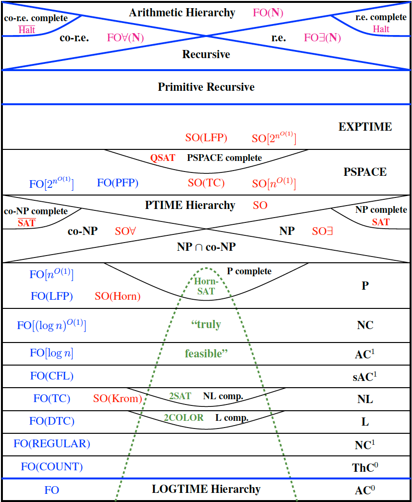

# Computability and Complexity
**First published Thu Jun 24, 2004; substantive revision Mon Oct 18, 2021**

*Immerman, Neil*

A mathematical problem is *computable* if it can be solved in principle by a computing device. Some common synonyms for “computable” are “solvable”, “decidable”, and “recursive”. Hilbert believed that all mathematical problems were solvable, but in the 1930’s Gödel, Turing, and Church showed that this is not the case. There is an extensive study and classification of which mathematical problems are computable and which are not. In addition, there is an extensive classification of computable problems into computational complexity classes according to how much computation—as a function of the size of the problem instance—is needed to answer that instance. It is striking how clearly, elegantly, and precisely these classifications have been drawn.

## 1. What can be computed in principle? Introduction and History

In the 1930’s, well before there were computers, various mathematicians from around the world invented precise, independent definitions of what it means to be computable. Alonzo Church defined the Lambda calculus, Kurt Gödel defined Recursive functions, Stephen Kleene defined Formal systems, Markov defined what became known as Markov algorithms, Emil Post and Alan Turing defined abstract machines now known as Post machines and Turing machines.

Surprisingly, all of these models are exactly equivalent: anything computable in the lambda calculus is computable by a Turing machine and similarly for any other pairs of the above computational systems. After this was proved, Church expressed the belief that the intuitive notion of “computable in principle” is identical to the above precise notions. This belief, now called the “Church-Turing Thesis”, is uniformly accepted by mathematicians.

Part of the impetus for the drive to codify what is computable came from the mathematician David Hilbert. Hilbert believed that all of mathematics could be precisely axiomatized. Once this was done, there would be an “effective procedure”, i.e., an algorithm that would take as input any precise mathematical statement, and, after a finite number of steps, decide whether the statement was true or false. Hilbert was asking for what would now be called a *decision procedure* for all of mathematics.

As a special case of this decision problem, Hilbert considered the validity problem for first-order logic. First-order logic is a mathematical language in which most mathematical statements can be formulated. Every statement in first-order logic has a precise meaning in every appropriate logical structure, i.e., it is true or false in each such structure. Those statements that are true in every appropriate structure are called *valid*. Those statements that are true in some structure are called *satisfiable*. Notice that a formula, $\varphi$, is valid iff its negation, $\neg \varphi$, is not satisfiable.

Hilbert called the validity problem for first-order logic, the *entscheidungsproblem*. In a textbook, *Principles of Mathematical Logic* by Hilbert and Ackermann, the authors wrote, “The Entscheidungsproblem is solved when we know a procedure that allows for any given logical expression to decide by finitely many operations its validity or satisfiability.… The entscheidungsproblem must be considered the main problem of mathematical logic.” (Böerger, Grädel, & Gurevich 1997)[^böerger-1997].

In his 1930 Ph.D. thesis, Gödel presented a complete axiomatization of first-order logic, based on the *Principia Mathematica* by Whitehead and Russell (Gödel 1930)[^gödel-1930]. Gödel proved his Completeness Theorem, namely that a formula is provable from the axioms if and only if it is valid. Gödel’s Completeness theorem was a step towards the resolution of Hilbert’s *entscheidungsproblem*.

In particular, since the axioms are easily recognizable, and rules of inference very simple, there is a mechanical procedure that can list out all proofs. Note that each line in a proof is either an axiom, or follows from previous lines by one of the simple rules. For any given string of characters, we can tell if it is a proof. Thus we can systematically list all strings of characters of length 1, 2, 3, and so on, and check whether each of these is a proof. If so, then we can add the proof’s last line to our list of theorems. In this way, we can list out all theorems, i.e., exactly all the valid formulas of first-order logic, can be listed out by a simple mechanical procedure. More precisely, the set of valid formulas is the range of a computable function. In modern terminology we say that the set of valid formulas of first-order logic is *recursively enumerable (r.e.)*.

Gödel’s Completeness theorem was not sufficient, however, to give a positive solution to the *entscheidungsproblem*. Given a formula, $\varphi$, if $\varphi$ is valid then the above procedure would eventually list it out and thus could answer, “Yes, $\varphi$ is valid.” However, if $\varphi$ were not valid then we might never find this fact out. What was missing was a procedure to list out all the non-valid formulas, or equivalently to list out all satisfiable formulas.

A year later, in 1931, Gödel shocked the mathematical world by proving his Incompleteness Theorem: there is no complete and computable axiomatization of the first-order theory of the natural numbers. That is, there is no reasonable list of axioms from which we can prove exactly all true statements of number theory (Gödel 1931)[^gödel-1931].

A few years later, Church and Turing independently proved that the *entscheidungsproblem* is unsolvable. Church did this by using the methods of Gödel’s Incompleteness Theorem to show that the set of satisfiable formulas of first-order logic is not r.e., i.e., they cannot be systematically listed out by a function computable by the lambda calculus. Turing introduced his machines and proved many interesting theorems some of which we will discuss in the next section. In particular, he proved the unsolvability of the *halting problem*. He obtained the unsolvability of the *entscheidungsproblem* as a corollary.

Hilbert was very disappointed because his program towards a decision procedure for all of mathematics was proved impossible. However, as we will see in more detail in the rest of this article, a vast amount was learned about the fundamental nature of computation.

## 2. Turing Machines

In his 1936 paper, “On Computable Numbers, with an Application to the Entscheidungsproblem”, Alan Turing introduced his machines and established their basic properties.

He thought clearly and abstractly about what it would mean for a machine to perform a computational task. Turing defined his machines to consist of the following:

- a finite set, $Q$, of possible states, because any device must be in one of finitely many possible states;
- a potentially infinite tape, consisting of consecutive cells, $\sigma_{1}, \sigma_{2}, \sigma_{3}$, from some finite alphabet, $\Sigma$; $(\Sigma$ may be any finite set containing at least two symbols. It is convenient to fix $\Sigma = \{0, 1, b\}$ consisting of the binary alphabet plus the blank cell symbol. We usually assume that a finite initial segment of the tape contains binary symbols, and the rest is blank.)
- a read/write tape head, $h \ge 1$, scanning tape cell $\sigma_{h}$; and finally,
- a transition function, $\delta : Q \times \Sigma \rightarrow Q \times \Sigma \times \{-1,0,1\}$. (The meaning of the transition function is that from any given state, $q$, looking at any given symbol, $\sigma_{h}, \delta$ tells us the new state the machine should enter, the new symbol that should be written in the current square, and the new head position, $h' = h + d$, where $d \in \{-1,0,1\}$ is the displacement given by $\delta$.)

The linear nature of its memory tape, as opposed to random access memory, is a limitation on computation speed but not power: a Turing machine can find any memory location, i.e., tape cell, but this may be time consuming because it has to move its head step by step along its tape.

The beauty of Turing machines is that the model is extremely simple, yet nonetheless, extremely powerful. A Turing machine has potentially infinite work space so that it can process arbitrarily large inputs, e.g., multiply two huge numbers, but it can only read or write a bounded amount of information, i.e., one symbol, per step. Even before Turing machines and all the other mathematical models of computation were proved equivalent, and before any statement of the Church-Turing thesis, Turing argued convincingly that his machines were as powerful as any possible computing device.

### 2.1 Universal Machines

Each Turing machine can be uniquely described by its transition table: for each state, $q$, and each symbol, $\sigma , \delta(q,\sigma)$ is the new state, the new symbol, and the head displacement. These transition tables, can be written as a finite string of symbols, giving the complete set of instructions of each Turing machine. Furthermore, these strings of symbols can be listed in lexicographic order as follows: $M_{1}, M_{2}, M_{3},\ldots$, where $M_{i}$ is the transition table, i.e., the complete set of instructions, for Turing machine number $i$. The transition table for $M_{i}$ is the program for Turing machine $i$, or more simply, the $i$ᵗʰ program.

Turing showed that he could build a Turing machine, $U$, that was *universal*, in the sense that it could run the program of any other Turing machine. More explicitly, for any $i$, and any input $w, U$ on inputs $i$ and $w$ would do exactly what $M_{i}$ would do on input $w$, in symbols,

$$ U(i,w) = M_{i}(w) $$

Turing’s construction of a universal machine gives the most fundamental insight into computation: one machine can run any program whatsoever. No matter what computational tasks we may need to perform in the future, a single machine can perform them all. This is the insight that makes it feasible to build and sell computers. One computer can run any program. We don’t need to buy a new computer every time we have a new problem to solve. Of course, in the age of personal computers, this fact is such a basic assumption that it may be difficult to step back and appreciate it.

### 2.2 The Halting Problem

Because they were designed to embody all possible computations, Turing machines have an inescapable flaw: some Turing machines on certain inputs never halt. Some Turing machines do not halt for silly reasons, for example, we can mis-program a Turing machine so that it gets into a tight loop, for example, in state 17 looking at a 1 it might go to state 17, write a 1 and displace its head by 0. Slightly less silly, we can reach a blank symbol, having only blank symbols to the right, and yet keep staying in the same state, moving one step to the right, and looking for a “1”. Both of those cases of non-halting could be easily detected and repaired by a decent compiler. However, consider the Turing machine $M_{F}$, which on input “0”, systematically searches for the first counter-example to Fermat’s last theorem, and upon finding it outputs the counter-example and halts. Until Andrew Wiles relatively recently proved Fermat’s Last Theorem, all the mathematicians in the world, working for over three centuries, were unable to decide whether or not $M_{F}$ on input “0” eventually halts. Now we know that it never does.

### 2.3 Computable Functions and Enumerability

Since a Turing machine might not halt on certain inputs, we have to be careful in how we define functions computable by Turing machines. Let the natural numbers, $\mathbf{N}$, be the set $\{0,1,2,\ldots \}$ and let us consider Turing machines as partial functions from $\mathbf{N}$ to $\mathbf{N}$.

Let $M$ be a Turing machine and $n$ a natural number. We say that $M$’s tape *contains* the number $n$, if $M$’s tape begins with a binary representation of the number $n$ (with no unnecessary leading 0’s) followed by just blank symbols from there on.

If we start the Turing machine $M$ on a tape containing $n$ and it eventually halts with its tape containing $m$, then we say that $M$ on input $n$, computes $m: M(n) = m$. If, when we start $M$ on input $n$, it either never halts, or when it halts, its tape does not contain a natural number, e.g., because it has leading 0’s, or digits interspersed with blank symbols, then we say that $M(n)$ is undefined, in symbols: $M(n) =\nearrow$. We can thus associate with each Turing machine, $M$, a *partial* function, $M: \mathbf{N} \rightarrow \mathbf{N} \cup \{\nearrow\}$. We say that the function $M$ is *total* if for all $n\in \mathbf{N}$, $M(n) \in \mathbf{N}$, i.e., M$(n)$ is always defined.

Now we can formally define what it means for a set to be *recursively enumerable* (r.e.) which we earlier described informally. Let $S \subseteq \mathbf{N}$. Then $S$ is r.e. if and only if there is some Turing machine, $M$, such that $S$ is the image of the function computed by $M$, in symbols,

$$ S = \{M(n) \mid n \in \mathbf{N}; M(n) \ne\nearrow\}. $$

Thus, $S$ is r.e. just if it can be listed out by some Turing machine. Suppose that $S$ is r.e. and its elements are enumerated by Turing machine $M$ as above. We can then describe another Turing machine, $P$, which, on input $n$, runs $M$ in a round-robin fashion on all its possible inputs until eventually $M$ outputs $n$. If this happens then $P$ halts and outputs “1”, i.e., $P(n)=1$. If $n \not\in S$, then $M$ will never output $n$, so $P(n)$ will never halt, i.e., $P(n)=\nearrow$.

Let the notation $P(n)\downarrow$ mean that Turing machine $P$ on input $n$ eventually halts. For a Turing machine, $P$, define $L(P)$, the *set accepted by* $P$, to be those numbers $n$ such that $P$ on input $n$ eventually halts,

$$ L(P) = \{n \mid P(n)\downarrow \}. $$

The above argument shows that if a set $S$ is r.e. then it is accepted by some Turing machine, $P$, i.e., $S = L(P)$. The converse of this statement holds as well. That is, $S$ is r.e. if and only if it is accepted by some Turing machine, $P$.

We say that a set, $S$, is *decidable* if and only if there is a total Turing machine, $M$, that decides for all $n \in \mathbf{N}$ whether or not $n \in S$. Think of “1” as “yes” and “0” as “no”. For all $n\in \mathbf{N}$, if $n \in S$, then $M(n) = 1$, i.e., $M$ on input $n$ eventually halts and outputs “yes”, whereas if $n \not\in S$, then $M(n) = 0$, i.e., $M$ on input $n$ eventually halts and outputs “no”. Synonyms for decidable are: *computable*, *solvable*, and *recursive*.

For $S \subseteq \mathbf{N}$, the *complement* of $S$ is $\mathbf{N} - S$, i.e., the set of all natural numbers not in $S$. We say that the set $S$ is *co-r.e.* if and only if its complement is r.e. If a set, $S$, is r.e. and co-r.e. then we can list out all of its elements in one column and we can list out all of its non-elements in a second column. In this way we can decide whether or not a given element, $n$, is in $S$: just scan the two columns and wait for $n$ to show up. If it shows up in the first column then $n \in S$. Otherwise it will show up in the second column and $n \not\in S$. In fact, a set is recursive iff it is r.e. and co-r.e.

### 2.4 The Unsolvability of the Halting Problem

Turing asked whether every set of natural numbers is decidable. It is easy to see that the answer is, “no”, by the following counting argument. There are uncountably many subsets of $\mathbf{N}$, but since there are only countably many Turing machines, there can be only countably many decidable sets. Thus almost all sets are undecidable.

Turing actually constructed a non-decidable set. As we will see, he did this using a diagonal argument. The diagonal argument goes back to Georg Cantor who used it to show that the real numbers are uncountable. Gödel used a similar diagonal argument in his proof of the Incompleteness Theorem in which he constructed a sentence, $J$, in number theory whose meaning could be understood to be, “$J$ is not a theorem.”

Turing constructed a diagonal halting set, $K$, as follows:

$$ K = \{n \mid M_{n}(n)\downarrow \}. $$

That is, $K$ consists of those Turing machines that eventually halt when input their own programs.

It is not hard to see that $K$ is r.e. Suppose for the sake of a contradiction that $K$ is also co-r.e., and let $d$ be the number of a Turing machine that accepts the complement of $K$. That is, for any $n$,

$$ n \not\in K \Leftrightarrow M_{d}(n)\downarrow $$

But consider what happens when we substitute $d$ for $n$ in the above equation:

$$ d \not\in K \Leftrightarrow M_{d}(d)\downarrow. $$

However, the definition of $K$ tells us that:

$$ d \in K \Leftrightarrow M_{d}(d)\downarrow . $$

Thus we have that

$$ d \in K \Leftrightarrow d \not\in K, $$

which is a contradiction. Thus our assumption that $K$ is co-r.e. is false. Thus $K$ is not recursive. It follows that it is not a computable problem to be given a Turing machine and its input and to decide whether or not the Turing machine will eventually halt on that input, i.e., the halting problem is unsolvable.

## 3. Primitive Recursive Functions

We next define the class of *Primitive Recursive Functions*. This is a very interesting class of functions described a in paper by Skolem (1923) and used by Gödel in his proof of the Incompleteness Theorem. We are interested in functions $f$ from $\mathbf{N}^{r}$ to $\mathbf{N}$, for $r = 0, 1, 2,\ldots$ . Here $r$ is called the arity of the function $f$, i.e., the number of arguments that it takes. Gödel started with three very simple functions, the initial functions, and two natural closure operations, composition and primitive recursion, each of which take some already defined functions and use them to define a new one. We next explain his definitions in detail. This section is technical and can be safely skipped. The important idea is that the primitive recursive functions comprise a very large and powerful class of computable functions, all generated in an extremely simple way.

We begin with the three *initial* primitive recursive functions:

- $\zeta$, the zero function of arity $0, \zeta$( ) $= 0$;
- $\eta$, the identity function of arity $1, \eta(n) = n$; and,
- $\sigma$, the successor function of arity $1, \sigma(n) = n +1$.

Now consider the following two operations:

- **Composition**: if $f$ is a primitive recursive function of arity $a$, and $g_{1}, \ldots ,g_{a}$ are primitive recursive functions of arities $r_{1}, \ldots ,r_{a}$, and $k\in \mathbf{N}$, then the following is a primitive recursive function of arity $k$: $$ h(x_{1}, \ldots ,x_{k}) = f(g_{1}(w_{1}), \ldots ,g_{a}(w_{a})), $$ where each $w_{i}$ is a list of $r_{i}$ arguments, perhaps with repetition, from $x_{1}, \ldots ,x_{k}$; and,
- **Primitive recursion**: if $f$ and $g$ are primitive recursive functions of arity $k$ and $k+2$, respectively, then there is a primitive recursive function, $h$, of arity $k+1$ satisfying the following conditions: $$\begin{align} h(0,x_{1},\ldots ,x_{k}) &= f(x_{1},\ldots ,x_{k}); \text{ and,} \\ h(n+1,x_{1},\ldots ,x_{k}) &= g(h(n,x_{1},\ldots ,x_{k}), n,x_{1},\ldots ,x_{k}). \end{align}$$

Here composition is the natural way to combine functions, and primitive recursion is a restricted kind of recursion in which $h$ with first argument $n+1$ is defined in terms of $h$ with first argument $n$, and all the other arguments unchanged.

Define the *primitive recursive functions* to be the smallest class of functions that contains the Initial functions and is closed under Composition and Primitive Recursion. The set of primitive recursive functions is equal to the set of functions computed using bounded iteration (Meyer & Ritchie 1967)[^meyer-1967], i.e. the set of functions definable in the language Bloop from (Hofstadter 1979)[^hofstadter-1979].

The primitive recursive functions have a very simple definition and yet they are extremely powerful. Gödel proved inductively that every primitive recursive function can be simply represented in first-order number theory. He then used the primitive recursive functions to encode formulas and even sequences of formulas by numbers. He finally used the primitive recursive functions to compute properties of the represented formulas including that a formula is well formed and that a sequence of formulas is a proof.

It takes a long series of lemmas to show how powerful the primitive recursive functions are. The following are a few examples showing that addition, multiplication, and exponentiation are primitive recursive.

Define the addition function, $P(x,y)$, as follows:

$$\begin{align} P(0,y) &= \eta(y) \\ P(n+1,y) &= \sigma(P(n,y)) \end{align}$$

(Note that this fits into the definition of primitive recursion because the function $g(x_{1},x_{2},x_{3}) = \eta(\sigma(x_{1}))$ is definable from the initial functions $\eta$ and $\sigma$ by composition.)

Next, define the multiplication function, $T(x,y)$, as follows:

$$\begin{align} T(0,y) &= \zeta(\ ) \\ T(n+1,y) &= P(T(n,y),y). \end{align}$$

Next, we define the exponential function, $E(x,y)$. (Usually $0^{0}$ is considered undefined, but since primitive recursive functions must be total, we define $E$(0,0) to be 1.) Since primitive recursion only allows us to recurse on the first argument, we use two steps to define the exponential function:

$$\begin{align} R(0,y) &= \sigma(\zeta(\ )) \\ R(n+1,y) &= T(R(n,y),y). \end{align}$$

Finally we can define $E(x,y) = R(\eta(y),\eta(x))$ by composition. (Recall that $\eta$ is the identity function so this could be more simply written as $E(x,y) = R(y,x)$.)

The exponential function, $E$, grows very rapidly, for example, $E$(10,10) is ten billion, and $E$(50,50) is over $10^{84}$ (and thus significantly more than the estimated number of atoms in the universe). However, there are much faster growing primitive recursive functions. As we saw, $E$ was defined from the slowly growing function, $\sigma$, using three applications of primitive recursion: one for addition, one for multiplication, and then one more for exponentiation. We can continue to apply primitive recursion to build a series of unimaginably fast growing functions. Let’s do just one more step in the series defining the hyper-exponential function, $H(n,m)$ as 2 to the 2 to the 2 to the … to the $m$, with a tower of $n$ 2s. $H$ is primitive recursive because it can be defined from $E$ using one more application of primitive recursion:

$$\begin{align} H(0,y) &= y \\ H(n+1,y) &= E(2,H(n,y)) \end{align}$$

Thus $H(2,2) = 2^{4} = 16, H(3,3) = 2^{256}$ is more than $10^{77}$ and comparable to the number of atoms in the universe. If that’s not big enough for you then consider $H(4,4)$. To write this number in decimal notation we would need a one, followed by more zero’s than the number of particles in the universe.

### 3.1 Recursive Functions

The set of primitive recursive functions is a huge class of computable functions. In fact, they can be characterized as the set of functions computable in time that is some primitive recursive function of $n$, where $n$ is the length of the input. For example, since $H(n,n)$ is a primitive recursive function, the primitive recursive functions include all of TIME[$H(n,n)$]. (See the next section for a discussion of computational complexity, including TIME.) Thus, the primitive recursive functions include all functions that are feasibly computable by any conceivable measure of feasible, and much beyond that.

However, the primitive recursive functions do not include all functions computable in principle. To see this, we can again use diagonalization. We can systematically encode all definitions of primitive recursive functions of arity 1, calling them $p_{1}, p_{2}, p_{3}$, and so on.

We can then build a Turing machine to compute the value of the following diagonal function, $D(n) = p_{n}(n) + 1$.

Notice that $D$ is a total, computable function from $\mathbf{N}$ to $\mathbf{N}$, but it is not primitive recursive. Why? Suppose for the sake of a contradiction that $D$ were primitive recursive. Then $D$ would be equal to $p_{d}$ for some $d\in \mathbf{N}$. But it would then follow that

$$ p_{d}(d) = p_{d}(d) +1, $$

which is a contradiction. Therefore, $D$ is not primitive recursive.

Alas, the above diagonal argument works on any class of total functions that could be considered a candidate for the class of all computable functions. The only way around this, if we want all functions computable in principle, not just in practice, is to add some kind of unbounded search operation. This is what Gödel did to extend the primitive recursive functions to the recursive functions.

Define the unbounded minimization operator, $\mu$, as follows. Let $f$ be a perhaps partial function of arity $k+1$. Then $\mu[f$] is defined as the following function of arity k. On input $x_{1}, \ldots ,x_{k}$ do the following:

For $i = 0$ to $\infty$ do $\{$

if $f(i,x_{1},\ldots ,x_{k}) = 1$, then output $i$

$\}$

Thus if $f(i,x_{1},\ldots ,x_{k}) = 1$, and for all $j \lt i, f(j,x_{1},\ldots ,x_{k})$ is defined, but not equal to 1, then $\mu [f](x_{1}, \ldots ,x_{k}) = i$. Otherwise $\mu[f](x_{1}, \ldots ,x_{k})$ is undefined.

Gödel defined the set of *Recursive functions* to be the closure of the initial primitive recursive functions under composition, primitive recursion, and $\mu$ . With this definition, the Recursive functions are exactly the same as the set of partial functions computable by the Lambda calculus, by Kleene Formal systems, by Markov algorithms, by Post machines, and by Turing machines.

## 4. Computational Complexity: Functions Computable in Practice

During World War II, Turing helped design and build a specialized computing device called the Bombe at Bletchley Park. He used the Bombe to crack the German “Enigma” code, greatly aiding the Allied cause [Hodges, 1992][^hodges-1992]. By the 1960’s computers were widely available in industry and at universities. As algorithms were developed to solve myriad problems, some mathematicians and scientists began to classify algorithms according to their efficiency and to search for best algorithms for certain problems. This was the beginning of the modern theory of computation.

In this section we are dealing with complexity instead of computability, and all the Turing machines that we consider will halt on all their inputs. Rather than accepting by halting, we will assume that a Turing machine accepts by outputting “1” and rejects by outputting “0”, thus we redefine the set accepted by a total machine, $M$,

$$ L(M) = \{n \mid M(n) = 1\}. $$

The time that an algorithm takes depends on the input and the machine on which it is run. The first important insight in complexity theory is that a good measure of the complexity of an algorithm is its asymptotic worst-case complexity as a function of the size of the input, $n$.

For an input, $w$, let $n = \lvert w\rvert$ be the length of $w$. Following [Hartmanis, 1989][^hartmanis-1989] we say that a Turing machine $M$ *runs in time* $T(n)$ if for all $w$ of length $n, M(w)$ takes at most $T(n)$ steps and then halts. This is called worst-case complexity because $T(n)$ must be as large as the time taken by any input of length $n$.

For any function $T : \mathbf{N} \rightarrow \mathbf{N}$, let

$$ \TIME[T(n)] = \{ A \mid A = L(M) \text{ for some } M \text{ that runs in time } T(n)\}. $$

Alan Cobham and Jack Edmonds identified the complexity class, $\P$, of problems recognizable in some polynomial amount of time, as being an excellent mathematical wrapper of the class of feasible problems—those problems all of whose moderately-sized instances can be feasibly recognized,

$$ \P = \bigcup_{i=1,2,\ldots} \TIME[n^{i}] $$

Any problem not in $\P$ is certainly not feasible. On the other hand, natural problems that have algorithms in $\P$, tend to eventually have algorithms discovered for them that are actually feasible.

Many important complexity classes besides P have been defined and studied; a few of these are $\NP$, $\PSPACE$, and $\EXPTIME$. $\PSPACE$ consists of those problems solvable using some polynomial amount of memory space. $\EXPTIME$ is the set of problems solvable in time $2^{p(n)}$ for some polynomial, $p$.

Perhaps the most interesting of the above classes is NP: nondeterministic polynomial time. The definition comes not from a real machine, but rather a mathematical abstraction. A nondeterministic Turing machine, $N$, makes a choice (guess) of one of two possible actions at each step. If, on input $w$, some sequence of these choices leads to acceptance, then we say that $\mathbf{N}$ accepts $w$, and we say the *nondeterministic time* taken by $\mathbf{N}$ on input $w$, is just the number of steps taken in the sequence that leads to acceptance. A nondeterministic machine is not charged for all the other possible choices it might have made, just the single sequence of correct choices.

NP is sometimes described as the set of problems, $S$, that have short proofs of membership. For example, suppose we are given a list of $m$ large natural numbers: $a_{1}, \ldots ,a_{m}$, and a target number, $t$. This is an instance of the Subset Sum problem: is there a subset of the $m$ numbers whose sum is exactly $t$? This problem is easy to solve in nondeterministic linear time: for each $i$, we guess whether or not to take $a_{i}$. Next we add up all the numbers we decided to take and if the sum is equal to $t$ then accept. Thus the nondeterministic time is linear, i.e., some constant times the length of the input, $n$. However there is no known (deterministic) way to solve this problem in time less than exponential in $n$.

### 4.1 Reductions and Completeness

There has been a large study of algorithms and the complexity of many important problems is well understood. In particular reductions between problems have been defined and used to compare the relative difficulty of two problems. Intuitively, we say that $A$ is *reducible* to $B$ $(A \le B)$ if there is an easy-to-compute transformation, $\tau$, that maps instances of $A$ to instances of $B$ in a way that preserves membership, i.e., $\tau$(w) $\in B \Leftrightarrow$ w $\in A$.

Remarkably, a high percentage of naturally occurring computational problems turn out to be complete for one of the above classes. (A problem, $A$, is complete for a complexity class $C$ if $A$ is a member of $C$ and all other problems $B$ in $C$ are no harder than $A$, i.e., $B \le A$. Two complete problems for the same class have equivalent complexity.)

The reason for this completeness phenomenon has not been adequately explained. One plausible explanation is that natural computational problems tend to be universal in the sense of Turing’s universal machine. A universal problem in a certain complexity class can simulate any other problem in that class.

In 1971, Cook proved SAT is NP complete [Cook, 1971][^cook-1971]. Shortly later, Karp showed that many important combinatorial problems were also NP complete, thus establishing the importance of the class NP [Karp, 1972][^karp-1972].

Our definition of reduction above lacked precision, just saying that the mapping $\tau$ must by easy-to-compute. The reductions that Karp used were polynomial-time reductions, i.e., $\tau$ is computable in polynomial time. Since then, many researchers have observed that natural problems remain complete for natural complexity classes under surprisingly weak reductions including logspace reductions [Jones, 1973][^jones-1973], first-order reductions [Immerman, 1999][^immerman-1999], projections [Valiant, 1982][^valiant-1982], and first-order projections [Immerman, 1999][^immerman-1999].

With a very few exceptions, when a natural problem is in NP, it turns out to be either NP complete, or in P. People wondered whether this was always the case. Ladner proved that if P $\ne$ NP, then there is an intermediate problem $I$ that is in NP but not in P and not NP complete [Ladner, 1975][^ladner-1975].

Ladner’s proof method is called delayed diagonalization. He generalized his result to show that for any two well-behaved complexity classes, C, E such that C is strictly contained in E, there is an intermediate class, D such that C is strictly contained in D and D is strictly contained in E. Thus the ordering of complexity classes is dense.

However, these intermediate problems don’t tend to show up. This phenomenon has received a great deal of attention recently via the dichotomy conjecture of Feder and Vardi [Feder and Vardi, 1999][^feder-1999]. Schaefer introduced this work with an insightful paper in which he studied all variants of the boolean satisfiability problem [Schaefer, 1978][^schaefer-1978]. He proved that each such problem was either NP complete or in P, thus Ladner’s intermediate problems cannot occur among such satisfiability problems. Since there were just these two possibilities, Schaefer called this a dichotomy.

In fact, if one looks closer, all of Schaefer’s satisfiability problems are either NP complete, P complete, $\oplus$L complete, NL complete, L complete, or trivial [Allender et al., 2009][^allender-2009]. That is the non-trivial problems in P may be P complete, or complete for one of these three complexity classes within P. In other words, if we look closer, the NP/P dichotomy phenomenon problem is really a “multi-chotomoy” phenomenon, namely all non-trivial satisfiability problems are complete for one of five well-known complexity classes.

Feder and Vardi studied Schaefer’s dichotomy and conjectured that it holds for all finite-domain Constraint Satisfaction Problems (CSP) [Feder and Vardi, 1999][^feder-1999]. A finite-domain CSP, C, consists of a finite domain, D, and a finite set of relations $R_1, \ldots , R_k$ over D. An instance of C consists of a set of variables, $v_1, \ldots v_n$ and a conjunction of atoms $\varphi \equiv \bigwedge R_i(v_{j_1}, \ldots)$. The answer to the instance, $\varphi$, is “yes”, i.e., $\varphi \in C$ iff there is an assignment of the variables to elements of the domain, D, so that $\varphi$ is satisfied.

With domains of size 2, a CSP problem is just a satisfiability problem, so Schaefer’s theorem already established the Feder and Vardi conjecture for this case. A simple instance of a CSP with domain size 3 is the 3COLOR problem for undirected graphs. Given such a graph, G, can the vertices of G be colored one of three colors so that no two adjacent vertices have the same color? To write this as a CSP, let $D = \{R,Y,B\}$ be a set of three distinct colors and let the relation $N$ be the not-equal relation on $D$. Then from $G=(V,E)$ the instance of 3COLOR is $$ \varphi_G \quad = \quad \bigwedge_{(u,v)\in E} N(u,v)\; .$$ Note that $\varphi_G$ says that whenever there is an edge in $G$ between vertices $u$ and $v$, then $u$ and $v$ are assigned different colors.

Feder and Vardi’s conjecture led to an extremely productive research program. In particular, a rich algebraic theory of CSPs was developed in a number of papers starting with [Jeavons et al. 1997][^jeavons-1997]; see [Bulatov, 2018][^bulatov-2018] for a survey. Eventually, by applying and advancing this algebraic theory, Bulatov and Zhuk independently proved the Feder and Vardi conjecture [Bulatov, 2017; Zhuk, 2017][^bulatov-2017].

### 4.2 Significance of Complexity

The reason that the class NP is so well studied is that a large number of important practical problems are NP complete, including Subset Sum. None of these problems is known to have an algorithm that is faster than exponential time, although some NP-complete problems admit feasible approximations to their solutions.

A great deal remains open about computational complexity. We know that strictly more of a particular computational resource lets us solve strictly harder problems, e.g. $\TIME[n]$ is strictly contained in $\TIME[n^{1.01}]$ and similarly for $\SPACE$ and other measures. However, the trade-offs between different computational resources is still quite poorly understood. It is obvious that $\P$ is contained in $\NP$. Furthermore, $\NP$ is contained in $\PSPACE$ because in $\PSPACE$ we can systematically try every single branch of an $\NP$ computation, reusing space for the successive branches, and accepting if any of these branches lead to acceptance. $\PSPACE$ is contained in $\EXPTIME$ because if a $\PSPACE$ machine takes more than exponential time, then it has exactly repeated some configuration so it must be in an infinite loop. The following are the known relationships between the above classes:

$$ \P \subseteq \NP \subseteq \PSPACE \subseteq \EXPTIME $$

However, while it seems clear that $\P$ is strictly contained in $\NP$, that $\NP$ is strictly contained in $\PSPACE$, and that $\PSPACE$ is strictly contained in $\EXPTIME$, none of these inequalities has been proved. In fact, it is not even known that $\P$ is different from $\PSPACE$, nor that $\NP$ is different from $\EXPTIME$. The only known proper inclusion from the above is that $\P$ is strictly contained in $\EXPTIME$. The remaining questions concerning the relative power of different computational resources are fundamental unsolved problems in the theory of computation.

The following diagram maps out all the complexity classes we have discussed and a few more as well. The diagram comes from work in Descriptive Complexity [Immerman, 1999][^immerman-1999] which shows that all important complexity classes have descriptive characterizations. Fagin began this field by proving that NP = SO$\exists$, i.e., a property is in NP iff it is expressible in second-order existential logic [Fagin, 1974][^fagin-1974].

Vardi and the author of this entry later independently proved that P = FO(LFP): a property is in P iff it is expressible in first-order logic plus a least fixed-point operator (LFP) which formalizes the power to define new relations by induction. A captivating corollary of this is that P = NP iff SO = FO(LFP). That is, P is equal to NP iff every property expressible in second order logic is already expressible in first-order logic plus inductive definitions. (The languages in question are over finite ordered input structures. See [Immerman, 1999] for details.)[^immerman-1999]

*The World of Computability and Complexity*

The top right of the diagram shows the recursively enumerable (r.e.) problems; this includes r.e.-complete problems such as the halting problem (Halt). On the left is the set of co-r.e. problems including the co-r.e.-complete problem $\overline{{\rm Halt}}$ -- the set of Turing Machines that never halt on a given input. We mentioned at the end of Section 2.3 that the intersection of the set of r.e problems and the set of co-r.e problems is equal to the set of Recursive problems. The set of Primitive Recursive problems is a strict subset of the Recursive problems.

Moving toward the bottom of the diagram, there is a region marked with a green dotted line labelled “truly feasible”. Note that this is not a mathematically defined class, but rather an intuitive notion of those problems that can be solved exactly, for all the instances of reasonable size, within a reasonable amount of time, using a computer that we can afford. (Interestingly, as the speed of computers has dramatically increased over the years, our expectation of how large an instance we should be able to handle has increased accordingly. Thus, the boundary of what is “truly feasible” changes more slowly than the increase of computer speed might suggest.)

As mentioned before, P is a good mathematical wrapper for the set of feasible problems. There are problems in P requiring $n^{1,000}$ time for problems of size $n$ and thus not feasible. Nature appears to be our friend here, which is to say naturally occurring problems in P favor relatively simple algorithms, and “natural” problems tend to be feasible. The number of steps required for problems of size $n$ tends to be less than $c n^k$ with small multiplicative constants $c$, and very small exponents, $k$, i.e., $k\leq 2$.

In practice the asymptotic complexity of naturally occurring problems tends to be the key issue determining whether or not they are feasible. A problem with complexity $17n$ can be handled in under a minute on modern computers, for *every* instance of size a billion. On the other hand, a problem with worst-case complexity $2^n$ cannot be handled in our lifetimes for *some* instance of size a hundred.

As discussed, natural problems tend to be complete for important complexity classes, namely the ones in the diagram and only a very few others. This fascinating phenomenon means that algorithms and complexity are more than abstract concepts; they are important at a practical level. We have had remarkable success in proving that our problem of interest is complete for a well-known complexity class. If the class is contained in P, then we can usually just look up a known efficient algorithm. Otherwise, we must look at simplifications or approximations of our problem which may be feasible.

There is a rich theory of the approximability of NP optimization problems (See [Arora & Barak, 2009])[^arora-2009]. For example, the Subset Sum problem mentioned above is an NP-complete problem. Most likely it requires exponential time to tell whether a given Subset Sum problem has an exact solution. However, if we only want to see if we can reach the target up to a fixed number of digits of accuracy, then the problem is quite easy, i.e., Subset Sum is hard, but very easy to approximate.

Even the r.e.-complete Halting problem has many important feasible subproblems. Given a program, it is in general not possible to figure out what it does and whether or not it eventually halts. However, most programs written by programmers or students can be automatically analyzed, optimized and even corrected by modern compilers and model checkers.

The class NP is very important practically and philosophically. It is the class of problems, $S$, such that any input $w$ is in $S$ iff there is a proof, $p(w)$, that $w\in S$ and $p(w)$ is not much larger than $w$. Thus, very informally, we can think of NP has the set of intellectual endeavors that may be in reach: if we find the answer to whether $w \in S$, we can convince others that we have done so.

The boolean satisfiability problem, SAT, was the first problem proved NP complete [Cook, 1971][^cook-1971], i.e., it is a hardest NP problem. The fact that SAT is NP complete means that all problems in NP are reducible to SAT. Over the years, researchers have built very efficient SAT solvers which can quickly solve many SAT instances – i.e., find a satisfying assignment or prove that there is none -- even for instances with millions of variables. Thus, SAT solvers are being used as general purpose problem solvers. On the other hand, there are known classes of small instances for which current SAT solvers fail. Thus part of the P versus NP question concerns the practical and theoretical complexity of SAT [Nordström, 2015][^nordström-2015].

There is an extensive theory of computational complexity. This entry briefly describes the area, putting it into the context of the question of what is computable in principle versus in practice. For readers interested in learning more about complexity, there are excellent books, for example, [Papadimitriou, 1994][^papadimitriou-1994] and [Arora and Barak, 2009][^arora-2009]. There is also the entry on Computational Complexity Theory.

## References（引用注释）

> 原文参考文献已转为脚注引用：文内“作者-年份”引用组后附 [^key] 标记，完整条目见本文末脚注定义。

## Academic Tools

> |   | [How to cite this entry](https://plato.stanford.edu/cgi-bin/encyclopedia/archinfo.cgi?entry=computability). |
> | --- | --- |
> |   | [Preview the PDF version of this entry](https://leibniz.stanford.edu/friends/preview/computability/) at the [Friends of the SEP Society](https://leibniz.stanford.edu/friends/). |
> |   | [Look up topics and thinkers related to this entry](https://www.inphoproject.org/entity?sep=computability&redirect=True) at the Internet Philosophy Ontology Project (InPhO). |
> |   | [Enhanced bibliography for this entry](https://philpapers.org/sep/computability/) at [PhilPapers](https://philpapers.org/), with links to its database. |

## Other Internet Resources

- [Descriptive Complexity](http://people.cs.umass.edu/~immerman/descriptive_complexity.html): a webpage describing research in Descriptive Complexity which is Computational Complexity from a Logical Point of View (with a diagram showing the World of Computability and Complexity). Maintained by Neil Immerman, University of Massachusetts, Amherst.
- [Mass, Size, and Density of the Universe](http://www.cs.umass.edu/~immerman/stanford/universe.html), from the National Solar Observatory/Sacramento Peak.

## Related Entries

Church, Alonzo: logic, contributions to | Church-Turing Thesis | computational complexity theory | Gödel, Kurt | quantum theory: quantum computing | recursive functions | set theory | Turing, Alan | Turing machines

[^allender-2009]: Allender, E., M. Bauland, N. Immerman, H. Schnoor and H. Vollmer, 2009, “The Complexity of Satisfiability Problems: Refining Schaefer’s Theorem”, *Journal of Computer and System Science* 75(4): 245–254.

[^arora-2009]: Arora, Sanjeev and Boaz Barak, 2009, *Computational Complexity: A Modern Approach*, New York: Cambridge University Press.

[^böerger-1997]: Böerger, Egon, Erich Grädel, and Yuri Gurevich, 1997, *The Classical Decision Problem*, Heidelberg: Springer.

[^bulatov-2017]: Bulatov, Andrei, 2017, “A Dichotomy Theorem for Nonuniform CSPs”, *IEEE 58th Annual Symposium on Foundations of Computer Science*, 319–330.

[^bulatov-2018]: –––, 2018, “Constraint Satisfaction Problems: Complexity and Algorithms”, *SIGLOG News* 4(5): 3–24.

[^church-1933]: Church, Alonzo, 1933, “A Set of Postulates for the Foundation of Logic (Second Paper)”, *Annals of Mathematics* (Second Series), 33: 839–864.

[^church-1936a]: –––, 1936a, “An Unsolvable Problem of Elementary Number Theory,” *American Journal of Mathematics*, 58: 345–363.

[^church-1936b]: –––, 1936b, “A Note on the Entscheidungsproblem,” *Journal of Symbolic Logic*, 1: 40–41; correction 1, 101–102.

[^cobham-1964]: Cobham, Alan, 1964, “The Intrinsic Computational Difficulty of Functions,” *Proceedings of the 1964 Congress for Logic, Mathematics, and Philosophy of Science*, Amsterdam: North-Holland, pp. 24–30.

[^cook-1971]: Cook, Stephen, 1971, “The Complexity of Theorem Proving Procedures,” *Proceedings of the Third Annual ACM STOC Symposium*, Shaker Heights, Ohio, pp. 151–158.

[^davis-2000]: Davis, Martin, 2000, *The Universal Computer: the Road from Leibniz to Turing*, New York: W. W. Norton & Company.

[^edmonds-1965]: Edmonds, Jack, 1965, “Paths, Trees and Flowers,” *Canadian Journal of Mathematics*, 17: 449–467.

[^enderton-1972]: Enderton, Herbert B., 1972, *A Mathematical Introduction to Logic*, New York: Academic Press.

[^fagin-1974]: Fagin, Ronald, 1974, “Generalized First-Order Spectra and Polynomial-Time Recognizable Sets,” in *Complexity of Computation*, R. Karp (ed.), *SIAM-AMS Proc*, 7: 27–41.

[^feder-1999]: Feder, Tomas and Moshe Vardi, 1999, “The Computational Structure of Monotone Monadic SNP and Constraint Satisfaction: A Study Through Datalog and Group Theory”, *SIAM Journal of Computing* 28: 57–104.

[^garey-1979]: Garey, Michael and David S. Johnson, 1979, *Computers and Intractability*, New York: Freeman.

[^gödel-1930]: Gödel, Kurt, 1930, “The Completeness of the Axioms of the Functional Calculus,” in van Heijenoort 1967: 582–591.

[^gödel-1931]: –––, 1931, “On Formally Undecidable Propositions of Principia Mathematica and Related Systems I,” in van Heijenoort, 1967: 592–617.

[^hartmanis-1989]: Hartmanis, Juris, 1989, “Overview of computational Complexity Theory” in J. Hartmanis (ed.), *Computational Complexity Theory*, Providence: American Mathematical Society, pp. 1–17.

[^hilbert-1928]: Hilbert and Ackermann, 1928/1938, *Grundzüge der theoretischen Logik*, Springer. English translation of the 2nd edition: *Principles of Mathematical Logic*, New York: Chelsea Publishing Company, 1950.

[^hodges-1992]: Hodges, Andrew, 1992, *Alan Turing: the Enigma*, London: Random House.

[^hofstadter-1979]: Hofstadter, Douglas, 1979, *Gödel, Escher, Bach: an Eternal Golden Braid*, New York: Basic Books.

[^hopcroft-1984]: Hopcroft, John E., 1984, “Turing Machines”, *Scientific American*, 250(5): 70–80.

[^immerman-1999]: Immerman, Neil, 1999, *Descriptive Complexity*, New York: Springer.

[^jeavons-1997]: Jeavons, P.G., D.A. Cohen and M. Gyssens, 1997, “Closure Properties of Constraints”, *Journal of the ACM*, 44: 527–548.

[^jones-1973]: Jones, Neil, 1973, “Reducibility Among Combinatorial Problems in Log *n* Space”, *Proc. Seventh Annual Princeton Conf. Info. Sci. and Systems*, 547–551.

[^karp-1972]: Karp, Richard, 1972, “Reducibility Among Combinatorial Problems,”, in *Complexity of Computations*, R.E. Miller and J.W. Thatcher (eds.), New York: Plenum Press, pp. 85–104.

[^kleene-1935]: Kleene, Stephen C., 1935, “A Theory of Positive Integers in Formal Logic,” *American Journal of Mathematics*, 57: 153–173, 219–244.

[^kleene-1950]: –––, 1950, *Introduction to Metamathematics*, Princeton: Van Nostrand.

[^ladner-1975]: Ladner, Richard, 1975, “On the structure of polynomial time reducibility”, *Journal of the ACM*, 155–171.

[^levin-1973]: Levin, Leonid, 1973, “Universal search problems,” *Problemy Peredachi Informatsii*, 9(3): 265–266; partial English translation in B.A.Trakhtenbrot, 1984, “A Survey of Russian Approaches to Perebor (Brute-force Search) Algorithms,” *IEEE Annals of the History of Computing*, 6(4): 384–400.

[^markov-1960]: Markov, A.A., 1960, “The Theory of Algorithms,” *American Mathematical Society Translations* (Series 2), 15: 1–14.

[^meyer-1967]: Meyer, Albert and Dennis Ritchie, 1967, “The Complexity of Loop Programs,” *Proceedings of the 22nd National ACM Conference*, Washington, D.C., 465–470.

[^nordström-2015]: Nordström, Jakob, 2015, “On the Interplay Between Proof Complexity and SAT Solving,” SIGLOG News, 2(3): 18–44.

[^papadimitriou-1994]: Papadimitriou, Christos H., 1994, *Computational Complexity*, Reading, MA: Addison-Wesley.

[^péter-1967]: Péter, Rózsa. 1967, *Recursive Functions*, translated by István Földes, New York: Academic Press.

[^post-1936]: Post, Emil, 1936, “Finite Combinatory Processes – Formulation I,” *Journal of Symbolic Logic*, 1: 103–105.

[^rogers-1967]: Rogers, Hartley Jr., 1967, *Theory of Recursive Functions and Effective Computability*, New York: McGraw-Hill.

[^schaefer-1978]: Schaefer, Thomas, 1978, “The Complexity of Satisfiability Problems”, *Proceedings of the Tenth Annual ACM STOC Symposium*, 216–226.

[^skolem-1923]: Skolem, Thoralf, 1923, “The foundations of elementary arithmetic established by means of the recursive mode of thought,” in van Heijenoort 1967: 302–33.

[^turing-1936]: Turing, A. M., 1936–7, “On Computable Numbers, with an Application to the Entscheidungsproblem”, *Proceedings of the London Mathematical Society*, 2(42): 230–265 [[Preprint available online](http://www.abelard.org/turpap2/tp2-ie.asp)].

[^valiant-1982]: Valiant, Leslie, 1982, “Reducibility By Algebraic Projections”, *L’Enseignement mathematique*, 28(3–4): 253–268.

[^heijenoort-1967]: van Heijenoort, Jean, (ed.), 1967, *From Frege To Gödel: A Source Book in Mathematical Logic, 1879–1931*, Cambridge, Massachusetts: Harvard University Press.

[^whitehead-1910]: Whitehead, Alfred North and Bertrand Russell, 1910–1913, *Principia Mathematica*, first edition, Cambridge: Cambridge University Press.

[^zhuk-2020]: Zhuk, Dmitriy, 2020, “A Proof of CSP Dichotomy Conjecture”, *Journal of the ASM*, 30: 1–78.
