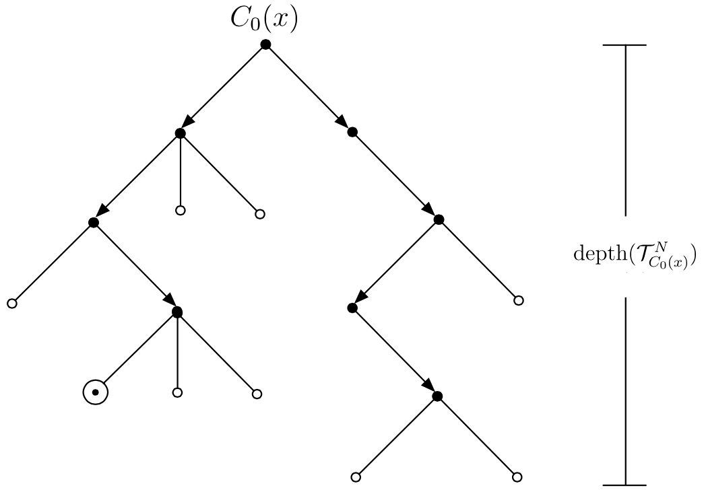
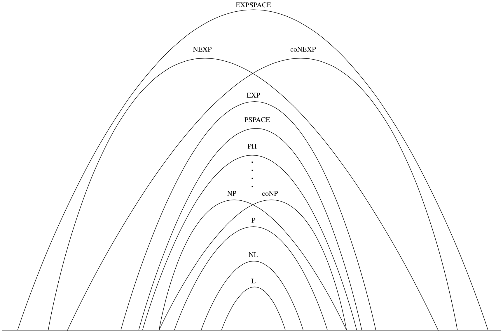
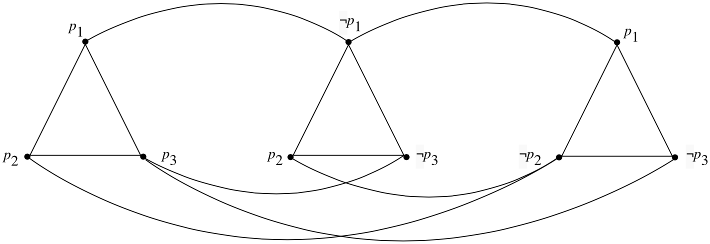
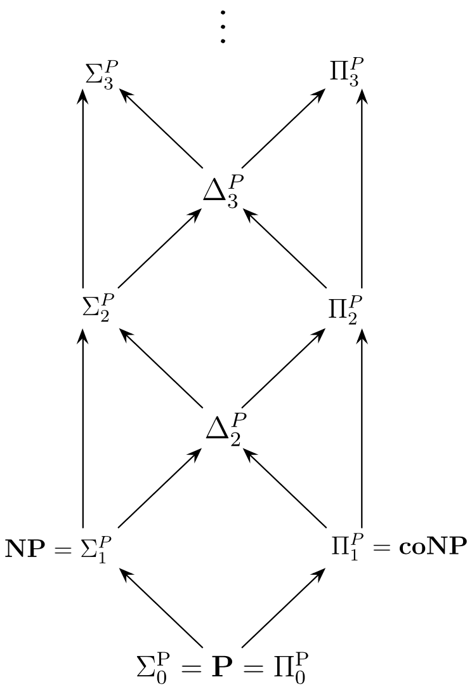

# Computational Complexity Theory
**First published Mon Jul 27, 2015; substantive revision Wed Jul 20, 2016**

*Dean, Walter*

Computational complexity theory is a subfield of theoretical computer science one of whose primary goals is to classify and compare the practical difficulty of solving problems about finite combinatorial objects – e.g. given two natural numbers $n$ and $m$, are they relatively prime? Given a propositional formula $\phi$, does it have a satisfying assignment? If we were to play chess on a board of size $n \times n$, does white have a winning strategy from a given initial position? These problems are equally difficult from the standpoint of classical computability theory in the sense that they are all effectively decidable. Yet they still appear to differ significantly in practical difficulty. For having been supplied with a pair of numbers $m \gt n \gt 0$, it is possible to determine their relative primality by a method (Euclid’s algorithm) which requires a number of steps proportional to $\log(n)$. On the other hand, all known methods for solving the latter two problems require a ‘brute force’ search through a large class of cases which increase at least exponentially in the size of the problem instance.

Complexity theory attempts to make such distinctions precise by proposing a formal criterion for what it means for a mathematical problem to be *feasibly decidable* – i.e. that it can be solved by a conventional Turing machine in a number of steps which is proportional to a polynomial function of the size of its input. The class of problems with this property is known as $\textbf{P}$ – or *polynomial time* – and includes the first of the three problems described above. $\textbf{P}$ can be formally shown to be distinct from certain other classes such as $\textbf{EXP}$ – or *exponential time* – which includes the third problem from above. The second problem from above belongs to a complexity class known as $\textbf{NP}$ – or *non-deterministic polynomial time* – consisting of those problems which can be correctly decided by some computation of a non-deterministic Turing machine in a number of steps which is a polynomial function of the size of its input. A famous conjecture – often regarded as the most fundamental in all of theoretical computer science – states that $\textbf{P}$ is also properly contained in $\textbf{NP}$ – i.e. $\textbf{P} \subsetneq \textbf{NP}$.

Demonstrating the non-coincidence of these and other complexity classes remain important open problems in complexity theory. But even in its present state of development, this subject connects many topics in logic, mathematics, and surrounding fields in a manner which bears on the nature and scope of our knowledge of these subjects. Reflection on the foundations of complexity theory is thus of potential significance not only to the philosophy of computer science, but also to philosophy of mathematics and epistemology as well.

## 1. On computational complexity

Central to the development of computational complexity theory is the notion of a *decision problem*. Such a problem corresponds to a set $X$ in which we wish to decide membership. For instance the problem $\sc{PRIMES}$ corresponds to the subset of the natural numbers which are prime – i.e. $\{n \in \mathbb{N} \mid n \text{ is prime}\}$. Decision problems are typically specified in the form of questions about a class of mathematical objects whose positive instances determine the set in question – e.g.

$\sc{SAT}\ $ Given a formula $\phi$ of propositional logic, does there exist a satisfying assignment for $\phi$?

$\sc{TRAVELING}\ \sc{SALESMAN}\ (\sc{TSP}) \ $ Given a list of cities $V$, the integer distance $d(u,v)$ between each pair of cities $u,v \in V$, and a budget $b \in \mathbb{N}$, is there a tour visiting each city exactly once and returning to the starting city of total distance $\leq b$?

$\sc{INTEGER}\ \sc{PROGRAMMING}\ $ Given an $n \times m$ integer matrix $A$ and an $n$-dimensional vector of integers $\vec{b}$, does there exist an $m$-dimensional vector $\vec{x}$ of integers such that $A \vec{x} = b$?

$\sc{PERFECT} \ \sc{MATCHING}\ $ Given a finite bipartite graph $G $, does there exist a perfect matching in $G $? ($G$ is *bipartite* just in case its vertices can be partitioned into two disjoints sets $U$ and $V$ such that all of its edges $E $ connect a vertex in $U$ to one in $V$. A *matching* is a subset of edges $M \subseteq E$ no two members of which share a common vertex. $M$ is *perfect* if it matches all vertices.)

These problems are typical of those studied in complexity theory in two fundamental respects. First, they are all *effectively decidable*. This is to say that they may all be decided in the ‘in principle’ sense studied in computability theory – i.e. by an effective procedure which halts in finitely many steps for all inputs. Second, they arise in contexts in which we are interested in solving not only isolated instances of the problem in question, but rather in developing methods which allow it to be efficiently solved on a mass scale – i.e. for all instances in which we might be practically concerned. Such interest often arises in virtue of the relationship of computational problems to practical tasks which we seek to analyze using the methods of discrete mathematics. For example, instances of $\sc{SAT}$ arise when we wish to check the consistency of a set of specifications (e.g. those which might arise in scheduling the sessions of a conference or designing a circuit board), instances of $\sc{TSP}$ and $\sc{INTEGER}\ \sc{PROGRAMMING}$ arise in many logistical and planning applications, instances of $\sc{PERFECT} \ \sc{MATCHING}$ arise when we wish to find an optimal means of pairing candidates with jobs, etc.[^note-1]

The resources involved in carrying out an algorithm to decide an instance of a problems can typically be measured in terms of the number of processor cycles (i.e. elementary computational steps) and the amount of memory space (i.e. storage for auxiliary calculations) which are required to return a solution. The methods of complexity theory can be useful not only in deciding how we can most efficiently expend such resources, but also in helping us to distinguish which effectively decidable problems possess efficient decision methods in the first place. In this regard, it is traditional to distinguish pre-theoretically between the class of *feasibly decidable problems* – i.e. those which can be solved in practice by an efficient algorithm – and the class of *intractable problems* – i.e. those which lack such algorithms and may thus be regarded as intrinsically difficult to decide (despite possibly being decidable in principle). The significance of this distinction is most readily appreciated by considering some additional examples.

### 1.1 A preliminary example

A familiar example of a computational problem is that of *primality testing* – i.e. that of deciding $n \in \sc{PRIMES} $? This problem was intensely studied in mathematics long before the development of digital computers. (See, e.g., (Williams 1998)[^williams-1998] for a history of primality testing and (Crandall and Pomerance 2005)[^crandall-2005] for a recent survey of the state of the art.) After a number of preliminary results in the 19th and 20th centuries, the problem $\sc{PRIMES}$ was shown in 2004 to possess a so-called *polynomial time* decision algorithm – i.e. the so-called *AKS primality test* (Agrawal, Kayal, and Saxena 2004). This qualifies $\sc{PRIMES}$ as feasibly decidable relative to the standards which are now widely accepted in complexity theory and algorithmic analysis (see Section 2.2).

Two related problems can be used to illustrate the sort of contrasts in difficulty which complexity theorists seek to analyze:

$\sc{RELATIVE}\ \sc{PRIMALITY}\ $ Given natural numbers $x$ and $y$, do $x$ and $y$ possess greatest common divisor $1$? (I.e. are $x$ and $y$ *relatively prime*?)

$\sc{FACTORIZATION}\ $ Given natural numbers $x$ and $y$, does there exist $1 \lt d \leq y$ such that $d \mid x$?

$\sc{RELATIVE}\ \sc{PRIMALITY}$ can be solved by applying Euclid’s greatest common divisor algorithm – i.e. on input $y \leq x$, repeatedly compute the remainders $r_0 = \text{rem}(x,y)$, $r_1 = \text{rem}(y, r_0)$, $r_2 = \text{rem}(r_0, r_1)$ …, until $r_i = 0$ and then return ‘yes’ if $r_{i-1} = 1$ and ‘no’ otherwise. It may be shown that the number of steps in this sequence is always less than or equal to $5 \cdot \log_{10}(x)$.[^note-2] This means that in order to determine if $x$ and $y$ are relatively prime, it suffices to calculate a number of remainders which is proportional to the number of digits in the decimal representation of the smaller of the two numbers. As this may also be accomplished by an efficient algorithm (e.g. long division), it may plausibly be maintained that if we are capable of *inscribing* a pair of numbers $x,y$ – e.g. by writing their numerical representations in binary or decimal notation on a blackboard or by storing such numerals in the memory of a digital computer of current design – then either we or such a computer will also be able to carry out these algorithms in order to decide whether $x$ and $y$ are relatively prime. This is the hallmark of a *feasibly decidable* problem – i.e. one which can be decided in the ‘in practice’ sense of everyday concretely embodied computation.

$\sc{FACTORIZATION}$ is a decision variant of the familiar problem of finding the *prime factorization* of a given number $x$ – i.e. the unique sequence of primes $p_i$ and exponents $a_i$ such that $x = p_1^{a_1} \cdot \ldots \cdot p_k^{a_k}$. It is not difficult to see that if there existed an efficient algorithm for deciding $\sc{FACTORIZATION}$, then there would also exist an efficient algorithm for determining prime factorizations.[^note-3] It is also easy to see that the function taking $x$ to its prime factorization is effectively computable in the traditional sense of computability theory. For instance, it can be computed by the *trial division algorithm*.

In its simplest form, trial division operates by successively testing $x$ for divisibility by each integer smaller than $x$ and keeping track of the divisors which have been found thus far. As the number of divisions required by this procedure is proportional to $x$ itself, it might at first seem that it is not a particularly onerous task to employ this method to factor numbers of moderate size using paper and pencil calculation – say $x \lt 100000$. Note, however, that we conventionally denote natural numbers using *positional notations* such as binary or decimal numerals. A consequence of this is that the length of the expression which is typically supplied as an input to a numerical algorithm to represent an input $x \in \mathbb{N}$ is proportional not to $x$ itself, but rather to $\log_b(x)$ where $b \geq 2$ is the base of the notation system in question.[^note-4] As a consequence it is possible to concretely inscribe positional numerals of moderate length which denote astronomically large numbers. For instance a binary numeral of 60 digits denotes a number which is larger than the estimated age of the universe in seconds and a binary numeral of 250 digits denotes a number which is larger than the estimated age of the universe in Planck times.[^note-5]

There are thus natural numbers whose binary representations we can easily inscribe, but for which no human mathematician or foreseeable computing device can carry out the trial division algorithm. This again might not seem particularly troubling as this algorithm is indeed ‘naive’ in the sense that it admits to several obvious improvements – e.g. we need only test $x$ for divisibility by the numbers $2, \ldots, \sqrt{x}$ to find an initial factor, and of these we need only test those which are themselves prime (finitely many of which can be stored in a lookup table). Nonetheless, mathematicians have been attempting to find more efficient methods of factorization for several hundred years. The most efficient factorization algorithm yet developed is similar to the trial division algorithm in that it requires a number of primitive steps which grows roughly in proportion to $x$ (i.e. the size of its input, as opposed to the length of its binary representation).[^note-6] A consequence of these observations is that there exist concretely inscribable numbers – say on the order of 400 decimal digits – with the following properties: (i) we are currently unaware of their factorizations; and (ii) it is highly unlikely we could currently find them even if we had access to whatever combination of currently available computing equipment and algorithms we wish.

Like the problems introduced above, $\sc{FACTORIZATION}$ is of considerable practical importance, perhaps most famously because the security of well known cryptographic protocols assume that it is intractable in the general case (see, e.g., Cormen, Leiserson, and Rivest 2005). But the foregoing observations still do not entail any fundamental limitation on our ability to know a number’s prime factorization. For it might still be hoped that further research will yield a more efficient algorithm which will allow us to determine the prime factorization of every number $x$ in which we might take a practical interest. A comparison of Euclid’s algorithm and trial division again provides a useful context for describing the properties which we might expect such an algorithm to possess. For note that the prior observations suggest that we ought to measure the size of the input $x \in \mathbb{N}$ to a numerical algorithm not by $x$ itself, but rather in terms of the length of $x$’s binary representation. If we let $\lvert x\rvert =_{df} \log_2(x)$ denote this quantity, then it is easy to see that the efficiency of Euclid’s algorithm is given by a function which grows proportionally to $\lvert x\rvert^{c_1}$ for fixed $c_1$ (in fact, $c_1 = 1$), whereas the efficiency of trial division is given by a function proportional $c_2^{\lvert x\rvert}$ for fixed $c_2$ (in fact, $c_2 = 2$).

The difference in the growth rate of these functions illustrates the contrast between *polynomial time complexity* – which is currently taken by complexity theorists as the touchstone of feasibility – and *exponential time complexity* – which has traditionally been taken as the touchstone of intractability. For instance, if it could be shown that no polynomial time factorization algorithm exists, it might then seem reasonable to conclude that $\sc{FACTORIZATION}$ is a genuinely intractable problem.

Although it is currently unknown whether this is the case, contemporary results provide circumstantial evidence that $\sc{FACTORIZATION}$ is indeed intractable (see Section 3.4.1). Stronger evidence can be adduced for the intractability of conjecture $\sc{SAT}$, $\sc{TSP}$, and $\sc{INTEGER}\ \sc{PROGRAMMING}$ (and similarly for a great many other problems of practical interest in subjects like logic, graph theory, linear algebra, formal language theory, game theory, and combinatorics). The technical development of complexity theory aims to make such comparisons of computational difficulty precise and to show that the classification of certain problems as intractable admits to rigorous mathematical analysis.

### 1.2 Basic conventions

As we have just seen, in computational complexity theory a problem $X$ is considered to be *complex* in proportion to the difficulty of carrying out the most efficient algorithm by which it may be decided. Similarly, one problem $X$ is understood to be *more complex* (or *harder*) than another problem $Y$ just in case $Y$ possesses a more efficient decision algorithm than the most efficient algorithm for deciding $X$. In order to make these definitions precise, a number of technical conventions are employed, many of which are borrowed from the adjacent fields of *computability theory* (e.g. Rogers 1987)[^rogers-1987] and *algorithmic analysis* (e.g. Cormen, Leiserson, and Rivest 2005). It will be useful to summarize these before proceeding further.

- A reference model of computation $\mathfrak{M}$ is chosen to represent algorithms. $\mathfrak{M}$ is assumed to be a *reasonable* model in the sense that it accurately reflects the computational costs of carrying out the sorts of informally specified algorithms which are encountered in mathematical practice. The deterministic Turing machine model $\mathfrak{T}$ is traditionally selected for this purpose. (See Section 2.2 for further discussion of reasonable models and the justification of this choice.)
- Decision problems are represented as sets consisting of objects which can serve as the inputs for a machine $M \in \mathfrak{M}$. For instance, if $\mathfrak{T}$ is used as the reference model then it is assumed that all problems $X$ are represented as sets of finite binary strings – i.e. $X \subseteq \{0,1\}^*$. This is accomplished by defining a mapping $\ulcorner \cdot \urcorner:X \rightarrow \{0,1\}^*$ whose definition will depend on the type of objects which comprise $X$. For instance, if $X \subseteq \mathbb{N}$, then $\ulcorner n \urcorner$ will typically be the binary numeral representing $n$. And if $X$ is a subset of $\text{Form}_{\mathcal{L}}$ – i.e. the set of formulas over a formal language $\mathcal{L}$ such as that of propositional logic – then $\ulcorner \phi \urcorner$ will typically be a (binary) Gödel numeral for $\phi$. Based on these conventions, problems $X$ will henceforth be identified with sets of strings $\{\ulcorner x \urcorner : x \in X\} \subseteq \{0,1\}^*$ (which are often referred to as *languages*) corresponding to their images under such an encoding.
- A machine $M$ is said to *decide* a language $X$ just in case $M$ computes the characteristic function of $X$ relative to the standard input-output conventions for the model $\mathfrak{M}$. For instance, a Turing machine $T$ decides $X$ just in case for all $x \in \{0,1\}^*$, the result of applying $T$ to $x$ yields a halting computation ending in a designated accept state if $x \in X$ and a designated reject state if $x \not\in X$. A *function problem* is that of computing the values of a given function $f:A \rightarrow B$. $M$ is said to solve a function problem $f:A \rightarrow B$ just in case the mapping induced by its operation coincides with $f(x)$ – i.e. if $M(x) = f(x)$ for all $x \in A$ where $M(x)$ denotes the result of applying machine $M$ to input $x$, again relative to the input-output conventions for the model $\mathfrak{M}$.
- For each problem $X$, it is also assumed that an appropriate notion of *problem size* is defined for its instances. Formally, this is a function $\lvert\cdot \rvert: X \rightarrow \mathbb{N}$ chosen so that the efficiency of a decision algorithm for $X$ will varying uniformly in $\lvert x\rvert$. As we have seen, if $X \subseteq \mathbb{N}$, it is standard to take $\lvert n\rvert = \log_2(n)$ – i.e. the number of digits (or *length*) of the binary numeral $\ulcorner n \urcorner$ representing $n$. Similarly if $X$ is a class of logical formulas over a language $\mathcal{L}$ (e.g. that or propositional or first-order logic), then $\lvert\phi\rvert$ will typically be a measure of $\phi$’s syntactic complexity (e.g. the number of propositional variables or clauses it contains). If $X$ is a graph theoretic problem its instances will consist of the encodings of finite graphs of the form $G = \langle V,E \rangle$ where $V$ is a set of *vertices* and $E \subseteq V \times V$ is a set of *edges*. In this case $\lvert G\rvert$ will typically be a function of the cardinalities of the sets $V$ and $E$.
- The efficiency of a machine $M$ is measured in terms of its *time complexity* – i.e. the number of basic steps $time_M(x)$ required for $M$ to halt and return an output for the input $x$ (where the precise notion of ‘basic step’ will vary with the model $\mathfrak{M}$). This measure may be converted into a function of type $\mathbb{N} \rightarrow \mathbb{N}$ by considering $t_{M}(n) = \max \{time_M(x) : \lvert x\rvert = n \}$ – i.e. the *worst case time complexity* of $M$ defined as the *maximum* number of basic steps required for $M$ to halt and return an output for all inputs $x$ of size $n$. The *worst case space complexity* of $M$ – denoted $s_{M}(n)$ – is defined similarly – i.e. the maximum number of tape cells (or other form of memory locations) visited or written to in the course of $M$’s computation for all inputs of size $n$.
- The efficiency of two machines is compared according to the *order of growth* of their time and space complexities. In particular, given a function $f:\mathbb{N} \rightarrow \mathbb{N}$ we define its order of growth to be $O(f(n)) = \{g(n) : \exists c \exists n_0 \forall n \geq n_0(g(n) \lt c \cdot f(n)) \}$ – i.e. the set of all functions which are *asymptotically bounded* by $f(n)$, ignoring scalar factors. For instance, for all fixed $k, c_1, c_2\ \in \mathbb{N}$ the following functions are all in $O(n^2)$: the constant $k$-function, $\log(n), n, c_1 \cdot n^2 + c_2$. However $\frac{1}{1000}n^3 \not\in O(n^2)$. A machine $M_1$ is said to have *lower time complexity* (or to *run faster than*) another machine $M_2$ if $t_{M_1}(n) \in O(t_{M_2}(n))$, but not conversely. Space complexity comparisons between machines are performed similarly.
- The time and space complexity of a problem $X$ are measured in terms of the worst case time and space complexity of the asymptotically most efficient algorithm for deciding $X$. In particular, we say that $X$ has *time complexity* $O(t(n))$ if the worst case time complexity of the most time efficient machine $M$ deciding $X$ is in $O(t(n))$. Similarly, $Y$ is said to be *harder to decide* (or *more complex*) *than* $X$ if the time complexity of $X$ is asymptotically bounded by the time complexity of $Y$. The space complexity of a problem is defined similarly.

A *complexity class* can now be defined to be the set of problems for which there exists a decision procedure with a given running time or running space complexity. For instance, the class $\textbf{TIME}(f(n))$ denotes the class of problems with time complexity $f(n)$. $\textbf{P}$ – or *polynomial time* – is used to denote the union of the classes $\textbf{TIME}(n^k)$ for $k \in \mathbb{N}$ with respect to the reference model $\mathfrak{T}$. $\textbf{P}$ hence subsumes all problems for which there exists a decision algorithm which can be implemented by a Turing machine whose time complexity is of polynomial order of growth. $\textbf{SPACE}(f(n))$ and $\textbf{PSPACE}$ – or *polynomial space* – is defined similarly. Several other complexity classes we will consider below (e.g. $\textbf{NP}$, $\textbf{BPP}$, $\textbf{BQP}$) are defined by changing the reference model of computation, the definition of what it means for a machine to accept or reject an input, or both.

### 1.3 Distinguishing notions of complexity

With these conventions in place, we can now record several respects in which the meaning assigned to the word ‘complexity’ in computational complexity theory differs from that which is assigned to this term in several other fields. In computational complexity theory, it is problems – i.e. *infinite sets* of finite combinatorial objects like natural numbers, formulas, graphs – which are assigned ‘complexities’. As we have just seen, such assignments are based on the time or space complexity of the most efficient algorithms by which membership in a problem can be decided. A distinct notion of complexity is studied in *Kolmogorov complexity theory* (e.g., Li and Vitányi 1997). Rather than studying the complexity of sets of mathematical objects, this subject attempts to develop a notion of complexity which is applicable to individual combinatorial objects – e.g. *specific* natural numbers, formulas, graphs, etc. For instance, the Kolmogorov complexity of a finite string $x \in \{0,1\}^*$ is defined to be the size of the smallest program for a fixed universal Turing machine which outputs $x$ given the empty string as input. In this setting, the ‘complexity’ of an object is thus viewed as a measure of the extent to which its description can be compressed algorithmically.

Another notion of complexity is studied in *descriptive complexity theory* (e.g., Immerman 1999)[^immerman-1999]. Like computational complexity theory, descriptive complexity theory also seeks to classify the complexity of infinite sets of combinatorial objects. However, the ‘complexity’ of a problem is now measured in terms of the logical resources which are required to define its instances relative to the class of all finite structures for an appropriate signature. As we will see in Section 4.4 this approach often yields alternative characterizations of the same classes studied in computational complexity theory.

Yet another subject related to computational complexity theory is *algorithmic analysis* (e.g. Knuth (1973), Cormen, Leiserson, and Rivest 2005). Like computational complexity theory, algorithmic analysis studies the complexity of problems and also uses the time and space measures $t_M(n)$ and $s_M(x)$ defined above. The methodology of algorithmic analysis is different from that of computational complexity theory in that it places primary emphasis on gauging the efficiency of specific algorithms for solving a given problem. On the other hand, in seeking to classify problems according to their degree of intrinsic difficulty, complexity theory must consider the efficiency of *all* algorithms for solving a problem. Complexity theorists thus make greater use of complexity classes such as $\textbf{P},\textbf{NP}$, and $\textbf{PSPACE}$ whose definitions are robust across different choices of reference model. In algorithmic analysis, on the other hand, algorithms are often characterized relative to the finer-grained hierarchy of running times $\log_2(n), n, n \cdot \log_2(n), n^2, n^3, \ldots$ within $\textbf{P}$.[^note-7]

## 2. The origins of complexity theory

### 2.1 Church’s Thesis and effective computability

The origins of computational complexity theory lie in computability theory and early developments in algorithmic analysis. The former subject began with the work of Gödel, Church, Turing, Kleene, and Post originally undertaken during the 1930s in attempt to answer Hilbert’s *Entscheidungsproblem* – i.e. is the problem $\sc{FO}\text{-}\sc{VALID}$ of determining whether a given formula of first-order logic is valid decidable? At this time, the concept of *decidability* at issue was that of *effective decidability in principle* – i.e. decidability by a rule governed method (or *effective procedure*) each of whose basic steps can be individually carried out by a finitary mathematical agent but whose execution may require an unbounded number of steps or quantity of memory space.

We now understand the *Entscheidungsproblem* to have been answered in the negative by Church (1936a) and Turing (1937). The solution they provided can be reconstructed as follows: 1) a mathematical definition of a model of computation $\mathfrak{M}$ was presented; 2) an informal argument was given to show that $\mathfrak{M}$ contains representatives of *all* effective procedures; 3) a formal argument was then given to show that no machine $M \in \mathfrak{M}$ decides $\sc{FO}\text{-}\sc{VALID}$. Church (1936b) took $\mathfrak{M}$ to be the class of terms $\Lambda$ in the untyped lambda calculus, while Turing took $\mathfrak{M}$ to correspond the class of $\mathfrak{T}$ of Turing machines. Church also showed the class $\mathcal{F}_{\Lambda}$ of lambda-definable functions is extensionally coincident with the class $\mathcal{F}_{\mathfrak{R}}$ of general recursive functions (as defined by Gödel 1986b and Kleene 1936)[^gödel-1986b][^kleene-1936]. Turing then showed that the class $\mathcal{F}_{\mathfrak{T}}$ of functions computable by a Turing machine was extensionally coincident with $\mathcal{F}_{\Lambda}$.

The extensional coincidence of the classes $\mathcal{F}_{\Lambda}, \mathcal{F}_{\mathfrak{R}}$, and $\mathcal{F}_{\mathfrak{T}}$ provided the first evidence for what Kleene (1952) would later dub *Church’s Thesis* – i.e.

- (CT) A function $f:\mathbb{N}^k \rightarrow \mathbb{N}$ is effectively computable if and only if $f(x_1, \ldots, x_k)$ is recursive.

CT can be understood to assign a precise epistemological significance to Church and Turing’s negative answer to the *Entscheidungsproblem*. For if it is acknowledged that $\mathcal{F}_{\mathfrak{R}}$ (and hence also $\mathcal{F}_{\Lambda}$ and $\mathcal{F}_{\mathfrak{T}}$) contain *all* effectively computable functions, it then follows that a problem $X$ can be shown to be *effectively undecidable* – i.e. undecidable by any algorithm whatsoever, regardless of its efficiency – by showing that the characteristic function $c_X(x)$ of $X$ is not recursive. CT thus allows us to infer from the fact that problems $X$ for which $c_X(x)$ can be proven to be non-recursive – e.g. the Halting Problem (Turing 1937)[^turing-1937] or the word problem for semi-groups (Post 1947)[^post-1947] – are not effectively decidable.

It is evident, however, that our justification for such classifications can be no stronger than the stock we place in CT itself. One form of evidence often cited in favor of the thesis is that the coincidence of the class of functions computed by the members of $\Lambda, \mathfrak{R}$ and $\mathfrak{T}$ points to the mathematical robustness of the class of recursive functions. Two related forms of inductive evidence are as follows: (i) many other independently motivated models of computation have subsequently been defined which describe the same class of functions; (ii) the thesis is generally thought to yield a classification of functions which has thus far coincided with our ability to compute them in the relevant ‘in principle’ sense.

But even if the correctness of CT is granted, it is also important to keep in mind that the concept of computability which it seeks to analyze is an *idealized* one which is divorced in certain respects from our everyday computational practices. For note that CT will classify $f(x)$ as effectively computable even if it is only computable by a Turing machine $T$ with time and space complexity functions $t_T(n)$ and $s_T(n)$ whose values may be astronomically large even for small inputs.[^note-8]

Examples of this sort notwithstanding, it is often claimed that Turing’s original characterization of effective computability provides a template for a more general analysis of what it could mean for a function to be computable by a mechanical device. For instance, Gandy (1980) and Sieg (2009) argue that the process by which Turing originally arrived at the definition of a Turing machine can be generalized to yield an abstract characterization of a mechanical computing device. Such characterizations may in turn be understood as describing the properties which a physical system would have to obey in order for it to be concretely implementable. For instance the requirement that a Turing machine may only access or modify the tape cell which is currently being scanned by its read-write head may be generalized to allow modification to a machine’s state at a bounded distance from one or more computational loci. Such a requirement can in turn be understood as reflecting the fact that classical physics does not allow for the possibility of action at a distance.

On this basis CT is also sometimes understood as making a prediction about which functions are *physically computable* – i.e. are such that their values can be determined by measuring the states of physical systems which we might hope to use as practical computing devices. We might thus hope that further refinements of the Gandy-Sieg conditions (potentially along the lines of the proposals of Leivant (1994) or Bellantoni and Cook (1992) discussed in Section 4.5) will eventually provide insight as to why some mathematical models of computation appear to yield a more accurate account than others of the exigencies of concretely embodied computation which complexity theory seeks to analyze.

### 2.2 The Cobham-Edmond’s Thesis and feasible computability

Church’s Thesis is often cited as a paradigm example of a case in which mathematical methods have been successfully employed to provide a precise analysis of an informal concept – i.e. that of effective computability. It is also natural to ask whether the concept of feasible computability described in Section 1 itself admits a mathematical analysis similar to Church’s Thesis.

We saw above that $\sc{FACTORIZATION}$ is an example of a problem of antecedent mathematical and practical interest for which more efficient algorithms have historically been sought. The task of efficiently solving combinatorial problems of the sort exemplified by $\sc{TSP}$, $\sc{INTEGER}\ \sc{PROGRAMMING}$ and $\sc{PERFECT} \ \sc{MATCHING}$ grew in importance during the 1950s and 1960s due to their role in scientific, industrial, and clerical applications. At the same time, the availability of digital computers began to make many such problems mechanically solvable on a mass scale for the first time.

This era also saw several theoretical steps which heralded the attempt to develop a general theory of feasible computability. The basic definitions of time and space complexity for the Turing machine model were first systematically formulated by Hartmanis and Stearns (1965) in a paper called “On the Computational Complexity of Algorithms”. This paper is also the origin of the so-called Hierarchy Theorems (see Section 3.2) which demonstrate that a sufficiently large increase in the time or space bound for a Turing machine computation allows more problems to be decided.

A systematic exploration of the relationships between different models of computation was also undertaken during this period. This included variants of the traditional Turing machine model with additional heads, tapes, and auxiliary storage devices such as stacks. Another important model introduced at about this time was the *random access* (or RAM) machine $\mathfrak{A}$ (see, e.g, Cook and Reckhow 1973)[^cook-1973][^cook-1973-2]. This model provides a simplified representation of the so-called *von Neumann architecture* on which contemporary digital computers are based. In particular, a RAM machine $A$ consists of a finite sequence of instructions (or *program*) $\langle \pi_1,\ldots,\pi_n \rangle$ expressing how numerical operations (typically addition and subtraction) are to be applied to a sequence of registers $r_1,r_2, \dots$ in which values may be stored and retrieved directly by their index.

Showing that one of these models $\mathfrak{M}_1$ determines the same class of functions as some reference model $\mathfrak{M}_2$ (such as $\mathfrak{T}$) requires showing that for all $M_1 \in \mathfrak{M}_1$, there exists a machine $M_2 \in \mathfrak{M}_2$ which computes the same function as $M_1$ (and conversely). This is typically accomplished by constructing $M_2$ such that each of the basic steps of $M_1$ is simulated by one or more basic steps of $M_2$. Demonstrating the coincidence of the classes of functions computed by the models $\mathfrak{M}_1$ and $\mathfrak{M}_2$ thus often yields additional information about their relative efficiencies. For instance, it is generally possible to extract from the definition of a simulation between $\mathfrak{M}_1$ and $\mathfrak{M}_2$ time and space *overhead functions* $o_t(x)$ and $o_s(x)$ such that if the value of a function $f(x)$ can be computed in time $t(n)$ and space $s(n)$ by a machine $M_1 \in \mathfrak{M}_1$, then it can also be computed in time $o_t(t(n))$ and space $o_s(s(n))$ by some machine $M_2 \in \mathfrak{M}_2$.

For a wide class of models, a significant discovery was that efficient simulations can be found. For instance, it might at first appear that the model $\mathfrak{A}$ allows for considerably more efficient implementations of familiar algorithms than does the model $\mathfrak{T}$ in virtue of the fact that a RAM machine can access any of its registers in a single step whereas a Turing machine may move its head only a single cell at a time. Nonetheless it can be shown that there exists a simulation of the RAM model by the Turing machine model with *cubic time overhead* and *constant space overhead* – i.e. $o_t(t(n)) \in O(t(n)^3)$ and $o_s(s(n)) \in O(s(n))$ (Slot and Emde Boas 1988)[^slot-1988]. On the basis of this and related results, Emde Boas (1990) formulated the following proposal to characterize the relationship between reference models which might be used for defining time and space complexity:

**Invariance Thesis** ‘Reasonable’ models of computation can simulate each other within a polynomially bounded overhead in time and a constant-factor overhead in space.

The 1960s also saw a number of advances in algorithmic methods applicable to problems in fields like graph theory and linear algebra. One example was a technique known as *dynamic programming*. This method can sometimes be used to find efficient solutions to *optimization problems* which ask us to find an object which minimizes or maximizes a certain quantity from a range of possible solutions. An algorithm based on dynamic programming solves an instance of such a problem by recursively breaking it into subproblems, whose optimal values are then computed and stored in a manner which can then be efficiently reassembled to achieve an optimal overall solution.

Bellman (1962) showed that the naive time complexity of $O(n!)$ for $\sc{TSP}$ could be improved to $O(2^n n^2)$ via the use of dynamic programming. The question thus arose whether it was possible to improve upon such algorithms further, not only for $\sc{TSP}$, but also for other problem such as $\sc{SAT}$ for which efficient algorithms had been sought but were not known to exist. In order to appreciate what is at stake with this question, observe that the naive algorithm for $\sc{TSP}$ works as follows: 1) enumerate the set $S_G$ of all possible tours in $G$ and compute their weights; 2) check if the cost of any of these tours is $\leq b$. Note, however, that if $G$ has $n$ nodes, then $S_G$ may contain as many as $n!$ tours.

This is an example of a so-called *brute force* algorithm -- i.e. one which solves a problem by exhaustively enumerating all possible solutions and then successively testing whether any of them are correct. Somewhat more precisely, a problem $X$ is said to admit a brute force solution if there exists a feasibly decidable relation $R_X$ and a family of uniformly defined finite sets $S_x$ such that $x \in X$ if and only if there exists a feasibly sized witness $y \in S_x$ such that $R_X(x,y)$. Such a $y$ is often called a *certificate* for $x$’s membership in $X$. The procedure of deciding $x \in X$ by exhaustively searching through all of the certificates $y_0, y_1, \ldots \in S_x$ and checking if $R_X(x,y)$ holds at each step is known as a *brute force search*. For instance, the membership of a propositional formula $\phi$ with atomic letters among $P_0,\ldots, P_{n-1}$ in the problem $\sc{SAT}$ can be established by searching through the set $S_{\phi}$ of possible valuation functions of type $v:\{0,\ldots,n-1\} \rightarrow \{0,1\}$, to determine if there exists $v \in S_{\phi}$ such that $\llbracket \phi \rrbracket_v = 1$. Note, however, that since there are $2^n$ functions in $S_{\phi}$, this yields only an exponential time decision algorithm.

Many other problems came to light in the 1960s and 1970s which, like $\sc{SAT}$ and $\sc{TSP}$, can easily be seen to possess exponential time brute force algorithms but for which no polynomial time algorithm could be found. On this basis, it gradually came to be accepted that a sufficient condition for a decidable problem to be intractable is that the most efficient algorithm by which it can be solved has at best exponential time complexity. The corresponding positive hypothesis that possession of a polynomial time decision algorithm should be regarded as sufficient grounds for regarding a problem as feasibly decidable was first put forth by Cobham (1965) and Edmonds (1965a).

Cobham began by citing the evidence motivating the Invariance Thesis as suggesting that the question of whether a problem admits a polynomial time algorithm is independent of which model of computation is used to measure time complexity across a broad class of alternatives. He additionally presented a machine-independent characterization of the class $\textbf{FP}$ – i.e. functions $f:\mathbb{N}^k \rightarrow \mathbb{N}$ which are computable in polynomial time – in terms of a restricted form of primitive recursive definition known as *bounded recursion on notation* (see Section 4.5).

Edmonds (1965a) first proposed that polynomial time complexity could be used as a positive criterion of feasibility – or, as he put it, possessing a “good algorithm” – in a paper in which he showed that a problem which might *a priori* be thought to be solvable only by brute force search (a generalization of $\sc{PERFECT}\ \sc{MATCHING}$ from above) was decidable by a polynomial time algorithm. Paralleling a similar study of brute force search in the Soviet Union, in a subsequent paper Edmonds (1965b) also provided an informal description of the complexity class $\textbf{NP}$. In particular, he characterized this class as containing those problems $X$ for which there exists a “good characterization” – i.e. $X$ is such that the membership of an instance $x$ may be verified by using brute force search to find a certificate $y$ of feasible size which certifies $x$’s membership in $X$.[^note-9]

These observations provided the groundwork for has come to be known as the *Cobham-Edmonds Thesis* (see, e.g., Brookshear et al. 2006; Goldreich 2010; Homer and Selman 2011)[^brookshear-2006][^goldreich-2010][^homer-2011]:

- (CET) A function $f:\mathbb{N}^k \rightarrow \mathbb{N}$ is feasibly computable if and only if $f(\vec{x})$ is computed by some machine $M$ such that $t_M(n) \in O(n^k)$ where $k$ is fixed and $M$ is drawn from a reasonable model of computation $\mathfrak{M}$.

CET provides a characterization of the notion of a feasibly computable function discussed in Section 1 which is similar in form to Church’s Thesis. The corresponding thesis for decision problems holds that a problem is feasibly decidable just in case it is in the class $\textbf{P}$. As just formulated, however, CET relies on the informal notion of a *reasonable* model of computation. A more precise formulation can be given by replacing this notion with a specific model such as $\mathfrak{T}$ or $\mathfrak{A}$ from the *first machine class* as discussed in Section 3.1 below.

CET is now widely accepted within theoretical computer science for reasons which broadly parallel those which are traditionally given in favor of Church’s Thesis. For instance, not only is the definition of the class $\textbf{FP}$ stable across different machine-based models of computation in the manner highlighted by the Invariance Thesis, but there also exist several machine independent characterizations of this class which we will consider in Section 4. Such results testify to the robustness of the definition of polynomial time computability.

It is also possible to make a case for CET which parallels the quasi-inductive argument for CT. For in cases where we can compute the values of a function (or decide a problem) uniformly for the class of instances we are concerned with in practice, this is typically so precisely because we have discovered a polynomial time algorithm which can be implemented on current computing hardware (and hence also as a Turing machine). And in instances where we are currently unable to uniformly compute the values of a function (or decide a problem) for all arguments in which we take interest, it is typically the case that we have not discovered a polynomial time algorithm (and in many cases may also possess circumstantial evidence that such an algorithm cannot exist).

Nonetheless, there are several features of CET which suggest it should be regarded as less well established than CT. Paramount amongst these is that we do not as yet know whether $\textbf{P}$ is properly contained in complexity classes such as $\textbf{NP}$ which appear to contain highly intractable problems. The following additional caveats are also often issued with respect to the claim that the class of computational problems we can decide in practice neatly aligns with those decidable in polynomial time using a conventional deterministic Turing machine.[^note-10]

1. CET classifies as *feasible* those functions whose most efficient algorithms have time complexity $c \cdot n^k$ for arbitrarily large scalar factors $c$ and exponents $k$. This means that if a function is only computable by an algorithm with time complexity $2^{1000} \cdot n$ or $n^{1000}$, it would still be classified as feasible. This is so despite the fact that we would be unable to compute its values in practice for most or all inputs.
2. CET classifies as *infeasible* functions whose most efficient algorithms have time complexity which is of super-polynomial order of growth inclusive of, e.g., $2^{.000001n}$ or $n^{\log(\log(\log(n)))}$. However, such algorithms would run more efficiently when applied to the sorts of inputs we are likely to be concerned with than an algorithm with time complexity of (say) $O(n^2)$.
3. There exist problems for which the most efficient known decision algorithm has exponential time complexity in the worst case (and in fact are known to be $\textbf{NP}$-hard in the general case – see Section 3.2) but which operate in polynomial time either in the average case or for a large subclass of problem instances of practical interest. Commonly cited examples include $\sc{SAT}$ (e.g. Cook and Mitchell 1997)[^cook-1997], as well as some problems from graph theory (e.g. Scott and Sorkin 2006)[^scott-2006], and computational algebra (e.g. Kapovich et al. 2003)[^kapovich-2003].
4. Many of the problems studied in complexity theory are decision variants of optimization problems. In cases where these problems are $\textbf{NP}$-complete, it is a consequence of CET (together with $\textbf{P} \neq \textbf{NP}$ – see Section 4.1) that they do not admit feasible *exact* algorithms – i.e. algorithms which are guaranteed to always find a maximal or minimal solution. Nonetheless, it is known that a significant subclass of $\textbf{NP}$-complete problems possess polynomial time *approximation algorithms* -- i.e. algorithms which are guaranteed to find a solution which is within a certain constant factor of optimality. For instance the optimization version of the problem $\sc{VERTEX}\ \sc{COVER}$ defined below possesses a simple polynomial time approximation algorithm which allows us to find a solution (i.e. a set of vertices including at least one from each edge of the input graph) which is no larger than twice the size of an optimal solution.
5. There are non-classical models of computation which are hypothesized to yield a different classification of problems with respect to the appropriate definition of ‘polynomial time computability’. A notable example is the existence of a procedure known as Shor’s algorithm which solves the problem $\sc{FACTORIZATION}$ in polynomial time relative the a model of computation known as the Quantum Turing Machine (see Section 3.4.3).

## 3. Technical development

### 3.1 Deterministic and non-deterministic models of computation

According to the Cobham-Edmonds Thesis the complexity class $\textbf{P}$ describes the class of feasibily decidable problems. As we have just seen, this class is defined in terms of the reference model $\mathfrak{T}$ in virtue of the assumption that it is a ‘reasonable’ model of computation. Several other models of computation are also studied in complexity theory not because they are presumed to be accurate representations of the costs of concretely embodied computation, but rather because they help us better understand the limits of feasible computability. The most important of these is the *non-deterministic Turing machine* model $\mathfrak{N}$.

Recall that a deterministic Turing machine $T \in \mathfrak{T}$ can be represented as a tuple $\langle Q,\Sigma,\delta,s \rangle$ where $Q$ is a finite set of internal states, $\Sigma$ is a finite tape alphabet, $s \in Q$ is $T$’s start state, and $\delta$ is a transition function mapping state-symbol pairs $\langle q,\sigma \rangle$ into state-action pairs $\langle q,a \rangle$. Here $a$ is chosen from the set of actions $\{\sigma,\Leftarrow,\Rightarrow \}$ – i.e. write the symbol $\sigma \in \Sigma$ on the current square, move the head left, or move the head right. Such a function is hence of type $\delta: Q \times \Sigma \rightarrow Q \times \alpha$. On the other hand, a non-deterministic Turing machine $N \in \mathfrak{N}$ is of the form $\langle Q,\Sigma,\Delta,s \rangle$ where $Q,\Sigma$, and $s$ are as before but $\Delta$ is now only required to be a *relation* – i.e. $\Delta \subseteq (Q \times \Sigma) \times (Q \times \alpha)$. As a consequence, a machine configuration in which $N$ is in state $q$ and reading symbol $\sigma$ can lead to finitely many distinct successor configurations – e.g. it is possible that $\Delta$ relates $\langle q,\sigma \rangle$ to *both* $\langle q',a' \rangle$ and $\langle q'',a'' \rangle$ for distinct states $q'$ and $q''$ and actions $a'$ and $a''$.[^note-11]

This difference in the definition of deterministic and non-deterministic machines also necessitates a change in the definition of what it means for a machine to decide a language $X$. Recall that for a deterministic machine $T$, a *computation sequence* starting from an initial configuration $C_0$ is a finite or infinite sequence of *machine configurations* $C_0,C_1,C_2, \ldots$ Such a configuration consists of a specification of the contents of $T$’s tape, internal state, and head position. $C_{i+1}$ is the unique configuration determined by applying the transition function $\delta$ to the active state-symbol pair encoded by $C_i$ and is undefined if $\delta$ is itself undefined on this pair (in which case the computation sequence is finite, corresponding to a halting computation). If $N$ is a non-deterministic machine, however, there may be more than one configuration which is related to the current configuration by $\Delta$ at the current head position. In this case, a finite or infinite sequence $C_0,C_1,C_2, \ldots$ is said to be a computation sequence for $N$ from the initial configuration $C_0$ just in case for all $i \geq 0$, $C_{i+1}$ is among the configurations which are related by $\Delta$ to $C_i$ (and is similarly undefined if no such configuration exists).

We now also redefine what is required for the machine $N$ to *decide a language* $X$:

1. $N$ always halts – i.e. for all initial configurations $C_0$, the computation sequence $C_0,C_1,C_2, \ldots$ of $N$ is of finite length;
2. if $x \in X$ and $C_0(x)$ is the configuration of $N$ encoding $x$ as input, then *there exists* a computation sequence $C_0(x),C_1(x), \ldots, C_n(x)$ of $N$ such that $C_n(x)$ is an accepting state;
3. if $x \not\in X$, then *all* computation sequences $C_0(x),C_1(x), \ldots, C_n(x)$ of $N$ are such that $C_{n}(x)$ is a rejecting state.

Note that this definition treats accepting and rejecting computations asymmetrically. For if $x \in X$, some of $N$’s computation sequences starting from $C_0(x)$ may still lead to rejecting states as long as it *least one* leads to an accepting state. On the other hand, if $x \not\in X$, then *all* of $N$’s computations from $C_0(x)$ are required to lead to rejecting states.

Non-deterministic machines are sometimes described as making undetermined ‘choices’ among different possible successor configurations at various points during their computation. But what the foregoing definitions actually describe is a tree $\mathcal{T}^N_{C_0}$ of all possible computation sequences starting from a given configuration $C_0$ for a deterministic machine $N$ (an example is depicted in Figure 1). Given the asymmetry just noted, it will generally be the case that *all* of the branches in $\mathcal{T}^N_{C_0(x)}$ must be surveyed in order to determine $N$’s decision about the input $x$.

*Figure 1.*

Figure 1. A potential computation tree $\mathcal{T}^N_{C_0(x)}$ for a non-deterministic Turing machine $N$ starting from the initial configuration $C_0(x)$. Accepting states are labeled $\odot$ and rejecting states $\circ$. Note that although this tree contains an accepting computation sequence of length 4, its maximum depth of 5 still counts towards the determination of $time_N(n) = \max \{\text{depth}(\mathcal{T}^N_{C_0(x)})\ :\ \lvert x\rvert = n$}.

The time complexity $t_N(n)$ of a non-deterministic machine $N$ is the maximum of the depths of the computation trees $\mathcal{T}^N_{C_0(x)}$ for all inputs $x$ such that $\lvert x\rvert = n$. Relative to this definition, non-deterministic machines can be used to implement many brute force algorithms in time polynomial in $n$. For instance the $\sc{SAT}$ problem can be solved by a non-deterministic machine which on input $\phi$ uses part of its tape to non-deterministically construct (or ‘guess’) a string representing a valuation $v$ assigning a truth value to each of $\phi$’s $n$ propositional variables and then computes $\llbracket \phi \rrbracket_v$ using the method of truth tables (which is polynomial in $n$). As $\phi \in \sc{SAT}$ just in case a satisfying valuation exists, this is a correct method for deciding $\sc{SAT}$ relative to conventions (i)–(iii) from above. This means that $\sc{SAT}$ can be solved in polynomial time relative to $\mathfrak{N}$.

This example also illustrates why adding non-determinism to the original deterministic model $\mathfrak{T}$ does not enlarge the class of decidable problems. For if $N \in \mathfrak{N}$ decides $X$, then it is possible to construct a machine $T_N \in \mathfrak{T}$ which also decides $X$, by successively simulating each of the finitely many possible sequences of non-deterministic choices $N$ might have made in the course of its computation.[^note-12] It is evident that if $N$ has time complexity $f(n)$, then $T_N$ must generally check $O(k^{f(n)})$ sequences of choices (for fixed $k$) in order to determine the output of $N$ for an input of length $n$. While the availability of such simulations shows that the class of languages decided by $\mathfrak{N}$ is the same as that decided by $\mathfrak{T}$ – i.e. exactly the recursive ones – it also illustrates why the polynomial time decidability of a language by a non-deterministic Turing machine only guarantees that the language is decidable in *exponential* time by a deterministic Turing machine.

In order to account for this observation, Emde Boas (1990) introduced a distinction between two classes of models of computation which he labels the *first* and *second machine classes*. The first machine class contains the basic Turing machine model $\mathfrak{T}$ as well as other models which satisfy the Invariance Thesis with respect to this model. As we have seen, this includes the multi-tape and multi-head Turing machine models as well as the RAM model. On the other hand, the second machine class is defined to include those deterministic models whose members can be used to efficiently simulate non-deterministic computation. This can be shown to include a number of standard models of *parallel computation* such as the *PRAM machine* which will be discussed in Section 3.4.3. For such models the definitions of polynomial time, non-deterministic polynomial time, and polynomial space coincide.

Experience has borne out that members of the first machine class are the ones which we should consider *reasonable* models of computation in the course of formulating the Cobham-Edmonds Thesis. It is also widely believed that members of the second machine class do not provide realistic representations of the complexity costs involved in concretely embodied computation (Chazelle and Monier (1983), Schorr (1983), Vitányi (1986)). Demonstrating this formally would, however, require proving separation results for complexity classes which are currently unresolved. Thus while it is widely believed that the second machine class properly extends the first, this is currently an open problem.

### 3.2 Complexity classes and the hierarchy theorems

Recall that a complexity class is a set of languages all of which can be decided within a given time or space complexity bound $t(n)$ or $s(n)$ with respect to a fixed model of computation. To avoid pathologies which would arise were we to define complexity classes for ‘unnatural’ time or space bounds (e.g. non-recursive ones) it is standard to restrict attention to complexity classes defined when $t(n)$ and $s(n)$ are *time* or *space constructible*. $t(n)$ is said to be time constructible just in case there exists a Turing machine which on input consisting of $1^n$ (i.e. a string of $n$ 1s) halts after exactly $t(n)$ steps. Similarly, $s(n)$ is said to be space constructible just in case there exists a Turing machine which on input $1^n$ halts after having visited exactly $s(n)$ tape cells. It is easy to see that the time and space constructible functions include those which arise as the complexities of algorithms which are typically considered in practice – $\log(n), n^k, 2^n, n!$, etc.

When we are interested in deterministic computation, it is conventional to base the definitions of the classical complexity classes defined in this section on the model $\mathfrak{T}$. Supposing that $t(n)$ and $s(n)$ are respectively time and space constructible functions, the classes $\textbf{TIME}(t(n))$ and $\textbf{SPACE}(s(n))$ are defined as follows:

$$ \begin{align*} \textbf{TIME}(t(n)) = \{X \subseteq \{0,1\}^* \ : \ \exists & T \in \mathfrak{T} \forall n(time_T(n) \leq t(n)) \\ & \text{and } T \text{ decides } X \} \\ \textbf{SPACE}(s(n))= \{X \subseteq \{0,1\}^* \ : \ \exists & T \in \mathfrak{T}\forall n(space_T(n) \leq s(n)) \\ & \text{and } T \text{ decides } X \} \end{align*}$$

Since all polynomials in the single variable $n$ are of order $O(n^k)$ for some $k$, the classes known as *polynomial time* and *polynomial space* are respectively defined as $\textbf{P} = \bigcup_{k \in \mathbb{N}} \textbf{TIME}(n^k)$ and $\textbf{PSPACE} = \bigcup_{k \in \mathbb{N}} \textbf{SPACE}(n^k)$. It is also standard to introduce the classes $\textbf{EXP} = \bigcup_{k \in \mathbb{N}} \textbf{TIME}(2^{n^k})$ (*exponential time*) and $\textbf{L} = \textbf{SPACE}(\log(n))$ (*logarithmic space*).

In addition to classes based on the deterministic model $\mathfrak{T}$, analogous non-deterministic complexity classes based on the model $\mathfrak{N}$ are also studied. In particular, the classes $\textbf{NTIME}(t(n))$ and $\textbf{NSPACE}(s(n))$ are defined as follows:

$$ \begin{align*} \textbf{NTIME}(t(n)) = \{X \subseteq \{0,1\}^* \ : \ \exists & N \in \mathfrak{N} \forall n(time_N(n) \leq t(n)) \\ & \text{and } N \text{ decides } X \} \\ \textbf{NSPACE}(s(n)) = \{X \subseteq \{0,1\}^* \ : \ \exists & N \in \mathfrak{N} \forall n(space_N(n) \leq s(n)) \\ & \text{and } N \text{ decides } X \} \end{align*} $$

The classes $\textbf{NP}$ (*non-deterministic polynomial time*), $\textbf{NPSPACE}$ (*non-deterministic polynomial space*), $\textbf{NEXP}$ (*non-deterministic exponential time*), and $\textbf{NL}$ (*non-deterministic logarithmic space*) are defined analogously to $\textbf{P}$, $\textbf{NP}$, $\textbf{EXP}$ and $\textbf{L}$ – e.g. $\textbf{NP} = \bigcup_{k \in \mathbb{N}} \textbf{NTIME}(n^k)$.

Many classical results and important open questions in complexity theory concern the inclusion relationships which hold among these classes. Central among these are the so-called *Hierarchy Theorems* which demonstrate that the classes $\textbf{TIME}(t(n))$ form a proper hierarchy in the sense that if $t_2(n)$ grows sufficiently faster than $t_1(n)$, then $\textbf{TIME}(t_2(n))$ is a proper superset of $\textbf{TIME}(t_1(n))$ (and similarly for $\textbf{NTIME}(t(n))$ and $\textbf{SPACE}(s(n))$).

**Theorem 3.1** Suppose that $t_1(n)$ and $t_2(n)$ are time constructible, $s_1(n)$ and $s_2(n)$ are space constructible, $t_2(n) \geq t_1(n) \geq n$, and $s_2(n) \geq s_1(n) \geq n$.

1. If $$\lim_{n \rightarrow \infty} \frac{t_1(n) \log(t_1(n))}{t_2(n)} = 0, $$ then $\textbf{TIME}(t_1(n)) \subsetneq \textbf{TIME}(t_2(n))$. (Hartmanis and Stearns 1965)[^hartmanis-1965][^stearns-1965]
2. If $$\lim_{n \rightarrow \infty} \frac{t_1(n+1)}{t_2(n)} = 0, $$ then $\textbf{NTIME}(t_1(n)) \subsetneq \textbf{NTIME}(t_2(n))$. (Cook 1972)
3. If $$\lim_{n \rightarrow \infty} \frac{s_1(n)}{s_2(n)} = 0, $$ then $\textbf{SPACE}(s_1(n)) \subsetneq \textbf{SPACE}(s_2(n))$. (Stearns, Hartmanis, and Lewis 1965)

These results may all be demonstrated by modifications of the diagonal argument by which Turing (1937) originally demonstrated the undecidability of the classical Halting Problem.[^note-13] Nonetheless, Theorem 3.1 already has a number of interesting consequences about the relationships between the complexity classes introduced above. For instance, since the functions $n^{k}$ and $n^{k+1}$ satisfy the hypotheses of parts i), we can see that $\textbf{TIME}(n^k)$ is always a proper subset of $\textbf{TIME}(n^{k+1})$ . It also follows from part i) that $\textbf{P} \subsetneq \textbf{TIME}(f(n))$ for any time bound $f(n)$ which is of super-polynomial order of growth – e.g. $2^{n^{.0001}}$ or $2^{\log(n)^2}$. Similarly, parts i) and ii) respectively implies that $\textbf{P} \subsetneq \textbf{EXP}$ and $\textbf{NP} \subsetneq \textbf{NEXP}$. And it similarly follows from part iii) that $\textbf{L} \subsetneq \textbf{PSPACE}$.

Note that since every deterministic Turing machine is, by definition, a non-deterministic machine, we clearly have $\textbf{P} \subseteq \textbf{NP}$ and $\textbf{PSPACE} \subseteq \textbf{NPSPACE}$. Some additional information about the relationship between time and space complexity is reported by the following classical results:

**Theorem 3.2** Suppose that $f(n)$ is both time and space constructible. Then

1. $\textbf{NTIME}(f(n)) \subseteq \textbf{SPACE}(f(n))$
2. $\textbf{NSPACE}(f(n)) \subseteq \textbf{TIME}(2^{O(f(n))})$

The first of these results recapitulates the prior observation that a non-deterministic machine $N$ with running time $f(n)$ may be simulated by a deterministic machine $T_N$ in time exponential in $f(n)$. In order to obtain Theorem 3.2.i), note this process can be carried out in space bounded by $f(n)$ provided that we make sure to erase the cells which have been used by a prior simulation before starting a new one.[^note-14]

Another classical result of Savitch (1970) relates $\textbf{SPACE}(f(n))$ and $\textbf{NSPACE}(f(n))$:

**Theorem 3.3** For any space constructible function $s(n)$, $\textbf{NSPACE}(s(n)) \subseteq \textbf{SPACE}((s(n))^2)$.

A corollary is that $\textbf{PSPACE} = \textbf{NPSPACE}$, suggesting that non-determinism is computationally less powerful with respect to space than it appears to be with respect to time.

The foregoing results establish the following basic relationships among complexity classes which are also depicted in Figure 2:

$$ \textbf{L} \subseteq \textbf{NL} \subseteq \textbf{P} \subseteq \textbf{NP} \subseteq \textbf{PSPACE} \subseteq \textbf{EXP} \subseteq \textbf{NEXP} \subseteq \textbf{EXPSPACE} $$

As we have seen, it is a consequence of Theorem 3.1 that $\textbf{L} \subsetneq \textbf{PSPACE}$ and $\textbf{P} \subsetneq \textbf{EXP}$. It thus follows that at least one of the first four displayed inclusions must be proper and also at least one of the third, fourth, or fifth.

*Figure 2.*

Figure 2. Inclusion relationships among major complexity classes. The only depicted inclusions which are currently known to be proper are $\textbf{L} \subsetneq \textbf{PSPACE}$ and $\textbf{P} \subsetneq \textbf{EXP}$.

At the moment, however, this is *all* that is currently known – i.e. although various heuristic arguments can be cited in favor of the properness of the other displayed inclusions, none of them has been proven to hold. Providing unconditional proofs of these claims remains a major unfulfilled goal of complexity theory. For instance, the following is often described as the single most important open question in all of theoretical computer science:

**Open Question 1** Is $\textbf{P}$ properly contained in $\textbf{NP}$?

The significance of Open Question 1 as well as several additional unresolved questions about the inclusion relations among other complexity classes will be considered at greater length in Section 4.1.

### 3.3 Reductions and $\textbf{NP}$-completeness

Having now introduced some of the major classes studied in complexity theory, we next turn to the question of their internal structure. This can be studied using the notions of the reducibility of one problem to another and of a problem being complete for a class. Informally speaking, a problem $X$ is said to be *reducible* to another problem $Y$ just in case a method for solving $Y$ would also yield a method for solving $X$. The reducibility of $X$ to $Y$ may thus be understood as showing that solving $Y$ is at least as difficult as solving $X$. A problem $X$ is said to be *complete* for a complexity class $\textbf{C}$ just in case $X$ is a member of $\textbf{C}$ and all problems in $\textbf{C}$ are reducible to $X$. The completeness of $X$ for $\textbf{C}$ may thus be understood as demonstrating that $X$ is representative of the most difficult problems in $\textbf{C}$.

The concepts of reduction and completeness were originally introduced in computability theory. Therein a number of different definitions of reduction are studied, of which *many-one* and *Turing reducibility* are the most familiar (see, e.g., Rogers 1987)[^rogers-1987]. Analogues of both of these have been studied in complexity theory under the names *polynomial time many-one reducibility* – also known as *Karp reducibility* (Karp 1972)[^karp-1972] – and *polynomial time Turing reducibility* – also known as *Cook reducibility* (Cook 1971)[^cook-1971]. For simplicity we will consider only the former here.[^note-15]

**Definition 3.1** For languages $X, Y \subseteq \{0,1\}^*$, $X$ is said to be *polynomial time many-one reducible* to $Y$ just in case there exists a polynomial time computable function $f(x)$ such that

$$ \text{for all } x \in \{0,1\}^*, x \in X \text{ if and only if } f(x) \in Y $$

In this case we write $X \leq_P Y$ and say that $f(x)$ is a polynomial time reduction of $X$ to $Y$.

Note that if $X$ is polynomial time reducible to $Y$ via $f(x)$, then an efficient algorithm $A$ for deciding membership in $Y$ would also yield an efficient algorithm for deciding membership in $X$ as follows: (i) on input $x$, compute $f(x)$; (ii) use $A$ to decide if $f(x) \in Y$, accepting if so, and rejecting if not.

It is easy to see that $\leq_P$ is a reflexive relation. Since the composition of two polynomial time computable functions is also polynomial time computable, $\leq_P$ is also transitive. We additionally say that a class $\textbf{C}$ is *closed* under $\leq_P$ if $Y \in \textbf{C}$ and $X \leq_P Y$ implies $X \in \textbf{C}$. It is also easy to see that the classes $\textbf{P}, \textbf{NP}, \textbf{PSPACE},\textbf{EXP}, \textbf{NEXP}$ and $\textbf{EXPSPACE}$ are closed under this relation.[^note-16] A problem $Y$ is said to be *hard* for a class $\textbf{C}$ if $X \leq_P Y$ for all $X \in \textbf{C}$. Finally $Y$ is said to be *complete* for $\textbf{C}$ if it is both hard for $\textbf{C}$ and also a member of $\textbf{C}$.

Since the mid-1970s a major focus of research in complexity theory has been the study of problems which are complete for the class $\textbf{NP}$ – i.e. so-called **NP**-complete problems. A canonical example of such a problem is a time-bounded variant of the Halting Problem for $\mathfrak{N}$ (whose unbounded deterministic version is also the canonical Turing- and many-one complete problem in computability theory):

$\sc{BHP}\ $ Given the index of a non-deterministic Turing machine $N \in \mathfrak{N}$, an input $x$, and a time bound $t$ represented as a string $1^t$, does $N$ accept $x$ in $t$ steps?

It is evident that $\sc{BHP}$ is in $\textbf{NP}$ since on input $\langle \ulcorner N \urcorner, x,1^t \rangle$ an efficient universal non-deterministic machine can determine if $N$ accepts $x$ in time polynomial in $\lvert x\rvert$ and $t$. To see that $\sc{BHP}$ is hard for $\textbf{NP}$, observe that if $Y \in \textbf{NP}$, then $Y$ corresponds to the set of strings accepted by some non-deterministic machine $N \in \mathfrak{N}$ with polynomial running time $p(n)$. If we now define $f(x) = \langle \ulcorner N \urcorner,x,1^{p(\lvert x\rvert)} \rangle$, then it is easy to see that $f(x)$ is a polynomial time reduction of $Y$ to $\sc{BHP}$.

Since $\sc{BHP}$ is $\textbf{NP}$-complete, it follows from the closure of $\textbf{NP}$ under $\leq_P$ that this problem is in $\textbf{P}$ only if $\textbf{P} = \textbf{NP}$. Since this is widely thought not to be the case, this provides some evidence that $\sc{BHP}$ is an intrinsically difficult computational problem. But since $\sc{BHP}$ is closely related to the model of computation $\mathfrak{N}$ itself this may appear to be of little practical significance. It is thus of considerably more interest that a wide range of seemingly unrelated problems originating in many different areas of mathematics are also $\textbf{NP}$-complete.

One means of demonstrating that a given problem $X$ is $\textbf{NP}$-hard is to show that $\sc{BHP}$ may be reduced to it. But since most mathematically natural problems bear no relationship to Turing machines, it is by no means obvious that such reductions exist. This problem was circumvented at the beginning of the study of $\textbf{NP}$-completeness by Cook (1971) and Levin (1973) who independently demonstrated the following:[^note-17]

**Theorem 3.4** $\sc{SAT}$ is $\textbf{NP}$-complete.

We have already seen that $\sc{SAT}$ is in $\textbf{NP}$. In order to demonstrate Theorem 3.4 it thus suffices to show that all problems $X \in \textbf{NP}$ are polynomial time reducible to $\sc{SAT}$. Supposing that $X \in \textbf{NP}$ there must again be a non-deterministic Turing machine $N = \langle Q,\Sigma,\Delta,s \rangle$ accepting $X$ with polynomial time complexity $p(n)$. The proof of Theorem 3.4 then proceeds by showing that for all inputs $x$ of length $n$ for $N$, we can construct a propositional formula $\phi_{N,x}$ which is satisfiable if and only if $N$ accepts $x$ within $p(n)$ steps.[^note-18]

Although $\sc{SAT}$ is still a problem about a particular system of logic, it is of a more combinatorial nature than $\sc{BHP}$. In light of this, Theorem 3.4 opened the door to showing a great many other problems to be $\textbf{NP}$-complete by showing that $\sc{SAT}$ may be efficiently reduced to them. For instance, the problems $\sc{TSP}$ and $\sc{INTEGER}\ \sc{PROGRAMMING}\ $ introduced above are both $\textbf{NP}$-complete. Here are some other examples of $\textbf{NP}$-complete problems:

$3\text{-}\sc{SAT}\ $ Given a propositional formula $\phi$ in *3-conjunctive normal form* ($3\text{-}\sc{CNF}$) – i.e. $\phi $ is the conjunction of disjunctive clauses containing exactly three negated or unnegated propositional variables – does there exist a satisfying assignment for $\phi$?

$\sc{HAMILTONIAN}\ \sc{PATH}\ $ Given a finite graph $G = \langle V,E \rangle$, does $G$ contain a Hamiltonian Path (i.e. a path which visits each vertex exactly once)?

$\sc{INDEPENDENT}\ \sc{SET}\ $ Given a graph $G = \langle V,E \rangle$ and a natural number $k \leq \lvert V\rvert$, does there exist a set of vertices $V' \subseteq V$ of cardinality $\geq k$ such that no two vertices in $V'$ are connected by an edge?

$\sc{VERTEX}\ \sc{COVER}\ $ Given a graph $G = \langle V,E \rangle$ and a natural number $k \leq \lvert V\rvert$, does there exist a set of vertices $V' \subseteq V$ of cardinality $\leq k$ such that for each edge $\langle u,v \rangle \in E$, at least one of $u$ or $v$ is a member of $V'$?

$\sc{SET}\ \sc{COVERING}\ $ Given a finite set $U$, a finite family $\mathcal{S}$ of subsets of $U$ and a natural number $k$, does there exist a subfamily $\mathcal{S}' \subseteq \mathcal{S}$ of cardinality $\leq k$ such that $\bigcup \mathcal{S}' = U$?

The problem $3\text{-}\sc{SAT}$ was shown to be $\textbf{NP}$-complete in Cook’s original paper (Cook 1971)[^cook-1971].[^note-19] The other examples just cited are taken from a list of 21 problems (most of which had previously been identified in other contexts) which were shown by Karp (1972) to be $\textbf{NP}$-complete. The reductions required to show the completeness of these problems typically require the construction of what has come to be known as a *gadget* – i.e. a constituent of an instance of one problem which can be used to simulate a constituent of an instance of a different problem. For instance, in order to see how $3\text{-}\sc{SAT}$ may be reduced to $\sc{INDEPENDENT}\ \sc{SET}$, first observe that a $3\text{-}\sc{CNF}$ formula has the form

$$ (\ell^1_1 \ \vee \ \ell^1_2 \ \vee \ \ell^2_3) \ \wedge \ (\ell^2_1 \ \vee \ \ell^2_2 \ \vee \ \ell^2_3) \ \wedge \ \ldots \ \wedge \ (\ell^n_1 \ \vee \ \ell^n_2 \ \vee \ \ell^n_3) $$

where each $\ell^i_j$ is a *literal* – i.e. $\ell^i_j = p_k$ or $\ell^i_j = \neg p_k$ for some propositional variable $p_k$. A formula $\phi$ of this form is satisfiable just in case there exists a valuation satisfying at least one of the literals $\ell^i_1, \ell^i_2$ or $\ell^i_3$ for all $1 \leq i \leq n$. On the other hand, suppose that we consider the family of graphs $G$ which can be partitioned into $n $ disjoint triangles in the manner depicted in Figure 3. It is easy to see that any independent set of size $n$ in such a graph must contain exactly one vertex from each triangle in $G$. This in turn suggests the idea of using a graph of this form as a gadget for representing the clauses of a $3\text{-}\sc{CNF}$ formula.

*Figure 3.*

Figure 3. The graph $G_{\phi}$ for the formula $(p_1 \vee p_2 \vee p_3) \wedge (\neg p_1 \vee p_2 \vee \neg p_3) \wedge (p_1 \vee \neg p_2 \vee \neg p_3)$.

A reduction of $3\text{-}\sc{SAT}$ to $\sc{INDEPENDENT}\ \sc{SET}$ can now be described as follows:

- Let $\phi$ be a $3\text{-}\sc{CNF}$ formula consisting of $n$ clauses as depicted above.
- We construct a graph $G_{\phi} = \langle V,E \rangle$ consisting of $n$-triangles $T_1,\ldots,T_n$ such that the nodes of $T_i$ are respectively labeled with the literals $\ell^i_1, \ell^i_2,\ell^i_3$ comprising the $i$th clause of $\phi$. Additionally, $G$ contains an edge connecting nodes in each triangle corresponding to literals of *opposite sign* as depicted in Figure 3.[^note-20]

Now define a mapping from instances of $3\text{-}\sc{SAT}$ to instances of $\sc{INDEPENDENT}\ \sc{SET}$ as $f(\phi) = \langle G_{\phi},n \rangle$. As $G_\phi$ contains $3n$ vertices (and hence at most $O(n^2)$ edges), it is evident that $f(x)$ can be computed in polynomial time. To see that $f(\phi)$ is a reduction of $3\text{-}\sc{SAT}$ to $\sc{INDEPENDENT}\ \sc{SET}$, first suppose that $v$ is a valuation such that $\llbracket \phi \rrbracket_v = 1$. Then we must have $\llbracket \ell^i_j \rrbracket_v = 1$ for at least one literal in every clause of $\phi$. Picking the nodes corresponding to this literal in each triangle $T_i$ in $\phi$ thus yields an independent set of size $n$ in $G_{\phi}$. Conversely, suppose that $V' \subseteq V$ is an independent set of size $n$ in $G_{\phi}$. By construction, $V'$ contains exactly one vertex in each of the $T_i$. And since there is an edge between each pair of nodes labeled with oppositely signed literals in different triangles in $G_{\phi}$, $V'$ cannot contain any contradictory literals. A satisfying valuation $v$ for $\phi$ can be constructed by setting $v(p_i) = 1$ if a node labeled with $p_i$ appears in $V'$ and $v(p_i) = 0$ otherwise.

Since $\leq_P$ is transitive, composing polynomial time reductions together provides another means of showing that various problems are $\textbf{NP}$-complete. For instance, the completeness of $\sc{TSP}$ was originally demonstrated by Karp (1972) via the series of reductions

$$ \sc{SAT} \leq_P 3\text{-}\sc{SAT} \leq_P \sc{INDEPENDENT}\ \sc{SET} \leq_P \sc{VERTEX}\ \sc{COVER} \leq_P \sc{HAMILTONIAN}\ \sc{PATH} \leq_P \sc{TSP}. $$

Thus although the problems listed above are seemingly unrelated in the sense that they concern different kinds of mathematical objects – e.g. logical formulas, graphs, systems of linear equations, etc. – the fact that they are $\textbf{NP}$-complete can be taken to demonstrate that they are all computationally universal for $\textbf{NP}$ in the same manner as $\sc{BHP}$.[^note-21]

It also follows from the transitivity of $\leq_P$ that the existence of a polynomial time algorithm for even *one* $\textbf{NP}$-complete problem would entail the existence of polynomial time algorithms for *all* problems in $\textbf{NP}$. The existence of such an algorithm would thus run strongly counter to expectation in virtue of the extensive effort which has been devoted to finding efficient solutions for particular $\textbf{NP}$-complete problems such as $\sc{INTEGER}\ \sc{PROGRAMMING}$ or $\sc{TSP}$. Such problems are thus standardly regarded as constituting the most difficult problems in $\textbf{NP}$.

As long as Open Question 1 is answered in the positive – i.e. $\textbf{P} \subsetneq \textbf{NP}$ – $\textbf{NP}$-complete problems thus fit the description of effectively decidable problems which are intrinsically difficult in the sense described in Section 1 . As we are now about to see, however, they are by no means the hardest problems studied by complexity theorists. Nor is complexity theory incapable of making further distinctions about the difficulty of problems which lie inside $\textbf{P}$ or between $\textbf{P}$ and $\textbf{NP}$ (presuming the latter class is non-empty).

### 3.4 Other complexity classes

#### 3.4.1 $\textbf{NP}$ and $\textbf{coNP}$

In contrast to the non-deterministic Turing machine model $\mathfrak{N}$, the acceptance and rejection conventions for deterministic models of computation such as $\mathfrak{T}$ are *symmetric*. In other words, for a deterministic machine $T$ to either accept or reject an input $x$, it is both necessary and sufficient that there exist a single halting computation $C_0(x),\ldots,C_n(x)$. The output of the machine is then determined by whether $C_n(x)$ is an accepting or rejecting configuration. A consequence of this is that complexity classes like $\textbf{P}$ which are defined in terms of this model are *closed under complementation* – i.e. for all languages $X \subseteq \{0,1\}^*$, $X$ is in $\textbf{P}$ if and only if its complement $\overline{X} =_{df} \{x \in \{0,1\}^* : x \not\in X\}$ is also in $\textbf{P}$.[^note-22] If we define the class $\textbf{coC}$ to consist of those problems whose complements are in the class $\textbf{C}$, it thus follows that $\textbf{P} = \textbf{coP}$.

In contrast to this, there is no *a priori* guarantee that classes such as $\textbf{NP}$ defined in terms of non-deterministic models are closed under complementation. For consider a problem such as $\sc{SAT}$ belonging to this class. $\overline{\sc{SAT}}$ – i.e. the complement of $\sc{SAT}$– consists of the set of formulas for which there does not exist a satisfying valuation – i.e. the contradictory formulas of propositional logic. From this it follows that $\phi \in \overline{\sc{SAT}}$ if and only if $\neg \phi \in \sc{VALID}$ – i.e. the set of valid propositional formulas. As this observation provides an easy polynomial time reduction of $\overline{\sc{SAT}}$ to $\sc{VALID}$, the latter is thus not only a member of $\textbf{coNP}$, but is also complete for this class.[^note-23]

Note, however, that in order to show that $\phi \in \sc{VALID}$ requires that we show that $\phi$ is true with respect to *all* valuations. As there exist $2^n$ valuations for a formula containing $n $ propositional variables, it is by no means evident that the membership of an arbitrary formula in $\sc{VALID}$ can be decided in polynomial time by an algorithm which can be implemented as a non-deterministic Turing machine relative to the acceptance and rejection conventions describe above. In fact, the following is another fundamental unresolved question in contemporary complexity theory:

**Open Question 2** Are the classes $\textbf{NP}$ and $\textbf{coNP}$ distinct?

It is widely believed that like Open Question 1, Open Question 2 has an affirmative answer. But observe that if any $\textbf{NP}$-complete problem could be shown to be in $\textbf{coNP}$, it would also follow that $\textbf{NP} = \textbf{coNP}$.[^note-24] This in turn suggests that problems which are known to be in the class $\textbf{NP} \cap \textbf{coNP}$ are unlikely to be $\textbf{NP}$-complete (and by symmetric considerations, also unlikely to be $\textbf{coNP}$-complete). This class consists of those problems $X$ which possess polynomial sized certificates for demonstrating both membership and non-membership.

It is easy to see that $\textbf{NP} \cap \textbf{coNP}$ includes all problems in $\textbf{P}$. But this class also contains some problems which are not currently known to be feasibly decidable. An important example is $\sc{FACTORIZATION}$ (as defined in Section 1.1). For on the one hand, a number $1 \lt d \leq m$ which divides $n$ serves as a certificate for the membership of $\langle n,m \rangle$ in $\sc{FACTORIZATION}$. And on the other hand, in order to demonstrate the membership of $\langle n,m \rangle$ in $\overline{\sc{FACTORIZATION}}$, it suffices to exhibit a prime factorization of $n$ in which no factor is less than $m$. This follows because prime factorizations are unique (unlike, e.g., falsifying valuations in the case of $\sc{VALIDITY}$) and because the primality of the individual factors can be verified in polynomial time by the AKS algorithm. Hence $\sc{FACTORIZATION}$ is in $\textbf{NP}$ and $\textbf{coNP}$ simultaneously.

As with other computational problems of practical importance, considerable effort has been put into finding an efficient algorithm for $\sc{FACTORIZATION}$. If our inability to find an efficient factorization algorithm is indeed indicative that this problem is not in $\textbf{P}$, then a positive answer to Open Question 2 would entail that there are natural mathematical problems which are not feasibly decidable but which are also not $\textbf{NP}$-complete. This in turn suggests that the degree structure of problems lying between $\textbf{P}$ and $\textbf{NP}$ (presuming this class is non-empty) may provide a yet finer grained analysis of intrinsic computational difficulty than is provided by the Cobham-Edmonds Thesis alone.[^note-25]

#### 3.4.2 The Polynomial Hierarchy, polynomial space, and exponential time

If initial attempts to find an efficient algorithm for solving a problem $X$ which is known to be decidable are unsuccessful, a common strategy is to attempt to show that $X$ is $\textbf{NP}$-complete. For assuming $\textbf{P} \subsetneq \textbf{NP}$, it then follows from the Cobham-Edmonds thesis that no feasible algorithm for solving $X$ can exist.

Nonetheless, fields which make use of discrete mathematics often give rise to decidable problems which are thought to be considerably more difficult than $\textbf{NP}$-complete ones. For recall that it is a consequence of Theorem 3.1 that the classes $\textbf{EXP}$ and $\textbf{NEXP}$ (i.e. exponential time and non-deterministic exponential time) both properly extend $\textbf{P}$. Hence problems complete for these classes can currently be classified as infeasible regardless of how Open Question 1 is resolved. Such problems include several sub-cases of the decision problem for first-order logic (which will be considered in Section 4.2) as well as versions of some of the game-theoretic problems considered in this section.[^note-26]

A complexity class which is likely to be properly contained in $\textbf{EXP}$ but which still contains many apparently infeasible problems which arise in computational practice is $\textbf{PSPACE}$. A prototypical example of a problem in $\textbf{PSPACE}$ can be formulated using the notion of a *quantified boolean formula* [QBF] – i.e. a statement of the form $Q_1 x_i \ldots Q_n x_n\psi$ where $Q_i = \exists$ or $\forall$ and $\psi$ is a formula of propositional logic containing the propositional variables $x_1,\ldots,x_n$ which are treated as bound by these quantifiers. A QBF-formula is said to be *true* if when $Q_i x_i$ is interpreted as an existential or universal quantifier over the truth value which is assigned to $x_i$, $\psi$ is true with respect to all of the valuations determined by the relevant quantifier prefix – e.g. $\forall x_1 \exists x_2 (x_1 \vee x_2)$ is a true quantified boolean formula, while $\forall x_1 \exists x_2 \forall x_3 ((x_1 \vee x_2) \wedge x_3)$ is not. We may now define the problem

$\sc{TQBF}\ $ Given a quantified boolean formula $\phi$, is $\phi$ true?

Stockmeyer and Meyer (1973) showed the following:

**Theorem 3.5** $\sc{TQBF}$ is $\textbf{PSPACE}$-complete.[^note-27]

This result suggests that there is a close connection between problems which can be decided using unbounded time but a feasible amount of memory space and those which could be solved if we were able to answer certain kinds of existential or universal queries in a single step using a bounded number of alternations between the two kinds of queries. This observation can be used to give an alternative characterization of several of the complexity classes we have considered. Recall, for instance, that $\textbf{NP}$ can be informally characterized as the set of problems $X$ for which membership can be established by providing a certificate of the appropriate sort – e.g. $\phi \in \sc{SAT}$ can be established by exhibiting a satisfying valuation. Similarly, $\textbf{coNP}$ can be similarly characterized as the set of problems for which *non-membership* can be established by the existence of such a certificate – e.g. $\phi\ \not\in \sc{VALID}$ can also be established by exhibiting a satisfying valuation.

On the basis of these observations, it is not difficult to prove the following:

**Proposition 3.1** Call a relation $R(x,y)$ *polynomial decidable* if $\{\langle x,y \rangle \mid R(x,y) \} \in \textbf{P}$.

1. A problem $X$ is in $\textbf{NP}$ just in case there exists a polynomial decidable relation $R(x,y)$ and a polynomial $p(x)$ such that $x \in X$ if and only if $\exists y \leq p(\lvert x\rvert) R(x,y)$.
2. A problem $X$ is in $\textbf{coNP}$ just in case there exists a polynomial decidable relation $R(x,y)$ and a polynomial $p(x)$ such that $x \in X$ if and only if $\forall y \leq p(\lvert x\rvert) R(x,y)$.

Proposition 3.1 provides the basis for defining a hierarchy of complexity classes – i.e. the so-called *Polynomial Hierarchy* [$\textbf{PH}$] – based on the logical representation of computational problems. We first define $\Delta^P_0, \Sigma^P_0$ and $\Pi^P_0$ to be alternative names for the class $\textbf{P}$ – i.e. $\Delta^P_0 = \Sigma^P_0 = \Pi^P_0 = \textbf{P}$. We then define $\Sigma^P_{n+1}$ to be the class of problems of the form $X = \{x \mid \exists y \leq p(\lvert x\rvert) R(x,y)\}$ where $R(x,y) \in \Pi^P_{n}$ and $\Pi^P_{n+1}$ to be the class of problems of the form $X = \{x \mid \forall y \leq q(\lvert x\rvert) S(x,y)\}$ where $S(x,y) \in \Sigma^P_{n}$ and $p(n)$ and $q(n)$ are both polynomials. $\Delta^P_n$ is the set of problems which are in both $\Sigma^P_{n}$ and $\Pi^P_{n}$. Finally, the class $\textbf{PH}$ is then defined as $\bigcup_{k \in \mathbb{N}} \Sigma^P_k$.[^note-28]

It follows immediately from Proposition 3.1 that $\Sigma^P_1 = \textbf{NP}$ and $\Pi^P_1 = \textbf{coNP}$. It is also evident from the foregoing definitions that we have the containment relations $\Sigma^P_n \subseteq \Delta^P_{n+1} \subseteq \Sigma^P_{n+1}$ and $\Pi^P_n \subseteq \Delta^P_{n+1} \subseteq \Pi^P_{n+1}$ depicted in Figure 4. It is also not difficult to show that $\textbf{PH} \subseteq \textbf{PSPACE}$. These relationships are similar to those which obtain between the analogously defined $\Sigma^0_n$- and $\Pi^0_n$-sets in the Arithmetic Hierarchy studied in computability theory (see, e.g., Rogers 1987)[^rogers-1987]. But whereas it can be shown by a standard diagonal argument that the arithmetic hierarchy does not collapse, the following are also currently unresolved questions of fundamental importance:

**Open Question 3**

1. Is $\textbf{PH}$ a proper hierarchy – i.e. is it the case that for all $k$, $\Sigma^P_{k} \subsetneq \Sigma^P_{k+1}$ and $\Sigma^P_{k} \neq \Pi^P_{k}$?
2. Is $\textbf{PH}$ properly contained in $\textbf{PSPACE}$?

*Figure 4.*

Figure 4. The Polynomial Hierarchy.

To better understand why Open Questions 3a,b) are also expected to be decided positively, it will be useful to further explore the relationship between $\textbf{PSPACE}$ and the characterization of $\textbf{PH}$ in terms of quantifier alternations. To this end, we first show that the problem $\sc{TQBF}$ may be redefined in terms of a game between a player called *Verifier*– who can be thought of as attempting to demonstrate that a QBF-formula $\phi$ is true – and another player called *Falsifier*– who can be thought of as attempting to demonstrate that $\phi$ is not true.[^note-29] Supposing that $\phi$ is of the form $\exists x_1 \forall x_2 \ldots Q_n \psi$, a play of the *verification game* for $\phi$ is defined as follows:

- • In the first round, *Verifier* moves by selecting a value for $v(x_1)$.
- • In the second round, *Falsifier* moves by selecting a value for $v(x_2)$.
- $\quad\vdots$
- • In the $n$th round, either *Verifier* or *Falsifier* selects a value of $v(x_n)$, depending on whether $Q_n = \exists$ or $\forall$.
- • If $\llbracket \phi \rrbracket_v = 1$ then *Verifier* is the winner and if $\llbracket \phi \rrbracket_v = 0$ then *Falsifier* is the winner.

A *winning strategy* for *Verifier* in the verification game for $\phi$ is a sequence of moves and countermoves for all possible replies and counter-replies of *Falsifier* which is guaranteed to result in a win for *Verifier*. Let us call the problem of deciding whether *Verifier* has such a winning strategy for $\phi$ $\sc{TWO}\ \sc{PLAYER}\ \sc{SAT}$. As the moves of the two players mirror the interpretations of $\exists$ and $\forall$ for QBF formulas, it is not difficult to see that $\phi \in \sc{TWO}\ \sc{PLAYER}\ \sc{SAT}$ just in case $\phi \in \sc{TQBF}$. And for any QBF-formula $\phi$ with $n$ initial quantifiers we may efficiently construct an equivalent formula with at most $2n$ quantifiers in the required alternating form by interspersing dummy quantifiers as needed. It thus follows that like $\sc{TQBF}$, $\sc{TWO}\ \sc{PLAYER}\ \sc{SAT}$ is also $\textbf{PSPACE}$-complete.

Although $\sc{TWO}\ \sc{PLAYER}\ \sc{SAT}$ is defined in terms of a very simple game, similar results can be obtained for suitable variations of a variety of well familiar board games. Consider, for instance the following variation on the standard rules of Go: (i) the game is played on an $n \times n$ board; (ii) the winner of the game is the player with the most stones at the end of $n^2$ rounds. Lichtenstein and Sipser (1980) demonstrated the $\textbf{PSPACE}$-completeness of the following problem:

$\sc{GO}\ $ Given a board position in an $n \times n$ game of Go, does there exist a winning strategy for black (i.e. the player who moves first)?

Subject to similar modification to the end game rules, analogous results have also been obtained for chess (Fraenkel and Lichtenstein 1981)[^fraenkel-1981] and checkers (Robson 1984)[^robson-1984].[^note-30]

What these games have in common is that the definition of a winning strategy for the player who moves first involves the alternation of existential and universal quantifiers in a manner which mimics the definition of the classes $\Sigma^P_n$ and $\Pi^P_n$ which comprise $\textbf{PH}$. Taking this into account, suppose we define $\sc{TWO}\ \sc{PLAYER}\ \sc{SAT}_n$ to be the variant of $\sc{TWO}\ \sc{PLAYER}\ \sc{SAT}$ wherein there are at most $n$ alternations of quantifiers in $\phi$ (it thus follows that all of the games for formulas in this class will be of at most $n$ rounds). $\sc{TWO}\ \sc{PLAYER}\ \sc{SAT}_n$ may be shown to be complete for the class $\Sigma^P_n$ in the Polynomial Hierarchy. Note, however, as the value of $n$ increases, we expect that it should become more difficult to decide membership in $\sc{TWO}\ \sc{PLAYER}\ \sc{SAT}_n$ in much the same way that it appears to become more difficult to determine whether a given player has a winning strategy for increasingly long games of Go or chess.

This observation provides part of the reason why it is currently expected that the answer to Open Question 3a is positive. For as we can now see, the assertion $\textbf{PH} = \Sigma^P_k$ for some $k$ is equivalent to the assertion that the problem of determining whether *Verifier* has a winning strategy for $n$-round verification games is no harder than that of deciding this question for $k$-round games for all $n \geq k$. A related observation bears on the status of Open Question 3b. For note that if $\textbf{PH} = \textbf{PSPACE}$, then $\sc{TWO}\ \sc{PLAYER}\ \sc{SAT}$ would be complete for $\textbf{PH}$ (as it is for $\textbf{PSPACE}$). Since $\textbf{PH}$ is defined as $\bigcup_{k \in \mathbb{N}} \Sigma^P_k$, it would then follow that $\sc{TWO}\ \sc{PLAYER}\ \sc{SAT} \in \Sigma^P_k$ for some $k$. But in this case, we would again have that the problem of determining whether *Verifier* has a winning strategy for $n$-round verification games would be no harder than that of deciding this question for $k$-round games for all $n \geq k$. As this again runs contrary to expectation, it is also widely believed not only that $\textbf{PH} \subsetneq \textbf{PSPACE}$ but also that the former class differs from the latter in failing to have complete problems.

#### 3.4.3 Parallel, probabilistic, and quantum complexity

Even taking into account our current inability to resolve Open Questions 1–3, the hierarchy of complexity classes depicted in Figure 2 ranging from $\textbf{P}$ to $\textbf{EXP}$ represent the most robust benchmarks of computational difficulty now available. Beyond this hierarchy a wide array of additional classes are also studied which are believed to demarcate additional structure either inside $\textbf{P}$ or between $\textbf{P}$ and $\textbf{NP}$. Comprehensive consideration of the diversity of these classes is beyond the scope of the current survey. But to complement our understanding of classes defined relative to $\mathfrak{T}$ and $\mathfrak{N}$, it will be useful to consider three additional classes – $\textbf{NC}$, $\textbf{BPP}$, and $\textbf{BQP}$ – which are defined relative to other models of computation.

One way of defining $\textbf{NC}$ is in terms of a model of computation $\mathfrak{P}$ known as the *Parallel RAM* (or PRAM) machine. This model is a variant of the conventional RAM model described in Section 2.2 which allows for parallelism. A PRAM machine $P$ consists of a sequence of programs $\Pi_1,\ldots,\Pi_{q(n)}$, each comprised by a finite sequence of instructions for performing operations on registers as before. Each program also controls a separate processor with its own program counter and accumulator. The processors operate in parallel and can write to a common block of registers, adopting some policy for resolving with conflicts. Finally, the number of programs (and hence processors) comprising $P$ is not fixed, but can vary with the size of the input $n$ according to the function $q(n)$. In this way, a PRAM machine can recruit more processors to operate on larger inputs, although the number of processors employed must be fixed uniformly in the size of the input.

Although the PRAM model is deterministic, it is easy to see that its members can be used to efficiently simulate the operation of a non-deterministic Turing machine $N$ by recruiting sufficiently many processors to carry out all paths in a given computation tree for $N$ in parallel. This model is hence a member of van Emde Boas’s (1990) second machine class and as such is not considered to be a reasonable model of computation. Nonetheless, $\mathfrak{P}$ is a useful theoretical model in that it provides a formal medium for implementing procedures which call for certain operations to be carried out simultaneously in parallel.

It has long been known that certain problems – e.g. matrix multiplication, graph reachability, and sorting – admit parallel algorithms which in some cases are faster than the most efficient known sequential ones (see, e.g., Papadimitriou 1994)[^papadimitriou-1994]. But this observation would still be of little practical significance if the algorithms in question achieved such speed up only at the cost of having to employ exponentially many processors relative to the size of their inputs. For in this case it seems that we would have little hope of building a computing device on which they could be concretely implemented.

It is notable, however, that the parallel algorithms for the problems just mentioned only require a number of processors which is polynomial in size of their input $n$ and also only require time *polylogarithmic* in $n$ (i.e. $O(\log^k(n))$ for fixed $k$). This motivates the definition of $\textbf{NC}$ as the class of problems which can be solved by a PRAM machine in time $O(\log^c(n))$ using $O(n^k)$ processors (for fixed $c,k \in \mathbb{N}$).[^note-31] In particular, the amount of *work* (defined as the sum of the number of steps required by each processor) performed by a machine satisfying this definition will be polynomial in the size of its input.

We have seen that the Cobham-Edmond’s Thesis suggests that $\textbf{P}$ coincides with the class of problems which can be feasibly decided by algorithms implementable relative to a sequential model of computation such as $\mathfrak{T}$. In much the same way, it is often suggested that $\textbf{NC}$ coincides with the class of problems which can be feasibly decided by algorithms which can be implemented relative to a parallel model such as $\mathfrak{P}$ (see, e.g. Greenlaw, Hoover, and Ruzzo 1995). In particular, it can be shown that any PRAM machine which runs in time $O(\log^c(n))$ using $O(n^k)$ processors can be simulated by a polynomial time sequential machine. From this, it follows that $\textbf{NC}$ is a subset of $\textbf{P}$.

$\textbf{NC}$ is of interest in part because the opposite inclusion is not known to hold – i.e. the following question is also open:

**Open Question 4** Is $\textbf{NC}$ properly contained in $\textbf{P}$?

The current consensus is that like Open Questions 1–3, Open Question 4 will also be answered in the positive. In this case, the heuristic argument derives from the observation that if $\textbf{NC} = \textbf{P}$, then it would be the case that every problem $X$ possessing a $O(n^j)$ sequential algorithm could be ‘sped up’ in the sense of admitting a parallel algorithm which requires only time $O(\log^c(n))$ using $O(n^{k})$ processors. Even allowing for the case where $k$ is substantially larger than $j$, this is thought to be unlikely in virtue of the fact that certain problems in $\textbf{P}$ appear to be ‘inherently sequential’ in the sense of exhibiting structure which makes them resistant to parallelization. In particular, this is conjectured to be true of $\textbf{P}$-complete problems such as determining whether a boolean circuit evaluates to true, or if a formula in the Horn fragment of propositional logic is satisfiable.[^note-32]

Another active area of research in complexity theory concerns classes defined in terms of *probabilistic* models of computation. Instances of such models are assumed to have access to some genuine source of randomness – e.g. a fair coin or a quantum mechanical random number generator – which can be used to determine the course of their computation. This basic idea has given rise to a number of different paradigms for modeling probabilistic computation, of which the original non-deterministic Turing machine model $\mathfrak{N}$ is an early exemplar. As we have seen, however, non-deterministic Turing machines cannot be employed as a practical model of probabilistic computation. For in order to use $N$ to conclude that $x$ is not a member of a given language $X$ requires that we examine *all* of $N$’s potential computations on this input (which is generally infeasible to do).

It is thus also reasonable to ask how we might modify the definition of $\mathfrak{N}$ so as to obtain a characterization of probabilistic algorithms which we might usefully employ. One answer is embodied in the definition of the class $\textbf{BPP}$, or *bounded-error probabilistic polynomial time*.[^note-33] This class can be most readily defined relative to a model of computation known as the *probabilistic Turing machine* $\mathfrak{C}$. Such a device $C$ has access to a random number generator which produces a new bit at each step in its computation but is otherwise like a conventional Turing machine. The action taken by $C$ at the next step is then determined by the value of this bit, in addition to its internal state and the currently scanned symbol.

$\textbf{BPP}$ can now be defined to include the problems $X$ such that there exists a probabilistic Turing machine $C \in \mathfrak{C}$ and a constant $\frac{1}{2} \lt p \leq 1$ with the following properties:

1. $C$ runs in polynomial time for all inputs;
2. for all inputs $x \in X$, at least fraction $p$ of the possible computations of $C$ on $x$ accept;
3. for all inputs $x \not\in X$, at least fraction $p$ of the possible computations of $C$ on $x$ reject.

This definition seeks to formalize the intuitive characterization of a problems decidable by a probabilistic algorithm as one for which there exists a decision procedure which can make undetermined choices during its computation but still solves the problem correctly in a ‘clear majority’ of cases (i.e. with probability $p$ bounded away from $\frac{1}{2}$). It is not difficult to see that if we possessed an algorithm for deciding $X$ which is implementable by a machine $C$ satisfying (i)–(iii), then we could correctly decide whether $x \in X$ with arbitrarily high probability by applying the algorithm repeatedly and checking whether the majority of its computations accepted or rejected.[^note-34]

As the standard Turing machine model $\mathfrak{T}$ corresponds to a special case of $\mathfrak{C}$, it follows that $\textbf{P} \subseteq \textbf{BPP}$. For a long time, it was also thought that $\sc{PRIMES}$ might be an example of a problem which was in $\textbf{BPP}$ but not $\textbf{P}$.[^note-35] However, we now know that this problem is in $\textbf{P}$ in virtue of the AKS primality algorithm. At present, not only are there few known candidates for separating these classes, but it is also not known if $\textbf{NP}$ is contained in $\textbf{BPP}$ (although the latter has been shown to be included in $\Sigma^P_2 $ by Lautemann (1983)). Thus although it might at first seem plausible that the ability to make random choices during the course of a computation allows us to practically solve certain problems which resist efficient deterministic algorithms, it is again an open problem whether this is true.

A final complexity class which has attracted considerable attention in recent years is known as $\textbf{BQP}$ (or *bounded error quantum polynomial time*). $\textbf{BQP}$ is defined analogously to $\textbf{BPP}$ but using a model $\mathfrak{Q}$ of quantum computation instead of the model $\mathfrak{C}$. Such a model can be roughly characterized as a device which makes use of quantum-mechanical phenomena (such as entanglement or interference) to perform operations on data represented by sequences *qubits* – i.e. quantum superpositions of vectors of 0s and 1s. Based on early suggestions of Manin (1980) and Feynman (1982), a number of such models were proposed in the 1980s and 90s on which the precise definition of $\textbf{BQP}$ can be based – e.g. the Quantum Turing Machine of Deutsch (1985).

Several algorithms have been discovered which can be implemented on such devices which run faster than the best known classical algorithms for the same problem. Among these are *Grover’s algorithm* (Grover 1996)[^grover-1996] for searching an unsorted database (which runs in time $O(n^{1/2})$, whereas the best possible classical algorithm is $O(n)$) and *Shor’s algorithm* (Shor 1999)[^shor-1999] for integer factorization (which runs in $O(\log_2(n)^3)$, whereas the best known classical algorithm is $O(2^{\log_2(\log_2(n))^{1/3})}$). Since it can be shown that quantum models can simulate models such as the classical Turing machine, $\textbf{BQP}$ contains $\textbf{P}$ and $\textbf{BPP}$. And as we have just seen, $\textbf{BQP}$ contains at least one problem – i.e. $\sc{FACTORIZATION}$ – which is not known to be contained in $\textbf{P}$.

Although it can be shown that $\textbf{BQP} \subseteq \textbf{PSPACE}$, the relationship between the former class and $\textbf{NP}$ is currently not well understood. In particular, no polynomial time quantum algorithms have been discovered for solving $\textbf{NP}$-complete problems which are implementable on the more widely accepted models of quantum computation. There is also considerable controversy as to whether it will prove possible to construct physical realizations of such models which are sufficiently robust to reliably solve instances of problems which cannot currently be solved using classical hardware. Even if a proof of $\textbf{P} \subsetneq \textbf{BQP}$ were found, further empirical investigation would thus be required to determine the bearing of quantum computation on either the limits of feasible computation or on the status of the Cobham-Edmonds thesis itself. Nonetheless, quantum computation is a very active area of research at present.[^note-36]

## 4. Connections to logic and philosophy

There has to date been surprisingly little philosophical engagement with computational complexity theory. Although several questions which have their origins in computability theory – e.g. the status of Church’s Thesis and the significance of effectively undecidable problems – have been widely discussed, the analogous questions about the Cobham-Edmonds Thesis and the significance of effectively decidable but feasibly undecidable problems have attracted little attention amongst philosophers of mathematics. And despite ongoing interest in logical knowledge and resource bounded reasoning, fields such as epistemology, decision theory, and social choice theory have only recently begun to make use of complexity-theoretic concepts and results. This section will attempt to bridge some of these gaps by highlighting connections between computational complexity and traditional topics in logic and philosophy.

### 4.1 On the significance of $\textbf{P} \neq \textbf{NP}$?

The appreciation of complexity theory outside of theoretical computer science is largely due to the notoriety of open questions such as 1–4. Of these, Open Question 1 – henceforth $\textbf{P} \neq \textbf{NP}?$ – has attracted the greatest attention. Along with long standing unresolved questions from pure and applied mathematics such as the Riemann Hypothesis and the Hodge Conjecture, it is the subject of a major prize competition – i.e. the Millennium Problems (Cook 2006)[^cook-2006]. It is also frequently the focus of survey articles and popular expositions – e.g. (Sipser 1992)[^sipser-1992], (Fortnow 2009)[^fortnow-2009], and (Fortnow 2013)[^fortnow-2013].

There are indeed several reasons to suspect that the resolution of $\textbf{P} \neq \textbf{NP}?$ will prove to have far reaching practical and theoretical consequences outside of computer science. Perhaps the most significant of these revolves around the possibility that despite the various heuristic arguments which can currently be offered in favor of the hypothesis that $\textbf{P} \neq \textbf{NP}$, there remains the possibility that $\textbf{P} = \textbf{NP}$ is true after all. Recall that $\textbf{P}$ can be characterized as the class of problems membership in which can be *decided* efficiently, whereas $\textbf{NP}$ can be characterized as the class of problems for which membership can be *verified* efficiently once an appropriate certificate is provided. If it turned out that $\textbf{P} = \textbf{NP}$, then the difficulty of these two tasks would coincide (up to a polynomial factor) for all problems in $\textbf{NP}$. Some consequences of this would be that the task of finding a satisfying valuation $v$ for a propositional formula $\phi$ is no harder than constructing its truth table, the task of factoring a natural number would be no more difficult than verifying that a given factorization is correct, etc.

Our intuitions strongly reflect the fact that the former problems in such pairs *seem* more difficult than the latter. But beyond collapsing distinctions currently appear almost self-evident, the coincidence of $\textbf{P}$ and $\textbf{NP}$ would also have a more radical effect on the situation which we currently face in mathematics. For suppose that $\mathsf{T}$ is a recursively axiomatic theory which is sufficiently strong to formalize our current mathematical theorizing – e.g. Zermelo Fraenkel set theory with the Axiom of Choice [$\mathsf{ZFC}$], supplemented as needed with large cardinal hypotheses. Observe that regardless of the proof theoretic strength of $\mathsf{T}$, the following question about derivability in this theory will still presumably be decidable in polynomial time:

$\sc{PROOF}\ \sc{CHECKING}_{\mathsf{T}}\ $ Given a formula $\phi$ in the language of $\mathsf{T}$ and a finite object $\mathcal{D}$ of the appropriate sort (e.g. a derivation sequence or tree), is $\mathcal{D}$ a well-formed proof of $\phi$ from the axioms of $\mathsf{T}$?[^note-37]

For such standard definitions it will also be the case that for each $n$, there will be of order $O(2^n)$ $\mathsf{T}$-derivations of length $n = \lvert \mathcal{D}\rvert$ (say measured in the number of symbols in $\mathcal{D}$). We can thus non-deterministically check if $\phi$ is derivable by a proof of size $\leq n$ by guessing a sequence of symbols length $n$ and then checking (in polynomial time) whether it is a well-formed proof of $\phi$. It thus follows that the following problem is in $\textbf{NP}$:

$n\text{-}\sc{PROVABILITY}_{\mathsf{T}}\ $ Given a formula $\phi$ in the language of $\mathsf{T}$ and a natural number $n$, does there exist a valid $\mathsf{T}$-derivation $\mathcal{D}$ of length $\leq n$ such that $\mathcal{D}$ is a valid proof of $\phi$?

We are, of course, generally interested in the question of whether $\phi$ is provable in $\mathsf{T}$ *without* a restriction on the length of its derivation – e.g. in the case where $\phi$ expresses the Riemann Hypothesis and $\mathsf{T}$ is a theory like $\textsf{ZFC}$. But in a letter to von Neumann, Gödel (1956) observed that if we were able to efficiently decide $n\text{-}\sc{PROVABILITY}_{\mathsf{T}}$, then this would already have enormous significance for mathematical practice. For note that it seems plausible to assume that no human mathematician will ever be able to comprehend a proof containing 100 million symbols ($\approx 25000$ pages). If we were able to efficiently check if $\phi \in n\text{-}\sc{PROVABILITY}_{\mathsf{T}}$ (say for $n = 10^8$) and obtained a negative answer, Gödel concludes that “there would be no reason to think further about [$\phi$]” (1956, p. 612). For in this case a demonstration that $\phi \not\in n\text{-}\sc{PROVABILITY}_{\mathsf{T}}$ (for a sufficiently large $n$ and a sufficiently powerful $\mathsf{T}$) would be sufficient to show that we have no hope of ever comprehending a proof of $\phi$ even if one were to exist.

But now note that since $n\text{-}\sc{PROVABILITY}_{\mathsf{T}} \in \textbf{NP}$, if it so happened that $\textbf{P} = \textbf{NP}$ then the task of determining whether a mathematical formula is derivable in our preferred mathematical theory by a proof of feasible length would be checkable by an efficient algorithm. Gödel suggests that this would have the following consequence:

> [D]espite the unsolvability of the *Entscheidungsproblem* the mental effort of the mathematician in the case of yes-or-no questions could be completely replaced by machines.[^note-38] (Gödel 1956, 612)[^gödel-1956]

Building on this observation, several more recent commentators (e.g. Impagliazzo 1995, Arora and Barak 2009, and Fortnow 2013)[^arora-2009][^fortnow-2013][^impagliazzo-1995] have also underscored the significance of Open Question 1 by suggesting that $\textbf{P} = \textbf{NP}$ would entail the dispensability of creativity not just in mathematics, but also for a number of other tasks – e.g. theory construction or music composition – which are traditionally thought to involve elements of non-algorithmic insight.

But although the coincidence of $\textbf{P}$ and $\textbf{NP}$ would have intriguing consequences, it also seems likely that the discovery of a proof validating the consensus view that $\textbf{P} \neq \textbf{NP}$ would be regarded as foundationally significant. As we have seen, the sort of evidence most often cited in favor of the proper inclusion of $\textbf{P}$ in $\textbf{NP}$ is the failure of protracted attempts to find polynomial time algorithms for problems in $\textbf{NP}$ in which we have a strong practical interest either in deciding in practice or in proving to be intractable.[^note-39] A proof that $\textbf{P} \neq \textbf{NP}$ would thus not only have the effect of validating such inductive evidence, but it would provide additional evidence that the Cobham-Edmonds Thesis provides a correct analysis of the pre-theoretical notion of feasibility. In particular, it would allow us to unconditionally assert that $\textbf{NP}$-hard problems are intractable in the general case.

Recall, however, that such inductive considerations form only part of the overall evidence which can be cited in favor of $\textbf{P} \neq \textbf{NP}$. In particular, various heuristic considerations also point to the non-coincidence of the classes $\textbf{NP}$ and $\textbf{coNP}$ and of $\textbf{PH}$ and $\textbf{PSPACE}$, and hence to positive answers for Open Questions 2 and 3. But were it to be the case that $\textbf{P} = \textbf{NP}$, then these questions would be resolved negatively in a manner which runs strongly counter to our current expectations (see Sections 3.4.1 and 3.4.2).

Given the convergence of several forms of non-demonstrative evidence for the conjecture that $\textbf{P} \neq \textbf{NP}$, it is also reasonable to ask why this statement has proven so difficult to resolve in practice. For note that although this statement originates in theoretical computer science, it may be easily formulated as statements about natural numbers. In particular, $\textbf{P} \neq \textbf{NP}$ is equivalent to the statement that for all indices $e$ and exponents $k$, there exists a propositional formula $\phi$ such that the deterministic Turing machine $T_e$ does not correctly decide $\phi$’s membership in $\sc{SAT}$ in $\lvert \phi\rvert^k$ steps. Using familiar techniques from the arithmetization of syntax, it is not difficult to see that this statement can be formalized in the language of first-order arithmetic as a $\Pi^0_2$-statement – i.e. a statement $\Theta$ of the form $\forall x \exists y \psi(x,y)$ where $\psi(x,y)$ contains only bounded numerical quantifiers.

Based on its logical form alone, we cannot currently exclude the possibility that $\Theta$ is independent not just of first-order Peano arithmetic [$\mathsf{PA}$], but of even stronger axiom systems such as $\textsf{ZFC}$. But although early results suggested $\textbf{P} \neq \textbf{NP}$ may be independent of some very weak axiomatic theories (e.g. DeMillo and Lipton 1980)[^demillo-1980], it is now believed that this statement is unlikely to be independent of stronger theories like $\mathsf{PA}$ which approximate the mathematical axioms we employ in practice. In particular, Ben-David and Halevi (1992) showed that if it were possible to use current proof theoretic techniques to show the independence of $\Theta$ from $\textsf{PA}$, then this demonstration itself would also show that $\textbf{NP}$ is very close to being in $\textbf{P}$ in a sense which can be made precise using techniques from circuit complexity.[^note-40] As this is thought to be implausible, Aaronson (2003) suggests that we currently possess no reason to suspect that $\textbf{P} \neq \textbf{NP}$ is more likely to be independent of $\textsf{PA}$ (let alone $\mathsf{ZFC}$) than other currently open number theoretic statements.

But at the same time, a consensus has also developed that it is unlikely that we will be able to settle the status of $\textbf{P} \neq \textbf{NP}?$ on the basis of currently known methods of proof. A familiar example is the method of diagonalization, as employed in the proof of the undecidability of the classical Halting Problem (from which it follows that the recursive languages are properly included in the recursively enumerable ones). We have seen that a variant of this method can be used to show $\textbf{P} \subsetneq \textbf{EXP}$ in the proof of Theorem 3.1. But diagonalization proofs yielding such separations typically relativize to oracle-based computation in the following sense: if such a proof yields $\textbf{C}_1 \neq \textbf{C}_2$ for complexity classes $\textbf{C}_1$ and $\textbf{C}_2$, then a suitable modification will also typically yield $\textbf{C}^A_1 \neq \textbf{C}^A_2$ for all oracles $A \subseteq \{0,1\}^*$.[^note-41] Baker, Gill, and Solovay (1975) famously established the existence of oracles $A$ and $B$ such that $\textbf{P}^A = \textbf{NP}^A$ and $\textbf{P}^B \neq \textbf{NP}^B$. As we would expect a proof of $\textbf{P} \neq \textbf{NP}$ based on diagonalization to relativize to both $A$ and $B$, this suggests that it is not possible to use this method to separate $\textbf{P}$ and $\textbf{NP}$.

Despite the negative character of this and other results which are often taken to bear on the status of $\textbf{P} \neq \textbf{NP}$?, resolving this and the other open questions remains an important topic of research in theoretical computer science. Several programs for separating complexity classes have recently been explored using techniques from circuit complexity (e.g. Razborov and Rudich 1994)[^razborov-1994], proof theory (e.g. Buss 1999)[^buss-1999], and algebraic geometry (e.g. Mulmuley and Sohoni 2001)[^mulmuley-2001]. However, the current consensus (e.g. Fortnow 2009)[^fortnow-2009] is that these approaches are still in need of substantial refinement or that genuinely new methods will be required in order to yield the desired separations.

It thus seems reasonable to summarize the current status of the $\textbf{P} \neq \textbf{NP}$? problem as follows: (i) $\textbf{P} \neq \textbf{NP}$ is widely believed to be true on the basis of convergent inductive and heuristic evidence; (ii) we currently have no reason to suspect that this statement is formally independent of the mathematical theories which we accept in practice; but (iii) a proof $\textbf{P} \neq \textbf{NP}$ is still considered to be beyond the reach of current techniques.

### 4.2 Satisfiability, validity, and model checking

We have seen that logic provides many examples of problems which are studied in complexity theory. Of these, the most often considered are *satisfiability*, *validity*, and *model checking*. In order to formulate these problems uniformly, it is convenient to take a *logic* $\mathcal{L}$ to be a triple $\langle \text{Form}_{\mathcal{L}}, \mathfrak{A}, \models_{\mathcal{L}} \rangle $ consisting of a set of formulas $\text{Form}_{\mathcal{L}}$, a class of structures $\mathfrak{A}$ in which the members of $\text{Form}_{\mathcal{L}}$ are interpreted, and a satisfaction relation $\models_{\mathcal{L}}$ which holds between structures and formulas. We may assume that $\text{Form}_{\mathcal{L}}$ is specified in the manner typified by propositional logic – i.e. as a set of syntactic primitives and inductive formulation rules. On the other hand, the definitions of both $\mathfrak{A}$ and $\models_{\mathcal{L}}$ will vary according to the sort of logic in question – e.g. in the case of classical propositional logic, $\mathfrak{A}$ will be the class of atomic valuations $v:\mathbb{N} \rightarrow \{0,1\}$ and $v \models_{\mathcal{L}} \phi$ holds just in case $\phi$ is true with respect to $v$ (as defined by the usual truth table rules), and in the case of modal logic $\mathfrak{A}$ will typically be a class of *Kripke models* satisfying a given frame condition and $\models_{\mathcal{L}}$ is the standard forcing relation $\mathcal{A},w \Vdash \phi$ which holds between a model, a world, and a formula.

Given a logic $\mathcal{L}$ specified in this manner, we may now formulate the following problems:

$\sc{SATISFIABILITY}_{\mathcal{L}}\ $ Given a formula $\phi \in \text{Form}_{\mathcal{L}}$, does there exist a structure $\mathcal{A} \in \mathfrak{A}$ such that $\mathcal{A} \models_{\mathcal{L}} \phi$?

$\sc{VALIDITY}_{\mathcal{L}}\ $ Given a formula $\phi \in \text{Form}_{\mathcal{L}}$, is it the case that for all $\mathcal{A} \in \mathfrak{A}$, $\mathcal{A} \models_{\mathcal{L}} \phi$?

$\sc{MODEL}\ \sc{CHECKING}_{\mathcal{L}}\ $ Given a formula $\phi \in \text{Form}_{\mathcal{L}}$ and a structure $\mathcal{A} \in \mathfrak{A}$, is it the case that $\mathcal{A} \models_{\mathcal{L}} \phi$?

To specify these problems formally, a suitable encoding of the members of $\text{Form}_{\mathcal{L}}$ and $\mathfrak{A}$ as finite binary strings must be provided. Although this is typically unproblematic in the case of $\text{Form}_{\mathcal{L}}$, $\mathfrak{A}$ may sometimes include infinite structures. In this case, the model checking problem is only considered for finite structures (which we must also assume are encoded as finite strings – e.g. in the manner described by Marx 2007)[^marx-2007]. And in cases where a logic is standardly characterized proof theoretically rather than semantically – i.e. as the set of formulas derivable from some set of axioms of $\Gamma_{\mathcal{L}}$ rather than the class of formulas true in all structures – the validity problem is understood to coincide with the problem of deciding whether $\phi$ is derivable from $\Gamma_{\mathcal{L}}$. In such cases, the satisfiability and model checking problems are generally not considered.

The problems $\sc{SATISFIABILITY}_{\mathcal{L}}$, $\sc{VALIDITY}_{\mathcal{L}}$, and $\sc{MODEL}\ \sc{CHECKING}_{\mathcal{L}}$ have been studied for many of the logics employed in philosophy, computer science, and artificial intelligence. A number of results are summarized in Table 1, focusing on systems surveyed in other articles in this encyclopedia. The reader is referred to these and the other references provided for the definition of the fragment or system in question as well as the relevant definitions of $\mathfrak{A}$, $\models_{\mathcal{L}}$, or $\vdash_{\Gamma_{\mathcal{L}}}$.[^note-42]

| Classical Logic | SATISFIABILITY | VALIDITY | MODEL CHECKING |
| --- | --- | --- | --- |
| full propositional | $\textbf{NP}$-complete | $\textbf{coNP}$-complete | $\in \textbf{P}$ |
| (Cook 1971; Buss 1987)[^buss-1987][^cook-1971] |   |   |   |
| Horn clauses | **P**-complete | **P**-complete | $\in \textbf{P}$ |
| (Papadimitriou 1994)[^papadimitriou-1994] |   |   |   |
| full first-order | $\textbf{coRE}$-complete | $\textbf{RE}$-complete | $\textbf{PSPACE}$-complete |
| (Church 1936a; Vardi 1982)[^church-1936a][^vardi-1982] |   |   |   |
| monadic first-order | $\textbf{NEXP}$-complete | $\textbf{coNEXP}$-complete |   |
| (Löwenheim 1967; Lewis 1980)[^lewis-1980][^löwenheim-1967] |   |   |   |
| $\exists^* \forall^*$ | $\textbf{NEXP}$-complete | $\textbf{coNEXP}$-complete |   |
| (Bernays and Schöfinkel 1928; Lewis 1980)[^bernays-1928][^lewis-1980] |   |   |   |
| $\exists^* \forall \exists^*$ | $\textbf{EXP}$-complete | $\textbf{EXP}$-complete |   |
| (Ackermann 1928; Lewis 1980)[^ackermann-1928][^lewis-1980] |   |   |   |
| $\exists^* \forall \forall \exists^*$ | $\textbf{NEXP}$-complete | $\textbf{coNEXP}$-complete |   |
| (Gödel 1932; Lewis 1980)[^gödel-1932][^lewis-1980] |   |   |   |

*Table 1.*

| Intuitionistic Logic | SATISFIABILITY | VALIDITY | MODEL CHECKING |
| --- | --- | --- | --- |
| full propositional | $\textbf{PSPACE}$-complete | $\textbf{PSPACE}$-complete | $\textbf{P}$-complete |
| (Statman 1979; Mundhenk and Weiß 2010)[^mundhenk-2010][^statman-1979] |   |   |   |
| full first-order | $\textbf{coRE}$-complete | $\textbf{RE}$-complete |   |
| (Church 1936a; Gödel 1986a)[^church-1936a][^gödel-1986a] |   |   |   |

| Modal Logic | SATISFIABILITY | VALIDITY | MODEL CHECKING |
| --- | --- | --- | --- |
| $\textsf{K},\textsf{T},\textsf{S4}$ | $\textbf{PSPACE}$-complete | $\textbf{PSPACE}$-complete | $\textbf{P}$-complete |
| (Ladner 1977; Fischer and Ladner 1979; Mundhenk and Weiß 2010)[^fischer-1979][^ladner-1977][^mundhenk-2010] |   |   |   |
| $\textsf{S5}$ | $\textbf{NP}$-complete | $\textbf{coNP}$-complete | $\in \textbf{P}$ |
| (Ladner 1977; Mundhenk and Weiß 2010)[^ladner-1977][^mundhenk-2010] |   |   |   |

| Epistemic Logic | SATISFIABILITY | VALIDITY | MODEL CHECKING |
| --- | --- | --- | --- |
| $\mathsf{S5}_n$, $n \geq 2$ | $\textbf{PSPACE}$-complete | $\textbf{PSPACE}$-complete |   |
| (Halpern and Moses 1992; Fagin et al. 1995)[^fagin-1995][^halpern-1992] |   |   |   |
| $\mathsf{K}^{\mathsf{C}}_n, \mathsf{T}^{\mathsf{C}}_n$, $n \geq 2$ | $\textbf{EXP}$-complete | $\textbf{EXP}$-complete |   |
| (Halpern and Moses 1992; Fagin et al. 1995)[^fagin-1995][^halpern-1992] |   |   |   |

| Provability Logic | SATISFIABILITY | VALIDITY | MODEL CHECKING |
| --- | --- | --- | --- |
| $\mathsf{GL}$ | $\textbf{PSPACE}$-complete | $\textbf{PSPACE}$-complete |   |
| (Chagrov 1985)[^chagrov-1985] |   |   |   |

| Justification Logic | SATISFIABILITY | VALIDITY | MODEL CHECKING |
| --- | --- | --- | --- |
| $\textsf{LP}$ | $\Sigma^P_2$-complete | $\Pi^P_2$-complete |   |
| (Kuznets 2000; Milnikel 2007)[^kuznets-2000][^milnikel-2007] |   |   |   |

| Dynamic Logic | SATISFIABILITY | VALIDITY | MODEL CHECKING |
| --- | --- | --- | --- |
| $\mathsf{PDL}$ | $\textbf{EXP}$-complete | $\textbf{NEXP}$-complete | $\textbf{P}$-complete |
| (Fischer and Ladner 1979; Kozen and Parikh 1981; Lange 2006)[^fischer-1979][^kozen-1981][^lange-2006] |   |   |   |

| Temporal Logic | SATISFIABILITY | VALIDITY | MODEL CHECKING |
| --- | --- | --- | --- |
| $\textsf{PLTL}$ | $\textbf{PSPACE}$-complete | $\textbf{PSPACE}$-complete | $\textbf{PSPACE}$-complete |
| (Sistla and Clarke 1985)[^sistla-1985] |   |   |   |
| $\textsf{CTL}$ | $\textbf{EXP}$-complete | $\textbf{EXP}$-complete | $\in \textbf{P}$ |
| (Emerson and Jutla 1988; Vardi and Stockmeyer 1985; Wolper 1986)[^emerson-1988][^vardi-1985][^wolper-1986] |   |   |   |
| $\textsf{CTL}^*$ | $\textbf{2-EXP}$-complete | $\textbf{2-EXP}$-complete | $\textbf{PSPACE}$-complete |
| (Emerson and Jutla 1988; Vardi and Stockmeyer 1985; Clarke *et al.* 1986)[^clarke-1986][^emerson-1988][^vardi-1985] |   |   |   |

| Relevance Logic | SATISFIABILITY | VALIDITY | MODEL CHECKING |
| --- | --- | --- | --- |
| $\textsf{T}, \textsf{E}, \textsf{R}$ |   | $\textbf{RE}$-complete |   |
| (Urquhart 1984)[^urquhart-1984] |   |   |   |

| Linear Logic | SATISFIABILITY | VALIDITY | MODEL CHECKING |
| --- | --- | --- | --- |
| $\textsf{MLL}$ |   | $\textbf{NP}$-complete |   |
| (Kanovich 1994)[^kanovich-1994] |   |   |   |
| $\textsf{MALL}$ |   | $\textbf{PSPACE}$-complete |   |
| (Lincoln et al. 1992)[^lincoln-1992] |   |   |   |
| $\textsf{LL}$ |   | $\textbf{RE}$-complete |   |
| (Lincoln 1995)[^lincoln-1995] |   |   |   |

Table 1. The complexity of the satisfiability, validity, and model checking problems for some common logics.

### 4.3 Proof complexity

We have seen that the satisfiability and validity problems for propositional logic are respectively complete for $\textbf{NP}$ and $\textbf{coNP}$. Although these problems are characterized in terms of the semantics for propositional logic, certain questions about its proof theory may also be addressed using techniques from complexity theory. By a *proof system* $\mathcal{P}$ for propositional logic we understand a definition of the symbol $\vdash_{\mathcal{P}}$ which characterizes what it means for a formula $\phi$ to be *derivable* from a given set of axioms and rules. We write $\vdash_{\mathcal{P}} \phi$ just in case there is a derivation $\mathcal{D}$ (e.g. a finite tree or sequence of formulas) with $\phi$ as its conclusion in the system $\mathcal{P}$. Examples of such formalisms include standard definitions of *Hilbert systems* $\mathcal{P}_1$,[^note-43] *natural deduction systems* $\mathcal{P}_2$, and *sequent systems* $\mathcal{P}_3$ for propositional logic (see, e.g., Troelstra and Schwichtenberg 2000; Negri and Von Plato 2001)[^negri-2001][^troelstra-2000]. Each of these systems may be shown to be *sound* and *complete* for propositional validity – i.e. for all propositional formulas $\phi$, $\phi \in \sc{VALID}$ if and only if $\vdash_{\mathcal{P}_i} \phi$ for $i \in \{1,2,3\}$.

In the context of complexity theory, it is convenient to reformulate the definition of a proof system as a mapping $\mathcal{P}: \{0,1\}^* \rightarrow \sc{VALID}$ whose domain consist of all binary string and whose range is the class of all valid formulas. Recall, for instance, that a Hilbert derivation is a finite sequences of formulas $\psi_1,\ldots,\psi_n$ each of whose members is either a logical axiom or follows from earlier members by *modus ponens*. A finite sequence of formulas can be encoded as a binary string so that it is may be recognized in polynomial time if $x \in \{0,1\}^*$ is the code of a well-formed proof. $ \mathcal{P}$ can now be defined so if $ x$ encodes such a derivation, then $ \mathcal{P}(x) = \psi_n $ (i.e. the conclusion of the derivation) and $ \mathcal{P}(x)$ is some fixed tautology otherwise.

Such a system is said to be *polynomially bounded* if there exists a polynomial $p(n)$ such that for all $\phi \in \sc{VALID}$, there is a derivation $\mathcal{D}$ such that $\mathcal{P}(\ulcorner \mathcal{D} \urcorner) = \phi$ and $\lvert \ulcorner \mathcal{D}\urcorner \rvert \leq p(\lvert \phi \rvert)$ – i.e. just in case all tautologies of size $n$ possess $\mathcal{P}$-proofs of size at most $p(n)$.

The basic observation about such systems is as follows:

**Theorem 4.1** (Cook and Reckhow 1979)[^cook-1979] There exist a polynomially bounded proof system if and only if $\textbf{NP} = \textbf{coNP}$.[^note-44]

Since it is strongly suspected that $\textbf{NP} \neq \textbf{coNP}$ (see Section 3.4.1), the current consensus is that polynomial proof systems do not exist. At present, however, the failure of polynomial boundedness has not been proven for most familiar proof systems, inclusive of $\mathcal{P}_1$, $\mathcal{P}_2$, and $\mathcal{P}_3$.

A natural question to ask about a proof system $\mathcal{P}$ is thus whether it is possible to identify classes of tautologies $H$ which are ‘hard’ in the sense that any $\mathcal{P}$-proof demonstrating that $\phi \in H$ is valid must be infeasibly long relative to the size of $\phi$. A positive answer was obtained by Haken (1985) for the system known as *resolution* on which many automated theorem-provers are based. Haken’s proof made use of Cook and Reckhow’s (1979) observation that we may formulate the Pigeon Hole Principle (PHP) – i.e. the statement that any assignment of $n+1$ pigeons to $n$ holes must assign two pigeons to some hole – in propositional logic by using the atomic letter $P_{ij}$ to express that pigeon $i$ gets placed in hole $j$. The formula

$$ \text{PHP}_n = \bigwedge_{0 \leq i \leq n} \ \bigvee_{0 \leq j \lt n} P_{ij} \rightarrow \bigvee_{0 \leq i \lt m \leq n} \bigvee_{0 \leq j \lt n} (P_{ij} \wedge P_{mj}) $$

which formalizes the $n$-pigeon version of PHP is thus a tautology for each $n$. $\text{PHP}_n$ is hence provable in any complete proof system for propositional logic.

Haken showed that any resolution proof of $\text{PHP}_n$ must have size at least exponential in $n$. From this it follows that resolution is not polynomially bounded. However, it was later shown by Buss (1987) that the system $\mathcal{P}_1$ (and hence also systems like $\mathcal{P}_2$, $\mathcal{P}_3$ which can be shown to efficiently simulate $\mathcal{P}_1$) do admit proofs of $\text{PHP}_n$ which are of size polynomial in $n$. One subsequent direction of research in proof complexity has been to identify additional proof systems for which PHP or related combinatorial principles are also hard. See, e.g., Buss (2012), Segerlind (2007).

### 4.4 Descriptive complexity

Another connection between logic and computational complexity is provided by the subject known as *descriptive complexity theory*. As we have seen, a problem $X$ is taken to be ‘complex’ in the sense of computational complexity theory in proportion to how difficult it is to decide algorithmically. On the other hand, descriptive complexity takes a problem to be ‘complex’ in proportion to the logical resources which are required to describe its instances. In other words, the descriptive complexity of $X$ is measured according to the sort of formulas which is needed to define its instances relative to an appropriate background class of finitary structures.

Descriptive complexity begins with the observation that since computational problems are comprised by finite combinatorial objects (e.g. strings, graphs, formulas, etc.), it is possible to describe their instances as finite structures in the conventional sense of first-order model theory. In particular, given a problem $X$, we associate with each of its instances $x \in X$ a finite structure $\mathcal{A}_x$ over a relational signature $\tau$ whose non-logical vocabulary will depend on the type of objects which comprise $X$.[^note-45]

Given such a signature $\tau$, we define $\text{Mod}(\tau)$ to be the class of all $\tau$-structures with finite domain. In the context of descriptive complexity theory, a *logic* $\mathcal{L}$ is taken to be an extension of the language of first-order logic with one or more classes of additional expressions such as higher-order quantifiers or fixed-point operators. These are treated semantically as logical symbols. If $\mathcal{L}$ is such a logic, and $\tau$ a signature, we write $\text{Sent}_{\mathcal{L}(\tau)}$ to denote the class of well-formed sentences constructed using the logical symbols from $\mathcal{L}$ and the relational symbols from $\tau$. A sentence $\phi \in \text{Sent}_{\mathcal{L}(\tau)}$ is said to *define* a problem $X$ just in case $X$ is coextensive with the set of $\tau$-structures satisfying $\phi$ – i.e.

$$ \{\mathcal{A}_x \mid x \in X \} = \{\mathcal{A} \in \text{Mod}(\tau) \mid \mathcal{A} \models \phi \} $$

If $\textbf{C}$ is a complexity class, then a logic $\mathcal{L}$ is said to *capture* $\textbf{C}$ just in case for every problem $X \in \textbf{C}$, there is a signature $\tau$ and a formula $\phi \in \text{Form}_{\mathcal{L}(\tau)}$ which defines $X$.

Descriptive characterizations have been obtained for many of the major complexity classes considered in Section 3, several of which are summarized in Table 2. The first such characterization was established with respect to *second-order existential logic* ($\mathsf{SO}\exists$). The language of this system includes formulas of the form $\exists Z_1 \ldots \exists Z_n \phi(\vec{x},Z_1,\ldots,Z_n)$ where the variables $Z_i$ are second-order and $\phi$ itself contains no other second-order quantifiers. Fagin (1974) established the following:

**Theorem 4.2** $\textbf{NP}$ is captured by the logic $\mathsf{SO}\exists$.

This result provided one of the first *machine independent* characterizations of an important complexity class – i.e. one whose formulation does not make reference to a specific model of computation such as $\mathfrak{T}$ or $\mathfrak{A}$. The availability of such characterizations is often taken to provide additional evidence for the mathematical robustness of classes like $\textbf{NP}$.

Theorem 4.2 generalizes to provide a characterization of the classes which comprise the Polynomial Hierarchy. For instance, the logics $\Sigma^1_i$ and $\Pi^1_i$ uniformly capture the complexity classes $\Sigma^P_i$ and $\Pi^P_i$ (where $\mathsf{SO}\exists = \Sigma^1_1$ ). Moreover $\mathsf{SO}$ (i.e. full second-order logic) captures $\textbf{PH}$ itself. On the other hand, it can also be shown that first-order logic ($\mathsf{FO}$) captures only a very weak complexity class known as $\textbf{AC}^0$ consisting of languages decidable by polynomial size circuits of constant depth.

In order to characterize additional classes, other means of extending the expressive capacity of first-order logic must be considered such as adding least fixed point or transitive closure operators. Consider, for instance, a formula $\psi(R,\vec{x})$ in which the $n$-ary relation $R$ only appears positively (i.e. in the scope of an even number of negations) and $\vec{x}$ is of length $m$. If $A$ is the domain of a structure $\mathcal{A}$, then such a formula will induce a monotone mapping of type $\Phi_{\psi(R,\vec{x})}$ from the power set of $A^n$ to the power set of $A^m$ defined by $\Phi_{\psi(R,\vec{x})}(B) = \{\vec{a} \in A^m \mid \mathcal{A}^R_B \models \psi(R,\vec{a}) \}$ where $\mathcal{A}^R_B$ denotes the model in which the symbol $R$ is interpreted as $B \subseteq A^n$ and is just like $\mathcal{A}$ otherwise. In such a case it follows that there will exist a *least fixed point* for the mapping $\Phi_{\psi(R,\vec{x})}$ – i.e. a set $F \subseteq A^n$ such that $\Phi_{\psi(R,\vec{x})}(F) = F$ and which is contained in all other sets with this property (see, e.g., Moschovakis 1974)[^moschovakis-1974]. Let us denote this set by $\text{Fix}^{\mathcal{A}}(\psi(R,\vec{x}))$.[^note-46]

The logic $\textsf{FO}(\texttt{LFP})$ can now be defined as the extension of first-order logic with the new relation symbols $\texttt{LFP}_{\psi({R,\vec{x}})}$ for each formula $\psi(R,\vec{x})$ in which the relation variable appears only positively and with new atomic formulas of the form $\texttt{LFP}_{\psi({R,\vec{x}})}(\vec{t})$. Such formulas are interpreted as follows: $\mathcal{A} \models \texttt{LFP}_{\psi({R,\vec{x}})}(\vec{t})$ if and only if $\vec{t}^{\mathcal{A}} \in \text{Fix}^{\mathcal{A}}(\psi(R,\vec{x}))$. The logic $\textsf{FO}(\texttt{TC})$is similarly defined by adding a transitive closure operator $\texttt{TC}_{\psi(\vec{x})}(\vec{x})$ which holds of a term $\vec{t}$ just in case $\vec{t}^{\mathcal{A}}$ is in the transitive closure of the relation denoted by $\psi(\vec{x})$ in $\mathcal{A}$. The logic $\textsf{SO}(\texttt{LFP})$ and $\textsf{SO}(\texttt{TC})$ are defined analogously by adding these operators to $\textsf{SO}$ and allowing them to apply to formulas containing second-order variables.

We may now state another major result of descriptive complexity theory:

**Theorem 4.3** (Immerman 1982; Vardi 1982)[^immerman-1982][^vardi-1982] $\textbf{P}$ is captured by $\textsf{FO}(\texttt{LFP})$ relative to ordered models (i.e. models $\mathcal{A}$ for structures interpreting $\leq$ as a linear order on $A$).

Immerman (1999, p. 61) describes Theorem 4.3 as “increas[ing] our intuition that polynomial time is a class whose fundamental nature goes beyond the machine models with which it is usually defined”. Taken in conjunction with Theorem 4.2 it also provides a logical reformulation of the $\textbf{P} \neq \textbf{NP}?$ problem itself – i.e. $\textbf{P} \neq \textbf{NP}$ if and only if there exists a class of ordered structures definable in existential second-order logic which is not definable by a formula of $\textsf{FO}(\texttt{LFP})$.

On the other hand, the restriction to ordered structures in the formulation of Theorem 4.3 is known to be essential in the sense that there are simply describable languages in $\textbf{P}$ – e.g.

$$ \sc{PARITY} = \{w \in \{0,1\}^* : w \text{ contains an odd number of 1s}\} $$

– which cannot be define over $\textsf{FO}(\texttt{LFP})$ without using $\leq$. More generally, the question of there exists a logic which captures $ \textbf{P}$ over unordered structures is currently one of the major open questions in descriptive complexity. See, e.g., (Ebbinghaus and Flum 1999)[^ebbinghaus-1999] and (Chen and Flum 2010).

*Table 2.*

| Complexity class | Logic | Reference |
| --- | --- | --- |
| $\textbf{AC}^0$ | $\mathsf{FO}$ | (Immerman 1999)[^immerman-1999] |
| $\textbf{NL}$ | $\textsf{FO}(\texttt{TC})$ | (Immerman 1987)[^immerman-1987] |
| $\textbf{P}$ | $\textsf{FO}(\texttt{LFP})$ | (Immerman 1982)[^immerman-1982], (Vardi 1982)[^vardi-1982] |
| $\textbf{NP}$ | $\textsf{SO}\exists$ | (Fagin 1974)[^fagin-1974] |
| $\Sigma^P_i$ | $\textsf{SO}\Sigma^1_i$ | (Stockmeyer 1977)[^stockmeyer-1977] |
| $\Pi^P_i$ | $\textsf{SO}\Pi^1_i$ | (Stockmeyer 1977)[^stockmeyer-1977] |
| $\textbf{PH}$ | $\textsf{SO}$ | (Stockmeyer 1977)[^stockmeyer-1977] |
| $\textbf{PSPACE}$ | $\textsf{SO}(\texttt{TC})$ | (Immerman 1987)[^immerman-1987] |
| $\textbf{EXP}$ | $\textsf{SO}(\texttt{LFP})$ | (Immerman 1999)[^immerman-1999] |

Table 2. Descriptive characterization of complexity classes.

### 4.5 Bounded arithmetic

Another connection between logic and computational complexity is provided by first-order arithmetical theories which are similar in form to familiar systems such as Primitive Recursive Arithmetic and Peano arithmetic. Connections between formal arithmetic and computability theory have been known since the 1940s – e.g. the sets of natural numbers definable by $\Delta^0_1$-formulas and $\Sigma^0_1$-formulas in the standard model of arithmetic respectively correspond to the recursive and recursively enumerable sets, the provably total functions of $\textrm{I}\Sigma^0_1$ correspond to the primitive recursive functions while those of $\mathsf{PA}$ correspond to the $\epsilon_0$-recursive functions (cf., e.g., Schwichtenberg 2011). From the 1970s onwards, a number of similar results have been obtained which link the levels of the Polynomial Hierarchy to a class of first-order theories collectively known as *bounded arithmetics*.

In the course of studying the relationship between arithmetic and complexity theory, it is often useful to consider functions in addition to sets. For instance we may consider the class $\textbf{FP} =_{\text{df}}\Box^P_1$ of functions computable by a deterministic Turing machine in polynomial time. Similarly, we define $\Box^P_{n+1}$ to be the class of functions computable by a deterministic Turing machine in polynomial time with the use of an oracles for a set in level $\Sigma^P_n$ of $\textbf{PH}$. As in the case of $\textbf{PH}$, it is not known whether the hierarchy $\Box^P_1 \subseteq \Box^P_2 \subseteq \ldots$ collapses.

A first link between formal arithmetic and complexity was provided by Cobham’s (1965) original characterization of $\textbf{FP}$ in terms of a functional algebra similar to that by which the primitive recursive functions are defined. The class in question is generated by the following class of basis functions $\mathcal{F}_0$:

$$ z(x) = 0, s_0(x) = 2 \cdot x, s_1(x) = 2 x + 1, \pi^i_n(x_1, \dots ,x_n) = x_i, x \# y = 2^{\lvert x\rvert \cdot \lvert y\rvert} $$

We also define the following variant of primitive recursion:

**Definition 4.1** The function $f(\vec{x},y)$ is said to be defined from $g(\vec{x}), h_0(\vec{x},y,z), h_1(\vec{x},y,z)$ and $k(\vec{x},y)$ by *limited recursion on notation* just in case

$$ \begin{aligned} f(\vec{x},0) &= g(\vec{x})\\ f(\vec{x},s_0(y)) &= h_0(\vec{x},y,f(\vec{x},y)) \\ f(\vec{x},s_1(y)) &= h_1(\vec{x},y,f(\vec{x},y)) \end{aligned} $$

and $f(\vec{x},y) \leq k(\vec{x},y)$ for all $\vec{x},y$.

We define the class $\mathcal{F}$ of functions definable by limited recursion on notation to be the least class containing $\mathcal{F}_0$ and closed under composition and the foregoing scheme. A slight variant of Cobham’s original result may now be stated as follows:

**Theorem 4.4** (Cobham 1965; Rose 1984)[^cobham-1965][^rose-1984] $f(\vec{x}) \in \textbf{FP}$ if and only if $f(\vec{x}) \in \mathcal{F}$.

Like Theorems 4.2 and 4.3, Theorem 4.4 is significant because it provides another machine-independent characterization of an important complexity class. Recall, however, that Cobham was working at a time when the mathematical status of the notion of feasibility was still under debate. So it is also reasonable to ask if the definition of $\mathcal{F}$ can be understood as providing an independently motivated analysis of feasible computability akin to the analyses which Church and Turing are often said to have provided for effective computability.

Relative to the standards discussed in Section 1.1 it seems reasonable to maintain that the basis functions $\mathcal{F}_0$ are feasibly computable and also that this property is preserved under composition. Now suppose that $f(x,y)$ is defined by limited recursion on notation from $g(x), h_0(x,y,z), h_1(x,y,z)$ and $k(x,y)$. In this case, $f(x,y) = h_i(x,\lceil \frac{y}{2} \rceil,f(x,\lceil \frac{y}{2} \rceil))$ depending on whether $y \gt 0$ is even ($i = 0$) or odd ($i = 1$). From this it follows that the depth of the recursion required to compute the value of $f(x,y)$ will be proportional to $\log_2(y)$ – i.e. proportional to the *length of $y$’s binary representation*, as opposed to $y$ itself as when $f(x,y+1)$ is defined as $h(x,y,f(x,y))$ by ordinary primitive recursion. This suggests that feasibility is also preserved when a function is defined by limited recursion on notation.

It is harder to motivate the inclusion of the function $x \# y$ in $\mathcal{F}_0$ and of the condition $f(x,y) \leq k(x,y)$ in Definition 4.1 on pre-theoretical grounds alone. For these features of the definition of $\mathcal{F}$ can be see to have precisely the effect of placing a polynomial bound on the auxiliary functions which can be computed during the sort of length-bounded recursion just described. On the other hand, such indirect reference to polynomial rates of growth is avoided in similar functional characterizations of $\textbf{FP}$ due to Leivant (1994) (using a form of positive second-order definability over strings) and Bellantoni and Cook (1992) (using a structural modification of the traditional primitive recursion scheme).

Direct reference to polynomial rates of growth is also avoided in the formulation of the first-order arithmetical theory now known as $\text{I}\Delta_0$ (which was originally introduced by Parikh (1971) under the name $\textsf{PB}$). $\text{I}\Delta_0$ is formulated over the traditional language of first-order arithmetic – i.e. $\mathcal{L}_a = \{0,s,+,x,\lt\}$ – and consists of the axioms of Robinson’s $\mathsf{Q}$ together with the restriction of the induction scheme of $\mathsf{PA}$ arithmetic to $\Delta_0$-formulas – i.e. those containing only *bounded quantifiers* of the form $\forall x \leq t$ or $\exists x \leq t$ where $t$ is a term not containing $x$.

Prior to this Bennett (1962) had shown that there exists a $\Delta_0$-formula $\varepsilon(x,y,z)$ which defines the graph of the exponentiation function relative to the standard model of arithmetic. $\text{I}\Delta_0$ proves that $\varepsilon(x,y,z)$ satisfies the standard defining equations for exponentiation. But it may also be shown that this theory does not prove the totality of exponentiation under this or any other definition in the following sense:

**Theorem 4.5** (Parikh 1971)[^parikh-1971] Suppose that $\text{I}\Delta_0 \vdash \forall \vec{x} \exists y \phi(\vec{x},y)$ where $\phi(\vec{x},y)$ is itself $\Sigma_1$ . Then for some $\mathcal{L}_a$-term $t(\vec{x})$, $\text{I}\Delta_0 \vdash \forall \vec{x} \exists y \leq t(\vec{x}) \phi(\vec{x},y)$.

Recall that a function $f(\vec{x})$ is *provably total* in a theory $\mathsf{T}$ just in case there is a $\Sigma_1$-formula $\phi_f(\vec{x},y)$ defining the graph of $f(\vec{x})$ in the language of $\mathsf{T}$ such that $\mathsf{T} \vdash \forall \vec{x} \exists ! y \phi_f(\vec{x},y)$. Since terms in the language of arithmetic are polynomials with positive coefficients, it follows from Theorem 4.3 that all of the provably total functions of $\text{I}\Delta_0$ are of polynomial rate of growth. In particular, exponentiation is not provably total in this theory. For this reason Parikh referred to $\text{I}\Delta_0$ as an “anthropomorphic system”.[^note-47]

In order to obtain arithmetical theories which describe $\textbf{P}$ and the higher levels of $\textbf{PH}$ precisely, two approaches have been pursued, respectively due to Buss (1986) and to Zambella (1996). Buss presented a sequence of first-order theories

$$ \mathsf{S}^1_2 \subseteq \mathsf{T}^1_2 \subseteq \mathsf{S}^2_2 \subseteq \ldots \mathsf{S}^i_2 \subseteq \mathsf{T}^i_2 \subseteq \mathsf{S}^{i+1}_2 \subseteq \ldots $$

whose provably total functions correspond to the levels of the hierarchy $\Box^P_i$. These theories are stated over the language $\mathcal{L}^b_a = \{0,s,+,x,\lt,\lvert \cdot\rvert,\lfloor \frac{x}{2} \rfloor, \#\}$, where the intended interpretation of $\lvert x\rvert$ is $\lceil \log_2(x+1) \rceil$, and of $x\#y$ is $2^{\lvert x\rvert \cdot \lvert y\rvert}$ as above. Whereas a traditional bounded quantifier is of the form $\forall x \lt t$ or $\exists x \lt t$, a so-called *sharply bounded quantifier* is of the form $\forall x \lt \lvert t\rvert$ or $\exists x \lt \lvert t\rvert$ (for $t$ an $\mathcal{L}^b_a$-term not involving $x$). The syntactic classes $\Sigma^b_i$ and $\Pi^b_i$ are defined in a manner reminiscent to how the classes $\Sigma^0_i$ and $\Pi^0_i$ are defined in the traditional arithmetical hierarchy – i.e. by counting alternations of bounded quantifiers, ignoring sharply bounded ones.

The theories $\mathsf{S}^i_2$ and $\mathsf{T}^i_2$ both extend a base theory known as $\textsf{BASIC}$. $\textsf{BASIC}$ contains 32 axioms, which include those of $\mathsf{Q}$, as well as others which axiomatize the intended interpretations of $\lvert \dots\rvert$, $\lfloor \frac{x}{2} \rfloor$ and $\#$ (see, e.g., Hájek and Pudlák 1998, 321–22)[^hájek-1998]. We also define the following induction schemas:

$\Sigma^b_i$-$\text{IND}\ \ $ $\phi(0) \wedge \forall x(\phi(x) \rightarrow \phi(x+1)) \rightarrow \forall x \phi(x)$ for all $\phi(x) \in \Sigma^b_i$.

$\Sigma^b_i$-$\text{PIND}\ \ \ $ $\phi(0) \wedge \forall x (\phi(\lfloor \frac{x}{2} \rfloor) \rightarrow \phi(x)) \rightarrow \forall x \phi(x)$ for all $\phi(x) \in \Sigma^b_i$.

Finally, we define the theories $\mathsf{S}^i_2 = \mathsf{BASIC} + \Sigma^b_i$-$\text{PIND}$ and $\mathsf{T}^i_2 = \mathsf{BASIC} + \Sigma^b_i$-$\text{IND}$ and also $\mathsf{S}_2 = \bigcup_{i \in \mathbb{N}} \mathsf{S}^i_2$ and $\mathsf{T}_2 = \bigcup_{i \in \mathbb{N}} \mathsf{T}^i_2$.

Some basic results linking the language $\mathcal{L}^b_a$ and these theories to the Polynomial Hierarchy are as follows:

**Theorem 4.6** (Kent and Hodgson 1982)[^kent-1982] A set $X$ belongs to $\Sigma^P_i$ if and only $X$ is definable by a $\Sigma^b_i$-formula $\phi(x)$ in the standard model – i.e. $X = \{n \in \mathbb{N} \mid \mathcal{N} \models \phi(\overline{n}) \}$.

**Theorem 4.7** (Buss 1986)[^buss-1986] A function $f(\vec{x})$ belongs to $\Box^P_i$ if and only if $f(\vec{x})$ is provably total in $\mathsf{S}^i_2$ relative to a $\Sigma^b_i$-definition – i.e. if and only if there is a $\Sigma^b_i$-formula $\phi_f(\vec{x},y)$ such that $\mathsf{S}^i_2 \vdash \forall \vec{x} \exists ! y \phi_f(\vec{x},y)$.

It follows from Theorem 4.7 that $f(\vec{x})$ is computable in polynomial time just in case it is provably total in $\mathsf{S}^1_2$ relative to a $\Sigma^b_1$-definition. Buss (1986) also showed that $\mathsf{S}^i_2 \subseteq \mathsf{T}^i_2 \subseteq \mathsf{S}^{i+1}_2$, that $\mathsf{S}^i_2$ and $\mathsf{T}^i_2$ are finitely axiomatizable, and that $\mathsf{S}_2 = \mathsf{T}_2$. It is not known if either of the hierarchies of theories displayed above collapses or whether either $\mathsf{S}_2$ or $\mathsf{T}_2$ is finitely axiomatizable. However, either the existence of an $i$ such that $\mathsf{T}^i_2 = \mathsf{S}^{i+1}_2$ or the finite axiomatizability of $\mathsf{S}_2$ or $\mathsf{T}_2$ can be shown to entail the collapse of the Polynomial Hierarchy.

The second approach for relating formal arithmetic to $\textbf{PH}$ employs a series of second-order theories $\mathsf{V}^0 \subseteq \mathsf{V}^1 \subseteq \ldots$ originally introduced by Zambella (1996) (see also Cook and Kolokolova (2001) and Cook and Nguyen 2010). These extend the first-order language $\mathcal{L}_a$ with symbols $\in$ and $\lvert \cdot\rvert$ as well as the quantifiers $\forall X$ and $\exists X$ intended to range over finite sets of natural numbers. The theory $\mathsf{V}^1$ extends $\mathsf{Q}$ with second-order quantifier axioms, extensionality for sets, axioms formalizing that $\lvert X\rvert$ is intended to denote the largest element of $X$, and a second-order comprehension schema for $\Sigma^B_1$-formulas – i.e. formulas containing only bounded first-order quantifiers and set quantifiers of the form $\exists X(\lvert X\rvert \leq t)$ (where $t$ is a first-order term not containing $X$). In parallel to Theorem 4.7, it can be shown that a function $f(\vec{x})$ is in $\textbf{FP}$ just in case it is definable by a $\Sigma^B_1$-formula relative to which it is provably total in $\mathsf{V}^1$. Similar characterizations of the classes $\Box^P_i$ may be obtained by considering the theories $\mathsf{V}^i$ (for $i > 1$) obtained by extending comprehension to wider classes of bounded second-order formulas.

### 4.6 Strict finitism

The most direct links between philosophy of mathematics and computational complexity theory have thus far arisen in the context of discussions of the view traditionally known as *strict finitism*. This view is most prominently associated with Yessenin-Volpin (1961; 1970), who is in turn best known for questioning whether expressions such as $10^{12}$ or $2^{50}$ denote natural numbers. Presuming that such expressions denote at all, Yessenin-Volpin contended that they cannot be taken to describe what he referred to as *feasible numbers* – i.e. numbers up to which we may count in practice. On this basis, he outlined a foundational program wherein feasibility is treated as a basic notion and traditional arguments in favor of the validity of mathematical induction and the uniqueness of the natural number series are called into question. Antecedents for such a view may be found in (e.g.) Bernays (1935), van Dantzig (1955), and Wang (1958).[^note-48]

Recall that one tenet of the traditional form of finitism associated with the Hilbert Program is that the natural numbers should not be conceived as comprising a completed infinite totality. Strict finitists are sometimes described as going one step further than this and actively denying that there are infinitely many natural numbers. However, the following are more characteristic of claims which such theorists explicitly endorse:

- (S1) It is possible to identify a class of natural numbers corresponding to those which can be constructed in practice by counting or whose values are otherwise explicitly representable as numerals, either concretely or in intuition.
- (S2) We possess notations – e.g. decimal numerals such as $10^{10^{10}}, 67^{257^{729}}, 10^{12}$ – which do not denote numbers in this class.

In emphasizing the practical aspects of how we use numerals to represent natural numbers in the course of performing arithmetical computations, it is evident that the concerns which motivate strict finitism anticipate some of those which also inspired the development of complexity theory. Nonetheless, strict finitism has attracted few followers. To see why this is so, observe that (S1) makes clear that strict finitists propose to identify natural numbers with *numerals* such as the familiar sequence $0,0',0'',\ldots$ of unary numerals.

If we regard such expressions as tokens rather than types, then it makes sense to consider the task of concretely ‘counting up to’ a number by constructing its unary representation in the sense described by Yessenin-Volpin. For recall that it is a characteristic feature of numerals that they may be generated from certain initial symbols by the application of a finite set of syntactic formation rules – e.g. the unary numerals are generated by applying the formation rule $\sigma \mapsto \sigma'$ to the initial symbol $0$. But once this is acknowledged, it also seems difficult to resist the following additional thesis:

- (S3) If a numeral $\sigma$ can be feasibly constructed, then so can $\sigma'$ (i.e. the unary numeral denoting the successor of the number denoted by $\sigma$).[^note-49]

In attempting to accommodate (S1)–(S3) simultaneously, we must confront a tension which has led many authors to follow Dummett (1975) in concluding that strict finitism lacks a coherent formulation. For suppose we let $F(x)$ symbolize that $x$ denotes a feasible number in Yessenin-Volpin’s sense. Then it would seem to follow from (S1) that we ought to accept

1. $F(0)$

But it would also seem to follow from (S3) that we should also accept

1. $\forall x(F(x) \rightarrow F(x+1))$

and from (S2) that we should accept

1. $\neg F(\tau)$

where $\tau$ is an expression denoting an ‘infeasible number’ such as $10^{12}$, $10^{10^{10}}$ or $67^{257^{729}}$.

Dummett observed that two different forms of the classical sorites paradox now intervene to show that (i)–(iii) are inconsistent. For on the one hand, by applying mathematical induction – i.e. the principle that for all definite properties $P(x)$ of natural numbers, we may infer $\forall x P(x)$ from $P(0)$ and $\forall x(P(x) \rightarrow P(x+1))$ – to the predicate $F(x)$, we may conclude that $\forall x F(x)$ from (i) and (ii). But then $F(\tau)$ follows by universal instantiation, in contradiction to (iii). And on the other hand, even without appealing to induction, a contradiction can also be derived in the form of a conditional sorites argument by deriving $F(\tau)$ as the result of repeatedly applying *modus ponens* to the series $F(0), F(0) \rightarrow F(0'), F(0') \rightarrow F(0''), \ldots$ obtained from (ii) by universal instantiation.

Although it would be uncharitable to think that Yessenin-Volpin was unaware of these observations, the first person to directly reply to the charge that (S1)-(S3) are inconsistent appears to have been Parikh (1971).[^note-50] His response can be understood as consisting of two parts, both of which bear on the analysis of the informal notion of feasibility considered in Sections 1.1 and 2.2. On the one hand, Parikh considers what he refers to as the *almost consistent theory* $\mathsf{PA}^F$. This theory is formulated over the language $\mathcal{L}_a \cup \{F(x)\}$ supplemented with terms for all closed primitive recursive functions and contains the statement $\neg F(\tau)$ where $\tau$ is some fixed primitive recursive term intended to denote an ‘infeasible’ number such as $10^{12}$. Finally, $\mathsf{PA}^F$ contains the axioms of $\mathsf{PA}$ with the induction schema restricted to formulas not containing $F(x)$.

In light of the latter restriction, it is not possible to mimic the inductive form of the sorites argument in $\mathsf{PA}^F$. But of course $\mathsf{PA}^F$ is still inconsistent in virtue of the conditional form of the argument. Nonetheless, Parikh showed that for appropriate choices of $\tau$, any proof of a contradiction in $\mathsf{PA}^F$ must itself be very long. For instance, if we consider the *super-exponential function* $2 \Uparrow 0 = 1$ and $2 \Uparrow (x+1) = 2^{2 \Uparrow x}$ and let $\tau$ be the primitive recursive term $2 \Uparrow 2^k$, it is a consequence of Parikh’s result that any proof of a contradiction in $\mathsf{PA}^F$ must be on the order of $2^k$ steps long. For example if $\tau = 2 \Uparrow 2^{1000}$, then such a proof must be at least $2^{1000}$ lines long.[^note-51] This suggests the possibility of a two-part reply on behalf of the strict finitist to Dummett’s argument against strict finitism:[^note-52]

1. The inductive form of the sorites is ruled out in virtue of the fact that $F(x)$ is not a definite (i.e. non-vague) property of natural numbers.
2. At least for certain choices of $\tau$, the conditional form is also not a threat because the only derivation of a contradiction from (i)–(iii) is too long to be carried out in practice.

The possibility of such a reply notwithstanding, it is also natural to ask at this point whether the notion of feasibility considered in complexity theory might also be vague in a manner which could render it susceptible to the sort of soritical argument envisioned by Dummett (1975). Note, however, that our discussion thus far suggests that the notion of feasibility in which strict finitists have been interested is a property of *individual natural numbers*. This is out of keeping with the way we have seen that this notion is treated in complexity theory. For instance, in order to employ the Cobham-Edmond’s Thesis to judge whether a problem $X$ is feasibly decidable, we consider the order of growth of the time complexity $t(n)$ of the most efficient algorithm for deciding $X$. From the perspective of complexity theory, feasibility is thus a notion which applies not to individual natural numbers $n$, but either to time complexity functions of type $\mathbb{N} \rightarrow \mathbb{N}$ or their rates of growth.

Next observe that the following are consequences of the Cobham-Edmonds thesis:

- $O(1)$ (i.e. constant time) is a feasible rate of growth.
- Since all polynomial orders of growth are feasible, it follows that if $O(n^k)$ is feasible, then so is $O(n^{k+1})$.
- Super-polynomial orders of growth such as $O(2^n)$ are not feasible.

On this basis one might indeed fear that the intuitions about feasibly computable functions codified by the Cobham-Edmonds thesis exhibit the same kind of instability as do intuitively acceptable principles about feasibly constructible numbers.

To see that this is not the case, however, observe that we compare the growth rates of $f,g: \mathbb{N} \rightarrow \mathbb{N}$ not by the standard ordering $\lt$ on the natural numbers but rather the following ordering $\prec$:

$$ O(f(n)) \prec O(g(n)) \text{ if and only if there exists } n_0,c \in \mathbb{N} \text{ such that for all } n \gt n_0, f(n) \lt c \cdot g(n) $$

It is a consequence of this definition that $O(1) \prec O(n) \prec O(n^2) \prec O(n^3) \ldots$ – i.e. the polynomial orders of growth do form an $\omega$-sequence with respect to $\prec$. However, it also follows that $O(n^k) \prec O(2^n)$ for all $k \in \mathbb{N}$ – i.e. $O(2^n)$ is a ‘point at infinity’ sitting above each polynomial order of growth with respect to this ordering (as are all other super-polynomial rates of growth).[^note-53] And from this it follows that such orders cannot be reached from below by a sorties-like sequence of feasible orders of growth $O(1) \prec O(n) \prec O(n^2) \prec O(n^3) \ldots$ When analyzed according to the Cobham-Edmonds thesis, it hence appears that the ‘naive’ notion of feasible computability does not suffer from the sort of instability which Dummett takes to plague the notion of a feasibly constructible number.

These observations point to another theme within the writings of some strict finitists which suggests that they also anticipate the way in which predicates like ‘feasible’ and ‘infeasible’ are now employed in complexity theory. For instance, while van Dantzig (1955) suggests that the feasible numbers are closed under addition and multiplication, Yessenin-Volpin (1970) explicitly states that they should not be regarded as closed under exponentiation. The possibility that exponentiation should be understood to play a role in the formulation of strict finitism itself is also suggested by the fact that the particular examples of ‘infeasible numbers’ which have been put forth by Yessenin-Volpin and others have typically employed exponential or iterated exponential notations of the forms such as $n_1^{{n}_2}$ or $n_1^{n_2^{n_3}}$. This in turn suggests another reply to the sorties-based argument against strict finitism.

Recall that the theory $\text{I}\Delta_0$ introduced in Section 4.5 allows us to define the graph of the exponential function $x^y$ via a $\Delta_0$-formula $\varepsilon(x,y,z)$ in the sense that $\text{I}\Delta_0 \vdash \forall x\varepsilon(x,0,1)$ and $\text{I}\Delta_0 \vdash \forall x \forall y \forall z(\varepsilon(x,y,z) \rightarrow \varepsilon(x,y+1,z \cdot x))$. But as we have seen, $\text{I}\Delta_0$ does not prove the totality of the exponential function nor (as can be also be shown) does Buss’s theory $\mathsf{S}^1_2$. From this it follows that the theory $\mathsf{S}^1_2 + \exists y \neg \exists z \varepsilon(2,y,z)$ is proof-theoretically consistent. By the completeness theorem for first-order logic, there thus exists a model $\mathcal{M}$ for the language of bounded of arithmetic such that $\mathcal{M} \models \mathsf{S}^1_2 + \exists y \neg \exists z \varepsilon(2,y,z)$. But although it follows from Theorem 4.5 that all the polynomial time computable functions are defined for all inputs in $\mathcal{M}$, there also exists an object $a$ in the domain of $\mathcal{M}$ satisfying $\neg \exists z \varepsilon(2,a,z)$. And from this it follows that the expression we would conventionally write as ‘$2^a$’ fails to denote a value in $\mathcal{M}$.[^note-54]

Of course any model $\mathcal{M} \models \mathsf{S}^1_2 + \exists y \neg \exists z \varepsilon(2,y,z)$ must be nonstandard. Thus not only must the domain of $\mathcal{M}$ be infinite, but also there will exist ‘natural numbers’ in the sense of $\mathcal{M}$ which will have infinitely many predecessors when viewed from the outside of $\mathcal{M}$. One might thus at first think that the use of structures like $\mathcal{M}$ to explore the consequences of strict finitism would be antithetical to its proponents.

Note, however, that such theorists are typically careful to avoid explicitly asserting that there are only finitely many feasible numbers. Instead they give examples of expressions whose denotations (were they to exist) would be infeasibly large – e.g. those given in the formulation of (S2). Certainly the claim that there is a *largest* feasibly constructible number would invite the challenge that the strict finitist nominate such a number $n$. And any such nomination would in turn invite the rejoinder that if $n$ is feasibly constructible, then $n+1$ must be as well. But in the sort of model $\mathcal{M}$ under consideration the definite description ‘the largest $x$ such that $2^x$ exists’ will be non-denoting in virtue of the fact that the elements $n \in \mathcal{M}$ such that $\mathcal{M} \models \exists z \varepsilon(2,n,z)$ form a proper initial segment. The existence of such models might thus be taken to elucidate Yessenin-Volpin’s (1970) claim that there are distinct natural number sequences which are distinguished by the primitive recursive functions under which they are closed.[^note-55]

### 4.7 Logical knowledge and the complexity of deductive reasoning

The most direct links between complexity theory and epistemology which have thus far been discussed are mediated by the observation that deciding logical validity (and related properties) is generally a computationally difficult task. For on the one hand, a traditional view in epistemology is that *logical knowledge* – e.g. knowledge that certain statements are logical validities – is a paradigm case of *a priori* knowledge. If this is correct, then it would seem that we should credit normal epistemic agents with knowledge of the class of logically valid sentences of systems such as propositional and first-order logic which are commonly taken to underlie everyday reasoning. But on the other hand, the results presented in Section 4.2 make clear that the problem of deciding whether $\phi$ is a validity of one of these systems is computationally intractable.

The apparent clash between philosophical views about knowledge which predict that logical validities ought to be easy to come to know (e.g. in virtue of the fact that they do not require empirical confirmation) and the technical fact that the validity and satisfiability problems for even the weakest familiar systems are intractable is the origin of two developments which traditionally have been of interest to epistemologists: the problem of *logical omniscience* and the study of theories of *minimal* or *bounded rationality*.

The problem of logical omniscience is often presented as having originated from within the subject known as *epistemic logic*. In this setting, knowledge is treated as a modal operator $K_i$ where sentences of the form $K_i \phi$ are assigned the intended interpretation *agent $i$ knows that $\phi$*. The goal is to then set down axioms and rules which characterize how we should reason about statements of this form. For instance the principle that knowledge of a statement entails its truth is rendered as $K_i \phi \rightarrow \phi$ and the principle that knowledge of a conjunction entails knowledge of its conjuncts is rendered as $K_i(\phi \wedge \psi) \rightarrow (K_i \phi \wedge K_i \psi)$. Other principles – e.g. $\neg K_i \phi \rightarrow K_i \neg K_i \phi$, which expresses that $i$’s failure to know $\phi$ entails that he knows of this failure – are considered more controversial. However the consensus view (e.g., Hintikka 1962; Lenzen 1978; Fagin et al. 1995)[^fagin-1995][^hintikka-1962][^lenzen-1978] is that the most defensible choices of logics of knowledge lie between the modal systems $\textsf{S4}$ and $\textsf{S5}$.

The precise axiomatization which is adopted for $K_i$ notwithstanding, the use of modal logic to model reasoning about knowledge has the following two consequences:

1. $K_i \phi$ for all $\phi \in \sc{VALID}$
2. if $\Gamma \models \phi$ and $K_i \psi$ for all $\psi \in \Gamma$, then $K_i \phi$

(i) and (ii) respectively report that an agent’s knowledge includes all propositional tautologies and that the set of sentences he knows is closed under logical consequence.[^note-56] Note, however, that both of these results seem *prima facie* implausible relative to our everyday understanding of knowledge. For on the one hand, not only are there infinitely many distinct propositional tautologies, but there are even relatively short ones which many otherwise normal epistemic agents will fail to recognize as such. And on the other, it is generally acknowledged that the set of sentences which we know or believe (at least in an explicit sense) is not closed under logical consequence. This is often illustrated by observing that an otherwise competent epistemic agent might know the axioms of a mathematical theory (e.g. $\mathsf{PA}$) without knowing all of its theorems (e.g. the Infinitude of Primes).

The results summarized in Sections 4.2 and 4.3 underscore just how severe these problems are. Note first that the problem of deciding whether a given formula is a tautology is $\textbf{coNP}$-complete, and hence very likely to be intractable. But we have also seen that results from proof complexity strongly suggest that any proof system which an agent is likely to adopt for reasoning about propositional logic (e.g. natural deduction) will be such that there are infinitely many statements whose simplest proofs are of length at least exponential relative to their size. It is thus likely that there will exist ‘short’ tautologies – e.g. with fewer than 100 propositional letters – whose shortest proof in a conventional natural deduction system will be astronomically long. Similar remarks apply to the problem of determining whether a finite set of sentences $\{\psi_1, \ldots, \psi_n\}$ is consistent – a task which is surely of epistemic import in everyday reasoning. In particular, it is readily seen that consistency checking is simply a re-description of the canonical $\textbf{NP}$-complete problem $\sc{SAT}$.

It is already a consequence of the Cobham-Edmonds Thesis (together with the expected positive answers to Open Questions 1 and 2) that such problems are computationally intractable. But if we abandon the simplifying assumption that everyday reasoning is based on classical propositional logic, then validity and consistency checking only become harder. For instance, if we think that agents can reason about their own knowledge or that of others using a modal logic such as $\mathsf{S4}$ or $\mathsf{S5}_2$, then the corresponding validity and satisfiability problems become $\textbf{PSPACE}$-complete. And if we assume that they reason in propositional relevance logic, classical first-order logic, or intuitionistic first-order logic, then the validity problem becomes $\textbf{RE}$-complete (i.e. as hard as the Halting Problem).

One common reaction to these observations is to acknowledge that as plausible as the axioms of traditional epistemic logics may appear, they formalize not our everyday understanding of knowledge but rather an idealized or ‘implicit’ notion more closely resembling ‘knowability in principle’ (e.g. Levesque 1984; Stalnaker 1991; 1999)[^levesque-1984][^stalnaker-1991]. Another reaction has been to attempt to modify the interpretation of the language of epistemic logic to mitigate the effects of (i) and (ii). This can be achieved by altering the account of semantic validity for the modal language in question – e.g. through the use of so-called *impossible worlds* (Rantala 1982)[^rantala-1982], *awareness models* (Fagin and Halpern 1988)[^fagin-1988], or *local models* (Fagin and Halpern 1988)[^fagin-1988]. But although these techniques can be used to circumvent particular cases of (i) and (ii), they also typically complicate the task of explaining why the set of sentences known by an agent may exhibit some potentially desirable closure properties (e.g. that knowledge of a conjunction entails knowledge of its conjuncts).

An approach to logical omniscience which explicitly takes computational complexity into account is proposed by Artemov and Kuznets (2014). They suggest that a logic of knowledge should formalize not just statements of the form ‘$\phi$ is knowable by agent $i$’ but also ones of the form ‘$\phi$ is known by agent $i$ on the basis of evidence $t$’. They then exhibit a family of Justification Logics for reasoning about statements of the latter form which satisfy the so-called *Strong Logical Omniscience Test* – i.e. if a statement of the form ‘$\phi$ is known by agent $i$ on the basis of evidence $t$’ is derivable, then a proof of $\phi$ can be found in time polynomial in the size of $t$ and $\phi$.

The foregoing modifications to epistemic logic fall broadly within the scope of the subject which has come to be known as *bounded rationality* – c.f., e.g., (Simon 1957; Simon 1972; Rubinstein 1998; Gigerenzer and Selten 2002; Kahneman 2003)[^gigerenzer-2002][^kahneman-2003][^rubinstein-1998][^simon-1957][^simon-1972]. This development can be traced to work in decision theory and cognitive psychology which attempts to take into account that human agents face resource limitations in everyday decision making. The attempt to develop models of decision which take resource limitations into account is sometimes presented as a counterpoint to the normative models of rational choice which are often employed in economics and political science. In this context, decision making is often modeled as a form of optimization. In particular, it is traditionally required that fully rational agents be able to find an optimal choice among an array of alternatives, the potential infeasibility of carrying out a search amongst them notwithstanding.

These developments serve as part of the background to a debate in epistemology which originated with Cherniak’s (1981; 1984; 1986) theory of *minimal rationality*. Cherniak attempts to provide a characterization of rationality which is responsive to both traditional normative characterizations as well as complexity theoretic results about the difficulty of deductive inference of the sort discussed above. According to his account, a minimally rational agent need only make *some* of the valid inferences which follow from his beliefs in a proof system for classical logic. He further suggests that the inferences which are selected may depend on the sorts of heuristics considered by cognitive psychologists such as Tversky and Kahneman (1974). As such, Cherniak proposes that the use of heuristics which may be of benefit to an agent in certain circumstances – even potentially unsound ones – should be regarded as falling under a generalized account of rationality informed by computational complexity theory. Related themes are discussed by Harman (1986) and Morton (2004; 2012).

## 5. Further reading

Historical surveys of the early development of computational complexity theory by the Western and Soviet schools are respectively provided in (Fortnow and Homer 2003)[^fortnow-2003][^fortnow-2003-2] and (Trakhtenbrot 1984)[^trakhtenbrot-1984]. (Wagner and Wechsung 1986)[^wagner-1986] and (Emde Boas 1990)[^emde-1990] provide detailed treatments of machine models, simulation results, the status of the Invariance Thesis, and the distinction between the first and second machine classes. Basic topics in complexity theory are presented in semi-popular form in (Allender and McCartin 2000)[^allender-2000], (Harel 2006)[^harel-2006], (Cook 2012)[^cook-2012], and (Fortnow 2013)[^fortnow-2013]. Introductory presentations can also be found in many general undergraduate textbooks on theoretical computer science such as (Hopcroft and Ulman 1979)[^hopcroft-1979], (Lewis and Papadimitriou 1998)[^lewis-1998], and (Sipser 2006)[^sipser-2006]. More advanced textbook treatments of complexity theory include (Papadimitriou 1994)[^papadimitriou-1994], (Du and Ko 2000), (Hemaspaandra and Ogihara 2002)[^hemaspaandra-2002], (Arora and Barak 2009)[^arora-2009], and (Goldreich 2010)[^goldreich-2010]. Many of these books cover topics which are not surveyed here but which may be of interest to philosophers – e.g. randomized algorithms, probabilistically checkable proofs, natural proofs, zero-knowledge proofs, and interactive proof systems. (Van Leeuwen 1990)[^van-1990] contains survey articles on several complexity-related topics. The standard reference on $\textbf{NP}$-completeness remains (Garey and Johnson 1979)[^garey-1979] which contains a list of over 300 $\textbf{NP}$-complete problems. A similar reference on $\textbf{P}$-completeness is (Greenlaw, Hoover, and Ruzzo 1995). Structural complexity theory – i.e. the study of different reduction notions and the corresponding degree structures – is developed in (Balcázar, Diaz, and Gabarró 1988) and (Odifreddi 1999)[^odifreddi-1999]. Textbook treatments of proof complexity, descriptive complexity, and bounded arithmetic are respectively provided by (Cook and Nguyen 2010)[^cook-2010], (Immerman 1999)[^immerman-1999], and (Hájek and Pudlák 1998)[^hájek-1998]. (Moore and Mertens 2011)[^moore-2011] and (Aaronson 2013b)[^aaronson-2013b] also provide recent philosophically-oriented surveys of complexity theory.

## References（引用注释）

> 原文参考文献已转为脚注引用：文内“作者-年份”引用组后附 [^key] 标记，完整条目见本文末脚注定义。

## Academic Tools

> |   | [How to cite this entry](https://plato.stanford.edu/cgi-bin/encyclopedia/archinfo.cgi?entry=computational-complexity). |
> | --- | --- |
> |   | [Preview the PDF version of this entry](https://leibniz.stanford.edu/friends/preview/computational-complexity/) at the [Friends of the SEP Society](https://leibniz.stanford.edu/friends/). |
> |   | [Look up topics and thinkers related to this entry](https://www.inphoproject.org/entity?sep=computational-complexity&redirect=True) at the Internet Philosophy Ontology Project (InPhO). |
> |   | [Enhanced bibliography for this entry](http://philpapers.org/sep/computational-complexity/) at [PhilPapers](http://philpapers.org/), with links to its database. |

## Other Internet Resources

- [The **P** vs **NP** Problem](http://www.claymath.org/millennium-problems/p-vs-np-problem), Millennium Problems, Clay Mathematics Institute
- A comprehensive [list of NP-complete problems](http://en.wikipedia.org/wiki/List_of_NP-complete_problems), maintained by *Wikipedia*.
- [Gödel’s Lost Letter and **P**=**NP**](http://rjlipton.wordpress.com/), a weblog on computational complexity theory maintained by Richard Lipton and Kenneth Regan (some extracted articles are published in Lipton and Regan 2013)[^lipton-2013].
- [Computational Complexity](http://blog.computationalcomplexity.org/), a weblog on computational complexity theory maintained by Lance Fortnow and William Gasarch.
- [Shtetl-Optimized](http://www.scottaaronson.com/blog/), a weblog on complexity theory and quantum computation maintained by Scott Aaronson.

## Related Entries

Church-Turing Thesis | computability and complexity | computer science, philosophy of | mathematics, philosophy of | quantum theory: quantum computing | recursive functions | Turing machines

## Notes（原文脚注）

[^note-1]: The problem $\sc{TSP}$ served as a particularly important example in the early development of complexity theory. It was first formulated as an optimization problem in the 19th century relative to the interpretation where the vertices of $G$ are understood to be cities, its edges as roads, and their weights as distances (Schrijver 2005)[^schrijver-2005]. Under this interpretation, an instance of the optimization problem thus asks us to find the shortest tour by which all of the cities can be visited exactly once. Variations of this problem arise not only in planning and logistical applications, but also in a wide variety of other domains ranging from the manufacturing microchips, to X-ray crystallography, to computational biology (Gutin and Punnen 2002)[^gutin-2002]. Consequently much effort has been put into finding efficient algorithms for solving both the decision and optimization versions of $\sc{TSP}$.

[^note-2]: See, e.g., (Cormen, Leiserson, and Rivest 2005, 936).

[^note-3]: For instance, if $\sc{FACTORIZATION}$ were efficiently decidable by an algorithm $A$, then to factor $n$, we could use $A$ together with the technique of binary search to efficiently find the smallest factor $m \gt 1$ of $n$. Presuming $m \lt n$, we could then employ the same technique to $n/m$, etc.

[^note-4]: We typically employ decimal notation for paper and pencil calculation and binary notation for computer-based calculation. But since the length of the base-$b$ numeral representing $x \in \mathbb{N}$ is given by $\lceil \log_{b}(x) \rceil$, it follows that for arbitrary bases $b_1,b_2 \geq 2$, the length of the representation of $x$ in base $b_1$ will be bounded by a scalar multiple $\alpha = \log_{b_1}(b_2)$ of the length of its representation in base $b_2$ (e.g. for $b_1 = 2$ and $b_2 = 10$, $\alpha \approx 3.3219$). As it is also conventional in computer science to ignore scalar differences in running time complexity, this provides some justification for standardizing on binary representations.

[^note-5]: A *Planck time* – approximately $5.39 \times 10^{-43}$ seconds – is the temporal unit in the Planck scale system of physical measurements. It is equal to the time required for light to transverse a distance of one *Planck length* in a vacuum – approximately $1.616 \times 10^{-35}$ meters. This is conjectured to be the shortest time interval which can be physically measured. Contemporary physics thus suggests that this is an in principle lower bound on the duration of a primitive step in a concretely embodied computing process (a quantity which is measured in *petasceconds* – i.e. $1.0 \times 10^{-15}$ seconds – for contemporary computers).

[^note-6]: This is a procedure known as the *general number field sieve* (e.g. Crandall and Pomerance 2005)[^crandall-2005] whose running time complexity is roughly proportional to $e^{\frac{1}{3} \cdot \ln(x)}$ (in the terminology adopted below, this is *super-polynomial* but *sub-exponential*).

[^note-7]: The terms ‘complexity theory’ and ‘complexity science’ are also sometimes used to describe the study of physical dynamical systems which exhibit non-linear or chaotic behavior. There appears to be no current consensus on whether the sense in which these systems are regarded as ‘complex’ is related to any of the notions of complexity studied in computer science.

[^note-8]: A concrete example is given by the *Ackermann function* defined by the following double recursion: $a(0,n) = n+1$, $a(m+1,0) = a(m,1)$, $a(m+1,n+1) = a(m,a(m+1,n))$. This function played an important role in the history of computability theory as it is both recursive and such that its definition clearly provides an intuitively effective means of computing its values. On the other hand, not only can $a(n)$ be shown to grow faster than any primitive recursive function, this growth rate is already evident from its values for small arguments – e.g. $a(4,0) =1 3$, $a(4,1) = 65533$, $a(4,2) = 2^{65536} - 3$, $a(4,3) = 2^{2^{65536}} - 3$. The value of $a(4,2)$ thus requires almost 20,000 digits to represent in decimal notation while the value of $a(4,3)$ is larger than that which can be concretely represented by algorithms for handling precision arithmetic on contemporary (or foreseeable) computers. It thus follows that if we measure the size of the inputs to an algorithm for computing $a(n,m)$ as $\lvert n\rvert + \lvert m\rvert$, even the task of *outputting* the value of $a(n,m)$ for small values of $n,m$ will be infeasible in the sense discussed in Section §1.1.

[^note-9]: The Russian word for ‘brute force search’ is traditionally transliterated as *perebor*. This notion was isolated as an important pre-theoretical concept in the context of early work on circuit complexity during the late 1950s (see, e.g., Yablonski 1959 )[^yablonski-1959]. See (Trakhtenbrot 1984)[^trakhtenbrot-1984] for an account of developments in this tradition leading up to Levin’s (1973) independent formulation of $\textbf{NP}$-completeness and the Cook-Levin Theorem.

[^note-10]: Rejoinders to these points which tend to reflect the overall correctness of CET can be found in most recent textbooks on complexity theory – e.g. (Papadimitriou 1994)[^papadimitriou-1994], (Du and Ko 2000), (Arora and Barak 2009)[^arora-2009]. In regard to 1), for instance, there are very few problems which are currently known to be decidable in polynomial time but for which additional effort has failed to yield algorithms with reasonable scalar factors (e.g. with $c \lt 1000$ and $k \lt 7$). In regard to 2), there is currently a moderately sized class of problems which are known to possess algorithms of sub-exponential time complexity (e.g. $O(2^{\log{n}})$ or $O(2^{\sqrt{n}})$), but which are not currently known to belong to $\textbf{P}$. To some extent, these might be regarded as borderline cases of feasibility which are arbitrarily excluded by CET (see, however, Section 4.6 below). Nonetheless a widely believed (although currently open) conjecture known as the *Exponential Time Hypothesis* (see Impagliazzo and Paturi 1999)[^impagliazzo-1999] implies that for each $\textbf{NP}$-hard problem $X$ (see Section 3.3), there exists an $\varepsilon \gt 0$, such that $X \not\in \textbf{TIME}(2^{\varepsilon n})$. In regard to 3), it is often observed that in many circumstances worst case complexity turns out to be a more reliable measure of problem difficulty than average case complexity unless fairly specific assumptions about the distribution of likely inputs can be imposed. In regard to 4), it can be shown that the optimization variants of some natural $\textbf{NP}$-complete problems (such as $\sc{CLIQUE}$ as defined below) cannot be significantly approximated. The bearing of observation 5) on CET will be discussed in Section 3.4.3.

[^note-11]: Non-deterministic machines were introduced in Turing’s original paper under the name *choice machines* (Turing 1937, p. 232)[^turing-1937]. Although most of his exposition employs what he calls *automatic* (i.e. deterministic) machines, Turing also describes a means by which a non-deterministic machine may be transformed into a deterministic one computing the same function (p. 252). The systematic study of non-determinism in computer science was initiated somewhat later by the work of Kleene (1951) and Rabin and Scott (1959) in automata theory.

[^note-12]: In somewhat more detail, $T_N$ is constructed from $T$ as follows: 1) observe that via an appropriate encoding of states and symbols, the sequence of non-deterministic ‘choices’ which determine a segment of a computation sequence of $N$ can be represented as a sequence of integers $\langle c_1,\ldots,c_n \rangle$ where $c_i \in \{0,\ldots,d-1\}$ for some fixed $d$; 2) on input $x$, $T_N$ can hence begin generating the first such sequence (viewing it as a $d$-ary numeral) and then simulating the operations which $N_T$ would have made had it made its $i$th non-deterministic transition according to the choice $c_i$; 3) if this simulation leads to an accepting state of $N$, then $T_N$ accepts $x$; 4) otherwise $T_N$ increments the choice sequence (increasing its length if needed) and repeats steps 2) - 4); 5) if at some point a sequence of $\langle c_1,\ldots,c_m \rangle$ choices leads to no continuing computations – which must be the case if $N$ decides $X$ per (i) above – then $T_N$ moves on to test the next sequence of choices accepting if one is found, and rejecting only after each such sequence is shown not to lead to an accepting state.

[^note-13]: For instance, part (i) may be demonstrated by defining a time bounded version of the Halting Problem $$ \text{HP}_f = \{\langle \ulcorner T \urcorner,x \rangle \ : \ T(x) = 1 \ \wedge \ time_T(x) \leq f(\lvert x\rvert) \} $$

for some time constructible function $f(x)$. Unlike HP, $\text{HP}_f$ is decidable as we may effectively check whether the computation of a Turing machine $T$ on input $x$ halts with output 1 within $f(x)$ steps by simply computing the value of $f(x)$ and carrying out the computation of $T$ for this number of steps. In fact, by using an efficient universal Turing machine, it can be shown that $H_f \in \textbf{TIME}(c f(n) \log(f(n))$ for some fixed constant $c$. But now suppose for a contradiction that there was some machine $T_{\text{HP}_f}$ which decides $H_f$ in time $f(\lfloor n/2 \rfloor))$. We could then define a ‘diagonalizing’ machine $D_f$ which on input $\ulcorner U \urcorner$ returns $0$ just in case $T_{\text{HP}_f}(\ulcorner U \urcorner, \ulcorner U \urcorner)$ returns $1$ and otherwise returns $0$. Relative to our assumption, $D_f$ runs in the same time on input $\ulcorner U \urcorner$ as $T_{H_f}$ does on input $\ulcorner U \urcorner, \ulcorner U \urcorner$ – i.e. $f(2\lfloor n/2 \rfloor) = f(n)$. But now a contradiction follows in the standard manner by considering whether $D_f(\ulcorner D_f \urcorner) = 1$ or $=0$. And from this it follows that $\text{HP}_f$ is an example of a language separating $\textbf{TIME}(f(n))$ from $\textbf{TIME}(c f(n) \log(f(n))$.

[^note-14]: Theorem 3.2.ii is standardly demonstrated using a related technique called the *reachability method* (Papadimitriou 1994)[^papadimitriou-1994]. Suppose that $N$ is a non-deterministic machine with space complexity $f(n)$. In order to construct a deterministic machine with running time $2^{O(f(n))}$ (where the scalar factors involved depend on $N$ but not $x$), we make use of two observations about the computation of $N$ on input $x$ of size $n$: (i) since this computation visits at most $f(x)$ cells, there are at most $2^{O(f(n))}$ distinct configurations which could comprise its steps (for if $N$ reenters a configuration which it has been in before without halting, it must loop forever); (ii) these configurations may be arranged into a directed graph $G_{N,x}$ containing at most this many nodes whose edges are induced by the transition relation of $N$. The problem of determining whether $N$ accepts $x$ can thus be reduced to that of checking whether there is a path in $G_{N,x}$ from its initial configuration to an accepting configuration. But this question can be answered in time polynomial in the number of vertices in $G_{N,x}$ by several well known graph theoretic algorithms (Cormen, Leiserson, and Rivest 2005).

[^note-15]: Systematic comparisons of different reducibility notions applicable to complexity theory may be found in Balcázar, Diaz, and Gabarró (1988) and Odifreddi (1999).

[^note-16]: As this is most likely not the case for $\textbf{L}$ and $\textbf{NL}$, different forms of reducibility are standardly introduced to study the internal structure of $\textbf{P}$ – see Section 3.4.3.

[^note-17]: $\sc{SAT}$ was amongst the class of problems discussed in Section 2.2 which were already suspected in the 1960s of being intractable in the general case on the basis of the repeated failure of attempts to find decision algorithms which had better than exponential time complexity in the worse case (cf. Davis and Putnam 1960)[^davis-1960]. See (Trakhtenbrot 1984)[^trakhtenbrot-1984] for a discussion of the early development of complexity theory in the Soviet Union leading to Levin’s discovery of the $\textbf{NP}$-completeness of $\sc{SAT}$.

[^note-18]: In order to do this, observe that the computation of $N = \langle Q,\Sigma,\Delta,s \rangle$ on $x$ can be represented as a $p(n) \times p(n)$ matrix $\mathcal{M}_{N,x}$ whose $i$th row represents $N$’s tape and head configuration $C_i$ at step $i$, indexed by position $j$. The task of constructing $\phi_{N,x}$ then amounts to that of constructing a boolean formula of length polynomial in $p(n)$ which expresses the following: (i) the first row of $\mathcal{M}_{N,x}$ encodes the initial configuration $C_0(x)$ of $N$; (ii) for all $0 \leq i \lt p(n)$, $C_i$ is a legal configuration for $N$; (iii) the configuration $C_{i+1}$ can be derived from $C_i$ by applying a transition permitted by $\Delta$; and iv) some row $C_i$ in $\mathcal{M}_{N,x}$ corresponds to an accepting configuration of $N$. The fact that these conditions can be efficiently expressed using only boolean connectives and a number of variables polynomial in $p(n)$ follows from the fact that each entry of $\mathcal{M}_{N,x}$ can take only $\lvert Q\rvert + \lvert \Sigma\rvert$ values and that conditions (i)–(iv) pertain only to the *local* properties of $C_i$ – e.g. a configuration $C_{i+1}$ can follow $C_i$ only if every $2 \times 2$ window of cells spanning the corresponding rows of $\mathcal{M}_{N,x}$ is either such that its top and bottom row are the same or describe a write operation or head movement permitted by $\Delta$. For additional details see, e.g., (Garey and Johnson 1979, pp. 38–44)[^garey-1979].

[^note-19]: For since it is a special case of $\sc{SAT}$, it is evidently in $\textbf{NP}$. To show that $3\text{-}\sc{SAT}$ is $\textbf{NP}$-complete it suffices to first observe that the formula $\phi_{N,x}$ constructed in the proof of the Cook-Levin Theorem can be efficiently transformed into one in $\sc{CNF}$. It is then easy to see that given any $\sc{CNF}$-formula $\psi$, there is an efficient algorithm which produces a $3\text{-}\sc{CNF}$-formula $\psi'$ which is satisfiable if and only if $\psi$ is.

[^note-20]: Formally, $ V = \{v^i_j \mid 1 \leq i \leq n, j = 1,2,3\}, $ and $$ \begin{align*} E = \{\langle v^i_j, &v^i_k \rangle \mid 1 \leq i \leq n, j \neq k \} \ \cup \\ &\{\langle v^i_j, v^m_k \rangle \mid i \neq m \text{ and } \ell^i_j = \neg \ell^m_k \text{ or } \neg \ell^i_j = \ell^m_k \}. \end{align*} $$

[^note-21]: The class of problems known to be $\textbf{NP}$-complete has grown to include thousands of examples not just from the subjects we have been considering, but also from combinatorics, number theory, formal language theory, and the study of games and puzzles. Here are some additional examples of $\textbf{NP}$-complete problems illustrating this diversity (see Garey and Johnson (1979) for many more):

$\sc{QUADRATIC}\ \sc{DIOPHANTINE}\ \sc{EQUATIONS}\ $ Given natural numbers $a,b,c$, are there positive integers $x$ and $y$ such that $ax^2 + by^2 = c$? (Manders and Adleman 1978)[^manders-1978]

$^*\text{-}\sc{FREE}\ \sc{REGULAR}\ \sc{EXPRESSION}\ \sc{INEQUIVALENCE}\ $ Given two regular expressions $R_1$ and $R_2$ which do not contain the symbol $^*$ (i.e. Kleene star), are the languages generated by $R_1$ and $R_2$ distinct? (Lewis and Papadimitriou 1998)[^lewis-1998]

$\sc{MINESWEEPER}\ \sc{CONSISTENCY}\ $ Given a configuration of an $n \times n$ board for the game Minesweeper consisting of uncovered squares labeled with the number of surrounding mines, correctly flagged mines, and unknown squares, does there exist an arrangement of mines which gives rise to this configuration? (Kaye 2000)[^kaye-2000]

[^note-22]: For if $T \in \mathfrak{T}$ decided $X$ in polynomial time $p(n)$, then $\overline{X}$ could also be decided in time $p(n)$ by a machine $T'$ derived by simply switching the accept and reject states of $T$.

[^note-23]: For note that $X \in \textbf{coNP}$ if and only if $\overline{X} \in \textbf{NP}$ if and only if for all $x$, $x \not\in \overline{X} \ \Leftrightarrow \ \phi_{N,x} \not\in \sc{SAT}$ (for $\phi_{N,x}$ as defined above) if and only if for all $x$, $x \in X \ \Leftrightarrow \ \neg\phi_{N,x} \in \sc{VALID}$.

[^note-24]: For if $Y \in \textbf{coNP}$ were also $\textbf{NP}$-complete, then it would follow that every $X \in \textbf{NP}$ is such that $\overline{X}$ can be decided in polynomial time by an appropriate non-deterministic Turing machine – i.e. $\textbf{NP} \subseteq \textbf{coNP}$. The converse inclusion follows by symmetry.

[^note-25]: Ladner (1975) showed that the existence of problems in $\textbf{NP}$ which are neither in $\textbf{P}$ nor $\textbf{NP}$-complete follows directly from the assumption that $\textbf{P} \neq \textbf{NP}$. Under this assumption, it is possible to show that $\textbf{NP}$ has a complex degree structure which shares many (although not all) properties of the classical many-one degrees of recursively enumerable sets – see, e.g., (Odifreddi 1999)[^odifreddi-1999]. However all known examples of problems which have as yet been proven to be between the polynomial time degrees of $\textbf{P}$ and that of $\textbf{NP}$ under this assumption have been explicitly constructed using diagonal or priority arguments similar to those used in computability theory. In contrast to problems like $\sc{FACTORIZATION}$ which originate outside complexity theory, problems of this sort are often described as ‘unnatural’ (e.g. Papadimitriou 1994 , Arora and Barak 2009 )[^arora-2009][^papadimitriou-1994].

[^note-26]: Similarly, the decision problem for Presburger arithmetic and for the theory of reals with addition can both be shown to be complete for a yet more expansive complexity class known as *super-exponential time* (Fischer and Rabin 1974)[^fischer-1974].

[^note-27]: The membership of $\sc{TQBF}$ in $\textbf{PSPACE}$ follows from the fact that it is possible to test if $Q_1 x_i \ldots Q_n x_n\psi \in \sc{TQBF}$ by checking the truth value of $\psi$ with respect to all possible valuations and then combining the results in accordance with whether $Q_i$ is $\forall$ or $\exists$. This can be done in a space efficient manner by a recursive algorithm which traverses the full binary tree determined by these valuations, but reuses the space required to evaluate $\psi$ relative to such a valuation. The demonstration that all problems $X$ in $\textbf{PSPACE}$ can be reduced to $\sc{TQBF}$ combines techniques which are used in the proofs of Theorems 3.4 and 3.3. For instance, given a deterministic Turing machine $T$ which decides $X$ in polynomial space, it may be shown that it is possible to construct a QBF-formula $\phi_{T,x}$ of length polynomial in $\lvert x\rvert$ which expresses using the reachability method that there is a path in the configuration graph for $T$ from the initial configuration $C_0(x)$ to an accepting configuration.

[^note-28]: The Polynomial Hierarchy was originally formulated by Stockmeyer and Meyer (1973) in terms of oracle-based computation as follows: $\Delta^P_0$, $\Sigma^P_0 = \Pi^P_0 = \textbf{P}$, $\Sigma^P_{n+1} = \textbf{NP}^{\Sigma^P_i}$, $\Pi^P_{n+1} = \textbf{coNP}^{\Sigma^P_i}$. Here $\textbf{A}^{\textbf{B}}$ denotes the class of problems solvable by using an instance of the model of computation in terms of which the complexity class $\textbf{A}$ is defined using oracle queries to some problem which is complete for the class $\textbf{B}$. A third definition of the classes in $\textbf{PH}$ can be given in terms of *alternating time Turing machines* (as originally defined by Chandra and Stockmeyer 1976 )[^chandra-1976]. For a proof of the equivalence of the three characterizations see, e.g., (Du and Ko 2000).

[^note-29]: This example is inspired by (Moore and Mertens 2011)[^moore-2011].

[^note-30]: As the version of Go without modification (ii) can be shown to be $\textbf{EXP}$-complete (Robson 1983)[^robson-1983], the fact that GO as described above is in $\textbf{PSPACE}$ relies on the fact that the length of any legal sequence of moves is bounded by a polynomial function of the size of the input board position. Similar caveats also apply to the end-game rules which are adopted for chess and checkers.

[^note-31]: The class $\textbf{NC}$ was introduced by Pippenger (1979) who defined it in terms of uniform families of Boolean circuits with polynomial size and polylogarithmic depth. For further discussion of such circuits and their relationship to the PRAM model (as well as the surrounding subfield known as *circuit complexity*), see (Vollmer 1999)[^vollmer-1999].

[^note-32]: Recall that our prior characterization of completeness for a complexity class $\textbf{C}$ was based on polynomial time reducibility (Definition 3.1). Relative to this definition, all problems in $\textbf{P}$ are trivially $\textbf{P}$-complete. As a consequence, a stronger reducibility notion is typically introduced in order to define $\textbf{P}$-completeness – e.g. by requiring that a reduction $f(x)$ be computable in logarithmic space as opposed to polynomial time. See (Greenlaw, Hoover, and Ruzzo 1995) and (Papadimitriou 1994)[^papadimitriou-1994] for additional discussion of $\textbf{P}$-completeness.

[^note-33]: See also the definitions of the classes $\textbf{RP}, \textbf{ZPP}$ and $\textbf{PP}$ in (e.g.) Du and Ko (2000).

[^note-34]: In fact it follows by an application of the *Chernoff bound* (Chernoff 1981)[^chernoff-1981] that in order to use such a procedure to decide membership correctly with probability $1 - \varepsilon$, it suffices to apply the machine $C$ $1/(p-\frac{1}{2})^2 \ln(1/\sqrt{\varepsilon})$ times and then take the majority output. This bound shows that the probability of making a incorrect decision using this method decreases quickly as the value of $m$ increases – e.g. if $p = \frac{3}{4}$ and $\varepsilon = .00001$, then $92$ applications will be sufficient and if $\varepsilon = 1.0 \times 10^{-10}$, then 185 applications will be sufficient.

[^note-35]: $\sc{PRIMES}$ was shown to be possess a polynomial time probabilistic algorithm in the 1970s by Miller (1976) and Rabin (1980).

[^note-36]: Textbook presentations of quantum computation are provided by (Nielsen and Chuang 2000)[^nielsen-2000], (Mermin 2007)[^mermin-2007], and (Yanofsky and Mannucci 2007)[^yanofsky-2007]. Survey article presentations include (Watrous 2009)[^watrous-2009] and (Fortnow 2003)[^fortnow-2003][^fortnow-2003-2]. For more on the bearing of this subject on the analysis of feasibility and related philosophical issues see, e.g., (Aaronson 2005)[^aaronson-2005], (Aaronson 2013a)[^aaronson-2013a], and (Moore and Mertens 2011)[^moore-2011].

[^note-37]: For sake of illustration, suppose $\mathsf{T} = \mathsf{ZFC}$ and the definition of derivability in $\mathsf{T}$ is based on the standard definition of derivability in a Hilbert system. Then to check whether $\mathcal{D}$ is a valid derivation, it suffices to check whether each of its $n$ lines (where $n \lt \lvert \mathcal{D}\rvert$ – the size of $\mathcal{D}$ under a suitable binary encoding) is an axiom of $\mathsf{ZFC}$ or follows from earlier lines by *modus ponens* or universal generalization. As each such verification can be performed in a number of steps polynomial in $\lvert \mathcal{D}\rvert$ and there are $\lt \lvert \mathcal{D}\rvert$ such verifications to be performed, it follows that there is an algorithm for deciding whether $\mathcal{D}$ is a correct derivation of its last line which runs in time polynomial in its size. Of course this will not continue to hold if membership in the set of $\mathsf{T}$’s axioms is itself not decidable in polynomial time. This is a stronger requirement than the condition of recursive axiomatizability which we standardly require of our mathematical theories. But it is evidently satisfied by even powerful theories such as $\mathsf{ZFC}$ which are axiomatized by finitely many schemas of a sufficiently simple form.

[^note-38]: Gödel adds the footnote “Apart from the postulation of axioms”. See (Sipser 1992)[^sipser-1992] and (Hartmanis 1993)[^hartmanis-1993] for more on the historical context of Gödel’s letter in regard to the development of complexity theory.

[^note-39]: As we have seen, commonly cited examples of the former sort are $\sc{TSP}$ and $\sc{INTEGER}\ \sc{PROGRAMMING}$. An example of the latter sort is $\sc{FACTORIZATION}$. For in particular, the security of the well known RSA cryptographic system (Rivest, Shamir, and Adleman 1978) is premised on the fact that integer factorizations cannot be computed efficiently in the following sense: were $\sc{FACTORIZATION}$ shown to be decidable by a polynomial time algorithm, this algorithm would render the RSA protocol insecure in that it would also provide an efficient method for decoding a coded message given the public key which was used to encrypt it.

[^note-40]: In particular, Ben-David and Halevi (1992) showed that if $\textbf{P} \neq \textbf{NP}$ is independent of the theory $\mathsf{PA} \cup \Pi^{\mathbb{N}}_1$ consisting of $\mathsf{PA}$ together with all $\Pi^0_1$-sentences true in the standard model of arithmetic, then for all increasing functions $f(n)$ provably recursive in $\textsf{PA}$, there would exist a family of circuits of size $n^{f^{-1}(n)}$ which decides $\sc{SAT}$ for all inputs of size $n$. While this would not imply that $\sc{SAT}$ is in $\textbf{P}$, it is incompatible with the Exponential Time Hypothesis mentioned at the end of Section 2.2.

[^note-41]: Here $\textbf{C}^A$ denotes the class of problems which could be solved by a model of computation $M$ using the resource in terms of which the complexity class $\textbf{C}$ is defined if we were also to allow $M$ to make queries about membership in the set $A$ in unit time. See, e.g., (Rogers 1987)[^rogers-1987] and (Papadimitriou 1994)[^papadimitriou-1994] for more oracle based computation in computability and complexity theory.

[^note-42]: $\exists^* \forall^*$ is the fragment of first-order logic known as the *Schönfinkel-Bernays* class which corresponds to formulas of the form $\exists x_1 \ldots \exists x_n \forall y_1 \ldots \forall y_n \psi$ where $\psi$ is quantifier free and does not contain function symbols or equality. The fragments $\exists^* \forall \exists^*$ and $\exists^* \forall \forall \exists^*$ — respectively known as the *Ackermann class* and the *Gödel class* — are defined similarly. The validity questions for these fragments correspond to sub-cases of Hilbert’s *Entscheidungsproblem* whose decidability was originally investigated prior to the development of complexity theory — see (Dreben 1979).

[^note-43]: The name *Frege system* (originally due to Cook and Reckhow (1979)) is widely employed in the literature on proof complexity to describe what proof theorists would traditionally call Hilbert systems.

[^note-44]: For the left-to-right direction observe that if $\mathcal{P}$ were a polynomial proof system, then a $\mathcal{P}$-proof of $\phi$ would serve as a polynomial size certificate for its membership in $\sc{VALID}$. Conversely, since $\sc{VALID} \in \textbf{coNP}$, $\textbf{NP} = \textbf{coNP}$ would entail that there is a polynomial time decidable relation $R(x,y)$ and polynomial $p(n)$ such that $\phi \in \sc{VALID} \Leftrightarrow \exists y \leq p(\lvert \phi\rvert) R(\ulcorner \phi \urcorner,y)$. In this case the function $$\mathcal{P}(y) = \begin{cases} \phi & \text{if \(\phi\) is the conclusion of the proof coded} \\ & \quad\quad\text{by } y \text{ and } R(\ulcorner \phi \urcorner,y) \\ \top & \text{otherwise} \end{cases} $$

where $\top$ is some fixed tautology would be a polynomial bounded proof system.

[^note-45]: For instance, in the standard case where $X \subseteq \{0,1\}^*$ and $w = w_1 w_2 \ldots w_{\lvert w\rvert} \in X$, the associated structure will be of the form $\mathcal{A}_w = \langle \{1,2,\ldots,\lvert w\rvert,\}, S^w,\leq \rangle$ with domain $\{1,2,\ldots,\lvert w\rvert\} \subseteq \mathbb{N}$ consisting of the bit positions contained in $w$, $S^w$ a monadic relation such that $S^w(i)$ holds if and only if $w_i = 1$, and $\leq$ the usual linear ordering on $\{1,2,\ldots,\lvert w\rvert\}$. Similarly, if $X$ is a graph problem and $G$ is one of its instances, then the associated structure will be $\mathcal{A}_G = \langle \{1,2,\ldots,v\},E \rangle$ where we assume that $G$ has vertices $\{1,2,\ldots,v\}$ and edge relation $E \subseteq \{1,2,\ldots,v\} \times \{1,2,\ldots,v\}$.

[^note-46]: For instance that the reflexive, transitive closure $E^*(x,y)$ of the edge relation of a graph $G = \langle V,E \rangle$ as the smallest relation satisfying the condition $$ E^*(x,y) \leftrightarrow [(x = y) \vee E(x,y) \vee \exists z(E^*(x,z) \wedge E^*(z,y)] $$

$E^*(x,y)$ is thus definable as $\text{Fix}((x = y) \vee E(x,y) \vee \exists z(R(x,z) \wedge R(z,y))$.

[^note-47]: It turns out that the class of sets which are definable by $\Delta_0$-formulas correspond not to $\textbf{P}$, but rather to those which comprise the so-called *Linear Time Hierarchy* (Wrathall 1978)[^wrathall-1978]. The Linear Time Hierarchy may be defined analogously to the Polynomial Hierarchy, but using $O(n)$ decidable relations instead of polynomial time ones. This hierarchy is conjectured (although not known) to be properly contained in $\textbf{PH}$ and to be incomparable with $\textbf{P}$. The class of functions defined by $\Sigma_1$-formulas which are provably total in $\text{I}\Delta_0$ corresponds to a functional variant of this hierarchy (Cook and Nguyen 2010)[^cook-2010].

[^note-48]: Similar doubts were also expressed by van Dantzig (1955, p. 273–74) who observed that it is physically impossible to ‘construct’ the natural number denoted by the expression $10^{10^{10}}$ in the sense of concretely producing a numeral in the series $0,0',0'', \ldots$ corresponding to its value. Bernays (1935, p. 280–81) similarly observed that the value of the expression $67^{257^{729}}$ is “intuitable” only in an idealized sense. On this basis he suggested the possibility of developing a form of intuitionistic mathematics which takes the “practicability” of numerical representations into account. See (Cherubin and Mannucci 2011)[^cherubin-2011] and (Van Bendegem 2012)[^van-2012] for additional discussion of antecedents for strict finitism.

[^note-49]: In fact Yessenin-Volpin explicitly acknowledges this:

> Let us consider the series $F$ of *feasible* numbers, i.e. of those up to which it is possible to count. The number $0$ is feasible and if $n$ is feasible then $n \lt 10^{12}$ and so $n'$ also is feasible. And each feasible number can be obtained from $0$ by adding $'$; so $F$ forms a natural number series. But $10^{12}$ does not belong to $F$. (1970 p. 5)

[^note-50]: Although (Dummett 1975)[^dummett-1975] appears to have been written in response to Yessenin-Volpin’s presentation of strict finitism in (Yessenin-Volpin 1961)[^yessenin-volpin-1961] (which Dummett states was related to him by Hao Wang), there has been little to no consideration of the notion of feasibility in mathematics in the extensive literature on natural language vagueness which grew out of Dummett’s paper. Conversely, although Parikh suggests that the theories $\mathsf{PA}^F$ and $\text{I}\Delta_0$ he presented in (Parikh 1971)[^parikh-1971] were also inspired by strict finitism, there has been little consideration of vagueness in the literature on bounded arithmetic which grew out of this paper. Some of the relevant ideas were later brought together independently in the development of Vopĕnka’s Alternative Set Theory (Vopěnka 1979)[^vopěnka-1979].

[^note-51]: For extensions and refinements of this result, see Sazonov (1995) and Carbone and Semmes (1997).

[^note-52]: See Gaifman (2010) and Magidor (2011) for discussion of related issues about vagueness in natural language.

[^note-53]: This shows that the order-type of $\prec$ is not $\omega$ in the case at hand. The question of whether $\prec$ it is a total or well-order (and if so, what is its order-type?) will depend on the class of functions it is used to compare. For some results on this see (Skolem 1956)[^skolem-1956] and (Van Den Dries and Levitz 1984)[^van-1984].

[^note-54]: One might, of course, argue that countenancing such a situation is in conflict with the fact that we can *prove* the totality of exponentiation in stronger mathematical theories such as $\mathsf{PA}$. As Parikh (1971, p. 503–4) suggests, however, such proofs are arguably circular in that they assume that it is permissible to apply induction to a class of formulas (e.g. $\Sigma_1$) which allow us to semantically define functions which grow faster than exponentiation (and are thus “non-concrete”). For related arguments against the admissibility of using induction to prove the totality of exponentiation, see Nelson (1986, 173–77) and Isles (1992).

[^note-55]: Nelson (1986) – who is also often described as a strict finitist – can be interpreted as suggesting a similar proposal in the context of developing the theory he calls *Predicative Arithmetic*. This system is based on the base theory $\mathsf{Q}$, which contains no principles of induction whatsoever. But as Nelson shows, it is possible to construct formulas which can be shown in $\mathsf{Q}$ to define initial segments (known as *syntactic cuts*) satisfying $\text{I}\Delta_0$ as well as slightly stronger theories. See (Iwan 2000)[^iwan-2000], (Visser 2009)[^visser-2009], (Gaifman 2012)[^gaifman-2012], (Pudlák 2013)[^pudlák-2013], and (Ganea 2014)[^ganea-2014] for critical discussion of Nelson’s program and related issues about the use of weak arithmetical theories to formulate strict finitism and related views.

[^note-56]: Formally, (i) and (ii) follow immediately from the fact that epistemic logics are assumed to extend the basic modal logic $\mathsf{K}$ which includes the rule of Necessitation $\vdash \phi \ \therefore \ \vdash K_i \phi$ (from which (i) follows since the completeness theorem entails that all propositional tautologies are provable) and the axiom $K_i(\phi \rightarrow \psi) \rightarrow (K_i \phi \rightarrow K_i \psi)$ (from which (ii) follows since completeness again entails that $\Gamma \models \phi$ implies that $\vdash \bigwedge \Gamma' \rightarrow \phi$ for some finite set $\Gamma' \subseteq \Gamma$). See (Fagin et al. 1995)[^fagin-1995] for more on the formal characterization of logical omniscience.

[^aaronson-2003]: Aaronson, S., 2003, “Is **P** Versus **NP** Formally Independent?” *Bulletin of the EATCS*, 81: 109–136.

[^aaronson-2005]: –––, 2005, “**NP**-complete problems and physical reality,” *ACM Sigact News*, 36(1): 30–52.

[^aaronson-2013a]: –––, 2013a, *Quantum Computing Since Democritus*, Cambridge, England: Cambridge University Press.

[^aaronson-2013b]: –––, 2013b, “Why Philosophers Should Care About Computational Complexity,” in J. Copeland, C. Posy, & O. Shagrir (eds.), *Computability: Turing, Gödel, Church, and Beyond*, pp. 261–328, Cambridge, Massachusetts: MIT Press.

[^ackermann-1928]: Ackermann, W., 1928, “Über die Erfüllbarkeit gewisser Zählausdrücke,” *Mathematische Annalen*, 100(1): 638–649.

[^agrawal-2004]: Agrawal, M., Kayal, N., and Saxena, N., 2004, “PRIMES in **P**,” *Annals of Mathematics. Second Series*, 160(2): 781–793.

[^allender-2000]: Allender, E., and McCartin, C., 2000, “Basic Complexity,” in R. Downey & D. Hirschfeldt (eds.), *Aspects of Complexity*, pp. 1–28, Berlin: Walter de Gruyter.

[^arora-2009]: Arora, S., and Barak, B., 2009, *Computational Complexity: A Modern Approach*, Cambridge, England: Cambridge University Press.

[^artemov-2014]: Artemov, S., and Kuznets, R., 2014, “Logical Omniscience as infeasibility,” *Annals of Pure and Applied Logic*, 165: 6–25.

[^baker-1975]: Baker, T., Gill, J., and Solovay, S., 1975, “Relativizations of the $\textbf{P} = \textbf{NP}?$ question,” *SIAM Journal on Computing*, 4(4): 431–442.

[^balcázar-1988]: Balcázar, J., Diaz, J., and Gabarró, J., 1988, *Structural Complexity* Vol. I, Berlin: Springer Verlag.

[^bellantoni-1992]: Bellantoni, S., and Cook, S., 1992, “A new recursion-theoretic characterization of the polytime functions,” *Computational Complexity*, 2(2): 97–110.

[^bellman-1962]: Bellman, R., 1962, “Dynamic Programming Treatment of the Travelling Salesman Problem,” *Journal of the ACM*, 9: 61–63.

[^ben-david-1992]: Ben-David, S., and Halevi, S., 1992, *On the Independence of P Versus NP* (No. 714), Technion.

[^bennett-1962]: Bennett, J., 1962, *On Spectra* (PhD thesis), Princeton.

[^bernays-1935]: Bernays, P., 1935, “Sur Le Platonisme Dans Les Mathématiques.” *L’enseignement Mathematique*, 34: 52–69.

[^bernays-1928]: Bernays, P., and Schönfinkel, M., 1928, “Zum Entscheidungsproblem der Mathematischen Logik,” *Mathematische Annalen*, 99(1): 342–372.

[^bonet-1995]: Bonet, M., Buss, S., and Pitassi, T., 1995, “Are there hard examples for Frege systems?” in *Feasible Mathematics II*, pp. 30–56, Berlin: Springer.

[^brookshear-2006]: Brookshear, J., Smith, D., Brylow, D., Mukherjee, S., and Bhattacharjee, A., 2006, *Computer Science: An Overview* 9th ed., Boston: Addison-Wesley.

[^buss-1986]: Buss, S., 1986, *Bounded Arithmetic*, Naples: Bibliopolis.

[^buss-1987]: –––, 1987, “The Boolean formula value problem is in **ALOGTIME**,” in *Proceedings of the Nineteenth Annual ACM Symposium on Theory of Computing*, pp. 123–131.

[^buss-1999]: –––, 1999, “Propositional Proof Complexity an Introduction,” in *Computational Logic*, pp. 127–178, Springer.

[^buss-2012]: –––, 2012, “Towards *NP–P* via Proof Complexity and Search,” *Annals of Pure and Applied Logic*, 163(7): 906–917.

[^carbone-1997]: Carbone, A., and Semmes, S., 1997, “Making Proofs Without Modus Ponens: An Introduction to the Combinatorics and Complexity of Cut Elimination,” *Bulletin of the American Mathematical Society*, 34(2): 131–159.

[^chagrov-1985]: Chagrov, A., 1985, “On the Complexity of Propositional Logics,” in *Complexity Problems in Mathematical Logic*, pp. 80–90, Kalinin: Kalinin State University.

[^chandra-1976]: Chandra, A., and Stockmeyer, L., 1976, “Alternation,” in *17th Annual Symposium on Foundations of Computer Science, 1976*, pp. 98–108.

[^chazelle-1983]: Chazelle, B., and Monier, L., 1983, “Unbounded hardware is equivalent to deterministic Turing machines,” *Theoretical Computer Science*, 24(2): 123–130.

[^cherniak-1981]: Cherniak, C., 1981, “Feasible Inferences,” *Philosophy of Science*, 48: 248–268.

[^cherniak-1984]: –––, 1984, “Computational Complexity and the Universal Acceptance of Logic,” *The Journal of Philosophy*, 81(12): 739–758.

[^cherniak-1986]: –––, 1986, *Minimal Rationality*, Cambridge, Massachusetts: MIT Press.

[^chernoff-1981]: Chernoff, H., 1981, “A Note on an Inequality Involving the Normal Distribution,” *The Annals of Probability*, 9: 533–535.

[^cherubin-2011]: Cherubin, R., and Mannucci, M., 2011, “A Very Short History of Ultrafinitism,” in Juliette Kennedy & Roman Kossak (eds.), *Set Theory, Arithmetic, and Foundations of Mathematics: Theorems, Philosophies*, Vol. 36, pp. 180–199, Cambridge, England: Cambridge University Press.

[^church-1936a]: Church, A., 1936a, “A note on the *Entscheidungsproblem*,” *The Journal of Symbolic Logic*, 1(01): 40–41.

[^church-1936b]: –––, 1936b, “An unsolvable problem of elementary number theory,” *American Journal of Mathematics*, 58(2): 345–363.

[^clarke-1986]: Clarke, E., Emerson, E., and Sistla, A., 1986, “Automatic Verification of Finite-State Concurrent Systems Using Temporal Logic Specifications,” *ACM Transactions on Programming Languages and Systems*, 8(2): 244–263.

[^cobham-1965]: Cobham, A., 1965, “The Intrinsic Computational Difficulty of Functions,“ *Proceedings of the Third International Congress for Logic, Methodology and Philosophy of Science, Amsterdam*, North-Holland.

[^cook-1971]: Cook, S., 1971, “The complexity of theorem-proving procedures,” *Proceedings of the Third Annual ACM Symposium on Theory of Computing*, ACM.

[^cook-1973]: –––, 1973, “A hierarchy for nondeterministic time complexity,“ *Journal of Computer System Science*, 7(4):343–353.

[^cook-2006]: –––, 2006, “The **P** versus **NP** problem,” in J. Carlson, A. Jaffe, & A. Wiles (eds.), *The Millennium Prize Problem*, pp. 88–104, Providence: American Mathematical Society.

[^cook-2001]: Cook, S., and Kolokolova, A., 2001, “A second-order system for polytime reasoning using Gradel’s theorem,” in *Logic in Computer Science, 2001. Proceedings. 16th Annual IEEE Symposium on*, pp. 177–186.

[^cook-1997]: Cook, S., and Mitchell, D., 1997, “Finding Hard Instances of the Satisfiability Problem,” in *Satisfiability Problem: Theory and Applications: DIMACS Workshop, March 11-13, 1996*, Vol. 35, pp. 1–17, American Mathematical Soc.

[^cook-2010]: Cook, S., and Nguyen, P., 2010, *Logical foundations of proof complexity*, Cambridge, England: Cambridge University Press.

[^cook-1973-2]: Cook, S., and Reckhow, R., 1973, “Time bounded random access machines,” *Journal of Computer and System Sciences*, 7(4): 354–375.

[^cook-1979]: –––, 1979, “The Relative Efficiency of Propositional Proof Systems,” *The Journal of Symbolic Logic*, 44(01): 36–50.

[^cook-2012]: Cook, W., 2012, *In pursuit of the Traveling Salesman: mathematics at the limits of computation*, Princeton: Princeton University Press.

[^cormen-2005]: Cormen, T., Leiserson, C., and Rivest, R., 2005, *Introduction to Algorithms* (Second Ed.), Cambridge, Massachusetts: MIT Press.

[^crandall-2005]: Crandall, R., and Pomerance, C., 2005, *Prime Numbers* (Second Ed.), Berlin: Springer.

[^davis-1960]: Davis, Martin, and Putnam, Hilary, 1960, “A Computing Procedure for Quantification Theory,” *Journal of the ACM (JACM)*, 7(3): 201–215.

[^demillo-1980]: DeMillo, R., and Lipton, R., 1980, “The consistency of $\textbf{P}= \textbf{NP}$ and related problems with fragments of number theory,” in *Proceedings of the Twelfth Annual ACM Symposium on Theory of Computing*, pp. 45–57, ACM.

[^deutsch-1985]: Deutsch, D., 1985, “Quantum theory, the Church-Turing principle and the universal quantum computer,” *Proceedings of the Royal Society of London. A. Mathematical and Physical Sciences*, 400(1818): 97–117.

[^du-2000]: Du, D., and Ko, K., 2000, *Theory of Computational Complexity*, New York: John Wiley.

[^dummett-1975]: Dummett, M., 1975, “Wang’s Paradox,” *Synthese*, 30(3/4): 301–324.

[^ebbinghaus-1999]: Ebbinghaus, Heinz-Dieter, and Flum, Jörg, 1999, *Finite Model Theory* (Second Ed.), Berlin: Springer.

[^edmonds-1965a]: Edmonds, J., 1965a, “Minimum Partition of a Matroid into Independent Subsets,” *Journal of Research of the National Bureau of Standards-B. Mathematics and Mathematical Physics*, 69: 67–72.

[^edmonds-1965b]: –––, 1965b, “Paths, trees, and flowers,” *Canadian Journal of Mathematics*, 17(3): 449–467.

[^emde-1990]: Emde Boas, P. van, 1990, “Machine models and simulations,” in J. Van Leeuwen (ed.), *Handbook of theoretical computer science (vol. A): algorithms and complexity*, pp. 1–66, Cambridge, Massachusetts: MIT Press.

[^emerson-1988]: Emerson, E., and Jutla, C., 1988, “The Complexity of Tree Automata and Logics of Programs,” in *29th Annual Symposium on Foundations of Computer Science, 1988.,* pp. 328–337.

[^fagin-1974]: Fagin, R., 1974, “Generalized First-Order Spectra and Polynomial-Time Recognizable Sets,” in R. Karp (ed.), *Complexity of Computation: SIAM-AMS Proceedings*, Vol. 7, pp. 27–41.

[^fagin-1988]: Fagin, R., and Halpern, J., 1988, “Belief, Awareness, and Limited Reasoning,” *Artificial Intelligence*, 34(1): 39–76.

[^fagin-1995]: Fagin, R., Halpern, J., Moses, Y., and Vardi, M., 1995, *Reasoning About Knowledge*, Cambridge, Massachusetts: MIT Press.

[^feynman-1982]: Feynman, R., 1982, “Simulating Physics with Computers,” *International Journal of Theoretical Physics*, 21(6): 467–488.

[^fischer-1979]: Fischer, M., and Ladner, R., 1979, “Propositional Dynamic Logic of Regular Programs,” *Journal of Computer and System Sciences*, 18(2): 194–211.

[^fischer-1974]: Fischer, M., and Rabin, M., 1974, “Super-exponential complexity of Presburger arithmetic,” in R.M. Karp (ed.), *Complexity of Computation*, Vols. SIAM-AMS Symposium in Applied Mathematics, pp. 122–135.

[^fortnow-2003]: Fortnow, L., 2003, “One Complexity Theorist’s View of Quantum Computing,” *Theoretical Computer Science*, 292(3): 597–610.

[^fortnow-2009]: –––, 2009, “The status of the **P** versus **NP** problem,” *Communications of the ACM*, 52(9): 78–86.

[^fortnow-2013]: –––, 2013, Golden Ticket: **P**, **NP**, and the Search for the Impossible, Princeton: Princeton University Press.

[^fortnow-2003-2]: Fortnow, L., and Homer, S., 2003, “A short history of computational complexity,” *Bulletin of the EATCS*, 80: 95–133.

[^fraenkel-1981]: Fraenkel, A., and Lichtenstein, D., 1981, “Computing a perfect strategy for $n \times n$ chess requires time exponential in $n$,” *Journal of Combinatorial Theory, Series A*, 31(2): 199–214.

[^gaifman-2010]: Gaifman, H., 2010, “Vagueness, tolerance and contextual logic,” *Synthese*, 174: 1–42.

[^gaifman-2012]: Gaifman, Haim, 2012, “On Ontology and Realism in Mathematics,” *Review of Symbolic Logic*, 5(3): 480–512.

[^gandy-1980]: Gandy, R., 1980, “Church’s Thesis and principles for mechanisms,” in H.J. Keisler J. Barwise & K. Kunen (eds.), *The Kleene Symposium*, Vol. 101, pp. 123–148, Amsterdam: North-Holland.

[^ganea-2014]: Ganea, M., 2014, “Finitistic Arithmetic and Classical Logic,” *Philosophia Mathematica*, 22: 167–197.

[^garey-1979]: Garey, M., and Johnson, D., 1979, Computers and intractability. A guide to the theory of **NP**-completeness, New York: W.H. Freeman; Company.

[^gigerenzer-2002]: Gigerenzer, G., and Selten, R., 2002, *Bounded Rationality: The Adaptive Toolbox*, Cambridge, Massachusetts: MIT Press.

[^goldreich-2010]: Goldreich, O., 2010, **P**, **NP**, and **NP**-completeness: The basics of computational complexity, Cambridge, England: Cambridge University Press.

[^gödel-1932]: Gödel, K., 1932, “Ein Spezialfall des Entscheidungsproblems der theoretischen Logik,” *Ergebnisse Eines Mathematischen Kolloquiums*, 2: 27–28.

[^gödel-1986a]: –––, 1986a, “On Intuitionistic Arithmetic and Number Theory,” in S. Feferman (ed.), *Collected Works Volume 1*, pp. 287–295, New York: Oxford University Press.

[^gödel-1986b]: –––, 1986b, “On undecidable propositions of formal mathematical systems (with postscript dated 1964),” in S. Feferman (ed.), *Kurt Gödel Collected Works. Vol. I. Publications 1929-1936*, pp. 346–371, New York: Oxford University Press.

[^gödel-1956]: Gödel, Kurt, 1956, “Letter to von Neumann (1956),” Reprinted in Sipser 1992, p. 612.

[^greenlaw-1995]: Greenlaw, R., Hoover, H., and Ruzzo, W., 1995, Limits to parallel computation: **P**-completeness theory, New York: Oxford University Press, USA.

[^grover-1996]: Grover, L., 1996, “A Fast Quantum Mechanical Algorithm for Database Search,” in *Proceedings of the Twenty-Eighth Annual ACM Symposium on Theory of Computing*, pp. 212–219, ACM.

[^gutin-2002]: Gutin, G., and Punnen, A., 2002, *The Traveling Salesman Problem and Its Variations* Vol. 12, New York: Kluwer.

[^haken-1985]: Haken, A., 1985, “The Intractability of Resolution,” *Theoretical Computer Science*, 39: 297–308.

[^halpern-1992]: Halpern, J., and Moses, Y., 1992, “A Guide to Completeness and Complexity for Modal Logics of Knowledge and Belief,” *Artificial Intelligence*, 54(3): 319–379.

[^harel-2006]: Harel, D., 2006, *Algorithmics: The Spirit of Computing*, Boston: Addison-Wesley.

[^harman-1986]: Harman, G., 1986, *Change in View: Principles of Reasoning.*, Cambridge, Massachusetts: Cambridge University Press.

[^hartmanis-1993]: Hartmanis, J., 1993, “Gödel, von Neumann and the $\textbf{P}= \textbf{NP}$? Problem,” in G., Rozenberg, & A. Salomaa (eds.), *Current Trends in Theoretical Computer Science*, pp. 445–450, Singapore: World Scientific.

[^hartmanis-1965]: Hartmanis, J., and Stearns, R., 1965, “On the computational complexity of algorithms,” *Transactions of the American Mathematical Society*, 117(5): 285–306.

[^hájek-1998]: Hájek, P., and Pudlák, P., 1998, *Metamathematics of First-Order Arithmetic*, Berlin: Springer.

[^hemaspaandra-2002]: Hemaspaandra, L., and Ogihara, M., 2002, *The Complexity Theory Companion*, Berlin: Springer Verlag.

[^hintikka-1962]: Hintikka, J., 1962, *Knowledge and Belief: An Introduction to the Logic of the Two Notions*, Ithaca: Cornell University Press.

[^homer-2011]: Homer, S., and Selman, A., 2011, *Turing and the Development of Computational Complexity* (No. 2011-06), SUNY Buffalo Department of Computer Science.

[^hopcroft-1979]: Hopcroft, J., and Ulman, J., 1979, *Introduction to Automata Theory, Languages and Computation*, Reading, Massachusetts: Addison-Wesley.

[^immerman-1982]: Immerman, N., 1982, “Relational Queries Computable in Polynomial Time,” in *Proceedings of the Fourteenth Annual ACM Symposium on Theory of Computing*, pp. 147–152, ACM.

[^immerman-1987]: –––, 1987, “Languages That Capture Complexity Classes,” *SIAM Journal on Computing*, 16(4): 760–778.

[^immerman-1999]: –––, 1999, *Descriptive Complexity*, New York: Springer Verlag.

[^impagliazzo-1995]: Impagliazzo, R., 1995, “A personal view of average-case complexity,” in *Structure in Complexity Theory, Proceedings of Tenth Annual IEEE Conference*, pp. 134–147.

[^impagliazzo-1999]: Impagliazzo, R., and Paturi, R., 1999, “Complexity of $k$-SAT,” in *Computational Complexity, 1999. Proceedings. Fourteenth Annual IEEE Conference*, pp. 237–240.

[^isles-1992]: Isles, D., 1992, “What evidence is there that $2^{65536 }$ is a natural number?” *Notre Dame Journal of Formal Logic*, 33(4).

[^iwan-2000]: Iwan, S., 2000, “On the Untenability of Nelson’s Predicativism,” *Erkenntnis*, 53(1-2): 147–154.

[^kahneman-2003]: Kahneman, D., 2003, “A Perspective on Judgment and Choice: Mapping Bounded Rationality.” *American Psychologist*, 58(9): 697–720.

[^kanovich-1994]: Kanovich, M., 1994, “The complexity of Horn fragments of linear logic,” *Annals of Pure and Applied Logic*, 69(2): 195–241.

[^kapovich-2003]: Kapovich, I., Myasnikov, A., Schupp, P., and Shpilrain, V., 2003, “Generic-Case Complexity, Decision Problems in Group Theory, and Random Walks,” *Journal of Algebra*, 264(2): 665–694.

[^karp-1972]: Karp, R., 1972, “Reducibility Among Combinatorial Problems,” in R.E. Miller & J.W. Thatcher (eds.), *Complexity of computer computations*, pp. 85–103, New York: Plenum Press.

[^kaye-2000]: Kaye, R., 2000, “Minesweeper is **NP**-complete,” *The Mathematical Intelligencer*, 22(2): 9–15.

[^kent-1982]: Kent, C., and Hodgson, B., 1982, “An arithmetical characterization of **NP**,” *Theoretical Computer Science*, 21(3): 255–267.

[^kleene-1936]: Kleene, S., 1936, “General recursive functions of natural numbers,” *Mathematische Annalen*, 112(1): 727–742.

[^kleene-1951]: –––, 1951, *Representation of Events in Nerve Nets and Finite Automata* (No. RM-704), RAND Corporation.

[^kleene-1952]: –––, 1952, *Introduction to Metamathematics* Vol. 1, Amsterdam: North-Holland.

[^knuth-1973]: Knuth, D., 1973, *The Art of Computer Programming* Vols. I–III, Reading, Massachusetts: Addison Wesley.

[^kozen-1981]: Kozen, D., and Parikh, R., 1981, “An elementary proof of the completeness of PDL,” *Theoretical Computer Science*, 14(1): 113–118.

[^kuznets-2000]: Kuznets, R., 2000, “On the Complexity of Explicit Modal Logics,” in *Computer Science Logic*, pp. 371–383, Springer.

[^ladner-1975]: Ladner, R., 1975, “On the Structure of Polynomial Time Reducibility,” *Journal of the ACM*, 22(1): 155–171.

[^ladner-1977]: –––, 1977, “The Computational Complexity of Provability in Systems of Modal Propositional Logic,” *SIAM Journal on Computing*, 6(3): 467–480.

[^lange-2006]: Lange, M., 2006, “Model Checking Propositional Dynamic Logic with All Extras,” *Journal of Applied Logic*, 4(1): 39–49.

[^lautemann-1983]: Lautemann, C., 1983, “**BPP** and the polynomial hierarchy,” *Information Processing Letters*, 17(4): 215–217.

[^leivant-1994]: Leivant, D., 1994, “A Foundational Delineation of Poly-Time,” *Information and Computation*, 110(2): 391–420.

[^lenzen-1978]: Lenzen, W., 1978, “Recent Work in Epistemic Logic,” *Acta Philosophica Fennica*, 30: 1–219.

[^levesque-1984]: Levesque, H., 1984, “A Logic of Implicit and Explicit Belief,” in *Proceedings of the Fourth National Conference on Artificial Intelligence (AAAI-84)*, pp. 198–202.

[^levin-1973]: Levin, L., 1973, “Universal sorting problems (Corrected Translation Published in Trakhtenbrot 1984),” *Problems of Information Transmission*, 9(3): 265–266.

[^lewis-1980]: Lewis, H., 1980, “Complexity Results for Classes of Quantificational Formulas,” *Journal of Computer and System Sciences*, 21(3): 317–353.

[^lewis-1998]: Lewis, H., and Papadimitriou, C., 1998, *Elements of the Theory of Computation*, Upper Saddle River, New Jersey: Prentice Hall.

[^li-1997]: Li, M., and Vitányi, P., 1997, *An Introduction to Kolmogorov Complexity and Its Applications* (Second Ed.), New York: Springer.

[^lichtenstein-1980]: Lichtenstein, D., and Sipser, M., 1980, “Go is polynomial-space hard,” *Journal of the ACM*, 27(2): 393–401.

[^lincoln-1995]: Lincoln, P., 1995, “Deciding Provability of Linear Logic Formulas,” in *Proceedings of the Workshop on Advances in Linear Logic*, pp. 109–122, New York: Cambridge University Press.

[^lincoln-1992]: Lincoln, P., Mitchell, J., Scedrov, A., and Shankar, N., 1992, “Decision Problems for Propositional Linear Logic,” *Annals of Pure and Applied Logic*, 56(1): 239–311.

[^lipton-2013]: Lipton, R., and Regan, K., 2013, *People, Problems, and Proofs*, Berlin: Springer.

[^löwenheim-1967]: Löwenheim, L., 1967, “On Possibilities in the Calculus of Relatives (1915),” in van Heijenoort (ed.), *From Frege to Gödel : A Source Book in Mathematical Logic, 1879-1931*, pp. 232–251, Cambridge, Massachusetts: Harvard University Press.

[^magidor-2011]: Magidor, O., 2011, “Strict Finitism and the Happy Sorites,” *Journal of Philosophical Logic*, 41: 1–21.

[^manders-1978]: Manders, K. L., and Adleman, L., 1978, “**NP**-complete decision problems for binary quadratics,” *Journal of Computer and System Sciences*, 16(2): 168–184.

[^manin-1980]: Manin, Y., 1980, *Computable and Uncomputable*, Moscow: Sovetskoye Radio.

[^marx-2007]: Marx, M., 2007, “Complexity of Modal Logic,” in P. Blackburn, J. van Benthem, & F. Wolter (eds.), *Handbook of Modal Logic*, pp. 140–179, Amsterdam: Elsevier.

[^mermin-2007]: Mermin, N., 2007, *Quantum Computer Science: An Introduction*, Cambridge, England: Cambridge University Press.

[^miller-1976]: Miller, G., 1976, “Riemann’s Hypothesis and Tests for Primality,” *Journal of Computer and System Sciences*, 13(3): 300–317.

[^milnikel-2007]: Milnikel, R., 2007, “Derivability in certain subsystems of the Logic of Proofs is $\Pi^P_2$-complete,” *Annals of Pure and Applied Logic*, 145(3): 223–239.

[^moore-2011]: Moore, C., and Mertens, S., 2011, *The Nature of Computation*, Oxford: Oxford University Press.

[^morton-2004]: Morton, A., 2004, “Epistemic Virtues, Metavirtues, and Computational Complexity,” *Noûs*, 38(3): 481–502.

[^morton-2012]: –––, 2012, *Bounded Thinking: Intellectual Virtues for Limited Agents*, Oxford: Oxford University Press.

[^moschovakis-1974]: Moschovakis, Y., 1974, *Elementary Induction on Abstract Structures*, Amsterdam: North Holland.

[^mulmuley-2001]: Mulmuley, K., and Sohoni, M., 2001, “Geometric complexity theory I: An approach to $\textbf{P}$ vs. $\textbf{NP}$ and related problems,” *SIAM Journal on Computing*, 31(2): 496–526.

[^mundhenk-2010]: Mundhenk, M., and Weiß, F., 2010, “The Complexity of Model Checking for Intuitionistic Logics and Their Modal Companions,” in A. Kučera & I. Potapov (eds.), *Reachability Problems*, Vol. 6227, pp. 146–160, Berlin; Heidelberg: Springer.

[^negri-2001]: Negri, S., and Von Plato, J., 2001, *Structural Proof Theory*, Cambridge, England: Cambridge University Press.

[^nelson-1986]: Nelson, E., 1986, *Predicative Arithmetic* Vol. 32, Princeton: Princeton University Press.

[^nielsen-2000]: Nielsen, M. A., and Chuang, I., 2000, *Quantum Computation and Quantum Information*, Cambridge, England: Cambridge University Press.

[^odifreddi-1999]: Odifreddi, P., 1999, *Classical Recursion Theory. Vol. II* Vol. 143, Amsterdam: North-Holland.

[^papadimitriou-1994]: Papadimitriou, C., 1994, *Computational Complexity*, New York: Addison-Wesley.

[^parikh-1971]: Parikh, R., 1971, “Existence and Feasibility in Arithmetic,” *Journal of Symbolic Logic*, 36(3): 494–508.

[^pippenger-1979]: Pippenger, N., 1979, “On Simultaneous Resource Bounds,” in *Foundations of Computer Science, 1979., 20th Annual Symposium on*, pp. 307–311, IEEE.

[^post-1947]: Post, E., 1947, “Recursive unsolvability of a problem of Thue,” *Journal of Symbolic Logic*, 12(1): 1–11.

[^pudlák-2013]: Pudlák, Pavel, 2013, *Logical Foundations of Mathematics and Computational Complexity: A Gentle Introduction*, Berlin: Springer.

[^rabin-1980]: Rabin, M., 1980, “Probabilistic Algorithm for Testing Primality,” *Journal of Number Theory*, 12(1): 128–138.

[^rabin-1959]: Rabin, M., and Scott, D., 1959, “Finite Automata and Their Decision Problems,” *IBM Journal of Research and Development*, 3(2): 114–125.

[^rantala-1982]: Rantala, V., 1982, “Impossible Worlds Semantics and Logical Omniscience,” *Acta Philosophica Fennica*, 35: 106–115.

[^razborov-1994]: Razborov, A., and Rudich, S., 1994, “Natural Proofs,” in *Proceedings of the Twenty-Sixth Annual ACM Symposium on Theory of Computing*, pp. 204–213, ACM.

[^rivest-1978]: Rivest, R., Shamir, A., and Adleman, L., 1978, “A Method for Obtaining Digital Signatures and Public-Key Cryptosystems,” *Communications of the ACM*, 21(2): 120–126.

[^robson-1983]: Robson, J., 1983, “The complexity of Go,” *Information Processing: Proceedings of IFIP Congress*,

[^robson-1984]: –––, 1984, “$N$ by $N$ checkers is **EXPTIME** complete,” *SIAM Journal on Computing*, 13(2): 252–267.

[^rogers-1987]: Rogers, H., 1987, *Theory of Recursive Functions and Effective Computability* (Second Ed.), Cambridge, Massachusetts: MIT Press.

[^rose-1984]: Rose, H., 1984, *Subrecursion: functions and hierarchies*, Oxford: Clarendon Press.

[^rubinstein-1998]: Rubinstein, A., 1998, *Modeling Bounded Rationality* Vol. 1, Cambridge, Massachusetts: MIT press.

[^savitch-1970]: Savitch, W., 1970, “Relationship Between Deterministic and Non-Deterministic Tape Classes,” *Journal Computer System Science*, 4: 177–192.

[^sazonov-1995]: Sazonov, V., 1995, “On Feasible Numbers,” in D. Leivant (ed.), *Logic and Computational Complexity*, Vol. 960, pp. 30–51, Berlin: Springer.

[^schorr-1983]: Schorr, A., 1983, “Physical Parallel Devices Are Not Much Faster Than Sequential Ones,” *Information Processing Letters*, 17(2): 103–106.

[^schrijver-2005]: Schrijver, A., 2005, “On the history of combinatorial optimization (till 1960),” *Discrete Optimization*, 12: 1–68.

[^scott-2006]: Scott, A., and Sorkin, G., 2006, “Solving sparse random instances of MAX CUT and MSC 2-CSP in linear expected time,” *Combinatorics, Probability and Computing*, 15(1-2): 281–315.

[^segerlind-2007]: Segerlind, N., 2007, “The Complexity of Propositional Proofs,” *Bulletin of Symbolic Logic*, 13(4): 417–481.

[^seiferas-1973]: Seiferas, J., Fischer, M., and Meyer, A., 1973, “Refinements of the Nondeterministic Time and Space Hierarchies,” in *14th Annual Symposium on Switching and Automata Theory, 1973*, pp. 130–137.

[^shor-1999]: Shor, P., 1999, “Polynomial-Time Algorithms for Prime Factorization and Discrete Logarithms on a Quantum Computer,” *SIAM Review*, 41(2): pp. 303–332.

[^sieg-2009]: Sieg, W., 2009, “On Computability,” in Andrew Irvine (ed.), *Philosophy of Mathematics*, Vol. 4, pp. 549–630, Amsterdam: North-Holland.

[^simon-1957]: Simon, H., 1957, *Models of Man: Social and Rational*, New York: John Wiley.

[^simon-1972]: –––, 1972, “Theories of Bounded Rationality,” *Decision and Organization*, 1: 161–176.

[^sipser-2006]: Sipser, H., 2006, *Introduction to the Theory of Computation*, Boston: Thomson.

[^sipser-1992]: Sipser, M., 1992, “The history and status of the **P** versus **NP** question,” in *Proceedings of the Twenty-Fourth Annual ACM Symposium on Theory of Computing*, pp. 603–618, ACM.

[^sistla-1985]: Sistla, A., and Clarke, E., 1985, “The Complexity of Propositional Linear Temporal Logics,” *Journal of the ACM*, 32(3): 733–749.

[^skolem-1956]: Skolem, T., 1956, “An ordered set of arithmetic functions representing the least $\epsilon$-number,” *Det Konigelige Norske Videnskabers Selskab Fordhandlinger*, 29: 54–59.

[^slot-1988]: Slot, C., and Emde Boas, P. van, 1988, “The Problem of Space Invariance for Sequential Machines,” *Information and Computation*, 77(2): 93–122.

[^stalnaker-1991]: Stalnaker, R., 1991, “The problem of logical omniscience, I,” *Synthese*, 89(3): 425–440.

[^stalnaker-1999]: –––, 1999, “The Problem of Logical Omniscience, II,” in *Context and Content*, pp. 255–283, Oxford: Oxford University Press.

[^statman-1979]: Statman, R., 1979, “Intuitionistic Propositional Logic Is Polynomial-Space Complete,” *Theoretical Computer Science*, 9(1): 67–72.

[^stearns-1965]: Stearns, R., Hartmanis, J., and Lewis, P., 1965, “Hierarchies of memory limited computations,” in *Sixth Annual Symposium on Switching Circuit Theory and Logical Design*, pp. 179–190.

[^stockmeyer-1977]: Stockmeyer, L., 1977, “The Polynomial-Time Hierarchy,” *Theoretical Computer Science*, 3(1): 1–22.

[^stockmeyer-1973]: Stockmeyer, L., and Meyer, A., 1973, “Word Problems Requiring Exponential Time (Preliminary Report),” in *Proceedings of the Fifth Annual ACM Symposium on Theory of Computing*, pp. 1–9, ACM.

[^trakhtenbrot-1984]: Trakhtenbrot, B., 1984, “A survey of Russian approaches to *perebor* (brute-force searches) algorithms,” *Annals of the History of Computing*, 6(4): 384–400.

[^troelstra-2000]: Troelstra, A., and Schwichtenberg, H., 2000, *Basic Proof Theory* 2nd ed., Cambridge, England: Cambridge University Press.

[^turing-1937]: Turing, A., 1937, “On computable numbers, with an application to the *Entscheidungsproblem*,” *Proceedings of the London Mathematical Society*, 2(1): 230.

[^tversky-1974]: Tversky, A., and Kahneman, D., 1974, “Judgment Under Uncertainty: Heuristics and Biases,” *Science*, 185(4157): 1124–1131.

[^urquhart-1984]: Urquhart, A., 1984, “The Undecidability of Entailment and Relevant Implication,” *The Journal of Symbolic Logic*, 49(4): pp. 1059–1073.

[^van-2012]: Van Bendegem, J., 2012, “A Defense of Strict Finitism,” *Constructivist Foundations*, 7(2): 141–149.

[^van-1955]: Van Dantzig, D., 1955, “Is $10^{10^{10}}$ a finite number?” *Dialectica*, 9(3-4): 273–277.

[^van-1984]: Van Den Dries, L., and Levitz, H., 1984, “On Skolem’s exponential functions below $2^{2^x}$,” *Transactions of the American Mathematical Society*, 286(1): 339–349.

[^van-1990]: Van Leeuwen, J., 1990, *Handbook of theoretical computer science* Vol. A, Amsterdam: Elsevier.

[^vardi-1982]: Vardi, M., 1982, “The Complexity of Relational Query Languages,” in *Proceedings of the Fourteenth Annual ACM Symposium on Theory of Computing*, pp. 137–146.

[^vardi-1985]: Vardi, M., and Stockmeyer, L., 1985, “Improved Upper and Lower Bounds for Modal Logics of Programs,” in *Proceedings of the Seventeenth Annual ACM Symposium on Theory of Computing*, pp. 240–251.

[^visser-2009]: Visser, Albert, 2009, “The predicative Frege hierarchy,” *Annals of Pure and Applied Logic*, 160(2): 129–153.

[^vitányi-1986]: Vitányi, P., 1986, “Nonsequential Computation and Laws of Nature,” in F. Makedon, K. Mehlhorn, T. Papatheodorou, & P. Spirakis (eds.), *VLSI Algorithms and Architectures*, Vol. 227, pp. 108–120, Berlin; Heidelberg: Springer.

[^vollmer-1999]: Vollmer, H., 1999, *Introduction to Circuit Complexity: A Uniform Approach*, New York: Springer-Verlag.

[^vopěnka-1979]: Vopěnka, P., 1979, *Mathematics in the Alternative Set Theory*, Leipzig: Teubner.

[^wagner-1986]: Wagner, K., and Wechsung, G., 1986, *Computational Complexity*, Dordrecht: Reidel.

[^wang-1958]: Wang, H., 1958, “Eighty years of foundational studies,” *Dialectica*, 12: 466–497.

[^watrous-2009]: Watrous, J., 2009, “Quantum Computational Complexity,” in *Encyclopedia of Complexity and Systems Science*, pp. 7174–7201, Berlin: Springer.

[^watrous-2006b]: –––, 2006b, “**P**, **NP** and mathematics–a computational complexity perspective,” in *Proceedings of the 2006 International Congress of Mathematicians*, pp. 665–712.

[^williams-1998]: Williams, H., 1998, *Édouard Lucas and Primality Testing*, New York: Wiley.

[^wolper-1986]: Wolper, P., 1986, “Expressing Interesting Properties of Programs in Propositional Temporal Logic,” in *Proceedings of the 13th ACM SIGACT-SIGPLAN Symposium on Principles of Programming Languages*, pp. 184–193.

[^wrathall-1978]: Wrathall, C., 1978, “Rudimentary Predicates and Relative Computation,” *SIAM Journal on Computing*, 7(2): 194–209.

[^yanofsky-2007]: Yanofsky, N., and Mannucci, M., 2007, *Quantum Computing for Computer Scientists*, Cambridge, England: Cambridge University Press.

[^yessenin-volpin-1961]: Yessenin-Volpin, A., 1961, “Le Programme Ultra-Intuitionniste Des Fondements Des Mathématiques.” in *Infinitistic Methods, Proceedings of the Symposium on the Foundations of Mathematics,* pp. 201–223, Oxford: Pergamon Press.

[^yessenin-volpin-1970]: –––, 1970, “The Ultra-Intuitionistic Criticism and the Antitraditional Program for the Foundations of Mathematics,” in A. Kino, J. Myhill, & R. Vesley (eds.), *Intuitionism and Proof Theory*, pp. 3–45, Amsterdam: North-Holland.

[^yablonski-1959]: Yablonski, S. 1959, “On the impossibility of eliminating *perebor* in solving some problems of circuit theory,” *Dokl. A.N. SSSR* 124: 44–47

[^zambella-1996]: Zambella, D., 1996, “Notes on Polynomially Bounded Arithmetic,” *The Journal of Symbolic Logic*, 61(3): 942–966.
