# Computational Philosophy
**First published Mon Mar 16, 2020; substantive revision Mon May 13, 2024**

*Grim, Patrick, Singer, Daniel*

Computational philosophy is the use of mechanized computational techniques to instantiate, extend, and amplify philosophical research. Computational philosophy is not philosophy *of* computers or computational techniques; it is rather philosophy *using* computers and computational techniques. The idea is simply to apply advances in computer technology and techniques to advance discovery, exploration and argument within any philosophical area.

After touching on historical precursors, this article discusses contemporary computational philosophy across a variety of fields: epistemology, metaphysics, philosophy of science, ethics and social philosophy, philosophy of language and philosophy of mind, often with examples of operating software. Far short of any attempt at an exhaustive treatment, the intention is to introduce the spirit of each application by using some representative examples.

## 1. Introduction

Computational philosophy is not an area or subdiscipline of philosophy but a set of computational techniques applicable across many philosophical areas. The idea is simply to apply computational modeling and techniques to advance philosophical discovery, exploration and argument. One should not therefore expect a sharp break between computational and non-computational philosophy, nor a sharp break between computational philosophy and other computational disciplines.

The past half-century has seen impressive advances in raw computer power as well as theoretical advances in automated theorem proving, agent-based modeling, causal and system dynamics, neural networks, machine learning and data mining. What might contemporary computational technologies and techniques have to offer in advancing our understanding of issues in epistemology, ethics, social and political philosophy, philosophy of language, philosophy of mind, philosophy of science, or philosophy of religion?[^note-1] Suggested by Leibniz and with important precursors in the history of formal logic, the idea is to apply new computational advances within long-standing areas of philosophical interest.

Computational philosophy is not the philosophy *of* computation, an area that asks about the nature of computation itself. Although applicable and informative regarding artificial intelligence, computational philosophy is not the philosophy *of* artificial intelligence. Nor is it an umbrella term for the questions about the social impact of computer use explored for example in philosophy of information, philosophy of technology, and computer ethics. More generally, there is no “of” that computational philosophy can be said to be the philosophy *of*. Computational philosophy represents not an isolated topic area but the widespread application of whatever computer techniques are available across the full range of philosophical topics. Techniques employed in computational philosophy may draw from standard computer programming and software engineering, including aspects of artificial intelligence, neural networks, systems science, complex adaptive systems, and a variety of computer modeling methods. As a growing set of methodologies, it includes the prospect of computational textual analysis, big data analysis, and other techniques as well. Its field of application is equally broad, unrestricted within the traditional discipline and domain of philosophy.

This article is an introduction to computational philosophy rather than anything like a complete survey. The goal is to offer a handful of suggestive examples across computational techniques and fields of philosophical application.

## 2. Anticipations in Leibniz

> The only way to rectify our reasonings is to make them as tangible as those of the Mathematicians, so that we can find our error at a glance, and when there are disputes among persons, we can simply say: Let us calculate, without further ado, to see who is right. —Leibniz, *The Art of Discovery* (1685 [1951: 51])

Formalization of philosophical argument has a history as old as logic.[^note-2] Logic is the historical source and foundation of contemporary computing.[^note-3] Our topic here is more specific: the application of contemporary computing to a range of philosophical questions. But that too has a history, evident in Leibniz’s vision of the power of computation.

Leibniz is known for both the development of formal techniques in philosophy and the design and production of actual computational machinery. In 1642, the philosopher Blaise Pascal had invented the Pascaline, designed to add with carry and subtract. Between 1673 and 1720 Leibniz designed a series of calculating machines intended to instantiate multiplication and division as well: the stepped reckoner, employing what is still known as the Leibniz wheel (Martin 1925)[^martin-1925]. The sole surviving Leibniz step reckoner was discovered in 1879 as workmen were fixing a leaking roof at the University of Göttingen. In correspondence, Leibniz alluded to a cryptographic encoder and decoder using the same mechanical principles. On the basis of those descriptions, Nicholas Rescher has produced a working conjectural reconstruction (Rescher 2012)[^rescher-2012].

But Leibniz had visions for the power of computation far beyond mere arithmetic and cryptography. Leibniz’s 1666 *Dissertatio De Arte Combinatoria* trumpets the “art of combinations” as a method of producing novel ideas and inventions as well as analyzing complex ideas into simpler elements (Leibniz 1666 [1923])[^leibniz-1666]. Leibniz describes it as the “mother of inventions” that would lead to the “discovery of all things”, with applications in logic, law, medicine, and physics. The vision was of a set of formal methods applied within a perfect language of pure concepts which would make possible the general mechanization of reason (Gray 2016)[^gray-2016].[^note-4]

The specifics of Leibniz’s combinatorial vision can be traced back to the mystical mechanisms of Raymond Llull circa 1308, combinatorial mechanisms lampooned in Jonathan Swift’s *Gulliver’s Travels* of 1726 as allowing one to

> write books in philosophy, poetry, politics, mathematics, and theology, without the least assistance from genius or study. (Swift 1726: 174, Lem 1964 [2013: 359])[^lem-1964][^swift-1726]

Combinatorial specifics aside, however, Leibniz’s vision of an application of computational methods to substantive questions remains. It is the vision of computational physics, computational biology, computational social science, and—in application to perennial questions within philosophy—of computational philosophy.

## 3. Computational Philosophy by Example

Despite Leibniz’s hopes for a single computational method that would serve as a universal key to discovery, computational philosophy today is characterized by a number of distinct computational approaches to a variety of philosophical questions. Particular questions and particular areas have simply seemed ripe for various models, methodologies, or techniques. Both attempts and results are therefore scattered across a range of different areas. In what follows we offer a survey of various explorations in computational philosophy.

### 3.1 Social Epistemology and Agent-Based Modeling

Computational philosophy is perhaps most easily introduced by focusing on applications of agent-based modeling to questions in social epistemology, social and political philosophy, philosophy of science, and philosophy of language. Sections 3.1 through 3.3 are therefore structured around examples of agent-based modeling in these areas. Other important computational approaches and other areas are discussed in 3.4 through 3.6.

Traditional epistemology—the epistemology of Plato, Hume, Descartes, and Kant—treats the acquisition and validation of knowledge on the individual level. The question for traditional epistemology was always how I as an *individual* can acquire knowledge of the objective world, when all I have to work with is my subjective experience. Perennial questions of individual epistemology remain, but the last few decades have seen the rise of a very different form of epistemology as well. Anticipated in early work by Alvin I. Goldman, Helen Longino, Philip Kitcher, and Miriam Solomon, *social* epistemology is now evident both within dedicated journals and across philosophy quite generally (Goldman 1987; Longino 1990; Kitcher 1993; Solomon 1994a, 1994b; Goldman & Whitcomb 2011; Goldman & O’Connor 2001 [2019]; Longino 2019)[^goldman-1987][^goldman-2001][^goldman-2011][^kitcher-1993][^longino-1990][^solomon-1994a][^solomon-1994b]. I acquire my knowledge of the world as a member of a social group: a group that includes those inquirers that constitute the scientific enterprise, for example. In order to understand the acquisition and validation of knowledge we have to go beyond the level of individual epistemology: we need to understand the social structure, dynamics, and process of scientific investigation. It is within this social turn in epistemology that the tools of computational modelling—agent-based modeling in particular—become particularly useful (Klein, Marx and Fischbach 2018)[^klein-2018].

The following two sections use computational work on belief change as an introduction to agent-based modeling in social epistemology. Closely related questions regarding scientific communication are left to sections 3.2.2 and 3.2.3.

#### 3.1.1 Belief change and opinion polarization

How should we expect beliefs and opinions to change within a social group? How might they *rationally* change? The computational approach to these kinds of questions attempts to understand basic dynamics of the target phenomenon by building, running, and analyzing simulations. Simulations may start with a model of interactive dynamics and initial conditions, which might include, for example, the initial beliefs of individual agents and how prone those agents are to share information and listen to others. The computer calculates successive states of the model (“steps”) as a function (typically stochastic) of preceding stages. Researchers collect and analyze simulation outputs, which might include, for example, the distribution of beliefs in the simulated society after a certain number of rounds of communication. Because simulations typically involve many stochastic elements (which agents talk with which agents at what point in the simulation, what specific beliefs specific agents start with, etc.), data is usually collected and analyzed across a large number of simulation runs.

One model of belief change and opinion polarization that has been of wide interest is that of Hegselmann and Krause (2002, 2005, 2006), which offers a clear and simple example of the application of agent-based techniques.

Opinions in the Hegselmann-Krause model are mapped as numbers in the [0, 1] interval, with initial opinions spread uniformly at random in an artificial population. Individuals update their beliefs by taking an average of the opinions that are “close enough” to an agent’s own. As agents’ beliefs change, a different set of agents or a different set of values can be expected to influence further updating. A crucial parameter in the model is the threshold of what counts as “close enough” for actual influence.[^note-5]

Figure 1 shows the changes in agent opinions over time in single runs with thresholds ε set at 0.01, 0.15, and 0.25 respectively. With a threshold of 0.01, individuals remain isolated in a large number of small local groups. With a threshold of 0.15, the agents form two permanent groups. With a threshold of 0.25, the groups fuse into a single consensus opinion. These are typical representative cases, and runs vary slightly. As might be expected, all results depend on both the number of individual agents and their initial random locations across the opinion space. See the interactive simulation of the Hegselmann and Krause bounded confidence model in the Other Internet Resources section below.

*Figure 1:*

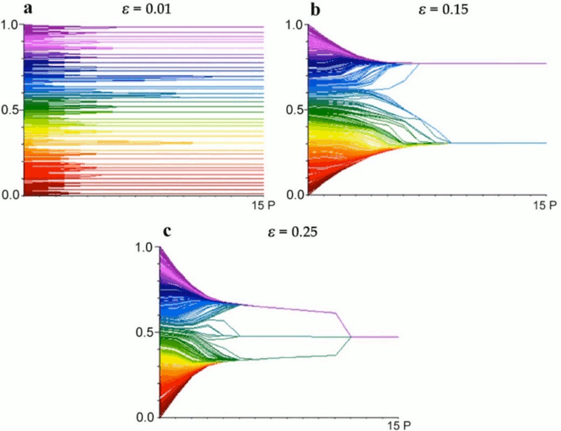

Figure 1: Example changes in opinion across time from single runs with different threshold values $\varepsilon \in \{0.01, 0.15, 0.25\}$ in the Hegselmann and Krause (2002) model. [An extended description of figure 1 is in the supplement.]

An illustration of average outcomes for different threshold values appears as figure 2. What is represented here is not change over time but rather the final opinion positions given different threshold values. As the threshold value climbs from 0 to roughly 0.20, there is an increasing number of results with concentrations of agents at the outer edges of the distribution, which themselves are moving inward. Between 0.22 and 0.26 there is a quick transition from results with two final groups to results with a single final group. For values still higher, the two sides are sufficiently within reach that they coalesce on a central consensus, although the exact location of that final monolithic group changes from run to run creating the fat central spike shown. Hegselmann and Krause describe the progression of outcomes with an increasing threshold as going through three phases: “*from fragmentation (plurality) over polarisation (polarity) to consensus (conformity)*.” (2002: 11, authors’ italics)

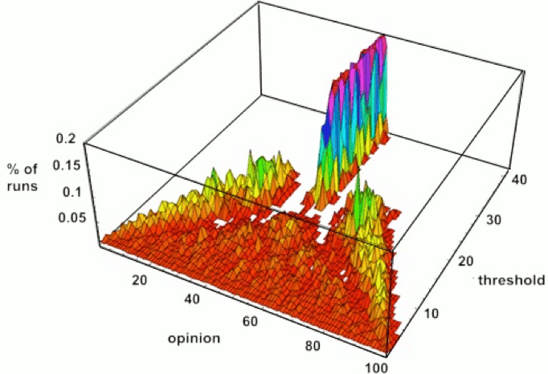

Figure 2: Frequency of equilibrium opinion positions for different threshold values in the Hegselmann and Krause model scaled to [0, 100] (as original with axes relabeled; Hegselmann and Krause 2002)[^hegselmann-2002]. [An extended description of figure 2 is in the supplement.]

A number of models further refine the “bounded confidence” mechanisms of the Hegselmann Krause model. Deffuant et al., for example, replace the sharp cutoff of influence in Hegselmann-Krause with continuous influence values (Deffuant et al. 2002; Deffuant 2006; Meadows & Cliff 2012)[^deffuant-2006][^deffuant-2002][^meadows-2012]. Agents are again assigned both opinion values and threshold (“uncertainty”) ranges, but the extent to which the opinion of agent *i* is influential on agent *j* is proportional to the ratio of the overlap of their ranges (opinion plus or minus threshold) over *i*’s range. Opinion centers and threshold ranges are updated accordingly, resulting in the possibility of individuals with narrower and wider ranges. Given the updating algorithm, influence may also be asymmetric: individuals with a narrower range of tolerance, which Deffuant et al. interpret as higher confidence or lower uncertainty, will be more influential on individuals with a wider range than vice versa. The influence on polarization of “stubborn” individuals who do not change, and of agents on extremes, has also been studied, showing a clear impact on the dynamics of belief change in the group.[^note-6]

Eric Olsson and Sofi Angere have developed a sophisticated program in which the interaction of agents is modelled within a Bayesian network of both information and trust (Olsson 2011)[^olsson-2011]. Their program, Laputa has a wide range of applications, one of which is a model of polarization interpreted in terms of the Persuasive Argument Theory in psychology and which replicates an effect seen in empirical studies: the increasing divergence of polarized groups (Lord, Ross, & Lepper 1979; Isenberg 1986; Olsson 2013)[^isenberg-1986][^lord-1979][^olsson-2013]. Olsson raises the question of whether polarization may be epistemically rational, offering a positive answer. O’Connor and Weatherall (2018) and Singer et al. (2019) also argue that polarization can be rational, using different models and perhaps different senses of polarization (Bramson et al. 2017)[^bramson-2017]. Kevin Dorst uses simulation as part of an argument that polarization can be a predictable result if fully rational agents, while aiming for accuracy, selectively find flaws in evidence opposed to their current view. Initial divergences, he argues, can be the result of iterated Bayesian updating on ambiguous evidence (Dorst 2023)[^dorst-2023].

The topic of polarization is anticipated in an earlier tradition of cellular automata models initiated by Robert Axelrod. The basic premise of Axelrod (1997) is that people tend to interact more with those like themselves and tend to become more like those with whom they interact. But if people come to share one another’s beliefs (or other cultural features) over time, why do we not observe complete cultural convergence? At the core of Axelrod’s model is a spatially instantiated imitative mechanism that produces cultural convergence within local groups but also results in progressive differentiation and cultural isolation between groups.

100 agents are arranged on a $10 \times 10$ lattice such as that illustrated in Figure 3. Each agent is connected to four others: top, bottom, left, and right. The exceptions are those at the edges or corners of the array, connected to only three and two neighbors, respectively. Agents in the model have multiple cultural “features”, each of which carries one of multiple possible “traits”. One can think of the features as categorical variables and the traits as options or values within each category. For example, the first feature might represent culinary tradition, the second one the style of dress, the third music, and so on. In the base configuration an agent’s “culture” is defined by five features $(F = 5)$ each having one of 10 traits $(q =10),$ numbered 0 through 9. Agent *x* might have $\langle 8, 7, 2, 5, 4\rangle$ as a cultural signature while agent *y* is characterized $\langle 1, 4, 4, 8, 4\rangle$. Agents are fixed in their lattice location and hence their interaction partners. Agent interaction and imitation rates are determined by neighbor similarity, where similarity is measured as the percentage of feature positions that carry identical traits. With five features, if a pair of agents share exactly one such element they are 20% similar; if two elements match then they are 40% similar, and so forth. In the example just given, agents *x* and *y* and have a similarity of 20% because they share only one feature.

*Figure 3:*

| 41846 | 09617 | 06227 | 73975 | 78196 | 98865 | 67856 | 39579 | 46292 | 39070 |
| --- | --- | --- | --- | --- | --- | --- | --- | --- | --- |
| 95667 | 34557 | 85463 | 49129 | 83446 | 31042 | 78640 | 70518 | 61745 | 96211 |
| 47298 | 86948 | 54261 | 75923 | 02665 | 97330 | 67790 | 69719 | 45520 | 37354 |
| 09575 | 72785 | 94991 | 70805 | 04952 | 52299 | 99741 | 12929 | 18932 | 81593 |
| 02029 | 94602 | 14852 | 94392 | 83121 | 84309 | 33260 | 44121 | 19166 | 73581 |
| 84484 | 93579 | 09052 | 12567 | 72371 | 08352 | 25212 | 39743 | 45785 | 55341 |
| 69263 | 94414 | 25246 | 68061 | 12208 | 44813 | 02717 | 90699 | 94938 | 05728 |
| 98129 | 44971 | 86427 | 26499 | 05885 | 45788 | 40317 | 08520 | 35527 | 73303 |
| 18261 | 18215 | 70977 | 15211 | 92822 | 74561 | 60786 | 34255 | 07420 | 42317 |
| 30487 | 23057 | 24656 | 03204 | 60418 | 56359 | 57759 | 01783 | 21967 | 84773 |

Figure 3: Typical initial set of “cultures” for a basic Axelrod-style model consisting of 100 agents on a $10 \times 10$ lattice with five features and 10 possible traits per agent. The marked sight shares two of five traits with the site above it, giving it a cultural similarity score of 40% (Axelrod 1997)[^axelrod-1997].

For each iteration, the model picks at random an agent to be active and one of its neighbors. With probability equal to their cultural similarity, the two sites interact and the active agent changes one of its dissimilar elements to that of its neighbor. If agent $i = \langle 8, 7, 2, 5, 4\rangle$ is chosen to be active and it is paired with its neighbor agent $j = \langle 8, 4, 9, 5, 1\rangle,$ for example, the two will interact with a 40% probability because they have two elements in common. If the interaction does happen, agent *i* changes one of its mismatched elements to match that of *j*, becoming perhaps $\langle 8, 7, 2, 5, 1\rangle.$ This change creates a similarity score of 60%, yielding an increased probability of future interaction between the two.

In the course of approximately 80,000 iterations, Axelrod’s model produces large areas in which cultural features are identical: local convergence. It is also true, however, that arrays such as that illustrated do not typically move to full convergence. They instead tend to produce a small number of culturally isolated stable regions—groups of identical agents none of whom share features in common with adjacent groups and so cannot further interact. As an array develops, agents interact with increasing frequency with those with whom they become increasingly similar, interacting less frequently with the dissimilar agents. With only a mechanism of local convergence, small pockets of similar agents emerge that move toward their own homogeneity and away from that of other groups. With the parameters described above, Axelrod reports a median of three stable regions at equilibrium. It is this phenomenon of global separation that Axelrod refers to as “polarization”. See the interactive simulation of the Axelrod polarization model in the Other Internet Resources section below.

Axelrod notes a number of intriguing results from the model, many of which have been further explored in later work. Results are very sensitive to the number of features *F* and traits *q* used as parameters, for example. Changing numbers of features and traits changes the final number of stable regions in opposite directions: the number of stable regions correlates negatively with the number of features *F* but positively with the number of traits *q* (Klemm et al. 2003). In Axelrod’s base case with $F = 5$ and $q = 10$ on a $10 \times 10$ lattice, the result is a median of three stable regions. When *q* is increased from 10 to 15, the number of final regions increases from three to 20; increasing the number of traits increases the number of stable groups dramatically. If the number of features *F* is increased to 15, in contrast, the average number of stable regions drops to only 1.2 (Axelrod 1997)[^axelrod-1997]. Further explorations of parameters of population size, configuration, and dynamics, with measures of relative size of resultant groups, appear in Klemm et al. (2003a, b, c, 2005) and in Centola et al. (2007).

One result that computational modeling promises regarding a phenomenon such as opinion polarization is an understanding of the phenomenon itself: how real opinion polarization might happen, and how it might be avoided. Another and very different outcome, however, is created by the fact that computational modeling both offers and demands precision about concepts and measures that may otherwise be lacking in theory. Bramson et al. (2017), for example, argues that “polarization” has a range of possible meanings across the literature in which it appears, different aspects of which are captured by different computational models with different measures.

#### 3.1.2 The social dynamics of argument

In general, the social dynamics of belief change reviewed above treats beliefs as items that spread by contact, much on the model of infection dynamics (Grim, Singer, Reade, & Fisher 2015, though Riegler & Douven 2009 can be seen as an exception)[^grim-2009][^grim-2015][^riegler-2009]. Other attempts have been made to model belief change in greater detail, motivated by reasons or arguments.

With gestures toward earlier work by Phan Minh Dung (1995), Gregor Betz constructs a model of belief change based on “dialectical structures” of linked arguments (Betz 2013)[^betz-2013]. Sentences and their negations are represented as digits positive and negative, arguments as ordered sets of sentences, and two forms of links between arguments: an attack relation in which a conclusion of one argument contradicts a premise of another and support relations in which the conclusion of one argument is equivalent to the premise of another (Figure 4). A “position” on a dynamical structure, complete or partial, consists of an assignment of truth values T or F to the elements of the set of sentences involved. Consistent positions relative to a structure are those in which contradictory sentences are signed opposite truth values and every argument in which all premises are assigned T has a conclusion which is assigned T as well. Betz then maps the space of coherent positions for a given dialectical structure as an undirected network, with links between positions that differ in the truth-value of just one sentence of the set.

*Figure 4:*

Figure 4: A dialectical structure of propositions and their negations as positive and negative numbers, with two complete positions indicated by values of T and F. The left assignment is consistent; the right assignment is not (after Betz 2013)[^betz-2013]. [An extended description of figure 4 is in the supplement.]

In the simplest form of the model, two agents start with random assignments to a set of 20 sentences with consistent assignments to their negations. Arguments are added randomly, starting from a blank slate, and agents move to the coherent position closest to their previous position, with a random choice in the case of a draw. In variations on the basic structure, Betz considers (a) cases in which an initial background agreement is assumed, (b) cases of “controversial” argumentation, in which arguments are introduced which support a proponent’s position or attack an opponent’s, and (c) in which up to six agents are involved. In two series of simulations, he tracks both the consensus-conduciveness of different parameters, and—with an assumption of a specific assignment as the “truth”—the truth-conduciveness of different parameters.

In individual runs, depending on initial positions and arguments introduced, Betz finds that argumentation of the sort modeled can either increase or decrease agreement, and can track the truth or lead astray. Averaging across many debates, however, Betz finds that controversial argumentation in particular is both consensus-conducive and better tracks the truth.[^note-7]

### 3.2 Computational Philosophy of Science

Computational models have been used in philosophy of science in two very different respects: (a) as models of scientific theory, and (b) as models of the social interaction characteristic of collective scientific research. The next sections review some examples of each.

#### 3.2.1 Network models of scientific theory

“Computational philosophy of science” is enshrined as a book title as early as Paul Thagard’s 1988. A central core of his work is a connectionist ECHO program, which constructs network structures of scientific explanation (Thagard 1992, 2012)[^thagard-1992][^thagard-2012]. From inputs of “explain”, “contradict”, “data”, and “analogous” for the status and relation of nodes, ECHO uses a set of principles of explanatory coherence to construct a network of undirected excitatory and inhibitory links between nodes which “cohere” and those which “incohere”, respectively. If p1 through pm explain *q*, for example, all of p1 through pm cohere with *q* and with each other, for example, though the weight of coherence is divided by the number of p1 through pm. If p1 contradicts p2 or p1 and p2 are parts of competing explanations for the same phenomenon, they “incohere”.

Starting with initial node activations close to zero, the nodes of the coherence network are synchronously updated in terms of their old activation and weighted input from linked nodes, with “data” nodes set as a constant input of 1. Once the network settles down to equilibrium, an explanatory hypothesis p1 is taken to defeat another p2 if its activation value is higher—at least generally, positive as opposed to negative (Figure 5).

*Figure 5:*

Figure 5: An ECHO network for hypotheses P1 and P2 and evidence units Q1 and Q2. Solid lines represent excitatory links, the dotted line an inhibitory link. Because Q1 and Q2 are evidence nodes, they take a constant excitatory value of 1 from E. Started from values of .01 and following Thagard’s updating, P1 dominates P2 once the network has settled down: a hypothesis that explains more dominates its alternative. Adapted from Thagard 1992.

Thagard is able to show that such an algorithm effectively echoes a range of familiar observations regarding theory selection. Hypotheses that explain more defeat those that explain less, for example, and simpler hypotheses are to be preferred. In contrast to simple Popperian refutation, ECHO abandons a hypothesis only when a dominating hypothesis is available. Thagard uses the basic approach of explanatory coherence, instantiated in ECHO, in an analysis of a number of historical cases in the history of science, including the abandonment of phlogiston theory in favor of oxygen theory, the Darwinian revolution, and the eventual triumph of Wegener’s plate tectonics and continental drift.

The influence of Bayesian networks has been far more widespread, both across disciplines and in technological application—application made possible only with computers. Grounded in the work of Judea Pearl (1988, 2000; Pearl & Mackenzie 2018)[^pearl-2018], Bayesian networks are directed acyclic graphs in which nodes represent variables that can be read as either probabilities or degrees of belief and directed edges as conditional probabilities from “parent” to “child”. By the Markov convention, the value of a node is independent of all other nodes that are not its descendants, conditional on its parents. A standard textbook example is shown in Figure 6.

*Figure 6:*

Figure 6: A standard example of a simple Bayesian net. [An extended description of figure 6 is in the supplement.]

Changes of values at the nodes of a Bayesian network (in response to evidence, for example) are updated through belief propagation algorithms applied at every node. The update of a response to input from a parent uses the conditional probabilities of the link. A parent’s response to input from a child uses the related likelihood ratio (see also the supplement on Bayesian networks in Bringsjord & Govindarajulu 2018 [2019])[^bringsjord-2018]. Reading some variables as hypotheses and others as pieces of evidence, simple instances of core scientific concepts can easily be read off such a structure. Simple explanation amounts to showing how the value of a variable “downstream” depends on the pattern “upstream”. Simple confirmation amounts to an increase in the probability or degree of belief of a node *h* upstream given a piece of evidence *e* downstream. Evaluating competing hypotheses consists in calculating the comparative probability of different patterns upstream (Climenhaga 2020, 2023, Grim et al. 2022a)[^climenhaga-2020][^climenhaga-2023][^grim-2022a]. In tracing the dynamics of credence changes across Bayesian networks subjected to an ‘evidence barrage,’ it has been argued that a Kuhnian pattern of normal science punctuated with occasional radical shifts follows from Bayesian updating in networks alone (Grim et al. 2022b)[^grim-2022b].

As Pearl notes, a Bayesian network is nothing more than a graphical representation of a huge table of joint probabilities for the variables involved (Pearl & Mackenzie 2018: 129)[^pearl-2018]. Given any sizable number of variables, however, calculation becomes humanly unmanageable—hence the crucial use of computers. The fact that Bayesian networks are so computationally intensive is in fact a point that Thagard makes against using them as models of human cognitive processing (Thagard 1992: 201)[^thagard-1992]. But that is not an objection against other philosophical interpretations. One clear reading of networks is as causal graphs. Application to philosophical questions of causality in philosophy of science is detailed in Spirtes, Glymour, and Scheines (1993) and Sprenger and Hartmann (2019). Bayesian networks are now something of a standard in artificial intelligence, ubiquitous in applications, and powerful algorithms have been developed to extract causal networks from the massive amounts of data available.

#### 3.2.2 Network models of scientific communication

It should be no surprise that the computational studies of belief change and opinion dynamics noted above blend smoothly into a range of computational studies in philosophy of science. Here a central motivating question has been one of optimal investigatory structure: what pattern of scientific communication and cooperation, between what kinds of investigators, is best positioned to advance science? There are two strands of computational philosophy of science that attempt to work toward an answer to this question. The first strand models the effect of communicative networks within groups. The second strand, left to the next section, models the effects of cognitive diversity within groups. This section outlines what makes modeling of both sorts promising, but also notes limitations and some failures as well.

One might think that access to more data by more investigators would inevitably optimize the truth-seeking goals of communities of investigators. On that intuition, faster and more complete communication—the contemporary science of the internet—would allow faster, more accurate, and more exploration of nature. Surprisingly, however, this first strand of modeling offers robust arguments for the potential benefits of *limited* communication.

In the spirit of rational choice theory, much of this work was inspired by analytical work in economics on infinite populations by Venkatesh Bala and Sanjeev Goyal (1998), computationally implemented for small populations in a finite context and with an eye to philosophical implications by Kevin Zollman (2007, 2010a, 2010b). In Zollman’s model, Bayesian agents choose between a current method $\phi_1$ and what is set as a better method $\phi_2,$ starting with random beliefs and allowing agents to pursue the investigatory action with the highest subjective utility. Agents update their beliefs based on the results of their own testing results—drawn from a distribution for that action—together with results from the other agents to which they are communicatively connected. A community is taken to have successfully learned when all agents converge on the better $\phi_2.$

Zollman’s results are shown in Figure 7 for the three simple networks shown in Figure 8. The communication network which performs the best is not the fully connected network in which all investigators have access to all results from all others, but the maximally distributed network represented by the ring. As Zollman also shows, this is also that configuration which takes the longest time to achieve convergence. See an interactive simulation of a simplified version of Zollman’s model in the Other Internet Resources section below.

*Figure 7:*

Figure 7: A 10 person ring, wheel, and complete graph. After Zollman (2010a).

*Figure 8:*

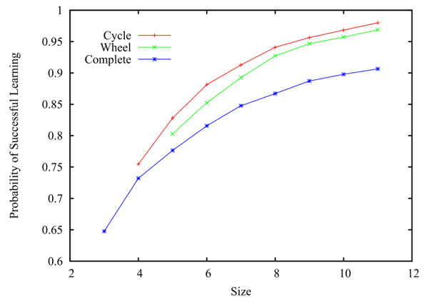

Figure 8: Learning results of computer simulations: ring, wheel, and complete networks of Bayesian agents. Adapted from Zollman (2010a). [An extended description of figure 8 is in the supplement.]

Olsson and Angere’s Bayesian network Laputa (mentioned above) has also been applied to the question of optimal networks for scientific communication. Their results essentially confirm Zollman’s result, though sampled over a larger range of networks (Angere & Olsson 2017)[^angere-2017]. Distributed networks with low connectivity are those that most reliably fix on the truth, though they are bound to do so more slowly.

In Zollman’s original version, all agents are envisaged as scientists who follow the same set of updating rules. The model has been extended to include both scientists who communicate all results and industry propagandists who selectively communicate only results favoring their side, modelling the impact on policy makers who receive input from both. Not surprisingly, the activity of the propagandist (and selective publication in general) can affect whether policy makers can find the truth in order to act on it (Holman and Bruner 2017; Weatherall, Owen, O’Connor and Bruner 2018; O’Connor and Weatherall 2019)[^bruner-2017][^holman-2017][^o’connor-2019][^o’connor-2019-2][^o’connor-2018][^o’connor-2019-3][^weatherall-2018].

The concept of an *epistemic landscape* has also emerged as of central importance in this strand of research. Analogous to a fitness landscape in biology (Wright 1932)[^wright-1932], an epistemic landscape offers an abstract representation of ideal data that might in principle be obtained in testing a range of hypotheses (Grim 2009; Weisberg & Muldoon 2009; Hong & Page 2004, Page 2007)[^grim-2009][^hong-2004][^page-2007][^weisberg-2009]. Figure 9 uses the example of data that might be obtained by testing alternative medical treatments. In such a graph points in the chemotherapy-radiation plane represent particular hypotheses about the most effective combination of radiation and chemotherapy. Graph height at each location represents some measure of success: the percentage of patients with 5-years survival on that treatment, for example.

*Figure 9:*

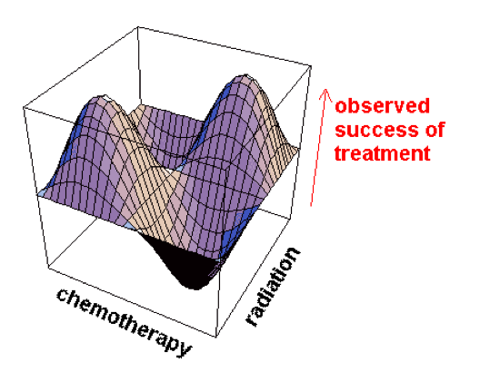

Figure 9: A three-dimensional epistemic landscape. Points on the xz plane represent hypotheses regarding optimal combination of radiation and chemotherapy; graph height on the y axis represents some measure of success. [An extended description of figure 9 is in the supplement.]

An epistemic landscape is intended to be an abstract representation of the real-world phenomenon being explored. The key word, of course, is “abstract”: few would argue that such a model is fully realistic either in terms of the simplicity of limited dimensions or the precision in which one hypothesis has a distinctly higher value than a close neighbor. As in all modeling, the goal is to represent as simply as possible those aspects of a situation relevant to answering a specific: in this case, the question of optimal scientific organization. Epistemic landscapes—even those this simple—have been assumed to offer a promising start. As outlined below, however, one of the deeper conclusions that has emerged is how sensitive results can be to the specific topography of the epistemic landscape.

Is there a form of scientific communication which optimizes its truth-seeking goals in exploration of a landscape? In a series of agent-based models, agents are communicatively linked explorers situated at specific points on an epistemic landscape (Grim, Singer et al. 2013)[^grim-2013][^grim-2013-2]. In such a design, simulation can be used to explore the effect of network structure, the topography of the epistemic landscape, and the interaction of the two.

The simplest form of the results echo the pattern seen in different forms in Bala and Goyal (1998) and in Zollman (2010a, 2010b), here played out on epistemic landscapes. Agents start with random hypotheses as points on the x-axis of a two-dimensional landscape. They compare their results (the height of the y axis at that point) with those of the other agents to which they are networked. If a networked neighbor has a higher result, the agent moves toward an approximation of that point (in the interval of a “shaking hand”) with an inertia factor (generally 50%, or a move halfway). The process is repeated by all agents, progressively exploring the landscape in attempting to move toward more successful results.

On “smooth” landscapes of the form of the first two graphs in Figure 10, agents in any of the networks shown in Figure 10 succeed in finding the highest point on the landscape. Results become much more interesting for epistemic landscapes that contain a “needle in a haystack” as in the third graph in Figure 10.

*Figure 10:*

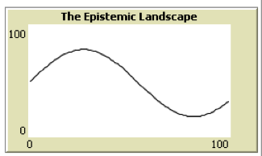

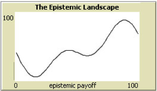

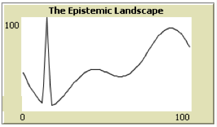

Figure 10: Two-dimensional epistemic landscapes.

*Figure 11:*

ring radius 1

small world

wheel

hub

random

complete

Figure 11: Sample networks.

In a ring with radius 1, each agent is connected with just its immediate neighbors on each side. Using an inertia of 50% and a “shaking hand” interval of 8 on a 100-point landscape, 50 agents in that configuration converge on the global maximum in the “needle in the haystack” landscape in 66% of simulation runs. If agents are connected to the two closest neighbors on each side, results drop immediately to 50% of runs in which agents find the global maximum. A small world network can be envisaged as a ring in which agents have a certain probability of “rewiring”: breaking an existing link and establishing another one to some other agent at random (Watts & Strogatz 1998)[^watts-1998]. If each of 50 agents has a 9% probability of rewiring, the success rate of small worlds drops to 55%. Wheels and hubs have a 42% and 37% success rate, respectively. Random networks with a 10% probability of connection between any two nodes score at 47%. The worst performing communication network on a “needle in a haystack” landscape is the “internet of science” of a complete network in which everyone instantly sees everyone else’s result.

Extensions of these results appear in Grim, Singer et al. (2013). There a small sample of landscapes is replaced with a quantified “fiendishness index”, roughly representing the extent to which a landscape embodies a “needle in a haystack”. Higher fiendishness quantifies a lower probability that hill-climbing from a randomly chosen point “finds” the landscape’s global maximum. Landscapes, though still two-dimensional, are “looped” so as to avoid edge-effects also noted in Hegselmann and Krause (2006). Here again results emphasize the epistemic advantages of ring-like or distributed network over fully connected networks in the exploration of intuitively difficult epistemic landscapes. Distributed single rings achieve the highest percentage of cases in which the highest point on the landscape is found, followed by all other network configurations. Total or completely connected networks show the worst results over all. Times to convergence are shown to be roughly though not precisely the inverse of these relationships. See the interactive simulation of a Grim and Singer et al.’s model in the Other Internet Resources section below.

What all these models suggest is that it is distributed networks of communication between investigators, rather than full and immediate communication between all, that will—or at least *can*—give us more accurate scientific outcomes. In the seventeenth century, scientific results were exchanged slowly, from person to person, in the form of individual correspondence. In today’s science results are instantly available to everyone. What these models suggest is that the communication mechanisms of seventeenth century science may be more reliable than the highly connected communications of today. Zollman draws the corollary conclusion that loosely connected communities made up of less informed scientists might be more reliable in seeking the truth than communities of more informed scientists that are better connected (Zollman 2010b)[^zollman-2010b].

The explanation is not far to seek. In all the models noted, more connected networks produce inferior results because agents move too quickly to salient but sub-optimal positions: to local rather than global maxima. In the landscape models surveyed, connected networks result in all investigators moving toward the same point, currently announced to everyone as highest, skipping over large areas in the process—precisely where the “needle in the haystack” might be hidden. In more distributed networks, local action results in a far more even and effective exploration of widespread areas of the landscape; exploration rather than exploitation (Holland 1975)[^holland-1975].

How should we structure the funding and communication structure of our scientific communities? It is clear both from these results in their current form, and in further work along these general lines, that the answer may well be “landscape”-relative: it may well depend on what kind of question is at issue what form scientific communication ought to take. It may also depend on what desiderata are at issue. The models surveyed emphasize accuracy of results, abstractly modeled. All those surveyed concede that there is a clear trade-off between accuracy of results and the speed of community consensus (Zollman 2007; Zollman 2010b; Grim, Singer et al. 2013)[^grim-2013][^grim-2013-2][^zollman-2007][^zollman-2010b]. But for many purposes, and reasons both ethical and practical, it may often be far better to work with a result that is only roughly accurate but available today than to wait 10 years for a result that is many times more accurate but arrives far too late.

#### 3.2.3 Division of labor, diversity, and exploration

A second tradition of work in computational philosophy of science also uses epistemic landscapes, but attempts to model the effect not of network structure but of the division of labor and diversity within scientific groups. An influential but ultimately flawed precursor in this tradition is the work of Weisberg and Muldoon (2009).

Two views of Weisberg and Muldoon’s landscape appear in Figure 12. In their treatment, points on the base plane of the landscape represent “approaches”—abstract representations of the background theories, methods, instruments and techniques used to investigate a particular research question. Heights at those points are taken to represent scientific significance (following Kitcher 1993)[^kitcher-1993].

*Figure 12:*

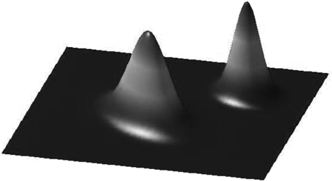

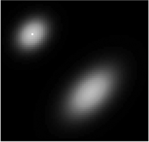

Figure 12: Two visions of Weisberg and Muldoon’s landscape of scientific significance (height) at different approaches to a research topic.

The agents that traverse this landscape are not networked, as in the earlier studies noted, except to the extent that they are influenced by agents with “approaches” near theirs on the landscape. What is significant about the Weisberg & Muldoon model, however, is that their agents are not homogeneous. Two types of agents play a primary role.

“Followers” take previous investigation of the territory by others into account in order to follow successful trends. If any previously investigated points in their immediate neighborhood have a higher significance than the point they stand on, they move to that point (randomly breaking any tie).[^note-8] Only if no neighboring investigated points have higher significance and uninvestigated point remain, followers move to one of those.

“Mavericks” avoid previously investigated points much as followers prioritize them. Mavericks choose *un*explored points in their neighborhoods, testing significance. If higher than their current spot, they move to that point.

Weisberg and Muldoon measure both the percentages of runs in which groups of agents find the highest peak and the speed at which peaks are found. They report that the epistemic success of a population of followers is increased when mavericks are included, and that the explanation for that effect lies in the fact that mavericks can provide pathways for followers: “[m]avericks help many of the followers to get unstuck, and to explore more fruitful areas of the epistemic landscape” (for details see Weisberg & Muldoon 2009: 247 ff)[^weisberg-2009]. Against that background they argue for broad claims regarding the value for an epistemic community of combining different research strategies. The optimal division of labor that their model suggests is “a healthy number of followers with a small number of mavericks”.

Critics of Weisberg and Muldoon’s model argue that it is flawed by simple implementation errors in which >= was used in place of >, with the result that their software agents do not in fact operate in accord with their outlined strategies (Alexander, Himmelreich & Thomson 2015)[^alexander-2015]. As implemented, their followers tend to get trapped into oscillating between two equivalent spaces (often of value 0). According to the critics, when followers are properly implemented, it turns out that mavericks help the success of a community solely in terms of discovery by the mavericks themselves, not by getting followers “unstuck” who shouldn’t have been stuck in the first place (see also Thoma 2015)[^thoma-2015]. If the critics are right, the Weisberg-Muldoon model as originally implemented proves inadequate as philosophical support for the claim that division of labor and strategic diversity are important epistemic drivers. There’s an interactive simulation of the Weisberg and Muldoon model, which includes a switch to change the >= to >, in the Other Internet Resources section below.

Critics of the model don’t deny the general conclusion that Weisberg and Muldoon draw: that cognitive diversity or division of cognitive labor can favor social epistemic outcomes.[^note-9] What they deny is that the Weisberg and Muldoon model adequately supports that conclusion. A particularly intriguing model that does support that conclusion, built on a very different model of diversity, is that of Hong and Page (2004). But it also supports a point that Alexander et al. emphasize: that the advantages of cognitive diversity can very much depend on the epistemic landscape being explored.

Lu Hong and Scott Page work with a two-dimensional landscape of 2000 points, wrapped around as a loop. Each point is assigned a random value between 1 and 100. Their epistemic individuals explore that landscape using heuristics composed of three ordered numbers between, say, 1 and 12. An example helps. Consider an individual with heuristic $\langle 2, 4, 7\rangle$ at point 112 on the landscape. He first uses his heuristic 2 to see if a point two to the right—at 114—has a higher value than his current position. If so, he moves to that point. If not, he stays put. From that point, whichever it is, he uses his heuristic 4 in order to see if a point 4 steps to the right has a higher peak, and so forth. An agent circles through his heuristic numbers repeatedly until he reaches a point from which none within reach of his heuristic offers a higher value. The basic dynamic is illustrated in Figure 13.

*Figure 13:*

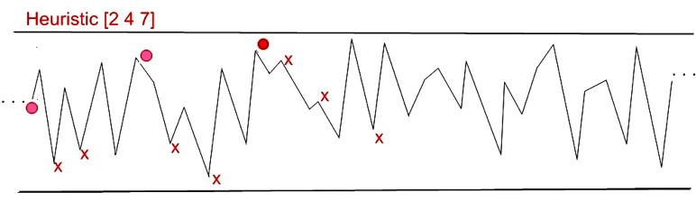

Figure 13: An example of exploration of a landscape by an individual using heuristics as in Hong and Page (2004). Explored points can be read left to right. [An extended description of figure 13 is in the supplement.]

Hong and Page score individuals on a given landscape in terms of the average height they reach starting from each of the 2000 points. But their real target is the value of diversity in groups. With that in mind, they compare the performance of (a) groups composed of the 9 individuals with highest-scoring heuristics on a given landscape with (b) groups composed of 9 individuals with random heuristics on that landscape. In each case groups function together in what has been termed a “relay”. For each point on the 2000-point landscape, the first individual of the group finds his highest reachable value. The next individual of the group starts from there, and so forth, circling through the individuals until a point is reached at which none can achieve a higher value. The score for the group as a whole is the average of values achieved in such a way across all of the 2000 points.

What Hong and Page demonstrate in simulation is that groups with random heuristics routinely outperform groups composed entirely of the “best” individual performers. They christen their findings the “Diversity Trumps Ability” result. In a replication of their study, the average maximum on the 2000-point terrain for the group of the 9 best individuals comes in at 92.53, with a median of 92.67. The average for a group of 9 random individuals comes in at 94.82, with a median of 94.83. Across 1000 runs in that replication, a higher score was achieved by groups of random agents in 97.6% of all cases (Grim et al. 2019)[^grim-2019]. See an interactive simulation of Hong and Page’s group deliberation model in the Other Internet Resources section below. Hong and Page also offer a mathematical theorem as a partial explanation of such a result (Hong & Page 2004)[^hong-2004]. That component of their work has been attacked as trivial or irrelevant (Thompson 2014)[^thompson-2014], though the attack itself has come under criticism as well (Kuehn 2017, Singer 2019)[^kuehn-2017][^singer-2019][^singer-2019-2].

The Hong-Page model solidly demonstrates a general claim attempted in the disputed Weisberg-Muldoon model: cognitive diversity can indeed be a social epistemic advantage. In application, however, the Hong-Page result has sometimes been appealed to as support for much broader claims: that diversity is always or quite generally of epistemic advantage (Anderson 2006, Landemore 2013, Gunn 2014, Weymark 2015)[^anderson-2006][^gunn-2014][^landemore-2013][^weymark-2015]. The result itself is limited in ways that have not always been acknowledged. In particular, it proves sensitive to the precise character of the epistemic landscape employed.

Hong and Page’s landscape is one in which each of 2000 points is given a random value between 1 and 100: a purely random landscape. One consequence of that fact is that the group of 9 best heuristics on different random Hong-Page landscapes have essentially no correlation: a high-performing individual on one landscape need have no carry-over to another. Grim et al. (2019) expands the Hong-Page model to incorporate other landscapes as well, in ways which challenge the general conclusions regarding diversity that have been drawn from the model but which also suggest the potential for further interesting applications.

An easy way to “smooth” the Hong-Page landscapes is to assign random values not to every point on the 2000-point loop but every second point, for example, with intermediate points taking an average between those on each side. Where a random landscape has a “smoothness” factor of 0, this variation will have a randomness factor of 1. A still “smoother” landscape of degree 2 would be one in which slopes are drawn between random values assigned to every third point. Each degree of smoothness increases the average value correlation between a point and its neighbors.

Using Hong and Page’s parameters in other respects, it turns out that the “Diversity Trumps Ability” result holds only for landscapes with a smoothness factor less than 4. Beyond that point, it is “ability”—the performance of groups of the 9 best-performing individuals—that trumps “diversity”—the performance of groups of random heuristics.

The Hong-Page result is therefore very sensitive to the “smoothness” of the epistemic landscape modeled. As hinted in section 3.2.2, this is an indication from within the modeling tradition itself of the danger of restricted and over-simple abstractions regarding epistemic landscapes. Moreover, the model’s sensitivity is not limited to landscape smoothness: social epistemic success depends on the pool of numbers from which heuristics are drawn as well, with “diversity” showing strength on smoother landscapes if the pool of heuristics is expanded. Results also depend on whether social interaction is modeled using of Hong-Page’s “relay” or an alternative dynamics in which individuals collectively (rather than sequentially) announce their results, with all moving to the highest point announced by any. Different landscape smoothnesses, different heuristic pool sizes, and different interactive dynamics will favor the epistemic advantages of different compositions of groups, with different proportions of random and best-performing individuals (Grim et al. 2019)[^grim-2019].

### 3.3 Ethics and Social-Political Philosophy

> What, then, is the conduct that ought to be adopted, the reasonable course of conduct, for this egoistic, naturally unsocial being, living side by side with similar beings? —Henry Sidgwick, *Outlines of the History of Ethics* (1886: 162)

Hobbes’ *Leviathan* can be read as asking, with Sidgwick, how cooperation can emerge in a society of egoists (Hobbes 1651)[^hobbes-1651]. Cooperation is thus a central theme in both ethics and social-political philosophy.

#### 3.3.1 Game theory and the evolution of cooperation

Game theory has been a major tool in many of the philosophical considerations of cooperation, extended with computational methodologies. Here the primary example is the Prisoner’s Dilemma, a strategic interaction between two agents with a payoff matrix in which joint cooperation gets a higher payoff than joint defection, but the highest payoff goes to a player who defects when the other player cooperates (see esp. Kuhn 1997 [2019])[^kuhn-1997]. Formally, the Prisoner’s Dilemma requires the value DC for defection against cooperation to be higher than CC for joint cooperation, with CC higher than the payoff CD for cooperation against defection. In order to avoid an advantage to alternating trade-offs, CC should also be higher than $(\textrm{CD} + \textrm{DC}) / 2.$ A simple set of values that fits those requirements is shown in the matrix in Figure 14.

*Figure 14:*

|   | **Player A** |   |   |
| --- | --- | --- | --- |
| *Cooperate* | *Defect* |   |   |
| **Player B** | *Cooperate* | 3,3 | 0,5 |
| *Defect* | 5,0 | 1,1 |   |

Figure 14: A Prisoner’s Dilemma payoff matrix

It is clear in the “one-shot” Prisoner’s Dilemma that defection is strictly dominant: whether the other player cooperates or defects, one gains more points by defecting. But if defection always gives a higher payoff, what sense does it make to cooperate? In a Hobbesian population of egoists, with payoffs as in the Prisoner’s Dilemma, it would seem that we should expect mutual defection as both a matter of course and the rational outcome—Hobbes’ “war of all against all”. How could a population of egoists come to cooperate? How could the ethical desideratum of cooperation arise and persist?

A number of mechanisms have been shown to support the emergence of cooperation: kin selection (Fisher 1930; Haldane 1932)[^fisher-1930][^haldane-1932], green beards (Hamilton 1964a,b; Dawkins 1976)[^dawkins-1976][^hamilton-1964a], secret handshakes (Robson 1990; Wiseman & Yilankaya 2001)[^robson-1990][^wiseman-2001], iterated games, spatialized and structured interactions (Grim 1995; Skyrms 1996, 2004; Grim, Mar, & St. Denis 1998; Alexander 2007)[^alexander-2007][^grim-1995][^grim-1998][^skyrms-1996][^skyrms-2004], and noisy signals (Nowak & Sigmund 1992)[^nowak-1992]. This section offers examples of the last two of these.

In the iterated Prisoner’s Dilemma, players repeat their interactions, either in a fixed number of rounds or in an infinite or indefinite repetition. Robert Axelrod’s tournaments in the early 1980s are the classic studies in the iterated prisoner’s dilemma, and early examples of the application of computational techniques. Strategies for playing the Prisoner’s Dilemma were solicited from experts in various fields, pitted against all others (and themselves) in round-robin competition over 200 rounds. Famously, the strategy that triumphed was Tit for Tat, a simple strategy which responds to cooperation from the other player on the previous round with cooperation, responding to defection on the previous round with defection. Even more surprisingly, Tit for Tat again came out in front in a second tournament, despite the fact that submitted strategies knew that Tit for Tat was the opponent to aim for. When those same strategies were explored with replicator dynamics in place of round-robin competition, Tit for Tat again was the winner (Axelrod and Hamilton 1981)[^axelrod-1981]. Further work has tempered Tit for Tat’s reputation somewhat, emphasizing the constraints of Axelrod’s tournaments both in terms of structure and the strategies submitted (Kendall, Yao, & Chang 2007; Kuhn 1997 [2019])[^kendall-2007][^kuhn-1997].

A simple set of eight “reactive” strategies, in which a player acts solely on the basis of the opponent’s previous move, is shown in Figure 15. Coded with “1” for cooperate and “0” for defect and three places representing first move *i*, response to cooperation on the other side *c*, and response to defection on the other side *d*, these give us 8 strategies that include all defect, all cooperate, tit for tat as well as several other variations.

*Figure 15:*

| *i* | *c* | *d* | *reactive strategy* |
| --- | --- | --- | --- |
| 0 | 0 | 0 | All Defect |
| 0 | 0 | 1 |   |
| 0 | 1 | 0 | Suspicious Tit for Tat |
| 0 | 1 | 1 | Suspicious All Cooperate |
| 1 | 0 | 0 | Deceptive All Defect |
| 1 | 0 | 1 |   |
| 1 | 1 | 0 | Tit for Tat |
| 1 | 1 | 1 | All Cooperate |

Figure 15: 8 reactive strategies in the Prisoner’s Dilemma

If these strategies are played against each other and themselves, in the manner of Axelrod’s tournaments, it is “all defect” that is the clear winner. If agents imitate the most successful strategy, a population will thus immediately go to All Defect—a game-theoretic image of Hobbes’ war of all against all, perhaps.

Consider, however, a spatialized Prisoner’s Dilemma in the form of cellular automata, easily run and analyzed on a computer. Cells are assigned one of these eight strategies at random, play an iterated game locally with their eight immediate neighbors in the array, and then adopt the strategy of that neighbor (if any) that achieves a higher total score. In this case, with the same 8 strategies, occupation of the array starts with a dominance by All Defect, but clusters of Tit for Tat grow to dominate the space (Figure 16). An interactive simulation in which one can choose which competing reactive strategies play in a spatialized array is available in the Other Internet Resources section below.

*Figure 16:*

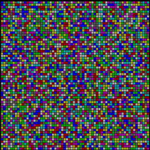

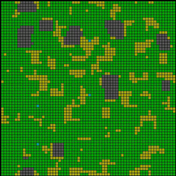

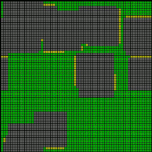

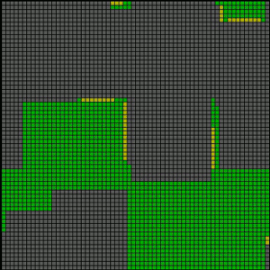

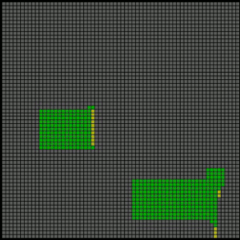

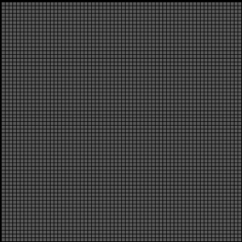

Figure 16: Conquest by Tit for Tat in the Spatialized Prisoner’s Dilemma. All defect is shown in green, Tit for Tat in gray.

In this case, there are two aspects to the emergence of cooperation in the form of Tit for Tat. One is the fact that play is local: strategies total points over just local interactions, rather than play with all other cells. The other is that imitation is local as well: strategies imitate their most successful neighbor, rather than that strategy in the array that gained the most points. The fact that both conditions play out in the local structure of the lattice allows clusters of Tit for Tat to form and grow. In Axelrod’s tournaments it is particularly important that Tit for Tat does well in play against itself; the same is true here. If either game interaction or strategy updating is made global rather than local, dominance goes to All Defect instead. One way in which cooperation can emerge, then, is through structured interactions (Grim 1995; Skyrms 1996, 2004; Grim, Mar, & St. Denis 1998)[^grim-1995][^grim-1998][^skyrms-1996][^skyrms-2004]. J. McKenzie Alexander (2007) offers a particularly thorough investigation of different interaction structures and different games.

Martin Nowak and Karl Sigmund offer a further variation that results in an even more surprising level of cooperation in the Prisoner’s Dilemma (Nowak & Sigmund 1992)[^nowak-1992]. The reactive strategies outlined above are communicatively perfect strategies. There is no noise in “hearing” a move as cooperation or defection on the other side, and no “shaking hand” in response. In Tit for Tat a cooperation on the other side is flawlessly perceived as such, for example, and is perfectly responded to with cooperation. If signals are noisy or responses are less than flawless, however, Tit for Tat loses its advantage in play against itself. In that case a chancy defection will set up a chain of mutual defections until a chancy cooperation reverses the trend. A “noisy” Tit for Tat played against itself in an infinite game does no better than a random strategy.

Nowak and Sigmund replace the “perfect” strategies of Figure 14 with uniformly stochastic ones, reflecting a world of noisy signals and actions. The closest to All Defect will now be a strategy .01, .01, .01, indicating a strategy that has only a 99% chance of defecting initially and in response to either cooperation or defection. The closest to Tit for Tat will be a strategy .99, .99, .01, indicating merely a high probability of starting with cooperation and responding to cooperation with cooperation, defection with defection. Using the mathematical fiction of an infinite game, Nowak and Sigmund are able to ignore the initial value.

Pitting a full range of stochastic strategies of this type against each other in a computerized tournament, using replicator dynamics in the manner of Axelrod and Hamilton (1981), Nowak and Sigmund trace a progressive evolution of strategies. Computer simulation shows imperfect All Defect to be an early winner, followed by Imperfect Tit for Tat. But at that point dominance in the population goes to a still more cooperative strategy which cooperates with cooperation 99% of the time but cooperates even against defection 10% of the time. That strategy is eventually dominated by one that cooperates against defection 20% of the time, and then by one that cooperates against defection 30% of the time. A replication of the Nowak and Sigmund result is shown in Figure 17. Nowak and Sigmund show analytically that the most successful strategy in a world of noisy information will be “Generous Tit for Tat”, with probabilities of $1 - \varepsilon$ and 1/3 for cooperation against cooperation and defection respectively.

*Figure 17:*

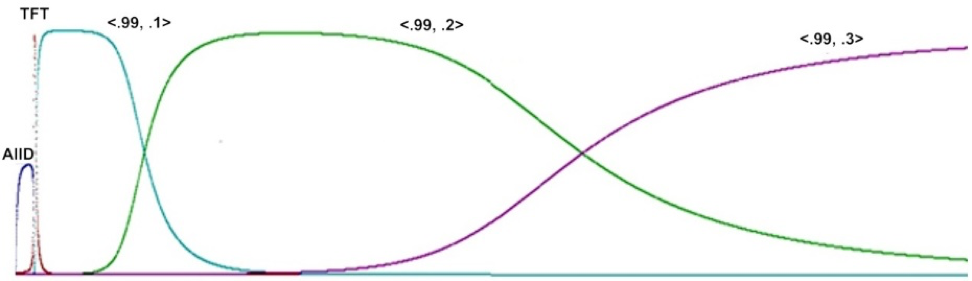

Figure 17: Evolution toward Nowak and Sigmund’s “Generous Tit for Tat” in a world of imperfect information (Nowak & Sigmund 1992)[^nowak-1992]. Population proportions are shown vertically for labelled strategies shown over 12,000 generations for an initial pool of 121 stochastic strategies $\langle c,d\rangle$ at .1 intervals, full value of 0 and 1 replaced with 0.01 and 0.99. [An extended description of figure 17 is in the supplement.]

How can cooperation emerge in a society of self-serving egoists? In the game-theoretic context of the Prisoner’s Dilemma, these results indicate that iterated interaction, spatialization and structured interaction, and noisy information can all facilitate cooperation, at least in the form of strategies such as Tit for Tat. When all three effects are combined, the result appears to be a level of cooperation even greater than that indicated in Nowak and Sigmund. Within a spatialized Prisoner’s Dilemma using stochastic strategies, it is strategies in the region of probabilities $1 - \varepsilon$ and 2/3 that emerge as optimal in the sense of having the highest scores in play against themselves without being open to invasion from small clusters of other strategies (Grim 1996)[^grim-1996].

This outline has focused on some basic background regarding the Prisoner’s Dilemma and emergence of cooperation. More recently a generation of richer game-theoretic models has appeared, using a wider variety of games of conflict and coordination and more closely tied to historical precedents in social and political philosophy. Newer game-theoretic analyses of state of nature scenarios in Hobbes appear in Vanderschraaf (2006) and Chung (2015), extended with simulation to include Locke and Nozick in Bruner (2020).

There is also a new body of work that extends game-theoretic modeling and simulation to questions of social inequity. Bruner (2017) shows that the mere fact that one group is a minority in a population, and thus interacts more frequently with majority than with minority members, can result in its being disadvantaged where exchanges are characterized by bargaining in a Nash demand game (Young 1993)[^young-1993]. Termed the “cultural Red King”, the effect has been further explored through simulation, with links to experiment, and with extensions to questions of “intersectional disadvantage”, in which overlapping minority categories are in play (O’Connor 2017; Mohseni, O’Connor, & Rubin 2019 [Other Internet Resources]; O’Connor, Bright, & Bruner 2019)[^o’connor-2017][^o’connor-2019][^o’connor-2019-2][^o’connor-2019-3]. The relevance of this to the focus of the previous section is made clear in Rubin and O’Connor (2018) and O’Connor and Bruner (2019), modeling minority disadvantage in scientific communities.

#### 3.3.2 Modeling democracy

In computational simulations, game-theoretic cooperation has been appealed to as a model for aspects of both ethics in the sense of Sidgwick and social-political philosophy on the model of Hobbes. That model is tied to game-theoretic assumptions in general, however, and often to the structure of the Prisoner’s Dilemma in particular (though Skyrms 2003 and Alexander 2007 are notable exceptions)[^alexander-2007]. With regard to a wide range of questions in social and political philosophy in particular, the limitations of game theory may seem unhelpfully abstract and artificial.

While still abstract, there are other attempts to model questions in social political philosophy computationally. Here the studies mentioned earlier regarding polarization are relevant. There have also been recent attempts to address questions regarding epistemic democracy: the idea that among its other virtues, democratic decision-making is more likely to track the truth.

There is a contrast, however, between open democratic decision-making, in which a full population takes part, and representative democracy, in which decision-making is passed up through a hierarchy of representation. There is also a contrast between democracy seen as purely a matter of voting and as a deliberative process that in some way involves a population in wider discussion (Habermas 1992 [1996]; Anderson 2006; Landemore 2013)[^anderson-2006][^habermas-1992][^landemore-2013].

*Figure 18:*

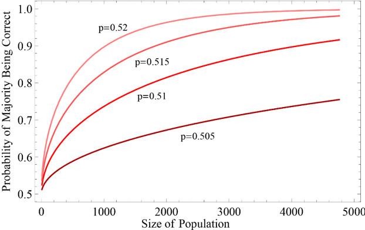

Figure 18: The Condorcet result: probability of a majority of different odd-numbered sizes being correct on a binary question with different homogeneous probabilities of individual members being correct. [An extended description of figure 18 is in the supplement.]

The classic result for an open democracy and simple voting is the Condorcet jury theorem (Condorcet 1785)[^condorcet-1785]. As long as each voter has a uniform an independent probability greater than 0.5 of getting an answer right, the probability of a correct answer from a majority vote is significantly higher than that of any individual, and it quickly increases with the size of the population (Figure 18).

It can be shown analytically that the basic thrust of the Condorcet result remains when assumptions regarding uniform and independent probabilities are relaxed (Boland, Proschan, & Tong 1989; Dietrich & Spiekermann 2013)[^boland-1989][^boland-1989-2][^dietrich-2013]. The Condorcet result is significantly weakened, however, when applied in hierarchical representation, in which smaller groups first reach a majority verdict which is then carried to a second level of representatives who use a majority vote on that level (Boland 1989)[^boland-1989][^boland-1989-2]. More complicated questions regarding deliberative dynamics and representation require simulation using computers.

The Hong-Page structure of group deliberation, outlined in the context of computational philosophy of science above, can also be taken as a model of “deliberative democracy” beyond a simple vote. The success of deliberation in a group can be measured as the average value height of points found. In a representative instantiation of this kind of deliberation, smaller groups of individuals first use their individual heuristics to explore a landscape collectively, then handing their collective “best” for each point on the landscape to a representative. In a second round of deliberation, the representatives work from the results from their constituents in a second round of exploration.

Unlike in the case of pure voting and the Condorcet result, computational simulations show that the use of a representative structure does not dull the effect of deliberation on this model: average scores for three groups of three in a representative structure are if anything slightly higher than average scores from an open deliberation involving 9 agents (Grim et al. 2020)[^grim-2020]. Results like these show how computational models might help expand the political philosophical arguments for representative democracy.

Social and political philosophy appears to be a particularly promising area for big data and computational philosophy employing the data mining tools of computational social science, but as of this writing that development remains largely a promise for the future.

#### 3.3.3 Social outcomes as complex systems

The guiding idea of the interdisciplinary theme known as “complex systems” is that phenomena on a higher level can “emerge” from complex interactions on a lower level (Waldrop 1992, Kauffman 1995, Mitchell 2011, Krakauer 2019)[^kauffman-1995][^krakauer-2019][^mitchell-2011][^waldrop-1992]. The emergence of social outcomes from the interaction of individual choices is a natural target, and agent-based modeling is a natural tool.

Opinion polarization and the evolution of cooperation, outlined above, both fit this pattern. A further classic example is the work of Thomas C. Schelling on residential segregation. A glance at demographic maps of American cities makes the fact of residential segregation obvious: ethnic and racial groups appear as clearly distinguished patches (Figure 19). Is this an open and shut indication of rampant racism in American life?

*Figure 19:*

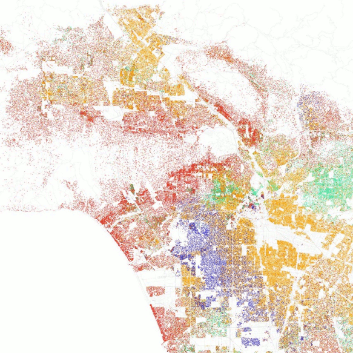

Figure 19: A demographic map of Los Angeles. White households are shown in red, African-American in purple, Asian-American in green, and Hispanic in orange. (Fischer 2010 in Other Internet Resources)

Schelling attempted an answer to this question with an agent-based model that originally consisted of pennies and dimes on a checkerboard array (Schelling 1971, 1978)[^schelling-1971][^schelling-1978], but which has been studied computationally in a number of variations. Two types of agents (Schelling’s pennies and dimes) are distributed at random across a cellular automata lattice, with given preferences regarding their neighbors. In its original form, each agent has a threshold regarding neighbors of “their own kind”. At that threshold level and above, agents remain in place. Should they not have that number of like neighbors, they move to another spot (in some variations, a move at random, in others a move to the closest spot that satisfies their threshold).

What Schelling found was that residential segregation occurs even without a strong racist demand that all of one’s neighbors, or even most, are “of one’s kind”. Even when preference is that just a third of one’s neighbors are “of one’s kind”, clear patches of residential segregation appear. The iterated evolution of such an array is shown in Figure 20. See the interactive simulation of this residential segregation model in the Other Internet Resources section below.

*Figure 20:*

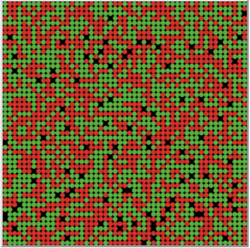

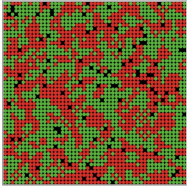

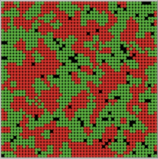

Figure 20: Emergence of residential segregation in the Schelling model with preference threshold set at 33%

The conclusion that Schelling is careful to draw from such a model is simply that a low level of preference can be sufficient for residential segregation. It does not follow that more egregious social and economic factors aren’t operative or even dominant in the residential segregation we actually observe.

In this case basic modeling assumptions have been challenged on empirical grounds. Elizabeth Bruch and Robert Mare use sociological data on racial preferences, challenging the sharp cut-off employed in the Schelling model (Bruch & Mare 2006)[^bruch-2006]. They claim on the basis of simulation that the Schelling effect disappears when more realistically smooth preference functions are used instead. Their simulations and the latter claim turn out to be in error (van de Rijt, Siegel, & Macy 2009)[^rijt-2009], but the example of testing the robustness of simple models with an eye to real data remains a valuable one.

### 3.4 Computational Philosophy of Language

Computational modeling has been applied in philosophy of language along two main lines. First, there are investigations of analogy and metaphor using models of semantic webs that share a developmental history with some of the models of scientific theory outlined above. Second, there are investigations of the emergence of signaling, which have often used a game-theoretic base akin to some approaches to the emergence of cooperation discussed above.

#### 3.4.1 Semantic webs, analogy and metaphor

WordNet is a computerized lexical database for English built by George Miller in 1985 with a hierarchical structure of semantic categories intended to reflect empirical observations regarding human processing. A category “bird” includes a sub-category “songbirds” with “canary” as a particular, for example, intended to explain the fact that subjects could more quickly process “canaries sing”—which involves traversing just one categorical step—than they could process “canaries fly” (Miller, Beckwith, Fellbaum, Gross, & Miller 1990)[^miller-1990].

There is a long tradition, across psychology, linguistics, and philosophy, in which analogy and metaphor are seen as an important key to abstract reasoning and creativity (Black 1962; Hesse 1943 [1966]; Lakoff & Johnson 1980; Gentner 1982; Lakoff & Turner 1989)[^black-1962][^gentner-1982][^hesse-1943][^lakoff-1980][^lakoff-1989]. Beginning in the 1980s several notable attempts have been made to apply computational tools in order to both understand and generate analogies. Douglas Hofstadter and Melanie Mitchell’s Copycat, developed as a model of high-level cognition, has “codelets” compete within a network in order to answer simple questions of analogy: “abc is to abd as ijk is to what?” (Hofstadter 2008)[^hofstadter-2008]. Holyoak and Thagard envisage metaphors as analogies in which the source and target domain are semantically distinct, calling for relational comparison between two semantic nets (Holyoak & Thagard 1989, 1995; see also Falkenhainer, Forbus, & Gentner 1989)[^falkenhainer-1989][^holyoak-1989][^holyoak-1995]. In the Holyoak and Thagard model those comparisons are constrained in a number of different ways that call for coherence; their computational modeling for coherence in the case of metaphor was in fact a direct ancestor to Thagard’s coherence modeling of scientific theory change discussed above (Thagard 1988, 1992)[^thagard-1988][^thagard-1992].

Eric Steinhart and Eva Kittay’s NETMET (see Other Internet Resources) offers an illustration of the relational approach to analogy and metaphor. They use one semantic and inferential subnet related to birth another related to the theory of ideas in the Theatetus. Each subnet is categorized in terms of relations of containment, production, discarding, helping, passing, expressing and opposition. On that basis NETMET generates metaphors including “Socrates is a midwife”, “the mind is an intellectual womb”, “an idea is a child of the mind”, “some ideas are stillborn”, and the like (Steinhart 1994; Steinhart & Kittay 1994)[^steinhart-1994][^steinhart-1994-2]. NETMET can be applied to large linguistic databases such as WordNet.

#### 3.4.2 Signaling games and the emergence of communication

> Suppose we start without pre-existing meaning. Is it possible that under favorable conditions, unsophisticated learning dynamics can spontaneously generate meaningful signaling? The answer is affirmative. —Brian Skyrms, *Signals* (2010: 19)

David Lewis’ sender-receiver game is a cooperative game in which a sender observes a state of nature and chooses a signal, a receiver observes that signal and chooses an act, with both sender and receiver benefiting from an appropriate coordination between state of nature and act (Lewis 1969)[^lewis-1969]. A number of researchers have explored both analytic and computational models of signaling games with an eye to ways in which initially arbitrary signals can come to function in ways that start to look like meaning.

Communication can be seen as a form of cooperation, and here as in the case of the emergence of cooperation the methods of (communicative) strategy change seem less important than the interactive structure in which those strategies play out. Computer simulations show that simple imitation of a neighbor’s successful strategy, various forms of reinforcement learning, and training up of simple neural nets on successful neighbors’ behaviors can all result in the emergence and spread of signaling systems, sometimes with different dialects (Zollman 2005; Grim, St. Denis & Kokalis 2002; Grim, Kokalis, Alai-Tafti, Kilb & St. Denis, 2004)[^grim-2002][^grim-2004][^zollman-2005].[^note-10] Development on a cellular automata grid produces communication with any of these techniques, even when the rewards are one-sided rather than mutual in a strict Lewis signaling game, but structures of interaction that facilitate communication can also co-evolve with the communication they facilitate as well (Skyrms 2010)[^skyrms-2010]. Elliot Wagner extends the study of communication on interaction structures to other networks, a topic furthered in the work of Nicole Fitzgerald and Jacopo Tagliabue using complex neural networks as agents (Wagner 2009; Fitzgerald and Tagliabue 2022)[^fitzgerald-2022][^wagner-2009].

On an interpretation in terms of biological evolution, computationally emergent signaling of this sort can be seen as modeling communication in Vervet monkeys (Cheney & Seyfarth 1990)[^cheney-1990] or even chemical “signals” in bacteria (Berleman, Scott, Chumley, & Kirby 2008)[^berleman-2008]. If interpreted in terms of learned culture, particularly with an eye to more complex signal combination, these have been offered as models of mechanisms at play in the development of human language (Skyrms 2010)[^skyrms-2010]. A simple interactive model in which signaling emerges in a situated population of agents harvesting food sources and avoiding predators is available in the Other Internet Resources section below. Signaling games and emergent communication are now topics of exploration with deep neural networks and in machine learning quite widely, often with an eye to technological applications (Bolt and Mortensen 2024).

### 3.5 From Theorem-Provers to Ethical Reasoning, Metaphysics, and Philosophy of Religion

Many of our examples of computational philosophy have been examples of simulation—often social simulation by way of agent-based modeling. But there is also a strong tradition in which computation is used not in simulations but as a way of mechanizing and extending philosophical argument (typically understood as deductive proof), with applications in philosophy of logic and ultimately in deontic logic, metaphysics, and philosophy of religion.[^note-11]

Entitling a summer Dartmouth conference in 1956, the organizers coined the term “artificial intelligence”. One of the high points of that conference was a computational program for the construction of logical proofs, developed by Allen Newell and Herbert Simon at Carnegie Mellon and programmed by J. C. Shaw using the vacuum tubes of the JOHNNIAC computer at the Institute for Advanced Study (Bringsjord & Govindarajulu 2018 [2019])[^bringsjord-2018]. Newell and Simon’s “Logic Theorist” was given 52 theorems from chapter two of Whitehead and Russell’s *Principia Mathematica* (1910, 1912, 1913), of which it successfully proved 38, including a proof more elegant than one of Whitehead and Russell’s own (MacKenzie 1995, Loveland 1984, Davis 1957 [1983])[^davis-1957][^loveland-1984][^mackenzie-1995]. Russell himself was impressed:

> I am delighted to know that *Principia Mathematica* can now be done by machinery… I am quite willing to believe that everything in deductive logic can be done by machinery. (letter to Herbert Simon, 2 November 1956; quoted in O’Leary 1991: 52)[^o’leary-1991]

Despite possible claims to anticipation, the most compelling of which may be Martin Davis’s 1950 computer implementation of Mojsesz Presburger’s decision procedure for a fragment of arithmetic (Davis 1957)[^davis-1957], the Logic Theorist is standardly regarded as the first automated theorem-prover. Newell and Simon’s target, however, was not so much a logic prover as a proof of concept for an intelligent or thinking machine. Having rejected geometrical proof as too reliant on diagrams, and chess as too hard, by Simon’s own account they turned to logic because *Principia Mathematica* happened to be on his shelf.[^note-12]

Simon and Newell’s primary target was not an optimized theorem-prover but a “thinking machine” that in some way matched human intelligence. They therefore relied in heuristics thought of as matching human strategies, an approach later ridiculed by Hao Wang:

> There is no need to kill a chicken with a butcher’s knife, yet the net impression is that Newell-Shaw-Simon failed even to kill the chicken…to argue the superiority of “heuristic” over algorithmic methods by choosing a particularly inefficient algorithm seems hardly just. (Wang 1960: 3)[^wang-1960]

Later theorem-provers were focused on proof itself rather than a model of human reasoning. By 1960 Hao Wang, Paul Gilmore, and Dag Prawitz had developed computerized theorem-provers for the full first-order predicate calculus (Wang 1960, MacKenzie 1995)[^mackenzie-1995][^wang-1960]. In the 1990s William McCune developed Otter, a widely distributed and accessible prover for first-order logic (McCune & Wos 1997, Kalman 2001)[^kalman-2001][^mccune-1997-2]. A more recent incarnation is Prover9, coupled with search for models and counter-examples in Mace4.[^note-13] Examples of Prover9 derivations are offered in Other Internet Resources. A contemporary alternative is Vampire, developed by Andrei Voronkov, Kryštof Hodere, and Alexander Rizanov (Riazanov & Voronkov 2002)[^riazanov-2002].

Theorem-provers developed for higher-order logics, working from a variety of approaches, include TPS (Andrews and Brown 2006)[^andrews-2006], Leo-II and -III (Benzmüller, Sultana, Paulson, & Theiß 2015; Steen & Benzmüller 2018)[^benzmüller-2018][^benzmüller-2015][^benzmüller-2018-2][^benzmüller-2018-3][^steen-2018], and perhaps most prominently HOL and particularly development-friendly Isabelle/HOL (Gordon & Melham 1993; Paulson 1990)[^gordon-1993][^paulson-1990]. With clever implementation and extension, these also allow automation of aspects of modal, deontic, epistemic, intuitionistic and paraconsistent logics, of interest both in their own terms and in application within computer science, robotics, and artificial intelligence (McRobbie 1991; Abe, Akama, & Nakamatsu 2015)[^abe-2015][^mcrobbie-1991].

Within pure logic, Portararo (2001 [2019]) lists a number of results that have been established using automated theorem-provers. It was conjectured for 50 years that a particular equation in a Robbins algebra could be replaced by a simpler one, for example. Even Tarski had failed in the attempt at proof, but McCune produced an automated proof in 1997 (McCune 1997)[^mccune-1997-2]. Shortest and simplest axiomatizations for implicational fragments of modal logics S4 and S5 had been studied for years as open questions, with eventual results by automated reasoning in 2002 (Ernst, Fitelson, Harris, & Wos 2002)[^ernst-2002].[^note-14]

Theorem provers have been applied within deontic logics in the attempt to mechanize ethical reasoning and decision-making (Meyer & Wierenga 1994; Van Den Hoven & Lokhorst 2002; Balbiani, Broersen, & Brunel 2009; Governatori & Sartor 2010; Benzmüller, Parent, & van der Torre 2018; Benzmüller, Farjami, & Parent, 2018)[^balbiani-2009][^benzmüller-2018][^benzmüller-2018-2][^benzmüller-2018-3][^governatori-2010][^meyer-1994][^van-2002]. Alan Gewirth has argued that agents contradict their status as agents if they don’t accept a principle of generic consistency—respecting the agency-necessary rights of others—as a supreme principle of practical rationality (Gewirth 1978; Beyleveld 1992, 2012)[^beyleveld-1992][^beyleveld-2012][^gewirth-1978]. Fuenmayor and Benzmüller have shown that even an ethical theory of this complexity can be formally encoded and assessed computationally (Fuenmayor & Benzmüller 2018)[^benzmüller-2018][^benzmüller-2018-2][^benzmüller-2018-3][^fuenmayor-2018].

One of the major advances in computational philosophy has been the application of theorem-provers to the analysis of classical philosophical positions and arguments. From axioms of a metaphysical object theory, Zalta and his collaborators use Prover9 and Mace to establish theorems regarding possible worlds, such as the claim that every possible world is maximal, modal theorems in Leibniz, and consequences from Plato’s theory of Forms (Fitelson & Zalta 2007; Alama, Oppenheimer, & Zalta 2015; Kirchner, Benzmüller, & Zalta 2019)[^alama-2015][^fitelson-2007][^kirchner-2019].

Versions of the ontological argument have formed an important thread in recent work employing theorem provers, both because of their inherent interest and the technical challenges they bring with them. Prover9 and Mace have again been used recently by Jack Horner in order to analyze a version of the ontological argument in Spinoza’s *Ethics* (found invalid) and to propose an alternative (Horner 2019)[^horner-2019]. Significant work has been done on versions of Anselm’s ontological argument (Oppenheimer & Zalta 2011; Garbacz 2012; Rushby 2018)[^garbacz-2012][^oppenheimer-2011][^rushby-2018]. Christoph Benzmüller and his colleagues have applied higher-order theorem provers, including including Isabelle/HOL and their own Leo-II and Leo-III, in order to analyze a version of the ontological argument found in the papers of Kurt Gödel (Benzmüller & Paelo 2016a, 2016b; Benzmüller, Weber, & Paleo 2017; Benzmüller & Fuenmayor 2018)[^benzmüller-2016a][^benzmüller-2016b][^benzmüller-2017][^benzmüller-2018][^benzmüller-2018-2][^benzmüller-2018-3][^fuenmayor-2018]. A previously unnoticed inconsistency was found in Gödel’s original, though avoided in Dana Scott’s transcription. Theorem-provers confirmed that Gödel’s argument forces modal collapse—all truths become necessary truths. Analysis with theorem-provers makes it clear that variations proposed by C. Anthony Anderson and Melvin Fitting avoid that consequence, but in importantly different ways (Benzmüller & Paleo 2014; Kirchner, Benzmüller, & Zalta 2019)[^benzmüller-2014][^kirchner-2019].[^note-15]

Work in metaphysics employing theorem-provers continues. Here of particular note is Ed Zalta’s ambitious and long-term attempt to ground metaphysics quite generally in computationally instantiated object theory (Fitelson & Zalta 2007; Zalta 2020)[^fitelson-2007][^zalta-2020]. A link to Zalta’s project can be found in the Other Internet Resources section below.

### 3.6 Artificial Intelligence and Philosophy of Mind

The Dartmouth conference of 1956 is standardly taken as marking the inception of both the field and the term “[artificial intelligence](https://plato.stanford.edu/entries/artificial-intelligence/)” (AI). There were, however, two distinct trajectories apparent in that conference. Some of the participants took as their goal to be the development of intelligent or thinking machines, with perhaps an understanding of human processing as a begrudging means to that end. Others took their goal to be a philosophical and psychological understanding of human processing, with the development of machines a means to that end. Those in the first group were quick to exploit linear programming: what came to be known as “GOFAI”, or “good old-fashioned artificial intelligence”. Those in the second group rejoiced when connectionist and neural net architectures came to maturity several decades later, promising models directly built on and perhaps reflective of mechanisms in the human brain (Churchland 1995)[^churchland-1995].

Attempts to understand perception, conceptualization, belief change, and intelligence are all part of philosophy of mind. The use of computational models toward that end—the second strand above—thus comes close to computational philosophy of mind. Daniel Dennett has come close to saying that AI *is* philosophy of mind: “a most abstract inquiry into the possibility of intelligence or knowledge” (Dennett 1979: 60; Bringsjord & Govindarajulu 2018 [2019])[^bringsjord-2018][^dennett-1979].

The bulk of AI research remains strongly oriented toward producing effective and profitable information processing, whether or not the result offers philosophical understanding. So it is perhaps better not to identify AI with philosophy of mind, though AI has often been guided by philosophical conceptions and aspects of AI have proven fruitful for philosophical exploration. Philosophy *of* AI (including the ethics of AI) and philosophy of mind *inspired by* and *in response* to AI, which are not the topic here, have both been far more common than philosophy of mind developed with the techniques of AI.

One example of a program in artificial intelligence that was explicitly conceived in philosophical terms and designed for philosophical ends was the OSCAR project, developed by John Pollock but cut short by his death (Pollock 1989, 1995, 2006)[^pollock-1989][^pollock-1995][^pollock-2006]. The goal of OSCAR was construction of a computational agent: an “artificial intellect”. At the core of OSCAR was implementation of a theory of rationality. Pollock was explicit regarding the intersection of AI and philosophy of mind in that project:

> The implementability of a theory of rationality is a necessary condition for its correctness. This amounts to saying that philosophy needs AI just as much as AI needs philosophy. (Pollock 1995: xii; Bringsjord & Govindarajulu 2018 [2019])[^bringsjord-2018][^pollock-1995]

At the core of OSCAR’s rationality is implementation of defeasible non-monotonic logic employing prima facie reasons and potential defeaters. Among its successes, Pollock claims an ability to handle the lottery paradox and preface paradoxes. Informally, the fact that we know that one of the many tickets in a lottery will win means that we must treat “ticket 1 will not win…”, “ticket 2 will not win…” and the like not as items of knowledge but as defeasible beliefs for which we have strong prima facie reasons. Pollock’s formal treatment in terms of collective defeat is nicely outlined in a supplement on OSCAR in Bringsjord & Govindarajulu (2018 [2019]).

## 4. Evaluating Computational Philosophy

The sections above were intended to be an introduction to computational philosophy largely by example, emphasizing both the variety of computational techniques employed and the spread of philosophical topics to which they are applied. This final section is devoted to the problems and prospects of computational philosophy.

### 4.1 Critiques

Although computational instantiations of logic are of an importantly different character, simulation—including agent-based simulation—plays a major role in much of computational philosophy. Beyond philosophy, across all disciplines of its application, simulation often raises suspicions.

A standard suspicion of simulation in various fields is that one “can prove anything” by manipulation of model structure and parameters. The worry is that an anticipated or desired effect could always be “baked in”, programmed as an artefact of the model itself. Production of a simulation would thus demonstrate not the plausibility of a hypothesis or a fact about the world but merely the cleverness of the programmer. In a somewhat different context, Rodney Brooks has written that the problem with simulations is that they are “doomed to succeed” (Brooks & Mataric 1993)[^brooks-1993].

But consider a similar critique of logical argument: that one “can prove anything” by careful choice of premises and rules of inference. The proper response in the case of logical argument is to concede the fact that a derivation for any proposition can be produced from carefully chosen premises and rules, but to emphasize that it may be difficult or impossible to produce a derivation from agreed rules and clear and plausible premises.

A similar response is appropriate here. The effectiveness of simulation as argument depends on the strength of its assumptions and the soundness of its mechanisms just as the effectiveness of logical proof depends on the strength of its premises and the validity of its rules of inference. The legitimate force of the critique, then, is not that simulation is inherently untrustworthy but simply that the assumptions of any simulation are always open to further examination.

Anyone who has attempted computer simulation can testify that it is often extremely difficult or impossible to produce an expected effect, particularly a robust effect across a plausible range of parameters and with a plausible basic mechanism. Like experiment, simulation can demonstrate both the surprising fragility of a favored hypothesis and the surprising robustness of an unexpected effect.

Far from being “doomed to succeed”, simulations fail quite regularly in several important ways (Grim, Rosenberger, Rosenfeld, Anderson, & Eason 2013)[^grim-2013][^grim-2013-2]. Two standard forms of simulation failure are failure of verification and failure of validation (Kleijnen 1995; Windrum, Fabiolo, & Moneta 2007; Sargent 2013)[^kleijnen-1995][^sargent-2013][^windrum-2007]. Verification of a model demands assuring that it accurately reflects design intention. If a computational model is intended to instantiate a particular theory of belief change, for example, it fails verification if it does not accurately represent the dynamics of that theory. Validation is perhaps the more difficult demand, particularly for philosophical computation: that the computational model adequately reflects those aspects of the real world it is intended to capture or explain.

If its critics are right, a simple example of verification failure is the original Weisberg and Muldoon model of scientific exploration outlined above (Weisberg & Muldoon 2009)[^weisberg-2009]. The model was intended to include two kinds of epistemic agents—followers and mavericks—with distinct patterns of exploration. Mavericks avoid previously investigated points in their neighborhood. Followers move to neighboring points that have been investigated but that have a higher significance. In contrast to their description in the text, the critics argue, the software for the model used “>=” in place of “>” at a crucial place, with the result that followers moved to neighboring points with a higher or equal significance, resulting in their often getting stuck in a very local oscillation (Alexander, Himmelreich, & Thomson 2015)[^alexander-2015]. If so, Weisberg and Muldoon’s original model fails to match its design intention—it fails verification—though some of their general conclusions regarding epistemic diversity have been vindicated in further studies.

Validation is a very different and more difficult demand: that a simulation model adequately captures relevant aspects of what it is intended to model. A common critique of specific models is that they are too simple, leaving out some crucial aspect of the modeled phenomenon. When properly targeted, this can be an entirely appropriate critique. But what it calls for is not the abandonment of modeling but better construction of a better model.

> In time…the Cartographers Guilds struck a Map of the Empire whose size was that of the Empire, and which coincided point for point with it. The following Generations, saw that that vast Map was Useless…. (Jorge Luis Borges, “On Exactitude in Science”, 1946 [1998 English translation: 325])[^borges-1946]

Borges’ story is often quoted in illustration of the fact that no model—and no scientific theory—can include all characteristics of what it is intended to model (Weisberg 2013)[^weisberg-2013]. Models and theories would be useless if they did: the purpose of both theories and models is to present simpler representations or mechanisms that capture the *relevant* features or dynamics of a phenomenon. What aspects of a phenomenon are in fact the relevant aspects for understanding that phenomenon calls for evaluative input outside of the model. But where relevant aspects are omitted, irrelevant aspects included, or unrealistic or artificial constraints imposed, what a critique calls for is a better model (Martini & Pinto 2017; Thicke 2019)[^martini-2017][^thicke-2019].

There is one aspect of validation that can sometimes be gauged at the level of modeling itself and with modeling tools alone. Where the target is some general phenomenon—opinion polarization or the emergence of communication, for example—a model which produces that phenomenon within only a tiny range of parameters should be suspicious. Our estimate of the parameters actually in play in the actual phenomenon may be merely intuitive or extremely rough, and the real phenomenon may be ubiquitous in a wide range of settings. In such a case, it would seem prima facie unlikely that a model which produced a parallel effect within only a tiny window of parameters could be capturing the general mechanism of a general phenomenon. In such cases robustness testing is called for, a test for one aspect of validation that can still be performed on the computer. To what extent do conclusions drawn from the modeling effect hold up under a range of parameter variations?

The Hong-Page model of the value of diversity in exploration, outlined above, has been widely appealed to quite generally as support for cognitive diversity in groups. It has been cited in NASA internal documents, offered in support of diversity requirements at UCLA, and appears in an *amicus curiae* brief before the Supreme Court in support of promoting diversity in the armed forces (Fisher v. Univ. of Texas 2016)[^fisher-2016]. But the model is not robust enough across its several parameters to support sweepingly general claims that have been made on its basis regarding diversity and ability or expertise (Grim et al. 2019)[^grim-2019]. Is that a problem internal to the model, or an external matter of its interpretation or application? There is much to be said for the latter alternative. The model is and remains an interesting one—interesting often in the ways in which it *does* show sensitivity to different parameters. Thus a failure of one aspect of validation—robustness—with an eye to one type of general claim can also call for further modelling: modeling intended to explore different effects in different contexts. Rosenstock, Bruner, and O’Connor (2017) offer a robustness test for the Zollman model outlined above. Borg, Frey, Šešelja, and Straßer (2018) offer new modeling grounded precisely in a robustness critique of their predecessors.

It is noteworthy that the simulation failures mentioned have been detected and corrected within the literature of simulation itself. These are effective critiques within disciplines employing simulation, rather than from outside. An illustration of a such a case with both verification and validation in play is that of the Bruch and Mare critique of the Schelling segregation model and the response to it in van Rooij, Siegel, and Macy (Schelling 1971, 1978; Bruch & Mare 2006; van de Rijt, Siegel, & Macy 2009)[^bruch-2006][^schelling-1971][^schelling-1978][^rijt-2009]. Many aspects of that model are clearly artificial: a limitation to two groups, spatialization on a cellular automata grid, and “unhappiness” or moving in terms of a sharp threshold cut-off of tolerance for neighbors of the other group. Bruch and Mare offered clear empirical evidence that residential preferences do not fit a sharp threshold. More importantly, they built a variation of the Schelling model in order to show that the Schelling effect disappeared with more realistic preference profiles. What Bruch and Mare challenged, in other words, was *validation*: not merely that aspects of the target phenomenon of residential segregation were left out (as they would be in any model), but that relevant aspects were left out: differences that made an important difference. Van de Rijt, Siegel, and Macy failed to understand why the smooth preference curves in Bruch and Mare’s data wouldn’t support rather than defeat a Schelling effect. On investigation they found that they would: Bruch and Mare’s validation claim against Schelling was itself founded in a programming error. De Rijt, Siegel and Macy’s verdict was that Bruch and Mare’s attack itself failed model *verification*.

In the case of both Weisberg and Muldoon, and Bruch and Mare, original code was made freely available to their critics. In both cases, the original authors recognized the problems revealed, though emphasizing aspects of their work that survived the criticisms. Here again an important point is that critiques and responses of this type have arisen and been addressed within philosophical and scientific simulation itself, working toward better models and practices.

### 4.2 Prospects and Undeveloped Aspects

Philosophy at its best has always been in contact with the conceptual and scientific methodologies of its time. Computational philosophy can be seen as a contemporary instantiation of that contact, crossing disciplinary boundaries in order to both influence and benefit from developments in computer science and artificial intelligence. Incorporation of new technologies and wider application within philosophy can be expected and should be hoped for.

There is one extremely promising area in need of development within computational philosophy, though that area may also call for changes in conceptions of philosophy itself. Philosophy has classically been conceived as abstract rather than concrete, as seeking understanding at the most general level rather than specific prediction or retrodiction, often normative, and as operating in terms of logical argument and analysis rather than empirical data. The last of these characteristics, and to some extent the first, will have to be qualified if computational philosophy grows to incorporate a major batch of contemporary techniques: those related to big data.

Expansion of computational philosophy in the intersection with big data seems an exciting prospect for social and political philosophy, in the analysis of belief change, and in understanding the social and historical dynamics of philosophy of science (Overton 2013; Pence & Ramsey 2018)[^overton-2013][^pence-2018]. A particular benefit would be better prospects for validation of a range of simulations and agent-based models, as emphasized above (Mäs 2019; Reijula & Kuorikoski 2019)[^mäs-2019][^reijula-2019]. If computational philosophy moves in that promising direction, however, it may take on a more empirical character in some respects. Emphasis on general and abstract understanding and concern with the normative will remain marks of a philosophical approach, but the membrane between some topic areas in philosophy and aspects of computational science can be expected to become more permeable.

Dissolving these disciplinary boundaries may itself be a good in some respects. The examples presented above make it clear that in incorporating (and contributing to) computational techniques developed in other areas, computational philosophy has long been cross-disciplinary. If our gain is a better understanding of the topics that have long fascinated us, compromise in disciplinary boundaries and a change in our concept of philosophy seem a small price to pay.

## References（引用注释）

> 原文参考文献已转为脚注引用：文内“作者-年份”引用组后附 [^key] 标记，完整条目见本文末脚注定义。

## Academic Tools

> |   | [How to cite this entry](https://plato.stanford.edu/cgi-bin/encyclopedia/archinfo.cgi?entry=computational-philosophy). |
> | --- | --- |
> |   | [Preview the PDF version of this entry](https://leibniz.stanford.edu/friends/preview/computational-philosophy/) at the [Friends of the SEP Society](https://leibniz.stanford.edu/friends/). |
> |   | [Look up topics and thinkers related to this entry](https://www.inphoproject.org/entity?sep=computational-philosophy&redirect=True) at the Internet Philosophy Ontology Project (InPhO). |
> |   | [Enhanced bibliography for this entry](https://philpapers.org/sep/computational-philosophy/) at [PhilPapers](https://philpapers.org/), with links to its database. |

## Other Internet Resources

Computational philosophy encompasses many different tools and techniques. The aim of this section is to highlight a few of the most commonly used tools.

A large amount of computational philosophy uses agent-based simulations. An extremely popular tool for producing and analyzing agent-based simulations is the free tool [NetLogo](https://ccl.northwestern.edu/netlogo/), which was produced and is maintained by Uri Wilensky and The Center for Connected Learning and Computer-Based Modeling at Northwestern University. NetLogo is a simple but powerful platform for creating and running agent-based simulations, used in all of the examples below, which run using the NetLogo web platform. NetLogo includes a number of tutorials to help people completely new to programming. It also includes advanced tools, like BehaviorSpace and BehaviorSearch, which let the research run large “experiments” of simulations and easily implement genetic algorithms and other search techniques to explore model parameters. NetLogo is a very popular simulation language among computational philosophers, but there are other agent-based modelling environments that are similar, such as [Swarm](https://www.swarm.org/wiki/Swarm_main_page), as well as tools to help analyze agent-based models, such as [OpenMOLE](https://openmole.org/). Computational philosophy simulations may also be written and analyzed in Python, Java, and C, all of which are general programming languages but are much less friendly to beginners.

For analyzing data (from models or elsewhere) and creating graphs and charts, [the statistical environment R](https://www.r-project.org/) is popular. [Mathematica](https://www.wolfram.com/mathematica/) and [MATLAB](https://www.mathworks.com/products/matlab.html) are also sometimes used to check or prove mathematical claims. All three of these are advanced tools that are not easily accessible to beginners. For beginners, Microsoft Excel can be used to analyze and visualize smaller data sets.

As mentioned above, common tools used for theorem proving include [Vampire](https://vprover.github.io) and [Isabelle/HOL](https://isabelle.in.tum.de).

Just as philosophical methodology is diverse, so too are the computational tools used by philosophers. Because it is common to mention tools used in the course of research, further tools can be found in the literature of computational philosophy.

### Computational Model Examples

Below is a list of the example computational models mentioned above. Each model can be run on Netlogoweb in your browser. Alternatively, any of the models can be downloaded and run on Netlogo desktop by clicking on “Export: Netlogo” in the top right of the model screen.

- [Interactive simulation of the Hegselmann and Krause bounded confidence model](https://netlogoweb.org/web?https://www.danieljsinger.com/models/Bounded%20Confidence%20from%20Netlogo%20Community.nlogo). To start the model, click “setup” and then “go” (near the top left corner). To restart the model, click “setup” again. Near the top right corner, you can change the display to show the history of the histogram of opinions over time or show the trajectories through time of individual agents. For more information about the model, scroll down and click on “Model Info”.
- [Interactive simulation of Axelrod’s Polarization Model](https://netlogoweb.org/web?https://www.danieljsinger.com/models/Dissemination%20of%20Culture.nlogo). To start the model, click “setup” and then “go” (near the top left corner). To restart the model, click “setup” again. Each “patch” in the display represents one person. Where there are dark black lines between people, the people share no traits. The line gets lighter as they share more traits. This model runs quite slowly in web browsers, so try speeding it up by manually pulling the “model speed” slider to the right. For more information about the model, scroll down and click on “Model Info”.
- [Interactive simulation of Zollman’s Networked-Researchers Model](https://netlogoweb.org/web?https://www.danieljsinger.com/models/Zollman%20Bandit%20Model.nlogo). To start the model, click “setup” and then “go” (near the top left corner). To restart the model, click “setup” again. In this model (a simplified version of the model discussed in Zollman 2007)[^zollman-2007], agents play a bandit problem (like a slot machine with two arms that have different probabilities of paying off). They usually play the arm they think it most profitable, except that they deviate with a small chance to make sure they aren’t missing something better on the other arm. The model allows agents to share information either in a ring or in a complete network. For more information about the model, scroll down and click on “Model Info”.
- [Interactive simulation of Grim and Singer’s networked agents on an epistemic landscape](https://netlogoweb.org/web?https://www.danieljsinger.com/models/Grim%20and%20Singer%20Epistemic%20Networks%20Simplified.nlogo). To start the model, click “setup” and then “go”. To restart the model, unclick “go” if the model is still running and then click “setup” again. Initially, agents are assigned random beliefs (locations on the x-axis of the epistemic landscape). On each round the imitate their highest-performing network-neighbor by moving toward their belief with a certain speed and uncertainty about their neighbor’s view. The model allows simulation of many different kinds of networks and landscapes. For more information about the model, scroll down and click on “Model Info”.
- [Interactive simulation of Weisberg and Muldoon’s model of agents on an epistemic landscape](https://netlogoweb.org/web?https://www.danieljsinger.com/models/Weisberg%20Muldoon%20Landscape.nlogo). To start the model, click “setup” and then “go”. To restart the model, unclick “go” if the model is still running and then click “setup” again. Initially, mavericks and followers are dropped on parts of the landscape that aren’t on the “hills”. Both kinds of agents then use their own method for hill climbing. As mentioned above, Alexander et al. (2015) argue that there’s a technical problem with the original model. This simulation includes a toggle between the original model and a critic’s preferred version of it. For more information about the model, scroll down and click on “Model Info”.
- [Interactive simulation of the Hong and Page model of group deliberation](https://netlogoweb.org/web?https://www.danieljsinger.com/models/Hong%20Page%20Diversity%20Model.nlogo). To setup the model, which includes setting up the landscape and the two groups (random group and group of highest-performers), click “setup”. Note: Setup may be slow, since it tests all possible heuristics (unless quick-setup-experts is activated). Clicking “go” then calculates the scores of the two groups. This simulation extends Hong and Page’s original model to allow for landscape smoothing (instead of the original random landscape). It also includes a “tournament” group dynamics that is different from the group dynamics of the original model. For more information about the model, scroll down and click on “Model Info”.
- [Interactive simulation of a Repeated Prisoner’s Dilemma Model](https://www.netlogoweb.org/web?https://www.danieljsinger.com/models/Prisoner%27s%20Dilemma.nlogo). To start the model, click “setup” and then “go-once” (to have agents play and imitate once) or “go” (to have agents repeatedly play and imitate their neighbors). To restart the model, click “setup” again. Each “patch” in the display represents one agent. Agents start with a randomly-assigned strategy, play each of their 8 neighbors rounds_to_play times and then imitate their best-performing neighbors. This model runs slowly in web browsers, but it runs a lot more quickly in Netlogo Desktop (you can download the model code by clicking on “Export: Netlogo” near the top right). For more information about the model, scroll down and click on “Model Info”.
- [Interactive simulation of residential segregation](https://www.netlogoweb.org/web?https://www.netlogoweb.org/assets/modelslib/Sample%20Models/Social%20Science/Segregation.nlogo). To start the model, click “setup” and then “go” (near the top left corner). To restart the model, click “setup” again. Change the threshold below which agents move by changing “%-similar-wanted”, and change how full the grid is at the beginning by changing “density”. For more information about the model, scroll down and click on “Model Info”.
- [Interactive simulation of an emergence of signaling model from Grim et al. (2004)](https://netlogoweb.org/web?https://www.danieljsinger.com/models/Grim%20et%20al%20Making%20Meaning%20Happen.nlogo). In this model, each agent (each patch in the display) starts with a random communication strategy (a way of responding to and producing signals). As the model runs, the agents are potentially helped (fed by the fish) or hurt (by wolves) depending on how they act (in part, in response to the signals they hear). Each 100 rounds, agents copy the signaling strategy of their healthiest neighbor. Doing so results in so-called “perfect communication” strategies eventually dominating, though that can take tens of thousands of rounds. For more information about the model, scroll down and click on “Model Info”.

### Additional Internet Resources

- [NETMET (The Logic of Metaphor)](http://ericsteinhart.com/ANALOGY/lom-netmet.html)
- [Prover9 and Mace4](https://www.cs.unm.edu/~mccune/prover9/)
- [Prover9 (and some Mace4) examples](https://www.cs.unm.edu/~mccune/mace4/examples/2009-11A/)
- [Topical issue on Computational Modeling in Philosophy in *Open Philosophy* vol. 2, issue 1 (January 2019)](https://www.degruyter.com/view/j/opphil.2019.2.issue-1/issue-files/opphil.2019.2.issue-1.xml)
- [Fuenmayor and Benzmüller’s 2018 Formalisation and Evaluation of Alan Gewirth’s Proof for the Principle of Generic Consistency in Isabelle/HOL at the *Archive of Formal Proofs*](https://isa-afp.org/entries/GewirthPGCProof.html)
- [“Computational Metaphysics” pages](https://mally.stanford.edu/cm/) at the Metaphysics Research Lab
- Fischer, Eric, 2010, [map of Race and Ethnicity, Los Angeles](https://flickr.com/photos/24431382@N03/4981441877), based on the 2000 census data. Licensed under [CC BY-SA 2.0](https://creativecommons.org/licenses/by-sa/2.0/)
- Mohseni, Aydin, Cailin O’Connor, and Hannah Rubin, 2019, “On the Emergence of Minority Disadvantage: Testing the Cultural Red King Hypothesis”, unpublished manuscript, URL = <[http://philsci-archive.pitt.edu/16352/](http://philsci-archive.pitt.edu/16352/)>
- Zalta, Edward, 2020, *Principia Logico-Metaphysica*, unpublished manuscript. URL = <[https://mally.stanford.edu/principia.pdf](https://mally.stanford.edu/principia.pdf)>

## Related Entries

artificial intelligence | epistemology: social | logic: ancient | logic: epistemic | prisoner’s dilemma | reasoning: automated | scientific knowledge: social dimensions of | social norms

### Acknowledgments

The authors are grateful to Anthony Beavers, Christoph Benzmüller, Gregor Betz, Selmer Bringsjord, Branden Fitelson, Ryan Muldoon, Eric Steinhart, Michael Weisberg, and Kevin Zollman for consultation, contributions, and assistance.

## Notes（原文脚注）

[^note-1]: Although not included here, Billy Wheeler has made an appeal for computational models in metaphysics (Wheeler 2019)[^wheeler-2019]. Since 1994 Magnani Lorenzo has directed a [Computational Philosophy Lab](http://www-9.unipv.it/webphilos_lab/wordpress/) at the University of Pavia, emphasizing abduction and model-based cognition.

[^note-2]: Argument undoubtedly has a history as old as human communication, and the self-conscious consideration of what makes an argument valid cannot have been far behind. The latter is clearly evident in the Sophists and Plato (see Bobzien 2019). The first structured and systematized formalization of valid argument, however, is generally credited to Aristotle. The vision of formalization embodied in Aristotle is breathtaking: that properties crucial to the rationality of something as richly human and context-dependent as argument, tied to content and intended for social persuasion, can be captured in a skeleton of icy symbolism that has neither human content nor social context. It is that vision of formalization as capturing the validity of argument—of various forms and regardless of application—that continues through the 2500 years of the development of logic since Aristotle.

[^note-3]: The combined work of Gödel, Church and Turing in the 1930s demonstrated the close connection between formal systems, general recursive functions, and Turing’s abstract vision of symbol-processing machines (Gödel 1931, Church 1936, Turing 1936–1937)[^church-1936][^gödel-1931][^turing-1936]. That abstract vision lay the groundwork for fully concrete symbol-processing machines: our contemporary computers. In computational philosophy, that contemporary computer power is applied to a range of philosophical questions, including complex questions in logic.

[^note-4]: Leibniz appears to have been inspired in part by the work of Ramon Llull, whose *Ars Magna* or *Ars generalis ultima* of 1308 outlines what is intended as a combinatorial tool of argument and analysis in ethics and religion (Lull 1308 [1986]). Different permutations of principles regarding goodness, eternity, will, truth, concordance, and the like are intended to generate and answer questions such as “is eternal goodness concordant?” Lull’s vision traces in turn to the medieval Arabic *zairja*, a combinatoric algorithm intended to generate truths from a finite number of elements (Gray 2016, Khaldūn 1377 [1958])[^gray-2016]. In fiction, the image of combinatoric machines continues in Herman Hesse’s *The Glass Bead Game*, a version set far in the future. The game is described as “a kind of synthesis of human learning” in which elements or themes are combined, with deeper and more varied associations developing as the game progresses (Hesse 1943)[^hesse-1943].

[^note-5]: Many of the features of the Hegselmann-Krause model are anticipated in Lehrer and Wagner (1981), though there the emphasis is on belief convergence rather than polarization.

[^note-6]: In a series of linked articles, Alexander Riegler and Igor Douven extend the Hegselmann Krause model in several ways (Riegler & Douven 2009, 2010, Douven & Riegler 2010)[^douven-2010][^riegler-2009][^riegler-2010]. They introduce parameters regarding the degree to which an agent’s evidence may be inaccurate, a different weighting for the influence of different agents, and a “space” of interaction in the cellular automata tradition. In a further extension, their agents hold “theories” composed of sets of logically linked beliefs rather than simply single beliefs, and interaction is guided by an “epistemic space” of theory proximity as well. Riegler and Douven find a consistent set of results in these extensions, indicating that increased interaction with other agents helps agents better track the truth in the long run, but that stronger emphasis on individual evidence is faster.

[^note-7]: The attempt to track the impact of argumentative strategies and cognitive limitations with regard to the exchange of arguments continues. For example, see Singer et al. (2021).

[^note-8]: Technically, Weisberg and Muldoon’s agents occupy square cells on a grid. Interaction is with their “Moore neighborhood”: the 8 cells touching theirs on each side and corner.

[^note-9]: In her critique, Thoma (2015) in fact outlines an alternative landscape model which supports claims regarding the epistemic advantage of division of labor. A crucial difference from the Weisberg and Muldoon model is that agents are not limited to information and movement in their immediate theoretical neighborhood.

[^note-10]: Zollman (2005) also merges the work on communication with the work on game-theoretic cooperation above. Agents on a spatialized grid develop a signaling a system as outlined, but also play Stag Hunt with neighbors, where play in Stag Hunt can be conditional on the signal received. Play in Stag Hunt co-evolves with signaling systems, with the result that all agents end up playing Stag (Skyrms 2010)[^skyrms-2010].

[^note-11]: We leave discussion of computation in the context of epistemic logic to other contexts (Fagin, Halbern, Moses, & Vardi 1995; van Benthem 2006; Rendsvig & Symons 2006 [2019])[^fagin-1995][^rendsvig-2006][^benthem-2006]. In classical form, epistemic logic is an attempt to model belief and knowledge with focus on the individual and at a particular time. The classic source for extension to dynamic logics—in which one considers how an individual’s body of knowledge changes with the addition (expansion) or removal (contraction) of particular beliefs, or the replacement of one belief by another (revision)—is the AGM model, named after developers Carlos Alchourrón, Peter Gärdenfors, and David Makinson (Alchourrón, Gärdenfors, & Makinson 1985; see also van Ditmarsch, van der Hoek, & Kooi 2008; Baltag & Renne 2016 [2019])[^alchourrón-1985][^baltag-2016]. Work has also been done on expanding epistemic logic to a form appropriate to groups rather than individuals (Halpern & Moses 1984; Baltag, Boddy and Smetts 2018)[^baltag-2018][^halpern-1984]. A link between that work and the agent-based approach highlighted above would be fascinating, but has not yet been developed.

[^note-12]: Herbert Simon, interviewed by A. Dale, Pittsburgh, April 21, 1994. Quoted in MacKenzie (1995: 11).

[^note-13]: Also of note is Paradox, developed by Koen Lindström Claessen and Niklas Sörensson.

[^note-14]: For a very different computational approach to logic see Mar and Grim (1991) and St. Denis and Grim (1997), both further developed in Grim, Mar, and St. Denis (1998).

[^note-15]: For a very different computational approach to philosophy of religion, more akin to agent-based modeling, see Shults (2019).

[^abe-2015]: Abe, Jair Minoro, Seiki Akama, and Kazumi Nakamatsu, 2015, *Introduction to Annotated Logics: Foundations for Paracomplete and Paraconsistent Reasoning*, (Intelligent Systems Reference Library 88), Cham: Springer International Publishing. doi:10.1007/978-3-319-17912-4

[^alama-2015]: Alama, Jesse, Paul E. Oppenheimer, and Edward N. Zalta, 2015, “Automating Leibniz’s Theory of Concepts”, in *Automated Deduction—CADE-25: Proceedings of the 25th International Conference on Automated Deduction, Berlin, Germany, August 1–7, 2015*, Amy P. Felty and Aart Middeldorp (eds.), (Lecture Notes in Computer Science 9195), Cham: Springer International Publishing, 73–97. doi:10.1007/978-3-319-21401-6_4

[^alchourrón-1985]: Alchourrón, Carlos E., Peter Gärdenfors, and David Makinson, 1985, “On the Logic of Theory Change: Partial Meet Contraction and Revision Functions”, *Journal of Symbolic Logic*, 50(2): 510–530. doi:10.2307/2274239

[^alexander-2007]: Alexander, J. McKenzie, 2007, *The Structural Evolution of Morality*, Cambridge: Cambridge University Press. doi:10.1017/CBO9780511550997

[^alexander-2015]: Alexander, J. McKenzie, Johannes Himmelreich, and Christopher Thompson, 2015, “Epistemic Landscapes, Optimal Search, and the Division of Cognitive Labor”, *Philosophy of Science*, 82(3): 424–453. doi:10.1086/681766

[^anderson-2006]: Anderson, Elizabeth, 2006, “The Epistemology of Democracy”, *Episteme*, 3(1–2): 8–22. doi:10.3366/epi.2006.3.1-2.8

[^andrews-2006]: Andrews, Peter B. and Chad E. Brown, 2006, “TPS: A Hybrid Automatic-Interactive System for Developing Proofs”, *Journal of Applied Logic*, 4(4): 367–395. doi:10.1016/j.jal.2005.10.002

[^angere-2017]: Angere, Staffan and Erik J. Olsson, 2017, “Publish Late, Publish Rarely!: Network Density and Group Performance in Scientific Communication”, in *Scientific Collaboration and Collective Knowledge: New Essays*, Thomas Boyer-Kassem, Conor Mayo-Wilson, and Michael Weisberg (eds.), New York: Oxford University Press, pp. 34–63.

[^axelrod-1997]: Axelrod, Robert, 1997, “The Dissemination of Culture: A Model with Local Convergence and Global Polarization”, *Journal of Conflict Resolution*, 41(2): 203–226. doi:10.1177/0022002797041002001

[^axelrod-1981]: Axelrod, Robert and W. D. Hamilton, 1981, “The Evolution of Cooperation”, *Science*, 211(4489): 1390–1396. doi:10.1126/science.7466396

[^bala-1998]: Bala, Venkatesh and Sanjeev Goyal, 1998, “Learning from Neighbours”, *Review of Economic Studies*, 65(3): 595–621. doi:10.1111/1467-937X.00059

[^balbiani-2009]: Balbiani, Philippe, Jan Broersen, and Julien Brunel, 2009, “Decision Procedures for a Deontic Logic Modeling Temporal Inheritance of Obligations”, *Electronic Notes in Theoretical Computer Science*, 231: 69–89. doi:10.1016/j.entcs.2009.02.030

[^baltag-2016]: Baltag, Alexandru and Bryan Renne, 2016 [2019], “Dynamic Epistemic Logic”, *Stanford Encyclopedia of Philosophy*, (Winter 2019), Edward N. Zalta (ed.), URL= <[https://plato.stanford.edu/archives/win2016/entries/dynamic-epistemic](https://plato.stanford.edu/archives/win2016/entries/dynamic-epistemic)>

[^baltag-2018]: Baltag, A., R. Boddy, and S. Smets, 2018, “Group Knowledge in Interrogative Epistemology”, in *Jaakko Hintikka on Knowledge and Game-Theoretical Semantics*, Hans van Ditmarsch and Gabriel Sandu (eds.), (Outstanding Contributions to Logic 12), Cham: Springer International Publishing, 131–164. doi:10.1007/978-3-319-62864-6_5

[^benzmüller-2014]: Benzmüller, Christoph and Bruno Woltzenlogel Paleo, 2014, “Automating Gödel’s Ontological Proof of God’s Existence with Higher-order Automated Theorem Provers”, in *ECAI 2014*, Torsten Schaub, Gerhard Friedrich, and Barry O’Sullivan (eds.), (Frontiers in Artificial Intelligence and Applications 263), Amsterdam: IOS Press, pp. 93–98. doi:10.3233/978-1-61499-419-0-93

[^benzmüller-2016a]: –––, 2016a, “The Inconsistency in Gōdel’s Ontological Argument: A Success Story for AI in Metaphysics”, in *Proceedings of the Twenty-Fifth International Joint Conference on Artificial Intelligence (IJCAI 2016)*, Gerhard Brewka (ed.), New York: AAAI Press, pp. 936–942.

[^benzmüller-2016b]: –––, 2016b, “An Object-Logic Explanation for the Inconsistency in Gōdel’s Ontological Theory”, in *KI 2016: Advances in Artificial Intelligence Proceedings*, Gerhard Friedrich, Malte Helmert, and Franz Wotawa (eds.), Berlin: Springer, pp. 244–250.

[^benzmüller-2017]: Benzmüller, Christoph, L. Weber, and Bruno Woltzenlogel Paleo, 2017, “Computer-Assisted Analysis of the Anderson–Hájek Ontological Controversy”, *Logica Universalis*, 11(1): 139–151. doi:10.1007/s11787-017-0160-9

[^benzmüller-2018]: Benzmüller, Christoph and David Fuenmayor, 2018, “Can Computers Help to Sharpen Our Understanding of Ontological Arguments?” in S. Gosh, R. Uppalari, K. Rao, V. Agarwal, and S. Sharma (eds.), *Mathematics and Reality: Proceedings of the 11ᵗʰ All Indian Students’ Conference on Science and Spiritual Quest (AISSQ)*, Bhudabenswar, Kolkata: The Bhaktiedanta Institute, pp. 195–226.

[^benzmüller-2015]: Benzmüller, Christoph, Nik Sultana, Lawrence C. Paulson, and Frank Theiß, 2015, “The Higher-Order Prover Leo-II”, *Journal of Automated Reasoning*, 55(4): 389–404. doi:10.1007/s10817-015-9348-y

[^benzmüller-2018-2]: Benzmüller, Christoph, Xavier Parent, and Leendert van der Torre, 2018, “A Deontic Logic Reasoning Infrastructure”, in *Sailing Routes in the World of Computation: 14th Conference on Computability in Europe, CiE 2018*, Florin Manea, Russell G. Miller, and Dirk Nowotka (eds.), (Lecture Notes in Computer Science 10936), Cham: Springer International Publishing, 60–69. doi:10.1007/978-3-319-94418-0_6

[^benzmüller-2018-3]: Benzmüller, Christoph, Ali Farjami, and Xavier Parent, 2018, “A Dyadic Deontic Logic in HOL”, in *Deontic Logic and Normative Systems, 14ᵗʰ International Conference (DEON 2018)*, Jan Broersen, Cleo Condoravdi, Nair Shyam and Gabriella Pigozzi (eds.), London: College Publications, pp. 33–50.

[^berleman-2008]: Berleman, James E., Jodie Scott, Taliana Chumley, and John R. Kirby, 2008, “Predataxis Behavior in *Myxococcus xanthus*”, *Proceedings of the National Academy of Sciences*, 105(44): 17127–17132. doi:10.1073/pnas.0804387105

[^betz-2013]: Betz, Gregor, 2013, *Debate Dynamics: How Controversy Improves Our Beliefs*, Dordrecht: Springer Netherlands. doi:10.1007/978-94-007-4599-5

[^beyleveld-1992]: Beyleveld, Deryck, 1992, *The Dialectical Necessity of Morality: An Analysis and Defense of Alan Gewirth’s Argument to the Principle of Generic Consistency*, Chicago: University of Chicago Press.

[^beyleveld-2012]: –––, 2012, “The Principle of Generic Consistency as the Supreme Principle of Human Rights”, *Human Rights Review*, 13(1): 1–18. doi:10.1007/s12142-011-0210-2

[^black-1962]: Black, Max, 1962, *Models and Metaphors: Studies in Language and Philosophy*, Ithaca, NY: Cornell University Press.

[^bobzien-2006]: Bobzien, Susanne, 2006 [2016], “Ancient Logic”, *The Stanford Encyclopedia of Philosophy*, (Winter 2016), Edward N. Zalta (ed.), URL = <[https://plato.stanford.edu/archives/win2016/entries/logic-ancient/](https://plato.stanford.edu/archives/win2016/entries/logic-ancient/)>

[^boland-1989]: Boland, Philip J., 1989, “Majority Systems and the Condorcet Jury Theorem”, *Journal of the Royal Statistical Society: Series D (The Statistician)*, 38(3): 181–189. doi:10.2307/2348873

[^boland-1989-2]: Boland, Philip J., Frank Proschan, and Y. L. Tong, 1989, “Modelling Dependence in Simple and Indirect Majority Systems”, *Journal of Applied Probability*, 26(1): 81–88. doi:10.2307/3214318

[^boldt-2024]: Boldt, Brendon and David Mortensen, 2024, “A Review of the Applications of Deep Learning-Based Emergent Communication,” *Transactions on Machine Learning Research*, 02/2024 [[Boldt and Mortensen 2024 available online](https://openreview.net/pdf?id=jesKcQxQ7j)].

[^borg-2018]: Borg, AnneMarie, Daniel Frey, Dunja Šešelja, and Christian Straßer, 2018, “Epistemic Effects of Scientific Interaction: Approaching the Question with an Argumentative Agent-Based Model.”, *Historical Social Research*, 43(1): 285–309. doi:10.12759/HSR.43.2018.1.285-307

[^borges-1946]: Borges, Jorge Luis [pseud. Suarez Miranda], 1946 [1998], “Del rigor en la ciencia”, *Los Anales de Buenos Aires*, 1(3). Translated as “On Exactitude in Science”, in his *Collected Fictions*, Andrew Hurley (trans.), New York: Penguin Books, 1998.

[^bramson-2017]: Bramson, Aaron, Patrick Grim, Daniel J. Singer, William J. Berger, Graham Sack, Steven Fisher, Carissa Flocken, and Bennett Holman, 2017, “Understanding Polarization: Meanings, Measures, and Model Evaluation”, *Philosophy of Science*, 84(1): 115–159. doi:10.1086/688938

[^bringsjord-2018]: Bringsjord, Selmer and Naveen Sundar Govindarajulu, 2018 [2019], “Artificial Intelligence”, in *The Stanford Encyclopedia of Philosophy*, Winter 2019, Edward N. Zalta (ed.), URL = <[https://plato.stanford.edu/archives/win2019/entries/artificial-intelligence/](https://plato.stanford.edu/archives/win2019/entries/artificial-intelligence/)>

[^brooks-1993]: Brooks, Rodney A. and Maja J. Mataric, 1993, “Real Robots, Real Learning Problems”, in *Robot Learning*, Jonathan H. Connell and Sridhar Mahadevan (eds.), Dordrecht: Kluwer, 193–213. doi:10.1007/978-1-4615-3184-5_8

[^bruch-2006]: Bruch, Elizabeth E. and Robert D. Mare, 2006, “Neighborhood Choice and Neighborhood Change”, *American Journal of Sociology*, 112(3): 667–709. doi:10.1086/507856

[^bruner-2017]: Bruner, Justin P., 2017, “Minority (Dis)advantage in Population Games”, *Synthese,* 196 (1) DOI:10.1007/s11229-017- 1487-8.

[^bruner-2020]: –––, 2020, “Locke, Nozick and the State of Nature”, *Philosophical Studies*, 177: 705–726, doi:10.1007/s11098-018-1201-9

[^centola-2007]: Centola, Damon, Juan Carlos González-Avella, Víctor M. Eguíluz, and Maxi San Miguel, 2007, “Homophily, Cultural Drift, and the Co-Evolution of Cultural Groups”, *Journal of Conflict Resolution*, 51(6): 905–929. doi:10.1177/0022002707307632

[^cheney-1990]: Cheney, Dorothy L. and Robert M. Seyfarth, 1990, *How Monkeys See the World: Inside the Mind of Another Species*, Chicago: University of Chicago Press.

[^chung-2015]: Chung, Hun, 2015, “Hobbes’s State of Nature: A Modern Bayesian Game-Theoretic Analysis”, *Journal of the American Philosophical Association*, 1(3): 485–508. doi:10.1017/apa.2015.12

[^church-1936]: Church, Alonzo, 1936, “A Note on the Entscheidungsproblem”, *Journal of Symbolic Logic*, 1(1): 40–41. doi:10.2307/2269326

[^churchland-1995]: Churchland, Paul M., 1995, *The Engine of Reason, the Seat of the Soul: A Philosophical Journey into the Brain*, Cambridge MA: MIT Press.

[^climenhaga-2020]: Climenhaga, Nevin, 2020, “The Structure of Epistemic Probabilities,” *Philosophical Studies*, 177: 3213–3242. doi:10.1007/s11098-019-01367-0

[^climenhaga-2023]: –––, 2023, “Evidence and Inductive Inference,” in Maria Lasonen-Aarnko and Clayton Littlejohn, *The Routledge Handbook of the Philosophy of Evidence*, New York: Routledge, 435–449.

[^condorcet-1785]: Condorcet, Nicolas de, 1785 [1995], “An Essay on the Application of Analysis to the Probability of Decisions Rendered by a Plurality of Votes (fifth part)”, Part translated in *Classics of Social Choice*, Iain McLean and Arnold B. Urken (trans. and eds.), Ann Arbor MI: University of Michigan Press, pp. 91–112, 1995.

[^davis-1957]: Davis, Martin, 1957 [1983], “A Computer Program for Presburger’s Algorithm”, presented at the Cornell Summer Institute for Symbolic Logic. Reprinted in Siekmann and Wrightson 1983: 41–48.

[^davis-1983]: –––, 1983, “The Prehistory and Early History of Automated Deduction”, in Siekmann and Wrightson 1983: 1–28.

[^dawkins-1976]: Dawkins, Richard, 1976, *The Selfish Gene*, New York: Oxford University Press.

[^deffuant-2006]: Deffuant, Guillaume, 2006, “Comparing Extremism Propagation Patterns in Continuous Opinion Models”, *Journal of Artificial Societies and Social Simulation*, 9(3): 8. URL = <[http://jasss.soc.surrey.ac.uk/9/3/8.html](http://jasss.soc.surrey.ac.uk/9/3/8.html)>

[^deffuant-2002]: Deffuant, Guillaume, Frédéric Amblard, Gérard Weisbuch, and Thierry Faure, 2002, “How Can Extremism Prevail? A Study Based on the Relative Agreement Interaction Model”, *Journal of Artificial Societies and Social Simulation*, 5(4): 1. URL = <[http://jasss.soc.surrey.ac.uk/5/4/1.html](http://jasss.soc.surrey.ac.uk/5/4/1.html)>

[^dennett-1979]: Dennett, Daniel, 1979, “Artificial Intelligence as Philosophy and as Psychology”, in *Philosophical Perspectives in Artificial Intelligence*, Martin Ringle (ed.), Atlantic Highlands, NJ: Humanities Press, pp. 57–80.

[^dietrich-2013]: Dietrich, Franz and Kai Spiekermann, 2013, “Independent Opinions? On the Causal Foundations of Belief Formation and Jury Theorems”, *Mind*, 122(487): 655–685. doi:10.1093/mind/fzt074

[^dorst-2023]: Dorst, Kevin, 2023, “Rational Polarization,” *Philosophical Review*, 132(3): 355–458.

[^douven-2010]: Douven, Igor and Alexander Riegler, 2010, “Extending the Hegselmann-Krause Model I”, *Logic Journal of IGPL*, 18(2): 323–335. doi:10.1093/jigpal/jzp059

[^dung-1995]: Dung, Phan Minh, 1995, “On the Acceptability of Arguments and Its Fundamental Role in Nonmonotonic Reasoning, Logic Programming and *n*-Person Games”, *Artificial Intelligence*, 77(2): 321–357. doi:10.1016/0004-3702(94)00041-X

[^ernst-2002]: Ernst, Zachary, Branden Fitelson, Kenneth Harris, and Larry Wos, 2002, “Shortest Axiomatizations of Implicational S4 and S5”, *Notre Dame Journal of Formal Logic*, 43(3): 169–179. doi:10.1305/ndjfl/1074290715

[^fagin-1995]: Fagin, Ronald, Joseph Y. Halpern, Yoram Moses and Moshe Vardi, 1995, *Reasoning About Knowledge*, Cambridge, MA: MIT Press.

[^falkenhainer-1989]: Falkenhainer, Brian, Kenneth D. Forbus, and Dedre Gentner, 1989, “The Structure-Mapping Engine: Algorithm and Examples”, *Artificial Intelligence*, 41(1): 1–63. doi:10.1016/0004-3702(89)90077-5

[^fisher-1930]: Fisher, Ronald, 1930, *The Genetical Theory of Natural Selection*, Oxford: Clarendon Press.

[^fisher-2016]: Fisher v. University of Texas, 2016, Brief for Lt. Gen. Julius W. Becton, Jr., Gen. John P. Abizaid, Adm. Dennis C. Blair, Gen. Bryan Doug Brown, Gen. George W. Casey, Lt. Gen Daniel W. Christman, Gen. Wesley K. Clark, Adm. Archie Clemins, Gen. Ann E. Dunwoody, Gen. Ronald R. Fogleman, Adm. Edmund P. Giambastiani, Jr., et al., as Amici Curiae in Support of respondents. [[Fisher v. University of Texas brief 2016 available online](https://www.scotusblog.com/wp-content/uploads/2015/11/LtGenJuliusWBectonJrEtAl.pdf)]

[^fitelson-2007]: Fitelson, Branden and Edward N. Zalta, 2007, “Steps Toward a Computational Metaphysics”, *Journal of Philosophical Logic*, 36(2): 227–247. doi:10.1007/s10992-006-9038-7

[^fitzgerald-2022]: Fitzgerald, Nicole and Jacopo Tagliabue, 2022, “On the Plurality of Graphs,” *Journal of Logic and Computation*, 32(6): 1129–1141.

[^fuenmayor-2018]: Fuenmayor, David and Christoph Benzmüller, 2018, “Formalisation and Evaluation of Alan Gewirth’s Proof for the Principle of Generic Consistency in Isabelle/HOL”, *Archive of Formal Proofs*, 30 October 2018. URL = <[https://isa-afp.org/entries/GewirthPGCProof.html](https://isa-afp.org/entries/GewirthPGCProof.html)>

[^garbacz-2012]: Garbacz, Paweł, 2012, “Prover9’s Simplification Explained Away”, *Australasian Journal of Philosophy*, 90(3): 585–592. doi:10.1080/00048402.2011.636177

[^gentner-1982]: Gentner, Dedre, 1982, “Are Scientific Analogies Metaphors?” in *Metaphor: Problems and Perspectives*, David S. Miall (ed.), Brighton: Harvester Press, pg. 106–132.

[^gewirth-1978]: Gewirth, Alan, 1978, *Reason and Morality*, Chicago: University of Chicago Press.

[^gödel-1931]: Gödel, Kurt, 1931, “Über formal unentscheidbare Sätze der Principia Mathematica und verwandter Systeme, I”, *Monatshefte für Mathematik und Physik*, 38(1): 173–198.

[^goldman-1987]: Goldman, Alvin I., 1987, “Foundations of Social Epistemics”, *Synthese*, 73(1): 109–144. doi:10.1007/BF00485444

[^goldman-1999]: –––, 1999, *Knowledge in a Social World*, Oxford: Oxford University Press. doi:10.1093/0198238207.001.0001

[^goldman-2001]: Goldman, Alvin and Cailin O’Connor, 2001 [2019], “Social Epistemology”, in *The Stanford Encyclopedia of Philosophy*, (Fall 2019), Edward N. Zalta (ed.), URL = <[https://plato.stanford.edu/archives/fall2019/entries/epistemology-social/](https://plato.stanford.edu/archives/fall2019/entries/epistemology-social/)>

[^goldman-2011]: Goldman, Alvin and Dennis Whitcomb (eds.), 2011, *Social Epistemology: Essential Readings*, New York: Oxford University Press.

[^gordon-1993]: Gordon, Michael J.C. and T.F. Melham (eds.), 1993, *Introduction to HOL: A Theorem Proving Environment for Higher Order Logic*, Cambridge: Cambridge University Press.

[^governatori-2010]: Governatori, Guido and Giovanni Sartor (eds.), 2010, *Deontic Logic in Computer Science: 10th International Conference, DEON 2010, Fiesole, Italy, July 7–9, 2010. Proceedings*, (Lecture Notes in Computer Science 6181), Berlin, Heidelberg: Springer Berlin Heidelberg. doi:10.1007/978-3-642-14183-6

[^gray-2016]: Gray, Jonathan, 2016, “’Let us Calculate!’: Leibniz, Lull, and the Computational Imagination”, *The Public Domain Review*, 10 November 2016. URL = <[https://publicdomainreview.org/2016/11/10/let-us-calculate-leibniz-llull-and-computational-imagination/](https://publicdomainreview.org/2016/11/10/let-us-calculate-leibniz-llull-and-computational-imagination/)>

[^grim-1995]: Grim, Patrick, 1995, “The Greater Generosity of the Spatialized Prisoner’s Dilemma”, *Journal of Theoretical Biology*, 173(4): 353–359. doi:10.1006/jtbi.1995.0068

[^grim-1996]: –––, 1996, “Spatialization and Greater Generosity in the Stochastic Prisoner’s Dilemma”, *Biosystems*, 37(1–2): 3–17. doi:10.1016/0303-2647(95)01541-8

[^grim-2009]: –––, 2009, “Threshold Phenomena in Epistemic Networks”, *Proceedings, AAAI Fall Symposium on Complex Adaptive Systems and the Threshold Effect*, FS-09-03, AAAI Press.

[^grim-1998]: Grim, Patrick, Gary R. Mar, and Paul St. Denis, 1998, *The Philosophical Computer: Exploratory Essays in Philosophical Computer Modeling*, Cambridge MA: MIT Press.

[^grim-2002]: Grim, Patrick, Paul St. Denis and Trina Kokalis, 2002, “Learning to Communicate: The Emergence of Signaling in Spatialized Arrays of Neural Nets”, *Adaptive Behavior*, 10(4): 45–70. doi:10.1177/10597123020101003

[^grim-2004]: Grim, Patrick, Trina Kokalis, Ali Alai-Tafti, Nicholas Kilb and Paul St. Denis, 2004, “Making Meaning Happen”, *Journal of Experimental and Theoretical Artificial Intelligence*, 16: 209–243. doi:10.1080/09528130412331294715

[^grim-2015]: Grim, Patrick, Daniel J. Singer, Christopher Reade, and Steven Fisher, 2015, “Germs, Genes, and Memes: Function and Fitness Dynamics on Information Networks”, *Philosophy of Science*, 82(2): 219–243. doi:10.1086/680486

[^grim-2013]: Grim, Patrick, Daniel J. Singer, Steven Fisher, Aaron Bramson, William J. Berger, Christopher Reade, Carissa Flocken, and Adam Sales, 2013, “Scientific Networks on Data Landscapes: Question Difficulty, Epistemic Success, and Convergence”, *Episteme*, 10(4): 441–464. doi:10.1017/epi.2013.36

[^grim-2019]: Grim, Patrick, Daniel J. Singer, Aaron Bramson, Bennett Holman, Sean McGeehan, and William J. Berger, 2019, “Diversity, Ability, and Expertise in Epistemic Communities”, *Philosophy of Science*, 86(1): 98–123. doi:10.1086/701070

[^grim-2020]: Grim, Patrick, Aaron Bramson, Daniel J. Singer, William J. Berger, Jiin Jung, and Scott E. Page, 2020, “Representation in Models of Epistemic Democracy”, *Episteme*, 17(4): 498–518. First online: 21 December 2018. doi:10.1017/epi.2018.51

[^grim-2013-2]: Grim, Patrick, Robert Rosenberger, Adam Rosenfeld, Brian Anderson, and Robb E. Eason, 2013, “How Simulations Fail”, *Synthese*, 190(12): 2367–2390. doi:10.1007/s11229-011-9976-7

[^grim-2022a]: Grim, Patrick, Frank Seidl, Calum McNamara, Hinton E. Rago, Isabell N. Astor, Caroline Diaso and Peter Ryner, 2022a, “Scientific Theories as Bayesian Nets: Structure and Evidence Sensitivity,” *Philosophy of Science*, 89: 42–69.

[^grim-2022b]: Grim, Patrick, Frank Seidl, Calum McNamara, Isabell N. Astor and Caroline Diaso, 2022b, “The Punctuated Equilibrium of Scientific Change: A Bayesian Network Model,” *Synthese*, 200, 297. doi:10.1007/s11229-022-03720-z

[^gunn-2014]: Gunn, Paul, 2014, “Democracy and Epistocracy”, *Critical Review*, 26(1–2): 59–79. doi:10.1080/08913811.2014.907041

[^habermas-1992]: Habermas, Jürgen , 1992 [1996], *Faktizität und Geltung. Beiträge zur Diskurstheorie des Rechts und des demokratischen Rechtsstaats*, Frankfurt Am Main: Suhrkamp Verlag. Translated as *Between Facts and Norms: Contributions to a Discourse Theory of Law and Democracy*, William Rehg (trans.), Cambridge MA: MIT Press, 1996.

[^haldane-1932]: Haldane, J.B.S., 1932, *The Causes of Evolution*, London: Longmans, Green & Co.

[^halpern-1984]: Halpern, Joseph Y. and Yoram Moses, 1984, “Knowledge and Common Knowledge in a Distributed Environment”, in *Proceedings of the Third Annual ACM Symposium on Principles of Distributed Computing*, ACM Press, pp. 50–61.

[^hamilton-1964a]: Hamilton, W.D., 1964a, “The Genetical Evolution of Social Behaviour. I”, *Journal of Theoretical Biology*, 7(1): 1–16. doi:10.1016/0022-5193(64)90038-4

[^hamilton-1964b]: –––, 1964b, “The Genetical Evolution of Social Behaviour. II”, *Journal of Theoretical Biology*, 7(1): 17–52. doi:10.1016/0022-5193(64)90039-6

[^hegselmann-2002]: Hegselmann, Rainer and Ulrich Krause, 2002, “Opinion Dynamics and Bounded Confidence: Models, Analysis and Simulation”, *Journal of Artificial Societies and Social Simulation*, 5(3): 2. URL = <[http://jasss.soc.surrey.ac.uk/5/3/2.html](http://jasss.soc.surrey.ac.uk/5/3/2.html)>

[^hegselmann-2005]: –––, 2005, “Opinion Dynamics Driven by Various Ways of Averaging”, *Computational Economics*, 25(4): 381–405. doi:10.1007/s10614-005-6296-3

[^hegselmann-2006]: –––, 2006, “Truth and Cognitive Division of Labour: First Steps towards a Computer Aided Social Epistemology”, *Journal of Artificial Societies and Social Simulation*, 9(3): 10. URL = <[http://jasss.soc.surrey.ac.uk/9/3/10.html](http://jasss.soc.surrey.ac.uk/9/3/10.html)>

[^hesse-1943]: Hesse, Hermann, 1943 [1969], *Das Glasperlenspelel*, Switzerland. Translated as *The Glass Bead Game (Magister Ludi)*, Richard & Clara Winston (trans.), New York: Holt, Rinehart & Winston, 1969.

[^hesse-1966]: Hesse, Mary B., 1966, *Models and Analogies in Science*, Notre Dame IN: Notre Dame University Press.

[^hobbes-1651]: Hobbes, Thomas, 1651, *Leviathan*, London: Crooke, London: Penguin 1982.

[^hofstadter-2008]: Hofstadter, Douglas, 2008, *Fluid Concepts and Creative Analogies*, New York: Basic Books.

[^holland-1975]: Holland, John H., 1975, *Adaptation in Natural and Artificial Systems*, Cambridge, MA: MIT Press.

[^holman-2017]: Holman, Bennett and Jerome Bruner, 2017, “Experimentation by Industrial Selection,” *Philosophy of Science*, 84(5): 1008–1019.

[^holyoak-1989]: Holyoak, Keith J. and Paul Thagard, 1989, “Analogical Mapping by Constraint Satisfaction”, *Cognitive Science*, 13(3): 295–355. doi:10.1207/s15516709cog1303_1

[^holyoak-1995]: –––, 1995, *Mental Leaps: Analogy in Creative Thought*, Cambridge, MA: MIT Press.

[^hong-2004]: Hong, Lu and Scott E. Page, 2004, “Groups of Diverse Problem Solvers Can Outperform Groups of High-Ability Problem Solvers”, *Proceedings of the National Academy of Sciences*, 101(46): 16385–16389. doi:10.1073/pnas.0403723101

[^horner-2019]: Horner, Jack K., 2019, “A Computationally Assisted Reconstruction of an Ontological Argument in Spinoza’s The Ethics”, *Open Philosophy*, (special issue on computational philosophy) 2(1): 211–229. doi:10.1515/opphil-2019-0012

[^isenberg-1986]: Isenberg, Daniel J., 1986, “Group Polarization: A Critical Review and Meta-Analysis.”, *Journal of Personality and Social Psychology*, 50(6): 1141–1151. doi:10.1037/0022-3514.50.6.1141

[^kalman-2001]: Kalman, John Arnold, 2001, *Automated Reasoning with Otter*, Princeton, NJ: Rinton Press.

[^kauffman-1995]: Kauffman, Stuart, 1995, *At Home in the Universe: The Search for Laws of Self-Organization and Complexity*, New York: Oxford University Press.

[^kendall-2007]: Kendall, Graham, Xin Yao, and Siang Yew Chong, 2007, *The Iterated Prisoner’s Dilemma: 20 Years On*, Singapore: World Scientific.

[^khaldūn-1958]: Khaldūn, Ibn, 1377 [1958], *The Muqaddimah: An Introduction to History*, vol. 3, Franz Rosenthal, Princeton, NJ: Princeton University Press.

[^kirchner-2019]: Kirchner, Daniel, Christoph Benzmüller, and Edward N. Zalta, 2019, “Computer Science and Metaphysics: A Cross-Fertilization”, *Open Philosophy*, (special issue on computational philosophy) 2(1): 230–251. doi:10.1515/opphil-2019-0015

[^kitcher-1993]: Kitcher, Philip, 1993, *The Advancement of Science: Science Without Legend, Objectivity Without Illusions*, Oxford: Oxford University Press. doi:10.1093/0195096533.001.0001

[^kleijnen-1995]: Kleijnen, Jack P.C., 1995, “Verification and Validation of Simulation Models”, *European Journal of Operational Research*, 82(1): 145–162. doi:10.1016/0377-2217(94)00016-6

[^klein-2018]: Klein, Dominik, Johannes Marx, and Kai Fischbach, 2018, “Agent-Based Modeling in Social Science, History, and Philosophy. An Introduction.”, *Historical Social Research*, 43(1): 7–27. doi:10.12759/HSR.43.2018.1.7-27

[^klemm-2003a]: Klemm, Konstantin, Víctor M. Eguíluz, Raúl Toral, and Maxi San Miguel, 2003a, “Global Culture: A Noise-Induced Transition in Finite Systems”, *Physical ReviewE*, 67(4pt2): 045101. doi:10.1103/PhysRevE.67.045101

[^klemm-2003b]: –––, 2003b, “Nonequilibrium Transitions in Complex Networks: A Model of Social Interaction”, *Physical Review E*, 67 (2): 026120. doi:10.1103/PhysRevE.67.026120

[^klemm-2003c]: –––, 2003c, “Role of Dimensionality in Axelrod’s Model for the Dissemination of Culture”, *Physica A*, 327 (1): 1–5. doi:10.1016/S0378-4371(03)00428-X

[^klemm-2005]: –––, 2005, “Globalization, Polarization and Cultural Drift”, *Journal of Economic Dynamics and Control*, 29(1–2): 321–334. doi:10.1016/j.jedc.2003.08.005

[^krakauer-2019]: Krakauer, David C. (ed.), 2019, *Worlds Hidden in Plain Sight: Thirty Years of Complexity Thinking at the Santa Fe Institute*, Santa Fe, NM: Santa Fe Institute Press.

[^kuehn-2017]: Kuehn, Daniel, 2017, “Diversity, Ability, and Democracy: A Note on Thompson’s Challenge to Hong and Page”, *Critical Review*, 29(1): 72–87. doi:10.1080/08913811.2017.1288455

[^kuhn-1997]: Kuhn, Steven, 1997 [2019], “Prisoner’s Dilemma”, in *The Stanford Encyclopedia of Philosophy*, (Winter 2019), Edward N. Zalta (ed.), URL = <[https://plato.stanford.edu/archives/win2019/entries/prisoner-dilemma/](https://plato.stanford.edu/archives/win2019/entries/prisoner-dilemma/)>

[^lakoff-1980]: Lakoff, George and Mark Johnson, 1980, *Metaphors We Live By*, Chicago: University of Chicago Press.

[^lakoff-1989]: Lakoff, George and Mark Turner, 1989, *More Than Cool Reason: A Field Guide to Poetic Metaphor*, Chicago: University of Chicago Press.

[^landemore-2013]: Landemore, Hélène, 2013, *Democratic Reason: Politics, Collective Intelligence, and the Rules of the Many*, Princeton NJ: Princeton University Press.

[^leibniz-1666]: Leibniz, Gottfried Wilhelm, 1666 [1923], *Dissertatio De Arte Combinatoria* , URL = <[https://archive.org/details/ita-bnc-mag-00000844-001/page/n11/mode/2up](https://archive.org/details/ita-bnc-mag-00000844-001/page/n11/mode/2up)>; *Sämtliche Schriften und Briefe*, Berlin-Brandenburgische Akademie der Wissenschraften / Akademie der Wissenschraften zu Göttingen (eds.), Berlin: Akademie Verlag.

[^leibniz-1685]: –––, 1685 [1951], *The Art of Discovery*, in *Leibniz: Selections*, Philip P. Wiener (ed., trans), New York: Scribner, 1951.

[^lehrer-1981]: Lehrer, Keith and Carl Wagner, 1981, *Rational Consensus in Science and Society*, Dordrecht: Reidel.

[^lem-1964]: Lem, Stanislaw, 1964 [2013], *Summa Technologiae*, Joanna Zylinski, Minneapolis, MN: University of Minnesota Press, 2013.

[^lewis-1969]: Lewis, David, 1969, *Convention: A Philosophical Study*, Cambridge MA: Harvard University Press.

[^longino-1990]: Longino, Helen E., 1990, *Science as Social Knowledge:Values and Objectivity in Scientific Inquiry*, Princeton, NJ: Princeton University Press.

[^longino-2002]: Longino, Helen, 2002 [2019], “The Social Dimensions of Scientific Knowledge”, in *The Stanford Encyclopedia of Philosophy*, (Summer 2019), Edward N. Zalta (ed.), URL = <[https://plato.stanford.edu/archives/sum2019/entries/scientific-knowledge-social/](https://plato.stanford.edu/archives/sum2019/entries/scientific-knowledge-social/)>

[^lord-1979]: Lord, Charles G., Lee Ross, and Mark R. Lepper, 1979, “Biased Assimilation and Attitude Polarization: The Effects of Prior Theories on Subsequently Considered Evidence.”, *Journal of Personality and Social Psychology*, 37(11): 2098–2109. doi:10.1037/0022-3514.37.11.2098

[^loveland-1984]: Loveland, Donald W., 1984, “Automated Theorem Proving: A Quarter Century Review”, *Contemporary Mathematics,* 29: 1–45.

[^llull-1986]: Llull, Ramon, 1308 [1986], *Ars generalis ultima*, in *Raimondi Lulli Opera Latina* XIV / CCCM 75, 4–527, Turnholt, Belgium: Brepols

[^mackenzie-1995]: MacKenzie, Donald, 1995, “The Automation of Proof: A Historical and Sociological Exploration”, *IEEE Annals of the History of Computing*, 17(3): 7–29. doi:10.1109/85.397057

[^martin-1925]: Martin, Ernst, 1925 [1992], *Die Rechenmaschinen und ihre Entwicklungsgeschichte*, Germany: Pappenheim. Translated as *The Calculating Machines: Their History and Development*, Peggy Aldrich Kidwell and Michael R. Williams (trans.), Cambridge MA: MIT Press, 1992.

[^martini-2017]: Martini, Carlo and Manuela Fernández Pinto, 2017, “Modeling the Social Organization of Science: Chasing Complexity through Simulations”, *European Journal for Philosophy of Science*, 7(2): 221–238. doi:10.1007/s13194-016-0153-1

[^mäs-2019]: Mäs, Michael, 2019, “Challenges to Simulation Validation in the Social Sciences. A Critical Rationalist Perspective”, in *Computer Simulation Validation*, Claus Beisbart and Nicole J. Saam (eds.), Cham: Springer International Publishing, 857–879. doi:10.1007/978-3-319-70766-2_35

[^mccune-1997]: Mccune, William, 1997, “Solution of the Robbins Problem”, *Journal of Automated Reasoning*, 19(3): 263–276. doi:10.1023/A:1005843212881

[^mccune-1997-2]: McCune, William and Larry Wos, 1997, “Otter: The CADE-13 Competition Incarnations”, *Journal of Automated Reasoning*, 18(2): 211–220. doi:10.1023/A:1005843632307

[^mcrobbie-1991]: McRobbie, Michael A., 1991, “Automated Reasoning and Nonclassical Logics: Introduction”, *Journal of Automated Reasoning*, 7(4): 447–451. doi:10.1007/BF01880323

[^meadows-2012]: Meadows, Michael and Dave Cliff, 2012, “Reexamining the Relative Agreement Model of Opinion Dynamics”, *Journal of Artificial Societies and Social Simulation*, 15(4): 4. doi:10.18564/jasss.2083

[^meyer-1994]: Meyer, John-Jules Ch. and Roel Wierenga, 1994, *Deontic Logic in Computer Science: Normative System Specification*. Hoboken, NJ: Wiley.

[^miller-1990]: Miller, George A., Richard Beckwith, Christiane Fellbaum, Derek Gross, and Katherine J. Miller, 1990, “Introduction to WordNet: An On-Line Lexical Database”, *International Journal of Lexicography*, 3(4): 235–244. doi:10.1093/ijl/3.4.235

[^mitchell-2011]: Mitchell, Melanie, 2011, *Complexity: A Guided Tour*, New York: Oxford University Press.

[^nowak-1992]: Nowak, Martin A. and Karl Sigmund, 1992, “Tit for Tat in Heterogeneous Populations”, *Nature*, 355(6357): 250–253. doi:10.1038/355250a0

[^o’connor-2017]: O’Connor, Cailin, 2017, “The Cultural Red King Effect”, *The Journal of Mathematical Sociology*, 41(3): 155–171. doi:10.1080/0022250X.2017.1335723

[^o’connor-2023]: –––, 2023, *Modelling Scientific Communities*. Cambridge: Cambridge Univ. Press.

[^o’connor-2019]: O’Connor, Cailin and Justin Bruner, 2019, “Dynamics and Diversity in Epistemic Communities”, *Erkenntnis*, 84(1): 101–119. doi:10.1007/s10670-017-9950-y

[^o’connor-2019-2]: O’Connor, Cailin, Liam Kofi Bright, and Justin P. Bruner, 2019, “The Emergence of Intersectional Disadvantage”, *Social Epistemology*, 33(1): 23–41. doi:10.1080/02691728.2018.1555870

[^o’connor-2018]: O’Connor, Cailin and James Owen Weatherall, 2018, “Scientific Polarization”, *European Journal for Philosophy of Science*, 8(3): 855–875. doi:10.1007/s13194-018-0213-9

[^o’connor-2019-3]: –––, 2019, *The Misinformation Age: How False Beliefs Spread*, New Haven: Yale University Press.

[^o’leary-1991]: O’Leary, Daniel J., 1991, “Principia Mathematica and the Development of Automated Theorem Proving”, in *Perspectives on the History of Mathematical Logic*, Thomas Drucker (ed.), Boston, MA: Birkhäuser Boston, 47–53. doi:10.1007/978-0-8176-4769-8_4

[^olsson-2011]: Olsson, Erik J., 2011, “A Simulation Approach to Veritistic Social Epistemology”, *Episteme*, 8(2): 127–143. doi:10.3366/epi.2011.0012

[^olsson-2013]: –––, 2013, “A Bayesian Simulation Model of Group Deliberation and Polarization”, in *Bayesian Argumentation*, Frank Zenker (ed.), Dordrecht: Springer Netherlands, 113–133. doi:10.1007/978-94-007-5357-0_6

[^oppenheimer-2011]: Oppenheimer, Paul E. and Edward N. Zalta, 2011, “A Computationally-Discovered Simplification of the Ontological Argument”, *Australasian Journal of Philosophy*, 89(2): 333–349. doi:10.1080/00048401003674482

[^overton-2013]: Overton, James A., 2013, “‘Explain’ in Scientific Discourse”, *Synthese*, 190(8): 1383–1405. doi:10.1007/s11229-012-0109-8

[^page-2007]: Page, Scott E., 2007, *The Difference: How the Power of Diversity Creates Better Groups, Firms, Schools, and Societies*, Princeton, NJ: Princeton University Press.

[^paulson-1990]: Paulson, Lawrence C., 1990, “Isabelle: The Next 700 Theorem Provers”, in Piergiorgio Odifreddi (ed.), *Logic and Computer Science*, Cambridge, MA: Academic Press, pp. 361–386.

[^pearl-1988]: Pearl, Judea, 1988, *Probabilistic Reasoning in Intelligent Systems*, San Mateo, CA: Morgan Kaufmann.

[^pearl-2000]: –––, 2000, *Causality: Models, Reasoning, and Inference*, Cambridge, MA: Cambridge Univ. Press.

[^pearl-2018]: Pearl, Judea and Dana Mackenzie, 2018, *The Book of Why: The New Science of Cause and Effect*, New York: Basic Books.

[^pence-2018]: Pence, Charles H. and Grant Ramsey, 2018, “How to Do Digital Philosophy of Science”, *Philosophy of Science*, 85(5): 930–941. doi:10.1086/699697

[^pollock-1989]: Pollock, John L., 1989, *How to Build a Person: A Prolegomenon*, Cambridge, MA: MIT Press.

[^pollock-1995]: –––, 1995, *Cognitive Carpentry: A Bluepoint for How to Build a Person*, Cambridge, MA: MIT Press.

[^pollock-2006]: –––, 2006, *Thinking about Acting: Logical Foundations for Rational Decision Making*, Oxford: Oxford University Press. doi:10.1093/acprof:oso/9780195304817.001.0001

[^portoraro-2001]: Portoraro, Frederic, 2001 [2019], “Automated Reasoning”, in *The Stanford Encyclopedia of Philosophy*, (Spring 2019), Edward N. Zalta (ed.), URL = <[https://plato.stanford.edu/archives/spr2019/entries/reasoning-automated/](https://plato.stanford.edu/archives/spr2019/entries/reasoning-automated/)>

[^reijula-2019]: Reijula, Samuli and Jaakko Kuorikoski, 2019, “Modeling Epistemic Communities”, in Miranda Fricker, Peter J. Graham, David Henderson and Nikolaj J.L.L. Pedersen (eds), *The Routledge Handbook of Social Epistemology*, Abingdon-on-Thames: Routledge, chapter 24.

[^rendsvig-2006]: Rendsvig, Rasmus and John Symons, 2006 [2019], “Epistemic Logic”, in *The Stanford Encyclopedia of Philosophy*, (Summer 2019), Edward N. Zalta (ed.), URL = <[https://plato.stanford.edu/archives/sum2019/entries/logic-epistemic/](https://plato.stanford.edu/archives/sum2019/entries/logic-epistemic/)>

[^rescher-2012]: Rescher, Nicholas, 2012, *Leibniz and Cryptography*, University Library System, University of Pittsburgh.

[^riegler-2009]: Riegler, Alexander and Igor Douven, 2009, “Extending the Hegselmann–Krause Model III: From Single Beliefs to Complex Belief States”, *Episteme*, 6(2): 145–163. doi:10.3366/E1742360009000616

[^riegler-2010]: –––, 2010, “Extending the Hegselmann-Krause Model II”, in T. Czarnecki, K. Kijania-Placek, O. Poller, and J. Wolenski (eds.), *The Analytical Way: Proceedings of the 6ᵗʰ European Congress of Analytic Philosophy*, London: College Publications.

[^riazanov-2002]: Riazanov, Alexandre and Andrei Voronkov, 2002, “The Design and Implementation of VAMPIRE”, *AI Communications*, 15(2–3): 91–110.

[^robson-1990]: Robson, Arthur J., 1990, “Efficiency in Evolutionary Games: Darwin, Nash and the Secret Handshake”, *Journal of Theoretical Biology*, 144(3): 379–396. doi:10.1016/S0022-5193(05)80082-7

[^rosenstock-2017]: Rosenstock, Sarita, Justin Bruner, and Cailin O’Connor, 2017, “In Epistemic Networks, Is Less Really More?”, *Philosophy of Science*, 84(2): 234–252. doi:10.1086/690717

[^rubin-2018]: Rubin, Hannah and Cailin O’Connor, 2018, “Discrimination and Collaboration in Science”, *Philosophy of Science*, 85(3): 380–402. doi:10.1086/697744

[^rushby-2018]: Rushby, John, 2018, “A Mechanically Assisted Examination of Begging the Question in Anselm’s Ontological Argument”, *Journal of Applied Logics*, 5(7): 1473–1496.

[^sargent-2013]: Sargent, R G, 2013, “Verification and Validation of Simulation Models”, *Journal of Simulation*, 7(1): 12–24. doi:10.1057/jos.2012.20

[^schelling-1971]: Schelling, Thomas C., 1971, “Dynamic Models of Segregation”, *The Journal of Mathematical Sociology*, 1(2): 143–186. doi:10.1080/0022250X.1971.9989794

[^schelling-1978]: –––, 1978, *Micromotives and Macrobehavior*, New York: Norton.

[^shults-2019]: Shults, F. LeRon, 2019, “Computer Modeling in Philosophy of Religion”, *Open Philosophy*, (special issue on computer modeling in philosophy) 2(1): 108–125. doi:10.1515/opphil-2019-0011

[^sidgwick-1886]: Sidgwick, Henry, 1886, *Outlines of the History of Ethics for English Readers*, London: Macmillan, Indianapolis IN: Hackett 1988.

[^siekmann-1983]: Siekmann, Jörg and G. Wrightson (eds.), 1983, *Automation of Reasoning: Classical Papers on Computational Logic, 1957–1965*, volume 1, Berlin: Springer

[^singer-2019]: Singer, Daniel J., 2019, “Diversity, Not Randomness, Trumps Ability”, *Philosophy of Science*, 86(1): 178–191. doi:10.1086/701074

[^singer-2019-2]: Singer, Daniel J., Aaron Bramson, Patrick Grim, Bennett Holman, Jiin Jung, Karen Kovaka, Anika Ranginani, and William J. Berger, 2019, “Rational Social and Political Polarization”, *Philosophical Studies*, 176(9): 2243–2267. doi:10.1007/s11098-018-1124-5

[^singer-2021]: Singer, Daniel J., Aaron Bramson, Patrick Grim, Bennett Holman, Karen Kovaka, Jiin Jung, and William J. Berger, 2021, “Don’t Forget Forgetting: The Social Epistemic Importance of How We Forget”, *Synthese*, 198: 5373–5394. doi:10.1007/s11229-019-02409-0

[^skyrms-1996]: Skyrms, Brian, 1996, *Evolution of the Social Contract*, Cambridge: Cambridge University Press. doi:10.1017/CBO9780511806308

[^skyrms-2004]: –––, 2004, *The Stag Hunt and the Evolution of Social Structure*, New York: Cambridge University Press. doi:10.1017/CBO9781139165228

[^skyrms-2010]: –––, 2010, *Signals: Evolution, Learning and Information*, New York: Oxford University Press. doi:10.1093/acprof:oso/9780199580828.001.0001

[^solomon-1994a]: Solomon, Miriam, 1994a, “Social Empiricism”, *Noûs*, 28(3): 325–343. doi:10.2307/2216062

[^solomon-1994b]: –––, 1994b, “A More Social Epistemology”, in Frederick E. Schmitt (ed.), *Socializing Epistemology: The Social Dimensions of Knowledge*, Lanham, MD: Rowman and Littlefield, pp. 217–233.

[^spirtes-1993]: Spirtes, Peter, Clark Glymour, and Richard Scheines, 1993, *Causation, Prediction, and Search*, (Lecture Notes in Statistics 81), New York: Springer New York. doi:10.1007/978-1-4612-2748-9

[^sprenger-2019]: Sprenger, Jan and Stephen Hartmann, 2019, *Bayesian Philosophy of Science*, Oxford: Oxford University Press. doi:10.1093/oso/9780199672110.001.0001

[^steen-2018]: Steen, Alexander and Christoph Benzmüller, 2018, “The Higher-Order Prover Leo-III”, in *KI 2019: Advances in Artificial Intelligence: 42nd German Conference on AI*, Didier Galmiche, Stephan Schulz, and Roberto Sebastiani (eds.), (Lecture Notes in Computer Science 10900), Cham: Springer International Publishing, 108–116. doi:10.1007/978-3-319-94205-6_8

[^st-1997]: St. Denis, Paul and Patrick Grim, 1997, “Fractal Images of Formal Systems”, *Journal of Philosophical Logic*, 26(2): 181–222. doi:10.1023/A:1004280900954

[^steinhart-1994]: Steinhart, Eric, 1994, “NETMET: A Program for Generating and Interpreting Metaphors”, *Computers and the Humanities*, 28(6): 383–392. doi:10.1007/BF01829973

[^steinhart-1994-2]: Steinhart, Eric and Eva Kittay, 1994, “Generating Metaphors from Networks: A Formal Interpretation of the Semantic Field Theory of Metaphor”, in *Aspects of Metaphor*, Jaakko Hintikka (ed.), Dordrecht: Springer Netherlands, 41–94. doi:10.1007/978-94-015-8315-2_3

[^swift-1726]: Swift, J., 1726, *Gulliver’s Travels* URL= <[https://www.gutenberg.org/files/829/829-h/829-h.htm](https://www.gutenberg.org/files/829/829-h/829-h.htm)>

[^thagard-1988]: Thagard, Paul, 1988, *Computational Philosophy of Science*, Cambridge MA: MIT Press.

[^thagard-1992]: –––, 1992, *Conceptual Revolutions*, Princeton, NJ: Princeton University Press.

[^thagard-2012]: –––, 2012, *The Cognitive Science of Science: Explanation, Discovery, and Conceptual Change*, Cambridge MA: MIT Press.

[^thicke-2019]: Thicke, Michael, forthcoming, “Evaluating Formal Models of Science”, *Journal for General Philosophy of Science*, First online: 1 February 2019. doi:10.1007/s10838-018-9440-1

[^thoma-2015]: Thoma, Johanna, 2015, “The Epistemic Division of Labor Revisited”, *Philosophy of Science*, 82(3): 454–472. doi:10.1086/681768

[^thompson-2014]: Thompson, Abigail, 2014, “Does Diversity Trump Ability?: An Example of the Misuse of Mathematics in the Social Sciences”, *Notices of the American Mathematical Society*, 61(9): 1024–1030.

[^turing-1936]: Turing, A. M., 1936–1937, “On Computable Numbers, with an Application to the *Entscheidungsproblem*”, *Proceedings of the London Mathematical Society*, s2-42(1): 230–265. doi:10.1112/plms/s2-42.1.230

[^benthem-2006]: van Benthem, Johan, 2006, “Epistemic Logic and Epistemology: The State of Their Affairs”, *Philosophical Studies*, 128(1): 49–76. doi:10.1007/s11098-005-4052-0

[^rijt-2009]: van de Rijt, Arnout, David Siegel, and Michael Macy, 2009, “Neighborhood Chance and Neighborhood Change: A Comment on Bruch and Mare”, *American Journal of Sociology*, 114(4): 1166–1180. doi:10.1086/588795

[^van-2002]: Van Den Hoven, Jeroen and Gert‐Jan Lokhorst, 2002, “Deontic Logic and Computer‐Supported Computer Ethics”, *Metaphilosophy*, 33(3): 376–386. doi:10.1111/1467-9973.00233

[^van-2008]: Van Ditmarsch, Hans, Wiebe van der Hoek, and Barteld Kooi, 2008, *Dynamic Epistemic Logic*, (Synthese Library 337), Dordrecht: Springer Netherlands. doi:10.1007/978-1-4020-5839-4

[^vanderschraaf-2006]: Vanderschraaf, Peter, 2006, “War or Peace?: A Dynamical Analysis of Anarchy”, *Economics and Philosophy*, 22(2): 243–279. doi:10.1017/S0266267106000897

[^wagner-2009]: Wagner, Elliott, 2009, “Communication and Structured Correlation”, *Erkenntnis*, 71(3): 377–393. doi:10.1007/s10670-009-9157-y

[^waldrop-1992]: Waldrop, M. Mitchell, 1992, *Complexity: The Emerging Science at the Edge of Order and Chaos*, New York: Simon and Schuster.

[^wang-1960]: Wang, Hao, 1960, “Toward Mechanical Mathematics”, *IBM Journal of Research and Development*, 4(1): 2–22. doi:10.1147/rd.41.0002

[^watts-1998]: Watts, Duncan J. and Steven H. Strogatz, 1998, “Collective Dynamics of ‘Small-World’ Networks”, *Nature*, 393(6684): 440–442. doi:10.1038/30918

[^weatherall-2018]: Weatherall, James Owen, Cailin O’Connor and Jerome Bruner, 2018, “How to Beat Science and Influence People,” *British Journal for the Philosophy of Science*, 71(4): 1157–1186.

[^weisberg-2013]: Weisberg, Michael, 2013, *Simulation and Similarity: Using Models to Understand the World*, Oxford: Oxford University Press. doi:10.1093/acprof:oso/9780199933662.001.0001

[^weisberg-2009]: Weisberg, Michael and Ryan Muldoon, 2009, “Epistemic Landscapes and the Division of Cognitive Labor”, *Philosophy of Science*, 76(2): 225–252. doi:10.1086/644786

[^weymark-2015]: Weymark, John A., 2015, “Cognitive Diversity, Binary Decisions, and Epistemic Democracy”, *Episteme*, 12(4): 497–511. doi:10.1017/epi.2015.34

[^wheeler-2019]: Wheeler, Billy, 2019, “Computer Simulations in Metaphysics: Possibilities and Limitations,” *Manuscrito*, 42(3): 108–148

[^whitehead-1910]: Whitehead, Alfred North and Bertrand Russell, 1910, 1912, 1913, *Principia Mathematica*, 3 volumes, Cambridge: Cambridge University Press.

[^windrum-2007]: Windrum, Paul, Giorgio Fagiolo, and Alessio Moneta, 2007, “Empirical Validation of Agent-Based Models: Alternatives and Prospects”, *Journal of Artificial Societies and Social Simulation*, 10(2): 8. URL = [http://jasss.soc.surrey.ac.uk/10/2/8.html](http://jasss.soc.surrey.ac.uk/10/2/8.html)>

[^wiseman-2001]: Wiseman, Thomas and Okan Yilankaya, 2001, “Cooperation, Secret Handshakes, and Imitation in the Prisoners’ Dilemma”, *Games and Economic Behavior*, 37(1): 216–242. doi:10.1006/game.2000.0836

[^wright-1932]: Wright, Sewall, 1932, “The Roles of Mutation, Inbreeding, Crossbreeding, and Selection in Evolution”, *Proceedings of the Sixth International Congress on Genetics,* vol. 1, D. F. Jones (ed.), pp. 355–366.

[^young-1993]: Young, H.P., 1993, “An Evolutionary Model of Bargaining”, *Journal of Economic Theory*, 59(1): 145–168. doi:10.1006/jeth.1993.1009

[^zalta-2020]: Zalta, Edward, 2020, *Principia Metaphysica*, unpublished manuscript. URL = <[https://mally.stanford.edu/principia.pdf](https://mally.stanford.edu/principia.pdf)>

[^zollman-2005]: Zollman, Kevin James Spears, 2005, “Talking to Neighbors: The Evolution of Regional Meaning”, *Philosophy of Science*, 72(1): 69–85. doi:10.1086/428390

[^zollman-2007]: –––, 2007, “The Communication Structure of Epistemic Communities”, *Philosophy of Science*, 74(5): 574–587. doi:10.1086/525605

[^zollman-2010a]: –––, 2010a, “The Epistemic Benefit of Transient Diversity”, *Erkenntnis*, 72(1): 17–35. doi:10.1086/525605

[^zollman-2010b]: –––, 2010b, “Social Structure and the Effects of Conformity”, *Synthese*, 172(3): 317–340. doi:10.1007/s11229-008-9393-8
