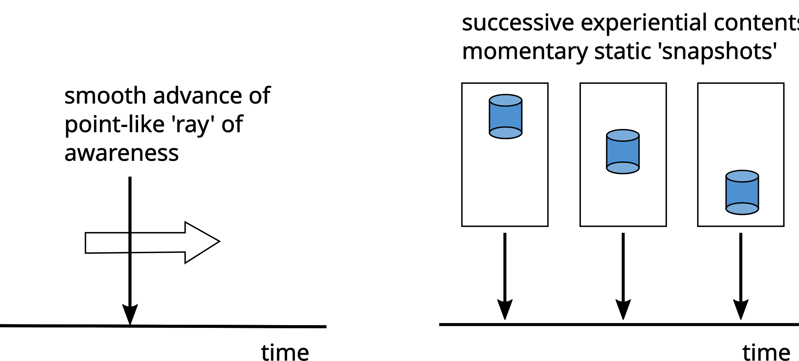
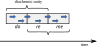
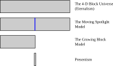

# Temporal Consciousness
**First published Fri Aug 6, 2010; substantive revision Fri Mar 17, 2023**

*Dainton, Barry*

In ordinary conscious experience, consciousness of time seems commonplace. For example, we are often aware of changes, movements, and successions unfolding over brief temporal intervals. How is this possible? Many different models of temporal consciousness have been proposed. Some philosophers have argued that consciousness is confined to a momentary interval and that we are not in fact directly aware of change. Others have argued that although consciousness itself is momentary, we are nevertheless conscious of change. Still others have argued that consciousness is itself extended in time. In this entry, the motivations and merits of these and other positions will be expounded and assessed.

## 1. Three Models of Temporal Consciousness

### 1.1 Time and Consciousness

Time and consciousness are interwoven on several levels. From the vantage point of ordinary life and common sense, consciousness plainly seems to exist *in* time. When we hear the clock strike twelve, our auditory experience of it so doing also occurs at twelve (or at most a few moments later). Watching a 120-minute action movie results in a two hour stream of auditory and visual experiences (along with accompanying thoughts and feelings), and this stream runs concurrently with the playing of the movie. Quite generally, our conscious states, irrespective of their kind or character, seem to occur in the same temporal framework as events in the wider world. But this is by no means the whole story.

There are also ways in which time or temporality might be regarded as manifest *within* consciousness. We can judge the duration of temporal intervals, particularly short ones, with reasonable accuracy—an ability that psychologists have investigated in considerable detail (see Wearden 2016 for an overview)[^wearden-2016]. Our episodic (or autobiographical) memories supply us with access to our own pasts; thanks to such memories our earlier states of consciousness are not altogether lost to us: they can be recreated (or relived), albeit imperfectly, in our present consciousness. And of course there are past-oriented emotions, such as remorse or regret or shame: through these the past can influence our present feelings, often in powerful ways. While there is no future-directed counterpart of memory, we can anticipate future happenings (more or less accurately, more or less eagerly), and experience future-directed emotions: fear, dread, hope—and these too can exert a powerful influence of our present states of consciousness.

The story is still by no means complete, for temporality is manifest in consciousness in a further and more intimate way. In our ordinary experience, over brief intervals, we seem to be directly aware of temporally extended phenomena such as change, persistence and succession. When we see a friend waving goodbye, do we *infer* that their arm is moving, on the basis of having observed a motionless arm occupying a sequence of adjacent spatial location? We do make such inferences of this kind: if I see that my neighbour’s dustbin is in the middle of the road rather than its usual position on the pavement, I (rightly) infer that it has been moved. But the case in question is not at all like this: what we see is simply an arm *in motion*. (Is it for nothing that cinema is often called “the moving image”?) The same applies in other sensory modalities. When listening to a melody, we hear each note giving way to its successor; when we hear a sustained violin tone, we *hear* the tone continuing on, from moment to moment. If temporally extended occurrences such as these can feature in our perceptual experience, it is natural to conclude that our awareness must be capable of embracing a temporal interval.

While this may seem obvious, it can also seem problematic. We can remember the past and anticipate the future, but we are only directly aware of what is present—or so it is natural to suppose. But the present, strictly speaking, is momentary. So, if our awareness is confined to the present, our awareness must itself lack temporal depth. Hence, we are led swiftly to the conclusion that our direct awareness cannot possibly encompass phenomena possessing temporal extension. We are thus confronted with a conundrum: it seems our awareness must extend over time, but it seems it can’t.

In grappling with this “paradox of temporal awareness” as it is sometimes called, different philosophers have proposed quite different accounts (or models) of the structure of this form of temporal consciousness. Simplifying somewhat, the most discussed options fall into three main categories:

- **Cinematic Model:** our experiences lacks any (or any significant) temporal extension—they are akin to static, motion-free “snapshots” or “stills”. Our streams of consciousness are composed of continuous successions of these static conscious states. In this respect they are analogous to movies, which (as displayed) consist of rapid sequences of still images.
- **Retentional Model:** our experiencing of change and succession occurs within episodes of consciousness which do not themselves possess any (or any significant) temporal extension, but whose contents present (or represent) temporally extended intervals and phenomena. These episodes thus have a complex structure, comprising momentary phases of immediate experience, along with representations (or *retentions*) of the recent past. Our streams of consciousness are composed of successions of states of this kind.
- **Extensional Model:** our episodes of experiencing are themselves temporally extended, and are thus able to incorporate change and persistence in a quite straightforward way. Our streams of consciousness are composed of successions of these extended phases of experience.

*Figure 1.1*

a. Cinematic Model

b. Retentional Model

c. Extensional Model

Figure 1.1 The Three Main Conceptions of Temporal Consciousness. [An extended description of Figure 1.1 is in the supplement.]

In his influential writings on these matters William James argued that to make sense of our temporal experience we need to distinguish the *strict* or mathematical present from the *experiential* or *specious* present: whereas the first is indeed durationless, the second is experienced as possessing a brief duration, sufficient to accommodate the change and persistence we find in our immediate experience. Proponents of the cinematic model maintain that James was mistaken: to make sense of our temporal experience we don’t need anything resembling an extended specious present. Proponents of the extensional and retentional views maintain that we *do* need something resembling a specious present, but offer very different accounts of it.[^note-1]

Ascertaining where the truth lies among the differing accounts of temporal consciousness is interesting in itself. Although most forms of experience seemingly feature succession and persistence—even the most primitive forms if James was correct in characterizing infant consciousness as a “blooming, buzzing confusion”—many philosophers have not found it easy to understand how any form of experience *can* have such features.[^note-2] The interest and importance of the debate does not end here, for each of the accounts of temporal awareness on offer has significant, and very different, implications for our understanding of the general structure of consciousness. In this entry we will be exploring the principal features and motivations of the competing accounts, as well as their strengths and weaknesses.[^note-3]

### 1.2 Terminology, Problems and Principles

Although proponents of the competing approaches are attempting to make sense of our experience of temporally extended phenomena, there are divergences on the issue of how precisely this experience should be construed and on several related matters.

One significant divide is between those who believe that temporally extended phenomena really do figure in our immediate experience, and those who deny this. To coin some terminology:

**Phenomeno-temporal Realism** (*PT-realism*, henceforth further abbreviated to *realism*): change, succession and persistence *can* be directly perceived or apprehended.

**Phenomeno-temporal Antirealism** (*PT-antirealism*, henceforth further abbreviated to *antirealism*): change, succession and persistence *cannot* be directly perceived or apprehended.

The extensional and retentional models are currently the two most influential forms of realism, with both approaches being developed in a variety of different ways. The task facing antirealists is in one respect the easier of the two: unlike their realist counterparts, they are under no obligation to provide an intelligible account of how it is possible for our consciousness to embrace seemingly temporally extended phenomena. But in another respect their task is the more difficult. Antirealists are under an obligation to “save the (temporal) phenomena”: they need to supply a credible explanation as to why so many of us find it so natural to *say* we perceive movement and change if in fact we don’t. After all, it *does* seem perfectly natural to hold that we can see clouds move across the sky, feel water flowing through our fingers and hear melodies. This is the task facing those cinematic theorists—e.g., Chuard (2017)—who hold that we do not directly perceive change or succession but who also accept that we seem to.

Realists generally maintain that it is important to distinguish the experience *of* succession from a mere succession of experiencings. An experience of succession involves a direct experience of change or persistence; there is no guarantee that a sequence of distinct momentary (or very brief) experiences will constitute an experience with this character even if these experiences occur successively and belong to the same person. If the experiencing of a tone C and a tone D are two entirely separate experiential episodes they won’t jointly constitute an experiencing of the succession C-being-followed-by-D. An experience *of* succession involves a temporal spread of contents being presented *together* in consciousness, albeit in the form of a perceived succession rather than simultaneously.

In an influential treatment of these topics Izchak Miller (1984) suggests that philosophical thinking on temporal consciousness has been influenced—overtly or only covertly—by two principles. Miller calls the first of these the “Principle of Presentational Concurrence” (PPC), which he formulates thus:

> The duration of a content being presented is concurrent with the duration of the act of presenting it. That is, the time interval occupied by a content which is before the mind is the very same time interval which is occupied by the act of presenting that very content before the mind. (I. Miller 1984: 107)[^miller-1984]

The “act-content” conception of the structure of consciousness that Miller’s formulation presupposes is not one to which everyone will want to subscribe, but the basic thesis encapsulated in PPC looks highly plausible.[^note-4] If we watch a traffic light change from red to green it is natural to think that we see the red light before we see the green light, and that—more generally—our awareness of these events unfolds concurrently with the events. Of the three conceptions of the nature of temporal experience we encountered in §1.1 the extensional model most clearly conforms with PPC—and for that reason has a *prima facie* plausibility.

Miller’s second principle is less intuitively plausible, at least on first acquaintance. Miller calls it the “Principle of Simultaneous Awareness” (PSA):

> No succession of awarenesses—no matter how close together in time they come—can, by itself, account for an awareness of succession; it must be the case that an awareness of succession derives from simultaneous features of the structure of that awareness. For instance, an awareness of the succession of, say, two tones (or tone-qualities) must involve simultaneous awareness of both tones (or tone-qualities). (I. Miller 1984: 109)[^miller-1984]

Some elements of Miller’s formulation could be clearer. Phillips expresses the basic idea more succinctly and more clearly:

**PSA:** If one is aware of a succession or duration, one is necessarily aware of it at one moment. (2014b: 140)[^note-5]

If PSA is true our awareness of the traffic light changing from red to green does *not* run concurrently with the event itself, it occurs at a single moment, and so runs counter to PPC. To the extent that PPC seems intuitively plausible, PSA seems implausible. However despite this—as we shall see in §4—an impressive number of philosophers and psychologists have rejected PPC and subscribed to PSA. Why has the latter principle seemed plausible? In part because it provides an answer to the question raised a moment ago that many realists have found compelling: “How does an experience of succession differ from a succession of experiences?” For further discussion of these principles and their motivations see Dainton (2000: §5.6), Rashbrook (2013a), Hoerl (2009), and Phillips (2010, 2014b).

### 1.3 Dynamics of Consciousness

There is a further issue which divides realists. In addition to espousing different views as to the structures within consciousness which provide us with temporal experiences, realists also defend a range of different views concerning the *character* of temporal experience. Think of what it is like to see ripples move across the surface of a pond (or across one’s skin), or an ocean wave crashing on the beach, or the sound of a violin droning on. When we carefully introspect, it becomes apparent that such experiences possess an internal dynamic character, an immanent intrinsic directed *flow*, of a distinctive kind. Since introspection also reveals that inner experiences such as mental imagery and bodily sensations all possess a flow-like character, there is reason to think this special form of dynamism is a feature of all forms of temporal experience. Or so some realists urge. Other realists are more sceptical in this regard, and deny that experience is distinctively dynamic in this sort of way, even if it is dynamic in other ways. We thus have a further division to note:

**Strong dynamism**: some or all forms of consciousness are imbued with an intrinsic directional flow-character.

**Moderate dynamism**: we directly experience change, succession and persistence but our experience does *not* possess the inherent flow-character posited by strong dynamists.

Bergson held that consciousness (or *durée*) is strongly dynamic—“continual flow … is the only immediate date of consciousness” (Bergson 1889 [1910: 44])[^bergson-1889]. He took this dynamism to be a primitive or irreducible feature of experience, describing the experience of a shooting star as “a line of fire” that is characterized by an “absolutely indivisible sensation of motion or mobility” (1889 [1910: 111–2])[^note-6] In stressing the process-like character of perceptual experience Soteriou (2013) approvingly cites O’Shaughnessy, whose commitment to strong dynamism is plain:

> [characteristically] the contents of experience are in flux, and necessarily experience itself is in flux, being essentially occurrent in nature … [i]t is not the mere existence of flux […] in the case of experience that is distinctive: it is the *necessity* of flux. (O’Shaughnessy 2000: 43)[^o’shaughnessy-2000]

In his *Stream of Consciousness* (2000) Dainton maintains that intrinsic flow and “dynamic patterning” are features of our temporal experience, and he takes these features to be as primitive as synchronic phenomenal unity. Torrengo (2017) is also committed to strong dynamism. He too thinks that all experiences possess a flow-like character, a character that is irreducible to representational properties of any kind.[^note-7]

### 1.4 Methodological Controversies

Philosophers interested in uncovering the temporal properties of consciousness have often found inspiration in scientific findings. Recent discussions have featured a wide range of perceptual illusions uncovered by psychologists very prominently—in several much-discussed works Daniel Dennett (1991, Dennett & Kinsbourne 1992)[^dennett-1992] drew the attention of philosophers to a number of experiments where (seemingly) what we perceive is affected by stimuli which lie in the future. In his ground-breaking chapter on the experience of time in *The Principles of Psychology* (1890) William James spends much of his time relating relevant work carried out by German psychologists such as Exner, Helmolz and Wundt in the preceding decades. As a comparatively new science psychology was just getting started in the nineteenth century, but back in 1689 we find Locke appealing to proto-scientific data when discussing our experience of duration in his *Essay*, where Locke points out that objects cannot be seen if they move fast enough (e.g., cannon balls), and that a glowing piece of coal appears as a circle when spun quickly.

The question of the extent to which philosophical discussions of temporal experience should be influenced by science is itself a source of controversy. Lee recommends a hard-line science-oriented methodological stance:

> My view is that the most powerful considerations in this area have to do with the ways in which temporal information is processed in the brain, so that ultimately what is at stake depends on empirical considerations of a quite general kind. […] It is worth noting at the offset that because I adopt this “bottom-up” methodology, my approach contrasts quite strongly with certain other authors such as Dainton (2000) who argues for views in this area more on the basis of phenomenological than empirical considerations. (Lee 2014a: 2)[^lee-2014a]

In the introduction to his *Stream of Consciousness* Dainton (2000) willingly concedes that in attempting to understand experiential unity and continuity his own approach will be exclusively phenomenological. He argues that his approach is justified because there exist important experiential structures that are in fact accessible to introspection, and we currently have no other way of accessing these features. Neuroscience may one day be in a position to assist but significant advances will need to be made—indeed Dainton suggests in

> situations in which the phenomenological data conflict with accepted science may well provide valuable clues as to how the relevant science might be revised and improved. (2000: 23).

Kon and Miller (2015) advocate a middle way between Dainton’s “top-down” phenomenological approach and Lee’s “bottom-up” approach rooted in neuroscience. They suggest that advances in our understanding of temporal experience will require us to successfully integrate armchair analysis and empirical evidence:

> we foresee that empirical evidence may significantly modify classic models these models are still of use: they offer a starting point for empirical enquiry by placing key features of our experience into coherent models. Plus, they offer general frameworks in which particular empirical models may be slotted and that potentially have testable consequences. (2015: 215)

If temporal illusions have played a significant role in recent debates but the same cannot be said of the general neuroscientific theories of consciousness—theories which purport to identify the neural basis of consciousness and (more ambitiously) explain how and why neural processes produce experiences in all its forms. It is far from being the case that general theories of this sort do not exist, or are even thin on the ground—see Wu (2018) for an introduction to several. Why have philosophers interested in temporal experience paid comparatively little attention to these theories? Kent and Wittmann (2021) propose an answer: to a surprising extent the main general theories of how consciousness relates to the brain make no attempt to explain or accommodate *experienced* *succession*, at most they can explain *experienced* *simultaneity* as it features in the briefest of conscious episodes. Northoff and Lamme (2020) review eight leading neuroscientific theories of consciousness: global neuronal workspace theory (GNWT), predictive coding theory (PCT), embodied theory (EB), temporospatial theory of consciousness (TTC), integrated information theory (IIT), recurrent processing theory (RPT), synchrony theory (ST) and higher-order thought theory (HOT). The majority of these, Kent and Wittmann argue, focus exclusively on processes in the sub-300 msec range, the sorts of neural processes that are generally thought to give rise to momentary experiences of simultaneity. These leading theories have nothing to say about neural processes occurring over longer intervals, from 300 msec to 3 seconds or more, that it is plausible to suppose will be underlie experiences of change and succession. Only RPT and Northoff’s own TTC offer anything different: these theories hold that experienced succession depends on oscillatory neural process that extend over significant periods of time.

If Kent and Wittmann are right it’s obvious why general neuroscientific theories have—thus far at least—had so little impact on the philosophical debates. Whereas the latter offer competing accounts of the experience of temporally extended phenomena seemingly stretching over intervals of time, the neuroscientific theories have largely confined themselves to a single experienced moment. If neuroscience starts to move beyond its current very narrow temporal focus its impact will very likely begin to increase.

These considerations do not mean that it is impossible for the philosophical debates to impact on neuroscience. To focus on just one example, the current incarnation of IIT is quite explicit regarding the narrow temporal confines of consciousness:

> … my experience flows at a particular speed—each experience encompassing a hundred milliseconds or so—but I am not having an experience that encompasses just a few milliseconds or hours. (Tononi & Koch 2015: 6)[^tononi-2015]

Since these brief episodes are discrete and non-overlapping our consciousness is less continuous than commonly thought:

> Accordingly, the seemingly continuous “stream” of consciousness would actually be constituted by a discrete succession of “snapshots” in line with some psychophysical evidence. (2015: 16)

In effect Tononi and Koch are committing IIT to a version of the cinematic model outlined earlier. This model does have its proponents, so this in itself is not problematic. What is more puzzling, as Singhal, Mudumba and Srinivasan (2022) point out is that IIT distinguishes itself from other neuroscientific approaches by taking phenomenology very seriously indeed. Yet the cinematic model is widely taken to be the most phenomenologically implausible of the leading theories of temporal experience—most of its proponents agree that our ordinary consciousness seems to be deeply continuous. IIT is distinctive by virtue of the singular importance it grants to the *unity* of consciousness, but it makes no attempt to accommodate the fact (as many see it) that the unity of consciousness extends through time as well as existing at a time. To render IIT maximally phenomenologically plausible these same authors recommend this addition to IIT’s current axioms:

> experience always occurs to us as a temporal whole, i.e. experience always has an extension, is continuous and has an inherent direction that is asymmetric. (2022: 14)

If future versions of IIT were to include an axiom along these lines it would be an interesting example of phenomenology influencing the development of a neuroscientific theory.

## 2. Some Historical Episodes

### 2.1 William James

In the Anglophone philosophical world over the past century or so William James’ “The Perception of Time”, chapter 15 of his classic *The Principles of Psychology* (1890) has been particularly influential. In the chapter James introduces readers to relevant experimental work as well as more philosophical reflections. It was thanks to James’ discussion that “the specious present” entered the vocabulary of both philosophers and psychologists. James gives E.R. Clay credit both for the term and for recognizing that the “sensible present” has duration; he quotes him thus:

> The relation of experience to time has not been profoundly studied. Its objects are given as being of the present, but the part of time referred to by the datum is a very different thing from the conterminous of the past and the future which philosophy denotes by the name Present. The present to which the datum refers is really a part of the past—a recent past—delusively given as being a time that intervenes between the past and the future. Let it be named the specious present, and let the past, that is given as being the past, be known as the obvious past. All the notes of a bar of a song seem to the listener to be contained in the present. All the changes of place of a meteor seem to the beholder to be contained in the present. At the instant of the termination of such series, no part of the time measured by them seems to be a past. (James 1890: 609)[^james-1890][^note-8]

James goes on:

> the original paragon and prototype of all conceived times is the specious present, the short duration of which we are immediately and incessantly sensible. (1890: 631)

In another formulation he enters into more detail, and says something about what this short duration contains:

> The unit of composition of our perception of time is a duration, with a bow and a stern, as it were—a rearward—and a forward-looking end. It is only as parts of this duration-block that the relation of succession of one end to the other is perceived. We do not first feel one end and then feel the other after it, and from the perception of the succession infer an interval of time between, but we seem to feel the interval of time as a whole, with its two ends embedded in it. (1890: 609–10)

In the same chapter of the *Principles* James also writes:

> Its *content* is in a constant flux, events dawning into its forward end as fast as they fade out of its rearward one … Meanwhile, the specious present, the intuited duration, stands permanent, like the rainbow on the waterfall, with its own quality unchanged by the events that stream through it. (1890: 630)

James clearly believed that there is an unvarying *structure* or *mechanism* underlying our temporal awareness, as did Husserl after him. If this is right, and if (as many believe) consciousness is essentially temporal, then this structure (or mechanism) is an essential component of consciousness itself, in all its forms.

James is well-known for emphasizing the *continuity* of experience

> Consciousness, then, does not appear to itself as chopped up into bits. Such words as “chain” or “train” do not describe it fitly … It is nothing jointed, it flows. A “river” or a “stream” are the metaphors by which it is naturally described (1890: 239)

and James’ stream metaphor strikes many as apt.[^note-9]

### 2.2 Locke, Hume and Reid

If the nineteenth century saw a surge in interest in time-consciousness due to discoveries in a range of different fields—see Canales (2009) for more of the story—an interest in these questions dates back far earlier. Saint Augustine’s labours in Book XI of the *Confessions* led him to espouse a position that is at least highly suggestive of a version of the cinematic conception outlined in §1. Augustine subscribed to the doctrine of *presentism* (as it has latterly become known), i.e., he held that only what is present is real:

> What now is clear and plain is, that neither things to come nor past are. Nor is it properly said, “there be three times, past present and to come:” yet perchance it might be properly said, “there be three times: a present of things past, a present of things present, and a present of things future”. For these three do exist in some sort, in the soul, but otherwhere do I not see them; present of things past, memory; present of things present, sight; present of things future, expectation. (*Confessions*, bk XI, ch XX, sect 26)

Since for Augustine it was also clear that the present must be entirely without duration, and that our perception is restricted to what is present—“that only can be seen, which is” (bk XI, ch XVIII, sect 24)—we are led swiftly to the conclusion that we can perceive or experience only what is contained in a momentary present.

Since we evidently possess *concepts* of persistence, succession and suchlike, one would expect philosophers who believe that our basic concepts derive their content from the content of our immediate experience—philosophers such as Locke and Hume—would incline in the direction of realism.[^note-10] And generally speaking, albeit with certain complications, this is what we find. In the *Essay* (1689) Locke writes:

> It is evident to anyone who will but observe what passes in his own mind, that there is a train of ideas which constantly succeed one another in his understanding, as long as he is awake. Reflection on these appearances of several ideas one after another in our minds, is that which furnishes us with the idea of succession: and the distance between any parts of that succession, or between the appearance of any two ideas in our minds, is what we call duration. (Chapter XIV, 3)

Like Locke, Hume believed that our conception of time is derived from our experience of the succession of our perceptions. In Book 1, Part II(§3) of his *Treatise* (1739) Hume writes:

> … time cannot make its appearance to the mind, either alone, or attended with a steady unchangeable object, but is always discovered by some *perceivable* succession of changeable objects. (*Treatise* bk 1, pt 2, §3 [1888: 35])
>
> … Five notes played on a flute give us the impression and idea of time; though time be not a sixth impression, which presents itself to the hearing or any other of the senses. [the mind] only takes notice of the manner, in which the different sounds make the appearance … ([1888: 36])
>
> … the indivisible moments of time must be filled with some real object or existence, whose succession forms the duration, and makes it conceivable by the mind. ([1888: 39])

Although Hume agrees with Locke over the origin of our concept of succession, what he says about duration sits uneasily with Locke’s contention that we arrive at the latter concept by observing the distances between impressions. For Hume

> the idea of duration is always derived from a succession of changeable objects, and can never be conveyed to the mind by any thing steadfast and unchangeable. ([1888: 37])

Since a period of (total) silence between the hearing of two sounds would not itself contain any change or succession—at least of an auditory kind—the concept of duration cannot be derived from this period of silence.

For Hume the fundamental ingredients of our streams of consciousness are momentary (durationless) experiences occupying “invisible moments” of time. If we were conscious of nothing beyond these durationless episodes is not obvious how we could experience succession. But Hume also held that we apprehend the way (“manner”) momentary perceptions are arranged or organized, and to these “compound impressions” there are corresponding “compound ideas”. As Lorne Falkenstein interprets Hume, compound ideas are themselves extended in time:

> [Hume] takes ideas to be objects in their own right, that represent something else by resembling it. … An idea of time represents time by being itself extended in time. (Falkenstein 1997: 193)[^falkenstein-1997]

If ideas of succession are themselves temporally extended, was Hume an early advocate of extensionalism? For Adrian Bardon the answer is clear and in the affirmative: in the *Treatise*

> Hume articulates an extensionalist account of our perception of space and time—an almost entirely disregarded account that really ought to be the locus classicus for extensionalism. (2019: 468)[^note-11]

In his *Essays on the Intellectual Powers of Man* (1785, henceforth EIP) Thomas Reid questioned some of Locke’s claims. For Locke succession is a more basic concept than duration—since we arrive at the concept of duration by reflecting on the distances between parts of successions—but Reid argues the reverse is the case. For a succession to exist at all, its parts—either particular impressions or the intervals between them—must themselves already have duration: for if these parts were all entirely lacking in duration, we would be dealing with a purely momentary phenomenon, and hence something which could not contain any kind of succession. Hence succession presupposes duration, and not vice-versa. Moreover, Reid held that our direct awareness is incapable of spanning even a brief temporal interval: “Consciousness, and every kind of thought, is transient and momentary, and has no continued existence” (EIP: III.6, p. 336). If our consciousness is instantaneous and transient it is difficult to see how we could ever be conscious of succession, and this is the stance Reid adopts:

> It may here be observed that, if we speak strictly and philosophically, no kind of succession can be an object either of the senses or of consciousness; because the operations of both are confined to the present point of time, and there can be no succession in a point of time; and on that account the motion of a body, which is a successive change of place, could not be observed by the senses alone without the aid of memory. (EIP: III.5, pp. 325–326)

Since the claim that we are immediately aware only of what is present can seem common sense of the plainest sort, it is not surprising to find Reid endorsing it. Reid recognizes that it seems equally commonsensical to say that we *see* bodies move—after all, we often talk in such terms: e.g., “I saw her waving her arm”. In response he argues that such talk is perfectly legitimate, provided it is construed in loose or popular sense, and not taken strictly and literally.[^note-12] See Levanon (2016a) for a more detailed analysis of Reid’s views—and his criticisms of Locke.

### 2.3 Kant and Bergson

In the course of his elaboration of transcendental idealism in the *Critique of Pure Reason* (1787) Kant made a number of claims that would influence subsequent debates on temporal experience. These are not always easy to interpret—for useful introductions see Dunlop (2017) and Bardon (2019). For present purpose this passage in “The Synthesis of Reproduction in Imagination” from the first *Critique* is particularly relevant:

> When I seek to draw a line in thought, or to think of the time from one noon to another, or even to represent to myself some particular number, obviously the various manifold representations that are involved must be apprehended by me in thought one after the other. But if I were always to drop out of thought the preceding representations (the first parts of the line, the antecedent parts of the time period, or the units in the order represented), and did not reproduce them while advancing to those which follow, a complete representation would never be obtained: none of the above-mentioned thoughts, not even the purest and most elementary representations of space and time, could arise. …. the reproductive synthesis of the imagination is to be counted as among the transcendental acts of the mind. We shall therefore entitle this faculty the transcendental faculty of imagination. (A102 [1980: 133])

Anyone who holds that our sensory experience consists of nothing more than a succession of momentary snapshots faces the problem of explaining why we seem to be aware of duration and succession. Kant held that our sensory experience does have this snapshot-like character and solves the resulting problem by offering a richer account of the momentary states. In the visual case, momentary episodes of visual experiencing are accompanied by representations of recently experienced visual contents. More generally, these representations allow us to be aware that our presently occurring experience is a part of an ongoing process.

More needs to be said, but Kant supplies at least the beginnings of one plausible-looking account of how it might be possible for us to be aware of change and succession in the way we seem to be, and it is an approach that can be developed independently of Kant’s transcendental idealism—and its commitment to the unreality of time. The “retentional” approach (recalling the terminology of §1.1) soon found advocates, and is comparatively commonplace by the end of the nineteenth century.

If we move onward a century we encounter Henri Bergson, a philosopher who placed a highly dynamic form of temporal experience right at the centre of his philosophy. As Canales (2015) vividly demonstrates, at the beginning of the twentieth century Bergson’s writings on time and consciousness had considerable influence on his contemporaries, both within the philosophical world and beyond. In his *Time and Free Will: An Essay on the Immediate Data of Consciousness* (1889 [1910]) Bergson began his campaign against the “spatializing” of time, and in this campaign the concept of *duration* (or *durée*) plays a key role. At least in his earlier writings, this concept applies to time as it is featured in our immediate experience. For Bergson, *durée* is a continuous dynamic experiential flow, immeasurable and unquantifiable—the “ceaselessly seething surd at the heart of things”, in Barrett’s words (Gale 1968: 373)[^gale-1968]. As such it is radically unlike the static conception of time as a manifold of mere locations to be found in the scientific conception of the world, whether Newtonian or Einsteinian.

> Pure duration is the form which the succession of our conscious states assumes when our ego lets itself *live,*when it refrains from separating its present state from its former states … We can thus conceive of succession without distinction, and think of it as a mutual penetration, an interconnexion and organization of elements, each one of which represents the whole, and cannot be distinguished or isolated from it except by abstract thought. (Bergson 1889 [1910: 100–101])[^bergson-1889]

Many of Bergson’s characterizations of *durée* are negative: he tells us a good deal about what it is not, but comparatively little about what it actually is. While this can sometimes be frustrating, there is a rationale for it: Bergson held that any attempt to conceptualize the flux of consciousness could succeed only at the cost of distorting the phenomena—a doctrine which influenced William James in his later years—for more on this see Dainton (2017a, 2022) and Dolev (2022).

In later works, such as *Matter and Memory* Bergson suggested that primitive forms of *durée* can be found in all material things, even the simplest particles and fields. If so, temporal experience is ubiquitous, and there is a flowing dynamism at the heart of literally everything. For more on Bergson’s conception of the nature of matter see Čapek (1971) and Sinclair (2019).

Bergson may have been influential during the first decades of the twentieth century but not everyone was convinced of the fundamental correctness of his metaphysical and phenomenological claims—even in the Francophone philosophical world of the period. In his *Intuition of the Instant* (1932) Gaston Bachelard launched a radical assault on Bergson’s account of the temporality of consciousness and the temporality of the world. For Bergson the static durationless instant of mathematics and physics is an abstraction to which nothing in concrete reality corresponds—reality is essentially extended and flowing. The position Bachelard defends is diametrically opposed to Bergson’s:

> Time alone has but one reality: the reality of the instant. Otherwise put, time is a reality confined to the instant and suspended between two voids. Although time will no doubt be reborn, it must first die. It cannot transport its being from one instant to another in order to forge a duration. (Bachelard 1932 [2013: 6])[^bachelard-1932]
>
> … time is the instant, and it is the present instant that bears the full weight of temporality. The past is as empty as the future. The future is as dead as the past. The instant holds no duration at its core; it does not thrust a force in one direction or another. It does not have two faces. It is whole and alone. (1932 [2013: 28])

Bergson complained that conceiving of the continuity of experience in mathematical terms reduces experience to a “dust of instants”. Bachelard responds thus:

> Time is noticed solely through instants; duration … is felt solely through instants. Duration is a dust cloud of instants or, better yet, a group of points organized more or less coherently by a *phenomenon* of perspective. (1932 [2013: 19])

While Bergson argued that the cinematic conception of the stream of consciousness is fundamentally wrong, for Bachelard this conception is essentially correct—and as we shall now see, he is not alone in this.

## 3. Cinematic Approaches

### 3.1 Streams and Stills

When it comes to explaining the temporal structure of our consciousness the account offered by the cinematic theorist is appealingly straightforward. On a straightforward version of this view, a typical stream of consciousness consists of a close-packed continuum of momentary (or very brief) phases. Although the contents of these phases are themselves momentary—they do not present motion or change, they are akin to static snapshots. But their occurrence in rapid succession succeeds in generating all the change, succession and motion we find in our experience. Or so the cinematic theorist maintains: on their view nothing more is required. The basic features of the model are depicted in Figure 3.1. On the left we see a punctual beam of awareness, the smooth, steady advance of which generates a sequence of momentary snapshot-like contents (of a falling object, in this instance), only a small selection of which is shown on the right.

*Figure 3.1*

Figure 3.1 The Cinematic Model. [An extended description of Figure 3.1 is in the supplement.]

As we saw earlier, this approach can be traced back as far as St. Augustine and was later advocated by Reid, and more recently by Bachelard. Phillipe Chuard (2011, 2017, 2020) is a contemporary defender of the view, calling it the “snapshot theory”:

> … the snapshot theorist argues, the phenomenology we seem to introspect while enjoying successive experiential states not only *supervenes upon*, but *reduces* to, those features of successions just listed: the experiential properties of snapshots, their temporal arrangement, the gradual transitions in their successive contents, our memories of previous experiences, and inability to detect small gaps and jumps, all contribute to what it’s like to enjoy the sort of phenomenology associated with putative temporal experiences. (Chuard 2017: 125)[^chuard-2017]

In §1.2 a distinction was drawn between realists and anti-realists, with realists holding that change and succession can be directly perceived and anti-realists maintaining that it cannot. Chuard denies that change can be directly apprehended, putting him in the antirealist camp. But he also accepts that we *seem* to directly experience change—so realism appears to be true, even if it isn’t.

To be clear, the snapshot view isn’t trying to explain how we do, in fact, have temporal experience. We don’t, the snapshot theorist surmises. Rather, the view aims to explain what it is like to go through successions of very short conscious experiential states, to then point out how the phenomenology thus accounted for seems indiscriminable from the phenomenology associated with the temporal experience we allegedly enjoy. Thus, the snapshot view doesn’t reject the phenomenological appearances, quite the contrary. It aims to explain them without liberally assuming that such experiences must be taken entirely at face value, as revealing the metaphysical structure of our streams of consciousness. (Chuard 2017: 126)[^chuard-2017][^note-13]

Critics of the cinematic theory are generally of the view that James was correct when he drew a sharp distinction between a mere succession of experiences and an experience of succession, and since the cinematic theorist is providing us with no more than the former it cannot deliver an adequate account of the latter. Dainton (2000: §5.5; 2008b: 57) invites us to imagine a group of five people standing in line with their eyes closed, but directed at a nearby tennis game. If each of these people opens their eyes momentarily before closing them again we have a succession of five experiences, each revealing the on-court action at a particular moment. It seems clear that in this case there is nothing resembling an experience of succession: all each person sees is a momentary still image, and these momentary states are completely isolated from one another experientially. There is, Dainton suggests, a huge difference between this sequence of experiences and our own streams of consciousness, but since the cinematic theory fragments consciousness in an analogous way it is deeply implausible phenomenologically.[^note-14]

As for how sequences of momentary static snapshots can give rise to experiences with *seemingly* dynamic contents Reid and Chuard both hold that memory plays an important role. In Reid’s words:

> It is by memory that we have an immediate knowledge of things past: The senses give us information of things only as they exist in the present moment; and this information, if it were not preserved by memory, would vanish instantly, and leave us as ignorant as if it had never been. (EIP: III.1, p. 303)

But is memory enough? Phenomenologically there is an obvious difference between perceptual experience and experiential memories: the latter are far less detailed and far less vibrant than the former. Given this, it is not obvious that combinations of instantaneous perceptual experiences and memories could provide us with the sorts of experiences of change we actually enjoy: successions of experiences, yes; experiences of succession, no. For further discussion of appeals to memory see Dainton (2000: §5.4) and Phillips (2010: §5).

What of the cinematic analogy itself? It is well known that rapid successions of static images *can* result in experiences of motion. The images shown on a TV or cinema screen are static snapshots, but evidently, they are perceived as dynamic: objects on a cinema screen are seen to move as smoothly and continuously as their real-life counterparts. This phenomenon—known as “illusory motion” or “the phi phenomenon” was first explored in the nineteenth century by Exner, and has been much-studied since then (not surprisingly, since it underpins televisual industries). But while it is real enough, the phi phenomenon is of little assistance to the cinematic theorist. What the latter needs is an account of how successions of *momentary conscious states*, each possessing entirely static contents, can give rise to the experience of motion. Static images are indeed being displayed on a cinema screen while we view a movie, but not only are these onscreen stills not themselves experiences, they do not register in our visual experience *as* static images: what we actually seem to see onscreen are objects *in motion*.

In the scientific literature the hypothesis that perceptual experience comes packaged in discrete sub-second “frames” possessing static contents has been defended on a number of occasions. White (2018) undertakes a detailed survey of the relevant work in psychology and neuroscience. White’s verdict is that the discrete frames hypothesis has not yet been decisively refuted, but it is seriously problematic on a number of fronts.

The available evidence does not provide consistent support for any specific duration for frames, and perceptual processes display a flexibility that is not readily reconcilable with the frame hypothesis. There are also

> problems concerning the definition of frames, the need for informational connections between frames, the means by which boundaries between frames are established. (White 2018: 98)[^white-2018]

### 3.2 Dynamic Snapshots

Cinematic theorists would be on stronger ground if they could supply a plausible explanation as to *why* we believe we perceive motion (and more generally, change) if in fact we do not. Le Poidevin (2007: 88–92) tentatively forwards a promising hypothesis. As Aristotle noted, if you stare at a waterfall for a short period, and then turn your gaze to the bank beside it, you will see part of the bank (seemingly) start to move in an upwards direction. This phenomenon is commonly called “the waterfall illusion” (or *motion aftereffect*), and the illusory motion is of an intriguing sort: although parts of the bank seem to flow upward, they do so without seeming to change their location with respect to the rest of the bank.

As for an explanation of what is going on in such cases, Le Poidevin (following Richard Gregory) suggests that perhaps we can discern here the workings of two distinct neural mechanisms. One

> registers what we might call “pure motion”, i.e., gives rise to the impression of motion without any associated sense of change of position. (2007: 89)

A second system, relying on short-term memory, tracks and compares the alterations in location over time. This second system is not concerned with telling us about presently occurring motions, rather it gives rise to the sense that objects have changed their positions relative to one another. Hence Le Poidevin’s proposal: perhaps our ordinary experience of motion does, after all, consist of nothing but momentary static snapshots but these momentary experiences *seem* dynamic thanks to the activation of the “pure motion” mechanism in our visual system.

This is a more promising line for the cinematic theorist to take, and it has recently been endorsed by Arstila (2018), and also been taken up by Prosser, where pure motion plays an important role in his dynamic snapshot theory:

> … it is a “snapshot” theory because it accounts for the experience of motion without appeal to a specious present, but it is very different from the cinematic or “static snapshot” theory. I agree with those who hold that the latter theory cannot adequately account for the phenomenology of motion experience. (2017: 149, see also Prosser 2016: §5.4)[^prosser-2016]

This supposedly dynamic version of the cinematic view may be more promising than the static alternative, but it has also come under fire from a number of directions. McKenna argues thus:

> For the experienced illusory object … to appear static in space, but with motion-like properties, it must exhibit persistence over some length of time. temporality is inescapable; events continue to succeed one another over time, even if the content remains the same. (2021: §6)

Shardlow makes a similar complaint:

> Contrary to what Prosser and Arstila suggest, it simply does not follow that the experience of motion is not in and of itself something with a fundamentally temporally extended phenomenology, and that motion/change as it is experienced seems processive…. (2019: 745)

It may well be a mistake to focus exclusively on the case of vision: after all, in addition to being seen, change can be heard, smelt, tasted, felt in bodily sensations, remembered, imagined and thought about. Even if the existence of the envisaged twin-track neural systems could be established in the visual case, critics point out that as things currently stand there is no reason for thinking Arstila is correct when he proposes that there are a range of different encapsulated systems, one for each of the other forms of temporal experience. On the contrary: if, as has seemed plausible to many, *all* forms of consciousness possess a dynamic temporal character then it is natural to conclude that temporality is closely connected with the neural processes that are responsible for consciousness itself:

> Why adopt the encapsulated mechanism approach when it is simpler, more explanatory, and truer to the phenomena to locate temporality as a feature of a general mechanism responsible for consciousness, whatever that may be? A feature of a general mechanism also has the benefit of accounting for why people never seem to go “timeless” the way people go “blind”—temporality is indispensable to consciousness because it is inextricably bound up with the processes responsible for it. (McKenna 2021: §5)[^mckenna-2021]

McKenna suggests that the future-oriented predictive processing proposal from Hohwy, Paton, and Palmer (2015) fits the bill. An alternative general neuro-scientific mechanism is proposed by Piper (2019), who points to the merits of the re-entrant oscillatory multiplexing (ROM) neurodynamical model. On the latter view the temporal features of consciousness are the product of interlocking and interdependent waves of neural activity that are extended through time in a manner that is difficult to reconcile with the cinematic view in any of its guises but eminently compatible with rival extensional models. Just as

> music is a product of various auditory *resonances* (in rhythm, pitch and timbre, for example) amongst the parts of the active orchestra. Analogously the ROM model formalizes the idea that coherent mental representations and experience is the product of various resonances (i.e. multiplexing) between the phases, frequencies and amplitude parameters … of reciprocally connected information-processing (i.e. reentrant) brain circuits. (Piper 2019: 9–10)[^piper-2019]

In a similar general vein Northoff (2016) and Northoff and Huang (2017) argue that the temporal features of consciousness are inextricably bound up with continuous neural oscillations that are extend through time in a continuous manner. These “slow cortical pulses” are low frequency waves of neural activity that allow the brain to unify stimuli that are temporally separated. This position also runs counter to cinematic conceptions but gels neatly with extensionalism.

## 4. Retentional Approaches

### 4.1 Motivations

Endorsing the Augustinian doctrine that consciousness is confined to the present point of time does not oblige one to reject the claim that change and succession feature prominently in immediate experience. These theses are quite compatible with one another provided the experience of change occurs *within* the confines of the momentary present. Indeed, in the eyes of some—but not all—this is a necessary precondition for contents to be experienced together as parts of a unified whole. The obvious way of developing an account along these lines is to hold that momentary episodes of sensory consciousness are accompanied by a simultaneously existing array of *representations* (or *retentions*) of immediately preceding conscious states, and our awareness—at a single moment of time—of this combination of ingredients provides us with what we take to be a direct awareness of change and succession. This “retentional” approach—recalling the terminology of §1.1—was comparatively commonplace by the end of the nineteenth century and continues to attract supporters.

Many realists have no doubt found this approach appealing because it offers a simple and intuitively satisfying explanation of how an experience of succession differs from a mere succession of experiences: in the former case, the contents forming the succession are presented together, as an ensemble, to a single momentary awareness. Brentano and Husserl both subscribed to the *Principle of Simultaneous Awareness* (PSA) that we encountered in §1.2: “If one is aware of a succession or duration, one is necessarily aware of it at one moment”. Indeed, it may well be that some theorists, consciously or unconsciously, have found the retentional approach appealing because of the way it (in effect) *reduces* the problem of diachronic phenomenal unity to the comparatively straightforward problem of synchronic unity.

### 4.2 Brentano and Husserl

Brentano recognized that reaching a clear understanding of how it is possible for us to directly experience succession and persistence is a central issue for phenomenology (or “descriptive psychology” as he preferred to call it). He also recognized that a mere succession of experiences does not, in and of itself, add up to an experience of succession. Brentano’s solution: when listening (say) to an extended tone or melody, at each moment you are aware of a momentary sound-phase, but you are also (and simultaneously) aware of a series of representations (or retentions) of the immediately preceding phases. The latter Brentano referred to as *proteraesthesis*. Brentano’s approach gives rise to several questions. How can contents which are simultaneous, objectively speaking, seem to be successive? What is the precise nature of the representations occurring in proteraestheses? Brentano’s views on these matters underwent several changes—see Chisholm (1981) and Kraus (1930 [1976]) for further details.

The early years of the twentieth century see Husserl developing an account of time-consciousness along retentional lines. Husserl attended Brentano’s lectures between 1884–6; inspired by them, he decided to devote his energies to philosophy rather than mathematics. In elaborating his own position, in lectures in 1904–6, Husserl begins with criticisms of what Brentano (and Meinong) had to say on the topic, but the position he ends up with is along the same general lines. Husserl may not have adopted the term “specious present”, but he did hold that we have a seemingly direct awareness of change and persistence amongst the objects and processes we perceive over short intervals. He also held, plausibly, that as our streams of consciousness flow on, we have an awareness of their so doing. As for how this is possible, he thought it must involve past phases of consciousness somehow being “retained in grasp” in later moments of consciousness.

At the heart of Husserl’s account is a dynamic tri-partite view of the composition of consciousness at any instant. The three components are: *primal impressions*, *retentions* (or “primary memories”) and *protentions*. Primal impressions are the live, actual experiences that occupy the momentary now. No sooner does a primal impression occur than it slips seamlessly into the past. But it does not vanish from consciousness altogether: it survives in the form of a retention, which presents it *as* past. For Husserl, retentions are a quite distinctive form of consciousness, and differ significantly from ordinary memories. As for protentions, these are the future-oriented counterparts of retentions. In some cases—e.g., when we are perceiving or remembering a familiar sequence of events—they can be quite detailed, but often they consist of nothing more than an *openness* to the future, an expectation that *something will come*.

*Figure 4.1*

Figure 4.1 Husserl’s time diagram. [An extended description of Figure 4.1 is in the supplement.]

The basic mechanics of Husserl's theory are depicted in Figure 4.1, where the horizontal axis represents a continuous flow of primal impressions, the vertical axes represent a selection of retentions (and in the case of F) protentions which accompany the primal impressions D, E and F. (Only a “selection” because in reality, according to Husserl, a continuous stretch of consciousness consists of a dense continuum of primal impressions, each of which is accompanied by its “comet’s tail” of retentions and protentions.) As can be seen, individual primal impressions are retained in later specious presents—increased “pastness” is indicated by a greater number of asterisks. What goes for momentary primal impressions also goes for intervals: D-E is retained at F in the form of the retentional continuum E*–D**.

The broad outlines of Husserl’s position may be clear enough, but the details pose more of a challenge. Husserl wrote voluminously on time-consciousness throughout his career but never found a position he was happy with for long—in his lectures from 1907–10 he found fault with the position he elaborated in the 1904–6 lectures—and he never published a definitive statement of his position. For useful introductions to Husserl’s views see Kortooms (2002) and Zahavi (2004, 2007, 2010).

### 4.3 Temporal Illusions and Neuroscience

In a series of papers Rick Grush has developed a version of retentionalism in the form of the “trajectory estimation model” (TEM) which draws on ideas and analyses from control theory and signal processing—for further details, see Grush (2005a, 2005b). So far as analogies with Husserl’s doctrines are concerned, a key point is that the internal models employed by these systems are not confined to representing *instantaneous* states of the relevant domain. What is modelled, rather, is the *trajectory* of the domain over a short interval of time, i.e., the entire succession of states that the system estimates that domain is most likely to have been in during the relevant interval. It is this trajectory which Grush takes to be the information-processing analogue of Husserl’s tri-partite specious presents.

Grush argues that the abilities of his systems to generate different (and incompatible) representations of what is being perceived at a given time is a positive boon, for it allows his theory to accommodate a variety of temporal illusions. In so-called “post-dictive” illusions what is experienced as seemingly occurring at a time *t* is influenced by stimuli arriving later than *t*. One such illusion is the *cutaneous rabbit* described by Geldard & Sherrick (1972). The experiment involved devices capable of delivering controlled brief (2 msec) pulses to the skin being fitted along the arms of subjects. Surprisingly, when the devices were clustered in just three tight configurations—and the wrist, the elbow and in-between—and five pulses were delivered to each location, rather than experiencing three tight clusters of pulses (one at the wrist, one at the elbow and one in-between) subjects report feeling a succession of *evenly spaced* pulses starting at the wrist and terminating a the elbow. There are several questions that can be asked about this, but perhaps the most puzzling is: what is happening at the time of the *second* pulse? How is the brain able to adopt the “evenly spaced” interpretation *before* the second flash even occurs?

Grush’s TEM has no difficulty explaining what is going on in such cases. In the case of the rabbit, the second pulse is initially experienced as occurring at the wrist. But as the brain updates its models in the light of subsequent sensory information and its own expectations as to the likely scenario confronting it, it alters its verdict and the second pulse is experienced as occurring further along the arm, as part of an evenly spaced succession. When subjects are subsequently queried as to what they experienced, it is the later experiences which get reported—the earlier ones are not remembered.

Proponents of competing approaches have defended different ways of interpreting post-dictive illusions. Dainton (2008a: 381) argues that cases of this sort pose no problem for extensionalists:

> might it not be that our visual systems take some time … before producing experience in response to a given stimulus? And might they not use this time to work out a *single* *coherent* version of events before committing it to experience?

Eagleman and Sejnowski (2000) proposed a “delayed response” construal of the flash-lag illusion along these lines. In response Grush (2016: 5.1.1 [Other Internet Resources]) argues that since this additional delay will have to be incurred in *all* our perceptual systems *all* the time, positing it is by no means cost-free. Arstila (2016a) argues that Grush and Dainton’s explanations of post-dictive visual illusions are both problematic, and proposes an alternative.[^note-15]

Geoff Lee (2014a, 2014b) defends what is arguably a retentional model of temporal experience, albeit one possessing some distinctive features. Lee holds that specious presents are housed in experiential states that have a very brief temporal extension—Lee thinks these states are identical with neural states and processes, and the latter always have a non-zero temporal magnitude. Although these experiences possess some temporal extension they do not have any *experiences* as proper parts, and so Lee aptly calls them “atomic experiences”. Extensionalists view specious presents as temporally extended experiences which *do* possess other experiences as proper parts, and for Lee this is the defining feature of extensionalism. None of the seemingly-extended contents of Lee’s atomic experiences seem to be past- or memory-like—they are all fully perceptual in character—and so different from Husserlian retentions.[^note-16]

One of Lee’s main arguments for preferring a version of the retentional (atomic) model is his “Trace-Integration Argument”, which has its roots in his preferred science-oriented methodology. Lee points out a basic and widespread assumption in recent cognitive psychology: information concerning what has been recently perceived must be simultaneously present in subsequent representations if it is to play any role in cognition (Lee 2014a: 15)[^lee-2014a]. It does seem plausible to suppose that our brains engage in coding of the sort Lee describes. What is more controversial is whether this is the *only* kind of processing that our brains engage in when generating temporal experience. For a critical assessments of Lee’s argument Viera (2019), and for very different kind of neural models which rely on temporally extended neural processes see Northoff (2016), Northoff and Huang (2017), and Piper (2019).

### 4.4 Retentions and Representationalism

The retentional model faces a number of challenges. For the doctrine to be plausible we must be able to make clear sense of the idea that experienced duration can be contained in episodes of experiencing that are themselves without discernible duration, and retentionalists also need to be able to provide a plausible account of how retentions can do the job required of them. For a number of recent theorists—e.g., Grush, Kiverstein, Lee and Tye—a currently popular theory of the nature of perceptual experience helps retentionalism solve these and other problems.

In the philosophy of perception *representationalism* (or *intentionalism*) is the doctrine that the phenomenal properties we encounter in perception are determined by, or supervene upon, “representational” contents. Needless to say representations come in very different forms, and the variety deployed by recent representationalists is of a distinctive kind. As Siegel usefully notes:

> when one speaks of the contents of a newspaper, one is talking about what information the newspaper stories convey. Many contemporary uses of “the contents of perception” take such contents to be analogous to the contents of a newspaper story. (2005 [2021: §2])

The stories we encounter in newspapers often make claims about the world, and can be assessed for their truth or accuracy, and one way of specifying the content of a story is by specifying what would have to be the case if the story is true. Representationalists maintain that the contents carried by perceptual experiences are similar: we can specify their content by specifying the conditions under which they are true (or reliable). Importantly, on this view perceptual experiences can have representational contents even if the story they are telling is false: we do, after all, misperceive things from time to time—a balloon which looks red might turn out to be orange.

Representationalists hold that, quite generally, the properties of a representational *vehicle* (that which is doing the representing) and the *content* of that representation (what is represented) need to be sharply distinguished. The word “red” can represent the colour *red* without itself being red. A copy of a newspaper is very different from the stories it tells. In the case of temporal experience anyone who finds this theory of perception appealing can adopt a quite straightforward position on the nature of retentions: the latter provide us with a direct awareness of the recent past because they are perceptual experiences possessing meaningful contents that represent the recent past. The problem of understanding how the experienced duration and succession can exist in experiences that are durationless (or almost so) now has a straightforward solution. As we have just seen, representational vehicles and their contents typically do have very different properties, and this is a case in point. In the representationalist framework it would be a mistake to expect the temporal properties of an experience, a vehicle, to match those of its content.

Hoerl (2013a) argues that some of Husserl’s otherwise puzzling pronouncements become a good deal less puzzling if we suppose that he changed his stance from something akin to a sense-datum theorist (in his early days) to something akin to contemporary representationalism (in his later days). Husserl tells us that “Memory—and this is equally true of retention—is not image-consciousness, it is something totally different” (Husserl TPZ [1991: 36]). He also says that as a primal impression is transformed into a retention

> there is a radical alteration, an alteration that can never be described in the way in which we describe the changes in sensations that lead again to sensations. (Husserl TPZ [1991: 336])

We can see how Husserl might have thought this true is he had (in effect) adopted representationalism.[^note-17]

There is a further doctrine defended by many representationalists that is also relevant to our current concerns: an insistence on the “transparency” of experience. By this they typically mean (in part at least) that in ordinary perceptual experience, we have no awareness whatsoever of our experiences themselves, we are simply aware of the (worldly) objects and properties that are presented in or by our experiences. If our experiences are invisible, there is no need to introduce properties *of* experience—phenomenal properties, qualia, sense-data and such—in order to explain the content and character of our ordinary perceptual consciousness. Extending this approach to the particular case of temporal consciousness, Michael Tye argues as follows. First of all, if we assume the transparency thesis is true, the traditional assumption that it is *experiences* that are related by succession or simultaneity is misguided:

> Consider again the case in which I have an experience of a red flash followed by a green flash. Here I experience two colored *flashes* as occurring one after the other. I do not experience my *experience* of a red flash as succeeding my *experience* of a green one any more than I experience my experience of a red flash as red. (2003: 96)

Accordingly, Tye holds that anyone seeking to account for our ability to directly apprehend change by appealing to a unifying relationship between experiences is also misguided: there simply aren’t the token experiences there to *be*unified; a given period or stretch of consciousness is not composed of successive perceptions or experiences (2003: 102). By way of an alternative he offers a *one experience view* of streams of consciousness:

> The simplest hypothesis compatible with what is revealed by introspection is that, for each period of consciousness, there is only a single experience—an experience that represents everything experienced within the period of consciousness as a whole. (2003: 97)

For a recent defence of Tye’s general approach to transparency in the case of temporal experience see Heeney (2021). As Bayne notes, Tye’s one experience proposal does not sit easily with some of his other views. Tye holds that experiences are representational states that have the ability to directly feed into our cognitive systems. Bayne asks:

> Is it really plausible to suppose that the contents of an entire stream of consciousness—that is, the period of consciousness between one state of unconsciousness and the next—are poised for direct input in to the reasoning system? … That seems *extremely* unlikely. (Bayne 2005: 498)[^bayne-2005]

Soteriou (2010: 230) is also puzzled by this aspect of Tye’s position.

For discussion of some further issues relating to retentional specious presents see the supplementary document [The Specious Present: Further Issue](consciousness-temporal.specious-present.md)s.

## 5. Extensional Approaches

### 5.1 Origins: A Dogma Rejected

Stern observes at the start of his “Mental Presence-Time” (1897 [2005]) that much recent work in psychology makes an assumption about the kind of unities that can exist within experience: only contents that are *instantaneous* and *simultaneous* can be apprehended together. Needless to say, this assumption amounts to a commitment to PSA—see §1.2. Stern proposes that we reject this constraint:

> That only those contents can belong to a whole of consciousness that exist together and are simultaneously present at any given time … is a dogma, which, in a more or less veiled form, determines numerous psychological reflections. I consider this dogma, at least in this generalized form, to be false. I believe that there are instances when an apprehension first comes into being on the basis of temporally extended content of consciousness, in such a manner that every part of this content exists in an insoluble connection with every other part. (Stern, 1897 [2005: 313])

Rejecting PSA brings a number of advantages. Experienced contents which appear to be successive can really be successive, rather than existing simultaneously (as with retentional models), similarly episodes of consciousness which seem to persist through intervals of ordinary objective time can really do so. Abandoning the dogma means that temporal consciousness need no longer be systematically misleading as to its own nature. Stern was well aware why his contemporaries maintained that it was necessary to distinguish a succession of experiences from an experience of succession. A sequence of musical notes will only be experienced as a succession if they are experienced together, with each being experienced as following on from its predecessor. Stern was simply suggesting that these unified experiential episodes are themselves extended over temporal intervals rather than momentary.

> I therefore put forth the following principle: mental events that play themselves out within a stretch of time can under circumstances form a unified and complex act of consciousness regardless of the non-simultaneity of individual parts. That stretch of time over which a mental act can be extended I call its presence-time. (Stern 1897 [2005: 315])[^stern-1897]

Wundt held that complexes of sensory contents could only be apprehended directly if they exist in a conscious whole simultaneously. Stern rejects this: “As a whole, yes; as simultaneous, no” (1897 [2005: 319]). What of the notion “the present” if we follow Stern and embrace an extensional model of temporal experience? Stern suggests we needn’t reject the idea that experiences can be present. All we need do is define the present “as the totality of temporal and spatial relations that can become the object of a direct perception” (1897 [2005: 325]). Since we directly perceive events spanning brief intervals, the present thus construed is a positive and finite stretch of time.

How do individual presence-times combine to form streams of consciousness? In ordinary life we are, after all, continually conscious for hours at a stretch, whereas individual presence-times are very short. Stern does not address this question in his article so he can offer little assistance—see Dainton (2017b) for a fuller account of Stern's views —however it was not long before a promising proposal emerged. In 1915 Bertrand Russell published his “On the Experience of Time” in *The Monist*, where the stream-composition question is addressed. Russell begins by introducing some key terms and theses. A *sensation* involves a subject standing in the acquaintance relation with an object or sense-datum. Russell makes it clear that he believes change can be directly experienced, telling us:

> *Succession* is a relation which may hold between two parts of one sensation, for instance between two parts of a swift movement which is the object of one sensation; it may then, and perhaps also when one or both objects are objects of immediate memory, be immediately experienced, and extended by inference to cases where one or both of the terms are not present. (1915: 213)

How do specious presents combine to form entire streams of consciousness? Here Russell usefully goes beyond Stern and proposes that neighbouring specious presents in the same stream of consciousness are related by overlap or part-sharing. Let’s suppose A, B, C are brief sounds of the same duration that are experienced as a succession in the same continuous stream of consciousness; let’s also suppose that the lengths of these sounds are such that only two of them can be experienced together. Russell suggests that the resulting temporally extended experience will include two specious presents [A-followed-by-B] and [B-followed-by-C], and since the experiencing of the B-sound is numerically identical with the experiencing of the B-sound in the later specious present the B is heard just once, not twice. The resulting stream of auditory consciousness consists of a continuous succession of sounds, each heard as following on from its predecessor, where only two sounds are experienced together as directly successive.

Russell goes on to offer a further important observation:

> If A, B and C succeed each other rapidly, A and B may be parts of one sensation, and likewise B and C, while A and C are not parts of one sensation. But A is remembered when C is present in sensation. In such a case, A and B belong to the same present, and likewise B and C, but not A and C; thus the relation “belong to the same present” is not transitive. (Russell 1915: 233)[^russell-1915]

As Russell clearly appreciates, if the relation of “belonging to the same present” *were* transitive, then A would necessarily belong to the same (specious) present as C, and more generally, all the partially overlapping phases of a stream of consciousness would have the character of a single unified specious present—and so you would now be directly experiencing what you saw and heard when you first awoke this morning. Since this is manifestly not the case, the “belonging to the same present” relation is clearly not transitive.

### 5.2 More Recent Defences and Discussions

#### 5.2.1 Awareness, Simplicity and Overlap

John Foster has defended an overlap-version of the extensional view on a number of occasions. Foster has no doubt that temporally extended phenomena are an important feature of our ordinary experience, observing that

> duration and change through time seem to be presented to us with the same phenomenal immediacy as homogeneity and variation of colour through space. (Foster 1982: 255)[^foster-1982]

Foster begins his discussion by assuming an awareness-content model of consciousness. Let’s suppose a musical scale is being sung, and the duration of the notes is such that a listening subject is aware of three notes in succession. As the scale unfolds the subject will have a succession of auditory experiences

- E1 = [*do-re-mi*],
- E2 = [*re-mi-so*],
- E3 = [*mi-so-fa*]

and so on. This sequence of experiences has a puzzling feature: it looks as though the notes are being experienced more than once, with *re* featuring in E1and E2, *mi* in E1, E2 and E3, and *so* in E2 and E3. Experiences like this are not logically impossible, Foster suggests, but our ordinary experience of listening to a series of notes obviously doesn’t include repetitions of this sort.

Foster proposes a solution:

> a presentation of a temporal pattern is itself temporally extended, and it overlaps its predecessor and successor in, so to speak, presentational substance to the extent that its pattern overlaps theirs in phenomenal content. It is this double overlap which provides the key to the sensible continuity of sense experience and unifies presentations into a stream of awareness. (Foster 1979: 176)[^foster-1979]

Each of the two horizontal brackets in Figure 5.1 represents an act of awareness that is temporally extended and unified; each of these extended acts produces a specious present, the first consisting of the experiencing of *do-re* and the second *re-mi*. Unrealistic repetitions are avoided by virtue of the fact that the extended acts overlap by sharing a common part.

*Figure 5.1*

Figure 5.1 Foster’s double overlap theory featuring temporally extended awareness and contents. [An extended description of Figure 5.1 is in the supplement.]

In his *Stream of Consciousness* (2000, second edition 2006) Barry Dainton sets himself the goal of providing a phenomenological account of the sort of unity and continuity we find in our ordinary streams of consciousness. Dainton does not take any stand on the relationship between the experiential and the physical, other than to assume that consciousness is “an irreducible ingredient of reality in its own right” (2000 [2006: xiv]). He also adopts an indirect realist or “projectivist” view of perceptual experience.

Dainton’s initial focus is on the synchronic (at-a-time) unity of consciousness. He argues that the *togetherness* of the diverse experiences we are having at any one time is itself a feature our experience, and after considering attempts to explain co-consciousness in other terms Dainton concludes that it should be regarded as a primitive relationship. Among the rejected accounts of phenomenal unity is the thesis that experiential objects and contents are unified by virtue of falling under a single act of awareness. The idea that consciousness has an awareness-content structure—as assumed by Foster—is an appealing one in several respects, but on closer examination all forms of this “A-thesis” turn out to be seriously flawed, or so Dainton argues. By way of an alternative Dainton adopts a one-level view of the structure of consciousness he calls the “simple conception”:

> The A-theorist tried to keep awareness distinct from content, but since this turned out to be a mistake we must accept that awareness and content are not distinct ingredients within experience. It follows that consciousness is inseparable from phenomenal contents: when a given phenomenal item comes into being it comes into being as a conscious experience … contents are themselves intrinsically conscious, and hence—in a manner of speaking—they are self-revealing or self-intimating. (Dainton 2000: 57)[^dainton-2000]

In the chapters of *Stream of Consciousness* devoted to temporal experience Dainton argues that a number of existing approaches face serious problems. These include memory theories in various guises, pulse-theories, Broad’s extended content model and Husserl’s version of retentionalism. Dainton concludes that the “overlap” form of the extensional theory defended by Russell and Foster has significant advantages over the alternatives, and is worthy of further development. Amongst its other virtues it offers a plausible explanation of the way consciousness can be experienced as deeply continuous for hours at a stretch, something rival approaches fail to provide.

For Dainton the earlier and later contents of an individual specious present form a single unified experience by virtue of being experienced together. Dainton argues experiences can be unified over time in the same primitive way as experiences at a time, and so the earlier and later contents within a single specious present can be co-conscious, but diachronically rather than synchronically. There are however, differences between the synchronic and diachronic forms of co-consciousness. It is natural to think that synchronic phenomenal unity is transitive, but as Russell and Foster noted, in the diachronic case failures of transitivity are ubiquitous, and can occur whenever two specious presents partially overlap. Dainton (2000 [2006: chapters 8 and 9]) argues that co-consciousness in its synchronic and diachronic forms connects experiences so profoundly that a form of holism ensues, and since specious presents consist of experiential parts connected by co-consciousness this form of holism extends to them.

Dainton’s account of individual specious presents has one further ingredient. Dainton takes consciousness to be dynamic in a strong way: he holds that our experiences typically exhibit a “discernible *phenomenal flow* … a sense that the same kind of phenomenal quality is being continuously renewed” (2004a: 15). It is difficult to see how this feature of our experience could be explained by the co-consciousness relationship alone, since the latter is a symmetrical relationship: if *do* is co-conscious with *re* then *re* will be co-conscious with *do*. Given this symmetry, how is it that we *do-flowing-into-re*? It is at this point that Dainton introduces an additional ingredient: phenomenal contents

> which are symmetrically joined by co-consciousness themselves possess an inherent directional dynamism. The C-tone is not a static auditory quality, but a flowing quality, likewise for D and E. This *immanent flow* is an essential ingredient of any auditory content, just as essential as timbre, pitch or volume. (2004a: 23)

In Figure 5.2 this dynamic flow is represented by horizontal arrows, and the upper and lower brackets represent the span of diachronic co-consciousness.

*Figure 5.2*

Figure 5.2 Dainton's Simple Overlap Model. [An extended description of Figure 5.1 is in the supplement.]

In “Sensing Change” (2008a) Dainton introduces the “extensional model” as the doctrine that individual specious presents consist of “temporally extended episodes of experience that are apprehended as wholes”. Dainton also responds to Grush’s claim that the extensional model is incapable of accommodating temporal illusions such as the phi-phenomenon in a plausible manner: one way of making sense of the illusions is to suppose that our brains take some time before deciding on an interpretation of incoming stimuli. In response Grush (2017) offers several criticisms of this “delayed extensionalism”, and argues that the envisaged processing delay would be more problematic than Dainton realizes. Arstila (2016a) argues that the approaches defended by Grush and Dainton are both problematic, and offers his own alternative account of apparent motion.

On a different theme, Dainton (2014) focuses on various issues related to the temporal structure of consciousness on the smallest of scales, and he defends the view that our streams of consciousness are “essentially extended continua” whose smallest parts have some finite temporal extension. By virtue of not being composed of strictly momentary parts a challenge to extensionalism by Pelczar (2010a, 2010b) can be met, or so Dainton proposes.

Some of Dainton’s criticisms of alternative approaches have themselves come under critical fire. Gallagher (2003) argues that many of Dainton’s criticisms of Husserl are ineffective if Husserl is construed in the right sort of way—Dainton (2003) responds. Dan Zahavi finds that Dainton’s analysis of the structure of streams of consciousness has many virtues (2007: 470) but is also problematic in several respects. Zahavi is also inclined to view experiences as intrinsically conscious, but argues that Dainton’s simple conception of consciousness goes too far and in the end is too simplistic. He is unimpressed by Dainton’s claim that Husserl simply stipulates that retentions have the mysterious features they need in order to make his theory work, pointing out that Dainton himself takes co-consciousness to be a primitive feature, one that cannot be analysed or reduced to anything else “and if he can employ that kind of argument, I fail to see why Husserl can’t as well” (Zahavi 2007: 468)[^zahavi-2007].

Prosser finds the notion of co-consciousness that Dainton takes to be primitive phenomenological feature “quite mysterious” (2016: 147) and so unhelpful:

> I can only say that in my own case I am not at all certain what it should be like for two of my experiences to be co-conscious and yet not occur at the same time without this simply being a case of the earlier experience being retained in a short-term memory. (2016: 147)

Coming from a similar direction Chuard (2017: 127–8) suggests that since snapshot theorists can accommodate the seemingly flow-like character of experience there is no need for the theoretical apparatus Dainton’s approach requires.

Rashbrook (2013c) finds Dainton’s claim that synchronic and diachronic co-consciousness are different forms of the same kind of basic relation problematic for a different reason. If Dainton is right in claiming that co-consciousness is primitive then “the only features of the relation that we can describe are its logical properties” (2013c: 479), and these differ. Doesn’t the fact that synchronic co-consciousness is transitive and diachronic co-consciousness non-transitive mean we are dealing with two relations here, rather than one? There is a tension in Dainton’s position—as Bayne (2001: 85) also notes—but the situation may not be as clear-cut as Rashbrook suggests. Co-consciousness may be a basic relation but this does not mean that our knowledge of its nature is confined to its logical properties. We are also—or so Dainton claims—acquainted with its phenomenological character: co-consciousness is simply a label for experienced togetherness, a mode of unity which can be found binding simultaneous and also successive contents in our streams of consciousness.[^note-18]

#### 5.2.2 Temporal Structures and Transparency

In a number of provocative contributions Ian Phillips has argued that much of the temporal experience debate has rested on confusions and erroneous assumptions, which leads Phillips to call for a fresh start. The main target of Phillips (2010) is the Principle of Simultaneous Awareness (PSA), the doctrine that “if one experiences succession or temporal structure at all, then one experiences it at a moment” (2010: 177). Phillips suggests that this doctrine underlies both the various memory theories found in the literature, and specious present theories along the lines of Broad’s (see §6.1 below). Phillips argues that PSA is false. If it were true then it would be possible for the structure of our experience and the temporal structure of the objects and events presented to us in our experience to differ. But Phillips argues that this is in fact impossible.

Phillips’ argument for this controversial claim rests on two key claims. One is “Seems implies Is”, experience cannot be systematically misleading as to its own nature, and hence

> we cannot make sense of the idea that experience seems to one’s rational introspective reflection to possess a certain temporal ordering, when it is not in fact so ordered. (2010: 183)

The other key claim is that the temporal aspects of our experience are “transparent” in a distinctive way:

> one’s only way of making rational judgments about the temporal structure of experience itself, at least through reflection on one’s experience alone, is by taking the temporal structure of the experience to map the temporal structure of the world as it is experienced as being. (2010: 184)

If experience is transparent in this manner then we will judge that an experience of a succession of notes will itself unfold over time in just the way the notes seem to. If the “Seems implies Is” principle is also correct then it is impossible for the temporal properties of experience and its objects to systematically diverge in the way PSA predicts.

In “The Temporal Structure of Experience” (2014c) Phillips sets out to defend what he calls the “naïve view” of the manner in which the temporal structure of experience and the temporal structure of the objects of experience are related.

> … when all goes well, your stream of consciousness inherits the temporal structure of the events that are its contents. You “take in” the temporal structure of the events you witness in witnessing them. As a result, the temporal structure of experience matches the temporal structure of its objects. In cases of illusion, it is as if this is so. Thus, in every case, the temporal structure of experience matches the apparent temporal structure of the objects of experience. (Phillips 2014c: §7.1)[^phillips-2014c]

Phillips suggests naïveté applies for temporal properties such as simultaneity, successiveness, relative duration and temporal order. Phillips goes on to address an objection. The claim that experience is transparent is also commonly made by proponents of the representationalist view of perception. Representationalists such as Michael Tye maintain that perceptual experience is *entirely* diaphanous, and hence that we have no introspective access to it, only to the objects in the world that it reveals. If this conception of transparency is correct, Phillips’ claim that we have introspective access to the temporal properties of our experience must be wrong. In response Phillips points out when it comes to experience, time is special. It may well be correct to reject the idea that an experience of redness or squareness is itself red or square. But

> our experiential encounter with time is quite unlike color or shape, since our experience is not just of time, but also manifestly in time. (2014c: 144)

For critical assessments of these views see Lee (2014a), Frischhut (2015) and Viera (2019).

Phillips also makes a claim about what the extensional theory of temporal experience really amounts to. Following Soteriou’s lead here, for Phillips the key and defining feature of extensionalism is *not* simply a claim that an experience of change or succession takes place over an extended period. It is that when it comes to experience “it is significant stretches, not instants, that are explanatorily and metaphysically fundamental” (2014c:149).

A number of theorists have argued that Phillips’ inheritance thesis—that for any temporal property apparently presented in experience our experience itself possesses that temporal property—is undermined by one or other temporal illusions. Phillips disagrees, and in a series of papers devoted to different illusions he finds ways of reconciling his naïveté with the allegedly problematic experimental findings. Several of the latter centre on postdiction, the well-established phenomenon when what we experience as occurring at a time *t* is influenced by sensory stimuli occurring later than *t*. Phillips argues (2014c: §7.7–7.8) that provided we recognize that episodes of experience extending over several hundred milliseconds are metaphysically basic postdiction ceases to be deeply puzzling, for there is no reason to assume happenings later than *t* are irrelevant to what we experience at *t*. In Phillips (2014a) the focus is on whether the so-called “motion-silencing” illusion poses a threat to naïveté, as some have argued (for example, Suchow & Alvarez 2011; Watzl 2013)[^suchow-2011][^watzl-2013]. The illusion features a ring of coloured dots which are seen to cease to changing colour when they start rotating. Phillips argues that rather it is best construed as a instance of change-blindness, rather than as a failure of inheritance. In “Perceiving and the Passage of Time” (2013) Phillips deals with the challenges posed by the passage of time apparently speeding up reported by the survivors of life-threatening dangers, along with other duration distortions including the “odd-ball effect”. Phillips (2014b) provides a useful overview of his own work on temporal illusions.

Matthew Soteriou’s stance on a number of issues runs parallel to Phillips’. Soteriou also thinks that our perceptual experiences are in certain important respects transparent. In ordinary perceiving we seem to be directly aware not only of external worldly objects but also of events which are extended through time, and we do not seem to be aware of mental items such as sense-data. But he also thinks that in ordinary perception we have an awareness of temporal aspects of our experiences.

> Introspectively, it doesn’t seem to one as though one can mark out the temporal location of one’s perceptual experience as distinct from the temporal location of whatever it is that one seems to be perceptually aware of. Furthermore, it seems to one as though the temporal location of one’s experience depends on, and is determined by, the temporal location of whatever it is that one’s experience is an experience of. (Soteriou 2013: 89f.)[^soteriou-2013]

If Soteriou is right, introspection can reveal the temporal properties of not only the events we perceive, but also of the perceptual experiences that are revealing these events, and the events and experiences seem to have the same duration. Introspection can thus provide evidence that our temporal experiences are themselves temporally extended, given that we directly experience change and succession—in line with extensionalism. See Hoerl (2018) for some further discussion.

Among writers on temporal experience Soteriou is distinctive in the emphasis he places on *ontological* issues, with different types of mental states—when their nature is properly understood—having quite different relationships with time. As Soteriou makes clear, his own thinking on these questions has been strongly influenced by Brian O’Shaughnessy. The latter introduces his own position in *Consciousness and the World* thus:

> Yet even when experience is not changing in type or content, it still changes in another respect: it is constantly *renewed*, a new sector of itself is there and then *taking place*. … In short, the domain of experience is essentially a domain of occurrences, or processes and events. (O’Shaughnessy 2000: 42–43)[^o’shaughnessy-2000]

In developing his own position Soteriou draws a distinction between mental states and occurrent mental processes, with a distinguishing feature of the latter being the way they *unfold* over time whereas states don’t. For Soteriou (2007: 551–55) the basic units of temporal experience are temporally extended rather than momentary:

> The answer we give to the question of what state a subject is in at a time is determined by the answer we give to the question of what state the subject is in during an interval of time that includes that instant…. (2007: 554)

Soteriou defends a version of direct realism (or relationalism) in which perceptual states are occurrent processes which are accompanied by representational states which exist in virtue of perceptual processes, and which wouldn’t otherwise exist. Soteriou argues—here following in Geach’s footsteps—that thought-like mental representations do not unfold over time in the way perceptual forms of consciousness do, a fact which seriously undermines the representationalist theories of perception in several of its guises. For more on these themes see Soteriou (2007, 2010, 2013, 2018).

Oliver Rashbrook has put Soteriou’s process-state distinction to useful work, showing that it can help dispel confusions surrounding the idea that consciousness is continuous (Rashbrook 2013b)[^rashbrook-2013b] and also help meet Pelczar’s challenge to extensional approaches (Rashbrook 2013a)[^rashbrook-2013a]. In a more critical vein see Rodríguez (2016) and Steward (2018).

#### 5.2.3 Tense, Perception and Unity

In his “Time and Tense in Perceptual Experience” (2009) Christof Hoerl also defends a form of extensionalism, albeit under the guise of “molecularism”. For Hoerl this approach can only hope to be viable if it is formulated in tenseless rather than tensed terms. Although specious present theorists have often assumed that temporal experience is best characterized in tensed terms such as “past”, “present” and “future”, Hoerl argues that in the extensionalist framework it is tenseless notions such as “before” and “after” that are required. When hearing an auditory succession consisting of a whizz-bang we don’t first experience the whizz as present and then (shortly after) as past-seeming:

> my experience is rather as of each sound occurring in turn, and my experience’s taking this course is what constitutes my being aware of the whizz being followed by the bang. (Hoerl 2009: 8)[^hoerl-2009]

In a later article Hoerl (2013b) suggests here that currently the two most promising approaches to temporal experience are extensionalism on the one hand, and representationalist variants of retentionalism. He also suggests—also see Hoerl (2017)—that the extensionalist view of temporal experience and the direct realist (or “relationalist”) account of perception are natural partners. The representationalist stance on perceptual experience can assist the retentionalist in a number of ways, as we saw in §4.4. Hoerl is also right that anyone who adopts a realist stance with respect to temporal experience and who also inclines to direct realism will find the extensional view a natural and appealing one. If I see a traffic light change colour then for a direct realist an object undergoing change over an interval of time is being directly presented to me, and the resulting perceptual experience will itself extend through time, just as extensionalists claim. However, on the face of it the extensional approach seems compatible with *other* views concerning the nature of perceptual experience, such as the indirect realism Dainton prefers one, or adverbialism to mention but two—see Crane and French (2015 [2021]) for an overview of the competing theories.

The form of extensionalism defended by Hoerl is distinctive in a further way. As Hoerl notes (2013b: §6), to account for the difference between a succession of experiences and an experience of succession it is commonly argued that the latter possess a distinctive kind of *unity* that is absent from the former. Dainton, for example, holds that contents occurring at different times are only experienced as successive if they are bound together by his diachronic co-consciousness relationship. Hoerl argues that this assumption is in fact misguided, and that if we embrace extensionalism there is no need to appeal to this or any other unifying relation. In explaining how an experience of succession differs from a succession of experiences the only factor extensionalist needs to appeal to is the limited temporal span of our temporal awareness. Hoerl suggests that Dainton’s appeal to the non-transitivity of co-consciousness amounts to nothing more than

> another way of stating the intuition behind the individuation argument that the maximum duration that individual temporal experiences can span is limited. (Hoerl 2013b: 406)[^hoerl-2013b]

It is not obvious that extensionalists can dispense with the services of a diachronic unity relationship. Let’s consider things from the vantage point of Hoerl’s favoured combination of extensionalism and direct realism. Direct realists hold that (veridical) perception involves two elements: an external mind-independent object and an act or episode of perceptual awareness—a perceptual experience occurs when our awareness acquaints us with an outer object. In the synchronic case: it is widely (if not universally) agreed that phenomenal unity is a real and important phenomenon. My current visual and auditory experiences are unified in a distinctive way, whereas my current visual experiences and *your* current auditory experiences are not.

Synchronic phenomenal unity can be accounted for in different ways—see Brook and Raymont (2017 [2021]) for further details. One option is to hold that there is a unity relation which joins experiences together. A second option is to say that experiences are unified by virtue of being subsumed in a more encompassing experience. A further option is to hold that experiential contents are unified when they fall under a single act of awareness. The latter option will be a natural one for direct realists, given their view of the role awareness plays in ordinary perception. Direct realists who take this stance on synchronic unity are, in effect, getting an account of synchronic unity for free—it follows from a prior theoretical commitment to a certain view of perception. But it remains the case that the contents at any given time in a typical stream of consciousness *are* unified in a distinctive way.

The same applies in the diachronic case. Anyone who combines the extensional view with direct realism will presumably hold that our temporal experience relies on acts of awareness which are themselves temporally extended. But as in the synchronic case, the contents that fall under these acts of awareness will be unified in a distinctive way: their successive parts are *experienced together* rather than separately. When Hoerl talks of “individual experiences” it is presumably unified ensembles of this kind to which he is referring. Phenomenal unity has not departed from the scene, it is merely being explicated in a different way.

Moreover, phenomenal unity is not confined to the contents of experience, it will also exist at the level of acts of awareness. In the synchronic case, if consciousness has an awareness-content structure all contents have to do in order to be phenomenally unified is to fall under a single awareness at a give time. In the diachronic case the situation is not so straightforward. An act of awareness which extends across an interval of time will be composed of different phases, and unless the successive phases of the extended acts of awareness are themselves experienced together—in the manner depicted in Figure 5.1 above—we won’t have experiences of succession.

To make matters more concrete let us focus on a temporally extended episode of awareness **A**, which has sufficient temporal extension to encompass a traffic light’s changing from red to green, but which does not stretch any further into the past or future. We can represent this state of affairs schematically thus: **A[red, green]**. Let’s now narrow our focus and consider two briefer sub-phases of this experience: **A[red]** and **A[green]** corresponding to the earlier and later phases of the experience we are considering. Unless the earlier and later phases of **A** are phenomenally unified our subject’s stream of consciousness consists of two entirely discrete experiences: **A[red]** and **A[green]** experienced in succession but not *as* a succession. In order for our subject to have a single experience—an experience *of* succession rather than a succession of experiences—it has to be the case that the red and green lights are experienced together rather than separately. Adopting a direct realist conception of perception doesn’t eliminate the need for a mental unity relation, it merely gets re-located or re-described. Or so a critic might object.

For discussion of some further issues relating to extensional specious presents see the supplementary document [The Specious Present: Further Issues](consciousness-temporal.specious-present.md).

## 6. Hybrid Approaches

### 6.1 Extended Contents and Momentary Acts

Given that the retentional and extensional approaches continue to have their defenders a not unreasonable conclusion to draw is that both may contain an element of the truth so far as the nature and structure of temporal consciousness is concerned. Given this it is not surprising to find a number of writers proposing *hybrid* models which—in differing ways—contain elements of both.

In his *Scientific Thought* (1923) C.D. Broad writes:

> There is no doubt that sensible motion and rest are genuine unanalysable properties of visual sensa. I am aware of them as directly as I am aware of the redness of a red patch (1923: 287)

a clear commitment to realism. Later in the same work, in a much-cited passage he elaborates thus:

> … it is a notorious fact that we do not merely notice that something *has* moved or otherwise changed; we also often see something *moving* or *changing*. This happens if we look at the second-hand of a watch or look at a flickering flame. These are experiences of a quite unique kind; we could no more describe what we sense in them to a man who had never had such experiences than we could describe a red colour to a man born blind. (1923: 351)

The account of the structure of temporal consciousness Broad went on to develop in *Scientific Thought* is of a distinctive kind. It is built on acts of awareness that are themselves momentary but which apprehend contents distributed over a short interval of time. For Broad a stream of consciousness consists of dense sequences of momentary acts and extended contents, with the consequence that the contents apprehended by neighbouring acts largely overlap. For anyone who holds that consciousness has an awareness-content structure Broad’s basic approach may well look quite promising—and many direct realists as well as sense-datum theorists fall into this category. The sort of overlap Broad envisages is shown in Figure 6.1, where three momentary acts A1, A2, and A3 apprehend a succession of auditory tones C-D-E-F, with each act able to apprehend two adjoining tones.

*Figure 6.1*

Figure 6.1 C.D. Broad's Theory. [An extended description of Figure 6.1 is in the supplement.]

Broad’s theory has its merits, but it also gives rise to some problems and puzzles. Let’s suppose that during the experiencing of the D-tone a brief flash of light is also experienced—in Figure 6.2 below the flash is represented by the asterisk shape. This flash falls under A1, and so is experienced by that awareness; it also falls under A2, and so is experienced by that awareness. Hence the problem: it looks as though the flash is experienced twice, when in reality it would be experienced only once. In fact the situation is far worse, because in Broad’s model there are many additional momentary apprehensions occurring between A1 and A2, each creating a different experience. As Mabbott puts it:

> Nothing in my direct experience confirms this repetition. If it occurred it would obviously make listening to music or to continuous sentences a matter of the greatest complexity and difficulty. (Mabbott 1951: 161)[^mabbott-1951]

Dainton (2000 [2006: 141]) also suggests that Broad’s account is afflicted by a problem of “repeated contents”.

*Figure 6.2*

Figure 6.2 Repetitions and Divergences. [An extended description of Figure 6.2 is in the supplement.]

A further problem stems from the fact that on Broad’s account the periods during which we are continuously aware of contents can have a greater temporal extension than the contents themselves. Returning to Figure 6.2 the experience of the flash unfold over the very brief interval *e* shown in the diagram. The duration *d* stretches from A1 to A2 and corresponds to the entire period of time the subject was aware of the flash. As can be seen the interval *d* is considerably longer than *e*. Since contents that are apprehended by acts of awareness appear to be present, this means that—if Broad’s account is correct—brief events are experienced as present for considerably longer periods than they actually are present. By allowing us to experience an interval in an instant (or something close to it) Broad renders temporal experience incapable of accurately reflecting the temporal properties of the events we perceive. If our experience *were* misleading in this sort of way it is difficult to believe we would not notice. For further discussion of these aspects of Broad’s model see Dainton (2000 [2006: 6.2]), Tye (2003), Phillips (2010) and Rashbrook (2012, 2017).

### 6.2 Further Hybrid Variations

One way for extensionalists to embrace (after a fashion) the structures elaborated by retentionalists is to agree that the latter do exist, and do play a role in our cognition, but at an entirely sub- or pre-conscious level. On this view, retentions (and perhaps protentions) exist, but in the guise of neural mechanisms and processes that do not directly feature in consciousness. Carlos Montemayor (2013; Montemayor & Wittmann 2017) has defended this position. Montemayor proposes that we distinguish the “sensorial present” from “the phenomenal present”. The sensorial present represents stimuli as simultaneous, whereas the phenomenal present has a temporal extension of around half a second up to three seconds. Montemayor goes on to argue that it is a mistake to think the cinematic, retentional and extensional models are mutually incompatible. The cinematic and retentional models correspond to his sensorial present, and whereas the (extensional) phenomenal present is phenomenally conscious, the sensorial present is only *access-*conscious in Ned Block’s sense. Merino-Rajme (2017) is impressed by the ingenuity of this proposal, but raises doubts as to whether it is compatible with Block’s conception of what access-consciousness involves.

Thomas Sattig (2019c) suggested that in his *Raum und Zeit* (1915) Anton Marty defended a hybrid model in which both retentional and extensional elements figure in temporal experience. Marty’s position is certainly intriguing, but since it confines the experience of change to momentary phases of experience it ultimately seems more retentionalist than extensionalist in character.

In a recent paper Rick Grush (2016 [Other Internet Resources]) distinguishes two sorts of perceptual content: *A-ish* content is structured in terms of past, present and future whereas *B-ish* content is structured in terms of earlier than, simultaneous and later than. Grush points out that in discussions of temporal experience it is generally (if tacitly) assumed that the character of temporal experience has the same character at all temporal scales, over short intervals of time, medium intervals and long intervals. But what if this is not the case? What if our experience *isn’t* scale invariant? Grush proposes that at the larger temporal scales of seconds or minutes it is very plausible to think that our experience is A-ish in character. If you are watching an Olympic sprint, at around the mid-point some of the race still lies in the future, some of it is in the past, and some of it is happening now. But perhaps it is different at smaller sub-second temporal scales, and this is what Grush proposes: our experience is A-ish down to the scale of 200 msec, but beneath that it is B-ish:

> No point in this interval is singled out as a now bracketed by a past and future. Rather, within this interval events are represented as standing in relations of *earlier than*, *simultaneous with*, and *later than*. But at scales greater than this, this *B-ishly* structured interval of 200 msec effectively becomes the bulky *now* of *A-ish* experience. (Grush 2016 [OIR]: 8)

Grush argues that holding that contents possess a B-ish character over short intervals helps circumvent an otherwise serious “surplus content” problem that Dainton (2000, 2008a) has directed against retentional models.

Gerardo Viera also argues for a hybrid approach in which extensional and retentional (or atomist) models both have important play, but where neither applies universally, to all forms of temporal experience. The grounds for this claim are scientific:

> empirical evidence suggests that temporal experience is fragmented and composed of many dissociable capacities to perceive the temporal structure of our world. (Viera 2019: 33)[^viera-2019]

Viera’s starting point is the current state of play in neuroscientific investigations into how the brain manages to keep track of time. The long-dominant assumption that the brain relies on the regular beating of a single master-clock has been steadily undermined. If the master-clock existed and its functioning were disrupted by drugs or neural damage we would expect this disruption to have a devastating global impact on an individual’s time-related abilities, but Viera points out that there are no known cases of neural damage which *completely* eliminate a person’s ability to perceive time. Coming from the other direction the hypothesis that timing and time perception depends on a multiplicity of different neural mechanisms has plenty of empirical support. When rapid transcranial magnetic stimulation (rTMS) is applied to the frontal cortex the result is impaired timing in the second range; when rTMS is applied to the cerebellum timing in the millisecond range is impaired. Ingesting psylocibin has no effect on the ability to perceive at timescales of less than 2 seconds, but severely impairs perception at longer timescales.

If our brains use a multiplicity of very different neural mechanisms when dealing with time then it is possible that the extensional model applies to some forms of temporal experience and the retentional model to other forms, Viera argues that this may well be the case. When it comes to accounting for temporal perception at the sub-second level for individual sensory modalities so-called *intrinsic timing models* are currently influential, these rely on the dynamics of temporally extended neural processes to encode time, rather than any external clock. By way of an analogy, think of the way a pattern of ripples on a lake carries information about the time that has elapsed since a pebble was dropped. Viera suggests that any experiences this type of extended neural process produces will themselves be temporally extended in an extensionalist manner, with the mirroring constraint will be satisfied: the temporal features of successive phases of the neural process and the successive phases of the experience will correspond exactly. However, extensionalists don’t have it all their own way. In the case of cross-modal perceptual order judgements at the timescale of less than one second Viera points out that there are cases where mirroring conspicuously fails. Experiments show that if a short delay is introduced between a button-pressing and a flash of light the two events seem to be occurring closer together in time than they in fact are—in some cases the ordering of the stimuli seems to be entirely reversed (Viera 2019: 39–40)[^viera-2019].

Viera draws an ambitious conclusion from these results: since the mirroring constraint is violated

> we have a counterexample to extensionalism, and therefore neither atomism nor extensionalism can provide us with a general theory for how the temporal contents of experience relate to the temporal structure of experience. (2019: 41)

It would be more accurate to hold that the cross-modal temporal order judgement case presents a potential problem for extensionalists who are committed to a very strict form of mirroring. Viera’s argument poses no threat to extensionalists who are prepared to acknowledge that mirroring may sometimes fail to hold at shorter time-scales.

On a number of occasions Ian Phillips (2010, 2018) has suggested that a different sort of hybrid theory may well be worth taking seriously. Phillips proposes that the extensional and retentional approaches have more in common than has usually been realized: there are grounds for thinking that both essentially depend on a form of *memory*. The kind of memory Phillips has in mind is not the sort we can call up hours, days or months after the event we are recollecting—critics of the Reid-type memory theories are right to point out that memories of this kind are too unlike perception to figure in temporal experience. The relevant type of memory is what James called primary or elementary:

> an object of primary memory … never was lost; its date was never cut off in consciousness from that of the immediately present moment. In fact it comes to us as belonging to the rearward portion of the present space of time, and not to the genuine past. (James 1890: 646–7)[^james-1890]

Phillips argues that primary memory properly understood, is perceptual in character, and so capable of playing a role in role in experiences of succession by providing us with a direct link to the immediate past. Phillips takes his “refined memory theory” to be a memory-based version of extensionalism. But he also proposes that, properly understood, Husserl’s theory is very similar: Husserl’s retentions are also constitutively connected to the past, and by virtue of that could not exist in a momentary episode of consciousness lacking that connection to the past. Adopting this perspective, Phillips argues, sheds valuable light on the entire field. For it suggests that the fundamental division is between those who those who claim

> that it is only *because* our experience is a process which unfolds in time that it can acquaint us with the temporal structure of reality as it does.… (Phillips 2018: 17)[^phillips-2018]

and those who deny this. Phillips proposes that if we view matters thus

> … theorists who we might initially conceive of as rivals, namely extensionalists such as Dainton, and retentionalists such as Husserl and O’Shaughnessy, do not obviously disagree on substance. (2018: 21)

By way of further elaboration Phillips suggests the relation of co-consciousness which Dainton invokes to unify earlier and later phases of experience can itself be viewed as involving a form of memory.

The suggestion that Dainton’s co-consciousness relation could amount to a form of memory is an interesting issue for future discussion. That aside, Phillips’ claim that there is a divide of a fundamental kind between those who hold that experiences of succession require a succession of experiences on the one hand, and those who hold that experiences of succession do *not* require a succession of experiences on the other, is very plausible.

In his discussion of Phillips’ work Wolf (2021) finds much to recommend, but suggests that in its current form it lacks a decisive advantage over the more orthodox extensional and retentional approaches. The solution, Wolf suggests, is to move in a more dynamic—more Bergsonian direction—by finding a way of incorporating Bergson’s seemingly (but not really) paradoxical claim that “duration is essentially a continuation of what no longer exists into what does exist”. Wolf suggests that once this is done the result is a more appealing form of Bergsonian extensionalism that has greater plausibility than the competing versions, Phillips’ included.

## 7. Anti-Realisms

Perhaps there is a more dramatic discrepancy between the actual characteristics of our experience, on the one hand, and our *beliefs* about these characteristics on the other, than anything we have considered up to now. True, we do talk as though we see things move (and more generally, perceive change), and doubtless this talk reflects our beliefs, but perhaps our beliefs are simply wrong. Perhaps our immediate experience is in reality entirely motion-free, and our streams of consciousness radically fragmented, but since we do not believe our experience is like this, we do not talk as though it is.

A position along these lines has been advocated by Dennett. If asked whether our typical visual fields are fully continuous, even when one of our eyes is closed, most of us are inclined to answer in the affirmative: when we look at (say) a white wall, we see an uninterrupted expanse of white. In such cases we are unable to detect a beachball-sized fuzzy dark expanse lying just to one side of the central axis of vision. But the physiology of the eye suggests there should be a “blind spot” at that location, corresponding to the region of the retina occupied by the optic nerve which is devoid of light-sensitive cells. As for why we do not detect a blind region in our visual field, the standard—and on the face of it, plausible—answer is that our visual systems engage in some “perceptual interpolation” or *filling-in*: our brains extrapolate from the stimuli reaching the light-sensitive cells in the region of the retina immediately surrounding the blind-spot, and fabricate experience to fill the relevant region of the visual field accordingly.

Dennett points out that there is alternative to this account. Rather than “making up” experience in this manner, perhaps our brains simply fail to *notice* that there is a lack of visual information deriving from the hole region: after all, an absence of information is not the same thing as information about an absence. Never having received information from this region, the brain simply works on the assumption that nothing special is going on there:

> The brain doesn’t have to “fill in” for the blind spot, since the region in which the blind spot falls is already labelled (e.g., “plaid” … “more of the same”). (1991: 335)

In effect, since we have a *belief* about what the blind region contains—typically, “more of the same”—why should the brain go to the trouble of generating experience as well? Dennett goes on to suggest that this treatment of spatial holes can plausibly be extended to temporal holes (gaps in the continuity of experience) also. Our visual experience is constantly interrupted by our eyes darting about during saccades. We don’t notice the resulting holes or gaps in our experience, but they don’t need to be filled in because we’re not designed to notice them. More generally:

> One of the most striking features of consciousness is its *dis*continuity—as revealed in the blind spot, and the saccadic gaps, to take the simplest examples. The discontinuity of consciousness is striking because of the *apparent* continuity of consciousness. (1991: 356)

Although Dennett himself concentrates on explaining why we are inclined to describe our experience as continuous if it is really discontinuous, the approach can be extended to the immediate experience of change, or so Chuard argues (2011: 17) Suppose the “succession of static snapshots” conception of experience as proposed by the cinematic theorist is correct. Provided the contents and temporal arrangement of these static snapshots are enough to convince our brains that we are perceiving motion and change, we will inevitably *believe* that this is what we are perceiving, and hence *describe* our experience in such terms. Isn’t this all that we are required to explain? For Dennett and Chuard nothing further is needed.

As noted in §1.3 it is possible to be a realist about the experience of change and succession but an anti-realist about the dynamic features that some realists claim to be a pervasive feature of our experience. Thomas Sattig falls into this camp. Sattig is a realist about the experience of change and succession:

> … I do not merely *infer* that the leave has moved, from memories of previously experienced momentary leaf-states. I just *see* that motion occurs. (Sattig 2019a: 275)[^sattig-2019a]

Sattig doesn’t reject *all* forms of flow, and has developed an account of it grounded in phenomenal *replacement*:

> … I see that each momentary leaf-state is immediately replaced by another one like water flowing through a river bed, where each portion of water is immediately replaced by a new portion. (Sattig 2019b: §1)[^sattig-2019b]

In reducing the experience of motion to successions of momentary perceptions of objects at different locations he appreciates that some realists will find that his account fails to do justice to the dynamic nature of phenomenal flow:

> Primitivists about the phenomenal *whoosh* of flow will not accept this phenomenological analysis, nor will they accept any other … But I have yet to encounter an alternative phenomenological description that reaches substantially beyond the usual, opaque flow-metaphors. (2019b: §4)

Others are still more sceptical, arguing that realists who believe in experiential flow or passage are deluded about the character of their own experience: flow isn’t a real feature of our experience, we merely (and falsely) believe that it is. Hoerl (2014) adopts this line, arguing that it is a mistake to suppose that the experience of seeing a moving object involves anything more than seeing the object at a succession of different locations—also see Braddon-Mitchell (2014). In a similar but more general vein K. Miller, Holcombe, and Latham (2020) suggest that we may well be inclined to attribute dynamic features to our experience which it in fact lacks, and propose two cognitive mechanisms which may underlie this inclination.

## 8. Temporal Consciousness and the Metaphysics of Time

### 8.1 Competing Conceptions of Time

If there are very different accounts of the nature of temporal experience, the same applies to time itself—the time which exists in the wider physical universe, rather than time confined to human consciousness. Let us take a brief look at these differing conceptions before considering the complex issue of how universe-time and experienced-time are related.

One central issue concerning universe-time can be encapsulated is this simple question: “Does time pass?” Temporal passage can be characterized in a number of ways, but at the very least passage is associated with the idea that the present is metaphysically privileged and steadily advancing, and this advance entails that future times will become present, that present times and events will become past, and that past times become ever *more* past with every passing moment. But while few deny that time seems to pass—and indeed, that this passage is (along with dimensionality) the most obvious difference between time and space—there are many who have denied that time really *does* pass. Of these a few share McTaggart’s view that time cannot pass because time does not exist.

A more popular view, these days at least, is the view that while time certainly exists, it is more akin to space than it superficially seems. Proponents of the four-dimensional “block universe”—also known as *eternalism*—hold that there is no ontological distinction between past, present and future, and that all times are equally real. They further hold that there is no unique privileged present time, and *a fortiori* that there is no such thing as a *moving* present. Block theorists face a significant challenge: Why does time seem to pass if it doesn’t? Part of the explanation lies in the way our memories accumulate, and intentions and decisions translate into actions (see Ismael 2011, 2013, 2016)[^ismael-2011]. Another part of the explanation lies in the character of our experience. Time *per se* may not pass or flow, but there is something akin to passage and flow in our immediate experience—*phenomenal passage* we can call it—or so many believe.

The block conception of time has its advantages. It has an appealing simplicity, and accords well with Einstein’s relativity theories, to mention but two. But the rejection of objective temporal passage is not to everyone’s taste, and other conceptions of time also have their advocates. The main contenders are depicted in Figure 8.1 below. At the opposite extreme to the 4-D block view is *presentism*, the doctrine that concrete reality is confined to the momentary present. Presentists deny any reality to the past or future. Coming in between these extremes is the *growing block* model. According to the latter, the past is real but the future is not, and the sum total of reality is gradually increasing, by a process of moment-by-moment absolute becoming. On this view the present is merely the most recent addition to reality; it is also the interface between being and non-being. The *moving spotlight* model is in one respect akin to the standard block model: it accords reality to all times and events, including those yet to occur. It differs from the latter by virtue of the fact that it incorporates objective passage into the universe, in the shape of a privileged (and constantly advancing) present—indicated by the blue line.

*Figure 8.1*

Figure 8.1 Four conceptions of the large-scale composition of the universe. [An extended description of figure 8.1 is in the supplement.]

What McTaggart labelled the “A-series” runs from the distant past, up through the recent past to the present, and then on to the future. The “B-series” is the series of positions which runs from earlier to later, and vice-versa. Properties such *being past*, *present*, or *future* are often known as “A-properties”, whereas *being earlier than*, *being later than*, and *being simultaneous* are known as “B-properties” or “B-relations”. The block or eternalist conception of time is also often called “the B-theory”. The opposed dynamic conceptions of time are often called “A-theories”.

How do these different metaphysical conceptions of time accord with our competing realist accounts of temporal consciousness? One point seems more obvious that most. If reality is confined to a momentary present in the way presentists usually maintain, then it is difficult to see how any form of the extensional approach can be true. Our immediate experience cannot extend through time if time itself has no extension; if earlier and later stream-phases are experienced *together*, in the way extensional models require, then it seems very plausible to suppose that these phases must both exist. Or to put it another way: an experience which no longer figures in the sum total of reality is not in a position to be part of the same unified state of consciousness as an experience which *does* so figure, any more than a non-existent brick can help hold up a wall. By contrast, since retentional theorists have the option of holding that our experience of time *takes* no time—objectively speaking—their position looks to be entirely compatible with presentism, and similarly for the cinematic model.[^note-19] As for the 4-D block conception, it looks equally compatible with all the main views of temporal consciousness. The retentional theorists’ momentary specious presents can exist in universes of this sort, as can those of cinematic theorists, but so too can the non-momentary specious presents to be found in extensional models.

### 8.2 The Argument from Experience

Does the character of temporal experience have any implications for the nature of time *per se*? Could the dynamism we encounter in our temporal experience be sign of temporal passage or even a product of it? Does it bolster the A-theorist by providing evidence that time really does pass? Claims that the passage of time features in our experience are not difficult to find.

> The best reason to believe that time passes is simply that we *find* passage, that we are immediately and poignantly involved in the jerk and whoosh of process, the felt flow of one moment into the next. (Williams 1951: 466)[^williams-1951]

> I cannot survey all the motivations philosophers have had for the moving spotlight theory. But the motivation that I like best appeals to the nature of our conscious experience. Of all the experiences I will ever have, some of them are special. Those are the ones that I am having NOW. All those others are ghostly and insubstantial. But which experiences have this special feature keeps changing. (Skow 2009: §5)[^skow-2009]

> I find it impossible to relinquish the sensation of a flowing time and a moving present moment. It is something so basic to my experience of the world that I am repelled by the claim that it only an illusion or misperception. (Davies 1995: 275)[^davies-1995]

> There is hardly any experience that seems more persistently, or immediately given to us than the relentless flow of time. (Schlesinger 1991: 427)[^schlesinger-1991]

Given that there is more than one conception of what temporal passage itself amounts to the relationship between this sort of passage and temporal experience will not be straightforward. However, Le Poidevin has suggested that there is a general argument which connects the two, he calls it “the argument from experience” (Le Poidevin 2007: §5.1) and it can be formulated along these lines:

1. We have experiences that are seemingly of the passage of time.
2. The best explanations of this sort of experience all rely on the passage of time being an objective feature of reality
3. Therefore temporal passage is a real and objective feature of reality.

As Le Poidevin points out, a variety of quite different experiential considerations have been construed as linked to the passage of time—e.g., the perception of change and motion, the (seeming) confinement of the present—so there is a cluster of different issues which need to be investigated. Useful critical appraisals of these ongoing debates include Baron et al. (2015), Deng (2013, 2018), Frischhut (2015), Hoerl (2014), Prosser (2007, 2012, 2013, 2016).

Among B-theorists who want to deny that time really does pass one popular strategy is to focus on the second premise of argument from experience and find alternative explanations for experiences that are suggestive of passage. L.A. Paul has argued there are well-known results from psychology and the cognitive sciences which are potentially of great use to B-theorists seeking such explanations—see Paul (2010) and also Le Poidevin (2007: §5.5). In the case of apparent motion, for example, two stationary flashing spots on a computer screen will be seen to be moving smoothly back and forth, provided the spots are sufficiently close together and the rate of flashing is not too fast or too slow. In a similar fashion, the moving images on a cinema screen are a product of the ways in which our brains process the sequences of static images being projected onto the screen. Paul suggests that there is a more general lesson here: much of the dynamism we are naturally inclined to suppose exists in the world in reality is being fabricated in our brains:

> Occam's razor suggests that the flow or animated character that we often refer to as “motion” is just a mistake. Motion is simply the change of location of a persisting object, and the flow or animated character that we notice and identify with motion is merely an effect of the brain. (Paul 2010: 358)[^paul-2010][^note-20]

Simon Prosser is a B-theorist who has on a number of occasions—e.g., Prosser (2000, 2007, 2012, 2013, 2016)—urged adopting a quite radical response to the argument from experience. For Prosser the idea that temporal experience could lend support to any form of temporal passage doctrine is radically misconceived: it is in fact quite impossible. A-theories of time are metaphysically incoherent and temporal passage is impossible. A-theoretic properties cannot exist, and cannot even be represented in consciousness.

In arguing against A-theories Prosser develops and deploys “the Detector Argument”. Smoke detectors can reliably detect the presence of smoke, Geiger counters can detect radiation, could there be a physical device capable of detecting temporal passage, one (say) that is equipped with a bulb which lights up when passage is found? Prosser argues that such a device is impossible: “there could be no physical system that would detect the passage of time” (Prosser 2016: 34)[^prosser-2016]. The reason for this is simple and straightforward: although defenders of A-theories of time believe that time passes, they don’t usually hold that passage makes a *detectable physical difference* to objects and events, and given this it is hard to see how any physical device could detect the existence of temporal passage. Prosser points out that the positions on the nature of the relationship between mind and body that are currently taken seriously in contemporary philosophy all posit very close connections between minds and brains: either minds *are* brains, or the mental causally depends on brain processes down to their last detail. Given the nature of this relationship “if no physical system can detect the passage of time then neither can the human mind” (Prosser 2016: 35)[^prosser-2016] and it is impossible for temporal passage to register in human experience.

Prosser’s claim that passage makes “no physical difference to events” is questionable on a number of counts. Some A-theorists equate temporal passage with the *coming-into-being* of events—presentists and growing block theorists fall into this category. A-theorist of this kind will not find Prosser’s argument persuasive. They will point out that if time did not pass the physical universe as we know it simply would not exist. Nothing would happen, there would be no physical interactions between events, no event would cause another event—not if causation involves an earlier event bringing a later event into existence. Indeed there wouldn’t even any events, since events are occurrences in time, and time for the A-theorist essentially involves passage. For more on this line of response see Phillips (2016), Skow (2018) and Dolev (2019).[^note-21]

Even if we set aside A-theories of this kind problems remains. Prosser notes:

> Arthur Eddington, who was aware, as long ago as 1928, that no physical system could detect the passage of time, drew the conclusion that “consciousness, looking out through a private door, can learn by direct insight an underlying character of the world which physical measurements do not betray” (Eddington 1928: 91)[^eddington-1928] These days, however, I do not think we can regard views of this kind as acceptable. (Prosser 2016: 35)[^prosser-2016]

However, this issue is less straightforward than Prosser suggests. In *The Nature of the Physical World* Eddington certainly did claim that the material universe is dynamically temporal in a manner which physics does not recognize, and he also held that we know this because our consciousness provides us with some access to the real nature of the physical world. But in making these claims he wasn’t relying on some sort of mystical revelation concerning the true nature of things. Eddington defended a version of panpsychism, a fact which makes him something of a hero for contemporary panpsychists—see Strawson (2006) and Goff (2017).

Eddington, following in Russell’s footsteps, held that physics only reveals the causal and structural properties of physical things, it tells us nothing of their intrinsic nature—about the inner nature of the stuff they are made from. If we assume, as seems plausible to many, that physical things must have *some* intrinsic nature, then if physics is silent in this regard there is an important consequence: the hypothesis that the physical processes in our brains associated with consciousness have an *experiential* intrinsic nature will be compatible with everything physics has to say. In the light of this, Eddington suggests that it would be rather bizarre to adopt a different hypotheses and take the intrinsic nature of the relevant brain processes to be *non*-experiential:

> It seems rather silly to prefer to attach it [consciousness] to something of a so-called “concrete” nature inconsistent with thought, and then to wonder where the thought comes from. (Eddington 1928: 259)[^eddington-1928]

Since there is nothing special about the material in our brains—they’re composed of the same sort of basic physical ingredients as mountains, oceans and trees—then it seems plausible to conclude that if brain-stuff has an experiential intrinsic nature then all physical stuff will.[^note-22]

It’s true that Colin McGinn once characterized panpsychism in an utterly dismissive way:

> a complete myth, a comforting piece of utter balderdash … isn’t there something vaguely hippyish, i.e. stoned, about the doctrine? (2006: 93)

It’s also true that panpsychism has its share of problems—in common to all the other attempted solutions to problem of how consciousness and the physical world are related. But it’s also the case that in contemporary philosophy of mind circles panpsychism has a respectability it hasn’t had for some time—see Brüntrup & Jaskolla (2016) and Seager (2019).

Returning to the detector argument, if Eddington’s response has to be treated with respect, then Prosser’s conclusion that no physical system can possibly detect any form of temporal passage looks to be premature. If our experiences are revealing the inner intrinsic natures of certain neural processes—as panpsychists maintain—then if these experiences possess dynamic flow-type properties, then these properties will belong to the physical world. Neural processes, are after all, physical processes. In which case there is at least one way in which a physical system can detect one form of temporal passage.

This point also has a more general metaphysical significance. If panpsychism is true then everything in the universe is enjoying some form of consciousness. If (as many suppose) consciousness is essentially temporal, then if panpsychism is true everything in the universe will be enjoying a temporal form of consciousness. In which case the competing accounts of the structure of temporal experience are competing accounts of the nature of reality as a whole—in much the way Bergson suggested, a century or so ago.

## References（引用注释）

> 原文参考文献已转为脚注引用：文内“作者-年份”引用组后附 [^key] 标记，完整条目见本文末脚注定义。

## Academic Tools

> |   | [How to cite this entry](https://plato.stanford.edu/cgi-bin/encyclopedia/archinfo.cgi?entry=consciousness-temporal). |
> | --- | --- |
> |   | [Preview the PDF version of this entry](https://leibniz.stanford.edu/friends/preview/consciousness-temporal/) at the [Friends of the SEP Society](https://leibniz.stanford.edu/friends/). |
> |   | [Look up topics and thinkers related to this entry](https://www.inphoproject.org/entity?sep=consciousness-temporal&redirect=True) at the Internet Philosophy Ontology Project (InPhO). |
> |   | [Enhanced bibliography for this entry](https://philpapers.org/sep/consciousness-temporal/) at [PhilPapers](https://philpapers.org/), with links to its database. |

## Other Internet Resources

- Grush, Rick, 2016, “[On the Temporal Character of Temporal Experience, Its Scale Non-Invariance, and Its Small Scale Structure](https://philpapers.org/archive/GRUOTT-2.pdf)”. Unpublished manuscript.
- [Bio Motion Lab demos](https://www.biomotionlab.ca/demos/), York University
- [Links relating to Temporal Consciousness](http://philpapers.org/browse/temporal-consciousness/), at *Philpapers*:
- [The Stream of Consciousness](http://philpapers.org/browse//the-stream-of-consciousness)
- [Phi Phenomenon](https://michaelbach.de/ot/col-colorPhi/)

## Related Entries

Bergson, Henri | Brentano, Franz | consciousness | consciousness: neuroscience of | consciousness: unity of | continuity and infinitesimals | Husserl, Edmund | time

### Acknowledgements

My thanks to David Chalmers, Graham Nerlich, Donnchadh O'Connaill and Ian Phillips for helpful comments on this and earlier versions of this entry.

## Notes（原文脚注）

[^note-1]: Some proponents of the cinematic and retentional models hold that our experiences of succession are strictly momentary or durationless. Others, mindful of the fact that our neural processes do not unfold at infinite speeds, hold that experiences of succession are *not* instantaneous but themselves have a brief finite temporal extension. Although this “atomist” position—as it is sometimes called, e.g., Lee 2014a—is closer to extensionalism, as Lee himself notes, there remains an important difference. For the extensionalist, temporal experiences occur in temporally extended experiences which possess briefer experiences as (temporal) parts, and relationships between these briefer experiential parts play a key explanatory role in our temporal experience. For the atomist this is not the case.

[^note-2]: Ian Phillips is a notable dissenter:

> it is not clear why we should accept that a genuine how-possible question arises … as yet we have no grounds for thinking that time consciousness is in any way mysterious, let alone impossible. (2014c: 141)

[^note-3]: Although in pursuing this question we will be traversing a good deal of territory there are interesting topics relating to subjective time we won’t be engaging with; see Wittmann (2014 [2016]) for an accessible introduction to relevant recent work in psychology and neuroscience.

[^note-4]: Mindful of this point Rashbrook has proposed a more neutral formulation:

> **The PPC:** It seems as if the duration of experience *in* which an item X is represented is concurrent with the duration that X is represented as occupying. (2013a: 586)

[^note-5]: William James cites Volkmann, who is praised for expressing the matter admirably:

> … If idea A follows idea B, consciousness simply exchanges one for another … if A and B are to be represented as *occurring in succession*, they must be *simultaneously represented*. (James 1890: 629, citing Volkmann 1875: §87)[^james-1890][^volkmann-1875].

Rashbrook offers a memorably succinct formulation: “**The PSA**: There are instants at which we experience intervals” (2013a: 593). To capture the *must* in Volkmann’s formulation we would need to add something along these lines: “and there is no other way to experience intervals”.

[^note-6]: Bergson also suggests that

> [l]anguage cannot get hold of [*durée*] without arresting its mobility or fit it into common-place forms without making it public property. (Bergson 1889 [1910: 129])[^bergson-1889]

For an insightful exploration of Bergson’s conception of temporal experience see Wolf (2022).

[^note-7]: Torrengo thinks that it is nonetheless possible to say something more about them. Torrengo suggests that we take the flow-like feature of experience to be a *phenomenal modifier*. Suppose your eyes are watering, and your vision blurs; you can still see the green cup on your desk a few feet away, but you now see it in a blurry way. Importantly, you don’t (we can suppose) think the *cup itself* has become blurred, you attribute the blurriness to the way you are currently seeing, thanks to the tears in your eyes. More generally, we can take intrinsic flow-character to be a phenomenal modifier, one that is present in *all* types forms of consciousness—or so Torrengo proposes.

[^note-8]: So far as E.R. Clay is concerned, Andersen and Grush (2009: §7) rightly observe that commentators invariably recycle the quote from Clay’s *The Alternative* supplied by James (as, indeed, has just been done here). They have performed the valuable service of tracking down both Clay and *The Alternative.* It turns out that “E.R. Clay” is a pseudonym of Robert Kelly, an Irish immigrant to the U.S. who built up a successful cigar company, and took up an interest in philosophy after taking an early retirement. In the same article Andersen and Grush provide a very useful survey of other (non-Germanic) influences on James, e.g., Thomas Reid, Dugald Steward, Thomas Brown, William Hamilton and Shadworth Hodgson. For more on the development of James’ views see Andersen (2014) and Levanon (2016a, 2018). For more on Hodgson—an important influence on James—see Andersen (2017).

[^note-9]: Not everyone finds James convincing on these points. Galen Strawson rejects James’ stream-metaphor as “inept”, and argues that consciousness is radically discontinuous: “It is always shooting off, fuzzing, shorting out, spurting and stalling.” (1997: 421). In a similar vein, Dennett holds that “One of the most striking features of consciousness is its *dis*continuity.” (1991: 356).

[^note-10]: In her forthcoming “The Specious Present in English Philosophy 1749–1785: Theories and Experiments in Hartley, Priestley, Tucker, and Watson” Emily Thomas outlines previously undiscovered work on temporal experience of four mid-18ᵗʰcentury English natural philosophers. Although some of this work is philosophical some is experimental, with for example Herschel conducting experiments to measure the minimum duration that we can experience; as Thomas aptly observes “the pre-history of specious present theories is more complex than currently appreciated” (forthcoming: §1)—this pre-history pre-dates the better known mid-19ᵗʰ century work of Hodgson, Clay, and James

[^note-11]: Bardon’s claim that Hume should be construed as an early extensionalist is worthy of further investigation. It is worth noting in this connection that there are other Humean doctrines that look to be in tension with extensionalism. Falkenstein (2017: 48) observes that “Hume thought that only one part of time ever exists, and this part is unextended”, which Falkenstein suggests rules out any form of trans-temporal unity of consciousness for Hume. Also see Bardon’s own (2007) for further discussion of difficulties in Hume’s position. For an ingenious attempt to derive a consistent doctrine from Hume’s various and occasionally puzzling remarks on time and temporal concepts in the *Treatise* in a different way see Baxter (2007).

[^note-12]: Falkenstein (2017) has suggested that since Reid defended a direct realist theory of memory it would be a mistake to categorize him as holding an antirealist view of temporal experience. Perhaps, but it should be borne in mind that for Reid memory is constituted by a combination of conception and belief—for more see the SEP entry on Thomas Reid.

[^note-13]: Chuard’s position is similar to the “quasi-realist” in ethics, i.e., someone

> who endorses an anti-realist metaphysical stance but who seeks, through philosophical maneuvring, to *earn that right* for moral discourse to enjoy all the trappings of realist talk.

See Joyce (2021 [2022]: §3.1).

[^note-14]: There is a potential difference: in the tennis example there are only *five* distinct experiences, whereas cinematic theorist might insist that on their model we are dealing with a true *continuum*, in the mathematical sense: involves an *infinite* number of distinct momentary experiences in succession. But as Bergson was fond of pointing out, numbers make no difference here: the points in the orthodox mathematical continuum are always entirely *distinct* from one another, no matter how close together they may be: indeed, since these points are densely ordered, between any two points there is always a *further* point. Poincaré is in sympathy with this, and points out that the orthodox mathematical continuum “is only a collection of individuals ranged in a certain order, infinite in number, true, but *exterior* to one another” (1913: 43). For more on this theme see Čapek (1971: Part II).

[^note-15]: Arstila’s explanation rests on the fact that our visual systems have two neural pathways, the fast M-pathway and the slower P-pathway, and is compatible with data that suggests visual stimuli reach consciousness in as little as 240 msec. Piper (2019) appeals to similar considerations in developing an account of apparent motion that is compatible with extensionalism.

[^note-16]: Galen Strawson defends a version of the retentional model which is broadly similar to Lee’s; Strawson also eschews strictly momentary episodes of experiencing:

> What is the duration of the living moment of experience? I take it to be very short indeed. … One thing I take for granted is that experience takes time: it can’t exist or occur at an instant, where an instant is defined as something with no temporal duration at all. So I take “moment” as it features in the expression “living moment of experience” to refer essentially to a temporal *interval*, however short. (Strawson 2009: 256)[^strawson-2009]

[^note-17]: Hoerl also suggests a move to representationalism can help explain (some) of what Husserl might mean when he claimed that the “absolute flow” of consciousness—the most fundamental level of temporal awareness—is itself non-temporal; see Hoerl (2013a: 384)

[^note-18]: Elsewhere, in a more speculative vein, Dainton suggests that co-consciousness is essentially transitive in *both* the synchronic and diachronic cases, but the passage of time conceals this from us:

> The only reason why transitivity fails in the diachronic case is that the passage of time brings with it the annihilation of earlier phases of experience, as new phases are created … If it weren’t for the destructive agency of temporal passage C would be co-conscious with E. (2016: 100)

If time did not pass in this sort of way our experience would not be confined to brief specious presents: all the experiences in our streams of consciousness would be experienced together. Needless to say, this scenario depends on a conception of time which is itself controversial—see §8.1 for more on this.

[^note-19]: Is that the end of the story? Not necessarily, for the extensional approach is perfectly compatible with versions of presentism which grant to the present a brief *duration*. It is only presentism of the strictest form which is irreconcilable with the extensional approach—for further discussion of extended presents see Dainton (2001: ch.6 and §7.8 and McKinnon (2003: §10). For further discussion of the relationship between presentism and temporal experience see Frischhut (2017) and Solomyak (2019).

[^note-20]: In this connection also see Dieks 2016.

[^note-21]: See Maudlin (2002) for a different—if inevitably controversial—way of resisting Prosser’s conclusion. Maudlin argues that eliminating passage would have dramatic physical consequences even without the A-theorist’s coming-into-being.

[^note-22]: For an assessment of this panpsychist conclusion see Dainton (forthcomingb).

### Notes to Supplement [The Specious Present](consciousness-temporal.specious-present.md)

[^note-23]: 23. For further discussion of delays in perception see Libet (1993, 2004), Efron (1967) and Pockett (2002, 2003).

[^note-24]: 24. See Weichselgartner & Sperling (1985), Long & O’Saban (1989) and Nisly-Nagele & Wasserman (2001) for further discussion and references on visual persistence.

[^note-25]: 25. For a survey of relevant work on the neural bases of temporal processing, see Mauk & Buonomano (2004). Kelly argues that the vast bulk of empirical work is focused on just two questions: How do we come to represent events as occurring at a particular time? Which events to we experience as simultaneous? He draws this conclusion:

> The puzzle of temporal experience will not be resolved by empirical research *of the type now being done* … [the relevant neuroscientific accounts] do not have any bearing at all, in other words, on the question of how we are to conceptualize perceptual experience from the point of view of the subject so as to allow for the possibility of experiences as of continuous, dynamic, temporally structured, unified events. (2005b: §7–7.1)

[^note-26]: 26. For more on coincidence thresholds see Pockett (2003), Pöppel (1997), Hirsh & Sherrick (1961), Ruhnau (1995); for an interesting exploration of the philosophical significance of perceptual simultaneity windows see Callender (2008).

[^note-27]: 27. Benussi preferred the term “psychic present”, construing the latter as the “time required to apprehend the maximum number of elements of a change in one single perceptual act” Albertazzi (1994: 161); see also Albertazzi 1996.

[^note-28]: 28. Of the two most general visual pathways in primates

> we find that it is the older tectopulvinar pathway (evolutionarily speaking) that is more involved in motion perception than the newer geniculostriate pathway. There are some suggestions that the tectopulvinar pathway may be entirely specialized for the perception of movement, along with the control of responses that involve moving stimuli, such as some kinds of eye movements. (Coren, Ward, & Enns 2004: 360)

[^note-29]: 29. There are complications. Although 20–30 fps is sufficient to generates smooth apparent motion, higher rates are needed to eliminate variations in brightness (flicker); accordingly, in cinema and TV the same image is shown two or three times in succession. Three factors are most relevant to the quality of apparent motion: interstimulus interval (the time between the end of one frame and the start of the next), frame duration, and the time between the start of one frame and the start of the next—the latter is the most important single factor. For further detail on a complex topic, “flicker studies”, see Anderson & Anderson (1993), Galifret (2006).

[^note-30]: 30. As Debru (2001: 478) notes, it may be that James’ figure of 12 seconds was also influenced by Helmholtz’s discovery that *after-images* typically have a maximal duration of 12 seconds or so.

[^note-31]: 31. And also when describing Wundt’s attempt to measure the interval which is remembered most accurately:

> [this interval] of about three-fourths of a second, which is estimated with the minimum of error, points to a connection between the time-feeling and the succession of distinctly apperceived objects before the mind. The association time is also equal to about three-fourths of a second. This association time he regards as a sort of internal standard of duration to which we involuntarily assimilate all intervals which we try to reproduce, bringing shorter ones up to it and longer ones down. (James 1890: 596–7)[^james-1890]

[^note-32]: 32. Myers (1971: 355) notes that Boring claimed James’ commitment to this approach stemmed from a general doctrine concerning the temporal character of introspection:

> introspection was not believed to be a process that takes time … But how then can a duration that takes time be immediately known, since the duration, not being instantaneous, is itself not all immediate? (1942: 576)

Myers has his doubts:

> I cannot connect Boring’s remarks with what James wrote in “The Perception of Time” in *The Principles of Psychology*, because he never said that introspection is instantaneous or that the duration of the specious present is specious. (1971: 355)

Mabbott (1951: 165) usefully summarizes Boring’s changes of view on these matters.

[^note-33]: 33. See Sprigge (1993: 198–225) for an interesting discussion of how James’ views on time, experience and continuity evolved through his career. Levanon (2016a, 2018) also sheds useful light on James’ views.

[^albertazzi-1994]: Albertazzi, Liliana, 1994, “The *Psychological* Whole. I: The Temporal Parts of Presentation”, *Axiomathes*, 5(1): 145–175. doi:10.1007/BF02228960

[^albertazzi-1996]: –––, 1996, “Comet Tails, Fleeting Objects and Temporal Inversions”, *Axiomathes*, 7(1–2): 111–135. doi:10.1007/BF02357202

[^albertazzi-2001]: –––, 2001, “Vittorio Benussi (1878–1927)”, in *The School of Alexius Meinong*, Liliana Albertazzi, Dale Jacquette, and Roberto Poli (eds.), (Western Philosophy Series), Aldershot: Ashgate, chapter 4.

[^almog-2021]: Almog, Jan, 2021, “A Problem for Extensional Theories of Time Consciousness”, *Synthese*, 199(5-6): 14865–14880. doi:10.1007/s11229-021-03446-4

[^andersen-2014]: Andersen, Holly, 2014, “The Development of the ‘Specious Present’ and James’ Views on Temporal Experience”, in Arstila and Lloyd 2014: 25–42 (ch. 2).

[^andersen-2017]: –––, 2017, “The Hodgsonian Account of Temporal Experience”, in Phillips 2017: ch. 5.

[^andersen-2009]: Andersen, Holly K. and Rick Grush, 2009, “A Brief History of Time-Consciousness: Historical Precursors to James and Husserl”, *Journal of the History of Philosophy*, 47(2): 277–307. doi:10.1353/hph.0.0118

[^anderson-1993]: Anderson, Joseph and Barbara Anderson, 1993, “The Myth of Persistence of Vision Revisited”, *Journal of Film and Video*, 45(1): 3–12.

[^arstila-2016a]: Arstila, Valtteri, 2016a, “Theories of Apparent Motion”, *Phenomenology and the Cognitive Sciences*, 15(3): 337–358. doi:10.1007/s11097-015-9418-y

[^arstila-2016b]: –––, 2016b, “The Time of Experience and the Experience of Time”, in Mölder, Arstila, and Øhrstrøm 2016: 163–186. doi:10.1007/978-3-319-22195-3_9

[^arstila-2018]: –––, 2018, “Temporal Experiences without the Specious Present”, *Australasian Journal of Philosophy*, 96(2): 287–302. doi:10.1080/00048402.2017.1337211

[^arstila-2019]: Arstila, Valtteri, Adrian Bardon, Sean Enda Power, and Argiro Vatakis (eds.), 2019, *The Illusions of Time: Philosophical and Psychological Essays on Timing and Time Perception*, Cham: Palgrave Macmillan. doi:10.1007/978-3-030-22048-8

[^arstila-2014]: Arstila, Valtteri and Dan Edward Lloyd (eds.), 2014, *Subjective Time: The Philosophy, Psychology, and Neuroscience of Temporality*, Cambridge, MA: MIT Press.

[^augustine-1838]: Augustine of Hippo, *Confessions of St. Augustine*, translated by E. B. Pusey, London: J. H. Parker, 1838.

[^bachelard-1932]: Bachelard, Gaston, 1932 [2013], *L’Intuition de l’instant*, Paris: Stock. Translated as *Intuition of the Instant*, Eileen Rizo-Patron (trans.), (Northwestern University Studies in Phenomenology and Existential Philosophy), Evanston, Ill: Northwestern University Press, 2013.

[^bachelard-1936]: –––, 1936 [2016], *La dialectique de la durée*, (Bibliothèque de la revue des cours et conférences), Paris: Boivin & Cie. Translated as *The Dialectic of Duration*, Mary McAllester Jones (trans.), (Groundworks), London/New York: Rowman & Littlefield International, 2016.

[^bacigalupo-2019]: Bacigalupo, Giuliano and Hélène Leblanc (eds.), 2019, *Anton Marty and Contemporary Philosophy*, Cham: Palgrave MacMillan. doi:10.1007/978-3-030-05581-3

[^bardon-2007]: Bardon, Adrian, 2007, “Empiricism, Time-Awareness, and Hume’s Manners of Disposition”, *Journal of Scottish Philosophy*, 5(1): 47–63. doi:10.3366/jsp.2007.5.1.47

[^bardon-2013]: ––– (ed.), 2013, *The Future of the Philosophy of Time*, New York: Routledge. doi:10.4324/9780203338315

[^bardon-2019]: –––, 2019, “Explaining Temporal Phenomenology: Hume’s Extensionalism and Kant’s Apriorism”, *Kant-Studien*, 110(3): 463–476. doi:10.1515/kant-2019-3006

[^barnard-2011]: Barnard, W.G., 2011, *Living Consciousness: The Metaphysical Vision of Henri Bergson*, Albany: State University of New York Press.

[^baron-2015]: Baron, Samuel, John Cusbert, Matt Farr, Maria Kon, and Kristie Miller, 2015, “Temporal Experience, Temporal Passage and the Cognitive Sciences: Temporal Experience and the Cognitive Sciences”, *Philosophy Compass*, 10(8): 560–571. doi:10.1111/phc3.12244

[^barrett-1968]: Barrett, William, 1968, “The Flow of Time”, in *The Philosophy of Time*, Richard M. Gale (ed.), Sussex: Harvester, 1968, 355–377.

[^baxter-2007]: Baxter, Donald L. M., 2007, *Hume’s Difficulty: Time and Identity in the Treatise*, (Routledge Studies in Eighteenth-Century Philosophy), London/New York: Routledge. doi:10.4324/9780203940259

[^bayne-2001]: Bayne, Tim, 2001, “Review of Barry Dainton’s *Stream of Consciousness*”, *Journal of Consciousness Studies*, 8(3): 79–92.

[^bayne-2005]: –––, 2005, “Divided Brains and Unified Phenomenology: A Review Essay on Michael Tye’s *Consciousness and Persons*”, *Philosophical Psychology*, 18(4): 495–512. doi:10.1080/09515080500229993

[^benovsky-2012]: Benovsky, Jiri, 2012, “The Speed of Thought. Experience of Change, Movement, and Time: A Lockean Account”, *Locke Studies*, 12: 85–110.

[^benovsky-2013]: –––, 2013, “The Present vs. the Specious Present”, *Review of Philosophy and Psychology*, 4(2): 193–203. doi:10.1007/s13164-012-0120-5

[^bergson-1889]: Bergson, Henri, 1889 [1910], *Essai sur les données immédiates de la conscience*, Paris: Félix Alcan. Translated as *Time and Free Will: An Essay on the Immediate Data of Consciousness*, F. L. Pogson (trans.), London: George Allen and Unwin, 1910.

[^boring-1942]: Boring, Edwin Garrigues, 1942, *Sensation and Perception in the History of Experimental Psychology*, (Century Psychology Series), New York/London: D. Appleton-Century Company.

[^braddon-mitchell-2014]: Braddon-Mitchell, David, 2014, “Against the Illusion Theory of Temporal Phenomenology”, *CAPE Studies in Applied Philosophy and Ethics Series*, 2: 211–222. doi:10.17983/203255

[^broad-1923]: Broad, C. D., 1923, *Scientific Thought*, (International Library of Psychology, Philosophy, and Scientific Method), London: Kegan Paul, Trench, Trubner.

[^brook-2005]: Brook, Andrew and Kathleen Akins (eds.), 2005, *Cognition and the Brain: The Philosophy and Neuroscience Movement*, Cambridge: Cambridge University Press. doi:10.1017/CBO9780511610608

[^brook-2017]: Brook, Andrew and Paul Raymont, 2017 [2021], “The Unity of Consciousness”, *The Stanford Encyclopedia of Philosophy* (Summer 2021 edition), Edward N. Zalta (ed.), URL = <[https://plato.stanford.edu/archives/sum2021/entries/consciousness-unity/](https://plato.stanford.edu/archives/sum2021/entries/consciousness-unity/)>.

[^brüntrup-2016]: Brüntrup, Godehard and Ludwig Jaskolla (eds.), 2016, *Panpsychism: Contemporary Perspectives*, (Philosophy of Mind), New York: Oxford University Press. doi:10.1093/acprof:oso/9780199359943.001.0001

[^callender-2008]: Callender, Craig, 2008, “The Common Now”, *Philosophical Issues*, 18: 339–361. doi:10.1111/j.1533-6077.2008.00151.x

[^callender-2011]: ––– (ed.), 2011, *The Oxford Handbook of Philosophy of Time*, (Oxford Handbooks), Oxford ; New York: Oxford University Press. doi:10.1093/oxfordhb/9780199298204.001.0001

[^callender-2017]: –––, 2017, *What Makes Time Special?*, Oxford: Oxford University Press. doi:10.1093/oso/9780198797302.001.0001

[^campo-2022]: Campo, Alessandra and Simone Gozzano (eds.), 2022, *Einstein vs. Bergson: An Enduring Quarrel on Time*, (Transcodification: Arts, Languages and Media, 3), Berlin/Boston: Walter de Gruyter. doi:10.1515/9783110753707

[^canales-2009]: Canales, Jimena, 2009, *A Tenth of a Second: A History*, Chicago: University of Chicago Press.

[^canales-2015]: –––, 2015, *The Physicist and the Philosopher: Einstein, Bergson, and the Debate That Changed Our Understanding of Time*, Princeton, NJ: Princeton University Press. doi:10.1515/9781400865772

[^milič-1971]: Čapek, Milič, 1971, *Bergson and Modern Physics: A Reinterpretation and Re-Evaluation*, (Boston Studies in the Philosophy of Science 7), Dordrecht: Reidel. doi:10.1007/978-94-010-3096-0

[^chisholm-1981]: Chisholm, Roderick M., 1981, “Brentano’s Analysis of the Consciousness of Time”, in *The Foundations of Analytic Philosophy*, Peter A. French, Theodore E. Uehling, and Howard K. Wettstein (eds.), (Midwest Studies in Philosophy 6), Minneapolis, MN: University of Minnesota Press, 3–16. doi:10.1111/j.1475-4975.1981.tb00425.x

[^chuard-2011]: Chuard, Philippe, 2011, “Temporal Experiences and Their Parts”, *Philosophers’ Imprint*, 11: article 11. [[Chuard 2011 available online](https://hdl.handle.net/2027/spo.3521354.0011.011)]

[^chuard-2017]: –––, 2017, “The Snapshot Conception of Temporal Experience”, in Phillips 2017: ch. 9.

[^chuard-2020]: –––, 2020, “Temporal Consciousness”, in *The Oxford Handbook of the Philosophy of Consciousness*, Uriah Kriegel (ed.), Oxford: Oxford University Press, 187–207. doi:10.1093/oxfordhb/9780198749677.013.9

[^coren-2004]: Coren, Stanley, Lawrence M. Ward, and James T. Enns, 2004, *Sensation and Perception*, sixth edition, Hoboken: John Wiley & Sons.

[^crane-2015]: Crane, Tim and Craig French, 2015 [2021], “The Problem of Perception”, *The Stanford Encyclopedia of Philosophy* (Fall 2021 edition), Edward N. Zalta (ed.). URL = <[https://plato.stanford.edu/archives/fall2021/entries/perception-problem/](https://plato.stanford.edu/archives/fall2021/entries/perception-problem/)>.

[^dainton-2000]: Dainton, Barry F., 2000 [2006], *Stream of Consciousness: Unity and Continuity in Conscious Experience*, (International Library of Philosophy), London/New York: Routledge. Revised edition 2006. doi:10.4324/9780203464571

[^dainton-2001]: –––, 2001 [2010], *Time and Space*, Montreal/Ithaca, NY: McGill-Queen’s University Press. Second edition, 2010. doi:10.4324/9781315539324

[^dainton-2002]: –––, 2002, “The Gaze of Consciousness”, *Journal of Consciousness Studies*, 9(2): 31–48.

[^dainton-2003]: –––, 2003, “Time in Experience: Reply to Gallagher”, *Psyche*, 9(10).

[^dainton-2004a]: –––, 2004a, “Précis: Stream of Consciousness”, *PSYCHE: An Interdisciplinary Journal of Research on Consciousness*, 10: article 4. [[available online](https://journalpsyche.org/files/0xbb18.pdf)]

[^dainton-2004b]: –––, 2004b, “The Self and the Phenomenal”, *Ratio*, 17(4): 365–389. doi:10.1111/j.1467-9329.2004.00261.x

[^dainton-2008a]: –––, 2008a, “Sensing Change”, *Philosophical Issues*, 18: 362–384. doi:10.1111/j.1533-6077.2008.00152.x

[^dainton-2008b]: –––, 2008b, *The Phenomenal Self*, Oxford/New York: Oxford University Press. doi:10.1093/acprof:oso/9780199288847.001.0001

[^dainton-2011]: –––, 2011, “Time, Passage and Immediate Experience”, in Callender 2011: ch. 12.

[^dainton-2013]: –––, 2013, “The Perception of Time”, in Dyke and Bardon 2013: 389–409 (ch. 23).

[^dainton-2014]: –––, 2014, “Flows, Repetitions, and Symmetries: Replies to Lee and Pelczar”, in Oaklander 2014: 175–212 (ch. 9).

[^dainton-2016]: –––, 2016, “Some Cosmological Implications of Temporal Experience”, in Dolev and Roubach 2016: 75–105. doi:10.1007/978-3-319-22590-6_5

[^dainton-2017a]: –––, 2017a, “Bergson on Temporal Experience and Durée Réelle”, in Phillips 2017: ch. 7.

[^dainton-2017b]: –––, 2017b, “William Stern’s ‘Psychische Präsenzzeit’”, in Phillips 2017: ch. 8.

[^dainton-2022]: –––, 2022, “Indivisibility, Irreducibility, and Interpenetration”, in Sinclair and Wolf 2022: ch. 31.

[^dainton-nd]: –––, forthcominga, “French Philosophy in the Analytic Tradition”, in M. Sinclair and D. Whistler (eds.) *The Oxford Companion to Modern French Philosophy*, Oxford: Oxford University Press.

[^dainton-2021]: –––, forthcomingb, “The Silence of Physics”, *Erkenntnis*, first online: 9 November 2021. doi:10.1007/s10670-021-00450-5

[^davies-1995]: Davies, Paul, 1995, *About Time: Einstein’s Unfinished Revolution*, New York: Simon and Schuster.

[^debru-2001]: Debru, Claude, 2001, “Helmholtz and the Psychophysiology of Time”, *Science in Context*, 14(3): 471–492. doi:10.1017/S0269889701000175

[^deng-2013]: Deng, Natalja, 2013, “Our Experience of Passage on the B-Theory”, *Erkenntnis*, 78(4): 713–726. doi:10.1007/s10670-013-9489-5

[^deng-2018]: –––, 2018, “On ‘Experiencing Time’: A Response to Simon Prosser”, *Inquiry*, 61(3): 281–301. doi:10.1080/0020174X.2017.1322674

[^deng-2019]: –––, 2019, “One Thing After Another: Why the Passage of Time Is Not an Illusion”, in Arstila, Bardon, Power, and Vatakis 2019: 3–15. doi:10.1007/978-3-030-22048-8_1

[^dennett-1991]: Dennett, Daniel C., 1991, *Consciousness Explained*, Boston: Little, Brown and Co.

[^dennett-1992]: Dennett, Daniel C. and Marcel Kinsbourne, 1992, “Time and the Observer: The Where and When of Consciousness in the Brain”, *Behavioral and Brain Sciences*, 15(2): 183–201. doi:10.1017/S0140525X00068229

[^dieks-2016]: Dieks, Dennis, 2016, “Physical Time and Experienced Time”, in Dolev and Roubach 2016: 3–20. doi:10.1007/978-3-319-22590-6_1

[^dolev-2014]: Dolev, Yuval, 2014, “Motion and and Passage: the Old B-Theory and Phenomenology”, in Oaklander 2014: 31–50 (ch. 2).

[^dolev-2019]: –––, 2019, “‘On the Essence of Temporal Directionality and Its Irreversibility’”, *Phenomenology and the Cognitive Sciences*, 18(3): 589–601. doi:10.1007/s11097-018-9586-7

[^dolev-2022]: –––, 2022, “Infinite Divisibility vs. Absolute Indivisibility: What Separates Einstein and Bergson”, in Sinclair and Wolf 2022: ch. 19.

[^dolev-2016]: Dolev, Yuval and Michael Roubach (eds.), 2016, *Cosmological and Psychological Time*, (Boston Studies in the Philosophy of Science, 285), Cham: Springer. doi:10.1007/978-3-319-22590-6

[^dorato-2015]: Dorato, Mauro, 2015, “Presentism and the Experience of Time”, *Topoi*, 34(1): 265–275. doi:10.1007/s11245-014-9272-5

[^dorato-2020]: Dorato, Mauro and Marc Wittmann, 2020, “The Phenomenology and Cognitive Neuroscience of Experienced Temporality”, *Phenomenology and the Cognitive Sciences*, 19(4): 747–771. doi:10.1007/s11097-019-09651-4

[^dunlop-2017]: Dunlop, Katherine, 2017, “Temporal Experience in Kant’s *Critique of Pure Reason*”, in Phillips 2017: ch. 4.

[^dyke-2013]: Dyke, Heather and Adrian Bardon (eds.), 2013, *A Companion to the Philosophy of Time*, (Blackwell Companions to Philosophy 52), Malden, MA: Wiley-Blackwell. doi:10.1002/9781118522097

[^eagleman-2000]: Eagleman, David M. and Terrence J. Sejnowski, 2000, “Motion Integration and Postdiction in Visual Awareness”, *Science*, 287(5460): 2036–2038. doi:10.1126/science.287.5460.2036

[^eagleman-2007]: –––, 2007, “Motion Signals Bias Localization Judgments: A Unified Explanation for the Flash-Lag, Flash-Drag, Flash-Jump, and Frohlich Illusions”, *Journal of Vision*, 7(4): article 3. doi:10.1167/7.4.3

[^eddington-1928]: Eddington, Arthur Stanley, 1928, *The Nature of the Physical World*, (The Gifford Lectures, 1927), Cambridge: Cambridge University Press.

[^efron-1967]: Efron, Robert, 1967, “The Duration of the Present”, *Annals of the New York Academy of Sciences*, 138(2): 713–729. doi:10.1111/j.1749-6632.1967.tb55017.x

[^efron-1970]: –––, 1970, “The Minimum Duration of a Perception”, *Neuropsychologia*, 8(1): 57–63. doi:10.1016/0028-3932(70)90025-4

[^falkenstein-1997]: Falkenstein, Lorne, 1997, “Hume on Manners of Disposition and the Ideas of Space and Time”, *Archiv für Geschichte der Philosophie*, 79(2): 179–201. doi:10.1515/agph.1997.79.2.179

[^falkenstein-2017]: –––, 2017, “Hume on Temporal Experience”, in Phillips 2017: ch. 3.

[^foster-1979]: Foster, John, 1979, “In *Self*-Defence”, in *Perception and Identity*, G. F. Macdonald (ed.), London: Macmillan Education UK, 161–185. doi:10.1007/978-1-349-04862-5_8

[^foster-1982]: –––, 1982, *The Case for Idealism*, (International Library of Philosophy), London/Boston: Routledge & Kegan Paul. doi:10.4324/9781003153153

[^foster-1985]: –––, 1985, *Ayer*, (Arguments of the Philosophers), London/Boston: Routledge & Kegan Paul.

[^foster-1991]: –––, 1991, *The Immaterial Self: A Defence of the Cartesian Dualist Conception of the Mind*, (International Library of Philosophy), London/New York: Routledge.

[^fraisse-1984]: Fraisse, Paul, 1984, “Perception and Estimation of Time”, *Annual Review of Psychology*, 35(1): 1–37. doi:10.1146/annurev.ps.35.020184.000245

[^frischhut-2014]: Frischhut, Akiko M., 2014, “Diachronic Unity and Temporal Transparency”, *Journal of Consciousness Studies*, 21(7–8): 34–55.

[^frischhut-2015]: –––, 2015, “What Experience Cannot Teach Us About Time”, *Topoi*, 34(1): 143–155. doi:10.1007/s11245-013-9211-x

[^frischhut-2017]: –––, 2017, “Presentism and Temporal Experience”, in Phillips 2017: ch. 19.

[^gale-1968]: Gale, Richard (ed.), 1968, *The Philosophy of Time*, Sussex: Harvester.

[^galifret-2006]: Galifret, Yves, 2006, “Visual Persistence and Cinema?”, *Comptes Rendus Biologies*, 329(5–6): 369–385. doi:10.1016/j.crvi.2006.03.008

[^gallagher-2003]: Gallagher, Shaun, 2003, “Sync-Ing in the Stream of Experience: Time-Consciousness in Broad, Husserl, and Dainton”, *PSYCHE: An Interdisciplinary Journal of Research on Consciousness*, 9: article 10. [[Gallagher 2003 available online](https://journalpsyche.org/files/0xaabb.pdf)]

[^geldard-1972]: Geldard, Frank A. and Carl E. Sherrick, 1972, “The Cutaneous ‘Rabbit’: A Perceptual Illusion”, *Science*, 178(4057): 178–179. doi:10.1126/science.178.4057.178

[^goff-2017]: Goff, Philip, 2017, *Consciousness and Fundamental Reality*, Oxford, Oxford University Press. doi:10.1093/oso/9780190677015.001.0001

[^grube-2014]: Grube, Enrico, 2014, “Atomism and the Contents of Experience”, *Journal of Consciousness Studies*, 21(7–8): 13–33.

[^gruber-2022]: Gruber, Ronald P., Richard A. Block, and Carlos Montemayor, 2022, “Physical Time Within Human Time”, *Frontiers in Psychology*, 13(March): 718505. doi:10.3389/fpsyg.2022.718505

[^grush-2005a]: Grush, Rick, 2005a, “Brain Time and Phenomenological Time”, in Brook and Akins 2005: 160–207. doi:10.1017/CBO9780511610608.006

[^grush-2005b]: –––, 2005b, “Internal Models and the Construction of Time: Generalizing from *State* Estimation to *Trajectory* Estimation to Address Temporal Features of Perception, Including Temporal Illusions”, *Journal of Neural Engineering*, 2(3): S209–S218. doi:10.1088/1741-2560/2/3/S05

[^grush-2006]: –––, 2006, “How to, and How Not to, Bridge Computational Cognitive Neuroscience and Husserlian Phenomenology of Time Consciousness”, *Synthese*, 153(3): 417–450. doi:10.1007/s11229-006-9100-6

[^grush-2007]: –––, 2007, “Time and Experience”, in *Philosophie der Zeit: Neue Analytische Ansätze*, Thomas Müller (ed.), Frankfurt am Main: Klostermann, 27–44.

[^harman-1990]: Harman, Gilbert, 1990, “The Intrinsic Quality of Experience”, *Philosophical Perspectives*, 4: 31–52. doi:10.2307/2214186

[^heeney-2021]: Heeney, Matt, 2021, “Perceptual Transparency and the Temporal Structure of Experience”, *Philosophical Studies*, 178(6): 1829–1844. doi:10.1007/s11098-020-01511-1

[^hirsh-1961]: Hirsh, Ira J. and Carl E. Sherrick, 1961, “Perceived Order in Different Sense Modalities.”, *Journal of Experimental Psychology*, 62(5): 423–432. doi:10.1037/h0045283

[^hodgson-1878]: Hodgson, Shadworth Hollway, 1878, *The Philosophy of Reflection*, London: Longmans.

[^hodgson-1898]: –––, 1898, *The Metaphysic of Experience*, London: Longmans, Green.

[^hodgson-1900]: –––, 1900, “Perception of Change and Duration—a Reply”, *Mind*, 9(36): 240–243. doi:10.1093/mind/IX.36.240

[^hoerl-2009]: Hoerl, Christoph, 2009, “Time and Tense in Perceptual Experience”, *Philosopher’s Imprint*, 9: article 12. [[Hoerl 2009 available online](http://hdl.handle.net/2027/spo.3521354.0009.012)]

[^hoerl-2013a]: –––, 2013a, “Husserl, the Absolute Flow, and Temporal Experience”, *Philosophy and Phenomenological Research*, 86(2): 376–411. doi:10.1111/j.1933-1592.2011.00547.x

[^hoerl-2013b]: –––, 2013b, “‘A Succession of Feelings, in and of Itself, Is Not a Feeling of Succession’”, *Mind*, 122(486): 373–417. doi:10.1093/mind/fzt070

[^hoerl-2014]: –––, 2014, “Do We (Seem to) Perceive Passage?”, *Philosophical Explorations*, 17(2): 188–202. doi:10.1080/13869795.2013.852615

[^hoerl-2017]: –––, 2017, “Temporal Experience and the Philosophy of Perception”, in Phillips 2017: ch. 13.

[^hoerl-2018]: –––, 2018, “Experience and Time: Transparency and Presence”, *Ergo, an Open Access Journal of Philosophy*, 5: 127–151. doi:10.3998/ergo.12405314.0005.005

[^hohwy-2016]: Hohwy, Jakob, Paton, Bryan, Palmer, Colin, 2016, “Distrusting the Present”*, Phenomenology and the Cognitive Sciences*, 15(3): 315–335. doi:10.1007/s11097-015-9439-6

[^hume-1739]: Hume, David, 1739, *A Treatise of Human Nature*, London: John Noon. New edition by L. A. Selby-Bigge (ed.), Oxford: Clarendon Press, 1888. Page numbers from the 1888 edition.

[^hunt-2016]: Hunt, T., 2016, “Taking Time Seriously in Tononi’s Integrated Information Theory”, *Journal of Consciousness Studies*, 23(9–10): 88–110.

[^husserl-1928]: Husserl, Edmund, 1928 [1964], *Vorlesungen zur Phänomenologie des innern Zeitbewusstseins*, Halle: Niemeyer. Translated as *The Phenomenology of Internal Time-Consciousness*, James S. Churchill (trans.), Bloomington: Indiana University Press, 1964.

[^husserl-1985]: –––, [TPZ] 1985 [1991], *Texte zur Phänomenologie des inneren Zeitbewusstseins, (1893–1917)* (Philosophische Bibliothek, 362), Rudolph Bernet (ed.), Hamburg: F. Meiner. Translated as *On the Phenomenology of the Consciousness of Internal Time (1893–1917)*, J.B. Brough (ed./trans.), Dordrecht: Kluwer.

[^ismael-2011]: Ismael, Jehann, 2011, “Temporal Experience”, in Callender 2011: ch. 15.

[^ismael-2013]: –––, 2013, “Decision and the Open Future”, in Bardon 2013: ch. 8.

[^ismael-2016]: –––, 2016, “From Physical Time to Human Time”, in Dolev and Roubach 2016: 107–124. doi:10.1007/978-3-319-22590-6_6

[^james-1890]: James, William, 1890, *The Principles of Psychology*, 2 vols., (American Science—Advanced Course), New York: H. Holt and company. [[James’ *Principles* available online](https://psychclassics.yorku.ca/James/Principles/index.htm)]

[^james-1904]: –––, 1904, “A World of Pure Experience”, *The Journal of Philosophy, Psychology and Scientific Methods*, 1(20): 533–543. Reprinted in James 1967: 194ff. doi:10.2307/2011912

[^james-1909]: –––, 1909, *A Pluralistic Universe*, (Hibbert Lectures (London, England) 1909), New York: Longmans, Green.

[^james-1967]: James, William, 1967, *The Writings of William James: A Comprehensive Edition*, John J. McDermott (ed.), New York: Random House.

[^johansson-1973]: Johansson, Gunnar, 1973, “Visual Perception of Biological Motion and a Model for Its Analysis”, *Perception & Psychophysics*, 14(2): 201–211. doi:10.3758/BF03212378

[^joyce-2021]: Joyce, Richard, 2021 [2022], “Moral Anti-Realism”, *The Stanford Encyclopedia of Philosophy* (Winter 2022 edition), Edward N. Zalta (ed.). URL = <[https://plato.stanford.edu/archives/win2022/entries/moral-anti-realism/](https://plato.stanford.edu/archives/win2022/entries/moral-anti-realism/)>.

[^kant-1781]: Kant, Immanuel, 1781/1787 [1980], *Kritik der reinen Vernunft*, Riga. Translated as *Critique of Pure Reason*, Norman Kemp Smith (trans.), London: Palgrave Macmillan, 1929. Reprinted, London: Macmillan, 1980.

[^kelly-2005a]: Kelly, Sean Dorrance, 2005a, “Temporal Awareness”, in *Phenomenology and Philosophy of Mind*, David Woodruff Smith and Amie L. Thomasson (eds.), Oxford: Oxford University Press, 222–234. doi:10.1093/acprof:oso/9780199272457.003.0011

[^kelly-2005]: –––, 2005, “The Puzzle of Temporal Experience”, in Brook and Akins 2005: 208–238. doi:10.1017/CBO9780511610608.007

[^kent-2019]: Kent, Lachlan, 2019, “Duration Perception Versus Perception Duration: A Proposed Model for the Consciously Experienced Moment”, *Timing & Time Perception*, 7(1): 1–14. doi:10.1163/22134468-20181135

[^kent-2021]: Kent, Lachlan and Marc Wittmann, 2021, “Time Consciousness: The Missing Link in Theories of Consciousness”, *Neuroscience of Consciousness*, 2021(2): niab011. doi:10.1093/nc/niab011

[^kiverstein-2010]: Kiverstein, Julian, 2010, “Making Sense of Phenomenal Unity: An Intentionalist Account of Temporal Experience”, *Royal Institute of Philosophy Supplement*, 67: 155–181. doi:10.1017/S1358246110000081

[^kiverstein-2013]: Kiverstein, Julian and Valtteri Arstila, 2013, “Time in Mind”, in Dyke and Bardon 2013: 444–469 (ch. 26).

[^kobes-2005]: Kobes, Bernard W., 2005, “The ‘One-Experience’ Account of Phenomenal Unity: A Review of Michael Tye’s *Consciousness and Persons*”, *PSYCHE: An Interdisciplinary Journal of Research on Consciousness*, 11: article 9. [[Kobes 2005 available online](https://journalpsyche.org/files/0xaad4.pdf)]

[^kon-2015]: Kon, Maria and Kristie Miller, 2015, “Temporal Experience: Models, Methodology and Empirical Evidence”, *Topoi*, 34(1): 201–216. doi:10.1007/s11245-014-9251-x

[^kortooms-2002]: Kortooms, Tonie, 2002, *Phenomenology of Time: Edmund Husserl’s Analysis of Time-Consciousness*, (Phaenomenologica 161), Dordrecht/Boston: Kluwer Academic Publishers. doi:10.1007/978-94-015-9918-4

[^kraus-1930]: Kraus, Oskar, 1930 [1976], “Zur Phänomenognosie des Zeitbewuβtseins”, *Archiv für die Gesamte Psychologie*, 75: 8–22. Translated as “Toward a Phenomenology of Time Consciousness”, in *The Philosophy of Brentano*, Linda L. McAlister (ed.), London: Duckworth, 1976, 224–239.

[^lee-2014a]: Lee, Geoffrey, 2014a, “Temporal Experience and the Temporal Structure of Experience”, *Philosopher’s Imprint*, 14: article 3. [[Lee 2014a available online](http://hdl.handle.net/2027/spo.3521354.0014.003)]

[^lee-2014b]: –––, 2014b, “Extensionalism, Atomism, and Continuity”, in Oaklander 2014: 149—173 (ch. 8).

[^le-2000]: Le Poidevin, Robin, 2000 [2019], “The Experience and Perception of Time”, *The Stanford Encyclopedia of Philosophy* (Summer 2019 edition), Edward N. Zalta (ed.). URL= <[https://plato.stanford.edu/archives/sum2019/entries/time-experience/](https://plato.stanford.edu/archives/sum2019/entries/time-experience/)>.

[^le-2004]: –––, 2004, “A Puzzle Concerning Time Perception”, *Synthese*, 142(1): 109–142. doi:10.1023/B:SYNT.0000047710.71824.b1

[^le-2007]: –––, 2007, *The Images of Time: An Essay on Temporal Representation*, Oxford/New York: Oxford University Press. doi:10.1093/acprof:oso/9780199265893.001.0001

[^levanon-2016a]: Levanon, Tamar, 2016a, “Thomas Reid and the Evolution of the Idea of the Specious-Present”, *History of Philosophy Quarterly*, 33(1): 43–61.

[^levanon-2016b]: –––, 2016b, “Relation, Action and the Continuity of Transition”, in Dolev and Roubach 2016: 125–142. doi:10.1007/978-3-319-22590-6_7

[^levanon-2017]: –––, 2017, “William James in Search of the ‘Minimum of Dynamism’ in Temporal Experience”, *The Philosophical Forum*, 48(1): 31–47. doi:10.1111/phil.12146

[^levanon-2018]: –––, 2018, “The Trails of the Unspoken: Bergson and Whitehead on Language and Time”, *Process Studies*, 47(1–2): 47–61. doi:10.5406/processstudies.47.1-2.0047

[^libet-1993]: Libet, Benjamin, 1993, *Neurophysiology of Consciousness*, (Contemporary Neuroscientists, Selected Papers of Leaders in Brain Research), Boston, MA: Birkhäuser Boston. doi:10.1007/978-1-4612-0355-1

[^libet-2004]: –––, 2004, *Mind Time: The Temporal Factor in Consciousness*, Cambridge, MA: MIT Press.

[^lloyd-2002]: Lloyd, Dan Edward, 2002, “Functional MRI and the Study of Human Consciousness”, *Journal of Cognitive Neuroscience*, 14(6): 818–831. doi:10.1162/089892902760191027

[^lloyd-2004]: –––, 2004, *Radiant Cool: A Novel Theory of Consciousness*, Cambridge, MA: MIT Press.

[^locke-1689]: Locke, John, 1689 [1975], *An Essay Concerning Human Understanding*, London: Edward Mory. New edition, P. H. Nidditch (ed.), Oxford: Oxford University Press, 1975.

[^lockwood-2005]: Lockwood, Michael, 2005, *The Labyrinth of Time: Introducing the Universe*, Oxford: Oxford University Press.

[^long-1989]: Long, Gerald & O’Saben, Carol, 1989, “The Changing Face of Visual Persistence”, *The American Journal of Psychology*, 102(2): 197–210. doi:10.2307/1422952

[^mabbott-1951]: Mabbott, J. D., 1951, “Our Direct Experience of Time”, *Mind*, 60(238): 153–167. doi:10.1093/mind/LX.238.153

[^mabbott-1955]: –––, 1955, “The Specious Present”, *Mind*, 64(255): 376–383. doi:10.1093/mind/LXIV.255.376

[^maudlin-2002]: Maudlin, Tim, 2002, “Remarks on the Passing of Time”, *Proceedings of the Aristotelian Society*, 102(3): 237–252. doi:10.1111/1467-9264.00118

[^mauk-2004]: Mauk, Michael D. and Dean V. Buonomano, 2004, “The Neural Basis of Temporal Processing”, *Annual Review of Neuroscience*, 27(1): 307–340. doi:10.1146/annurev.neuro.27.070203.144247

[^mcginn-2006]: McGinn, Colin, 2006, “Hard Questions: Comments on Galen Strawson”, *Journal of Consciousness Studies*, 13(10–11): 90–99.

[^mckenna-2021]: McKenna, Camden Alexander, 2021, “Don’t Go Chasing Waterfalls: Motion Aftereffects and the Dynamic Snapshot Theory of Temporal Experience”, *Review of Philosophy and Psychology*, 12(4): 825–845. doi:10.1007/s13164-020-00511-8

[^mckinnon-2003]: McKinnon, Neil, 2003, “Presentism and Consciousness”, *Australasian Journal of Philosophy*, 81(3): 305–323.

[^merino-rajme-2014]: Merino-Rajme, Carla, 2014, “A Quantum Theory of Felt Duration”, *Analytic Philosophy*, 55(3): 239–275. doi:10.1111/phib.12047

[^merino-rajme-2017]: –––, 2017, “Review of *Minding Time: A Philosophical and Theoretical Approach to the Psychology of Time*, by Carlos Montemayor”, *Crítica. Revista Hispanoamericana de Filosofía*, 49(145): 133–139.

[^meyer-2016]: Meyer, Ulrich, 2016, “Consciousness and the Present”, in Dolev and Roubach 2016: 143–153. doi:10.1007/978-3-319-22590-6_8

[^miller-1984]: Miller, Izchak, 1984, *Husserl, Perception, and Temporal Awareness*, Cambridge, MA: MIT Press.

[^miller-2019]: Miller, Kristie, 2019, “Does It Really Seem to Us as Though Time Passes?”, in Arstila, Bardon, Power, and Vatakis 2019: 17–33. doi:10.1007/978-3-030-22048-8_2

[^miller-2020]: Miller, Kristie, Alex Holcombe, and Andrew James Latham, 2020, “Temporal Phenomenology: Phenomenological Illusion versus Cognitive Error”, *Synthese*, 197(2): 751–771. doi:10.1007/s11229-018-1730-y

[^mölder-2016]: Mölder, Bruno, Valtteri Arstila, and Peter Øhrstrøm (eds.), 2016, *Philosophy and Psychology of Time*, Cham: Springer International Publishing. doi:10.1007/978-3-319-22195-3

[^montemayor-2013]: Montemayor, Carlos, 2013, *Minding Time: A Philosophical and Theoretical Approach to the Psychology of Time*, (Supplements to the Study of Time 5), Leiden/Boston: Brill. doi:10.1163/9789004236172

[^montemayor-2014]: Montemayor, Carlos and Marc Wittmann, 2014, “The Varieties of Presence: Hierarchical Levels of Temporal Integration”, *Timing & Time Perception*, 2(3): 325–338. doi:10.1163/22134468-00002030

[^morgan-2003]: Morgan, Michael John, 2003, *The Space between Our Ears: How the Brain Represents Visual Space*, London: Weidenfeld & Nicolson.

[^mundle-1954]: Mundle, C. W. K., 1954, “How Specious Is the ‘Specious Present’?”, *Mind*, 63(249): 26–48. doi:10.1093/mind/LXIII.249.26

[^mundle-1966]: –––, 1966, “Augustine’s Pervasive Error Concerning Time”, *Philosophy*, 41(156): 165–168. doi:10.1017/S0031819100058538

[^myers-1971]: Myers, Gerald E., 1971, “William James on Time Perception”, *Philosophy of Science*, 38(3): 353–360. doi:10.1086/288376

[^nisly-nagele-2001]: Nisly-Nagele, Sheryl J. and Gerald S. Wasserman, 2001, “Dissociating Sensory and Cognitive Contributions to Visual Persistence I. Photoreceptor Response Duration as a Function of Flash Intensity, Adaptation State, and Candidate Code”, *Biological Cybernetics*, 85(3): 167–183. doi:10.1007/s004220100251

[^northoff-2013]: Northoff, Georg, 2013, *Unlocking the Brain. Volume 2: Consciousness*, Oxford/New York: Oxford University Press. doi:10.1093/acprof:oso/9780199826995.001.0001

[^northoff-2016]: –––, 2016, “Slow Cortical Potentials and ‘Inner Time Consciousness’ — A Neuro-Phenomenal Hypothesis about the ‘Width of Present’”, *International Journal of Psychophysiology*, 103: 174–184. doi:10.1016/j.ijpsycho.2015.02.012

[^northoff-2017]: Northoff, Georg and Zirui Huang, 2017, “How Do the Brain’s Time and Space Mediate Consciousness and Its Different Dimensions? Temporo-Spatial Theory of Consciousness (TTC)”, *Neuroscience & Biobehavioral Reviews*, 80: 630–645. doi:10.1016/j.neubiorev.2017.07.013

[^northoff-2020]: Northoff, Georg and Victor Lamme, 2020, “Neural Signs and Mechanisms of Consciousness: Is There a Potential Convergence of Theories of Consciousness in Sight?”, *Neuroscience & Biobehavioral Reviews*, 118: 568–587. doi:10.1016/j.neubiorev.2020.07.019

[^oaklander-2014]: Oaklander, L. Nathan (ed.), 2014, *Debates in the Metaphysics of Time*, London/New York: Bloomsbury.

[^o’shaughnessy-2000]: O’Shaughnessy, Brian, 2000, *Consciousness and the World*, Oxford: Clarendon Press. doi:10.1093/0199256721.001.0001

[^papineau-2021]: Papineau, David, 2021, *The Metaphysics of Sensory Experience*, Oxford: Oxford University Press. doi:10.1093/oso/9780198862390.001.0001

[^paton-2018]: Paton, Joseph J. and Dean V. Buonomano, 2018, “The Neural Basis of Timing: Distributed Mechanisms for Diverse Functions”, *Neuron*, 98(4): 687–705. doi:10.1016/j.neuron.2018.03.045

[^paul-2010]: Paul, L. A., 2010, “Temporal Experience”, *Journal of Philosophy*, 107(7): 333–359. doi:10.5840/jphil2010107727

[^pelczar-2010a]: Pelczar, Michael, 2010a, “Presentism, Eternalism, and Phenomenal Change”, *Synthese*, 176(2): 275–290. doi:10.1007/s11229-009-9493-0

[^pelczar-2010b]: –––, 2010b, “Must an Appearance of Succession Involve a Succession of Appearances?”, *Philosophy and Phenomenological Research*, 81(1): 49–63. doi:10.1111/j.1933-1592.2010.00355.x

[^pelczar-2015]: –––, 2015, *Sensorama: A Phenomenalist Analysis of Spacetime and Its Contents*, Oxford: Oxford University Press. doi:10.1093/acprof:oso/9780198732655.001.0001

[^phillips-2010]: Phillips, Ian, 2010, “Perceiving Temporal Properties”, *European Journal of Philosophy*, 18(2): 176–202. doi:10.1111/j.1468-0378.2008.00299.x

[^phillips-2013]: –––, 2013, “Perceiving the Passing of Time”, *Proceedings of the Aristotelian Society*, 113(3): 225–252. doi:10.1111/j.1467-9264.2013.00353.x

[^phillips-2014a]: –––, 2014a, “Breaking the Silence: Motion Silencing and Experience of Change”, *Philosophical Studies*, 168(3): 693–707. doi:10.1007/s11098-013-0158-y

[^phillips-2014b]: –––, 2014b, “Experience of and in Time”, *Philosophy Compass*, 9(2): 131–144. doi:10.1111/phc3.12107

[^phillips-2014c]: –––, 2014c, “The Temporal Structure of Experience”, in Arstila & Lloyd 2014: 139–158 (ch. 7).

[^phillips-2016]: –––, 2016, “Review of *Experiencing Time*, by Simon Prosser”, *Notre Dame Philosophical Reviews*, 1 December 2016. [[Phillips 2016 available online](https://ndpr.nd.edu/reviews/experiencing-time/)]

[^phillips-2017]: ––– (ed.), 2017, *The Routledge Handbook of Philosophy of Temporal Experience*, New York/London: Routledge. doi:10.4324/9781315269641

[^phillips-2018]: –––, 2018, “Consciousness, Time, and Memory”, in *The Routledge Handbook of Consciousness*, Rocco J. Gennaro (ed.), (Routledge Handbooks in Philosophy), New York, NY: Routledge, 286–297 (ch. 21).

[^piper-2019]: Piper, Matthew Stuart, 2019, “Neurodynamics of Time Consciousness: An Extensionalist Explanation of Apparent Motion and the Specious Present via Reentrant Oscillatory Multiplexing”, *Consciousness and Cognition*, 73: 102751. doi:10.1016/j.concog.2019.04.006

[^plumer-1985]: Plumer, Gilbert, 1985, “The Myth of the Specious Present”, *Mind*, 94(373): 19–35. doi:10.1093/mind/XCIV.373.19

[^pockett-2002]: Pockett, Susan, 2002, “On Subjective Back-Referral and How Long It Takes to Become Conscious of a Stimulus: A Reinterpretation of Libet’s Data”, *Consciousness and Cognition*, 11(2): 144–161. doi:10.1006/ccog.2002.0549

[^pockett-2003]: –––, 2003, “How Long Is ‘Now’? Phenomenology and the Specious Present”, *Phenomenology and the Cognitive Sciences*, 2(1): 55–68. doi:10.1023/A:1022960122740

[^poincaré-1913]: Poincaré, Henri, 1913, *The Foundations of Science: Science and Hypothesis, The Value of Science, Science and Method*, George Bruce Halsted (trans.), (Science and Education 1), New York: The Science Press.

[^pollock-2021]: Pollock, Henry and Samantha Strong, 2021, “Motion Perception and the Temporal Metaphysics of Consciousness”, *Journal of Consciousness Studies*, 28(5–6): 79–101.

[^pöppel-1985]: Pöppel, Ernst, 1985, *Mindworks: Time and Conscious Experience*, Boston: Harcourt Brace Jovanovich.

[^pöppel-1997]: –––, 1997, “A Hierarchical Model of Temporal Perception”, *Trends in Cognitive Sciences*, 1(2): 56–61. doi:10.1016/S1364-6613(97)01008-5

[^pöppel-2004]: –––, 2004, “Lost in Time: A Historical Frame, Elementary Processing Units and the 3-Second Window”, *Acta Neurobiologiae Experimentalis*, 64(3): 295–301.

[^power-2012]: Power, Sean Enda, 2012, “The Metaphysics of the ‘Specious’ Present”, *Erkenntnis*, 77(1): 121–132. doi:10.1007/s10670-011-9287-x

[^power-2015]: –––, 2015, “Perceiving Multiple Locations in Time: A Phenomenological Defence of Tenseless Theory”, *Topoi*, 34(1): 249–255. doi:10.1007/s11245-014-9253-8

[^power-2016]: –––, 2016, “Relative and Absolute Temporal Presence”, in Mölder, Arstila, and Øhrstrøm 2016: 69–100. doi:10.1007/978-3-319-22195-3_5

[^prosser-2000]: Prosser, Simon, 2000, “A New Problem for the A-Theory of Time”, *The Philosophical Quarterly*, 50(201): 494–498. doi:10.1111/1467-9213.00202

[^prosser-2007]: –––, 2007, “Could We Experience the Passage of Time?”, *Ratio*, 20(1): 75–90. doi:10.1111/j.1467-9329.2007.00348.x

[^prosser-2012]: –––, 2012, “Why Does Time Seem to Pass?”, *Philosophy and Phenomenological Research*, 85(1): 92–116. doi:10.1111/j.1933-1592.2010.00445.x

[^prosser-2013]: –––, 2013, “Passage and Perception”, *Noûs*, 47(1): 69–84. doi:10.1111/j.1468-0068.2010.00816.x

[^prosser-2016]: –––, 2016, *Experiencing Time*, Oxford: Oxford University Press. doi:10.1093/acprof:oso/9780198748946.001.0001

[^prosser-2017]: –––, 2017, “Rethinking the Specious Present”, in Phillips 2017: ch. 11.

[^rashbrook-2012]: Rashbrook [Rashbrook-Cooper], Oliver William, 2012, “Broad’s Accounts of Temporal Experience”, *Journal for the History of Analytical Philosophy*, 1: article 5. doi:10.4148/jhap.v1i5.1306

[^rashbrook-2013a]: –––, 2013a, “An Appearance of Succession Requires a Succession of Appearances”, *Philosophy and Phenomenological Research*, 87(3): 584–610. doi:10.1111/j.1933-1592.2012.00602.x

[^rashbrook-2013b]: –––, 2013b, “The Continuity of Consciousness”, *European Journal of Philosophy*, 21(4): 611–640. doi:10.1111/j.1468-0378.2011.00465.x

[^rashbrook-2013c]: –––, 2013c, “Diachronic and Synchronic Unity”, *Philosophical Studies*, 164(2): 465–484. doi:10.1007/s11098-012-9865-z

[^rashbrook-2017]: –––, 2017, “Atomism, Extensionalism and Temporal Presence”, in Phillips 2017: ch. 10.

[^eip-1785]: [EIP] Reid, Thomas, 1785, *Essays on the Intellectual Powers of Man*, Edinburgh: John Bell. New edition edited by James Walker (ed.), Boston: Phillips, Sampson, and Company, 1855. Another edition, Derek R. Brookes (ed.), Edinburgh: Edinburgh University Press, 2002. Citations are by essay, chapter, and page number of the 1785 original.

[^rizzo-1995]: Rizzo, Matthew, Mark Nawrot, and Josef Zihl, 1995, “Motion and Shape Perception in Cerebral Akinetopsia”, *Brain*, 118(5): 1105–1127. doi:10.1093/brain/118.5.1105

[^rodríguez-2016]: Rodríguez, Sebastián Sanhueza, 2016, “A Processive View of Perceptual Experience”, *Grazer Philosophische Studien*, 93(1): 130–151. doi:10.1163/18756735-09301007

[^ruhnau-1995]: Ruhnau, Eva, 1995, “Time Gestalt and the Observer”, in *Conscious Experience*, Thomas Metzinger (ed.), Imprint Academic/Schöningh, 165–184.

[^russell-1915]: Russell, Bertrand, 1915, “On the Experience of Time”:, *The Monist*, 25(2): 212–233. doi:10.5840/monist191525217

[^saillant-1998]: Saillant, Prestor A. and James A. Simmons, 1998, “Time Expansion and the Perception of Acoustic Images in the Big Brown Bat, Eptesicus Fuscus”, in *Toward a Science of Consciousness II: The Second Tucson Discussions and Debates*, Stuart R. Hameroff, Alfred W. Kaszniak, and Alwyn Scott (eds.), (Complex Adaptive Systems), Cambridge, Mass: MIT Press, 649–656.

[^sattig-2019a]: Sattig, Thomas, 2019a, “The Flow of Time in Experience”, *Proceedings of the Aristotelian Society*, 119(3): 275–293. doi:10.1093/arisoc/aoz014

[^sattig-2019b]: –––, 2019b, “The Sense of Temporal Flow: A Higher-Order Account”, *Philosophical Studies*, 176(11): 3041–3059. doi:10.1007/s11098-018-1162-z

[^sattig-2019c]: –––, 2019c, “Experiencing Change: Extensionalism, Retentionalism, and Marty’s Hybrid Account” in Giuliano Bacigalupo and Hélène Leblanc (eds), 2019, *Anton Marty and Contemporary Philosophy*, Cham, Switzerland: Springer Nature.

[^schlesinger-1991]: Schlesinger, George N., 1991, “E pur si muove”, *The Philosophical Quarterly*, 41(165): 427–441. doi:10.2307/2220078

[^seager-2019]: Seager, William (ed.), 2019, *The Routledge Handbook of Panpsychism*, (Routledge Handbooks in Philosophy), New York: Routledge. doi:10.4324/9781315717708

[^shardlow-2019]: Shardlow, Jack, 2019, “Minima Sensibilia: Against the Dynamic Snapshot Model of Temporal Experience”, *European Journal of Philosophy*, 27(3): 741–757. doi:10.1111/ejop.12442

[^shores-2016]: Shores, Corry, 2016, “Dialetheism in the Structure of Phenomenal Time”, in *Logical Studies of Paraconsistent Reasoning in Science and Mathematics*, Holger Andreas and Peter Verdée (eds.), (Trends in Logic), Cham: Springer International Publishing, 45:145–157. doi:10.1007/978-3-319-40220-8_10

[^siegel-2005]: Siegel, Susanna, 2005 [2021], “The Contents of Perception”, *The Stanford Encyclopedia of Philosophy* (Fall 2021 edition), Edward N. Zalta (ed.), URL= <[https://plato.stanford.edu/archives/fall2021/entries/perception-contents/](https://plato.stanford.edu/archives/fall2021/entries/perception-contents/)>.

[^sinclair-2019]: Sinclair, Mark, 2019, *Bergson*, London: Routledge. doi:10.4324/9781315414935

[^sinclair-2022]: Sinclair, Mark and Yaron Wolf, 2022, *The Bergsonian Mind*, London: Routledge. doi:10.4324/9780429020735

[^singhal-2022]: Singhal, Ishan, Ramya Mudumba, and Narayanan Srinivasan, 2022, “In Search of Lost Time: Integrated Information Theory Needs Constraints from Temporal Phenomenology”, *Philosophy and the Mind Sciences*, 3: article 3. doi:10.33735/phimisci.2022.9438

[^skow-2009]: Skow, Bradford, 2009, “Relativity and the Moving Spotlight”:, *Journal of Philosophy*, 106(12): 666–678. doi:10.5840/jphil20091061224

[^skow-2011]: –––, 2011, “Experience and the Passage of Time”, *Philosophical Perspectives*, 25: 359–387. doi:10.1111/j.1520-8583.2011.00220.x

[^skow-2018]: –––, 2018, “Some Thoughts on *Experiencing Time*”, *Inquiry*, 61(3): 302–314. doi:10.1080/0020174X.2017.1322675

[^solomyak-2019]: Solomyak, Olla, 2019, “Presentism and the Specious Present: From Temporal Experience to Meta‐Metaphysics”, *Dialectica*, 73(1–2): 247–266. doi:10.1111/1746-8361.12271

[^soteriou-2007]: Soteriou, Matthew, 2007, “Content and the Stream of Consciousness”, *Philosophical Perspectives*, 21: 543–568. doi:10.1111/j.1520-8583.2007.00135.x

[^soteriou-2010]: –––, 2010, “Perceiving Events”, *Philosophical Explorations*, 13(3): 223–241. doi:10.1080/13869795.2010.501904

[^soteriou-2013]: –––, 2013, *The Mind’s Construction: The Ontology of Mind and Mental Action*, Oxford: Oxford University Press. doi:10.1093/acprof:oso/9780199678457.001.0001

[^soteriou-2018]: –––, 2018, “Experience, Process, Continuity, and Boundary”, in Stout 2018: 82–101.

[^sprigge-1993]: Sprigge, T. L. S., 1993, *James and Bradley: American Truth and British Reality*, La Salle, IL: Open Court.

[^steward-2018]: Steward, Helen, 2018, “Occurrent States”, in Stout 2018: 102–119.

[^stout-2018]: Stout, Rowland (ed.), 2018, *Process, Action, and Experience*, Oxford: Oxford University Press. doi:10.1093/oso/9780198777991.001.0001

[^stern-1897]: Stern, L. William, 1897 [2005], “Psychische Präsenzzeit”, *Zeitschrift für Psychologie und Physiologie der Sinnesorgane*, 13: 325–349. Translated as “Mental Presence-Time”, Nicolas de Warren (trans.), in *The New Yearbook for Phenomenology and Phenomenological Philosophy: Volume 5*, Burt Hopkins and Steven Crowell (eds.), Seattle, WA: Noesis Press, 310–351.

[^strawson-1997]: Strawson, Galen, 1997, “The Self”, *Journal of Consciousness Studies*, 4(5–6): 405–428.

[^strawson-2006]: –––, 2006, “Realistic Materialism: Why Physicalism Entails Panpsychism”, *Journal of Consciousness Studies*, 13(10–11): 3–31.

[^strawson-2009]: –––, 2009, *Selves: An Essay in Revisionary Metaphysics*, Oxford: Clarendon Press. doi:10.1093/acprof:oso/9780198250067.001.0001

[^suchow-2011]: Suchow, Jordan W. and George A. Alvarez, 2011, “Motion Silences Awareness of Visual Change”, *Current Biology*, 21(2): 140–143. doi:10.1016/j.cub.2010.12.019

[^thomas-1749]: Thomas, Emily, forthcoming, “The Specious Present in English Philosophy 1749–1785: Theories and Experiments in Hartley, Priestley, Tucker, and Watson”, *Philosophers’ Imprint*. doi:10.3998/phimp.1281

[^tononi-2015]: Tononi, Giulio and Christof Koch, 2015, “Consciousness: Here, There and Everywhere?”, *Philosophical Transactions of the Royal Society B: Biological Sciences*, 370(1668): 20140167. doi:10.1098/rstb.2014.0167

[^torrengo-2017]: Torrengo, Giuliano, 2017, “Feeling the Passing of Time”:, *Journal of Philosophy*, 114(4): 165–188. doi:10.5840/jphil2017114415

[^tye-2003]: Tye, Michael, 2003, *Consciousness and Persons: Unity and Identity*, (Representation and Mind), Cambridge, MA: MIT Press.

[^varela-1999]: Varela, Francisco J., 1999, “Present-Time Consciousness”, *Journal of Consciousness Studies*, 6(2–3): 111–140.

[^viera-2019]: Viera, Gerardo Alberto, 2019, “The Fragmentary Model of Temporal Experience and the Mirroring Constraint”, *Philosophical Studies*, 176(1): 21–44. doi:10.1007/s11098-017-1004-4

[^volkmann-1875]: Volkmann, Wilhelm, 1875, *Lehrbuch der psychologie*.

[^warren-2009]: de Warren, Nicolas, 2009, *Husserl and the Promise of Time: Subjectivity in Transcendental Phenomenology*, Cambridge: Cambridge University Press. doi:10.1017/CBO9780511657412

[^ward-1886]: Ward, James, 1886, “Psychology”, *Encyclopædia Britannica*, ninth edition, volume 20, 37–85.

[^watzl-2013]: Watzl, Sebastian, 2013, “Silencing the Experience of Change”, *Philosophical Studies*, 165(3): 1009–1032. doi:10.1007/s11098-012-0005-6

[^wearden-2016]: Wearden, John, 2016, *The Psychology of Time Perception*, London: Palgrave Macmillan. doi:10.1057/978-1-137-40883-9

[^weichselgartner-1985]: Weichselgartner, Erich and George Sperling, 1985, “Continuous Measurement of Visible Persistence.”, *Journal of Experimental Psychology: Human Perception and Performance*, 11(6): 711–725. doi:10.1037/0096-1523.11.6.711

[^white-2017]: White, Peter A., 2017, “The Three-Second ‘Subjective Present’: A Critical Review and a New Proposal”, *Psychological Bulletin*, 143(7): 735–756. doi:10.1037/bul0000104

[^white-2018]: –––, 2018, “Is Conscious Perception a Series of Discrete Temporal Frames?”, *Consciousness and Cognition*, 60: 98–126. doi:10.1016/j.concog.2018.02.012

[^williams-1951]: Williams, Donald C., 1951, “The Myth of Passage”, *Journal of Philosophy*, 48(15): 457–472. doi:10.2307/2021694

[^wittmann-2011]: Wittmann, Marc, 2011, “Moments in Time”, *Frontiers in Integrative Neuroscience*, 5: article 66. doi:10.3389/fnint.2011.00066

[^wittmann-2013]: –––, 2013, “The Inner Sense of Time: How the Brain Creates a Representation of Duration”, *Nature Reviews Neuroscience*, 14(3): 217–223. doi:10.1038/nrn3452

[^wittmann-2014]: –––, 2014 [2016], *Gefühlte Zeit*, Munich: C. H. Beck. Translated as *Felt Time: The Psychology of How We Perceive Time*, Erik Butler (trans.), Cambridge, MA/London: The MIT Press, 2016.

[^wittmann-2022]: Wittmann, Marc and Carlos Montemayor, 2022, “Reinterpreting the Einstein-Bergson Debate through Contemporary Neuroscience”, in Campo and Gozzano 2022: 349–374. doi:10.1515/9783110753707-019

[^wittmann-2009]: Wittmann, Marc and Virginie van Wassenhove, 2009, “The Experience of Time: Neural Mechanisms and the Interplay of Emotion, Cognition and Embodiment”, *Philosophical Transactions of the Royal Society B: Biological Sciences*, 364(1525): 1809–1813. doi:10.1098/rstb.2009.0025

[^wolf-2021]: Wolf, Yaron, 2021, “‘A Memory within Change Itself.’ Bergson and the Memory Theory of Temporal Experience”, *Bergsoniana*, 1. doi:10.4000/bergsoniana.286

[^wolf-2022]: –––, 2022, “Bergson on the Immediate Experience of Time”, in Sinclair and Wolf 2022: ch. 5.

[^wu-2018]: Wu, Wayne, 2018, “The Neuroscience of Consciousness”, *The Stanford Encyclopedia of Philosophy* (Winter 2018 edition), Edward N. Zalta (ed.), URL= <[https://plato.stanford.edu/archives/win2018/entries/consciousness-neuroscience/](https://plato.stanford.edu/archives/win2018/entries/consciousness-neuroscience/)>.

[^zahavi-2004]: Zahavi, Dan, 2004, “Time and Consciousness in the Bernau Manuscripts”, *Husserl Studies*, 20(2): 99–118. doi:10.1023/B:HSTU.0000033062.95517.cf

[^zahavi-2007]: –––, 2007, “Perception of Duration Presupposes Duration of Perception – or Does It? Husserl and Dainton on Time”, *International Journal of Philosophical Studies*, 15(3): 453–471. doi:10.1080/09672550701445464

[^zahavi-2010]: –––, 2010, “Inner (Time-)Consciousness”, in *On Time—New Contributions to the Husserlian Phenomenology of Time*, Dieter Lohmar and Ichiro Yamaguchi (eds.), (Phaenomenologica 197), Dordrecht: Springer Netherlands, 319–339. doi:10.1007/978-90-481-8766-9_16

[^zeki-1991]: Zeki, S., 1991, “Cerebral Akinetopsia (Visual Motion Blindness): A Review”, *Brain*, 114(2): 811–824. doi:10.1093/brain/114.2.811

[^zeki-2004]: –––, 2004, “Thirty Years of a Very Special Visual Area, Area V5”, *The Journal of Physiology*, 557(1): 1–2. doi:10.1113/jphysiol.2004.063040

[^zihl-1983]: Zihl, J., D. Von Cramon, and N. Mai, 1983, “Selective Disturbance of Movement Vision after Bilateral Brain Damage”, *Brain*, 106(2): 313–340. doi:10.1093/brain/106.2.313
