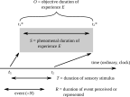

# consciousness-temporal — specious-present（supplement）

> （《consciousness-temporal》词条补充材料，源：plato.stanford.edu/entries/consciousness-temporal/specious-present.html）

#### Supplement to Temporal Consciousness

## The Specious Present: Further Issues

- 1. Durations and Distinctions
- 2. Estimating the Duration of the Specious Present
- 3. Motion Perception
- 4. James on the Specious Present

### 1. Durations and Distinctions

In sections §3–§6 of the main document the focus was largely on the character and composition of individual specious presents, as variously construed by different forms of realism, and the manner in which these combine to form streams of consciousness. There are issues involving the relationship between specious presents and the wider world—in particular, ordinary clock-time—which were not there examined. When someone claims the specious present is typically around (say) one second in extent, what does the claim amount to? Seconds (along with minutes, hours and days) are a measure of ordinary, objective, public time—time as it is measured by clocks and stop-watches. Can this temporal metric be extended to the domain of the subjective? Can *experienced* duration be measured and clocked in the same way as durations of lightning bolts, 100 metre sprints and other happenings in the wider world? The answer (probably) is “to a reasonable approximation”, but there are some complications, and certain distinctions need to be drawn and recognized.

The relevant distinctions are most easily brought into play by considering experiences that are directly triggered by environmental causes, i.e., experiences of the perceptual variety. Let us suppose that a certain event *N* is of such a duration that it can be perceived as a whole (within a single specious present), and that experience *E* is a perception of *N*. Let us suppose that *N* is shooting star, visible for a second or so. The perceiving of *N* is depicted in Figure S1 below, where matters are viewed from the vantage point of the extensional approach—we will be considering the situation from a retentional point of view in due course.

Up for consideration are the relationships between four temporal magnitudes:

1. the duration of the event perceived (call this *R*);
2. the duration of the proximal sensory stimulus produced by this event (call this *T*)—this will usually be the amount of time a subject’s sensory organs are stimulated in response to the perceived event;
3. the objective duration of the experience (*E*) produced by this stimulus (call this *O*);
4. the subjective or phenomenal duration of *E* (call this *S*).

*Figure S1* [An extended description of figure S1 is in the supplement.]

Consider first the relationship between *N*, *R*, and *T*. On the reasonable assumption that the perceiver of this event is some distance from the event itself, the light generated by the falling meteor will take some short but finite time to traverse this distance, hence the short delay between the initial phase of *N* and the onset of the stimulus *T*—which in this case we can take to be the light from *N* hitting the retinas of our subject’s eyes. Although under normal circumstances the durations of *R* and *T* will closely coincide, there are circumstances in which they can diverge. For example, if the light or sound emitted by a perceived event is scrambled, compressed or stretched *en route* to the perceiver, the duration of *T* (and even the temporal ordering of its parts) will be affected, and the resulting experience will probably misrepresent the temporal properties of the perceived event to a significant degree.

What of the relationship between *T* and *O*, the durations of the sensory stimuli and the duration of the resulting experience? As can be seen, although *T* begins at time $t_{1}$ and ceases at $t_{2},$ the resulting experience (*E*) starts at a slightly later time $t_{1}^*$ and ends at $t_{2}^*,$ which is itself slightly later than $t_{2}.$ These differences are a consequence of two considerations: it takes some time for signals produced in our sensory organs to reach our brains, it also takes our brains some time to process these signals and produce the appropriate experience in response to them. Results from psychophysics suggest that it can take as little as 60 msec, or as long as 500 msec, for a stimulus to reach (or produce) experience, depending on the subject, type of stimulus, sensory modality, and the task the subject is attempting to perform.[^note-23]

There is a further point to notice in this connection. The objective duration of E is the amount of ordinary (clock) time that experience E takes up. In this case, this duration is $t_{1}*-t_{2}*.$ Why is this duration is greater than that of T? In the general run of cases the durations of perceptual experiences and their proximal stimuli match almost exactly. If they did not, our experience of music—to pick just one example—would be greatly different than it is: when performing, a violinist can safely assume that notes played for the same (objective) duration will be *heard* as having the same duration. However, in the case of very brief stimuli the resulting experience tends to last a good deal longer than the stimulus itself: e.g., a 1 msec flash of light can produce visual experiences lasting from 100msec to 400msec—a phenomenon known as “visible persistence”. Figure S1 serves as a useful reminder of the fact that it is at least possible for these two durations to diverge.[^note-24]

Last but not least there is *S*: the *phenomenal duration* of *E*, as we might call it. This is the *felt* duration of *E*, the temporal extent of *E* construed solely (or purely) as a phenomenal item. While it is not wrong to say that phenomenal duration is how long an experience *seems*, this should not be taken to mean that phenomenal duration is determined by how long a subject *judges* an experience to be. Since our judgements about features of our experience are fallible, it is possible (on the face of it, at least) for the real phenomenal duration of an experience to differ from what we judge it to be. No less importantly, there may be some subjects who are incapable of making *any* judgements about any aspect of their experience—many non-human animals may fall into this category. To mark the distinction let us use *seconds\** (and *minutes\** etc.) to refer exclusively to phenomenal durations.

Suppose there are (possible) worlds in which there are subjects whose experience is akin to our own, but nothing resembling a physical world—worlds of the sort described by idealists such as Berkeley and Leibniz. In such worlds (if such there be) there are *only* phenomenal durations: there are seconds\* but no seconds. In our world there are (probably) seconds\* and seconds, but since we do not have a standard unit of measure for phenomenal duration, in our everyday thought and talk about it we naturally tend to use the objective measures. We use external timekeepers, such as clocks or watches, to gauge the apparent lengths of our experiences, and consequently we employ units such as second and minute to refer to both objective and subjective durations.

Although there is nothing to prevent our marking the distinction between phenomenal and objective durations formally, as has just been done here, for the most part doing so would serve little purpose: the subjective character of the experience of looking at a blue sky for three seconds (as measured objectively) does not, for the most part, vary greatly; it seems reasonable to suppose that if subjective and objective durations were often markedly out of synch we would be unable to engage with the world as effectively as we do. That said, there are familiar occasions when phenomenal and objective time fail to march precisely in step. When waiting for a watched pan to boil, an objective minute can be filled by more than 60 seconds\*, as the passage of subjective time slows relative to the wider world. There may well be more radical examples of the same phenomenon: some hallucinogenic drugs are reported to leave subjects with the impression that they have had vast temporal tracts of experience (centuries, epochs) in only a few objective hours. And of course, the discrepancy can go the other way: while enjoying ourselves it often seems that there are fewer than the usual number of seconds\* in a minute or hour; certain stimulants are said to have the same effect.

These distinctions all apply within the retentional framework, albeit with a few modifications, as shown in Figure S2.

*Figure S2.* [An extended description of figure S2 is in the supplement.]

As previously, there are delays between the occurrence of the event perceived, the stimulation of the relevant sensory organs, and the eventual production of perceptual experience. The main difference is where extensional theorists hold that the stimulus *T* results in a single temporally extended experience stretching from $t_{1}*$ to $t_{2}*$ which possesses phenomenal duration *S*, the retentionalist posits instead a continuous period of *experiencing* stretching from $t_{1}*$ to $t_{2}*,$ and further holds that at each moment during this period the subject is experiencing a temporal spread of content with phenomenal duration S—only a subset of these specious presents are depicted in Figure S2.

Drawing these distinctions gives rise to a range of underexplored and difficult to answer, questions. For example, can the apparent variations in the “speed” of the objective world be explained in variations in the extent of the specious present? Noting the work of Saillant and Simmons (1998) which suggests bats possess the ability to alter the temporal span of their echolocation systems’ “sensory window”, Lockwood has proposed that the apparent slowing of the surrounding world in times of emergency or absorption is due to a “diminution in the temporal span of the specious present” (2005: 373); this shrinkage results in our apprehending a smaller than usual number of changes within a typical specious present; since we are not directly aware of latter’s change in size, we attribute the alteration to a slow-down in our surroundings. Phillips (2013) puts forward an alternative proposal: when terrified or stressed the rate of *non-perceptual* mental activity significantly increases, even though the perceived rate of the rest of the world seems unchanged. As Phillips points out, there is plenty of anecdotal evidence of people saying that their thoughts speeded up during an emergency.

Implicit in the story Lockwood tells is the assumption that the *phenomenal* duration of the specious present remains constant—and Strawson (2009: 253) agrees:

> One may expressly intellectually register the fact that one is experiencing a great deal in a short time (a short time that feels for all that particularly calm and leisurely), in moments of great crisis, but this does not mean that the basic, subjective experienced temporal extent or “roominess” of the lived present experience is not the same as it is in ordinary life.

These are intriguing claims, but are they correct?

### 2. Estimating the Duration of the Specious Present

Although a good deal of empirical research has been carried out relating to the experience and perception of time over short intervals, this research has not generally been motivated by a desire to confirm or disconfirm one or other of the competing conceptions of the structure of temporal consciousness.[^note-25] Even so, there are a number of results relevant to the issues discussed thus far.

One issue to have been investigated is the manner in which very brief stimuli register in experience. It has been found that stimuli of around 1 msec need to be separated from one another by in interval of around 30 msec if they are to be perceived *as* a succession—a result which holds across sensory modalities. Stimuli which are separated by shorter intervals are not perceived as distinct—though this “coincidence threshold” varies a good deal for the different sense modalities.[^note-26] A related topic has also been investigated: the minimal durations of perceptual experiences. Experiences produced by very brief stimuli are often longer, objectively speaking, than the stimuli themselves, but how brief (objectively speaking) can an experience be? Results from psychophysics vary a good deal—see Efron (1970); Coren, Ward, and Ens (2004)—but answers range from 25 to 240 msec, depending on the task being undertaken and type of stimulus.

Of particular interest is the specious present itself. Theorists may disagree about the manner in which change and persistence are incorporated into consciousness—the stories told by cinematic theorists, retentionalists and extensionalists are very different—but they agree that our awareness *appears* to embrace a brief temporal interval. How long is this interval? We have just seen that there are reasons for supposing that there are *minimal* experienced durations, what is the *maximum* duration which can be apprehended as a whole? In short, how long is a typical specious present?

Attempts to answer this question face complications on several fronts. First, there is the need to distinguish between the durations of perceptual stimuli and the duration of the resulting experiences, and the fact that these can diverge, quite markedly in the case of brief stimuli. Second, it would be wrong simply to assume that the specious presents of different sense modalities are of exactly the same extent, and likewise for different subjects. Third, even if we set the possibility of intersubjective differences aside, there is also the possibility that any given period of experience (as measured by ordinary clock-time) can possess widely varying subjective or phenomenal durations, e.g., a minute’s worth of experience can pass very quickly (if one is having a good time), pass very slowly (if one is *not* having a good time), or seem to last an eternity (if one has ingested certain drugs). Seconds\* and seconds usually march in step, but there are occasions when they do not.

For the purposes of a rough-and-ready estimate, however, these difficulties may not be insurmountable. While the potential for discernible divergences between the duration of a stimulus and objective duration of the experience to which it gives rise can certainly be significant over the short-term—of, say, 200 msec or below—it is less so over longer intervals. (Otherwise such discrepancies would be more noticeable than they are in ordinary life.) In the absence of evidence to the contrary, it is not unreasonable to suppose that if inter-modal differences do exist, they are fairly small in comparison with the duration of the specious present itself, and similarly for differences between subjects. As for the relationship between phenomenal and objective durations, there no doubt are very real difficulties in establishing a precise metric relating the two, and more work on this problem is very much needed, but for only an approximate estimate such a metric may not be needed. We all know what it is like to listen to a 3 second burst of white noise, or to gaze at a white wall for 5 seconds or so, whilst being in a normal state of consciousness—i.e., in an average sort of mood, free from significantly mind-altering chemicals, and so forth. We are thus able to establish a reasonably accurate correlation between seconds\* and seconds in at least some circumstances, and for certain types of experience. Once this correlation is established, we can ask of an interval of (say) 3 seconds/seconds\*: roughly how much shorter (or longer) is the duration of the specious present? If most subjects reply “about half”, we could reasonably conclude that a typical specious present is of the order of 1.5 seconds *and* 1.5 seconds\*—a rough estimate of this sort would need refining, and would not be valid for all subjects and circumstances, but it would also be a useful starting point. It is because seconds and seconds\* *do* so often coincide that typical estimates of the specious present’s duration can (charitably) be taken as referring to both objective and phenomenal durations.

Reluctant (perhaps) to generalize from their own experience, philosophers writing on this topic have generally been reluctant to offer any such estimates. Among the few exceptions, Dainton (2000: 171) tentatively opts for a figure of half a second or less; Lockwood suggests this is on the short side, and suggests a more realistic figure would be “a second or a second and a half” (2005: 381). Strawson goes the other way, and suggests a figure of around 300msec (2009: §5.9). Does the psychological literature offer anything more precise or better substantiated?

Unfortunately, while estimates are not difficult to find, they tend not to be measures of the specious present as we are currently construing it. In 1984 Fraisse concluded his review of the literature by suggesting that we need to recognize three “orders of duration”:

> These orders are the following (a) less than 100 msec, at which perception is an instantaneity, (b) 100 msec—5 sec, perception of a duration in the perceived present, and (c), above 5 sec, estimations of duration involving memory. … The perception of duration, *stricto sensu*, is situate at a level above 100 msec and within the limits of the psychological present as described by W. James (1890) … The duration of the presentifiable can hardly extend beyond 5 sec. (1984: 30)

This is an improvement on James’ estimate of 12 seconds or so, but even 5 seconds is implausible if we construe the specious present in the way we are currently doing, as the period during which change and persistence are directly apprehended. More recently, Pöppel writes:

> The subjective present as a basic temporal phenomenon has interested psychologists for a hundred years (e.g., James 1890). We are now in a position to indicate how long such a subjective present actually lasts. This numerical answer can be derived from a number of different experiments which all converge to a value of approximately 2 to 3 seconds. (2004: 298)

However, none of the plentiful evidence cited Pöppel cites in support of this claim directly concerns the immediate experience of change. A few examples will illustrate the point:

1. If subjects are asked to reproduce the duration of either an auditory or a visual stimulus, they can do so very accurately for stimuli which are up to 2 to 3 seconds long, but much less accurately for longer stimuli.
2. Subjects who are exposed to uniform successive stimuli—such as the clicks of a metronome—will impose a “subjective structure” onto them: rather than hearing a monotonous “click … click …. click …” one finds oneself hearing “CLICK … click, click CLICK … click, click” or variants thereof. This spontaneous grouping has a temporal limit of about 2.5 seconds.
3. Ambiguous figures (such as duck-rabbit drawings, or vase/faces) can be interpreted (or better: *seen*) in either of two ways; such changes in perceptual content occur spontaneously, at roughly 3 second intervals.

Now, these results—and others along the same lines—are by no means uninteresting. It may well be that the 2–3 second cycle is relevant to how our brains process information—and relevant in ways which impact on the sort of experience we enjoy—but as an estimate of the duration of the specious present it is not very plausible at all. (If this is not evident, a simple experiment will assist. Clap your hands three times, leaving about a second between each clap; when the third clap takes place, are you still directly aware of the first?)

Rather more plausible is the figure of 0.75 seconds (or 750 msec) which Benussi’s tachistoscopic experiments led him to propose. Benussi was a psychologist of the Graz school (influenced by Brentano and Meinong) working in the early twentieth century, and was well aware of the distinction between the duration of a stimulus and the duration of the resulting experience. Moreover, he construed the specious present in the same way as Broad and Russell, as the maximum duration in which change or succession can be experienced as a whole:

> As Benussi proved in laboratory experiments, the time of presentness is not a limit or a non-extensive instant … It is that *stretch of change which is apprehended as a unit* and which is the object of a single mental act of apprehension. The limits to the content of consciousness are also the limits of the boundaries of the field of consciousness. (Albertazzi 1996: 118)

For a (brief) description of the methods employed by Benussi see Albertazzi (2001: 115).[^note-27] Mabbott cites the same figure:

> philosophers have generally tended to believe that the psychologists have shown experimentally that our direct apprehension of time is restricted to a certain short duration and that they have determined the normal length of this duration by measurement. It is usually given as 0.75 seconds. (1951: 156)

He suggests this figure largely derives from experiments conducted by followers of Wundt in the 1880s. Since these experiments were intended to pin down the temporal intervals which subjects could *estimate* most accurately, rather than apprehend as wholes, their relevance to our current concerns is questionable. Mabbott also points out that later attempts to replicate the findings failed to do so.

### 3. Motion Perception

Broad, Clay, Russell, Foster and other realists all claim that motion (and other forms of change) can be directly perceived. This notion receives some support from findings relating to the workings of our perceptual systems in general, and the visual system in particular.

Just as there are regions of the brains visual systems that specialize in colour (e.g., V4), there are other regions—V3 and V5 (or MT)—that specialize in *motion* detection. What is more, some of the systems and pathways devoted to motion are—in evolutionary terms—among the more primitive parts of the brain.[^note-28] Region V5 is particularly intriguing in this respect. It seems that *all* its neurons are concerned with motion in one direction or another, and none with colour or shape; and unlike V3, the neurons in V5 are concerned with large-scale motion detection, e.g., of whole objects, rather than mere edges. Also, damage to V5 is associated with *cerebral akinetopsia:* the severely degraded ability to perceive motion, as found in the patient L.M. (Zeki 1991, 2004; Rizzo, Nawrot, & Zihl 1995). The latter’s predicament was characterized thus:

> The visual disorder complained of by the patient was a loss of movement in all three dimensions. She had difficulty, for example, in pouring tea or coffee into a cup because the fluid appeared to be frozen, like a glacier. In addition, she could not stop pouring at the right time since she was unable to perceive the movement on the cup (or a pot) when the fluid rose. … In a room where more than two people were walking she felt very insecure and unwell, and usually left the room immediately, because “people were suddenly here or there but I have not seen them moving.” … She could not cross the street because of her inability to judge the speed of a car, but she could identify the car without difficulty. (Zihl, von Cramon, & Mai 1983: 315)

The difference between L.M.’s experience and our own could not be clearer or more dramatic: whereas we are able to see things *moving* in a smooth, continuous manner, L.M. has lost this ability.

There is plentiful further evidence for the contention that our brains are more than willing to generate experiences of motion. Perhaps the most familiar is the fact that we see moving images on cinema and television screens (and computer monitors). This may not seem in the least surprising: aren’t these devices expressly designed to show moving images? In fact, as already noted, the images shown on cinema screens are *stills*, and the motion we perceive is entirely supplied by our brains. Two main mechanisms are at work in such cases. Suppose two spots are shown, one after the other at different locations on a screen; if the interval between them is sufficiently short, we will not discern the succession: the spots will seem to occur simultaneously. This is due to the well-studied phenomenon of *visible persistence*. When we are shown a brief visual stimulus, the resulting visual experience is typically a good deal longer than the stimulus itself: e.g., the visible persistence of a single 1 msec flash can vary between 100 msec and 400 msec, depending on the type of flash and the adaptive state of the eye. This effect is one reason why the brief gaps between successive images on a cinema screen tend not seen. It also explains why it is possible to write ones name in the night sky with a moving torch (as noted by both Leonardo and Newton).

However, visible persistence alone does not explain how it is that we see motion in the clear and distinct way in which we do. If I wave my hand slowly back and forth in front of my eyes in broad daylight, I do not see it followed by a trail of lingering ghostly predecessors: my hand is cleanly delineated, yet *moving*. This is explained by an effect first noted by Exner. Returning to our spots on-a-screen, if the interstimulus interval is increased somewhat, to 20–40 frames per second (fps) something more interesting and dramatic happens: we see the spot moving smoothly back and forth between its left and right positions, despite the fact that all that is really appearing on the screen are two spots of light, at fixed locations, flashing on and off, This is the already-mentioned *phi phenomenon*, also known as “apparent motion”. (The latter designation could be misleading: the motion *as it appears* is entirely indistinguishable from the real thing.) Evidently, our brains are more than happy to supply us with experiences of motion at the least opportunity. And happily, the effect is not confined to spots of light: it extends to sequences of complex images (e.g., photographs taken in rapid succession of a swarming crowd of people). The frequencies which suffice to generate smooth apparent motion are not great: only 24 fps are shown on cinema screens, whereas television uses 30 fps and computer monitors 60 fps or above.[^note-29] Online examples of the simple two-spot illustration of the phi phenomenon are easy to find, and are well worth experimenting with.

No less dramatic, but somewhat less ubiquitous, is the phenomenon of *biological motion*. As Johansson (1973) showed, appropriately arranged, a small number of moving dots will give rise to a very vivid impression of a moving human figure. Again, online examples are available—and striking (see Bio Motion Lab demos in Other Internet Resources). Morgan sums up thus:

> Human vision lies somewhere between the extremes of the [blurry] daguerreotype and the time-frozen electronic flash. We are not normally conscious of a blur in moving objects: nor do we see them frozen in space-time. Instead, we see recognisable objects in motion. Motion is a sensation that cannot be communicated by a single snapshot, but somehow, the sensation of motion can occur without seeing an object in many places at the same time. Motion is a specific sensation, like colour or smell, which cannot be analysed into a separate, stationary sensations. (2003: 61)

Since perceived motion is usually a property of perceptible *objects*—we cannot discern motion in the absence of moving things—it is probably more correct to talk of motion as a *property* or *feature* of sensations. But in other respects what Morgan says here seems plausible.

### 4. James on the Specious Present

While James’ made a significant contribution to our understanding of the nature and character of our short-term experience of time and change, his discussion in chapter 15 of the *Principles* has engendered a good deal of puzzlement and confusion. I will briefly focus on two issues here.

The first concerns the duration of the specious present. If we take the specious present to be the (maximal) window through which we are directly aware of change and persistence, then it is plausible to suppose that it is of the order of a second or so. (If need be, repeat the experiment mentioned in the previous section: clap your hands twice in row, and ask yourself if you are still *hearing* the first clap as the second clap occurs.) But James himself says that the most important part of the specious present—its “nucleus”—is around “the dozen or so seconds that have just elapsed” (1890: 611), and that this nucleus is surrounded by a vaguer fringe of “probably not more than a minute ago”. Later on he repeats the claim:

> our maximum distinct *intuition* of duration hardly covers more than a dozen seconds (while our maximum vague intuition is probably not more than a minute or so). (1890: 630)

What are we to make of this? James takes the figure of a dozen seconds from the experiments of Wundt and Dietze which, as James characterizes them, sought to “determine experimentally the *maximal extent of our immediate distinct consciousness for successive impressions*” (1890: 612). Both experiments, however, actually measured the accuracy with which fast sequences of brief sounds could be *accurately recalled* after exposure to them. Wundt arrived at a figure of 3.6 to 6 seconds, whereas Dietze settled on a maximum of 12 seconds—James opted for latter. Given the nature of these experiments, James’ characterization of them is certainly misleading—or just plain wrong. Nonetheless, the fact that he was willing to contemplate a specious present with a nucleus of up to a dozen seconds—and a considerably more encompassing fringe—suggests that on at least some occasions, he used the term in a very broad way, to refer to a period of time to which we have a distinctive *cognitive* access, e.g., via short term memory and vivid anticipation.[^note-30] On other occasions, when for example he describes the specious present as “the short duration of which we are immediately and incessantly sensible” he gives the impression at least of working with a narrower interpretation.[^note-31] While the narrower, purely sensory or phenomenal interpretation became commonplace in the twentieth century—hence the adoption of it here—it may well be anachronistic to foist it upon the James of the *Principles*. It is of course tempting to think that if one were to put it to James that within the 6–12 second span of easily remembered past time there is an *inner* nucleus within which change and persistence are directly apprehended in sensory manner he would have agreed. But we cannot be sure.

When James’ views as to the 12–60 second extent of the specious present are combined with his “saddleback” picture—of the specious present having past- and future-directed components—it is easy to demonstrate that absurdities follow. If this were the case, wouldn’t a sprinter have a dim awareness of the starters’ gun up to half a minute before it actually occurs? Mightn’t 100 metre sprints be completed before the starting gun even fires? (See Plumer (1985) for more along these lines.) But while *some* conceptions of the specious present are undeniably problematic for these reasons, *other* conceptions—conceptions which confine it to a briefer interval, conceptions which do not entail detailed knowledge of future events—are by no means as vulnerable to the charge of obvious absurdity.

The next question: where did James stand with regard to the extensional and retentional approaches? There are certainly occasions when he seems committed to the existence of duration-blocks of the sort which form the bedrock of the extensional view. There are also formulations suggestive of the overlap model, or something not far off it:

> Objects fade of out consciousness slowly. If the present thought is of A B C D E F G, the next one will be of B C D E F G H, and the one after that of C D E F G H I—the lingerings of the past dropping successively away, and the incomings of the future making up the loss. (1890: 606)

Perhaps most importantly in this connection, James is famed for his rejection of atomistic conceptions of the stream of consciousness, a rejection which entails the existence of real experiential connections between neighbouring stream-phases, or so one might naturally suppose. Certainly in his later writings he was adamant on this point, as in these passages from “A World of Pure Experience” (1904, taken from James 1967: 195–198)

> For such a philosophy [radical empiricism], *the relations that connect experiences must themselves be experienced relations, and any kind of relation experienced must be counted as “real” as anything else in the system.* …. (1904: 534)
>
> The conjunctive relation that has given most trouble to philosophy is *the co-conscious transition*, so to call it, by which one experience passes into another when both belong to the same self. My experiences and your experiences are “with” each other in various external ways, but mine pass into mine, and yours pass into yours in a way in which yours and mine never pass into one another. Within each of our personal histories, subject, object, interest and purpose *are continuous or may be continuous*. Personal histories are processes of change in time, and *the change itself is one of the things immediately experienced*. “Change” in this case means continuous as opposed to discontinuous transition. But continuous transition is one sort of conjunctive relation; and to be a radical empiricist means to hold fast to this conjunctive relation of all others, for this is the strategic point, the position through which, if a hole be made, all the corruptions of dialectics and all the metaphysical fictions pour into our philosophy. (1904: 536)

Given this firm commitment to conjunctive relations and co-conscious transitions, it might seem inevitable that James would subscribe to some form of the extensional approach. In fact, at least in the *Principles*, he seemed to do the opposite, at least on some occasions, and particularly in the section entitled “The Feeling of Past Time is a Present Feeling”. He writes

> what is past, to be known as past, must be known *with* what is present, and *during* the “present” spot of time. (1890: 629)

Expanding on this he cites first Volkmann, according to whom

> A and B are to be represented *as occurring in succession* they must be simultaneously represented; if we are to think of them as one after the other, we must *think* them both at once.

As clear a statement of the core principle behind the retentional approach as one might wish for. James himself follows up thus:

> If we represent the actual time-stream of our thinking by an horizontal line, the thought *of* the stream or of any segment of its length, past, present, or to come, might be figured in a perpendicular raised upon the horizontal at a certain point. The length of this perpendicular stands for a certain object or content, which in this case is the time thought of, and all of which is thought of together at the actual moment of the stream upon which the perpendicular is raised. (1890: 629)

This description obviously fits the various diagrams employed by Broad and Husserl. In fact, James here is following in the footsteps of James Ward, whom he goes on to quote, and who clearly was advocating a straightforward version of retentionalism:

> In reality, past, present, and future are differences in time, but in presentation all that corresponds to these differences is in consciousness simultaneously. (1890: 629, quoting Ward 1886: 64).

Evidence of James’ apparent sympathy with the retentional approach are scattered throughout this chapter of the *Principles*.[^note-32]

As for what should we make of this, it’s difficult to draw any conclusion with any great confidence. In the *Principles*James introduces his readers to recent relevant work in philosophy and psychology on all the (many) topics he covers. Since the retentional approach is adopted in some prominent literature on temporal experience it is not surprising to find James reporting as much—it would have been remiss of him to have done otherwise. Perhaps the only safe conclusion to draw is that while James certainly believed in the continuity of consciousness, and the immediate experience of change and persistence, during this period he was also alert to the appeal of the retentional account of how these modes of experience are possible. Whether he was entirely content with this account, it is difficult to say.[^note-33] In his later writings on these matters, with some relief, he embraced a neo-Bergsonian position, according to which the flux of experience cannot be fully captured conceptually:

> … the simplest bits of immediate experience are their own others, if that hegelian phrase be once for all allowed. The concrete pulses of experience appear pent in by no such definite limits as our conceptual substitutes for them are confined by. The run into each other and seem to interpenetrate … You feel no one of them as inwardly simple, and yet no two as wholly without confluence where they touch. There is no datum so small as not to show this mystery, if mystery it be. The tiniest feeling that we can possibly have comes with an earlier and a later part and with a sense of their continuous precession. (1909: 282)

As James now saw things, reality can still be a certain way even if we cannot make intellectual sense of how it is possible for it to be so. So far as temporal experience is concerned, it is perhaps too early to say whether or not James’s stance is overly pessimistic.

In any event, in the chapter of *A Pluralistic Universe* devoted to Bergson’s philosophy (entitled “Bergson’s Critique of Intellectualism”) James again provides an illustration of the extensionalist overlap model of stream-structure:

> Take its continuity as an example. Terms like A and C appear to be connected by intermediaries, by B for example.… Imagine a heavy log which takes two men to carry it. First A and B take it. Then C takes hold and A drops off; then D takes hold and B drops off, so that C and D now bear it; and so on. The log meanwhile never drops, and keeps its sameness throughout the journey. Even so it is with all our experiences. Their changes are not complete annihilations followed by complete creations of something absolutely novel. There is partial decay and partial growth, and all the while a nucleus of relative constancy from which what decays drops off, and which takes into itself whatever is grafted on …. (1909: 257–8)

In his discussion of time perception in the *Principles* twenty years earlier James gave a prominent place to the retentional-style models of Wundt and Ward. Since in *A Pluralistic Universe* there is no trace of these at all, it is by no means impossible that, thanks in part to Bergson’s influence, James had moved in an extensional direction.

## Notes（原文脚注，引自主文）

[^note-23]: 23. For further discussion of delays in perception see Libet (1993, 2004), Efron (1967) and Pockett (2002, 2003).

[^note-24]: 24. See Weichselgartner & Sperling (1985), Long & O’Saban (1989) and Nisly-Nagele & Wasserman (2001) for further discussion and references on visual persistence.

[^note-25]: 25. For a survey of relevant work on the neural bases of temporal processing, see Mauk & Buonomano (2004). Kelly argues that the vast bulk of empirical work is focused on just two questions: How do we come to represent events as occurring at a particular time? Which events to we experience as simultaneous? He draws this conclusion:

> The puzzle of temporal experience will not be resolved by empirical research *of the type now being done* … [the relevant neuroscientific accounts] do not have any bearing at all, in other words, on the question of how we are to conceptualize perceptual experience from the point of view of the subject so as to allow for the possibility of experiences as of continuous, dynamic, temporally structured, unified events. (2005b: §7–7.1)

[^note-26]: 26. For more on coincidence thresholds see Pockett (2003), Pöppel (1997), Hirsh & Sherrick (1961), Ruhnau (1995); for an interesting exploration of the philosophical significance of perceptual simultaneity windows see Callender (2008).

[^note-27]: 27. Benussi preferred the term “psychic present”, construing the latter as the “time required to apprehend the maximum number of elements of a change in one single perceptual act” Albertazzi (1994: 161); see also Albertazzi 1996.

[^note-28]: 28. Of the two most general visual pathways in primates

> we find that it is the older tectopulvinar pathway (evolutionarily speaking) that is more involved in motion perception than the newer geniculostriate pathway. There are some suggestions that the tectopulvinar pathway may be entirely specialized for the perception of movement, along with the control of responses that involve moving stimuli, such as some kinds of eye movements. (Coren, Ward, & Enns 2004: 360)

[^note-29]: 29. There are complications. Although 20–30 fps is sufficient to generates smooth apparent motion, higher rates are needed to eliminate variations in brightness (flicker); accordingly, in cinema and TV the same image is shown two or three times in succession. Three factors are most relevant to the quality of apparent motion: interstimulus interval (the time between the end of one frame and the start of the next), frame duration, and the time between the start of one frame and the start of the next—the latter is the most important single factor. For further detail on a complex topic, “flicker studies”, see Anderson & Anderson (1993), Galifret (2006).

[^note-30]: 30. As Debru (2001: 478) notes, it may be that James’ figure of 12 seconds was also influenced by Helmholtz’s discovery that *after-images* typically have a maximal duration of 12 seconds or so.

[^note-31]: 31. And also when describing Wundt’s attempt to measure the interval which is remembered most accurately:

> [this interval] of about three-fourths of a second, which is estimated with the minimum of error, points to a connection between the time-feeling and the succession of distinctly apperceived objects before the mind. The association time is also equal to about three-fourths of a second. This association time he regards as a sort of internal standard of duration to which we involuntarily assimilate all intervals which we try to reproduce, bringing shorter ones up to it and longer ones down. (James 1890: 596–7)

[^note-32]: 32. Myers (1971: 355) notes that Boring claimed James’ commitment to this approach stemmed from a general doctrine concerning the temporal character of introspection:

> introspection was not believed to be a process that takes time … But how then can a duration that takes time be immediately known, since the duration, not being instantaneous, is itself not all immediate? (1942: 576)

Myers has his doubts:

> I cannot connect Boring’s remarks with what James wrote in “The Perception of Time” in *The Principles of Psychology*, because he never said that introspection is instantaneous or that the duration of the specious present is specious. (1971: 355)

Mabbott (1951: 165) usefully summarizes Boring’s changes of view on these matters.

[^note-33]: 33. See Sprigge (1993: 198–225) for an interesting discussion of how James’ views on time, experience and continuity evolved through his career. Levanon (2016a, 2018) also sheds useful light on James’ views.