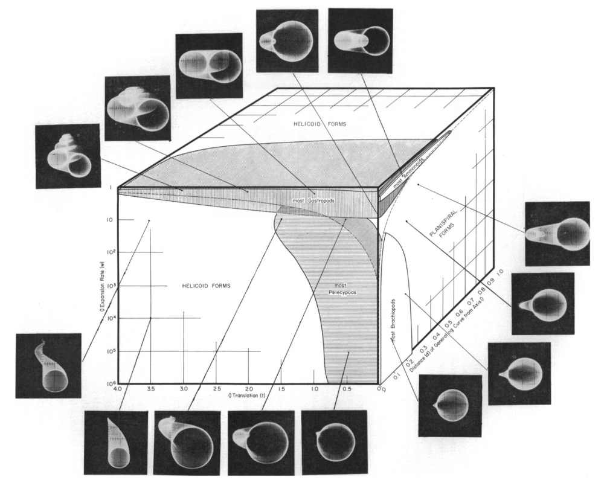

# Conservation Biology
**First published Thu Jun 23, 2016; substantive revision Wed Jun 18, 2025**

*Odenbaugh, Jay*

One way of conceptualizing the structure of a science is that at any time it contains *ontologies*, *theories*, and *values* (Kuhn 1962; Lakatos 1976; Laudan 1978, 1986)[^kuhn-1962][^lakatos-1976][^laudan-1978][^laudan-1986]. In this entry, we explore questions regarding the ontology, theories, and values central to conservation biology. First, conservation biology as a discipline has expended a great deal of intellectual effort in articulating exactly what it is that they study and has settled on biodiversity as the answer. However, there is a debate concerning what biodiversity is, and whether it should be center stage in the discipline. Second, conservation biology, though a scientific discipline with its theories, models, experiments, and fieldwork, also utilizes a variety of tools that do not fit into the above categories. Some of its core tools are not theories or models in the ordinary sense. Thus, as a discipline, it is appears interestingly unique and ultimately unlike ones that philosophers of science have usually examined. Third, conservation biology was originally articulated by the early pioneers as a “crisis discipline” where certain types of normative concerns were at the forefront. In fact, many have likened it to medicine insofar as it has ethical foundations. In the medical case, it would be the well-being of patients and in conservation biology it is the conservation of biodiversity. Thus, we should ask are the discipline’s aims or values explicitly ethical or sociopolitical and to what extent are they controversial?

## 1. What is Biodiversity?

Strangely enough, we can roughly date when the term ‘biodiversity’ was introduced (Takacs 1996: 34–40)[^takacs-1996]. It occurred during the National Forum on BioDiversity sponsored by the Smithsonian Institution and the National Academy of the Sciences 21–24 September 1986. Approximately 14,000 people attended including the likes of Jared Diamond, Paul Ehrlich, Thomas Eisner, G. Evelyn Hutchinson, Ernst Mayr, Charles D. Michener, Harold A. Mooney, Peter Raven, and E. O. Wilson. The coiner of the term is thought to be Walter G. Rosen. He said,

> It was easy to do: all you do is take the ‘logical’ out of ‘biological’…. To take the logical out of something that’s supposed to be science is a bit of a contradiction in terms, right? And yet, of course, maybe so logical that there seems to be no room for emotion in there, no room for spirit. (Takacs 1996: 37)[^takacs-1996]

As David Takacs noted, a search in *Biological Abstracts* for the year 1988 would not contain it as a keyword. By 1993, it appeared seventy-two times. As of March 2015, Google Scholar reports that ‘biodiversity’ appears in the title of over one hundred thousand papers. Finally, as of 2025, Google Scholar reports that the word appears in the title of over two hundred thousand papers. The term clearly has caught on.

Conservation biology clearly concerns conserving something biological or ecological, but what should be conserved? Work has focused on a variety of units. As examples, some have focused on species such as the spotted owl *Strix occidentalis* (Yaffee 1994)[^yaffee-1994] and loggerhead turtle *Caretta caretta* (Bolten & Witherington 2003)[^bolten-2003]; some have focused on populations and sub-species such as wild salmon *Oncorhynchus spp.* (Quinn 2005)[^quinn-2005]; some have focused on biomes or eco-regions such as tropical coral in the Great Barrier Reef (Hutchings, Kingsford, & Hoegh-Guldberg 2008)[^hutchings-2008]; and finally some have focused on genotypes or genetic features such as heterozygosity (Avise & Hamrick 1996)[^avise-1996]. However, in the 1980s, conservation biologists united and argued that *biodiversity* should be the focus of the discipline (E. O. Wilson 1988; see entry on biodiversity)[^wilson-1988]. What then is biodiversity? Here is a standard definition from an influential textbook.

> Biological diversity, or biodiversity, is the sum total of all living things—the immense richness and variation of the living world. Biodiversity can be considered at many levels of biological variation, ranging from genetic variability within a species, to the biota of some selected region of the globe, to the number of evolutionary lineages and the degree of distinctness among them, to the diversity of ecosystems and biomes on Earth. (Groom et al. 2006: 27)[^groom-2006]

Informally then, biodiversity is variation at *all* levels of the biological hierarchy. To conserve biodiversity, we would have to conserve all of this variation. However, there are two fundamental problems. First, there is an issue of practicality. As philosopher and conservation biologist Sahotra Sarkar writes,

> Conserving biodiversity, and construing the term intuitively to refer to all the biological diversity that there is, at every level of both hierarchies amounts to saying that “biodiversity” refers to all biological entities. “Biodiversity” in effect becomes all of biology. Conservation would be an impractical proposal if biodiversity were construed in this way: everything biological would become a goal of conservation. (Sarkar 2005: 180)[^sarkar-2005]

In fact the issue is more complicated than even this. In order to estimate the amount of biodiversity with regard to a place, we must find some true surrogate (Margules & Sarkar 2007: Ch. 2)[^margules-2007]. A true surrogate is some feature that strongly correlates with biodiversity. Suppose we used species as a true surrogate. With few exceptions, we cannot simply observe the species present in some locale; we can only observe some of its members. We must use some estimator surrogate for the true surrogate too; e.g., soil, vegetation, precipitation, etc. Thus, we estimate biodiversity twice removed. Second, since we cannot conserve all biological variation, we need a principled way to decide what to conserve. As we saw above, conservation biologists have refined their account to include variation in genes, species, and ecosystems. This is still far too broad. We may want to conserve genetic variation but that might include a great deal of “junk DNA.” We often want to conserve wild populations but might be less concerned with “artificial” populations (e.g., wild salmon versus hatchery salmon); and rare habitats are often considered more important than common ones (Morgan 2009)[^morgan-2009].

In the remainder of this section, we consider three recent proposals concerning what biodiversity is (and is not) that try to characterize biodiversity in a practical and principled manner.

### 1.1 Biodiversity as Multidimensional

One attempt to provide a principled and practical way to characterize biodiversity comes from Maclaurin & Sterelny (2008). James Maclaurin and Kim Sterelny start with the suggestion that we find the relevant “natural” units and then provide means for measuring their variation. By ‘natural’ units, they mean ones that identify properties that are recognizable and are causally salient (Maclaurin & Sterelny 2008: 10)[^maclaurin-2008]. As discussions of phenetic taxonomy have shown, measures of “overall similarity” are fraught with subjectivity. This subjectivity depends on a choice of distance metric and on how one defines character traits (Ereshefsky 2000: 60–66)[^ereshefsky-2000]. Contemporary taxonomists group taxa according to patterns of evolutionary descent, which is a method called “cladistics”, precisely to avoid such subjectivity given that the evolutionary history of life is natural in the above sense (Baum & Smith 2013)[^baum-2013].

Maclaurin and Sterelny contend that the fundamental unit of biodiversity is species and specifically species richness. Notoriously, biologists and philosophers have debated the nature of species. However, Maclaurin and Sterelny defend an evolutionary concept of species which states that “Evolutionary species are lineages of organisms with their ‘own evolutionary tendencies and historical fate’” (Maclaurin & Sterelny 2008: 33; see Wiley 1978)[^maclaurin-2008][^wiley-1978]. They suggest that this is the more natural approach to species because,

> The living world is organized into phenomenological species: recognizable, reidentifiable clusters of organisms. This fact makes the production of bird and butterfly field guides, identification keys for invertebrates, regional floras, and the like, all possible…. There are many routes through which one population can become demographically isolated from, and hence evolutionarily independent of, populations that were once sources and sinks of its own genes. But the fact of isolation and evolutionary independence is of immense importance to the fate of local adaptation in such populations. So the phenomenological species richness of a region is, in an importance sense, a catalogue both of phenotypic variety and of the potential evolutionary resources available in that region. (Maclaurin & Sterelny 2008: 40)[^maclaurin-2008]

Though a variety of evolutionary processes lead to the formation and cohesion of organisms into species, there nevertheless is a uniformity of pattern in the natural world.

With regard to a given ecological community, which is a group of interactiong species in a given place, species richness is the number of species present. We might also add species evenness to species richness (Magurran 1988, 2004)[^magurran-1988][^magurran-2004]. With respect to a given community, there will be some number of species. However, suppose we have two species in which the first has 300 members but the second has 700. Suppose again we have two species where the first has 500 members and the second 500 as well. The second community of species is far more “even” than the first. One formal representation of evenness is as follows (Magurran 1988)[^magurran-1988]. We start with the Shannon-Weiner diversity index.

$$ H' = -\sum_{i=1}^{S} p_i \ln p_i $$

Here $p_i$ is the proportion of organisms belonging to the $i$th species and $S$ is the total number of species. If we define the following,

$$ H_\text{max}' = - \sum_{i=1}^{S}\frac{1}{S} \ln \frac{1}{S} = \ln S $$

We now have a measure of species evenness,

$$ J' = \frac{H'}{H_\text{max}'} $$

$J'$ takes a value between 0 and 1 and the closer to the value of 1, the less variation between the number of individuals in a species.

The second way in which we might augment species richness is through disparity, which is morphological diversity, or more simply, phenotypic variation (Maclaurin & Sterelny 2008: Ch. 3, 4; see Gould 1989 for a discussion of disparity in the history of life)[^gould-1989][^maclaurin-2008]. Disparity, morphological diversity, or phenotypic vacation in general, concern the variation in phenotypic traits exhibited in and between species. Suppose we have one suite of species that are very similar phenotypically; however, we might have another suite of species that vary a great deal phenotypically. A measure of such variation would weight species richness with some parameter(s) representing the variation in phenotypic traits. Unfortunately, if we include such phenotypic variation *per se* we find ourselves exactly with the problems that dogged phenetic taxonomy and the attempt to capture some notion of overall similarity. Additionally, if we focus on disparity *per se* as opposed to mere phenotypic variation, we must try to capture some notion of basic “body plan” (Arthur 2000)[^arthur-2000].

Maclaurin and Sternly suggest that one way to operationalize such variation is through the notion of a *morphospace* (Maclaurin & Sterelny 2008: Section 4.4)[^maclaurin-2008]. Suppose we have a $n$-dimensional hyperspace where each dimension $i$ is a variable concerning the $i$th phenotype. Thus, a point in the space represents a specific organism and their phenotype trait. Associated with any given species would be a hypervolume representing the phenotypic variation of that species. Though there are not many “worked out” hyperspaces of this sort, a famous one is paleontologist David Raup’s analysis of the coiling patterns in mollusks that includes variables for whorl expansion rate, uncoiling rate, translation of the generating curve, and shape of the growing edge (Raup 1966)[^raup-1966].

\*Figure 1:\* Raup’s coiling patterns in mollusks morphospace (Raup 1966)[^raup-1966]

The morphospace describes actual coiling patterns and merely possible ones, and raises *explananda* for evolutionary biologists. Why did certain coiling patterns evolve and not others? Maclaurin and Sterelny claim morphospaces will be of low dimensionality and specifically limited to lineages or clades (Maclaurin & Sterelny 2008: 75–9)[^maclaurin-2008]. Thus, biologists must be assured that the variables included are representative of the phenotypic traits of the organisms and hence species under study. They hypothesize that the variables will correspond to developmental modules or mosaics, which are a relatively independent developmental system that contributes to fitness (G. P. Wagner 2014; P. J. Wagner 1995)[^wagner-2014][^wagner-1995]. This approach of course assumes that there exist independent developmental systems, and ideally it would help articulate how a lineage would fare over time as a function of its plasticity.

Another component of biodiversity according to Maclaurin and Sterelny concerns the ecological interactions between species (Morin 2011)[^morin-2011]. This additional structure is given by interspecific competition, predator-prey relations, and mutualism along with possible higher-order ones like trophic cascades. In the absence of such interactions, a group of species is nothing more than the “sum of the parts” (Clements 1916; Eliot 2011; Gleason 1926; Odenbaugh 2007; R.H. Whittaker 1967)[^clements-1916][^eliot-2011][^gleason-1926][^odenbaugh-2007][^whittaker-1967]. In the presence of such interactions, they hypothesize the existence of emergent properties that are not a “simple reflection” of the species themselves (Maclaurin & Sterelny 2008: 120)[^maclaurin-2008]. Additionally, even if there were no such emergent properties, we would like to know how these interactions drive community patterns. Infamously, some ecologists have hypothesized that as the diversity of a community increases, so does the stability of the community (Egerton 1973; Elton 2000; MacArthur 1955; May 1973/2001; Tilman, Wedin, & Knops 1996)[^egerton-1973][^elton-2000][^macarthur-1955][^may-1973][^tilman-1996]. ‘Diversity’ can be understood as the number of species present, the number of interactions, or intensity of those interactions. ‘Stability’ can be understood in a variety of ways from notions of Lyapunov stability, return time after a perturbation, biomass stability, etc. (Justus 2008, 2021; Pimm 1984)[^justus-2008][^justus-2021][^pimm-1984]. Ecologists have theorized, experimented, and collected a great deal of data regarding this hypothesis, but its truth remains elusive. Maclaurin and Sterelny suggest we can articulate an ecospace including at least the boundedness, degree of emergent properties, and internal regulation as variables to describe ecological communities (Maclaurin & Sterelny 2008: Ch. 6)[^maclaurin-2008]. One serious worry is whether any of these features can be measured in an informative way. But, insofar as there are no community boundaries, no emergent properties, and no internal regulation, there are no communities. The robustness of communities would require each of these take non-zero values. Additionally, these variables are not independent and hence the ecospace would have to take account of the interactions between each variable. For example, internal regulation might be a function of the emergent properties possessed by the community, and the boundaries of a given community determined by those very properties (Sterelny 2006)[^sterelny-2006].

Finally, we can consider how to include phylogenetic information in our measure of biodiversity. One method comes from Daniel Faith (1992, 1994, 2002)[^faith-1992][^faith-1994][^faith-2002]. In cladistics, we use character traits to divide organisms into groups. We begin with the traits shared by all of the organisms and then articulate smaller groups by traits unique to them where each then is a clade. A cladogram then displays the distinct character traits of each group. Cladograms differ from phylogenetic trees insofar as the latter includes ancestor-descendant relations apart from merely relations of nested similarity. For any phylogenetic tree, there are many cladograms consistent with it. Faith writes,

> The phylogenetic diversity (’PD’) of $s$ is equal to the sum of the lengths of all those branches that are members of the corresponding minimum spanning path. (Faith 1992: 4)[^faith-1992]

Consider the following cladogram.

![a diagram with a diagonal line going from bottom left to upper right, labeled at the end with '2'. Along the line are 12 evenly placed tic marks. From this line and going to the left are 6 perpendicular lines, each also with evenly placed tic marks. The first, before the first tic mark on the main line, has 4 tic marks and is labeled '10'; between its second and third tic mars is another perpendicular line going to the right with one tic mark. The second, between the third and fourth tic marks on the main line, has only one tic mark. The third, between the fourth and fifth tic marks, has 7 tic marks and is labeled '8'. The fourth, between the fifth and sixth tic marks of the main line, has 5 tic marks and is labeled '6'. On it are two perpendicular lines with one tic mark each going to the right between the second and third and third and fourth tic marks. The fifth line, between the seventh and eighth tic marks on the main line, has 3 tic marks. The last line, between the eighth and ninth tic marks on the main line, has 1 tic mark. ](../assets/conservation-biology/Faith.jpeg)

\*Figure 2:\* The phylogenetic diversity represented in a cladogram (Faith 1992: 3)[^faith-1992]

In Figure 2, we have taxa 2, 6, 8, 10. The minimum spanning path connecting each taxa requires 28 character changes and thus its PD is 28. Here each hash mark represents a character change and there are 28 of those marks. As Maclaurin and Sterelny note, this assumes that we have an adequate sample of character traits and given that many are molecular they do not tell us much about phenotypes (Maclaurin & Sterelny 2008: 141)[^maclaurin-2008]. Thus, they suggest we stick with local morphospaces. For an interesting exploration examing whether we should conserve phylogenetic diversity, see (Palmer and Fischer 2022)[^palmer-2022].

Maclaurin and Sterelny’s approach is very suggestive but as we have seen its execution by biologists requires making good on using species richness augmented with information regarding phenotypic variation, ecology, development, and phylogeny into an empirical tractable hyperspace. The extent to which this can be done is unclear (Justus 2010; Morgan 2009)[^justus-2010][^morgan-2009]. Their approach also presupposes a particular account of species as well.

### 1.2 Operationalizing Biodiversity

Sahotra Sarkar attempts to define biodiversity “implicitly” as opposed to “explicitly” contrary to Maclaurin and Sterelny (Margules & Sarkar 2007; Sarkar 2002, 2005; Sarkar & Margules 2002)[^margules-2007][^sarkar-2002][^sarkar-2005][^sarkar-2002-2][^sarkar-2002-3]. A concept is given an explicit definition if, and only if, there is a set of necessary and sufficient conditions for the satisfaction of the concept. For example, suppose we define the concept species phylogenetically in the following way: necessarily, something is a species if, and only if, it is a lineage between two speciation events or a speciation event and an extinction event (Ridley 1989)[^ridley-1989]. An implicit definition is different; the concept is defined by some rules or axioms in which the concept appears. So, Sarkar characterizes biodiversity as follows,

> [B]iodiversity should be (implicitly) operationally defined as what is being optimized by the place prioritization procedures that prioritize all places on the basis of their biodiversity content using true surrogates. (Sarkar 2005: 182)[^sarkar-2005]

To understand this account, we need to articulate what a place prioritization procedure is (Sarkar et al. 2002; Sarkar 2005: 159–68)[^sarkar-2002][^sarkar-2005][^sarkar-2002-2][^sarkar-2002-3]. In the abstract, place prioritization starts with a list of places (“cells”) and a list of surrogates that must be represented at a certain target in a conservation area network. We either want to select the smallest set of cells such that every one of our surrogates meets it target, or select those cells subject to a given size, which maximizes the number of surrogates at or above the relevant target. Place prioritization is a component of a consensus framework called systematic conservation planning that we will discuss below. However, in effect, it is a procedure for prioritizing places for their “biodiversity content” for creating conservation area networks in which we incorporate information regarding the design of the area. This can include the shape of the network, its size, dispersion, and connectivity. This is typically put more formally as follows (Sarkar 2005: 161)[^sarkar-2005]. First, suppose we begin with a set $\Sigma$ of places or cells $\sigma_{j}$; thus, $\Sigma = \{\sigma_{j} \mid \sigma_{j} \in \Sigma\}$ for $j = 1, 2,\ldots, n$. Second, we have a set $\Lambda$ of surrogates $\lambda_{i}$; thus, $\Lambda = \{\lambda_{i} \mid \lambda_{i} \in \Lambda\}$ for $i = 1, 2,\ldots,m$. Third, we have targets for the representation of their expected coverage $\tau_{i}$ for $i= 1, 2,\ldots., m$. Place prioritization then takes the form of two problems:

- Minimum Area: select the smallest set of cell *Γ* such that every surrogate meets their target of representation;
- Maximum Representation: given the cardinality $\kappa \leq n$ of *Γ*, select those cells that maximize the number of surrogates for which the expected coverage exceeds the targets of representation.

The former problem has economic constraints but none on the number of places whereas the second has a constraint on the total number of places.

As we saw above, true surrogates consist in species, characters or traits, life-zones, or environmental parameters. Estimator surrogates consist in environmental parameter composition, soil-type composition, dominant vegetation composition, subsets of species composition, and subsets of genus or other higher taxon composition. So, biodiversity is preserved by preserving true surrogates through preserving estimator surrogates (Sarkar 2005: 168–73)[^sarkar-2005]. To a first approximation, a place prioritization procedure optimizes the number of estimators and thus true surrogates with respect to place, and what is so optimized is biodiversity. Biodiversity *just is* what is optimized by this procedure.

There are several concerns regarding how this procedure implicitly defines biodiversity. First, since we are operationalizing the concept biodiversity, it is simply defined by what a place prioritization procedure optimizes. Thus, it cannot be in error with regard to whether it has captured some pre-theoretic notion. It rules out the possibility of mistake (Hempel 1966: Ch. 7)[^hempel-1966]. We do not think that the concept of temperature is just whatever is measured by thermometers (Chang 2004)[^chang-2004]. Second, insofar as there are different place prioritization procedures, they will implicitly define distinct concepts. They will not be measuring the same magnitude. Third, concept explication requires that the *explicatum* be distinct but sufficiently similar to the *explicandum* for the analysis to be of theoretical value (Carnap 1950/1962: Ch.1)[^carnap-1950]. There are two ways of seeing how the concept(s) articulated by Sarkar differ from our “ordinary” ones. The concept most conservation biologists articulate is categorical and not relational. The concept is similarly imbued with much moralizing as we shall see and one can be competent with the one and not the other. Hence, one might argue that they are different concepts (Odenbaugh 2009)[^odenbaugh-2009]. As David Takacs writes,

> Biodiversity is the rallying cry currently used by biologists to draw attention to this crisis and to encapsulate the Earth’s myriad species and biological processes, as well as a host of values ascribed to the natural world. (Takacs 1996: 9)[^takacs-1996]

At first blush, one might wonder if this is the same thing articulated by place prioritization procedures. With regard to each of these objections, one one might reply that the question is whether the explication is a fruitful one rather than whether it can be in error, is categorical, or similar to the original concept (Carnap 1950/1962: Ch. 1)[^carnap-1950]. After all, we saw the usual concept biodiversity involves serious challenges.

### 1.3 Eliminating Biodiversity

Recently philosopher Carlos Santana has argued that we should eliminate the concept of biodiversity from conservation biology (Santana 2014, 2016, 2018)[^santana-2014][^santana-2016][^santana-2018]. He writes,

> Biodiversity is generally the assumed target of conservation biology, but the biological world is composed of a number of distinct types of diversity, which only loosely correlate with each other and with biological value. Since the function of the biodiversity concept in conservation science is to help us preserve or increase biological value, we should therefore consider eliminating biodiversity from its privileged position in conservation theory and practice. (Santana 2014: 778)[^santana-2014]

As we have seen, we begin with a notion of biodiversity which can be estimated by a true surrogate but which actually is empirically tracked through an estimator surrogate. However, Santana points out that we are concerned with biodiversity because of the “biological values” associated with it. This leads to two sequences (Santana 2014: 765)[^santana-2014]:

1. estimator surrogate $\rightarrow$ true surrogate $\rightarrow$ biodiversity $\rightarrow$ biological value
2. estimator surrogate $\rightarrow$ true surrogate $\rightarrow$ biological value

Santana contends that (2) is preferable to (1). The reason is that both Maclaurin and Sterelny’s and Sarkar’s respective attempts at defining ‘biodiversity’ fail. Moreover, since according to Santana, using the concept in conservation biology does more harm than good, we should eliminate its use.

First, Santana argues that there are many different sorts of diversity of biological value that cannot be subsumed by any single true surrogate like species richness (Santana 2014: 768–9)[^santana-2014]. For example, we often wish to conserve biomes such as old growth forests or coral reefs independent of their composition of species. Or, we might want to conserve distinct salmonoid populations even if they are of the same species. Second, assuming that there is a single or small number of true surrogates, such as species richness, ignores the fact that not all species are of equal biological value. A species of pollinator or top predator like the grey wolf is of greater value than some species of minnow like the snail darter. Additionally, there are values that are only tendentiously connected to species richness like “wildness” or aesthetic value. Third, some species are of great disvalue. For example, many would argue that taxa like Ebola would be better extinguished. If this is correct, Santana contends that there is no single true surrogate through which biodiversity can be articulated. We must eliminate the notion of biodiversity.

The second part of Santana’s argument is this pluralism is unproblematic only if there is some true surrogate that covaries with the other surrogates and hence biological value (Santana 2014: 768–73)[^santana-2014]. However, he complains that the available evidence suggests this is false. If we augment species richness with abundance we will not capture certain biological values since, for example, the rarity of a bird species increases its value and does not reduce it. Phenotypic variation requires the sort of morphospaces discussed above, but these as we saw are local and cannot be compared across very different taxa. Hence, even if we augment species richness with phenotypic variation we are unable to determine the biodiversity present in comparable ways. Likewise, evolutionary diversity of the sort that Faith described does not necessarily correlate with species richness. In one study of the South Africa’s cape region, it was determined that the eastern region of the cape had greater evolutionary diversity as measured by the number of speciation events between clades whilst the western region of the cape had greater species richness (Mooers 2007)[^mooers-2007]. Speciation events are often unrecoverable from the fossil record and so this sort of diversity cannot typically augment species richness. Lastly, as we noted above, the connection between species richness and ecological properties like stability is extremely complicated and controversial. It has not been show in a robust manner that greater species richness leads to greater ecosystem or food web stability (for discussion of the relations between biodiversity and ecosystem functioning, see (Loreau et. al. 2002; Naeem et. al. 2009; Newman et. al. 2017)[^loreau-2002][^naeem-2009][^newman-2017]).

Thus, there are many different types of diversity encoded in the sorts of true surrogates we would like to conserve and they do not positively correlate in straightforward ways. If this is right, Santana contends that the concept of biodiversity is not tracking a feature of the biological world. At most it is a placeholder for whatever conservation biologists choose to conserve. The concept has certainly made its way into public discourse and one might worry that this would be extremely disruptive if we removed it from conservation practice. However, Santana suggests we should not try to decide what to conserve based on some elusive property of biological systems, which really is just a disjunction of very different diversities. Rather, the tools through which value conflicts are best articulated are from political science and economics (Colyvan, Justus, & Regan 2011; Frank & Sarkar 2010)[^colyvan-2011][^frank-2010]. Regardless of the tools used, Santana argues that we should bypass the concept of biodiversity and consider the biological values that we share and evaluate true surrogates on those grounds. For a critique of Santana’s arguments, see Burcher-Brown & Archer (2017) along Santana’s (2018)[^santana-2018] reply.

The discipline of conservation biology has settled on biodiversity as its purported object of study. However, there is a serious debate over whether biodiversity is some natural possibly multidimensional feature or whatever is arrived at through procedures proposed in designing conservation area networks. And, some even have argued that it should be eliminated from scientific practice. It is possible by taking the ‘logical’ out of ‘biological diversity’; we may have a politically expedient term which is scientifically and evaluatively problematic (Maier 2012)[^maier-2012].

## 2. What is Conservation Biology?

Whether or not there is a single thing that conservation biology conserves, there are philosophical questions to be raised about the discipline itself. Specifically, is it a collection of theories or models or something else? To explore this question, we will consider central examples of conservation biology’s practice. We can then turn to how best to understand what conservation biology is. But first, it is useful to consider what theories and models are.

Traditionally, philosophers of science have typically focused on theories, which they assumed were sets of natural laws (Hempel 1966)[^hempel-1966] (see entry on laws of nature). Examples of laws of nature include the following. Newton’s universal law of gravitation is $F_{ab} = G(m_a m_b)/r^2$ which states that the gravitational force between two objects $a$ and $b$ is proportional to their masses and inversely proportional the square of their distance $r$. Newton’s second law of motion is $\mathbf{F} = m\mathbf{a}$ where the vector sum of forces $\mathbf{F}$ equals mass $m$ times acceleration vector $\mathbf{a}$. Finally, there is the Boyle-Charles ideal gas law which is $PV = nRT$ which says that the pressure $P$ and volume $V$ of a gas is proportional to its temperature $T$. Philosophers of science and metaphysicians debate what makes these laws. The answers include they are generalizations concerning empirical regularities (Ayer 1956)[^ayer-1956], relations between universals (Dretske 1977)[^dretske-1977], the best system that trades simplicity in primitives for explanatory power (Lewis 1983)[^lewis-1983], encode various symmetries (Fraassen 1989)[^fraassen-1989], and so on. One powerful worry with thinking that theories are sets of laws of nature is that if, at a minimum, laws are true universal generalizations, then there are no such laws at least in the special sciences since those generalizations have exceptions (Beatty 1995; Cartwright 1983)[^beatty-1995][^cartwright-1983]. That is, they are false. As the result of this argument amongst others, philosophers of science have increasingly focused on models (Giere 2010; Odenbaugh 2005; Weisberg 2012; Odenbaugh 2021)[^giere-2010][^odenbaugh-2005][^odenbaugh-2021][^weisberg-2012] (see entry on models in science).

Models are a type of representation that involve abstractions and idealizations (Cartwright 1999; Chakravartty 2001; Weisberg 2012)[^cartwright-1999][^chakravartty-2001][^weisberg-2012]. Abstraction in a representation involves not including all of the properties of the thing represented and idealization involves distorting those features that are represented. Models delete and distort. Another important feature of models is that they indirectly represent the world. According to many philosophers of science, models describe mathematical or abstract objects, and these objects are more or less similar to particular objects in the world (Weisberg (2012)[^weisberg-2012], but see Hughes (1997; Odenbaugh 2014)[^odenbaugh-2014]). Theories as sets of laws represent the world directly because their propositional content is about natural systems. There are a number of different types of models used which include physical, scale, computational, and mathematical models.

In the biological sciences especially, one rarely hears talk of laws; rather, it is models that are discussed. We can begin by considering a simple model used in conservation biology, a metapopulation model (Hanski & Gilpin 1997; Levins 1970)[^hanski-1997][^levins-1970]. A metapopulation is a population of populations that are subdivided spatially into habitat (i.e., patches), but are causally connected through migration. Let $P$ be the proportion of patches occupied by a species, $c$ is the rate of patch colonization, and $e$ is the rate of patch extinction. Thus, the instantaneous rate of change in the proportion of occupied patches is the proportion of patches colonized minus those in which extinctions occur. Mathematically, we have,

$$ \frac{dP}{dt} = cP(1 - P) - eP $$

When $dP/dt=0$, the non-trivial equilibrium proportion is $P^{*}= (c-e)/c = 1 - e/c$. Thus, if the equilibrium proportion is greater than zero, then the rate of colonization must be greater than the rate of extinction; namely, $P^{*} > 0$ just in case $c > e$. Given that this is a model, there are abstractions and idealizations including the assumptions that the local populations are identical in their chances of colonization and going extinct, rates of colonization and extinction are constants, and distance between patches does not matter. Models can be characterized by three features—their parameters, variables, and laws (Otto & Day 2007)[^otto-2007]. Parameters describe properties that are constant in value, variables describe properties that change, and laws simply describe relationships between parameters and variables. Thus, $P$ is a variable, $c$ and $e$ are parameters, and the equation $dP/dt = cP(1- P) - eP$ is law. Note that the term ‘law’ used by modelers is not necessarily the same as that of a law of nature. For example, a modeler might call the differential equation above a law even if it is not true of any metapopulation.

Conservation biologists use models all the time in almost every facet of their work. So we now consider several case studies of conservation biology.

### 2.1 Northern Spotted Owls

Metapopulation models are extremely important and have been used in one of the most difficult of environmental debates, that surrounding the northern spotted owl (*Strix occidentalis caurina*) and its habitat (Durbin 1996; Norse 1990; Yaffee 1994)[^durbin-1996][^norse-1990][^yaffee-1994]. The northern spotted owl is a subspecies that lives exclusively in old-growth coniferous forests in northern California, western Washington and Oregon. Northern spotted owls are monogamous and each breeding pair uses one to three square miles of forest that is at least two-hundred and fifty years old. Farms, logging and other forms of development reduced northern spotted owl habitat. More recently, they are being outcompeted for food and habitat by the barred owl (*Strix varia*) (for an overview of the philosophical and ethical issues, see Odenbaugh 2022, forthcoming)[^odenbaugh-2022]. So, scientists and policymakers began to ask what must we do if we are to prevent them from going extinct? One way of answering that question is to use metapopulation models.

In 1985, environmental lawyer Andrew Stahl presented mathematical biologist Russell Lande just this question (Yaffee 1994: 98)[^yaffee-1994]. He showed Lande the U. S. Forest Service’s “regional guide” which was their plan to protect the northern spotted owl and asked Lande to determine if it would be sufficient. Using a variety of data, he devised the following metapopulation model to try to answer this question (Lande 1988a, but see Lande 1988b as well)[^lande-1988a][^lande-1988b]. Let *ε* be the probability that a juvenile female inherits her mother’s territory, $m$ be the number of territories a juvenile can disperse through before dying, $h$ be the proportion of habitable territory, and $p$ be the proportion of occupied habitable sites. Therefore, the probability of a female not finding habitable territory in $m$ trials is,

$$ (1-\epsilon)(ph+1-h)^m $$

This just is the probability of not inheriting the territory of one’s mother and not successfully dispersing to an unoccupied territory before death. Female northern spotted owls reproduce only when they are three years old and we can represent their growth rate by $\lambda = N_{t+1}/N_t$. When $\lambda = 1$, the species is in a demographic equilibrium. Assuming they are in such an equilibrium, then,

$$ [1-(1-\epsilon)(ph + 1 - h)^m] R'_{0} =1 $$

$R_{0}' = \sum_{x=0}^{\infty}l_{x}'f_x$ where $l_{x}'$ is the probability of surviving to age $x$ assuming she has found habitable territory and $f_x$ is the mean lifetime offspring production per female assuming she finds habitable territory. Finally, we can solve the following,

$$ \hat{p} = \left\{ \begin{array}{lr} 1 - \frac{1-k}{h} & \text{for} \ h > 1 - k\\ 0 & \text{for} \ h \leq 1 - k \end{array} \right. $$

In the above, $k$ is the equilibrium occupancy of the territory. Given this model, the northern spotted owl can persist if, and only if, $h > 1- k$. Lande determined that in 1987, 38% of forest in western Washington and Oregon was older than two hundred years. So, $h = 0.38$. Fieldwork suggests that 44% of sites were occupied. Thus, $p = 0.44$. We can determine $k$ from this equation, $k=1-h(1-p)$. Hence, $k = 0.79$. The forest plans suggested leaving between $7 - 16\%$ of 200 or more year old forest. But given that $1 - k = 0.21$, Lande argued $7 - 16\%$ was insufficient and the forest plans should be revised. Lande and others’ work led to the U. S. Forest Service withdrawing six old growth forest timber sales in Oregon and Washington and became a component of the 1994 adoption of the Northwest Forest Plan that protected 8 million acres of old-growth forests. This was an increase to protecting 80% of the owl’s remaining habitat in comparison to 5% protected by the Forest Service’s original owl plan.

Models like Lande’s, and population viability analysis (PVA) more generally, often are susceptible to several criticisms (see Beissinger & McCullough (2002) for a discussion of PVA, and Wimsatt (1981, 2007)[^wimsatt-1981][^wimsatt-2007] for a discussion of the robustness and fragility of models). They exhibit parameter and structural sensitivity; if we change the parameter values or change the assumptions of the models, we often find very different results. For example, Patrick Foley examined a model of grizzly bears *Ursus arctic* in Yellowstone National Park that incorporated environmental stochasticity along with intrinsic growth rates and carrying capacity (Foley 1994)[^foley-1994]. The model with estimated values predicted the expected time to extinction was 12, 000 years. However, he later examined a model which included demographic and environmental stochasticity but set demographic stochasticity to zero (Foley 1997)[^foley-1997]. The expected time to extinction was approximately 50 years. Thus, PVA models can be very fragile with respect to their parameter values and functional forms.

Of course, Lande’s metapopulation model is clearly abstracted and idealized. However, he argued that his model was consistent with the data and that his predictions were more conservative than that of a more realistic model. First, he argued that the data showed that the annual geometric growth rate of the northern spotted was not significantly different from equilibrium (e.g., $0.96 \pm0.03$, see Lande 1988a: 605)[^lande-1988a]. Second, if we assume that owls have difficulty finding mates, or dispersal is more limited, or there is demographic or environmental stochasticity, this would reduce $k$ even further.

### 2.2 Island Biogeography

Island biogeography concerns the distribution and abundances of species on islands. One of the fundamental patterns the biologists have attempted to explain is the species-area effect. Why do larger islands support more species than smaller ones? It seems that as the area of an island increases, so does species richness. The species-area effect is the product of the area effect that more species are found on larger islands rather than smaller, and the distance effect that islands closer to the mainland have more species than those that are further. E. O. Wilson and Robert H. MacArthur provided one of the famous potential explanations of the species-area effect. They did so through their equilibrium model of island biogeography (MacArthur & Wilson 1963, 1967)[^macarthur-1963][^macarthur-1967]. They began with several assumptions. First, species richness on an island has a stable equilibrium. Second, the stable equilibrium is due to the immigration rate from the mainland to the island and the extinction rate on the island. Third, the distance of the island from the mainland by itself determines the rate of immigration. Fourth, the extinction rate is determined solely by the island’s size. Fifth, the stable equilibrium is a dynamic one. The number of species on the island is constant, but the composition of species on the island changes. This rate of change is the species turnover rate.

MacArthur and Wilson formulated a mathematical model with these assumptions (Wilson & Bossert 1971)[^wilson-1971]. Suppose $P$ is a parameter representing a pool of species. Let the total immigration rate $\lambda_{S}$ be the number of new species colonizing an island per unit time. Let the total extinction rate $\mu_{S}$ be the number of species on the island going extinct per unit time. Thus, the instantaneous rate of change of species on the island is,

$$ \frac{dS}{dt} = \lambda_{S} - \mu_{S} $$

If $\lambda_{S} = \mu_{S}$, then $dS/dt = 0$, and we have an equilibrium $S^*$. Assume that $S$ species are present on our island. We characterize the total immigration rate as follows. Let $\lambda_{A}$ be the average immigration rate of new species colonizing the island per unit time, and thus the total immigration rate is $\lambda_{S} = \lambda_{A}(P-S)$. The total extinction rate can be characterized as well. Let the average extinction rate per species per unit be $\mu_{A}$. Then $\mu_{S} = \mu_{A}S.$ Therefore, $dS/dt = \lambda_{A}(P-S) - \mu_{A}$. Finally, we can derive $dS/dt$ evaluated at the equilibrium $S^*$,

$$ \Bigl.\frac{dS}{dt}\Bigr|_{\substack{S=S^*}} = \lambda_{S} - \mu_{S} = \lambda_{A}(P-S) - \mu_{A}S = 0 $$

This is equivalent to the following expression

$$ S^* = \frac{\lambda_{A}P}{\lambda_{A} + \mu_{A}} $$

By integrating the differential equation, we have,

$$ S^* = \frac{\lambda_{A}P}{\lambda_{A} + \mu_{A}}(1 - e^{-(\lambda_{A} + \mu_{A})^{t}}) $$

As $t$ increases, $ e^{-(\lambda_{A} + \mu_{A})^{t}}$ approaches zero.

We can also derive an expression for the species turnover rate. MacArthur and Wilson thought that though the number of species on an island would be constant, their identities would be constantly changing. Suppose we are interested in some fraction say 90% of the equilibrium number of species $S^*$. Then, we multiply both sides of the above by $0.9$, and have $0.9S^* = \lambda_{A}P/(\lambda_{A} + \mu_{A}) \times 0.9$. From the above, it follows that $(1 - e^{-(\lambda_{A} + \mu_{A})^{t}}) = 0.9$. With some algebra and taking the natural logarithms, we arrive at the species turnover rate,

$$ t_{0.9} = \frac{2.3}{\lambda_{A} + \mu_{A}} $$

Finally, let us assume that each species $S_i$’s size is proportional to the island’s area and the probability that a species goes extinct decreases as island size becomes smaller.

![[3a: a first quadrant graph with the y-axis labeled 'rate' and the x-axis labeled 's'. Two diagonal lines go from the upper left and the mid-upper left to the same point on the x-axis at the lower right. The upper left one is labeled 'near' and the mid-upper left is labeled 'far'. Two lines go from the origin at approximately 60 and 30 degrees. The 60 degree line is labeled 'small' and the 30 degree line is labeled 'large'. At the intersection of 'small' and 'near' lines a diagonal line drops to the x-axis. Another diagonal line goes from the intersection of 'large' and 'near'. Solid lines drop from the intersection of 'far' and 'small' and 'far' and 'large'.]](../assets/conservation-biology/fig3a.png)

A

![[ 3b: a first quadrant graph with the y-axis labeled 'I' and the x-axis labeled with a circumflexed s. A diagonal line goes from the upper left to lower right and the x-axis intersection is labeled 'P'. Another line goes from the origin at about 45 degrees. A dash line goes from point 'P' to the 45 degree line and at the intersection is labeled 'E'. From the intersection of the diagonal line and the 45 degree line another dash line drops to the x-axis. That line is labeled 'x'.]](../assets/conservation-biology/fig3b.png)

B

\*Figure 3:\* Equilibrium model and explanation of the species area effect (MacArthur & Wilson 1967: 26)[^macarthur-1967]

Where the immigration rate $I$ and extinction rate $E$ cross is the species equilibrium $S^*$ (Figure 3B). Moreover, the island whose immigration rate is $I_\text{near}$ and whose extinction rate is $E_\text{large}$ has the largest species equilibrium. The one with the smallest is the one with $I_\text{far}$ and $E_\text{small}$ (Figure 3A).

After constructing their model, E. O. Wilson and his graduate student Daniel Simberloff tested the model by devising natural experiments in the Florida keys (Simberloff & Wilson 1970)[^simberloff-1970]. They had islands of varying sizes and distances from the mainland defaunated by a pest control company. They could then evaluate the predictions and assumptions of the model. They determined that species abundances returned to their previous equilibria and species richness on an island appeared to be determined by the size of the island and its distance from the mainland. However, Simberloff was able to show that the equilibrium model predicted that the species turnover rate was much higher than what was measured (Simberloff 1976)[^simberloff-1976][^simberloff-1976-2]. In some ways, it is not a surprise that the model was inaccurate since it was so highly idealized. MacArthur and Wilson had assumed distance alone determines the immigration rate and size alone determines the extinction rate. MacArthur and Wilson wrote,

> We do not seriously believe that the particular formulations advanced in the chapters to follow will fit for very long the exacting results of future empirical investigation. We hope instead that they will contribute to the stimulation of new forms of theoretical and empirical studies, which will lead in turn to a stronger general theory…. (MacArthur & Wilson 1967)[^macarthur-1967]

But conservation biologists quickly embraced the model and began to apply it to new topics, the most important of which was reserve design.

Several conservation biologists, but especially Jared Diamond, argued that single large reserves were better than several small ones (SLOSS) (Diamond 1975a,b; May 1975; Terborgh 1975; Wilson & Willis 1975)[^diamond-1975a][^may-1975][^terborgh-1975][^wilson-1975].

![[6 rows, in the center of each row is a letter, A through F descending. In the A row is a large circle on the left and a medium circles on the right. The B row has a medium circle on the left and 4 small circles in a compact 2x2 array. The C row has the compact 2x2 array of small circles on the left and a far less compact 2x2 array of small circles on the right. The D row has 3 small circles in a compact triangular formation on the left and 3 small circles in a row on the right. The E row has 3 small circles in a row connected by corridors on the left and 3 unconnected circles in a row on the right (same as D's right). The F row has a small circle on the left and a wide but vertically narrow blob on the right]](../assets/conservation-biology/Diamond.jpeg)

\*Figure 4:\* Principles as depicted in the SLOSS debate (Diamond 1975b: 174)[^diamond-1975b]

The principles debated included (A) larger reserves are better than smaller ones, (B) a large reserve is better than a few small ones of the same total area, (C) several reserves close to one another are better than several further apart, (D) when there are several reserves they should be grouped equidistantly rather then linearly, (E) reserves connected by corridors are better than unconnected ones, and (F) compact shapes are better for minimizing boundary length (1975b: 143–5).

Often the relation between species and area is represented by the following equation, $S = kA^z$ where $S$ is species richness, $A$ is area, and $k$ and $z$ are constants ($z$ is usually between 0.2 and 0.35). Clearly, as $A$ increases other things being equal, $S$ should increase as well. So, it was argued that larger reserves are better for conserving species than smaller ones. Note that if the reserve is isolated from other such reserves then only the extinction rate matters according to the equilibrium model. In 1976, Daniel Simberloff and Lawrence Abele argued that this line of argument was incorrect (Simberloff & Abele 1976)[^simberloff-1976][^simberloff-1976-2]. Suppose we have a single reserve of size $A_1$ and juxtapose it against two with size $A_2 = A_1/2$ each and that $z = 0.263$ (this precise value is not important to the argument). Each of the two small reserves would have $S_2 = kA_{2}^z$ species. If all of the species $P$ in the pool are capable of dispersing in and surviving in the refuges, then the total expected number of species in both refuges is $2S_2 - S_2^2/P$; namely the species in either small reserve minus those in both. How many species $S_1$ would be in the large reserve $A_1$? Simberloff and Abele determined that $S_1 = kA_1^z = k(2A_2)^z = 1.200 \times S_2$. They pointed out that this is less than the total expected number of species $2S_2 - S_2^2/P$ in the two smaller reserves when $S_1/P \lt 0.96$. Another important criticism of the use of the equilibrium model in reserve design was that reserves were unlike islands in an ocean (Margules, Higgs, & Rafe 1982)[^margules-1982]. Specifically, the equilibrium model assumes that between the mainland and island no species of the pool can exist; i.e., the immigration rate is zero. However, when we consider areas between reserves, it often is possible for species to occur even if at lower abundances. Thus, the equilibrium model could not be extended without violation of its assumptions to other habitat types such as mountain tops (J.H. Brown 1971)[^brown-1971].

The SLOSS debate was vociferous and the arguments continued for quite some time. The importance of the equilibrium model of island biogeography was much discussed and hotly contested (Whittaker et al., 2023)[^whittaker-2023].

### 2.3 Systematic Conservation Planning

Though the types of models we have just discussed have an important place in conservation biology, it has become an explicitly socio-ecological discipline in which sophisticated computational tools are used for the purpose of designing conservation area networks (see entry on social choice theory). From work involving population genetics and ecology for population viability analysis and the equilibrium model of MacArthur and Wilson, with the associated SLOSS debate, we see a discipline transformed. Work on the genetics of inbreeding, habitat fragmentation, metapopulation dynamics, and so on continues but in the guise of something more social; namely, systematic conservation planning (SCP) (Margules & Pressey 2000; Margules & Sarkar 2007; Watson et al. 2011)[^margules-2000][^margules-2007][^watson-2011]. SCP involves a variety of steps including the following:

1. Choose and delimit the planning region.
2. Identify all stakeholders.
3. Compile and assess all data.
4. Treat data and construct models as necessary.
5. Identify and evaluate biodiversity constituents and surrogates.
6. Set explicit biodiversity goals and targets.
7. Review existing conservation areas for performance with respect to targets.
8. Prioritize additional areas for conservation management.
9. Assess biodiversity constituents and selected area vulnerabilities.
10. Refine the network of selected areas.
11. Carry out multi-criteria analysis.
12. Implement conservation plan.
13. Monitor network performance (Sarkar 2012: 100–3)[^sarkar-2012]

There are a variety of philosophical questions that are raised by SCP. First, who are the stakeholders in determining the boundaries of the analysis, what are the relevant criteria to be used, and what is the focal biotic unit? Second, what is biodiversity and what are the biotic constituents we are trying to conserve and ensure persist? Given problems with current definitions of ‘biodiversity’ as we saw above, we must articulate what biodiversity constituents and surrogates are, along with other diversity and persistence concepts. Third, given resource scarcity, efficiency is one of the goals of SCP, and thus how do we solve the minimum area and maximum representation problems mentioned above? What is striking is how much the discipline includes but goes beyond the models like the Lande metapopulation and MacArthur and Wilson equilibrium models. As Sahotra Sarkar writes,

> Thus, in conservation biology, like computer science and unlike most of ecology, theoretical research consists of devising algorithms rather than formulating models and theories. In fact, because a variety of algorithms can be used to solve these problems, a lot of theoretical debate in conservation biology has been about the choice of algorithms. (Sarkar 2012: 124)[^sarkar-2012]

We have seen the role of place prioritization, which is key to SCP. We next consider one other formal tool that is used to help make decisions about how to accommodate different values in choosing conservation area networks.

One way to represent values would to be treat them as preferences using the tools of neoclassical economics. Ideally we would reduce these values to a single scale via a utility function. However, this is possible only if these values are commensurable (i.e., orderable on single scale). Some have argued that not all values can be so ordered. For example, suppose you have to decide whether to be a lawyer or clarinetist (Raz 1986: 342)[^raz-1986]. Neither seems better than the other and they do not seem to be of equal value. Thus, we cannot rank them on a single scale. Nevertheless, if values are commensurable and we can measure them through people’s willingness-to-pay for them or willingness-to-be compensated for their loss, then they can be represented by a utility function. Multi-criteria analysis does not make these two assumptions (Arrow & Raynaud 1986)[^arrow-1986]. Rather, the preferred method is determining a set of non-dominated alternatives (Moffett & Sarkar 2006)[^moffett-2006]. Suppose we have a set of criteria $K = \{\kappa_i \mid i = 1, 2,\ldots, n\}$ and a set of feasible alternatives $A = \{\alpha_j \mid j = 1, 2,\ldots, m\}$ (for details, see Sarkar 2005: 196–203)[^sarkar-2005]. We will further assume that each criterion $\kappa_i$ induces a weak linear order $\leq^*$ on $A$; that is, for any two $\alpha_m, \alpha_n \in A, \alpha_m \leq_i^* \alpha_n$ or $\alpha_n \leq_i^* \alpha_m$ or both. Let $w_{im}$ be the value of the $m$th alternative according to the $i$th criterion. We can say then that an alternative $\alpha_m \in A$ is *non-dominated* by another alternative $\alpha_n \in A$ with respect to $K$ if, and only if:

$$ \begin{aligned} \exists p, k_p \in K \textrm{ such that } \ w_{pn} \lt w_{pm}\\ \forall q, k_q \in K, w_{qn} \leq w_{qm} \end{aligned} $$

This implies that $\alpha_n$ is strictly better than $\alpha_m$ by at least one criterion in $k_p \in K$, and it is not worse than $\alpha_m$ by any criterion $k_i \in K$. An alternative $\alpha_i \in A$ is *non-dominated* if, and only if, it is not dominated by any other element of $A$. Thus, using multi-criteria analysis, we attempt to find a non-dominated set of alternatives from which to design conservation area networks. An example from Sarkar (2012: 204–6)[^sarkar-2012] is briefly considered. We begin with place prioritization with 100 attempts to create a prioritized lists of hexagons for a target of 10 representatives for each vertebrate species present in Texas. There were thirty-two feasible solutions—ones that satisfied the conservation target. However, two other criteria were used for multi-criteria analysis, economic cost and social cost. The first was estimated by the cost of the conservation plan per hexagon and the second was estimated by the human population size of each hexagon included. From the thirty-two feasible solutions, there were only two non-dominated solutions selected by the multi-criteria analysis.

![[A graph captioned with 'Feasible and Non-Dominated Solutions', the y-axis is labeled 'Social Cost' and marked from 0.00E+00 to 8.00E+06 and the x-axis is labeled 'Economic Cost' and marked from 1.45E+08 to 1.80E+08. The legend has solid squares labeled 'Feasible Solutions' and solid circles labeled 'Non-Dominated Solutions'. The graph itself has the 28 or so squares scattered between 3.00E+06 and 6.00E+06 (on the y) and 1.50E+08 and 1.65E+08 (on the x). 2 squares are outliers, one at 7.00E+06 and 1.63E+08 (y,x) and the other at 6.00E+06 and 1.75E+08. The two circles are at 3.00E+06 and 1.46E+08 (y,x) and at 2.50E+06 and 1.55E+08.]](../assets/conservation-biology/Sarkar.jpeg)

\*Figure 5:\* Place prioritization and multi-criteria analysis in Texas (Sarkar 2012: 206)[^sarkar-2012]

Next we reflect on the case studies and then ask what exactly is conservation biology?

### 2.4 Conservation Biology and the Philosophy of Science

Philosophers of science have thought of the core questions of the discipline as these. What is the structure of scientific theories? What is the logic of confirmation of theories by evidence? What is a scientific explanation? What is scientific objectivity and does the presence of values in science thwart that objectivity? With regard to the Lande’s metapopulation model and MacArthur and Wilson’s equilibrium model, we can ask the first three questions. First, we can recognize that these are models that abstracted and idealized representations of objects like northern spotted owls and fauna on Mangrove islands in Florida. Likewise, we can look at evidence that confirms and disconfirms them. Lande argues that the assumption that northern spotted owls were at a demographic equilibrium was supported by the available evidence; Simberloff argued that measures of species turnover rates disconfirmed the equilibrium model as applied to the fauna on the Florida Mangrove islands. We can argue whether there is sufficient evidence that the assumptions of the equilibrium model apply to mountain tops as opposed to islands. One might also argue that the equilibrium model explains the species area effect. For those case studies the traditional questions are present and philosophical answers to them can be articulated. We can also ask whether Lande’s work was sufficiently objective given that he did the analysis for “political” purposes. However, when we consider SCP, things look very different. Consider place prioritization procedures and multi-criteria analysis. The former considers a set of cells, surrogates, and targets and tries to solve to find the smallest set of cells such that every surrogate is met at their target and find those places subject to a constraint for which coverage exceeds the target. These are optimization problems to be solved by an algorithm via a computer program. The latter considers a set of alternatives and using a suite of criteria representing our values, which determines a non-dominated set of alternatives to inform design of conservation networks. This brings tools from economics, policymaking, and operations research to help identify solutions to problems. In fact, much of the work that is done in systematic conservation planning is done using software packages like the following:

- Reserve design (Marxan, Zonation, TNC Sites)
- Species distribution modeling (Maxent, DesktopGARP, DIVA-GIS, openModeller, BioMapper),
- Connectivity (Linkage Mapper, Corridor Designer, CircuitScape, Connectivity Analysis Toolkit, Conefor, UNICOR),
- Threat assessment (GeoCAT, Mirada),
- Population viability analysis (Vortex, BIOMOD, RAMAS),
- Multi-criteria analysis (EXPERTCHOICE, MultiCSync).

Thus, with regard to SCP, it would make little sense to ask are these programs, their associated algorithms, and outputs “true”? Are they confirmed or disconfirmed? How and what do they potentially explain? If we inspect the list of computer programs above, we see many different things that include more than just biology (see entry on ecology). The tools include ones drawn not just from the natural sciences, but the social sciences and humanities as well. This raises the question to what extent is conservation biology *biology*? Should it simply be conservation *science* (Kareiva & Marvier 2011)[^kareiva-2011]?

There are two rival views as to what the central aims of science are. Realists argue it is truth and empiricists say it is empirical adequacy (see entry on scientific realism). Representing the realist’s view, Bas van Fraassen writes,

> Science aims to give us, in its theories, a literally true story of what the world is like; and acceptance of a scientific theory involves the belief that it is true. (Fraassen 1980: 8)[^fraassen-1980]

However, van Fraassen is an empiricist (see entry on constructive empiricism). For the empiricist,

> Science aims to give us theories which are empirically adequate; and acceptance of a theory involves as belief only that it is empirically adequate. (Fraassen 1980: 12)[^fraassen-1980]

If SCP is science, then neither realism nor empiricism fit the main aims of science as articulated by prominent philosophers of science. If so much of conservation biology involves developing algorithms and computer programs and articulating various conventions and they are not truth-apt, then truth and empirical adequacy are relevant for parts of the discipline but irrelevant for large swaths. Moreover, if theory structure and confirmation are irrelevant to those swaths because they concern truth or empirical adequacy, then the topic of scientific explanation will be irrelevant as well. Since there are fewer theories and models, then the questions regarding Bayesian versus frequentist methods of scientific inference will find less purchase in conservation biology practice. Additionally, and maybe most important, socioeconomic values are inputs into conservation biology and it simply cannot be done without them. Or, if it is to be done, it will be the values of a small set of scientists thus privileging the wrong people (Guha 1998, Martin 2017)[^guha-1998][^martin-2017]. If SCP is central to conservation biology, much of the philosophy of science seems irrelevant to conservation biology. Conservation biology increasingly looks like a pragmatic or instrumental endeavor. One possible response would be to develop a pragmatist or instrumentalist philosophy of science which de-emphasizes truth and empirical adequacy (Dewey 1938; Laudan 1978; Andersen and Mitchell 2023)[^andersen-2023][^dewey-1938][^laudan-1978].

Let’s consider how one might develop a more pragmatic philosophy of science. Some philosophers distinguish between *epistemic* and *non-epistemic* values (Kuhn 1977; McMullin 1982; Longino 1990, 1996; Lacey 1999; Laudan 2004; Douglas 2009, 2013; Steel 2010)[^douglas-2013][^kuhn-1977][^lacey-1999][^laudan-2004][^longino-1990][^longino-1996][^mcmullin-1982][^steel-2010]. The former concern truth and related notions like justification and explanation whereas the latter concern topics like equality, profit, health, safety, and the like. It can be very difficult to clearly distinguish between these two types of values and attempting to do so can quickly take us into ethical and metaethical issues. Nevertheless, in the sciences, we have epistemic questions like “Do the theoretical terms of a model refer to existing entities?”, “Is this model approximately true or empirically accurate?”, “How accurate are the predictions of this model?” Likewise, we have non-epistemic questions like, “Is it easy to use this model?”, “Is this hypothesis accurate enough for our present purposes?”, “Can this theory provide results in a timely fashion?”, “Is the model relatively inexpensive to use?” (Elliott and McKaughan, 2014, 4–5)[^elliott-2014]. Thus, there seems to be both epistemic and non-epistemic values in science even if the line between them is hard to draw. Additionally, we often evaluate our theories and models with non-epistemic considerations As Ronald Giere has argued, “Scientists use models to represent aspects of the world for specific purposes” (Giere 2004, 742)[^giere-2004]. These scientific representations are used for a variety of purposes. These purposes are not only epistemic; some are non-epistemic. Moreover, there are tradeoffs between epistemic and non-epistemic values or purposes. For example, we can increase the predictive accuracy of a model by increasing the number of adjustable parameters. However, this also increases the amount of work needed to measure those parameters, and it might be too costly. As a result, some philosophers of science argue that non-epistemic values can have more importance than epistemic values when they promote the aims of scientific inquiry (Elliott McKaughan 2014; Hicks 2014; Intemann 2015)[^elliott-2014][^hicks-2014][^intemann-2015].

One might object that the fundamental aims of science are epistemic rather than non-epistemic or that epistemic values should constrain non-epistemic ones (Douglas 2009; Steel 2010, 2015; Steel and Whyte 2012)[^steel-2010][^steel-2015][^steel-2012]. Some still will push back. First, it is clear that practical aims *do* outweigh epistemic aims at least sometimes. Idealizations that distort the truthfulness of models may be justified by practical considerations such as greater computational efficiency or tractability. Second, insofar as non-epistemic values outweigh epistemic ones, this can be carefully reflected in scientists’ attitudes towards their theories and models. For example, instead of believing that a given model is true, they may accept it for predictions with regard to a given domain or for policy-making in very specific scenarios. However, as Daniel Steel argues, if scientific inquiry does not prioritize epistemic values, then it is subject to what he calls *Ibsen predicaments* (after Henrik Ibsen’s *An Enemy of the People*). An Ibsen predicament occurs when (a) highly valued objectives of a community are linked to some activity, (b) this activity has seriously harmful effects, and (c) if those effects became widely known and acted upon, the community would be threatened (Steel 2017, 51)[^steel-2017].

It appears then that there are epistemic and non-epistemic values in the sciences. Whether the latter should take precedence over the former is the subject of current philosophical discussions. Conservation biology might very well be such a science where non-epistemic values should take precedence over epistemic ones. Nevertheless, we are thus left with several questions. First, how do we distinguish between epistemic and non-epistemic values in the sciences? Second, if we can distinguish between them, are non-epistemic values sometimes more important than epistemic ones? Third, if non-epistemic values are sometimes more important than epistemic ones, does this occur in conservation biology? Can these non-epistemic values include *moral* and *political values*? It is to issues concerning these values that we now turn.

## 3. What Are the Aims of Conservation Biology?

In this section, we will consider three questions. Is conservation biology “value-laden”? What values are to be found in conservation biology? Should conservation biologists be advocates of these values?

### 3.1 Inductive Risk and Value-Ladenness

Scientific decision-making involves values. Some however have argued that the values present are merely epistemic values (Laudan 1986)[^laudan-1986]. For example, Thomas Kuhn argued that scientific theories are evaluated in terms of accuracy, consistency, scope, simplicity, and fruitfulness (Kuhn 1977)[^kuhn-1977]. Moreover, he construed these as values because they are so vague as to require interpretation and they are many and thus require weighting. If they were merely methodological rules, then these would not be problems. Nevertheless, they appear to be epistemic. Conservation biology serves as an interesting case because it appears that moral and sociopolitical values are to be found at its core (Longino 1990)[^longino-1990]. That is, they are not only epistemic.

Let’s consider an argument from inductive risk (Douglas 2000; Hempel 1965; Rudner 1953, and in the context of conservation biology see Shrader-Frechette & McCoy 1993: Ch. 6)[^douglas-2000][^hempel-1965][^rudner-1953][^shrader-frechette-1993]. In standard Neyman-Pearson hypothesis testing we formulate a null hypothesis $H_0$ and an alternate $H_1$ (Gotelli & Ellison 2013)[^gotelli-2013]. The null states that, “$C$ does not have an effect $E$”. The alternate is the negation, which states that “$C$ has an effect $E$”. Thus there are two relevant probabilities of error.

|   | $H_0$ is true | $H_0$ is false |
| --- | --- | --- |
| Accept $H_0$ | Correct | Type II error |
| Reject $H_0$ | Type I error | Correct |

\*Table 1:\* Type I and Type II errors

We can also represent them as,

$$\begin{aligned} \Pr(\text{Rejecting } H_0 \mid H_0 \text{ is true}) &= \alpha\\ \Pr(\text{Accepting } H_0 \mid H_0 \text{ is false}) &= \beta \end{aligned}$$

Here is an example. The northern spotted owl was originally threatened by logging of old-growth temperate rainforest which is its preferred habitat (Noon and McKelvey 1996, Noon and Blakesley 2006)[^noon-2006][^noon-1996]. However, the most worrisome threat now is the barred owl, which is an invasive species that is outcompeting it (Wiens 2021)[^wiens-2021]. The United State Fish and Wildlife Service has implemented a strategy permitting the killing of 470, 900 barred owls over the next thirty years to try and save the northern spotted owl (U.S. Fish and Wildlife Service 2024). Thus, we have two hypotheses.

> $H_0$: Removing barred owls will not reduce northern spotted owl populations
> $H_1$: Removing barred owls will reduce northern spotted owl populations

Thus there are two errors again. We reject $H_0$ and removing barred owls will not reduce northern spotted owl populations. We accept $H_0$ and removing barred owls will reduce northern spotted owl populations. For mathematical reasons, we cannot minimize both Type I and Type II errors, and thus we must minimize *α* or *β*. By custom, scientists attempt to minimize Type I errors; that is,

> Reject $H_0$ if, and only if, $\Pr(\text{Rejecting } H_0 \mid H_0 \text{ is true}) \lt 0.05$

However, this requires that we evaluate which would be worse—allowing barred owls to persist in old-growth temperate rainforest though it drives the northern spotted owl population extinct or removing barred owls though it will not save the northern spotted owl anyway? That is, we have a moral or sociopolitical question (Odenbaugh 2022)[^odenbaugh-2022]. Given that removal affects both groups of owls, this is not merely a technical scientific question. Some have argued that when environmental harms are at stake, we should minimize Type II errors (Shrader-Frechette & McCoy 1993)[^shrader-frechette-1993]. This mode of reasoning is sometimes called the “precautionary principle” (Steel 2015)[^steel-2015].

Neyman-Pearson statistical hypothesis testing is a very common methodology taught in statistics courses and used by practicing biologists. However, some philosophers and statisticians reject it for an alternative, Bayesianism (Howson & Urbach 2006)[^howson-2006]. According to Bayesianism, we neither accept nor reject hypotheses (though one can work out a notion of acceptance in the framework (see Levi 1974; Maher 1993)[^levi-1974][^maher-1993]). Rather, we compare the probability of hypothesis with regard to some evidence and determine how it affects its probability (see entry on philosophy of statistics). Whether the problem of inductive risk disappears in a Bayesian inferential frameworks is an interesting question. Insofar as credences (i.e., subjective degrees of belief) are affected by attitudes towards risk, then arguably the problem arises in a different guise (Biddle 2013)[^biddle-2013].

Whether one finds the argument from inductive risk persuasive, it is clear that ethical and sociopolitical values are brought into the science itself by various scientists (see entry on scientific objectivity). Conservation biologists such as Paul Ehrlich, E. O. Wilson, Thomas Lovejoy, etc. often advocated ethical values as scientists in order to raise awareness regarding ecological degradation and its effects on species including our own (Takacs 1996)[^takacs-1996]. Supposing that there are epistemic and moral values in conservation biology, what are the specific ones present? One way to taxonomize those values is through Helen Longino’s work (Longino 1990)[^longino-1990] (see entry on feminist epistemology and philosophy of science). She draws a distinction between *constitutive* and *contextual* values in science. Constitutive values are those that are essential to the scientific inquiry. For example, if Kuhn is correct that accuracy, simplicity, and scope are values and they are essential to scientific methodology, then these would be constitutive values. You simply cannot do science without them. Contextual values are those that are accidental to science; they come from the personal, social, and cultural context in which science occurs. It worth noting the epistemic/non-epistemic values distinction is related to but distinct from the constitutive/contextual value distinction. For example, one might argue honesty is a constitutive ethical value of scientific inquiry (Pennock 2019)[^pennock-2019]. Likewise, one might argue that certain scientists have differing contextual epistemic commitments (Segerstråle 2000)[^segerstråle-2000].

Some of these contextual values arise from individuals because of their own commitments. E. O. Wilson has written a great deal arguing that we should work against anthropogenic species extinction for example (Wilson 1992)[^wilson-1992]. Group contextual values include codes of ethics. For example, the Society for Conservation Biology has a Code of Ethics (see the Other Internet Resources). It includes obligations like,

> Actively disseminate information to promote understanding of and appreciation for biodiversity and the science of conservation biology.
> Recognize that uncertainty is inherent in managing ecosystems and species and encourage application of the precautionary principle in management and policy decisions affecting biodiversity.

Though one might argue about specific obligations included in the Code of Ethics, generally we the public agrees that one should act with integrity in one’s research and treat non-human animals with respect. Still, there are more controversial societal values that play a part in conservation biology. Conservation biologist Reed Noss writes,

> Conservation biology has been described throughout its history as “value-laden”, “mission-oriented”, “normative”, and sometimes in less flattering terms. The entire field rests on the value assumption that biodiversity is good and ought to be conserved. Human actions that protect and restore biodiversity are good; those that destroy or degrade biodiversity are bad. (Noss 2007: 18)[^noss-2007]

Recently, many human lives have been lost to the virus *Zaire ebolavirus* in the genus *Ebolavirus*. To exterminate this virus or the genus one might argue is not morally wrong but morally permissible if not obligatory. Noss’ claim is that this is morally wrong, which many would find controversial.

Consider the claim that biodiversity has intrinsic value (see entry on environmental ethics). Should conservation biologists accept this? Michael Soulé famously claimed that conservation biology included a variety of “normative postulates” including: diversity of organisms is good, ecological complexity is good, evolution is good, and biotic diversity has intrinsic value (Soulé 1985: 730–1)[^soulé-1985]. He writes,

> This normative postulate is the most fundamental. In emphasizing the inherent value of nonhuman life, it distinguishes the dualistic, exploitive world view from a more unitary perspective: Species have value in themselves, a value neither conferred nor revocable, but springing from a species’ long evolutionary heritage and potential or even from the mere fact of its existence. (Soulé 1985: 731)[^soulé-1985]

First, what does it mean to say biodiversity has intrinsic value (Vucetich, Bruskotter, & Nelson 2015)[^vucetich-2015]? Ethicists debate what is intrinsic value and what might have it (O’Neill 1992)[^o’neill-1992]. Some argue that intrinsic value is the value something has in virtue of its intrinsic properties (Moore 1903)[^moore-1903] A property is intrinsic roughly if it is had by something independent of other objects (see entry on intrinsic vs. extrinsic properties). However, many properties that make species valuable include ones like beauty and rarity which are arguably extrinsic (Russow 1981)[^russow-1981]. Other philosophers argue that intrinsic value is what we value for its own sake (Ewing 1947; Lewis 1989)[^ewing-1947][^lewis-1989]. What is special about intrinsic value is how something is valued not the properties of thing so valued. But this says nothing about what the attitude of valuing is and it raises other difficult questions. Some think intrinsic value does not depend on valuers whatsoever. But this appears to assume a strong form of moral realism about value, which some metaethicists would deny (Blackburn 1993; Gibbard 1992)[^blackburn-1993][^gibbard-1992].

Second, conservation biologists themselves do not agree on the matter. Here are representative quotations from conservation biologists on the subject (as quoted in Takacs 1996: 249–252)[^takacs-1996]:

> David Ehrenfeld: “For biological diversity, value *is*. Nothing more and nothing less…. Well, I couldn’t prove it, I guess. I just believe it.”
>
> Paul Ehrlich: “… I just can’t have the feeling that the only value they [species] might have is what they might mean to us. But you can’t possibly defend that scientifically”.
>
> Jerry Franklin: “Oh, I basically think so, yes. But I haven’t given a whole lot of thought to it”.
>
> Daniel Janzen: “The word value is anthropocentric…. That’s a contradiction in terms”.
>
> S. J. MacNaughton: “I don’t see how anything can have value outside of a value that human beings place on it, because value is really something uniquely human, isn’t it?”
>
> David Pimmentel: “[I]n trying to protect or conserve nature, to use the argument of intrinsic value gets you—well, I don’t think it sells very well”.

If prominent conservation biologists disagree whether biodiversity has intrinsic value and what it means to claim it, one might ask how it could be axiomatic in the first place.

### 3.2 “New Conservationism”

Recently, Soulé’s vision has been called into question by the “new conservationists”. Peter Kareiva and Michelle Marvier have argued for a different foundation for conservation biology or what they call “conservation science” (Kareiva & Marvier 2012)[^kareiva-2012]. They argue that the science needs a new normative direction for a variety of reasons. First, conservation biology has traditionally focused on conserving natural systems for the intrinsic value of these systems. However, they contend ecological systems can only be successfully managed by embracing the instrumental values provided to humans by these systems. Traditional conservation biology they allege has been at the expense of third world stakeholders and contrary to the interests of women. Second, we live on a planet that has been deeply influenced by humans; so much so that many suggest we live in a new geological epoch, the Anthropocene. Human population stands at approximately 7 billion and our energy consumption has only increased over time. Humans have deforested, urbanized, polluted, extirpated, and overharvested to such a degree that there is no “pristine” nature available. “Fortress conservation” is an out-of-date model of what we should and can do. Moreover, environmental attitudes have changed over time—we value environmental goods and services less and less in the United States. Thus, we must focus on what people care about and focus on motivating them through these valuations. Third, ecological systems are not as fragile as traditional ecology suggests. Rather, they are remarkably resilient. Marine systems overcome oil spills, deforested areas rebound, bird species dwindle but are rarely eliminated whole cloth, and coral reefs can even come back from a hydrogen bomb. Fourth, we can avoid the tragedy of the commons, which has been a major theoretical structure for interpreting environmental decision-making. Following the work of Elinor Ostrom, local buy-in can eliminate the self-interested behavior that leads to such zero-sum behavior (Ostrom 1990)[^ostrom-1990]. To move forward, they recommend that we recognize conservation can only occur within human-affected landscapes; that we work with corporations and not merely oppose them; and that we avoid threatening the human rights of the disenfranchised.

As one would expect, the new conservationists have been forcefully challenged. For example, David Doak, Victoria Bakker, Bruce Goldstein, and Ben Hale have challenged their claims across the board (Doak et al. 2014)[^doak-2014]. First, they contend that Kareiva and Marvier focus on human well-being in the most narrow economic terms. Moreover, conservation has never been solely for the “more-than-human world” but has a rich tradition of managing for human interests as well. Second, there are relatively undisturbed ecological systems that exist, and others have suffered irreversible effects by humans (e.g., anthropogenic global climate change) (Watson et al. 2018)[^watson-2018]. Third, they suggest that a narrowly anthropocentric approach to conservation has little by way of evidence of success. And, traditional approaches have much that testifies in their favor. Additionally, though some conservation projects have displaced indigenous peoples, conservation organizations have been working hard over the last few decades to try to avoid these environmental injustices. Fourth, they contest the social science that claims environmental attitudes have fundamentally changed and notes that actors are rarely self-motivated and apathetic in the ways the new conservationists suggest. Finally, if one were solely committed to human well-being with little regard to the moral standing of ecological systems, then we should be investing not in the Nature Conservancy but Save the Children, Oxfam, and Water for the People.

Consider a concrete debate between traditional conservation biologists and the “new conservationists.” Recently, some conservation biologists have argued that we should make half of the Earth’s surface into interconnected protected areas, which they claim would conserve about 85% of our remaining biodiversity (Noss et. al. 2012; Wuerthener et. al. 2015; Wilson 2016)[^noss-2012][^wilson-2016]. Currently, only about 15% of the Earth’s terrestrial areas and about 3% of its oceans are protected. If we consider a variety of studies as to what percentage of terrestrial regions should be protected to conserve biodiversity, the median percentage is slightly below 50% (Noss et al. 2012, 2)[^noss-2012]. The “Half-Earth” plan offers three claims: (a) habitat loss and degradation are crucially important causes of biodiversity loss, (b) current protected areas are insufficient for preventing further loss of biodiversity, and (c) it is morally wrong for our species to cause species’ extinction (Wilson 2016)[^wilson-2016]. Critics argue that “Half-Earth” has several flaws Büscher et. al. 2017). First, it ignores the most serious problems threatening biodiversity—resource extraction and consumption. Second, if authorities created strict protected areas (IUCN Category I or II), then it would have considerable negative effects on indigenous people and communities. Third, it is likely that control over these reserves will not be given to the indigenous people and communities effected, which will only exacerbate their poverty and vulnerability. Fourth, when local people are stakeholders in conservation programs, both biological conservation and socioeconomic outcomes are benefited. Fifth, “Half-Earth” offers no plan for biodiversity conservation for the other half. They suggest that we focus on the main drivers of biodiversity, which requires rethinking free markets and economic valuation and moving towards regulation, redistribution, and viewing natural resources and ecosystems as global public goods. Additionally, they suggest our conservation plans should explicitly address economic inequality (Mikkelson et. al. 2007; Holland et al. 2009; Hicks et al., 2016)[^hicks-2016][^holland-2009][^mikkelson-2007]. It is both harmful for humans and leads to biodiversity loss itself. In favor of Half-Earth, its defenders have argued in return that Half-Earth is necessary but insufficient for conserving *all* of Earth’s biodiversity. They also agree that we should reject neoliberal economics. However, we should not prioritize equality for humans over non-human species’ equality; “This will require setting aside sufficient habitat for other species while living justly and prudently on the remainder” (Cafaro et. al. 2017, 400)[^cafaro-2017]. The Half-Earth proposal is very controversial, but it is also emblematic of the debates within conservation biology.

Regardless, of how we view these contemporary debates, it is clear that there are constitutive and contextual values present in conservation biology and any successor discipline moving forward. These include the relatively uncontroversial ones regarding inductive risk and SCB’s Code of Ethics, to those regarding the intrinsic value of organisms, species, and ecosystems. Furthermore, there are very important questions regarding how these values, non-controversial and controversial, should be advocated in the public sphere. If the values are broadly shared by scientist and non-scientist alike, then it appears that advocacy is simply on the public’s behalf. However, as the values become specific to the scientists themselves, their advocacy can appear to be in tension with regard to their objectivity as scientists (M.J. Brown 2013; Intemann 2005; Longino 1990)[^brown-2013][^intemann-2005][^longino-1990]. They appear as “tree huggers” and “environmentalists” and less than impartial. Moreover, if their advocacy detracts from their role as scientists, then one might worry that this all things considered renders them impotent in policymaking. They seem to be just another “talking head” (Odenbaugh 2003)[^odenbaugh-2003]. Thus, conservation biologists must discern how to balance the values at work in their discipline and the greater good to which they are committed.

Some policy analysts argue that if scientific work is to impact policy, it must be objective (Pielke 2007)[^pielke-2007]. However, advocating personal contextual values is alleged to undercut that objectivity (Burke & Lauenroth (2009), but see Strong (2008)[^strong-2008]). If one claims that biodiversity is intrinsically valuable, this value isn’t widely shared, and it cannot be reasonably defended by its proponents, then conservation biologists risk their work being ignored or dismissed. On the other hand, if one advocates the conservation of biodiversity on the basis of ecosystem services including carbon sequestration, waste decomposition, purification of air and water, pollination, etc., and loss of these services would negatively impact humans, then this advocacy would be far less controversial (Brussard & Tull 2007)[^brussard-2007]. In addition, one might reconsider how we think about science itself. We recognize that the enterprise is not “value-neutral”. Should we regard it as less than objective because of its advocacy (Kincaid, Dupré, & Wylie 2007)[^kincaid-2007]? How might we educate the public to think more carefully and clearly about the role of values in science?

### 3.3 Current Controversies and the New Conservationism

There are several concrete controverses arising from the “new conservationism.” First, there is an ongoing debate regarding the nature and impacts of invasive species. Some argue that the concept of invasive species is value-laden since an invasive species is one that is non-native to an area which causes harm. As we have seen, conservation biology is a value-laden discipline so it is not surprising that key concepts are too. The concept of invasive species does raise important conceptual issues (Woods and Moriarty 2001; Chew and Hamilton 2011; Frank 2021; Lean 2021)[^chew-2011][^frank-2021][^lean-2021][^woods-2001]. If a species is invasive, are daughter species native or non-native? If a species migrates by traveling on a human by its normal dispersal mechanisms why should it be thought of so differently? How do we specify the historical range in space and time given the difficulties in reconstructing these biogeographical facts? Communities are constantly changing in space and time, so in what sense do invasives harm, as opposed to change, communities? Additionally, there other challenges to the claim that invasive species are harmful such as whether cost estimates of the harm they cause are overestimated; non-native species that are competitors are not usually harmful as compared to predators; ecological communities with invasives do not biologically differ that much compared to ones without them; the notion of an invasive species assumes humans are not part of nature (Sagoff 2018, 2020)[^sagoff-2018][^sagoff-2020]. There are reasonable responses to these charges (Ricciardi and Ryan 2018; Frank 2021)[^frank-2021][^ricciardi-2018]. For example, the cost estimates are clearly “guesstimates” and are probably low. Invasive species qua competitors can be harmful—just consider the barred owl which is an invasive species currently competitively displacing the northern spotted owl in the Pacific Northwest of the United States. Insofar as ecological communities contain obligate mutualism, there is a clear way in which these communities can be degraded by invasives through destroying those relationships. Last, we need not assume that we humans are “outside nature” to worry about invasive species. Rather, we are moral agents who have moral responsibilities that other species lack.

Second, Aldo Leopold famously writes, “A thing is right when it tends to preserve the integrity, stability, and beauty of the biotic community” (Leopold 1989: 224–225). However, many wonder what ecological integrity is (Pimentel, Westra, and Noss 2013)[^pimentel-2013]. There are many informal ways of characterizing ecosystems that have integrity including that they are natural, their parts of interdependent, there is a continuity of structure and function through time, and they are “healthy”. However, some argue that notion is problematic scientifically and as a conservation goal (Rohwer and Marris 2021)[^rohwer-2021]. First, some argue that when ecosystems are disturbed, we must decide on a baseline for that ecosystem. In a North American context, some would say is natural when it returned to a pre-1492 baseline. But Native Americans and First Nations have been altering landscapes with prescribed burns for 13,000 years. Likewise, they were arguably a partial cause of the extinction of megafauna in North America. Thus, there is a problem in defining baselines in scientifically appropriate ways. Additionally, critics of ecological integrity argue that what is valuable in the notion really concerns other things like biodiversity and ecosystem functioning (for a response to some of these charges, see Karr, Larson, and Chu 2022)[^karr-2022].

Third, another site of controversy concerns novel ecosystems (Hobbs et al. 2006; Hobbs, Higgs, and Harris 2009; Hobbs, Higgs, and Hall 2013)[^hobbs-2006][^hobbs-2009][^hobbs-2013]. Traditionally ecology and conservation biology study “natural” ecosystems. However, some ecologists argue that landfills, urban forests, vacant lots, abandoned farmland, and undersea shipwrecks are worthy of study as well. These ecosystems exhibit ecological novelty. Richard Hobbs and colleagues describe novel ecosystems this way.

> (1) novelty: new species combinations, with the potential for changes in ecosystem functioning; and (2) human agency: ecosystems that are the result of deliberate or inadvertent human action, but do not depend on continued human intervention for their maintenance. (Hobbs et al. 2006, 2)[^hobbs-2006]

Critics allege that the concept of novel ecosystem is too imprecise and value-laden to be of use (Murcia et al. 2014)[^murcia-2014]. Mascaro et al (2013, 51–52) suggest that one can define ‘novel ecosystem’ in a reasonably precise, value-free way. They characterize a novel ecosystem as one that has been disturbed by humans in the past; however, it has been transformed by ecological processes into a new regime without human management. However, it can be unclear when humans are manipulating ecosystems (Santana 2022)[^santana-2022]. In the 19th century, the forests of Isle Royale in Lake Superior were decimated by logging and mining. The island was designed the Isle Royale National Park, and an ice bridge allowed grey wolves to colonize the island. Grey wolves and moose cycled as predator and prey until disease reduced the wolf to two individuals. The NPS decided to relocate grey wolves from the surrounding region to Isle Royale. Before the grey wolves and moose, the largest mammals were lynx and caribou who were extirpated by humans. In this case, it is clear humans have disturbed Isle Royale, have restored grey wolves to it, but transformation is occurring through the migration of grey wolves to the island independent of humans. Thus, it can be extremely difficult to partition the effects of humans versus those of ecological processes.

## 4. Conclusion

In this entry, we have considered three philosophical issues in conservation biology. First, we began with the ontology of the discipline—what is biodiversity? We examined three proposals: biodiversity should be multidimensional, it should be operationalized, and that the concept should be eliminated from conservation practice. Second, we considered several different important cases studies in the science—modeling northern spotted owls, the equilibrium model of island biogeography and its impact on the SLOSS debate, and systematic conservation planning. What is striking is how traditional philosophical questions appear to disappear or be reoriented in recent work. For example, though there are theories and models, the core theoretical structures are different from other sciences since it involves various conventions and algorithms. Third, we considered the axiological foundations of the discipline. Many conclude that the sciences involve considerations of value. However, conservation biology was thought to be founded on the intrinsic value of ecological systems though the recent new conservationists have challenged this foundation as resting on soft sand. Critics, of course, have come out in full force arguing that this critique misses its mark and the foundations, though apparently shaky, are only apparently so. For better or worse, the New Conservationism has left its mark on many contemporary debates regarding invasive species, ecological integrity, and novel ecosystems.

## References（引用注释）

> 原文参考文献已转为脚注引用：文内“作者-年份”引用组后附 [^key] 标记，完整条目见本文末脚注定义。

## Academic Tools

> |   | [How to cite this entry](https://plato.stanford.edu/cgi-bin/encyclopedia/archinfo.cgi?entry=conservation-biology). |
> | --- | --- |
> |   | [Preview the PDF version of this entry](https://leibniz.stanford.edu/friends/preview/conservation-biology/) at the [Friends of the SEP Society](https://leibniz.stanford.edu/friends/). |
> |   | [Look up topics and thinkers related to this entry](https://www.inphoproject.org/entity?sep=conservation-biology&redirect=True) at the Internet Philosophy Ontology Project (InPhO). |
> |   | [Enhanced bibliography for this entry](https://philpapers.org/sep/conservation-biology/) at [PhilPapers](https://philpapers.org/), with links to its database. |

## Other Internet Resources

- Sarkar, Sahotra, “Conservation Biology”, *Stanford Encyclopedia of Philosophy* (Winter 2014 Edition), Edward N. Zalta (ed.), URL = <[https://plato.stanford.edu/archives/win2014/entries/conservation-biology/](https://plato.stanford.edu/archives/win2014/entries/conservation-biology/)>. [This is the previous entry on Conservation Biology in the *Stanford Encyclopedia of Philosophy* — see the [version history](https://plato.stanford.edu/cgi-bin/encyclopedia/archinfo.cgi?entry=conservation-biology).]
- [Code of Ethics](https://conbio.org/about-scb/who-we-are/code-of-ethics), Society for Conservation Biology

## Related Entries

computability and complexity | ecology | ecology: biodiversity | ethics: environmental | genetics: ecological | natural selection

[^andersen-2023]: Andersen, H.K. and Mitchell, S.D. eds., 2023. *The Pragmatist Challenge: Pragmatist Metaphysics for Philosophy of Science*. Oxford University Press.

[^arrow-1986]: Arrow, K.J. and H. Raynaud, 1986, *Social Choice and Multicriterion Decision-Making*, Cambridge, MA: MIT Press.

[^arthur-2000]: Arthur, W., 2000, *The Origin of Animal Body Plans: A Study in Evolutionary Developmental Biology*, Cambridge: Cambridge University Press.

[^avise-1996]: Avise, J.C. and J.L. Hamrick (eds.), 1996, *Conservation Genetics: Case Histories from Nature*, Chapman&Hall.

[^ayer-1956]: Ayer, A.J., 1956, “What is a law of nature?” *Revue Internationale de Philosophie*, 10(36): 144–165.

[^baum-2013]: Baum, D.A. and S.D. Smith, 2013, *Tree Thinking: An Introduction to Phylogenetic Biology*, Austin, TX: Roberts & Company.

[^beatty-1995]: Beatty, J., 1995, “The evolutionary contingency thesis”, in G. Wolters & J.G. Lennox (eds.), *Concepts, Theories, and Rationality in the Biological Sciences*, Pittsburgh: University of Pittsburgh Press, pp. 45–81.

[^biddle-2013]: Biddle, J. 2013, “State of the field: Transient underdetermination and values in science,” *Studies in History and Philosophy of Science Part A*, 44(1): 124–133.

[^beissinger-2002]: Beissinger, S.R. and D.R. McCullough (eds), 2002, *Population Viability Analysis*, Chicago: University of Chicago Press.

[^blackburn-1993]: Blackburn, S., 1993, *Essays in Quasi-Realism*, Oxford: Oxford University Press.

[^bolten-2003]: Bolten, A.B. and B.E. Witherington, 2003, *Loggerhead Sea Turtles*, Washington, DC: Smithsonian Books.

[^brown-1971]: Brown, J.H., 1971, “Mammals on mountaintops: Nonequilibrium insular biogeography”, *American Naturalist*, 105(945): 467–478.

[^brown-2013]: Brown, M.J., 2013, “Values in science beyond underdetermination and inductive risk”, *Philosophy of Science*, 80(5): 829–839.

[^brussard-2007]: Brussard, P.F. and J.C. Tull, 2007, “Conservation biology and four types of advocacy”, *Conservation Biology*, 21(1): 21–24. doi:10.1111/j.1523-1739.2006.00640.x

[^burch-brown-2017]: Burch-Brown, J. and Archer, A., 2017, “In Defence of Biodiversity,”*Biology & Philosophy*, 32: 969–997.

[^burke-2009]: Burke, I. and B. Lauenroth, 2009, “‘Environmentalist’ Label not in our best interests”, *Frontiers in Ecology and the Environment*, 7(5): 240–240. doi:10.1890/09.WB.016

[^carnap-1950]: Carnap, R., 1950/1962, “Logical foundations of probability”, Chicago: University of Chicago Press.

[^cafaro-2017]: Cafaro, P., Butler, T., Crist, E., Cryer, P., Dinerstein, E., Kopnina, H., Noss, R., Piccolo, J., Taylor, B., Vynne, C. and Washington, H., 2017, “If we want a whole Earth, Nature Needs Half: a response to Büscher et al.”, *Oryx*, 51(3): 400–400.

[^cartwright-1983]: Cartwright, N., 1983, *How the Laws of Physics Lie*, Cambridge: Cambridge University Press.

[^cartwright-1999]: –––, 1999, *The Dappled World: A Study of the Boundaries of Science*, Cambridge: Cambridge University Press.

[^chakravartty-2001]: Chakravartty, A., 2001, “The semantic or model-theoretic view of theories and scientific realism”, *Synthese*, 127(3): 325–345.

[^chang-2004]: Chang, H., 2004, *Inventing Temperature: Measurement and Scientific Progress*, Oxford: Oxford University Press.

[^chew-2011]: Chew, M.K. and Hamilton, A.L., 2011, “The rise and fall of biotic nativeness: a historical perspective,” *Fifty years of invasion ecology: The legacy of Charles Elton*, pp.35–48.

[^clements-1916]: Clements, F.E., 1916, *Plant Succession: An Analysis of the Development of Vegetation*, Carnegie Institution of Washington.

[^cody-1975]: Cody, M.L. and J.M. Diamond (eds), 1975, *Ecology and Evolution of Communities*, Cambridge, MA: Harvard University Press.

[^colyvan-2011]: Colyvan, M., J. Justus, and H.M. Regan, 2011, “The conservation game”, *Biological Conservation*, 144(4): 1246–1253.

[^dewey-1938]: Dewey, J., 1938, *Logic: The Theory of Inquiry*, New York: Holt, Rinehart and Winston.

[^diamond-1975a]: Diamond, J.M., 1975a, “Assembly of species communities”, in Cody and Diamond: 342–444.

[^diamond-1975b]: –––, 1975b, “The island dilemma: Lessons of modern biogeographic studies for the design of natural reserves”, *Biological Conservation*, 7(2): 129–146.

[^doak-2014]: Doak, D.F., V.J. Bakker, B.E. Goldstein, and B. Hale, 2014, “What is the future of conservation?” *Trends in Ecology & Evolution*, 29(2): 77–81.

[^douglas-2000]: Douglas, H., 2000, “Inductive risk and values in science”, *Philosophy of Science*, 67(4): 559–579.

[^douglas-2013]: –––, 2013, “The value of cognitive values”, *Philosophy of Science*, 80(5): 796–806.

[^dretske-1977]: Dretske, F.I., 1977, “Laws of nature”, *Philosophy of Science*, 44(2): 248–268.

[^durbin-1996]: Durbin, K., 1996, *Tree Huggers: Victory, Defeat & Renewal in the Northwest Ancient Forest Campaign*, Seattle: Mountaineers.

[^egerton-1973]: Egerton, F.N., 1973, “Changing concepts of the balance of nature”, *Quarterly Review of Biology*, 48(2): 322–350.

[^eliot-2011]: Eliot, C., 2011, “The legend of order and chaos: Communities and early community ecology”, in K. deLaplante, B. Brown, & K.A. Peacock (eds.), *Handbook of the Philosophy of Ecology* (vol. 11), Amsterdam: Elsevier, pp. 49–108.

[^elliott-2014]: Elliott, K.C. and McKaughan, D.J., 2014, “Nonepistemic values and the multiple goals of science”, *Philosophy of Science*, 81(1): 1–21.

[^elton-2000]: Elton, C.S., 2000, *The Ecology of Invasions by Animals and Plants*, Chicago: University of Chicago Press.

[^ereshefsky-2000]: Ereshefsky, M., 2000, *The Poverty of the Linnaean Hierarchy: A Philosophical Study of Biological Taxonomy*, Cambridge: Cambridge University Press.

[^ewing-1947]: Ewing, A.C., 1947, *The Definition of Good*, New York: Macmillan.

[^faith-1992]: Faith, D.P., 1992, “Conservation evaluation and phylogenetic diversity”, *Biological Conservation*, 61(1): 1–10.

[^faith-1994]: –––, 1994, “Phylogenetic pattern and the quantification of organismal biodiversity”, *Philosophical Transactions of the Royal Society of London. Series B: Biological Sciences*, 345(1311): 45–58.

[^faith-2002]: –––, 2002, “Quantifying biodiversity: A phylogenetic perspective”, *Conservation Biology*, 16(1): 248–252.

[^foley-1994]: Foley, P., 1994, “Predicting extinction times from environmental stochasticity and carrying capacity”, *Conservation Biology*, 8(1): 124–137.

[^foley-1997]: –––, 1997, “Extinction models for local populations”, in Hanski & Gilpin 1997: 215–246. doi:10.1016/B978-012323445-2/50014-6

[^fraassen-1980]: Fraassen, B.C. van, 1980, *The Scientific Image*, Oxford: Oxford University Press.

[^fraassen-1989]: –––, 1989, *Laws and Symmetry*, Oxford: Clarendon.

[^frank-2021]: Frank, D.M., 2021, “Disagreement or denialism? ‘Invasive species denialism’ and ethical disagreement in science”, *Synthese*, 198(Suppl 25): 6085–6113.

[^frank-2010]: Frank, D.M. and S. Sarkar, 2010, “Group decisions in biodiversity conservation: Implications from game theory”, *PloS One*, 5(5): e10688.

[^gibbard-1992]: Gibbard, A., 1992, *Wise Choices, Apt Feelings: A Theory of Normative Judgment*, Cambridge, MA: Harvard University Press.

[^giere-2010]: Giere, R.N., 2010, *Explaining Science: A Cognitive Approach*, Chicago: University of Chicago Press.

[^giere-2004]: –––, 2004, “How models are used to represent reality”, *Philosophy of Science*, 71(5): 742–752.

[^gleason-1926]: Gleason, H.A., 1926, “The individualistic concept of the plant association”, *Bulletin of the Torrey Botanical Club*, 53(1): 7–26.

[^gotelli-2013]: Gotelli, N.J. and A.M. Ellison, 2013, *A Primer of Ecological Statistics* (2ⁿᵈ edition), Sunderland, MA: Sinauer Associates, Inc.

[^gould-1989]: Gould, S.J., 1989, *Wonderful Life: The Burgess Shale and the Nature of History*, New York: W.W. Norton & Company.

[^groom-2006]: Groom, M.J., G.K. Meffe, C.R. Carroll, & contributors, 2006, *Principles of Conservation Biology*, Sunderland, MA: Sinauer Associates.

[^guha-1998]: Guha, R., 1998, “Radical American environmentalism and wilderness preservation”, *Environmental Ethics*, 11(1): 231.

[^hanski-1997]: Hanski, I. and M.E. Gilpin (eds), 1997, *Metapopulation Biology: Ecology, Genetics, and Evolution*, San Diego: Academic Press.

[^hempel-1965]: Hempel, C.G., 1965, “Science and human values”, in *Aspects of Scientific Explanation and Other Essays in the Philosophy of Science*, New York: Free Press, pp. 81–96.

[^hempel-1966]: –––, 1966, *Philosophy of Natural Science*, Englewood Cliffs, NJ: Prentice-Hall.

[^hicks-2016]: Hicks, C.C., Levine, A., Agrawal, A., Basurto, X., Breslow, S.J., Carothers, C., Charnley, S., Coulthard, S., Dolsak, N., Donatuto, J. and Garcia-Quijano, C., 2016, “Engage key social concepts for sustainability”, *Science*, 352(6281): 38–40.

[^hicks-2014]: Hicks, D.J., 2014, “A new direction for science and values”, *Synthese*, 191(14): 3271–3295.

[^hobbs-2006]: Hobbs, R.J., Arico, S., Aronson, J., Baron, J.S., Bridgewater, P., Cramer, V.A., Epstein, P.R., Ewel, J.J., Klink, C.A., Lugo, A.E. and Norton, D., 2006, “Novel ecosystems: theoretical and management aspects of the new ecological world order”, *Global ecology and biogeography*, 15(1): 1–7.

[^hobbs-2009]: Hobbs, R.J., Higgs, E. and Harris, J.A., 2009, “Novel ecosystems: implications for conservation and restoration”, *Trends in Ecology & Evolution*, 24(11): 59–605.

[^hobbs-2013]: Hobbs, R.J., Higgs, E.S. and Hall, C., 2013, *Novel ecosystems: intervening in the new ecological world order*, John Wiley & Sons.

[^holland-2009]: Holland, T.G., Peterson, G.D. and Gonzalez, A., 2009, “A Cross‐National Analysis of How Economic Inequality Predicts Biodiversity Loss”, *Conservation biology*, 23(5): 1304–1313.

[^howson-2006]: Howson, C. and P. Urbach, 2006, *Scientific Reasoning: The Bayesian Approach*, 3ʳᵈ edition, Chicago: Open Court Publishing.

[^hughes-1997]: Hughes, R.I., 1997, “Models and representation”, *Philosophy of Science*, 64(4): S325–S336.

[^hutchings-2008]: Hutchings, P.A., M.J. Kingsford, and O. Hoegh-Guldberg, 2008, *The Great Barrier Reef: Biology, Environment and Management*, Clayton, Australia: CSIRO Publishing.

[^intemann-2005]: Intemann, K., 2005, “Feminism, underdetermination, and values in science”, *Philosophy of Science*, 72(5): 1001–1012.

[^intemann-2015]: –––, 2015, “Distinguishing between legitimate and illegitimate values in climate modeling”, *European Journal for Philosophy of Science*, 5(2): 217–232.

[^justus-2008]: Justus, J., 2008, “Complexity, diversity, and stability”, in S. Sarkar & A. Plutynski (eds.), *A Companion to the Philosophy of Biology*, Hoboken, NJ: Wiley, pp. 321–350. doi:10.1002/9780470696590.ch18

[^justus-2010]: –––, 2010, “The diversities of biodiversity”, *Metascience*, 19(2): 247–250.

[^justus-2021]: –––, 2021, *The Philosophy of Ecology: An Introduction*, Cambridge: Cambridge University Press.

[^kareiva-2011]: Kareiva, P.M. and M. Marvier, 2011, *Conservation Science: Balancing the Needs of People and Nature*, Greenwood Village, Colorado: Roberts & Company.

[^kareiva-2012]: –––, 2012, “What is conservation science?” *BioScience*, 62(11): 962–969.

[^karr-2022]: Karr, J.R., Larson, E.R. and Chu, E.W., 2022, “Ecological integrity is both real and valuable”, *Conservation Science and Practice*, 4(2): e583.

[^kincaid-2007]: Kincaid, H., J. Dupré, and A. Wylie (eds), 2007, *Value-Free Science: Ideals and Illusions?* Oxford: Oxford University Press.

[^kuhn-1962]: Kuhn, T.S., 1962, *The Structure of Scientific Revolutions*, Chicago: University of Chicago press.

[^kuhn-1977]: –––, 1977, *The Essential Tension: Selected Studies in Scientific Tradition and Change*, Chicago: University of Chicago Press.

[^lacey-1999]: Lacey, H., 1999, *Is Science Value Free?: Values and Scientific Understanding*, London: Routledge.

[^lakatos-1976]: Lakatos, I., 1976, “Falsification and the Methodology of Scientific Research Programmes”, in *Can Theories be Refuted?* Dordrecht: Springer Netherlands, pp. 205–259.

[^lande-1988a]: Lande, R., 1988a, “Demographic models of the northern spotted owl (*Strix occidentalis caurina*)”, *Oecologia*, 75(4): 601–607.

[^lande-1988b]: –––, 1988b, “Genetics and demography in biological conservation”, *Science*, 241(4872): 1455–1460.

[^laudan-1978]: Laudan, L., 1978, *Progress and Its Problems: Towards a Theory of Scientific Growth*, Berkeley/Los Angeles/London: University of California Press.

[^laudan-1986]: –––, 1986, *Science and Values: The Aims of Science and Their Role in Scientific Debate*, Berkeley/Los Angeles/London: University of California Press.

[^laudan-2004]: –––, 2004, “The Epistemic, the Cognitive, and the Social”, in Peter Machamer & Gereon Wolters (eds.) *Science, Values, and Objectivity*, University of Pittsburgh Press, pp. 14–23.

[^lean-2021]: Lean, C.H., 2021. Invasive species and natural function in ecology. *Synthese*, 198(10): 9315–9333.

[^levi-1974]: Levi, I., 1974, *Gambling with Truth: An Essay on Induction and the Aims of Science*, Cambridge, MA: MIT Press.

[^levins-1970]: Levins, R., 1970, “Extinction”, *Lectures on Mathematics in the Life Sciences*, 2: 75–107.

[^lewis-1983]: Lewis, D., 1983, “New work for a theory of universals”, *Australasian Journal of Philosophy*, 61(4): 343–377.

[^lewis-1989]: –––, 1989, “Dispositional theories of values (II)”, *Proceedings of the Aristotelian Society*, 63: 113–137.

[^longino-1990]: Longino, H.E., 1990, *Science as Social Knowledge: Values and Objectivity in Scientific Inquiry*, Princeton: Princeton University Press.

[^longino-1996]: –––, 1996, “Cognitive and Non-Cognitive Values in Science: Rethinking the Dichotomy”, in Lynn Hankinson Nelson & Jack Nelson (eds.), *Feminism, Science, and the Philosophy of Science*, Dordrecht: Kluwer Academic Publishers, pp. 39–58.

[^loreau-2002]: Loreau, M., Naeem, S. and Inchausti, P. eds., 2002, *Biodiversity and Ecosystem Functioning: Synthesis and Perspectives*. OUP Oxford

[^macarthur-1955]: MacArthur, R., 1955, “Fluctuations of animal populations and a measure of community stability”, *Ecology*, 36(3): 533–536.

[^macarthur-1963]: MacArthur, R.H. and E.O. Wilson, 1963, “An equilibrium theory of insular zoogeography”, *Evolution*, 17(4): 373–387.

[^macarthur-1967]: –––, 1967, *The Theory of Island Biogeography*, Princeton: Princeton University Press.

[^maclaurin-2008]: Maclaurin, J. and K. Sterelny, 2008, *What is Biodiversity?*, Chicago: University of Chicago Press.

[^magurran-1988]: Magurran, A.E., 1988, *Ecological Diversity and Its Measurement*, Princeton: Princeton University Press.

[^magurran-2004]: –––, 2004, *Measuring Biological Diversity*, Malden, MA: Blackwell Science.

[^maher-1993]: Maher, P., 1993, *Betting on Theories*, Cambridge: Cambridge University Press.

[^maier-2012]: Maier, D.S., 2012, *What’s so Good about Biodiversity?* (Vol. 19), Dordrecht: Springer.

[^margules-2000]: Margules, C.R. and R.L. Pressey, 2000, “Systematic conservation planning”, *Nature*, 405(6783): 243–253.

[^margules-2007]: Margules, C. and S. Sarkar, 2007, *Systematic Conservation Planning*, Cambridge: Cambridge University Press.

[^margules-1982]: Margules, C., A. Higgs, and R. Rafe, 1982, “Modern biogeographic theory: Are there any lessons for nature reserve design?” *Biological Conservation*, 24(2): 115–128.

[^martin-2017]: Martin, A., 2017, *Just Conservation: Biodiversity, Wellbeing and Sustainability*, Abingdon: Taylor & Francis.

[^mascaro-2013]: Mascaro, J., Harris, J.A., Lach, L., Thompson, A., Perring, M.P., Richardson, D.M. and Ellis, E.C., 2013, “Origins of the novel ecosystems concept”, *Novel ecosystems: intervening in the new ecological world order*, pp.45–57.

[^may-1975]: May, R.M., 1975, “Islands biogeography and the design of wildlife preserves”, *Nature*, 254: 177–178.

[^may-1973]: –––, 1973/2001, *Stability and Complexity in Model Ecosystems*, Princeton: Princeton University Press.

[^mcmullin-1982]: McMullin, E., 1982, “Values in Science”, in *PSA: Proceedings of the biennial meeting of the philosophy of science association* (Vol. 1982, No. 2, pp. 3–28), Philosophy of Science Association.

[^mikkelson-2007]: Mikkelson, G.M., Gonzalez, A. and Peterson, G.D., 2007, “Economic inequality predicts biodiversity loss”, *PloS one*, 2(5): e444.

[^moffett-2006]: Moffett, A. and S. Sarkar, 2006, “Incorporating multiple criteria into the design of conservation area networks: A minireview with recommendations”, *Diversity and Distributions*, 12(2): 125–137.

[^mooers-2007]: Mooers, A.Ø., 2007, “Conservation biology: The diversity of biodiversity”, *Nature*, 445(7129): 717–718. doi:10.1038/445717a

[^moore-1903]: Moore, G.E., 1903, *Principia Ethica*, Cambridge: Cambridge University Press.

[^morgan-2009]: Morgan, G.J., 2009, “The many dimensions of biodiversity”, *Studies in History and Philosophy of Science Part C: Studies in History and Philosophy of Biological and Biomedical Sciences*, 40(3): 235–238.

[^morin-2011]: Morin, P.J., 2011, *Community Ecology*, 2ⁿᵈ edition, Hoboken, NJ: John Wiley & Sons.

[^murcia-2014]: Murcia, C., Aronson, J., Kattan, G.H., Moreno-Mateos, D., Dixon, K. and Simberloff, D., 2014, “A critique of the ‘novel ecosystem’concept”, *Trends in ecology & evolution*, 29(10): 548–553.

[^naeem-2009]: Naeem, S., Bunker, D.E., Hector, A., Loreau, M. and Perrings, C. eds., 2009, *Biodiversity, Ecosystem Functioning, and Human Wellbeing: An Ecological and Economic Perspective*. OUP Oxford.

[^newman-2017]: Newman, J.A., Varner, G. and Linquist, S., 2017, *Defending Biodiversity: Environmental Science and Ethics*. Cambridge University Press.

[^noon-2006]: Noon, B.R. and Blakesley, J.A., 2006, “Conservation of the Northern Spotted Owl under the Northwest Forest Plan”, *Conservation Biology*, 20(2): 288–296.

[^noon-1996]: Noon, B.R. and McKelvey, K.S., 1996, “Management of the Spotted Owl: a Case History in Conservation Biology”, *Annual Review of Ecology and Systematics*, 27(1): 135–162.

[^norse-1990]: Norse, E.A., 1990, *Ancient Forests of the Pacific Northwest*, Washington, DC: Island Press.

[^noss-2007]: Noss, R., 2007, “Values are a good thing in conservation biology”, *Conservation Biology*, 21(1): 18–20.

[^noss-2012]: Noss, R.F., Dobson, A.P., Baldwin, R., Beier, P., Davis, C.R., Dellasala, D.A., Francis, J., Locke, H., Nowak, K., Lopez, R. and Reining, C., 2012, “Bolder thinking for conservation”, *Conservation Biology*, 26(1): 1–4.

[^odenbaugh-2003]: Odenbaugh, J., 2003, “Values, advocacy and conservation biology”, *Environmental Values*, 12(1): 55–69.

[^odenbaugh-2005]: –––, 2005, “Idealized, inaccurate but successful: A pragmatic approach to evaluating models in theoretical ecology”, *Biology and Philosophy*, 20(2–3): 231–255.

[^odenbaugh-2007]: –––, 2007, “Seeing the forest and the trees: Realism about communities and ecosystems”, *Philosophy of Science*, 74(5): 628–641.

[^odenbaugh-2009]: –––, 2009, “Sahotra Sarkar, *Biodiversity and Environmental Philosophy: An Introduction*”, *Biology & Philosophy*, 24(4): 541–550.

[^odenbaugh-2014]: –––, 2014, “Semblance or similarity? Reflections on simulation and similarity”, *Biology & Philosophy*, 30(2): 1–15.

[^odenbaugh-2021]: –––, 2021, “Models, models, models: a deflationary view”, *Synthese*, 198(Suppl 21): 1–16.

[^odenbaugh-2022]: –––, 2022, “Owl vs owl: Examining an environmental moral tragedy,” *Philosophia*, 50(5): 2303–2317.

[^odenbaugh-nd]: –––, forthcoming, “Should we kill one owl to save another?,” *Ethics, Policy, and Environment.*

[^ostrom-1990]: Ostrom, E., 1990, *Governing the Commons: The Evolution of Institutions for Collective Action*, Cambridge: Cambridge University Press.

[^otto-2007]: Otto, S.P. and T. Day, 2007, *A Biologist’s Guide to Mathematical Modeling in Ecology and Evolution*, Princeton: Princeton University Press.

[^o’neill-1992]: O’Neill, J., 1992, “The varieties of intrinsic value”, *The Monist*, 75(2): 119–137.

[^palmer-2022]: Palmer, C., & Fischer, B. 2022, “Should global conservation initiatives prioritize phylogenetic diversity?”, *Philosophia*, 50(5): 2283–2302.

[^pennock-2019]: Pennock, R.T., 2019, *An instinct for truth: Curiosity and the moral character of science*, Cambridge, MA: MIT Pres

[^pielke-2007]: Pielke, R.A., 2007, *The Honest Broker: Making Sense of Science in Policy and Politics*, Cambridge: Cambridge University Press.

[^pimentel-2013]: Pimentel, D., Westra, L. and Noss, R.F. eds., 2013, *Ecological integrity: Integrating environment, conservation, and health*, Island Press.

[^pimm-1984]: Pimm, S.L., 1984, “The complexity and stability of ecosystems”, *Nature*, 307(5949): 321–326.

[^quinn-2005]: Quinn, T.P., 2005, *The Behavior and Ecology of Pacific Salmon and Trout*, Vancouver: University of British Columbia Press.

[^raup-1966]: Raup, D.M., 1966, “Geometric analysis of shell coiling: General problems”, *Journal of Paleontology*, 40(5): 1178–1190.

[^raz-1986]: Raz, J., 1986, *The Morality of Freedom*, Oxford: Oxford University Press.

[^ricciardi-2018]: Ricciardi, A. and Ryan, R., 2018. Invasive species denialism revisited: response to Sagoff. *Biological Invasions*, 20: 2731–2738.

[^ridley-1989]: Ridley, M., 1989, “The cladistic solution to the species problem”, *Biology and Philosophy*, 4(1): 1–16.

[^rohwer-2021]: Rohwer, Y. and Marris, E., 2021, “Ecosystem integrity is neither real nor valuable”, *Conservation Science and Practice*, 3(4): e411

[^rudner-1953]: Rudner, R., 1953, “The scientist qua scientist makes value judgments”, *Philosophy of Science*, 20(1): 1–6.

[^russow-1981]: Russow, L.-M., 1981, “Why do species matter?” *Environmental Ethics*, 3(2): 101–112.

[^sagoff-2018]: Sagoff, M., 2018, “What is invasion biology?”, *Ecological Economics*, 154: 22–30.

[^sagoff-2020]: –––, M., 2020, “Fact and value in invasion biology”, *Conservation Biology*, 34(3): 581–588.

[^santana-2014]: Santana, C., 2014, “Save the planet: Eliminate biodiversity”, *Biology & Philosophy*, 29(6): 761–780.

[^santana-2016]: –––, 2016, “Biodiversity eliminativism,” in *The Routledge Handbook of Philosophy of Biodiversity* pp. 100–109. Routledge.

[^santana-2018]: –––, 2018, “Biodiversity is a Chimera, and Chimeras aren’t Real,” *Biology & Philosophy*, 33: 1–15.

[^santana-2022]: –––, 2022, “The value of and in novel ecosystem(s)”, *Biology & Philosophy*, 37(2): 6.

[^sarkar-2002]: Sarkar, S., 2002, “Defining ‘biodiversity’; assessing biodiversity”, *The Monist*, 85(1): 131–155.

[^sarkar-2005]: –––, 2005, *Biodiversity and Environmental Philosophy: An Introduction*, Cambridge Studies in Philosophy and Biology, Cambridge: Cambridge University Press.

[^sarkar-2012]: –––, 2012, *Environmental Philosophy: from Theory to Practice*, Chichester, England: John Wiley & Sons.

[^sarkar-2002-2]: Sarkar, S. and C. Margules, 2002, “Operationalizing biodiversity for conservation planning”, *Journal of Biosciences*, 27(4): 299–308.

[^sarkar-2002-3]: Sarkar, S., A. Aggarwal, J. Garson, C.R. Margules, and J. Zeidler, 2002, “Place prioritization for biodiversity content”, *Journal of Biosciences*, 27(4): 339–346.

[^segerstråle-2000]: Segerstråle, U., 2000, *Defenders of the truth: The battle for science in the sociobiology debate and beyond*, Oxford: Oxford University Press.

[^shrader-frechette-1993]: Shrader-Frechette, K.S. and E. McCoy, 1993, *Method in Ecology: Strategies for Conservation*, Cambridge: Cambridge University Press.

[^simberloff-1976]: Simberloff, D., 1976, “Species turnover and equilibrium island biogeography”, *Science*, 194(4265): 572–578.

[^simberloff-1976-2]: Simberloff, D.S. and L.G. Abele, 1976, “Island biogeography theory and conservation practice”, *Science*, 191(4224): 285–286.

[^simberloff-1970]: Simberloff, D.S. and E.O. Wilson, 1970, “Experimental zoogeography of islands: a two-year record of colonization”, *Ecology*, 50(2): 934–937.

[^soulé-1985]: Soulé, M.E., 1985, “What is conservation biology?” *BioScience*, 35(11): 727–734.

[^steel-2010]: Steel, D., 2010, “Epistemic values and the argument from inductive risk”, *Philosophy of Science*, 77(1): 14–34.

[^steel-2015]: –––, 2015, *Philosophy and the Precautionary Principle: Science, Evidence, and Environmental Policy*, Cambridge: Cambridge University Press.

[^steel-2017]: –––, 2017, “Qualified epistemic priority: Comparing two approaches to values in science”, in Elliott K. & D. Steel (eds.) *Current controversies in values and science*, New York: Routledge, pp. 49–63.

[^steel-2012]: Steel, D. and Whyte, K. P., 2012, “Environmental Justice, Values, and Scientific Expertise”, *Kennedy Institute of Ethics Journal*, 22(2): 163–182.

[^sterelny-2006]: Sterelny, K., 2006, “Local ecological communities\*”, *Philosophy of Science*, 73(2): 215–231.

[^strong-2008]: Strong, D.R., 2008, “Ecologists and environmentalism”, *Frontiers in Ecology and the Environment*, 6(7): 347–347.

[^takacs-1996]: Takacs, D., 1996, *The Idea of Biodiversity*, Baltimore: Johns Hopkins University Press.

[^terborgh-1975]: Terborgh, J., 1975, “Faunal Equilibria and the Design of Wildlife Preserves”, in F.B. Golley & E. Medina, *Tropical Ecological Systems: Trends in Terrestrial and Aquatic Research*, New York: Springer-Verlag, pp. 369–380.

[^tilman-1996]: Tilman, D., D. Wedin, and J. Knops, 1996, “Productivity and sustainability influenced by biodiversity in grassland ecosystems”, *Nature*, 379(6567): 718–720. doi:10.1038/379718a0

[^united-2024]: United States Fish and Wildlife Service, 2024, *Final Barred Owl Management Strategy*, United States Department of the Interior. [[US Fish and Wildlife Service 2024 available online](https://www.fws.gov/sites/default/files/documents/2024-08/final-barred-owl-management-strategy-2024_508.pdf)]

[^vucetich-2015]: Vucetich, J.A., J.T. Bruskotter, and M.P. Nelson, 2015, “Evaluating whether nature’s intrinsic value is an axiom of or anathema to conservation”, *Conservation Biology*, 29(2): 321–332.

[^wagner-2014]: Wagner, G.P., 2014, *Homology, Genes, and Evolutionary Innovation*, Princeton: Princeton University Press.

[^wagner-1995]: Wagner, P.J., 1995, “Diversity patterns among early gastropods: Contrasting taxonomic and phylogenetic descriptions”, *Paleobiology*, 21: 410–439.

[^watson-2011]: Watson, J.E.M., H.S. Grantham, K.A. Wilson, and H.P. Possingham, 2011, “Systematic conservation planning: Past, present and future”, in R. Ladle & R.J. Whittaker, *Conservation Biogeography*, New York: John Wiley & Sons, Ltd., pp. 136–160.

[^watson-2018]: Watson. J.E.M., Venter, O., Lee, J. Jones, K. Robinson, H.P. and Allan, J. R. 2018, “Protect the last of the wild,” *Nature*, 563: 27–30.

[^weisberg-2012]: Weisberg, M., 2012, *Simulation and Similarity: Using Models to Understand the World*, Oxford: Oxford University Press.

[^whittaker-1967]: Whittaker, R.H., 1967, “Gradient analysis of vegetation”, *Biological Reviews*, 42(2): 207–264.

[^whittaker-2023]: Whittaker, R.J., Fernández-Palacios, J.M. and Matthews, T.J., 2023, *Island biogeography: Geo-environmental dynamics, ecology, evolution, human impact, and conservation*, Oxford University Press.

[^wiens-2021]: Wiens, J.D., Dugger, K.M., Higley, J.M., Lesmeister, D.B., Franklin, A.B., Hamm, K.A., White, G.C., Dilione, K.E., Simon, D.C., Bown, R.R. and Carlson, P.C., 2021, “Invader removal triggers competitive release in a threatened avian predator” *Proceedings of the National Academy of Sciences*, 118(31): e2102859118.

[^wiley-1978]: Wiley, E.O., 1978, “The evolutionary species concept reconsidered”, *Systematic Biology*, 27(1): 17–26. doi:10.2307/2412809

[^wilson-1988]: Wilson, E.O., 1988, *Biodiversity*, Washington, DC: National Academy Press.

[^wilson-1992]: –––, 1992, *The Diversity of Life*, New York: W.W. Norton & Company.

[^wilson-2016]: –––, 2016, *Half-earth: our planet’s fight for life*, New York: W.W. Norton & Company.

[^wilson-1971]: Wilson, E.O. and W.H. Bossert, 1971, *A Primer of Population Biology*, Sunderland, MA: Sinauer Associates.

[^wilson-1975]: Wilson, E.O. and E.O. Willis, 1975, “Applied biogeography”, in Cody & Diamond: 522–534.

[^wimsatt-1981]: Wimsatt, W.C., 1981, “Robustness, reliability, and overdetermination”, in M. Brewer & B. Collins (eds.), *Scientific Inquiry in the Social Sciences*, San Francisco: Jossey-Bass, pp. 123–162. Reprinted in L. Soler, E. Trizio, T. Nickles, & W. Wimsatt, 2012, *Characterizing the Robustness of Science*, Dordrecht: Springer Netherlands, pp. 61–87. doi:10.1007/978-94-007-2759-5_2

[^wimsatt-2007]: –––, 2007, *Re-engineering philosophy for limited beings: Piecewise approximations to reality*, Cambridge, MA: Harvard University Press.

[^woods-2001]: Woods, M. and Moriarty, P.V., 2001, “Strangers in a strange land: the problem of exotic species,”*Environmental values*, 10(2): 163–190.

[^wuerthner-2015]: Wuerthner, G., Crist, E. and Butler, T. (eds.), 2015, *Protecting the wild: Parks and wilderness, the foundation for conservation*, Washington, DC: Island Press.

[^yaffee-1994]: Yaffee, S.L., 1994, *The Wisdom of the Spotted Owl: Policy Lessons for a New Century*, Washington, DC: Island Press.
