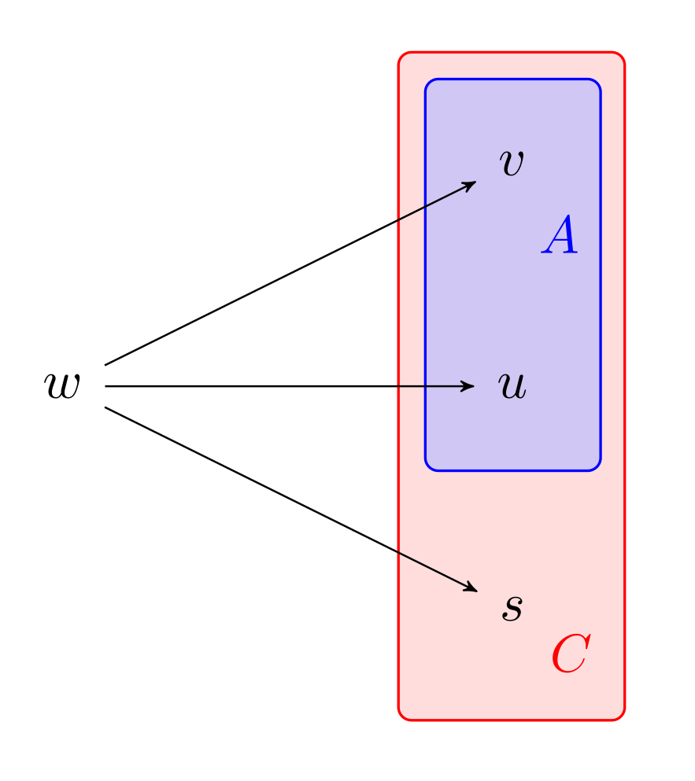
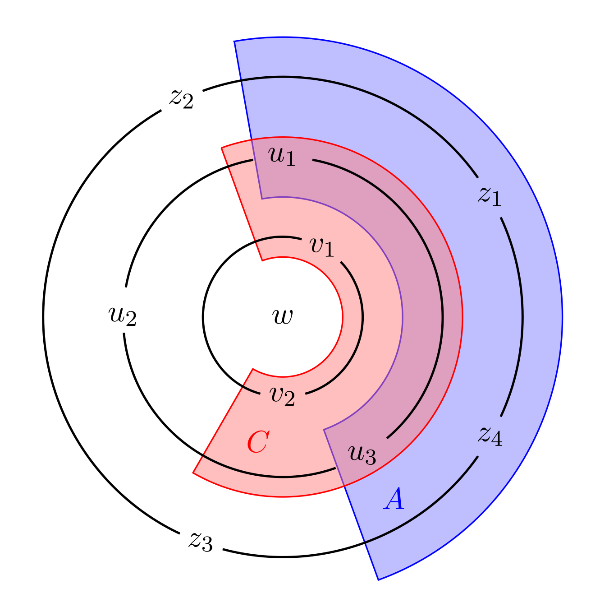
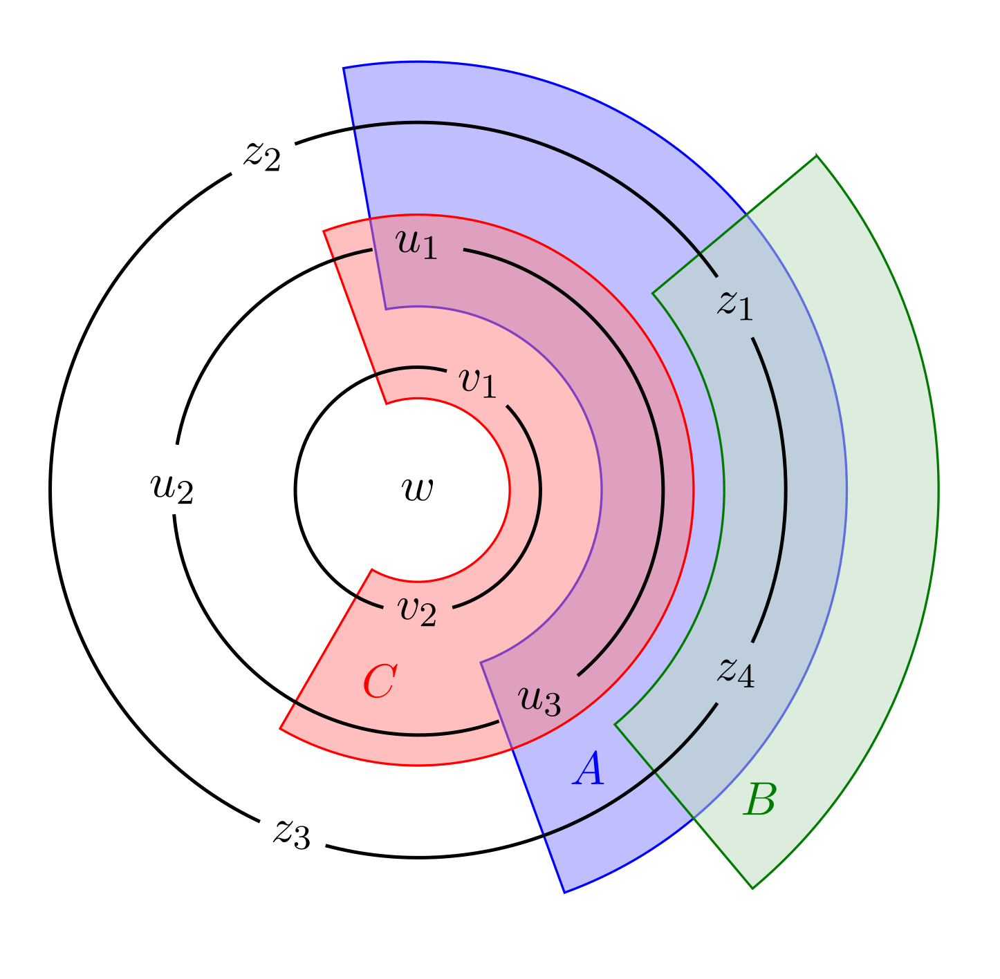

# Counterfactuals
**First published Fri Jan 18, 2019; substantive revision Tue Aug 19, 2025**

*Starr, Willow, Kocurek, Alex*

Counterfactuals are conditionals concerning hypothetical possibilities. What if Martin Luther King had died when he was stabbed in 1958 (Byrne 2005: 1)[^byrne-2005]? What if the Americas had never been colonized? What if all our experiences were just an elaborate simulation? Such *what-if*s, apart from being thought-provoking, play a foundational theoretical role in philosophy, linguistics, psychology, artificial intelligence, history, and many other allied fields.

Despite being interwoven into so many disciplines, there are deep unanswered questions concerning counterfactuals. This entry surveys some of the many philosophical issues they raise.

## 1. What are Counterfactuals?

### 1.1 Counterfactuals vs. Counter-to-Fact Conditionals

In philosophy and related fields, **counterfactuals** are taken to be sentences like (1):

**(1)**

If cats were able to talk, they would complain a lot.

The term *counterfactual* promotes a confusion worth dispelling. Despite the label, counterfactuals are not always **counter-to-fact conditionals**, i.e., conditionals with false antecedents. For example, (2) is a counterfactual and yet may have a true antecedent. Indeed, (2) can even be used to argue the antecedent is true (Anderson 1951)[^anderson-1951].

**(2)**

If Jones had ingested arsenic, he would have shown exactly the symptoms he’s showing now.

For this reason, some prefer the term **subjunctive conditional**, reserving the term *counterfactual* for subjunctive conditionals with false antecedents (Brée 1982; von Fintel 1999b; Declerck and Reed 2001: 99)[^brée-1982][^declerck-2001][^fintel-1999b]. While slightly more enlightened, this terminology does not neatly align with the sprawling philosophical and interdisciplinary literature surveyed here. It also brings its own complications (section 7.3). And, despite examples like (2), some theorists argue subjunctives actually do (in some sense) assume their antecedent is false (Leahy 2011; Zakkou 2019)[^leahy-2011][^zakkou-2019].

For ease of exposition, this entry uses *counterfactual* and *subjunctive conditional* interchangeably. Most of the entry focuses on counterfactuals that are also counter-to-fact conditionals.

### 1.2 Indicatives vs. Subjunctives

Counterfactuals (i.e., subjunctive conditionals) contrast with **indicative conditionals**, which concern what is actually the case. To see the contrast, consider (3) and (4) (Adams 1970)[^adams-1970].[^note-1]

**(3)**

If Oswald didn’t kill Kennedy, someone else did. **(Indicative)**

**(4)**

If Oswald hadn’t killed Kennedy, someone else would have. **(Subjunctive)**

We know Kennedy was assassinated in 1963. Thus, the indicative in (3) is true: someone killed Kennedy, so if it wasn’t Oswald, it was someone else. But, as far as we know, Oswald shot Kennedy and acted alone. Thus, as far as we know, the counterfactual in (4) is false: if Oswald hadn’t killed Kennedy, no one else would have.

Indicative and subjunctive conditionals differ in their linguistic form. Indicatives are written in the “indicative” mood common to declarative sentences, which typically feature verbs with simple tenses, as in *If A was/is/will be true, B was/is/will be true*. Subjunctives are written in the “subjunctive” mood, often featuring the past perfect, or “pluperfect” tense, as in *If A were/had been true, B would be/have been true*.[^note-2]

Indicatives also sound “infelicitous” (linguistically inappropriate or contextually incoherent) when their antecedent is explicitly denied (Stalnaker 1975; Veltman 1986; though see Holguín 2020)[^holguín-2020][^stalnaker-1975][^veltman-1986]. By contrast, subjunctives sound fine even when their antecedent has been denied. This is illustrated in (5), where infelicity is marked with the hash symbol ‘#’.

**(5)**

Bob never danced. a. #If Bob danced, Leland danced. **(Indicative)**

**c.**

If Bob had danced, Leland would have danced. **(Subjunctive)**

**c.**

If Bob were to dance, Leland would dance. **(Subjunctive)**

We return to the significance of this distinction in section 7.3. This entry sets aside indicatives until then. See the entries on indicative conditionals and the logic of conditionals (see also Edgington 1995; J. Bennett 2003; Gillies 2012; von Fintel 2012)[^bennett-2003][^edgington-1995][^fintel-2012][^gillies-2012].

### 1.3 *Would* vs. *Might*

Most of the counterfactuals discussed in this entry feature *would* in the consequent. There are also counterfactuals with other modals, such as *might*:

**(6)**

If cats were able to talk, they might complain a lot.

Some theorists maintain that *might*-counterfactuals are the “duals” of *would*-counterfactuals. On this view, (6) is equivalent to (7):

**(7)**

It’s not true that if cats were able to talk, they would not complain a lot.

This equivalence is controversial, however (section A.2 of [Debates over Counterfactual Principles](counterfactuals.debates.md); see also section 7.1). Unless otherwise specified, the term *counterfactual* refers to *would*-counterfactuals in this entry.

## 2. Counterfactuals in Philosophy

Counterfactuals are ubiquitous in philosophy. They have been used to analyze many philosophical concepts, including causation, explanation, knowledge, freedom, rationality, harm, and value, just to name a few. Even when these analyses fail, they are considered the starting point for debate and offer crucial insights that shape subsequent discussion.

### 2.1 Metaphysics and Science

One reason counterfactuals are so useful is they capture a sense of *dependency* and *tendency*. It is often tempting to invoke counterfactuals when describing more specific relations of dependency and tendency, such as causation, explanation, and dispositions. This suggests counterfactuals could be fruitful for elucidating these concepts.

On the dependency side, consider *causation*. Why did Suzy’s throwing a rock at the window “cause” it to shatter? It’s not just because Suzy threw the rock and then it shattered: perhaps Billy tied his shoes at the same time, but he didn’t cause the window to shatter. Arguably, it’s because if Suzy hadn’t thrown the rock, the window wouldn’t have shattered. By contrast, even if Billy hadn’t tied his shoes, Suzy would still have thrown the rock, and so the window still would have shattered.

This illustrates the close connection between causal claims and counterfactuals: the former can often be paraphrased in terms of the latter. Why is that? A simple explanation is that causal claims *are* counterfactual claims: an (actual) event *c* causes an (actual) event *e* just in case if *c* had not occurred, *e* would not have occurred. This analysis, inspired by David Hume (1748) and developed by David Lewis (1973a,c) (cf. Mackie 1974)[^mackie-1974], is the main starting point for much of the literature on causation.

Despite its influence, it is now generally agreed that this simple counterfactual analysis is problematic and needs refinement (Collins, Hall, and Paul 2004; Paul and Hall 2013)[^collins-2004][^paul-2013]. Still, even critics agree they must account for the intimate connection between counterfactuals and causation (Chisholm 1955)[^chisholm-1955]. More recently, a new wave of counterfactual analyses has emerged using “causal models” (section 6.3; Hitchcock 2001, 2007; Woodward 2002, 2003: ch.5)[^hitchcock-2001][^hitchcock-2007][^woodward-2002][^woodward-2003]. See the entries on counterfactual theories of causation, causal models, and causation and manipulability.

Counterfactuals likewise figure in many theories of *non-causal explanation*. Wilson (2018) analyzes metaphysical explanation, or “grounding”, in terms of counterfactuals (cf. Schaffer 2016; Lange 2017; for criticism, see Koslicki 2016; K. Bennett 2017: §3.3)[^bennett-2017][^koslicki-2016][^lange-2017][^schaffer-2016]. Baron et al. (2017, 2020) give a parallel analysis of mathematical explanation (cf. Lange 2013; for criticism, see Kasirzadeh 2023; Povich 2023)[^kasirzadeh-2023][^lange-2013][^povich-2023]. Lange (1999, 2000, 2009) analyzes laws in terms of a counterfactual notion of stability (cf. Woodward 2004). Conversely, some analyze counterfactuals in terms of laws (Maudlin 2007)[^maudlin-2007] or explanations (Kment 2006, 2014)[^kment-2006][^kment-2014]. As with causation, these analyses are enlightening albeit controversial starting points for theorizing. See the entries on 20th century theories of scientific explanation, causal approaches to scientific explanation, laws of nature, metaphysical grounding, and metaphysical explanation.

On the tendency side, consider *dispositions*. What does it mean to say a wine glass is disposed to break when dropped? Arguably, it means the glass *would* break *if* it *were* dropped. Indeed, many dispositional claims can be rephrased as counterfactuals in this way: an object *x* is disposed to *M* under condition *C* just in case if *C* were to obtain, *x* would *M*. Like with causation, this counterfactual analysis has historically been the starting point for work on dispositions (Ryle 1949; Quine 1960; N. Goodman 1955; E. Prior 1985; D. Lewis 1997; Fara 2005; Manley and Wasserman 2008, 2011)[^fara-2005][^lewis-1997][^manley-2008][^manley-2011][^prior-1985][^quine-1960][^ryle-1949]. And again, even those who reject the analysis will acknowledge, and must account for, this tight connection. See the entry on dispositions.

For one more example, consider *ability*. You are able to take a break from reading this entry and grab a cup of tea. What does that mean? It doesn’t just mean it is *possible* for you to take a tea break: theoretically, it’s possible for you to teleport to Jupiter, but, alas, you are unable to do so. A natural thought, tracing back to Hume (1748) and Moore (1912), is this: you are able to take a tea break in that if you had tried to, you would have succeeded. By contrast, even if you were to try, you would not teleport to Jupiter. Indeed, many ability claims seem paraphrasable in this way, suggesting a conditional analysis: *S* is able to *V* just in case if *S* tried to *V*, they would succeed. Like with other analyses discussed above, this analysis has been both influential and controversial, with many proposed counterexamples and refinements (Chisholm 1964; Davidson 1973; Lehrer 1976; Ginet 1980; Cross 1986; Thomason 2005; Mandelkern, Shultheis, and Boylan 2017; Schwarz 2020; Willer 2021; Kittle 2023)[^chisholm-1964][^cross-1986][^davidson-1973][^ginet-1980][^kittle-2023][^lehrer-1976][^mandelkern-2017][^schwarz-2020][^thomason-2005][^willer-2021]. But also like other concepts discussed above, an adequate analysis of ability must still account for the tight connection between ability ascriptions and counterfactuals. See the entry on abilities.

### 2.2 Epistemology and Mind

Counterfactuals are frequently invoked in discussions of knowledge, justification, and informational content. They also raise interesting epistemological questions in their own right.

Start with knowledge. It was once thought that knowledge is justified true belief: *S* knows that *P* just in case *P* is true, *S* believes *P*, and *S*’s belief is justified. Famously, however, Gettier (1963) presented devastating counterexamples to this analysis. Something more (or other) than justification is needed to turn a true belief into knowledge. But what? Intuitively, the belief can’t be “accidentally” true: the formation of the belief has to, in some sense, *depend* on its truth. But “depend” in what sense? One natural answer, of course, is counterfactual dependence. Indeed, this notion of dependence is often construed in one of two ways, both of which invoke counterfactuals:

- **Sensitivity:** If *P* were false, *S* would not believe that *P* (Nozick 1981)[^nozick-1981].
- **Safety:** If *S* were to believe that *P*, *P* would not be false (Sosa 1999)[^sosa-1999].[^note-3]

While there’s much debate over the adequacy of these criteria, they play a crucial role in contemporary discussions in epistemology. They are used not just in the analysis of knowledge, but also to articulate related epistemological notions, such as “defeaters” or “reliable” belief formation processes. See the entries on the analysis of knowledge and reliabilist epistemology.

Certain ways of obtaining knowledge, such as thought experiments or imagination, often involve counterfactual reasoning. While thought experiments and imagination differ from counterfactual thinking in important respects (e.g., the former often have an “experiential” component), these notions are clearly related. In this vein, Williamson (2007) argues for a unified epistemology of thought experiments and counterfactuals. See the entries on thought experiments and imagination.

More generally, the epistemology of modality is fruitfully informed by counterfactual theorizing. Some philosophers are skeptical we can ever know what is metaphysically possible or necessary (van Inwagen 1998)[^inwagen-1998]. But using standard counterfactual logic, Williamson (2007) shows how such modal knowledge can be derived from a more general capacity to know counterfactual conditionals, suggesting knowledge of metaphysical modality is within reach. This approach to modal epistemology has sparked much discussion and continues to be a central focus of the field (Jenkins 2008; Malmgren 2011; Roca-Royes 2011; Casullo 2012; Tahko 2012; Yli-Vakkuri 2013; Deng 2016; Vetter 2016b; Gregory 2017; Berto et al. 2018; Mallozzi 2021; Vaidya and Wallner 2021; Thomasson 2021)[^berto-2018][^casullo-2012][^deng-2016][^gregory-2017][^jenkins-2008][^mallozzi-2021][^malmgren-2011][^roca-royes-2011][^tahko-2012][^thomasson-2021][^vaidya-2021][^vetter-2016b][^yli-vakkuri-2013]. One point of contention is that Williamson’s principles require vacuism about counterpossibles, which we return to later (section 7.2). See the entry on the epistemology of modality.

Finally, counterfactuals arise in debates over the analysis of informational content. For example, tree rings “carry information” about the age of a tree (Dretske 2011)[^dretske-2011]. Likewise, certain brain states carry informational content: one might be in a brain state corresponding to thinking about cats. But what does it mean for such states to “carry information”? Why, for example, does *that* brain state represent cats and not something else? One prominent answer uses counterfactuals (Loewer 1983: 76; Cohen and Meskin 2006; cf. Fodor 1987, 1990)[^cohen-2006][^fodor-1987][^fodor-1990][^loewer-1983]. For example, Cohen and Meskin argue a state carries information that *a* is *F* just in case it is nonvacuously true that that state would not obtain if *a* were not *F*. See the entries on causal theories of mental content and semantic conceptions of information.

### 2.3 Agency and Rationality

Counterfactual reasoning is crucial for learning, planning, and deliberation and thus stars in many influential analyses of agency and rationality.

According to the standard view, a choice is a kind of intentional action, i.e., an action caused in part by one’s intentions. Empirical evidence suggests counterfactual thinking is central to forming rational intentions. Ruth Byrne (2005, 2016: 138) presents experiments showing people who engage in certain counterfactual thinking after particular events to formulate plans improve the outcome of their actions in related scenarios. However, those who dwell on how things could have been worse, or do not counterfactually reflect at all, show less persistence and no improvement in performance. This process can become further disordered when counterfactual thinking goes astray, e.g., in depression, anxiety, and schizophrenia (Byrne 2016: 140–143)[^byrne-2016]. This suggests counterfactual thinking strongly influences our ability to rationally plan and act. See the entries on agency, action, and intention.

For an intentional action to be a choice, it must be *free* or *voluntary*. What does that mean, though? A standard answer is that free action requires an *ability to do otherwise*. We saw already how counterfactuals may fruitfully elucidate abilities (section 2.1). They can also help clarify the “do otherwise” part. You arguably don’t choose whether to take a tea break unless the following is true:

**(8)**

If you had wanted to (not) take a tea break, you could have done so.

Experiments in social psychology support this link, suggesting belief in free will is linked to increased counterfactual thinking (Alquist et al. 2015)[^alquist-2015] and that counterfactually reflecting on past events and choices is one significant way humans imbue life experiences with meaning and create a sense of self (Galinsky et al. 2005; Heintzelman et al. 2013; Kray et al. 2010; Seto et al. 2015)[^galinsky-2005][^heintzelman-2013][^kray-2010][^seto-2015]. This might even be used as part of a pragmatic argument for believing in free will: because counterfactual thinking is so practically important, the belief in free will accompanying it is justified.[^note-4]

The idea that choice entails a certain counterfactual claim immediately leads to a classic problem, however: if the future is determined by the past and the physical laws, then every action of every agent, including their “choices”, are predetermined (van Inwagen 1975)[^inwagen-1975]. In that case, it looks like counterfactuals like (8) are false. Incompatibilist theories of free will accept this conclusion arguing we must either reject determinism or reject free will. Compatibilists reject this argument, seeking instead to understand agency in a way that is compatible with living in a deterministic universe either by denying choice requires counterfactuals like (8) or by explaining how (8) is compatible with determinism. See the entries on free will, arguments for incompatibilism, incompatibilist theories of free will, and compatibilism.

Finally, counterfactuals are helpful in understanding what constitutes *rational* choice. The standard view from decision theory, game theory, and economics is that an action is rational iff it maximizes one’s expected utility. But how exactly one defines expected utility is a controversial matter. Examples like Newcomb’s Problem (Nozick 1969)[^nozick-1969] suggest there are competing definitions one could adopt. One prominent proposal, known as causal decision theory, uses counterfactuals: one should choose the action that *would* most likely bring about good outcomes *were* one to do it (Stalnaker 1972 [1981]; Gibbard and Harper 1978; Joyce 1999)[^gibbard-1978][^joyce-1999][^stalnaker-1972]. Indeed, some authors suggest “causal” decision theory would be better called *counterfactual* decision theory (Collins 1996; Hedden 2023; Gallow 2024)[^collins-1996][^gallow-2024][^hedden-2023] and have used features of counterfactuals to inform the theory (Hedden 2023; McNamara 2024; for dissent, see DeRose 2010; Korzukhin 2014)[^derose-2010][^hedden-2023][^korzukhin-2014]. Related work on belief revision explores how rational agents should revise their beliefs when they are inconsistent with something previously learned—much like a counterfactual antecedent demands—and uses structures that formally parallel those used in the semantics of counterfactuals (Harper 1975; Gärdenfors 1978, 1982; D. Lewis 1979b, 1981a; Levi 1988)[^gärdenfors-1978][^gärdenfors-1982][^harper-1975][^levi-1988][^lewis-1979b][^lewis-1981a]. See the entries on decision theory, causal decision theory, and formal representations of belief.

## 3. Semantic Puzzles

Despite their ubiquity, it is surprisingly difficult to clarify what counterfactuals mean. This is arguably *the* central question motivating the philosophical and linguistic literature on counterfactuals: what does it mean to say that if something *were* to occur, something else *would* occur?

Answering this question is challenging partly because counterfactuals exhibit a number of puzzling features. This section highlights some of the features of counterfactuals that every semantic analysis must account for.

Throughout, we use the following notation for counterfactuals due to Robert Stalnaker (1968):

**Notation** $A \gt C$ symbolizes the counterfactual *if $A$ were the case, $C$ would be the case* (more precisely: *if it were/had been the case that $A$, it would be/have been the case that $C$* ).

In the philosophical literature, one also sees a different notation due to David Lewis (1973b,c): $A \mathbin{\Box\!\!\rightarrow} C$. (Lewis also uses $A \mathbin{\Diamond\!\!\!\rightarrow} C$ for *might*-counterfactuals.) These notations are about as prevalent in the literature.[^note-5]

### 3.1 Goodman’s Problem

Nelson Goodman (1947) articulated two puzzling features of counterfactuals that sparked much of the subsequent literature. The first is that counterfactuals seem to depend on certain background facts. But it is difficult to specify these facts in a non-circular manner. This is known as **Goodman’s problem**.

To see the problem, suppose I have a match that I never strike. In that case, (9) seems true:

**(9)**

If I had struck this match, it would have lit.

But the antecedent of (9) assumes certain background facts like the presence of oxygen—a struck match won’t light without oxygen. Moreover, the match must be dry, there must be relatively little wind, the friction between the striking surface and the match must be sufficient to produce heat, which must be sufficient to activate chemical energy stored in the match head, certain physical laws like conservation of energy must hold,…and on and on. There seems to be no end to the list of background conditions that the antecedents of even simple counterfactuals like (9) implicitly assume.[^note-6]

Which background facts does a counterfactual antecedent assume, though? We cannot simply say it assumes all actual facts besides the fact that the match was not struck. After all, one such fact is that the match was not lit! Even excluding this, there is also the fact that the room is dark, that the match isn’t burnt, and so on, which seem to rule out the match being lit. Goodman suggests we only assume facts that are “cotenable” with the match being struck. But cotenable in what sense? The match not lighting is logically compatible with antecedent, as is the match not being burnt, the room being dark, and so on. One is tempted to say those logically compatible facts *would not* obtain *if* the match *were* struck. But, Goodman notes, this definition of cotenability is circular, as it relies on the truth of other counterfactuals.[^note-7]

Most theorists believe the key to solving Goodman’s problem is to better understand the role context plays in the truth of counterfactuals. Consider an example due to Quine (1960: §46):

**(10)**

a. If Caesar had been in charge during the Korea War, he would have used the atom bomb.

**b.**

If Caesar had been in charge during the Korea War, he would have used catapults.

One can easily imagine asserting either (10a) or (10b) in different contexts. When discussing Caesar’s brutality, (10a) sounds natural to assert. But when discussing Caesar’s choice of weaponry, (10b) might sound better. This suggests counterfactuals are **context-sensitive**: the possibilities we consider when evaluating the antecedent are constrained by the context in which the counterfactual is asserted (D. Lewis 1973b: 67)[^lewis-1973b].[^note-8] Most accounts incorporate some version of this idea (Ichikawa 2011; Ippolito 2016; K. Lewis 2016, 2017)[^ichikawa-2011][^ippolito-2016][^lewis-2016][^lewis-2017]. But, as Goodman’s example illustrates, it is difficult to spell out how, exactly, context constrains counterfactual evaluation.

### 3.2 Sobel Sequences

The second puzzling feature that Goodman (1947) observed is arguably the most iconic: adding information to the antecedent of a counterfactual can change its truth value. For example, (11a) could be true while (11b) is false.

**(11)**

a. If I had struck this match, it would have lit. $S \gt L$

**b.**

If I had struck this match and done so in a room without oxygen, it would have lit. $(S \wedge \neg O) \gt L$

David Lewis (1973b: 10; 1973c: 419) dramatized the point with sequences like (12), where adding information to the antecedent repeatedly flips the counterfactual’s truth value. These are known as **Sobel sequences** (named after Howard Sobel).

**(12)**

a. If I were an Olympic athlete, I would have won the race. $O \gt W$

**b.**

If I were an Olympic athlete but had a broken leg, I wouldn’t have won the race. $(O \wedge B) \gt \neg W$

**c.**

If I were an Olympic athlete and had a broken leg but were racing a bunch of snails, I would have won the race. $(O \wedge B \wedge S) \gt W$

$\vdots$

This feature of counterfactual antecedents—that strengthening them doesn’t preserve truth—is known as **non-monotonicity** (or, more precisely, **downward non-monotonicity**).[^note-9] Not all analyses agree that counterfactuals are non-monotonic in this sense (section 4.2). But the *apparent* non-monotonicity of counterfactuals, as illustrated by Sobel sequences like (12), is a striking feature that all accounts must explain. For more on non-monotonicity, see the entries on non-monotonic logic and defeasible reasoning.

### 3.3 Counterfactual Fallacies

Non-monotonicity leads to failures of several counterfactual principles. Specifically, monotonicity corresponds to four principles of counterfactual reasoning. In fact, given modest auxiliary assumptions, these principles are equivalent to one another.[^note-10] (Notation: “$A_1,\dots,A_n \vDash B$” stands for “$A_1,\dots,A_n$ entail $B$”.)

- **Antecedent Strengthening:** $A \gt C \vDash (A \wedge B) \gt C$
- **Transitivity:** $A \gt B, B \gt C \vDash A \gt C$
- **Contraposition:** $A \gt C \vDash \neg C \gt \neg A$
- **Simplification of Disjunctive Antecedents (SDA):** $(A \vee B) \gt C \vDash (A \gt C) \wedge (B \gt C)$

These principles are all prone to counterexamples. David Lewis (1973b: 31) refers to the first three as **counterfactual fallacies**. Whether the fourth, SDA, is a “fallacy” is much more controversial (section A.4 of the supplement [Debates over Counterfactual Principles](counterfactuals.debates.md)).

We have already seen counterexamples to Antecedent Strengthening in (11) and (12). Against Transitivity, Stalnaker (1968: 48) presents (13). Imagine Hoover has a strong disposition towards patriotism for his home country, wherever that is. But suppose also that being a communist in the US amounted to being a traitor. In that case, (13a) is true, given the US’s stance towards communism. And (13b) is true, given the period Hoover was in. But (13c) is false, given Hoover’s patriotism.

**(13)**

a. If J. Edgar Hoover were a communist, then he would be a traitor (to his home country). $C \gt T$

**b.**

If J. Edgar Hoover had been born a Russian, then he would be a communist. $R \gt C$

**c.**

#If J. Edgar Hoover had been born a Russian, he would be a traitor (to his home country). $R \gt T$

Contra Contraposition, Lewis (1973b: 35) presents (14). Imagine Olga went to the party but Boris didn’t. Boris wanted to go, but stayed home to avoid Olga. However, Olga really wanted to see Boris. Both Boris and Ogla have reliable access to each other’s whereabouts. In that case, (14a) is true (Olga wants to see Boris) whereas (14b) is false (Boris wants to go to the party while avoiding Olga).

**(14)**

a. If Boris had gone to the party, Olga would have gone. $B \gt O$

**b.**

#If Olga had not gone, Boris would not have gone. $\neg O \gt \neg B$

Finally, against SDA, McKay and van Inwagen (1977: 354) offer (15). Imagine Spain preferred to remain neutral, but preferred working with the Axis over working with the Allies. In that case, (15a) is true. Suppose further that under no circumstances do they want to “play both sides”: the risks of getting caught are just too great. In that case, (15b) is false.

**(15)**

a. If Spain had fought for the Allies or the Axis, it would have fought for the Axis. $(L \vee X) \gt X$

**b.**

#If Spain had fought for the Allies, it would have fought for the Axis. $L \gt X$

Not everyone accepts these counterexamples (section 4.2). Still, all analyses must provide an explanation of why these monotonicity principles *seem* to fail in these cases.

## 4. Strict Conditional Analyses

Arguably, the simplest analysis of counterfactuals is the **strict conditional analysis** (or just the **strict analysis**). On this approach, counterfactuals are “strict conditionals”: they are true only when their antecedent *strictly necessitates*, i.e., *necessarily implies*, their consequent.

The strict analysis was first articulated by Charles Sanders Peirce (1896: 33).[^note-11] C. I. Lewis (1912, 1914) defended this analysis and developed an axiomatic system for it. A precise model-theoretic semantics for the strict conditional was first developed by Rudolf Carnap (1956: Ch.5). Saul Kripke (1963) introduced a modal semantics featuring an accessibility relation, which is crucially exploited by more modern forms of this analysis. (For more historical context, see the entry on modern origins of modal logic.)

Despite its simplicity, the strict analysis has not been as popular amongst philosophers as its main rival, the variably strict analysis (section 5). But strict analyses have recently made a comeback thanks to the rise of dynamic semantics (section 4.3).

### 4.1 Strict Conditionals

According to the strict analysis, counterfactuals are **strict conditionals**, meaning their antecedent necessarily implies their consequent. C. I. Lewis introduced $A \strictif C$ for the strict conditional from $A$ to $C$. Nowadays, this is canonically expressed using tools from [modal logic](https://plato.stanford.edu/entries/logic-modal).

Modal logic extends standard propositional logic with two operators: $\Box$ (necessity) and $\Diamond$ (possibility). Roughly, $\Box A$ says “it is necessary that $A$”, while $\Diamond A$ says “it is possible that $A$”. These are analyzed using the notion of an “accessible world”. Intuitively, an accessible world is just a world that is possible in the relevant sense, be it metaphysical, nomological, epistemic, or deontic. Formally, accessibility is represented as a binary relation $R$ over a set of worlds $W$. Thus, $wRv$ says that $v$ is possible from $w$’s perspective, i.e., $w$ can “access” $v$. So $\Box A$ says that $A$ is true at every accessible world, while $\Diamond A$ says that $A$ is true at some accessible world.[^note-12]

Canonically, $A \strictif C$ is defined as $\Box(A \mathbin{\supset} C)$, where $\supset$ is the material conditional. In other words:

**Strict Conditional Semantics** $A \strictif C$ is true iff $C$ is true at every accessible world where $A$ is true.

Figure 1 illustrates this semantics. In this minimal model, $A \strictif C$ is true at $w$: every $A$-world with an incoming arrow from $w$ (i.e., $v$ and $u$) is also a $C$-world. By contrast, $C \strictif A$ is false at $w$, since $s$ is not an $A$-world.

*Figure 1:*

Figure 1: A model illustrating the strict conditional analysis. An arrow from $x$ to $y$ means $y$ is accessible from $x$, i.e., $xRy$.

The logic of strict conditionals we obtain from this semantics depends on the constraints we place on accessibility. See the entry on the [logic of conditionals](https://plato.stanford.edu/entries/logic-conditionals).

### 4.2 Are the Counterfactual Fallacies Real Fallacies?

While the strict analysis seems relatively simple and straightforward, it faces an immediate problem: it validates all of the counterfactual fallacies (section 3.3).

- **Antecedent Strengthening:** $A \strictif C \vDash (A \wedge B) \strictif C$
- **Transitivity:** $A \strictif B, B \strictif C \vDash A \strictif C$
- **Contraposition:** $A \strictif C \vDash \neg C \strictif \neg A$
- **SDA:** $(A \vee B) \strictif C \vDash (A \strictif C) \wedge (B \strictif C)$

The reason Antecedent Strengthening holds for $\strictif$ is simple: since $A \wedge B$ entails $A$, every $(A \wedge B)$-world is an $A$-world. Thus, if every accessible $A$-world is a $C$-world (i.e., $A \strictif C$), then so is every accessible $(A \wedge B)$-world (i.e., $(A \wedge B) \strictif C$). The other counterfactual fallacies are validated for similar reasons.

David Lewis (1973b) and Robert Stalnaker (1968) argued the counterexamples to these principles (section 3.3) refuted strict analyses. They concluded one must build a semantics around non-monotonicity (section 5).

Despite this, evidence suggests counterfactuals actually *are* monotonic, in line with the strict analysis. For one, in many cases, the counterfactual “fallacies” do not seem fallacious. The inferences below all sound reasonable.

**(16)**

*Antecedent Strengthening* a. If the switch were flipped up, the light would be on.

**b.**

So, if the switch were flipped up and painted red, the light would be on.

**(17)**

*Transitivity* a. If the switch were flipped up, the light would be on.

**b.**

If the light were on, I would be able to see.

**c.**

So, if the switch were flipped up, I would be able to see.

**(18)**

*Contraposition* a. If the switch were flipped up, the light would be on.

**b.**

So, if the light weren’t on, the switch wouldn’t be flipped up.

**(19)**

*SDA* a. If either the left or the right switch were flipped up, the light would be on.

**b.**

So, if the left switch were flipped up, the light would be on, and likewise if the right switch were flipped up.

Even if some instances of these inferences are “reasonable”, however, that does not show they are universally valid (see, e.g., Schultheis 2025)[^schultheis-2025]. After all, we saw earlier that Sobel sequences like (20) (repeated from (12)) sound consistent, suggesting Antecedent Strengthening fails.

**(20)**

a. If I were an Olympic athlete, I would have won the race. $O \gt W$

**b.**

If I were an Olympic athlete but had a broken leg, I wouldn’t have won the race. $(O \wedge B) \gt \neg W$

But even this is not so clear. Irene Heim observes that reversing the order of these counterfactuals, as in (21), sounds markedly worse (von Fintel 2001; Gillies 2007)[^fintel-2001][^gillies-2007], suggesting the counterfactuals are inconsistent after all. These are known as **Heim sequences**, or **reverse Sobel sequences**.

**(21)**

a. If I were an Olympic athlete but had a broken leg, I wouldn’t have won the race. $(O \wedge B) \gt \neg W$

**b.**

#If I were an Olympic athlete, I would have won the race. $O \gt W$

Further linguistic evidence comes from negative polarity items (or NPIs), such as *any* and *ever*. Linguists hypothesize that NPIs are only licensed in downward-monotonic environments (Ladusaw 1979; Katz 1991; Kadmon and Landman 1993; Partee 1993; von Fintel 1999a)[^fintel-1999a][^kadmon-1993][^katz-1991][^ladusaw-1979][^partee-1993].[^note-13] For example, *doubt* is downward-monotonic: doubting Ann is at the movies entails doubting Ann is at the movies eating popcorn. By contrast, *believes* is not downward-monotonic: believing Ann is at the movies doesn’t entail believing Ann is at the movies eating popcorn. This difference seems to directly correlate with the contrast between (22), which sounds fine, and (23), which sounds ungrammatical. Notably, however, NPIs are licensed in the antecedents of conditionals, as in (24). This suggests counterfactual antecedents are downward-monotonic, i.e., Antecedent Strengthening is valid after all.

**(22)**

I doubt Ann ever saw any movies.

**(23)**

#I believe Ann [ever] saw any movies.

**(24)**

If Ann had ever seen any movies, she would have eaten popcorn.

This last point is not decisive: *exactly*, questions, superlatives, and the restrictors of *most* and *only* all license NPIs despite not being downward-monotonic. Whether conditional antecedents are also exceptions is debated (Giannakidou 2002, 2011; Rothschild 2006; C. Barker 2018)[^barker-2018][^giannakidou-2002][^giannakidou-2011][^rothschild-2006].

Even given all of this, strict theorists must provide an alternative explanation for the apparent counterexamples to these principles. They typically do so by appealing to context-sensitivity.

### 4.3 Second Wave Strict Analyses

In this vein, there was a subsequent wave of strict analyses aimed at addressing the appearance of non-monotonicity in counterfactuals, beginning with Daniels and Freeman (1980) and Warmbrōd (1981a,b), and followed by Lowe (1983, 1990) and Lycan (2001). Later, von Fintel (2001) and Gillies (2007) spearheaded a related approach using dynamic semantics.

These “second wave” strict analyses all invoke some version of the following ideas (though even rival theories accept the first two):

1. **Accessibility:** The truth of a counterfactual depends on which worlds are accessible.
2. **Context-Sensitivity:** Which worlds are accessible depends on the conversational context. Generally, accessible worlds are those that preserve certain background facts assumed by the conversational participants.
3. **Presupposition:** Counterfactuals presuppose (in some sense) their antecedent is compatible with these background facts, i.e., the antecedent is true at some accessible world.
4. **Accommodation**: When this presupposition is not met, conversational participants will try, to the extent possible, to accommodate this presupposition by expanding the set of worlds that are deemed accessible.

Let’s see how this applies to Sobel sequences like (20) and Heim sequences like (21). Start with (20). Normally, in accepting an assertion of (20a), we do not consider worlds where I am an Olympic athlete but have a broken leg to be accessible (we may not consider such worlds at all). Against this background, the presupposition of (20b) isn’t met: there is no accessible world where its antecedent is true. So when interpreting (20b), we must accommodate its presupposition by adding a world where I am an Olympic athlete and I do have a broken leg. In doing so, we will plausibly only add worlds where I lose the race (not worlds where I am racing snails, etc.). But now consider (21). If we accept (21a) at the start, there must be some accessible worlds where I am an Olympic athlete and yet lose the race (due to the broken leg). In that case, the presupposition of (21b) is still met—there are accessible worlds where I am an Olympic athlete—and so the accessibility relation does not change. But since (21a) has already been accepted, some of those accessible worlds are ones where I do lose the race. So (21b) can’t be accepted in this context.

On this account, Sobel sequences like (20) sound felicitous because of a **context-shift**: the counterfactuals are interpreted against different notions of accessibility, and so against different contexts. It’s like saying *It’s raining* doesn’t entail *It’s raining* because the weather can change between asserting the premise and the conclusion. Logical principles cannot be so easily dismissed, as they only concern which inferences are valid within a single context. Parallel explanations of the other counterfactual fallacies can be given (Warmbrōd 1981a,b)[^warmbrōd-1981a].

One challenge for these second wave strict approaches is to clarify how accessibility changes in presupposition accommodation. In the story above, we said speakers interpreting (20b) after (20a) “plausibly” do not add worlds where I win the race (e.g., by racing snails). But why not? Which worlds should we add when accommodating presuppositions? If we simply add all antecedent-worlds, we will inadvertently add worlds where I do not lose the race, rendering (20b) unacceptable. Some second wave theorists suggest we only add the most “similar” antecedent-worlds (Warmbrōd 1981b; von Fintel 2001; Willer 2018)[^fintel-2001][^warmbrōd-1981b][^willer-2018]. But similar in what sense? This same appeal to similarity in non-strict analyses has been criticized (section 5.4), suggesting strict analyses inherit similar similarity problems as their rivals.

Another challenge comes from probability judgments. Suppose a fair coin is never flipped. How likely is it that if it were flipped, it would land heads? Intuitively, the answer is 50%. But strict theorists say 0%: the antecedent definitely fails to necessitate the consequent. Accounting for these judgments is an open research program for strict theorists (see Willer 2025 for a recent attempt; section 7.1 discusses related issues)[^willer-2025].

The debate over whether counterfactuals are best given a strict analysis is very much ongoing. Critics propose ways of explaining reverse Sobel sequences within a non-monotonic analysis, like those discussed in section 5 (Moss 2012; Starr 2014a; Nichols 2017, K. Lewis 2018, Boylan and Schultheis 2021; Schultheis 2025)[^boylan-2021][^lewis-2018][^moss-2012][^nichols-2017][^schultheis-2025][^starr-2014a]. Advocates defend strict approaches as preferable on the basis of other data (Willer 2015, 2017, 2018; Williamson 2020; G. Greenburg 2021; Loewenstein 2021a; Moss forthcoming)[^greenburg-2021][^loewenstein-2021a][^willer-2015][^willer-2017][^willer-2018][^williamson-2020].

## 5. Variably Strict Analyses: The Lewis-Stalnaker Semantics

The main competitor to the strict analysis is, arguably, the most popular analysis of counterfactuals within philosophy. This analysis goes by many names, including “the similarity analysis”, “the ordering analysis”, “the selection function analysis”, and “the Lewis-Stalnaker semantics”. We will use the most general name, which encompasses all of these labels: the **variably strict analysis**. All variably strict analyses endorse some version of the following idea: a counterfactual is true when its consequent is true at all of the “closest” worlds where the antecedent is true. Whereas the strict analysis requires *all* antecedent-worlds to be consequent-worlds, variably strict analyses only require that all of *the closest* antecedent-worlds be consequent-worlds.

The variably strict analysis is commonly attributed to David Lewis and Robert Stalnaker (hence the alternative name). The actual history is a bit more nuanced: although publication dates do not tell the full story, the approach was developed roughly contemporaneously by Stalnaker (1968), Stalnaker and Thomason (1970), Lewis (1973b), Nute (1975b), and Sprigge (1970). William Todd (1964) gives an even earlier statement of the view:

> When we allow for the possibility of the antecedent’s being true in the case of a counterfactual, we are hypothetically substituting a different world for the actual one. It has to be supposed that this hypothetical world is as much like the actual one as possible so that we will have grounds for saying that the consequent would be realized in such a world. (W. Todd 1964: 107)[^todd-1964]

The variably strict analysis has received both the most support and the most criticism in the literature, leading to many reformulations and refinements over the years. For ease of exposition, we present a popular version of the semantics, due to David Lewis, known as the **ordering semantics**. Another popular formulation due to Robert Stalnaker, using selection functions, is discussed in the logic of conditionals (see also Starr 2019: §2)[^starr-2019].

### 5.1 Closeness and Similarity

Variably strict analyses assume that, when it comes to counterfactuals, some worlds are more relevant than others. When considering what would happen if this glass had dropped, we do not consider worlds where a bubble wrap suddenly materializes around it or where a wizard casts a spell on it to make it indestructible. We instead consider worlds like the actual world except for the fact that the glass is dropped. Such worlds only *minimally* differ from the actual world. Put figuratively: some worlds are *closer* to the actual world.

According to variably strict analyses, only the *closest* (or perhaps the *sufficiently close*) antecedent-worlds are relevant for counterfactuals. This is why the analysis is “variably” strict: which set of worlds we must consider varies with the antecedent. But within that set, the analysis is strict: for a counterfactual to be true, *all* of those closest (or sufficiently close) antecedent-worlds must be consequent worlds.

Talk of worlds being “close” or “far” is metaphorical. What does it actually mean? David Lewis (1973b) measured closeness by *similarity*: the more similar a world is to the actual world, the closer it is. (We’ll return to issues surrounding similarity in section 5.4.) We can imagine worlds are arranged in “spheres” around the actual world, as in Figure 2. The closer a world is to the center, the more similar it is to the actual world. Worlds on the same sphere are equally close to the actual world.

*Figure 2:*

Figure 2: A similarity model. Worlds on the same ring are equally close to the center $w$.

We can represent this idea more precisely using **world-orderings**. The idea is that each world $w$ is associated with an ordering relation $\leq_w$ over the set of its accessible worlds $R(w)$, which we can think of as the “outermost” sphere. Here is a quick translation key:

- $x \leq_w y$ says $x$ is at least as close to $w$ as $y$ is
- $x <_w y$ says $x$ is strictly closer to $w$ than $y$ is
- $x \equiv_w y$ says $x$ and $y$ are equally close to $w$

Most ordering theorists require $\leq_w$ to be a “total preorder” over $R(w)$, meaning it is reflexive ($x \leq_w x$), transitive ($x \leq_w y \leq_w z$ implies $x \leq_w z$), and total (either $x \leq_w y$ or $y \leq_w x$) over $R(w)$ (totality is the most controversial; see section 6.1). They also require $R$ to be reflexive, i.e., $wRw$. Further constraints are often imposed to make $\leq_w$ behave more like the intuitive notion of closeness or similarity. Below are some common ones.

- **centering:** every world is the unique closest world to itself if $x \in R(w)$ and $x \neq w$, then $w <_w x$
- **uniqueness (linearity):** there are no ties, i.e., distinct worlds cannot be equally close if $x \equiv_w y$, then $x = y$
- **limit assumption (well-foundedness):** there are no “infinite descending chains” of ever closer and closer worlds there are no $x_1,x_2,x_3,\dots$ where $x_1 >_w x_2 >_w x_3 > \cdots$ ad infinitum

These constraints each correspond to substantive principles of counterfactual reasoning (section 5.3).

### 5.2 Ordering Semantics

Given a world-ordering, we can state the ordering semantics as follows:[^note-14]

**Ordering Semantics** $A \gt C$ is true iff either:

1. there is no accessible $A$-world, or:
2. there is an accessible $(A \wedge C)$-world that is closer than any accessible $(A \wedge \neg C)$-world.

Given the limit assumption, the ordering semantics can be equivalently stated as follows:[^note-15]

**Ordering Semantics (simplified with the limit assumption)** $A \gt C$ is true iff all of the closest accessible $A$-worlds are $C$-worlds.

Figure 3 illustrates the ordering semantics. In this model, $A \gt C$ is true at $w$, since the closest $A$-worlds (in this case, $u_1$ and $u_3$), are all $C$-worlds. By contrast, $C \gt A$ is false since there is a closest $C$-world (in fact, both of them, i.e., $v_1$ and $v_2$) that is not an $A$-world. Notice that neither of the corresponding strict conditionals ($A \strictif C$ and $C \strictif A$) are true.

*Figure 3:*

Figure 3: A model of $A \gt C$ in the ordering semantics.

None of the counterfactual fallacies hold for variably strict conditionals. The reason is simple: generally, the stronger an antecedent is, the further away one must go to find a world where that antecedent is true.

Figure 4 depicts a simple ordering model where Antecedent Strengthening fails. Imagine $A$ stands for “I am an Olympic athlete”, $B$ stands for “I have a broken leg”, and $C$ stands for “I win the race”. So the closest worlds where I am an Olympic athlete ($A$) are ones where I do not have a broken leg ($\neg B$). In those worlds, I win the race ($C$). Further away are worlds where I am an Olympic athlete and have a broken leg ($A \wedge B$). In the closest such worlds, I lose the race ($\neg C$). This model also refutes the other counterfactual fallacies; see the note for details.[^note-16]

*Figure 4:*

Figure 4: Counterexample to the counterfactual fallacies. For instance, the closest $A$-worlds, $u_1$ and $u_3$, are all $C$-worlds, but the closets $A \wedge B$-worlds, $z_1$ and $z_4$, are not $C$-worlds.

As for Heim sequences (section 4.2), various authors have proposed variably strict explanations of their infelicity, all of which appeal to some form of context-shifting (Moss 2012,; Starr 2014a; K. Lewis 2018; Boylan and Schultheis 2021; Schultheis 2025)[^boylan-2021][^lewis-2018][^moss-2012][^schultheis-2025][^starr-2014a]. Whether these explanations are adequate, or better than rival strict accounts, is a live debate.

### 5.3 Counterfactual Principles

Many of the debates surrounding the variably strict analysis are internal to its proponents. Depending on which constraints we impose on world-orderings, different principles of counterfactual reasoning will come out as valid. Variably strict theorists disagree amongst themselves over which principles and constraints they should accept.

The supplemental entry, [Debates over Counterfactual Principles](counterfactuals.debates.md), surveys some of the most influential of such debates, including debates over:

- Centering principles, such as And-to-If and Modus Ponens
- Conditional Excluded Middle (CEM)
- The Limit Assumption
- Duality of *might*- and *would*-counterfactuals
- Simplification of Disjunctive Antecedents (SDA) and Replacement of Equivalent Antecedents (REA)
- Uniformity principles (e.g., CSO)
- Import-Export

For more about the logic of variably strict conditionals, see the entry on the [logic of conditionals](https://plato.stanford.edu/entries/logic-conditionals).

### 5.4 Objections to Similarity

Many of the philosophical objections to the variably strict account focus on its appeal to similarity. As we’ll see, developing an adequate account of similarity is a tricky business.

One immediate objection is that the notion of “similarity” is entirely vague. However, variably strict theorists view vagueness as a feature, not a bug. David Lewis (1973b) argued that the vagueness of similarity precisely matches the vagueness of counterfactuals:

> Counterfactuals are notoriously vague. That does not mean we cannot give a clear account of their truth conditions. It does mean that such an account must either be stated in vague terms—which does not mean ill-understood terms—or be made relative to some parameter that is fixed only within rough limits on any given occasion of language use. It is to be hoped that this imperfectly fixed parameter is a familiar one that we would be stuck with whether or not we used it in the analysis of counterfactuals; and so it will be. It will be the relation of comparative similarity. (D. Lewis 1973b: 1)[^lewis-1973b]

But similarity in what respects? Countless things are “similar” in some respects but not others. New York City and San Francisco are similar when comparing their cost of living or political leanings, but not when comparing topography or climate. What notion of similarity is relevant for counterfactuals?

Initially, Lewis (1973b: 92) proposed the following:

**Lewis’s 1973 Proposal:** Our familiar, intuitive concept of comparative overall similarity, just applied to possible worlds, is employed in assessing counterfactuals.

Kit Fine (1975: 452) presents a powerful objection to this proposal, known as the **future similarity objection**. Imagine that Nixon has a button to launch nuclear missiles at Russia and trigger a nuclear war. Fortunately, he never presses the button. Plausibly, (25) is true.

**(25)**

If Nixon had pressed the button, there would have been a nuclear war.

Lewis’s 1973 Proposal incorrectly predicts (25) is false. Suppose, optimistically, there never will be a nuclear war. Then a world where Nixon presses the button and, say, a short-circuit fortunately prevents the missiles from firing is intuitively much more similar to the actual world than one where there is a nuclear war. Tichý (1976: 271) presents a related but distinct counterexample (which is discussed more in Starr 2019: §2.5.1, §3.1)[^starr-2019].

In response, Lewis (1979a: 472) proposed a ranked system of weights that give what he calls “the standard resolution of similarity”:

**Lewis’s 1979 System of Weights**

1. Avoid big, widespread, diverse violations of law. (“big miracles”)
2. Maximize the spatiotemporal region throughout which perfect match of particular fact prevails.
3. Avoid even small, localized, simple violations of law. (“little miracles”)
4. It is of little or no importance to secure approximate similarity of particular fact, even in matters that concern us greatly.

So in Fine’s counterexample, a world where Nixon pushes the button, a small miracle occurs to short-circuit the equipment and nuclear war is avoided will count as less similar than one where there is no small miracle and a nuclear war ensues. The former world is similar to our own only in one insignificant respect (particular matters of fact) but dissimilar in one important respect (the small miracle).

Unfortunately, even Lewis’s 1979 System of Weights is refutable. Particular matters of fact often *are* held fixed in some cases. This is demonstrated by **Morgenbesser conditionals**, named after Sidney Morgenbesser, who made this observation.[^note-17]

**(26)**

[You’re invited to bet heads on a coin toss. You decline. The coin comes up heads.] See, if you had bet heads, you would have won! (Slote 1978: 27)[^slote-1978]

Lewis (1979a: 472) admits not knowing what to make of such cases. Additional problems have been discussed (Bowie 1979; Elga 2000; Edgington 2004; Schaffer 2004; Kment 2006; Wasserman 2006; Dorr 2016)[^bowie-1979][^dorr-2016][^edgington-2004][^elga-2000][^kment-2006][^schaffer-2004][^wasserman-2006].[^note-18] Morreau (2010) even presents a formal argument, based on Arrow’s Theorem in social choice theory, suggesting there is no unproblematic way to aggregate respects of similarity into a coherent notion of overall similarity.

Independently, critics have questioned the very idea that counterfactuals rely on similarity. Horwich (1987: 172) pointedly asks “why we should have evolved such a baroque notion of counterfactual dependence”. Bowie (1979: 496–497) argues no such system of weights can be given an independent, non-circular justification given how complex they must be to correctly predict our counterfactual judgments. Relatedly, Hájek (2014b: 250) objects that similarity is not well suited for the kinds of counterfactuals commonly used in science:

> Science has no truck with a notion of similarity; nor does Lewis’s (1979a) ordering of what matters to similarity have a basis in science.

In response, some variably strict theorists propose alternative notions of closeness not solely based on similarity (Kment 2006, 2014, Ippolito 2016, K. Lewis 2018)[^ippolito-2016][^kment-2006][^kment-2014][^lewis-2018]. Others reject the reductionist project of seeking a non-circular non-counterfactual analysis of closeness (e.g., Stalnaker 2019: 209ff; cf. Williamson’s (2000) knowledge-first approach to epistemology). Still, many find the reliance on these “squishy” notions troubling. These criticisms are precisely what motivate the alternative accounts explored in section 6.

## 6. Alternative Analyses

Both the strict and variably strict analyses rely on some notion of similarity. Variably strict analyses build similarity directly into the truth conditions of counterfactuals, while strict analyses appeal to similarity in pragmatic mechanisms such as presupposition accommodation (section 4.3). But, as we saw in section 5.4, theorists question the utility of similarity. Angelika Kratzer (1989: 626) nicely puts the point:

> [I]t is not that the similarity theory says anything false about [particular] examples… It just doesn’t say enough. It stays vague where our intuitions are relatively sharp. I think we should aim for a theory of counterfactuals that is able to make more concrete predictions with respect to particular examples.

The analyses discussed in this section all eschew similarity in favor of more “objective” methods for evaluating counterfactuals, such as laws, objective chance, and explanation.

### 6.1 Premise Semantics

Nelson Goodman (1947) thought a counterfactual is true iff its consequent is entailed by its antecedent together with further premises.[^note-19] Historically, this was a leading view of counterfactuals prior to the development of variably strict approaches (Ramsey 1931; Chisholm 1946; Mackie 1962; Rescher 1964)[^chisholm-1946][^mackie-1962][^ramsey-1931][^rescher-1964]. Later, this approach was refined by Frank Veltman (1976, 1985, 2005) and Angelika Kratzer (1979, 1981a,b, 1989, 1990, 2002, 2012), and is now called **premise semantics**.

**Premise Semantics** $A \gt C$ is true iff $A$ together with further premises associated with $A$ necessarily entail $C$.

This approach splits the difference between strict and variably strict accounts. Counterfactuals are strict conditionals containing further hidden premises in the antecedent. But which premises one adds may depend on what the antecedent is. The further premises associated with $A$ are known as the **premise set** of $A$.

One immediate question is what these “further” premises are: how do we determine an antecedent’s premise set? Goodman took the premise set to consist of facts and laws that are “cotenable” with the antecedent. But Goodman saw no way to define the notion of cotenability in non-counterfactual terms—this is precisely Goodman’s problem (section 3.1).

Both Veltman and Kratzer approached the question with more optimism. In different ways, they suggest context specifies which premises are added to an antecedent. For example, Kratzer assumes context supplies two sets of propositions for each world: a **modal base**, roughly the non-negotiable facts settled by context (such as certain laws or generalizations) and an **ordering source**, roughly the negotiable background facts one should try to preserve in evaluating modals and conditionals but may have to forego. A premise set for an antecedent is a consistent set of propositions that includes (i) the modal base, (ii) the antecedent, and (iii) as many propositions from the ordering source as possible while remaining consistent. (Note, this means an antecedent may have multiple premise sets; counterfactuals require every premise set to entail the consequent.) Veltman proposes a related but interestingly different way of computing premise sets (see Starr 2019: §3.1 for an overview)[^starr-2019].

David Lewis (1981b) shows that Kratzer’s premise semantics is equivalent to the ordering semantics without the totality requirement on world-orderings ([^note-13]). Where these approaches diverge is not in their logic (though see Chemla 2011 and Kaufmann 2017 for important caveats)[^chemla-2011][^kaufmann-2017], but in their truth-conditions. While the ordering semantics must incorporate a complex system of weighing respects of similarity, like Lewis’s 1979 System of Weights, to make correct predictions, these predictions more naturally fall out from the way premises are calculated in premise semantics.

One might complain this approach does not address the worry of making concrete predictions about particular cases, as it remains unclear how context supplies a modal base and ordering source (Kanazawa, Kaufmann, and Peters 2005; Kratzer 2005; Veltman 2005; K. Schulz 2007, 2011; see Starr 2019: §3.1 for an overview)[^kanazawa-2005][^kratzer-2005][^schulz-2007][^schulz-2011][^starr-2019][^veltman-2005]. Several authors have suggested addressing these concerns by combining premise semantics with interventionist approaches from section 6.3 (K. Schulz 2007, 2011; Kaufmann 2013; Santorio 2014, 2019)[^kaufmann-2013][^santorio-2014][^santorio-2019][^schulz-2007][^schulz-2011].

### 6.2 Probabilistic Analyses

While premise semantics has been prominent among linguists, probabilistic analyses have been more prominent among epistemologists and philosophers of science.

Broadly, there are two kinds of probabilistic analyses, corresponding to two notions of probability. First, there are accounts based on *subjective* probability. These are often inspired by Bayesian epistemology, which replaces the ordinary binary conception of belief with the gradated notion of *credence*. Second, there are accounts based on *objective* probability, i.e., chance. These are typically inspired by modern physical theories such as statistical mechanics or quantum mechanics. For more on different notions of probability, see the entry on interpretations of probability.

On the subjective side, Ernest Adams (1965, 1975) made a seminal proposal, based on his analysis of indicative conditionals:

**Adams’s Prior Probability Analysis** The assertability of $A \gt C$ is proportional to $P_0(C \mid A)$, where $P_0$ is the agent’s credence function prior to learning that $A$ was false.

Adams did not think conditionals had truth conditions. One can only talk of a conditional’s “degree of assertability”. One challenge for this approach is to integrate assertability into a comprehensive compositional semantic theory of natural language, as such theories typically assume that (i) meaning is compositional (the meaning of a sentence is a function of its parts) and (ii) meaning is analyzed in terms of truth conditions. Several theorists have since tried to refine Adams's idea to meet this challenge (Manor 1974; S. Barker 1995; Edgington 1995, 2003, 2004; Goldstein 2019)[^barker-1995][^edgington-1995][^edgington-2003][^edgington-2004][^goldstein-2019][^manor-1974].

While subjective probabilistic analyses have been pursued primarily by epistemologists, philosophers of science have been more drawn to analyses appealing to objective chance (Kvart 1986, 1992; Skyrms 1981; Kaufmann 2005a; Loewer 2007; Leitgeb 2012a,b; Hájek 2014a, 2025; Kocurek 2022)[^hájek-2014a][^hájek-2025][^kaufmann-2005a][^kocurek-2022][^kvart-1986][^kvart-1992][^leitgeb-2012a][^loewer-2007][^skyrms-1981]. Such accounts aim to ground counterfactuals in notions that are more objective and more frequently employed in science than comparative similarity.

Very broadly, these approaches identify counterfactuals with conditional chance statements in some form. More precisely, where ${\textit{ch}}(A) = x$ says “the objective chance that $A$ is $x$”:

**Objective Chance Analysis** $A \gt ({\textit{ch}}(C) = x)$ is true iff the objective chance that $C$, given $A$, was $x$ shortly before it was settled whether $A$ was false.

Two questions immediately arise. First, what does “shortly before” mean? One cannot say it is the time *immediately* before the antecedent is settled false: there may be no such time if time is dense. One might suggest it is the time where $A$ had the greatest chance of obtaining, but that could be quite a long time before the antecedent is settled false if its probability drops gradually enough. More questions arise for antecedents that are not time-specific, as in (1): at what point is the antecedent *If cats were able to talk,…* settled false? Similar problems arise for subjective probabilistic accounts.[^note-20]

Second, what about bare counterfactuals of the form $A \gt C$, whose consequent is not an objective chance statement? Theorists differ on what to say. Leitgeb (2012a,b) allows bare counterfactuals to be true when the relevant conditional chance is sufficiently high. Hájek (2014a, 2025), by contrast, requires the relevant conditional chance to be maximally high, equating $A \gt C$ with $A \gt ({\textit{ch}}(C) = 1)$. Each of these answers has drawbacks. Requiring only that the objective chance be sufficiently high fails to validate a plausible principle of counterfactual reasoning known as Agglomeration—$A \gt B, A \gt C \vDash A \gt (B \wedge C)$—since even when both $B$ and $C$ are sufficiently probable, $B \wedge C$ may not be (Hawthorne 2005; Leitgeb 2012a; Hájek 2014a)[^hájek-2014a][^hawthorne-2005][^leitgeb-2012a]. By contrast, requiring the relevant conditional chance to be 1 will ensure most ordinary counterfactuals are false (Hájek defends this conclusion; see section 7.1). Kocurek (2022) offers a middle way between these on which Agglomeration holds but bare counterfactuals do not require chance 1 to be true.

One worry for all probabilistic analyses, subjective or objective, is whether they are psychologically realistic. Do people really judge counterfactuals using probability? There is a large literature in psychology, beginning with Kahneman, Slovic, and Tversky (1982), showing that human reasoning diverges in predictable way from precise probabilistic reasoning. It remains to be seen whether the kinds of probabilistic mistakes humans make are reflected in their counterfactual judgments. Separately, probabilistic knowledge of this sort imposes unreasonable demands on memory: even for very simple domains the probability calculus does not provide computationally tractable representations and algorithms for implementing Bayesian intelligence. These concerns are one of the main motivations for interventionist approaches discussed next.

### 6.3 Interventionist Semantics

Recent work in cognitive science and artificial intelligence has made heavy use of new mathematical tools, developed by Spirtes, Glymour, and Scheines (1993, 2000) and Pearl (2000, 2009), known as **Bayesian networks**, **structural equation models**, or **causal models**. These tools help address the memory limitations of traditional Bayesian frameworks while also providing simple algorithms for causal and counterfactual reasoning, among other cognitive processes. They also lead to a new theory of counterfactuals known as the **interventionist semantics**.

Structural equation models are models of relations of conditional dependence, which typically include three elements: (1) a set of variables, representing different events or facts, which can take various values (e.g., truth values, a probability, etc.); (2) a set of **structural equations**, which specify how the values of certain variables functionally depend on those of others; and (3) an assignment of values to variables in accordance with these structural equations. Figure 5 depicts a structural equation model involving eight variables. For example, $H \mathrel{\colon=} F \vee G$ means the value of $H$ is determined by the value of $F \vee G$ (but not vice versa).[^note-21]

*Figure 5:*

Figure 5: A structural equation model.

To check whether a counterfactual is true in a structural equation model, one performs an **intervention** on the model to ensure the antecedent holds. To do this, one first “surgically” removes all arrows leading into the variables that correspond to the antecedent. One then resets the values of those variables to make the antecedent true. Finally, one updates the values of subsequent “descendant” variables that depend on the antecedent variables according to the remaining structural equations. So in the example above, $E \gt H$ is true: if we intervene to ensure $E$ is true (removing the arrow from $C$ to $E$ and changing the values of $E$ and its descendants accordingly), then $H$ is true. (Compare Lewis’s 1979 System of Weights.) More generally:

**Interventionist Semantics** $A \gt C$ is true iff after intervening to make $A$ true, $C$ is true.

Structural equation models have many applications in cognitive science (Glymour 2001; Gopnik et al. 2004; Sloman 2005; Sloman and Lagnado 2005; Gopnik and Tenenbaum 2007; Chater et al. 2010; Rips 2010; Lucas and Kemp 2015)[^chater-2010][^glymour-2001][^gopnik-2004][^gopnik-2007][^lucas-2015][^rips-2010][^sloman-2005][^sloman-2005-2] and artificial intelligence (see Pearl 2002, 2009, 2013; see also the entry on logic-based artificial intelligence)[^pearl-2002][^pearl-2009][^pearl-2013]. Interventionist counterfactuals are also used in robotics to develop safer autonomous vehicles (Thrun et al. 2006; Parisien and Thagard 2008; Chen et al. 2021)[^chen-2021][^parisien-2008][^thrun-2006], in climate science to attribute extreme weather events to climate change (Hannart et al. 2016; Stott et al. 2016; Hannart and Naveau 2018; Mengel et al. 2021; Mérel, Paroissien, and Gammans 2024)[^hannart-2018][^hannart-2016][^mengel-2021][^mérel-2024][^stott-2016], and in explainable AI (XAI) to address the “black box” problem (Wachter, Mittelstadt, and Russell 2018; Asher et al. 2022; Chou et al. 2022; Baron 2023; Celar and Byrne 2023; Verma et al. 2024; see Kasirzadeh and Smart 2021 for criticism)[^asher-2022][^baron-2023][^chou-2022][^kasirzadeh-2021][^verma-2024][^wachter-2018].

As a semantic analysis, interventionism faces challenges. Some question whether even causal counterfactuals are best modeled in interventionist terms (Hiddleston 2005; Fisher 2017a,b; Zhang, Lam, and De Clercq 2019; see Starr 2019: §3.3 for discussion)[^fisher-2017a][^hiddleston-2005][^starr-2019][^zhang-2019]. Some raise questions over how to interpret these structural equations and whether they can, or must, be understood in non-counterfactual terms (cf. Goodman’s problem; see Spirtes, Glymour, and Scheines 1993, 2000; Pearl 2000, 2009; Woodward 2002, 2003; Halpern and Pearl 2005a,b)[^halpern-2005a][^pearl-2000][^pearl-2009][^spirtes-1993][^spirtes-2000][^woodward-2002][^woodward-2003]. Finally, most interventionist accounts only accommodate very simple antecedents (e.g., a conjunction of atomics or negated atomics). Generalizing the semantics to incorporate more complex antecedents is an open research task. There are indications of progress on this front by combining the structural equation approach with others or employing more sophisticated techniques for computing interventions (K. Schulz 2007, 2011; Briggs 2012 (cf. Fine 2012a,b)[^fine-2012a]; Kaufmann 2013; Santorio 2014, 2019; Lucas and Kemp 2015; Snider and Bjorndahl 2015; Champollion, Ciardelli, and Zhang 2016; Günther 2017; Ciardelli, Zhang, and Champollion 2018; Stern 2021; Khoo 2022a; Wysocki 2023, forthcoming). See the entries on causal models, causation and manipulability, and counterfactual theories of causation.

## 7. Recent Debates

### 7.1 Counterfactual Skepticism and Counterfactual Probability

One burgeoning area of research is the interaction between counterfactuals and probability. While this topic has been extensively explored for indicatives (see the entries on indicative conditionals and the logic of conditionals), theorists have only begun to scratch the surface on how to carry over these lessons to counterfactuals (Skyrms 1981; Edgington 2004, 2008; Williams 2012; Moss 2013; Hájek 2014a,b; M. Schulz 2014, 2017; Schwarz 2018; Khoo 2022a,b; Kocurek 2022; Santorio 2022, 2023; Schultheis 2023; Willer 2025)[^edgington-2004][^edgington-2008][^hájek-2014a][^khoo-2022a][^kocurek-2022][^moss-2013][^santorio-2022][^santorio-2023][^schultheis-2023][^schulz-2014][^schulz-2017][^schulz-2014-2][^schwarz-2018][^skyrms-1981][^willer-2025][^williams-2012].

Reflecting on counterfactual probability leads to a puzzle. Theorists generally think that, in most ordinary contexts, counterfactuals like (27) are true.

**(27)**

If I were in my office, I would breathe normally.

Recently, however, Alan Hájek (2014a, 2021a,b, 2025) uses objective chance to defend **counterfactual skepticism**, the view that most ordinary counterfactuals are false.[^note-22] His argument is strikingly simple, yet powerful.[^note-23] According to quantum mechanics, there is a (*very!*) small chance that the air molecules in my office all quantum tunnel outside it. Thus, quantum mechanics seems to entail:

**(28)**

If I were in my office, there would be some chance of the air molecules in my office quantum tunneling to the outside.

However, (28) seems to entail (29):

**(29)**

If I were in my office, the air molecules in my office might have quantum tunneled to the outside.

But (29) seems inconsistent with (27). Hájek concludes our best physical theories imply most ordinary counterfactuals like (27) are false. This simple argument has sparked many attempts to resist it (D. Lewis 1986b; DeRose 1999; J. Bennett 2003; Hawthorne 2005; Edgington 2008; Ichikawa 2011; Leitgeb 2012a,b; Moss 2013; K. Lewis 2016; Stefánsson 2018; Sandgren and Steele 2021; Kocurek 2022; Boylan 2024; see Loewenstein 2021a for a notable exception)[^bennett-2003][^boylan-2024][^derose-1999][^edgington-2008][^hawthorne-2005][^ichikawa-2011][^kocurek-2022][^leitgeb-2012a][^lewis-1986b][^lewis-2016][^loewenstein-2021a][^moss-2013][^sandgren-2021][^stefánsson-2018]. Loewenstein (2021b) provides a helpful overview of these debates.[^note-24]

One option appeals to context-shifting. Karen Lewis (2016) argues that in contexts where we are inclined to assert (27), quantum tunneling possibilities are implicitly excluded as irrelevant (cf. Sandgren and Steele 2021; Boylan 2024)[^boylan-2024][^sandgren-2021]. This appeal to context-shifting has been criticized, however (Hájek 2021b; Loewenstein 2021a,b)[^hájek-2021b][^loewenstein-2021a]. For example, such views face a dilemma: they must say either (28) is simply false in the context where (27) is true, contrary to physics, or else (28) does not entail (29) even holding context fixed, contrary to intuition.

Another option holds that (27) and (29) are compatible (thus denying the duality of *would* and *might*; see section A.2 of [Debates over Counterfactual Principles](counterfactuals.debates.md)). Stefánsson (2018) argues that (29) does not undermine the truth of (27) but only our ability to know it. He develops this idea using primitive counterfactual facts, or **counterfacts** (see Hawthorne 2005)[^hawthorne-2005]. The metaphysics of counterfacts is controversial, however (Hájek 2021a; Khoo 2022b)[^hájek-2021a][^khoo-2022b]. Kocurek (2022) argues that the apparent tension between (27) and (29) is explained by the fact they cannot both be settled true. On this view, Hájek’s argument only supports **counterfactual indeterminism**, the view that most ordinary counterfactuals are unsettled, not that they’re false (cf. M. Schulz 2014, 2017)[^schulz-2014][^schulz-2017][^schulz-2014-2]. This draws parallels with ordinary indeterminism about future contingents (cf. Cariani 2022a; Boylan 2024; see P. Todd 2021 for skepticism about future contingents)[^boylan-2024][^cariani-2022a][^todd-2021].

This connection between future contingents and counterfactuals may go even deeper. Cariani and Santorio (2018) and Cariani (2021) defend a semantics for future *will* that closely resembles the variably strict semantics for counterfactuals. Indeed, linguists hypothesize both *will* and *would* derive from a common modal morpheme, sometimes called *woll* (Abusch 1997, 1998; Condoravdi 2002; Kaufmann 2005b)[^abusch-1997][^abusch-1998][^condoravdi-2002][^kaufmann-2005b], suggesting a unified treatment between counterfactuals and future contingents (for discussion, see Boylan 2023; Ninan 2024; P. Todd 2024; see also the entry on future contingents)[^boylan-2023][^ninan-2024][^todd-2024].

### 7.2 Counterpossibles

Another active area of research involves counterfactuals with impossible antecedents, also known as **counterpossibles**:

**(30)**

If Hobbes had squared the circle, he would be a famous mathematician.

**(31)**

If water were hydrogen peroxide, life would not exist.[^note-25]

All of the semantic analyses of counterfactuals discussed in this entry strikingly predict that counterpossibles are trivially true. For if there are no possible worlds where the antecedent is true, it follows that, vacuously, “all” of the (accessible, closest, etc.) antecedent-worlds are consequent-worlds. This is counterintuitive, however. For one, while (30) and (31) seem true, they do not seem *trivially* true. More directly, neither of the following counterpossibles sound true:

**(32)**

If Hobbes had squared the circle, he would have eliminated world hunger.

**(33)**

If water were hydrogen peroxide, we would all be just fine.

According to **vacuism**, the standard semantic analyses are correct: all counterpossibles are vacuously true (Lewis 1973b; Stalnaker 1968, 1996; Kratzer 1979; J. Bennett 2003; Williamson 2007, 2017, 2020; Emery and Hill 2017)[^bennett-2003][^emery-2017][^kratzer-1979][^lewis-1973b][^stalnaker-1968][^stalnaker-1996][^williamson-2007][^williamson-2017][^williamson-2020]. Vacuists postulate pragmatic explanations for why (32) and (33) seem false. Emery and Hill (2017) defend a Gricean story on which the apparent falsity of counterpossibles arises from an implicature. Williamson (2007, 2017, 2020) argues counterpossibles seem false due to our reliance on a heuristic for evaluating counterfactuals that, while generally reliable, fails in these cases.

According to **nonvacuism**, the standard analyses are wrong: some counterpossibles are indeed false (Cohen 1987, 1990; Mares 1997; Nolan 1997; J. Goodman 2004; Vander Laan 2004; Krakauer 2012; Brogaard and Salerno 2013; Jago 2014; Kment 2014; Bernstein 2016; Berto, French, Priest, and Ripley 2018; Berto and Jago 2019)[^bernstein-2016][^berto-2018][^berto-2019][^brogaard-2013][^cohen-1987][^cohen-1990][^goodman-2004][^jago-2014][^kment-2014][^krakauer-2012][^mares-1997][^nolan-1997][^vander-2004]. While there are many ways of implementing this idea, the simplest “quick fix” for most semantic analyses is to add impossible worlds to their models. If possible worlds are ways the world could have been, impossible worlds are ways the world *could not* have been. While some reject the coherence of this notion (Lewis 1986a: 7)[^lewis-1986a], many philosophers adopt relatively harmless conceptions of impossible worlds as abstract objects (e.g., sets of sentences or propositions; see Nolan 1997)[^nolan-1997]. Thus, we might amend variably strict analyses as follows: a counterfactual is true iff the consequent is true at all of the closest antecedent-worlds, regardless of whether those worlds are possible.

There is much debate over these general strategies. On the pragmatic side, nonvacuists criticize pragmatic explanations as insufficiently general just-so stories (see Byrne 2024 for recent empirical tests)[^byrne-2024]. On the semantic side, the use of impossible worlds raises many difficult questions. For example, what determines whether one impossible world is closer than another? Are there any constraints? Can an impossible world be “closer” than a possible world? (See Nolan 1997; Vander Laan 2004; Krakauer 2012; Kment 2014; Bernstein 2016.)[^bernstein-2016][^kment-2014][^krakauer-2012][^nolan-1997][^vander-2004] What does the logic of counterfactuals look like with impossible worlds? Do any counterfactual principles survive this amendment? (See Nolan 1997; Brogaard and Salerno 2013; Berto, French, Priest, and Ripley 2018; Kocurek 2020; Kocurek and Jerzak 2021.)[^berto-2018][^brogaard-2013][^kocurek-2020][^kocurek-2020-2][^nolan-1997]

Some authors defend intermediate positions. Vetter (2016a,b) utilizes Edgington’s (2008) observation that counterfactuals have an “epistemic” reading (section 7.3) to argue that counterpossibles are only nonvacuous on that reading (see Dohrn 2021 for criticism)[^dohrn-2021]. Kocurek and Jerzak (2021) argue nonvacuous counterpossibles are **counterconventionals**, where the antecedent shifts the conventional interpretation of the relevant expressions (cf. Einheuser 2006; Kocurek, Jerzak, and Rudolph 2020)[^einheuser-2006][^kocurek-2020][^kocurek-2020-2].[^note-26] Thus, when counterpossibles are nonvacuous, it is because the interpretation of their antecedent shifts to express a possible proposition (see Kocurek 2019, 2021b, 2024a,b for refinements of this approach; cf. Sandgren and Tanaka 2020; Locke 2021; Knowles 2023)[^knowles-2023][^kocurek-2019][^kocurek-2021b][^kocurek-2024a][^locke-2021][^sandgren-2020].

Another recent debate concerns counterpossibles with *logically* impossible antecedents, or *counterlogicals* (e.g., *If it were both raining and not raining…* or *If the law of excluded middle had failed…*).[^note-27] Even nonvacuists disagree over whether counterlogicals are all vacuous: some nonvacuists say yes (e.g., Downing 1959; J. Goodman 2004; Kment 2014)[^downing-1959][^goodman-2004][^kment-2014] while others say no (e.g., Cohen 1987, 1990; Mares 1997; Nolan 1997; Vander Laan 2004; Krakauer 2012; Brogaard and Salerno 2013; Berto et al. 2018)[^berto-2018][^brogaard-2013][^cohen-1987][^cohen-1990][^krakauer-2012][^mares-1997][^nolan-1997][^vander-2004]. Kocurek and Jerzak (2021) summarize the arguments on both sides. This issue is significant for the study of counterfactuals. For example, some argue that counterlogicals trivialize the logic of counterfactuals: nearly every counterfactual principle, with few exceptions, can be undermined by a suitably chosen counterlogical (Cohen 1990: 131; Nolan 1997: 554–555)[^cohen-1990][^nolan-1997]. By contrast, Kocurek and Jerzak (2021) show how analyzing counterlogicals as counterconventionals avoids this consequence and leads to a non-trivial logic of counterfactuals (see Kocurek 2024a,b for an axiomatization of this logic)[^kocurek-2024a]. But what to make of this argument, and counterlogicals more generally, is still a live issue.

There are still many questions about counterpossibles and the field is actively growing. Kocurek (2021a) provides a general overview of the literature on counterpossibles. See also the entries on impossible worlds and hyperintensionality.

### 7.3 A Unified Theory of *If*s

This entry started with the distinction between indicative conditionals and subjunctive conditionals. Historically, many philosophers have simply assumed indicatives and subjunctives involve related but substantially different meanings (D. Lewis 1973b; Gibbard 1981; Jackson 1987; J. Bennett 2003)[^bennett-2003][^gibbard-1981][^jackson-1987][^lewis-1973b]. But there is no obvious lexical ambiguity in *if*. Indeed, with very few exceptions, languages all across the world use the same word for indicative and subjunctive *if*.[^note-28] Some natural languages, such as Mandarin, Japanese, and Indonesian do not even distinguish indicatives from subjunctives grammatically: the distinction must be pragmatically or contextually communicated (Comrie 1986)[^comrie-1986].

Moreover, as illustrated by (34), future-directed indicative conditionals become counterfactuals once the antecedent is settled false (J. Bennett 2003; DeRose 2010)[^bennett-2003][^derose-2010]:

**(34)**

a. [You bet that a coin will land heads. It has not been flipped yet.] If the coin lands heads, you will win the bet.

**b.**

[The coin lands tails.] Dang! If the coin had landed heads, you would have won!

This suggests there should be a “unified” theory of conditionals, which assigns a single semantic entry to *if* and derives the differences between indicatives and subjunctives from other grammatical features, such as tense and mood (see Carter 2023 for further arguments)[^carter-2023]. How best to do this is an open question (Stalnaker 1975; Ellis 1978; Davis 1979; Thomason and Gupta 1981; Kratzer 1986, 2012; Edgington 1995; Weatherson 2001; Starr 2014a; Khoo 2015, 2022)[^davis-1979][^edgington-1995][^ellis-1978][^khoo-2015][^kratzer-1986][^kratzer-2012][^stalnaker-1975][^starr-2014a][^thomason-1981][^weatherson-2001].

Stalnaker (1975) postulates indicative and subjunctive conditionals are variably strict, but indicatives carry an additional pragmatic constraint that subjunctives lack: for an indicative to sound felicitous, the closest antecedent-worlds to worlds in the “context set”—i.e., the set of worlds that are compatible with everything the conversational participants mutually assume—must also be within the context set (see Edgington 1995; Leahy 2011; Mandelkern 2018; Boylan and Schultheis 2022; Cariani 2022b for discussion)[^boylan-2022][^cariani-2022b][^edgington-1995][^leahy-2011]. But at most, this *characterizes* an important difference between indicatives and subjunctives; it does little to *explain* why or how this difference arises in the first place.

Weatherson (2001) suggests these differences are explained by different flavors of modality: indicatives are epistemic conditionals, concerning our knowledge and uncertainty, whereas subjunctives are metaphysical, concerning objective dependency and tendency relations. See the entry on varieties of modality.

There is a complication, however: Dorothy Edgington (2008) observes counterfactuals can have an epistemic reading.[^note-29] Imagine the FBI narrowed the possible Kennedy assassins to Oswald and Jones. After bringing both in for questioning, the FBI arrests Oswald. When asked why the FBI director brought Jones in, she might say:

**(35)**

If Oswald hadn’t been the murderer, it would have been Jones.

On one reading, the “epistemic reading”, (35) sounds true: the evidence at the time suggested that either Oswald or Jones was the shooter, so if it weren’t Oswald, it would be Jones. But on another reading, the “metaphysical” or “circumstantial” reading, (35) sounds false (cf. (4)): If Oswald hadn’t shot Kennedy, no one else would have. While the metaphysical reading may be more standard, the existence of epistemic readings suggests we can’t simply equate the indicative-subjunctive distinction with the epistemic-metaphysical distinction (Mackay 2023)[^mackay-2023].

A further challenge for a unified theory of *if*s is to explain how the differences between indicatives and subjunctives are linked to their different morphologies. One basic question concerns the role of tense in subjunctives. While subjunctive conditionals appear to contain past (or past perfect) tense, it is unclear whether these carry temporal meaning. For example, adding *tomorrow* to past or past perfect tense is typically ungrammatical, but it is fine in counterfactual conditionals:

**(36)**

a. #Bob had danced tomorrow.

**b.**

Too bad Bob broke his leg and can’t dance anymore. If Bob had danced tomorrow, Leland would have danced.

**(37)**

a. #Bob and Leland were on the dance floor tomorrow.

**b.**

Too bad Bob and Leland can’t come to the dance. If Bob and Leland were on the dance floor tomorrow, the crowd would go wild.

Iatridou (2000) suggests the tense marking in subjunctive conditionals is a “fake tense”. The literature is divided on relationship between fake tense and real tense.

According to **modal past** theories, the past tense in subjunctives serves a modal function rather than a temporal one: it signals that the possibility described by the antecedent is not assumed to be among those left open by the discourse (Isard 1974; Lyons 1977; Palmer 1986; Iatridou 2000; K. Schulz 2007, 2014; Starr 2014a; Mackay 2019)[^iatridou-2000][^isard-1974][^lyons-1977][^mackay-2019][^palmer-1986][^schulz-2014][^schulz-2007][^schulz-2014-2][^starr-2014a]. This explains why indicatives, but not subjunctives, sound marked when their antecedent is explicitly denied. However, such a view must explain why tense should be systematically ambiguous between a temporal and modal reading in languages across the world (see Iatridou 2000; K. Schulz 2014; Mackay 2015, 2017)[^iatridou-2000][^mackay-2015][^mackay-2017][^schulz-2014][^schulz-2014-2].

A further complication is backtracking counterfactuals. Consider the following example due to Frank Jackson (1977) (cf. Gibbard’s (1981) “Sly Pete” case). Imagine your thrill-seeking friend sits on the edge of the roof of a tall building. Your friend is not suicidal, however, and so is not inclined to jump without proper safety measures in place, such as a net to catch them. They eventually step away from the edge safely. Now contrast the following pair of conditionals:

**(38)**

a. If your friend were to jump, they would fall to their death.

**b.**

If your friend had jumped, they would have ensured proper safety measures were in place so that they wouldn’t have fallen to their death.

Both counterfactuals seem reasonable (cf. Quine’s Caesar example in (10)). While (38a) is a **forward tracking** counterfactual, (38b) is a **backtracking** counterfactual (Downing 1959; Jackson 1977; Lewis 1979a; J. Bennett 1984, 2003; Khoo 2017)[^bennett-1984][^bennett-2003][^downing-1959][^jackson-1977][^khoo-2017][^lewis-1979a]. Intuitively, in evaluating the first, we hold fixed the past up to the point where your friend jumps, including the fact that (say) there is no net to catch your friend. In evaluating the second, however, we “backtrack” further into the past to ask what the conditions must be so as to lead to the antecedent being true. Notice the backtracking reading is easier to hear with the pluperfect morphology in (38b) (Davis 1979; Morton 1981)[^davis-1979][^morton-1981]. This suggests the tense carries something of its original temporal meaning.

According to **temporal past** theories, subjunctives are just the past-tensed versions of indicatives (Adams 1976; Skyrms 1981; Tedeschi 1981; Dudman 1984a,b; Arregui 2007, 2009; Ippolito 2006, 2008, 2013; Khoo 2015, 2022a)[^adams-1976][^arregui-2007][^arregui-2009][^dudman-1984a][^ippolito-2006][^ippolito-2008][^ippolito-2013][^khoo-2015][^khoo-2022a][^skyrms-1981]. Thus, even though unembedded past-tensed sentences sound bad with *tomorrow*, they may sound fine if they are understood as embedded in a past-tensed indicative. Such theories thus aim to explain the differences between indicatives and subjunctives without postulating an ambiguity in tense morphology.

One challenge is to explain Morgenbesser conditionals (section 5.4). For example, while (39) seems true, the corresponding indicative conditional in (40) did not seem to be true in the past (S. Barker 1998; Edgington 2004; K. Schulz 2007; see Khoo 2022 for a defense of temporal past theories)[^barker-1998][^edgington-2004][^schulz-2007]:

**(39)**

[You’re invited to bet heads on a coin toss. You decline. The coin comes up heads.] See, if you had bet heads, you would have won! (Slote 1978: 27)[^slote-1978]

**(40)**

If you bet heads, you will win!

To summarize: While it is tempting to develop a unified theory of *if*s, it is quite tricky. Developing a theory that can explain all of these distinctions (metaphysical vs. epistemic, forward vs. backtracking, etc.) and account for the way *if* interacts with tense is one of the Holy Grails for theorists working on conditionals.

## References（引用注释）

> 原文参考文献已转为脚注引用：文内“作者-年份”引用组后附 [^key] 标记，完整条目见本文末脚注定义。

## Academic Tools

> |   | [How to cite this entry](https://plato.stanford.edu/cgi-bin/encyclopedia/archinfo.cgi?entry=counterfactuals). |
> | --- | --- |
> |   | [Preview the PDF version of this entry](https://leibniz.stanford.edu/friends/preview/counterfactuals/) at the [Friends of the SEP Society](https://leibniz.stanford.edu/friends/). |
> |   | [Look up topics and thinkers related to this entry](https://www.inphoproject.org/entity?sep=counterfactuals&redirect=True) at the Internet Philosophy Ontology Project (InPhO). |
> |   | [Enhanced bibliography for this entry](https://philpapers.org/sep/counterfactuals/) at [PhilPapers](https://philpapers.org/), with links to its database. |

## Other Internet Resources

- Byrne, Ruth, 2017, “[Counterfactual Reasoning](http://www.oxfordbibliographies.com/view/document/obo-9780199828340/obo-9780199828340-0017.xml)”, Oxford Bibliographies. (Surveys important psychological research on counterfactual reasoning.)

[Please contact the author with suggestions.]

## Related Entries

causal models | causation: counterfactual theories of | conditionals | decision theory: causal | hyperintensionality | impossible worlds | logic: conditionals | logic: modal | modality: epistemology of | modality: varieties of | possibilism-actualism debate | possible worlds

### Acknowledgments

Many thanks to Fabrizio Cariani, Eddy Chen, Alan Hájek, Justin Khoo, Gianni Klesen, Matt Mandelkern, Rachel Rudolph, Paolo Santorio, Ginger Schultheis, and Malte Willer for helpful feedback on the 2025 update to this entry. The 2025 revisions were partly funded by the Australian Research Council discovery project, *A Unified Theory of Ifs* (DP230100290).

## Notes（原文脚注）

[^note-1]: The actual pair in Adams 1970 is *If Oswald hadn’t shot Kennedy, Kennedy would be alive today* and *If Oswald didn’t shoot Kennedy, Kennedy is alive today*. Adams only claims that the former is *justified* while the latter is unjustified. Adams did not claim the former is true while the latter is false, as he denied conditionals could be true or false in the first place. See section 6.2 and the entries on indicative conditionals and the logic of conditionals.

[^note-2]: These labels are used to distinguish two broad functional categories of verbal mood across languages that indicates different commitments toward the reality of the event described (Palmer 1986: §1.1.2)[^palmer-1986]. Indicative indicates the clause is being committed to, while the subjunctive is noncommittal (it often includes imperatives, optatives, interrogatives). Some languages have a widely used subjunctive mood, but do not employ it in the relevant conditionals (Palmer 1986; Iatridou 2000)[^iatridou-2000][^palmer-1986]. Many linguists working on non-Indo-European languages use the labels “realis” and “irrealis” in a related but different way (Palmer 1986: §§6-7)[^palmer-1986]. Stone (1997: 8) suggests the terminology *remote* vs. *vivid* modality. von Fintel and Iatridou (2023) prefer the term “X-marking”, since subjunctive marking is also found in other constructions, such as wish reports and ought claims. Some theorists argue the indicative-subjunctive is more of a spectrum than a binary distinction (Comrie 1986)[^comrie-1986].

[^note-3]: This formulation of safety must be revised if we assume strong centering (section 5.1). For this reason, the most common formulation of safety does not appeal directly to counterfactuals, but does invoke ideas from the variably strict analysis of counterfactuals discussed in section 5: *S*’s belief that *P* is safe iff *P* is true at all nearby worlds where *S* believes that *P*.

[^note-4]: See Kant (1781: A533/B560–A558-B586) and Smilansky (2000) for something like this pragmatic view, and Pereboom (2014: 176–178) for criticisms of it.

[^note-5]: Both notations have an important limitation: they combine the modal *would* and *if…then…* into a single connective. This makes it difficult to adequately represent certain subjunctive conditionals, e.g., *If Maya had run for Senator, she either would have been elected or she might have run again in the next election*. Because of this, some theorists advocate for semantic treatments of *if* and *were*/*would* as separate devices (Kratzer 2012; Starr 2014a; Khoo 2022)[^kratzer-2012][^starr-2014a].

[^note-6]: Goodman thought the problem was especially acute for laws, as he saw no obvious way to specify which generalizations count as laws except that they support counterfactuals. However, this characterization of laws is controversial. See the entry on laws of nature.

[^note-7]: A further problem is that two facts can be individually cotenable with the antecedent but not collectively: e.g., *The room is dark* and *The room is dark only if I did not strike the match* are each true and compatible with the antecedent, but collectively they are incompatible with the antecedent.

[^note-8]: Quine (1950: Ch.3) drew a different conclusion: he thought examples like (10) simply cast doubt on the very idea of developing a systematic analysis of counterfactuals. Most scholars do not embrace Quine’s skepticism, though see section 7.1 for a recent revival of Quinean skepticism.

[^note-9]: Downward-monotonicity is also known as *antitonicity* or *anti-monotonicity* (not to be confused with *non-monotonicity*). Only the *antecedents* of counterfactuals appear to behave non-monotonically: the consequents of counterfactuals are (upward)-monotonic. So, strictly speaking, we should say counterfactuals are “not downward-monotonic in their antecedents”. That’s a mouthful. We’ll just say counterfactuals are “non-monotonic” to mean their antecedents are not downward-monotonic.

[^note-10]: The auxiliary assumptions needed to prove these are mutually equivalent are as follows:

- **Identity:** $\vDash {{A}} \mathbin{>} {{A}}$
- **Entailment:** if ${{B}}_1,\dots,{{B}}_n \vDash {{C}}$, then ${{A}} \mathbin{>} {{B}}_1, \dots, {{A}} \mathbin{>} {{B}}_n \vDash {{A}} \mathbin{>} {{C}}$
- **Replacement of Equivalent Antecedents (REA):** if $\vDash {{A}} \equiv {{B}}$, then $\vDash ({{A}} \mathbin{>} {{C}}) \equiv ({{B}} \mathbin{>} {{C}})$
- **Necessity Condition:** $\neg{{C}} \mathbin{>} \bot \vDash {{A}} \mathbin{>} {{C}}$
- **Limited Transitivity:** ${{A}} \mathbin{>} {{B}}, ({{A}} \wedge {{B}}) \mathbin{>} {{C}} \vDash {{A}} \mathbin{>} {{C}}$

We leave it as an exercise to the reader to show the counterfactual fallacies are equivalent given these assumptions. *Hint:* First show that SDA is equivalent to Antecedent Strengthening (use REA; see also section A.4 of [Debates over Counterfactual Principles](counterfactuals.debates.md)). Then show that Antecedent Strengthening implies Transitivity (use Limited Transitivity) and Contraposition (use Necessity Condition). Finally, show that Transitivity implies SDA and that Contraposition implies SDA.

[^note-11]: Peirce (1896: 33) attributes this view to Philo the Logician, a member of the early Hellenistic Dialectical School. However, Bobzien and Duncombe (2023: §3.1) presents Philo as a material implication theorist. For these historical issues see Sanford 1989: Ch.2; Zeman 1997; Copeland 2002.

[^note-12]: For accessible introductions to modal logic, see Priest 2008, van Benthem 2010, Sider 2010, and the entry on [modal logic](https://plato.stanford.edu/entries/logic-modal/). For more advanced treatments, see Chellas 1980, Hughes and Cresswell 1996, and Blackburn, de Rijke, and Venema 2001.

[^note-13]: Note that *any* has another “free choice” use that is licensed outside of downward-monotonic environments. For example, one can say *You may choose any flavor of ice cream*, even though *may* is not downward-monotonic.

[^note-14]: This statement of the ordering semantics assumes world-orderings are total. But it can be generalized to drop this assumption:

**Ordering Semantics (not assuming totality)** ${{A}} \mathbin{>} {{C}}$ is true iff for every accessible ${{A}}$-world $w$, there is an $({{A}} \wedge {{C}})$-world $v$ such that:

1. $v$ is at least as close (to the actual world) as $w$, and
2. no $({{A}} \wedge \neg{{C}})$-world is at least as close as $v$.

This generalized semantics, without totality, is effectively equivalent to the premise semantics discussed in section 6.1.

[^note-15]: Note that the limit assumption always holds in models where there is only finitely many worlds. Thus, the simplified formulation can always be used in place of the general formulation for finite cases. One only has to pay attention to the difference between them in infinite cases.

[^note-16]: Transitivity fails because ${{B}} \mathbin{>} {{A}}$ and ${{A}} \mathbin{>} {{C}}$ are true but ${{B}} \mathbin{>} {{C}}$ is false. Contraposition fails because ${{A}} \mathbin{>} \neg{{B}}$ is true while ${{B}} \mathbin{>} \neg{{A}}$ is false. SDA fails because $({{A}} \vee {{B}}) \mathbin{>} {{C}}$ is true while ${{B}} \mathbin{>} {{C}}$ is false.

[^note-17]: Note that the chanciness of this example is not essential. Sanford (1989: 173) gives the following example to illustrate this point: *If we had bought one more artichoke this morning, we would have had one for everyone at dinner tonight*.

[^note-18]: Francis Fairbairn (p.c.) points out that the counterexamples proposed by Kment (2006) and Wasserman (2006) assume that Lewis’s second constraint requires maximizing not just *the continuous* spatio-temporal region of exact match before a small miracle, but match over subsequent regions discontinuous with the initial one too. It is somewhat difficult to see how that interpretation of Lewis’s second constraint would adequately address the original future similarity objection.

[^note-19]: David Lewis (1973b: 65) refers to this as a “metalinguistic” theory of counterfactuals, though this is a misnomer: “premises” need not be understood as sentences but can instead be more “worldly” items such as propositions or facts.

[^note-20]: Hájek (2025: 23) suggests context might supply a relevant reference time. Leitgeb (2012a: 67) suggests counterfactuals might contain a parameter for a reference time in their logical form. Kocurek (2022) effectively builds the relevant shift into the update operation on chance statements.

[^note-21]: One can already see with this example how structural equation models can significantly reduce the number of values that must be stored. The corresponding joint probability distribution over 8 variables requires storing $2^8=256$ probability values—one for each consistent conjunction of literals with these variables—while this Bayesian network would require only 18—one conditional probability for each consistent conjunction of literals with parent variables, and one for each of the two independent variables. See Sloman (2005: Ch.4) and Pearl (2009: Ch.1) for details.

[^note-22]: By “ordinary”, Hájek simply means the counterfactuals one often hears in typical conversations. Usually, these are bare counterfactuals of the form ${{A}} \mathbin{>} {{C}}$. By “most”, Hájek acknowledges that there may be exceptions, e.g., counterfactuals where the antecedent necessarily implies the consequent or where the consequent is probabilistically qualified, but he says these “are typically *extraordinary*—rarified, recondite, recherché counterfactuals that philosophers may occasionally traffic in, but not normal people” (37–38).

[^note-23]: What follows is a presentation of Hájek’s most well-known argument, viz., the argument from chance. Hájek also presents other arguments for counterfactual skepticism, which, for reasons of space, we cannot cover in full depth. That said, one of the arguments, viz., from the underspecificity of antecedents, relies on two controversial principles (SDA and REA) that collectively lead to Antecedent Strengthening, which we discuss in section A.4 in the supplement [Debates over Counterfactual Principles](counterfactuals.debates.md). See Loewenstein 2021a,b and Schwarz 2025 for further discussion of this argument.

[^note-24]: Kocurek (2022) observes that Hájek’s argument employs principles that are subtly inconsistent with very modest auxiliary principles. Similarly, Boylan (2024) notes a parallel argument can be given for skepticism about the future, suggesting the argument overreaches. But these “counterarguments” do not yet say *where*, if anywhere, Hájek’s argument goes wrong, though both Kocurek and Boylan provide positive diagnoses along these lines.

[^note-25]: While examples like (31) are standardly taken to be counterpossibles, not everyone agrees these “counteridenticals” are counterpossibles. See Ninan 2012; Deigan 2017; Kauf 2018; Kocurek 2018.

[^note-26]: While Kocurek and Jerzak spend most of the paper defending this view only for counterlogicals (counterfactuals with logically impossible antecedents), they suggest their arguments extend to all counterpossibles (695–698). Subsequent research has suggested it is possible to simulate as much hyperintensionality as other impossible worlds approaches using this strategy (Kocurek 2021, 2024a,b)[^kocurek-2024a].

[^note-27]: Some authors distinguish counterlogicals, like *If it were both raining and not raining…*, whose antecedent is an explicit contradiction, from *countermetalogicals*, such as *If the law of excluded middle had failed…*, whose antecedent states a metalogical falsehood about, say, which logic is correct or which laws of logic hold. For ease of exposition, we’ll use the label *counterlogical* for both kinds here.

[^note-28]: Notable exceptions are typically classical languages, such as ancient Greek (J. Greenburg 1986: 249)[^greenburg-1986], classical Chinese (Harbsmeier 1981; Fung 2020)[^fung-2020][^harbsmeier-1981], and classical Arabic (Ferguson et al. 1986: 6)[^ferguson-1986]. Some languages use other grammatical devices besides tense to mark the subjunctive. For example, Russian marks subjunctives by combining если (*if*) with a particle бы (*by*). Comrie (1986: 93) observes that Ngiyambaa marks counterfactuals with a clitic *-ma* in antecedent and consequent (he also observes there is no word for *if*; the antecedent is distinguished by the fact that it obligatorily precedes the consequent (p. 84)). Similarly, Bittner (2011) discusses Kalaallisut, which lacks tense and thus counterfactuals bear no morphological affinity with past; instead, counterfactuals are marked with a suffix *-galuar* in the antecedent and consequent.

[^note-29]: Conversely, Khoo (2022) argues indicatives can have a metaphysical reading. Mackay (2023) provides a helpful overview of which distinctions do, and do not, align with the indicative-subjunctive divide.

[^abusch-1997]: Abusch, Dorit, 1997, “Sequence of Tense and Temporal De Re”, *Linguistics and Philosophy*, 20(1): 1–50. doi:10.1023/A:1005331423820

[^abusch-1998]: –––, 1998, “Generalizing Tense Semantics for Future Contexts”, in *Events and Grammar*, Susan Rothstein (ed.), volume 70 of Studies in Linguistics and Philosophy (SLAP), Dordrecht: Kluwer, 13–33. doi:10.1007/978-94-011-3969-4_2

[^adams-1965]: Adams, Ernest W., 1965, “The Logic of Conditionals”, *Inquiry*, 8: 166–197. doi:10.1080/00201746508601430

[^adams-1970]: –––, 1970, “Subjunctive and Indicative Conditionals”, *Foundations of Language*, 6(1): 89–94.

[^adams-1975]: –––, 1975, *The Logic of Conditionals*, Dordrecht: D. Reidel.

[^adams-1976]: –––, 1976, “Prior Probabilities and Counterfactual Conditionals”, in *Foundations of Probability Theory, Statistical Inference, and Statistical Theories of Science*, William L. Harper and Clifford A. Hooker (eds.), (The University of Western Ontario Series in Philosophy of Science), vol. 6a, Springer Netherlands:1–21. doi:10.1007/978-94-010-1853-1_1

[^adams-2021]: Adams, Fred and Ken Aizawa, 2021, “Causal Theories of Mental Content”, in *The Stanford Encyclopedia of Philosophy* (Fall 2021 Edition), Edward N. Zalta (ed.), URL = <[https://plato.stanford.edu/archives/fall2021/entries/content-causal/](https://plato.stanford.edu/archives/fall2021/entries/content-causal/)>

[^ahmed-2011]: Ahmed, Arif, 2011, “Walters on Conjunction Conditionalization”, *Proceedings of the Aristotelian Society*, 111(1): 115–122. doi:10.1111/j.1467-9264.2011.00301.x

[^alonso-ovalle-2009]: Alonso-Ovalle, Luis, 2009, “Counterfactuals, Correlatives, and Disjunction”, *Linguistics and Philosophy*, 32(2): 207–244. doi:10.1177/0146167214563673

[^alquist-2015]: Alquist, Jessica L., Sarah E. Ainsworth, Roy F. Baumeister, Michael Daly, and Tyler F. Stillman, 2015, “The Making of Might-Have-Beens: Effects of Free Will Belief on Counterfactual Thinking”, *Personality and Social Psychology Bulletin*, 41(2): 268–283. doi:10.1177/0146167214563673

[^anderson-1951]: Anderson, Alan Ross, 1951, “A Note on Subjunctive and Counterfactual Conditionals”, *Analysis*, 12(2): 35–38. doi:10.2307/3327037

[^arregui-2007]: Arregui, Ana, 2007, “When Aspect Matters: The Case of Would-Conditionals”, *Natural Language Semantics*, 15(3): 221–264. doi:10.1007/s11050-007-9019-6

[^arregui-2009]: –––, 2009, “On Similarity in Counterfactuals”, *Linguistics and Philosophy*, 32(3): 245–278. doi:10.1007/s10988-009-9060-7

[^asher-2022]: Asher, Nicholas, Lucas De Lara, Soumya Paul, and Chris Russell, 2022, “Counterfactual Models for Fair and Adequate Explanations”, *Machine Learning and Knowledge Extraction*, 4: 316–349. doi:10.3390/make4020014

[^bacon-2015]: Bacon, Andrew, 2015, “Stalnaker’s Thesis in Context”, *Review of Symbolic Logic*, 8(1): 131–163. doi:10.1017/s1755020314000318

[^bacon-2023]: –––, 2023, “Counterfactuals, Infinity, and Paradox”, in *Kit Fine on Truthmakers, Relevance, and Non-classical Logic*, Federico L. G. Faroldi and Frederik Van De Putte (eds.), Springer, 349–388. doi:10.1007/978-3-031-29415-0_17

[^ballarin-2021]: Ballarin, Roberta, 2021, “Modern Origins of Modal Logic”, in *The Stanford Encyclopedia of Philosophy* (Summer 2021 Edition), Edward N. Zalta (ed.), URL = <[https://plato.stanford.edu/archives/sum2021/entries/logic-modal-origins/](https://plato.stanford.edu/archives/sum2021/entries/logic-modal-origins/)>

[^barker-2018]: Barker, Chris, 2018, “Negative Polarity as Scope Marking”, *Linguistics and Philosophy*, 41: 483–510. doi:10.1007/s10988-018-9234-2

[^barker-1995]: Barker, Stephen J., 1995, “Towards a Pragmatic Theory of ‘If’”, *Philosophical Studies*, 79: 185–211. doi:10.1007/BF00989709

[^barker-1998]: –––, 1998, “Predetermination and Tense Probabilism”, *Analysis*, 58(4): 290–296. doi:10.1093/analys/58.4.290

[^baron-2023]: Baron, Sam, 2023, “Explainable AI and Causal Understanding: Counterfactual Approaches Considered”, *Minds and Machines*, 33: 347–377. doi:10.1007/s11023-023-09637-x

[^baron-2017]: Baron, Sam, Colyvan, Mark, and Ripley, David, 2017, “How Mathematics Can Make a Difference”, *Philosophers’ Imprint*, 17(3): 1–19. [[Baron, Colyvan, and Ripley 2017 available online](https://quod.lib.umich.edu/cgi/p/pod/dod-idx/how-mathematics-can-make-a-difference.pdf?c=phimp;idno=3521354.0017.003;format=pdf)]

[^baron-2020]: –––, 2020, “A Counterfactual Approach to Explanation in Mathematics”, *Philosophia Mathematica*, 28(1): 1–34.

[^bennett-1974]: Bennett, Jonathan, 1974, “Counterfactuals and Possible Worlds”, *Canadian Journal of Philosophy*, 4(2): 381–402. doi:10.1080/00455091.1974.10716947

[^bennett-1984]: –––, 1984, “Counterfactuals and Temporal Direction”, *The Philosophical Review*, 93(1): 57–91. doi:10.2307/2184413

[^bennett-2003]: –––, 2003, *A Philosophical Guide to Conditionals*, Oxford: Oxford University Press.

[^bennett-2017]: Bennett, Karen, 2017, *Making Things Up*, New York: Oxford University Press.

[^benthem-2010]: van Benthem, Johan, 2010, *Modal Logic for Open Minds*, Palo Alto: CSLI Publications.

[^bernstein-2016]: Bernstein, Sara, 2016, “Omission Impossible”, *Philosophical Studies*, 173: 2575–2589. doi:10.1007/s11098-016-0672-9

[^berto-2018]: Berto, Francesco, Rohan French, Graham Priest, and David Ripley, 2018, “Williamson on Counterpossibles”, *Journal of Philosophical Logic*, 47(4): 693–713. doi:10.1007/s10992-017-9446-x

[^berto-2019]: Berto, Francesco and Mark Jago, 2019, *Impossible Worlds*, Oxford:Oxford University Press.

[^berto-2023]: –––, 2023, “Impossible Worlds”, in *The Stanford Encyclopedia of Philosophy* (Summer 2023 Edition), Edward N. Zalta and Uri Nodelman (eds.), URL = <[https://plato.stanford.edu/archives/sum2023/entries/impossible-worlds/](https://plato.stanford.edu/archives/sum2023/entries/impossible-worlds/)>

[^berto-2021]: Berto, Francesco and Daniel Nolan, 2021, “Hyperintensionality”, in *The Stanford Encyclopedia of Philosophy* (Spring 2021 Edition), Edward N. Zalta (ed.), URL = <[https://plato.stanford.edu/archives/spr2021/entries/hyperintensionality/](https://plato.stanford.edu/archives/spr2021/entries/hyperintensionality/)>

[^bittner-2011]: Bittner, Maria, 2011, “Time and Modality without Tenses or Modals”, in *Tense Across Languages*, Renate Musan and Monika Rathers (eds.), Tübingen: Niemeyer, 147–188. [[Bittner 2011 available online](http://semanticsarchive.net/Archive/zliYmQxY/bittner11_tam.pdf)]

[^blackburn-2001]: Blackburn, Patrick, Maarten de Rijke, and Yde Venema, 2001, *Modal Logic*, Cambridge: Cambridge University Press.

[^bledin-2015]: Bledin, Justin, 2015, “Modus Ponens Defended”, *Journal of Philosophy*, 112(2): 57–83. doi:10.5840/jphil201511225

[^bliss-2020]: Bliss, Ricki and Kelly Trogdon, 2020, “Metaphysical Grounding”, in *The Stanford Encyclopedia of Philosophy* (Winter 2021 Edition), Edward N. Zalta (ed.), URL = <[https://plato.stanford.edu/archives/win2021/entries/grounding/](https://plato.stanford.edu/archives/win2021/entries/grounding/)>

[^bobzien-2023]: Bobzien, Susanne, and Matthew Duncombe, 2023, “Dialectical School”, in *The Stanford Encyclopedia of Philosophy* (Fall 2023 edition), Edward N. Zalta and Uri Nodelman (eds.), URL = <[http://plato.stanford.edu/archives/fall2011/entries/dialectical-school/](https://plato.stanford.edu/archives/fall2023/entries/dialectical-school/)>

[^bowie-1979]: Bowie, G. Lee, 1979, “The Similarity Approach to Counterfactuals: Some Problems”, *Noûs*, 13(4): 477–498. doi:10.2307/2215340

[^boylan-2023]: Boylan, David, 2023, “Review of *The Modal Future*”, *The Philosophical Review*, 132(2): 320–325. doi:10.1215/00318108-10317567

[^boylan-2024]: –––, 2024, “Counterfactual Skepticism is (Just) Skepticism”, *Philosophy and Phenomenological Research*, 108(1): 259–286. doi:10.1111/phpr.12957

[^boylan-2021]: Boylan, David and Ginger Schultheis, 2021, “How Strong is a Counterfactual?”, *Journal of Philosophy*, 118(7): 373–404. doi:10.5840/jphil2021118728

[^boylan-2022]: –––, 2022, “The Qualitative Thesis”, *Journal of Philosophy*, 119(4):196–229. doi:10.5840/jphil2022119414

[^brée-1982]: Brée, D.S., 1982, “Counterfactuals and Causality”, *Journal of Semantics*, 1(2): 147–185. doi:10.1093/jos/1.2.147

[^brenner-2021]: Brenner, Andrew, Anna-Sofia Maurin, Alexander Skiles, Robin Stenwall, and Naomi Thompson, 2021, “Metaphysical Explanation”, in *The Stanford Encyclopedia of Philosophy* (Winter 2021 Edition), Edward N. Zalta (ed.), URL = <[https://plato.stanford.edu/archives/win2021/entries/metaphysical-explanation/](https://plato.stanford.edu/archives/win2021/entries/metaphysical-explanation/)>

[^briggs-2012]: Briggs, R. A., 2012, “Interventionist Counterfactuals”, *Philosophical Studies*, 160(1): 139–166. doi:10.1007/s11098-012-9908-5

[^bringsjord-2018]: Bringsjord, Selmer and Naveen Sundar Govindarajulu, 2018, “Artificial Intelligence”, in *The Stanford Encyclopedia of Philosophy* (Fall 2018 Edition), Edward N. Zalta (ed.), URL = <[https://plato.stanford.edu/archives/fall2018/entries/artificial-intelligence/](https://plato.stanford.edu/archives/fall2018/entries/artificial-intelligence/)>

[^brogaard-2013]: Brogaard, Berit, and Joe Salerno, 2013, “Remarks on Counterpossibles”, *Synthese*, 190: 639–660. doi: 10.1007/s11229-012-0196-6

[^burch-2021]: Burch, Robert, 2021, “Charles Sanders Peirce”, in *The Stanford Encyclopedia of Philosophy* (Spring 2021 Edition), Edward N. Zalta (ed.), URL = <[https://plato.stanford.edu/archives/spr2021/entries/peirce/](https://plato.stanford.edu/archives/spr2021/entries/peirce/)>

[^byrne-2005]: Byrne, Ruth M. J., 2005, *The Rational Imagination: How People Create Alternatives to Reality*, Cambridge, MA: MIT Press.

[^byrne-2016]: –––, 2016, “Counterfactual Thought”, *Annual Review of Psychology*, 67(1): 135–157. doi:10.1146/annurev-psych-122414-033249

[^byrne-2024]: –––, 2024, “How People Think about the Truth of Hypothetical Impossibilities”, *Memory and Cognition*, 52: 182–196. doi:10.3758/s13421-023-01454-y

[^capes-2021]: Capes, Justin and Philip Swenson, 2021, “Incompatibilist (Nondeterministic) Theories of Free Will”, in *The Stanford Encyclopedia of Philosophy* (Fall 2021 Edition), Edward N. Zalta (ed.), URL = <[https://plato.stanford.edu/archives/fall2021/entries/incompatibilism-theories/](https://plato.stanford.edu/archives/fall2021/entries/incompatibilism-theories/)>

[^cariani-2021]: Cariani, Fabrizio, 2021, *The Modal Future: A Theory of Future-Directed Thought and Talk*, Cambridge: Cambridge University Press.

[^cariani-2022a]: –––, 2022a, “Human Foreknowledge”, *Philosophical Perspectives*, 35(1): 50–69. doi:10.1111/phpe.12158

[^cariani-2022b]: –––, 2022b, “On Stalnaker’s “Indicative Conditionals””, in McNally, Louise and Zoltán Szabó, *Studies in Linguistics and Philosophy*, Vol 100. Springer, 387–406. doi:10.1007/978-3-030-85308-2

[^cariani-2020]: Cariani, Fabrizio and Simon Goldstein, 2020, “Conditional Heresies”, *Philosophy and Phenomenological Research*, 101(2): 251–282. doi:10.1111/phpr.12565

[^cariani-2018]: Cariani, Fabrizio and Paolo Santorio, 2018, “*Will* Done Better: Selection Semantics, Future Credence, and Indeterminacy”, *Mind*, 127(505): 129–165. doi:10.1093/mind/fzw004

[^carnap-1956]: Carnap, Rudolf, 1956, *Meaning and Necessity*, second edition, Chicago: Chicago University Press.

[^carroll-2020]: Carroll, John W., 2020, “Laws of Nature”, in *The Stanford Encyclopedia of Philosophy* (Winter 2020 Edition), Edward N. Zalta (ed.), URL = <[https://plato.stanford.edu/archives/win2020/entries/laws-of-nature/](https://plato.stanford.edu/archives/win2020/entries/laws-of-nature/)>

[^carter-2023]: Carter, Sam, 2023, “Conditional Collapse”, *Mind*, 132(528): 971–1004. doi:10.1093/mind/fzac035

[^casullo-2012]: Casullo, Albert, 2012, “Counterfactuals and Modal Knowledge”, in *Essays on A Priori Knowledge and Justification*, Oxford: Oxford University Press, 251–270.

[^celar-nd]: Celar, Lenart and Ruth M. J. Byrne, “How People Reason with Counterfactual and Causal Explanations for Artificial Intelligence Decisions in Familiar and Unfamiliar Domains”, *Memory and Cognition*, 51:1481–1496. doi:10.3758/s13421-023-01407-5

[^champollion-2016]: Champollion, Lucas, Ivano Ciardelli, and Linmin Zhang, 2016, “Breaking de Morgan’s Law in Counterfactual Antecedents”, in *Proceedings of SALT*, 26: 304–324. doi:10.3765/salt.v26i0.3800

[^chater-2010]: Chater, Nick, Mike Oaksford, Ulrike Hahn, and Evan Heit, 2010, “Bayesian Models of Cognition”, *Wiley Interdisciplinary Reviews: Cognitive Science*, 1(6): 811–823. doi:10.1002/wcs.79

[^chellas-1980]: Chellas, Brian F., 1980, *Modal Logic: An Introduction*, Cambridge: Cambridge University Press.

[^chemla-2011]: Chemla, Emmanuel, 2011, “Expressible Semantics for Expressible Counterfactuals”, *Review of Symbolic Logic*, 4(1): 63–80. doi:10.1017/S175502031000016X

[^chen-2021]: Chen, Guangyi, Junlong Li, Jiwen Lu, and Jie Zhou, 2021, “Human Trajectory Prediction via Counterfactual Analysis” *Proceedings of the IEEE/CVF International Conference on Computer Vision (ICCV)*, 9824–9833. [[Chen et al. 2021 available online](https://openaccess.thecvf.com/content/ICCV2021/papers/Chen_Human_Trajectory_Prediction_via_Counterfactual_Analysis_ICCV_2021_paper.pdf)]

[^chisholm-1946]: Chisholm, Roderick M., 1946, “The Contrary-to-Fact Conditional”, *Mind*, 55(220): 289–307. doi:10.1093/mind/LV.219.289

[^chisholm-1955]: –––, 1955, “Law Statements and Counterfactual Inference”, *Analysis*, 15(5): 97–105. doi:10.1093/analys/15.5.97

[^chisholm-1964]: –––, 1964, “J. L. Austin’s Philosophical Papersa”, *Mind*, 73(289):1–26. doi:10.1093/mind/LXXIII.289.1

[^choi-2018]: Choi, Sungho and Michael Fara, 2018, “Dispositions”, in *The Stanford Encyclopedia of Philosophy* (Fall 2018 Edition), Edward N. Zalta (ed.), URL = <[https://plato.stanford.edu/archives/fall2018/entries/dispositions/](https://plato.stanford.edu/archives/fall2018/entries/dispositions/)>

[^chou-2022]: Chou, Yu-Liang, Catarina Moreira, Peter Bruza, Chun Ouyang, and Joaquim Jorge, 2022, “Counterfactuals and Causability in Explainable Artificial Intelligence: Theory, Algorithms, and Applications”, *Information Fusion*, 81: 59–83. doi:10.1016/j.inffus.2021.11.003

[^ciardelli-2018]: Ciardelli, Ivano, Linmin Zhang, and Lucas Champollion, 2018, “Two Switches in the Theory of Counterfactuals”, *Linguistics and Philosophy*, 41: 577–621. doi:10.1007/s10988-018-9232-4

[^cohen-1987]: Cohen, Daniel H., 1987, “The Problem of Counterpossibles”, *Notre Dame Journal of Formal Logic*, 29(1): 91–101. doi:10.1305/ndjfl/1093637773

[^cohen-1990]: –––, 1990, “On What Cannot Be”, in: Dunn, J. Michale and Anil Gupta (eds.), *Truth or Consequences: Essays in Honor of Nuel Belnap*, Dordrecht: Spring, 123–132. doi:10.1007/978-94-009-0681-5_9

[^cohen-2006]: Cohen, Jonathan and Aaron Meskin, 2006, “An Objective Counterfactual Theory of Information”, *Australasian Journal of Philosophy*, 84(3): 333–352. doi:10.1080/00048400600895821

[^collins-1996]: Collins, J., 1996, “Supposition and Choice: Why ‘Causal Decision Theory’ is a Misnomer”, Manuscript. [[Collins 1996 available online](https://philpapers.org/archive/COLSAC.pdf)]

[^collins-2004]: Collins, J., Ned Hall, and L. A. Paul (eds.), 2004. *Causation and Counterfactuals*, Cambridge, MA: MIT Press.

[^comrie-1986]: Comrie, Bernard, 1986, “Conditionals: A Typology”, in in Traugott et al. 1986: 77–99.

[^condoravdi-2002]: Condoravdi, Cleo, 2002, “Temporal Interpretation of Modals: Modals for the Present and for the Past”, Beaver, David, Stefan Kaufmann, Brady Clark, and Luis Casillas (eds.), *The Construction of Meaning*, Palo Alto: CSLI Publications, 59–88.

[^copeland-2002]: Copeland, B. Jack, 2002, “The Genesis of Possible Worlds Semantics”, *Journal of Philosophical Logic*, 31(2): 99–137. doi:10.1023/A:1015273407895

[^cresswell-1996]: Cresswell, Max J. and G.E. Hughes, 1996, *A New Introduction to Modal Logic*, London: Routledge.

[^cross-1986]: Cross, Charles B., 1986, “‘Can’ and the logic of ability”, *Philosophical Studies*, 50(1):53–64. doi:10.1007/BF00355160

[^daniels-1980]: Daniels, Charles B. and James B. Freeman, 1980, “An Analysis of the Subjunctive Conditional”, *Notre Dame Journal of Formal Logic*, 21(4): 639–655. doi:10.1305/ndjfl/1093883247

[^davidson-1973]: Davidson, Donald, 1973, “Freedom to Act”, in Davidson, Donald, 1980, *Essays on Actions and Events*, Oxford: Oxford University Press, 63–81.

[^davis-1979]: Davis, Wayne, 1979, “Indicative and Subjunctive Conditionals”, *The Philosophical Review*, 88(4): 544–564. doi:10.2307/2184844

[^declerck-2001]: Declerck, Renaat and Susan Reed, 2001, *Conditionals: A Comprehensive Empirical Analysis*, (Topics in English Linguistics, 37), New York: De Gruyter Mouton.

[^deigan-2017]: Deigan, Mike, 2017, “Coun­ter­fac­tu­al Dou­ble Lives”, in Cremers, Alexandre, Thom van Gessel, and Floris Roelofsen, *Proceedings of the 21st Amsterdam Colloquium*, 215–224. [[Deigan 2017 available online](https://semanticsarchive.net/Archive/jZiM2FhZ/AC2017-Proceedings.pdf)]

[^deng-2016]: Deng, Duen-Min, 2016, “On the Alleged Knowledge of Metaphysical Modality”, *Philosophia*, 44:479–495. doi:10.1007/s11406-016-9699-6

[^derose-1994]: DeRose, Keith, 1994, “Lewis on ‘Might’ and ‘Would’ Counterfactual Conditionals”, *Canadian Journal of Philosophy*, 24(3): 413–418. doi:10.1080/00455091.1994.10717377

[^derose-1999]: –––, 1999, “Can It Be That It Would Have Been Even Though It Might Not Have Been?”, *Philosophical Perspectives*, 13: 385–413. doi:10.1111/0029-4624.33.s13.17

[^derose-2010]: –––, 2010, “The Conditionals of Deliberation”, *Mind*, 199(473): 1–42. doi:10.1093/mind/fzpl49

[^dohrn-2021]: Dohrn, Daniel, 2021, “Are Counterpossibles Epistemic?”, *Pacific Philosophical Quarterly*, 102(1): 51–72. doi:10.1111/papq.12332

[^dorr-2016]: Dorr, Cian, 2016, “Against Counterfactual Miracles”, *The Philosophical Review*, 125(2): 241–286. doi:10.1215/00318108-3453187

[^dorr-2024]: Dorr, Cian and Matthew Mandelkern, 2024, “The Logic of Sequences”, *arXiv* 2411.16994[math.LO]: 1–67. [[Dorr and Mandelkern 2024 available online](https://arxiv.org/abs/2411.16994)]

[^downing-1959]: Downing, Peter B., 1959, “Subjunctive Conditionals, Time Order, and Causation”, *Proceedings of the Aristotelian Society*, 59: 125–140. doi:10.1093/aristotelian/59.1.125

[^dretske-1981]: Dretske, Fred I., 1981, *Knowledge and the Flow of Information*, Cambridge, MA: The MIT Press.

[^dretske-2002]: –––, 2002, “A Recipe for Thought”, in *Philosophy of Mind: Contemporary and Classical Readings*, David J. Chalmers (ed.), New York: Oxford University Press, 491–499.

[^dretske-2011]: –––, 2011, “Information-Theoretic Semantics”, in *The Oxford Handbook of Philosophy of Mind*, Brian McLaughlin, Angsar Beckermann, and Sven Walter (eds.), New York: Oxford University Press, 381–393.

[^dudman-1984a]: Dudman, Victor Howard, 1984a, “Conditional Interpretations of ‘If’ Sentences”, *Australian Journal of Linguistics*, 4(2): 143–204. doi:10.1080/07268608408599325

[^dudman-1984b]: –––, 1984b, “Parsing ‘If’-Sentences”, *Analysis*, 44(4): 145–153. doi:10.1093/analys/44.4.145

[^edgington-1995]: Edgington, Dorothy, 1995, “On Conditionals”, *Mind*, 104(414):235–329. doi:10.1093/mind/104.414.235

[^edgington-2003]: –––, 2003, “What If? Questions About Conditionals”, *Mind & Language*, 18(4): 380–401. doi:10.1111/1468-0017.00233

[^edgington-2004]: –––, 2004, “Counterfactuals and the Benefit of Hindsight”, in *Cause and Chance: Causation in an Indeterministic World*, Phil Dowe and Paul Noordhof (eds.), New York: Routledge, 12–27.

[^edgington-2008]: –––, 2008, “Counterfactuals’, *Proceedings of the Aristotelian Society*, 108(1): 1–21. doi:10.1111/j.1467-9264.2008.00233.x

[^edgington-2020]: –––, 2020, “Indicative Conditionals”, in *The Stanford Encyclopedia of Philosophy* (Fall 2020 Edition), Edward N. Zalta (ed.), URL = <[https://plato.stanford.edu/archives/fall2021/entries/conditionals/](https://plato.stanford.edu/archives/fall2021/entries/conditionals/)>

[^egré-2021]: Egré, Paul and Hans Rott, 2021, “The Logic of Conditionals”, in *The Stanford Encyclopedia of Philosophy* (Fall 2021 Edition), Edward N. Zalta (ed.), URL = <[https://plato.stanford.edu/archives/fall2021/entries/logic-conditionals/](https://plato.stanford.edu/archives/fall2021/entries/logic-conditionals/)>

[^einheuser-2006]: Einheuser, Iris, 2006, “Counterconventional Conditionals”, *Philosophical Studies*, 127: 459–482. doi:10.1007/s11098-004-7790-5

[^elga-2000]: Elga, Adam, 2000, “Statistical Mechanics and the Asymmetry of Counterfactual Dependence”, *Philosophy of Science*, 68(3): 313–324. doi:10.1086/392918

[^ellis-1978]: Ellis, Brian, 1978, “A Unified Theory of Conditionals”, *Journal of Philosophical Logic*, 7: 107–124. doi:10.1007/BF00245924

[^ellis-1977]: Ellis, Brian, Frank Jackson, and Robert Pargetter, 1977, “An Objection to Possible-World Semantics for Counterfactual Logics”, *Journal of Philosophical Logic*, 6(3): 355–357. doi:10.1007/BF00262069

[^emery-2017]: Emery, Nina and Christopher S. Hill, 2017, “Impossible Worlds and Metaphysical Explanation: Comments on Kment’s *Modality and Explanatory Reasoning*”, *Analysis*, 77(1): 134–148. doi:10.1093/analys/anw068

[^fara-2005]: Fara, Michael, 2005, “Dispositions and Habituals”, *Noûs*, 39(1): 43–82.

[^ferguson-1986]: Ferguson, Charles A., Judy S. Reilly, Alice ter Meulen, and Elizabeth C. Traugott, 1986, “Overview”, in Traugott et al. 1986: 77–99.

[^fine-1975]: Fine, Kit, 1975, “Critical Notice of Lewis, *Counterfactuals*”, *Mind*, 84: 451–458. doi:10.1093/mind/LXXXIV.1.451

[^fine-2012a]: –––, 2012a, “Counterfactuals Without Possible Worlds”, *Journal of Philosophy*, 109(3): 221–246. doi:10.5840/jphil201210938

[^fine-2012b]: –––, 2012b, “A Difficulty for the Possible Worlds Analysis of Counterfactuals”, *Synthese*, 189(1): 29–57. doi:10.1007/s11229-012-0094-y

[^fintel-1999a]: von Fintel, Kai, 1999a, “NPI Licensing, Strawson Entailment, and Context Dependency”, *Journal of Semantics*, 16: 97–148. doi:10.1093/jos/16.2.97

[^fintel-1999b]: –––, 1999b, “The Presupposition of Subjunctive Conditionals”, in *The Interpretive Tract*, Uli Sauerland and Orin Percus (eds.), Cambridge, MA: MITWPL, MIT Working Papers in Linguistics 25: 29–44. [[von Fintel 1999 available online](http://web.mit.edu/fintel/fintel-1998-subjunctive.pdf)]

[^fintel-2001]: –––, 2001, “Counterfactuals in a Dynamic Context”, in *Ken Hale, A Life in Language*, Michael Kenstowicz (ed.), Cambridge, MA: The MIT Press, 123–152. [[von Fintel 2001 available online](https://web.mit.edu/fintel/fintel-2001-counterfactuals.pdf)]

[^fintel-2012]: –––, 2012, “Subjunctive Conditionals”, in *The Routledge Companion to Philosophy of Language*, Gillian Russell and Delia Graff Fara (eds.), New York: Routledge, 466–477. [[von Fintel 2012 available online](http://web.mit.edu/fintel/fintel-2012-subjunctives.pdf)]

[^fintel-2002]: von Fintel, Kai and Sabine Iatridou, 2002, “If and When *If*-Clauses Can Restrict Quantifiers”, Paper for the Workshop in Philosophy and Linguistics, University of Michigan, November 8–10, 2002. [[von Fintel and Iatridou 2002 available online](http://web.mit.edu/fintel/fintel-iatridou-2002-ifwhen.pdf)]

[^fintel-2023]: –––, 2023, “Prolegomena to a Theory of X-marking”, *Linguistics and Philosophy*, 46: 1467–1510. doi:10.1007/s10988-023-09390-5

[^fisher-2017a]: Fisher, Tyrus, 2017a, “Causal Counterfactuals Are Not Interventionist Counterfactuals”, *Synthese*, 194(12): 4935–4957. doi:10.1007/s11229-016-1183-0

[^fisher-2017b]: –––, 2017b, “Counterlegal Dependence and Causation’s Arrows: Causal Models for Backtrackers and Counterlegals”, *Synthese*, 194(12): 4983–5003. doi:10.1007/s11229-016-1189-7

[^fodor-1987]: Fodor, Jerry A., 1987, *Psychosemantics: The Problem of Meaning in the Philosophy of Mind*, Cambridge, MA: The MIT Press.

[^fodor-1990]: –––, (ed.), 1990, *A Theory of Content and Other Essays*, Cambridge, MA: The MIT Press.

[^franke-nd]: Franke, Michael, “Quantity Implicatures, Exhaustive Interpretation, and Rational Conversation”, *Semantics and Pragmatics*, 4(1): 1–82. doi:10.3765/sp.4.1

[^fung-2020]: Fung, Yiu-ming, 2020, “Counterfactual Conditionals”, in *Dao Companion to Chinese Philosophy of Logic*, Yiu-ming Fung (ed.), Springer, 97–111. doi:10.1007/978-3-030-29033-7_5

[^galinsky-2005]: Galinsky, Adam D., Katie A. Liljenquist, Laura J. Kray, and Neil J. Roes, 2005, “Finding Meaning from Mutability: Making Sense and Deriving Significance through Counterfactual Thinking”, in *The Psychology of Counterfactual Thinking*, David R. Mandel, Denis J. Hilton, and Patrizia Catellani (eds), New York: Routledge, 110–127.

[^gallow-2024]: Gallow, J. Dimitri, 2024, “Counterfactual Decision Theory is Causal Decision Theory”, *Pacific Philosophical Quarterly*, 105(1): 115–156. doi:10.1111/papq.12451

[^gärdenfors-1978]: Gärdenfors, Peter, 1978, “Conditionals and Changes of Belief”, in *The Logic and Epistemology of Scientific Belief*, Ilkka Niiniluoto and Raimo Tuomela (eds.), Amsterdam: North-Holland.

[^gärdenfors-1982]: –––, 1982, “Imaging and Conditionalization”, *Journal of Philosophy*, 79(12): 747–760. doi:10.2307/2026039

[^garson-2023]: Garson, James, 2023, “Modal Logic”, in *The Stanford Encyclopedia of Philosophy* (Spring 2023 Edition), Edward N. Zalta and Uri Nodelman (eds.), URL = <[https://plato.stanford.edu/archives/spr2023/entries/logic-modal/](https://plato.stanford.edu/archives/spr2023/entries/logic-modal/)>

[^gettier-1963]: Gettier, Edmund L., 1963, “Is Justified True Belief Knowledge?”, *Analysis*, 23(6): 121–123. doi:10.2307/3326922

[^genin-2020]: Genin, Konstantin and Franz Huber, 2020, “Formal Representations of Belief”, in *The Stanford Encyclopedia of Philosophy* (Winter 2020 Edition), Edward N. Zalta (ed.), URL = <[https://plato.stanford.edu/archives/win2020/entries/formal-belief/](https://plato.stanford.edu/archives/win2020/entries/formal-belief/)>

[^giannakidou-2002]: Giannakidou, Anastasia, 2002, “Licensing and Sensitivity in Polarity Items: From Downward Entailment to Nonveridicality”, in *Proceedings of the Annual Meeting of the Chicago Linguistics Society*, A. Pycha, Andronis, M. and K. Yoshimura (eds.), 38, 29–53.

[^giannakidou-2011]: –––, 2011, “Negative Polarity and Positive Polarity: Licensing, Variation, and Compositionality”, in *Semantics: An International Handbook of Natural Language Meaning*, Claudia Maienborn, von Heusinger, Klaus and Paul Portner (eds.), Berlin: Mouton de Gruyter, 1660–1712.

[^gibbard-1981]: Gibbard, Allan F., 1981, “Two Recent Theories of Conditionals”, in Harper, Stalnaker, and Pearce 1981: 211–247. doi:10.1007/978-94-009-9117-0_10

[^gibbard-1978]: Gibbard, Allan F. and William L. Harper, 1978, “Counterfactuals and Two Kinds of Expected Utility”, in *Foundations and Applications of Decision Theory*, Clifford A. Hooker, James J. Leach, and Edward McClennen (eds.), Dordrecht: D. Reidel, 125–162. doi:10.1007/978-94-009-9789-9_5

[^gillies-2007]: Gillies, Anthony, 2007, “Counterfactual Scorekeeping”, *Linguistics and Philosophy*, 30(3): 329–360. doi:10.1007/s10988-007-9018-6

[^gillies-2009]: –––, 2009, “On the Truth Conditions for *If* (But Not Quite Only *If*)”, *The Philosophical Review*, 118(3): 325–349. doi:10.1215/00318108-2009-002

[^gillies-2010]: –––, 2010, “Iffiness”, *Semantics and Pragmatics*, 3(4): 1–32. [[Gillies 2010 available online](https://doi.org/10.3765/sp.3.4)]

[^gillies-2012]: –––, 2012, “Indicative Conditionals”, in *The Routledge Companion to Philosophy of Language*, Gillian Russell and Delia Graff Fara (eds.), New York: Routledge, 449–465.

[^ginet-1980]: Ginet, Carl, 1980, “The Conditional Analysis of Freedom,”, in *Time and Cause: Essays Presented to Richard Taylor*, Peter van Inwagen (ed.), Dordrecht: D. Reidel.

[^glymour-2001]: Glymour, Clark, 2001, *The Mind’s Arrows: Bayes Nets and Graphical Causal Models in Psychology*, Cambridge, MA: MIT Press.

[^goldman-2020]: Goldman, Alvin and Bob Beddor, 2020, “Reliabilist Epistemology”, in *The Stanford Encyclopedia of Philosophy* (Summer 2021 Edition), Edward N. Zalta (ed.), URL = <[https://plato.stanford.edu/archives/sum2021/entries/reliabilism/](https://plato.stanford.edu/archives/sum2021/entries/reliabilism/)>

[^goldstein-2019]: Goldstein, Simon, 2019, “A Theory of Conditional Assertion”, *Journal of Philosophy*, 116(6): 293–318. doi:10.5840/jphil2019116620

[^goodman-2004]: Goodman, Jeffrey, 2004, “An Extended Lewis/Stalnaker Semantics and the New Problem of Counterpossibles”, *Philosophical Papers*, 33(1): 35–66. doi:10.1080/05568640409485135

[^goodman-1947]: Goodman, Nelson, 1947, “The Problem of Counterfactual Conditionals”, *The Journal of Philosophy*, 44(5): 113–118. doi:10.2307/2019988

[^goodman-1954]: –––, 1954, *Fact, Fiction and Forecast*, Cambridge, MA: Harvard University Press.

[^gopnik-2004]: Gopnik, Alison, Clark Glymour, David M. Sobel, Laura E. Schulz, Tamar Kushnir, and David Danks, 2004, “A Theory of Causal Learning in Children: Causal Maps and Bayes Nets”, Psychological Review, 111(1): 3–32. doi:10.1037/0033-295X.111.1.3

[^gopnik-2007]: Gopnik, Alison and Joshua B. Tenenbaum, 2007, “Bayesian Networks, Bayesian Learning and Cognitive Development”, Developmental Science, 10(3): 281–287. doi:10.1111/j.1467-7687.2007.00584.x

[^gregory-2017]: Gregory, Dominic, 2017, “Counterfactual Reasoning and Knowledge of Possibilities”, *Philosophical Studies*, 174(4):821–835. doi:10.1007/s11098-016-0707-2

[^greenburg-2021]: Greenburg, Gabriel, 2021, “Counterfactuals and Modality”, *Linguistics and Philosophy*, 44(6): 1255–1280. doi:10.1007/s10988-020-09313-8

[^greenburg-1986]: Greenburg, Joseph H., 1986, “The Realis-Irrealis Continuum in the Classical Greek Conditional”, in Traugott et al. 1986: 247–264.

[^güngör-2023]: Güngör, Hüseyin, 2023, “Counterfactuals, Hyperintensionality and Hurford Disjunctions”, *Linguistics and Philosophy*, 46(1): 169–195. doi:10.1007/s10988-022-09360-3

[^günther-2017]: Günther;, Mario, 2017, “Disjunctive Antecedents for Causal Model”, in Cremers, Alexandre, Thom van Gessel, and Floris Roelofsen, *Proceedings of the 21st Amsterdam Colloquium*, 25–34. [[Günther; 2017 available online](https://semanticsarchive.net/Archive/jZiM2FhZ/AC2017-Proceedings.pdf)]

[^hájek-2014a]: Hájek, Alan, 2014a, “Most Counterfactuals are False”, Manuscript. [[Hájek 2014a available online](https://philarchive.org/rec/HJEMCA)]

[^hájek-2014b]: –––, 2014b, “Probabilities of Counterfactuals and Counterfactual Probabilities”, *Journal of Applied Logic*, 12(3): 235–251. doi:10.1016/j.jal.2013.11.001

[^hájek-2021a]: –––, 2021a, “Contra Counterfactism”, *Synthese*, 199: 181–210. doi:10.1007/s11229-020-02643-x

[^hájek-2021b]: –––, 2021b, “ Counterfactual Scepticism and Antecedent-Contextualism”, *Synthese*, 199: 637–659. doi:10.1007/s11229-020-02686-0

[^hájek-2023]: –––, 2023, “Interpretations of Probability”, in *The Stanford Encyclopedia of Philosophy* (Winter 2023 Edition), Edward N. Zalta and Uri Nodelman (eds.), URL = <[https://plato.stanford.edu/archives/win2023/entries/probability-interpret/](https://plato.stanford.edu/archives/win2023/entries/probability-interpret/)>

[^hájek-2025]: –––, 2025, “Similarity Accounts of Counterfactuals: A Reality Check”, *Philosophy and Phenomenological Research*, Early Access, 1–29. doi:10.1111/phpr.13138

[^hale-2010]: Hale, Bob and Aviv Hoffmann (eds.), 2010, *Modality: Metaphysics, Logic, and Epistemology*, Oxford: Oxford University Press.

[^halpern-2005a]: Halpern, Joseph and Judea Pearl, 2005a, “Causes and Explanations: A Structural-Model Approach. Part I: Causes”, *British Journal for Philosophy of Science*, 56(4): 843–887. doi:10.1093/bjps/axi147

[^halpern-2005b]: –––, 2005b, “Causes and Explanations: A Structural-Model Approach. Part II: Explanations”, *British Journal for Philosophy of Science*, 56(4): 889–911. doi:10.1093/bjps/axi148

[^hannart-2018]: Hannart, Alexis and Philippe Naveau, 2018, “Probabilities of Climate Changes”, *Journal of Climate*, 31(14): 5507–5524. doi:10.1175/JCLI-D-17-0304.1

[^hannart-2016]: Hannart, Alexix, Judea Pearl, Friederike E. L. Otto, Philippe Naveau, and Michael Ghil, 2016, “Causal Counterfactual Theory for the Attribution of Weather and Climate-Related Events”, *Bulletin of the American Meteorological Society*, 97(1): 99–110. doi:10.1175/BAMS-D-14-00034.1

[^harbsmeier-1981]: Harbsmeier, Christoph, 1981, *Aspects of Classical Chinese Syntax*, London: Curzon Press.

[^harper-1975]: Harper, William L., 1975, “Rational Belief Change, Popper Functions and the Counterfactuals”, *Synthese*, 30(1–2): 221–262. doi:10.1007/BF00485309

[^harper-1981]: Harper, William L., Robert Stalnaker, and Glenn Pearce (eds.), 1981, *Ifs: Conditionals, Belief, Decision, Chance and Time*, Dordrecht: Springer Netherlands. doi:10.1007/978-94-009-9117-0

[^hawthorne-2005]: Hawthorne, John, 2005, “Chance and Counterfactuals”, *Philosophy and Phenomenological Research*, 70(2): 396–405. doi:10.1111/j.1933-1592.2005.tb00534.x

[^hedden-2023]: Hedden, Brian, 2023, “Counterfactual Decision Theory”, *Mind*, 132(527): 730–761. doi:10.1093/mind/fzac060

[^heintzelman-2013]: Heintzelman, Samantha J., Justin Christopher, Jason Trent, and Laura A. King, 2013, “Counterfactual Thinking about One’s Birth Enhances Well-Being Judgments”, *The Journal of Positive Psychology*, 8(1): 44–49. doi:10.1080/17439760.2012.754925

[^herzberger-1979]: Herzberger, Hans, 1979, “Counterfactuals and Consistency”, *The Journal of Philosophy*, 76(2): 83–88. doi:10.2307/2025977

[^hiddleston-2005]: Hiddleston, Eric, 2005, “A Causal Theory of Counterfactuals”, *Noûs*, 39(4): 632–657. doi:10.1111/j.0029-4624.2005.00542.x

[^higginbotham-1986]: Higginbotham, James, 1986, “Linguistic Theory and Davidson’s Program in Semantics”, in *Truth and Interpretation: Perspectives on the Philosophy of Donald Davidson*, Ernest Lepore (ed.), Oxford: Basil Blackwell, , pp. 29–48.

[^higginbotham-2003]: –––, 2003, “Conditionals And Compositionality”, in *Language and Philosophical Linguistics*, John Hawthorne and Dean Zimmerman (eds.), vol. 17, Oxford: Blackwell, 181–194.

[^hitchcock-2001]: Hitchcock, Christopher, 2001, “The Intransitivity of Causation Revealed by Equations and Graphs”, *The Journal of Philosophy*, 98(6): 273–299. doi:10.2307/2678432

[^hitchcock-2007]: –––, 2007, “Prevention, Preemption, and the Principle of Sufficient Reason”, *Philosophical Review*, 116(4): 495–532. doi:10.1215/00318108-2007-012

[^hitchcock-2018]: –––, 2018, “Causal Models”, in *The Stanford Encyclopedia of Philosophy* (Fall 2018 Edition), Edward N. Zalta (ed.), URL = <[https://plato.stanford.edu/archives/fall2018/entries/causal-models/](https://plato.stanford.edu/archives/fall2018/entries/causal-models/)>

[^holguín-2020]: Holguín, Ben, 2020, “Knowledge in the Face of Conspiracy Conditionals”, *Linguistics and Philosophy*, 44(3): 737–771. doi:10.1007/s10988-020-09301-y

[^horwich-1987]: Horwich, Paul, 1987, *Asymmetries in Time*, Cambridge, MA: MIT Press.

[^hughes-1996]: Hughes, George E. and Maxwell J. Cresswell, 1996, *A New Introduction to Modal Logic*, London: Routledge.

[^hume-1748]: Hume, David, 1748, *An Enquiry Concerning Human Understanding*.

[^hunter-2021]: Hunter, Bruce, 2021, “Clarence Irving Lewis”, in *The Stanford Encyclopedia of Philosophy* (Spring 2021 Edition), Edward N. Zalta (ed.), URL = <[https://plato.stanford.edu/archives/spr2021/entries/lewis-ci/](https://plato.stanford.edu/archives/spr2021/entries/lewis-ci/)>

[^iatridou-2000]: Iatridou, Sabine, 2000, “The Grammatical Ingredients of Counterfactuality”, *Linguistic Inquiry*, 31(2): 231–270. doi:10.1162/002438900554352

[^ichikawa-2011]: Ichikawa, Jonathan, 2011, “Quantifiers, Knowledge, and Counterfactuals”, *Philosophy and Phenomenological Research*, 82(2): 287–313. doi:10.1111/j.1933-1592.2010.00427.x

[^ichikawa-2017]: Ichikawa, Jonathan and Mattias Steup, 2017, “The Analysis of Knowledge”, in *The Stanford Encyclopedia of Philosophy* (Spring 2017 Edition), Edward N. Zalta (ed.), URL = <[https://plato.stanford.edu/archives/spr2017/entries/knowledge-analysis/](https://plato.stanford.edu/archives/spr2017/entries/knowledge-analysis/)>

[^ippolito-2006]: Ippolito, Michela, 2006, “Semantic Composition and Presupposition Projection in Subjunctive Conditionals”, *Linguistics and Philosophy*, 29(6): 631–672. doi:10.1007/s10988-006-9006-2

[^ippolito-2008]: –––, 2008, “Subjunctive Conditionals”, in *Proceedings of Sinn Und Bedeutung 12*, Atle Grønn (ed.), Oslo: Department of Literature, Area Studies and European Languages, University of Oslo, 256–270.

[^ippolito-2013]: –––, 2013, *Subjunctive Conditionals: A Linguistic Analysis*, (Linguistic Inquiry Monograph Series 65), Cambridge, MA: MIT Press.

[^ippolito-2016]: –––, 2016, “How Similar Is Similar Enough?”, *Semantics and Pragmatics*, 9(6): 1–60. [[Ippolito 2006 available online](https://doi.org/10.3765/sp.9.6)]

[^isard-1974]: Isard, S.D., 1974, “What Would You Have Done If…”, *Theoretical Linguistics*, 1(1–3): 233–255. doi:10.1515/thli.1974.1.1-3.233

[^jackson-1977]: Jackson, Frank, 1977, “A Causal Theory of Counterfactuals”, *Australasian Journal of Philosophy*, 55: 3–21. doi:10.1080/00048407712341001

[^jackson-1987]: –––, 1987, *Conditionals*, Oxford: Basil Blackwell.

[^jago-2014]: Jago, Mark, 2014, *The Impossible*, Oxford:Oxford University Press.

[^jenkins-2008]: Jenkins, Carrie S., 2008, “Modal Knowledge, Counterfactual Knowledge and the Role of Experience”, *The Philosophical Quarterly*, 58(233): 693–701. doi:10.1111/j.1467-9213.2008.579.x

[^joyce-1999]: Joyce, James M., 1999, *The Foundations of Causal Decision Theory*, Cambridge: Cambridge University Press.

[^kadmon-1993]: Kadmon, Nirit and Fred Landman, 1993, “*Any*”, *Linguistics and Philosophy*, 16: 353–422. doi:10.1007/BF00985272

[^kahneman-1982]: Kahneman, Daniel, Paul Slovic, and Amos Tversky (eds.), 1982, *Judgement under Uncertainty: Heuristics and Biases*, Cambridge: Cambridge University Press.

[^kanazawa-2005]: Kanazawa, Makoto, Stefan Kaufmann, and Stanley Peters, 2005, “On the Lumping Semantics of Counterfactuals”, *Journal of Semantics*, 22(2): 129–151. doi:10.1093/jos/ffh027

[^kant-1781]: Kant, Immanuel, 1781, *Critique of Pure Reason*, Paul Guyer and Allen Wood (trans.), Cambridge: Cambridge University Press, 1998.

[^kasirzadeh-2023]: Kasirzadeh, Atoosa, 2023, “Counter Countermathematical Explanations”, *Erkenntnis*, 88: 2537–2560. doi:10.1007/s10670-021-00466-x

[^kasirzadeh-2021]: Kasirzadeh, Atoosa and Andrew Smart, 2021, “The Use and Misuse of Counterfactuals in Ethical Machine Learning”, *FAccT '21: Proceedings of the 2021 ACM Conference on Fairness, Accountability, and Transparency*, 228–236. doi:10.1145/3442188.3445886

[^katz-1991]: Katz, E. Graham, 1991, “The Downward Entailingness of Conditionals and Adversatives”, *FLSM II: Papers from the 2nd annual Meeting of the Formal Linguistics Society of MidAmerica*, 2: 217–243.

[^kauf-2018]: Kauf, Carina, 2018, “Counteridenticals and Dream Reports: A Unified Analysis”, in Sauerland, Uli and Stephanie Solt, *Proceedings of Sinn Und Bedeutung*, 22: 1–18. [[Kauf 2018 available online](https://semanticsarchive.net/Archive/GE4MWViN/Kauf.pdf)]

[^kaufmann-2005a]: Kaufmann, Stefan, 2005a, “Conditional Predictions”, *Linguistics and Philosophy*, 28(2): 181–231. doi:10.1007/s10988-005-3731-9

[^kaufmann-2005b]: –––, 2005b, “Conditional Truth and Future Reference”, *Journal of Semantics*, 22(3): 231–280. doi:10.1093/jos/ffh025

[^kaufmann-2009]: –––, 2009, “Conditionals Right and Left: Probabilities for the Whole Family”, *Journal of Philosophical Logic*, 38(1): 1–53. doi:10.1007/s10992-008-9088-0

[^kaufmann-2013]: –––, 2013, “Causal Premise Semantics”, *Cognitive Science*, 37(6): 1136–1170. doi:10.1111/cogs.12063

[^kaufmann-2017]: –––, 2017, “The Limit Assumption”, *Semantics and Pragmatics*, 10(18). doi:10.3765/sp.10.18

[^khoo-2013]: Khoo, Justin, 2013, “A Note on Gibbard’s Proof”, *Philosophical Studies*, 166: S153–S164. doi:10.1007/s11098-012-0062-x

[^khoo-2015]: –––, 2015, “On Indicative and Subjunctive Conditionals”, *Philosophers’ Imprint*, 15(32): 1–40. [[Kaufmann 2015 available online](https://quod.lib.umich.edu/cgi/p/pod/dod-idx/on-indicative-and-subjunctive-conditionals.pdf?c=phimp;idno=3521354.0015.032;format=pdf)]

[^khoo-2017]: –––, 2017, “Backtracking Counterfactuals Revisited”, *Mind*, 126(503): 841–910. doi:10.1093/mind/fzw00

[^khoo-2018]: –––, 2018, “Disjunctive Antecedent Conditionals”, *Synthese*, 198(8): 7401–7430. doi:10.1007/s11229-018-1877-6

[^khoo-2021]: –––, 2021, “Coordinating *If*s”, *Journal of Semantics*, 38(2): 341–361. doi:10.1093/jos/ffab006

[^khoo-2022a]: –––, 2022a, *The Meaning of If*, Oxford: Oxford University Press.

[^khoo-2022b]: –––, 2022b, “No Fact of the Middle”, *Noûs*, 56(4): 1000–1022. doi:10.1111/nous.12389

[^khoo-2019]: Khoo, Justin and Matthew Mandelkern, 2019, “Triviality Results and the Relationship between Logical and Natural Languages”, *Mind*, 128(510): 485–526. doi:10.1093/mind/fzy006

[^kittle-2023]: Kittle, Stephen, 2023, “The Conditional Analysis of the Agentive Modals: a Reply to Mandelkern et al.”, *Philosophia*, 51:2117–2138. doi:10.1007/s11406-023-00664-7

[^klinedinst-2024]: Klinedinst, Nathan, 2024, “Coordinated *If*s and Theories of Conditionals”, *Synthese*, 203(70): 1–12. [[available online](https://link.springer.com/article/10.1007/s11229-023-04458-y)]

[^kment-2006]: Kment, Boris, 2006, “Counterfactuals and Explanation”, *Mind*, 115(458): 261–310. doi:10.1093/mind/fzl261

[^kment-2014]: –––, 2014, *Modality and Explanatory Reasoning*, New York: Oxford University Press. doi:10.1093/acprof:oso/9780199604685.001.0001

[^kment-2021]: –––, 2021, “Varieties of Modality”, in *The Stanford Encyclopedia of Philosophy* (Spring 2021 Edition), Edward N. Zalta (ed.), URL = <[https://plato.stanford.edu/archives/spr2021/entries/modality-varieties/](https://plato.stanford.edu/archives/spr2021/entries/modality-varieties/)>

[^knowles-2023]: Knowles, William B., 2023, “Is Imagining Impossibilities Impossible?”, *Inquiry*: 1–22. doi:10.1080/0020174X.2023.2238283

[^kocurek-2018]: Kocurek, Alexander W., 2018, “Counteridenticals”, *The Philosophical Review*, 127(3): 323–369. doi:10.1215/00318108-6718783

[^kocurek-2019]: –––, 2019, “Hyperlogic: A System for Talking about Logics”, in *Proceedings for the 22nd Amsterdam Colloquium*, Dean McHugh, Schlöder, J. J. and Floris Roelofsen (eds.), 238–247. [[available online](https://philpapers.org/archive/KOCHAS-2.pdf)]

[^kocurek-2020]: –––, 2020, “On the Substitution of Identicals in Counterfactual Reasoning”, *Noûs*, 54(3): 600–631. doi:10.1111/nous.12273

[^kocurek-2021a]: –––, 2021a, “Counterpossbiles”, *Philosophy Compass*, 16(11):e12787. doi:10.1111/phc3.12787

[^kocurek-2021b]: –––, 2021b, “Logic Talk”, *Synthese*, 199: 13661–13688. doi:10.1007/s11229-021-03394-z

[^kocurek-2022]: –––, 2022, “Does Chance Undermine Would?”, *Mind*, 131(523): 747–787. doi:10.1093/mind/fzab055

[^kocurek-2024a]: –––, 2024a, “The Logic of Hyper Logic. Part A: Foundations”, *Review of Symbolic Logic*, 17(1): 244–271. [[available online](https://www.cambridge.org/core/journals/review-of-symbolic-logic/article/logic-of-hyperlogic-part-a-foundations/D612493AFF2035E8BA0B7037DA5B91D6)]

[^kocurek-2024b]: –––, 2024b, “The Logic of Hyper Logic. Part B: Extensions and Restrictions”, *Review of Symbolic Logic*, 17(3): 654–681. [[available online](https://www.cambridge.org/core/journals/review-of-symbolic-logic/article/logic-of-hyperlogic-part-b-extensions-and-restrictions/E0DAD9B36A2D6FD36D92D0EA34A388DF)]

[^kocurek-2025]: –––, 2025, “Is Stalnaker’s Semantics Complete?”, *Erkenntnis*, 1–9. doi:10.1007/s10670-025-00927-7 [[available online](https://link.springer.com/article/10.1007/s10670-025-00927-7)]

[^kocurek-nd]: Kocurek, Alexander W. and Ethan Jerzak, “Counterlogicals as Counterconventionals”, *Journal of Philosophical Logic*, 50: 673–704. doi:10.1007/s10992-020-09581-6

[^kocurek-2020-2]: Kocurek, Alexander W., Ethan Jerzak, and Rachel E. Rudolph, “Against Conventional Wisdom”, *Philosophers’ Imprint*, 20(22): 1–27. [[Kocurek, Jerzak, and Rudolph 2020 available online](https://quod.lib.umich.edu/cgi/p/pod/dod-idx/against-conventional-wisdom.pdf?c=phimp;idno=3521354.0020.022;format=pdf)]

[^kolodny-2010]: Kolodny, Niko and John MacFarlane, 2010, “Ifs and Oughts”, *Journal of Philosophy*, 107(3): 115–143. doi:10.5840/jphil2010107310

[^koons-2021]: Koons, Robert, 2021, “Defeasible Reasoning”, in *The Stanford Encyclopedia of Philosophy* (Fall 2021 Edition), Edward N. Zalta (ed.), URL = <[https://plato.stanford.edu/archives/fall2021/entries/reasoning-defeasible/](https://plato.stanford.edu/archives/fall2021/entries/reasoning-defeasible/)>

[^korzukhin-2014]: Korzukhin, Theodore, 2014, “Dominance Conditionals and the Newcomb Problem”, *Philosophers’ Imprint*, 14(9): 1–20. [[Korzukhin 2014 available online](https://quod.lib.umich.edu/cgi/p/pod/dod-idx/dominance-conditionals-and-the-newcomb-problem.pdf?c=phimp;idno=3521354.0014.009;format=pdf)]

[^koslicki-2016]: Koslicki, Kathrin, 2016, “Where Grounding and Causation Part Ways: Comments on Schaffer”, *Philosophical Studies*, 173(1): 101–112. doi:10.1007/s11098-014-0436-3

[^krakauer-2012]: Krakauer, Barak, 2012, *Counterpossibles*, Ph.D. Dissertation: University of Massachusetts Amherst.

[^kratzer-1979]: Kratzer, Angelika, 1979, “Conditional Necessity and Possibility”, in *Semantics from Different Points of View*, Urs Egli, Bäuerle, Rainer and Arnim von Stechow (eds.), Berlin: Springer, 117–147.

[^kratzer-1981a]: –––, 1981a, “The Notional Category of Modality”, in *Words, Worlds and Contexts*, Hans-Jürgen Eikmeyer and Hannes Rieser (eds.), Berlin: Walter de Gruyter, 38–74.

[^kratzer-1981b]: –––, 1981b, “Partition and Revision: The Semantics of Counterfactuals”, *Journal of Philosophical Logic*, 10(2): 201–216. doi:10.1007/BF00248849

[^kratzer-1986]: –––, 1986, “Conditionals”, in *Proceedings from the 22nd Regional Meeting of the Chicago Linguistic Society*, Chicago: University of Chicago, 1–15. [[available online](http://semanticsarchive.net/Archive/ThkMjYxN/Conditionals.pdf)]

[^kratzer-1989]: –––, 1989, “An Investigation of the Lumps of Thought”, *Linguistics and Philosophy*, 12(5): 607–653. doi:10.1007/BF00627775

[^kratzer-1990]: –––, 1990, “How Specific Is a Fact?”, in *Proceedings of the 1990 Conference on Theories of Partial In- Formation*, Center for Cognitive Science, University of Texas at Austin.

[^kratzer-1991]: –––, 1991, “Modality”, in *Semantics: An International Handbook of Contemporary Research*, A. von Stechow and D. Wunderlich (eds.), Berlin: De Gruyter Mouton, 639–650.

[^kratzer-2002]: –––, 2002, “Facts: Particulars or Information Units?”, *Linguistics and Philosophy*, 25(5–6): 655–670. doi:10.1023/A:1020807615085

[^kratzer-2005]: –––, 2005, “Constraining Premise Sets”, *Journal of Semantics*, 22(2): 153–158. doi:10.1093/jos/ffh020

[^kratzer-2012]: –––, 2012, *Modals and Conditionals: New and Revised Perspectives*, New York: Oxford University Press. doi:10.1093/acprof:oso/9780199234684.001.0001

[^kray-2010]: Kray, Laura J., Linda G. George, Katie A. Liljenquist, Adam D. Galinsky, Philip E. Tetlock, and Neal J. Roese, 2010, “From What Might Have Been to What Must Have Been: Counterfactual Thinking Creates Meaning”, *Journal of Personality and Social Psychology*, 98(1): 106–118. doi:10.1037/a0017905

[^kripke-1963]: Kripke, Saul A., 1963, “Semantical Analysis of Modal Logic I: Normal Modal Propositional Calculi”, *Zeitschrift Für Mathematische Logik Und Grundlagen Der Mathematik*, 9(5–6): 67–96. doi:10.1002/malq.19630090502

[^kvart-1986]: Kvart, Igal, 1986, *A Theory of Counterfactuals*, Indianapolis, IN: Hackett.

[^kvart-1992]: –––, 1992, “Counterfactuals”, *Erkenntnis*, 36(2): 139–179. doi:10.1007/BF00217472

[^ladusaw-1979]: Ladusaw, Bill, 1979, *Polarity Sensitivity as Inherent Scope Relations*, Ph.D. Dissertation: University of Texas at Austin.

[^lange-1999]: Lange, Marc, 1999, “Laws, Counterfactuals, Stability, and Degrees of Lawhood”, *Philosophy of Science*, 66(2): 243–267. doi:10.1086/392686

[^lange-2000]: –––, 2000, *Natural Laws in Scientific Practice*, New York: Oxford University Press.

[^lange-2009]: –––, 2009, *Laws and Lawmakers: Science, Metaphysics, and the Laws of Nature*, Oxford: Oxford University Press. doi:10.1093/acprof:oso/9780195328134.001.0001

[^lange-2013]: –––, 2013, “What Makes a Scientific Explanation Distinctively Mathematical?”, *The British Journal for the Philosophy of Science*, 64(3): 485–511.

[^lange-2017]: –––, 2017, *Because Without Cause: Non-causal Explanation in Science and Mathematics*, Oxford University Press.

[^lassiter-2018]: Lassiter, Daniel, 2018, “Complex Sentential Operators Refute Unrestricted Simplification of Disjunctive Antecedents”, *Semantics and Pragmatics*, 11(9): 1–9. doi:10.3765/sp.11.9

[^leahy-2011]: Leahy, Brian, 2011, “Presuppositions and Antipresuppositions in Conditionals”, *Proceedings of SALT*, 21: 257–275. doi:10.3765/salt.v21i0.2613

[^lehrer-1976]: Lehrer, Keith, 1976, “‘Can’ in theory and practice: A possible worlds analysis”, in *Action Theory*, Myles Brand and Douglas Walton (eds.), D. Reidel, 241–270.

[^leitgeb-2012a]: Leitgeb, Hannes, 2012a, “A Probabilistic Semantics for Counterfactuals: Part A”, *The Review of Symbolic Logic*, 5(1): 26–84. doi:10.1017/S1755020311000153

[^leitgeb-2012b]: –––, 2012b, “A Probabilistic Semantics for Counterfactuals: Part B”, *The Review of Symbolic Logic*, 5(1): 85–121. doi:10.1017/S1755020311000165

[^leitgeb-2020]: Leitgeb, Hannes and André Carus, 2020, “Rudolf Carnap”, in *The Stanford Encyclopedia of Philosophy* (Summer 2020 Edition), Edward N. Zalta (ed.), URL = <[https://plato.stanford.edu/archives/sum2020/entries/carnap/](https://plato.stanford.edu/archives/sum2020/entries/carnap/)>

[^levi-1988]: Levi, Isaac, 1988, “The Iteration of Conditionals and the Ramsey Test”, *Synthese*, 76(1): 49–81. doi:10.1007/BF00869641

[^lewis-1912]: Lewis, Clarence I., 1912, “Implication and the Algebra of Logic”, *Mind*, New Series, 21(84): 522–531. doi:10.1093/mind/XXI.84.522

[^lewis-1914]: –––, 1914, “The Calculus of Strict Implication”, *Mind*, New Series, 23(90): 240–247. doi:10.1093/mind/XXIII.1.240

[^lewis-1973a]: Lewis, David K., 1973a, “Causation”, *Journal of Philosophy*, 70(17): 556–567. doi:10.2307/2025310

[^lewis-1973b]: –––, 1973b, *Counterfactuals*, Cambridge, MA: Harvard University Press.

[^lewis-1973c]: –––, 1973c, “Counterfactuals and Comparative Possibility”, *Journal of Philosophical Logic*, 2(4): 418–446. doi:10.2307/2215339

[^lewis-1977]: –––, 1977, “Possible-World Semantics for Counterfactual Logics: A Rejoinder”, *Journal of Philosophical Logic* 6: 359–363. doi:10.1007/BF00262070

[^lewis-1979a]: –––, 1979a, “Counterfactual Dependence and Time’s Arrow”, *Noûs*, 13(4): 455–476. doi:10.2307/2215339

[^lewis-1979b]: –––, 1979b, “Prisoner’s Dilemma is a Newcomb Problem”, *Philosophy and Public Affairs*, 8(3): 235–240.

[^lewis-1981a]: –––, 1981a, “Causal Decision Theory”, *Australasian Journal of Philosophy*, 59(1): 5–30. doi:10.1080/00048408112340011

[^lewis-1981b]: –––, 1981b, “Ordering Semantics and Premise Semantics for Counterfactuals”, *Journal of Philosophical Logic*, 10(2): 217–234. doi:10.1007/BF00248850

[^lewis-1986a]: –––, 1986a, *On the Plurality of Worlds*, Oxford: Blackwell Publishers.

[^lewis-1986b]: –––, 1986b, “Postscripts to “Counterfactual Dependence and Time’s Arrow””. In Lewis, David, *Philosophical Papers, Volume II*, Oxford: Oxford University Press, 52–66.

[^lewis-1997]: –––, 1997, “Finkish Dispositions”, *The Philosophical Quarterly*, 47(187): 143–158.

[^lewis-2016]: Lewis, Karen S., 2016, “Elusive Counterfactuals”, *Noûs*, 50(2): 286–313. doi:10.1111/nous.12085

[^lewis-2017]: –––, 2017, “Counterfactuals and Knowledge”, in *The Routledge Handbook of Epistemic Contextualism*, Jonathan Jenkins Ichikawa (ed.), New York: Routledge, 411–424.

[^lewis-2018]: –––, 2018, “Counterfactual Discourse in Context”, *Noûs*, 52(3): 481–507. doi:10.1111/nous.12194

[^list-2022]: List, Christian, 2022, “Social Choice Theory”, in *The Stanford Encyclopedia of Philosophy* (Winter 2022 Edition), Edward N. Zalta and Uri Nodelman (eds.), URL = <[https://plato.stanford.edu/archives/win2022/entries/social-choice/](https://plato.stanford.edu/archives/win2022/entries/social-choice/)>

[^locke-2021]: Locke, Theodore D., 2021, “Counterpossibles for Modal Normativists”, *Synthese*, 198: 1235–1257. doi:10.1007/ s11229-019-02103-1

[^loewenstein-2021a]: Loewenstein, Yael R., 2021a, “Heim Sequences and Why Most Unqualified ‘Would’-Counterfactuals Are Not True”, *Australasian Journal of Philosophy*, 99(3): 597–610. doi:10.1080/00048402.2020.1792954

[^loewenstein-2021b]: –––, 2021b, “Should we be Skeptics or Contextualists about Counterfactual Conditionals?”, 16(10): e12768. doi:10.1111/phc3.12768

[^loewer-1976]: Loewer, Barry, 1976, “Counterfactuals with Disjunctive Antecedents”, *The Journal of Philosophy*, 73(16): 531–537. doi:10.2307/2025717

[^loewer-1983]: –––, 1983, “Information and Belief”, *Behavioral and Brain Sciences*, 6(1): 75–76. doi:10.1017/S0140525X00014783

[^loewer-2007]: –––, 2007, “Counterfactuals and the Second Law”, in *Causation, Physics, and the Constitution of Reality: Russell’s Republic Revisited*, Huw Price and Richard Corry (eds.), New York: Oxford University Press, 293–326.

[^lowe-1983]: Lowe, E. J., 1983, “A Simplification of the Logic of Conditionals”, *Notre Dame Journal of Formal Logic*, 24(3): 357–366. doi:10.1305/ndjfl/1093870380

[^lowe-1990]: –––, 1990, “Conditionals, Context, and Transitivity”, *Analysis*, 50(2): 80–87. doi:10.1093/analys/50.2.80

[^lucas-2015]: Lucas, Christopher G. and Charles Kemp, 2015, “An Improved Probabilistic Account of Counterfactual Reasoning”, Psychological Review, 122(4): 700–734. doi:10.1037/a0039655

[^lycan-2001]: Lycan, William G., 2001, *Real Conditionals*, Oxford: Oxford University Press.

[^lyons-1977]: Lyons, John, 1977, *Semantics*, Vol. 2, Cambridge: Cambridge University Press. doi:10.1017/CBO9780511620614

[^mackie-1962]: Mackie, John L., 1962, “Counterfactuals and Causal Laws”, in *Analytical Philosophy*, Ronald J. Butler (ed.), Oxford: Blackwell, 66–80.

[^mackie-1974]: –––, 1974, *The Cement of the Universe: A Study in Causation*, Oxford: Oxford University Press.

[^mackay-2015]: Mackay, John, 2015, “Actuality and Fake Tense in Condtionals”, *Semantics and Pragmatics*, 8(12): 1–12. [[available online](https://doi.org/10.3765/sp.8.12)]

[^mackay-2017]: –––, 2017, “Past Tense and Past Times in Subjunctive Conditionals”, *Pacific Philosophical Quarterly*, 98(S1): 520–535. doi:10.1111/papq.12195

[^mackay-2019]: –––, 2019, “Modal Interpretation of Tense in Subjunctive Conditionals”, *Semantics and Pragmatics*, 12(2): 1–34. [[available online](https://doi.org/10.3765/sp.12.2)]

[^mackay-2023]: –––, 2023, “Counterfactual Epistemic Scenarios”, *Noûs*, 57(1): 188–208. doi:10.1111/nous.12403

[^maier-2020]: Maier, John, 2020, “Abilities”, in *The Stanford Encyclopedia of Philosophy* (Winter 2020 Edition), Edward N. Zalta (ed.), URL = <[https://plato.stanford.edu/archives/win2020/entries/abilities/](https://plato.stanford.edu/archives/win2020/entries/abilities/)>

[^mallozzi-2021]: Mallozzi, Antonella, 2021, “Superexplanations for Counterfactual Knowledge”, *Philosophical Studies*, 178(4):1315–1337. doi:10.1007/s11098-020-01477-0

[^mallozzi-2023]: Mallozzi, Antonella, Anand Vaidya, and Michael Wallner, 2023, “The Epistemology of Modality”, in *The Stanford Encyclopedia of Philosophy* (Fall 2023 Edition), Edward N. Zalta and Uri Nodelman (eds.), URL = <[https://plato.stanford.edu/archives/fall2023/entries/modality-epistemology/](https://plato.stanford.edu/archives/fall2023/entries/modality-epistemology/)>

[^malmgren-2011]: Malmgren, Anna-Sara, 2011, “Rationalism and the Content of Intuitive Judgements”, *Mind*, 120(478): 263–327. doi:10.1093/mind/fzr039

[^mandelkern-2018a]: Mandelkern, Matthew, 2018a, “The Case of the Missing ‘If’: Accessibility Relations in Stalnaker’s Theory of Conditionals”, *Semantics and Pragmatics*, 11(8): 1–6. [[available online](https://doi.org/10.3765/sp.11.8)]

[^mandelkern-2018b]: –––, 2018b, “Import-Export and ‘And’”, *Philosophy and Phenomenological Research*, 100(1): 118–135. doi:10.1111/phpr.12513

[^mandelkern-2018c]: –––, 2018c, “Talking About Worlds”, *Philosophical Perspectives*, 32(1): 298–325. doi:10.1111/phpe.12112

[^mandelkern-2020]: –––, 2020, “A Counterexample to Modus Ponenses”, *Journal of Philosophy*, 117(6): 315–331. doi:10.5840/jphil2020117619

[^mandelkern-2021]: –––, 2021, “If P, then P!”, *Journal of Philosophy*, 118(12): 645–679. doi:10.5840/jphil20211181242

[^mandelkern-2024]: –––, 2024, *Bounded Meaning: The Dynamics of Interpretation*, Oxford: Oxford University Press.

[^mandelkern-2021-2]: Mandelkern, Matthew and Daniel Rothschild, 2021, “Roads to Necessitarianism”, *Journal of Philosophical Logic*, 50: 89–96. doi:10.1007/s10992-020-09562-9

[^mandelkern-2017]: Mandelkern, Matthew, Ginger Schultheis, and David Boylan, 2017, “Agentive Modals”, *The Philosophical Review*, 126: 301–343. doi:10.1215/00318108-3878483

[^manley-2008]: Manley, David and Ryan Wasserman, 2008, “On Linking Dispositions and Conditionals”, *Mind*, 117(465): 59–84.

[^manley-2011]: –––, 2011, “Dispositions, Conditionals, and Counterexamples”, *Mind*, 120(480): 1191–1227.

[^manor-1974]: Manor, Ruth, 1974, “A Semantic Analysis of Conditional Assertion”, *Journal of Philosophical Logic*, 3(1/2): 37–52. doi:10.1007/bf00652070

[^mares-1997]: Mares, Edwin D., 1997, “Who’s Afraid of Impossible Worlds?”, *Notre Dame Journal of Formal Logic*, 38(4): 516–526. doi:10.1305/ndjfl/1039540767

[^maudlin-2007]: Maudlin, Tim, 2007, *Metaphysics Within Physics*, New York: Oxford University Press. doi:10.1093/acprof:oso/9780199218219.001.0001

[^mcgee-1985]: McGee, Vann, 1985, “A Counterexample to Modus Ponens”, *Journal of Philosophy*, 82(9): 462–471. doi:10.2307/2026276

[^mchugh-2024]: McHugh, Dean and Tomasz Klochowicz, 2024, “New Experimental Evidence Against the Similarity Approach to Conditionals”, *Proceedings of SALT*, 34: 154–175. [[available online](https://philpapers.org/archive/KOCHAS-2.pdf)]

[^mckay-1977]: McKay, Thomas J. and Peter van Inwagen, 1977, “Counterfactuals with Disjunctive Antecedents”, *Philosophical Studies*, 31(5): 353–356. doi:10.1007/BF01873862

[^mckenna-2022]: McKenna, Michael and D. Justin Coates, 2022, “Compatibilism”, in *The Stanford Encyclopedia of Philosophy* (Summer 2024 Edition), Edward N. Zalta and Uri Nodelman (eds.), URL = <[https://plato.stanford.edu/archives/sum2024/entries/compatibilism/](https://plato.stanford.edu/archives/sum2024/entries/compatibilism/)>

[^mcnamara-2023]: McNamara, Calum, 2023, “Causal Decision Theory, Context, and Determinism”, *Philosophy and Phenomenological Research*, 109(1): 226–260. doi:10.1111/phpr.13021

[^mengel-2021]: Mengel, Matthias, Simon Treu, Stefan Lange, and Katja Frieler, 2021, “ATTRICI v1.1—Counterfactual Climate for Impact Attribution”, *Geoscientific Model Development*, 14: 5269–5284. doi:10.5194/gmd-14-5269-2021

[^menzel-2016]: Menzel, Christopher, 2016, “Possible Worlds”, in *The Stanford Encyclopedia of Philosophy* (Spring 2016 Edition), Edward N. Zalta (ed.), URL = <[https://plato.stanford.edu/archives/spr2016/entries/possible-worlds/](https://plato.stanford.edu/archives/spr2016/entries/possible-worlds/)>

[^menzies-2024]: Menzies, Peter and Helen Beebee, 2024, “Counterfactual Theories of Causation”, in *The Stanford Encyclopedia of Philosophy* (Summer 2024 Edition), Edward N. Zalta and Uri Nodelman (eds.), URL = <[https://plato.stanford.edu/archives/sum2024/entries/causation-counterfactual/](https://plato.stanford.edu/archives/sum2024/entries/causation-counterfactual/)>

[^mérel-2024]: Mérel, Pierre, Emmanuel Paroissien, and Matthew Gammans, 2024, “Sufficient Statistics for Climate Change Counterfactuals”, *Journal of Environmental Economics and Management*, 124: 102940. doi:10.1016/j.jeem.2024.102940

[^moore-1912]: Moore, George E., 1912, *Ethics*, London: Williams and Norgate.

[^morreau-2010]: Morreau, Michael, 2010, “It Simply Does Not Add Up: Trouble with Overall Similarity”, *The Journal of Philosophy*, 107(9): 469–490. doi:10.5840/jphil2010107931

[^morreau-2019]: –––, 2019, “Arrow’s Theorem”, in *The Stanford Encyclopedia of Philosophy* (Winter 2019 Edition), Edward N. Zalta (ed.), URL = <[https://plato.stanford.edu/archives/win2019/entries/arrows-theorem/](https://plato.stanford.edu/archives/win2019/entries/arrows-theorem/)>

[^morton-1981]: Morton, Adam, 1981, “Would Cause”, *Proceedings of the Aristotelian Society*, 81: 139–151. doi:10.1093/aristotelian/81.1.139

[^moss-2012]: Moss, Sarah, 2012, “On the Pragmatics of Counterfactuals”, *Noûs*, 46(3): 561–586. doi:10.1111/j.1468-0068.2010.00798.x

[^moss-2013]: –––, 2013, “Subjunctive Credences and Semantic Humility”, *Philosophy and Phenomenological Research*, 87(2): 251–278. doi:10.1111/j.1933-1592.2011.00550.x

[^moss-nd]: –––, forthcoming, “A Synthesis View of Counterfactuals”, *Philosophy and Phenomenological Research*.

[^nelson-1933]: Nelson, Everett J., 1933, “On Three Logical Principles in Intension”, *The Monist*, 43(2): 268–284. doi:10.5840/monist19334327

[^nichols-2017]: Nichols, Cory, 2017, “Strict Conditional Accounts of Counterfactuals”, *Linguistics and Philosophy*, 40: 621–645. doi:10.1007/s10988-017-9209-8

[^ninan-2012]: Ninan, Dilip, 2012, “Counterfactual Attitudes and Multi-Centered Worlds”, *Semantics and Pragmatics*, 5(5): 1–57. [[available online](https://doi.org/10.3765/sp.5.5)]

[^ninan-2024]: –––, 2024, “Modality and the Future: Critical Notice on *The Modal Future* by Fabrizio Cariani”, *Analysis*, 1–13. doi:10.1093/analys/anad093

[^nolan-1997]: Nolan, Daniel, 1997, “Impossible Worlds: A Modest Approach”, *Notre Dame Journal of Formal Logic*, 38(4): 535–572. doi:10.1305/ndjfl/1039540769

[^nouwen-2016]: Nouwen, Rick, Adrian Brasoveanu, Jan van Eijck, and Albert Visser, 2016, “Dynamic Semantics”, in *The Stanford Encyclopedia of Philosophy* (Fall 2016 Edition), Edward N. Zalta (ed.), URL = <[https://plato.stanford.edu/archives/fall2016/entries/dynamic-semantics/](https://plato.stanford.edu/archives/fall2016/entries/dynamic-semantics/)>

[^nozick-1969]: Nozick, Robert, 1969, “Newcomb’s Problem and Two Principles of Choice”, in *Essays in Honor of Carl G. Hempel*, Nicholas Rescher (ed.), Dordrecht: D. Reidel, 114–146.

[^nozick-1981]: –––, 1981, *Philosophical Explanations*, Cambridge, MA: Harvard University Press.

[^nute-1975a]: Nute, Donald, 1975a, “Counterfactuals”, *Notre Dame Journal of Formal Logic*, 16(4): 476–482. doi:10.1305/ndjfl/1093891882

[^nute-1975b]: –––, 1975b, “Counterfactuals and the Similarity of Words”, *The Journal of Philosophy*, 72(21): 773–778. doi:10.2307/2025340

[^nute-1980a]: –––, 1980a, “Conversational Scorekeeping and Conditionals”, *Journal of Philosophical Logic*, 9(2): 153–166. doi:10.1007/BF00247746

[^nute-1980b]: –––, (ed.), 1980b, *Topics in Conditional Logic*, Dordrecht: Reidel.

[^o’connor-2022]: O’Connor, Timothy and Christopher Franklin, 2022, “Free Will”, in *The Stanford Encyclopedia of Philosophy* (Winter 2022 Edition), Edward N. Zalta and Uri Nodelman (eds.), URL = <[https://plato.stanford.edu/archives/win2022/entries/freewill/](https://plato.stanford.edu/archives/win2022/entries/freewill/)>

[^øhrstrøm-2024]: Øhrstrøm, Peter and Per Hasle, 2024, “Future Contingents”, in *The Stanford Encyclopedia of Philosophy* (Fall 2024 Edition), Edward N. Zalta and Uri Nodelman (eds.), URL = <[https://plato.stanford.edu/archives/fall2024/entries/future-contingents/](https://plato.stanford.edu/archives/fall2024/entries/future-contingents/)>

[^palmer-1986]: Palmer, Frank Robert, 1986, *Mood and Modality*, Cambridge: Cambridge University Press.

[^parisien-2008]: Parisien, Christopher and Paul Thagard, 2008, “Robosemantics: How Stanley the Volkswagen Represents the World”, *Minds and Machines*, 18(2): 169–178. doi:10.1007/s11023-008-9098-2

[^partee-1993]: Partee, Barbara, 1993, “On the ‘Scope of Negation’ and Polarity Sensitivity”, in *Functional Approaches to Language Description*, Eva Hajicova (ed.), 1–18.

[^paul-2013]: Paul, L. A. and Ned Hall, 2013. *Causation: A User’s Guide*, Oxford: Oxford University Press.

[^pearl-1995]: Pearl, Judea, 1995, “Causation, Action, and Counterfactuals”, in *Computational Learning and Probabilistic Reasoning*, A. Gammerman (ed.), New York: John Wiley and Sons, 235–255.

[^pearl-2000]: –––, 2000, *Causality: Models, Reasoning, and Inference*, Cambridge: Cambridge University Press.

[^pearl-2002]: –––, 2002, “Reasoning with Cause and Effect”, *AI Magazine*, 23(1): 95–112. [[available online](https://www.aaai.org/ojs/index.php/aimagazine/article/view/1612)]

[^pearl-2009]: –––, 2009, *Causality: Models, Reasoning, and Inference*, second edition, Cambridge: Cambridge University Press.

[^pearl-2013]: –––, 2013, “Structural Counterfactuals: A Brief Introduction”, *Cognitive Science*, 37(6): 977–985. doi:10.1111/cogs.12065

[^peirce-1896]: Peirce, Charles S., 1896, “The Regenerated Logic”, *The Monist*, 7(1): 19–40. doi:10.5840/monist18967121

[^pereboom-2014]: Pereboom, Derk, 2014, *Free Will, Agency, and Meaning in Life*, New York: Oxford University Press. doi:10.1093/acprof:oso/9780199685516.001.0001

[^piñeros-2023]: Piñeros Glasscock, Juan S. and Sergio Tenenbaum, 2023, “Action”, in *The Stanford Encyclopedia of Philosophy* (Spring 2023 Edition), Edward N. Zalta and Uri Nodelman (eds.), URL = <[https://plato.stanford.edu/archives/spr2023/entries/action/](https://plato.stanford.edu/archives/spr2023/entries/action/)>

[^pollock-1976]: Pollock, John L., 1976, *Subjunctive Reasoning*, Dordrecht: D. Reidel Publishing Co., doi:10.1007/978-94-010-1500-4

[^pollock-1981]: –––, 1981, “A Refined Theory of Counterfactuals”, *Journal of Philosophical Logic*, 10(2): 239–266. doi:10.1007/BF00248852

[^povich-2023]: Povich, Mark, 2023, “A Scheme Foiled: A Critique of Baron’s Account of Extra-mathematical Explanation”, *Mind*, 132(526): 479–492.

[^priest-2008]: Priest, Graham, 2008, *An Introduction to Non-Classical Logic*, Cambridge: Cambridge University Press.

[^prior-1985]: Prior, Elizabth W., 1985, *Dispositions*, Aberdeen: Aberdeen University Press.

[^quine-1950]: Quine, Willard Van Orman, 1950, *Methods of Logic*, New York: Holt, Rinehart, and Winston. Fourth edition reprinted in 1982, Cambridge, MA: Harvard University Press.

[^quine-1960]: –––, 1960, *Word and Object*, Cambridge, MA: MIT Press.

[^ramsey-1931]: Ramsey, Frank P., 1931, “General Propositions and Causality”, in *The Foundations of Mathematics and Other Logical Essays*, Joseph B. Braithwaite (ed.), London: Kegan Paul, 237–255.

[^rescher-1964]: Rescher, Nicholas, 1964, *Hypothetical Reasoning*, Amsterdam: North-Holland.

[^rips-2010]: Rips, Lance J., 2010, “Two Causal Theories of Counterfactual Conditionals”, *Cognitive Science*, 34(2): 175–221. doi:10.1111/j.1551-6709.2009.01080.x

[^rips-2013]: Rips, Lance J. and Brian J. Edwards, 2013, “Inference and Explanation in Counterfactual Reasoning”, *Cognitive Science*, 37(6): 1107–1135. doi:10.1111/cogs.12024

[^roca-royes-2011]: Roca-Royes, Sònia, 2011, “Modal Knowledge and Counterfactual Knowledge”, *Logique et Analyse*, 54(216): 537–552.

[^romoli-2022]: Romoli, Jacopo, Paolo Santorio, and Eva Wittenberg, 2022, “Alternatives in Counterfactuals: What Is *Right* and What Is *Not*”, *Journal of Semantics*, 39(2): 213–260. doi:10.1093/jos/ffab023

[^rosen-2010]: Rosen, Gideon, 2010, “Metaphysical Dependence: Grounding and Reduction”, in Hale and Hoffman 2010: 109–136.

[^rothschild-2006]: Rothschild, Daniel, 2006, “Non-monotonic NPI-licensing, Definite Descriptions, and Grammaticalized Implicatures”, *Proceedings of SALT*, 16: 228–240.

[^ryle-1949]: Ryle, Gilbert, 1949, *The Concept of Mind*, London: Hutchinson.

[^sandgren-2021]: Sandgren, Alexander and Katie Steele, 2021, “Levelling Counterfactual Scepticism”, *Synthese*, 199: 927–947. doi:10.1007/s11229-020-02742-9

[^sandgren-2020]: Sandgren, Alexander and Koji Tanaka, 2020, “Two Kinds of Logical Impossibility”, *Noûs*, 54(4): 795–806. doi:10.1111/nous.12281

[^sanford-1989]: Sanford, David H., 1989, *If P Then Q: Conditionals and the Foundations of Reasoning*, London: Routledge.

[^santorio-2014]: Santorio, Paolo, 2014, “Filtering Semantics for Counterfactuals: Bridging Causal Models and Premise Semantics”, *Proceedings of SALT*, 24: 494–513.

[^santorio-2017]: –––, 2017, “Conditional Excluded Middle in Informational Semantics”, in *Proceedings of the 21st Amsterdam Colloquium*, Thomas van Gessel, Cremers, Alexandre and Floris Roelofsen (eds.), 385–394. [[available online](https://semanticsarchive.net/Archive/jZiM2FhZ/AC2017-Proceedings.pdf)]

[^santorio-2018]: –––, 2018, “Alternatives in Truthmaker Semantics”, *Journal of Philosophy*, 115(10): 513–549. doi:10.5840/jphil20181151030

[^santorio-2019]: –––, 2019, “Interventions in Premise Semantics”, *Philosophers’ Imprint*, 19(1): 1–27. [[Santorio 2019 available online](https://quod.lib.umich.edu/cgi/p/pod/dod-idx/interventions-in-premise-semantics.pdf?c=phimp;idno=3521354.0019.001;format=pdf)]

[^santorio-2020]: –––, 2020, “Simplification is Not Scalar Strengthening”, *Proceedings of SALT*, 30: 624–644.

[^santorio-2022]: –––, 2022, “General Triviality for Counterfactuals”, *Analysis*, 82(2): 277–289. doi:10.1093/analys/anab038

[^santorio-2023]: –––, 2023, “Probabilities of Counterfactuals are Counterfactual Probabilities”, *Journal of Philosophy*, 1–29. doi:0022-362X/23/0000/1

[^schaffer-2004]: Schaffer, Jonathan, 2004, “Counterfactuals, Causal Independence and Conceptual Circularity”, *Analysis*, 64(4): 299–309. doi:10.1093/analys/64.4.299

[^schaffer-2016]: –––, 2016, “Grounding in the Image of Causation”, *Philosophical Studies*, 173(1): 49–100. doi:10.1007/s11098-014-0438-1

[^schlosser-2019]: Schlosser, Markus, 2019, “Agency”, in *The Stanford Encyclopedia of Philosophy* (Winter 2019 Edition), Edward N. Zalta (ed.), URL = <[https://plato.stanford.edu/archives/win2019/entries/agency/](https://plato.stanford.edu/archives/win2019/entries/agency/)>

[^schultheis-2023]: Schultheis, Ginger, 2023, “Counterfactual Probability”, *Journal of Philosophy*, 120(11): 581–614. doi:10.5840/jphil20231201133

[^schultheis-2024]: –––, 2024, “‘Might’ Counterfactuals”, *Linguistics and Philosophy*, 47(5): 839–865. doi:10.1007/s10988-024-09416-6

[^schultheis-2025]: –––, 2025, “Reasonable Inferences for Counterfactuals”, conditionally accepted at *Linguistics and Philosophy*.

[^schulz-2014]: Schulz, Moritz, 2014, “Counterfactuals and Arbitrariness”, *Mind*, 123(492): 1021–1055. doi:10.1093/mind/fzu144

[^schulz-2017]: –––, 2017, *Counterfactuals and Probability*, Oxford: Oxford University Press.

[^schulz-2007]: Schulz, Katrin, 2007, “Minimal Models in Semantics and Pragmatics: Free Choice, Exhaustivity, and Conditionals”, PhD Dissertation: University of Amsterdam: Institute for Logic, Language and Computation. [[available online](http://www.illc.uva.nl/Publications/Dissertations/DS-2007-04.text.pdf)]

[^schulz-2011]: –––, 2011, “If You’d Wiggled A, Then B Would’ve Changed”, *Synthese*, 179(2): 239–251. doi:10.1007/s11229-010-9780-9

[^schulz-2014-2]: –––, 2014, “Fake Tense in Conditional Sentences: A Modal Approach”, *Natural Language Semantics*, 22(2): 117–144. doi:10.1007/s11050-013-9102-0

[^schulz-2018]: –––, 2018, “The Similarity Approach Strikes Back: Negation in Counterfactuals”, in Sauerland, Uli and Stephanie Solt, *Proceedings of Sinn und Bedeutung 22*, 2(ZASPiL 61), 343–360. [[available online](https://zaspil.leibniz-zas.de/article/view/500)]

[^schwarz-2018]: Schwarz, Wolfgang, 2018, “Subjunctive Conditional Probability”, *Journal of Philosophical Logic*, 47(1): 47–66. doi:10.1007/s10992-016-9416-8

[^schwarz-2020]: –––, 2020, “Ability and Possibility”, *Philosophers’ Imprint*, 20(6):1–21. [[Schwarz 2020 available online](https://quod.lib.umich.edu/cgi/p/pod/dod-idx/ability-and-possibility.pdf?c=phimp;idno=3521354.0020.006;format=pdf)]

[^schwarz-2025]: –––, 2025, “Unspecific Antecedents”, Manuscript.

[^sequoiah-grayson-2022]: Sequoiah-Grayson, Sebastian, 2022, “Semantic Conceptions of Information”, in *The Stanford Encyclopedia of Philosophy* (Spring 2022 Edition), Edward N. Zalta (ed.), URL = <[https://plato.stanford.edu/archives/spr2022/entries/information-semantic/](https://plato.stanford.edu/archives/spr2022/entries/information-semantic/)>

[^setiya-2022]: Setiya, Kieran, 2022, “Intention”, in *The Stanford Encyclopedia of Philosophy* (Fall 2022 Edition), Edward N. Zalta and Uri Nodelman (eds.), URL = <[https://plato.stanford.edu/archives/fall2022/entries/intention/](https://plato.stanford.edu/archives/fall2022/entries/intention/)>

[^seto-2015]: Seto, Elizabeth, Joshua A. Hicks, William E. Davis, and Rachel Smallman, 2015, “Free Will, Counterfactual Reflection, and the Meaningfulness of Life Events”, *Social Psychological and Personality Science*, 6(3): 243–250. doi:10.1177/1948550614559603

[^sider-2010]: Sider, Theodore, 2010, *Logic for Philosophy*, New York: Oxford University Press.

[^skyrms-1981]: Skyrms, Brian, 1981, “The Prior Propensity Account of Subjunctive Conditionals”, in Harper, Stalnaker, and Pearce 1981: 259–265. doi:10.1007/978-94-009-9117-0_13

[^sloman-2005]: Sloman, Steven, 2005, *Causal Models: How People Think About the World and Its Alternatives*, New York: Oxford University Press. doi:10.1093/acprof:oso/9780195183115.001.0001

[^sloman-2005-2]: Sloman, Steven A. and David A. Lagnado, 2005, “Do We ‘Do’?”, *Cognitive Science*, 29(1): 5–39. doi:10.1207/s15516709cog2901_2

[^slote-1978]: Slote, Michael, 1978, “Time in Counterfactuals”, *Philosophical Review*, 87(1): 3–27. doi:10.2307/2184345

[^smilansky-2000]: Smilansky, Saul, 2000, *Free Will and Illusion*, New York: Oxford University Press.

[^snider-2015]: Snider, Todd and Adam Bjorndahl, 2015, “Informative Counterfactuals”, *Proceedings of SALT*, 25: 1–17. doi:10.3765/salt.v25i0.3077

[^sosa-1999]: Sosa, Ernest, 1999, “How to Defeat Opposition to Moore”, *Noûs*, (Supplement: Philosophical Perspectives, Epistemology), 33(s13): 141–153. doi:10.1111/0029-4624.33.s13.7

[^spirtes-1993]: Spirtes, Peter, Clark Glymour, and Richard Scheines, 1993, *Causation, Prediction, and Search*, Berlin: Springer-Verlag.

[^spirtes-2000]: –––, 2000, *Causation, Prediction, and Search*, second edition, Cambridge, MA: The MIT Press.

[^sprigge-1970]: Sprigge, Timothy L.S., 1970, *Facts, Worlds and Beliefs*, London: Routledge & K. Paul.

[^sprigge-2006]: –––, 2006, “My Philosophy and Some Defence of It”, in *Consciousness, Reality and Value: Essays in Honour of T. L. S. Sprigge*, Pierfrancesco Basile and Leemon B. McHenry (eds.), Heusenstamm: Ontos Verlag, 299–321.

[^stalnaker-1968]: Stalnaker, Robert C., 1968, “A Theory of Conditionals”, in *Studies in Logical Theory*, Nicholas Rescher (ed.), Oxford: Basil Blackwell, 98–112.

[^stalnaker-1972]: –––, 1972, “Letter to David Lewis”. Reprinted in Harper, Stalnaker, and Pearce 1981: 151–152. doi:10.1007/978-94-009-9117-0_7

[^stalnaker-1975]: –––, 1975, “Indicative Conditionals”, *Philosophia*, 5(3): 269–286. doi:10.1007/BF02379021

[^stalnaker-1981]: –––, 1981, “A Defense of Conditional Excluded Middle”, in Harper, Stalnaker, and Pearce 1981: 87–104. doi:10.1007/978-94-009-9117-0_4

[^stalnaker-1984]: –––, 1984, *Inquiry*, Cambridge, MA: MIT Press.

[^stalnaker-1996]: –––, 1996, “Impossibilities”, *Philosophical Topics*, 24(1): 193–204. doi:10.5840/philtopics199624115

[^stalnaker-2019]: –––, 2019, *Knowledge and Conditionals*, Oxford:Oxford University Press.

[^stalnaker-1970]: Stalnaker, Robert C. and Richmond H. Thomason, 1970, “A Semantic Analysis of Conditional Logic”, *Theoria*, 36(1): 23–42. doi:10.1111/j.1755-2567.1970.tb00408.x

[^starr-2012]: Starr, W., 2012, *The Structure of Possible Worlds*, UCLA Workshop. [[available online](https://wstarr.org/research/structured_possible_worlds.pdf)]

[^starr-2014a]: –––, 2014a, “A Uniform Theory of Conditionals”, *Journal of Philosophical Logic*, 43(6): 1019–1064. doi:10.1007/s10992-013-9300-8

[^starr-2014b]: –––, 2014b, “What ‘If’?”, *Philosophers’ Imprint*, 14(10): 1–27. [[Starr 2014b available online](https://quod.lib.umich.edu/cgi/p/pod/dod-idx/what-if.pdf?c=phimp;idno=3521354.0014.010;format=pdf)]

[^starr-2019]: –––, 2019, “Counterfactuals”, in *The Stanford Encyclopedia of Philosophy* (Spring 2019 Edition), Edward N. Zalta (ed.), URL = <[https://plato.stanford.edu/archives/spr2019/entries/counterfactuals/](https://plato.stanford.edu/archives/spr2019/entries/counterfactuals/)>

[^steele-2020]: Steele, Katie and H. Orri Stefánsson, 2020, “Decision Theory”, in *The Stanford Encyclopedia of Philosophy* (Winter 2020 Edition), Edward N. Zalta (ed.), URL = <[https://plato.stanford.edu/archives/win2020/entries/decision-theory/](https://plato.stanford.edu/archives/win2020/entries/decision-theory/)>

[^stefánsson-2018]: Stefánsson, H. Orri, 2018, “Counterfactual Skepticism and Multidimensional Semantics”, *Erkenntnis*, 83(5): 875–898. doi:10.1007/s10670-017-9918-y

[^stern-2021]: Stern, Reuben, 2021, “Interventionist Counterfactuals and the Nearness of Worlds”, *Synthese*, 199: 10721–10737. doi:10.1007/s11229-021-03265-7

[^stojnić-2017]: Stojnić, Una, 2017, “One’s *Modus Ponens*: Modality, Coherence and Logic”, *Philosophy and Phenomenological Research*, 95(1): 167–214. doi:10.1111/phpr.12307

[^stone-1997]: Stone, Matthew, 1997, “The Anaphoric Parallel between Modality and Tense”. Philadelphia, PA: University of Pennsylvania Institute for Research in Cognitive Science, Technical Report No. MS-CIS-97-06. [[Stone 1997 available online](https://www.cs.rutgers.edu/~mdstone/pubs/ircs97-06.pdf)]

[^stott-2016]: Stott, Peter A., Nikolaos Christidis, Friederike E. L. Otto, Ying Sun, Jean-Paul Vanderlinden, Geert Jan van Oldenborgh, Robert Vautard, Hans von Storch, Peter Walton, Pascal Yiou, and Francis W. Zwiers, 2016, “Attribution of Extreme Weather and Climate-Related Events”, *WIREs Climate Change*, 7:23–41. doi:10.1002/wcc.380

[^strasser-2024]: Strasser, Christian, 2024, “Non-Monotonic Logic”, in *The Stanford Encyclopedia of Philosophy* (Winter 2024 Edition), Edward N. Zalta and Uri Nodelman (eds.), URL = <[https://plato.stanford.edu/archives/win2024/entries/logic-nonmonotonic/](https://plato.stanford.edu/archives/win2024/entries/logic-nonmonotonic/)>

[^swanson-2012]: Swanson, Eric, 2012, “Conditional Excluded Middle without the Limit Assumption”, *Philosophy and Phenomenological Research*, 85(2): 301–321. doi:10.1111/j.1933-1592.2011.00507.x

[^tahko-2012]: Tahko, Tuomas E., 2012, “Counterfactuals and Modal Epistemology”, *Grazer Philosophische Studien*, 86: 93–115. doi:10.1163/9789401209182_007

[^thrun-2006]: Thrun, Sebastian, Mike Montemerlo, Hendrik Dahlkamp, David Stavens, Andrei Aron, James Diebel, Philip Fong, et al., 2006, “Stanley: The Robot That Won the DARPA Grand Challenge”, *Journal of Field Robotics*, 23(9): 661–692. doi:10.1002/rob.20147

[^thomason-2005]: Thomason, Richmond H., 2005, “Ability, Action, and Context”, Manuscript, University of Michigan. [[Thomason 2005 available online](http://web.eecs.umich.edu/~rthomaso/documents/action/ability.pdf)].

[^thomason-2024]: –––, 2024, “Logic-Based Artificial Intelligence”, in *The Stanford Encyclopedia of Philosophy* (Spring 2024 Edition), Edward N. Zalta and Uri Nodelman (eds.), URL = <[https://plato.stanford.edu/archives/spr2024/entries/logic-ai/](https://plato.stanford.edu/archives/spr2024/entries/logic-ai/)>

[^thomason-1981]: Thomason, Richmond H. and Anil Gupta, 1981, “A Theory of Conditionals in the Context of Branching Time”, in Harper, Stalnaker, and Pearce 1981, 299–322.

[^thomasson-2021]: Thomasson, Amie L., 2021, “How Can We Come to Know Metaphysical Modal Truths?”, *Synthese*, 198(S8): S2077–S2106. doi:10.1007/s11229-018-1841-5

[^tichý-1976]: Tichý, Pavel, 1976, “A Counterexample to the Stalnaker-Lewis Analysis of Counterfactuals”, *Philosophical Studies*, 29(4): 271–273. doi:10.1007/BF00411887

[^todd-2021]: Todd, Patrick, 2021, *The Open Future: Why Future Contingents Are All False*, Oxford: Oxford University Press.

[^todd-2024]: –––, 2024, “Critical Notice: *The Modal Future: A Theory of Future-Directed Thought and Talk*”, *Philosophical Quarterly*, 74(3): 1026–1035. doi:10.1093/pq/pqad087

[^todd-1964]: Todd, William, 1964, “Counterfactual Conditionals and the Presuppositions of Induction”, *Philosophy of Science*, 31(2): 101–110. doi:10.1086/287987

[^traugott-nd]: Traugott, Elizabeth C., Alice ter Meulen, Judy S. Reilly, and Charles A. Ferguson (eds.), *On Conditionals*, Cambridge: Cambridge University Press.

[^vaidya-2021]: Vaidya, Anand J. and Michael Wallner, 2021, “The Epistemology of Modality and the Problem of Modal Epistemic Friction”, *Synthese*, 198(S8): S1909–S1935. doi:10.1007/s11229-018-1860-2

[^fraassen-1966]: van Fraassen, Bas C., 1966, “Singular Terms, Truth-Value Gaps and Free Logic”, Journal of Philosophy, 3: 481–495. doi:10.2307/2024549

[^fraassen-1976]: –––, 1976, “Probabilities of conditionals”, in *Foundations of Probability Theory, Statistical Inference, and Statistical Theories of Science*, William L. Harper and Clifford A. Hooker (eds.), (The University of Western Ontario Series in Philosophy of Science), Springer Netherlands, 6a:261–308. doi:10.1007/978-94-010-1853-1_10

[^fraassen-1989]: –––, 1989, *Laws and Symmetry*, Oxford: Clarendon Press.

[^inwagen-1975]: van Inwagen, Peter, 1975, “The Incompatibility of Free Will and Determinism”, *Philosophical Studies*, 27(3): 185–199.

[^inwagen-1998]: –––, 1998, “Modal Epistemology”, *Philosophical Studies*, 92(1/2): 67–84. doi:10.1023/A:1017159501073

[^vander-2004]: Vander Laan, David, 2004, “Counterpossibles and Similarity”, n Jackson, Frank and Graham Priest (eds.), *Lewisian Themes*, Oxford:Oxford University Press, 258–275.

[^veltman-1976]: Veltman, Frank, 1976, “Prejudices, Presuppositions and the Theory of Counterfactuals”, in *Amsterdam Papers in Formal Grammar*, J. Groenendijck and M. Stokhof (eds.) (Proceedings of the 1st Amsterdam Colloquium), University of Amsterdam, 248–281.

[^veltman-1985]: –––, 1985, “Logics for Conditionals”, Ph.D. Dissertation: University of Amsterdam.

[^veltman-1986]: –––, 1986, “Data Semantics and the Pragmatics of Indicative Conditionals”, *On Conditionals*, Elizabeth C. Traugott, Alice ter Meulen, Judy S. Reilly, and Charles A. Ferguson (eds.), Cambridge: Cambridge University Press.

[^veltman-2005]: –––, 2005, “Making Counterfactual Assumptions”, *Journal of Semantics*, 22(2): 159–180. doi:10.1093/jos/ffh022

[^verma-2024]: Verma, Sahil, Varich Boonsanong, Minh Hoang, Keegan E. Hines, John P. Dickerson, and Chirag Shah, “Counterfactual Explanations and Algorithmic Recourses for Machine Learning: A Review”, *ACM Computing Surveys*, 56(12): 1–42. doi:10.1145/3677119 [[Verma et al. 2024 available online](https://dl.acm.org/doi/10.1145/3677119)]

[^vetter-2016a]: Vetter, Barbara, 2016a, “Counterpossibles (Not Only) for Dispositionalists”, *Philosophical Studies*, 173, 2681–2700. doi:10.1007/s11098-016-0671-x

[^vetter-2016b]: –––, 2016b, “Williamsonian Modal Epistemology, Possibility-Based”, *Canadian Journal of Philosophy*, 46(4-5): 766–795. doi:10.1080/00455091.2016.1170652

[^vihvelin-2022]: Vihvelin, Kadri, 2022, “Arguments for Incompatibilism”, in *The Stanford Encyclopedia of Philosophy* (Fall 2022 Edition), Edward N. Zalta and Uri Nodelman (eds.), URL = <[https://plato.stanford.edu/archives/fall2022/entries/incompatibilism-arguments/](https://plato.stanford.edu/archives/fall2022/entries/incompatibilism-arguments/)>

[^wachter-2018]: Wachter, Sandra, Brent Mittelstadt, and Chris Russell, 2018, “Counterfactual Explanations Without Opening the Black Box: Automated Decisions and the GDPR”, *Harvard Journal of Law and Technology*, 31: 841–887. [[Wachter et al. 2018 available online](https://jolt.law.harvard.edu/assets/articlePDFs/v31/Counterfactual-Explanations-without-Opening-the-Black-Box-Sandra-Wachter-et-al.pdf)]

[^walters-2009]: Walters, Lee, 2009, “Morgenbesser’s Coin and Counterfactuals with True Components”, *Proceedings of the Aristotelian Society*, 109(1): 365–379. doi:10.1111/j.1467-9264.2009.00275.x

[^walters-2011]: –––, 2011, “Reply to Ahmed”, *Proceedings of the Aristotelian Society*, 111(1): 123–133. doi:0.1111/j.1467-9264.2011.00302.x

[^walters-2014]: –––, 2014, “Against Hypothetical Syllogism”, *Journal of Philosophical Logic*, 43(5): 979–997. doi:10.1007/s10992-013-9305-3

[^walters-2016]: –––, 2016, “Possible World Semantics and True-True Counterfactuals”, *Pacific Philosophical Quarterly*, 97(3): 322–346. doi:10.1111/papq.12067

[^walters-2013]: Walters, Lee and J. Robert G. Williams, 2013, “An Argument for Conjunction Conditionalization”, *The Review of Symbolic Logic*, 6(04): 573–588. doi:10.1017/S1755020313000191

[^warmbrōd-1981a]: Warmbrōd, Ken, 1981a, “Counterfactuals and Substitution of Equivalent Antecedents”, *Journal of Philosophical Logic*, 10(2): 267–289. doi:10.1007/BF00248853

[^warmbrōd-1981b]: –––, 1981b, “An Indexical Theory of Conditionals”, *Dialogue, Canadian Philosophical Review*, 20(4): 644–664. doi:10.1017/S0012217300021399

[^wasserman-2006]: Wasserman, Ryan, 2006, “The Future Similarity Objection Revisited”, *Synthese*, 150(1): 57–67. doi:10.1007/s11229-004-6256-9

[^weatherson-2001]: Weatherson, Brian, 2001, “Indicative and Subjunctive Conditionals”, *The Philosophical Quarterly*, 51(203): 200–216. doi:10.1111/j.0031-8094.2001.00224.x

[^weirich-2024]: Weirich, Paul, 2024, “Causal Decision Theory”, in *The Stanford Encyclopedia of Philosophy* (Winter 2024 Edition), Edward N. Zalta and Uri Nodelman (eds.), URL = <[https://plato.stanford.edu/archives/win2024/entries/decision-causal/](https://plato.stanford.edu/archives/win2024/entries/decision-causal/)>

[^willer-2015]: Willer, Malte, 2015, “Simplifying Counterfactuals”, in *20th Amsterdam Colloquium*, Thomas Brochhagen, Floris Roelofsen, and Nadine Theiler (eds.), Amsterdam: ILLC, 428–437. [[Willer 2015 available online](http://semanticsarchive.net/Archive/mVkOTk2N/AC2015-proceedings.pdf)]

[^willer-2017]: –––, 2017, “Lessons from Sobel Sequences”, *Semantics and Pragmatics*, 10(4). [[Willer 2017 available online](https://doi.org/10.3765/sp.10.4)]

[^willer-2018]: –––, 2018, “Simplifying with Free Choice”, *Topoi*, 37(3): 379–392. doi:10.1007/s11245-016-9437-5

[^willer-2021]: –––, 2021, “Two Puzzles About Ability *can*”, *Linguistics and Philosophy*, 44: 551–586. doi:10.1007/s10988-020-09296-6

[^willer-2025]: –––, 2025, “Credences for Strict Conditionals”, *Philosophy and Phenomenological Research*, 110(1): 23–50. [[Willer 2025 available online](https://onlinelibrary.wiley.com/doi/10.1111/phpr.13085)]

[^williams-2010]: Williams, J. Robert G., 2010, “Defending Conditional Excluded Middle”, *Noûs*, 44(4): 650–668. doi:10.1111/j.1468-0068.2010.00766.x

[^williams-2012]: –––, 2012, “Counterfactual Triviality: A Lewis-Impossibility Argument for Counterfactuals”, *Philosophy and Phenomenological Research*, 85(3): 648–670. doi:10.1111/j.1933-1592.2012.00636.x

[^williamson-2000]: Williamson, Timothy, 2000, *Knowledge and Its Limits*, Oxford: Oxford University Press.

[^williamson-2005]: –––, 2005, “Armchair Philosophy, Metaphysical Modality and Counterfactual Thinking”, *Proceedings of the Aristotelian Society*, 105(1): 1–23. doi:10.1111/j.0066-7373.2004.00100.x

[^williamson-2007]: –––, 2007, *The Philosophy of Philosophy*, Oxford: Blackwell.

[^williamson-2017]: –––, 2017, “Counterpossibles in Semantics and Metaphysics”, *Argumenta*, 2(2), 195–226. doi:10.23811/42.arg2017.wil

[^williamson-2020]: –––, 2020, *Suppose and Tell: The Semantics and Heuristics of Conditionals*, Oxford: Oxford University Press.

[^wilson-2018]: Wilson, Alastair, 2018, “Metaphysical Causation”, *Noûs*, 52(4): 723–751. doi:10.1111/nous.12190

[^woodward-2002]: Woodward, James, 2002, “What Is a Mechanism? A Counterfactual Account”, *Philosophy of Science*, 69(S3): S366–S377. doi:10.1086/341859

[^woodward-2003]: –––, 2003, *Making Things Happen: A Theory of Causal Explanation*, Oxford: Oxford University Press. doi:10.1093/0195155270.001.0001

[^woodward-2023]: –––, 2023, “Causation and Manipulability”, in *The Stanford Encyclopedia of Philosophy* (Summer 2023 Edition), Edward N. Zalta and Uri Nodelman (eds.), URL = <[https://plato.stanford.edu/archives/sum2023/entries/causation-mani/](https://plato.stanford.edu/archives/sum2023/entries/causation-mani/)>

[^woodward-2021]: Woodward, James and Lauren Ross, 2021, “Scientific Explanation”, in *The Stanford Encyclopedia of Philosophy* (Summer 2021 Edition), Edward N. Zalta (ed.), URL = <[https://plato.stanford.edu/archives/sum2021/entries/scientific-explanation/](https://plato.stanford.edu/archives/sum2021/entries/scientific-explanation/)>

[^woodward-2023-2]: –––, 2023, “Causal Approaches to Scientific Explanation”, in *The Stanford Encyclopedia of Philosophy* (Spring 2023 Edition), Edward N. Zalta and Uri Nodelman (eds.), URL = <[https://plato.stanford.edu/archives/spr2023/entries/causal-explanation-science/](https://plato.stanford.edu/archives/spr2023/entries/causal-explanation-science/)>

[^wysocki-2023]: Wysocki, Tomasz, 2023, “An Event Algebra for Causal Counterfactuals”, *Philosophical Studies*, 180(12): 3533–3565. doi:10.1007/s11098-023-02015-4

[^wysocki-nd]: –––, forthcoming, “The Underdeterministic Framework”, *British Journal of Philosophy of Science*, 1–27. doi:10.1086/724450

[^yalcin-2012]: Yalcin, Seth, 2012, “A Counterexample to Modus Tollens”, *Journal of Philosophical Logic*, 41(6): 1001–1024. doi:10.1007/s10992-012-9228-4

[^yli-vakkuri-2013]: Yli-Vakkuri, Juhani, 2013, “Modal Skepticism and Counterfactual Knowledge”, *Philosophical Studies*, 162(3): 605–623. doi:10.1007/s11098-011-9784-4

[^zakkou-2019]: Zakkou, Julia, 2019, “Presupposing Counterfactuality”, *Semantics and Pragmatics*, 12(21): 1–23. doi:10.3765/sp.12.21

[^zhang-2019]: Zhang, Jiji, Wai-Yin Lam, and Rafael De Clercq, 2019, “A Peculiarity in Pearl’s Logic of Interventionist Counterfactuals”, *Journal of Philosophical Logic*, 42: 783–794. [[Zhang et al. 2019 available online](https://doi.org/10.3765/sp.12.21)]

[^zeman-1997]: Zeman, Jay, 1997, “Peirce and Philo”, in *Studies in the Logic of Charles Sanders Peirce*, Nathan Houser, Don Roberts, and James Van Evra (eds.), Indianapolis: Indiana University Press, 402–417.
