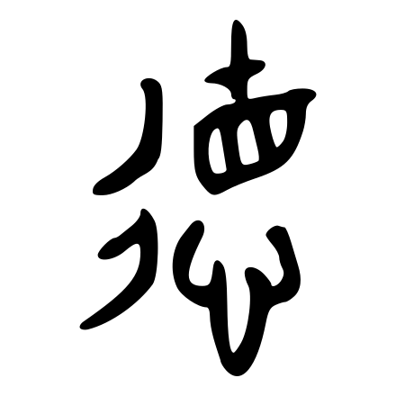

# Daoism
**First published Sat Apr 19, 2025**

*Hansen, Chad*

Chinese Daoism is a Chinese philosophy of natural practice structured around a normative focus on *dào* (道 path, way). This naturalist philosophical project treated *dào* as a structure of natural possibility for living beings. Unlike similar Western naturalisms, e.g., pragmatism, Daoism’s foil was contemporary: the Confucian-Mohist (*Ru-Mo*) dialectic about *human* (人 *rén* human, social) *dào*. Daoism’s critique of *Ru-Mo* debate concerns the role of *natural* (天 *tiān* sky-nature) *dào* vs *human dào* (socially constructed guidance).

Daoism’s founding personages[^note-1] (Laozi and Zhuangzi) did not coin their “-ism.” The two Classical texts, credited to their titled *masters* (子 *zǐ* son), emerged during the Classical period (5ᵗʰ to 3ʳᵈ C. BC). Each reflected skeptically on the Confucian-Mohist dispute about the correct socio-political *dào*. Historians first coined the collective category “Daoist” (道家 *dàojiā* school of *dào*) during the Han (2ⁿᵈ C BC to 2ⁿᵈ C), There are inconclusive hints of their having shared a philosophical project in the two writings.

The philosophical project was to conceive of norms (permissibility) as metaphorical *path*-like structures (*dào*s) of natural possibility. Its signal axiom was that the structure changed constantly as new things (and *dào*s) emerged. All such natural *dào*s are guides for the *behavior* (行 *xíng* walking) [^note-2] of *things* (物 *wù* natural kinds). We, humans and some other living things, learn *behaviors* in the ways we learn to walk following paths. Confucians championed *human paths* (人 *rén* 道 *dào*): historical social structures consisting of *practices* (事 *shì* affair, business) by named role players, a morality typified by *ceremonial ritual* (禮 *lǐ* decorum). Daoists favored wider *natural* (*tiān*) *dào*s of the *cosmos* (天地 *tiāndì* heaven & earth) of which all the “ten-thousand *natural kinds*” (物 *wù* things) are parts. Living things occupy the space between *heaven* and *earth* (天下 *tiānxià* the-world-under heaven) and have *potential* (可 *kě* permissible or possible) *paths* available for their *behavior* (*xíng*). These paths result from the natural distribution of existing things in the environment.

The implicit axiom of *Dào*ism is there are *permissible* paths in the natural world. *Nature* gives us *virtuosity* (德 *dé* virtue, excellence) in finding, learning, and following these paths of possibility. Learning from the past is a *permissible natural* way to acquire this *virtuosity*. However, it is unlikely that our current evolved social *practices* exhaust the *permissible possibilities* of learning about *natural* *dào*. We can reform social practices, but in doing so, we rely on ways of choosing among *dào*s guiding that reform. This is a key insight drawn from the Confucian-Mohist dispute. Mozi’s proposed reform process depended on an allegedly natural, meta-*dào* of measuring *utility* (利 *lì* benefit, harvest). This doesn’t make reform impossible or incoherent but initiates a regress of choosing ways while still in momentum along a way. We measure *utility* using existing concepts, ways of identifying *utility* and prefer it to other ways of improving our current social *dào*s.

The result is Daoism’s version of normative autonomy, one that starts from normative naturalism. It mimics mild skepticism. No matter how we learn and choose, there may be some possibilities we overlook. Its departure from Mohism lies in rejecting Mozi’s assumption that *nature* (*tiān*) *dào* is biased to benefit humans. *Nature* is neutral toward the ways of life “under the sky.” Claiming to know *nature’s* intent is cognitively naïve. A wholistic path structure affords us *permissible/possible* 4-dimensional future *behaviors*. That is natural *Dào.* It is how things have and can unfold, the “how” of our 4-dimensional past (and future). *Dào* is how *natural kinds* are *born* (生 *shēng* birth, life)—come to *exist* (有 *yǒu have*), change, evolve and eventually disappear (無 *wú* lack).

Western “things” (parts of the world picked out by noun phrases) are divided in China into *natural kinds* (物 *wù*), *artifacts* (器 *qì* tools, utensils), and *practices* (*shì*). *Natural kinds* have internal *dào*s (called 理 *lǐ* lanes-in-jade) that interacts with external *road* structures. Our human internal *dào* (*lǐ*) makes *learning* (學 *xué* study, practice) and practiced *virtuosity* possible. Individually and collectively, we learn and practice *behaviors.*

Importantly, *dào,* the structure of natural probability is more like a map than a formula, rule or law. It is like a GPS of life that gives us alternatives and suggests different paths we can choose from: fastest, most scenic, calmest, etc. It consists of all the *hows* of nature but explains only when made into a map which humans can learn to read. Modern Daoists embrace science but venerate (astro-physical) *nature*. Science is our best current social *dào* for understanding nature’s structure, certainly better than the classical *Yin-Yang* school’s tables of correlation. However, natural *dào* does not consist of commands or prohibitions, but of opportunities.

*Dào* permeates the space-time cosmos, is everywhere forever. It comes to have its structure *of itself* (自然 *zìrán* naturally, spontaneously, lit. self-make-so, realize from here). Chinese Daoism is holistic or monist in the sense of the whole being *prior* to its parts. *Dào* and the *cosmos exist* (有 *yǒu* have, being) and “the ten thousand *things* and I” are *born, emerge* from as *natural* parts of cosmic *dào* (Laozi Ch. 1, Zhuangzi 2:9). *Dào* unfolds into the future as every part *self-realizes* (*zìrán*) some *possible* (*kě*) *dào* guiding how it *walks* (行 *xíng*) into the future.

Early phase Daoists, Hui Shi, Shen Dao and Laozi’s *Daode Jing* implicitly rejected parthood, suggesting an absolute, Parmenidean, monism. Shen Dao’s version was of a fatalistic “block universe” in which nothing really happens. Priority monism characterizes the bulk of the *Laozi* and *Zhuangzi*. All the proper parts of *yǒu*, the ten-thousand natural kinds, have *dào*s which are proper parts of the larger *daos*. The ultimate *dào* is a cosmic network of possible histories of possible thing-parts. Dao is therefore constantly changing as things realize their possibilities. The unrealized paths recede into the past.

Controversies emerged within philosophical Daoism and between it and rival philosophical agendas. We elaborate on these and the implications of Daoist naturalism for linguistics, cosmology, metaphysics, knowledge and ethics in the sections below. Religious Daoism is a separate topic treated here.

## 1. History

We trace Daoism back to China’s Classical philosophy period, the Warring States (476–221 BC). It emerged in steps. It began with the Duke of Zhou’s (1038 BC) theory of the priority of *sky-nature*’s mandate over human relationships as the basis of legitimacy of leadership. The Shang had claimed authority as descendants of the “Emperor Above.” The Duke argued that their incompetence led to their *natural* replacement by the Zhou kings. Their ascent to the role of pathfinder, leader of the world between sky and earth was *natural* *naming* (命 *mìng* fate, luck, 名 *míng* name, status) of the *leader* (王 *wáng* king).

Confucius historicized and rehabilitated the Shang relationship-morality, but disgruntled dissidents would resort to *nature* as anti-social hermits or agriculturalists citing folk versions of philosophical quietism. An internal intellectual history (*Zhuangzi* 33) traces the trend through schools of fatalism, treating *Great* *Dào* as fixed cosmic history (Shen Dao) to Laozi’s school rejecting social constructs. Both rejected *linguistic terms* (名 *míng* names) and social practices in general as distorting our *natural* guiding *capacity* (德 *dé* virtue) by instilling desires for social status.

Philosophical accounts treat *Zhuangzi* as the mature version of Daoism. It accepted *and* emphasized how humans, natural social creatures, coordinated behavior using “sounds.” This makes *language* (言 *yán* speech, words) part of the “music of nature”—along with wind, birds, frogs and insects. Instead of eschewing language, the mature version emphasized the plethora of *naturally* possible *norms* (*dào*s) of language use.

The terms for the Daoist school (道家 *dàojiā*) and its teachings (道教 *dàojiào*) were both coined during the eclectic Han dynasty following the Qin (221–206 BC) repression. A cult worshipping The Yellow Emperor and Laozi (Huang Lao) dominated Chinese officialdom. Pairing Laozi and Zhuangzi was not automatic. Laozi’s status in the religious ideology of the time left the *Zhuangzi* to be studied mainly as a separate thinker in the [Han Syncretic universe](https://plato.stanford.edu/entries/han-dynasty/#KnowMethSyncHuai), sometimes as a sourcebook for dissidents until the fall of the Confucian dominated Han dynasty (206–220 BC). That relative obscurity also enveloped the other philosophical trends from the more vibrant *Hundred Schools* of the Classical, *Warring States* period, the Mohists and dialecticians (Later Mohists and School of Names).

The Han blurred and blended Daoism with both the Yin-Yang school of Zouyan and the superstitious divination of the *Book of Changes*. All had an interest in understanding and finding guidance in nature, but none yielded reliable know-how. Joseph Needham (Needham 1986)[^needham-1986] famously (and controversially—see Chinese Science) argued that Daoist interest in nature was indirectly responsible for the famous advances in Chinese “Science.” Daoist inclined thinkers clearly did lead to the 20ᵗʰ C. surge of interest in Western science (evolution) and logic (Needham 1986; Jin 2020)[^jin-2020][^needham-1986]. Evolution was a particularly apt example of a natural *dào* linked to Zhuangzi’s insistence that we are a continuous part of nature’s emergent creatures, exploring and expanding into our environment. Big Bang theory would be the modern version of Shen Dao’s *Great Dào*.

The Lao-Zhuang pairing was revived by the “Dark Learning” school (also known as Neo-Daoism) which emerged in the wake of the Han collapse. Wang Bi (226-249) curated the received *Laozi* (*Daode Jing*). Guo Xiang later did the same with the *Zhuangzi*. Etymological controversy still surrounds both results (Kline 2010)[^kline-2010], but when we attribute anything to a named *master* (*zǐ* son, master), we are, in effect, attributing it to these evolved, now conventionally accepted *master* texts.

The slogan for the *Dark Learning* school’s accommodation with Han Dynastic Confucianism was “Sage within; *king* without.” It became the “common” interpretation: empty within (amoral), we conform to the ruling mores. This nihilistic posture mediated the introduction of Buddhism into China, matching concepts. Laozi worship adopted institutional structures from Buddhism (monks, nuns and monasteries). In the process, the interpretation of both converged into a distinctive Chinese Buddhism—Zen (禪 chán meditation) Buddhism. Its naturalist spin on Buddhist idealism eschewed the distinction between Nirvana and ordinary life (Samsara). Everyone has Buddha-nature. Meditation equals ordinary consciousness experienced in everyday behaviors, carrying water and chopping wood (Feng and Bodde 1937)[^feng-1937].

“Every-moment Zen” naturalism co-opted Buddhism’s denial of the ego and mind-body dualism, fitting it into Daoism’s practical naturalism. Skilled behavior is characterized by loss of ego, the sense that the actor and instrument become one. The emphasis on excellence in arts, behaviors, and skills linked Zen and Zhuangzi’s goal of perfecting ordinary life pursuits--including butchering cattle! (Zhuangzi 3:2)

Confucianism began to take Daoism and Buddhism (Zen especially) as amoral twins but itself adopted a related metaphysical picture grounding their ethics. Neo-Confucians report going through a youthful Zhuangzi phase before settling into Confucianism built around the metaphor of an *inner-lane* (*lǐ*), a “path-like” term used in translating “dharma” (Buddhist *essence*). This allowed them to rehabilitate Mencius’ moral psychology and link it to a cosmic normative path-structure. The era of compatibility of Daoism and Confucianism emerged. The more conservative accused “liberal” Confucians with lowered commitment to the authority of ancient texts of reverting to Zen or Daoism (Mad Channists).

Orthodoxy minimized Zhuangzi’s “pluralist” normativity until the modern Western contact when it became identified with science and democratic tolerance for many different ways of life. Naturalist thinkers adopted Western logic and liberalism more quickly and enthusiastically than did conservative Confucians, saw them as cures for China’s scientific and political backwardness. Conservatives preferred a formula of keeping a Confucian base and adopting Western technology only as a practical tactic. Li Zehou reverses this May 4 slogan (Li 1986).

Yan Fu (1854–1921) seemed most drawn to the theory of evolution, which is a paradigm natural *dào*. He translated and popularized Western classics of science, logic and political liberalism (J.S. Mill, Adam Smith, T.H. Huxley, Montesquieu, Spencer). The enthusiasm for science reflects his conception of Daoism norm naturalism and science as the study of natural *dào*. This modern embrace of logic contrasts with the resistance to both the Buddhist and Jesuit logic, which Chinese intellectuals saw as attempting to justify non-naturalism (Kurtz 2011)[^kurtz-2011]. Tied to natural science and pragmatic social-political thought, non-Confucian Chinese intellectuals had no difficulty in embracing logic and science as fully coherent with their historical naturalism.

Jin Yuelin (1895–1964) concentrated even more on formal logic combining it with his interpretation of Daoist *dào* as naturally possible course or process (Jin 2020)[^jin-2020]. He completed the project of conceiving of Daoism as a philosophical research paradigm rather than the purely historical project of interpretation of Daoist texts. His students included Hao Wang and Yin Haiguang whose student Chen Guying has followed this conception of Daoism as an ethical stance which aligns it more with environmental ethics, Nietzsche’s perspectivism, creativity, open-mindedness and social-political tolerance and freedom (Chen et al. 2018)[^chen-2018]. He advocated Daoist philosophy replacing Confucianism as the distinctive philosophical project of modern China.

Some modern logicians who embrace paraconsistent logic also associate that with Daoism (Priest and Garfield 2021; Tanaka 2004)[^priest-2021][^tanaka-2004]. That has plausibility but not because Daoism is contradictory. The ancient discussion did not revolve around semantic, epistemic Western conceptions of “true belief.” The target of learning and practice was know-how. The issues in contention were the social know-how of traditional social practices vs. proposals for reform guided by natural, cosmic *dào*. Its “logic” was navigating reality. The natural world guides how the region “under the sky” *walks;* in walking the world of living things changes its own natural *dào* (*Zhuangzi* 2:6).

## 2. The Dào Metaphor

The key feature of Daoist philosophical naturalism is the leading role played by the metaphor of walking a physical ‘path’ (道 dào). It contrasts with the similarly key Western focus on the contrast of laws and acts. See Mark Johnson (Lakoff and Johnson 1980; Johnson 1992)[^johnson-1992][^lakoff-1980] on the role of bodily metaphor, Donald Munro (1988), Chong Kim Chong (2006) and Edward Slingerland (2003) on Chinese metaphorical reasoning and Shelly Kagan (1992) on normative focal points).

A millennium before their classical era, the oldest Chinese classics told of the Duke of Zhou explaining the importance of *virtuosity* (德 *dé* virtue) in discerning the course of *sky-nature* (天 *tiān* Heaven) to the young prince of Zhou. His family’s *mandate* (命 *mìng* fated role) is guiding *the social world* (天下 *tiānxià* world under the sky) on a path that avoids natural disaster. He contrasts the precarious nature of his family’s claim to leadership with the Shang king’s human relations claim of being the living descendants of an “emperor above.” The presumed “permanence” of the Shang claim to authority led the Shang rulers to become careless and lead the world into *natural* disasters. Thus, constant *sky-nature* chooses a leading family with greater leadership *virtuosity*, better natural pathfinders.

This conception of social leadership eschewed rather than relied on supernatural, rational authority to create and publish syntactic laws. This chain of authority regress, the syntactic inference structure and the strong deontic modal force all make Western norm naturalism more of an intellectual challenge. The battery of historical Western arguments against ethical naturalism flow from logical structures linking normative laws to acts: “you can’t deduce ‘ought’ conclusions from ‘is’ premises.” China’s focus on path-like normativity made it less about “ought’s” and “duties” than *openings*, *possibilities,* and *permissions* (可 *kě*) and role responsibility for *realization* (然 *rán* making-so). That left the status of punishment in disrepute among the classical *masters* (albeit, extremely common and cruel in Ancient China). Still, it made norm naturalism both easy and intuitive.

Nature simply gives us *possible/permissible* openings for behaviors (可道 *kědào*), it’s up to us to choose and *realize* those possibilities. Our doing so is *natural* (自然 *zìrán* self-so). This ancient launch of this normative dialectic foreshadows the enduring Confucian-Daoist divide in Chinese thought. Both shared the path and virtuosity metaphor but the Ru-Mo focus on human paths and a distinctive *human* virtuosity, *humanity* (仁 *rén* benevolence). Confucians modeled behavior on sages, parents’ behavior, older siblings, and teachers. Confucius historicized the Shang afterlife hierarchy of guiding authority, turning it sideways from a spiritual afterlife to the natural history of past practice. Veneration of ancestors implies emulating their remembered behavior, yielding the Confucian stress on rituals and conventional mores. Daoist paths resemble more the paths of water (*Laozi* 8 & 78).

Few experiences are more universal for bipedal humans than identifying, choosing and walking on path-like natural structures. Confucius and Mencius, like the Daoists opposed punishment (*Analects* 13:3, Mencius IA:7). The authoritarian, Xunzi stands out here in recommending *punishment* (刑 *xíng* corporeal cutting, mutilating), reasoning mainly from traditional precedent, with slight nods to deterrence and proportionality of desert.

Western metaethical debates swirl around grammatical entities: laws (rules, principles), duties (obligations, ought), facts, truths, properties, and beliefs. These are hardly visible in Classical Chinese reasoning about nature and normativity. That is a rarely noted insight hiding behind the slogan that *dào* is not in words. Normativity is not about some authority’s actual or possible commands. What we collectively *know* *and teach* about permissible ways of behaving (*kědào*), convention and tradition, changes over time. Nature thus teaches us this axiom of Daoism—guiding *dào*s can themselves be guided (*Laozi* 1). We can follow a natural path of changing what we teach and learn about *kědào*. We also find such meta-paths in *nature*.

Mature Daoism begins with Zhuangzi’s response to the Later Mohist’s discovery of a *reductio* of careless early Daoist formulation of the insight that paths do not consist of words. It seemed to eschew language. The Later Mohists toyed with similar *reductios* of rejecting *learning* and of *dissing (not-that-ing) not-that judgments*. Zhuangzi accepted the logical force of those, then followed them to their logical conclusion. Natural *dào* includes as *parts* all the human *dào*s, those of communities, languages and social practices. Confucianism *was* a natural *dào*, but one among many.

Language and logic fit smoothly into Daoist *nature*. We can view things logically through a Daoist lens and we can say what we see. “Daoism cannot be understood rationally” logically expresses lack of (rational, communicable) understanding of Daoism. It is a permitted formula only for an irrational solipsist. While mature Daoism rejected Shen Dao’s fatalism, *dào* is a structure of both nomic and normative modality. Zhuangzi likens our commitment to a *dào* to walking or galloping momentum along a path (Zhuangzi 2:2). Metaphorically, the structure of what guides us is relativistic in the way physics is.

The law and *dào* metaphors have wide scope—they answer both practical normative and nomic questions*. Dào*s guide behaviors in an ongoing way. Properly followed, they tell you *how* to do *what* a law might simply tell you *to do*. Although *dào*s have a nomic causal role—*dào* gives rise to 10,000 *natural kinds* (*Laozi* 34, 39–40)—its “how” is a natural structure, not necessarily an *explanation* available to human understanding. There is a *dào* of the cosmos, but Daoism offers us no assurance we can comprehend or understand it. Science may be the best human *dào* for learning about nomic *dào*, but still leaves us saying “things happened some-‘how.’”

*Dào* is not a force, cause, or substance. It is the shape along which causal processes unfold. That shape comes from how past natural processes arranged things. Power may come from knowing-*dào*, knowing how to follow it. As the processes play out, things emerge and change. We may or may not be able to formulate a verbal description, but the process evolves *naturally* (自然 “of itself”).

The myriad *natural-kinds* have possible paths—ways the future *may* go for them. Those potential histories become actual when things “naturally” (自然 *zìrán* self-so, spontaneously) follow, realize or *make-so* one of their possible *behaviors* (Jin 2020)[^jin-2020]. The parts of existing reality, the environment of which we are a part, are all composed of *energy* (氣 *qì* material energy, breath, stuff). Evolution is a causal *dào* mechanism that fills out this Daoist naturalist view; it does not conflict with it. Nature (including our own) unfolds to provide us with the capacities to exploit our environment.

Daoist normativity is more like navigation than obedience, loyalty, or purification. Its defining deontic modality is more like permitting, inviting, affording than the *law* metaphor’s obligating, requiring or forbidding. Epistemic normativity centers on learning and knowing how to, not believing and knowing-that. These normative stances contribute to Daoism’s pragmatic take on language use. Knowing an apple is something we do; we have learned how to distinguish apples from non-apples. We know-how to identify apples in our visual field—not how to have the phenomenal subjectivity, but how to bring apples to attentional consciousness. We acquire this ability along with learning how to pronounce and use the words in our local dialect and how to combine those skills in speaking and understanding each other.

The continuity with animate life makes Daoist normativity sensitive to environmental ethics, but not by being committed to animal rights, duties, or free will. Animals have their possible *dào*s, learn behaviors that help them choose and effectively pursue possibilities in their range of options. Daoism regards animals as choosing their paths, being better and worse at pursuing them, becoming better by learning, having social cooperation, and even rudimentary communication. It is not committed to anything like Western free will when it credits animals with role responsibility, e.g., of a mother pig, or a bee scout, and judging some members of a species *normatively better* than others.

Natural normative guidance is an external, empirical conception of norms. Norms evolve as all things practice, learn and improve at following their *dào*s. This adaptation includes their recognizing clues about the structure of their environment’s *dào*s. Within the Chinese philosophical framework, the divide between nature and nurture is more significant than the distinction between subjective phenomenal appearance and reality. The contrast between natural *dào* and social, human *dào* drives the Chinese epistemic dialectic. Our social learning accumulates over generations. Communities’ mores and conceptions of reality blend cooperative conformity with efficient learning, reform and evolution. Daoists would appreciate how twenty-first century science keeps discovering other *parts* of life on earth that have counterparts of choices, better and worse outcomes, and cultures that accumulate guidance.

Humans *are* distinctive in having *more deliberate* teaching (than, e.g., even meercats) and differ still more in their capacity to use rich, flexible languages in this teaching and learning. Learning and use in language communities magnifies the range of a plethora of other learned social practices. The distinctive important thing about humans is a magnified capacity for accumulation of know-how by adapting and evolving languages as tools used in collecting, sharing, organizing, and transmitting guidance.

When we use language, especially in learning how to choose or interpret *dào*s, we can draw attention to signs in situations that incline us toward a choice. In the West, we call those external signs *reasons* and with the discovery of the proof, the Greeks developed an elaborate theory of reasons. It yields a capacity to ask for and give reasons in premise-conclusion form. Modern Daoists have no reason to resist folding this Western scheme of responding to reality into the terminology of *dào* and *lǐ*. It embellishes rather than contradicts Daoism’s notion of human moral normativity. Reasons are the perceptible signs of *dào, dào*s of choosing and realizing *dào*s. Daoism’s natural normativity is continuous with other natural creatures’ know-how. The distinctive human capacity for logic embellishes nature’s process of choosing and following *dào*s.

The Daoist remembers that while language processing is an advanced tool of knowing how, nature distributes know-how throughout the *body* (體 *tí* body-part). Knowing how to make a knife out of stone involves muscle memory more than it does a capacity to recite any string of words aloud. Even knowing how to use language involves more than our cognitive faculty. Our tongues, larynx, eyes and hands also *know how to* speak our language.

Zhuangzi’s take-down of intuitionist Confucianism focuses on the *guiding organ* (心 *xīn* heart, mind) and recruits this corporate conception of how know-how spreads throughout the body. It rejects internal authority; It authorizes no Confucian homunculus as the decision maker for humans. No single organ is a *zhēn* (真 natural, authentic, true) ruler. We indeed choose, but we do not find any sign of authority (Zhuangzi 2:3). He does allow that the *heart* plays a role in the decision process but is itself shaped by past bodily decisions (learning and practice). The heart is neither incorrigible nor authorized to rule over the other organs of the body.

Larger parts composed of parts that are humans also *choose* paths for the group (ditto for other social animals). A family, a village, and a state can learn diverse ways of acting together, can practice and improve these ways and evolve different *communal paths.* This corporate conception of the body makes Daoist perspectival relativism different from individualist egoism. “Common” norms that emerge can persist because when they prove useful at that stage in our evolution (Zhuangzi 2:6).

*Dào*s can be *dào*ed; they are not constant. Names can be named; they are not constant (*Laozi* Ch. 1).

## 3. Cosmology: Physicalism and Science

Most accounts portray Daoism as cosmology rather than metaphysics. Unlike Buddhism, it does not address the mind-body problems that traditionally defined Western metaphysics: objective reality vs subjective conscious experience. Buddhism had addressed these issues but, somewhat paradoxically, had denied both the ego and mind-body dualism; Daoism’s (Chan-Zen’s) response is “let’s not talk that talk.” It refuses to waste time even denying idealism or solipsism: “I’m carving an ox here!”

Contemporary metaphysics does countenance naturalism as a part-whole metaphysics. Pre-Buddhist Chinese (Later Mohist) metaphysics seems similar (Hansen 1983)[^hansen-1983]. and Daoist cosmology is a generalization of that metaphysics (Banka 2023)[^banka-2023]. Chinese naturalism, aside from the concept of *dào,* would strike Westerners as naïve, peasant natural wisdom. We are in a world with tens of thousands of nameable natural parts: mountains, trees, water, oxen horses, fish, and humans. These are parts of a single *reality* (有exist, to have). Their *dào*s are entangled; we and they *walk* our respective paths, our parts of nature’s *dào*. *Dào,* *yǒu* and *thing*-like parts ground this naturalist metaphysics. The names of “ten-thousand kinds” (萬物 *wànwù* myriad things) are cosmological details.

*Thing-parts* (體 *tí*) are not rationalism’s sentence-filling objects, i.e., subject-substances *with* predicate-properties. Chinese places *things* in their *dào* metaphor. A thing is any proper part (of the one) that has a *dào*. Monism means any part’s *dào* is part of nature’s *dào.* A part unfolds or evolves in ways dependent on the paths of other parts. No part is more real or basic than the natural universe itself.

The “I” (ego, self) is not a point substance, but a cluster of local perspectives on *dào*, our points of view on the possibilities open to us given the distribution of other parts. My point of view includes that of my family, my profession, my sports teams, my class, nation etc. On the other side, the parts of my physical form. My heart and lungs, veins and brains have their roles to play in *my* *dào* (Zhuangzi 2:3).

Cosmological theories of some evolutionary mechanism—whether it is Yin-Yang theory or biological inheritance or viral cultural memes—explain the emergence, change and disappearance of natural parts. Daoism is committed to paths of nomic (causal) possibility and open to many conceptions of their mechanism. Dào is not a force. It is the paths forces can travel. Dào gives rise to, sustains (guides), and eventually eliminates things. Evolution and cosmic inflation theory are paradigms of natural *dào*s, not laws. Evolution was possible, but not necessary, before inflation.

Ancient *zǐ* (masters) may not have known that *sun* (日 *rì* sun, day) refers to a huge sphere of hydrogen. They did accept a theory of language that links the character日 to that physical object through a social *dào* of its use. *Dào* refers to the course of nature *whatever it turns out to be.* The Yin-Yang school’s theory of things emerging from mixing Yin and Yang *qì* was their theory of *dào*.

Modern Daoists embraced Western science, but Daoism is a philosophy of naturalism, not of science itself. It doesn’t tell us about science but accepts that science is good-at telling us about *dào.* Science does not choose *dào*s but gives us what helps us choose well. Science also exemplifies the kind of social-cultural dào Daoism favors: non-authoritarian, self-correcting, open-minded and experimental. It is a better choice for teaching, learning, understanding, finding and following *dào*s than was either Yin-Yang theory or Buddhism.

Daoism does not treat either atoms or egos as ultimate building blocks. Natural *dào* guides all unfolding of parts of *being.* The metaphysical framework allows new *things* to emerge as other *things* *self-realize* their *dào*s (DDJ 17, 23, 25, 51, 64). This makes Daoist metaphysics resemble religion in assigning the source of normative guidance to something outside the ego, but not to a supernatural ego. It is not that the universe is a living thing, but that evolution is a cosmic model of natural change.

Human learning is a form of change. It starts from an internal path-like structure (理 *lǐ* lane, principle, coherence) that makes it possible to change itself to adapt to external daos in one’s environment—acquiring *dé.* Human epistemic and normative *dào*s emerge. It is not obvious precisely where the boundary of emergence from purely causal to normative-causal lies. The biosphere emerged from the interaction of parts of a larger cosmic reality which unfolds with little hint of the human normative guidance familiar in our lives. We do observe a surprising degree of gradualism with signs of guidance in other primates, living things and increasingly plants. In that greater *dào*, pan-norm-ism of a barely comprehensible sort may be possible. What we know is things change and human normative (*dào*able) dàos emerge, change, and recede into the past.

Daoism is not metaphysically committed to materialism, though its cosmology was and is broadly physicalist. Classical Daoism relied more on the ancient concept of *ether* (氣 *qì* matter, air, breath, energy) than it did Zou Yan’s division of it into two types: Yin and Yang. Another traditional mechanism was the five *processes* (行 *xíng* walk:behavior), named after the elements that underwent them, fire, water, metal, air, and earth. Recognizing *dào*s of over 200 elements takes more natural perspectives into account. Abandoning traditional Chinese cosmology need not entail abandoning *Daoist* metaphysics. *Dào* made possible the emergence of a sphere of change (*yǒu*). Science is good at detailing *how* nature unfolds.

Daoism views existence (*yǒu*) and its probability structure (*dào*) as metaphysical givens. The cosmos (天地 *tiāndì* sky-earth) contains all *yǒu* and is bounded by *nothing* (無 *wú* lack) (*Laozi* 1). Things are in constant (space-time) mereological flux. Facts, but not natural kinds, are human constructions using the model of sentences of human language. Facts figure in semantics (truth, belief) and in epistemics (reason, sense experience) (Chen 2019)[^chen-2019].

*Yǒu* and *dào* are one and yet constantly changing as new realities (parts of *yǒu* and the relative parts of *dào*) emerge. *Dào* and *yǒu* overlap all of space-time but differ in the principles that restrict how they unfold in emergent parts (Banka 2023)[^banka-2023]. Parts, *things,* include *natural-kinds* (物 *wù*), *artifacts* (器 *qì* tools, utensils, socially constructed things) and *affairs* (事 *shì* business, socially constructed processes). Those parts of being also have parts guided by parts of the larger *dào* of which they are parts.

Dào is the structure of possible histories of *things.* *There are* (*yǒu* have, exist) wood and feathers; *yǒu* bows and arrows; *yǒu* archery tournaments. For each part of reality to exist, there are parts of *dào* guiding their emergence, their *normal* course of being and their ending. Causation (possibility and probability) is rooted in these *dào*s, natural processes; human scientific understanding uses laws (descriptions of constant dàos) and deductive derivation of event (fact) causation. Skilled navigation of these humanly knowable causal courses of unfolding provides normative guidance.

Modern Daoists, notably Yan Fu, Hu Shi, Jin Yuelin, Yin Haiguang, Zhang Dainian and Chen Guying, were drawn to science and logic. Jin Yuelin translated his own use of qì as "stuff," not metaphysical “matter,” reinforcing Daoism’s purely monistic, mereological structure. His stuff is “empty” prior to its entering into concrete possibility, becoming a possible thing distinguishable from what is *fēi—*not that thing. The tradition treated light as one form of qì, because it travels in straight lines. Daoism need not presuppose any particular account of the stuff of nature, but it will have potential to unfold the lines of dào to constitute part of *yǒu,* a *something* that follows or realizes dàos of possibility.

Daoist perspectives on evolution emphasize finding and exploiting niches (*dào*s) in the environment. Daoist evolution meshes with the Chinese focus on social cooperation—Zhuangzi’s 兩行 following two *dào*s together (*Zhuangzi* 2:6). It’s less tied to the Western emphasis on competition and struggle for survival than on working together to gain and store knowledge of natural dàos. Evolution involves discovering natural paths of opportunity but without depicting nature as friend (the Mohist position) or enemy (the West). We do not lead or control evolution, but entangle ourselves with it as we learn and practice behaviors to navigate our environment.

## 4. *Dào-dé* Norm Pivots

The conceptual pivots of the Classical *dào*-following metaphorical gestalt shaped the mechanism for its understanding of natural guidance as norm causation. It frames Daoist metaphysics, epistemology and ethics. The central elements were:

1. an external structure accessible for guidance, *dàos*;
2. a “walker”; the external structure (a) guides the walker’s *conduct/behavior* (行 *xíng* walk:behave) and
3. the internal *capacity/virtuosity* (德 *dé*) within (b) to use (a)’s structure to realize in real-time a behavior that follows that path through the environment.

The metaphorical elements can be seen easily in the ancient form of the character for *dé* (德) here:

Note that it metaphorically outlines the norm-following capacity by linking the three elements symbolically. The indexing component on the left, originally the left side of a crossroad-like graph, is also the left side of the character for *behavior/conduct* (行 *xíng*). The component on the top right is composed of an eye (目) and a line or crossroad. On the bottom right is the ancient Chinese graphic form of a heart (♡). Practiced learning stored in the heart interacts with information from the senses about external possibilities for learned behavior to fit that possibility.

The path metaphor had three implicit phases. One is knowing-of paths, becoming aware of a possibility for the exercise of a *behavior*. The second is choosing it—usually with a “This!” (是 *shì*) or a “Not-that!” (非 *fēi*) for *other* paths. Then we exercise some behavior to realize the possibility. Realizing it *in our way* is like musical or role *interpretation*. We interpret by *walking* (*xíng*) that path. We can evaluate that *interpretation* as *good-at* (善 *shàn*) or *beautiful* (美 *měi*). Ancient Ru-Mo use of the metaphor centered on human, socially constructed norms, mores and viewed humans as social, as pursuing cooperative behavior (massive public works like controlling the Yellow River’s flooding).

Zhuangzi’s later contemporary, Xunzi, elaborated the shared conception of heart’s guidance function more fully. The senses deliver the path information to the *guiding organ* (心 *xīn* heart, mind, heart-mind) in the form of *distinctions* (*biàn* 辯 analysis, argument, dispute) between *differences* (異 *yì*) marking the boundaries of a *thing*. The *xīn* also monitors internal *moods* (情 *qíng* feelings, facts, reality) that emerge internally reflecting the situation. The heart *differentiates* (辯 *biàn* distinguish) among them. These *qing* (attitudes) generate *desires* (欲 *yù*) for things. The Confucian Xunzi thought the *desires* were natural and irreducible; Mozi and the Daoists school treated only some as natural, others as also socially constructed using names. Eliminating those frees us from social domination of our desires and sensitivity to differences. Using this external and internally gathered information, the *xīn* issues normative *permissible* (可 *kě* may, can) and *this-not that* (是非 *shì-fēi* right-wrong) judgments evaluating paths as possibilities and initiating guided *behavior* (行 *xíng* walk, conduct) (Xunzi 22:2–5).

Daoism’s normative naturalism thus makes human morality a continuation of natural guidance as found in other *things* (Zhuangzi 12:8). The paths of inanimate things are possibilities of causal processes for them given their inherent *inner processes* (their 理 *lǐ*) which resonate with external possibilities and their adaptive *virtuosities* (*dé*). Learning typifies animal adaptations. It transforms their inner structure (whether by the evolutionary process or past practice). The interaction of the inner and outer in the unfolding of history results in their *dé.*

From water and wind to ants and bees, tigers and elephants, we understand this *self-realizing* (自然 *zìrán* natural) behavior in terms of the metaphor of finding and following paths. Human morality does not require a prior emergence of reasons or a *Geist* with a property of reason or faculty to engage in a process of reasoning. The capacity which both unites and separates humans from other things is learning-how. Where human learning takes a quantum leap is with the addition of social practices and languages. These which underwrites iteration of *dào* guidance—we can guide how natural *dào*s guide us.

The form of learning and of knowing is knowing-how. We don’t evolve language to express inner thoughts, but to facilitate learning, including learning to cooperate. The Ru-Mo treated the evolution of social cooperation as distinctively human; Zhuangzi seemed to sense how it runs through living things as does signaling to coordinate behavior to enhance group knowing-of and know-how. Our learning how stems from apprentice learning, typically on the *school* (家 *jiā* family) model.

Daoism sees language as continuous with maps, cairns, blazing trees etc. The use of pictographs and words emerges naturally in this socially cooperative species. Creature vocalization, found elsewhere, we recruit in training, practicing, planning and shared decision procedures. Modern Daoists would acknowledge the role of sentences, syntax and logic in this process and the surprising discovery that human model emulation values accuracy of mimicry over achieving an outcome. Hence our tendency to superstitions and religious rituals. While this enhances our tendency to transmit cultural forms and conventional practices and aesthetic styles, Daoists see it as leading to Ru-Mo dogmatism and speciesism. Thus, Daoists emphasize open-minded skepticism, and thinking outside the box. As one of the smaller group of cooperating creatures using intentional teaching and of even fewer whose learning accumulates across generations, we should suspect the value of elegant signaling, of symbolic commitments. We should recognize our own tendency to superstitious behavior and fondness for symbolic commitment. Daoism’s self-critical motivation for reform, however, still values aesthetic creativity for its own sake where the Mohists’ rejected it.

The path metaphor does give us a way to understand the emergence of reasoning. We can diagram the connectives of propositional calculus as paths—*not*-gates, *and*-gates, *or*-gates and *if-then-*gates. Path awareness also gives us a more objective conception of the theory of mind. The scientific mirror neuron phenomenon meshes easily with the *dào-dé* metaphor structure. We know what it is like to contemplate the paths available to others. We don’t need a counterpart of mind-reading to simulate their *dé* and estimate where they are walking.

The path metaphor would be less likely to invite the “fundamental attribution error” (explaining behavior by psychology rather than situation) (Nisbett and Ross 1980)[^nisbett-1980]. Some comparative cultural psychologists have experimentally concluded that East Asians are less prone to the error (Mason and Morris 2010; Masuda and Nisbett 2001)[^mason-2010][^masuda-2001]. The use of a path rather than a law metaphor as a normative focal point could play a role in explaining that result. Empathy is less a matter of mirroring another’s conscious state as is knowing how to navigate from another’s position and momentum in their environment, thus it guides us to avoid colliding even as we pursue separate goals. The path metaphor can invoke common *dé* to explain theory of mind simulation.

The most frequent translation of the nearest Chinese concept, “heart-mind,” invites misunderstanding by importing the Western *spectator* and *container* concept of ‘mind.’ It does reflect the important insight that a single organ, the brain, processes both belief *and* desire. Munro’s (2001) translation, “guiding organ” avoids the misunderstanding, removing the invitation to attribute the West’s “belief-desire” explanation of human action and agency. Chinese behavior theory commits them only to internal paths among the organs for processing sensory information and guiding *behavior* (*walking*). Zhuangzi allows that the heart functions in these decisions but denies its performative authority. Nature distributes expertise (know-how) through all the “hundred joints, nine openings, and six inward parts.” Still, he acknowledges the role of the heart’s reactive *moods* (*qíng*) that “pop-up before us day and night,” without which there would be no choosing and no “I.”

While sight dominates the metaphorical structure of the *dé* character, all the senses and feelings work together to guide behavior in the empirically sensed external environment. Hearing also plays a vital role. It’s especially linked to social *dào*s and figures centrally in coordinating behavior, whether in music, chanting or speech (Geaney 2010)[^geaney-2010].

Although the *dào-dé* metaphor starts from the point of view of the human “I,” we naturally project it on inanimate objects but also on larger forms of life. Personification in China need only project on things a capacity to realize its possibilities, not inner conscious states. Families, communities, nation-states and species can be said to have know-how and cognitive achievement may be distributed in various ways among parts of the social unit. Non-human living groups may find, choose, and pursue paths—and have *internal dào*s of choosing and allocating in the process, e.g., quorum-sensing in ants, bees etc.

While Laozi suggests “normative” causation is similar in, e.g., water and other inanimate objects, it is part of his rejection of language and learning. Water is naturally “good at” finding its way (*Laozi* 8). However, when Shen Dao draws fatalistic conclusions from the metaphorical picture, the *Zhuangzi* marks the error as confusing human *dào* with the *dào* of dead things (*Zhuangzi* 33:4). The crucial difference is the ability to learn and know-how to find and follow *dào*s (how to *walk*). The inner process would be a *dào-dé* rather than a given material *disposition* (理 *lǐ* lane) resonating with possibility.

Daoist *dé* is not a free-standing inner source of absolute normative guidance. It results from past real-world practice. Ru-Mo’s use of the metaphor privileges a humanist *virtuosity* arising either from respect for models or teleological universal human well-being. Daoist’s is more open-ended and may evolve in directions we realize to be moral after we reform mores in diverse ways.

Ethics, *dàodé*, then is how *we* navigate the actual world. What is the scope of “we”? The Classical conception was all *under the sky* (天下 *tiān xià*). Daoist *ethics* easily embraces environmentalism; we are part of the world of living things and find, choose, and follow daos from that perspective as well as the other parts of which we are parts. *Ethics* is in the title (accidentally?) of *Laozi*’s classic, *Dàodé Jīng* canon-of-ethics. The compound became common toward the end of the Warring States philosophical period (Liu 2020)[^liu-2020]. *Dé* was also frequently paired with *walking* (*déxíng*)—virtuoso path-following.

We find ethical guidance in the natural world. We can be better or worse at reading and following it. Chinese thought holds that education and practice helps. Daoists de-emphasize *our particular* (e.g., Chinese) traditional practice, any *natural* learning helps.

## 5. Norms, Mores & Morality

Norms are *dào*s woven into the fabric of nature by the past. Daoist conception of norms differs from the Ru-Mo in:

1. They focus on natural *and* social *dào*s (norms),
2. They are skeptical of authority and speciesism (humanism), and
3. They reflect from a detached perspective on the Ru-Mo moral dispute.

Daoism has a more broadly naturalist conception of the emergence of *norms*. Cosmic history wears *dào*-like structures in the distribution of *stuff* into *things.* The parts of *dào* guiding natural living creatures are those knowable by them. Their *walking* these paths of possibility wears them into the natural and/or social environment. As *dào*s and their practitioners evolve, the *paths* become and deeper, wider and more attractive ways and the practitioners become more adept at following them. *Dào*, thus, constantly changes, evolves as do the things following *dào*s.

Confucians and Mohists called their *social* paths *ritual* (禮 *lǐ* decorum, ceremony). The role players shaped by them and capable of following them have a named status. The group followed its moral norm when the performers followed the norms for their named role *well* (善shàn good-at). Confucius analogized the performance to artistic group performance, paradigmatically a musical *entertainment* (樂 *lè/yùe* joy, pleasure music). Confucius’ was an aesthetic conception of mores and etiquette with faint (but persistent) echoes of their religious heritage (Hall and Ames 1987)[^hall-1987]. The goal of the performance was its inherent *beauty*, not obeying the afterlife ancestors of the Shang. The religious focus persisted in its ineliminable reliance on a maestro leader, the sage or authoritative *gentlemen*. His judgment was the standard of teaching and reform and coordination of players.

Mohists jettisoned this form of authority and the aesthetic focus and blended the evolved religious attitude toward *natural* social norms with a “*natural*” goal (天志 *tiānzhì* sky-nature will) of universal *human* well-being. This *dào* utilitarianism (Hansen 1989)[^hansen-1989] justified reforming past practice and could appeal to a more epistemically objective (measurable) and universal standard (*Mozi* 9B:2). This reduced but could not eliminate the reliance on authority—in organizing and evaluating the process of reform and in following the humanist benefit standard. The philosophically interesting feature of Mohist utilitarianism is its focus on social mores, rather than *rules* or *acts*. We behave according to social mores that society actively chooses and that evolve in use *guided* by utilitarian measurement standards.

This dispute had classical *masters* focused on mores and meta-*dào*s. The Mohists called the target of their reform process *morality* (義 *yì* righteousness, duty, right). Individual guidance was correct practice of the reformed mores and participating in the reform process. Their meta-*dào* was sky-nature’s *objective standard*: universal utility. This forced Confucians into a defense with an alternative two-tier account of morality, i.e., correct *mores* (lǐ). The individual follows a “correctly rectified” traditional system of *rituals*. One wing of Confucianism relied on scholar authority and another on “cultivated” intuition to mount this defense. Their respective meta-*dàos* also came into play in the interpretation phase, resulting in individual *dàos* of performing a *ritual-music* role *well*.

Ru-Mo agreed in calling the *successful* (成 *chéng* mature, complete) project of reform *morality* (*yì*). They further agreed on the internal *dé* that chooses the reform: *humanity* (仁 *rén* benevolence, conscientiousness). The Mencius wing amounts to virtue utilitarianism so began to emphasize that *rén* was rooted and learned first in filial concern and only gradually and in grades becoming universal *humanism.* Other natural creatures were not the proper objects of sympathy or compassion. Nature, Xunzi argued, intended humans to dominate and enslave animals. They began to construe their disagreement with Mozi as universal vs. partial *love* (愛 *aì* favor, prefer).

Confucians depicted Mozi’s universal humanism as more authoritarian than their own. Mozi did rely on a *natural master* (天子 *tiānzǐ* Son of Heaven). All the philosophers of the period were called *zǐ* and Mozi portrayed *the social world* selecting the *natural master* by unanimous acclamation that he was “wisest and best.” The *natural master* immediately announced he was epistemically not up to the task. So, he selected the “next best” as helpers. Similarly, they pled ignorance and selected the third best and so on down to the bottom of the social hierarchy.

Then they consulted those on the *bottom* for their judgments of *this* and *not-that*. These first-order moral judgments were then “synthesized” by the selected authority at the next level up and reported up the chain, with each synthesizing (somehow?) the moral judgments and reporting these up the chain of wise men until the *natural master* ultimately synthesized the final set of norms. Then everyone followed that system of social mores. Mozi averred that the result would coincide with the this/not-that judgment of *nature* (*tiān*), i.e., utilitarian social mores.

Both the selection of the *master* initiating the reform process and the reliance on first-order normative judgments suggest a tilt toward a democracy of moral construction cum judicial appeal. The residual reliance on authority involved a) *sky-nature* itself, which Mozi claimed *willed* (*zhì*) the utility standard, and b) the universally acclaimed hierarchy of judges doing the synthesizing of differing moral opinions reported from below. Mozi endorsed punishment for those refusing to participate in the process.

The output was a shared, reformed morality and we all accept its *this*’s and *not-that*’s. The democratic component was merely a computational device to make every human judgement count equally. There would no longer be moral disagreement and the humanly constructed moral *dào* would guide us all. Mozi had no theory of popular sovereignty conferring a right to command society at large!

Daoism responded to this dialectic by embracing both perspectives, seeing Mohism as a sound improvement, but rejecting the demanding imperial utilitarian morality. It reflects on how to pursue the dialogue to a naturalistic conclusion. Their skeptical relativist position emerged in two phases. The first eschewed talk of both social mores and morality in favor of physical paths in the broader natural environment with the path and *virtuosity* of water a model of navigating the natural environment. Famous hermits in literature avoided all social entanglements. Laozi interpreted naturalism as excluding human *dào*s and concluded we should avoid learning words and language along with other socially valued objects and status roles.

The second, mature phase of Daoism associated with Zhuangzi emphasized that humans were as natural as nature’s other living creatures. Human speech is as natural as other natural sounds; practice weaves human social arrangements into the structure of natural *dào*. He pushed Mozi’s first-order democracy to its logical conclusion. No one has the wisdom to say what is moral or what words to use. We “vote for” our *dào* by walking it. The outcome is a naturally evolving society and language.

The upshot is that *nature* is not a normative authority for mature Daoism in the way it was for Mohism. The guide for choosing and interpreting norms is also one of many possible *dào*s for the tasks. We naturally interpret and practice our own society’s social norms in various *ways*, various ways of choosing and practically interpreting, *walking* each iterative *way*. As we do, the way is constantly changing. Dào can be dào-ed (Laozi 1:1).

As humans *walk* their *norms* in different *way*s, they wear small variations into their physical *and* social environment thus changing the guiding structure. The normative guides were multiple existing, evolving paths through space-time. Zhuangzi’s skepticism is famous, but it is seldom noticed that Mozi’s *natural masters*, the “wisest and best in the world of living things” knew they did not know how to rectify mores into morality. Zhuangzi simply takes the point seriously--neither he nor anyone else was in a privileged position to select behaviors for all living things. Each must be its own judge in each situation.

His emphasis, in contrast to Laozi’s purely physical nature (e.g., water), was on other forms of life with a live appreciation of how each was somehow capable of finding, choosing and following *dào*s in their local situation from their individual perspective. That appreciation emerges as curiosity and open-minded engagement, fantasy dialogues, in which he asks the natural thing for its own account of its own know-how.

The earlier phase of Daoism could not survive the Mohist *reductio* of its implicit rejection of language. Zhuangzi’s mature naturalism avoided both species-favoring humanism and self-defeating quietism. We cannot fairly accuse Zhuangzi of opposing morality. Zhuangzi’s posture allowed him to be a realist moral skeptic. Neither he, nor anyone else is in a position to know the right *dào* for everyone. It does not entail moral nihilism; moral construction may converge on one or several fully evolved moralities.

The result explains Zhuangzi’s seeming backtracking from primitive Daoism’s hermit-like withdrawal from social structures. He *permits* following *the usual*, the communicable, and thus the useful. Conforming to social norms enables one to coordinate with others, to “walk two paths,” to be in *harmony* (和 *hé* peace) with others. Social norms create legitimate expectations in others and following them allows us to maximize the range of *joint* cooperative behaviors we can choose. This is the serious, but non-authoritative naturalist response to the Confucian-Mohist moral dialectic.

This allows mature daoism to the read the first line of the *Laozi* in a grammatically accurate way. *Dào*s can be *dào*-ed. They are not constant *dào*s.

## 6. Metaphysical Implications

The Metaphysics implicit in Chinese naturalism in general resembles process philosophy (Hall and Ames 1987)[^hall-1987]. *Dào* is neither a force or a causal agent, but the structure of causal possibility which entangles all things. As nomic dào unfolds, normative *dào* emerges as natural human *dào.*

Daoists emphasize the unity of cosmic process; though it has parts, there is one cosmic *dào*—the *dào* of space-time. Humans impose object permanence on proper parts of the cosmos. To those we assign a *dào*, a part of cosmic *dào*. Cosmic process surrounds, permeates and entwines with the processes of living things. Life *emerges* in the cosmos; humans and their groupings emerge from a living biosphere. Daoist norms emerge from and entangle with modally possible natural processes.

Chinese naturalism needn’t treat our natural cognitive ability to pick out objects from the “blooming, buzzing confusion” of reality as suggesting objects are unreal. It neither equates reality with permanence nor treats objects as combinations of permanent components, one material the other abstract or ideal. Objects are parts of reality with *dào*s that are part of *dào*. This changes with the 2ⁿᵈ C introduction of Buddhism. It introduces the rational-sensible (emotive, impressionist) split but Buddhism itself was skeptical about the mind-body distinction and the ego. What emerged was a more psychologized picture. Each part had an *internal dào* (*lǐ* lines, lanes) guiding its possible *virtuosities* (*dé*) and its role in environmental *dào*.

This analysis of Daoist metaphysics has emerged recently. Rafal Banka (2023) draws on naturalistic theory from modern Western metaphysics, mereology, to explain Daoist monism. Mereology is the study of part-whole relations that is “perfectly understood, unproblematic, and certain” (Lewis 1991)[^lewis-1991]. One version Schaffer (Schaffer 2007)[^schaffer-2007] calls “*priority monism*”. Parts emerge, function, and disappear in the structure of a singleton whole.

The stuff of mereology’s *dào*-like structures is space-time. Things (parts of being) occupy a 4-dimensional space-time region (Markosian 2004; Sider et al. 2008)[^markosian-2004][^sider-2008]. Banka proposes to understand Daoist commitments to *dào* and *existence* (有 *yǒu* having) using restrictions on possible compositions. At one extreme are maximal restrictions typified by reductive atomism. The only ontological reals are simples, particles (logical atoms, quarks) and irreducible quanta of space-time. Humans, tables, houses, and villages are *fictional* because they include gaps and spaces between ultimate simples. At the opposite extreme is unrestricted composition (UC) ignores all such gaps and treats *any* combination of parts as a thing, so Gam Tin village plus an aerosolized particle of Donald Trump’s hair spray may constitute a *thing*. Maximally restrictive mereological monism would say the only ontological real is Shen Dao’s *Great Dào.*

This allows Banka to expand on a prior hypothesis that Classical Chinese monism is best understood as a part-whole naturalism (Hansen 1983; Robins 2000; Fraser 2007; Graham 1985)[^fraser-2007][^graham-1985][^hansen-1983][^robins-2000]. Banka’s approach can be expanded to relate other key concepts figuring in the *Laozi’s* cosmological outline: *terms* (名 *míng* words/names), *existence-non-existence* (有無 *yǒuwú* having/lacking) *the cosmos* (天地 *tiān-dì* sky-earth:world), the *universe* (宇宙 *yǔzhòu* space-time) (Graham 1978)[^graham-1978], and the ten-thousand *kinds of things* (物 *wù* natural-kinds, objects, things). Where Western mereology speaks of composition and restrictions on which compositions count as *objects*, Daoist mereology reaches its result using *dào*s of *de*composition, of *distinction*s (biàn) into parts which count as natural object-kinds, including human social *things*. *Dào* is the natural structure along which being unfolds as parts emerge into *existence* along with their parts of *dào*.

Natural kinds emerge as structural parts in an environment. *Boundaries* (辯 *biàn* distinctions) divide the structures composed of *this* and *not that* (是非 *shì-fēi* right-wrong). (The *Laozi* avoids this Mohist vocabulary but gets the same result focusing on opposites. The Zhuangzi, by contrast, focuses on both *biàn* and *shì-fēi*.) The *proper* parts of *existence* count as *objects* or *things* insofar as we also treat them as having *dào*s. The *boundaries,* *biàn,* might be vague and there may be *biàn* that humans cannot register, although as science develops *measures* (*fǎ*), we discover new things and their *dào*s which enable us to distinguish *this* from *not-that*.

As *dào* unfolds in time and space, a *dào* of life emerges in a region. Physics structures a region with possible *dào*s through which various forms of life might emerge. Life forms, following those *dào*s spread across the region between sky and earth. Existence is temporally and spatially restricted; change is constant.

Science studies this natural structure. Daoists were always inclined to downplay the significance of human life in the cosmos, so its embrace of evolution was not a revolution in thought, but was an inspiring elaboration of their simple natural system. Given the times, they resonated to the “struggle for survival” theme in popular 19ᵗʰ C accounts, but the Daoist focus was always on the environmental niche, the naturally open possibility (*kě dào* 可道 permissible way) for things to emerge—if only temporarily.

The story of life is the *dào* narrative of which the story of humans is a part. The region of life afforded an opening, an invitation to the animal form that is human life. We depend on an environment of other natural kinds, from multi-cellular plants to our nearest relatives, our prey as well as our predators. Eventually humans emerge with their *lǐ* and their *dé,* making them good at exploiting the *dào*s in nature.

This is how modern Daoists such as Yan Fu could view evolution of species as paradigm of Daoist naturalism. The species that structure an ecosystem structure it with *dào*s through which other species emerge and disappear. *Dào*s change. It is popular, but not necessary, to portray this as a Chinese organic model of the entire natural universe. The core Daoist structure of ways, capacities to follow them in unfolding behavior, however, does not require thinking of minerals and atoms as alive. Collections of things are also things with collective *dàos.* There are *dào*s of families, prefectures, linguistic regions, states, all species and of life itself.

A modern Daoist, Jin Yuelin, argues explicitly for this kind of picture. *Dào*s for things are opportunities or possibilities created by the structure of all the other parts of being in larger and larger wholes. His “*dào-*one” is the *improper* part that is identical with that whole and *dào-*infinite are all the proper parts. They form the structures of possibility for all the proper parts of *existence* (*yǒu*). The myriad *dào*s for parts of *existence* are parts of *dào-*one. There is no external structure, nothing outside of *dào one.*

The picture is also Guo Xiang’s, and copied in Buddhist terminology in Hua Yan Buddhism. Ziporyn proffers a way to fold traditional oxymorons into this “unproblematic” natural dào. Let’s understand *lǐ* (*internal* *lanes*) as materially “coherent” (Ziporyn 2012)[^ziporyn-2012] with *dào* on analogy to gear systems or to wave coherence. Given the convention of using *lǐ* to translate Western Rationalist terms like ‘reason’, ‘principle’, and ‘theory,’ we can explicate the sense in which “boundless” *dào* (Walker 2019)[^walker-2019] cannot be understood rationally. It means Jin’s “*dào*-one” has no *lǐ* of its own. Its *lǐ* is the sum of the *lǐ*s of all its parts. Science can theorize about its parts as adapting to their context. Dào-one has no context, so it follows the *self-realization* (自然 *zìrán* natural) of all its parts (Laozi Ch. 25).

Our moderately permissive restriction on Daoist mereological decomposition simplifies folding the *dào*s of living things, animals, humans, priests and philosophers into natural *dào*. Natural and *human* (social) kinds are parts with their respective natural *dào*s. Chinese count *horse* and *ox* among *things* (物 *wù*). Both evolved into inviting environmental niches (*dào*s) that emerged with the unfolding of *natural* (*tiān*) *dào.* Likewise, humanity and all its social groupings. As parts of humanity, their social *dào*s constitute part of the dào of human life.

Socially constructed things, e.g., forks, chopsticks, and sake cups have both social and natural *dào*s. They would not exist without the social practices in which they are *implements* (器 *qì* tools, weapons) but they still follow natural daos, e.g., of gravity. *Interactive behaviors* (事 *shì* affairs) like paying a bill, marriage, and winning at chess are parts of a social structure that affords numerous ways of performing *dào*s. A thing’s *dào* is *how* it emerges, *how* sustained until *some-how* (like foot-binding) it disappears.

The possibility map of the cosmos changes as each thing, each proper part, *realizes* one of its possibilities and leaves others unrealized. Jin’s naturalistic conception of *dào* includes *facts* among the things with a *human* component (Chen 2019)[^chen-2019]. They are not “socially constructed” in the sense that human conceptions control the unfolding of natural *dào*. The unfolding happens, then human measurement and syntactic structure makes knowing about it *generally* accessible in the form of theory, laws and logic. Daoism rejects fatalism (Zhuangzi 33:4) but is non-committal on determinism and no theory of free-will. We build our capabilities with learning and practice and, though there surely are things that are beyond us, usually we can do things better.

Human “facts” are not the sentences of any particular historical linguistic community, particularly not of the scientific community since its *dào* is one of denying that kind of authority. That even flawless application of its method may fail to discern truth is the key to its *zìrán* self-correction and echoes the *Zhuangzi* (2:12) on humanist methods. Mozi’s advocacy of relying on *fǎ* (measurement standards) hints at the key to this “Quasi-objectivity” (Gibbard 1990)[^gibbard-1990]. We can learn and know how to use devices to query nature about a distinction or discrimination assuring consistency across linguistic communities.

Although training can increase accuracy in the use of measurement devices, most humans can operate them to arrive at *nearly* *the same* answer. We accept the norms of science even as working scientists treat them as hypotheses. Scientific consensus makes the concept of *human* facts useful in a broadly cooperative system of collecting, preserving, and accessing information about the structure of *natural dào*. Knowing this structure can make us aware of dàos we did not know and give us *dào*s of teaching, learning and practicing how to navigate them. Modern Daoist naturalists’ embrace of science is choosing a far-better human *dào* for this purpose than traditional (e.g., Yin-Yang) theory.

## 7. Implications for Normative Linguistics

Daoist metaphysics informs its theory of language. The second line of the *Laozi* parallels the first: “names can be named; they are not constant names.” From that to Yan Fu and Jin Yuelin’s embrace of Western logic and science, Daoist have seen language as evolving, not fixed. That attitude was implicit in the Classical view of language as part of human *dào.* In outline, it resembled the direct-reference, conventional-historical view that Plato rejects in the *Cratylus* while motivating his *idea* theory. Saul Kripke revived it as the “modern theory of reference” (Kripke 1980)[^kripke-1980]. In the Confucian version the “coiners” were ancient sages. They created names for things. Confucians the names and the social practice roles figured centrally in Confucian social practices, *rituals* (禮 *lǐ* ᶜᵉʳᵉᵐᵒⁿʸ, decorum, manners) which also derived from those sages.

The implicit norms of language, the *dào*s of using words, was to emulate one’s teacher. Learning was the link in a causal chain of use from the sage coiners. The teachers’ *dào* was to accurately model the *way* they learned to use the word to students. The norm of fidelity, respect for tradition, elders and teachers flowed with this normative theory of naming. Language was a paradigm of social practices. The crucial step to philosophy was Mozi’s argument that we can improve conventions, including language. His initial proposal was a crude form of language utilitarianism (Hansen 1989)[^hansen-1989], the more carful formulation of his students incorporated the “utility” of consistency with the past and of measurement.

The early, primitivist, phase of Daoism rejected language: Shen Dao, on the basis of his extreme Monist metaphysics, rejecting all distinctions, Laozi, on the basis that socially constructed *things* create artificial desires for those things, e.g., money and status. Competition for these leads to disputes and war (Hansen 1992)[^hansen-1992]. This early quietism generated the paradox highlighted by these later Mohists (Canon II:172).

Zhuangzi refined the mature Daoist position, noting that like other tools with social uses, coordinating behavior with sounds, signaling was natural; the real issue between the humanists was which of the plethora of possible natural human languages to use in coordinating a scheme of *rituals—*social behaviors.

However, Zhuangzi saw Mozi’s proposal as leading to an impasse. A measurement might give us greater objectivity in determining how much *utility* (利 *lì* benefit, yield) but could not determine if *utility* was the only relevant measure. The Confucians reacted by rejecting use of the term and appealing directly to *morality* (*yì*). Given one consequence of the Mohist proposal, skimping on funeral expenses for one’s parents, Confucians concluded measuring utility was *immoral.*

Further, any measurement would presuppose an interpretation of *utility—*including the value of music and dance or only basic goods. The way of solving both impasses seemed to require an embedding of *dào*s in a hierarchy. There must be *dào*s of choosing and interpreting *dào*s. The complexity of the project of reforming language and other social norms made him skeptical that anyone knew how to complete it—including himself.

Zhuangzi’s implicit meta-*dào* was natural evolution with all users adapting their usage from their perspective and in their situation. Language, he argued, was ultimately grounded in user-relative terms like *this* and *that*. A choice of *this* and *not that* was a designation, initiating a use. “Language is not mere exhaling. Language says something, but what it says is never fixed” (Zhuangzi 2:4).

Shen Dao’s prescriptive eschewing of *this* and *not-that* usage and *Laozi*’s normative “wú-wéi” slogan were not only paradoxical, but they were also baldly unnatural for creatures like us. However, Zhuangzi’s mature Daoism could share in de-sanctifying conventional usage and could embrace liberation from conventional arrangements that no longer fit our situation while still recognizing that cooperation is beneficial. Our situation and perspectives include the established arrangements.

Zhuangzi avoided early Daoism’s over-correction. Mozi’s reformed social structure was neither more nor less *natural* (*tiān*) than Confucian tradition. It was another *natural* possibility. A new part of *dào* emerges for us when we construct a linguistic community—a part of natural possibility (*Dào*) we *naturally* (*zìrán self-realize*) construct.

Zhuangzi, rather than drawing the no-social-*dào* conclusion, revels in the freedom afforded by the plethora of different constructable human ways. The range of possibilities and the attractiveness of various alternatives is a function of our current trajectory and position along a previously chosen social *dào.* The *self* in *self-realize* is a perspectival self, not a substantive one. Any part of humanity, a person, family, village, culture, or species is somewhere on a trajectory along a path choosing its next branch. Linguistic communities are on a branching path of possibilities shaped by its current *walking* (行 *xíng* behavior) along a path of possibility it committed to in the past. The further choices are branches off this path.

Zhuangzi thus accepts the value of conforming to the “usual” language *here-now* while pointedly withholding the judgment it *simply* is correct (Zhuangzi 2:8). His *this-*ness is indexed—it is the better choice *here, now, for us.* Our choices are from here, now, given our current behavioral motivations, commitments and capacities. Still, many choices remain--neither none nor one. There is one probability map of the universe, but it maps uncountably many possibilities for many proper parts.

Natural paths are information structures in the natural environment that living things can find and follow. There is a gradation, but not a strict dualism, between those that are and are not learned, that are and are not conventional. We make physical paths, Zhuangzi points out, by walking them (practice). Social paths are entangled with the social practice of language norms and these information structures provide us with guidance that we can use in navigating our lives.

Conventional linguistic guidance as such need not impair our capacity to read and execute non-linguistic natural ways. It might be if the formulae are rather less *permissive* (可 kě assertible, possible). That would occur, for example, when we limit color distinctions to the conventional list of five colors (*Laozi* 12). A scheme of eight or twelve colors is a better possibility than one with a mere five. The essence of Zhuangzi’s correction is that rather than rejecting *all color schemes* we consider increasingly flexible ones. Appreciating the multiplicity of possible human conceptual schemes means learning any one is compatible with wanting to improve it, to amplify rather than regiment our natural capacity to distinguish the parts of reality relevant for sharing guiding information with each other.

Humans are distinctive in our capacity to evolve and shape our different norms of communication. Notoriously, other animals communicate. Their communicative capacities are more limited in structure and use than in humans. Bees’ waggle-dance can guide the hive to food or nesting sites, but their “language” is relatively “hard-wired.” Neither they nor ants are free to innovate, teach and learn new communicative norms. Human language ability equips us to treat our language (our names) as themselves objects of choice. Daoism is not committed to an ideal language but remains open to revising language and adapting it to facilitate natural guidance—"*dào*s can be *dào*ed and names can be named” (*Laozi* 1:2).

While the classical Chinese conception of a community’s language included a counterpart of reference/denotation, it functioned more explicitly in the context of learning and knowing-*dào* than in believing or knowing-that. A sign, a name, can help us identify a path, but guidance comes from the path. “Keep left” as an instruction only gives guidance *relative to an external path* which may branch both ways. In this way, knowing-*dào* is unlike linguistic commands (rules, laws or principles). It doesn’t immediately enmesh us in the logic of syntactical relations between a law and a fact—an event or action. Reference in the Chinese philosophical context was the knowing-of part of knowing-how. Even Mozi’s use of measurement in knowing-of a thing involved knowing-how to use the measurement tool. Knowing-of (e.g., by naming) triggers a behavior and helps orient that behavior.

Until Buddhism arrived knowing language did not involve mental intermediates such as ideas, meanings, intensions, or other mental language symbols. We learn using the capacity to recognize a shape in either a written Chinese character, a picture, and reality. We learn it by following the model and speech behavior of others in the community.

The Daoist open-minded attitude toward evolving languages emerged in its openness to exploring the first import of a “Western” spectator and container metaphor of mind. Buddhist “mind-only” idealism made information come only the form of sense data and concluded that the *apparent* structure of the real-world possibilities embodied by learning and practice was an illusion. Buddhists concluded we should renounce language and life.

A smorgasbord of paradoxes accompanied this *nothingness* (Nirvana) goal. The paradigm was the paradox of desire—the desire for Nirvana prevents us from achieving it. Laozi’s insight paved a way to escape the paradox. The desire for Nirvana comes with Buddhist metaphysical language, learning the contrasting pair, Nirvana/Samsara (the cycle of reincarnation). Forgetting the terms, the distinctions and Buddhist metaphysics enables us to cease desiring Nirvana and return to life—“carrying water and chopping wood.” “There’s nothing much to Buddhist teaching!” (Feng and Bodde 1937)[^feng-1937]

The Zen (禪 *Chan*) result blended Buddhism with Daoism and limited the no-language, empty mind to exercises of highly skilled practitioners of various arts whose focus is on the way rather than the concepts used in acquiring it (Zhuangzi 3:1). Buddhism introduced syntactic concepts which repurposed *lǐ* (lanes) as *principles* and *authentic* (真 *zhēn* natural as opposed to artificial, social) as *truth.* It included an epistemic version of Greek syllogism but, purposed to motivate Buddhist anti-realism, remained a niche concern. Ditto for Jesuit 17ᵗʰ C. syllogistic logic which Chinese intellectuals viewed as verbal sophistry to spread their religion of a ruler of *sky-nature* (天主 tiānzhǔ Catholic God)—akin to Classical sophistries such as “White horse not horse.” When logic came packaged with a naturalist *dào* of evolutionary change (and western military might) in the 19ᵗʰ C, Yan Fu’s enthusiasm for it was contagious.

Sentence syntax and logical form were clearly parts of the *dào*s of language use, ergo of human *dào*s. This was especially true of quasi-objective measurement-based descriptions which all human languages can express and from which we can derive agreed logical conclusions. Jin Yuelin’s Daoist treatment of Russell’s logical positivism departed mainly on this point. Facts (true declarative sentences) are real human things. However, the world consists of its thing-parts and their *dào*s. Facts, like other human tools, have both natural and human *dào*s. Our measuring tools are human things, but they are ways of letting *nature* judge and thus produce quasi-objective results across diverse human groups.

The norms of scientific language emerged as the intersection of skilled use of tools of measurement and information in a structure that invites similarly *reliable* logical and mathematical processing. This makes the information recorded as *facts* available in compressed axiom format and removes reliance on performative authority. Efficient storage and easy access support cooperative accumulation of information. Compared to known alternatives, the social *dào* with the language-use norms of modern science is a preferrable *dào* of constructing a system of sharing information among humans. This left Jin able to affirm a correspondence theory of truth relating propositions to *facts.*

Some modern logicians have associated Daoism with paraconsistent logic. Graham Priest et. al. motivate this as allowing the paradoxical, anti-language formulations in Daoism and Buddhism (Deguchi et al. 2021; Priest and Garfield 2021)[^deguchi-2021][^priest-2021]. Koji Tanaka, however, is more consistent with mature Daoism’s naturalism and promotion of scientific method. Sometimes our best way to collect, process and use information may involve using two theories that technically are in contradiction, e.g., relativity and quantum mechanics. Paraconsistent logics allows us to hold both that the contradiction is false without trivially “exploding” logic—allowing us to prove any absurdity. We can leave the contradiction in place and go on gathering and processing information about the natural world. We rule out only using the contradiction in further logical inference (Tanaka 2004)[^tanaka-2004].

Our lives are limited; knowledge (natural guidance) is unlimited. To pursue the unlimited with the limited is dangerous (Zhuangzi 3:1).

## 8. Implications for Epistemology

The *dào* metaphor shaped Classical Chinese conceptions of knowing as pragmatic. The Confucian model of master-disciple training emphasized learning as increasing one’s virtuosity at some skilled real-world behavior. It did not pivot around the West’s knowledge versus belief dichotomy. The empirical component was not sense-data, but practice. Experience was “undergoing” not an inner movie. The senses and internal states were involved, but the whole body knows how to walk a path.

When we learn to do something, information stored in natural branching path-like structures—*dào*s of possibility—guides us. Our social histories construct paths of permissibility by which we find, choose, and follow natural paths. Intertwined with these are daos of sharing path relevant information. All of these, including the permissible use of words and structured strings turns on a learning amplified natural ability to distinguish X from not-X. The classical version of a simple “belief” grammatically resembled English *de re* beliefs. We recognize an indexical *this* or *that* as X or not-X. Daoist epistemology focused on the social categories available and the ways we knew to invoke them in processing and sharing practical information. A “belief” consists of assigning a *term* (名 *míng* name) to some contextually distinguishable object.

This blended with overall topic-comment larger structure of Classical Chinese in which the expression of the subject term was optional in either indicative or prescriptive voice. And we intuitively read reference to another’s propositional knowledge as possessive—he knows the horse’s quick(ness). So, the range of issues that would generate belief-knowledge discussions became matters of mastery of the social norms of category distinction, recognition, and communication.

*De re* belief could be wrong either because the person used the word incorrectly or failed to perceive the distinction between X and not-X. The social *dào* normative orientation continues to shape epistemological discussion until the import of Buddhism. The focus of skepticism was on *both* cultural and indexical relativity. We change our social *dào*s as we apply them in different situations, from different perspectives. The perspectives include the type and quality of training and practice in following a social *dào*. It ties individual subjectivity to a physical history of how we arrived here now facing *this* branch in our *dào,* not to an ego-self.

So rather than true vs. false claims, beliefs, assertions, statements etc., Daoist epistemology deals with *this not-that* and *permissible* or *not judgments* of courses of behavior, including speech behaviors (assertible or not). The Daoist suspicion of social practices is more central than worries about illusion. It lurks behind the early skepticism that all word use is bad and the mature Daoist celebration of the plethora of natural linguistic possibilities. Mature Daoist skepticism derives from the practical impossibility of surveying all and the suspicion that some of the choices may be multiply decidable. Perfection is beyond our natural reach. Some can be *de re* classed as *better* than others following available *dào*s of evaluation. This open-ended recursion is a behavior we routinely engage in but our “lives are limited; and knowing-how is unlimited.” (Zhuangzi 3:1)

Mature Daoism is also skeptical that we can draw any precise distinction between human and natural *dào*s. Confucians treat father-son and ruler-minister as equally natural human relationship structures. Daoists are less enamored of ruler-minister arrangements. Buddhists treat dreaming and being awake as indistinguishable. Daoists would treat that as a natural distinction (e.g., widely shared among diurnal animals) and accept that sometimes we sleep and dream that we are dreaming and awake sometimes wonder if we are. There are still normally straightforward ways of discerning if we are asleep or awake, except for hyper-phantastic dreamers. But learning (internal practice) can go on in dreams or in imagination and planning.

Dreaming plays a different role in Daoist epistemology. It becomes a metaphor for how our changing point of view can get better as our knowledge progresses (Zhuangzi 2:12). “Waking up” is seeing from a new perspective. We do not have a subjective inner world whose structure we project on reality; it is “out there.” Zhang Dongsun, the premier Chinese student of Western epistemology treated this as the key difference between Chinese and Western metaphysical outlooks (Rošker 2012)[^rošker-2012]. The *dào* possibility structure might be beyond our full understanding, but we are part of it, emerged from it and reflect one of its possibilities—the emergence of *knowing* creatures. Jin Yuelin similarly argued that the classic problem of induction requires assuming a metaphysical *order* and our inner *coherence* with it (Zinda 2012)[^zinda-2012]. This surprising epistemological role for dreaming results from the focus on a shared human discourse *dào* (Hansen 1992)[^hansen-1992]. We know how to find, choose and follow some natural and most human, ways.

Otherwise, Daoist epistemology of the senses resembles naïve realism (aka neutral monism). We see, hear, feel, taste, smell, and experience the distinctions that are in the natural world. Our senses can make some, but not all the distinctions that mark natural kinds and things with natural *dào*s. Our human social practice of science enables us to use tools to measure others. “Experience” remains whole-body practice of learned skills (know-hows), realized in the context of natural paths of opportunity (*dào*s), *realized from here* (自然 *zìrán*). Our knowledge can always improve and increase as we broaden our range of perspectives (Sturgeon 2015)[^sturgeon-2015]. We needn’t assume a perfect perspective from nowhere/everywhere.

Social implements, like *words* and language, exist relative to both natural and social *dào*s. A knife is a knife because some natural being has a practice of cutting, but it is also a physical object following natures *dào* of inertia. A socially relative behavior such as buying a sandwich uses paper, metals, or electronic paths that follow natural *dào*. Science is a pan-human social *dào* of gathering, storing, arranging, sharing and accessing information about both the natural and social worlds. In science, we arrange these in syntactic sentential and argument forms, axiomatic theory structures. Daoism implicitly conforms to Lewis’s ability hypothesis about knowing propositions (Lewis 1988)[^lewis-1988]. Large scale scientific narratives such as evolution, inflation and multi-verse theory are *dào*s, historical narratives of us and other species. The information about our bodies and environment informs our social and individual programs for the entire range of recognized performances, from music to sports and philosophical ethics.

As Tanaka argued (Tanaka 2004)[^tanaka-2004], we cannot be sure our logical and mathematical language practices for these descriptive purposes are complete and consistent. Daoists are not idealist rationalists and do not have a religious faith in these methods. Daoism is naturalism, not scientism. The philosophical Daoist project is not oxymoronic, but neither is it exploded by discovering paradoxes in our human *dào*s of learning about nature’s *dào*.

The Daoist text is nature and we *read* nature in the language of logic, measurement, and mathematics, the language of science. Human construction is only one of the ways nature constructs new *dào*s (i.e., new *dào*s emerge). Large animals create paths to water and grazing areas and water itself creates *dào*s which humans and fish, bears etc. may follow. With humans, at least, one emergent guiding path is morality. It emerges from the recursive complexity of the path-metaphor of guidance, ways of finding, choosing, and interpreting *dào*s leads to a shared human conception of the limit of a human inductive process of finding natural guidance.

Humans navigate in *dào* as fish navigate in water (Zhuangzi 6:6).

## 9. Implications for (Social-Political) Moral Theory

Daoism, as a version of metaethical naturalism associated with skeptical-relativist attitudes about social mores grounds these *normative* accounts of metaphysics, linguistics, and epistemology. Norms (*dào*s) are everywhere. Their skeptical relativist metaethics inhibited Daoists from spelling out a normative theory of first-order social-mores. This perceived absence led Neo-Confucians to accuse Daoism (and its Zen Buddhist alter-ego) of being amoral.

Confucians also try to defuse Daoism’s critical stance by interpreting it as a rival first order scheme of social-political mores, like their own—relying sage authority and *cultivated* intuitionism but offering “do nothing” (無為 *wúwèi* non-action) as guidance. Here we traced Daoism critique of the moral *biàn* (辯 disagreement) impasse between Confucianism and Mohism. Like them, Daoism’s moral focus would indeed be on social mores (including norms of language use) rather than God’s/Reason’s commands to individuals (Rosemont 2015)[^rosemont-2015]. Despite the differences in the concepts, *morality* (義 *yì* duty, righteousness) shares the sense of being the same for many perspectives since all parties to the classic dispute agreed when rival system of mores clash, both cannot be right.

The norms of language use become a paradigm case of how to settle such normative issues. The Later Mohists had proposed “making constant language which promoted *good behavior* (行 *xíng* walk, conduct)” (Mozi 11:3:11). The Daoists might endorse the broad spirit of that formula as the account of moral discourse *dào*, the correct way to talk about different systems of social mores.

“Good behavior,” unfortunately is the crux of the matter. We can judge this as moral or immoral from outside the community’s system. From inside, the issue is the *virtuosity* of *realizing this* local human *dào*. When we know of an alternative moral *dào*, it creates a choice of which to follow from *here, now.* Knowing from more perspectives improves our chances of choosing wisely. Choosing is natural when both accept the quasi-objective norm: our perspective is no more naturally authoritative than theirs (Zhuangzi 2:4). If their norms recognize their own natural fallibility, then a way of walking two *dào*s emerges (Zhuangzi 2:6). Each part *realizes* one of its possible paths forward. The natural way emerges from that permissive realization allowing the communities to walk together. Being in accord with another is being in accord with nature. *Natural* (天 *tiān*) *dào* models itself on *self-realization* (自然 *zìrán* natural, spontaneous) (Laozi 25).

The *Ru-Mo* (Confucian-Mohist) impasse resulted from their rival meta*dàos* for choosing, reforming, and practically interpreting social mores—scholar authority vs utility calculus. Daoism implicitly changed both meta-*dào*s from required to permitted. There is no authority on morality (Mohists implicitly accepted this anti-authoritarian view. see (Hansen 2011)[^hansen-2011]) and universal utilitarianism is too burdensome (Zhuangzi 33:2). Whatever morality is, it must incorporate my role in my profession, my community, my family and my own healthy living. If each community’s mores include what permissible moralities permit, we can slowly adapt norms to preserve some commitments while reforming others. Permissible systems normatively accept this is self-correcting when in contact with others. Thus, each becomes capable of evolution. We cannot exclude the intuition cultivated in past practice, but it cannot be what settles the matter.

At the same time, Zhuangzi accepts that the current local social mores are useful. They facilitate communication and cooperation. And while that is good, it is not the end of the matter (Zhuangzi 2:6). Zhuangzi’s epistemology reflects the anti-authoritarian and anti-intuition posture and the endless possibility of improvement—a conception of morality that transcends present social practice but not the evolutionary processes of nature.

Cultural and religious evolution are natural. We can and do judge other cultures (Mozi 6:12). Early Westerners experienced China as highly moral in behavior but lacking their deontic concept of *morality*. Their conception of the concept superficially had *nature* playing the God’s-eye view role, but nature’s way of unfolding lets each part play its own role, *self-realizing* (自然 *zìrán* natural, spontaneous) its evolving re-construction. Daoists do accept the scientific community as an *expert* authority. Science does not choose *dào*s, does not tell nature how to unfold but expertly tracks the process of change. Science gives us information that counts for or against our *self-realizing* choices.

Science does not make our perspectival choices but tells us the things we need to know to distinguish *permissible* (可 kě) *dào*s. Sky-n*ature* (天 *tiān*) itself is also normatively neutral. *Tiān*’s *dào* is just the structure of natural possibility. It does not speak, ergo does not command. It is a fantasy of the Western version that morality is about such commands. The question is not “Who says?” but “where, when, and how to?”

Neo-Confucians project amoralism onto Daoist epistemic modesty, its rejection of authority *and* intuition (Zhuangzi 2:3–4, 12). The failure of Daoism to formulate a first-order normative *dào* does not entail that moral *dào* was *mystical*, unspeakable, or paradoxically unteachable.

The metaethics of Daoism make the possibility of naturally correct first-order moral guidance the default. It does not purport to label it as *permissible* from the perspective of the cosmos. Moral permissibility emerges from the sense that our moral culture can make progress in performance while broadening our perspective toward a limit. The moral path for each would converge, progressively improving this structure of linguistic and social mores. The complex, recursive nature of *dào* choice helps us recognize moral progress without assuming an absolute final morality. It’s an open-minded and open-ended process of finding, choosing and executing *dào*s of finding, choosing and executing *dào*s. While there may be a single point of convergence, pluralism is more likely (Wong 2006)[^wong-2006].

The conventional formula “harmony with nature” makes some sense as harmony with other parts of the natural world of living things. We obviously have little issue about the morality of the earth continuing on its evolving path in our solar system, galaxy, and the ultimate fate of the big-bang universe. In the relevant realm “under heaven,” the proper parts of which we are proper parts embrace many “life forms.” Daoism departs from the Ru-Mo pattern of limiting moral concern to “humans.” While the classical masters knew nothing about global warming, moral concern for the environment is clearly consonant with its naturalism. Normative path structures emerge as all the different natural perspectives we occupy, not merely that of the individual reasoner. My best path here now is finishing this sentence. It’s best for life on earth if humanity limits global warming. Both, and many in-between, are perspectives I juggle during a regular day—writing and sorting the recycling and compost. In between are my roles in my extended family, my school, state, etc.

In each case, Daoists take Zhuangzi’s perspective. We act on *and adapt* existing shared practices (mores) guiding our/this part’s decision making and interpretation. Harmony with nature is harmony with other parts of each structure in which I participate. I choose paths using the complex recursive meta-daos from each and all of these things with which I identify, the parts of which I am part, and as that converges on a final, best overall choice and interpretation is the moral *dào* for me here now.

“Empty your mind” gives us permission to seek tranquility while behaving in “harmony with nature.” Like the adaptations acquired in evolution, our human problem-solving heuristics take reasonable account of the limitations of time and energy. With learning and practice, morality comes to seem natural (*Analects* 2:4). We see adapting and perfecting them as continued honing of practices, including norms of language use in the flow of this life (Zen).

## 10. Normative Moral Theory

Besides environmental ethics, Daoist metaethics has fueled debate about other implications for any first-order morality to count as Daoist. Early and mature differ on whether it is teachable. They agree on learning from nature, but Zhuangzi accepts learning and participating in human *dào*s as well. He also recommends improving moral performance by learning from others’ practices. Practice with a social *dào* may produce a dissonance and trigger looking for ways to reform or it may confirm and stabilize the commitment (Zhuangzi 20:4). For the possibility of this self-realized progress, it should encourage both curiosity and open-mindedness. Clearly, knowledge of the mores of other moral communities will enlarge the size of conceivable paths to inform our incremental reform. Mozi had to invent his (*Mozi* 6C:12).

The general Daoist norm is openness to change and progress. Both outcomes *emerge* (出 *chū* send out, produce, bear) naturally and communities assign them to a normative category. The Daoist prefers the naming norms of more and larger community perspectives. Morality evolves as does language use, by many individual choices of ways of performing an evolving community’s *dào*.

The whiff of relativism here invites a frequent normative challenge. The accusation is that since paradigms of social orders now *known to be wrong* emerged naturally, e.g., Hitler-Nazi or Southern slave owner mores, what does Daoist natural relativism say of them? Confucians used despotic mores such as those of the Qin “Legalist” regime in their version of this accusation (Van Norden 2016)[^van-2016].

Natural evolutionary relativism would see such historical paradigms as instructive. The accusation contains this implicit key, we have naturally *come to know* they are wrong and epistemic modesty would have deterred enthusiastic participation. Insofar as Zhuangzi’s *permission* to use the existing norms goes, learning from the perspective of the oppressed motivates the Schindler’s and Huck Finn’s who *interpreted* the norms in ways to aid the victims of those cruel social mores. That the mores emerged naturally—and are *ours*, *here*, *now*—does not count in favor of stasis. They remind us that, despite Ru-Mo visions of single-*dào* societies, most social norm systems have their internal controversies and open-minded engagement with its critics and victims is clearly consonant with the program of mature Daoism.

Most important, these examples remind us to be alert to *dào*s in our own time that might lead to such regimes emerging again (with different symbols, leaders and dogmas). Rejecting “great man” authoritarianism sits centrally in the definition of the Daoist vs. Ru-Mo divide. Social mores, though useful, are most likely flawed. We temper our *useful* conformity with readiness to see the flaws while still avoiding free riding on others’ cooperative self-restraint. The cooperative goals, however, cannot be capriciously hostile to other perspectives and a modest skeptical realism might hasten the peaceful evolution to a better system of social mores—without resort to world or civil war.

Daoism, like most of the classical schools, was opposed to both war and punishment. It is notorious as the most egalitarian, least authoritarian and most creative and liberating of China’s ancient schools. Daoist, “wandering without a fixed destination,” does not rule out choosing the better of known mores and *mature* Daoism openly encourages curiosity about and communication with other *ways of life.* Its meta-ethics is *skeptical* relativism in that there *may* be a common outcome for progressively evolving first-order moral conceptions. However, it accepts that relative improvements converging toward multiple moralities is also possible.

Daoist perspectival relativism is a consequence of its commitment to natural normative guidance, not a premise of its conception of morality. It is skeptical of authority particularly that of this past tradition (Confucianism) and of imperial moralities make morality incompatible with full and contented life including aesthetic and intellectual *joys.* It was not alone in opposing punishment. Confucius’ argument (*Analects* 2:3) set the tone. It departed from Ru-Mo mainly in opposing the quest for a single system of mores. Laozi’s famous *laissez faire* conception of the ideal ruler and Zhuangzi’s refusal to accept high office was implicit acknowledgement that we could find ways to live in peace while tolerating many ways of life.

The disastrous Qin (221–206 BC) experiment translated as “legalism” was an enthusiastic use of punishment. Its theorists paradoxically argued that rigidly *measured* punishment would eliminate punishment. They borrowed Mozi’s quasi-objective concept of measurement and Shang Yang argued that people would welcome clear, measured regimes of punishment over Confucian reliance on scholars’ moral intuition, AKA rule of man. A widespread moral intuition that it was wrong to punish sincere attempts to do the right thing fueled the Han (206 BC–AD 220) compromise of Confucian and “Legalist” rule *by* law.

Exposure to Western principled and logically conceived “rule of law” offers an example of a social system that might make punishment less arbitrary without relying on everyone having the same morality (Hansen 1994)[^hansen-1994]. Chinese 19ᵗʰ C. “Westernizers” headlined science and democracy, but all sides now accept Western “rule of law,” although its interpretation filtered through Marxism would hardly satisfy Daoists. The key to a Daoist justification would be recognition that punishment has had a natural evolutionary role and is naturally persistent. That does not justify punishment but does justify introducing a social practice that makes it more predictable, consistent and transparent.

Embracing logic, as modern Daoist did, made the Western conception of rule of law intelligible as a way of achieving what the ancients sought: enabling people to avoid arbitrary punishment. It is that conception of the rule of law that enables liberal regimes to tolerate a wide variety of ways of life. The parallels of this direction of natural Daoist evolution of social mores and Western liberalism, tempts us to interpret Daoism as individualism. It is important to keep in mind the differences in how Daoists arrive at valuing maximal equal freedom and toleration of many ways of life.

It does not derive from either deontological reasoning (except for the weak negative retributive insight) or metaphysical commitment to the ego-self, reason, subjectivity etc. The embrace of Western Science during the May 4 movement included the embrace of democracy, but Daoism would see Mozi’s conception of a leader-guided process of moral construction as the insight that guidance comes to many different indexical perspectives in nature. Each is already in motion, committed to a plethora of paths and no one except those in relative inertial systems are making the choice of this and not-that.

The “I,” as Zhuangzi tells us, would not be making choices if there weren’t internal states of “happiness, anger, sorrow, joy…” (Zhuangzi 2:2–3). We choose the way forward and react with these responses to the reality and learn. Our families, communities, professions, orchestras, debate partners, co-workers, change directions as we learn. Democracy doesn’t need an argument starting from the moral autonomy of the rational soul. Science can tell us how social animals, from bee hives and ant colonies to schools of fish, “make decisions” emerging from the decisions of their parts, quorum sensing and voting with their feet.

The role of social leadership is perfecting our social systems of decision making and *dào* realization. It does not take for granted that the decisions will take the form of enacting laws, so does not rely on axioms of “popular sovereignty.” We didn’t *elect* Einstein as our model of scientific open-mindedness. While we can tolerate something like the rule of law based on *assuming* that we cannot eliminate punishment*,* punitive instincts are not the source of moral progress. Less punishment is better than more.

Social science may uncover that democracy is a pre-requisite of rule of law and reduces war and punishment. That is enough to contribute to our choosing such a democratic *dào*. The Daoist derivation, however, would be from its equal concern and respect for other points of view, not a meta-ethics of any majoritarian *right* to coerce others.

Daoism was also not alone in ancient China in being egalitarian (Munro 2001)[^munro-2001]. Mohism was famously concerned about every human’s well-being, but even Confucians shared an assumption that everyone had a *route* to a sage-morality. Daoism’s early focus was on how similar our *dào*s were to those of all the other natural living things. The element of nature “worship” that emerges in Daoist guidance attitudes is broader equal respect for all “under the sky.”

Respect takes the form of acknowledging that while we may know better what course other things should take, they occupy the position of choosing and realizing it. Their perspective is corrigible and yet privileged. Morality, like knowledge, is choosing and *realizing dào*s from more and wider points of view. It is not a definition or formula but emerges from doing better as measured from *here*. We construct it as our social *dào*s evolve. The god’s-eye view is not *zhēn* (真 natural, authentic, true).

## References（引用注释）

> 原文参考文献已转为脚注引用：文内“作者-年份”引用组后附 [^key] 标记，完整条目见本文末脚注定义。

### Primary Works (Chinese Text Project)

### Secondary Literature

## Academic Tools

> |   | [How to cite this entry](https://plato.stanford.edu/cgi-bin/encyclopedia/archinfo.cgi?entry=daoism). |
> | --- | --- |
> |   | [Preview the PDF version of this entry](https://leibniz.stanford.edu/friends/preview/daoism/) at the [Friends of the SEP Society](https://leibniz.stanford.edu/friends/). |
> |   | [Look up topics and thinkers related to this entry](https://www.inphoproject.org/entity?sep=daoism&redirect=True) at the Internet Philosophy Ontology Project (InPhO). |
> |   | [Enhanced bibliography for this entry](https://philpapers.org/sep/daoism/) at [PhilPapers](https://philpapers.org/), with links to its database. |

## Other Internet Resources

- Hansen, Chad, “Daoism”, *Stanford Encyclopedia of Philosophy* (Spring 2025 Edition), Edward N. Zalta & Uri Nodelman (eds.), URL = <[https://plato.stanford.edu/archives/spr2025/entries/daoism/](https://plato.stanford.edu/archives/spr2025/entries/daoism/)>. [This was the previous entry on this topic in the *Stanford Encyclopedia of Philosophy* – see the [version history](https://plato.stanford.edu/cgi-bin/encyclopedia/archinfo.cgi?entry=daoism).]

## Related Entries

Chinese Philosophy: ethics | Chinese Philosophy: Han Dynasty | Chinese Philosophy: philosophy of change | Chinese Philosophy: science | Daoism: religious | Laozi | Neo-Daoism | School of Names | Zhuangzi

## Notes（原文脚注）

## Notes to Daoism

[^note-1]: The Classical *masters* were names given to collections of writings allegedly inspired by a teacher, apocryphal or actual. Most of the “chapters” of the extant “books” were originally bamboo scrolls arranged in such named collections and copied, edited, abridged and or elaborated by multiple hands guided by a range of intentions. For convenience, we attribute a passage to the named master when it is regarded as part of this collection. It rarely if ever entails that the named master authored the passage in the Western sense. For readers’ convenience, reference to these texts will be keyed to the online versions at ctext.org. That site includes public domain translations which the reader may compare with the translations here which are the author’s. That site also allows the reader to access a “character by character” translation.

[^note-2]: For ease in reading, this entry will introduce Chinese concepts with an italicized English translation followed by the Chinese term and other usual translations. We treat subsequent uses of the italicized English term as using the Chinese concept, not its translation. For terms that are frequent and central to Daoist reasoning, e.g., *dào*, or whose roles in reasoning differ importantly, we may also use the Pinyin Mandarin romanization and parenthesize the character and some relevant translations.

[^analects-nd]: *Analects*, URL = <[https://ctext.org/analects](https://ctext.org/analects)>.

[^canon-nd]: *Canon II*, URL = <[https://ctext.org/mozi/canon-ii](https://ctext.org/mozi/canon-ii)>.

[^laozi-nd]: *Laozi* (*Dao De Jing*), URL = <[https://ctext.org/dao-de-jing/](https://ctext.org/dao-de-jing/)>

[^mencius-nd]: *Mencius*, URL = <[https://ctext.org/mengzi](https://ctext.org/mengzi)>.

[^mozi-nd]: *Mozi*, URL = <[https://ctext.org/mozi](https://ctext.org/mozi)>.

[^xunzi-nd]: *Xunzi*, URL = <[https://ctext.org/xunzi](https://ctext.org/xunzi)>.

[^zhuangzi-nd]: *Zhuangzi*, URL = <[https://ctext.org/zhuangzi](https://ctext.org/zhuangzi)>.

[^banka-2023]: Banka, Rafal, 2023, ‘Dao as a Unified Composition or Plurality: A Nihilism Perspective’, *Dao: a journal of comparative philosophy*, 22: 381–95.

[^chen-2019]: Chen, Bo, 2019, ‘Russell and Jin Yuelin on Facts: From the Perspective of Comparative Philosophy’, *Philosophy East & West*, 69: 929–50.

[^chen-2018]: Chen, Guying, Hans-Georg Moeller, David Edward Jones, and Sarah Flavel, 2018, *The Humanist Spirit of Daoism*, Leiden: Brill.

[^chong-2006]: Chong, Kim Chong, 2006, ‘Zhuangzi and the Nature of Metaphor’, *Philosophy East & West*, 56: 370–91.

[^deguchi-2021]: Deguchi, Yasuo, Jay L. Garfield, Robert H. Sharf, and Graham Priest, 2021, *What Can’t be Said: Paradox and Contradiction in East Asian Thought*, New York: Oxford University Press.

[^feng-1937]: Feng, Youlan, and Derk Bodde, 1937, *A History of Chinese Philosophy*, Peiping: Henri Vetch.

[^fraser-2007]: Fraser, Chris, 2007, ‘Language and Ontology in Early Chinese Thought’, *Philosophy East & West*, 57: 420–56.

[^geaney-2010]: Geaney, Jane, 2010, ‘Grounding “Language” in the Senses: What the Eyes and Ears Reveal About Ming 名 (Names) in Early Chinese Texts’, *Philosophy East & West*, 60: 251–93.

[^gibbard-1990]: Gibbard, Allan, 1990, *Wise Choices, Apt Feelings: a Theory of Normative Judgment*, Cambridge, Mass.: Harvard University Press.

[^graham-1978]: Graham, A. C. 1978, *Later Mohist Logic, Ethics, and Science*, Hong Kong / London: Chinese University Press School of Oriental and African Studies.

[^graham-1985]: –––, 1985, ‘Language and Logic in Ancient China by Chad Hansen’, *Harvard Journal of Asiatic Studies* 45: 692–703.

[^hall-1987]: Hall, David L., and Roger T. Ames, 1987, *Thinking Through Confucius*, Albany: State University of New York Press.

[^hansen-1983]: Hansen, Chad, 1983, *Language and Logic in Ancient China*, Ann Arbor: University of Michigan Press.

[^hansen-1989]: –––, 1989, ‘Mozi: Language Utilitarianism (The Structure of Ethics in Classical China)’, *The Journal of Chinese Philosophy*, 16: 355–80.

[^hansen-1992]: –––, 1992, *A Daoist Theory of Chinese Thought: a Philosophical Interpretation*, New York: Oxford University Press.

[^hansen-1994]: –––, 1994, ‘Fa (Standards: Laws) and Meaning Changes in Chinese Philosophy’, *Philosophy East and West*, 44: 435.

[^hansen-2011]: –––, 2011, ‘Book Reviews: The Mozi: A Complete Translation. Translated and annotated by Ian Johnston’, in 香港中文大學中國文化研究所 (*Journal of Chinese Studies*), 52: 335–42.

[^jin-2020]: Jin, Yuelin, 2020, *Tao, Nature and Man*, Singapore: Springer.

[^johnson-1992]: Johnson, Mark, 1992, *The Body in the Mind: the Bodily Basis of Meaning, Imagination, and Reason*, Chicago: University of Chicago Press.

[^kagan-1992]: Kagan, Shelly, 1992, ‘The Structure of Normative Ethics’, *Philosophical Perspectives*, 6: 223–42.

[^kline-2010]: Kline, Esther, 2010, ‘Were there “Inner Chapters” in the Warring States? A New Examination of Evidence about the Zhuangzi’, *T’oung Pao*, 96: 299–369.

[^kripke-1980]: Kripke, Saul A, 1980, *Naming and Necessity*, Oxford: Blackwell.

[^kurtz-2011]: Kurtz, Joachim, 2011, *The Discovery of Chinese Logic*, Leiden: Brill.

[^lakoff-1980]: Lakoff, George, and Mark Johnson, 1980, *Metaphors We Live By*, Chicago: University of Chicago Press.

[^lewis-1988]: Lewis, David, 1988, ‘What Experience Teaches In’, Sydney: The Russellian Society, University of Sydney.

[^lewis-1991]: –––, 1991, *Parts of Classes*, Oxford, UK: Blackwell.

[^li-1986]: Li, Zehou 李泽厚, 1986, *On Contemporary Chinese Intellectual History (Zhongguo xiandai sixiang shilun* (中国古代思想史论), Beijing: People’s Press (北京: 人民出版社).

[^liu-2020]: Liu, Xiaogan, 2020, *Classifying the Zhuangzi Chapters*, Ann Arbor: University of Michigan Press.

[^markosian-2004]: Markosian, N. E. D., 2004, ‘Two Arguments from Sider’s Four-Dimensionalism’, *Philosophy and Phenomenological Research*, 68: 665–73.

[^mason-2010]: Mason, Malia F., and Michael W. Morris., 2010, ‘Culture, Attribution and Automaticity: a Social Cognitive Neuroscience View’, *Social Cognitive and Affective Neuroscience*, 5: 292–306.

[^masuda-2001]: Masuda, Takahiko, and Richard E. Nisbett, 2001, ‘Attending Holistically Versus Analytically: Comparing the Context Sensitivity of Japanese and Americans’, *Journal of Personality and Social Psychology*, 81: 922–34.

[^munro-1988]: Munro, Donald J., 1988, *Images of Human Nature: a Sung Portrait*, Princeton, NJ: Princeton University Press.

[^munro-2001]: –––, 2001, *The Concept of Man in Early China*, Ann Arbor: Center for Chinese Studies, University of Michigan.

[^needham-1986]: Needham, Joseph, 1986, *Science and Civilization in China*, Macau: University of East Asia.

[^nisbett-1980]: Nisbett, Richard E., and Lee Ross, 1980, *Human Inference: Strategies and Shortcomings of Social Judgment*, Englewood Cliffs, NJL Prentice-Hall.

[^priest-2021]: Priest, Graham, and Jay L. Garfield, 2021, ‘Knots in the Dao.’ in Jay L. Garfield, Graham Priest, Yasuo Deguchi and Robert H. Sharf (eds.), *What Can’t be Said: Paradox and Contradiction in East Asian Thought*, New York: Oxford University Press.

[^robins-2000]: Robins, Dan, 2000, ‘Mass Nouns and Count Nouns in Classical Chinese’, *Early China*, 25: 147–84.

[^rosemont-2015]: Rosemont, Henry, 2015, *Against Individualism: a Confucian Rethinking of the Foundations of Morality, Politics, Family, and Religion*, Lanham, Maryland: Lexington Books.

[^rošker-2012]: Rošker, Jana, 2012, *Traditional Chinese Philosophy and the Paradigm of Structure (Li理)*, Newcastle upon Tyne, UK: Cambridge Scholars Publishing.

[^schaffer-2007]: Schaffer, Jonathan, 2007, ‘From Nihilism to Monism’, *Australasian Journal of Philosophy*, 85: 175–91.

[^sider-2008]: Sider, Theodore, John Hawthorne, and Dean W. Zimmerman, 2008, *Contemporary Debates in Metaphysics*, Malden, Mass.: Blackwell.

[^slingerland-2003]: Slingerland, Edward G., 2003, *Effortless action: Wu-wei as Conceptual Metaphor and Spiritual Ideal in Early China*, Oxford / New York: Oxford University Press.

[^sturgeon-2015]: Sturgeon, Donald, 2015, ‘“Zhuangzi”, Perspectives, and Greater Knowledge’, *Philosophy East & West*, 65: 892–917.

[^tanaka-2004]: Tanaka, Koji, 2004, ‘The Limit of Language in Daoism’, *Asian Philosophy*, 14: 191–205.

[^van-2016]: Van Norden, Bryan W., 2016, ‘Zhuangzi’s Ironic Detachment and Political Commitment’, *Dao: a Journal of Comparative Philosophy*, 15: 1–17.

[^walker-2019]: Walker, Stephen C., 2019, ‘Boundless Ways: Undoing Dào in the Zhuāngzǐ’, ProQuest Dissertations Publishing.

[^wong-2006]: Wong, David B., 2006, *Natural Moralities: a Defense of Pluralistic Relativism*, Oxford: Oxford University Press.

[^zinda-2012]: Zinda, Yvonne Schulz, 2012, *Jin Yuelin’s Ontology: Perspectives on the Problem of Induction*, Leiden: Brill.

[^ziporyn-2012]: Ziporyn, Brook, 2012, *Ironies of Oneness and Difference Coherence in Early Chinese Thought: Prolegomena to the Study of Li*, Albany: State University of New York Press.
