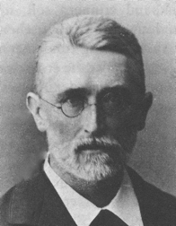

# Dedekind’s Contributions to the Foundations of Mathematics

*Reck, Erich*

**First published Tue Apr 22, 2008; substantive revision Tue Oct 21, 2025**

Richard Dedekind (1831–1916) was one of the greatest mathematicians of the nineteenth-century, as well as one of the most important contributors to algebra and number theory of all time. Any comprehensive history of mathematics will mention him for his investigation of the notions of algebraic number, field, group, module, lattice, etc., and especially for the invention of his theory of ideals (see, e.g., Dieudonné 1985, Stillwell 2000, Kolmogorov & Yushkevich 2001, Boyer & Merzbach 2011, Wussing 2012, Katz 2017)[^boyer-2011][^dieudonné-1985][^katz-2017][^kolmogorov-2001][^stillwell-2000][^wussing-2012]. Dedekind’s more foundational work in mathematics is also widely known. Often acknowledged in that connection are: his analysis of the notion of continuity, his introduction of the real numbers by means of Dedekind cuts, his formulation of the Dedekind-Peano axioms for the natural numbers, his proof of the categoricity of these axioms, and his contributions to the early development of set theory (Grattan-Guinness 1980, Ferreirós 1996, 1999, 2016b, Jahnke 2003, Corry 2015)[^corry-2015][^ferreirós-1996][^ferreirós-1999][^grattan-guinness-1980][^jahnke-2003].

While many of Dedekind’s contributions to mathematics and its foundations are thus common knowledge, they are seldom discussed together. In particular, his foundational writings are often treated separately from his other writings. This entry provides a broader and more integrative survey. The main focus will be on Dedekind’s foundational writings, but they will be related to his mathematical work as a whole. Indeed, it will be argued that foundational concerns are at play throughout, so that any attempt to distinguish sharply between his “mathematical” and his “foundational” work is artificial and misleading. Another goal of the entry is to establish the continuing relevance of his contributions to the philosophy of mathematics. Their full significance has only started to be recognized, as should become evident. This is especially so with respect to methodological and epistemological aspects of Dedekind’s approach, which ground the logical and metaphysical views that emerge in his writings.

## 1. Biographical Information

Richard Dedekind was born in Brunswick (Braunschweig), a city in northern Germany, in 1831. Much of his education took place in Brunswick as well, where he first attended school and then, for two years, the local technical university. In 1850, he transferred to the University of Göttingen, a main center for scientific research in Europe. Carl Friedrich Gauss, one of the greatest mathematicians of all time, taught in Göttingen, and Dedekind became his last doctoral student. He wrote a dissertation under Gauss, finished in 1852. As was customary, he also wrote a second dissertation (*Habilitation*), completed in 1854, shortly after that of his colleague and friend Bernhard Riemann. Dedekind stayed in Göttingen for four more years, as an unsalaried lecturer (*Privatdozent*). During that time he was strongly influenced by P.G.L. Dirichlet, Gauss’s successor in Göttingen, and by Riemann, then a rising star. (Dedekind did important editorial work for Gauss, Dirichlet, and Riemann later.) In 1858, he moved to the Polytechnic in Zürich (now ETH Zürich), Switzerland, to take up his first salaried position. He returned to Brunswick in 1862, where he became professor at the local university and taught until his retirement in 1896. He published most of his major works in this later period. He also had interactions with important mathematicians elsewhere; thus he was in correspondence with Georg Cantor, collaborated with Heinrich Weber, and developed an intellectual rivalry with Leopold Kronecker. He stayed in his hometown until the end of his life, in 1916. (Cf. Landau 1917, ch. 1 of Dugac 1976, Scharlau 1981, Mehrten 1982, ch. 1 of Ferreirós 1999, Harborth *et al.* 2007, Sonar 2017, for biographical information.)[^dugac-1976][^ferreirós-1999][^ferreirós-2007][^harborth-2007][^landau-1917][^sonar-2017]

Dedekind’s main foundational writings are: *Stetigkeit und irrationale Zahlen* (1872) and *Was sind und was sollen die Zahlen?* (1888a). Equally important, especially in the eyes of historians of mathematics, is his work in algebraic number theory. That work was first presented in an unusual manner: as supplements to Dirichlet’s *Vorlesungen über Zahlentheorie*. The latter was based on Dedekind’s notes from Dirichlet’s lectures, edited further by him, and published in a series of editions. It is in his supplements to the second edition, from 1871, that Dedekind’s famous theory of ideals was first presented. He modified and expanded it several times, with a fourth edition published in 1893 (Lejeune-Dirichlet 1893, Dedekind 1964) and an unfinished fifth edition later found in his *Nachlass* (Scheel 2020). An intermediate version of Dedekind’s theory appeared separately in a French translation (Dedekind 1877). Further works by him include: a long and influential article on the theory of algebraic functions, written jointly with Heinrich Weber (Dedekind 1882, Dedekind & Weber 2012); and a variety of shorter pieces in algebra, number theory, complex analysis, probability theory, etc. All of these works were re-published, together with selections from his *Nachlass*, in Dedekind (1930–32). Finally, lecture notes from some of his own classes were made available later (Dedekind 1981, 1985), as were further selections from his *Nachlass* (Dedekind 1982, also Dugac 1976, Sinaceur 1990, Schlimm 2000)[^dugac-1976][^schlimm-2000][^sinaceur-1990] and from his correspondence (Noether & Cavaillès 1937, Lipschitz 1986, Meschkowski & Nilson 1991, Scheel 2014).

As this brief chronology indicates, Dedekind was a creative and wide-ranging mathematician, although he tended to publish slowly and deliberately. It also shows that he was part of a distinguished tradition in mathematics, extending from Gauss and Dirichlet through Riemann, Dedekind himself, Weber, and Cantor in the nineteenth century, on to David Hilbert, Ernst Zermelo, Emmy Noether, B.L. van der Waerden, Nicolas Bourbaki, and others in the twentieth and twenty-first centuries. With some partial exceptions, these mathematicians did not publish explicitly philosophical treatises. At the same time, all of them were very sensitive to foundational issues in mathematics understood in a broad sense, including the choice of basic concepts, the kinds of reasoning to be used, and the presuppositions build into them. Consequently, one can find philosophically pregnant remarks sprinkled through their works, including Dedekind’s.

Not much is known about other influences on Dedekind, especially philosophical ones. While a student in Göttingen, he did attend a lecture class by Hermann Lotze, called “Deutsche Philosophie seit Kant” (“German philosophy since Kant”), as is clear from notes he took that are preserved in his Nachlass. In his short biography of Riemann (Dedekind 1876a), there is a reference to the post-Kantian philosopher and educator J.F. Herbart, professor in Göttingen from 1833 to 1841, as an influence on Riemann; and in his correspondence, Dedekind mentions the German Idealist J.G. Fichte in passing (Scharlau 1981, Reck 2017)[^reck-2017]. However, he does not align himself explicitly with either of them, nor with any other philosopher or philosophical school. Little is known about which philosophical texts might have shaped Dedekind’s views, especially early on. A rare piece of information we have in this connection is that he became aware of Gottlob Frege’s most philosophical work, *Die Grundlagen der Arithmetik* (published in 1884), only after having settled on his own basic ideas; similarly for Bernard Bolzano’s *Paradoxien des Unendlichen* (Dedekind 1888a, preface to the second edition). Then again, several of Dedekind’s mathematical role models had strong philosophical interests, especially Gauss, Riemann, and Cantor. Moreover, German intellectual life at the time was saturated with discussions of Kantian and German Idealist views, including debates about the role of intuition for mathematics. There is evidence that Dedekind was familiar with at least some of those discussions.

## 2. Overtly Foundational Contributions

### 2.1 The Foundations of Analysis

The issues addressed in Dedekind’s *Stetigkeit und irrationale Zahlen* (*Continuity and Irrational Numbers*) grow out of the “rigorization” and “arithmetization” of analysis (the mathematical theory) in the first half of the nineteenth century. Yet their roots go deeper, all the way down or historically back to the discovery of incommensurable magnitudes in Ancient Greek geometry, e.g., diagonals in unit squares that have length $\sqrt{2}$ (Jahnke 2003, ch. 1)[^jahnke-2003]. The Greeks’ response to this startling discovery culminated in Eudoxos’ theory of ratios and proportionality, presented in Chapter V of Euclid’s *Elements* (Mueller 1981, ch. 3, Corry, ch. 3)[^mueller-1981]. This theory brought with it a sharp distinction between discrete multitudes (numbers) and continuous magnitudes, which led to the long dominant view of mathematics as the science of number, on the one hand, and of magnitude, on the other hand. Dedekind’s first foundational work concerns, at bottom, the relationship between the two sides of this dichotomy.

An important part of the dichotomy, as traditionally understood, was that magnitudes and ratios of them were not thought of as numerical entities, with arithmetic operations defined on them, but in a more concrete way based on geometry (as lengths, areas, volumes, angles, etc. and as relations between them). More particularly, while Eudoxos’ theory provides a contextual criterion for the equality of ratios, it does not define the ratios themselves so that they are not conceived of as independent objects (Stein 1990, Cooke 2005)[^cooke-2005][^stein-1990]. Such features do little harm with respect to basic applications of the theory; but they lead to inner-mathematical tensions, e.g., when solutions to algebraic equations were considered (some of which could be represented numerically, others only geometrically). This tension came increasingly to the fore in the early modern period, especially after Descartes’ integration of algebra and geometry. What was called for, then, was a unified treatment of discrete and continuous quantities.

More directly and explicitly, Dedekind’s essay was tied to the arithmetization of analysis in the nineteenth century—pursued by Cauchy, Bolzano, Weierstrass, and others—which in turn was a reaction to tensions within the differential and integral calculus, introduced earlier by Newton, Leibniz, and their followers (Jahnke 2003, chs. 3–6)[^jahnke-2003]. As is well known, the inventors of the calculus appealed to “infinitesimal” quantities, typically backed up by geometric or even mechanical considerations, although this was seen as questionable from early on. The nineteenth-century “arithmetizers” found a way to avoid infinitesimals (in terms of the epsilon-delta characterization of limits familiar from current introductions to the calculus). Yet this again, or even more, led to the need for a systematic characterization of various quantities conceived of as numerical entities, now in the form of a unified treatment of rational and irrational numbers.

Dedekind faced this need directly, also from a pedagogical perspective, when he started teaching classes on the calculus at Zürich in 1858 (Dedekind 1872, preface). Given this background, the goal for him was not just to supply a unified and rigorous account of rational and irrational numbers; he also wanted to do so in a way that established the independence of analysis from mechanics and geometry, indeed from intuitive considerations more generally. This indicates an underlying philosophical motivation for Dedekind’s work on the foundations of analysis, beyond the pedagogical needs at issue, and it is natural to see an implicit anti-Kantian thrust in it. Finally, the way in which to achieve all of these objectives was to relate arithmetic and analysis closely to each other, by reducing the latter to the former.

While the general idea of reducing analysis to arithmetic, as opposed to geometry, was not new at the time—Dedekind adopted it from his teachers Gauss and Dirichlet (Ferreirós 1999, ch. 4, Merzbach 2018)[^ferreirós-1999][^merzbach-2018]—the particular manner in which he proceeded was quite original. The crucial issue, or the linchpin, for him was the notion of continuity. To get clearer about that notion he compared the system of rational numbers to the points on a geometric line. Once a point of origin, a unit length, and a direction have been picked for the latter, the two systems can be correlated systematically: each rational number corresponds, in a unique and order-preserving way, to a point on the line. But then a further question arises: Does each point on the line correspond to a rational number? Crucially, this question can be reformulated in terms of Dedekind’s idea of “cuts” defined directly on the rational numbers, so that any geometric intuition concerning continuity can be put aside. Namely, if we divide the whole system of rational numbers into two disjoint parts while preserving their order, is each such division determined by a rational number? The answer is no, since some correspond to irrational numbers (e.g., the cut consisting of $\{x : x^2 \lt 2\}$ and $\{x : x^2 \gt 2\}$ which corresponds to $\sqrt{2}$). In this explicit, purely arithmetic, and precise sense, the system of rational numbers is not continuous, i.e. not line-complete.

For our purposes several aspects of Dedekind’s procedure, initially and in later steps, are important (cf. Ferreirós 1999, ch. 4)[^ferreirós-1999]. To begin with, Dedekind starts by considering the system of rational numbers seen as a whole. Noteworthy here are two aspects: Not only does he accept this system as an “actual infinity”, i.e. a complete infinite set that is treated as a mathematical object in itself; he also considers it “structurally”, as an example of a linearly ordered set closed under addition and multiplication (an ordered field). In his next step—and proceeding further along set-theoretic and structuralist lines—Dedekind introduces the set of arbitrary cuts on his initial system, thus working essentially with the bigger and more complex infinity of all subsets of the rational numbers (the full power set). It is possible to show that the set of those cuts can in turn be endowed with a linear ordering and with operations of addition and multiplication, thus constituting a totally new “number system”.

It is not the cuts themselves with which Dedekind wants to work in the end, however. Instead, for each cut—those corresponding to rational numbers, but especially those corresponding to irrational quantities—he “creates” a new object, a “real number” determined by the cut (cf. Dedekind 1876b, 1888b). Those objects, together with arithmetic operations and an order relation defined on them (in terms of the cuts), form the crucial system for him. Next, two properties of the new system are established: The rational numbers can be embedded into it, in a way that respects the order and the arithmetic operations (a corresponding field homomorphism exists); and the system is continuous, or line-complete, with respect to its order. What we get overall is the long missing, unified criterion of identity for rational and irrational numbers, both of which are now treated as elements in an encompassing number system (isomorphic to but distinct from the system of cuts). Finally Dedekind indicates how explicit, rigorous, and straightforward proofs of various facts about the real numbers can be given along such lines, including ones that had been accepted without proof so far. These include: basic rules of operation with square roots; and the theorem that every increasing bounded sequence of real numbers has a limit value (a result equivalent to, among others, the more well-known intermediate value theorem.)

Dedekind’s published this account of the real numbers only in 1872, fourteen years after developing the basic ideas on which it relies. It was not the only account proposed at the time; indeed, various mathematicians addressed this issue, including: Weierstrass, Thomae, Méray, Heine, Hankel, Cantor, and, somewhat later, Frege (Dieudonné 1985, ch. 6, Boyer & Merzbach 1991, ch. 25, Jahnke 2003, ch. 10)[^dieudonné-1985][^jahnke-2003]. Most familiar among their alternative approaches is Cantor’s, also published in 1872. Instead of using “Dedekind cuts”, Cantor works with (equivalence classes of) Cauchy sequences of rational numbers. The system of such (classes of) sequences can also be shown to have the desired properties, including continuity. Like Dedekind, Cantor starts with the infinite set of rational numbers; his construction again relies essentially on the full power set of the rational numbers, here in the form of arbitrary Cauchy sequences; and the two resulting systems are isomorphic, as is well known. In these set-theoretic respects the two treatments are thus equivalent. What sets apart Dedekind’s, from Cantor’s and all the others, is the clarity he achieves with respect to the central notion of continuity (cf. Haffner & Schlimm 2021)[^haffner-2021][^haffner-2021-2]. His treatment is also more elegantly and maturely structuralist, in a sense to be spelled out further below.

### 2.2 The Foundations of Arithmetic

Providing an explicit and precise definition of the real numbers constitutes a major step towards completing the arithmetization of analysis. But further reflection on Dedekind’s procedure (and similar ones) leads to a new question: What is involved in it if thought through fully, i.e., what does this account of the real numbers rely on ultimately? As noted, Dedekind starts with the system of rational numbers; he uses a set-theoretic procedure to construct, in a central step, the new system of cuts out of them; and finally, the real numbers are “created” on that basis. This leads to three sub-questions: First, how exactly are we to think about the rational numbers in this connection? Second, can anything further be said about the set-theoretic procedures that have been used? And third, how is the creation at issue to be understood?

In his published writings, Dedekind does not provide an explicit answer to our first sub-question. What suggests itself from a contemporary point of view is that he relied on the assumption that the rational numbers can be dealt with in terms of the natural numbers together with some set-theoretic techniques. And in fact, in Dedekind’s *Nachlass* explicit sketches of two now familiar constructions can be found: that of the integers as (equivalence classes of) pairs of natural numbers; and that of the rational numbers as (equivalence classes of) pairs of integers (Sieg & Schlimm 2005, earlier Dugac 1976)[^dugac-1976][^sieg-2005]. It seems that these constructions were already familiar enough at the time for Dedekind not to feel the need to publish his sketches. (There is also a parallel to the construction of the complex numbers as pairs of real numbers, known to Dedekind from W.R. Hamilton’s works, and a more general connection to the use of residue classes in developing modular arithmetic. For the former cf. Ferreirós 1999, ch. 7, for the latter Dedekind 1857 and Dugac 1976.)

All the material needed for analysis, including both the rational and all the real numbers, can thus be constructed out of the natural numbers by set-theoretic means. At this point the question arises: Do we have to take the natural numbers themselves as given; or can anything further be said about those numbers, perhaps by reducing them to something even more fundamental? Many mathematicians in the nineteenth century were willing to assume the former. A well-known example is Leopold Kronecker, for whom the natural numbers are “given by God” while the rest of arithmetic and analysis is “made by mankind” (Ferreirós 1999, ch. 4)[^ferreirós-1999]. In contrast Dedekind, and independently Frege, pursued the latter option: they attempted to reduce arithmetic and the natural numbers to “logic”. This is the main goal of *Was sind und was sollen die Zahlen?* (*The Nature and Meaning of Numbers*, or more literally, *What are the numbers and what are they for?*). Another goal is to answer the related second sub-question above: whether more can be said about the set-theoretic procedures used. For Dedekind, again similar to Frege, those procedures are part of logic. But then, what are the basic notions of logic?

Dedekind’s answer to this last question is: Basic for logic are the notions of object (“Ding”), set (or system, “System”), and function (mapping, “Abbildung”). These notions are fundamental for human thought, as he emphasizes especially for the notion of function. They are “logical” in the sense of being applicable in all domains, indispensable for exact reasoning, and not reducible further. (This interpretation of Dedekind, and with it whether he should be understood as a logicist, is not uncontroversial. Cf. Klev 2017, Reck 2019, 2022, and Ferreirós 2011 [Other Internet Resources], on the one hand, and Benis-Sinaceur 2008, 2015, 2017, on the other hand. We will come back to this issue in Section 3.) While not analyzable in terms of anything even more basic, the fundamental logical notions are nevertheless capable of being elucidated, thus of being understood better. Part of their elucidation consists in observing what can be done with them, including how arithmetic can be reconstructed in terms of them (also analysis etc.). For Dedekind that reconstruction starts again with the consideration of infinite sets, but now in a generalized, more explicit, and more systematic manner.

Dedekind does not just assume, or simply postulate, the existence of infinite sets; he tries to prove it. For that purpose, he considers “the totality of all things that can be objects of my thought” and argues that this “set” is infinite (Dedekind 1888a, section v). He also does not just presuppose the concept of infinity; he defines it (in terms of his three basic notions of logic, as well as the definable notions of subset, union, intersection, etc.). The definition is as follows: A set of objects is infinite—“Dedekind-infinite”, as we now say—if it can be mapped one-to-one onto a proper subset of itself. (A set can then be defined to be finite if it is not infinite in this sense.) Moving a step closer to arithmetic, this leads to the notion of a “simple infinity” (or “inductive set”). A rigorous introduction of that notion involves Dedekind’s innovative idea of a “chain”. As one would say in contemporary terminology, a chain is the minimal closure of a set *A* in a set *B* containing *A* under a function *f* on *B* (where being “minimal” is captured of in terms of the general notion of intersection).

What it means to be simply infinite can now be captured in four conditions: Consider a set *S* and a subset *N* of *S* (possibly equal to *S*). *N* is called simply infinite if there exists a function *f* on *S* and an element 1 of *N* such that: (i) *f* maps *N* into itself; (ii) *N* is the chain (minimal closure) of $\{1\}$ in *S* under $\,f$; (iii) 1 is not in the image of *N* under $f$; and (iv) $f$ is one-to-one. While at first unfamiliar, it is not hard to see that these Dedekindian conditions are a notational variant of Peano’s well-known axioms for the natural numbers. In particular, condition (ii) is a version of the axiom of mathematical induction. Those axioms are thus properly called the Dedekind-Peano axioms. (Peano, who published his corresponding work in 1889, acknowledged Dedekind’s priority; cf. Ferreirós 2005.)[^ferreirós-2005] As is also not hard to see, any simple infinity will consist of a first element corresponding to 1, a second element corresponding to $f(1)$, a third corresponding to $f(f(1))$, and so on, just like any model of the Dedekind-Peano axioms.

Given these preparations, Dedekind introduces the natural numbers as follows: First, he proves that every infinite set contains a simply infinite subset. Then he establishes that any two simply infinite systems (any two models of the Dedekind-Peano axioms) are isomorphic (so that the axiom system is categorical). Third, he observes that, as a consequence, exactly the same arithmetic truths hold for all simple infinities; or closer to Dedekind’s actual way of stating this point, any truth about one of them can be translated, via the isomorphism, into a truth about the other. (That is to say, all models of the Dedekind-Peano axioms are “logically equivalent”, which means that the axiom system is semantically complete; cf. Awodey & Reck 2002)[^awodey-2002]. In those respects, each simply infinity is as good as any other.

As a further step, Dedekind appeals again to the notion of “creation”. Starting with some simple infinity constructed initially—it doesn’t matter which one we start with, given their isomorphism—he “creates” new objects corresponding to its elements, thereby introducing a distinguished simple infinity Dedekind calls “the natural numbers”. As we saw, this last step is parallel to his introduction of “the real numbers” (a parallel confirmed in Dedekind 1888b); but some aspects are clearer in the present case. Namely, the newly created objects are characterized completely by all arithmetic truths, i.e., by those truths transferable, or invariant, in the sense explained above. In other words, their identity depends on relational or structural properties alone, unlike for the elements of other simple infinities where intrinsic, non-arithmetic, or “foreign” properties are built in. In passing, Dedekind also uses the name “abstraction” for the step from the initially constructed simple infinity to the newly introduced one. (If Dedekind is interpreted along such lines, his position is a form of non-eliminative structuralism; cf. Reck 2003, 2018; but see Sieg & Morris 2018 and Benis-Sinaceur 2008, 2015, 2017, respectively, for two alternative interpretations. We will again come back to this issue in Section 3.)[^benis-sinaceur-2008][^benis-sinaceur-2015][^benis-sinaceur-2017][^benis-sinaceur-2015-2][^reck-2003][^reck-2018][^sieg-2018][^sieg-2017]

Considered more generally, what Dedekind has introduced is the natural numbers conceived of as finite “ordinal” numbers (or counting numbers: the first, the second, etc.). Later he adds an explanation of how their usual employment as finite “cardinal” numbers (answering to the question: how many?) can be recovered. This is done by using initial segments of the number series as tallies: for any set we can ask which such segment, if any, can be mapped one-to-one onto it, thus measuring its “cardinality”. (A set turns out to be finite in the sense defined above if and only if there exists such an initial segment of the natural numbers series.) Dedekind rounds off his essay again by showing how several basic and so far merely assumed facts in arithmetic can now be proved as well. Especially significant is his purely “logical” justification of proofs by mathematical induction and of definitions by recursion (based on his theory of chains).

### 2.3 The Rise of Modern Set Theory

Set-theoretic assumptions and procedures already inform Dedekind’s *Stetigkeit und irrationale Zahlen*, as we saw. In particular, the system of rational numbers is assumed to be an infinite set; the collection of arbitrary cuts of rational numbers is treated as another infinite set; and when supplied with arithmetic operations and an order relation on its elements, the latter gives rise to a new complete ordered field. Parallel moves can be found in the sketches, from Dedekind’s *Nachlass*, on how to introduce the integers and the rational numbers. Once more we start with an infinite system, here that of all the natural numbers, and new number systems are constructed out of it set-theoretically (although the full power set is not needed in those cases). Finally, Dedekind uses set-theoretic techniques in his other mathematical work as well (e.g. in his treatment of modular arithmetic and his construction of ideals as infinite sets, to be discussed further below). It should be emphasized that the application of such techniques was novel and bold at the time. While a few mathematicians, such as Cantor, used them as well, many others, most prominently Kronecker, rejected them. In fact, by working seriously with actual infinities Dedekind took a stance incompatible with that of his teacher Gauss, who had allowed for the infinite only as a “manner of speaking” (cf. Ferreirós 1999, ch. 7, also Edwards 1983)[^edwards-1983][^ferreirós-1999].

In *Was sind und was sollen die Zahlen?*, in the context of Dedekind’s logicist reconstruction of the natural numbers, the adoption of set-theoretic techniques is raised to a new level of clarity and generality. Here Dedekind not only presents set-theoretic definitions of various mathematical notions, he also adds a systematic reflection on the means used thereby and he expands that use in certain respects. For those reasons, the essay constitutes an important step in the emergence of modern set theory. In addition, we already saw that Dedekind presents the notion of set, together with those of object and function, as basic. Here an object is anything for which it is determinate how to reason about it, including having appropriate criteria of identity (Tait 1996)[^tait-1996]. Sets are objects about which we reason by considering their elements, and this is all that matters about them. In other words, sets are identified extensionally, as Dedekind is one of the first to emphasize. (Even as important a contributor to set theory as Bertrand Russell struggles with this point well into the twentieth century.) Dedekind is also among the first to consider, not just sets of numbers, but sets of other kinds of objects as well.

Functions are to be conceived of extensionally too, as ways of correlating the elements of sets. But unlike in later axiomatic set theory, Dedekind does not reduce functions to sets of tuples. (Not unreasonably, he takes the ability to map one thing onto another, or to represent one by the other, to be fundamental for human thought; Dedekind 1888a, preface, cf. Klev 2017)[^klev-2017]. Another important aspect of Dedekind’s views about functions is that, with respect to their intended range, he allows for arbitrary functional correlations between sets of numbers, indeed between sets of objects more generally. (For the gradual development of his views in this connection, see Sieg & Schlimm 2005.)[^sieg-2005] He thus rejects previous, often implicit restrictions of the notion of function to, e.g., functions presented by familiar formulas, functions representable in intuition via their graphs, or functions decidable by a formal procedure. In other words, he works with a generalized notion of function. In this respect he adopts and expands on the position of another of his teachers: Dirichlet (Stein 1988, Ferreirós 1999, ch. 7)[^ferreirós-1999][^stein-1988]. Dedekind’s notion of set is general in the same sense.

Such generalized notions of set and function, together with the acceptance of the actual infinite, were soon attacked by finitistically and constructively oriented mathematicians like Kronecker. Dedekind defended his approach by pointing to its fruitfulness (Dedekind 1888a, first footnote, cf. Edwards 1983, Ferreirós 1999, ch. 7)[^edwards-1983][^ferreirós-1999]. But eventually he came to see one feature of it as problematic: his implicit acceptance of a general comprehension principle (another sense in which his notion of set is unrestricted). We already touched on a specific way in which this comes up in Dedekind’s work. Namely, in *Was sind und was sollen die Zahlen?* he introduces “the totality of all things that can be objects of my thought” (his “universal set”), together with arbitrary subsets of that totality (a general *Aussonderungsaxiom* is used). But then, any collection of objects counts as a set for him.

As just noted, Dedekind goes beyond considering only sets of numbers in his 1888 essay. This is a significant extension of the notion of set, or of its application, an extension about which one might be concerned. A more worrisome aspect consists of the particular way in which Dedekind’s all-encompassing totality is introduced, namely by reference to “human thought”, since this leads to the question of whether crude psychologistic features are involved (more on that topic in Section 3). But the most problematic feature—and the one Dedekind came to take seriously himself—is a third one: his set theory is subject to set-theoretic antinomies, including Russell’s antinomy. (If any collection of objects counts as a set, then also Russell’s collection of all sets that do not contain themselves, and this leads quickly to a contradiction.) Dedekind seems to have found out about such problems from Cantor in the late 1890s (who informed him that the collection of all ordinal numbers is an “inconsistent totality”, as is the collection of all “objects of thought”). This news shocked him initially, so much that he delayed republication of *Was sind und was sollen die Zahlen?*; he even expressed doubts about “whether human thinking is fully rational” (Dedekind 1930–32, Vol. 3, p. 449, Dedekind 1996a, p. 836). Later he regained belief in the “inner harmony” of his approach, but without providing a solution to these problems himself (Dedekind 1930–32, Vol. 3, p. 343, Preface to the third edition, published in 1911).

Russell’s antinomy and related ones establish that Dedekind’s original conception of set is untenable. Yet they do not invalidate his other contributions to set theory. His analysis of continuity, the use of Dedekind cuts in the introduction of the real numbers, the definition of being Dedekind-infinite, the formulation of the Dedekind-Peano axioms, the proof of their categoricity, the analysis of the natural numbers as finite ordinal numbers, the justification of mathematical induction and recursion, and most basically, the insistence on extensional, general notions of set and function, as well as the acceptance of the actual infinite—all of these contributions can be isolated from the set-theoretic antinomies. As such, they have been built into the core of axiomatic set theory, model theory, recursion theory, and other parts of logic.

And there are further contributions to set theory we owe to Dedekind. Some of these do not appear in his published writings, but in his correspondence. Especially significant is his exchange of letters, starting in 1872, with Cantor (Noether & Cavaillès 1937, Meschkowski & Nilson 1991). These letters contain a comparative discussion of Cantor’s and Dedekind’s treatments of the real numbers. Beyond that, they amount to a joint exploration of the notions of set and infinity. Among Dedekind’s specific contributions in this context are the following: He impresses Cantor with a proof that not only the set of rational numbers but also the set of all algebraic numbers is countable, i.e., mappable one-to-one onto the set of natural numbers (Ferreirós 1999, ch. 6)[^ferreirós-1999]. This result led, at least in part, to Cantor’s further study of infinite cardinalities and to his discovery, soon thereafter, that the set of all real numbers is not countable. Dedekind also provides a proof of the Cantor-Bernstein Theorem (that between any two sets which can be embedded one-to-one into each other there exists a bijection, so that they have the same cardinality). This is another basic result in the theory of transfinite cardinals (Ferreirós 1999, ch. 7)[^ferreirós-1999].

Finally, in the development of set theory during the twentieth century it became clear that several of Dedekind’s results and procedures can be generalized in important ways. Perhaps most significantly, Zermelo and von Neumann succeeded in extending his analysis of mathematical induction and recursion to the higher infinite, thus expanding on, and establishing more firmly, Cantor’s theory of transfinite ordinals and cardinals. Looking back on all of these contributions, it is no wonder that Zermelo—who knew the relevant history well—considered the modern theory of sets as having been “created by Cantor and Dedekind” (quoted in Ferreirós 2016b).

## 3. Logicism and Structuralism

So far we have focused on Dedekind’s contributions in his overtly foundational writings. We reviewed his innovative approaches to the natural and real numbers; we also reconsidered his role in the rise of modern set theory. Along the way, some philosophical issues have come up. A more extended reflection on them seems called for, however, especially concerning Dedekind’s “logicism” and “structuralism” (both topics that have led to some controversies in the secondary literature, as already indicated parenthetically).

Like for Frege, the other prominent logicist in the nineteenth century, “logic” is more encompassing for Dedekind than often assumed today (as comprising only first-order logic). Both thinkers take the notions of object, set, and function to be fundamental for human thought and, as such, to fall within the range of logic. Each of them then develops a version of set theory (a theory of “systems”, “extensions”, or “classes”) seen as part of logic. Also for both, logic in this encompassing sense is independent of intuitive considerations and, specifically, of traditional Euclidean geometry (understood to be grounded in pure or empirical intuition). A main goal in reducing analysis and arithmetic to logic is, thus, to establish that those fields too are independent of intuition (cf. Demopoulos & Clark 2005)[^demopoulos-2005].

The view that analysis is not dependent on geometry, since it falls within the realm of arithmetical and basic logical thought, was not entirely new at the time—Gauss and Dirichlet already held such a view, as mentioned above (cf. also Ferreirós 2007)[^ferreirós-2007]. What Frege’s and Dedekind’s new contributions consisted in were original, detailed reductions of, on the one hand, analysis to arithmetic and, on the other hand, arithmetic to logic. Moreover, each of them complemented these reductions with systematic elaborations of logic. As Dedekind’s work was better known than Frege’s at the time, probably because of his greater reputation as a mathematician, he was seen as the main representative of “logicism” by interested contemporaries, such as C.S. Pierce, Ernst Schröder, and David Hilbert (cf. Ferreirós 1999, ch. 7, and Ferreirós 2009)[^ferreirós-1999][^ferreirós-2009].

In addition to these general commonalities in Dedekind’s and Frege’s works, the two thinkers also agreed on a methodological principle encapsulated in the following remark by Dedekind: In science, and especially in mathematics, “nothing capable of proof ought to be accepted without proof” (Dedekind 1888a, preface). This principle ought to be adhered to not so much because it increases certainty. Rather, it is often only by providing an explicit, detailed proof for a result that the assumptions on which it depends become evident and, thus, its range of applicability established. Both Frege and Dedekind had learned that lesson from the history of mathematics, especially developments in geometry, algebra, and the calculus (see Reck 2013, earlier Wilson 1992, 2010, Tappenden 1995, 2006, Ferreirós 1999, Detlefen 2011)[^ferreirós-1999][^reck-2013][^tappenden-1995][^tappenden-2006][^wilson-1992][^wilson-2010].

Besides where they are in agreement, it is instructive to consider some of the differences between Dedekind and Frege as well. First and put in modern terminology, a major difference is that, while Frege’s main contributions to logic concern syntactic, proof-theoretic aspects, Dedekind tends to focus on semantic, model-theoretic aspects. Thus, nothing like Frege’s revolutionary analysis of deductive inference, by means of his “Begriffsschrift”, can be found in Dedekind’s works. Dedekind, in turn, is much more explicit and clear than Frege about issues such as categoricity, completeness, independence, etc. This allows, among others, to see him as a precursor of the “formal axiomatic” approach championed later by Hilbert and Bernays (Hallett 1994, 1995, Sieg & Schlimm 2005, 2014, Sieg 2010, 2014)[^hallett-1994][^hallett-1995][^sieg-2010][^sieg-2014][^sieg-2005].

Compared to Frege, Dedekind also has much more to say about the infinite, not just by formulating a definition of that notion, but also by exploring the possibility of different infinite cardinalities with Cantor. And he shows more awareness of the challenge posed by Kroneckerian computational and constructivist strictures. The differences between Frege’s and Dedekind’s respective treatments of the natural and real numbers are noteworthy too. As we saw, Dedekind conceives of the natural numbers primarily as ordinal numbers; he also identifies them purely “structurally”. Frege makes their application as cardinal numbers central; and he insists on building this application into the very nature of the natural numbers, thus endowing them with non-structural, “intrinsic” properties. The case of the real numbers illustrates this divergence further. Finally, Frege’s and Dedekind’s underlying conceptions of logic and language differ significantly. (The latter is one of the main reasons why Dedekind is not interpreted as a logicist in Benis-Sinaceur 2008, 2015, 2017, where those differences are highlighted in insightful ways.)[^benis-sinaceur-2008][^benis-sinaceur-2015][^benis-sinaceur-2017][^benis-sinaceur-2015-2]

Apart from Frege, it is illuminating to compare Dedekind’s approach more with later set-theoretic ones. We noted in the last section that many of his innovations have been built into axiomatic set theory. Yet here too, several differences emerge if one looks more closely. To begin with, Dedekind does not start with an axiom of infinity as a fundamental principle; instead, he tries to prove the existence of infinite sets. This can be seen as another application of the methodological rule to prove everything “capable of proof”, thus as a crucial aspect of his logicism. However, few set theorists today will want to go back to this aspect of Dedekind’s approach. (Dedekind’s argument for the existence of an infinite set is similar to an earlier one in Bolzano’s posthumously published work; cf. Ferreirós 1999, ch. 7, Klev 2018.)[^ferreirós-1999][^klev-2018]

A second marked difference between Dedekind and current set theory has already come up too. This is his appeal to “abstraction”, and “creation”, in the last step of his introduction of both the natural and the real numbers (“Dedekind-abstraction”, as it is called in Tait 1996)[^tait-1996]. For the real numbers, the standard procedure in axiomatic set theory is to follow Dedekind up to this last step, but then to work with the Dedekind-cuts themselves as “the real numbers”. While aware of this option (Dedekind 1876b, 1888b), Dedekind tells us to apply “abstraction” to the cuts insofar as they consist of complex sets, thus to “create” additional mathematical objects determined by but not identical with them. Likewise, for the the natural numbers it is standard to construct a particular simple infinity, usually the set of finite von Neumann ordinals, and then to identify the natural numbers with them (thus: $0 = \emptyset$, $1 = \{0\}$, $2 = \{0, 1\}$, etc.). Once again, the step involving “abstraction” and “creation” in Dedekind is avoided.

In current approaches it is sometimes added that any other set-theoretically constructed system isomorphic to the system of Dedekind cuts or to the system of finite von Neumann ordinals, respectively, would do as well, i.e. be usable as “the real numbers” or “the natural numbers” for most mathematical purposes. This means that contemporary set theory is, often implicitly and without further elaboration, supplemented by a “set-theoretic structuralist” view about the nature of mathematical objects (Reck & Price 2000)[^reck-2000]. The resulting position is different from Dedekind’s. (But see again Sieg & Morris 2018, where Dedekind is interpreted as changing his position over time, and in particular, as adopting a position close to set-theoretic structuralism by 1888.)[^sieg-2018] Nor does Dedekind’s position coincide with several other forms of structuralism prominent in contemporary philosophy of mathematics, e.g., those defended by Geoffrey Hellman or by Stewart Shapiro.

Why do most mathematicians and philosophers not follow Dedekind in this respect? Here the following difficulties play a role (cf. Boolos 1990, Müller-Stach 2017, among others)[^boolos-1990][^müller-stach-2017]: How exactly should his notions of “abstraction” and “creation” be understood, if they can be made sense of at all? And why did Dedekind insist on their use, since we seem to be able to do without them as axiomatic set theory shows? A partial answer to the latter question is: For Dedekind, the real numbers should not be identified with corresponding cuts because those cuts have “wrong properties”; namely, as sets they contain elements, which seems “foreign” to the real numbers themselves. Similarly, the natural numbers should not be ascribed set-theoretic or other “foreign” properties; they too should be conceived of “purely arithmetically” (see again Dedekind 1876b, 1888b). Can anything further be said in this connection?

By philosophical critics, Dedekind’s procedure is often interpreted as follows: As his language of “abstraction” and “creation” seems to suggest, he is appealing to psychological processes. The resulting entities—“the real number” and “the natural numbers”—must then be psychological or mental entities (existing in people’s subjective consciousness). If that was correct, his position would amount to a form of psychologism about mathematics that is deeply problematic, as Frege, Husserl, and others have taught us (cf. Dummett 1995)[^dummett-1995]. Partly to avoid such a damning conclusion, partly to attribute more philosophical depth to Dedekind, the following reply can be found in the literature: While he does not say so explicitly, Dedekind’s psychologistic-sounding language indicates a commitment to Kantian assumptions, in particular to Kant’s transcendental psychology (Kitcher 1986, McCarty 1995, Klev 2019, cf. also Benis-Sinaceur 2008, 2015, 2018, Floyd 2013)[^benis-sinaceur-2008][^benis-sinaceur-2015][^benis-sinaceur-2015-2][^floyd-2013][^kitcher-1986][^klev-2018][^mccarty-1995]. Then again, it is not clear that this reply takes care of the psychologism charge fully (often also directed against Kant), so that such a response would have to be spelled out further (cf. Yap 2017, Reck 2020, earlier Cassirer 1907, 1910)[^cassirer-1907][^cassirer-1910][^reck-2020][^reck-2020-2][^yap-2017]. In itself, it also leaves unexplained the precise form of Dedekind’s “abstraction”.

Recently another suggestion for how to get clearer about “Dedekind abstraction” and, at the same time, avoid crude forms of psychologism has become prominent. Instead of taking such abstraction to amount to a psychological process, it should be understood as a logical procedure (cf. Reck 2002, earlier Tait 1996, Cassirer 1910)[^cassirer-1910][^tait-1996]. Consider again the case of the natural numbers, where Dedekind is most explicit about this issue. What he provides us with is this: First, the language and logic to be used are specified, thus the kinds of assertions and arguments that can be made concerning the natural numbers; second, a particular simple infinity is constructed; third, this simple infinity is used to determine the truth values of all arithmetic sentences (by equating them with the truth values of corresponding sentences for the given simple infinity); and fourth, this determination is justified by showing that all simple infinities are isomorphic (so that, if a sentence holds for one of them, it holds for all).

The core of the procedure just described is the following: Something is true for the natural numbers exactly when the corresponding statement holds for all simple infinities (i.e., is a semantic consequence of the Dedekind-Peano axioms). What, then, are the natural numbers? They are those mathematical objects whose properties are determined by all arithmetic truths; we “abstract away” from everything else in this logical sense. Moreover, this procedure can be spelled out further, precisely and consistently, in terms of “structural abstraction principles” (cf. Linnebo & Pettigrew 2014, Reck 2018)[^linnebo-2014][^reck-2018]. Along such lines, all that matters about mathematical objects, indeed all that is built into their identity and nature, is what the corresponding mathematical truths determine. Thus, it is by specifying those truths that we “create”, or better fully characterize, them. The resulting position is not psychologistic, and it might be called “logical structuralism” (Reck 2003, 2018, also Yap 2009a)[^reck-2003][^reck-2018][^yap-2009a].

Interpreted as such, Dedekind’s approach is related to that of the “American Postulate Theorists”, E. Huntington, O. Veblen, etc. (cf. Awodey & Reck 2002)[^awodey-2002]. There is also a close connection to, and a clear influence on, the formal axiomatics developed by Hilbert and Bernays later (cf. Sieg 2010, 2014, also Hallett 1994, 1995, 2003)[^hallett-1994][^hallett-1995][^hallett-2003][^sieg-2010][^sieg-2014]. For all of these thinkers, what is both crucial in and sufficient for mathematics is that the completeness and consistency of certain basic concepts, or of the corresponding systems of axioms, are established. In Dedekind’s case, completeness is to be understood in a semantic sense, as based on categoricity; likewise, consistency is to be understood semantically, as satisfiability (Dedekind 1890); and both are tied to his distinctive combination of logicism and structuralism.

The syntactic study of such issues, especially of consistency, that became a core part of Hilbertian “proof theory” is not present in Dedekind’s work. As already noted, the proof-theoretic side of logic is not pursued much by him. Nor is the “finitism” characteristic of Hilbert & Bernays’ later work present in Dedekind (an aspect developed in response to the set-theoretic antinomies, like Russell’s, and to intuitionist challenges), especially if it is understood in a metaphysical sense. Such finitism might have been acceptable to Dedekind as a methodological stance, but in other respects his position is strongly and clarly infinitary. In fact, the finite is explained in terms of the infinite in his work: the notion of finitude by that of infinity, the natural numbers in terms of infinite sets, etc. (as noted in Hilbert 1922)[^hilbert-1922].

The summary of Dedekind’s position in the present section highlighted logical issues (his basic logical notions and procedures, compared both to Frege and to axiomatic set theory), together with metaphysical issues (Dedekindian abstraction and creation, the structural nature of mathematical objects). However, there is another dimension of his position—another sense in which Dedekind’s approach represents a unique combination of logicism and structuralism—that deserves philosophical attention. That side involves primarily methodological and epistemological aspects. Some of those aspects already played a role in our discussions of his overtly foundational writings. But in order to shed more light on them, it helps to turn to his other mathematical work, starting with algebraic number theory.

## 4. Other Mathematical Contributions

### 4.1 Algebraic Number Theory

While historians of mathematics have long emphasized the influence Dedekind’s work on algebraic number theory had on the development of twentieth-century mathematics, the philosophical significance of these contributions has only started to be probed recently (with some exceptions: Dugac 1976, Sinaceur 1979, Edwards 1980, 1983, Stein 1988)[^dugac-1976][^edwards-1980][^edwards-1983][^sinaceur-1979][^stein-1988]. We should begin here by reviewing two aspects: the roots of Dedekind’s number-theoretic investigations in the works of Gauss, Dirichlet, and Ernst Kummer; and the contrast between Dedekind’s approach and that of Leopold Kronecker.

The starting point for these number theorists was the solution of algebraic equations, especially their solution in terms of integers. A famous example is Fermat’s Last Theorem, which concerns the (non-)solubility of the equation $x^n + y^n = z^n$ by integers, for different exponents $n$. The approach to the problem developed by Gauss, clarified and refined by Dirichlet, and pushed further by Kummer involves considering extensions of the (field of) rational numbers, as well as of the (ring of) “integers” contained in such extensions. Thus, Gauss studied the “Gaussian integers” ($a + bi$, where $a$ and $b$ are regular integers and $i = \sqrt{-1}$) within the field of all complex numbers; Kummer considered more complicated “cyclotomic integers” in corresponding number fields (Edwards 1977, Stillwell 2000, Gray 2018)[^edwards-1977][^gray-2018][^stillwell-2000].

What became clear along such lines is that in some of these extensions the Fundamental Theorem of Arithmetic—asserting the unique factorization of all integers into powers of primes—fails. Had it been available generally, solutions for important problems would have been within reach, including Fermat’s Last Theorem. The question became then whether a suitable alternative to the Fundamental Theorem could be found. Kummer’s response, obtained in a close study of some particular cases, was to introduce “ideal divisors” in terms of which unique factorization could be recovered. While this move led to striking progress, the nature of these new mathematical objects was left unclear, as were the precise basis for their introduction and the range of applicability of the technique.

Both Dedekind and Kronecker knew this earlier work well, especially Kummer’s, and tried to build on it. Kronecker’s strategy was to examine in concrete detail, and by exploiting computational aspects, certain kinds of extensions. Crucial for him was to proceed finitistically and constructively, thus in a self-consciously restricted way. This led to his “divisor theory”, an extension of Gauss’ and Kummer’s “theory of forms” (Edwards 1980, 1990)[^edwards-1980][^edwards-1990]. Dedekind approached the issue in a more encompassing and abstract way. He considered algebraic number fields in general, thereby introducing the notion of a “field” for the first time (Edwards 1983, Haubrich 1992, Stillwell 1996, 1999, Ullrich 2017, Gray 2018)[^edwards-1983][^gray-2018][^haubrich-1992][^stillwell-1996][^stillwell-1999][^ullrich-2017].

Dedekind also replaced Kummer’s “ideal numbers” by his “ideals”—set-theoretical objects intended to play the same role with respect to unique factorization. Dedekindian ideals are infinite subsets of the number fields in question, or of the corresponding ring of integers, which again gives his approach an infinitary character. (An ideal *I* in a ring *R* is a subset such that the sum and difference of any two elements of *I* and the product of any element of *I* with any element of *R* are also in *I*.) This led him to introduce other fruitful notions too, such as that of a “module”. A problem Dedekind struggled with for a while, in the sense of finding a fully satisfactory solution, was to specify a suitable version, not only of the notion of “integer”, but also of “prime number” (Ferreirós 1999, ch. 3, Avigad 2006, Haffner 2014)[^avigad-2006][^ferreirós-1999][^haffner-2014].

Both Kronecker, with his divisor theory, and Dedekind, with his ideal theory, were able to obtain important results. Each theory also had a strong influence: Dedekind’s by shaping the approaches to modern algebra (field theory, ring theory, etc.) of Hilbert, Emmy Noether, B.L. van der Waerden, Emil Artin, Nicolas Bourbaki, and others (Alten et al. 2003, Corry 2004, McLarty 2006, Gray 2008, 2018)[^alten-2003][^corry-2004][^gray-2008][^gray-2018][^mclarty-2006]; Kronecker’s by influencing Hilbert as well, and by being revived later in André Weil’s and Alexander Grothendieck’s works (class field theory, algebraic geometry) (Weil 1950, Edwards 1990, Reed 1995, Corfield 2003)[^corfield-2003][^edwards-1990][^reed-1995]. The contrast between their approaches provides a clear example—historically the first significant example—of the opposition between “classical” and “constructivist” mathematics.

Often this opposition is debated in terms of which approach is “the right one”, with the implication that only one of them but not the other is legitimate. This started with the disagreement between Dedekind and Kronecker. We already noted that Dedekind explicitly rejected constructivist strictures on his work, although he did not rule out corresponding projects as illegitimate in themselves. Kronecker, with his strong opposition to the use of set-theoretic and infinitary techniques, went further in the opposite direction. But another question is more basic: Can the contrast between the two competing approaches to algebraic number theory, or to mathematics more generally, be captured more sharply and insightfully; and in particular, what is its methodological and epistemological significance?

An initial, rough answer to that question is already contained in our discussion so far, namely: Dedekind’s approach is set-theoretic and infinitary, while Kronecker’s is constructivist and finitary. Yet that leaves us with a deeper issue: What exactly is it that a set-theoretic and infinitary methodology allows us to accomplish that Kronecker’s doesn’t, and *vice versa*? The specific strength of a Kroneckerian approach is often summed up thus: It provides us with instructive computational, algorithmic information (Edwards 1980, 1990, Avigad 2008)[^edwards-1980][^edwards-1990]. But what is the characteristic virtue of a Dedekindian approach? Here an informative and articulate answer is harder to find, especially one that is philosophically satisfying.

What tends to get in the way is that the set-theoretic and infinitary methodology Dedekind championed was so successful, thus shaping twentieth-century mathematics so much, that it is hard to reach the analytic distance needed. Often all one gets, then, are platitudes: that it is very “general” and “abstract”. Or one is left with negative characterizations: that it fails to be finitistically and constructively acceptable. More positively, there is the suggestion that Dedekind’s approach is “structuralist”. But as this term is now used to characterize a methodology, rather than a metaphysical position, one wonders what exactly it involves. Before attempting a clarification, let us briefly consider some of Dedekind’s other mathematical works, since this will make certain relevant features stand out more.

### 4.2 Function Fields, Groups, Lattices

For our purposes, three further areas in which Dedekind applied his set-theoretic, infinitary, and structuralist approach are relevant: the theory of algebraic functions, group theory, and lattice theory.

Dedekind realized early on that several of the notions and techniques he had introduced in algebraic number theory could be transferred to the study of algebraic functions (algebraic function fields, in later terminology), especially the set-theoretic introduction of ideals and ways of calculating with them (cf. Haffner 2014, 2015, 2017, especially for the latter)[^haffner-2014][^haffner-2015][^haffner-2017]. This realization came to fruition in “Theorie der algebraischen Funktionen einer Veränderlichen”, a substantive article co-written with Heinrich Weber and published in 1882. The approach in it led, among others, to a better understanding of Riemann surfaces, including a purely algebraic proof of the celebrated Riemann-Roch Theorem (Geyer 1981, Kolmogorov & Yushkevich 2001, ch. 2, Stillwell 2012)[^geyer-1981][^kolmogorov-2001][^stillwell-2012]. As these were issues of wide interest among mathematicians, the success gave Dedekind’s approach legitimacy and publicity (cf. Edwards 1983, Dieudonné 1985)[^dieudonné-1985][^edwards-1983].

Second, Dedekind’s contributions to algebraic number theory were connected, in natural and fruitful ways, with Evariste Galois’ revolutionary group-theoretic approach to algebra. In fact, Dedekind’s early study of Galois theory—he was the first to lecture on it at a German university, already during his time as a *Privatdozent* in Göttingen—led to a transformation of that theory itself. It turned from the study of substitutions in formulas and of functions invariant under such substitutions into the study of field extensions and corresponding automorphisms, which deep connections to algebraic number theory (Mehrtens 1979b, Stein 1988, Ferreirós & Reck 2020)[^ferreirós-2020][^mehrtens-1979b][^reck-2020][^reck-2020-2][^stein-1988]. Dedekind also introduced additional applications of Galois theory, e.g., to modular equations and functions (Gray 2000, ch. 4, Alten et al. 2003, ch. 8)[^alten-2003][^gray-2000].

As a third spin-off, Dedekind’s number-theoretic investigations led to the introduction of the notion of a “lattice” (under the name “*Dualgruppe*”). He examined that notion further, also as a topic in itself, in two relatively late articles, “Über Zerlegungen von Zahlen durch ihre größten gemeinsamen Teiler” (1897) and “Über die von drei Moduln erzeugte Dualgruppe” (1900), as well as in some unpublished manuscripts (cf. Haffner 2024, which also explores connection to the notion of duality in some detail)[^haffner-2024]. While these articles did not have the same immediate and strong impact that several of his other publications had, they were later recognized as original, systematic contributions to lattice theory, especially to the study of modular lattices (Mehrtens 1979a, ch. 2, Burris 1983, Alten et al. 2003, ch. 10, Haffner 2024)[^alten-2003][^burris-1983][^haffner-2024][^mehrtens-1979a] and to an axiomatic approach to mathematics more generally (Schlimm 2000, 2011, 2017)[^schlimm-2000][^schlimm-2011][^schlimm-2017].

None of these contributions by Dedekind can be treated in any detail here (and various others have to be ignored completely), but some general observations about them can be made. (For more details and some recent discussions, see Gray 2018, Ferreirós & Reck 2020, and Haffner 2024)[^ferreirós-2020][^gray-2018][^haffner-2024][^reck-2020][^reck-2020-2]. While they again exemplify a set-theoretic and infinitary perspective, they also display the following features: the focus on entire systems of objects and on general laws for them; the move away from particular formulas, or particular symbolic representations, to more general characterizations of the underlying systems of objects, specifically in terms of relational and functional properties; the consideration of homomorphisms, automorphisms, isomorphisms, and features invariant under such mappings; and the investigation of novel, abstract concepts, introduced in connection with specific cases but then studied in themselves.

These features are, in fact, characteristic for Dedekind’s works overall, including his studies in algebraic number theory and his foundational investigations. It is by taking them into account that calling his methodology, not just “general” and “abstract”, but “structuralist” starts to acquire further content. One can also see in which way Dedekind’s approach played a crucial role in the emergence of “modern” mathematics, as shaped significantly by a structuralist methodology (cf. Reck & Schiemer 2020, also Corry 2004, Gray 2008)[^corry-2004][^gray-2008][^reck-2020][^reck-2020-2]. Looking back on the corresponding history of algebra, B.L. van der Waerden—himself a major contributor to this field—concluded: “It was Evariste Galois and Richard Dedekind who gave modern algebra its structure; that is where its weight-bearing skeleton comes from” (Dedekind 1964, foreword, quoted in Mehrtens 1979b; cf. also Gray 2008, 2018, Benis-Sinaceur & Haffner 2020)[^benis-sinaceur-2020][^gray-2008][^gray-2018][^mehrtens-1979b].

## 5. Methodology and Epistemology

In earlier sections we considered Dedekind’s overtly foundational works. This led to a discussion of logicism and the metaphysical structuralism emerging in them. In the last few sections, the focus shifted to his other mathematical contributions and the methodological structuralism they embody. Now we are in a position to provide a more explicit and systematic elaboration of the latter. Beyond just calling Dedekind’s approach set-theoretic, infinitary, and non-constructive, the methodology that informs it can be analyzed as consisting of three parts.

The first part is closely tied to Dedekind’s employment of set-theoretic tools and techniques. He uses these to construct new mathematical objects (the natural and real numbers, ideals, etc.) or whole classes of such objects (algebraic number fields, rings, modules, lattices, etc.), usually in terms of infinite sets. Closely related but even more characteristic for Dedekind is the following: These sets are then endowed with general structural features (order relations, arithmetic operations, etc.); and the resulting systems are studied in terms of corresponding higher-level concepts (continuity for the real number system, simple infinity for the natural numbers, unique factorization in algebraic number fields and function fields, etc.). Once more, philosophically relevant is not just that this procedure is infinitary (actual infinities are accepted) and non-constructive (the added features are not necessarily grounded in algorithms). A whole variety of relational systems, including many new ones, can now be investigated as well, and this brings with it a significant extension of the subject matter of mathematics. Mathematics is no longer tied to what is given intuitively or even empirically (concrete numbers of things, geometric magnitudes, observable physical processes, etc.); it has become the study of relational systems much more generally (based on a new “logic of relations”, as Russell and Cassirer will put it).

The second characteristic part of Dedekind’s methodology consists of persistently (and from early on, cf. Dedekind 1854) attempting to identify and clarify fundamental concepts, including the higher-level concepts just mentioned (continuity, infinity, generalized concepts of integer and of prime number, also the new concepts of ideal, module, lattice, etc.). In this context, it is crucial for him to find “the right definitions”; and this involves not just basic adequacy, but also desiderata or epistemic values such as: fruitfulness, generality, simplicity, and “purity”, i.e., the elimination of “foreign” aspects. (Geometric notions are foreign to the natural and real numbers, the definition of prime number must be at just the right level of generality, etc.). Moreover, once Dedekind has identified them, he studies the most important ones also in themselves, i.e., in terms of a separate parts of theories. This gives his approach a distinctive “conceptual” character (cf. Stein 1988, Reck 2003, Avigad 2006)[^avigad-2006][^reck-2003][^stein-1988], and it points forward towards an axiomatic approach (Sieg & Schlimm 2014, Schlimm 2017, also Benis-Sinaceur 2014 and Haffner 2014, 2015, 2017, 2021, 2024)[^benis-sinaceur-2014][^benis-sinaceur-2015][^benis-sinaceur-2017][^benis-sinaceur-2015-2][^haffner-2014][^haffner-2015][^haffner-2017][^haffner-2021][^haffner-2024][^haffner-2021-2][^schlimm-2017][^sieg-2014][^sieg-2017]

The third main part of Dedekind’s approach connects and complements the first two. Not only does he study infinite systems of objects or whole classes of such systems; and not only does he attempt to identify basic concepts applicable to them, especially higher-level concepts. He also tends to do both, often in conjunction, by considering mappings on the systems studied, especially structure-preserving mappings (homomorphisms, isomorphisms, implicitly also category-theoretic functors, etc.). This shows that what is crucial about a mathematical phenomenon may not lie on the surface (concrete features of examples, particular symbolisms, etc.) but go deeper. And while the deeper features are often captured set-theoretically (Dedekind cuts, ideals, quotient structures, etc.), it points beyond set theory in the end, towards category theory, especially in Dedekind’s later works (Corry 2004, McLarty 2006, Ferreirós 2017a, 2017b, Ferreirós & Reck 2020)[^corry-2004][^ferreirós-2017a][^ferreirós-2017b][^ferreirós-2020][^mclarty-2006][^reck-2020][^reck-2020-2].

These three parts of Dedekind’s approach may not seem extraordinary to a contemporary mathematician. But that is just testimony to how much modern mathematics has been shaped by his work. His approach was certainly seen as novel, even revolutionary, at the time. Some negative reactions to it, by finitist and constructivist thinkers, have already been mentioned. The extent to which Dedekind’s approach diverged from what had been common stands out further if we remember two traditional, widely shared assumptions: that mathematics is the science of number and magnitude; and that it has essentially to do with calculating and other algorithmic procedures. Relative to such assumptions, Dedekind’s approach to mathematics involves a radical transformation and liberation (Stein 1988, Tait 1996, Reck 2020)[^reck-2020][^reck-2020-2][^stein-1988][^tait-1996].

Another way to bring out the radical character of Dedekind’s work is by returning to his treatment of the infinite. It starts with what had long been seen as a paradoxical property (to be equinumerous with a proper subset) and turns it into a defining characteristic of infinite sets instead. Dedekind then adds a systematic and wide-ranging analysis of the finite in terms of the infinite, again a rather bold idea. For conceptual and methodological innovations like these to become accepted, they not only had to open up novel realms for mathematics; the resulting approach also had to lead to progress in more traditional realms (as it did: the clarification of continuity and of mathematical induction and recursion, new results in algebra, algebraic number theory, the theory of algebraic functions, etc.).

While Dedekind was a great innovator, he was, of course, not alone in moving large parts of mathematics in a set-theoretic, infinitary, and structuralist direction. There was a whole group of mathematicians who promoted a more “conceptual” approach at the time, including several of his teachers in Göttingen. Within that group, Dirichlet has sometimes been picked out as the leader, or the “poet’s poet”, among others by being a big influence on Dedekind (Stein 1988, compare also Merzbach 2018)[^merzbach-2018][^stein-1988]. As Hermann Minkowski, a major figure in this tradition himself, put it later (on the occasion of Dirichlet’s 100th birthday): he impressed on other mathematicians “to conquer the problems with a minimum amount of blind calculation, a maximum of clear-seeing thought” (quoted in Stein 1988)[^stein-1988].

Riemann was another crucial figure in this context. He too had a strong influence on Dedekind, in two ways: by emphasizing (in his development of complex function theory) the importance of using simple, characteristic, and “intrinsic” concepts, in contrast to “extrinsic” properties tied to, say, particular symbolisms (Mehrtens 1979b, Laugwitz 1999, Tappenden 2005a, 2006, Ferreirós & Reck 2020)[^ferreirós-2020][^laugwitz-1999][^mehrtens-1979b][^reck-2020][^reck-2020-2][^tappenden-2005a][^tappenden-2006]; and by exploring new “conceptual possibilities”, including the systematic study of Riemannian geometries (Stein 1988)[^stein-1988]. A further example of such conceptual exploration, again very familiar to Dedekind, was the study of transfinite ordinal and cardinal numbers by Cantor, with whom Dedekind corresponded (Ferreirós 1999, chs. 2 and 6)[^ferreirós-1999]. And of course, later mathematicians influenced by Dirichlet, Riemann, Dedekind, and Cantor pushed their innovations further, including Ernst Zermelo, Emmy Noether, B.L. van de Waerden, and Nicolas Bourbaki (Corry 2004, 2017, McLarty 2006, Kahle 2017)[^corry-2004][^corry-2017][^kahle-2017][^mclarty-2006].

Can the significance of Dedekind’s methodology be brought out even further? Can it perhaps also be articulated in different terms? One way to do the latter, already touched on above, is by highlighting the methodological values embodied in it: systematicity, generality, purity, etc. (Avigad 2006, also Haffner 2014, 2015, 2017, 2024)[^avigad-2006][^haffner-2014][^haffner-2015][^haffner-2017][^haffner-2024]. Another is by focusing on the kind of reasoning involved: “conceptual” or “structural” reasoning (Stein 1988, Ferreirós 1999, Ferreirós & Reck 2020)[^ferreirós-1999][^ferreirós-2020][^reck-2020][^reck-2020-2][^stein-1988], or in terminology often associated with Hilbert, “axiomatic” reasoning (Sieg & Schlimm 2005, 2017, Schlimm 2000, 2011, 2017)[^schlimm-2000][^schlimm-2011][^schlimm-2017][^sieg-2005][^sieg-2017]. We might even talk about a novel “reasoning style” in this connection, where “style” is understood in an epistemological sense, not an aesthetic, psychological, or sociological one. Such a style brings with it, not just new theorems and proofs, but a distinctive kind of “understanding” of mathematical facts (Reck 2009, Reck & Schiemer 2025, section 3, also Tappenden 2005b, Müller-Stach 2017)[^müller-stach-2017][^reck-2009][^reck-2025][^tappenden-2005b].

These attempts to reveal the full significance of Dedekind’s approach are initial forays and in need of further elaboration. However, one aspect seems clear enough: The methodological and epistemological perspective that shapes Dedekind’s mathematical works is not independent of the logical and metaphysical views emerging in his more foundational writings. This is no accident—if one adopts his methodological stance, it is hardly possible to hold on to narrowly computational, formalist, empiricist, or intuitionist views about mathematics. More specifically, a structuralist methodology along Dedekindian lines calls for a structuralist metaphysics, as two sides of the same coin. Dedekind seems to have been keenly aware of this fact, even if he left it mostly implicit it much in his writings.

## 6. Concluding Remarks

We started out by considering Dedekind’s contributions to the foundations of mathematics in his overtly foundational writings, the two booklets: *Stetigkeit und irrationale Zahlen* (1872) and *Was sind und was sollen die Zahlen?* (1888). We then added a sketch and preliminary analysis of the methodological innovations in his more mainstream mathematical writings, from his work in algebraic number theory to other areas. We also noted that the logical and metaphysical position in his foundational work is closely tied to his more general methodological and epistemological perspective. It is in this sense that any attempt to distinguish sharply between his “foundational” and his other “mathematical” writings is misguided; Dedekind made foundationally relevant contributions throughout his work. In fact, his case provides a good argument and illustration for a more general lesson. Namely, any strict distinction between “foundational” or “philosophical” questions about mathematics, on the one hand, and “inner-mathematical” or “practice-based” questions, on the other hand, is counterproductive in the end, especially if one does not want to impoverish both sides.

If we look at Dedekind’s contributions from such a perspective, the sum total is impressive. He was not only one of the greatest mathematicians of the nineteenth century, he was also one of its subtlest philosophers of mathematics. With his structuralist views about the nature of mathematical entities and about how to investigate them, he was far ahead of his time. He was even ahead of much current philosophy of mathematics, especially with his sensitivity to both sides. This is not to say that his position is without problems. Dedekind himself was troubled by the set-theoretic antinomies, at least initially. And the twentieth century produced additional surprises, such as Gödel’s Incompleteness Theorems, that are difficult to accommodate for everyone. Moreover, the methodology of mathematics has developed further since his time, including attempts to reconcile “conceptual” and “computational” thinking, e.g., in computer-assisted proofs. Then again, is there a philosophical position available today that answers all important questions about mathematics in a satisfactory way? If not, updating and reviving a Dedekindian position remains a worthwhile project.

## References（引用注释）

> 原文参考文献已转为脚注引用：文内“作者-年份”引用组后附 [^key] 标记，完整条目见本文末脚注定义。

### Primary Literature (German Editions, English Translations)

| 1854 | “Über die Einführung neuer Funktionen in der Mathematik; Habilitationsvortrag”; in Dedekind (1930–32), Vol. 3, pp. 428–438. |
| --- | --- |
| 1857 | “Abriß einer Theorie der höheren Kongruenzen in bezug auf einen reellen Primzahl-Modulus”; reprinted in Dedekind (1930–32), Vol. 1, pp. 40–67. |
| 1863 | Dirichlet, P.G.L., *Vorlesungen über Zahlentheorie*, first edition, edited by R. Dedekind; Braunschweig: Vieweg. |
| 1871 | Dirichlet, P.G.L., *Vorlesungen über Zahlentheorie*, second edition, edited and with supplements by R. Dedekind; Braunschweig: Vieweg. |
| 1872 | *Stetigkeit und irrationale Zahlen*, Braunschweig: Vieweg (originally published as a separate booklet); reprinted in Dedekind (1930–32), Vol. 3, pp. 315–334, in Dedekind (1965), pp. 1–22, and in Dedekind (2017), pp. 111–132; English trans., Dedekind (1901b), reprinted (revised) in Dedekind (1995, 2024). |
| 1876a | “Bernhard Riemanns Lebenslauf”, in Riemann (1876), pp. 539–558. |
| 1876b | “Briefe an Lipschitz (1–2)”, in Dedekind (1930–32), Vol. 3, pp. 468–479. |
| 1876c | Riemann, Bernard, *Gesammelte Mathematische Werke und Wissenschaftlicher Nachlass*, H. Weber, ed., with assistance by R. Dedekind; second edition (revised) 1892, with a supplement added in 1902; reprinted by New York: Dover, 1953. |
| 1877 | *Sur la Théorie des Nombres Entiers Algébrique*, Paris: Gauthier-Villars; reprinted in Dedekind (1930–32), Vol. 3, pp. 262–296; English trans. Dedekind (1996b). |
| 1879 | Dirichlet, P.G.L., *Vorlesungen über Zahlentheorie*, third edition, edited and with additional supplements by R. Dedekind; Braunschweig: Vieweg; reprinted by Cambridge University Press, 2013. |
| 1882 | “Theorie der algebraischen Funktionen einer Veränderlichen”, with H. Weber; reprinted in Dedekind (1930–32), Vol. 1, pp. 238–350; English trans. Dedekind (2012). |
| 1888a | *Was sind und was sollen die Zahlen?*, Braunschweig: Vieweg (originally published as a separate booklet); reprinted in Dedekind (1930–32), Vol. 3, pp. 335–91, in Dedekind (1965), pp. III–XI and 1–47, and in Dedekind (2017), pp. 53–109; English trans., (Dedekind 1901c), reprinted (revised) in Dedekind (1995, 2024). |
| 1888b | “Brief an Weber”, in Dedekind (1930–32), Vol. 3, pp. 488–490. |
| 1890 | “Letter to Keferstein”, in Van Heijenoort (1967), pp. 98–103; German original, with editorial introduction, in Scheel et al. (2017), pp. 205–211. |
| 1893 | Dirichlet, P.G.L., *Vorlesungen über Zahlentheorie*, fourth edition, edited and with yet further supplements by R. Dedekind; Braunschweig: Vieweg; reprinted by Chelsea: New York, 1968. |
| 1897 | “Über Zerlegungen von Zahlen durch ihre größten gemeinsamen Teiler”; reprinted in Dedekind (1930–32), Vol. 2, pp. 103–147. |
| 1900 | “Über die von drei Moduln erzeugte Dualgruppe”; reprinted in Dedekind (1930–32), Vol. II, pp. 236–271. |
| 1901a | *Essays on the Theory of Numbers*, W.W. Beman, ed. and trans., Chicago: Open Court Publishing Company, 1901; reprinted by New York: Dover, 1963; English version of Dedekind (1965); essays also included in Ewald (1996a)[^ewald-1996a], pp. 756–779 and 787–833, and in Hawking (2005a)[^hawking-2005a], pp. 901–964. |
| 1901b | “Continuity and Irrational Numbers”, in (Dedekind 1901a), pp. 1–27; English trans. of Dedekind (1872). |
| 1901c | “The Nature and Meaning of Numbers”, in (Dedekind 1901a), pp. 29–115; English trans. of Dedekind (1888a). |
| 1930–32 | *Gesammelte Mathematische Werke*, Vols. 1–3, R. Fricke, E. Noether & Ö. Ore, eds., Braunschweig: Vieweg; reprinted (except for the separately published Dedekind 1964) by Chelsea: New York, 1969. |
| 1937 | Noether, E. & Cavaillès, J., eds., *Briefwechsel Cantor-Dedekind*, Paris: Hermann. |
| 1964 | *Über die Theorie der ganzen algebraischen Zahlen. Nachdruck des elften Supplements* (from Dirichlet 1893), with a preface by B. L. van der Waerden, Braunschweig: Vieweg. |
| 1965 | *Was sind und was sollen die Zahlen?/Stetigkeit und irrationale Zahlen. Studienausgabe*, G. Asser, ed., Braunschweig: Vieweg; later German version of Dedekind (1901a). |
| 1981 | “Eine Vorlesung über Algebra”, in Scharlau (1981a)[^scharlau-1981a], pp. 59–100. |
| 1982 | “Unveröffentlichte algebraische Arbeiten Richard Dedekinds aus seiner Göttinger Zeit, 1855–1858”, *Archive for History of Exact Sciences* 27:4, 335–367. |
| 1985 | *Vorlesungen über Diffential- und Integralrechnung 1861/62*, based on notes by H. Bechtold, M.-A. Knus & W. Scharlau, eds., Braunschweig: Vieweg. |
| 1986 | Lipschitz, Rudolf, *Briefwechsel mit Cantor, Dedekind, Helmholtz, Kronecker, Weierstrass und anderen*, W. Scharlau, ed., Braunschweig: Vieweg. |
| 1991 | Meschkowski, H. & Nilson, W., eds., *Georg Cantor. Briefe*, Berlin: Springer; especially “Die Periode des Briefwechsels mit Dedekind–die Entstehung der Mengenlehre”, pp. 29–66. |
| 1995 | *What Are Numbers and What Should They Be?* H. Pogorzelski, W. Ryan & W. Snyder, eds. and trans., Orono, ME: Research Institute for Mathematics; revised English trans. of Dedekind (1888). |
| 1996a | “Julius Wilhelm Richard Dedekind (1831–1916)”, in Ewald (1996a)[^ewald-1996a], Vol. 2, pp. 753–837; English trans. of various texts by Dedekind. |
| 1996b | *Theory of Algebraic Integers*, J. Stillwell, ed. and trans., Cambridge: Cambridge University Press; English trans. of Dedekind (1877). |
| 1999 | Dirichlet, P.G.L., *Lectures on Number Theory*, with supplements by Richard Dedekind, J. Stillwell, ed. and trans., Providence: American Mathematical Society; English trans. of Dirichlet (1893). |
| 2008 | *Richard Dedekind: La création des nombres*, H.B. Sinaceur, ed. and trans., Paris: Vrin; French trans. of various texts by Dedekind. |
| 2012 | Dedekind, R. & Weber, H., *Theory of Algebraic Functions of One Variable*, J. Stillwell, ed. and trans., Providence: American Mathematical Society; English trans. of Dedekind (1882). |
| 2014 | *Der Briefwechsel Richard Dedekind-Heinrich Weber*, Scheel, K & T. Sonar, eds., Berlin: Walter de Gruyter. |
| 2017 | *Was sind und was sollen die Zahlen?* *Stetigkeit und Irrationale Zahlen*, reprints with a new introduction, S. Müller-Stach, ed., Berlin: Springer. |
| 2020 | Scheel, Katrin: *Dedekinds Theorie der ganzen algebraischen Zahlen. Die verlorene Neufassung des XI. Supplements zu Dirichlets Vorlesungen über Zahlentheorie*, Berlin: Springer. |
| 2024 | *What Are and What Should the Numbers Be?* *Continuity and Irrational Numbers*, S. Müller-Stach (ed.), Berlin: Springer; English trans. of Dedekind (2017). |

### Secondary Literature (in English, French, and German)

## Academic Tools

> |   | [How to cite this entry](https://plato.stanford.edu/cgi-bin/encyclopedia/archinfo.cgi?entry=dedekind-foundations). |
> | --- | --- |
> |   | [Preview the PDF version of this entry](https://leibniz.stanford.edu/friends/preview/dedekind-foundations/) at the [Friends of the SEP Society](https://leibniz.stanford.edu/friends/). |
> |   | [Look up topics and thinkers related to this entry](https://www.inphoproject.org/entity?sep=dedekind-foundations&redirect=True) at the Internet Philosophy Ontology Project (InPhO). |
> |   | [Enhanced bibliography for this entry](https://philpapers.org/sep/dedekind-foundations/) at [PhilPapers](https://philpapers.org/), with links to its database. |

## Other Internet Resources

### Texts by Dedekind

- Digitized version of [*Essays on the Theory of Numbers*](http://www.gutenberg.org/etext/21016) (= Dedekind 1901a).

### Cited Resources

- Ferreirós, José, 2011, “[On Dedekind’s Logicism”](https://philsci-archive.pitt.edu/13075/).

### General Information

- [Richard Dedekind](https://mathshistory.st-andrews.ac.uk/Biographies/Dedekind/), at MacTutor site

## Related Entries

algebra | Frege, Gottlob | Hilbert, David: program in the foundations of mathematics | mathematical: explanation | mathematics, philosophy of | mathematics, philosophy of: structuralism | Russell, Bertrand | Russell’s paradox | set theory: early development | set theory: Zermelo’s axiomatization of | style: in mathematics

### Acknowledgments

This entry has benefited from comments, criticisms, and other feedback by Jeremy Avigad, Hourya Benis-Sinaceur, Stanley Burris, William Demopoulos, Diego Fernandes, José Ferreirós, Jeremy Heis, Ansten Klev, Stephan Müller-Stach, Katrin Scheel, Georg Schiemer, Dirk Schlimm, Wilfried Sieg, and the editors. As I have not adopted all of their suggestions, the remaining inaccuracies should all be attributed to me.

[^works-nd]: Works listed in this section are by Richard Dedekind, unless otherwise specified.

[^alten-2003]: Alten, H.-W., et al. (eds.), 2003, *4000 Jahre Algebra*, Berlin: Springer; especially Chapter 9, “Algebra an der Wende zum 20. Jahrhundert”, by K.-H. Schlote *et al*., pp. 475–550.

[^avigad-2006]: Avigad, Jeremy, 2006, “Methodology and Metaphysics in the Development of Dedekind’s Theory of Ideals”, in *The Architecture of Modern Mathematics*, J. Ferreirós & J. Grey (eds.), Oxford: Oxford University Press, pp. 159–186.

[^awodey-2002]: Awodey, S. & Reck, E., 2002, “Categoricity and Completeness, Part I: Nineteenth-Century Axiomatics to Twentieth-Century Metalogic”, *History and Philosophy of Logic*, 23: 1–30.

[^bell-1937]: Bell, E.T., 1937, *Men of Mathematics*; reprinted, New York: Simon & Schuster, 1965; especially Chapter 27, “Arithmetic the Second: Kummer (1810–1893), Dedekind (1831–1916)”, pp. 510–525.

[^belna-1996]: Belna, Jean-Pierre, 1996, *La Notion de nombre chez Dedekind, Cantor, Frege: Théories, conceptions, et philosophie*, Paris: Vrin.

[^benis-sinaceur-2008]: Benis-Sinaceur, Hourya, 2008, *Richard Dedekind, la creation des nombres*, Paris: Vrin.

[^benis-sinaceur-2014]: –––, 2014, “Facets and Levels of Mathematical Abstraction”, *Philosophia Scientiae*, 18: 81–112.

[^benis-sinaceur-2015]: –––, 2015, “Is Dedekind a Logicist? Why Does Such a Question Arise?”, in Benis-Sinaceur, Panza & Sandu (2015), pp. 1–58.

[^benis-sinaceur-2017]: –––, 2017, “Dedekind’s and Frege’s Views on Logic”, in Scheel et al. (2017), pp. 50–62.

[^benis-sinaceur-2020]: Benis-Sinaceur, H. & Haffner, E., 2020, “Vuillemin: Dedekind initiateur d l’Algèbre de l’Algèbre”, *Philosophia Scientiae*, 24: 159–195.

[^benis-sinaceur-2015-2]: Benis-Sinaceur, H., Panza, M. & Sandu, G. (eds.), 2015, *Functions and Generality of Logic: Reflections on Dedekind’s and Frege’s Logicisms*, Berlin: Springer.

[^biermann-1971]: Biermann, Kurt R., 1971, “Dedekind”, in *Dictionary of Scientific Biography*, Vol. 4, C.C. Gillespie (ed.), pp. 1–5.

[^boolos-1990]: Boolos, George, 1990, “The Standard of Equality of Numbers”, in *Meaning and Method: Essays in Honor of Hilary Putnam*, G. Boolos (ed.), pp. 261–277; reprinted in *Logic, Logic, and Logic*, Cambridge, MA: Harvard University Press, 1998, pp. 202–219.

[^bordogna-1996]: Bordogna, Francesca, 1996, “Interpreting the Ideal: Embedding Ideal Numbers in the Mathematical Programs of Kummer, Dedekind, and Klein”, Max Planck Institute for the History of Science, Berlin.

[^boyer-2011]: Boyer, C. & Merzbach, U., 2011, *A History of Mathematics*, third edition (revised), Wiley & Sons: New York; especially Chapter 21, “Algebra”, pp. 504–525, and Chapter 22, “Analysis”, pp. 526–547.

[^burris-1983]: Burris, Stanley, 1983, “Boolean Constructions”, in *Universal Algebra and Lattice Theory, Proceedings, Puebla 1982* (Springer Lecture Notes: Volume 1004), Berlin: Springer, pp. 67–90.

[^cassirer-1907]: Cassirer, Ernst, 1907, “Kant und die moderne Mathematik ”, *Kant Studien* 12, 1–49; reprinted in *Gesammelte Werke, Band 9*, Hamburg: Meiner, 2001, pp. 37–82.

[^cassirer-1910]: –––, 1910, *Substanzbegriff und Funktionsbegriff*, Berlin: Bruno Cassierer; English trans., *Substance and Function*: Chicago: Open Court, 1923.

[^cooke-2005]: Cooke, Roger, 2005, “Richard Dedekind, Stetigkeit und irrationale Zahlen (1872)”, Chapter 43 of *Landmark Writings in Western Mathematics, 1640–1940*, I. Grattan-Guinness (ed.), Amsterdam: Elsevier, pp. 553–563.

[^corfield-2003]: Corfield, David, 2003, *Towards a Philosophy of Real Mathematics*, Cambridge University Press; especially Chapter 8, “Beyond the Methodology of Mathematical Research Programmes”, pp. 175–203.

[^corry-2004]: Corry, Leo, 2004, *Modern Algebra and the Rise of Mathematical Structures*, second edition (revised), Birkhäuser: Boston; especially Chapter 2: “Richard Dedekind: Numbers and Ideals”, pp. 66–136.

[^corry-2015]: –––, 2015, *A Brief History of Numbers*, Oxford: Oxford University Press.

[^corry-2017]: –––, 2017, “Dedekind and Noether. Steht alles schon bei Dedekind? Ideals and Factorization between Dedekind and Noether”, in Scheel et al. (2017), pp. 134–159.

[^demopoulos-2005]: Demopoulos, W. & Clark, P., 2005, “The Logicism of Frege, Dedekind, and Russell”, in *The Oxford Handbook of Philosophy of Mathematics and Logic*, S. Shapiro (ed.), Oxford: Oxford University Press, pp. 166–202.

[^detlefsen-2011]: Detlefsen, Michael, 2011, “Dedekind against Intuition: Rigor, Scope, and the Motives of his Logicism”, in *Logic and Knowledge*, C. Cellucci *et al*. (eds.), Cambridge: Cambridge Scholars Publishing, pp. 205–217.

[^dieudonné-1985]: Dieudonné, Jean (ed.), 1985, *Geschichte der Mathematik 1700–1900*, Berlin: Deutscher Verlag der Wissenschaften, 1985; especially Chapter 5, “Zahlentheorie”, by W. & F. Ellison, pp. 171–358, and Chapter 6, “Grundlagen der Analysis”, by P. Dugac, pp. 359–421; originally published in French, 1978.

[^dugac-1976]: Dugac, Pierre, 1976, *Richard Dedekind et les fondements des mathématiques*, Paris: Vrin; with selections from Dedekind’s *Nachlass*.

[^dummett-1995]: Dummett, Michael, 1995, *Frege: Philosophy of Mathematics*, Cambridge, MA: Harvard University Press.

[^edwards-1977]: Edwards, Harold M., 1977, *Fermat’s Last Theorem. A Genetic Introduction to Algebraic Number Theory*, New York: Springer.

[^edwards-1980]: –––, 1980, “The Genesis of Ideal Theory”, *Archive for History of Exact Sciences*, 23: 321–378.

[^edwards-1983]: –––, 1983, “Dedekind’s Invention of Ideals”, *Bulletin of the London Mathematical Society*, 15: 8–17.

[^edwards-1990]: –––, 1990, *Divisor Theory*, Boston: Birkhäuser.

[^ewald-1996a]: Ewald, William B. (ed.), 1996a, *From Kant to Hilbert. A Source Book in the Foundations of Mathematics*, Vols. 1–2, Oxford: Oxford University Press.

[^ewald-1996b]: –––, 1996b, Editor’s introduction to Dedekind (1996a), pp. 753–754.

[^feferman-1995]: Feferman, S. & Hellman, G., 1995, “Foundations of Predicative Arithmetic”, in *Philosophical Logic*, 24: 1–17.

[^ferreirós-1993]: Ferreirós, José, 1993, “On the Relation between Georg Cantor and Richard Dedekind”, *Historia Mathematica*, 20: 343–363.

[^ferreirós-1995]: –––, 1995, “‘What Fermented in Me for Years’: Cantor’s Discovery of Transfinite Numbers”, *Historia Mathematica*, 22: 33–42.

[^ferreirós-1996]: –––, 1996, “Traditional Logic and the Early History of Set Theory, 1854–1908”, *Archive for History of Exact Sciences*, 50: 5–71.

[^ferreirós-1999]: –––, 1999, *Labyrinth of Thought: A History of Set Theory and its Role in Modern Mathematics*, Boston: Birkhäuser; especially: Chapter 3, “Dedekind and the Set-theoretic Approach to Algebra”, pp. 81–116; Chapter 4, “The Real Number System”, pp. 117–144; and Chapter 7, “Sets and Maps as a Foundation for Mathematics”, pp. 215–255; second edition (with added postscript), 2007.

[^ferreirós-2005]: –––, 2005, “Richard Dedekind (1888) and Giuseppe Peano (1889), Booklets on the Foundations of Arithmetic”, Chapter 47 of *Landmark Writings in Western Mathematics, 1640–1940*, I. Grattan-Guinness (ed.), Amsterdam: Elsevier, pp. 613–626.

[^ferreirós-2007]: –––, 2007, “The Rise of Pure Mathematics, as Arithmetic in Gauss”, in *The Shaping of Arithmetic after C.F. Gauss’s* Disquisitiones Arithmeticae, C. Goldstein, N. Schappacher & J. Schwermer (eds.), Berlin: Springer, pp. 235–268.

[^ferreirós-2009]: –––, 2009, “Hilbert, Logicism, and Mathematical Existence”, *Synthese*, 170: 33–70.

[^ferreirós-2016]: –––, 2016, “The Early Development of Set Theory”, *Stanford Encyclopedia of Philosophy* (Fall 2016 Edition), Edward N. Zalta (ed.), URL = <[https://plato.stanford.edu/archives/fall2016/entries/settheory-early/](https://plato.stanford.edu/archives/fall2016/entries/settheory-early/)>.

[^ferreirós-2017a]: –––, 2017a, “Dedekind’s Map-Theoretic Period”, *Philosophia Mathematica*, 25: 318–340.

[^ferreirós-2017b]: –––, 2017b, “The Role of *Abbildungen* in Frege’s Late Work”, in Scheel et al. (2017), pp. 160–173.

[^ferreirós-2022]: –––, 2022, “The Two Sides of Modern Axiomatics: Dedekind and Peano, Hilbert and Bourbaki”, in *Axiomatic Thinking I*, F. Ferreira *et al.* (eds.), Berlin: Springer Nature, pp. 83–104.

[^ferreirós-2020]: Ferreirós, J. & Reck, E., 2020, “Dedekind’s Mathematical Structuralism: From Galois theory to Numbers, Sets, and Functions”, in Reck & Schiemer (2020), pp. 59–87.

[^floyd-2013]: Floyd, Juliet, 2013, “The Varieties of Rigorous Experience”, in *The Oxford Handbook of the History of Analytic Philosophy*, M. Beaney (ed.), Oxford: Oxford University Press, pp. 1003–1042.

[^gardies-1984]: Gardies, Jean-Louis, 1984, “Eudoxe et Dedekind”, *Revue d’histoire des sciences*, 37: 111–125.

[^geyer-1981]: Geyer, Wulf-Dieter, 1981, “Die Theorie der algebraischen Funktionen einer Veränderlichen nach Dedekind und Weber”, in Scharlau (1981a), pp. 109–133.

[^gillies-1982]: Gillies, D.A., 1982, *Frege, Dedekind, and Peano on the Foundations of Arithmetic*, Assen: Van Gorcum.

[^grattan-guinness-1980]: Grattan-Guinness, Ivo (ed.), 1980, *From the Calculus to Set Theory 1630–1910. An Introductory History*, Princeton: Princeton University Press; especially Chapter 6, “Developments in the foundations of mathematics, 1870–1920”, by R. Bunn, pp. 220–255.

[^gray-1986]: Gray, Jeremy, 1986, “The Nineteenth-Century Revolution in Mathematical Ontology”, in *Revolutions in Mathematics*, D. Gillies (ed.), Oxford: Oxford University Press; second edition, 1992, pp. 226–248.

[^gray-2000]: –––, 2000, *Linear Differential Equations and Group Theory, from Riemann to Poincaré*, second edition, Boston: Birkhäuser; especially Chapter IV, “Modular Equations”, pp. 101–140.

[^gray-2008]: –––, 2008, *Plato’s Ghost: The Modernist Transformation of Mathematics*, Princeton: Princeton University Press; especially Chapter 3, “Mathematical Modernism Arrives”, pp. 113–175.

[^gray-2018]: –––, 2018, *A History of Abstract Algebra*, Berlin: Springer; especially Chapters 17–19, on Dedekind’s theories of ideals, pp. 195–216.

[^haffner-2014]: Haffner, Emmylou, 2014, “D’un point de vue rigoureux et parfaitement général: Pratique des mathématiques rigoureuses chez Richard Dedekind”, *Philosophia Scientiae*, 18: 131–156.

[^haffner-2015]: –––, 2015, “The Science of Number in Action in Richard Dedekind’s Works: Between Mathematical Explorations and Foundational Investigations”, Ph.D. Thesis, History and Philosophy of Mathematics, University of Paris/Diderot (Paris 7), [HAL archives available online](https://theses.hal.science/tel-01144626/).

[^haffner-2017]: –––, 2017, “Strategic Use(s) of Arithmetic in Richard Dedekind and Heinrich Weber’s *Theorie der algebraischen Funktionen einer Veränderlichen*”, *Historia Mathematica*, 44: 31–69.

[^haffner-2018]: –––, 2018, “From Modules to Lattices: Insights into the Genesis of Dedekind’s Dualgruppen”, *British Journal for the History of Mathematics*, 34: 23–42.

[^haffner-2021]: –––, 2021, “The Shaping of Dedekind’s Rigorous Mathematics: What do Dedekind’s Drafts tell us about his Ideal of Rigor?”, *Notre Dame Journal of Formal Logic*, 62: 5–31.

[^haffner-2024]: –––, 2024, “Duality as a Guiding Light in the Genesis of Dedekind’s Dualgruppen”, in *Duality in 19th and 20th Century Mathematical Thinking,* R. Krömer & E. Haffner (eds.), Berlin: Springer Nature, pp. 123–192.

[^haffner-2021-2]: Haffner, E. & Schlimm, D., 2021, “Dedekind on Continuity”, in *The History of Continua*, S. Shapiro & G. Hellman (eds.), Oxford: Oxford University Press, pp. 255–282.

[^hallett-1994]: Hallett, Michael, 1994, “Hilbert’s Axiomatic Method and the Laws of Thought”, in *Mathematics and Mind*, A. George (ed.), Oxford: Oxford University Press, pp. 158–198.

[^hallett-1995]: –––, 1995, “Hilbert and Logic”, in *Québec Studies in the Philosophy of Science*, 1: 135–187.

[^hallett-2003]: –––, 2003, “Foundations of Mathematics”, in *The Cambridge History of Philosophy, 1870–1945*, T. Baldwin (ed.), Cambridge: Cambridge University Press, pp. 128–154.

[^harborth-2007]: Harborth, H. *et al*. (eds.), 2007, *Gedenkschrift für Richard Dedekind*, Braunschweig: Appelhans Verlag.

[^haubrich-1992]: Haubrich, Ralf, 1992, *Zur Entstehung der algebraischen Zahlentheorie Richard Dedekinds*, Ph.D. dissertation, University of Göttingen.

[^hawking-2005a]: Hawking, Stephen (ed.), 2005a, *God Created the Integers. The Mathematical Breakthroughs that Changed History*, London: Running Press.

[^hawking-2005b]: –––, 2005b, Editor’s introduction to “Richard Julius Wilhelm Dedekind (1831–1916). His Life and Work”, in Hawking (2005a), pp. 901–905.

[^hilbert-1922]: Hilbert, David, 1922, “Neubegründung der Mathematik: Erste Mitteilung”, reprinted in *Gesammelte Abhandlungen, Dritter Band*, New York: Chelsea, pp. 157–177.

[^jahnke-2003]: Jahnke, Hans Niels (ed.), 2003, *A History of Analysis*, American Mathematical Society; especially: Chapter 1, “Antiquity”, by R. Thiele, pp. 1–40, and Chapter 10, “The End of the Science of Quantity: Foundations of Analysis, 1860–1910”, by M. Epple, pp. 291–324; originally published in German, 1999.

[^jourdain-1916]: Jourdain, P.E.B., 1916, “Richard Dedekind (1833–1916)”, *The Monist*, 26: 415–427; reprinted in *Modern Logic*, 3 (1993): 207–214.

[^kahle-2017]: Kahle, Reinhard, 2017, “Von Dedekind zu Zermelo versus Peano zu Gödel”, in Scheel et al. (2017), pp. 174–185.

[^katz-2017]: Katz, Victor, 2017, *History of Mathematics. An Introduction*, third edition (revised), Boston: Addison-Weslay.

[^kitcher-1986]: Kitcher, Philip, 1986, “Frege, Dedekind, and the Philosophy of Mathematics”, in *Frege Synthesized*, L. Haaparanta & J. Hintikka (eds.), Dordrecht: Reidel, pp. 299–343.

[^klev-2011]: Klev, Ansten, 2011, “Dedekind and Hilbert on the Foundations of the Exact Sciences”, *The Review of Symbolic Logic*, 4: 645–681.

[^klev-2017]: –––, 2017, “Dedekind’s Logicism”, *Philosophia Mathematica*, 25: 341–368.

[^klev-2018]: –––, 2018, “A Road Map to Dedekind’s Theorem 66”, *HOPOS: The Journal of the International Society for the History of the Philosophy of Science*, 8: 241–277.

[^kolmogorov-2001]: Kolmogorov, A.N. & Yushkevich, A.P., 2001, *Mathematics of the 19th Century. Vol. I: Mathematical Logic, Algebra, Number Theory, Probability Theory*, second edition (revised), Boston: Birkhäuser; especially Chapter 2, Section 3, “The Theory of Algebraic Numbers and the Beginnings of Commutative Algebra”, by I.G. Bashmakova & A.N. Rudakov, pp. 86–135; originally published in Russian, 1978.

[^landau-1917]: Landau, Edmund, 1917, “Richard Dedekind”, *Nachrichten der Königlichen Gesellschaft der Wissenschaften zu Göttingen, Geschäftliche Mitteilungen*, 50–70.

[^laugwitz-1999]: Laugwitz, Detlef, 1999, *Bernhard Riemann 1826–1866. Turning Points in the Conception of Mathematics*, Boston: Birkhäuser; originally published in German, 1996.

[^linnebo-2014]: Linnebo, Ø. & Pettigrew, R., 2014, “Two Types of Abstraction for Structuralism”, *The Philosophical Quarterly*, 64: 267–283.

[^mccarty-1995]: McCarty, David, 1995, “The Mysteries of Richard Dedekind”, in *From Dedekind to Gödel: Essays on the Development of the Foundations of Mathematics*, J. Hintikka (ed.), New York: Springer, pp. 53–96.

[^mclarty-2006]: McLarty, Colin, 2006, “Emmy Noether’s ‘Set Theoretic’ Topology: From Dedekind to the Rise of Functors”, in *The Architecture of Modern Mathematics*, J. Ferreirós & J. Grey (eds.), Oxford: Oxford University Press, pp. 187–208.

[^mehrtens-1979a]: Mehrtens, Herbert, 1979a, *Entstehung der Verbandstheorie*, Hildesheim: Gerstenberg; especially Chapter 2, “Die ‘Dualgruppe’ von Richard Dedekind”, pp. 66–126.

[^mehrtens-1979b]: –––, 1979b, “Das Skelett der modernen Algebra. Zur Bildung mathematischer Begriffe bei Richard Dedekind”, in *Disciplinae Novae*, C.J. Sciba (ed.), Göttingen: Vanderhoeck & Ruprecht, pp. 25–43.

[^mehrtens-1982]: –––, 1982, “Richard Dedekind – Der Mensch und die Zahlen”, *Abhandlungen der Braunschweigischen Wissenschaftlichen Gesellschaft*, 33: 19–33.

[^merzbach-2018]: Merzbach, Utah, 2018, *Dirichlet: A Mathematical Biography*, Birkhäuser: Basel.

[^mueller-1981]: Mueller, Ian, 1981, *Philosophy of Mathematics and Deductive Structure in Euclid’s Elements*, Cambridge, Massachusetts: MIT Press, especially Chapter 3, “Magnitudes in Proportion”, pp. 118–151.

[^müller-stach-2017]: Müller-Stach, Stefan, 2017, “Richard Dedekind: Style and Influence”, in Scheel et al. (2017), pp. 26–35.

[^potter-2000]: Potter, Michael, 2000, *Reason’s Nearest Kin: Philosophies of Arithmetic from Kant to Carnap*, Oxford: Oxford University Press; especially Chapter 3, “Dedekind”, pp. 81–104.

[^reck-2003]: Reck, Erich, 2003, “Dedekind’s Structuralism: An Interpretation and Partial Defense”, *Synthese*, 137: 369–419.

[^reck-2009]: –––, 2009, “Dedekind, Structural Reasoning, and Mathematical Understanding”, in *New Perspectives on Mathematical Practices*, B. van Kerkhove (ed.), Singapore: World Scientific, pp. 150–173.

[^reck-2013]: –––, 2013, “Frege, Dedekind, and the Origins of Logicism”, *History and Philosophy of Logic*, 34: 242–265.

[^reck-2017]: –––, 2017, “Dedekind as a Philosopher of Mathematics”, in Scheel et al. (2017), pp. 36–49.

[^reck-2018]: –––, 2018, “On Reconstructing Dedekind Abstraction Logically”, in *Logic, Philosophy of Mathematics, and their History: Essays in Honor of W.W. Tait*, E. Reck (ed.), London: College Publications, pp. 113–138.

[^reck-2019]: –––, 2019, “The Logic in Dedekind’s Logicism”, in *Logic from Kant to Russell: Laying the Foundations for Analytic Philosophy*, S. Lapointe (ed.), Routledge: London, pp. 171–188.

[^reck-2020]: –––, 2020, “Cassirer’s Reception of Dedekind and the Structuralist Transformation of Mathematics”, in Reck & Schiemer (2020), pp. 329–351.

[^reck-2022]: –––, 2022, “Dedekind’s Logicism: A Reconstruction and Contextualization”, in *Origins and Varieties of Logicism*, A. Sereni & F. Boccuni (eds.), London: Routledge, pp. 118–146.

[^reck-2000]: Reck, E. & Price, M., 2000, “Structures and Structuralism in Contemporary Philosophy of Mathematics”, *Synthese*, 125: 341–383.

[^reck-2020-2]: Reck, E. & Schiemer, G. (eds.), 2020, *The Prehistory of Mathematical Structuralism*, Oxford: Oxford University Press.

[^reck-2025]: –––, 2025, “Structuralism in the Philosophy of Mathematics”, *Stanford Encyclopedia of Philosophy* (Spring 2025 Edition), Edward N. Zalta & Uri Nodelman (eds.), URL = <[https://plato.stanford.edu/archives/spr2025/entries/structuralism-mathematics/](https://plato.stanford.edu/archives/spr2025/entries/structuralism-mathematics/)>.

[^reed-1995]: Reed, David, 1995, *Figures of Thought*, Routledge: London; especially Chapter 4, “Number Theory in the Nineteenth Century”, pp. 76–116.

[^scharlau-1981a]: Scharlau, Winfried (ed.), 1981a, *Richard Dedekind, 1831/1981: Eine Würdigung zu seinen 150. Geburtstag*, Braunschweig: Vieweg.

[^scharlau-1981b]: –––, 1981b, “Erläuterungen zu Dedekinds Manuskript über Algebra”, in Scharlau (1981a), pp. 101–108.

[^scheel-2017]: Scheel, K., Sonar, T. & Ullrich, P. (eds.), 2017, *In Memoriam Richard Dedekind (1831–1916). Number Theory–Algebra–Set Theory–History–Philosophy*, WTM Verlag: Münster.

[^schlimm-2000]: Schlimm, Dirk, 2000, *Richard Dedekind: Axiomatic Foundations of Mathematics*, M.A. thesis, Carnegie Mellon University, Pittsburgh; with selections from Dedekind’s *Nachlass*.

[^schlimm-2011]: –––, 2011, “On the Creative Role of Axiomatics: The Discovery of Lattices by Schroeder, Dedekind, Birkhoff, and Others”, *Synthese*, 183: 47–68.

[^schlimm-2017]: –––, 2017, “On Dedekind’s Axiomatic Approach to the Foundations of Mathematics”, in Scheel et al. (eds.), pp, 75–82.

[^sieg-2010]: Sieg, Wilfried, 2010, “Searching for Proofs (and Uncovering Capacities of the Mathematical Mind)”, in *Proofs, Categories, and Computations: Essays in Honor of Grigory Mints*, S. Feferman & W. Sieg (eds.), London: College Publications, pp. 189–215.

[^sieg-2014]: –––, 2014, “The Ways of Hilbert’s Axiomatics: Structural and Formal”, *Perspectives on Science*, 22: 133–157.

[^sieg-2018]: Sieg, W. & Morris, R., 2018, “Dedekind’s Structuralism: Creating Concepts and Deriving Theorems”, in *Logic, Philosophy of Mathematics, and their History: Essays in Honor of W.W. Tait*, E. Reck (ed.), London: College Publications, pp. 251–301.

[^sieg-2005]: Sieg, W. & Schlimm, D., 2005, “Dedekind’s Analysis of Number: System and Axioms”, *Synthese*, 147: 121–170.

[^sieg-2017]: –––, 2017, “Dedekind’s Abstract Concepts: Models and Mappings”, *Philosophia Mathematica*, 25, 292–317.

[^sinaceur-1974]: Sinaceur, M.A., 1974, “L’infini et les nombres – Commentaires de R. Dedekind à ‘Zahlen’ – La correspondance avec Keferstein”, *Revue d’histoire des sciences*, 27: 251–278.

[^sinaceur-1979]: –––, 1979, “La méthode mathématique de Dedekind”, *Revue d’histoire des sciences*, 32: 107–142.

[^sinaceur-1990]: –––, 1990, “Dedekind et le programme de Riemann”, *Revue d’histoire des sciences*, 43: 107–142.

[^sonar-2017]: Sonar, Thomas, 2017, “Richard Dedekind (1831–1916)”, in Scheel et al. (2017), pp. 1–7.

[^stein-1988]: Stein, Howard, 1988, “*Logos*, Logic, and *Logistiké*: Some Philosophical Remarks on Nineteenth-Century Transformations of Mathematics”, in *History and Philosophy of Modern Mathematics*, W. Aspray & P. Kitcher (eds.), Minneapolis: University of Minnesota Press, pp. 238–259.

[^stein-1990]: –––, 1990, “Eudoxos and Dedekind: On the Ancient Greek Theory of Ratios and its Relation to Modern Mathematics”, *Synthese*, 84: 163–211.

[^stein-1998]: –––, 1998, “Dedekind, Julius Wilhelm Richard”, in *Routledge Encyclopedia of Philosophy* (Volume 2), London: Routledge, pp. 840–842.

[^stillwell-1996]: Stillwell, John, 1996, Translator’s Introduction to Dedekind (1996a), pp. 1–50.

[^stillwell-1999]: –––, 1999, Translator’s Introduction to Dedekind (1999), pp. xi–xx.

[^stillwell-2000]: –––, 2000, *Mathematics and its History*, New York: Springer, second edition (revised); especially Chapter 21, “Algebraic Number Theory”, pp. 404–430.

[^stillwell-2012]: –––, 2012, Translator’s Introduction to Dedekind (2012), pp. 1–37.

[^tait-1996]: Tait, W.W., 1996, “Frege versus Cantor and Dedekind: On the Concept of Number”, in *Frege: Importance and Legacy*, M. Schirn (ed.), Berlin: de Gruyter, pp. 70–113.

[^tappenden-1995]: Tappenden, Jamie, 1995, “Geometry and Generality in Frege’s Philosophy of Arithmetic”, *Synthese*, 102: 319–361.

[^tappenden-2005a]: –––, 2005a, “The Caesar Problem in its Historical Context: Mathematical Background”, *Dialectica*, 59: 1–28.

[^tappenden-2005b]: –––, 2005b, “Proof Style and Understanding in Mathematics I: Visualization, Unification, and Axiom Choice”, in *Visualization, Explanation and Reasoning Styles in Mathematics*, P. Mancosu *et al*. (eds.), New York: Springer, pp. 147–214.

[^tappenden-2006]: –––, 2006, “The Riemannian Background of Frege’s Philosophy”, in *The Architecture of Modern Mathematics*, J. Ferreirós & J. Grey (eds.), Oxford: Oxford University Press, pp. 97–132.

[^ullrich-2017]: Ullrich, Peter, 2017, “Der Mathematiker Richard Dedekind: Von Gauss und Dirichlet zu Noether und Bourbaki”, in Scheel et al. (2017), pp. 8–25.

[^van-1967]: Van Heijenoort, Jean (ed.), 1967, *From Frege to Gödel*. *A Source Book in Mathematical Logic, 1879–1931*, Cambridge, MA: Harvard University Press.

[^weil-1992]: Weil, André, 1992, “Number Theory and Algebraic Geometry”, in *Proceedings of the International Congress for Mathematicians, Vol. 2*, American Mathematical Society, pp. 90–100.

[^wilson-1992]: Wilson, Mark, 1992, “Frege: The Royal Road from Geometry”, *Noûs*, 26: 149–180.

[^wilson-2010]: –––, 2010, “Frege’s Mathematical Setting”, in *The Cambridge Companion to Frege*, T. Ricketts & M. Potter (eds.), Cambridge University Press, pp. 379–412.

[^wussing-1984]: Wussing, Hans, 1984, *The Genesis of the Abstract Group Concept*, Cambridge, MA: MIT Press; especially Part III, Chapter 4, “The shaping and axiomatization of the abstract group concept”, pp. 230–254; reprinted by New York: Dover, 2007; originally published in German, 1969.

[^wussing-2012]: Wussing, Hans (ed.), 2012, *6000 Jahre Mathematik, Band 2: Von Euler bis zur Gegenwart*, Berlin: Springer; especially Chapters 10, “Mathematik während der Industriellen Revolution”, pp. 87–312.

[^yap-2009a]: Yap, Audrey, 2009a, “Logical Structuralism and Benacerraf’s Problem”, *Synthese*, 171: 157–173.

[^yap-2009b]: –––, 2009b, “Predicativity and Structuralism in Dedekind’s Construction of the Reals”, *Erkenntnis*, 71: 151–173.

[^yap-2017]: –––, 2017, “Dedekind, Cassirer, and Mathematical Concept Formation”, *Philosophia Mathematica*, 25: 369–389.
