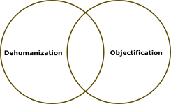

# Dehumanization
**First published Mon Mar 24, 2025**

*Phillips, Ben*

Dehumanization is widely thought to occur when someone is treated or regarded as less than human. However, there is an ongoing debate about how to develop this basic characterization. Proponents of *the harms-based approach* focus on the idea that to dehumanize someone is to *treat* them in a way that harms their humanity; whereas proponents of *the psychological approach* focus on the idea that to dehumanize someone is to *think* of them as less than human. Other theorists adopt a pluralistic view that combines elements of both approaches.

In addition to explaining different views on what it means to dehumanize someone, this article focuses on related issues, such as how to resolve the so-called “paradox of dehumanization”; the causes and consequences of dehumanization; the sorts of contexts in which dehumanization typically occurs; and the relation between dehumanization and objectification.

## 1. Historical overview

Unsurprisingly, ideas about what it means to dehumanize someone have co-evolved with ideas about what it means to be human (Kronfeldner 2018, 2021b)[^kronfeldner-2018]. Contemporary ideas about what it means to be human are often influenced by the varieties of humanism that emerged during the Renaissance and Enlightenment. During this period, some humanists emphasized the idea that to be human is to possess a certain sort of “human dignity”. Others focused on the idea that to be human is to possess certain “natural” rights, such as liberty and equality, where these rights were thought to be grounded in distinctively human capacities, such as autonomy and rationality (Copson 2015)[^copson-2015]. If one adopts these ideas about what it means to be human, then it is natural to think that dehumanization occurs whenever someone’s dignity or natural rights are violated. This way of thinking about dehumanization is reflected in various versions of the harms-based approach (see §2); as well as those versions of the psychological approach according to which dehumanization involves thinking of someone as lacking agency or rationality (see §3.2).

Another way in which ideas about humanness and dehumanization have co-evolved concerns modern ideas about biological humanness. Darwin’s discovery that human beings and nonhuman animals have a shared ancestry led to spurious ideas about certain groups of people being less than fully human in a biological-evolutionary sense: these ideas are a key element of the pseudoscientific view known as “scientific (or biological) racism” (Steizinger 2021)[^steizinger-2021]. Some proponents of the psychological approach have developed ways to measure this form of dehumanization and have found that it remains alarmingly prevalent (see §3.3).

Academic research into dehumanization has been thriving for decades. It has become highly interdisciplinary, encompassing fields such as philosophy, social and developmental psychology, neuroscience, political science, sociology, peace and conflict studies, genocide studies, and gender studies.

The models of dehumanization developed by social psychologists have been especially influential. An initial wave of models emerged during the latter part of the twentieth century (Kelman 1973; Bandura, Underwood, & Fromson 1975; Staub 1989; Struch & Schwartz 1989; Bar-Tal 1989; Opotow 1990; Bandura, Barbaranelli, et al. 1996)[^bar-tal-1989][^kelman-1973][^opotow-1990][^staub-1989][^struch-1989]. Proponents of these models often drew on qualitative analyses of extreme violence, such as the Holocaust and the Mai Lai massacre. During the early 2000s, a “new look” emerged, with models supported by lab-based studies: these models were also geared more towards capturing the “subtle” and “implicit” forms of dehumanization that purportedly occur in everyday contexts (see §3.2–§3.3).

Within philosophy, influential discussions of dehumanization began to appear during the mid-twentieth century. Arendt (1951, 1963, 1977) discussed dehumanization’s role in war, genocide, totalitarian regimes, and colonialization (see also Levi 1947 [1959], 1986 [1988])[^levi-1947]. Other influential works during this period focused on dehumanization in the context of gender oppression (de Beauvoir 1949; Dworkin 1981, 1987; LeMoncheck 1985, 1997; MacKinnon 1987, 1989, 1993; Nussbaum 1995a, 1995b)[^beauvoir-1949][^dworkin-1981][^lemoncheck-1985][^mackinnon-1987][^nussbaum-1995a]. Today, dehumanization is studied in various subfields of philosophy. This has led to different views on what dehumanization is, and what a theory of dehumanization can explain.

## 2. The harms-based approach to dehumanization

Proponents of the harms-based approach argue that to dehumanize someone is to treat them in a way that harms or diminishes their humanity.

### 2.1 Variants of the harms-based approach

The harms-based approach often figures in feminist accounts of sexual objectification (see entry on feminist perspectives on objectification). MacKinnon (1987, 2006) and Dworkin (1981, 1985, 1987) defend the Kantian view that certain capacities, such as autonomy and subjectivity, are central to being human, and that to undermine someone’s ability to exercise these capacities is to “objectify” or “dehumanize” them. For instance, Dworkin (1985 [2000: 30–31]) remarks that when a human being is treated in a way that does not respect their autonomy, they are “turned into a thing or commodity”, and that “those who can be used as if they are not fully human are no longer fully human in social terms; their humanity is hurt by being diminished” (see also de Beauvoir 1949; LeMoncheck 1985; Dworkin 1987 [1997: 140–141]; Gardner & Shute 2000; Cudd 2006)[^beauvoir-1949][^cudd-2006][^dworkin-1987][^gardner-2000][^lemoncheck-1985].

Nussbaum (1995a) defends a similar view. She distinguishes between permissible and impermissible forms of objectification, identifying dehumanization with the latter, but not the former (e.g., see 1995a: 276). Permissible cases of objectification involve treating someone “as an object”, while respecting their humanity. Impermissible cases involve treating someone “as an object”, but without even tacitly respecting their humanity. Nussbaum takes treating someone “as an object” to involve any, or all, of the following: instrumentality; denial of autonomy; inertness; fungibility; violability; ownership; and denial of subjectivity. Even though Nussbaum repeatedly emphasizes that objectification is a way of *treating* someone, in certain places she explicitly endorses the disjunctive thesis that objectification involves *treating* and/or *seeing* someone as an object (e.g., see Nussbaum 1995a: 251)[^nussbaum-1995a]. This suggests that Nussbaum holds a pluralistic view that includes elements of both the harms-based approach and the psychological approach (see also Cudd 2006: 165–166)[^cudd-2006].

Elsewhere, Nussbaum (1995b, 2000) develops a version of humanist feminism according to which there are certain capacities that are central for “truly human functioning” (2000: 6). She argues that exercising these capacities to a certain degree is required for leading a “fully human life” (2000: 74). Some of these capacities include bodily integrity, bodily health, practical reason, emotions, and affiliation (2000: 78–90). On this account, then, to dehumanize someone is to inhibit their ability to realize these capacities because doing so undermines their ability to lead a “truly human life”.

According to Mikkola’s version of the harms-based account, an action is dehumanizing if and only if “it is an indefensible setback to some of our legitimate human interests, where this setback constitutes a moral injury” (2016: 145; see also Mikkola 2021)[^mikkola-2021]. “Legitimate human interests” include those that (i) are widely shared by members of our biological species (*Homo sapiens*), and (ii) contribute to the basic well-being of members of our biological species, such as “the ability to set one’s own life plan” (2016: 165); “the continuance of life” (2016: 168); and the ability “to enjoy and maintain friendships” (2016: 168). A setback to one of these legitimate human interests constitutes a “moral injury” when it damages the “realization and acknowledgement of the person’s value” (2016: 170). For example, Mikkola suggests that telling a white lie need not count as dehumanization, because even though it may count as morally wrong on other grounds, it may not set back any legitimate human interest, or it may count as a morally permissible setback (2016: 174).

Killmister (2024) argues that dehumanization is constituted by “actions and practices that function to erode people’s membership in the socially constructed category of the human” (2024: 2). Killmister (2024: 3) draws on Searle’s (1995) view that social categories are constructed and maintained by the collective acceptance of two kinds of rules: *constitutive rules* and *deontological rules* (see also Rust 2021 and the entry on social ontology)[^rust-2021]. Constitutive rules specify the conditions an entity must satisfy to count as a member of the given social kind, while deontological rules specify the powers the entity must possess. Killmister suggests that in contemporary liberal societies, being a *Homo sapiens* counts as a constitutive rule for membership in the social kind *HUMAN*, while having human rights counts as a deontological rule for membership (2024: 3). Killmister argues the social category *HUMAN* is also constructed and maintained by two other sorts of factors: (i) broad “norms of treatment”, such as having one’s death marked in some way; and (ii) “the social imaginary” which encompasses “the stories that we tell about our shared humanity and our self-understanding as human” (2024: 4). Given this framework, Killmister argues that there are three forms of dehumanization. “Constitutive dehumanization” involves actions that are intended to undermine a constitutive rule for being human (Killmister 2024: 5–6)[^killmister-2024]; “corrosive dehumanization” involves attempting to modify the constitutive rules indirectly “by challenging who the deontological rules and norms of treatment apply to” (2024: 6–9); and “hermeneutic dehumanization” occurs when “the social imaginary forecloses certain ways of being human”, such as being a human with a non-binary gender (2024: 9).

There is a key difference between Killmister’s version of the harms-based approach and those outlined above. For Killmister, “dehumanization” refers to attempts—successful or otherwise—to undermine someone’s status as “human” by influencing the criteria for membership in the social kind *HUMAN*. For other proponents of the harms-based approach, dehumanization does not necessarily involve an attempt to reconstruct the social kind, *HUMAN*: rather, it involves a successful attempt to undermine someone’s humanity by inhibiting some of their distinctively human capacities or interests.

### 2.2 General arguments against the harms-based approach

Some philosophers have raised general concerns with the harms-based approach (for some critiques of specific versions, see Guenther 2012; Mikkola 2016, 2021; Killmister 2024)[^guenther-2012][^killmister-2024][^mikkola-2016]. Smith (2021, 9–29) argues that an adequate conception of dehumanization should distinguish between dehumanization itself and the sorts of harms that it causes. Given that proponents of the harms-based approach *identify* dehumanization with certain sorts of harms, Smith argues that they do not leave adequate room for this distinction.

Insofar as proponents of the harms-based approach hold that certain capacities are “essentially human”, they are vulnerable to anti-essentialist arguments concerning human nature (see the entry on human nature). Consider the claim that some capacities are “essentially human” in the sense that they are unique to and shared by all human beings. Various theorists have argued that there are no such capacities: instead, there is a high degree of genetic and phenotypic variation within our species, which is required for evolution by natural selection to occur (Hull 1978, 1986; Kronfeldner, Roughley, & Toepfer 2014; Kronfeldner 2018)[^hull-1978][^kronfeldner-2018]. Anti-essentialism thereby casts doubt on the claim that dehumanization involves inhibiting “essentially human” capacities or interests.

Some proponents of the harms-based approach address this sort of concern head-on by explicitly rejecting the type of essentialism outlined above. For instance, Nussbaum (1995c: 88) argues that which capacities are essential to being human is determined by our norms and values, as opposed to “matters of natural scientific fact” (for a critique of Nussbaum’s essentialism, see Antony 2000)[^antony-2000]. Mikkola (2016: 165–170) avoids essentialist claims about human nature altogether. She holds that dehumanization involves undermining someone’s “legitimate human interests” in certain ways; however, for a legitimate interest to count as “human”, it need only be widely, as opposed to universally, shared by members of our species.

Other arguments against the harms-based approach stem from the sorts of views defended by sentientists and posthumanists, who tend to resist the idea that what makes certain ways of treating other people wrong is that their *humanity* is being harmed or diminished (Crary 2021: 162–163)[^crary-2021]. For instance, according to Singer (1975, 2010), how one ought to treat another individual does not depend on whether they are a human being per se, but rather on the interests they happen to possess, such as the interest in not suffering. On this view, purportedly “dehumanizing” forms of mistreatment are not wrong because they harm the victim’s humanity: they are wrong because they frustrate the victim’s interests in certain ways, irrespective of species membership.

## 3. The psychological approach to dehumanization

According to the psychological approach, to dehumanize someone is to *think* of them as less than human. The literature on the psychological approach contains a maze of overlapping ideas. In general, though, versions of this approach can be roughly sorted into two families: those that focus mainly on *categorical* dehumanization, and those that focus mainly on *graded* dehumanization. Categorical dehumanization occurs when someone is judged as not belonging to the category *HUMAN*; whereas graded dehumanization occurs when someone is merely judged as *less humanlike* than certain other members of the category *HUMAN*.

### 3.1 Theories of categorical dehumanization

#### 3.1.1 Subhumanization theory

Smith (2011, 2014, 2016, 2021) argues that to categorically dehumanize someone is to believe that they possess a “subhuman essence”. Drawing on research into psychological essentialism (see Neufeld 2022)[^neufeld-2022], Smith argues that the dehumanizer thinks of these human and subhuman essences as having the following features: (1) Possession of them does not come in degrees; (2) they are inherited; (3) they are immutable (one cannot go from being subhuman to human or vice versa); and they ground certain generalizations (e.g., “Subhumans are dangerous”). Importantly, Smith also argues that in paradigmatic cases of dehumanization, such as Nazi antisemitism, dehumanizers often hold contradictory beliefs about their victims: on the one hand, they think of them as subhuman; but on the other hand, they cannot help but think of them as human due to their humanlike appearance (Smith 2016; 2021: 206–255)[^smith-2016]. Smith argues that these conflicting thoughts give rise to a feeling of “uncanniness” in the dehumanizer (see also §4.2).

#### 3.1.2 Ambiguity theories

Other theories of categorical dehumanization focus on the idea that while dehumanizers often categorize their victims as human in a biological-species sense, they categorically deny that they are human in a different, non-biological, sense. In what follows, these theories of categorical dehumanization will be referred to as “ambiguity theories”.

For instance, Steizinger (2018) observes that some Nazi ideologues deployed two concepts of humanness: a biological-species concept, and a metaphysical concept of the human “race-soul”, which they saw as grounding the ability to form culture and a “collective identity”. Proponents of this Nazi ideology believed that Jewish people are categorically human in the biological-species sense, but categorically nonhuman in the metaphysical sense.

Drawing on lab-based studies, Phillips (2022a, 2023) argues that people tend to have two concepts of humanness: a descriptive concept, and a normative concept of “true” (or “real”) humanness. To be human in the descriptive sense is to be a member of the biological species, *Homo sapiens*, whereas to be human in the normative sense is to possess a deep-seated, emotionally-laden, commitment to good moral values. For example, Phillips (2022a) presents evidence that people tend to agree that serial killers are not “true humans”, even if they are human in a “biological sense”.

According to de Ruiter (2023a, 2023b), denying that someone is human in the non-biological sense is a matter of failing to recognize that their capacity for subjective experiences is “a factor that counts against his or her mistreatment” (2023b: 82): in other words, it is to regard them as outside the sphere of moral concern.

### 3.2 Theories of graded dehumanization

In contrast to the theories of dehumanization outlined above, the theories devised by social psychologists tend to focus more on *graded* dehumanization.

#### 3.2.1 Infrahumanization theory and the dual model

According to *infrahumanization theory* (Leyens, Paladino, et al. 2000; Leyens, Rodriguez-Perez, et al. 2001), to dehumanize someone is to perceive them as having an “incomplete human essence”, where having an incomplete human essence involves lacking uniquely human capacities to some extent. In developing this idea, Leyens and colleagues focused on the distinction between “primary” and “secondary” emotions. An emotion counts as “secondary” if people tend to think of it as uniquely human: examples include guilt and nostalgia. In contrast, an emotion counts as “primary” if people tend to think of it as experienced by human beings and nonhuman animals alike: examples include fear and pleasure. Thus, according to Leyens and colleagues, when we think of someone as highly capable of experiencing primary emotions, but as relatively incapable of experiencing secondary emotions, we have thereby “infrahumanized” them—that is to say, we have perceived them as having an incomplete human essence.

The *dual model* builds on infrahumanization theory by drawing a distinction between two kinds of dehumanization: *animalistic* and *mechanistic* (Haslam et al. 2005)[^haslam-2005]. To animalistically dehumanize someone is to regard them as lacking, to some extent, attributes that are considered “uniquely human”. Haslam and colleagues found that people tend to regard attributes such as rationality, civility, refinement, maturity, and moral sensibility as uniquely human. Thus, according to the dual model, when we regard someone as lacking these sorts of attributes to some extent, we perceive them as relatively animal-like. To mechanistically dehumanize someone is to regard them, to some extent, as lacking attributes that are considered essential aspects of “human nature” (even if these attributes are shared with nonhuman animals). Haslam and colleagues found that people tend to regard attributes such as emotional responsiveness, openness, warmth, agency, and emotional depth, as aspects of human nature. Thus, according to the dual model, when we regard someone as lacking these sorts of attributes to some extent, we perceive them as relatively object-like or robotic.

#### 3.2.2 The mind perception thesis

Some researchers have developed models of dehumanization that focus exclusively on the denial of mental capacities (H. Gray et al. 2007; Epley, Waytz, & Cacioppo 2007; Waytz et al. 2010; Waytz & Epley 2012)[^gray-2007][^waytz-2012][^waytz-2010]. H. Gray and colleagues (2007) found that people’s mental-state attributions tend to vary along two dimensions: *agency* and *experience*. To attribute agency to someone is to regard them as possessing the sorts of capacities that we associate with goal setting and planning, whereas to attribute experience to someone is to regard them as possessing feelings, emotions, and other subjective experiences. Gray and colleagues also found that people tend to regard humans as more agentic than nonhuman animals, and as more capable of experience than inanimate objects. Thus, according to Gray and colleagues’ *agency-experience model*, this engenders two forms of dehumanization: one occurs when we regard someone as relatively non-agentic; and the other occurs when we regard someone as relatively incapable of subjective experiences.

#### 3.2.3 The stereotype content model

According to the *stereotype content model*, we tend to judge fellow humans along two primary dimensions: warmth and competence (Fiske et al. 2002)[^fiske-2002]. This differentiates outgroups into four clusters: (1) high warmth and high competence (*high-high*); (2) high warmth and low competence (*high-low*); (3) low warmth and high competence (*low-high*); and (4) low warmth and low competence (*low-low*).

Harris and Fiske (2006) argue that only the members of low-low groups, such as homeless people, are dehumanized. They defend this claim by presenting evidence that the medial prefrontal cortex (mPFC) is inactive when people view the low-low, but active in all other cases. Given that mPFC activation “reliably covaries with social cognition”, Harris and Fiske interpret this as evidence that the low-low are “not processed primarily as human beings” (2006: 849; see also Harris & Fiske 2011)[^harris-2011].

More recently, Fiske (2021) has developed a variant of the stereotype content model according to which there are *three* forms of dehumanization. As was claimed in the original version of the theory, one form occurs when someone is perceived as low-low. According to Fiske, this form of dehumanization resembles animalistic dehumanization and involves feelings of disgust (2021: 248). Another form occurs when someone is perceived as competent, but cold. Fiske suggests that this form resembles mechanistic dehumanization to some extent, and typically involves feelings of envy (2021: 248). For example, Fiske notes that high-achieving women are vulnerable to this form of dehumanization. Finally, a third form of dehumanization occurs when someone is perceived as warm but incompetent. Fiske argues that the elderly and the disabled are often subjected to this “pitying dehumanization” (2021: 249).

#### 3.2.4 Perceptual dehumanization

Some theorists have developed models of *perceptual dehumanization*, with an emphasis on the idea that we sometimes visually perceive others as less than human. For instance, Fincher and Tetlock (2016) present evidence that people tend to process the faces of criminals in a relatively non-configural manner, meaning that the eyes, nose, mouth, etc., are not perceived together as a gestalt, but as separate features. Fincher and Tetlock found that the faces of criminals therefore *look* less humanlike than the faces of non-criminals, which are processed in a more configural manner (see also Fincher & Tetlock 2016; Hugenberg et al. 2016; Fincher, Tetlock, & Morris 2017)[^fincher-2016][^hugenberg-2016].

Vaes et al. (2019) presented participants with images of scarcely dressed men and women, interspersed with doll-like avatars. Neural and behavioral indicators suggested that participants were visually perceiving the scarcely dressed women and the doll-like avatars in a similar manner. Vaes and colleagues conclude that objectified women are visually perceived, not just thought of, as object-like.

Varga (2021) argues that we can visually perceive both *animacy* and *mentality*: the former involves perceiving something as an animate being, while the latter involves perceiving something as having a mind. Thus, he argues that when someone is visually perceived as lacking either animacy or mentality, they have been perceptually dehumanized.

#### 3.2.5 Implicit dehumanization

Psychologists have also developed models of *implicit dehumanization*. Some have presented evidence that people associate certain social groups with animals or animal-related terms (Viki, Winchester, et al. 2006; Goff, Eberhardt, et al. 2008; Saminaden et al. 2010; Rudman & Mescher 2012)[^rudman-2012][^saminaden-2010]. For example, in a series of studies, Goff and colleagues (2008) found some evidence that in the United States, people tend to implicitly associate Black people with apes. Other researchers have found that people tend to associate secondary emotions more with their ingroup than with an outgroup (Paladino et al. 2002)[^paladino-2002].

It is important to recognize that the term “implicit” is used in various ways by psychologists. The term “implicit measure” is often used to refer to those instruments, such as the Implicit Association Test (Greenwald et al. 1998)[^greenwald-1998], that assess people’s thoughts or feelings in a way that is “indirect” (e.g., they do not rely on subjects’ self-reports). On the other hand, some psychologists use the term “implicit” to refer to a distinctive type of psychological state or process. Most notably, psychologists often claim that “implicit” states and processes are associative as opposed to propositional; and unconscious as opposed to conscious (see the entry on implicit bias). In presenting evidence for “implicit dehumanization”, some researchers explicitly adopt both claims. For instance, Goff and colleagues interpret their findings as evidence for “a bidirectional association between Blacks and apes that can operate beneath conscious awareness” (Goff, Eberhardt, et al. 2008: 304; see also Saminaden et al. 2010)[^saminaden-2010]. However, in presenting evidence for “implicit dehumanization”, other researchers do not make any claims about the associations in question being unconscious (e.g., see Paladino et al. 2002; Viki, Winchester, et al. 2006; Rudman & Mescher 2012)[^paladino-2002][^rudman-2012].

### 3.3 Measures of dehumanization

In developing the psychological approach, researchers have drawn on multiple measures of dehumanization.

#### 3.3.1 Implicit versus explicit and subtle versus blatant measures

As was explained above, some researchers deploy measures of dehumanization that are “implicit” in the sense that they assess dehumanizing mental states in a way that is “indirect”. For instance, in assessing whether participants in their studies associate Black people with apes, Goff and colleagues (2008) did not explicitly ask them whether they associate Black people with apes. Instead, participants completed various tasks that involved reacting to images and words pertaining to either Black people or apes. Performance on these tasks was then used to assess whether they implicitly associate Black people with apes. In contrast, other measures are more “explicit” in the sense that participants are asked to assess someone’s humanity in a relatively direct way.

Another influential distinction concerns “subtle” versus “blatant” measures of dehumanization. According to Kteily and Landry (2022a: 225), a measure of dehumanization counts as “blatant” to the extent that an ordinary person would “readily recognize” that it is designed to assess dehumanization; whereas a measure of dehumanization counts as “subtle” to the extent that they would not (for a similar explanation, see Haslam 2021: 134)[^haslam-2021].

The most influential measure of blatant dehumanization has been developed by Kteily and colleagues (2015). Their measure uses the “Ascent of Hu(man)” image, which depicts a series of “evolving” individuals, starting with some stereotypically ape-like individuals on the left, through to a modern *Homo sapiens* on the right. Using the image as a guide, participants are asked to rate the extent to which the members of certain groups seem “evolved” and “humanlike” on a scale from 0 to 100. Given that it would be readily apparent to an ordinary participant that they are being assessed on dehumanization, Kteily and colleagues’ Ascent scale qualifies as a blatant measure.

To illustrate why some measures of dehumanization count as “subtle”, reconsider infrahumanization. In developing infrahumanization theory, Leyens and colleagues (Leyens, Paladino, et al. 2000; Leyens, Rodriguez-Perez 2001) began by asking people to rate the extent to which various emotions are uniquely human. As was explained above in §3.2.1, participants in these studies tended to regard certain emotions, such as jealousy and nostalgia, as uniquely human. Then, in *independent* studies, participants were asked to rate the extent to which the members of certain social groups exhibit these secondary emotions. Presumably, participants in the latter studies did not readily recognize that they were being assessed for dehumanization: from their perspective, they were just being asked to rate the extent to which various people experience emotions such as jealousy and nostalgia. The measures in question therefore qualify as more subtle than blatant.

The distinction between *implicit* versus *explicit* measures is often regarded as orthogonal to the distinction between *subtle* versus *blatant* measures (e.g., see Kteily, Bruneau, et al. 2015; Kteily & Landry 2022a)[^kteily-2022a][^landry-2022a]. The two distinctions are also commonly regarded as spectrums, rather than strict dichotomies (e.g., see Haslam 2013, 77; Kteily, Bruneau, et al. 2015; Kteily & Landry 2022a)[^haslam-2013][^kteily-2022a][^landry-2022a].

#### 3.3.2 Critiques of extant measures of dehumanization

Some theorists have raised concerns about the *construct validity* of certain measures of dehumanization: an instrument is *construct valid* if and only if it measures the theoretical construct that it is intended to measure. For example, if an item in a questionnaire is designed to measure narcissism, but it actually measures self-confidence, then this item lacks construct validity.

Enock and colleagues argue that the measures used by proponents of both infrahumanization theory and the dual model lack construct validity because they fail to distinguish between dehumanizing attitudes and the mere attribution of antisocial traits (Enock, Tipper, & Over 2021; Enock, Flavell, et al. 2021; see also Over 2021; Enock & Over 2022)[^enock-2022][^over-2021]. More specifically, they argue that people do not, in fact, attribute uniquely human traits to ingroup members more than outgroup members. Instead, they present evidence that people merely have a bias towards attributing *prosocial* traits to ingroup members, and *antisocial* traits to outgroup members, regardless of whether the traits in question are perceived as uniquely human (for a direct reply, see Vaes 2023; and for some defenses of the construct validity of other measures, see Kteily, Bruneau, et al. 2015; Bruneau, Jacoby, et al. 2018; Phillips 2023)[^phillips-2023][^vaes-2023].

Some researchers have addressed ethical concerns about Kteily and colleagues’ Ascent of (Hu)man scale. Izydorczak, Grzyb, and Dolinski (2022) assessed the hypothesis that engaging with the scale might *cause* participants to see certain outgroup members as relatively unevolved and ape-like: more so than they would have otherwise. However, their study found no evidence of this.

### 3.4 General arguments against the psychological approach

Some theorists have raised relatively general arguments against the psychological approach to dehumanization.

Smith (2023) critiques what he regards as the three major accounts of dehumanization within social psychology: the dual model, the mind perception thesis, and the stereotype content model. First, he argues that they do not fit with paradigmatic cases of dehumanization, such as Nazi antisemitism (2023: 2). For example, he argues that they are incompatible with the fact that Nazi ideologues regarded Jewish people as intelligent, rational, and highly competent. Second, he argues that these models neglect “the most egregious cases of blatant dehumanization” in which the victims are seen as “monstrous, demonic, evil beings” with “superhuman powers” (2023: 2–3). Finally, he argues that denials of humanness are always categorical, whereas according to the models in question, they come in degrees (2023: 3). Smith (2014, 2023) argues that dehumanization is always categorical because it involves attributing a subhuman essence to someone, and attributions of essences do not come in degrees (for an extended argument that dehumanization need not involve attributing a subhuman essence to someone, see Kronfeldner 2021c; see also Killmister 2024)[^killmister-2024][^kronfeldner-2021c].

Some critics argue that proponents of the psychological approach conflate dehumanization with other negative attitudes (Over 2021; Bloom 2022; see also Rai, Valdesolo, & Graham 2018; Enock, Flavell, et al. 2021; Enock, Tipper, & Over 2021)[^bloom-2022][^over-2021]. For instance, Bloom (2022: 539) argues that in much of the psychological literature “the notion of dehumanization extends to seemingly any instance in which people think badly about another individual or group”. He goes on to suggest that this approach “stretches the notion beyond recognition” (2022: 539; for some direct replies to this argument, see Kteily & Landry 2022b; Phillips 2023)[^kteily-2022b][^landry-2022b][^phillips-2023].

Probably, the most influential critique of the psychological approach is that in purportedly central cases of dehumanization, such as Nazi antisemitism, the victims were not persecuted because they were seen as less than human: instead, they were persecuted precisely *because* they were seen as human (Appiah 2008; Lang 2010, 2020; Johnson 2017; Manne 2016, 2017: chapter 5; Bloom 2017, 2022; Rai, Valdesolo, & Graham 2017; Enock, Flavell, et al. 2021; Over 2021; Enock, Tipper, & Over 2021; Enock & Over 2022; see also Kuper 1989)[^appiah-2008][^bloom-2017][^enock-2022][^johnson-2017][^kuper-1989][^lang-2010][^manne-2016][^over-2021]. For instance, Manne argues that dehumanization is not a central feature of misogyny because misogynists see women as “potentially *dangerous* and *threatening* in ways only a human being can be” (2016: 148). More generally, Manne suggests that “only a human being can sensibly *be* conceived as an enemy, a rival, a usurper, a subordinate, a traitor, and the like” (2016: 153). Relatedly, some theorists have emphasized that the perpetrators in purportedly central cases of dehumanization often see the victims as morally responsible for their perceived crimes. For example, the lynching of African Americans was frequently cast as bringing the guilty to justice; and the Nazis subjected Jewish people to humiliating forms of punishment. This might suggest that the perpetrators in these cases saw their victims as human beings after all, for it would not make sense to humiliate and punish a creature that is not human, such as a rat (Appiah 2008: 144; Lang 2010; Manne 2016, 2017; Bloom 2017; Over 2021)[^appiah-2008][^bloom-2017][^lang-2010][^manne-2016][^over-2021].

## 4. The paradox of dehumanization

The fact that perpetrators in purportedly central cases of dehumanization think of their victims as having distinctively human attributes is known as “the paradox of dehumanization” (Smith 2016)[^smith-2016].

### 4.1 Does the psychological approach lack explanatory power?

As was discussed in §3.4, some theorists try to resolve the paradox by concluding that the psychological approach to dehumanization has little explanatory power (Appiah 2008; Lang 2010; Manne 2016, 2017: chapter 5; Bloom 2017, 2022; Over 2021; see also Jordan 1968)[^appiah-2008][^bloom-2017][^jordan-1968][^lang-2010][^manne-2016][^over-2021]. For example, Bloom (2022) remarks that “Nobody could doubt that we sometimes think of one another as less than human”. However, he goes on to argue that thinking of someone as less than human is rarer than proponents of the psychological approach tend to think (see also Bloom 2017; Over 2021; Leader Maynard 2022: 114)[^bloom-2017][^leader-2022][^over-2021]. In developing this solution to the paradox, some theorists argue that dehumanizing language is usually metaphorical, and that it is merely intended to convey negative ideas about the victims, such as the idea that they are disgusting and dangerous *humans* (Over 2021; Manne 2016: 163–165)[^manne-2016][^over-2021].

### 4.2 Do dehumanizers have contradictory beliefs?

Another way to resolve the paradox is to claim that dehumanizers often possess contradictory beliefs about their victims, simultaneously thinking of them as both human *and* subhuman. In defending this solution, Smith (2016; 2021: 206–255) argues that dehumanizers normally acquire the belief that their victims are subhuman via propaganda and other ideological influences; whereas they acquire the belief that their victims are human via the mechanisms responsible for the visual detection of human faces (2016: 435). According to Smith, the co-occurrence of these inconsistent beliefs gives rise to a feeling of “uncanniness” in the dehumanizer, because the victim is perceived as a creature who transgresses “culturally sanctioned metaphysical categories” (2016: 430). Smith goes on to suggest that when the victim is seen as threatening, they are also seen as horrifying and monstrous (he calls this “demonizing dehumanization”); but when they are not perceived as threatening, they are merely regarded as uncanny (he calls this “enfeebling dehumanization”).

### 4.3 Do dehumanizers have multiple concepts of humanity?

Ambiguity theorists attempt to resolve the paradox by arguing that dehumanizers possess multiple concepts of humanity, simultaneously viewing their victims as “human” in one sense, but as less than “human” *in a distinct sense* (see §3.1.2). For instance, Phillips (2022a, 2023) argues that the Nazis regarded Jewish people as biological humans, yet they denied that they are “real” or “true” humans in a distinctively normative sense precisely because they regarded them as essentially evil, possessing traits such as criminality and deceitfulness (see also Steizinger 2018)[^steizinger-2018]. Similarly, de Ruiter (2023a, 2023b) argues that dehumanizers often see their victims as *Homo sapiens* with species-typical capacities for subjective experiences; however, they deny that their victims are “human” in the sense that they view them as lacking moral status.

### 4.4 Do dehumanizers simultaneously affirm and deny different aspects of others’ humanity?

Instead of resolving the paradox by holding that dehumanizers have multiple *concepts* of humanity, some theorists attempt to resolve it by arguing that dehumanizers can simultaneously recognize certain *aspects* of an individual’s humanity, whilst also denying others (Fincher, Kteily, & Bruneau 2018; Kteily & Landry 2022a; Leader Maynard & Luft 2023: 3)[^bruneau-2018][^bruneau-2018-2][^kteily-2022a][^landry-2022a][^leader-2023][^luft-2023]. For example, there is evidence that intelligence and good moral character are central to people’s concept of humanness (see §3). Thus, a dehumanizer might simultaneously recognize an outgroup member’s intelligence, but deny that they possess good moral character—plausibly, this was how Nazi ideologues tended to perceive Jewish people.

In developing this approach, Kteily and Landry (2022a: 231–234) suggest that people have a Platonic concept of the “ideal human”, and that the degree to which someone is dehumanized is determined by their perceived distance from this Platonic ideal. Perceived distance from the ideal human is determined by two factors: (1) which traits the dehumanizer perceives the target as possessing or lacking; and (2) how central each trait is to the dehumanizer’s concept of ideal humanness. For example, suppose morality is more central to a dehumanizer’s concept of ideal humanness than intelligence. Moreover, suppose that this dehumanizer perceives person *A* as intelligent, but immoral, and person *B* as moral, but unintelligent. According to Kteily and Landry, then, this dehumanizer will perceive both individuals as less than fully human, but they will perceive *A* as less human than *B*. More to the point, the dehumanizer will perceive both individuals as less than fully human, even though they perceive both *as humanlike in certain respects*.

### 4.5 Does pluralism resolve the paradox?

Finally, some theorists address the paradox by adopting a pluralistic view of dehumanization: that is to say, a view that combines elements of both the psychological approach and the harms-based approach (Nussbaum 1995a, Kronfeldner forthcoming)[^nussbaum-1995a].

For instance, Nussbaum (1995a) argues that to dehumanize someone is to either treat or see them as an object, without even tacitly respecting their humanity (see §2.1). Nussbaum does not address the paradox of dehumanization explicitly; however, she makes the following remark about a case of dehumanizing sexual objectification:

> What is made sexy … is precisely the act of turning a creature whom in one dim corner of one’s mind one knows to be human into a thing, a something rather than a someone. (1995a: 281)

Here, Nussbaum appears to be claiming that the victim is subjected to dehumanizing *treatment*, even though they are tacitly *thought* of as human. This suggests a view according to which dehumanization sometimes occurs even when the dehumanizer recognizes the victim as human, because they are still subjecting them to dehumanizing treatment.

Kronfeldner (forthcoming) adopts a pluralist account according to which there are multiple “forms” and “levels” of dehumanization. “Forms” of dehumanization include categorical and graded denials of humanness. “Levels” include “behavioral dehumanization” (i.e., the type of behavior regarded as dehumanizing by proponents of the harms-based approach); “cognitive dehumanization” (i.e., thinking of someone as less than human); and “rhetorical dehumanization” (i.e., depicting someone as less than human). Kronfeldner’s framework also includes the claim that there are three different senses of being human: a “group sense” according to which being human means being part of a group (e.g., the species *Homo sapiens*); a “property sense” according to which being human requires having certain properties (e.g., rationality); and a “moral sense” according to which being human means having moral standing. According to Kronfeldner (forthcoming), once we adopt this pluralist framework, the paradox of dehumanization becomes a “mirage arising from misplaced abstraction”. This is because in the sorts of cases that allegedly generate the paradox, dehumanization is likely occurring with respect to at least one form, one level, and one sense of being human. For example, on Kronfeldner’s account, even if a perpetrator thinks of a victim as human *in all three senses*, so long as they subject them to the relevant sorts of harms, they will count as dehumanizing them at “the behavioral level”.

## 5. Explanations and consequences of dehumanization

In addition to the debate about what it means to dehumanize someone, there are ongoing debates about the causes and consequences of dehumanization.

### 5.1 Proximal versus ultimate explanations

In seeking to explain how and why dehumanization occurs, it is useful to distinguish between “proximal” and “ultimate” explanations. A proximal explanation of some phenomenon aims to identify the mechanisms that tend to produce it in any given moment; whereas an ultimate explanation seeks to identify the relatively distal factors that explain *why* it exists in the first place. In evolutionary biology, ultimate explanations invoke the fitness consequences of a given trait (Scott-Phillips, Dickins, & West 2011). However, sometimes the phrase “ultimate explanation” is used more broadly to refer to the relatively distal causes of some trait or phenomenon, but without this necessarily involving an appeal to fitness consequences (Smith 2021: 176)[^smith-2021]. In this section, the term “ultimate explanation” will be used in this broad sense.

In attempting to provide ultimate explanations of dehumanization, proponents of the psychological approach often argue that it facilitates equanimity on the part of the dehumanizer. The most common version of this idea is that dehumanization helps the dehumanizer to overcome their inhibitions against participating in violence (Bandura, Underwood, & Fromson 1975; Kelman 1973, 1976; Opotow 1990; Bandura, Barbaranelli, et al. 1996; Goldhagen 2009; Smith 2011, 2021; Savage 2013; Kronfeldner 2021b: 11–12; Machery 2021)[^goldhagen-2009][^kelman-1973][^kronfeldner-2021b][^machery-2021][^opotow-1990][^savage-2013][^smith-2011]. For instance, Smith (2021: 206–224) argues that humans have an automatic inhibition against killing fellow humans and that thinking of certain people as subhuman is one way for mass killers to disable it. To illustrate, Smith (2021: 222) suggests that Heinrich Himmler devised the gas chambers, in part, because they minimized the sort of face-to-face encounters that might cause Nazi camp guards to perceive their victims as human, thereby activating the inhibition against killing fellow humans.

Other proponents of the psychological approach emphasize that by harboring dehumanizing thoughts, dehumanizers are not just able to override inhibitions against committing extreme violence in the future: it also enables them to rationalize and cope with acts of extreme violence *after* they have already committed them (Bandura 1999; Castano & Giner-Sorolla 2006; Luft 2020, 2023; see also Lelieveld et al. 2024)[^bandura-1999][^castano-2006][^lelieveld-2024][^luft-2020].

Some theorists argue that the functions of dehumanization go beyond facilitating hostile acts. For instance, one idea is that people dehumanize outgroup members to cope their own mortality (de Beauvoir 1949; Nussbaum 2004, 2013; Heflick & Goldenberg 2013)[^beauvoir-1949][^heflick-2013][^nussbaum-2004]. Another idea is that we dehumanize people to minimize the emotional costs of empathizing with them, even in contexts in which we are helping them (Cameron, Harris, & Payne 2016).

Finally, in providing ultimate explanations of dehumanization, some proponents of the psychological approach have focused on the role of dehumanizing ideologies (Hagan & Rymond-Richmond 2008; Steizinger 2018, 2021; Smith 2021; Leader Maynard & Luft 2023)[^hagan-2008][^leader-2023][^luft-2023][^smith-2021][^steizinger-2018]. For instance, Smith (2021: 192–194) explains how certain racializing ideologies paved the way for the belief that Jewish people are demonic and subhuman.

Like some of the theorists mentioned above, proponents of the harms-based approach often argue that people dehumanize others to maintain hostile and oppressive relationships with them. For example, Mikkola remarks that “dehumanization works by utilizing the subjects’ human agency, so that they are put back to their place should they venture to rebel” (2021: 338). Similarly, MacKinnon (1987, 1989, 2006) and Dworkin (1981, 1985, 1987) both argue that dehumanizing objectification exists, in large part, because of the way that social hierarchies frame the objectifier’s sexual desires (see also Nussbaum 1995a: 290)[^nussbaum-1995a].

Dehumanization researchers have also defended numerous ideas about the more *proximate* causes of dehumanization. Proponents of the psychological approach have presented evidence that individuals with certain character traits are more likely to harbor dehumanizing thoughts: examples include narcissism (Locke 2009)[^locke-2009]; nationalism (Viki & Calitri 2008)[^viki-2008]; right-wing authoritarianism (Maoz & McCauley 2008; Kteily, Bruneau, et al. 2015)[^maoz-2008]; and social dominance orientation (Hodson & Costello 2007)[^hodson-2007]. Some proponents of the psychological approach have also presented evidence that transitory mental states, such as disgust (Harris & Fiske 2011; Landry, Ihm, & Schooler 2022a)[^harris-2011] and perceived threat (Viki, Osgood, & Phillips 2013; Maoz & McCauley 2008)[^maoz-2008] tend to trigger dehumanizing thoughts. Relatedly, some have presented evidence that we tend to form dehumanizing thoughts about others when we believe that they harbor dehumanizing thoughts about *us*: this has become known as “metadehumanization” (Kteily, Hodson, & Bruneau 2016; Landry, Ihm, & Schooler 2022b).

Another cluster of ideas concerning the proximate causes of dehumanization centers on people’s beliefs about humanness. One idea is that dehumanization is driven by the belief that to be human is to possess an underlying human essence (Smith 2011, 2014, 2016, 2021; Landry, Ihm, Protzko, & Schooler 2022; although, see Kronfeldner 2021c)[^kronfeldner-2021c][^smith-2011]. Another idea is that dehumanizing thoughts are driven by the belief that to be human is to possess a morally good “true self” (Phillips 2022a, 2023)[^phillips-2022a]. Finally, there is also evidence that dehumanization is driven by the belief that humans are fundamentally superior to nonhuman animals (Costello & Hodson 2010, 2014; see also Smith 2011, 2021)[^costello-2010][^smith-2011].

Relatedly, some researchers have stressed that dehumanizing beliefs are directly influenced by the conception of humanness that prevails in the given socio-cultural context (Kronfeldner 2017, 2018; Steizinger 2018; Leader Maynard & Luft 2023; see also Smith 2013)[^kronfeldner-2017][^leader-2023][^luft-2023][^smith-2013][^steizinger-2018]. For example, Leader Maynard and Luft (2023, 2) argue that the prevailing ideology in Nazi Germany fueled the belief that various ethnic outgroups were “biologically inferior forms of the human species”; whereas in Stalin’s Soviet Union, animalistic dehumanization took on a different guise because Marxist-Leninist ideology precluded this “biological hierarchization” of humanness.

In discussing the means through which dehumanizing ideologies are transmitted, some researchers have focused on how propaganda and derogatory language can cause people to have dehumanizing thoughts (Hagan & Rymond-Richmond 2008; Tirrell 2012; Steizinger 2018; Smith 2011, 2021; Leader Maynard & Luft 2023)[^hagan-2008][^leader-2023][^luft-2023][^smith-2011][^steizinger-2018][^tirrell-2012]. For instance, using the Rwandan genocide as a case study, Tirrell argues that certain derogatory speech acts “train potential participants to dehumanize their targets” (2012: 211). Similarly, Smith argues that propaganda can “motivate men and women to slaughter one another” by “inducing men to regard their enemies as subhuman creatures” (2011: 71).

Proponents of the harms-based account have also theorized about the proximate causes of dehumanization. In examining the proximate causes of objectifying dehumanization, some feminists have focused on pornography (see the entry on feminist perspectives on objectification). For example, Langton (1995: 178) remarks that “As a matter of human psychology, when men sexually use objects, pornographic artifacts, as women, they tend to use real women as objects” (see also Assiter 1988: 68; Langton 2009: 38–39)[^assiter-1988][^langton-2009]. However, other defenders of the harms-based approach have resisted, or at least heavily qualified, the claim that pornography is among the *primary* causes of objectifying dehumanization (see MacKinnon 1993: 109 and 25; Nussbaum 1995a: 286, 290)[^mackinnon-1993][^nussbaum-1995a].

### 5.2 Consequences

Researchers have also defended various ideas about the consequences of dehumanization. Some proponents of the psychological approach argue that when someone is dehumanized, this often results in them being perceived as having little or no moral standing (e.g., see Kelman 1973; Machery 2021)[^kelman-1973][^machery-2021]. Importantly, though, not all proponents of the psychological approach hold this view. For instance, some defend the converse view that dehumanization is a consequence of perceiving someone as having little or no moral standing (Opotow 1990)[^opotow-1990]; while others hold that to perceive someone as having little or no moral standing *just is* to dehumanize them (de Ruiter 2023a, 2023b; see also Bandura 2002)[^bandura-2002][^ruiter-2023a].

Some proponents of the psychological approach argue that dehumanization is a catalyst for genocide. For instance, according to Stanton’s (1998) influential Genocide Watch model, dehumanization prepares genocidaires to overcome the “normal human revulsion against murder” (see §6.1 for more details).

Social psychologists have conducted numerous lab-based studies to examine the consequences of dehumanization. These studies suggest that dehumanizing thoughts can lead to various forms of hostility, such as support for wartime aggression (Jackson & Gaertner 2010; Viki, Osgood, & Phillips 2013; Bruneau & Kteily 2017; Slovic et al. 2020; Rousseau, Gorman, & Baranik 2023; Landry, Fincher, et al. 2024)[^bruneau-2017][^jackson-2010][^slovic-2020]; support for vengeance against perceived enemies (Kteily, Bruneau, et al. 2015); the endorsement of harsher sentences in criminal cases (Bastian, Denson, & Haslam 2013; Fincher & Tetlock 2016)[^fincher-2016][^haslam-2013]; an unwillingness to support rehabilitation for criminal offenders (Viki, Fullerton, et al. 2012); proclivity towards rape and sexual harassment (Rudman & Mescher 2012)[^rudman-2012]; and a reduced tendency to help others (Cuddy, Rock, & Norton 2007).

In addressing these sorts of lab-based studies, some theorists have argued the relation between dehumanization and hostility is more complex than social psychologists tend to think. For instance, Leader Maynard and Luft (2023) argue that the link between dehumanization and violence is mediated by various factors that go beyond the psychology of individuals, such as the ideological, social, and institutional context in which the violence occurs. Similarly, Steizinger argues that in studying the relation between dehumanization and mass violence, theorists should go beyond the psychology of individuals and consider “ideological contexts and social practices” as well (2018: 157).

Other theorists have argued that having dehumanizing thoughts about someone only increases support for *certain types* of violence against them. Most notably, Rai, Valdesolo, and Graham (2017) present evidence that dehumanization increases support for “instrumental violence” but not “moral violence”. They characterize violence as “instrumental” when it is used to achieve some nonviolent goal, such as pain inflicted on animals in medical research. In contrast, they characterize violence as “moral” when it is driven by moral judgments of the victims. In a series of studies, Rai and colleagues found that dehumanizing attitudes increased support for instrumental, but not moral, violence. They argue that dehumanization does not lead to moral violence because it “removes the very qualities that make moral violence meaningful” (2017: 8514), and that moral violence is intentionally targeted towards “complete human beings capable of deserving, suffering, and understanding the harm done to them” (2017: 8515). Importantly, though, Rai and colleagues only tested the agency-experience model of dehumanization (Fincher, Kteily & Bruneau 2018; see also §3.2.2)[^bruneau-2018][^bruneau-2018-2]. Moreover, other studies, deploying different models and measures, suggest that dehumanization predicts support for both moral and instrumental violence (e.g., see Bastian, Denson, & Haslam 2013; Kteily, Bruneau, et al. 2015; Slovic et al. 2020; Phillips 2023)[^haslam-2013][^phillips-2023][^slovic-2020].

Proponents of the harms-based approach have also theorized about the consequences of dehumanization. One core idea is that dehumanizing actions perpetuate systems of social hierarchy, oppression, and control (MacKinnon 1987, 1989, 2006; Dworkin 1981, 1985, 1987; LeMoncheck 1985, 1997; Nussbaum 1995a; Cudd 2006; Mikkola 2016)[^cudd-2006][^dworkin-1981][^lemoncheck-1985][^mackinnon-1987][^mikkola-2016][^nussbaum-1995a]. For example, Mackinnon (1989: 127–128) and Dworkin (1985 [2000: 30–32]) both argue that by shaping men’s sexual preferences, the dehumanizing objectification of women results in social inequality and the normalization of a male-dominated social order. Similarly, Mikkola argues that dehumanizing actions often result in the victim being “put back to their place should they venture to rebel and challenge their lot” (2021: 338).

## 6. Dehumanization in different contexts

Researchers have invoked dehumanization in attempting to understand a range of societal problems. This section outlines some common examples.

### 6.1 Genocide and war

Dehumanization is widely seen as a common occurrence during war and genocide (Kelman 1973; Staub 1989; Chalk & Jonassohn 1990; Fein 1990; Goldhagen 1996, 2009; Stanton 1998; Hagan & Rymond-Richmond 2008; Smith 2011, 2020, 2021; Savage 2013; Haslam 2020; Haagensen & Croes 2012; Landry, Orr, & Mere 2022)[^chalk-1990][^fein-1990][^goldhagen-1996][^haagensen-2012][^hagan-2008][^haslam-2020][^kelman-1973][^savage-2013][^smith-2011][^stanton-1998][^staub-1989].

According to the influential Genocide Watch model, dehumanizing thoughts facilitate genocidal violence by preparing participants to overcome “the normal human revulsion against murder” (Stanton 1998; see also Goldhagen 2009; Smith 2021)[^goldhagen-2009][^smith-2021][^stanton-1998]. Others emphasize the idea that dehumanization also facilitates genocidal violence as it unfolds. For example, one idea is that *during* periods of genocidal violence, the killers need to maintain dehumanizing thoughts about their victims to minimize distress and feelings of guilt (Smith 2011: 132–162; Haagensen & Croes 2012: 225; Haslam 2020: 131)[^haagensen-2012][^haslam-2020][^smith-2011]. Other theorists argue that participants in genocide often begin by seeing their victims as fully human, but that dehumanization becomes increasingly common as they adapt to the experience of committing extreme violence (Luft 2020, 2023)[^luft-2020].

Evidence from lab-based studies suggests that the more civilians dehumanize their military rivals, the more likely they are to support various forms of military violence. For instance, some studies suggest that dehumanizing thoughts predict support for torturing prisoners of war (Viki, Osgood, & Phillips 2013); while others suggest that dehumanizing thoughts predict support for the indiscriminate bombing of both military personnel and civilians (Kteily, Bruneau, et al. 2015; see also Jackson & Gaertner 2010; Leidner, Castano, & Ginges 2013; Bruneau & Kteily 2017; Slovic et al. 2020; Rousseau, Gorman, & Baranik 2023; Landry, Fincher, et al. 2024)[^bruneau-2017][^jackson-2010][^slovic-2020].

Some theorists have questioned whether dehumanization facilitates war and genocide (see also §3.4 on general arguments against the psychological approach). For instance, Lang (2010) starts by defining “dehumanization” as the denial of others’ “subjectivity”—in other words, he appears to adopt a version of the mind perception thesis (see §3.2.2). He then argues that concentration camp guards in Nazi Germany recognized Jewish prisoners as humans with subjective experiences, because one of their primary goals was to exert power over them by subordinating their subjectivity to their own (for a response, see Steizinger 2018)[^steizinger-2018]. Leader Maynard (2022) agrees that dehumanization can facilitate violence, however, he argues that its role in mass killing is often exaggerated. For example, he argues that during World War II, policymakers in Britain and the US perceived Germans as “contemptible”, but “rarely denied their humanity” (2022: 114).

### 6.2 Race and ethnicity

Lab-based studies suggest that the members of racial and ethnic outgroups are especially vulnerable to dehumanization. Some of these studies suggest that dehumanizing beliefs about the members of racial and ethnic minorities predict reduced support for immigration (Hodson & Costello 2007; Esses et al. 2008; Kteily, Bruneau, et al. 2015: 913; Bruneau, Kteily, & Laustsen 2018; Utych 2018; Markowitz & Slovic 2020; Landry, Ihm, & Schooler 2022a)[^esses-2008][^hodson-2007][^markowitz-2020][^slovic-2020][^utych-2018]. Other studies focus on the dehumanization of racial and ethnic minorities in various parts of the criminal justice system (see §6.4 for more details).

Some theorists have examined *why* racial and ethnic outgroups are especially vulnerable to dehumanization (Smith 2011, 2021; Costello & Hodson 2014; Hund 2021; Jardina & Piston 2021, 2023)[^costello-2014][^hund-2021][^jardina-2021][^smith-2011]. For instance, Smith (2011: 163–201; 2021: 83–99) argues that the dehumanization of whole groups of people is “typically preceded and facilitated by their racialization” (2021: 98; see also Hagan & Rymond-Richmond 2008)[^hagan-2008]. In developing this thesis, Smith draws on studies suggesting that people, including children, often have essentialist beliefs about race. People with essentialist beliefs about race tend to think that all and only members of the same racial group possess an underlying “racial essence”, where this essence has certain key properties. For example, there is evidence that racial essentialists tend to think that racial essences are immutable; transmitted via descent; and inductively rich (Hirschfeld 1996; see also Machery & Faucher 2017; Phillips 2022b)[^hirschfeld-1996][^machery-2017][^phillips-2022b]. Smith argues that racial essentialism and dehumanization are thus structurally similar, and that racial essentialism often leads to the belief that members of the given racial group possess a *subhuman* racial essence (2011: 200–201; 2021: 99; see also Landry, Ihm, Protzko, & Schooler 2022).

### 6.3 Slavery and colonialism

Various theorists have examined how dehumanizing ideologies are used in attempts to legitimize slavery and colonialism (Patterson 1982; Fredrickson 1971 [1987]; Jahoda 1999; Smith 2011: 112–123; 2021: 39–49, 145–146, and 74–81; Machery 2021; Jardina & Piston 2023)[^fredrickson-1971][^jahoda-1999][^jardina-2023][^machery-2021][^patterson-1982][^smith-2011].

As Fredrickson observes, during the nineteenth century, White Americans’ ideology concerning the enslavement of African people often gravitated around two spurious ideas. The first idea was that slaves are akin to children whose underdeveloped cognitive capacities mean that they need parental-like guidance by their masters (Fredrickson 1971 [1987: 55–58]; see also Jahoda 1999; Rollo 2018)[^fredrickson-1971][^jahoda-1999][^rollo-2018]. The second idea was that slaves are akin to subhuman beasts who need to be tamed by their masters (Fredrickson 1971 [1987: 55–58]; see also Jahoda 1999; Smith 2011: 115–119)[^fredrickson-1971][^jahoda-1999][^smith-2011].

Both ideas figure in other defenses of slavery (Stuurman 2021; Sebastiani 2021; Machery 2021; Hund 2021)[^hund-2021][^machery-2021][^sebastiani-2021][^stuurman-2021]. For instance, Aristotle argued that certain people are “natural slaves” because they are not naturally able to engage in rational deliberation. According to Aristotle, it is therefore just and beneficial for these people to receive direction from a master who can rationally deliberate on their behalf (*Politics* I.5, 1254b21–23, and I.13, 1260a12–13). Similarly, Sepúlveda (1547) argues that the Spaniards’ enslavement of indigenous people was justified because they “are as inferior to the Spaniards as are children to adults and women to men” (1547 [1960: 526]). He also invokes the idea that indigenous people exhibit “barbarity” and “natural slavery” (1547 [1960: 528]).

In discussing how these ideologies about slavery are dehumanizing, Machery (2021) invokes the agency-experience model (see §3.2.2). He argues that enslaved people are seen as lacking in agency whenever they are regarded as child-like or beast-like (2021: 152–154). He also argues that enslaved people are often regarded as lacking capacities for subjective experiences. For instance, he points out that during the nineteenth century, defenders of slavery often claimed that slaves are relatively insensitive to pain, and that they have an underdeveloped capacity to experience moral emotions (2021: 154–155; see also Fredrickson 1971 [1987: 57–58])[^fredrickson-1971].

Proponents of the harms-based approach have also examined the ways in which slavery and colonialism are dehumanizing (see Nussbaum 1995a: 264; Mikkola 2016; Kara 2017; Sangiovanni 2017)[^kara-2017][^mikkola-2016][^nussbaum-1995a][^sangiovanni-2017]. Nussbaum (1995a: 264) argues that slavery is dehumanizing because it involves using a human being “as a tool of one’s own purposes”. Kara argues that slavery is dehumanizing because it produces conditions “that strip the person of his or her dignity and humanity” (2017: 35). For example, Kara argues that coerced labor often involves restricting someone’s “freedom of movement, which is a core freedom that makes us human” (2017: 35).

Not all theorists agree that dehumanization is a common feature of slavery (see Jordan 1968; Cavell 1979 [1999: chapter 13]; Rinehart 2016; Johnson 2017)[^cavell-1979][^johnson-2017][^jordan-1968][^rinehart-2016]. Historian Winthrop Jordan argues that despite referring to Black slaves as “subhuman”, American colonists must have thought of them as fully human because they had “human relationships” with them. For example, Jordan notes that the colonists frequently talked with their slaves, and they often had (nonconsensual) sex with them (1968 [1969: 234]). This is an example of the “paradox of dehumanization” (see §4). Smith (2011: 112–123; 2021: 39–49 and 226–255) addresses this instance of the paradox by arguing that slaveowners tended to have contradictory beliefs about slaves, simultaneously thinking of them as both human and subhuman (see §4.2).

### 6.4 The criminal justice system

Researchers in several disciplines have argued that dehumanization occurs at multiple levels of the criminal justice system. Some studies address dehumanization in the context of policing (Goff, Eberhardt, et al. 2008; Goff, Atiba, et al. 2014; Zlobina & Andujar 2021; Perillo et al. 2023; see also Mekawi, Bresin, & Hunter 2016, 2019)[^perillo-2023][^zlobina-2021]. Other studies suggest that dehumanization affects beliefs about punishment type and severity. For instance, there is evidence that the animalistic and mechanistic dehumanization of criminals predicts support for retributivist, instead of rehabilitative, forms of punishment (Bastian, Denson, & Haslam 2013; see also Osofsky et al. 2005; Viki, Fullerton, et al. 2012; Giner-Sorolla, Leidner, & Castano 2012)[^haslam-2013][^osofsky-2005]. There is also evidence that people find it easier to punish criminals when they perceptually dehumanize them (Fincher & Tetlock 2016; see also §3.2.4)[^fincher-2016]. Finally, there is evidence that when victim impact statements include dehumanizing language, this enhances punitiveness towards defendants in mock trials (Myers et al. 2004)[^myers-2004].

Other researchers have focused more on the relation between dehumanization and imprisonment. Drawing on the mind perception thesis (§3.2.2), Deska et al. (2020) found evidence that people regard soon-to-be-released prisoners as more humanlike than those with more time to serve. Some theorists have argued that solitary confinement is dehumanizing in the sense that it inhibits or destroys one’s ability to exercise distinctively human capacities, such as the ability to have meaningful relationships: this view is very much in line with the harms-based approach to dehumanization (e.g., see Coppola 2019)[^coppola-2019]. In contrast, Guenther (2012) argues that the harms of solitary confinement cannot be adequately captured by an appeal to “dehumanization”. Importantly, though, Guenther restricts her attention to the harms-based approach to dehumanization—especially those that invoke what she sees as anthropocentric notions of “human dignity”.

### 6.5 Sex and gender

Dehumanization is widely regarded as central to sexual and gender oppression. For example, proponents of the harms-based approach often argue that that women are dehumanized whenever they are treated as mere sexual objects, as opposed to human beings (LeMoncheck 1985; MacKinnon 1987, 1989, 2006; Dworkin 1979, 1985, 1987; Nussbaum 1995a; see also de Beauvoir 1949; Gardner & Shute 2000; Cudd 2006)[^beauvoir-1949][^cudd-2006][^gardner-2000][^lemoncheck-1985][^mackinnon-1987][^nussbaum-1995a]. In contrast, some philosophers reject this emphasis on objectification. For instance, Mikkola (2016, 2021) argues that in central cases of misogynistic dehumanization, such as rape, women are in fact treated as subjects, as opposed to objects: nonetheless, they are dehumanized because their “self-set goals, aims, and life plans” are intentionally hampered (2021: 337).

There are also debates about how dehumanization figures in specific sorts of gender oppression. For instance, some feminist philosophers argue that pornography is wrong, in part, because it treats and depicts women as less than fully human (Dworkin 1981, 1985; Longino 1980: 45; MacKinnon 1987; Nussbaum 1995a; LeMoncheck 1997; Neufeld 2020; see also Mikkola 2019)[^dworkin-1981][^lemoncheck-1997][^longino-1980][^mackinnon-1987][^mikkola-2019][^neufeld-2020][^nussbaum-1995a]. In response, some philosophers argue that pornography does not necessarily involve treating or depicting pornographic actors as objects or as less than human (Saul 2006)[^saul-2006]; while others have questioned the assumption that it is wrong to see or treat pornographic actors in this way (Soble 2002: 53–54)[^soble-2002].

Social psychologists have also studied the relation between dehumanization and different forms of sexual and gender oppression. Much of this work focuses on the psychology of sexual objectification (e.g., see K. Gray et al. 2011; Rudman & Mescher 2012; Heflick & Goldenberg 2014; Roberts et al. 2018; Bevens & Loughnan 2019)[^bevens-2019][^gray-2011][^heflick-2014][^roberts-2018][^rudman-2012]. However, some of these studies focus on dehumanizing attitudes towards people with certain sexual orientations (MacInnis & Hodson 2012; Fasoli et al. 2016)[^fasoli-2016][^macinnis-2012]; while others focus on dehumanizing attitudes towards people who are not cisgendered (Velez et al. 2016; Anzani et al. 2021; Cascalheira & Choi 2023)[^anzani-2021][^cascalheira-2023][^velez-2016].

### 6.6 Disability

In examining the dehumanization of people with disabilities, some proponents of the psychological approach have focused on eugenics. In discussing the Nazis’ T4 euthanasia campaign against disabled children, Smith (2021: 250–251) draws on his distinction between “demonizing dehumanization” and “enfeebling dehumanization” (see §4.2). The former occurs when someone is regarded as a threatening subhuman; while the latter occurs when someone is thought of as a docile and non-threatening subhuman. Smith suggests that the Nazis tended to dehumanize people with disabilities in the enfeebling way (for some broader discussions of dehumanization in the context of eugenics, see O’Brien 1999; Garland-Thompson 2012; Keith & Keith 2013; Kittay 2016; Wilson 2021; Carlson 2023)[^carlson-2023][^keith-2013][^kittay-2016][^o’brien-1999][^wilson-2021].

Carlson (2023) distinguishes between cases in which people with intellectual disabilities are “animalized”, and cases in which they are seen as “vegetables”. In cases of animalization, the victims are “defined and treated as nonhuman animals” (2023: 7); whereas in cases of the latter, the victims are regarded as “even *lower* than animals” (2023: 7; see also Carlson 2010: 31–33)[^carlson-2010].

Some disability scholars have argued that moral philosophers often express dehumanizing attitudes towards people with intellectual disabilities (Kittay 2005; Carlson 2010, 2023; Carlson & Kittay 2009; Keith & Keith 2013; Crary 2018, 2021)[^carlson-2010][^carlson-2009][^crary-2018][^keith-2013][^kittay-2005]. One core issue in moral philosophy concerns what it takes to possess “moral status” (see the entry on the grounds of moral status). Moral philosophers sometimes argue that certain cognitive capacities are necessary for having moral status, and that species membership is irrelevant. For instance, Singer (1975, 2010) argues that whether a creature has moral status is not determined by its species per se, but by the interests it happens to possess: in particular, the interest in not suffering. In defending this approach, Singer has argued that humans with severe cognitive disabilities can have less moral standing than cognitively sophisticated nonhuman animals (see also McMahan 2005, 2010)[^mcmahan-2005]. Some disability scholars argue that these sorts of comparisons are problematic because they “animalize” people with intellectual disabilities (Kittay 2005; Carlson 2010, 2023)[^carlson-2010][^kittay-2005]. Relatedly, Crary suggests that because Singer’s capacity-based approach denies that being human is morally significant per se, it must forfeit “the pragmatically valuable thought that animalizing ideologies are wrong because they dehumanize” (2021: 166; see also Carlson 2023: 17)[^carlson-2023].

Social psychologists have presented evidence that people tend to dehumanize those with disabilities. Some of these studies focus on dehumanizing attitudes towards those with mental disabilities (Martinez et al. 2011; Betancor Rodríguez et al. 2016; Cage et al. 2019; Boysen et al. 2020; Parker et al. 2020; Cooper & Harwood 2024; Kim, Cheon, & Kim 2025)[^betancor-2016][^boysen-2020][^cage-2019][^cooper-2024][^kim-2025][^martinez-2011][^parker-2020]; while others focus more on the dehumanization of those with physical disabilities (Kunst, Kteily & Thomsen 2019; Sim & Hugenberg 2023; Sitruk et al. 2023)[^sim-2023][^sitruk-2023].

Finally, some proponents of the harms-based approach have argued that people with disabilities are dehumanized in distinctive ways. For instance, Gambrill (2014) argues that in using the *Diagnostic and Statistical Manual of Mental Disorders (DSM)*, psychiatrists dehumanize patients by reducing “opportunities for freedom, growth, and dignity” (for a similar view, see Szasz 1970)[^szasz-1970].

### 6.7 Medicine

Researchers often raise concerns about the dehumanization of patients in medical settings (for some overviews, see Haque & Waytz 2012; Capozza et al. 2016; Hoogendoorn & Rodríguez 2023)[^capozza-2016][^haque-2012][^hoogendoorn-2023][^waytz-2012]. In examining the reasons *why* patients in medical settings are vulnerable to dehumanization, Haque and Waytz (2012) distinguish between “functional” and “nonfunctional” causes of dehumanization (see also Capozza et al. 2016)[^capozza-2016]. They characterize “functional causes” as those that are necessary for providing “effective and efficient health care” (2012: 182). For example, they argue that treating and seeing patients as mechanical systems with interacting parts, rather than humans with capacities for pain and negative emotional experiences, “frees up cognitive resources for clinical problem solving” (2012: 179) and reduces rates of burnout among healthcare providers (2012: 182; see also Vaes & Muratore 2013; Trifiletti et al. 2014)[^trifiletti-2014][^vaes-2013][^vaes-2013-2]. Haque and Waytz characterize “nonfunctional causes” of dehumanization as those that are unnecessary for providing effective medical care, but that result from “other social practices that just happen to produce dehumanization” (2012: 183). For example, they argue that patients often suffer from reduced agency because of their illnesses, which in turn, causes caregivers to animalistically dehumanize them (2012: 178).

The distinction between functional and nonfunctional causes of dehumanization is directly connected to a debate about whether dehumanization is sometimes beneficial in medical contexts. Some theorists argue that dehumanizing patients is a dysfunctional way for healthcare providers to deal with stress and burnout, and that it harms the relationship between patient and caregiver (Christoff 2014; Capozza et al. 2016; see also Hoogendoorn & Rodríguez 2023)[^capozza-2016][^christoff-2014][^hoogendoorn-2023]. Other theorists argue that in certain contexts, the benefits of dehumanizing patients outweigh the costs. For example, Palmer and Schwan (2021) argue that replacing human caregivers with AI caregivers will likely result in beneficial forms of dehumanization (for an opposing view, see Sharkey & Sharkey 2012)[^sharkey-2012]. This is connected to a more general debate about whether dehumanization is sometimes morally permissible, and even beneficial, or whether it is always morally wrong (Nussbaum 1995a; Papadaki 2010, 2015; Smith 2021: 23)[^nussbaum-1995a][^papadaki-2010][^smith-2021].

## 7. The relation between dehumanization and objectification

Dehumanization and objectification are usually seen as closely related. This section focuses on whether they are equivalent, overlap, or are completely distinct. The range of possibilities is depicted in Figure 1.

*Figure 1.*

(a)

(b)

(c)

(d)

(e)

Figure 1. Venn diagrams representing different views on the relation between dehumanization and objectification.

### 7.1 Are dehumanization and objectification equivalent?

One possibility, depicted in Figure 1(a), is that dehumanization and objectification are equivalent. On this view, there are no members of the category *dehumanization* that are not also members of the category *objectification*, and vice versa.

As was explained in §2.1, some proponents of the harms-based approach seem to equate dehumanization with objectification (for further discussion, see Mikkola 2021)[^mikkola-2021]. Dworkin possibly does so when she claims that objectification occurs when a human being “is made less than human” by being “turned into a thing or commodity” (1985 [2000: 30–31]), however, she does not explicitly rule out alternative, non-objectifying, ways of making someone less than human. Cudd (2006: 165–166) uses the phrases “objectification” and “dehumanizing objectification” interchangeably to refer those cases in which someone’s “full and equal status” as a person is ignored or damaged because their ability to express distinctively human capacities has been hampered.

### 7.2 Is objectification a type of dehumanization?

The second possibility, depicted in Figure 1(b), is that objectification is a type of dehumanization. Some proponents of the psychological approach defend a version of this view. For instance, as was explained in §3.2.1, proponents of the dual model argue that there are two forms of dehumanization: animalistic and mechanistic (Haslam et al. 2005)[^haslam-2005]. The former involves thinking of someone as relatively animal-like, whereas the latter involves thinking of someone as relatively object-like or robotic. Thus, on this view, objectification is one type of dehumanization, alongside animalistic dehumanization (see also Fiske 2021)[^fiske-2021].

### 7.3 Is dehumanization a type of objectification?

The third possibility, depicted in Figure 1(c), is that dehumanization is a type of objectification. Nussbaum (1995a) defends a version of this view (see also Vaes, Loughnan, & Puvia 2014). Nussbaum draws a distinction between permissible and impermissible cases of objectification. Permissible cases occur when someone is treated as an object, but their humanity is still respected (1995a: 276). For example, she argues that objectification during sex is often permissible and “joyous” precisely because each person is recognized and treated as a human being (1995a: 275; see also 2007: 51). Impermissible cases of objectification occur when someone is treated as an object, but their humanity is not even tacitly acknowledged. Thus, for Nussbaum, there are two kinds of objectification: the impermissible kind that involves dehumanization, and the permissible kind that does not. This suggests a view according to which dehumanization is a type of objectification: namely, the impermissible type.

### 7.4 Are dehumanization and objectification partially overlapping categories?

The fourth possibility, depicted in Figure 1(d), is that dehumanization and objectification are partially overlapping categories. On this view, we should recognize that

1. some things count as both dehumanization and objectification;
2. some things only count as dehumanization; and
3. some things only count as objectification.

It is not clear whether anyone explicitly defends this view in the literature. However, elements of it have been defended by various theorists. For instance, a proponent of the psychological approach could defend (1), (2), and (3) in the following way. They could defend (1) by arguing that when someone is seen in a purely instrumental way, they are both objectified *and* dehumanized. Following Haslam and colleagues (2005), they could defend (2) by arguing that when someone is seen as animal-like, but not object-like, they are dehumanized, but not objectified. Finally, they could defend (3) by arguing that when a nonhuman animal is perceived in a purely instrumental way, the animal is objectified, but not dehumanized (for discussion of the objectification of nonhuman animals, see Adams 1990; Loughnan, Haslam, & Bastian 2010; Bastian et al. 2012)[^adams-1990][^bastian-2012].

How might a proponent of the harms-based approach defend (1), (2), and (3)? It is clear how they could defend (1) and (3). In defending (1)—the thesis that some things count as both dehumanization and objectification—they could argue that when someone is treated as a mere object, they are both objectified and dehumanized. In defending (3)—the thesis that some things only count as objectification—they could argue that when a nonhuman animal is treated as a mere object, the animal is objectified, but not dehumanized. It is less clear how a proponent of the harms-based approach could defend (2)—the thesis that some things only count as dehumanization—because they tend to regard dehumanization as entailing objectification (see §7.1). One exception is Mikkola who remarks that “dehumanization does not (and need not) involve objectification in the sense of viewing or treating women as literally object-like or as if they were objects” (2021: 337). Using cases of misogynistic dehumanization to illustrate this point, Mikkola argues that dehumanized women are “treated as subjects all right, just not self-determining ones” and that “dehumanization turns on precisely aiming to hamper and frustrate women’s self-set goals, aims, and life plans” (2021: 337).

### 7.5 Are dehumanization and objectification completely distinct categories?

Finally, dehumanization and objectification might be completely distinct categories, as depicted in Figure 1(e). On this view, the two categories do not have any members in common, and to think otherwise would be to commit a category mistake (see the entry on category mistakes).

The most obvious way to defend this view is to argue that dehumanization is a way of *thinking* about others, whereas objectification is a way of *treating* others (Smith 2021: 19–23)[^smith-2021]. On this view, even though there are contexts in which people think of others as less than human *and* treat them as mere objects, it does not follow that dehumanization and objectification are overlapping categories, because one is a type of psychological attitude and the other is a way of treating people.

Importantly, the view that dehumanization and objectification are completely distinct categories does not entail that they are not *causally* related. To illustrate, something cannot be both an electron and a proton: clearly, though, electrons and protons are causally related. Discussions of the causal relation between dehumanization and objectification are relatively rare, however, some theorists suggest that dehumanization can cause negative forms of objectification (Gervais et al. 2013: 12–13)[^gervais-2013]; while others have suggested that certain forms of objectification can cause dehumanization (Mikkola 2016: 176; 2021: 338)[^mikkola-2016].

## 8. Further issues

Dehumanization is a growing topic of interest within academia and popular culture. However, various challenges remain.

One challenge concerns the scope of dehumanization. If, for example, the term “dehumanization” is used too liberally to refer to any negative thought or feeling about someone else, then it loses its explanatory power: to borrow Paul Bloom’s phrase, “If everything is dehumanization, then nothing is” (2022). In addressing this concern, it will be important for proponents of the psychological approach to further examine how dehumanization is distinct from other negative attitudes, such as dislike and contempt. For proponents of the harms-based approach, the analogous challenge is to delineate the border between the sorts of harms that qualify as dehumanizing, and the sorts that do not.

A related challenge concerns the proliferation of models and measures of dehumanization within social psychology (see Landry & Seli 2024)[^landry-2024][^landry-2024-2]. To what extent are these different models and measures getting at different aspects of the same underlying phenomenon? It is possible that people possess multiple concepts of being human, each one engendering a completely distinct form of dehumanization (see §3.1.2 on ambiguity theories). Alternatively, it is possible that people possess a single, multidimensional, concept of being human, and that different versions of the psychological approach tap into different dimensions of this concept (see §4.4). Relatedly, it will also be important for researchers to examine whether the psychological approach to dehumanization is compatible with the harms-based approach, or whether they should be considered competing theories (for further discussion, see Smith 2021: chapter 1; Kronfeldner forthcoming)[^smith-2021].

Finally, another major challenge is addressing the broad contexts in which dehumanization occurs. As some theorists have noted, social psychologists often neglect the fact that dehumanizing attitudes, along with their consequences, vary across the ideological, social, and institutional contexts in which they occur (Leader Maynard & Luft 2023; see also Steizinger 2018 and Smith 2023)[^leader-2023][^luft-2023][^smith-2023][^steizinger-2018]. Thus, to fully understand how and why dehumanization matters, researchers must move beyond the level of the individual and develop models that address these higher levels of analysis.

## References（引用注释）

> 原文参考文献已转为脚注引用：文内“作者-年份”引用组后附 [^key] 标记，完整条目见本文末脚注定义。

## Academic Tools

> |   | [How to cite this entry](https://plato.stanford.edu/cgi-bin/encyclopedia/archinfo.cgi?entry=dehumanization). |
> | --- | --- |
> |   | [Preview the PDF version of this entry](https://leibniz.stanford.edu/friends/preview/dehumanization/) at the [Friends of the SEP Society](https://leibniz.stanford.edu/friends/). |
> |   | [Look up topics and thinkers related to this entry](https://www.inphoproject.org/entity?sep=dehumanization&redirect=True) at the Internet Philosophy Ontology Project (InPhO). |
> |   | [Enhanced bibliography for this entry](https://philpapers.org/sep/dehumanization/) at [PhilPapers](https://philpapers.org/), with links to its database. |

## Other Internet Resources

[Please contact the author with suggestions.]

## Related Entries

bias, implicit | category mistakes | cognitive disability and moral status | colonialism | dignity | disability: and justice | eugenics | feminist philosophy, topics: perspectives on disability | feminist philosophy, topics: perspectives on objectification | feminist philosophy, topics: perspectives on rape | feminist philosophy, topics: perspectives on sex markets | hate speech | human enhancement | human nature | moral status, grounds of | pornography: and censorship | rights: human | social ontology | war

[^adams-1990]: Adams, Carol J., 1990, *The Sexual Politics of Meat: A Feminist-Vegetarian Critical Theory*, New York: Continuum.

[^antony-1998]: Antony, Louise M., 1998, “‘Human Nature’ and Its Role in Feminist Theory”, in *Philosophy in a Feminist Voice: Critiques and Reconstructions*, Janet A. Kourany (ed.), Princeton, NJ: Princeton University Press, 63–91.

[^antony-2000]: –––, 2000, “Natures and Norms”, *Ethics*, 111(1): 8–36. doi:10.1086/233417

[^anzani-2021]: Anzani, Annalisa, Louis Lindley, Giacomo Tognasso, M. Paz Galupo, and Antonio Prunas, 2021, “‘Being Talked to Like I Was a Sex Toy, Like Being Transgender Was Simply for the Enjoyment of Someone Else’: Fetishization and Sexualization of Transgender and Nonbinary Individuals”, *Archives of Sexual Behavior*, 50(3): 897–911. doi:10.1007/s10508-021-01935-8

[^appiah-2008]: Appiah, Anthony, 2008, *Experiments in Ethics*, Cambridge, MA: Harvard University Press.

[^arendt-1951]: Arendt, Hannah, 1951, *The Origins of Totalitarianism*, New York: Harcourt, Brace.

[^arendt-1963]: –––, 1963, *Eichmann in Jerusalem: A Report on the Banality of Evil*, London: Faber and Faber.

[^arendt-1977]: –––, 1977, *The Life of the Mind, Volume 1: Thinking*, San Diego, CA: Harcourt-Brace.

[^assiter-1988]: Assiter, Alison, 1988, “Autonomy and Pornography”, in *Feminist Perspectives in Philosophy*, Morwenna Griffiths and Margaret Whitford (eds), Bloomington, IN: Indiana University Press, 58–71 (ch. 4).

[^bain-2013]: Bain, Paul G., Jeroen Vaes, and Jacques Philippe Leyens (eds), 2013, *Humanness and Dehumanization*, New York: Psychology Press. doi:10.4324/9780203110539

[^bandura-1999]: Bandura, Albert, 1999, “Moral Disengagement in the Perpetration of Inhumanities”, *Personality and Social Psychology Review*, 3(3): 193–209. doi:10.1207/s15327957pspr0303_3

[^bandura-2002]: –––, 2002, “Selective Moral Disengagement in the Exercise of Moral Agency”, *Journal of Moral Education*, 31(2): 101–119. doi:10.1080/0305724022014322

[^bandura-1996]: Bandura, Albert, Claudio Barbaranelli, Gian Vittorio Caprara, and Concetta Pastorelli, 1996, “Mechanisms of Moral Disengagement in the Exercise of Moral Agency”, *Journal of Personality and Social Psychology*, 71(2): 364–374. doi:10.1037/0022-3514.71.2.364

[^bandura-1975]: Bandura, Albert, Bill Underwood, and Michael E. Fromson, 1975, “Disinhibition of Aggression through Diffusion of Responsibility and Dehumanization of Victims”, *Journal of Research in Personality*, 9(4): 253–269. doi:10.1016/0092-6566(75)90001-X

[^bar-tal-1989]: Bar-Tal, Daniel, 1989, “Delegitimization: The Extreme Case of Stereotyping and Prejudice”, in *Stereotyping and Prejudice: Changing Conceptions*, Daniel Bar-Tal, Carl F. Graumann, Arie W. Kruglanski, and Wolfgang Stroebe (eds), New York, NY: Springer New York, 169–182. doi:10.1007/978-1-4612-3582-8_8

[^bastian-2012]: Bastian, Brock, Steve Loughnan, Nick Haslam, and Helena R. M. Radke, 2012, “Don’t Mind Meat? The Denial of Mind to Animals Used for Human Consumption”, *Personality and Social Psychology Bulletin*, 38(2): 247–256. doi:10.1177/0146167211424291

[^bastian-2013]: Bastian, Brock, Thomas F. Denson, and Nick Haslam, 2013, “The Roles of Dehumanization and Moral Outrage in Retributive Justice”, *PLoS ONE*, 8(4): e61842. doi:10.1371/journal.pone.0061842

[^beauvoir-1949]: de Beauvoir, Simone, 1949, *Le Deuxième sexe*, 2 volumes, Paris: Gallimard.

[^betancor-2016]: Betancor Rodríguez, Verónica, Eva Ariño Mateo, Armando Rodríguez-Pérez, and Naira Delgado Rodríguez, 2016, “Do They Feel the Same as Us? The Infrahumanization of Individuals with Down Syndrome”, *Psicothema*, 3(28): 311–317. doi:10.7334/psicothema2016.10

[^bevens-2019]: Bevens, Casey L. and Steve Loughnan, 2019, “Insights into Men’s Sexual Aggression Toward Women: Dehumanization and Objectification”, *Sex Roles*, 81(11–12): 713–730. doi:10.1007/s11199-019-01024-0

[^bloom-2017]: Bloom, Paul, 2017, “The Root of All Cruelty?”, *The New Yorker*, online: 20 November 2017. The article appeared in print in the 27 November 2017 issue under the title “Beastly” on pages 74–77. [[Bloom 2017 available online](https://www.newyorker.com/magazine/2017/11/27/the-root-of-all-cruelty)]

[^bloom-2022]: –––, 2022, “If Everything Is Dehumanization, Then Nothing Is”, *Trends in Cognitive Sciences*, 26(7): 539. doi:10.1016/j.tics.2022.03.001

[^boysen-2020]: Boysen, Guy A., Raina A. Isaacs, Lori Tretter, and Sydnie Markowski, 2020, “Evidence for Blatant Dehumanization of Mental Illness and Its Relation to Stigma”, *The Journal of Social Psychology*, 160(3): 346–356. doi:10.1080/00224545.2019.1671301

[^bruneau-2018]: Bruneau, Emile, Nir Jacoby, Nour Kteily, and Rebecca Saxe, 2018, “Denying Humanity: The Distinct Neural Correlates of Blatant Dehumanization”, *Journal of Experimental Psychology: General*, 147(7): 1078–1093. doi:10.1037/xge0000417

[^bruneau-2017]: Bruneau, Emile and Nour Kteily, 2017, “The Enemy as Animal: Symmetric Dehumanization during Asymmetric Warfare”, *PLoS ONE*, 12(7): e0181422. doi:10.1371/journal.pone.0181422

[^bruneau-2018-2]: Bruneau, Emile, Nour Kteily, and Lasse Laustsen, 2018, “The Unique Effects of Blatant Dehumanization on Attitudes and Behavior towards Muslim Refugees during the European ‘Refugee Crisis’ across Four Countries”, *European Journal of Social Psychology*, 48(5): 645–662. doi:10.1002/ejsp.2357

[^cage-2019]: Cage, Eilidh, Jessica Di Monaco, and Victoria Newell, 2019, “Understanding, Attitudes and Dehumanisation towards Autistic People”, *Autism*, 23(6): 1373–1383. doi:10.1177/1362361318811290

[^cameron-2016]: Cameron, C. Daryl, Lasana T. Harris, and B. Keith Payne, 2016, “The Emotional Cost of Humanity: Anticipated Exhaustion Motivates Dehumanization of Stigmatized Targets”, *Social Psychological and Personality Science*, 7(2): 105–112. doi:10.1177/1948550615604453

[^capozza-2016]: Capozza, Dora, Rosella Falvo, Jessica Boin, and Daiana Colledani, 2016, “Dehumanization in Medical Contexts: An Expanding Research Field”, *TPM – Testing, Psychometrics, Methodology in Applied Psychology*, 23(4): 545–559. doi:10.4473/TPM23.4.8

[^carlson-2010]: Carlson, Licia, 2010, *The Faces of Intellectual Disability: Philosophical Reflections*, Bloomington, IN: Indiana University Press.

[^carlson-2023]: –––, 2023, “Intellectual Disability, Dehumanization, and the Fate of ‘the Human’”, *The Journal of Philosophy of Disability*, 3: 47–70. doi:10.5840/jpd2023101121

[^carlson-2009]: Carlson, Licia and Eva Feder Kittay, 2009, “Introduction: Rethinking Philosophical Presumptions in Light of Cognitive Disability”, *Metaphilosophy*, 40(3–4): 307–330. doi:10.1111/j.1467-9973.2009.01609.x

[^cascalheira-2023]: Cascalheira, Cory Jacob and Na-Yeun Choi, 2023, “Transgender Dehumanization and Mental Health: Microaggressions, Sexual Objectification, and Shame”, *The Counseling Psychologist*, 51(4): 532–559. doi:10.1177/00110000231156161

[^castano-2006]: Castano, Emanuele and Roger Giner-Sorolla, 2006, “Not Quite Human: Infrahumanization in Response to Collective Responsibility for Intergroup Killing”, *Journal of Personality and Social Psychology*, 90(5): 804–818. doi:10.1037/0022-3514.90.5.804

[^cavell-1979]: Cavell, Stanley, 1979 [1999], *The Claim of Reason: Wittgenstein, Skepticism, Morality, and Tragedy*, Oxford: Clarendon Press. Reprinted with a new preface, 1999. doi:10.1093/oso/9780195131079.001.0001

[^chalk-1990]: Chalk, Frank Robert and Kurt Jonassohn, 1990, *The History and Sociology of Genocide: Analyses and Case Studies*, New Haven, CT: Yale University Press.

[^christoff-2014]: Christoff, Kalina, 2014, “Dehumanization in Organizational Settings: Some Scientific and Ethical Considerations”, *Frontiers in Human Neuroscience*, 8(September): article 748. doi:10.3389/fnhum.2014.00748

[^cooper-2024]: Cooper, R. Amanda and Jake Harwood, 2024, “Humanizing Dementia: Effects of Counter-Stereotypical Messages on Patronizing Speech toward People with a Stigmatized Health Condition”, *Health Communication*, 39(6): 1175–1184. doi:10.1080/10410236.2023.2207281

[^coppola-2019]: Coppola, Federica, 2019, “The Brain in Solitude: An (Other) Eighth Amendment Challenge to Solitary Confinement”, *Journal of Law and the Biosciences*, 6(1): 184–225. doi:10.1093/jlb/lsz014

[^copson-2015]: Copson, Andrew, 2015, “What Is Humanism?”, in *The Wiley Blackwell Handbook of Humanism*, Andrew Copson and A. C. Grayling (eds), Hoboken, NJ: Wiley Blackwell, 1–33 (ch. 1). doi:10.1002/9781118793305.ch1

[^costello-2010]: Costello, Kimberly and Gordon Hodson, 2010, “Exploring the Roots of Dehumanization: The Role of Animal–Human Similarity in Promoting Immigrant Humanization”, *Group Processes & Intergroup Relations*, 13(1): 3–22. doi:10.1177/1368430209347725

[^costello-2014]: –––, 2014, “Explaining Dehumanization among Children: The Interspecies Model of Prejudice”, *British Journal of Social Psychology*, 53(1): 175–197. doi:10.1111/bjso.12016

[^crary-2018]: Crary, Alice, 2018, “The Horrific History of Comparisons between Cognitive Disability and Animality (and How to Move Past It)”, in *Animaladies: Gender, Animals and Madness*, Lori Gruen and Fiona Probyn-Rapsey (eds), New York, NY: Bloomsbury, 117–136.

[^crary-2021]: –––, 2021, “Dehumanization and the Question of Animals”, in Kronfeldner 2021a: 159–172 (ch. 10).

[^cudd-2006]: Cudd, Ann E., 2006, *Analyzing Oppression* (Studies in Feminist Philosophy), New York: Oxford University Press. doi:10.1093/0195187431.001.0001

[^cuddy-2007]: Cuddy, Amy J. C., Mindi S. Rock, and Michael I. Norton, 2007, “Aid in the Aftermath of Hurricane Katrina: Inferences of Secondary Emotions and Intergroup Helping”, *Group Processes & Intergroup Relations*, 10(1): 107–118. doi:10.1177/1368430207071344

[^deska-2020]: Deska, Jason C., Jonathan Kunstman, E. Paige Lloyd, Steven M. Almaraz, Michael J. Bernstein, J.P. Gonzales, and Kurt Hugenberg, 2020, “Race-Based Biases in Judgments of Social Pain”, *Journal of Experimental Social Psychology*, 88: article 103964. doi:10.1016/j.jesp.2020.103964

[^dworkin-1981]: Dworkin, Andrea, 1981, *Pornography: Men Possessing Women*, New York: Perigee Books.

[^dworkin-1985]: –––, 1985 [2000], “Against the Male Flood: Censorship, Pornography, and Equality”, *Harvard Women’s Law Journal*, 8: 1–30. Reprinted in *Feminism And Pornography* (Oxford Readings in Feminism), Drucilla Cornell (ed.), Oxford: Oxford University Press, 2000, 19–38 (ch. 1). doi:10.1093/oso/9780198782506.003.0002

[^dworkin-1987]: –––, 1987 [1997], *Intercourse*, New York: Free Press. 10th anniversary edition, 1997.

[^enock-2021]: Enock, Florence E., Jonathan C. Flavell, Steven P. Tipper, and Harriet Over, 2021, “No Convincing Evidence Outgroups Are Denied Uniquely Human Characteristics: Distinguishing Intergroup Preference from Trait-Based Dehumanization”, *Cognition*, 212: article 104682. doi:10.1016/j.cognition.2021.104682

[^enock-2022]: Enock, Florence E. and Harriet Over, 2022, “Reduced Helping Intentions Are Better Explained by the Attribution of Antisocial Emotions than by ‘Infrahumanization’”, *Scientific Reports*, 12(1): article 7824. doi:10.1038/s41598-022-10460-0

[^enock-2021-2]: Enock, Florence E., Steven P. Tipper, and Harriet Over, 2021, “Intergroup Preference, Not Dehumanization, Explains Social Biases in Emotion Attribution”, *Cognition*, 216: article 104865. doi:10.1016/j.cognition.2021.104865

[^epley-2007]: Epley, Nicholas, Adam Waytz, and John T. Cacioppo, 2007, “On Seeing Human: A Three-Factor Theory of Anthropomorphism”, *Psychological Review*, 114(4): 864–886. doi:10.1037/0033-295X.114.4.864

[^esses-2008]: Esses, Victoria M., Scott Veenvliet, Gordon Hodson, and Ljiljana Mihic, 2008, “Justice, Morality, and the Dehumanization of Refugees”, *Social Justice Research*, 21(1): 4–25. doi:10.1007/s11211-007-0058-4

[^fasoli-2016]: Fasoli, Fabio, Maria Paola Paladino, Andrea Carnaghi, Jolanda Jetten, Brock Bastian, and Paul G. Bain, 2016, “Not ‘Just Words’: Exposure to Homophobic Epithets Leads to Dehumanizing and Physical Distancing from Gay Men”, *European Journal of Social Psychology*, 46(2): 237–248. doi:10.1002/ejsp.2148

[^fein-1990]: Fein, Helen, 1990, “Social Recognition and Criminalization of Genocide”, *Current Sociology*, 38(1): 1–7. doi:10.1177/001139290038001003

[^fincher-2018]: Fincher, Katrina M., Nour S. Kteily, and Emile G. Bruneau, 2018, “Our Humanity Contains Multitudes: Dehumanization Is More than Overlooking Mental Capacities”, *Proceedings of the National Academy of Sciences*, 115(15): E3329–E3330. doi:10.1073/pnas.1800359115

[^fincher-2016]: Fincher, Katrina M. and Philip E. Tetlock, 2016, “Perceptual Dehumanization of Faces Is Activated by Norm Violations and Facilitates Norm Enforcement”, *Journal of Experimental Psychology: General*, 145(2): 131–146. doi:10.1037/xge0000132

[^fincher-2017]: Fincher, Katrina M., Philip E. Tetlock, and Michael W. Morris, 2017, “Interfacing With Faces: Perceptual Humanization and Dehumanization”, *Current Directions in Psychological Science*, 26(3): 288–293. doi:10.1177/0963721417705390

[^fiske-2021]: Fiske, Susan T., 2021, “How Status and Interdependence Explain Different Forms of Dehumanization”, in Kronfeldner 2021a: 245–259 (ch. 16).

[^fiske-2002]: Fiske, Susan T., Amy J. C. Cuddy, Peter Glick, and Jun Xu, 2002, “A Model of (Often Mixed) Stereotype Content: Competence and Warmth Respectively Follow from Perceived Status and Competition”, *Journal of Personality and Social Psychology*, 82(6): 878–902. doi:10.1037/0022-3514.82.6.878

[^fredrickson-1971]: Fredrickson, George M., 1971 [1987], *The Black Image in the White Mind: The Debate on Afro-American Character and Destiny, 1817–1914*, New York: Harper & Row. Reprinted with new introduction, Middletown, CT: Wesleyan University Press, 1987.

[^gambrill-2014]: Gambrill, Eileen, 2014, “The *Diagnostic and Statistical Manual of Mental Disorders* as a Major Form of Dehumanization in the Modern World”, *Research on Social Work Practice*, 24(1): 13–36. doi:10.1177/1049731513499411

[^gardner-2000]: Gardner, John and Stephen Shute, 2000, “The Wrongness of Rape”, in *Oxford Essays in Jurisprudence. Fourth Series*, Jeremy Horder (ed.), Oxford/New York: Oxford University Press, 193–219 (ch. 10).

[^garland-thomson-2012]: Garland-Thomson, Rosemarie, 2012, “The Case for Conserving Disability”, *Journal of Bioethical Inquiry*, 9(3): 339–355. doi:10.1007/s11673-012-9380-0

[^gervais-2013]: Gervais, Sarah J., Philippe Bernard, Olivier Klein, and Jill Allen, 2013, “Toward a Unified Theory of Objectification and Dehumanization”, in *Objectification and (De)Humanization* (Nebraska Symposium on Motivation 60), Sarah J. Gervais (ed.), New York, NY: Springer New York, 1–23. doi:10.1007/978-1-4614-6959-9_1

[^giner-sorolla-2012]: Giner-Sorolla, Roger, Bernhard Leidner, and Emanuele Castano, 2012, “Dehumanization, Demonization, and Morality Shifting: Paths to Moral Certainty in Extremist Violence”, in *Extremism and the Psychology of Uncertainty*, Michael A. Hogg and Danielle L. Blaylock (eds), Chichester, UK/Malden, MA: Wiley-Blackwell, 165–182. doi:10.1002/9781444344073.ch10

[^goff-2008]: Goff, Phillip Atiba, Jennifer L. Eberhardt, Melissa J. Williams, and Matthew Christian Jackson, 2008, “Not yet Human: Implicit Knowledge, Historical Dehumanization, and Contemporary Consequences”, *Journal of Personality and Social Psychology*, 94(2): 292–306. doi:10.1037/0022-3514.94.2.292

[^goff-2014]: Goff, Phillip Atiba, Matthew Christian Jackson, Brooke Allison Lewis Di Leone, Carmen Marie Culotta, and Natalie Ann DiTomasso, 2014, “The Essence of Innocence: Consequences of Dehumanizing Black Children”, *Journal of Personality and Social Psychology*, 106(4): 526–545. doi:10.1037/a0035663

[^goldhagen-1996]: Goldhagen, Daniel Jonah, 1996, *Hitler’s Willing Executioners: Ordinary Germans and the Holocaust*, New York: Alfred A. Knopf.

[^goldhagen-2009]: –––, 2009, *Worse than War: Genocide, Eliminationism, and the Ongoing Assault on Humanity*, New York: PublicAffairs.

[^gray-2007]: Gray, Heather M., Kurt Gray, and Daniel M. Wegner, 2007, “Dimensions of Mind Perception”, *Science*, 315(5812): 619–619. doi:10.1126/science.1134475

[^gray-2011]: Gray, Kurt, Joshua Knobe, Mark Sheskin, Paul Bloom, and Lisa Feldman Barrett, 2011, “More than a Body: Mind Perception and the Nature of Objectification”, *Journal of Personality and Social Psychology*, 101(6): 1207–1220. doi:10.1037/a0025883

[^greenwald-1998]: Greenwald, Anthony G., Debbie E. McGhee, and Jordan L. K. Schwartz, 1998, “Measuring Individual Differences in Implicit Cognition: The Implicit Association Test”, *Journal of Personality and Social Psychology*, 74(6): 1464–1480. doi:10.1037/0022-3514.74.6.1464

[^guenther-2012]: Guenther, Lisa, 2012, “Beyond Dehumanization: A Post-Humanist Critique of Intensive Confinement”, *Journal of Critical Animal Studies* (Special Issue on Animals and Prisons), 10(2): 69–100.

[^haagensen-2012]: Haagensen, Lisa and Marnix Croes, 2012, “Thy Brother’s Keeper? The Relationship between Social Distance and Intensity of Dehumanization during Genocide”, *Genocide Studies and Prevention*, 7(2/3): 223–250. doi:10.3138/gsp.7.2/3.223

[^hagan-2008]: Hagan, John and Wenona Rymond-Richmond, 2008, “The Collective Dynamics of Racial Dehumanization and Genocidal Victimization in Darfur”, *American Sociological Review*, 73(6): 875–902. doi:10.1177/000312240807300601

[^haque-2012]: Haque, Omar Sultan and Adam Waytz, 2012, “Dehumanization in Medicine: Causes, Solutions, and Functions”, *Perspectives on Psychological Science*, 7(2): 176–186. doi:10.1177/1745691611429706

[^harris-2006]: Harris, Lasana T. and Susan T. Fiske, 2006, “Dehumanizing the Lowest of the Low: Neuroimaging Responses to Extreme Out-Groups”, *Psychological Science*, 17(10): 847–853. doi:10.1111/j.1467-9280.2006.01793.x

[^harris-2011]: –––, 2011, “Dehumanized Perception: A Psychological Means to Facilitate Atrocities, Torture, and Genocide?”, *Zeitschrift für Psychologie*, 219(3): 175–181. doi:10.1027/2151-2604/a000065

[^haslam-2013]: Haslam, Nick, 2013, “What Is Dehumanization?”, in Bain, Vaes, and Leyens 2013: 69–93.

[^haslam-2020]: –––, 2020, “The Many Roles of Dehumanization in Genocide”, in *Confronting Humanity at Its Worst: Social Psychological Perspectives on Genocide*, Leonard S. Newman (ed.), New York: Oxford University Press, 119–138 (ch. 5). doi:10.1093/oso/9780190685942.003.0005

[^haslam-2021]: –––, 2021, “The Social Psychology of Dehumanization”, in Kronfeldner 2021a: 127–144 (ch. 8).

[^haslam-2005]: Haslam, Nick, Paul Bain, Lauren Douge, Max Lee, and Brock Bastian, 2005, “More Human than You: Attributing Humanness to Self and Others”, *Journal of Personality and Social Psychology*, 89(6): 937–950. doi:10.1037/0022-3514.89.6.937

[^heflick-2013]: Heflick, Nathan A. and Jamie L. Goldenberg, 2013, “Dehumanization: A Threat and Solution to Terror Management”, in Bain, Vaes, and Leyens 2013: 111–126.

[^heflick-2014]: –––, 2014, “Seeing Eye to Body: The Literal Objectification of Women”, *Current Directions in Psychological Science*, 23(3): 225–229. doi:10.1177/0963721414531599

[^hirschfeld-1996]: Hirschfeld, Lawrence A., 1996, *Race in the Making: Cognition, Culture, and the Child’s Construction of Human Kinds* (Learning, Development, and Conceptual Change), Cambridge, MA: MIT Press.

[^hodson-2007]: Hodson, Gordon and Kimberly Costello, 2007, “Interpersonal Disgust, Ideological Orientations, and Dehumanization as Predictors of Intergroup Attitudes”, *Psychological Science*, 18(8): 691–698. doi:10.1111/j.1467-9280.2007.01962.x

[^hoogendoorn-2023]: Hoogendoorn, Claire J. and Naira Delgado Rodríguez, 2023, “Rethinking Dehumanization, Empathy, and Burnout in Healthcare Contexts”, *Current Opinion in Behavioral Sciences*, 52: article 101285. doi:10.1016/j.cobeha.2023.101285

[^hull-1978]: Hull, David L., 1978, “A Matter of Individuality”, *Philosophy of Science*, 45(3): 335–360. doi:10.1086/288811

[^hull-1986]: –––, 1986, “On Human Nature”, *PSA: Proceedings of the Biennial Meeting of the Philosophy of Science Association*, 1986(2): 3–13. doi:10.1086/psaprocbienmeetp.1986.2.192787

[^hund-2021]: Hund, Wulf D., 2021, “Dehumanization and Social Death as Fundamentals of Racism”, in Kronfeldner 2021a: 231–244 (ch. 15).

[^hugenberg-2016]: Hugenberg, Kurt, Steven Young, Robert J. Rydell, Steven Almaraz, Kathleen A. Stanko, Pirita E. See, and John Paul Wilson, 2016, “The Face of Humanity: Configural Face Processing Influences Ascriptions of Humanness”, *Social Psychological and Personality Science*, 7(2): 167–175. doi:10.1177/1948550615609734

[^izydorczak-2022]: Izydorczak, Kamil, Tomasz Grzyb, and Dariusz Dolinski, 2022, “Ascent of Humans: Investigating Methodological and Ethical Concerns About the Measurement”, *Collabra: Psychology*, 8(1): article 33297. doi:10.1525/collabra.33297

[^jackson-2010]: Jackson, Lydia Eckstein and Lowell Gaertner, 2010, “Mechanisms of Moral Disengagement and Their Differential Use by Right-wing Authoritarianism and Social Dominance Orientation in Support of War”, *Aggressive Behavior*, 36(4): 238–250. doi:10.1002/ab.20344

[^jahoda-1999]: Jahoda, Gustav, 1999, *Images of Savages: Ancient Roots of Modern Prejudice in Western Culture*, London/New York: Routledge. doi:10.4324/9781315787909

[^jardina-2021]: Jardina, Ashley and Spencer Piston, 2021, “Hiding in Plain Sight: Dehumanization as a Foundation of White Racial Prejudice”, *Sociology Compass*, 15(9): e12913. doi:10.1111/soc4.12913

[^jardina-2023]: –––, 2023, “The Politics of Racist Dehumanization in the United States”, *Annual Review of Political Science*, 26: 369–388. doi:10.1146/annurev-polisci-062321-041446

[^johnson-2017]: Johnson, Walter, 2017, “To Remake the World: Slavery, Racial Capitalism, and Justice”, *Boston Review*, 1 February 2017. [[Johnson 2017 available online](https://www.bostonreview.net/forum/walter-johnson-to-remake-the-world/)]

[^jordan-1968]: Jordan, Winthrop D., 1968 [1969], *White over Black: American Attitudes toward the Negro, 1550–1812*, Chapel Hill, NC: Published for the Institute of Early American History and Culture at Williamsburg, Virginia, by the University of North Carolina Press. Reprinted Baltimore, MD: Pelican Books, 1969.

[^kara-2017]: Kara, Siddharth, 2017, *Modern Slavery: A Global Perspective*, New York: Columbia University Press.

[^keith-2013]: Keith, Heather E. and Kenneth D. Keith, 2013, *Intellectual Disability: Ethics, Dehumanization, and a New Moral Community*, Chichester, UK: Wiley-Blackwell. doi:10.1002/9781118606957

[^kelman-1973]: Kelman, Herbert G., 1973, “Violence without Moral Restraint: Reflections on the Dehumanization of Victims and Victimizers”, *Journal of Social Issues*, 29(4): 25–61. doi:10.1111/j.1540-4560.1973.tb00102.x

[^killmister-2024]: Killmister, Suzy, 2024, “A Metaphysics of Dehumanization”, *Philosophers’ Imprint*, 23: article 22. doi:10.3998/phimp.2610

[^kim-2025]: Kim, So Yoon, Jeong Eun Cheon, and Young-Hoon Kim, 2025, “A Cross-Cultural Examination of Blatant and Subtle Dehumanization of Autistic People”, *Journal of Autism and Developmental Disorders*, 55(2): 678–694. doi:10.1007/s10803-023-06217-x

[^kittay-2005]: Kittay, Eva Feder, 2005, “At the Margins of Moral Personhood”, *Ethics*, 116(1): 100–131. doi:10.1086/454366

[^kittay-2016]: –––, 2016, “Deadly Medicine: Project T4, Mental Disability, and Racism”, *Res Philosophica*, 93(4): 715–741. doi:10.11612/resphil.1568

[^kittay-2010]: Kittay, Eva Feder and Licia Carlson (eds), 2010, *Cognitive Disability and Its Challenge to Moral Philosophy*, Malden, MA: Wiley-Blackwell. doi:10.1002/9781444322781

[^kronfeldner-2017]: Kronfeldner, Maria E., 2017, “The Politics of Human Nature”, in *On Human Nature: Biology, Psychology, Ethics, Politics, and Religion*, Michel Tibayrenc and Francisco J. Ayala (eds), London: Academic Press, 625–632. doi:10.1016/B978-0-12-420190-3.00036-3

[^kronfeldner-2018]: –––, 2018, *What’s Left of Human Nature? A Post-Essentialist, Pluralist, and Interactive Account of a Contested Concept* (Life and Mind: Philosophical Issues in Biology and Psychology), Cambridge, MA: The MIT Press. doi:10.7551/mitpress/11606.001.0001

[^kronfeldner-2021a]: ––– (ed.), 2021a, *The Routledge Handbook of Dehumanization* (Routledge Handbooks in Philosophy), Abingdon/New York: Routledge. doi:10.4324/9780429492464

[^kronfeldner-2021b]: –––, 2021b, “Introduction: Mapping Dehumanization Studies”, in Kronfeldner 2021a: 1–36 (ch. 1).

[^kronfeldner-2021c]: –––, 2021c, “Psychological Essentialism and Dehumanization”, in Kronfeldner 2021a: 363–377 (ch. 24).

[^kronfeldner-2024]: –––, forthcoming, “The Mirage of a ‘Paradox’ of Dehumanization: How to Affirm the Reality of Dehumanization”, *Journal of Social Philosophy*, early online: 7 July 2024. doi:10.1111/josp.12566

[^kronfeldner-2014]: Kronfeldner, Maria, Neil Roughley, and Georg Toepfer, 2014, “Recent Work on Human Nature: Beyond Traditional Essences”, *Philosophy Compass*, 9(9): 642–652. doi:10.1111/phc3.12159

[^kteily-2015]: Kteily, Nour, Emile Bruneau, Adam Waytz, and Sarah Cotterill, 2015, “The Ascent of Man: Theoretical and Empirical Evidence for Blatant Dehumanization”, *Journal of Personality and Social Psychology*, 109(5): 901–931. doi:10.1037/pspp0000048

[^kteily-2016]: Kteily, Nour, Gordon Hodson, and Emile Bruneau, 2016, “They See Us as Less than Human: Metadehumanization Predicts Intergroup Conflict via Reciprocal Dehumanization”, *Journal of Personality and Social Psychology*, 110(3): 343–370. doi:10.1037/pspa0000044

[^kteily-2022a]: Kteily, Nour S. and Alexander P. Landry, 2022a, “Dehumanization: Trends, Insights, and Challenges”, *Trends in Cognitive Sciences*, 26(3): 222–240. doi:10.1016/j.tics.2021.12.003

[^kteily-2022b]: –––, 2022b, “Defining Dehumanization Broadly Does Not Mean Including Everything”, *Trends in Cognitive Sciences*, 26(7): 540–541. doi:10.1016/j.tics.2022.04.003

[^kunst-2019]: Kunst, Jonas R., Nour Kteily, and Lotte Thomsen, 2019, “‘You Little Creep’: Evidence of Blatant Dehumanization of Short Groups”, *Social Psychological and Personality Science*, 10(2): 160–171. doi:10.1177/1948550617740613

[^kuper-1989]: Kuper, Leo, 1989, “The Prevention of Genocide: Cultural and Structural Indicators of Genocidal Threat”, *Ethnic and Racial Studies*, 12(2): 157–174. doi:10.1080/01419870.1989.9993630

[^lammers-2011]: Lammers, Joris and Diederik A. Stapel, 2011, “Power Increases Dehumanization”, *Group Processes & Intergroup Relations*, 14(1): 113–126. doi:10.1177/1368430210370042

[^landry-2024]: Landry, Alexander P., Katrina Fincher, Nathaniel Barr, Nicholaus P. Brosowsky, John Protzko, Dan Ariely, and Paul Seli, 2024, “Harnessing Dehumanization Theory, Modern Media, and an Intervention Tournament to Reduce Support for Retributive War Crimes”, *Journal of Experimental Social Psychology*, 111: article 104567. doi:10.1016/j.jesp.2023.104567

[^landry-2022]: Landry, Alexander P., Elliott Ihm, John Protzko, and Jonathan W. Schooler, 2022, “Essentially Subhuman: Psychological Essentialism Facilitates Dehumanization”, *Peace and Conflict: Journal of Peace Psychology*, 28(2): 167–176. doi:10.1037/pac0000587

[^landry-2022a]: Landry, Alexander P., Elliott Ihm, and Jonathan W. Schooler, 2022a, “Filthy Animals: Integrating the Behavioral Immune System and Disgust into a Model of Prophylactic Dehumanization”, *Evolutionary Psychological Science*, 8(2): 120–133. doi:10.1007/s40806-021-00296-8

[^landry-2022b]: –––, 2022b, “Hated but Still Human: Metadehumanization Leads to Greater Hostility than Metaprejudice”, *Group Processes & Intergroup Relations*, 25(2): 315–334. doi:10.1177/1368430220979035

[^landry-2022-2]: Landry, Alexander P., Ram I. Orr, and Kayla Mere, 2022, “Dehumanization and Mass Violence: A Study of Mental State Language in Nazi Propaganda (1927–1945)”, *PLoS ONE*, 17(11): e0274957. doi:10.1371/journal.pone.0274957

[^landry-2024-2]: Landry, Alexander P. and Paul Seli, 2024, “A Family-Resemblances Framework for Dehumanization Research”, *Current Research in Ecological and Social Psychology*, 6: article 100185. doi:10.1016/j.cresp.2024.100185

[^lang-2010]: Lang, Johannes, 2010, “Questioning Dehumanization: Intersubjective Dimensions of Violence in the Nazi Concentration and Death Camps”, *Holocaust and Genocide Studies*, 24(2): 225–246. doi:10.1093/hgs/dcq026

[^lang-2020]: –––, 2020, “The Limited Importance of Dehumanziation in Collective Violence”, *Current Opinion in Psychology*, 35: 17–20. doi: 10.1016/j.copsyc.2020.02.002

[^langton-1995]: Langton, Rae, 1995, “Speech Acts and Unspeakable Acts”, in *The Problem of Pornography*, Susan Dwyer (ed.), Belmont, CA: Wadsworth Publishing Company, 203–219.

[^langton-2009]: –––, 2009, *Sexual Solipsism: Philosophical Essays on Pornography and Objectification*, Oxford/New York: Oxford University Press. doi:10.1093/acprof:oso/9780199247066.001.0001

[^leader-2022]: Leader Maynard, Jonathan, 2022, *Ideology and Mass Killing: The Radicalized Security Politics of Genocides and Deadly Atrocities*, Oxford: Oxford University Press. doi:10.1093/oso/9780198776796.001.0001

[^leader-2023]: Leader Maynard, Jonathan and Aliza Luft, 2023, “Humanizing Dehumanization Research”, *Current Research in Ecological and Social Psychology*, 4: article 100102. doi:10.1016/j.cresp.2023.100102

[^leidner-2013]: Leidner, Bernhard, Emanuele Castano, and Jeremy Ginges, 2013, “Dehumanization, Retributive and Restorative Justice, and Aggressive Versus Diplomatic Intergroup Conflict Resolution Strategies”, *Personality and Social Psychology Bulletin*, 39(2): 181–192. doi:10.1177/0146167212472208

[^lelieveld-2024]: Lelieveld, Gert-Jan, Marret K. Noordewier, Frank T. Doolaard, and Eric Van Dijk, 2024, “You Are Not Selected: Two Field Studies on the Association between Dehumanization and Social Rejection”, *Current Research in Ecological and Social Psychology*, 6: article 100182. doi:10.1016/j.cresp.2024.100182

[^lemoncheck-1985]: LeMoncheck, Linda, 1985, *Dehumanizing Women: Treating Persons as Sex Objects*, Totowa, NJ: Rowman & Allanheld.

[^lemoncheck-1997]: –––, 1997, *Loose Women, Lecherous Men: A Feminist Philosophy of Sex*, New York: Oxford University Press. doi:10.1093/acprof:oso/9780195105568.001.0001

[^levi-1947]: Levi, Primo, 1947 [1959], *Se questo è un uomo*, De Silva. Translated as *If This Is a Man*, Stuart Woolf (trans.), New York: Orion Press, 1959.

[^levi-1986]: –––, 1986 [1988], *I sommersi e i salvati* (Gli Struzzi 305), Torino: Einaudi. Translated as *The Drowned and the Saved*, Raymond Rosenthal (trans.), New York: Summit Books, 1988.

[^leyens-2000]: Leyens, Jacques-Philippe, Paola M. Paladino, Ramon Rodriguez-Torres, Jeroen Vaes, Stéphanie Demoulin, Armando Rodriguez-Perez, and Ruth Gaunt, 2000, “The Emotional Side of Prejudice: The Attribution of Secondary Emotions to Ingroups and Outgroups”, *Personality and Social Psychology Review*, 4(2): 186–197. doi:10.1207/S15327957PSPR0402_06

[^leyens-2001]: Leyens, Jacques-Philippe, Armando Rodriguez-Perez, Ramon Rodriguez-Torres, Ruth Gaunt, Maria-Paola Paladino, Jeroen Vaes, and Stéphanie Demoulin, 2001, “Psychological Essentialism and the Differential Attribution of Uniquely Human Emotions to Ingroups and Outgroups”, *European Journal of Social Psychology*, 31(4): 395–411. doi:10.1002/ejsp.50

[^locke-2009]: Locke, Kenneth D., 2009, “Aggression, Narcissism, Self-Esteem, and the Attribution of Desirable and Humanizing Traits to Self versus Others”, *Journal of Research in Personality*, 43(1): 99–102. doi:10.1016/j.jrp.2008.10.003

[^longino-1980]: Longino, Helen E., 1980, “Pornography, Oppression, and Freedom: A Closer Look”, in *Take Back the Night: Women on Pornography*, Laura Lederer (ed.), New York: Morrow, 40–54.

[^loughnan-2010]: Loughnan, Steve, Nick Haslam, and Brock Bastian, 2010, “The Role of Meat Consumption in the Denial of Moral Status and Mind to Meat Animals”, *Appetite*, 55(1): 156–159. doi:10.1016/j.appet.2010.05.043

[^luft-2020]: Luft, Aliza, 2020, “Three Stories and Three Questions about Participation in Genocide”, *Journal of Perpetrator Research*, 3(1): 196. doi:10.21039/jpr.3.1.37

[^luft-2023]: –––, 2023, “The Moral Career of the Genocide Perpetrator: Cognition, Emotions, and Dehumanization as a Consequence, Not a Cause, of Violence”, *Sociological Theory*, 41(4): 324–351. doi:10.1177/07352751231203716

[^machery-2021]: Machery, Edouard, 2021, “Dehumanization and the Loss of Moral Standing”, in Kronfeldner 2021a: 145–158 (ch. 9).

[^machery-2017]: Machery, Edouard and Luc Faucher, 2017, “Why Do We Think Racially? Culture, Evolution, and Cognition”, in *Handbook of Categorization in Cognitive Science*, second edition, Henri Cohen and Claire Lefebvre (eds), Amsterdam/Cambridge, MA: Elsevier, 1135–1175. doi:10.1016/B978-0-08-101107-2.00046-4

[^macinnis-2012]: MacInnis, Cara C. and Gordon Hodson, 2012, “Intergroup Bias toward ‘Group X’: Evidence of Prejudice, Dehumanization, Avoidance, and Discrimination against Asexuals”, *Group Processes & Intergroup Relations*, 15(6): 725–743. doi:10.1177/1368430212442419

[^mackinnon-1987]: MacKinnon, Catharine A., 1987, *Feminism Unmodified: Discourses on Life and Law*, Cambridge, MA: Harvard University Press.

[^mackinnon-1989]: –––, 1989, *Toward a Feminist Theory of the State*, Cambridge, MA: Harvard University Press.

[^mackinnon-1993]: –––, 1993, *Only Words*, Cambridge, MA: Harvard University Press.

[^mackinnon-2006]: –––, 2006, *Are Women Human? And Other International Dialogues*, Cambridge, MA: Belknap Press of Harvard University Press.

[^manne-2016]: Manne, Kate, 2016, “Humanism: A Critique”, *Social Theory and Practice*, 42(2): 389–415. doi:10.5840/soctheorpract201642221

[^manne-2017]: –––, 2017, *Down Girl: The Logic of Misogyny*, New York: Oxford University Press. doi:10.1093/oso/9780190604981.001.0001

[^maoz-2008]: Maoz, Ifat and Clark McCauley, 2008, “Threat, Dehumanization, and Support for Retaliatory Aggressive Policies in Asymmetric Conflict”, *Journal of Conflict Resolution*, 52(1): 93–116. doi:10.1177/0022002707308597

[^markowitz-2020]: Markowitz, David M. and Paul Slovic, 2020, “Social, Psychological, and Demographic Characteristics of Dehumanization toward Immigrants”, *Proceedings of the National Academy of Sciences*, 117(17): 9260–9269. doi:10.1073/pnas.1921790117

[^martinez-2011]: Martinez, Andres G., Paul K. Piff, Rodolfo Mendoza-Denton, and Stephen P. Hinshaw, 2011, “The Power of a Label: Mental Illness Diagnoses, Ascribed Humanity, and Social Rejection”, *Journal of Social and Clinical Psychology*, 30(1): 1–23. doi:10.1521/jscp.2011.30.1.1

[^mcmahan-2005]: McMahan, Jeff, 2005, “‘Our Fellow Creatures’”, *The Journal of Ethics*, 9(3–4): 353–380. doi:10.1007/s10892-005-3512-2

[^mcmahan-2010]: –––, 2010, “Cognitive Disability and Cognitive Enhancement”, in Kittay and Carlson 2010: 345–367 (ch. 20). doi:10.1002/9781444322781.ch20

[^mekawi-2016]: Mekawi, Yara, Konrad Bresin, and Carla D. Hunter, 2016, “White Fear, Dehumanization, and Low Empathy: Lethal Combinations for Shooting Biases”, *Cultural Diversity & Ethnic Minority Psychology*, 22(3): 322–332. doi:10.1037/cdp0000067

[^mekawi-2019]: –––, 2019, “Dehumanization of African-Americans Influences Racial Shooter Biases”, *Race and Social Problems*, 11(4): 299–307. doi:10.1007/s12552-019-09267-y

[^mikkola-2016]: Mikkola, Mari, 2016, *The Wrong of Injustice: Dehumanization and Its Role in Feminist Philosophy* (Studies in Feminist Philosophy), New York: Oxford University Press. doi:10.1093/acprof:oso/9780190601072.001.0001

[^mikkola-2019]: –––, 2019, *Pornography: A Philosophical Introduction*, New York: Oxford University Press. doi:10.1093/oso/9780190640064.001.0001

[^mikkola-2021]: –––, 2021, “Why Dehumanization Is Distinct From Objectification”, in Kronfeldner 2021a: 326–340 (ch. 21).

[^myers-2004]: Myers, Bryan, Draven Godwin, Rachel Latter, and Scott Winstanley, 2004, “Victim Impact Statements and Mock Juror Sentencing: The Impact of Dehumanizing Language on a Death Qualified Sample”, *American Journal of Forensic Psychology*, 22(2): 39–55.

[^neufeld-2020]: Neufeld, Eleonore, 2020, “Pornography and Dehumanization: The Essentialist Dimension”, *Australasian Journal of Philosophy*, 98(4): 703–717. doi:10.1080/00048402.2019.1700291

[^neufeld-2022]: –––, 2022, “Psychological Essentialism and the Structure of Concepts”, *Philosophy Compass*, 17(5): e12823. doi:10.1111/phc3.12823

[^nussbaum-1995a]: Nussbaum, Martha C., 1995a, “Objectification”, *Philosophy & Public Affairs*, 24(4): 249–291. doi:10.1111/j.1088-4963.1995.tb00032.x

[^nussbaum-1995b]: –––, 1995b, “Human Capabilities, Female Human Beings”, in *Women, Culture, and Development: A Study of Human Capabilities*, Martha C. Nussbaum and Jonathan Glover (eds) (Studies in Development Economics), Oxford: Clarendon Press, 61–104. doi:10.1093/0198289642.003.0003

[^nussbaum-1995c]: –––, 1995c, “Aristotle on Human Nature and the Foundations of Ethics”, in *World, Mind, and Ethics: Essays on the Ethical Philosophy of Bernard Williams*, J. E. J. Altham and Ross Harrison (eds), Cambridge/New York: Cambridge University Press, 86–131 (ch. 6). doi:10.1017/CBO9780511621086.007

[^nussbaum-2000]: –––, 2000, *Women and Human Development: The Capabilities Approach* (The John Robert Seeley Lectures), Cambridge/New York: Cambridge University Press.

[^nussbaum-2004]: –––, 2004, *Hiding from Humanity: Disgust, Shame, and the Law*, Princeton, NJ: Princeton University Press. doi:10.1515/9781400825943

[^nussbaum-2007]: –––, 2007, “Feminism, Virtue, and Objectification”, in *Sex and Ethics: Essays on Sexuality, Virtue, and the Good Life*, Raja Halwani (ed.), Basingstoke/New York: Palgrave Macmillan, 49–62.

[^nussbaum-2013]: –––, 2013, *Political Emotions: Why Love Matters for Justice*, Cambridge, MA: The Belknap Press of Harvard University Press.

[^o’brien-1999]: O’Brien, Gerald Vincent, 1999, “Protecting the Social Body: Use of the Organism Metaphor in Fighting the ‘Menace of the Feebleminded’”, *Mental Retardation*, 37(3): 188–200. doi:10.1352/0047-6765(1999)037<0188:PTSBUO>2.0.CO;2

[^opotow-1990]: Opotow, Susan, 1990, “Moral Exclusion and Injustice: An Introduction”, *Journal of Social Issues*, 46(1): 1–20. doi:10.1111/j.1540-4560.1990.tb00268.x

[^osofsky-2005]: Osofsky, Michael J., Albert Bandura, and Philip G. Zimbardo, 2005, “The Role of Moral Disengagement in the Execution Process”, *Law and Human Behavior*, 29(4): 371–393. doi:10.1007/s10979-005-4930-1

[^over-2021]: Over, Harriet, 2021, “Seven Challenges for the Dehumanization Hypothesis”, *Perspectives on Psychological Science*, 16(1): 3–13. doi:10.1177/1745691620902133

[^paladino-2002]: Paladino, Maria-Paola, Jacques-Philippe Leyens, Ramon Rodriguez, Armando Rodriguez, Ruth Gaunt, and Stéphanie Demoulin, 2002, “Differential Association of Uniquely and Non Uniquely Human Emotions with the Ingroup and the Outgroup”, *Group Processes & Intergroup Relations*, 5(2): 105–117. doi:10.1177/1368430202005002539

[^palmer-2022]: Palmer, Amitabha and David Schwan, 2022, “Beneficent Dehumanization: Employing Artificial Intelligence and Carebots to Mitigate Shame-induced Barriers to Medical Care”, *Bioethics*, 36(2): 187–193. doi:10.1111/bioe.12986

[^papadaki-2010]: Papadaki, Lina, 2010, “What Is Objectification?”, *Journal of Moral Philosophy*, 7(1): 16–36. doi:10.1163/174046809X12544019606067

[^papadaki-2015]: –––, 2015, “What Is Wrong About Objectification?”, in *Current Controversies in Political Philosophy* (Current Controversies in Philosophy), Thom Brooks (ed.), New York: Routledge, 87–99 (ch. 5).

[^parker-2020]: Parker, Laura R., Margo J. Monteith, and Susan C. South, 2020, “Dehumanization, Prejudice, and Social Policy Beliefs Concerning People with Developmental Disabilities”, *Group Processes & Intergroup Relations*, 23(2): 262–284. doi:10.1177/1368430218809891

[^patterson-1982]: Patterson, Orlando, 1982, *Slavery and Social Death: A Comparative Study*, Cambridge, MA: Harvard University Press.

[^perillo-2023]: Perillo, Jennifer T., Rochelle B. Sykes, Sean A. Bennett, and Margaret C. Reardon, 2023, “Examining the Consequences of Dehumanization and Adultification in Justification of Police Use of Force against Black Girls and Boys”, *Law and Human Behavior*, 47(1): 36–52. doi:10.1037/lhb0000521

[^phillips-2022a]: Phillips, Ben, 2022a, “‘They’re Not True Humans:’ Beliefs about Moral Character Drive Denials of Humanity”, *Cognitive Science*, 46(2): e13089. doi:10.1111/cogs.13089

[^phillips-2022b]: –––, 2022b, “The Roots of Racial Categorization”, *Review of Philosophy and Psychology*, 13(1): 151–175. doi:10.1007/s13164-021-00525-w

[^phillips-2023]: –––, 2023, “Normative Dehumanization and the Ordinary Concept of a True Human”, *Current Research in Ecological and Social Psychology*, 5: article 100155. doi:10.1016/j.cresp.2023.100155

[^rai-2017]: Rai, Tage S., Piercarlo Valdesolo, and Jesse Graham, 2017, “Dehumanization Increases Instrumental Violence, but Not Moral Violence”, *Proceedings of the National Academy of Sciences*, 114(32): 8511–8516. doi:10.1073/pnas.1705238114

[^rai-2018]: –––, 2018, “Reply to Fincher et al.: Conceptual Specificity in Dehumanization Research Is a Feature, Not a Bug”, *Proceedings of the National Academy of Sciences*, 115(15): E3331–E3332. doi:10.1073/pnas.1802004115

[^rinehart-2016]: Rinehart, Nicholas T, 2016, “The Man That Was a Thing: Reconsidering Human Commodification in Slavery”, *Journal of Social History*, 50(1): 28–50. doi:10.1093/jsh/shv129

[^roberts-2018]: Roberts, Tomi-Ann, Rachel M. Calogero, and Sarah J. Gervais, 2018, “Objectification Theory: Continuing Contributions to Feminist Psychology”, in *APA Handbook of the Psychology of Women, Volume 1: History, Theory, and Battlegrounds*, Cheryl B. Travis, Jacquelyn W. White, Alexandra Rutherford, Wendi S. Williams, Sarah L. Cook, and Karen Fraser Wyche (eds), Washington, DC: American Psychological Association, 249–271. doi:10.1037/0000059-013

[^rollo-2018]: Rollo, Toby, 2018, “The Color of Childhood: The Role of the Child/Human Binary in the Production of Anti-Black Racism”, *Journal of Black Studies,*49(4): 307–329.

[^rousseau-2023]: Rousseau, David L., Brandon Gorman, and Lisa E. Baranik, 2023, “Crossing the Line: Disgust, Dehumanization, and Human Rights Violations”, *Socius: Sociological Research for a Dynamic World*, 9: article 23780231231157686. doi:10.1177/23780231231157686

[^rudman-2012]: Rudman, Laurie A. and Kris Mescher, 2012, “Of Animals and Objects: Men’s Implicit Dehumanization of Women and Likelihood of Sexual Aggression”, *Personality and Social Psychology Bulletin*, 38(6): 734–746. doi:10.1177/0146167212436401

[^ruiter-2023a]: de Ruiter, Adrienne, 2023a, “Failing to See What Matters Most: Towards a Better Understanding of Dehumanisation”, *Contemporary Political Theory*, 22(2): 165–186. doi:10.1057/s41296-022-00569-2

[^ruiter-2023b]: –––, 2023b, “To Be or Not to Be Human: Resolving the Paradox of Dehumanisation”, *European Journal of Political Theory*, 22(1): 73–95. doi:10.1177/1474885120984605

[^rust-2021]: Rust, Joshua, 2021, “Max Weber and Social Ontology”, *Philosophy of the Social Sciences*, 51(3): 312–342. doi:10.1177/0048393120986244

[^saminaden-2010]: Saminaden, Annick, Stephen Loughnan, and Nick Haslam, 2010, “Afterimages of Savages: Implicit Associations between Primitives, Animals and Children”, *British Journal of Social Psychology*, 49(1): 91–105. doi:10.1348/014466609X415293

[^sangiovanni-2017]: Sangiovanni, Andrea, 2017, *Humanity without Dignity: Moral Equality, Respect, and Human Rights*, Cambridge, MA: Harvard University Press.

[^saul-2006]: Saul, Jennifer M., 2006, “On Treating Things as People: Objectification, Pornography, and the History of the Vibrator”, *Hypatia*, 21(2): 45–61. doi:10.1111/j.1527-2001.2006.tb01093.x

[^savage-2013]: Savage, Rowan, 2013, “Modern Genocidal Dehumanization: A New Model”, *Patterns of Prejudice*, 47(2): 139–161. doi:10.1080/0031322X.2012.754575

[^scott-phillips-2011]: Scott-Phillips, Thomas C., Thomas E. Dickins, and Stuart A. West, 2011, “Evolutionary Theory and the Ultimate–Proximate Distinction in the Human Behavioral Sciences”, *Perspectives on Psychological Science*, 6(1): 38–47. doi:10.1177/1745691610393528

[^searle-1995]: Searle, John R., 1995, *The Construction of Social Reality*, New York: Free Press.

[^sebastiani-2021]: Sebastiani, Silvia, 2021, “Enlightenment Humanization and Dehumanization, and the Orangutan”, in Kronfeldner 2021a: 64–82 (ch. 4).

[^sepúlveda-1960]: Sepúlveda, Juan Ginés de, c. 1547 [1960], “Democrates alter, sive de justis belli causis apud indios”, first published in 1892 with a Spanish translation in *Boletín de la Real Academia de la Historia*, 21(4/October): 257–369. A small part translated, in 1960, into English as “Democrates Alter Or On the Just Causes for War against the Indians”, in *Introduction to Contemporary Civilization in the West, Volume 1: A Source Book*, third edition, Columbia University Contemporary Civilization Staff of the Columbia College (ed.), New York: Columbia University Press, 523–529.

[^sharkey-2012]: Sharkey, Amanda and Noel Sharkey, 2012, “Granny and the Robots: Ethical Issues in Robot Care for the Elderly”, *Ethics and Information Technology*, 14(1): 27–40. doi:10.1007/s10676-010-9234-6

[^sim-2023]: Sim, Mattea and Kurt Hugenberg, 2023, “Perceiving People With Physical Disabilities as Overcoming Adversity Warps Mind Perception”, *Personality and Social Psychology Bulletin*, 49(9): 1315–1328. doi:10.1177/01461672221099378

[^singer-1975]: Singer, Peter, 1975, *Animal Liberation: A New Ethics for Our Treatment of Animals*, New York: A New York Review Book. First Haper Perennial edition, New York: HarperCollins, 2009.

[^singer-2010]: –––, 2010, “Speciesism and Moral Status”, in Kittay and Carlson 2010: 330–344 (ch. 19). doi:10.1002/9781444322781.ch19

[^sitruk-2023]: Sitruk, Jason, Kevin M. Summers, and E. Paige Lloyd, 2023, “Dehumanizing Disability: Evidence for Subtle and Blatant Dehumanization of People with Physical Disabilities”, *Current Research in Ecological and Social Psychology*, 5: article 100162. doi:10.1016/j.cresp.2023.100162

[^slovic-2020]: Slovic, Paul, C. K. Mertz, David M. Markowitz, Andrew Quist, and Daniel Västfjäll, 2020, “Virtuous Violence from the War Room to Death Row”, *Proceedings of the National Academy of Sciences*, 117(34): 20474–20482. doi:10.1073/pnas.2001583117

[^smith-2011]: Smith, David Livingstone, 2011, *Less than Human: Why We Demean, Enslave and Exterminate Others*, New York: St. Martin’s Press.

[^smith-2013]: –––, 2013, “Indexically Yours: Why Being Human Is More like Being Here than like Being Water”, in *The Politics of Species: Reshaping Our Relationships with Other Animals*, Raymond Corbey and Annette Lanjouw (eds), Cambridge: Cambridge University Press, 40–52 (ch. 3). doi:10.1017/CBO9781139506755.006

[^smith-2014]: –––, 2014, “Dehumanization, Essentialism, and Moral Psychology”, *Philosophy Compass*, 9(11): 814–824. doi:10.1111/phc3.12174

[^smith-2016]: –––, 2016, “Paradoxes of Dehumanization”, *Social Theory and Practice*, 42(2): 416–443. doi:10.5840/soctheorpract201642222

[^smith-2020]: –––, 2020, *On Inhumanity: Dehumanization and How to Resist It*, New York: Oxford University Press.

[^smith-2021]: –––, 2021, *Making Monsters: The Uncanny Power of Dehumanization*, Cambridge, MA: Harvard University Press.

[^smith-2023]: –––, 2023, “Some Conceptual Deficits of Psychological Models of Dehumanization”, *Current Research in Ecological and Social Psychology*, 4: article 100117. doi:10.1016/j.cresp.2023.100117

[^soble-2002]: Soble, Alan, 2002, *Pornography, Sex, and Feminism*, Amherst, NY: Prometheus Books.

[^stanton-1998]: Stanton, Gregory H., 1998, “The 8 Stages of Genocide”, published on *Genocide watch: The international campaign to end genocide*. Originally presented as a briefing paper at the US State Department in 1996. [[ Stanton 1998 available online](https://web.archive.org/web/20110514052954/http://www.genocidewatch.org/aboutgenocide/8stagesofgenocide.html)]

[^staub-1989]: Staub, Ervin, 1989, *The Roots of Evil: The Origins of Genocide and Other Group Violence*, Cambridge/New York: Cambridge University Press.

[^steizinger-2018]: Steizinger, Johannes, 2018, “The Significance of Dehumanization: Nazi Ideology and Its Psychological Consequences”, *Politics, Religion & Ideology*, 19(2): 139–157. doi:10.1080/21567689.2018.1425144

[^steizinger-2021]: –––, 2021, “Dehumanizing Strategies in Nazi Ideology and Their Anthropological Context”, in Kronfeldner 2021a: 98–111 (ch. 6).

[^struch-1989]: Struch, Naomi and Shalom H. Schwartz, 1989, “Intergroup Aggression: Its Predictors and Distinctness from in-Group Bias”, *Journal of Personality and Social Psychology*, 56(3): 364–373. doi:10.1037/0022-3514.56.3.364

[^stuurman-2021]: Stuurman, Siep, 2021, “Dehumanization Before The Columbian Exchange”, in Kronfeldner 2021a: 39–51 (ch. 2).

[^szasz-1970]: Szasz, Thomas, 1970, *Ideology and Insanity: Essays on the Psychiatric Dehumanization of Man*, Garden City, NY: Anchor Books.

[^tirrell-2012]: Tirrell, Lynne, 2012, “Genocidal Language Games1”, in *Speech and Harm: Controversies Over Free Speech*, Ishani Maitra and Mary Kate McGowan (eds), Oxford: Oxford University Press, 174–221. doi:10.1093/acprof:oso/9780199236282.003.0008

[^trifiletti-2014]: Trifiletti, Elena, Gian Antonio Di Bernardo, Rossella Falvo, and Dora Capozza, 2014, “Patients Are Not Fully Human: A Nurse’s Coping Response to Stress”, *Journal of Applied Social Psychology*, 44(12): 768–777. doi:10.1111/jasp.12267

[^utych-2018]: Utych, Stephen M., 2018, “How Dehumanization Influences Attitudes toward Immigrants”, *Political Research Quarterly*, 71(2): 440–452. doi:10.1177/1065912917744897

[^vaes-2023]: Vaes, Jeroen, 2023, “Dehumanization after All: Distinguishing Intergroup Evaluation from Trait-Based Dehumanization”, *Cognition*, 231: article 105329. doi:10.1016/j.cognition.2022.105329

[^vaes-2019]: Vaes, Jeroen, Giulia Cristoforetti, Daniela Ruzzante, Carlotta Cogoni, and Veronica Mazza, 2019, “Assessing Neural Responses towards Objectified Human Targets and Objects to Identify Processes of Sexual Objectification That Go beyond the Metaphor”, *Scientific Reports*, 9(1): article 6699. doi:10.1038/s41598-019-42928-x

[^vaes-2013]: Vaes, Jeroen, Steve Loughnan, and Elisa Puvia, 2013, “The Inhuman Body: When Sexual Objectification Becomes Dehumanizing”, in Bain, Vaes, and Leyens 2013: 187–204.

[^vaes-2013-2]: Vaes, Jeroen and Martina Muratore, 2013, “Defensive Dehumanization in the Medical Practice: A Cross-sectional Study from a Health Care Worker’s Perspective”, *British Journal of Social Psychology*, 52(1): 180–190. doi:10.1111/bjso.12008

[^varga-2021]: Varga, Somogy, 2021, “Could Dehumanization Be Perceptual?”, in Kronfeldner 2021a: 378–391 (ch. 25).

[^velez-2016]: Velez, Brandon L., Aaron S. Breslow, Melanie E. Brewster, Robert Cox, and Aasha B. Foster, 2016, “Building a Pantheoretical Model of Dehumanization with Transgender Men: Integrating Objectification and Minority Stress Theories”, *Journal of Counseling Psychology*, 63(5): 497–508. doi:10.1037/cou0000136

[^viki-2008]: Viki, G. Tendayi and Raff Calitri, 2008, “Infrahuman Outgroup or Suprahuman Ingroup: The Role of Nationalism and Patriotism in the Infrahumanization of Outgroups”, *European Journal of Social Psychology*, 38(6): 1054–1061. doi:10.1002/ejsp.495

[^viki-2012]: Viki, G. Tendayi, Iona Fullerton, Hannah Raggett, Fiona Tait, and Suzanne Wiltshire, 2012, “The Role of Dehumanization in Attitudes Toward the Social Exclusion and Rehabilitation of Sex Offenders”, *Journal of Applied Social Psychology*, 42(10): 2349–2367. doi:10.1111/j.1559-1816.2012.00944.x

[^viki-2013]: Viki, G. Tendayi, Daniel Osgood, and Sabine Phillips, 2013, “Dehumanization and Self-Reported Proclivity to Torture Prisoners of War”, *Journal of Experimental Social Psychology*, 49(3): 325–328. doi:10.1016/j.jesp.2012.11.006

[^viki-2006]: Viki, G. Tendayi, Laura Winchester, Laura Titshall, Tadios Chisango, Afroditi Pina, and Rebecca Russell, 2006, “Beyond Secondary Emotions: The Infrahumanization of Outgroups Using Human–Related and Animal–Related Words”, *Social Cognition*, 24(6): 753–775. doi:10.1521/soco.2006.24.6.753

[^waytz-2012]: Waytz, Adam and Nicholas Epley, 2012, “Social Connection Enables Dehumanization”, *Journal of Experimental Social Psychology*, 48(1): 70–76. doi:10.1016/j.jesp.2011.07.012

[^waytz-2010]: Waytz, Adam, Kurt Gray, Nicholas Epley, and Daniel M. Wegner, 2010, “Causes and Consequences of Mind Perception”, *Trends in Cognitive Sciences*, 14(8): 383–388. doi:10.1016/j.tics.2010.05.006

[^wilson-2021]: Wilson, Robert A., 2021, “Dehumanization, Disability, and Eugenics”, in Kronfeldner 2021a: 173–186 (ch. 11).

[^zlobina-2021]: Zlobina, Anna and Rodrigo Andujar, 2021, “Police Violence during Citizens’ Protests: Dehumanization Processes, Legitimation of Violence, and Hostility”, *Peace and Conflict: Journal of Peace Psychology*, 27(4): 534–541. doi:10.1037/pac0000550
