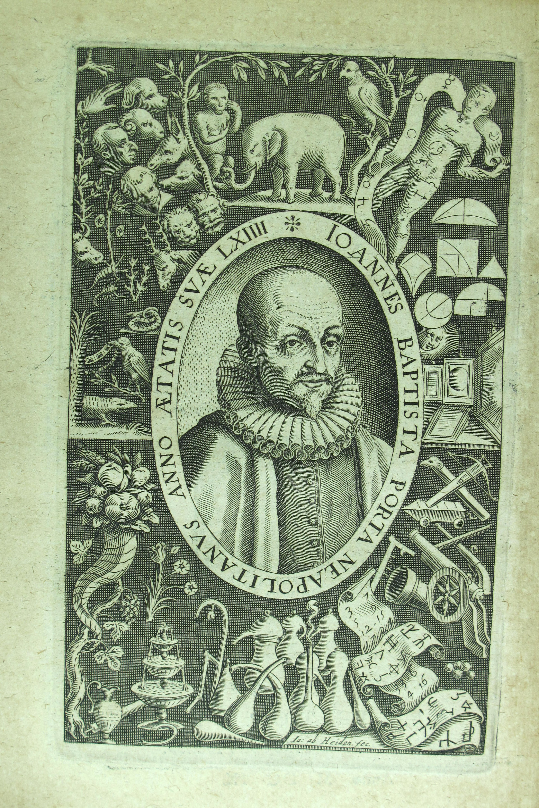

# Giambattista della Porta
**First published Tue May 19, 2015; substantive revision Fri Jul 25, 2025**

*Kodera, Sergius*

To most modern readers, it would stretch definitions to include someone like Giovan Battista Della Porta (1535–1615) in an encyclopedia of philosophy. Yet philosophy in Porta’s time encompassed a far wider range of topics than it does today, including cosmology, meteorology, and physics; biology and human psychology; and moral philosophy and politics. As a prolific writer on topics then associated with more or less alternative currents to Aristotelian natural philosophy (Henry 2008)[^henry-2008], Porta became one of the most famous and popular figures in the intellectual life of the second half of the sixteenth century and beyond. Porta thus ranks among the many rather unorthodox philosophers and in the traditional categories of the peripatetic curriculum. In the rich intellectual ferment that eventually generated the scientific revolution of the following century, Porta constitutes a highly interesting transitional figure because he engaged with the world of objects, craft and chemical substances. From this “scientific underworld” occupied by the “professors of secrets” emerged a naturalized concept of human beings and innovative ideas about science (Smith 2009, Eamon 2011)[^eamon-2011][^smith-2009][^smith-2011], which Porta amply (and critically) reflects.

Porta’s impressive number of texts are written in very different literary genres, ranging from learned Latin treatises to stage plays—mannerist comedies written in Italian, some of which resonated widely and seem to have influenced Shakespeare (Clubb 1964, 2008)[^clubb-1964]. The wonders Porta produced onstage and in his experimental spaces had a decidedly histrionic character, often with the intent to expand experiments and build reliable artifacts generating wonder. Perhaps this alignment of theater and nascent science provides one of the more coherent perspectives on Porta’s many different intellectual endeavors. In his ceaseless and tenacious practical endeavours Porta created “a stage where nature performs” at various levels, unveiling its tricks to demonstrate experiences, and a metaphysical space in which the principles of magic are demonstrated (Eamon 2017, 34)[^eamon-2017]. This kind of naturalism also serves Porta as a model for a peculiar form of self-fashioning (Kodera 2012)[^kodera-2012]. With Porta, creating and designing such kinds of marvels by means of artifacts and different media entailed effectively a reflection on and work with the powers of the human imagination: this is as formidable an intellectual task in Porta’s day as it is in ours. This does not mean that Porta and his contemporaries considered the human imagination as a secondary, harmless entity: quite the contrary was true, as this mental faculty with the power to produce images had somatic effects not only on the body and mind of the individual, but these effects could be passed on—again a set of ideas Porta shares with the Renaissance Neoplatonic Tradition as well as for instance Pietro Pomponazzi’s psychological explanations of the miraculous (Copenhaver 2007, Kodera 2018)[^copenhaver-2007][^kodera-2018].

Verso of Frontispiece from G. B. Della Porta, *De Distillationibus libri IX*. Argentorati: Zetzner 1609, courtesy Universitätsbibliothek Wien.

The frontispiece to the *De Distillationibus libri IX* (1609), with Porta’s portrait, gives a good impression of his many divergent scientific interests, ranging from physiognomies, astrology, ciphers, and the art of memory to distillation, optics, magnetism, alchemy, cross-breeding and the embellishment of (mostly female) bodies—as well as practical jokes.

## 1. Life and works

Born into a noble Neapolitan family in 1535, Porta published his *Magiae naturalis libri IIII* in 1558. The immediate success of this book firmly established Porta’s reputation as a learned magus and professor of secrets in the European world. The book saw sixteen Latin editions; six Italian, seven French and two Dutch versions appeared by 1588 alone (Balbiani 2001)[^balbiani-2001], although in 1583 the book ended up on the Madrid Index of Prohibited Books due to Porta’s naturalistic approach to witchcraft (Ernst 1990)[^ernst-1990]. A second version in 1589 was enlarged to twenty books. Due to severe difficulties with ecclesiastical censorship (the Roman Holy Office had begun legal proceedings against Porta in the early 1570s), he remained under life-long surveillance by the inquisition (Valente 1999)[^valente-1999].

Porta’s many difficulties with the inquisition—censors disapproved of his works on divinatory arts such as physiognomonics, the art of predicting character traits from the faces of humans—were compounded by the distrust of more orthodox intellectuals such as Jean Bodin (1529/30–1596), who would have loved to see Porta burn at the stake for naturalizing the Witches’ Sabbath, because Porta—like Girolamo Cardano (1501–1576)—had divulged a recipe for the infamous witch’s unguent (*Magia* 1558: lib.2, ch. 26; Ernst 1990; Balbiani 2001, Verardi 2018b)[^balbiani-2001][^ernst-1990][^verardi-2018b].

Early in his life, Porta apparently founded an academy of secrets dedicated to the study of natural phenomena. Its members could only be appointed if they had discovered a hitherto unknown segreto (Badaloni 1959/60)[^badaloni-1959]. The meetings seem to have been held in Porta’s Neapolitan palace. This was by no means uncommon, for by the middle of the sixteenth century there existed at least six such academies in town (Eamon 2017)[^eamon-2017]. There also exists some intriguing archaeological evidence for special subterranean meeting rooms under Porta’s villa in Due Porte, then a village just outside Naples (Balbiani 2008)[^balbiani-2008][^balbiani-2008-2]. After 1558, Porta travelled widely, stopping in Apulia, Calabria, Lombardy, Venice, and Paris. In Spain he seems to have visited the court of Philip II, a renowned patron of alchemy who sought miraculous medicines for himself and his family’s ailments.

The *Magia Naturalis* is, unsurprisingly, dedicated to this important patron. Porta presented Philip II with another book on ciphers (*De furtivis litterarum notis vulgo de ziferis libri IV* 1563), followed by *L’arte del ricordare* (1566), a treatise on the art of memory (a Latin version appeared in 1602 under the title *Ars reminsicendi*). In 1579 and during the following years, Porta was repeatedly invited to Rome by Cardinal Luigi D’Este (1538–1586), ostensibly to pursue his research into the secrets of nature, but perhaps more importantly to enjoy some protection in his household during his trial before the inquisition (Perfetti 2001)[^perfetti-2001]. 1580 found Porta overseeing the construction of a parabolic mirror in Venice, where he met Paolo Sarpi (1552–1623) (Reeves 2008)[^reeves-2008].

Having sold parts of his Neapolitan palazzo in the preceding year, Porta returned to Naples in 1582 and began researching the philosopher’s stone at the behest of Cardinal D’Este. In the following two years he published two treaties on agriculture (*Pomarium* 1583, *Olivetum* 1584) and his richly illustrated Humana physiognomia (1584). In 1586 Porta was probably again summoned before the Neapolitan Inquisition, perhaps together with Luigi Tansillo (1510–1568), an influential poet (and a close acquaintance of Giordano Bruno (1548–1600)). Porta was instructed to abstain from publishing on divinatory and magical arts and write comedies instead. a further consequence seems to have been that he had to join a Jesuit lay congregation that dedicated to the care of patients at the *Ospedale degli incurabili*.

That same year Porta returned to Rome under the protection of Cardinal D’Este, who died a couple of years later. In 1588 and back in Naples, Porta published a physiognomony of plants (*Phytognomonica*). The following year saw the publication of the second, much enlarged edition of the *Magia naturalis* and the comedy *Olimpia*, which may have been staged in the presence of viceroy Don Juan de Zuñiga (1551–1608). In 1590, Porta met Tommaso Campanella (1568–1639); in the next year he published the tragicommedia *Penelope*, followed in 1592 by the comedy *Fantesca* as well as *Villae*, a treatise on agriculture.

The Venetian Inquisition prohibited the publication of the Italian version of the Human Physiognomony. The ban was reinforced in 1593, when *De refractione*, a treatise on optics, came out. In 1596 *Trappolaria*—another comedy—was printed. Now famous across all Europe, in 1598 Porta dared to defy the inquisitional ban and published *Della fisionomia del’huomo* under the pseudonym Giovanni de Rosa. For the following three years Porta seems to have kept a deliberately low profile; his tragicomedies *Fratelli rivali* and *Cintia* came out only in 1601. Porta then had the Latin version of his treatise on the art of memory printed, as well as *Peumaticorum libri* *duo* (on the vacuum and how to lift up liquids) and *Curvilinearum elementorum libri duo* (on mathematics), two treatises that reappeared in enlarged versions as *I tre libri spiritali* (1606) and *Elementorum curvilineorum libri tres* (1608). In 1603 Porta outlined a naturalized form of divinatory astrology and physiognomics in the *Coelestis physiognomonia*. Federico Cesi (1585–1630), a young Roman nobleman with a passion for natural philosophy who founded the famous Academia dei Lincei, visited Porta in 1604. *Sorella* was published in the same year. Between 1606 and 1607 the comedies *Astrologo*, *Turca*, *Carnbonaria* and *Moro* were published and a translation of the first book of Ptolemy’s *Almagest* (De Vivo, 2007). The short treatise *De distillationibus* (1608) became another of Porta’s bestsellers, but this success was overshadowed by the death of Gianvincenzo Porta, his brother and collaborator. *De munitione*, a treatise on military fortifications and on firearms, came out in 1608; in the following year two comedies (*Furiosa* and *Chiappinaria*) were published. 1609 also marked the beginning of Porta’s dispute with Galileo Galilei (1564–1642) (another famous member of the Academy of the Lynx) over who had first invented the telescope. The Lincei reopened in 1610, due to the death of Cesi’s father, who had disapproved of Federico’s scientific endeavours; Porta’s discovery of the telescope was acknowledged by the Academy, and he became director of its Naples branch (which, however, never opened, Freedberg 2002)[^freedberg-2002]. Even so, Porta’s role and influence on Cesi seems to have been considerable (Torrini 2018)[^torrini-2018]. The Holy Office prohibited the publication of Porta’s treatise on palmistry, *De ea naturalis physiognomoniae parte quae ad manuum lineas spectat*. In 1611 Porta was one of the founders of the famous academy of the *Otiosi*, an institution dedicated to letters and to science; some of his plays may have been staged there (De Miranda 2000). Porta seems to have worked simultaneously on the telescope and the philosopher’s stone. These endeavours resulted in the draft for his last and largely unfinished work on (more or less) natural magic, the *Criptologia* and the *Thaumatologia*, which was to be dedicated to Rudolf II. This text testifies to Porta’s systematic interest in demonology and Neoplatonic magic (Maggi 2015, Kodera 2025)[^maggi-2015]. Needless to say, it was never to obtain an *imprimatur* by the ecclesiastical authorities. The tragedy *Gregorio* (1611) was published, as well as the comedy *Tabernaria* (1612) the following year; in 1613 Porta was honored by the *Lincei* with a medal cast by Francesco Stelluti (1577–1653). Another comedy, *Fratelli simili*, and the tragedy *Ulisse* were published in 1614. In February 1615 Porta died in the house of his daughter Cinzia: there are no records of Porta’s wife, whose name is unknown (for Porta’s biography in general, see Clubb 1964, Romei 1989; Piccari 2007, Eamon 2017, Verardi 2018)[^clubb-1964][^eamon-2017][^piccari-2007][^romei-1989][^verardi-2018].

## 2. Works on Magic

A large part of Porta’s philosophical speculation is contained in the two versions of his *Magia naturalis* (1558, 1589), crystallized in the persona of the natural magus. Porta seeks to avoid all religious topics, as well as even the remotest hint of ceremonial magic; other than in the third book of Heinrich Cornelius Agrippa of Nettesheim’s (1486–1535) *De occulta Philosophia*, for instance, there are no instructions for prayers, fasting, or invocations (Klaassen 2013)[^klaassen-2013]. Porta’s magic is thus less a way to improve one’s own mind or to communicate with divine forces, and more a means to manipulate objects and human beings. It remains uncertain, however that Porta developed this secular approach to magic merely in the face of ecclesiastical prosecution, (Zambelli 2007)[^zambelli-2007] becasue already the first edition of the Magiae pursues the topic from a decidedly naturalistic perspective. Porta’s magus is a decidedly male figure who unites the physical dexterity of the trickster, the experience of the alchemist, the erudition of the humanist, the astrologer’s command of mathematics, and the intuitive knowledge of the psychic medium in order to embody a superhuman, ideal man capable of manipulating everything and everybody. The magus must be talented, rich, educated, and hard-working; magic is the most noble part of philosophy for Porta (*Magia* 1558: bk. 1, ch. 2). Instead of a priest or metaphysician in quest of the divine—as in Pico della Mirandola or John Dee—(Harkness 1999)[^harkness-1999], Porta’s magus is thus an artifex (a craftsman or mastermind) who knows how to manipulate the natural and occult properties of certain bodies. According to Porta, these qualities are occult because their workings cannot be grasped by our intellect. Yet he infers that occult properties derive from formal, not material causes—partly because a very small quantity of matter often may have an enormous effect (*Magia* 1558: bk. 1, ch. 8).

Magic is therefore a specific science of natural objects (animals, herbs, stones), the servant or minister of nature; in Porta’s characteristic definition of natural magic, just as a peasant prepares the soil to help nature produce its marvelous effects, so the natural magus prepares matter in a special way to allow its natural (but nevertheless occult) properties to appear. Structurally, this magic is a form of applied Platonist metaphysics —in Ernst Cassirer’s words, an emanatist form of physics (“*emanatistische Form der Physik*” Cassirer 2002 [1926]: 128)[^cassirer-2002]. In reasoning highly reminiscent of Marsilio Ficino’s (1433–1499) cosmology in the *De via coelitus comparanda* and the *De amore* (as well as in Agrippa von Nettesheim’s *De occulta Philosophia*) Porta maintains that in the strict hierarchical order of Creation the transcendent forms are directly affiliated with God; they are projected into the world in various manifestations, first into the Angels (or daemons), subsequently into the soul, and ultimately into qualities (qualitates) via the elements, again of celestial origin, as their instruments shape matter (*Magia* 1558: bk. 1, ch. 4).

But these theoretical speculations fill only a minor part of Porta’s two versions of the *Magia naturalis*. The bulk of these texts was dedicated to more or less eccentric recipes: incubators for hens’ eggs, an improved camera obscura that won’t invert its images, tinctures to remove spots from your skin, ways to roast animals alive and drug people, a magic lamp fuelled with hare’s fat that will make even respectable women strip naked, distorting mirrors and a set of surprisingly straightforward chemical recipes (Kodera 2006, Kodera 2020b)[^kodera-2006][^kodera-2020b]. Marvelous performances of this sort were not limited to an audience of ruling elites, but were peddled widely on marketplaces. Wonder drugs and cure-alls filled books by a whole class of semi-literate “professors of secrets” (*professori dei segreti*) who eked out more or less glamorous livelihoods by selling emetics and purges. Their drugs sometimes contained powerful (and experimental) chemical substances, such as mercury oxide and other products of alchemists’ furnaces (Gentilcore 1998; Eamon 2010, 2017; Smith 2011)[^eamon-2010][^eamon-2017][^gentilcore-1998][^smith-2011].

Essentially, the art of the magus consists in channeling or concentrating such natural forces by artisanal practices, for instance by distillation.

Knowledge of such procedures allows the magician to exercise considerable power in ordering and disposing bodies to reveal new and amazing features. Generally, an object’s visible traits, or signatures, are indicative of its occult powers and those powers’ relationship to other objects, both higher and lower in the hierarchy of being. This idea is also central to Porta’s doctrine of physiognomonics (discussed below). A side effect of this universal connectedness of all things is that the world as a whole becomes animated (Hankins 2003)[^hankins-2003].

All things in the universal hierarchy of being are moved by the (irrational) forces of attraction and repulsion they feel for one another. Porta provides an impressive description of the macrocosmic animal, the male and female aspects of which mingle in a harmonious and well-coordinated way, which he expeditiously plagiarized (*Magia* 1589: bk. 1, ch. 9; Ficino 1989 [1489]: lib. 3, ch. 26)[^ficino-1989]. At a deep level—and in a characteristic form of circular reasoning—the cosmology of natural magic thus depends on the workings of a decidedly erotic cosmology itself modeled on human forms of sexuality (Kodera 2010)[^kodera-2010]. The postulation of an affective structure permeating the whole of creation from top to bottom was vital to account for the phenomenon of action at a distance (actio in distans), which Aristotle had expressly ruled out in his *Physics* (7. 2, 244a14– 245b5, see Henry 2008)[^henry-2008].

Porta’s magic is parasitically dependent on manipulating the affective structures of love and hatred that bind together the universe. The principle of universal affective correlations formed the backbone of Renaissance natural magic in general. Porta credits this doctrine to Empedocles (*Magia* 1558: bk.1, ch. 9), who held a reputation as a magus among Porta’s contemporaries (Kingsley 1995)[^kingsley-1995]. These ideas were not only embraced by many of the preternatural philosophers, but were already found in the preface of the *De mirabilibus mundi* ascribed to Albertus, one of Porta’s favorite sources for many of his more unusual *segreti*.

It is thus no wonder that the lodestone has a prominent place in Porta’s performative practice and his theoretical endeavors. Porta takes the attractive powers of magnets on iron as a paradigm for magical attraction: the speculation is that all bodies have an inherent property to attract certain other bodies. In the second version of the *Magia* he plagiarized and popularized many basic insights from an unpublished Jesuit source (Leonardo Garzoni), for instance that the magnet has two opposite poles and the many tricks that could be performed by dint of these attractive and repulsive qualities of the lodestone (Copenhaver 1991, 2007, Ugaglia 2006, Sander 2016, Kodera 2020a)[^copenhaver-1991][^copenhaver-2007][^kodera-2020a][^sander-2016][^ugaglia-2006].

The magician capitalizes on the natural forces of love, hate, attraction and repulsion inherent to the universe to act as a matchmaker, and he produces marvelous offspring: many of the magus’ activities are akin to husbandry. (Again, this is an idea also found in Ficino’s De vita). Porta’s *Magia* 1589 (bk. 2 and 3) contains long chapters on the production of monsters in the vegetable as well as animal worlds (Kodera 2010)[^kodera-2010].

A central topic for Porta is various technologies for attaining vision of the miraculous. He supplies numerous recipes for drugs and magical lamps designed to distort our perceptions (*Magia* 1589: bk. 8, ch 2), some of which also have a strong theatrical orientation (including his witches’ unguent, lenses, telescope and camera obscura, Reeves 2008)[^reeves-2008]. For the most part, Porta’s mirrors were not subjects for speculation, as they had long been in metaphysics, theology, magic and the divinatory arts. Neither were they primarily tools to produce “objective or scientific data” (Daston and Galison 2007; Smith 2009)[^daston-2007][^smith-2009]. Porta’s experiments with lenses and mirrors (such as the improved form of the camera obscura) fit more coherently into the perspective described above: these devices function as generators of marvels, with the objective of stirring spectators’ imaginations (Dupré 2007; Thielemann 2009)[^dupré-2007][^thielemann-2009]. The resulting images take on a form of existence that, like a phantasm, is halfway between “real” and “imaginary” (Giglioni 2011)[^giglioni-2011]. No wonder that Porta’s recipes often come with stories that neatly intertwine with his theoretical speculations, classical myths and popular beliefs. One is about a raging bull which becomes tame and docile when fastened to a barren tree (Kodera 2022)[^kodera-2022]; another is about a hyena’s shadow that will silence barking dogs. Porta was one of the most popular bards of such stories in his time. Much like today’s consumers of science fiction or fantasy literature, early modern readers seem to have delighted in such accounts of inexplicable phenomena, familiar from Classical literature and philosophy, such as Ovid’s *Metamorphoses*, Pliny’s *Naturalis historia*, Aristotle’s *Problemata* and the spurious *De mundo*, and the *mirabilia* (marvels) attributed to Albertus Magnus.

Porta’s tacit refusal to acknowledge the Aristotelian border between sub- and supralunar worlds in cosmology is a salient feature in his account of the hierarchy of being. This erosion of boundaries easily leads to the assumption that the seemingly erratic movements of objects in the sublunar sphere are actually less random than they might appear, because they are governed by secret, divine principles. Conversely, the direct causal nexus between divine powers and created forms accounts for those objects’ potential to operate in seemingly miraculous, but actually natural, ways (*Magia* 1558: bk. 1, ch. 5). Related to these ideas are the doctrine of universal animation and the belief that superior celestial influx is mirrored in or resonates with material objects.

Recently, some historians of thought have explained Porta’s endeavor in the context of Porta’s (often covert) adherence to the traditions of European Astrology and related magical doctrines. And indeed Porta incorporates ideas developed in medieval Aristotelian tradition, especially by Albertus Magnus, which later became an issue for Pietro Pomponazzi and his followers. They have emphasized that such ideas were believed to be in accordance with Aristotelianism and the status of astrology as a science (Weill-Parot 2013, Verardi 2018)[^verardi-2018][^weill-parot-2013]. Initially, Porta’s naturalized version of astrology was perhaps a mere maneuver for detouring around the ecclesiastical censorship of the divinatory arts; in the first edition of the *Magia* (1558) Porta had fully embraced astrological causation, as well as the decisive role of an auspicious astrological moment for magical operations, especially the confection of talismans as described by Ficino in the *De vita* (*Magia* 1558: bk. 1, chs. 15–17; Trabucco 2002, 2005)[^trabucco-2002][^trabucco-2005].

While it is certainly true that Porta cultivated a life-long interest in these theories (and presumably also in their practice), at least his public attitude seems to have changed significantly. This was certainly in part due to the fact that astrology had been condemned in ever harsher terms in the last decades of the 16th century, and to Porta’s ensuing personal difficulties with censorship. Probably in response to these pressures, Porta radicalized his naturalism; it was indeed more profitable to write comedies and to showcase marvelous inventions than to become involved in metaphysics. His recipes usually come without instructions for an auspicious astrological moment, as they seem to have been geared to show stable and repeatable results (Jaolobeanu 2020).

In the next section, we see some of the more inconvenient aspects of Porta’s theory of magic discussed here; its circular reasoning and anthropomorphism reappear in Porta’s ideas on physiognomonics and his naturalied version of astrology (Simon 1980; Védrine 1986)[^simon-1980][^védrine-1986].

## 3. Works on Physiognomonics

Physiognomonics, a proto- or pseudo-science on the rise in the sixteenth century, sought to identify the visible affinities between all physical things. As is for instance amply evidenced in his *Phytognomonica* Porta detected such affinities everywhere, from plants and animals to the bodies and faces of humans, and even further up the ontological scale to the appearance of the planets (Müller-Jahncke 1990)[^müller-jahncke-1990]. Porta’s physiognomonics provides cartographies of the outward appearance of physical bodies aimed at predicting the soul’s hidden inclinations or dispositions (past, present or future). Porta’s effort runs in tandem with the contemporary medical approach towards cartographies of human bodies (as well as landscapes), exemplified most notably by Andreas Vesalius (1514–64) in his revolutionary anatomical studies. Incorporating a huge array of classical and contemporary sources, Porta’s physiognomic texts are an outright summa of this branch of knowledge and practice. Especially in the *Phytognomonica* seems to be inspired by the paracelsian doctrine of signatures. Porta seems to have been the first to introduce Paracelsian medicine in Naples (Paolella 2018, 2021)[^paolella-2018][^paolella-2021].

Within its own historical context, physiognomonics was viewed as a *scientia universalis*, a rational science as good as, or perhaps even better than, the new anatomy, since it could be used for universal description and as a means to identify character traits (Paolella 2015, 2022)[^paolella-2015][^paolella-2022]. In his circular reasoning, Porta’s cosmos becomes more and more anthropomorphic, as universal signatures are imprinted not only into human beings, but also share these physical traits with the stars, animals, herbs and even stones (as explained in Porta’s *Phytognomonica*, Kahn & Perifano 2018)[^kahn-2018].

Porta’s physiognomonic assessments are based on resemblances in external appearance: for instance, men with a dark, Saturnine complexion evocative of dangerous animals are rendered very likely to go to prison (*De ea naturalis physiognomoniae parte quae ad manuum lineas spectat* ch. 12). This example highlights the aesthetics structuring Porta’s physiognomonics: beautiful bodies are also morally good. There is a direct association between beauty, virtue, success and health, as these traits all originate from a good temperament, that is, from a harmonious mixture of the elements. A monstrous body, on the other hand, indicates ill health, bad luck, and dubious moral inclinations. (Kodera 2015)[^kodera-2015]

A truly universal science, physiognomonics provides its master not only with a key for decoding the ciphers written into human faces (by relating them to the shapes of animals) or a manual for reading the lines engraved into the palms of our hands, but also (as Porta suggests) with diagnostic methods for understanding all of creation, from plants to stars. As is amply advertised already in the prefaces to all of his texts on physiognomonics, the art establishes a metonymic relationship between inorganic bodies and psychological qualities (Caputo 1990, Paolella 2004, Muratori 2017, Vígh 2016, 2025)[^caputo-1990][^muratori-2017][^paolella-2004][^vígh-2016][^vígh-2025].

One important aspect of Porta’s physiognomonics is that it is not merely descriptive: bodies may be mapped and their future predicted, but they are nevertheless in a constant state of flux, transition, or mutability. Their essences are not exclusively determined by an invisible substantial form (soul) derived from unchangeable forms—and, in the case of human beings, immortal—as in previous traditions, but result from external circumstances. These environmental influences are decisive for the fate of individuals whose expressions and appearances are unstably shaped. A characteristic quotation illustrates Porta’s understanding of physiognomonics:

> Through this art, we have helped many friends avoid dangers and ascend to honours. Shortly before I wrote these things, I counselled a friend of mine to avoid the company of a certain ugly and unlucky man, an advice he did not want to hear, as his acquaintance had promised him riches; at the end of the day, they were caught by the governor producing counterfeit money in a hide-out and shortly afterwards both ended on the gallows. (*Coelestis physiognomonia*, bk. 1, ch. 2)

It has often been noted that Porta opens perspectives on the sinister tradition of eugenics (Paolella 2015)[^paolella-2015], not uncommon currency in European intellectual culture since its articulation in Plato’s *Timaeus* (90), where a handsome body is stipulated as the abode of a beautiful soul. Apart from the elemental influences altering body and mind, which can be reduced to qualities perceived through touch (such as hot/cold, dry/moist), Porta mentions nutrition, climate, and age as determinants of an individual’s mental and physical shape, not only of human beings but also of animals and even of plants. Disease may also alter an individual’s mental disposition: as an example, Porta mentions fevers—since they dry up the brain, they may cause the patient to become more intelligent. Disease may even instill a capacity for divination. Alterations in outward appearance bear thus significant consequences for the individual’s behaviour and habits (*De humana physiognomonia* bk. 6, ch.1).

From the perspective of religious orthodoxy, the crucial question Porta addresses only with (well-advised) trepidation is whether a change in exterior form can also cause alterations to the soul—i.e., in the substantial and indelible form of humans (*De humana pysiognomonia* bk. 1, ch. 20). Here, Porta takes the position, more common to medical physiologists, that it is a physician’s intervention rather than moral philosophy that cures our bodies and minds. On this view, the body becomes a potential stage for medical intervention into the mental realm (Kodera 2010: ch. 8, Kodera 2015)[^kodera-2010][^kodera-2015].

The concept of the temperaments or humoural mixtures in the human body was originally developed to describe physiological body states: “The four humours were real body fluids, to which largely hypothetical origins, sites, and functions were ascribed” (Siraisi 1990: 105)[^siraisi-1990]. In late Antiquity and in the Middle Ages, the temperaments were understood to fall under the reign of the stars, which influence the generation and corruption of bodies in the sublunar sphere. In an important conceptual step, Porta turns the tables, contending that rather than being controlled by the stars, the medical humours are actually universal descriptors structuring the entire cosmos. With this move in a naturalistic direction, Porta strove to eclipse the astrological elements of his theory. Even though in the *Coelestis physiognomonia* he had declared astrology a vain discipline, Porta added an important qualification to this dismissal: astrology is an erroneous art, but only as long as divination from the stars is not based on the perceptible features of heavenly bodies. Hence, a fine physiognomonist will swiftly derive the relevant temperamental features from the visible appearance of the planets. In this way, all natural bodies remain *substantiae signatae*, cosmically predisposed substances bearing inscriptions of universal signs. The astrological system of categorization was restricted to the medical temperaments, thus associating celestial bodies with a system of signs that pertained to medicine and hence to a lower level in the hierarchy of being. Instead of governing the lower bodies, the stars become subject to the same laws as earthly bodies (*Coelestis physiognomonia*, *proemium*, Paolella 2004)[^paolella-2004]. According to classical medicine, diseases are caused by an imbalance between body fluids—the temperaments. This was a notable shift in terminology and concept: for in the first version of the *Magia naturalis*, Porta had maintained that form had been the decisive factor for the occult property of a thing: now he aligned these properties to elemental qualities (Verardi 2018)[^verardi-2018].

However, close alignment of astrology with medical humours and physiognomonics is well in accordance with Porta’s larger aim of naturalizing the entire cosmos. These interactions also have bearings on Della Porta’s theater, which is not very surprising indeed, as the tradition of physiognomonics was developed in the ambit of the classical stage, notably in Theophrastus*’ Characters*, a text that describes the typical features of comical personae (Kodera 2015, Refini 2017)[^kodera-2015][^refini-2017]. As many students of Porta’s theater noted, sometimes outrightly grotesque displays of physiognomics figure prominently in his numerous comedies. (Clubb 1964, Gherardini, 1971, Bolzoni 2002, Kodera 2015,)[^bolzoni-2002][^clubb-1964][^clubb-2015][^gherardini-1971][^kodera-2015]

## 4. The Book on Ciphers

When seen in the context of the doctrine of physiognomics, it comes as no surprise that Porta authored a book on ciphers, as he believed himself endowed with a special ingenuity for decoding all forms of texts. Renaissance cryptographers in general had a penchant for mystery and the preternatural, as evident from Johannes Trithemius’s *Steganography*, for example. Trithemius, the Abbot of Sponheim, got in trouble with his ecclesiastical censors because he used a complex numerological series of demons’ names, arranged on Lullian wheels, for encryption (Arnold 1991)[^arnold-1991]. With their aura of mystery, ciphers thus qualified as a congenial topic for Porta’s general outlook as a popularizer of secrets and as inventor of marvels. *De furtivis litterarum notis* is apparently the first text on this topic that not only explained various ways to encrypt messages, but also gave detailed instructions on how to decipher coded messages (Strasser 2008)[^strasser-2008]. The art of cryptography had the advantage of attracting the attention of powerful political patrons. For someone aspiring to be the adviser and protégé of one of the more powerful worldly rulers, it was therefore not an unwise choice to write such a book.

## 5. Art of Memory

Porta’s approach to the ancient art of memory is markedly iconic (rather than architectural), as typical for many medieval and early modern formulations of mnemonics and in this respect he claims to have surpassed the classical authors on the subject. In order to organize the memory, Porta recommends constructing a mental picture gallery populated with striking images of persons or groups of persons. He also mentions the important role of contemporary paintings and sculptures by the foremost artists of his time, including Titian, Rafael and Michelangelo. Porta maintains that restoring the memory is like refreshing the colors of a faded painting. Especially in the Italian Arte del ricordare, Porta recommends graphic erotic fantasy, such as sodomitic intercourse, as the strongest memory aid; to illustrate his point, he gives examples from Ovid’s Metamorphoses and from Apuleius. In a manner clearly reminiscent not only of his recipes with hallucinogenic drugs but of his naturalist approach in general, Porta maintains that such erotic images—phantasmata—are so potent that they may even be able to destroy the memory (Bolzoni 1990, 2002 Kodera 2019)[^bolzoni-1990][^bolzoni-2002][^kodera-2019].

## 6. Botany, Agriculture, Horticulture

In *Villae* (*Estates*) Porta presented a kind of *summa* of ancient and modern forestry, agriculture, and horticulture as it had been known and practiced in Europe. In ways that are reminiscent of the principles of the art of memory*, Villae* are organized in a scenic manner, “an imaginary round tour through an open air theater” (Orsi 2005, 53)[^orsi-2005]. The reader is guided through the diverse zones of an imaginary vast country estate. Some scholars have claimed that the *Villae* can also be read a veiled criticism of the policies of Spanish agriculture (Orsi 2005, Rusu 2020)[^orsi-2005][^rusu-2020].

Emphasizing first hand experience, Porta’s *Villae* focuses on plants cultivated in Puglia and the Capitanato, the province surrounding Naples. Referring to classical treaties by Theophrastus, Columella, Pliny, Virgil, and more recent authors as for instance Pontano and Sannazzaro, Porta discusses plants that had been known and in use before the discovery of the Americas. Even so *Villae* was innovative in several respects: it was the first text to dedicate an entire treatise to the cultivation of olives, as well as one on on grafting. This latter topic is especially interesting because it links Porta’s agriculture to his ideas on natural magic. In general the *Villae* betray an implicit astrological agenda as Porta conceives of plants as recipients of celestial influx. Even though *Villae* was not a big success, it implicitly catered to a way of life that took its inspiration from Cicero’s ideal of an independent life (Orsi, 2005, 2008)[^orsi-2005][^orsi-2008]. This went well with a trend in Porta’s day among the ruling classes to move to the countryside, which also resulted in the construction of some of Andrea Palladio’s most impressive rural villas.

As Wechsel, Porta’s German publisher of the *Villae*, noted with exasperation, the long manuscript was in such a terrible state, fraught with so many grammatical and orthographic errors that it had to be most thoroughly emended; yet and regrettably in several places the meaning of a passage “was not to be recovered by another Oedipus.” Even though Wechsel exonerates the author by putting the blame on a corrupt manuscript, his vindication of Porta remains ambiguous because the editor also says that the extent of his emendations become obvious in a comparison of his edition to the *Olivetum*, which had been published eight years earlier, in 1584. Much the same can be said about the *De furtivis litterarum notis*, which is fraught with misspellings, no small matter in a text that is on decoding. These examples indicate that Porta was much more of a prolific author than a careful editor of his texts.

## 7. Mathematics

Even though in structure it was ostensibly orientated on Euclid’s *Elements*, Porta’s *Elementorum curvilineorum libri tres* (1601/1610) flopped, probably because Porta had coined so many fantastic new words for (allegedly) new geometrical shapes, which was perhaps and with hindsight one of his most original ideas (Saiber 2017)[^saiber-2017]. In fact, Porta’s knowledge of classical and contemporary mathematics seems to have been vast, but superficial. Using a language that is both colloquial and empirical, Porta’s mathematics refers to concrete objects and sensory evidence, rather than to logical-deductive definitions. Napolitani accordingly described Porta’s (erroneous) proposal for a method to squaring the circle as sleight of hand. In Porta’s presentation it emerged as yet another *segreto* that had to be arranged in ways that merely appear to be credible, appeal to the senses, and create marvel. Generally the ways of *Elementorum* is foreign to contemporary discussions in the field: Accordingly both his editions were not commented on by the foremost mathematicians of his time (Napolitani 1990)[^napolitani-1990].

## 8. Optics and the emergent experimental culture

From the first edition of *Magia* on, Porta’s ideas on optics gradually developed over his long career. His approaches to the field were holistic and his characteristic perceptual understanding of images was not necessarily geared towards the development of a coherent optical theory. Motivated by an interest in the theatricality such devices could produce, Porta’s optical endeavors were geared towards controlling or manipulating visual perception (Dupré 2007)[^dupré-2007]. The texts on plane and curved mirrors, lenses, and glass orbs are closely tied to devices which had the capacity to generate marvelous optical illusions (such as cabinets of mirrors, images that appear to be suspended in the air, or spy-glasses). The same is true of Porta’s optical analysis of the anatomy of the human eye.

For example Porta’s experiments with the construction of parabolic mirrors made from glass resulted in the invention of an improved *camera obscura* that—in theory at least—had the potential to produce images that were not upside down. Porta recommends this artifact, a combination of a convex lens and a concave mirror, for setting up theatrical shows. He uses the same setup of lenses and mirrors for his spy-glass. This telescope became a very important tool for astronomers during the scientific revolution. Yet, in Porta’s day, telescopes were usually considered to be instruments for image-making rather than tools for measuring the positions of stars (Dupré 2007, Reeves 2008, Dijksterhuis 2017)[^dijksterhuis-2017][^dupré-2007][^reeves-2008].

In recent years, some researchers on Porta’s optics have emphasized that this was not necessarily a shortcoming. Porta’s hard work to improve and investigate the qualities of optical devices with the potential to create marvel generated not only some important discoveries, it also contributed to optical theory. The problem of the relationship between the point of inversion and the focal point in curved mirrors is a case in point, because Porta’s work contributed to the emergence of the concept of virtual and real images (Borrelli 2014, 2017)[^borrelli-2014][^borrelli-2017]. In this case, Porta’s hands-on approach proved particularly fruitful as it successfully translated artisanal knowledge to the domain of literary culture of the sixteenth century. This was highly innovative, because optical theorists still were largely ignorant of the heuristic potential of the new artifacts produced from *cristallo*, or Venetian soda glass.

Essentially, Porta’s strategy consisted in first gaining an understanding of the effects of simple artifacts and then building on that knowledge to construct (or imagine) ever more complex devices. His particular mode of investigation of the physical properties of artifacts in conjunction with diagrams served Porta to design new artifacts with even more amazing properties. Borrelli has described this as a process of “bottom-up modeling” and as markedly different form medieval and traditional perspectivist optics. Encompassing a more comprehensive approach to optics than for instance Johannes Kepler, Porta conceived of optics as related to images as we perceive them and not to what rays do. This led Porta to compare the human eye to a *camera obscura*; it was a claim that met the criticism of Kepler (Borrelli 2014, 2017, Dijksterhuis 2017)[^borrelli-2014][^borrelli-2017][^dijksterhuis-2017]. Yet, and in marked difference to Francis Bacon, who used Porta’s experiments as openings for new experiments, Porta’s endeavors were geared towards the production of artifacts that would render stable and repeatable effects. This approach also made up for an important part of Porta’s reception in seventeenth-century England. (Jalobeanu 2020)[^jalobeanu-2020].

Despite the many contradictions and problems in Porta’s works that until recently have lead to an overwhelmingly negative assessment of his role in the history of science, more recent studies have identified Porta’s combination of artisan culture and diagrammatic methods as extremely important for later research strategies in the experimental science of the seventeenth century. As Borrelli has claimed in a series of publications, Porta’s obdurate ways of working with real artifacts in his experimental space, in conjunction with diagrams and other paper tools would, with hindsight, easily translate into what was soon to become modern laboratory practice. Even so, these efforts came comparatively late in Porta’s long life. The *De telescopio* remained in manuscript draft and did not represent Porta’s public persona as magus. Nevertheless these texts testify to the author’s versatility in accommodating his own endeavor to the most recent trends in early modern science. (Frangenberg 1991, Fumikazu 2011, Borrelli 2014, 2017)[^borrelli-2014][^borrelli-2017][^frangenberg-1991][^fumikazu-2011].

Hence, by the standards of his day, Porta’s ceaseless endeavors were neither unsophisticated, undignified, nor disingenuous. Quite on the contrary, Porta’s activities could well rank as privileges of members of the upper classes, and especially so as long as they were geared towards theatricality, and the planning of devices of wonder. Accordingly, during the seventeenth century Porta was perceived as a virtuoso rather than as a natural magician. (Jalobeanu 2020)[^jalobeanu-2020]. As many scholars have aptly pointed out, such artifacts did not necessarily need to be useful or effective or to engender rational reflection. The production of marvel was a respectable end in itself (Wolfe 2004 Lazardzig 2008 Eming, 2020)[^eming-2020][^lazardzig-2008][^wolfe-2004].

## 9. Distillation

Distillation was a key artisanal model for Porta, because he maintained that by means of this technology, one could extract the essences, that is the ‘spirits’ or souls of all things. Porta was here following a tradition in alchemy that in his day was associated with Arnaldo da Villanova and Ramon Llull. Porta invented a new type of alembic, with a couple of beaks from which two different types of substances evaporate. He also Porta applied the conceptual model of distillation to many different arts: to describe technologies for the purification of metals, to meteorological phenomena, such as rain or clouds and even as a design for processes of social reform (conceived of as a purification of society). In this last sense Porta’s art of distillation resonates with his claims about policing society made in his physiognomics. This art spilled over into Porta’s ideas about the refinement of substances: for the *De distillationibus* also describes the use of different animal shapes of alembics for the distillation of different substances. Thus for instance Porta maintains that a bear-shaped alembic is ideal for the refinement of coarse substances (Kahn & Perifano 2018, Perfetti 2001, Eamon 2017, Borrelli 2019)[^borrelli-2019][^eamon-2017][^kahn-2018][^perfetti-2001].

## 10. Meteorology

As in his optics with the model of the *camera obscura* and the eye, so Porta explains meteorological phenomena by experimental simulation. By showing how water condensates in some of his artfully designed glass-works he demonstrates that rain is caused by condensation of air into water; in similar setups he evidences how rain or winds are generated by the mixture of hot and cold air (Borrelli 2019, Paolella, 2024)[^borrelli-2019][^paolella-2024]. Even though this was an undoubtedly an innovative approach, such ‘word machines’—automata that simulated cosmological phenomena—were allegedly constructed by Archimedes. In early modern Europe such artifacts had been a formidable topic in learned natural magic at least since Ficino’s day (Toussaint 2002)[^toussaint-2002]. From this perspective, Porta’s experimental set-ups point as much in the direction of modern meteorology as exemplary virtuoso artisan’s culture during the seventeenth century, such as Cornelius Drebbel’s artifacts that simulated sea-tides (Dijksterhuis 2017)[^dijksterhuis-2017].

## 11. Repetition, Evolution and Adaptation of Ideas in different contexts: Porta’s Hydraulics

Porta recycled and gradually expanded many of his ideas and instructions in different works over long periods of time, to appear frequently in enlarged or amplified versions. Thus, some topics evolved into separate treatises; at other times, Porta attempted to reformulate his ideas to suit ecclesiastical regulations. This was prominently the case with Porta’s ideas on physiognomy discussed above. In other instances, Porta sought to adapt his ideas to the emerging scholarly standards of the new science of his day. A case in point is his treatment of powers of diverse siphons to lift water or to separate different fluids (for instance water from wine) from each other. What seems to have been originally intended as a party gag in the first version of the *Magia naturalis* (where Porta probably plagiarized from a chapter in Girolamo Cardano’s *De subtilitate*), migrated to the enlarged version of the *Magia*, to become eventually a key topic in *I tre libri spiritali*. Here, amidst boasting that he could build structures that would be capable of lifting water up to the highest mountains, Porta ties his claims about the powers of siphons to a discussion on the impossibility of the vacuum. Finally he discusses similar experimental devices in the *De aeris transmutations*. They were eagerly copied and amplified by the Jesuit Gaspar Schott, whereas Francis Bacon significantly developed them into new directions. (Trabucco 2016, Jalobeanu 2020)[^jalobeanu-2020][^trabucco-2016]

## 12. Porta’s Place in the History of Philosophy

In most encyclopedias over the centuries, Giovan Battista Porta is remembered for particular inventions—for instance, the telescope (Reeves 2008; Saito 2011; Balbiani 2008)[^balbiani-2008][^balbiani-2008-2][^reeves-2008][^saito-2011]. This tendency to decontextualize Porta’s (vast) oeuvre by treating it as a quarry of ideas actually dates back to his contemporaries. Especially so in the case of the two versions of the *Magia*, which was a vast collection of recipes, this seems was a rather common mode of reception. Thus for instance Antoine Mizault (ca. 1512–1578) published *Memorabilium, sive arcanorum omnis generis, per aphorismos digestorum, Centuriae IX* (1566), a large collection of secrets in which he attributes eighteen recipes from the Magiae, which Mizault apparently had perceived as novelties. Parts of the first version of *Magia* were also quickly plagiarized by another influential compiler of secrets, Johannes Jacob Wecker (1528–1586). His often reprinted *De secretis libri XVII* (1587) further increased the already considerable resonance of the *Magiae*. Thus later scholars and theologians as varied in temperament and intellectual inclination as Francis Bacon (1561–1626), William Gilbert (1544–1603), Athansius Kircher, S.J. (1602–1680), Christian Knorr von Rosenroth (1636–89) or Georg Philipp Harsdörfer (1607–1658). Thus, Bacon discusses and transforms many experiments form Porta’s Villae in his Sylva sylvarum (Rees 1990 Rusu 2020)[^rees-1990][^rusu-2020]. In very different ways Kircher, though overtly condemning Porta, knowingly plagiarized his *segreti* (Vermeir 2012)[^vermeir-2012]. William Gilbert (1544–1603) felt it necessary to take issue with the animistic theories that Porta used to explain magnetism (Kodera 2014)[^kodera-2014]. Tommaso Campanella (at that time still a faithful disciple of Bernardino Telesio (1508/9–1588) had already deplored Porta’s lack of method, which precluded the development of a new metaphysics of nature (Eamon 1995)[^eamon-1995]. For several decades after his death, Porta’s name remained tied to witchcraft on both sides of a controversial debate. Thus Bodin’s indictment of Porta’s naturalistic explanation of the sabbath was repeated in Martin Anton Delrio’s (1551–1608) highly influential *Disquisitionum magicarum* lib. vi (1599), an encyclopedic inquiry into the subject. Frederich von Spee (1591–1635) cites Porta in what by then had become a single-handed criticism of the persecution of witches. Thus the recipe for the witches’ unguent in Spee’s *Cautio criminalis seu de processio contra sagas* (1631) is used as evidence against the claims of Bodin and Delrio.

On another front Porta’s physiognomics found an echo in Harsdörfer’s universal linguistics. In his *Frauenzimmer Gesprächspiele* (1641–49) physiognomics figures as one among countless linguistic systems, as part of a characteristically baroque science of signs and symbols. Harsdörfer aligned Porta’s physiognomics with the influential Italian tradition of iconographers and theorists of art such as Cesare Ripa (ca. 1555–1622). The influential poet, cabbalist and theosophist Knorr von Rosenroth (1636–89) produced a careful and nuanced translation of Porta’s *Magia naturalis* into German (1680, Battafarano 1990, Balbiani 2008)[^balbiani-2008][^balbiani-2008-2][^battafarano-1990]. In France too both editions of the *Magia* remained very popular throughout the sixteenth century: in the learned world, Mersenne commented on Porta’s optics (Beaulieu 1990)[^beaulieu-1990].

It is only in recent Porta scholarship that his endeavor has been encompassed in a less fragmented way. Many scholars have concluded that Porta reacted to the challenges of ecclesiastical censorship by attempting to abstain from metaphysical speculation and theology (Trabucco 2002, 2005)[^trabucco-2002][^trabucco-2005]. Accordingly, he developed a strictly natural magic—natural in the sense that the formal principles driving the movement of things in the cosmos were taken as “occult”, with many causes of their often marvelous properties per se unknowable to us. Porta’s experiments thus prudently sought to eclipse all hint of religious topics, including God, the soul, and demons. Firmly rooted in a southern Italian intellectual environment, Porta also is silent on Copernicanism or the discovery of the new world. He is thus one of the emblematic figures at the threshold of modernity (Torrini 2016)[^torrini-2016]. By eliding discussion of the metaphysical and religious implications of his experiments, Porta tends to direct attention to the physical preconditions and occult yet natural qualities that allow for spectacular manifestations of portentous qualities in physical bodies, whether human, animal or vegetable. For Porta, the visible and perceptible qualities of certain material dispositions become embodied signs of a larger and ultimately divine cosmic order to which all natural bodies, including human beings, are subject. The infamous recipe for an unguent employed by witches is a good example of Porta’s approach: the nocturnal flights and orgiastic encounters with demons and the devil that represent witchcraft’s stock-in-trade are, according to Porta, in fact mere hallucinations caused by belladonna—a material substance with occult but non-demonic properties (Balbiani 2001)[^balbiani-2001]. This explanation rests on the extent to which the human soul is affected by the occult properties of natural substances. Like Pietro Pomponazzi (1462–1525), who with his *De incantationibus* had sought to naturalize all miracles, Porta seeks to bypass the question of “proper” miracles produced by divine intercession. Yet, and in contrast to Pomponazzi, who sought to eliminate as much as he could of the preternatural, Porta continued to believe fervently in occult sympathies up to his last unpublished works. Thus, and perhaps for the first time in Porta’s long career, the late *Thaumaturgia* systematically address Neoplatonic demonology and with the metaphysics of Christianity (Maggi 2015)[^maggi-2015].

Porta’s account thus has the marked and unorthodox tendency to eclipse human agency aside from the figure of the natural magus, who by dint of his natural talent, erudition, and wealth is in a position to manipulate and command the natural properties of many substances and objects. Porta himself cultivated an image of being far keener on staging marvellous experiments or divulging (more or less credible) secrets than on investigating, say, theoretical foundations of natural causation. His approach geared to the naturalization of the human being—body and mind —is perhaps the most suitable focus for studying his thought; here his ideas can be linked not only to contemporaries of his such as Giordano Bruno but also to the tradition of libertine philosophers leading up to Marquis de Sade (1740–1814). In similar contexts, Porta’s *Humana Physiognomonia* became a foundational text for 18th and 19th century pysiognomists, phrenologists and criminologists such as Johann Kaspar Lavater (1741–1801), Franz Joseph Gall (1758–1828), and Cesare Lombroso (1835–1909) (Paolella 2008)[^paolella-2008].

When measured against the sophisticated metaphysical backdrop of Neoplatonic Renaissance magic, Porta’s theoretical approach appears disappointingly simple and rather epigonic—or, as Borrelli (2014) has argued, unsystematic and thereby unfettered by doctrinal ballast and open to innovation. Upon closer scrutiny, a very complex picture emerges. When one considers Porta’s numerous literary and scientific texts, he must be ranked among a highly influential group of philosophers / scientists / magicians including Marsilio Ficino, Giovanni Pico della Mirandola (1463–1494), Pietro Pomponazzi, and Agrippa von Nettesheim (see Agrippa 1991)[^agrippa-1991]. Under shifting historical circumstances and in various ways, these “preternatural philosophers” shared a deep interest in the marvelous and the demonic arts (Verardi 2018, Weill-Parot 2013)[^verardi-2018][^weill-parot-2013].

Within this tradition, Porta was a relative latecomer; he dedicated his endeavor to a “sublime science” that catered to a courtly environment increasingly subject to absolutist leadership (Daston and Park 1998)[^daston-1998]. Indeed, Porta managed to attract the attention of the most powerful patrons in the occult arts and alchemy, among them Emperor Rudolph II and Philip II of Spain. When seen in their proper historical context, Porta’s literary and scientific activities appear as a particular form of self-fashioning for the emerging class of courtiers under absolutist rulers (Greenblatt 1980; Biagioli 1991; MacDonald 2005)[^biagioli-1991][^greenblatt-1980][^macdonald-2005]. Hence, viewing Porta’s oeuvre as a product of this courtly environment helps us understand his contribution to a characteristic form of comportment, where the practice of deception and dissimulation is tied to the crafty staging of marvellous appearances (Snyder 2009; Kodera 2012)[^kodera-2012][^snyder-2009].

This topic of the marvellous (*meraviglia*), and of emotions elicited by attendant stupefaction, is so essential for Porta that he projects it onto the whole of creation, thus endowing it with the status of a universal law. In a crucial passage from the *Magia* 1558, he writes that Nature herself—the great female magician—creates all her wonders out of delight in her own shows (bk. 1, ch. 9). Both this anthropomorphic perception of nature and the importance accorded to marveling in it reveal the close affinity between Porta’s magical practices and his texts for the stage. Porta evidences a keen sense for media’s power to manipulate individuals and masses alike by way of drugs or optical deceptions, wondrous performances, and the employment of the physical traits of individual human beings. He believed that our physiognomonic features, the shapes of our bodies, are indicative of hidden inclinations (for this reason, a master physiognomonist may speedily detect criminals and other abject persons). Hence, throughout Porta’s oeuvre we can detect the link he establishes between policing, naturalizing and assimilating human beings among other animals, all under the sway of occult but natural astrological influences. With his works on physiognomony, Porta undoubtedly sought to offer his services to absolutist rulers and courtiers.

## References（引用注释）

> 原文参考文献已转为脚注引用：文内“作者-年份”引用组后附 [^key] 标记，完整条目见本文末脚注定义。

### List of Porta’s Works

### Other editions

### Historic editions and translations

### Secondary Literature

## Academic Tools

> |   | [How to cite this entry](https://plato.stanford.edu/cgi-bin/encyclopedia/archinfo.cgi?entry=della-porta). |
> | --- | --- |
> |   | [Preview the PDF version of this entry](https://leibniz.stanford.edu/friends/preview/della-porta/) at the [Friends of the SEP Society](https://leibniz.stanford.edu/friends/). |
> |   | [Look up topics and thinkers related to this entry](https://www.inphoproject.org/entity?sep=della-porta&redirect=True) at the Internet Philosophy Ontology Project (InPhO). |
> |   | [Enhanced bibliography for this entry](https://philpapers.org/sep/della-porta/) at [PhilPapers](https://philpapers.org/), with links to its database. |

## Other Internet Resources

[Please contact the author with suggestions.]

## Related Entries

Bacon, Francis | Bodin, Jean | Bruno, Giordano | Campanella, Tommaso | Cardano, Girolamo [Geronimo] | Galileo Galilei | Telesio, Bernardino

### Acknowledgments

The editors and the author would like to thank Emily Fox-Penner for her volunteer efforts the original version of this entry for the Encyclopedia.

[^for-nd]: For a most useful online resource on Porta consult the [ homepage of the *Centro Internazionale di Studi Giovan Battista della Porta* (in Italian)](https://centrostudigbdellaporta.altervista.org/).[Amongst other useful research tools the site provides links to historical editions of Porta’s published works as well as a cumulative bibliography of all the literature extant on Porta. The bibliography is constantly updated by the *spititus rector* of the *Centro*, Alfonso Paolella.]

[^edizione-nd]: The editors of the “Edizione Nazionale Delle Opere di Giovan Battista della Porta” (Naples: Edizioni Scientifiche Italiane, Raffaele Sirri, general editor) have so far printed an impressive number of Porta’s texts:

[^ars-1602]: *Ars reminiscendi*, 1602 (1996).

[^claudii-2000]: *Claudii Ptolemaei magnae constructionis liber primus*, 1588 (2000).

[^coelestis-1603]: *Coelestis physiognomonia*, 1603 (1996).

[^de-1610]: *De aeris transmutationibus*, 1610 (2000).

[^de-2003]: *De ea naturalis physiognomoniae parte quale ad manuum lineas spectat libri duo* (2003).

[^de-1601]: *De humana physiognomonia—libri sex*, 1584/1601 (2011).

[^della-2011]: *Della fisionomia dell’uomo Libri sei*, 1596 (2011–13).

[^de-1608]: *De munitione libri tres*, 1608 (2013).

[^elementorum-1610]: *Elementorum curvilineorum libri tres*, 1610 (2005).

[^pneumaticorum-1601]: *Pneumaticorum libri tres*, 1601 (2008).

[^taumatologia-2013]: *Taumatologia e Criptologia* (2013).

[^teatro-2000]: *Teatro*, in 4 Volumes (2000–2003)

[^villae-2010]: *Villae*, in 3 Volumes, 1592 (2010).

[^magia-2025]: *Magia naturalis* 1589 (2025)

[^de-2025]: *De refractione* (2025)

[^de-1962]: *De telescopio*. Edited and introduced by Vasco Ronchi e Maria Amalia Naldoni. Florence: Fondazione Giorgio Ronchi. 1962

[^metoposcopia-1990]: *Metoposcopia*. Edited and introduced by Giovanni Aquilecchia. Naples: Istituto Suor Orsola Benincasa. 1990.

[^de-1609]: *De distillationibus libri IX*. Strasbourg: L. Zetzner, 1609.

[^magiae-nd]: *Magiae naturalis, sive, De miraculis rerum naturalivm libri IIII*. Naples: Matthias Cancer, 1558.

[^to-nd]: To this date, there are still very few **English translations** of Porta’s works available. Especially the editions to Fratelli Rivali (Clubb) and Sorella (Beecher and Ferraro), two of Porta’s plays, contain highly readable and valuable introductions:

[^magia-1658]: *Magia Naturalis* [ed.1589]: *Natural magick*. London, 1658. [Anastatic reprint, New York: Basic Books, 1957]

[^gli-1980]: *Gli duoi fratelli rivali*: Della Porta, Giovan Battista, 1980, *Gli duoi fratelli rivali* / *The Two Rival Brothers*, bilingual version, translated with introduction by L. G. Clubb, Berkeley: University of California Press.

[^sorellla-2000]: *Sorellla*: della Porta, Giovanbattista, 2000, *The Sister*, translated with introduction by Donald Beecher and Bruno Ferraro, Ottawa: Dovehouse.

[^l’arte-2012]: *L’arte del ricordare* [tr. of the Italian version of Ars reminiscendi]: Della Porta, Giovan Battista, 2012, *The Art of Remembering*, transl. by Miriam Aloisio & al., ed. by Armando Maggi, Ravenna: Longo.

[^agrippa-1991]: Agrippa von Nettesheim, Heinrich Cornelius, 1991, *De occulta philosophia libri tres*, ed. by Vittoria Perrone Compagni, Leiden: Brill.

[^arnold-1991]: Arnold, Klaus, 1991, *Johannes Trithemius (1462–1516)*, Würzburg: Schöningh.

[^badaloni-1959]: Badaloni, Nicola, 1959/1960, “I fratelli Della Porta e la cultura magica ed astrologica a Napoli nel ‘500”, *Studi Storici*, 4: 677–715.

[^balbiani-1999]: Balbiani, Laura, 1999, “La ricezione della Magia naturalis di Giovan Battista della Porta nella Cultura e scienza dall’Italia all’Europa”, *Bruniana et Campanelliana*, 5: 277–303.

[^balbiani-2001]: –––, 2001, *Giambattista della Porta*, Frankfurt/M: Lang.

[^balbiani-2008]: –––, 2008, “Alte und neue Medien in der Della Porta-Rezeption: enzyklopädische Nachschlagewerke und World Wide Web”, Morgen-Glantz. *Zeitschrift der Christian Knorr von Rosenroth- Gesellschaft*, 18:191–214.

[^balbiani-2008-2]: –––, 2008, “Die Übersetzung der Magia Naturalis von Giovan Battista Porta: Christian Knorr von Rosenroth als Vermittler naturwissenschaftlicher Kenntnisse”, Morgen-Glantz. *Zeitschrift der Christian Knorr von Rosenroth-Gesellschaft*, 11: 105–123.

[^baldini-2001]: Baldini, Ugo, 2001, “The Roman Inquisition’s Condemnation of Astrology: Antecedents, Reasons and Consequences”, in *Church, Censorship and Culture in Early Modern Italy*, edited by Gigliola Fragnito, translated by Adrian Belton, pp. 79–110. Cambridge: Cambridge University Press.

[^battafarano-1990]: Battafarano, Italo Michele, 1990, “Spee – Harstoerffer –Knorr von Rosenroth. La ricezione di Giovan Battista Della Porta in Germania dalle polemiche demonologiche alla genesi del linguaggio scientifico tedesco”, in Maurizio Torrini (ed.), *Giovan Battista Della Porta nell’Europa del suo tempo.* Naples: Guida, pp. 311–335.

[^beaulieu-1990]: Beaulieu, Armand, 1990, “L’influence de Della Porta sur la physique en France au XVIIe siécle”, in Maurizio Torrini (ed.), *Giovan Battista Della Porta nell’Europa del suo tempo*. Naples: Guida, pp. 291–309.

[^biagioli-1991]: Biagioli, Mario, 1991, *Galileo, Courtier: The Practice of Science in the Culture of Absolutism*, Chicago: University of Chicago Press.

[^bolzoni-1990]: Bolzoni, Lina, 1990, “Retorica, teatro, iconologia, nell’arte della memoria del Della Porta”, in *Giovan Battista della Porta nell’ Europa del suo tempo*, Naples: Guida, pp. 337–385.

[^bolzoni-2002]: –––, 2002, *The Gallery of Memory: Literary and Iconographic Models in the Age of the Printing Press*, Jeremy Parzen (transl.), Toronto: University of Toronto Press.

[^borrelli-2011]: Borrelli, Arianna, 2011, “Giovan Battista della Porta’s Neapolitan Magic and his Humanistic Meteorology”, in Siegfried Zielinski and Eckhard Fürlüs (eds.), *Variantology 5. On Deep Relations of Arts, Sciences and Technologies, Cologne*: Walter König, pp. 103–130.

[^borrelli-2014]: –––, 2014, “Thinking with Optical Objects: Glass Spheres, Lenses and Refraction in Giovan Battista della Porta’s optical writings”, *Journal of Early Modern Studies*, 3: 39–62.

[^borrelli-2017]: –––, 2017, “Optical Diagrams as ‘Paper Tools’: Della Porta’s Analysis of Biconvex Lenses from De Refractione to De Telescopio”, in Arianna Borrelli, Giora Hon and Yaakov Zik (eds.), *Giambattista Della Porta (1535–1615). A Reassessment*, Cham, Switzerland: Springer, pp. 57–96

[^borrelli-2019]: –––, 2019, “Heat and Moving Spirits in Telesio’s and Della Porta’s Meteorological Treatises”, in Pietro Daniel Omodeo (ed.), *Bernardino Telesio and the Natural Sciences in the Renaissance*, Leiden: Brill pp. 66–95.

[^caputo-1982]: Caputo, Cosimo, 1982, “La struttura del segno fisiognomico. Giambattista della Porta e l’universo culturale del ’500”, *Il Protagora*, 22: 63–102.

[^caputo-1990]: –––, 1990, “Un manuale di semiotica del Cinquecento: il ‘De humana Physiognomonia’ di Giovan Battista della Porta”, in Maurizio Torrini in Maurizio Torrini (ed.), *Giovan Battista della Porta nell’ Europa del suo tempo*, Naples: Guida, pp. 69–91.

[^cassirer-2002]: Cassirer, Ernst, 2002, *Individuum und Kosmos in der Philosophie der Renaissance. Die Platonische Renaissance in England und die Schule von Cambridge*, Hamburg: Meiner.

[^clubb-1964]: Clubb, Louise George, 1964, *Giambattista della Porta, Dramatist*, Princeton: Princeton University Press.

[^clubb-2015]: –––, 2015, “Not By Word Alone: Beyond the Language of Della Porta’s Theater”, *Bruniana & Campanelliana*, 21: 111–121.

[^copenhaver-1991]: Copenhaver, Brian P., 1991, “A Tale of Two Fishes, Magical Objects in Natural History from Antiquity through the Scientific Revolution”, *Journal of the history of ideas*, 25: 373–398.

[^copenhaver-1998]: –––, 1998, “The Occultist Tradition and its Critics” in Daniel Garber and Michael Ayers (eds.) *The Cambridge History of Seventeenth-Century Philosophy*, vol. 1 pp. 454–457, Cambridge: Cambridge University Press.

[^copenhaver-2007]: –––, 2007, “How to Do Magic and Why: Philosophical Prescriptions”, in James Hankins (ed.), *The Cambridge Companion to Renaissance Philosophy*, Cambridge: Cambridge University Press.

[^daston-1998]: Daston, Lorraine and Katharine Park, 1998, *Wonders and the order of nature*, 1150–1750, New York: Zone Books.

[^daston-2007]: Daston, Lorraine and Peter Galison, 2007, *Objectivity*, New York: Zone Books.

[^de-2000]: De Miranda, Girolamo, 2000, *Una quiete operosa. Forma e pratiche dell’Accademia napoletana degli Oziosi*, Naples: Fridericiana Editrice.

[^de-2007]: De Vivo, Raffaella, 2007, “Giambattista della Porta e la traduzione del primo libro dell’Almagesto di Tolomeo e del commento di Teone”, in Raffaele Sirri (ed.), *Atti del convegno di studi Giambattista della Porta in Edizione Nazionale*, Naples: Istituto italiano per studi filosofici, pp. 81–99.

[^dijksterhuis-2017]: Dijksterhuis, Fokko Jan, 2017 “Magic from the North: Instruments of Fire and Light in the Early Seventeenth Century”, in Arianna Borrelli, Giora Hon and Yaakov Zik (eds), *Giambattista Della Porta (1535–1615). A Reassessment*, Cham, Switzerland: Springer, pp. 125–143.

[^dupré-2007]: Dupré, Sven, 2007, “Images in the air: Optical Games, Magic and Imagination”, in C. Göttler and W. Neuber (eds.), Spirits Unseen. *The Representation of Subtle Bodies in Early Modern European Culture*, Leiden: Brill pp. 71–91.

[^eamon-1994]: Eamon, William, 1994, *Science and the Secrets of Nature: Books of Secrets in Medieval and Early Modern Culture*, Princeton: Princeton University Press.

[^eamon-1995]: –––, 1995, “Natural Magic and Utopia in the Cinquecento. Campanella, the Della Porta Circle, and the Revolt of Calabria”, *Memorie Domenicane*, 26 n.s. [nuova serie]: 369–402.

[^eamon-2010]: –––, 2010, *The Professor of Secrets: Mystery, Magic and Alchemy in Renaissance Italy*, Washington DC: National Geographic.

[^eamon-2011]: –––, 2011, “How to Read a Book of Secrets”, in Elaine Leong and Alisha Rankin (eds.), *Secrets and Knowledge in Medicine and Science, 1500–1800*, Surrey and Burlington: Ashgate, pp. 23–46.

[^eamon-2017]: –––, 2017, “A theater of Experiments: Giambattista Della Porta and the Scientific Culture Renaissance Naples”, in Borrelli A., Hon. G., and Zik Y., (eds), *Giambattista Della Porta (1535–1615). A Reassessment*, Cham, Switzerland: Springer, pp. 11–38.

[^eming-2020]: Eming, Jutta, 2020, “Magie und Wunderbares. Aspekte ihrer ästhetischen und epistemischen Konvergenz,” in Jutta Eming, Volkhard Wels (eds.), *Der Begriff der Magie in Mittelalter und Früher Neuzeit*, Wiesbaden: Harrassowitz, pp. 81–112

[^ernst-1990]: Ernst, Germana, 1990, “I poteri delle streghe tra cause naturali e interventi diabolici. Spunti di un dibattito”, in Maurizio Torrini (ed.), *Giovan Battista Della Porta nell’Europa del suo tempo*, Naples: Guida, pp. 167–197.

[^ficino-1989]: Ficino, Marsilio, 1989 [1489], *Three Books on Life*, Carol V. Kaske and John R. Clark (ed., trans, comment). Binghamton, NY.: Medieval and Renaissance Texts and Studies in conjunction with the Renaissance Society of America.

[^frangenberg-1991]: Frangenberg, Thomas, 1991, “Perspectivist Aristotelianism: Three Case-studies of Cinquecento Visual Theory”, *Journal of the Warburg and Courtauld Institutes*, 54: 137–158.

[^freedberg-2002]: Freedberg, David, 2002, *The Eye of the Lynx: Galileo, His Friends, and the Beginning of Modern Natural History*, Chicago: University of Chicago Press.

[^fumikazu-2011]: Fumikazu, Saito, 2011, *O telescópio na magia natural de Giambattista della Porta*, São Paulo, Educ/Livraria da Física/FAPESP.

[^gentilcore-1998]: Gentilcore, David, 1998, *Healers and Healing in Early Modern Italy*, Manchester: Manchester University Press.

[^gherardini-1971]: Gherardini, Paola, 1971, “Problemi critici e metodologici er lo studio del teatro di Giovan Battista Porta”, *Bibbliotheca teatrale*, 1: 137–60.

[^giglioni-2011]: Giglioni, Guido, 2011, “Coping with Inner and Outer Demons: Marsilio Ficino’s Theory of the Imagination”, in Yasmin Haskell (ed.), *Diseases of the Imagination and Imaginary Disease in the Early Modern Period*, Turnhout: Brepols, pp. 19–51.

[^greenblatt-1980]: Greenblatt, Stephen, 1980, *Renaissance Self-fashioning: From More to Shakespeare*, Chicago: University of Chicago Press.

[^hankins-2003]: Hankins, James, 2003, “Ficino, Avicenna and the Occult Powers of the Rational Soul”, in Fabrizio Meroi and Elisabetta Scapparone (eds.) *La magia nell’Europa moderna: Tra antica sapienza e filosofia naturale*, Florence: Olschki, pp. 35–52

[^harkness-1999]: Harkness, Deborah E., 1999, *John Dee’s Conversations with Angels: Cabala, Alchemy, and the End of Nature*, Cambridge: Cambridge University Press.

[^henry-1986]: Henry, John, 1986, “Occult Qualities and the Experimental Philosophy. Active Principles in pre-Newtonian Matter Theory”, *History of Science*, 24: 335–81.

[^henry-2008]: –––, 2008, “The Fragmentation of Renaissance Occultism and the Decline of Magic”, *History of Science*, 46: 1–48.

[^jalobeanu-2020]: Jalobeanu, Dana, 2020, “Enacting recipes: Giovan Battista Della Porta and Francis Bacon on technologies, experiments, and processes of nature”, *Centaurus*, 62: 425–446.

[^kahn-2018]: Kahn, Didier & Perifano, Alfredo, 2018, “Giambattista Della Porta e l’allegoria alchemica *De Phoebi et Pythonis pugna*”, in A. Paolella, G. Rispoli (eds.), *Il cenacolo alchemico: incontri ed eventi ispirati al pensiero di Giovan Battista Della Porta*, Naples: Il Faro d’Ippocrate, pp. 43–64.

[^kingsley-1995]: Kingsley, Peter, 1995, *Ancient Philosophy, Mystery, and Magic: Empedocles and the Pythagorean Tradition*, Oxford: Clarendon.

[^klaassen-2013]: Klaassen, Frank, 2013, *The Transformations of Magic. Illicit Learned Magic in the Later Middle Ages and Renaissance*, University Park, Pennsylvania: Penn State University Press.

[^kodera-2006]: Kodera, Sergius, 2006, “Der Magus und die Stripperinnen. Giambattista Portas indiskrete Renaissance-Magie”, in B. Felderer and E. Strouhal (eds.), *Rare Künste. Zur Kultur- und Mediengeschichte der Zauberkunst*, Vienna: Springer, pp. 55–78.

[^kodera-2010]: –––, 2010, *Disreputable Bodies. Magic, Gender, and Medicine in Renaissance Natural Philosophy*, Toronto: Centre for Reformation and Renaissance Studies.

[^kodera-2012]: –––, 2012, “Giambattista Della Porta’s Histrionic Science”, *California Italian Studies*, 3: 1–27. [Kodera 2012 available online]

[^kodera-2014]: –––, 2014, “The Laboratory as Stage: Giovan Battista della Porta’s Experiments”, *Journal of Early Modern Studies*, 3: 15–38.

[^kodera-2015]: –––, 2015, “Bestiality and Gluttony in Theory and Practice in the Comedies of Giovan Battista Della Porta”, *Renaissance and Reformation / Renaissance et Réforme*, 38: 83–113

[^kodera-2018]: –––, 2018, “Giovan Battista Della Porta’s Imagination”, in: Christoph Lüthy, Claudia Swan, Paul J.J.M. Bakker, Claus Zittel (eds.) *Image, Imagination, and Cognition. Medieval and Early Modern Theory and Practice*, Leiden: Brill pp. 117–146..

[^kodera-2019]: –––, 2019, “Giovan Battista della Porta’s Erotomanic Art of Recollection”, in Jacqueline Murray and Nicholas Terpstra (eds.), *Sex, gender and sexuality in Renaissance Italy*, London, New York: Routledge, pp. 226–246.

[^kodera-2020a]: –––, 2020a, “Needles and Pins on the Scaffold: Francis Bacon and Giovan Battista della Porta on the Motions of the Human Soul and the Passions of the Lodestone”, *Journal of Early Modern Studies* 9: 33–65.

[^kodera-2020b]: –––, 2020b, “Negotiating Neoplatonic Image Theory: The Production of Mental Images in Marsilio Ficino and Giovan Battista della Porta’s Magic Lamps.” In: Berthold Hub Sergius Kodera (eds.), *Iconology. Neoplatonism and Art in the Renaissance. Perspectives and Contexts of a Controversial Alliance*. New York and London: Routledge pp. 77–93.

[^kodera-2022]: –––, 2022, “Von Stieren und Feigen, Nilschlamm und Mäusen. Rezept und Hieroglyphe bei Giovan Battista Della Porta (1535–1615)”, in Anja Wolkenhauer and Johannes Helmrath (eds.), *Ägypten übersetzen. Fremde Schrift als Imaginationsraum europäischer Kulturen*, Wolfenbüttel: Herzog August Bibliothek, pp. 193–213.

[^lazardzig-2008]: Lazardzig, Jan, 2008, “Gottesfaden und Weltenhebel. Zum Verhältnis von weißer Magie und Mechanik im 17. Jahrhundert”, Morgen-Glantz. *Zeitschrift der Christian Knorr von Rosenroth-Gesellschaft* 18: 113–135.

[^macdonald-2005]: MacDonald, Katherine, 2005, “Humanistic Self-Representation in Giovan Battista Della Porta’s *Della Fisonomia dell’uomo*. Antecedents and Innovation”, *The Sixteenth Century Journal*, 36: 397–414.

[^maggi-2015]: Maggi, Armando, 2015, “Magia e demonologia nelle opere di Della Porta”, Marco Santoro (ed.), *La ‘Mirabile’ Natura. Magia e scienza in Giovan Battista Della Porta (1615–2015)*, Pisa, Rome: Serra, pp. 201–207.

[^müller-jahncke-1990]: Müller-Jahncke, Wolf-Dieter, 1990, “Die *Phytognomonica* Giovan Battista Della Portas als medizinische Signaturenlehre”, in Maurizio Torrini (ed.), *Giovan Battista Della Porta nell’Europa del suo tempo*. Naples: Guida, pp. 93–99.

[^muraro-vaiani-1978]: Muraro-Vaiani, Luisa, 1978, *Giambattista della Porta. Mago e scienziato. In appendice l’indice della Thaumaturgia*, Milan: Feltrinelli.

[^muratori-2017]: Muratori, Cecilia, 2017, “From Animal Bodies To Human Souls: (Pseudo)Aristotelian Animals in Della Porta’s Physiognomics”, *Early Science and Medicine*, 22: 1–23.

[^napolitani-1990]: Napolitani, Pier Daniele, 1990, “La matematica nell’opera di Giovan Battista Della Porta”, Maurizio Torrini (ed.), *Giovan Battista Della Porta nell’Europa del suo tempo*. Naples: Guida, pp. 113–165.

[^orsi-2005]: Orsi, Laura, 2005, “Giovan Battista Della Porta’s *Villa* (1592) between tradition, reality and fiction,” *Annali di storia moderna e contemporanea*, 11: 11–66.

[^orsi-2008]: –––, 2008, “Die literarische Dimension von Giovan Battista Della Portas Villa”, Morgen-Glantz. *Zeitschrift der Christian Knorr von Rosenroth-Gesellschaft*, 18: 153–75.

[^paolella-2004]: Paolella, Alfonso, 2004, “G. B. Della Porta e l’astrologia: la *Coelestis Physiognomonia*”, in M. Montanile (ed.), *Atti del Convegno L’Edizione nazionale del teatro e l’opera di G.B. Della Porta. Salerno 23 maggio 2002*, Pisa-Rome, Istituti Editoriali e Poligrafici internazionali, pp. 19–42.

[^paolella-2008]: –––, 2008, “Die Physiognomonie von Della Porta und Lavater und die Phrenologie von Galls”, Morgen-Glantz. *Zeitschrift der Christian Knorr von Rosenroth-Gesellschaft*, 18: 137–53.

[^paolella-2015]: –––, 2015, “La fisiognomica di G.B. Della Porta e la sua influenza sulle ricerche posteriori”, in *Atti del Convegno Giovan Battista Della Porta nel IV Centenario della morte (1535–1615)*, Piano di Sorrento, 27 febbraio 2015, Roma, ed. Scienze e Lettere, 43–62.

[^paolella-2018]: –––, 2018, “Della Porta e la spagiria”, in Alfonso Paolella and Gennaro Rispoli (eds.), *Il Cenacolo Alchemico, Incontri ed Eventi ispirati al Pensiero di Giovan Battista Della Porta*, Naples: Il Faro d’Ippocrate, pp. 65–88.

[^paolella-2021]: –––, 2021, “The ‘Mal Franzoso’ between Art, History and Literature: Paracelso and Della Porta”, in R. F. Canalis, Massimo Ciavolella (eds.), *Disease and Disability in Medieval and Early Modern Art and Literature*, Turnhout: Brepols, pp. 187–197.

[^paolella-2022]: –––, 2022, “La fisiognomica tra credenza e scienza”, *Studi dellaportiani. Rivista Interdisciplinare*, 1, 61–84.

[^paolella-2024]: –––, 2024, “Giambattista Della Porta’s *De aëris transmutationibus*: Natural Philosophy and the Earth Sciences”, in Lorenza Gianfrancesco and Neil Tarrant (eds.), *The Science of Naples. Making knowledge in Italy’s pre-eminent city, 1500–1800*, London: UCLPress, pp. 83–102.

[^perfetti-2001]: Perfetti, Amalia, 2001, “L’alchimia a Napoli tra Cinquecento e Seicento: Leonardo Fioravanti e Giovan Battista Della Porta in Napoli viceregno spagnolo. Una capitale della cultura alle origini dell’Europa moderna, (sec. XVI-XVII)”, in Monika Bosse, Andrea Stoll (eds.), *Atti del Colloquio tenuto a Bielefeld nel 1994*, Naples: Vivarium, 2001, pp. 311–328.

[^piccari-2007]: Piccari, Paolo, 2007, *Giovan Battista della Porta. Il filosofo, il retore, lo scienziato*, Milan: Franco Angeli.

[^pomponazzi-2011]: Pomponazzi, Pietro, 2011, *De incantationibus*, ed by Vittoria Perrone-Compagni, Florence: Olschki.

[^rees-1990]: Rees, Graham, 1990, “Bacon’s *Sylva Sylvarum*: Prelude to Remarks on the Influence of the *Magia naturalis*”, Maurizio Torrini (ed.), *Giovan Battista Della Porta nell’Europa del suo tempo.* Naples: Guida, pp. 261–271.

[^reeves-2008]: Reeves, Eileen, 2008, *Galileo’s Glassworks: The Telescope and the Mirror*, Cambridge, MA: Harvard University Press.

[^refini-2017]: Refini, Eugenio, 2017, “Bodily Passions: Physiognomy and Drama in Giovan Battista Della Porta”, *Renaissance and Reformation / Renaissance et Réforme* 40: 121–139.

[^romei-1989]: Romei, Giovanna, 1989, “Entry: Della Porta, Giovambattista”, in V. Capelletti (ed.), *Dizionario Biografico degi Italiani*, Rome: Istituto della enciclopedia italiana, Vol. 37, pp. 170–182.

[^rusu-2020]: Rusu, Doina Cristina, 2020, “Using Instruments in the Study of Animate Beings: Della Porta’s and Bacon’s Experiments with Plants”, *Centaurus*, 62: 393–405.

[^saiber-2017]: Saiber, Arielle, 2017, *Measured Words: Computation and Writing in Renaissance Italy*, Toronto: University of Toronto Press.

[^saito-2011]: Saito, Fumikazu, 2011, *O telescopio na magia natural de Giambattista della Porta*, Sao Paolo: Editora Educ.

[^sander-2016]: Sander, Christoph, 2016, “Early-Modern Magnetism: Uncovering New Textual Links between Leonardo Garzoni SJ (1543. 1592), Paolo Sarpi OSM (1552–1623), Giambattista Della Porta (1535–1615), and the Accademia dei Lincei”, *Archivum Historicum Societatis Iesu*, 85: 303–363.

[^shumaker-1972]: Shumaker, Wayne, 1972, *The Occult Sciences in the Renaissance*, Berkeley: University of California Press.

[^simon-1980]: Simon, Gérard, 1980, “Porta, la physiognomie et la magie, les circularités de la similitude”, in M. Jones-Davis (ed.), *La magie et ses langages*, Lille: Université de Lille III, pp. 59–106.

[^siraisi-1990]: Siraisi, Nancy G., 1990, *Medieval and Renaissance Medicine: An Introduction to Knowledge and Practice*, Chicago: University of Chicago Press.

[^smith-2009]: Smith Pamela H., 2009, “Science on the Move: Recent Trends in the History of Early Modern Science”, *Renaissance Quarterly*, 62: 345– 375.

[^smith-2011]: –––, 2011, “What is a Secret? Secrets and Craft Knowledge in Early Modern Europe”, in Elaine Leong and Alisha Rankin (eds.), *Secrets and Knowledge in Medicine and Science*, 1500–1800, Surrey and Burlington: Ashgate, pp. 47–66.

[^snyder-2009]: Snyder, John, 2009, *Dissimulation and the Culture of Secrecy in Early Modern Europe*, Berkeley: University of California Press.

[^strasser-2008]: Strasser, Gerhard F., 2008, “Die europäische Rezeption der kryptologischen Werke Giovanni Battista Della Portas”, Morgen-Glantz. *Zeitschrift der Christian Knorr von Rosenroth-Gesellschaft*, 18: 85–112.

[^tarrant-2013]: Tarrant, Neil, 2013, “ Giambattista Della Porta and the Roman Inquisition. Censorship and the definition of Nature’s limits in sixteenth-century Italy”, *The British Journal for the History of Science*, 46: 601–625.

[^thielemann-2009]: Thielemann, Andreas, 2009, “Lenti e specchi nella scienza e nella pittura del primo Seicento”, in Rocco Sinisgalli (ed.) *L’arte della matematica nella prospettiva*, Atti del Convegno Internazionale di Studi, Roma / Urbino, 8–11 Ottobre 2006, Foligno, pp. 127–149 and pp. 369–382.

[^torrini-2016]: Torrini, Maurizio, 2016, “La fortuna storiografica di Della Porta”, Marco Santoro (ed.), *La ‘Mirabile’ Natura. Magia e scienza in Giovan Battista Della Porta (1615–2015)*, Pisa, Rome: Serra, pp. 47–53.

[^torrini-2018]: –––, 2018, “Giovan Battista Della Porta linceo”, A. Paolella, G. Rispoli (eds.), *Il cenacolo alchemico: incontri ed eventi ispirati al pensiero di Giovan Battista Della Porta*, Naples: Il Faro d’Ippocrate, pp. 27–42.

[^toussaint-2002]: Toussaint, Stéphane, 2002, “Ficino, Archimedes, and the Celestial Arts”, in: Michael J.B. Allen und Valery Rees (eds.): *Marsilio Ficino, His Theology, His Philosophy, His Legacy*, Leiden, Boston: Brill, pp. 307–26.

[^trabucco-2002]: Trabucco, Oreste, 2002, “Riscrittura, censura, autocensura: itinerari redazionali di Giovan Battista della Porta”, *Giornale critico della filosofia italiana*, 22: 41–57.

[^trabucco-2005]: –––, 2005, “Il corpus fisiognomico dellaportiano tra censura e autocensura”, in *I primi Lincei e il Sant’Ufficio. Questioni di scienze e di fede*, Rome: Academia Nazionale dei Lincei, pp. 235–72.

[^trabucco-2016]: –––, 2016, “Nel cantiere della Magia”, in Marco Santoro (ed.), *La ‘Mirabile’ Natura. Magia e scienza in Giovan Battista Della Porta (1615–2015)*, Pisa, Rome: Serra, pp. 219–231.

[^ugaglia-2006]: Ugaglia, Monica, 2006, “The Science of Magnetism before Gilbert: Leonardo Garzoni’s Treatise on the Loadstone,” *Annals of Science*, 63: 59–84.

[^valente-1999]: Valente, Michaela, 1999, “Della Porta e l’inquisizione. Nuovi documenti dell’ Archivio del Sant’Uffizio”, *Bruniana et Campanelliana*, 5(2): 415–434.

[^védrine-1986]: Védrine, Hélène, 1986, “Della Porta e Bruno. Natura e magia”, *Giornale critico della filosofia italiana*, 65: 297–309.

[^verardi-2018]: Verardi, Donato, 2018, *La scienza e i segreti della natura a Napoli nel Rinascimento. La magia naturale di Giovan Battista Della Porta*, Florence: Firenze University Press.

[^verardi-2018b]: –––, 2018b, “Un grand sorcier neapolitain. Della Porta, Bodin e l’“invenzione” dell’unguento delle streghe”, in Alfonso Paolella and Gennaro Rispoli (eds.), Il Cenacolo Alchemico, Incontri ed Eventi ispirati al Pensiero di Giovan Battista Della Porta, Naples: Il Faro d’Ippocrate, pp. 89–104.

[^vermeir-2012]: Vermeir, Koen, 2012, “Openness versus Secrecy? Historical and Historiographical Remarks”, *British Journal for the History of Science*, 45: 165–188.

[^vígh-2016]: Vígh, Éva, 2016, “Moralità e segni fisiognomici nel Della fisonomia dell’huomo di Giovan Battista Della Porta”, in Marco Santoro (ed.), *La “Mirabile” Natura. Magia e scienza in Giovan Battista Della Porta (1615–2015)*, Pisa-Rome: Serra, pp. 111–125.

[^vígh-2025]: –––, 2025, *L’arte segreta. Studi su Giovan Battista Della Porta e sulla fisiognomica*, Lugano: Agorà.

[^weill-parot-2013]: Weill-Parot, Nicolas, 2013, *Points aveugles de la nature. La rationalité sicentifique médiévale face à l’occulte, l’attraction magnétique et l’horreur du vide. XIIIe-milieu du Xve siècle*, Paris: Belles Lettres.

[^wolfe-2004]: Wolfe, Jessica, 2004, *Humanism, Machinery, and Renaissance Literature*, Cambridge: Cambridge University Press.

[^zambelli-2007]: Zambelli, Paola, 2007, *White Magic, Black Magic in the European Renaissance*, Leiden: Brill.
