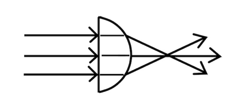
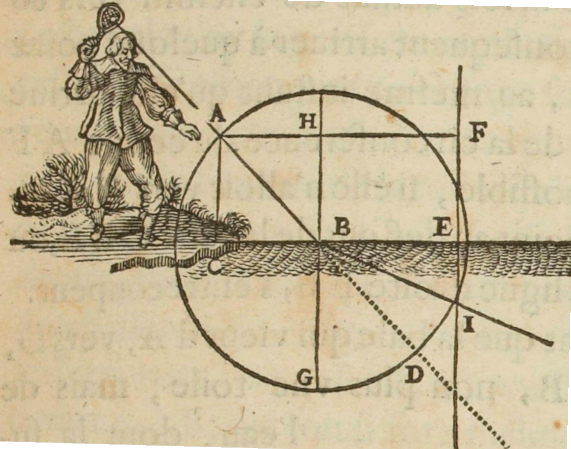
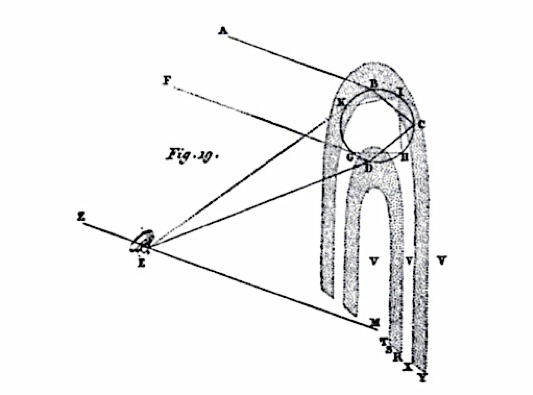
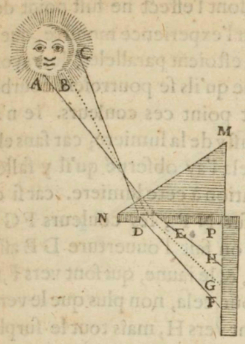
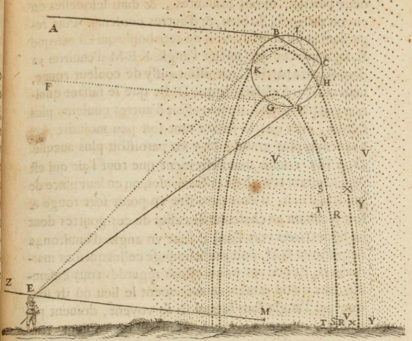

# Descartes’ Method
**First published Wed Jun 3, 2020**

*Dika, Tarek R.*

Descartes’ method is one of the most important pillars of his philosophy and science. This entry introduces readers to Descartes’ method and its applications in optics, meteorology, geometry, and metaphysics.

## 1. The Origins and Definition of Descartes’ Method

The origins of Descartes’ method are coeval with his initiation into a radical form of natural philosophy based on the combination of mechanics, physics, and mathematics, a combination Aristotle proscribed and that remained more or less absent in the history of science before the seventeenth century (on the relation between mechanics, physics, and mathematics in medieval science, see Duhem 1905–1906, 1906–1913, 1913–1959; Maier 1949–1958; Clagett 1959; Crombie 1961; Sylla 1991; Laird and Roux 2008)[^clagett-1959][^crombie-1961][^duhem-1905][^duhem-1906][^duhem-1913][^laird-2008][^maier-1949][^sylla-1991]. Descartes first learned how to combine these arts and sciences from the Dutch scientist and polymath Isaac Beeckman (1588–1637), whom he met in 1619 while stationed in Breda as a soldier in the army of Prince Maurice of Nassau (see Rodis-Lewis 1998: 24–49 and Clarke 2006: 37–67)[^clarke-2006][^rodis-lewis-1998]. Beeckman described his form of natural philosophy as “physico-mathematics” (see AT 10: 67–77 and Schuster 2013)[^schuster-2013], and the two men discussed and corresponded about problems in mathematics and natural philosophy, including problems in the theory of music, hydrostatics, and the dynamics of falling bodies (see AT 10: 46–47, 51–63, 67–74, 75–78, 89–141, 331–348; Shea 1991: 1–121; Damerow et al. 1992; Schuster 2013: 99–167)[^damerow-1992][^schuster-2013][^shea-1991].

While it is difficult to determine when Descartes composed his principal methodological treatise*, Rules for the Direction of the Mind (Regulae ad directionem ingenii*), it is widely believed that he composed the *Rules* in the 1620s (see Weber 1964: 194–207; Gaukroger 1995: 104–187; Schuster 2013: 307–349)[^gaukroger-1995][^schuster-2013][^weber-1964]. More recent evidence suggests that Descartes may have continued working on the *Rules* after 1628 (see Descartes ES). *Rules* contains the most detailed description of Descartes’ method anywhere in his corpus. However, he never completed it, and he never explicitly refers to it anywhere in his published writings or correspondence.

Descartes defines “method” in Rule 4 as a set of

> reliable rules which are easy to apply, and such that if one follows them exactly, one will never take what is false to be true or fruitlessly expend one’s mental efforts, but will gradually and constantly increase one’s knowledge till one arrives at a true understanding of everything within one’s capacity. (AT 10: 371–372, CSM 1: 16)

He divides the *Rules* into three principal parts: Rules 1–12 deal with the definition of science, the principal operations of the method (intuition, deduction, and enumeration), and what Descartes terms “simple propositions”, which “occur to us spontaneously” and which are objects of certain and evident cognition or intuition (e.g., “a triangle is bounded by just three lines”) (see AT 10: 428, CSM 1: 50; AT 10: 368, CSM 1: 14). Rules 13–24 deal with what Descartes terms “perfectly understood problems”, or problems in which all of the conditions relevant to the solution of the problem are known, and which arise principally in arithmetic and geometry (see AT 10: 429–430, CSM 1: 51); Rules 25–36 deal with “imperfectly understood problems”, or problems in which one or more conditions relevant to the solution of the problem are not known, but must be found. These problems arise for the most part in natural philosophy and metaphysics. The *Rules* end prematurely at Rule 21 (see AT 10: 428–430, CSM 1: 50–51).

## 2. The Method in the *Rules*

### 2.1 Descartes’ Definition of “Science”

For Descartes, the sciences are deeply interdependent and interconnected, and they must be learned by means of one method (AT 10: 360–361, CSM 1: 9–10). He defines “science” (*scientia*) in Rule 2 as “certain and evident cognition” (*omnis scientia est cognitio certa et evidens*, AT 10: 362, CSM 1: 10). Many scholastic Aristotelians define science in the same way. However, Aristotelians do not believe that every science satisfies this definition equally; some sciences (like mathematics) may be more exact and, therefore, more certain than others (like natural philosophy). Aristotelians consistently make room for what Descartes terms “probable cognition”, especially in natural philosophy (Rule 2, AT 10: 362, CSM 1: 10). In Rule 2, Descartes boldly declares that “we reject all […] merely probable cognition and resolve to believe only what is perfectly known and incapable of being doubted” (ibid.).

### 2.2 Intuition

In Rule 3, Descartes introduces the first two operations of the method: intuition and deduction. He defines “intuition” as follows:

> By “intuition” I do not mean the fluctuating testimony of the senses or the deceptive judgment of the imagination as it botches things together, but the conception of a clear and attentive mind, which is so easy and distinct that there can be no room for doubt about what we are understanding. […] Thus, everyone can mentally intuit that he exists, that he is thinking, that a triangle is bounded by just three lines, and a sphere by a single surface, and the like. (AT 10: 368, CSM 1: 14)

As Descartes’ examples indicate, both contingent propositions (e.g., that I exist; that I am thinking) and necessary propositions (e.g., that a triangle is bounded by just three lines; that a sphere is bounded by a single surface) can be intuited (cf. Alanen and Yrjönsuuri 1997 and Alanen 1999)[^alanen-1999][^alanen-1997]. Intuition is a type of intellectual seeing or perception in which the things themselves, not definitions, are directly present before the mind. (Descartes chooses the word “intuition” because in Latin *intueor* means “to look upon, look closely at, gaze at” and also “to regard, observe, consider, give attention to”.) The evidence of intuition is so direct that it cannot be doubted. Thus, intuition paradigmatically satisfies Descartes’ definition of science as “certain and evident cognition”. It is the most important operation of the method.

#### 2.2.1 The Objects of Intuition: The Simple Natures

The principal objects of intuition are “simple natures”. Simple natures are not propositions, but rather notions that are “so clearly and distinctly [known] that they cannot be divided by the mind into others which are more distinctly known” (AT 10: 418, CSM 1: 44). The simple natures are, as it were, the atoms of human knowledge (Hamelin 1921: 86); all other notions and propositions are *composed* of simple natures. Descartes divides the simple natures into three classes: intellectual (e.g., knowledge, doubt, ignorance, volition, etc.), material (e.g., extension, shape, motion, etc.), and common (e.g., existence, unity, duration, as well as common notions “whose self-evidence is the basis for all the rational inferences we make”, such as “Things that are the same as a third thing are the same as each other”, etc., AT 10: 419, CSM 1: 45). The intellectual simple natures must be intuited by means of the intellect alone. The material simple natures must be intuited by means of the intellect aided by the imagination. The common simple natures may be intuited either by the intellect alone or the intellect aided by the imagination (ibid.). The intellectual simple natures define the essence of mind (one of the objects of Descartes’ metaphysics) and the material simple natures define the essence of body (the object of Descartes’ mathematics and natural philosophy).

Descartes’ theory of simple natures plays an enormously important role in his method (see Marion 1992)[^marion-1992]. First, the simple natures “are self-evident and never contain any falsity” (AT 10: 420, CSM 1: 45), and there is nothing in them “beyond what we intuit or reach in our thinking” (ibid.). Second,

> it is not possible for us ever to understand anything beyond those simple natures and a certain mixture or compounding of one with another. (AT 10: 422, CSM 1: 46)

Third,

> the whole of human knowledge consists uniquely in our achieving a distinct perception of how all these simple natures contribute to the composition of other things. (AT 10: 427, CSM 1: 49)

The theory of simple natures effectively ensures the unrestricted scope of intuition (and, as I will show below, deduction) vis-à-vis any and all objects of science, from the simplest to the most complex.

### 2.3 Deduction

Descartes defines deduction as the

> inference of something as following necessarily from some other propositions which are known with certainty […] provided they are inferred from true and known principles through a continuous and uninterrupted movement of thought in which each individual proposition is clearly intuited. (AT 10: 369, CSM 1: 14–15)

Descartes provides two useful examples of deduction in Rule 12, where he writes that “when we deduce that nothing which lacks extension can have a shape”,

> we intuit that the conjunction of the one with the other is wholly necessary […] on the grounds that there is a necessary connection between shape and extension. (AT 10: 424–425, CSM 1: 48)

This “necessary conjunction” is one that I directly “see” whenever I intuit a shape in my imagination; any shape I imagine will necessarily be extended in length, width, and breadth. Similarly, if

> Socrates […] says that he doubts everything, it necessarily follows that he understands at least that he is doubting, and hence that he knows that something can be true or false, etc.; for there is a necessary connection between these facts and the nature of doubt. (AT 10: 421, CSM 1: 46)

In both of these examples, intuition defines each step of the deduction, as Descartes requires when he writes that “each individual proposition” in a deduction must be “clearly intuited”. Deductions, then, are composed of a series or sequence of intuitions or intuited propositions:

> Hence we are distinguishing mental intuition from certain deduction on the grounds that we are aware of a movement or a sort of sequence in the latter but not in the former. (AT 10: 370, CSM 1: 15)

Just as Descartes rejects Aristotelian definitions as objects of intuition (Aristotelian definitions like “motion is the actuality of potential being, insofar as it is potential” render motion more, not less, obscure; see AT 10: 426, CSM 1: 49), so too does he reject Aristotelian syllogisms as forms of deduction or inference (see Gaukroger 1989; Normore 1993; and Cassan 2015)[^cassan-2015][^gaukroger-1989][^normore-1993]. The validity of an Aristotelian syllogism depends exclusively on its *form*. For example, “All As are Bs; All Bs are Cs; all As are Cs”. Here, no matter what the content, the syllogism remains valid. For Descartes, by contrast, deduction depends exclusively on its *content*. What is intuited in deduction are dependency relations between simple natures. I simply *see* that shape depends on extension, or that doubt depends on knowledge of the difference between truth and falsity, etc. These dependencies are immediately revealed in intuition and deduction, without recourse to syllogistic forms.

Another important difference between Aristotelian and Cartesian deduction is that Aristotelian deductions *do not yield any new knowledge*. In the syllogism, “All men are mortal; all Greeks are men; all Greeks are mortal”, the conclusion is already known. We “learn nothing new from such forms of reasoning” (AT 10: 406, CSM 1: 36). For Descartes, the method “should […] extend to the *discovery* of truths in any field whatever” (AT 10: 374, CSM 1: 17; my emphasis). Descartes’ method is a method of discovery; it does not “explain to others arguments which are already known”.

### 2.4 From Deduction to Enumeration

When deductions are simple, they are wholly reducible to intuition:

> For if we have deduced one fact from another immediately, then provided the inference is evident, it already comes under the heading of true intuition. (AT 10: 389, CSM 1: 26)

However, when deductions are “complex and involved” (AT 10: 408, CSM 1: 37) and “we infer a proposition from many disconnected propositions”, then “our intellectual capacity is often insufficient to enable us to encompass them all in a single intuition” (AT 10: 389, CSM 1: 26). Fortunately, the scope of intuition can be expanded by means of an operation Descartes terms “enumeration”. Since some deductions require “such a long chain of inferences” that it is not “easy to recall the entire route which led us to” the conclusion, “a continuous movement of thought is needed to make good on any weakness of memory” (AT 10: 387, CSM 1: 25). This involves

> simultaneously intuiting one relation and passing on to the next, until I have learnt to pass from the first to the last so swiftly that memory is left with practically no role to play, and I seem to intuit the whole thing at once. (AT 10: 287–388, CSM 1: 25)

Nevertheless, there is a limit to how many relations I can encompass in a single act of intuition. Were I to continue the series indefinitely, I would eventually lose track of some of the inferences in the deductive chain, no matter how many times I traverse the series. Enumeration is a normative ideal that cannot always be realized in practice.

Enumeration plays many roles in Descartes’ method, and most of them are not related to the reduction of the role played by memory in long or complex deductions (see Beck 1952: 111–134; Weber 1964: 48–57; Marion 1975: 103–113; Smith 2010: 67–113)[^beck-1952][^marion-1975][^smith-2010][^weber-1964]. One can distinguish between five senses of enumeration in the *Rules*. Enumeration₁ is “a verification of the logical steps already traversed in a deductive process” (Beck 1952: 143; based on Rule 7, AT 10: 387–388, 14–25, 1–17, CSM 1: 25)[^beck-1952]. Enumeration₁ has already been discussed above.

Enumeration₂ is “a preliminary survey or setting out of the grounds of a demonstration” (Beck 1952: 143; based on Rule 7, AT 10: 388–392, CSM 1: 25–28)[^beck-1952]. Here, enumeration *precedes* both intuition and deduction. Enumeration₂ determines (a) whatever simpler problems are contained in a complex problem, and (b) the order in which each of these problems must be solved, beginning with the simplest problem of all (for an example, see Section 3).

Enumeration₃ is “a form of deduction based on the enumeration of all possible alternatives or analogous instances” (Beck 1952: 143; based on Rule 7, AT 10: 388–389, 29–30, 1–7, CSM 1: 26 and Rule 8, AT 10: 394–395, CSM 1: 29)[^beck-1952]. For example,

> if I wish to show […] that the rational soul is not corporeal […] it will be sufficient if I group all bodies together into several classes so as to demonstrate that the rational soul cannot be assigned to any of these. (AT 10: 390, CSM 1: 26–27)

Here, enumeration is itself a form of deduction: I construct classes in order to deduce a conclusion. Other examples of enumeration₃ include Descartes’ enumeration of his dubitable opinions in *Meditations* I, which leads to his discovery in *Meditations* II that he cannot place the proposition “I am, I exist” in any of these classes (see Section 9).

Enumeration₄ is “[a]kin to the actual deduction itself when the implicatory sequence is grounded on a complex and disjointed set of data” (Beck 1952: 143; based on Rule 7, AT 10: 389, 17–20, CSM 1: 26)[^beck-1952] (see Beck 1952: 143)[^beck-1952]. Enumeration₄ is a deduction of a conclusion, not from a series of interconnected inferences, but rather from a variety of different inferential chains that. For example, Descartes’ demonstration that the mind and body are two really distinct substances in *Meditations* VI depends on a wide variety of considerations drawn from *Meditations* I–V (see AT 7: 13, CSM 2: 9; letter to Mersenne, 24 December 1640, AT 3: 266, CSM 3: 163. For an interpretation along these lines, see Dubouclez 2013. For a contrary interpretation, see Gueroult 1984)[^dubouclez-2013][^gueroult-1984].

Finally, enumeration₅ is an operation Descartes also calls “induction”, and consists in an inference from a series of particular cases satisfying a definite condition to all cases satisfying the same condition, as when one infers that “the area of a circle is greater than the area of any other geometrical figure whose perimeter is the same length as the circle’s” from the fact “this […] holds for some particular figures” (AT 10: 390, CSM 1: 27).

## 3. The Method in the *Rules*: An Example

Let’s see how intuition, deduction, and enumeration work in practice. Descartes describes how the method should be applied in Rule 5:

> We shall be following this method exactly if we first reduce complicated and obscure propositions step by step to simpler ones, and then, starting with the intuition of the simplest ones of all, try to ascend through the same steps to a knowledge of all the rest. (AT 10: 379, CSM 1: 20)

A clear example of the application of the method can be found in Rule 8, where Descartes discusses how to deduce the shape of the anaclastic line, i.e., the shape of the lens from which parallel rays of light are refracted towards a common point, as they are in eyeglasses or telescopes (see Fig. 1).

\*Figure 1:\* Anaclastic Lens.

The problem of the anaclastic is a complex, imperfectly understood problem. It needs to be reduced to a ordered series of simpler problems by means of enumeration₂. Once the problem has been reduced to its simplest component parts, the simplest problem in the series must be solved by means of intuition, and the more complex problems in the series must be solved by means of deduction.

Descartes reduces the problem of the anaclastic into a series of five simpler problems (see Table 1):

1. What is the shape of a line (lens) that focuses parallel rays of light to the same point?
2. What is the relation between angle of incidence and angle of refraction (i.e., the law of refraction)?
3. How is refraction caused by light passing from one medium to another?
4. How does a ray of light penetrate a transparent body?
5. What is the nature of the action of light?
6. What is a natural power?

Problem (6) must be solved first by means of intuition, and the remaining problems must be answered in order:

1. A natural power is…
2. The nature of the action of light is…
3. A ray of light penetrates a transparent body by…
4. Refraction is caused by light passing from one medium to another when…
5. The relation between the angle of incidence and the angle of refraction is…
6. The shape of the line (lens) that focuses parallel rays of light to the same point is…

Table 1: Descartes’ proposed deduction of the anaclastic line (Garber 2001: 37)[^garber-2001]

This example illustrates the procedures involved in Descartes’ method. Intuition and deduction can only performed after enumeration₂ has reduced the problem to an ordered series of simpler problems. The simplest problem is solved first by means of intuition, and the more complex problems are solved by means of deduction. The order of the deduction is read directly off the enumeration by inversion. Note that identifying some of the problems in the series (specifically Problems 3–4 in the second series in Table 1) require experiment. One must observe how light actually passes through different types of transparent media in order to determine how these media affect the angles of incidence and refraction.

## 4. The Method in *Discourse* II

In Part II of *Discourse on Method* (1637), Descartes offers the first and only published exposé of his method. By comparison to the method described in the *Rules*, the method described in *Discourse* II consists of only four rules:

> The first was never to accept anything as true if I did not have evident knowledge of its truth: that is, carefully to avoid precipitate conclusions and preconceptions, and to include nothing more in my judgments than what presented itself to my mind so clearly and so distinctly that I had no occasion to doubt it.
>
> The second, to divide each of the difficulties I examined into as many parts as possible and as may be required in order to resolve them better.
>
> The third, to direct my thoughts in an orderly manner, by beginning with the simplest and most easily known objects in order to ascend little by little, step by step, to knowledge of the most complex, and by supposing some order even among objects that have no natural order of precedence.
>
> And the last, throughout to make enumerations so complete, and reviews so comprehensive, that I could be sure of leaving nothing out (AT 6: 18, CSM 1: 120).

These four rules are best understood as a highly condensed summary of the method described in the *Rules* (see Gilson 1987: 196–214; Beck 1952: 149; Clarke 1982: 181; Garber 2001: 39; Newman 2019: 85)[^beck-1952][^clarke-1982][^garber-2001][^newman-2019]. Descartes’ abridgment of the method in *Discourse* II reflects a shift vis-à-vis the idea of a “theory” of method. As he famously put it in a letter to Mersenne, the method consists more in practice than in theory (letter to Mersenne, 27 February 1637, AT 1: 349, CSMK 3: 53), and to learn the method one should not only reflect on the rules of the method, but also see how they function in solutions to particular problems. No matter how detailed a theory of method may become, there is no way to prepare oneself for every eventuality that may arise in the course of scientific inquiry, and there is certainly no way to codify every rule necessary to the solution of any and all problems. Every problem is different. By the late 1630s, Descartes decided to reduce the number of rules and focus on the application of the method rather than on the theory of the method. In Sections 6–9, I follow Descartes’ advice and examine how he applies the method in solutions to particular problems in optics, meteorology, geometry, and metaphysics. First, though, the role played by experiment in Descartes’ method needs to be discussed in more detail.

## 5. Experiment and Supposition in *Discourse* VI and *Principles* III–IV

What role does experiment play in Cartesian science? In *The World* and *Principles* II, Descartes deduces the principles of physics (the laws of nature) from the first principle of metaphysics: God. The laws of nature can be deduced by reason alone from God’s immutability (see AT 11: 36–48, CSM 1: 92–98; AT 8A: 61­67, CSM 1: 240–244). Experiment plays no role in Descartes’ deduction of the laws of nature. However, this does not mean that experiment plays no role in Cartesian science. On the contrary, in *Discourse* VI, Descartes clearly indicates when experiments become necessary in the course of scientific inquiry:

> [The] power of nature is so ample and so vast, and these principles [sc. the laws of nature] so simple and so general, that I notice hardly any particular effect which I do not know at once that it can be deduced from the principles in many different ways; and my greatest difficulty is usually to discover in which of these ways it depends on them. I know no other means to discover this than by seeking further observations whose outcomes vary according to which of these ways provides the correct explanation (AT 6: 64–65, CSM 1: 144).

There are countless effects in nature that can be deduced from the laws of nature “in many different ways”. How do we find the *right* way? Experiment. We start with the effects we want to explain; we isolate and manipulate these effects in order to more precisely determine the conditions under which they are produced; and then we make suppositions about what their underlying causes are based on what we know about the nature of matter and the laws of nature. Traditional deductive order is reversed; underlying causes too small to be directly observed are deduced from given effects. Descartes describes his procedure for deducing causes from effects toward the end of *Discourse* VI:

> For I take my reasonings to be so closely interconnected that just as the last are proved by the first, which are their causes, so the first are proved by the last, which are their effects. It must not be supposed that I am here committing the fallacy that the logicians call “arguing in a circle”. For as experience makes most of these effects quite certain, the causes from which I deduce them serve not so much to prove them as to explain them; indeed, quite to the contrary, it is the causes which are proved by the effects. And I have called them “suppositions” simply to make it known that I think I can deduce them from the primary truths I have expounded above. (*Discourse* VI, AT 6: 76, CSM 1: 150)

The suppositions Descartes refers to here are introduced in the course of experiment; they describe the shapes, sizes, and motions of the bodies that cause the effects observed in an experiment. Suppositions are needed because these particles are beyond the reach of observation. Some scholars have argued that in *Discourse* VI Descartes introduces a method distinct from the method developed in the *Rules* and even *Discourse* II. For these scholars, the method in the *Rules* is *a priori* and proceeds from causes to effects, while the method in *Discourse* VI is *a posteriori* and proceeds from effects to causes (see Clarke 1982)[^clarke-1982]. The latter method, they claim, is the so-called “hypothetico-deductive method” (see Larmore 1980: 6–22 and Clarke 1982: 10)[^clarke-1982][^larmore-1980]. Others have argued that this interpretation of both the *Rules* and *Discourse* VI suffers from a number of problems. First, experiment is in no way excluded from the method developed in the *Rules*. On the contrary, in both the *Rules* and the *Essays*, experiment neither interrupts nor replaces deduction; experiment *structures* deduction because it helps one reduce problems to their simplest component parts (see Garber 2001: 85–110)[^garber-2001]. A hint of this can already be seen in the anaclastic example (see Section 3): the third problem in the reduction (“How is refraction caused by light passing from one medium to another?”) can only be discovered by observing that light behaves differently in a variety of transparent media. Experiment structures of the deduction. This is also the case in Descartes’ deduction of the cause of the rainbow (see Section 7 below and Garber 2001: 91–104)[^garber-2001]. Second, in *Discourse* VI, Descartes explicitly asserts that the suppositions introduced in the *Essays* can be deduced from first principles or “primary truths”, and there is no room for such demonstrations in the hypothetico-deductive method, in which hypotheses are confirmed by experience *alone*.

## 6. The Method in Optics: Deducing the Law of Refraction

Descartes’ discovery of the law of refraction is arguably one of his most celebrated scientific achievements. We have already encountered the law of refraction in Descartes’ discussion of the anaclastic line in Rule 8 (see Section 3). There, the law of refraction appears as the solution to the penultimate problem, “What is the relation (ratio) between the angle of incidence and the angle of refraction?” We also learned that the law of refraction depends on two other problems, “What is a natural power?” and “What is the action of light?” In *Rules*, Descartes proposes solving the problem of what a natural power is by means of intuition, and he recommends solving the problem of what the action of light consists in by means of deduction or by means of an analogy with other, more familiar natural powers. In Rule 9, analogizes the action of light to the motion of a stick. Similarly, in *Optics* II, Descartes deduces the law of refraction from analogies (or comparisons) and suppositions about the reflection and refraction of light. As in Rule 9, the first comparison analogizes the action of light to the transmission of motion from one end of a stick to another, and is meant to illustrate how light travels instantaneously from one part of space to another:

> I would have you consider the light in bodies we call “luminous” to be nothing other than a certain movement, or very rapid and lively action, which passes to our eyes through the medium of the air and other transparent bodies, just as the movement or resistance of the bodies encountered by a blind man passes to his hand by means of a stick. (AT 7: 84, CSM 1: 153)

When a blind person employs a stick in order to learn about their surroundings, they do so via the pressure they receive in their hands when the stick encounters an object. This resistance or pressure is instantaneously transmitted from the end of the stick in contact with the object to the hand. Light, Descartes argues, is transmitted from the luminous objects to the eye in the same way: it is an instantaneous pressure exerted on the eye by the luminous object via the medium (e.g., air). The length of the stick or of the distance between the sun (or any other luminous object) and our eyes does not matter, so long as (1) the particles of matter between our hand and the end of the stick or our eye and the sun are continuous, and (2) the pressure coming from the end of the stick or the luminous object is sufficiently strong to affect our hand or eye, so that whatever happens at one end is instantaneously communicated to the other end (AT 7: 84, CSM 1: 153).

Descartes’ second comparison analogizes (1) the medium in which light travels to a wine-vat (or barrel) completely filled with half-pressed grapes and wine, and (2) the action of light in this medium to the tendency of the wine to move in a straight line towards holes located at the bottom of the vat:

> The parts of the wine at one place tend to go down in a straight line through one hole at the very instant it is opened […]. In the same way, all the parts of the subtle matter [of which light is composed] in contact with the side of the sun facing us tend in a straight line towards our eyes at the very instant [our eyes] are opened […] (AT 7: 87–88, CSM 1: 154–155).

This comparison illustrates an important distinction between actual motion from one part of space to another and the mere tendency to motion. Just as all the parts of the wine in the vat tend to move in a straight line toward the holes at the bottom of the vat, so too light is simply a tendency the smallest parts of matter between our eyes and the sun (or any other luminous object) have to move in a straight line toward our eye. The space between our eyes and any luminous object is so crammed that the smallest parts of matter cannot actually travel from the luminous object to our eye. Instead, their “action” consists in the tendency they have to move towards our eyes. This tendency exerts pressure on our eye, and this pressure, when communicated to the brain via the nerves, produces the sensation of light in the mind.

The third comparison illustrates how light behaves when its rectilinear tendency to motion (its tendency to move in a straight line) is affected by other bodies in reflection and refraction:

> But when [light rays] meet certain other bodies, they are liable to be deflected by them, or weakened, in the same way that the movement of a ball or stone thrown into the air is deflected by the bodies it encounters. For it is very easy to believe that the action or tendency to move (which, I have said, should be taken for light) must in this respect obey the same laws as motion itself. (AT 7: 88–89, CSM 1: 155)

Just as the motion of a ball can be affected by the bodies it encounters, so too can light be affected by the bodies it encounters. Depending on how these bodies are themselves physically constituted, they either reflect or refract light. Soft bodies, such as a linen sheets, sand, or mud “completely stop the ball and check its movement”, while hard bodies simply “send the ball in another direction without stopping it” (AT 7: 89, CSM 1: 155). Since the tendency to motion obeys the same laws as motion itself, Descartes demonstrates the law of refraction by comparing refracted light to the motion of a tennis ball before and after it punctures a linen sheet

> so thin and finely woven that the ball has enough force to puncture it and pass right through, losing only some of its speed (say, a half) in doing so. (AT 7: 97, CSM 1: 158; see Fig. 2)

\*Figure 2:\* Descartes’ tennis-ball model of refraction (AT 6: 98, CSM 1: 159, D1637: 11 (view 95)). [An extended description and SVG diagram of figure 2 is in the supplement.]

Not every property of the tennis-ball model is relevant to the action of light, and those that are not relevant can be excluded from consideration. We can leave aside

> entirely the question of the power which continues to move [the ball] when it is no longer in contact with the racquet, and without considering any effect of its weight, size, or shape […] since none of these factors is involved in the action of light. (AT 7: 93–94, CSM 1: 157)

Second, it is necessary to distinguish between the force “which causes the ball to continue moving” on the one hand, and “that which determines it to move in one direction rather than the other” on the other, since “this same force could have made it move in any other direction” (AT 7: 94, CSM 1: 157). Conversely, the ball could have been determined to move in the same direction “even if a different force had moved it” (ibid.). Third, we can divide the direction of the ball into two principal components, which determine its direction: a perpendicular component (line AC) and a parallel component (line AH) (see Fig. 2 above). The ball must be imagined as moving down the perpendicular line at the same time as it moves across the parallel line (left to right), and these two components determine its actual direction along the diagonal (line AB). Descartes terms these components parts of the “determination” of the ball because they specify its direction. Determinations are directed physical magnitudes. As we will see below, they specify the direction of the ball, and they can be independently affected in physical interactions.

Descartes proceeds to deduce the law of refraction. The ball is struck by the racquet at A and moves along AB until it strikes the sheet at B. Where will the ball land after it strikes the sheet? Descartes stipulates that the sheet reduces the speed of the ball by half. Consequently, it will take the ball twice as long to reach the circumference of the circle after impact than it did for the ball to reach the surface at B. We also know that the determination of the ball in direction AB is composed of two parts, a perpendicular component determination (AC) and a parallel component determination (AH). Descartes reasons that

> only the one [component determination] which was making the ball tend in a downward direction [AC] can be changed in any way through its colliding with the sheet, while the one which was making the ball tend to the right [AH] must always remain the same as it was, because the sheet offers no opposition at all to the determination in this direction. (AT 7: 97, CSM 1: 159)

To understand Descartes’ reasoning here, the parallel component determination AH must be regarded as simply continuing along its initial path because it does not come into contact with the surface of the sheet. To where must AH be extended? Since the ball has lost half of its initial speed and consequently will take twice as long to reach the circumference of the circle after impact, we double the length of AH by extending it to F. The ball must, therefore, land somewhere on the line dropped from F, but since it cannot land above the surface, it must land somewhere below CBE. It lands precisely where the line dropped from F intersects the circle at I (ibid.). Once we have I, we extend AB to I. Descartes observes that the degree of refraction “varies exactly in proportion to the varying degrees of penetrability of the respective bodies” (AT 7: 101, CSM 1: 161). He insists, however, that the quantities that should be compared to one another in this proportion are not the angles ABH and IBE themselves (the angles of incidence and refraction, respectively), “for the ratio or proportion between these angles varies with all the different inclinations of the rays” (ibid.). In other words, the angles of incidence and refraction do not vary according to any determinable proportion. Instead of comparing the angles to one another, Descartes compares the lines AH and HF (the sines of the angles of incidence and refraction, respectively), and sees that the proportion between these lines is that of 1/2, a ratio that all refractions between these two media, whatever the angles of incidence and refraction, must obey. Since the lines AH and HF are the sines of the angles, Descartes’ law of refraction is oftentimes referred to as the “sine law”.

$$\sin i = n \sin r $$

The sine of the angle of incidence *i* is equal to the sine of the angle of refraction *r* multiplied by a constant *n* defined by the nature of the refractive medium (in the example discussed above, the constant defined by the sheet is 1/2 , so AH = 1/2 HF).

Many commentators have raised questions about Descartes’ deduction of the sine law (see, e.g., Schuster 2013: 178–184)[^schuster-2013]. For example, what physical meaning do the parallel and perpendicular component determinations (lines AH and AC) have? Is it really the case that the speed of the ball is reduced only at the surface of impact, and not after (see Schuster 2013: 180–181)[^schuster-2013]? In water, it would seem that the speed of the ball is reduced as it penetrates further into the medium. These and other questions cannot be examined in detail here. From a methodological point of view, Descartes insists that the law of refraction can be deduced from the comparisons and suppositions he employs in *Optics* II (see letter to Mersenne, 27 May 1638, AT 2: 142–143, CSM 1: 103), and as we have seen, in both Rule 8 and *Discourse* IV he claims that he can demonstrate these suppositions from the principles of physics.

## 7. The Method in Meteorology: Deducing the Cause of the Rainbow

Descartes’ deduction of the cause of the rainbow in *Meteorology* VIII has long been regarded as one of his clearest applications of the method (see Garber 2001: 85–110)[^garber-2001]. Descartes himself seems to have believed so too (see AT 1: 559, CSM 1: 85). In *Meteorology* VIII, Descartes explicitly points out that he could not have chosen

> a more appropriate subject for demonstrating how, with the method I am using, we can arrive at knowledge not possessed at all by those whose writings are available to us. (AT 6: 325, MOGM: 332)

Descartes begins his inquiry into the cause of the rainbow by enumerating₂ all of the conditions relevant to the solution of the problem, beginning with when and where rainbows appear in nature. Rainbows appear

> not only in the sky, but also in the air near us, whenever there are many drops of water in the air illuminated by the sun, as experience shows us in certain fountains. (AT 6: 325, MOGM: 332)

This observation yields a first conclusion:

> [Thus] it was easy for me to judge that [the rainbow] came merely from the way that the rays of light act against those drops, and from there toward our eyes. (AT 6: 325, CSM 1: 332)

Drawing on his earlier description of the shape of water droplets in *Meteorology* V (AT 6: 279–280, MOGM: 298–299), Descartes reasons that

> knowing that these drops are round, as has been proven above, and seeing that their being larger or smaller does not change the appearance of the arc, I then took it into my head to make a very large one, the better to examine it. (AT 6: 280, MOGM: 332)

He designs a *model* that will enable him to acquire more observations about of the behavior of light when it acts on water. Since water is perfectly round, and since the size of the water does not change the appearance of the arc, he fills “a perfectly round and transparent large flask with water” and examines the behavior of light when it acts on the water in the flask. Already at this early stage, delicate considerations of relevance and irrelevance are clearly on display, and these considerations allow Descartes to narrow down and more clearly define the problem. Once he filled the large flask with water, he

> discovered that, for example, when the sun came from the section of the sky marked AFZ, and my eye was at point E, then when I put this ball in the location BCD, its part D appeared to me completely red and incomparably more brilliant than the rest […]. (AT 6: 325–326, MOGM: 332; see Fig. 3).

\*Figure 3:\* Descartes’ flask model of sunlight acting on water droplets (MOGM: 333). [An extended description and SVG diagram of figure 3 is in the supplement.]

As Descartes surely knew from experience, red is the last color of the primary rainbow (located in the uppermost section of the bow) and the first color of the secondary rainbow (located in the lowermost section of the bow). As he also must have known from experience, the red in the primary rainbow is much brighter than the red in the secondary rainbow. Consequently, Descartes’ observation that D appeared completely red and more brilliant than all other parts of the flask must have immediately struck him as significant and promising. He therefore proceeded to explore the relation between the rays of the sun, the position of his eyes, and the brightness of the red at D by varying the conditions, observing what changes and what remains the same in order to more precisely determine the relevant factors. The brightness of the red at D is not affected by placing the flask to the right or to the left of the observer, nor by the observer turning round the flask, so long as the angle DEM remains the same. When Descartes measures it, the angle DEM is 42º. Therefore, it is the 42º angle the eye makes with D and M at DEM alone that plays a role in the appearance of the brighter red at D. Having identified the measure of angle DEM, Descartes then varies the angle in order to determine what other changes, if any, occur. This enables him to correlate the decrease in the angle to the appearance of other colors in the flask:

> And if I made the angle slightly smaller, the color did not appear all at once, but rather it first divided into two less brilliant parts, in which one saw yellow, blue, and other colors

of the primary rainbow (AT 6: 326–327, MOGM: 333).

Descartes then turns his attention toward point K in the flask, and observes that

> if I made the angle KEM around 52º, this part K would appear red too, but not as brilliant as at D; and that if I made it slightly larger, other weaker colors would appear. But I found that if I made it ever so slightly smaller, or very much larger, no colors would appear. (ibid.)

Once more, Descartes identifies the angle at which the less brilliant red appears, this time at K, closer to the top of the flask, and observes that, by slightly enlarging the angle, other, weaker colors appear, as they do in the secondary rainbow. He concludes, based on these observations, that if the air were filled with drops of water, these drops would produce the same colors, relative to the same angles, effectively producing all the colors of the primary and secondary rainbows.

So far, considerable progress has been made. The angles at which the colors of the primary and secondary rainbows appear have been determined. We have acquired more precise information about when and where rainbows appear. However, we do not yet have an explanation. The underlying cause of the rainbow remains unknown. Thus, Descartes decides to examine “in more detail what caused the part D of the ball BCD to appear red”, and finds that

> it was the rays of the sun which, coming from A toward B, were curved [refracted] as the entered the water at point B, and went toward C, whence they were reflected toward D; and there, being curved [refracted] again as they left the water, they tended toward E.

How did Descartes arrive at this particular finding? By *intervening directly in the model* in order to exclude factors irrelevant to the production of the effect (the bright red at D) and cleanly isolate the cause that alone produces it. Whenever he “put an opaque or dark body in some place on the lines AB, BC, CD, or DE, this red color would disappear”, but whenever he “covered the whole ball except for the points B and D, and put dark bodies everywhere else”, then the red color would appear at D. Similarly, in the case of K, he discovered that the ray that produces the red color there comes from F toward G, where it is refracted toward H, and thence reflected toward I, and at I once more reflected, this time toward K, where it is refracted toward E. He concludes:

> Therefore the primary rainbow is caused by the rays which reach the eye after two refractions and one reflection, and the secondary by other rays which reach it only after two refractions and two reflections; which is what prevents the second from appearing as clearly as the first. (AT 6: 328–329, MOGM: 334)

(As we will see below, another experiment Descartes conducts reveals that this conclusion is false, and that only one refraction is needed to produce the colors of the rainbow. It is interesting that Descartes would choose to include a result he will later overturn.)

Descartes next examines what he describes as the “principal difficulty”. Suppose a ray strikes the flask somewhere between K and B, undergoes two refractions and one or two reflections, and upon leaving the flask tends toward the eye at E. Why this ray produces no color, and “only those of which I have spoken […] cause certain colors to appear”, is not clear (AT 6: 329, MOGM: 334). The difficulty here is twofold. First, why is it that only the rays Descartes has identified produce colors? Second, why do these rays produce “certain colors”, i.e.., these colors in this particular order (see Buchwald 2008: 10)[^buchwald-2008]? To resolve this difficulty, Descartes

> looked to see if there were some other subject where they [the colors] appeared in the same way, so that by comparing them with each other I could better judge their cause. (AT 6: 329, MOGM: 335)

The principal function of the comparison is to determine whether the factors that produce the colors of the rainbow in water can be found in other media. Descartes decides to examine the production of these colors in a prism (see Fig. 4). Prisms are differently shaped than water, produce the colors of the rainbow without any reflections, and with only one refraction. These conditions are rather different than the conditions in which the colors of the rainbow are produced in a flask. Clearly, then, the true cause of the rainbow has not yet been fully determined.

\*Figure 4:\* Descartes’ prism model (AT 6: 330, MOGM: 335, D1637: 255). [An extended description and SVG diagram of figure 4 is in the supplement.]

In the prism model, the rays emanating from the sun at ABC “cross MN at right angles, or nearly so, so that they do not undergo any noticeable refraction there”, but “suffer a fairly great refraction in coming out through NP” (AT 6: 329–330, MOGM: 335). Furthermore, it is only when the two sides of the bottom of the prism NP are covered by a dark body of some sort, so that the rays could only exit through the narrow opening at DE, that the rays paint all the colors of the rainbow on the cloth or white paper FGH, always producing red at F, and blue or violet at H (ibid.). By comparing differences between the flask and the prism, Descartes learns “that the surfaces of the drops of water need not be curved in order to produce these colors, for those of this crystal are completely flat”. He also learns that “the angle under which they appear need not be any particular size, for it can be changed here without their changing” (ibid.). Here, Descartes is referring to the angle of refraction (e.g., HEP), which can vary between the flask and the prism and yet produce the same effect, and which can also be the same for rays ABC in the prism at DE and yet produce different colors at FGH. He further learns that

> neither is reflection necessary, for there is none of it here; nor finally do we need a plurality of refractions, for there is only one of them here. (ibid.)

He also “had no doubt that light was necessary, for without it we would see nothing” (AT 6: 331, MOGM: 335). Finally, he

> observed […] that shadow, or the limitation of this light, was necessary; for if we remove the dark body on NP, the colors FGH cease to appear, and if we make the opening DE large enough, the red, orange, and yellow at F extend no further because of that than do the green, blue, and violet at H—instead, all the extra space between the two at G remains white. (AT 6: 331, MOGM: 336)

When the dark body covering two parts of the base of the prism is completely removed, no colors appear at all at FGH, and if it is opened too widely, all of the colors retreat to F and H, and no colors appear in between (see Buchwald 2008: 14)[^buchwald-2008].

Descartes has so far compared the production of the rainbow in two distinct models: the flask and the prism. In both cases, he enumerates variations and invariances in the production of one and the same effect, excludes irrelevant causes, and pinpoints only those that are necessary. Interestingly, the second experiment in particular also raises *new problems*, problems Descartes could not have been familiar with prior to the experiment, but which do enable him to more concretely define the series of problems he needs to solve in order to determine the cause of the rainbow (see Garber 2001: 101–104 and Buchwald 2008)[^buchwald-2008][^garber-2001]. For example, the colors produced at F and H (see Fig. 6 below) are different, “even though the refraction, shadow, and light concur there in the same way” (AT 6: 331, MOGM: 336). What causes these colors to differ?

To solve this problem, Descartes draws on his previous research in *Optics* and reflects on the nature of the particles whose motions at the micro-mechanical level, beyond what can be observed by the senses, produce visible light. Descartes’ method requires that every phenomenon in nature be reducible to the material simple natures of extension, shape, and motion (see Section 2.2.1 above). What remains to be determined in this case is “what sort of mixture of simple natures is necessary for producing all the effects” of the rainbow (AT 10: 427, CSM 1: 49), i.e., how the extension, shape, and motion of the particles of light produce the precise order of the colors of the rainbow. The transition from the prism to the micro-mechanical level is naturally prompted by the fact that neither the flask nor the prism can be of any assistance in finding the cause of the order of the colors of the rainbow. The prism only provides conditions in which “the refraction, shadow, and light concur in the same way” and yet produce different colors in different places on FGH. The cause of the color order cannot be disclosed by the mere examination of the models.

In *Optics*, Descartes described the nature of light as

> the action or movement of a certain very fine material whose particles must be pictured as small balls rolling in the pores of earthly bodies (AT 6: 331, MOGM: 336)

The manner in which these balls tend to rotate depends on the causes that determine them to do so. When they are refracted by a common surface, “all the refractions which occur on the same side [of the balls] cause them to turn in the same direction” (ibid.), but they do not necessarily have the same tendency to rotational speed. Particles of light can acquire different tendencies to rotational speed after refraction, depending on the bodies that surround them,

> so that those which have a much stronger tendency to rotate cause the color red, and those which have only a slightly stronger tendency cause yellow,

while

> the nature of those that are visible at H consists only in the fact that these small particles do not rotate as quickly as they usually do […] so that green appears when they turn just a little more slowly, and blue where they turn very much more slowly. (ibid.)

The balls that compose the ray EH have a weaker tendency to rotate, while those that compose the ray DF have a stronger one. Differences in color are therefore produced by differential tendencies to rotational speed after refraction. This is a characteristic example of how mechanical explanation in Cartesian natural philosophy operates. The description of the behavior of particles at the micro-mechanical level explain the observable effects of the relevant phenomenon.

The rays coming toward the eye at E are clustered at definite angles in the flask, and these angles determine which rays reach our eyes and which rays do not (see Fig. 5).

\*Figure 5\* (AT 6: 328, D1637: 251). [An extended description and SVG diagram of figure 5 is in the supplement.]

At DEM, which has an angle of 42º, the red of the primary rainbow appears, and below it, at slightly smaller angles, appear the remaining colors of the primary rainbow (orange, yellow, green, blue, violet). At KEM, which has an angle of about 52º, the fainter red of the secondary rainbow appears, and above it, at slightly larger angles, appear the remaining colors of the secondary rainbow (orange, yellow, green, blue, violet). The neighborhood of the two principal angles DEM and KEM alone receive a sufficient number of rays to produce all the colors of the primary and secondary rainbows. Beyond them, there lies only “shadow”, i.e., light rays that, due to their small number, produce no color. The conditions under which colors are produced in the prism do indeed faithfully reproduce those in which the colors of the rainbow are naturally produced, and together the flask, the prism, and Descartes’ physics of light deduce all of the effects of the rainbow.

The structure of the deduction is exhibited in Figure 6.

\*Figure 6:\* Descartes’ deduction of the rainbow (Garber 2001: 100)[^garber-2001]. [An extended description of figure 6 is in the supplement.]

## 8. The Method in Mathematics

In a letter to Mersenne written toward the end of December 1637, Descartes intimates that

> [in] the *Optics* and the *Meteorology* I merely tried to show that my method is better than the usual one; in my *Geometry*, however, I claim to have demonstrated this. (AT 1: 478, CSMK 3: 77–78)

Geometrical problems are perfectly understood problems; all the conditions needed to solve the problem are provided in the statement of the problem (see Section 1). To solve any problem in geometry, one must find a line(s) that bears a definite relation to given lines.

> All the problems of geometry can easily be reduced to such terms that thereafter we need to know only the length of certain straight lines in order to construct them. (AT 6: 369, MOGM: 177)

These lines can only be found by means of the addition, subtraction, multiplication, division, and root extraction of given lines. While it is clear how these operations can be performed on numbers, it is less clear how they can be performed on lines. What, for example, does it mean to multiply one line by another?

A very elementary example of how multiplication may be performed on lines can be seen in the problem of squaring a line. Let line *a* be the given line, and let it be required to multiply *a* by itself $(x=a^2).$ To find the value of *x*, I simply construct the square $a^2$ below (see Fig. 7):

$a$

$a^2$

$a^3$

\*Figure 7:\* Line, square, and cube. The problem of dimensionality.

This example clearly illustrates how multiplication may be performed on lines, but its simplicity conceals a problem. Descartes’ predecessors regarded geometrical constructions of arithmetical operations in an extremely limited way: due to the fact that in geometry there are only three spatial dimensions, multiplication beyond the cube proved difficult. A number can be represented by a line, the square of a number by a surface (a square), and the cube of a number by a solid (a cube), but beyond the solid, there are no more dimensions in which to represent the multiplication of $n > 3$ lines (see Mancosu 2008: 112)[^mancosu-2008] (see Fig. 7). The “problem of dimensionality”, as it has since come to be known, constituted a serious obstacle to the use of algebra in geometry (ibid.). Suppose the problem is to raise a line to the fourth power $(x=a^4).$ For Descartes’ predecessors, this made absolutely no geometrical sense.

Descartes solved the problem of dimensionality by showing how arithmetical operations performed on lines never transcend the line. For example, if line AB is the unit (see Fig. 8), and I want to multiply line BD by BC, “I have only to join the points A and C, then to draw DE parallel CA, and BE is the product of this multiplication” (AT 6: 370, MOGM: 177–178). Descartes’ procedure is modeled on similar triangles (two or more triangles whose sides may have different lengths but whose angles are equal). The sides of all similar triangles are proportional to one another (e.g., triangle ACB is similar to triangle DEB, such that BC is proportional to BE and BA is proportional to BD, etc.) (see Euclid’s [*Elements* VI.4–5](https://mathcs.clarku.edu/~djoyce/java/elements/bookVI/propVI4.html) [1908: [2] 200–204]). By exploiting the theory of proportions, Descartes could easily show that BA:BD=BC:BE, or $1:a=b:c$ (e.g., $1:2=2:4,$ so that $2•2=4,$ etc.), in which case $a•b=c$ or $\textrm{BD}•\textrm{BC}=\textrm{BE}.$ The multiplication of two or more lines never produces a square or a solid, but only another line segment that bears a definite (proportional) relation to the other line segments. All magnitudes can easily be compared to one another as lines related to one another by some measure or proportion, effectively opening the door to the unrestricted use of algebra in geometry.

\*Figure 8\* (AT 6: 370, MOGM: 178, D1637: 298). [An extended description and SVG diagram of figure 8 is in the supplement.]

Having explained how multiplication and other arithmetical operations can be employed in geometry (AT 6: 369–370, MOGM: 177–178), Descartes proceeds to describe how the method should be applied to problems in geometry:

> Thus, if we wish to solve some problem, we should first of all consider it solved, and give names to all the lines—the unknown ones as well as the others—which seem necessary in order to construct it. Then, without considering any difference between the known and the unknown lines, we should go through the problem in the order which most naturally shows the mutual dependency between these lines, until we have found a means of expressing a single quantity in two ways. This will be called an equation, for the terms of one of the two ways [of expressing the quantity] are equal to those of the other. (AT 6: 372, MOGM: 179)

This is the method of analysis, which will also find some application in metaphysics (see Section 9). To apply the method to problems in geometry, one must first “consider [the problem] solved”, using letters to name both known and unknown lines. One must then produce as many equations as there are unknown lines, and each equation must express the unknown line in terms of the known lines. (Equations define unknown magnitudes in terms of known magnitudes. For example, the equation $x^2=ax+b^2$ defines the unknown magnitude “*x*” in relation to the known magnitudes “*a*” and “*b*”, thereby expressing one quantity in two ways.) Finally, one must employ these equations in order to geometrically construct the required line(s).

Descartes provides an easy example in *Geometry* I. The line segments *a* and *b* are given, and I must construct a line *x* such that $x^2 = ax+b^2.$ The construction proceeds as follows (see Fig. 9).

\*Figure 9\* (AT 6: 375, MOGM: 181, D1637: 302). [An extended description and SVG diagram of figure 9 is in the supplement.]

First, I draw a right-angled triangle NLM, such that $\textrm{LN} = 1/2 a$, $\textrm{LM} = b$ and the angle $\textrm{NLM} = 90º.$

Second, I draw a circle with center N and radius $1/2a$.

Third, I prolong NM so that it intersects the circle in O.

MO = *x*, the required line segment.

Proof: By *Elements* III.36, $\textrm{MO}•\textrm{MP}=\textrm{LM}^2.$ Therefore, $x(x-a)=b^2$ or $x^2=ax+b^2$ (see Bos 2001: 305)[^bos-2001].

This procedure is relatively elementary (readers not familiar with the relevant Euclidean constructions are encouraged to consult Euclid’s [*Elements* III.36](https://mathcs.clarku.edu/~djoyce/java/elements/bookIII/propIII36.html) [1908: [2] 73–75]). The method employed is clear. The problem is algebraically expressed by means of letters for known and unknown magnitudes, and an equation is produced in which the unknown magnitude is expressed exclusively in terms of known magnitudes. The unknown magnitude is then constructed by the addition of a line that satisfies the equation. The construction is such that the solution to the problem can be intuited or directly *seen* in spatial intuition by the intellect aided by the imagination (or on paper, which embodies the operations of the intellect on line segments in the imagination). Geometrical construction is, therefore, the foundation of intuition in Cartesian geometry, and it constitutes the final step in the solution to any problem.

Descartes employed his method in order to solve problems that had never been solved in the history of mathematics. One such problem is the “Pappus problem”, a locus problem, or problem in which one must find the locus (location) of all points satisfying a definite condition (equation), stated by the fourth-century Greek mathematician Pappus of Alexandria (c. 300–350):

> [If] we have three, or four, or a greater number of straight lines given in position, we must first of all have a point from which we can draw as many other straight lines, one on each of the given lines, which form given angles with them. (AT 6: 379, MOGM: 184)

such that a definite ratio between these lines obtains. In the case of locus problems involving more than six lines (in which three lines on one side of the equation must be shown to have a proportional relation to four lines on the other side), Pappus believed that the problem of dimensionality prohibited solutions to these problems, “since there is no figure of more than three dimensions”, so that “a figure contained by these lines is not understandable in any way” (ibid.). For Descartes, by contrast, geometrical sense can be made of the multiplication of any number of lines. Descartes provides a completely general solution to the Pappus problem: no matter how many lines, he demonstrates how it is possible to find an equation and produce a construction satisfying the required conditions (see Bos 2001: 313–334)[^bos-2001]. More broadly, he provides a complete enumeration of the types of problem one encounters in geometry (defined by degree of complexity); enumerates the geometrical constructions required to solve problems in each class; and defines the class of geometrically acceptable constructions by whether or not they can be algebraically expressed.

## 9. The Method in Metaphysics

Descartes employs the method of analysis in *Meditations* (Second Replies, AT 7: 155–156, CSM 2: 110–111). In metaphysics, the method of analysis “shows how the thing in question was discovered” (ibid.). Descartes opposes analysis to synthesis, in which first principles are not discovered, but rather given in the form of definitions, postulates, axioms, theorems, and problems (ibid.), as in a Euclidean demonstrations. Synthesis “cannot so conveniently be applied to […] metaphysical subjects”, Descartes writes. Why?

> The difference is that the primary notions which are presupposed for the demonstration of geometrical truths are readily accepted by anyone, since they accord with the use of our senses. […] In metaphysics by contrast there is nothing which causes so much effort as making our perception of the primary notions clear and distinct. (AT 7: 156–157, CSM 1: 111)

In metaphysics, the first principles are not provided in advance, because the mind must be habituated or learn how to perceive them clearly and distinctly, and habituation requires preparation (the rejection of preconceived opinions and the perfected employment of the cognitive faculties). Furthermore, the principles of metaphysics must be indubitable, and since their indubitability cannot be assumed, it must be shown.

Descartes’ analytical procedure in *Meditations* I consists in enumerating₃ his opinions and subjecting them to doubt, so that any proposition that survives these doubts can be securely accepted as true. Descartes also describes this as the “method of universal doubt” (AT 7: 203, CSM 2: 207).

> [For] the purpose of rejecting all my opinions, it will be enough if I find in each of them at least some reason for doubt. And to do this I will not need to run through them all individually, which would be an endless task. […] I will go straight for the principles. (AT 7: 18, CSM 2: 17)

Instead of running through all of his opinions individually, he decides to place them in definite classes and examine one or two members of each particular class, in order to see whether he has any reason to doubt them. He defines the class of his opinions as those “I have acquired either from the senses or through the senses” (AT 7: 18, CSM 1: 12) and proceeds to further divide the class into (a) opinions about things “which are very small or in the distance”, about which he frequently errs; (b) opinions about his body and things that are in his immediate environment, which may be little more than a dream; (c) opinions about things, which even if they are imaginary, are at least fashioned out of things that are real, a

> class [which] appears to include corporeal nature in general, and its extension; the shape of extended things; the quantity, or size and number of these things; the place in which they may exist; the time through which they may endure, and so on.

He then doubts the existence of even these things, since there may be a God who

> brought it about that there is no earth, no sky, no extended thing, no shape, no size, no place, while at the same time ensuring that all these things appear to me to exist just as they do now. (AT 7: 18–21, CSM 2: 12–14)

Descartes completes the enumeration of his opinions in *Meditations* I by concluding that

> I have no answer to these arguments, but am finally compelled to admit that there is not one of my former beliefs about which a doubt may not properly be raised. […] So in future I must withhold my assent from these former beliefs just as carefully as I would from obvious falsehoods, if I want to discover any certainty. (AT 7: 21–22, CSM 2: 14–15)

The doubts entertained in *Meditations* I are entirely structured by enumeration₃ (see Descartes’ remarks on enumeration in Rule 7, AT 10: 391, CSM 1: 27 and Section 2.4 above).

The famous intuition of the proposition, “I am, I exist” in *Meditations* II is discovered by means of enumeration₃: the proposition “I am, I exist”, cannot be placed into any of the classes of dubitable opinions enumerated in *Meditations* I because not even the most malicious demon “can bring it about that I am nothing so long as I think that I am something” (AT 7: 25, CSM 2: 17). Here, intuition comes after enumeration₃ has prepared the way.

These examples show that enumeration both orders and enables Descartes to solve a variety of problems in *Meditations* (see Section 2.4 above and Dubouclez 2013: 307–331)[^dubouclez-2013]. Intuition and deduction are mobilized only after enumeration has prepared the way. Descartes effectively deals with a series of imperfectly understood problems in *Meditations*, and he solves these problems by means of three operations: enumeration (principally enumeration_{2–4}), intuition, and deduction.

Not everyone agrees that the method employed in *Meditations* is the method described in the *Discourse* and the *Rules*. Some scholars have very plausibly argued that the “method of doubt” in *Meditations* constitutes a distinct method. In *Meditations*, Descartes actively resolves “to doubt all previous beliefs by searching for grounds of doubt” (Curley 1978: 43–44; cf. Broughton 2002: 2–7)[^broughton-2002][^curley-1978]. Descartes does not resolve to doubt all of his former opinions in the *Rules*. Furthermore, in the case of the anaclastic, the method of the *Rules* requires reducing complex problems to a series of simpler problems; solving the simplest problem by means of intuition; and solving the more complex problems by means of deduction (see Section 3). It is difficult to discern any such procedure in *Meditations* (Garber 1992: 49–50 and 2001: 44–47; Newman 2019)[^garber-1992][^garber-2001][^newman-2019]. Other scholars have argued that Descartes’ method in the *Rules* does play an important role in *Meditations*. Descartes’ metaphysical principles are discovered by combining simple natures, such as the combination of thought and existence in the performance of the *cogito* in *Discourse* IV and *Meditations* II (see Marion 1992 and the examples of intuition discussed in Section 2.2 above)[^marion-1992]. A recent line of interpretation maintains more broadly that Descartes’ method can be applied in different ways. Different types of problems must be solved differently (Dika and Kambouchner forthcoming). The method of doubt is not a distinct method, but rather an application of the same method to a different problem.

## References（引用注释）

> 原文参考文献已转为脚注引用：文内“作者-年份”引用组后附 [^key] 标记，完整条目见本文末脚注定义。

### Primary Sources

### Secondary Sources

## Academic Tools

> |   | [How to cite this entry](https://plato.stanford.edu/cgi-bin/encyclopedia/archinfo.cgi?entry=descartes-method). |
> | --- | --- |
> |   | [Preview the PDF version of this entry](https://leibniz.stanford.edu/friends/preview/descartes-method/) at the [Friends of the SEP Society](https://leibniz.stanford.edu/friends/). |
> |   | [Look up topics and thinkers related to this entry](https://www.inphoproject.org/entity?sep=descartes-method&redirect=True) at the Internet Philosophy Ontology Project (InPhO). |
> |   | [Enhanced bibliography for this entry](https://philpapers.org/sep/descartes-method/) at [PhilPapers](https://philpapers.org/), with links to its database. |

## Other Internet Resources

The following links are to digitized photographic reproductions of early editions of Descartes’ works:

- [French text of *Direction of the Mind*.](https://books.google.com/books?id=tw-vqFBPPpoC&printsec=frontcover&source=gbs_atb#v=onepage&q&f=false)
- [French text of *Discourse on the Method*.](https://books.google.com/books?id=rLf9Px7lXcQC&pg=PA3&dq=Discours+de+la+méthode:+pour+bien+conduire+sa+raison,+et+chercher+la+vér%20ité&hl=en&newbks=1&newbks_redir=0&sa=X&ved=2ahUKEwir6_SknsjpAhVEiOAKHWqGDz8Q6wEwAHoECAEQAQ#v=onepage&q&f=false)

## Related Entries

demonstration: medieval theories of | Descartes, René | Descartes, René: epistemology | Descartes, René: life and works | Descartes, René: mathematics | Descartes, René: physics | logic: ancient | science: unity of | scientific method

[^all-nd]: All references to Descartes are to

[^at-1996]: [AT] *Oeuvres de Descartes*, 11 volumes, Charles Adam and Paul Tannery (eds), Paris: Vrin, 1996.

[^csm-1985]: [CSM or CSMK] *The Philosophical Writings of Descartes*, 3 volumes, John Cottingham, et al. (eds), Cambridge: Cambridge University Press, 1985–1991.

[^mogm-2001]: [MOGM] *Discourse on Method, Optics, Geometry, and Meteorology*, Paul J. Olscamp (ed.), Indianapolis, IN: Hackett, 2001.

[^es-nd]: [ES] *Regulae ad directionem ingenii: An Early Manuscript Version*, Michael Edwards and Richard Serjeanston (eds), Oxford: Oxford University Press, forthcoming.

[^d1637-1637]: [D1637] *Discours de la méthode pour bien conduire sa raison et chercher la vérité dans les sciences , plus La dioptrique, Les météores et La géométrie qui sont des essais de cette méthode*, Leyde: Jan Maire, 1637. Many of the images in this entry are pulled from the scanned version at the Bibliothèque nationale de France, département Réserve des livres rares, RESM-R-76, [ark:/12148/btv1b86069594](https://gallica.bnf.fr/ark:/12148/btv1b86069594/f5.image.double)

[^other-nd]: Other primary sources include:

[^aristotle-1984]: Aristotle, 1984. *The Complete Works of Aristotle*, 2 vols., ed. Jonathan Barnes. Princeton: Princeton University Press.

[^arnauld-1664]: Arnauld, Antoine and Pierre Nicole, 1664 [1996], *Logic, or, the Art of Thinking*, fifth edition, Jill Vance Buroker (trans/ed.), Cambridge: Cambridge University Press.

[^bacon-1620]: Bacon, Francis, 1620 [2000], *The New Organon*, Lisa Jardine and Michael Silverthorne (eds), Cambridge: Cambridge University Press.

[^descartes-1987]: Descartes, René, 1987, *Discours de la méthode. Texte et commentaire par Étienne Gilson*, Paris: Vrin.

[^descartes-1988]: Descartes, René and Martin Schook, 1988, *La Querelle d’Utrecht*, Theo Verbeek (ed.), Paris: Les impressions Nouvelles.

[^empiricus-2005]: Empiricus, Sextus, 2005, *Against the Logicians*, Richard Bett (ed.), Cambridge: Cambridge University Press. doi:10.1017/CBO9780511815232

[^elements-1908]: [*Elements*] Euclid, 1908, *The Thirteen Books of Euclid’s Elements*, 3 volumes, Thomas L. Heath (trans.), Cambridge: Cambridge University Press. [[Euclid *Elements* available online](https://mathcs.clarku.edu/~djoyce/java/elements/toc.html)]

[^gassendi-1658]: Gassendi, Pierre, 1658, *Opera omnia*, vol. I, Lyon: Laurent Anisson and Jean-Baptiste Devenet.

[^lipstorp-1653]: Lipstorp, Daniel, 1653, *Specimina philosophiæ cartesianæ. Quibus accedit ejusdem authoris Copernicus redivivus*, Amsterdam: Elsevier.

[^poisson-1670]: Poisson, Nicolas-Joseph, 1670, *Commentaire ou Remarques sur la méthode de René Descartes où on établit plusiers Principes generaux, necessaires pour entendre toutes ses Oeuvres*, Vandsome: Sebastian Hip.

[^pourchot-1695]: Pourchot, Edmond, 1695, *Institutio philosophica ad faciliorem veterum ac recentiorum philosophorum intelligentiam comparatae*, Paris: J.-B. Coignard.

[^schook-1643]: Schook[ius], Martin[us], et al., 1643, *Admiranda methodus novae philosophiae Renati des Cartes*, Utrecht: J. van Waesberge.

[^alanen-1999]: Alanen, Lilli, 1999, “Intuition, Assent and Necessity: The Question of Descartes’s Psychologism”, *Acta Philosophica Fennica 64: Norms and Modes of Thinking in Descartes*, Tuomo Aho and Mikko Yrjönsuuri (eds), Helsinki: Philosophical Society of Finland, 99–125.

[^alanen-1997]: Alanen, Lilli and Yrjönsuuri, Mikko, 1997, “Intuition, jugement et evidence chez Ockham et Descartes”, in *Descartes et le moyen age*, Joël Biard and Roshdi Rashed (eds), Paris: Vrin, 155–175.

[^alexandrescu-2013]: Alexandrescu, Vlad, 2013, “Descartes et le rêve (Baconien) de ‘le plus haute et plus parfaite science’”, *Studia Universitatis Babes-Bolyai – Philosophia*, 58(3): 11–35.

[^ariew-2014]: Ariew, Roger, 2014, *Descartes and the First Cartesians*, Oxford: Oxford University Press. doi:10.1093/acprof:oso/9780199563517.001.0001

[^azouvi-2002]: Azouvi, François, 2002, *Descartes et la France. Histoire d’une passion nationale*, Paris: Fayard.

[^bachelard-1934]: Bachelard, Gaston, 1934 [1985], *Le Nouvel esprit scientifique*, Paris: Félix Alcan, PUF. Translated as *The New Scientific Spirit*, Arthur Goldhammer (trans.), Boston: Beacon Press, 1985.

[^baillet-1691]: Baillet, Adrien, 1691, *La vie de Monsieur Descartes*, vol. 1, Paris: Daniel Horthemels. [[Baillet 1691 available online](https://archive.org/details/bub_gb_RhNEAAAAcAAJ/page/n6/mode/2up)]

[^beck-1952]: Beck, John Leslie, 1952, *The Method of Descartes: A Study of the Regulae*, Oxford: Clarendon Press.

[^bos-2001]: Bos, Henk J., 2001, *Redefining Geometrical Exactness: Descartes’ Transformation of the Early Modern Concept of Construction*, New York: Springer. doi:10.1007/978-1-4613-0087-8

[^buchwald-2008]: Buchwald, Jed Z., 2008, “Descartes’ Experimental Journey Past the Prism and through the Invisible World to the Rainbow”, *Annals of Science* 65(1): 1–46. doi:10.1080/00033790701406982

[^brockliss-1987]: Brockliss, Lawrence, 1987, *French Higher Education in the Seventeenth and Eighteenth Centuries: A Cultural History*, Oxford: Clarendon Press.

[^broughton-2002]: Broughton, Janet, 2002, *Descartes’s Method of Doubt*, Princeton: Princeton University Press.

[^cassan-2015]: Cassan, Elodie, 2015, *Les chemins cartésien du jugement*, Paris: Honoré Champion.

[^clagett-1959]: Clagett, Marshall, 1959, *The Science of Mechanics in the Middle Ages*, Madison, WI: University of Wisconsin Press.

[^clarke-1982]: Clarke, Desmond M., 1982. *Descartes’ Philosophy of Science*. University Park: The Pennsylvania State University Press.

[^clarke-2003]: –––, 2003, *Descartes’ Theory of Mind*, Oxford: Oxford University Press. doi:10.1093/0199261237.001.0001

[^clarke-2006]: –––, 2006, *Descartes: A Biography*, Cambridge: Cambridge University Press. doi:10.1017/CBO9780511498077

[^crombie-1961]: Crombie, A.C., 1961, *Robert Grosseteste and the Origins of Experimental Science, 1100–1700*, Oxford: Clarendon Press.

[^curley-1978]: Curley, Edwin, 1978, *Descartes against the Skeptics*, Cambridge, MA: Harvard University Press.

[^damerow-1992]: Damerow, Peter, Gideon Freudenthal, Peter McLaughlin, and Jürgen Renn, 1992, *Exploring the Limits of Preclassical Mechanics: A Study of Conceptual Development in Early Modern Science: Free Fall and Compounded Motion in the Work of Descartes, Galileo and Beeckman*, (Sources and Studies in the History of Mathematics and Physical Sciences), New York, NY: Springer New York. doi:10.1007/978-1-4757-3994-7

[^dear-2000]: Dear, Peter, 2000, “Method and the Study of Nature”, in *The Cambridge History of Seventeenth-Century Philosophy*, vol. 1, Daniel Garber and Michael Ayers (eds), Cambridge: Cambridge University Press, 147­177. doi:10.1017/CHOL9780521307635.009

[^buzon-2013]: de Buzon, Frédéric, 2013, *La science cartésienne et son objet: mathesis et phénomène*, Paris: Honoré Champion.

[^des-1996]: Des Chene, Denis, 1996, *Physiologia: Natural Philosophy in Late Aristotelian and Cartesian Thought*, Ithaca, NY: Cornell University Press.

[^des-2000]: –––, 2000, *Life’s Form: Late Aristotelian Conceptions of Soul*, Ithaca, NY: Cornell University Press.

[^dika-2015]: Dika, Tarek R., 2015, “Method, Practice, and the Unity of *Scientia* in Descartes’s *Regulae*”, *Journal of Early Modern Studies*, 4(2): 93–110. doi:10.5840/jems20154216

[^dika-nd]: –––, forthcoming, “The Origins of Cartesian Dualism”, *Journal of the American Philosophical Association*.

[^dika-nd-2]: Dika, Tarek R. and Denis Kambouchner, forthcoming, “Descartes’ Method”, in *The Cartesian Mind*, Cecilia Wee and Jorge Secada (ed.), New York: Routledge.

[^dubouclez-2013]: Dubouclez, Olivier, 2013, *Descartes et la voie de l’analyse*, Paris: Vrin.

[^duhem-1905]: Duhem, Pierre, 1905–1906, *Les origines de la statique*, 2 volumes, Paris: Hermann. Translated as *The Origins of Statics*, Grant F. Leneaux, Victor N. Vagliente, and Guy H. Wagener (trans), Dordrecht: Kluwer, 1991.

[^duhem-1906]: –––, 1906–1913, *Études sur Léonard de Vinci*, 3 volumes, Paris: Hermann.

[^duhem-1913]: –––, 1913–1959, *Le système du monde, histoire des doctrines cosmologiques de Platon à Copernic*, 10 volumes, Paris: Hermann.

[^feyerabend-1975]: Feyerabend, Paul, 1975, *Against Method*, London: New Left Books.

[^flage-1999]: Flage, Daniel E. and Clarence A. Bonnen, 1999, *Descartes and Method: A Search for Method in Meditations*, London: Routledge.

[^garber-1988]: Garber, Daniel, 1988, “Descartes, the Aristotelians, and the Revolution that did not Happen in 1637”, *Monist*, 71(4): 471–486. doi:10.5840/monist198871441

[^garber-1992]: –––, 1992, *Descartes’ Metaphysical Physics*, Chicago: Chicago University Press.

[^garber-2001]: –––, 2001, *Descartes Embodied: Reading Cartesian Philosophy through Cartesian Science*, Cambridge: Cambridge University Press. doi:10.1017/CBO9780511605994

[^gaukroger-1989]: Gaukroger, Stephen, 1989, *Cartesian Logic: An Essay on Descartes’s Conception of Inference*, Oxford: Clarendon Press.

[^gaukroger-1995]: –––, 1995, *Descartes: An Intellectual Biography*, Oxford: Clarendon Press. doi:10.1093/0198237243.001.0001

[^gaukroger-2006]: –––, 2006, “Knowledge, Evidence, and Method”, in *The Cambridge Companion to Early Modern Philosophy*, Donald Rutherford (ed.), Cambridge: Cambridge University Press, 39–66. doi:10.1017/CCOL0521822424.003

[^gewirth-1991]: Gewirth, Alan, 1991. “Clearness and Distinctness in Descartes”, in Moyal 1991: 185–204.

[^gibson-1932]: Gibson, A. Boyce, 1932, *The Philosophy of Descartes*, London: Methuen & Co.

[^gibson-1898]: Gibson, W. R. Boyce, 1898, “The Regulae of Descartes”, *Mind*, 7(26): 145–158. doi:10.1093/mind/VII.26.145

[^gilbert-1960]: Gilbert, Neal Ward, 1960, *Renaissance Concepts of Method*, New York: Columbia University Press.

[^gontier-2006]: Gontier, Thierry, 2006, “Mathématiques et science universelle chez Bacon et chez Descartes”, *Revue d’histoire des sciences*, 59(2): 285–312. doi:10.3917/rhs.592.0285

[^gueroult-1984]: Gueroult, Martial, 1984, *Descartes’ Philosophy Interpreted According to the Order of Reasons*, 2 volumes, Roger Ariew (trans.), Minneapolis, MN: University of Minnesota Press.

[^hamou-2014]: Hamou, Phillipe, 2014, “Sur les origines du concept de méthode à l’âge Classique: La Ramée, Bacon et Descartes”, *Revue LISA*, 12(5). doi:10.4000/lisa.6249

[^humber-1991]: Humber, James. M., 1991, “Recognizing Clear and Distinct Perceptions”, in Moyal 1991: 204–222.

[^kambouchner-1995]: Kambouchner, Denis, 1995, *L’homme des passions. Commentaires sur Descartes I. Analytique*, Paris: Albin Michel.

[^kambouchner-2005]: –––, 2005, *Les Méditations Métaphysiques de Descartes: Introduction Générale. Première Méditation*, Paris: Vrin.

[^keeling-1934]: Keeling, S.V., 1934, *Descartes*, London: E. Benn.

[^koyré-1939]: Koyré, Alexandre, 1939 [1978], *Études galiléennes*, Paris: Hermann. Translates as *Galileo Studies*, John Mepham (trans.), Hassocks: Harvester Press.

[^kuhn-1977]: Kuhn, Thomas, 1977, *The Essential Tension: Selected Studies in Scientific Tradition and Change*, Chicago: University of Chicago Press.

[^lalande-1911]: Lalande, André, 1911, “Sur quelques textes de Bacon et de Descartes”, *Revue de métaphysique et de morale*, 11(3): 296–311.

[^laird-2008]: Laird, Walter Roy and Sophie Roux, 2008, *Mechanics and Natural Philosophy before the Scientific Revolution*, Dordrecht: Springer. doi:10.1007/978-1-4020-5967-4

[^larmore-1980]: Larmore, Charles, 1980, “Descartes’ Empirical Epistemology”, in *Descartes: Philosophy, Mathematics and Physics*, Stephen Gaukrgoer (ed.), Sussex: Harvester Press, 6–22.

[^maier-1949]: Maier, Analeise, 1949–1958, *Studien zur Naturphilosophie der Spätscholastik*, 5 volumes, Rome: Editione di storia e letteratura.

[^mancosu-2008]: Mancosu, Paolo, 2008, “Descartes’ Mathematics”, in *A Companion to Descartes*, Janet Broughton and John Carriero (eds), Oxford: Blackwell, 103–124. doi:10.1002/9780470696439.ch7

[^marion-1992]: Marion, Jean-Luc, 1992, “Cartesian metaphysics and the role of the simple natures”, in *The Cambridge Companion to Descartes*, John Cottingham (ed.), Cambridge: Cambridge University Press, 115–140.

[^marion-1975]: –––, 1975, *Sur l’ontologie grise de Descartes: science cartésienne et savoir aristotelicien dans les Regulae*, Paris: Vrin.

[^markie-1991]: Markie, Peter, 1991, “Clear and Distinct Perception and Metaphysical Certainty”, in *RenRené Descartes: Critical Assessments*, J.D. Moyal (ed.), London: New York, 177–185.

[^martinet-1975]: Martinet, M., 1975, “Science et hypothèses chez Descartes”, *Archives internationale d’histoire des sciences*, 24: 319–338.

[^mikkeli-2010]: Mikkeli, Heikki, 2010, “The Structure and Method of Scientific Knowledge”, in Paul Richard Blum (ed.), *Philosophers of the Renaissance*, Washington DC: The Catholic University of America Press, pp. 181–191

[^moyal-1991]: Moyal, George J. D. (ed.), 1991, *René Descartes: Critical Assessments*, volume 1, London: Routledge.

[^newman-2019]: Newman, Lex, 2019, “Descartes on the Method of Analysis”, in *The Oxford Handbook of Descartes and Cartesianism*, Steven Nadler, Tad M. Schmaltz, and Delphine Antoine-Mahut (eds), Oxford: Oxford University Press, 64–88. doi:10.1093/oxfordhb/9780198796909.013.4

[^normore-1993]: Normore, Calvin, 1993. “The Necessity in Deduction: Cartesian Inference and its Medieval Background”, *Synthese*, 96(3): 437–454. doi:10.1007/BF01064011

[^randall-1961]: Randall, J.H., 1961, *The School of Padua and the Emergence of Modern Science*, Padova: Editrice Antenore.

[^reiss-2000]: Reiss, Timothy J., 2000, “Neo-Aristotle and Method: between Zabarella and Descartes”, in *Descartes’ Natural Philosophy*, Stephen Gaukroger, John Schuster, and John Sutton (eds), New York: Routledge, 195–227.

[^robinet-1996]: Robinet, André, 1996, *Aux sources de l’ésprit cartésien: l’axe La Ramée-Descartes: de la Dialectique des 1555 aux Regulae*, Paris: Vrin.

[^rodis-lewis-1998]: Rodis-Lewis, Geneviève, 1998, *Descartes: His Life and Thought*, Ithaca, NY: Cornell University Press.

[^schmaltz-2017]: Schmaltz, Tad M., 2017, *Early Modern Cartesianisms: Dutch and French Constructions*, Oxford: Oxford University Press. doi:10.1093/acprof:oso/9780190495220.001.0001

[^schuster-2013]: Schuster, John, 2013. *Descartes-Agonistes: Physico-mathematics, Method & Corpuscular Mechanism, 1618–1633*, Dordrecht: Springer. doi:10.1007/978-94-007-4746-3

[^schuster-1986]: Schuster, John and Richard Yeo (eds), 1986, *The Politics and Rhetoric of Scientific Method: Historical Studies*, Dordrecht: D. Reidel. doi:10.1007/978-94-009-4560-9

[^schouls-1980]: Schouls, Peter, 1980, *The Imposition of Method: A Study of Descartes and Locke*, Oxford: Clarendon Press.

[^shea-1991]: Shea, William R., 1991, *The Magic of Numbers and Motion: The Scientific Career of René Descartes*, New York: Science History Publications.

[^slowik-2002]: Slowik, Edward, 2002, *Cartesian Spacetime: Descartes’ Physics and the Relational Theory of Space and Motion*, Dordrecht: Kluwer. doi:10.1007/978-94-017-0975-0

[^smith-2010]: Smith, Kurt, 2010, *Matter Matters: Metaphysics and Methodology in the Early Modern Period*, Oxford: Oxford University Press. doi:10.1093/acprof:oso/9780199583652.001.0001

[^sylla-1991]: Sylla, Edith Dudley, 1991, *The Oxford Calculators and the Mathematics of Motion, 1320–1350: Physics and Measurements by Latitudes*, New York: Garland.

[^verbeek-1992]: Verbeek, Theo, 1992, *Descartes and the Dutch: Early Reactions to Cartesian Philosophy 1637–1650*, Carbondale: Southern Illinois University Press.

[^weber-1964]: Weber, J.P., 1964, *La constitution du texte des “Regulae”*, Paris: Société d’édition d’enseignement supérieur.
