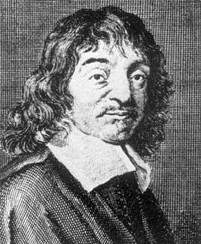

# Descartes’ Life and Works

*Smith, Kurt*

# Descartes’ Life and Works
**First published Mon Apr 9, 2001; substantive revision Wed Mar 1, 2023**

Descartes has been heralded as the first modern philosopher. He is famous for having made an important connection between geometry and algebra, which allowed for the solving of geometrical problems by way of algebraic equations. He is also famous for having promoted a new conception of matter, which allowed for the accounting of physical phenomena by way of mechanical explanations. However, he is most famous for having written a relatively short work, *Meditationes de Prima Philosophia* (*Meditations On First Philosophy*), published in 1641, in which he provides a philosophical groundwork for the possibility of the sciences.

## 1. Early Years

Descartes was born in La Haye on March 31, 1596 of Joachim Descartes and Jeanne Brochard. He was one of a number of surviving children (two siblings and two half-siblings). His father was a lawyer and magistrate, which apparently left little time for family. Descartes’ mother died in May of the year following his birth, and he, his full brother and sister, Pierre and Jeanne, were left to be raised by their grandmother in La Haye. At around ten years of age, in 1606, he was sent to the Jesuit college of La Flèche. He studied there until 1614, and in 1615 entered the University of Poitiers, where a year later he received his Baccalaureate and License in Canon & Civil Law. For the history and the text of his thesis, see the following supplementary document:

[Descartes’ Law Thesis](descartes-works.history.md)

In 1618, at the age of twenty-two, he enlisted in the army of Prince Maurice of Nassau. It is not known what his duties were exactly, though Baillet suggests that he would have very likely been drawn to what would now be called the Corps of Engineers (Baillet, Livre 1, Chapitre 9, p. 41). This division would have engaged in applied mathematics, designing a variety of structures and machines aimed at protecting and assisting soldiers in battle. Sorell, on the other hand, notes that in Breda, where Descartes was stationed, the army “doubled as military academy for young noblemen on the Continent” (Sorell, p. 6). And, Gaukroger notes that the education of the young noblemen was structured around the educational model of Lipsius (1547–1606), a highly respected Dutch political theorist who received a Jesuit education at Cologne (Gaukroger, pp. 65–6). Although the historical records point to there being a military presence in Breda, there is no definitive evidence that speaks for there being a full-fledged “academy”. There are reasons for thinking that Descartes may have been a soldier, but the majority of biographers suggest that it is more likely that his duties were oriented more toward engineering or education.

While stationed at Breda, Descartes met Isaac Beeckman (1588–1637). Notes that Descartes kept related to his correspondence reveal that he and Beeckman had become more than simple acquaintances—their relationship was more one of teacher and student (Descartes being the latter). This relationship would rekindle in Descartes an intense interest in the sciences. In addition to discussions about a wide variety of topics in natural science, a direct result of certain questions posed by Beeckman compelled Descartes to write the *Compendium Musicae*. Among other things, the *Compendium* attempted to work out a theory of harmony rooted in the concepts of proportion or ratio, which (along the lines of the ancients) attempted to express the notion of harmony in mathematical terms. It would not be published during Descartes’ lifetime. As for Beeckman, Descartes would later downplay his influence.

## 2. *The World* and *Discourse*

After Descartes left the army, in 1619, his whereabouts for the next few years are unknown. Based on what he says in the *Discours de la Methode* (*Discourse on the Method*), published in 1637, there is speculation that he spent time near Ulm (Descartes apparently attended the coronation of Ferdinand II in Frankfurt in 1619). There is some evidence suggesting that he was in France in 1622, for it was at this time that property he had inherited was sold—the proceeds of which would provide him a simple income for many years. There is some speculation that between 1623 and 1625 he visited Italy. Descartes emerges in 1625 in Paris, his notes revealing that he was in contact with Father Marin Mersenne (1588–1648), a member of the Order of Minims. This relationship would prompt Descartes to make public his thoughts on natural philosophy (science). It is by way of Mersenne that Descartes’ work would find its way into the hands of some of the best minds living in Paris—for instance, Antoine Arnauld (1612–1694), Pierre Gassendi (1592–1655), and Thomas Hobbes (1588–1679).

In 1628 Descartes left Paris. At this time he seems to have been working on the *Regulae ad Directionem Ingenii* (*Rules for the Direction of the Mind*), a work that he would abandon, some speculating around the time of the move from Paris. It is worth noting that relatively recently a copy of the *Rules* was discovered in a library at Cambridge University. Scholars are unsure how it got there. Currently, based on what it includes, it is thought that this manuscript represents the work as it stood when Descartes had abandoned it in 1628. The later Amsterdam printing (1701) and a copy that Leibniz acquired from Clerselier (c. 1670) make certain advancements over what is found in the Cambridge manuscript. So, it appears that Descartes picked up the work again. Some have speculated that this may have happened after a visit in 1635 from John Dury (1596–1680) and Samuel Hartlib (1600–1662), where Hartlib reports that Dury had returned to England with copies of some of Descartes’ works (Fallon, pp. 9f); the speculation being that the recently discovered manuscript is related to something brought back by Dury. The meeting took place in The Hague. Dury and Hartlib were friends of the Cambridge philosopher Henry More (1614–1687), with whom Descartes had corresponded, and of others in More’s circle, including John Milton (1608–1674). Perhaps the copy was made during the visit and brought back to Cambridge. (In any event, this is a new and interesting development in Descartes scholarship.) In 1630 Descartes moved to Amsterdam. There he worked on drafts of the *Dioptrique* (the *Optics*) and the *Meteors* (the *Meteorology*), which were very likely intended to be a part of a larger work, *Le Monde* (*The World*). In 1632 he moved again, this time to Deventer, to apparently teach Henry Reneri (1593–1639) his physics. It is also during his stay in Deventer that Descartes probably worked on a final draft of the *Traite de l’homme* (*Treatise on Man*), which in connection to the *Optics* and the *Meteorology* was probably originally intended to be a part of *The World*.

When *The World* had become ready for publication in 1633, upon hearing of the Church’s condemnation of Galileo (1564–1642) in the same year, Descartes decided against its publication. For, the world system he had adopted in the book assumed, as did Galileo’s, the heliocentric Copernican model. In a letter to Mersenne, dated November 1633, Descartes expresses his fear that were he to publish *The World*, the same fate that befell Galileo would befall him. And, although this is something that he understandably would want to avoid, some scholars question Descartes’ expressed concern, for his living in the Netherlands would have kept him out of reach of Catholic authorities. *The World* appears to have been constituted of several smaller, but related, works: a treatise on physics, a treatise on mechanics (machines), a treatise on animals, and a treatise on man. Although much of *The World* has been lost, some of it seems to have survived in the form of essays attached to the *Discourse* which, as was mentioned earlier, would be published four years later, in 1637. And, some of it was published posthumously. Arguably, Constantijn Huygens (1596–1687) received what Descartes refers to as “three sheets” of *The World*, along with a letter dated 5 October 1637. These “sheets” deal primarily with mechanics.

Around 1635, at the University of Utrecht, Reneri began teaching “Cartesian” physics. Also during this year, a domestic servant by the name of Helene gave birth to a baby girl, Francine. Genevieve Rodis-Lewis claims that Francine was born 19 June 1635 (Rodis-Lewis, p. 40). According to a baptismal record, dated 28 July 1635, Descartes is named the father (AT I 395n). However, Gaukroger claims that the baptismal date was 7 August 1635 (Gaukroger, p. 294). In 1636 Reneri acquired an official chair in Philosophy at the University of Utrecht, and continued to build a following of students interested in Cartesian science. Around March of 1636, at the age of forty, Descartes moved to Leiden to work out the publishing of the *Discourse*. And, in 1637 it is published. With the *Discourse* out and a following of students building in Utrecht, Descartes seems to have turned his attention from career to family. In a letter dated 30 August 1637 we find him apparently working out an arrangement for Francine, but strangely refers to her as his “niece”—which suggests that he did not want certain people to know that he was a father (or that Francine had been born out of wedlock). Gaukroger suggests that despite this apparent denial of paternity, Descartes not only corresponds with Francine, but in 1637 brings her and Helene to his new home at Santpoort or Egmond-Binnen (Gaukroger, pp. 294, 332).

The *Discourse* is the first published work of Descartes’, coming some four years after he had abandoned *The World*. The *Discourse* is important for many reasons. For instance, it tells us what Descartes himself seems to have thought of his early education, and in particular, his early exposure to mathematics. Roger Ariew suggests that these reflections are not so much those of the historical Descartes, as much as they are those of a persona Descartes adopts in telling the story of the *Discourse* (Ariew, pp. 58–63). Uncontested, however, is the view that the *Discourse* sketches out the metaphysical underpinnings of the Cartesian system. And, as a bonus, it has three works that are attached to it that are apparently added so as to exemplify the method of inquiry it develops (though admittedly it is unclear how the method is applied in these essays). The attached essays are the *Optics*, the *Meteorology*, and *Le Geometrie* (the *Geometry*). As was suggested earlier, the *Optics* and *Meteorology* were very likely versions of works originally intended for *The World*.

It should be stressed that the three attached essays are important independent of the *Discourse*, for they contain much worth studying. In the *Optics*, for example, Descartes works out his laws of refraction, and within this context, what would later be called Snell’s Law (which Descartes seems to have worked out as early as 1632). Further, although the *Geometry* would seem to have come out of nowhere, there is evidence in Descartes’s notes to himself, from which Clerselier reconstructed some of Descartes’s correspondence, that he had been working on some version of it as early as 1619. In a letter to Beeckman, dated 26 March 1619, for example, Descartes discusses the subject matter that is found in the *Geometry*, and in a letter dated 23 April 1619, he explicitly mentions the book’s title. It is in this work that Descartes shows how certain geometrical problems can be solved by way of algebraic equations.

The significance of the sort of connection that Descartes made between geometry and algebra was great indeed, for without it the mathematization of the physics and the development of the calculus might not have happened when they did—a generation later via Sir Isaac Newton (1642–1727) and Gottfried Leibniz (1646–1716). It should be noted, however, that as groundbreaking as this work may have been, contrary to the claims of many, nowhere in the *Geometry* is a “Cartesian Coordinate System” ever developed (that is, the *x*-*y* coordinate system taught to today’s students of algebra), nor is he the originator of other mathematical concepts that bear his name, for example, the “Cartesian Product”. Carl Boyer notes that various concepts that lead to analytic geometry are found for the first time in the *Geometry*, and that the *Geometry’s* mathematical notation is still used today. But, he argues, although Cartesian geometry is taken by many to be synonymous with analytic geometry, the fact is that the fundamental aim of Descartes’ system is quite different from that of contemporary analytic geometry (Boyer, pp. 370–1). And so, the claim that Descartes is the originator of analytic geometry, at least as we understand it today, overstates the case. As Boyer rightly points out, however, this does not diminish the importance of the work in the history of mathematics.

## 3. The *Meditations*

In 1639 Descartes began writing the *Meditations*. And, in 1640 he returned to Leiden to help work out its publication. During the year, Descartes’ daughter, Francine, died. There is evidence suggesting that he was called away from Leiden around the time of her death, returning soon after. Some have speculated that he left Leiden to be at her side. Also during this year, Descartes’ father and sister died. Descartes’ relationship with his father (and brother) was of the sort that Pierre, his brother, failed to even bother him with the news of their father’s death. Rather, it seems to have been in a letter from Mersenne that Descartes first learns of it. In a follow up letter to Mersenne, dated 3 December 1640, Descartes expresses regret in not having been able to see his father before his death. But, he refuses to leave Leiden to attend his father’s funeral, and instead stays to complete the publishing of the *Meditations*.

Today, the *Meditations* is by far Descartes’s most popular work—though this would not have been the case in Descartes’ day. This work is important to today’s scholar for many reasons, not the least of which is its including as an attached text written objections from some of the best minds living in Paris. Mersenne sent the *Meditations* to philosophers and theologians for criticism. The list of critics includes: Caterus, Hobbes, Arnauld, Gassendi, and Mersenne himself, with several other unnamed readers who raised their objections through Mersenne. A later edition would include an objection from Bordin. Descartes replied to each critic, and the result was an appended text referred to as “The Objections and Replies.” The second edition contains seven sets in all.

The *Meditations* opens by developing skeptical questions concerning the possibility of knowledge. Through a series of several carefully thought out meditations, the reader establishes (along with the author) the groundwork for the possibility of knowledge (scientia). Descartes is not a skeptic, as some have insisted, but uses skepticism as a vehicle to motivate his reader to “discover” by way of philosophical investigation what constitutes this ground. In the Second Replies, Descartes refers to this style of presentation as the “analytic” style. There were two styles of presentation: analytic and synthetic. It is important not to confuse these terms with those, say, used by Kant. For Descartes the analytic style of presentation (and inquiry) proceeds by beginning with what is commonly taken to be known and discovering what is necessary for such knowledge. Thus, the inquiry moves from what is commonly known to first principles. The “discovery” moves in such a way that each discovery is based on what was discovered before. By contrast, the synthetic style of presentation begins by asserting first principles and then to determining what follows. Prompted by Mersenne, Descartes sketches out in the Second Replies a synthetic rendering of the *Meditations*.

In establishing the ground for science, Descartes was at the same time overthrowing a system of natural philosophy that had been established for centuries—a qualitative, Aristotelian physics. In a letter to Mersenne, dated 28 January 1641, Descartes says “these six meditations contain all the foundations of my physics. But please do not tell people, for that might make it harder for supporters of Aristotle to approve them. I hope that readers will gradually get used to my principles, and recognize their truth, before they notice that they destroy the principles of Aristotle.” Unlike his earlier work, *The World*, the *Meditations* parts ways with the “old” science without explicitly forwarding controversial views, like that of the Copernican heliocentric model of the solar system. Specifically, the Cartesian view denies that physics is grounded in hot, cold, wet, and dry. It argues that contrary to Aristotle’s view, such “qualities” are not properties of bodies at all. Rather, the only properties of bodies with which the physicist can concern him or herself are size, shape, motion, position, and so on—those modifications that conceptually (or logically) entail extension in length, breadth, and depth. In contrast to Aristotle’s “qualities,” the properties (or modes) of bodies dealt with in Cartesian physics are measurable specifically on ratio scales (as opposed to intensive scales), and hence are subject in all the right ways to mathematics (Buroker, pp. 596–7). This conception of matter, conjoined with the sort of mathematics found in the *Geometry*, allies itself with the work of such Italian natural philosophers as Tartaglia, Ubaldo, and Galileo, and helps further the movement of early thinkers in their attempts to establish a mathematical physics.

Descartes’ letter to the “learned and distinguished men” of the Sorbonne, which is appended to the *Meditations*, suggests that he was trying to pitch the *Meditations* as a textbook for the university. Though the endorsement of the Learned Men would not have guaranteed that the *Meditations* would be accepted or used as a textbook, it could certainly be viewed as an important step to getting it accepted. Unlike today’s notion of a textbook, in Descartes’ day “textbooks” were intended mostly for teachers, not students. Typically, at the close of a teacher’s career, his notes would be published for the benefit of those who would go on to teach such course material. The awkwardness of Descartes’s seeking the acceptance and use of his *Meditations* by teachers is amplified by the fact that he was not a teacher himself. Consequently, his seeking “textbook” status would have very likely been viewed by those Learned Men as being a bit pretentious. He was, it could be said, a freelancer with no academic or political ties to the university (outside of his connection to Mersenne). And, he certainly lacked the credentials and reputation of someone like a Eustachius, whose widely used textbook of the period is of the sort the *Meditations* was in all likelihood aimed at replacing. Although the *Meditations* seems to have been endorsed by the Sorbonne, it was never adopted as a text for the university.

## 4. The *Principles*

Soon after his encounter with the Sorbonne, Descartes’ public life was further complicated by the Dutch theologian, Gisbert Voetius (1588–1676). Voetius had attacked Regius, a Dutch physician who taught medicine at the University of Utrecht, for his having taught certain “Cartesian” ideas that conflicted with traditional theological doctrine. Regius was friend to both Reneri and Descartes, and was a strong adherent to Descartes’s philosophical views. Voetius tried to have Regius removed from his position as professor, and attacked not only Descartes’ work but his character. In his defense Descartes entered into the debate. The controversy would leave Regius confined to teaching medicine, and his published defense of (his conception of) Cartesian thought would be officially condemned by Voetius, who in five years time would rise to the position of University rector. At the end of the debate, which off and on lasted about five years, the situation ultimately became desperate for Descartes. He feared being expelled from the country and of seeing his books burned. He would even seek protection by asking the Prince of Orange to intervene and quell Voetius’ attack.

In 1643, at the age of forty-seven, Descartes moved to Egmond du Hoef. With the Voetius controversy seemingly behind him (though, as mentioned above, it would again raise its head and climax five years down the road), Descartes and Princess Elisabeth of Bohemia began to correspond. In this exchange, Princess Elisabeth probed Descartes on the implications of his commitment to mind-body dualism. During this time, he completed a final draft of a new textbook, which he had begun three years earlier, the *Principia Philosophiae* (*Principles of Philosophy*), and in 1644 it was published. He dedicated it to Princess Elisabeth.

The *Principles* is an important text. The work is divided into four Parts, with five hundred and four articles. Part One develops Descartes’ metaphysics. Although it would appear to be a quick run through of the *Meditations*, there are a number of dissimilarities. For example, the order of presentation of the proofs for God’s existence, which some have argued is significant, found in the Third and Fifth Meditations, is reversed in the *Principles*. The principles introduced in Part Two are based on the metaphysics of Part One. And, the subsequent physics developed in Parts Three and Four is based upon the principles of Part Two. Although the physics turns out to be unsound, the *Principles* nevertheless inspired such great thinkers as Robert Boyle (1627–1691), Edmond Halley (1656–1742), and Isaac Newton. As an important side note, it must be stressed that even though Descartes had throughout his career put a great deal of emphasis on mathematics, the physics developed in the *Principles* does not appear to be a mathematical physics. Rather, it is traditionally taken to be a conceptual project with only a hint of empirical overtones—a physics rooted entirely in metaphysics. Arguably, however, Descartes’ work on enumeration, order, and measure in the *Rules* provides the conceptual machinery necessary for establishing a ‘mathematical’ physics—a conceptual machinery that is carried over to the *Principles* (Smith 2003, 2010)[^smith-2003]. Two parts, never completed, were originally intended to deal with plants, animals, and man. In light of this and what Descartes says in a 31 January 1642 letter to the mathematician Constantijn Huygens, it is plausible to think that the *Principles* would have looked something like *The World* had it been completed as planned.

One of the more controversial positions the *Principles* forwarded, at least according to Newton, was that a vacuum was impossible. Descartes’ rejection of the possibility of a vacuum followed from his commitment to the view that the essence of body was extension. Given that extension is an attribute, and that nothing cannot possess any attributes (AT VIIIA 25; CSM I 210), it follows that “nothingness cannot possess any extension” (AT VIIIA 50; CSM I 231). So, any instance of extension would entail the presence of some substance (AT VIIIA 25; CSM I 210). In other words, vacuum, taken as an extended *nothing*, is a flat contradiction. The corporeal universe is thus a plenum, individual bodies separated only by their surfaces. Newton argued in his *De Gravitatione* and *Principia* that the concept of motion becomes problematic if the universe is taken to be a plenum. Another controversial position was Descartes’ insistence that matter is infinitely divisible. Gassendi, and later Cordemoy, argued that there must be a bottom, a ‘substance,’ to the physical universe upon which the being of all corporeal things depend. In line with the ancient atomist Epicurus, they argued that if matter was infinitely divisible, so dividing it would show that there was no bottom—and so, corporeality would not be substantial. So, if corporeality is substantial, as Descartes himself had claimed, there must be a minimum measure of extension that could not be divided (by natural means, anyway). And so, there are atoms. But, this conclusion is something that Descartes explicitly rejects in the *Principles*.

## 5. The *Passions*

In 1646, as a result of the probings of Princess Elisabeth, Descartes completed a working draft of *Passions de l’ame* (*Passions of the Soul*). During this year another prominent political figure began to correspond with Descartes, Queen Christina of Sweden. And, Regius published what he took to be a new and improved version of Cartesian science, which as we now know would draw the wrath of Voetius. But Regius did not stop there, for he seemed to have found important differences between his “Cartesian” view and that of Descartes’, and attempted to separate the two, publishing a broadsheet that listed twenty-one anti-Cartesian theses (which his version of “Cartesian” science rejected). In response to this, Descartes wrote a single-page printed defense that was posted on public kiosks for all to read. Published in 1648, the *Notae in Programma Quoddam* (*Notes on a Program*-also referred to as *Comments on a Certain Broadsheet*) is Descartes’ public defense. However, as mentioned earlier, tensions mounted as a result of the public exchange and Descartes felt his way of life in the Netherlands to be threatened. As luck would have it, an admirer and friend of Descartes’—Chanut, who worked for Queen Christina’s court—and Queen Christina herself began probing Descartes about the possibility of coming to Sweden. And, after a not too lengthy correspondence, Queen Christina offered Descartes a position in her court. For many reasons, which would certanily include those related to his concerns about Voetius, Descartes accepted the offer. And, in 1649 he left for Sweden.

Queen Christina at first required very little from Descartes. However, according to Gaukroger, this would change. For, after he had some time to settle in, she ordered him to do two things: first, to put all of his papers in order, and secondly, to put together designs for an academy (Gaukroger, p. 415). Arguably, Descartes had some idea of how the latter might be done by way of his experience in Breda. In January of 1650 Queen Christina began to require Descartes to give her lessons in philosophy. These apparently would begin at five in the morning and would last for about five hours. They were given three days a week (Gaukroger, p. 415). During this time Descartes published the *Passions*, the work having emerged primarily from his correspondence with Princess Elisabeth (to whom he had dedicated the *Principles*). One aim of the *Passions* was to explain how the emotional (and thus moral) life of a human being was connected to the soul’s being essentially united to a body. Simply put, a ’passion of the soul’ is a mental state (or thought) that arises as a direct result of brain activity. Such passions can move us to action. Since this is so, Descartes suggests that one needs to learn to control one’s passions, for they can move one to perform vicious acts. Critics of Descartes, including Elisabeth, argued that Descartes’ metaphysical commitments put real pressure on the view expounded in the *Passions*. For, according to Descartes’ metaphysics, the nature of mind is to think and the nature of body is to be extended in length, breadth, and depth. One view concerning causation, a view that Descartes’s critics seemed to have attributed to him, is that one thing causes another to move, for example, by way of contact. Contact, in this context, seems to be possible only by way of surfaces. Now, bodies, since they are extended and thus have surfaces, can come into contact with one another and thus can cause one another to move. However, if minds are not extended, they lack surfaces. And, if they lack surfaces, there is no way in principle for bodies to come into contact with them. Thus, there is no way in principle for bodies to move minds, and vice versa. That is, minds and bodies cannot in principle causally interact. And so, if the view expounded in the *Passions* requires that bodies and minds be capable of causal interaction, and Descartes’ metaphysical commitments make such interaction impossible, Descartes’ metaphysics puts a great deal of pressure on the view expounded in the *Passions*.

Although things seemed to be moving forward, they were not going as well as one would have hoped. In a letter to Bregy, for instance, dated 15 January 1650, Descartes expresses reservations about his decision to come to Sweden. He sees himself to be “out of his element,” the winter so harsh that “men’s thoughts are frozen here, like the water” (AT V 467; CSMK III 383). Given the sentiment expressed in the letter, this remark was probably intended to be as much Descartes’s take on the intellectual climate as it was about the weather. In early February, less than a month after writing Bregy, Descartes fell ill. His illness quickly turned into a serious respiratory infection. And, although at the end of a week he appeared to have made some movement towards recovery, things took a turn for the worse and he died in the early morning of 11 February 1650. He was fifty-three years old.

## References（引用注释）

> 原文参考文献已转为脚注引用：文内“作者-年份”引用组后附 [^key] 标记，完整条目见本文末脚注定义。

### Primary Sources

### Other English Translations

### Secondary Sources

### Other Helpful Sources

## Academic Tools

> |   | [How to cite this entry](https://plato.stanford.edu/cgi-bin/encyclopedia/archinfo.cgi?entry=descartes-works). |
> | --- | --- |
> |   | [Preview the PDF version of this entry](https://leibniz.stanford.edu/friends/preview/descartes-works/) at the [Friends of the SEP Society](https://leibniz.stanford.edu/friends/). |
> |   | [Look up topics and thinkers related to this entry](https://www.inphoproject.org/entity?sep=descartes-works&redirect=True) at the Internet Philosophy Ontology Project (InPhO). |
> |   | [Enhanced bibliography for this entry](https://philpapers.org/sep/descartes-works/) at [PhilPapers](https://philpapers.org/), with links to its database. |

## Other Internet Resources

- [Descartes E Il Seicento](http://www.cartesius.net/), maintained by Giulia Belgioioso (Director, Centro Interdipartmentali Di Studi Su Descartes E Il Seicento), Jean-Robert Armogathe (Centre d’Etudes cartésiennes), and their colleagues A superb website on Descartes

## Related Entries

Arnauld, Antoine | Descartes, René: epistemology | Descartes, René: modal metaphysics | Descartes, René: ontological argument | Descartes, René: theory of ideas | Desgabets, Robert | Mersenne, Marin

### Acknowledgments

I am indebted to the NEH for allowing me the opportunity to participate in the 2000 NEH Summer Seminar, “Descartes and His Contemporaries,” held at Virgina Tech. In addition to learning a great deal from the Seminar’s leaders, Roger Ariew and Daniel Garber, I learned a great deal from my fellow participants. I am also indebted to Bloomsburg University of Pennsylvania for providing me with a Faculty Development Grant, summer 2001. Lastly, I am indebted to Alan Nelson and Roger Ariew for comments on earlier versions of this article.

[^adam-nd]: In the above, the Adam and Tannery volumes, *Oeuvres De Descartes*, (11 volumes) are cited. Such citations are abbreviated as AT, followed by the appropriate volume and page numbers. I have whenever possible used the Cottingham, Stoothoff, and Murdoch translation, *The Philosophical Writings Of Descartes* (3 volumes). Volume 3 includes Anthony Kenny as a translator. This has been abbreviated as CSMK, followed by the appropriate volume and page numbers. The AT and CSMK numbers are cited, side by side, separated by a semicolon.

[^oeuvres-1983]: *Oeuvres De Descartes*, 11 vols., edited by Charles Adam and Paul Tannery, Paris: Librairie Philosophique J. Vrin, 1983.

[^philosophical-1988]: *The Philosophical Writings Of Descartes*, 3 vols., translated by John Cottingham, Robert Stoothoff, and Dugald Murdoch (Volume 3 including Anthony Kenny), Cambridge: Cambridge University Press, 1988.

[^meditations-1996]: *Meditations on First Philosophy*, translated by John Cottingham, Cambridge: Cambridge University Press, 1996.

[^principles-1983]: *Principles of Philosophy*, translated by V.R. Miller and R.P. Miller (Dordrecht: D. Reidel, 1983).

[^geometry-1954]: *The Geometry of René Descartes*, translated by David Eugene Smith and Marcia L. Lantham (New York: Dover Publications, 1954).

[^passions-1989]: *The Passions of the Soul*, translated by Stephen H. Voss (Indianapolis: Hackett Publishing Company, 1989).

[^ariew-1992]: Ariew, Roger, 1992, “Descartes and Scholasticism: the intellectual background to Descartes’ thought,” in *The Cambridge Companion to Descartes*, edited by John Cottingham, Cambridge: Cambridge University Press, pp. 58–90.

[^baillet-1691]: Baillet, Adrien, 1691, *La Vie de M. Descartes* (2 vols.), Paris.

[^boyer-1985]: Boyer, Carl B., 1985, *A History of Mathematics*, Princeton: Princeton University Press.

[^buroker-1991]: Buroker, Jill, 1991, “Descartes On Sensible Qualities,” *Journal Of The History Of Philosophy*, XXIX (4): 585–611.

[^gaukroger-1995]: Gaukroger, Stephen, 1995, *Descartes: An Intellectual Biography*, Oxford: Clarendon Press.

[^rodis-lewis-1992]: Rodis-Lewis, Genevieve, 1992, “Descartes’ life and the development of his philosophy,” in *The Cambridge Companion to Descartes*, edited by John Cottingham, Cambridge: Cambridge University Press, pp. 21–57.

[^smith-2003]: Smith, Kurt, 2003, “Was Descartes’s Physics Mathematical?” *History of Philosophy Quarterly*, 20 (3): 245–256.

[^sorell-1987]: Sorell, Tom, 1987, *Descartes*, Oxford: Oxford University Press.

[^alanen-2003]: Alanen, Lilli, 2003, *Descartes’s Concept of Mind*, Cambridge: Harvard University Press.

[^ariew-1998]: Ariew, R., and John Cottingham and Tom Sorell (eds.), 1998, *Descartes’* Meditations: *Background Source Materials*, Cambridge: Cambridge University Press.

[^bonnen-2002]: Bonnen, Clarence A., and Flage, Daniel E., 2002, *Descartes and Method: A Search for Method in Meditations*, London: Routledge.

[^broughton-2007]: Broughton Janet, and John Carriero (eds.), 2007, *A Companion to Descartes*, Oxford: Blackwell.

[^brown-2006]: Brown, Deborah, 2006, *Descartes and the Passionate Mind*, Cambridge: Cambridge University Press.

[^carriero-2009]: Carriero, John, 2009, *Between Two Worlds: A Reading of Descartes’* Meditations, Princeton: Princeton University Press.

[^carriero-2018]: –––, 2018, *Descartes and the Autonomy of the Human Understanding*, London: Routledge.

[^chappell-1997]: Chappell, Vere (ed.), 1997, *Descartes’s* Meditations: *Critical Essays*, Lanhan: Rowan & Littlefield Publishers, Inc.

[^clarke-2003]: Clarke, Desmond, 2003, *Descartes’s Theory of Mind*, Oxford: Oxford University Press.

[^cottingham-1998]: Cottingham, John (ed.), 1998, *Descartes*, Oxford: Oxford University Press.

[^cottingham-1994]: ––– (ed.), 1994, *Reason, Will and Sensation: Studies in Descartes’ Metaphysics*, Oxford: Clarendon Press.

[^cunning-2010]: Cunning, David, 2010, *Argument and Persuasion in Descartes’* Meditations, Oxford: Oxford University Press.

[^curley-1978]: Curley, E. M., 1978, *Descartes Against the Skeptics*, Oxford: Basil Blackwell.

[^de-2010]: De Rosa, Raffaella, 2010, *Descartes and the Puzzle of Sensory Representation*, New York: Oxford University Press.

[^des-2001]: Des Chene, Dennis, 2001, *Spirits and Clocks: Machine and Organism in Descartes*, Ithaca: Cornell University Press.

[^garber-1992]: Garber, Daniel, 1992, *Descartes’ Metaphysical Physics*, Chicago: University of Chicago Press.

[^garber-2001]: –––, 2001, *Descartes Embodied*, Cambridge: Cambridge University Press.

[^garber-1998]: Garber, Daniel and Michael Ayers (eds.), 1998, *The Cambridge History of Seventeenth-Century Philosophy*, 2 volumes, Cambridge: Cambridge University Press.

[^gaukroger-1995-2]: Gaukroger, Stephen, 1995, *Descartes: An Intellectual Biography*, Oxford: Clarendon Press.

[^gaukroger-2006]: ––– (ed.), 2006, *The Blackwell Guide to Descartes’ Meditations*, Oxford: Blackwell.

[^gueroult-1984]: Gueroult, Martial, 1984, *Descartes’ Philosophy Interpreted According to the Order of Reasons*, 2 vols., translated by Roger Ariew, Minneapolis: University of Minnesota Press.

[^fallon-1991]: Fallon, Stephen M, 1991, *Milton Among the Philosophers*, Ithaca: Cornell University Press.

[^hatfield-2002]: Hatfield, Gary, 2002, *Routledge Philosophy Guidebook to Descartes and the* Meditations, London: Routledge.

[^hausman-1997]: Hausman, David, and Hausman, Alan, 1997, *Descartes’s Legacy: Mind and Meaning in Early Modern Philosophy*, Toronto: University of Toronto Press.

[^kenny-1968]: Kenny, Anthony, 1968, *Descartes: A Study of His Philosophy*, Bristol: Thoemmes Press.

[^lennon-2008]: Lennon, Thomas M., 2008, *The Plain Truth: Descartes, Huet, and Skepticism*, Leiden: Brill.

[^machamer-2009]: Machamer, Peter and McGuire, J.E., 2009, *Descartes’s Changing Mind*, Princeton: Princeton University Press.

[^nelson-2006]: Nelson, Alan (ed.), 2006, *A Companion to Rationalism*, Oxford: Blackwell.

[^nolan-2016]: Nolan, Lawrence (ed.), 2016, *The Cambridge Descartes Lexicon*, Cambridge: Cambridge University Press.

[^rodis-lewis-1999]: Rodis-Lewis, Genevieve, 1999, *Descartes: His Life and Thought*, translated by Jane Marie Todd, Ithaca: Cornell University Press.

[^rorty-1986]: Rorty, Emelie Oksenberg (ed.), 1986, *Essays on Descartes’* Meditations, Berkeley: University of California Press.

[^rozemond-1998]: Rozemond, Marleen, 1998, *Descartes’s Dualism*, Cambridge: Harvard University Press.

[^smith-2010]: Smith, Kurt, 2010, *Matter Matters: Metaphysics and Methodology in the Early Modern Period*, Oxford: Oxford University Press.

[^smith-2015]: –––, 2015, *The Descartes Dictionary*, London: Bloomsbury.

[^smith-2018]: –––, 2018, *Simply Descartes*, New York: Simply Charly Press.

[^smith-2022]: –––, 2022, *This is Modern Philosophy: An Introduction*, Oxford: Wiley-Blackwell.

[^smith-2010-2]: Smith, Kurt and Nelson, Alan, 2010, “Divisibility and Cartesian Extension”, in *Oxford Studies in Early Modern Philosophy* (Volume V), Daniel Garber and Stephen Nadler (eds.), Oxford: Clarendon Press, pp. 1–24.

[^sorell-1987-2]: Sorell, Tom, 1987, *Descartes*, Oxford: Oxford University Press.

[^stewart-1997]: Stewart, M.A. (ed.), 1997, *Studies in Seventeenth-Century European Philosophy* (Oxford Studies in the History of Philosophy: Volume 2), Oxford: Clarendon Press.

[^versfeld-2018]: Versfeld, Marthinus, 2018, *An Essay on the Metaphysics of Descartes*, London: Routledge.

[^watson-1966]: Watson, Richard A., 1966, *The Downfall of Cartesianism, 1673–1712*, The Hague: Martinus Nijhoft.

[^watson-2007]: –––, 2007, *Cogito Ergo Sum: The Life of René Descartes*, Boston: David R. Godine.

[^williams-1978]: Williams, Bernard, 1978, *Descartes: The Project of Pure Enquiry*, London: Penguin Books.

[^wilson-2003]: Wilson, Catherine, 2003, *Descartes’s* Meditations, Cambridge: Cambridge University Press.

[^wilson-1978]: Wilson, Margaret, 1978, *Descartes*, London: Routledge & Kegan Paul.
