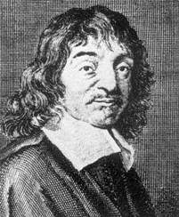

# René Descartes

*Hatfield, Gary*

**First published Wed Dec 3, 2008; substantive revision Mon Oct 23, 2023**

René Descartes (1596–1650) was a creative mathematician of the first order, an important scientific thinker, and an original metaphysician. During the course of his life, he was a mathematician first, a natural scientist or “natural philosopher” second, and a metaphysician third. In mathematics, he developed the techniques that made possible algebraic (or “analytic”) geometry. In natural philosophy, he can be credited with several achievements: the first to publish the sine law of refraction; developer of an important empirical account of the rainbow; and proposer of a naturalistic account of the formation of the earth and planets (a precursor to the nebular hypothesis, that the planets formed from loose matter orbiting the sun). More importantly, he offered a new vision of the natural world, which shaped modern physics: a world of matter possessing a few fundamental properties and interacting according to a few universal laws. This natural world included an immaterial mind that, in human beings, was directly related to the brain, a position that led to the modern mind–body problem. In metaphysics (the search for the basic principles of everything there is), Descartes provided arguments for the existence of God and to show that the essence of matter is to be spatially extended, and that the essence of mind is thought (where “thought” includes sensory images as well as rational discourse). Descartes claimed early on to possess a special method, which was variously exhibited in mathematics, natural philosophy, and metaphysics, and which came to include, or to be supplemented by, a method of doubt.

Descartes presented his results in major works published during his lifetime: the *Discourse on the Method* (in French, 1637), with its essays, the *Dioptrics*, *Meteorology*, and *Geometry*; the *Meditations on First Philosophy* (i.e., on metaphysics), with its Objections and Replies (in Latin, 1641, 2nd edn. 1642); the *Principles of Philosophy*, covering his metaphysics and much of his natural philosophy (in Latin, 1644); and the *Passions of the Soul*, on the emotions (in French, 1649). Works published posthumously included his *Compendium of Music* (in Latin, 1650), *Letters* (in Latin and French, 1657–67); *World, or Treatise on Light*, containing the core of his natural philosophy (in French, 1664); *Treatise on Man* (in French, 1664), containing his physiology and mechanistic psychology; and the *Rules for the Direction of the Mind* (in Latin, 1701), an early, unfinished work attempting to set out his method.

Descartes’ works have been variously received and valued. Among the learned of his day he was considered to be a top mathematician, the developer of a new and comprehensive physics or theory of nature (including living things), and the proposer of a new metaphysics. In the years following his death, his natural philosophy was especially valued and discussed. His works were invoked in debates over the equality of women. In the eighteenth century, aspects of his science remained influential, as did his project of investigating the cognitive capacities of the knower in assessing the possibility and extent of human knowledge. He was also remembered for his skeptical arguments and for failing to provide a successful response to them in his metaphysics. In the nineteenth century, he was revered for his mechanistic physiology and theory that animal bodies are machines (are constituted by material mechanisms, governed by the laws of matter alone). The twentieth century variously celebrated his famous “cogito” starting point, reviled the sense data that some alleged to be the legacy of his skeptical starting point, and looked to him as a model of the culturally engaged philosopher. He has been variously seen as a hero and a villain; as a brilliant theorist forging new directions in thought and as harbinger of a cold, rationalistic, and calculative conception of human beings. Those new to the study of Descartes should engage his own works in some detail prior to developing a view of his legacy.

## 1. Intellectual Biography

### 1.1 Early life and education

Descartes was born on 31 March 1596 in his maternal grandmother’s house in La Haye, in the Touraine region of France. His father Joachim, a lawyer who lived in Châtellerault (22 kilometers southwest of La Haye, across the Creuse River in the Poitou region), was away at the Parliament of Brittany in Rennes. The town of La Haye, which lies 47 kilometers south of Tours, has subsequently been renamed Descartes.

When Descartes was thirteen and one-half months old, his mother, Jeanne Brochard, died in childbirth. The young René spent his early years with his grandmother, Jeanne Sain Brochard, in La Haye, together with his older brother Pierre and older sister Jeanne. It is likely that he then moved to the house of his great uncle, Michel Ferrand, who, like many of René’s male relatives, was a lawyer; he was a Counselor to the King and held the royal office of provincial Lieutenant General in Châtellerault. When Descartes met Isaac Beeckman in 1618, he introduced himself as “Poitevin,” or from Poitou (10:46, 51–4; Rodis-Lewis 1998, 3, 26; see also 2:642)[^rodis-lewis-1998]. At this time (and now and again later on), he also signed letters as “du Perron” and called himself “sieur du Perron” (Lord of Perron), after a small farm in Poitou he inherited from his mother’s family (Watson 2007, 81, 230)[^watson-2007]. But he did not neglect his birthplace in La Haye: in a letter of 1649, he described himself as “a man who was born in the gardens of Touraine” (5:349).

In 1606 or 1607, Descartes, a Roman Catholic, entered the newly founded Jesuit College of La Flèche, where he remained until 1614 or 1615. He followed the usual course of studies, which included five or six years of grammar school, including Latin and Greek grammar, classical poets, and Cicero, followed by three years of philosophy curriculum. By rule, the Jesuit philosophy curriculum followed Aristotle; it was divided into the then-standard topics of logic, morals, physics, and metaphysics. The Jesuits also included mathematics in the final three years of study.

Aristotle’s philosophy was taught through textbooks and printed commentaries on his works. Aristotle himself frequently discussed the positions of his ancient predecessors. The most extensive commentaries also elaborated in some detail on positions other than Aristotle’s. Within this framework, and taking into account the reading of Cicero, Descartes would have been exposed in school to the doctrines of the ancient atomists, Plato, and the Stoics, and he would have heard of the skeptics. Further, important intellectual events were celebrated at La Flèche, including Galileo’s discovery of the moons of Jupiter in 1610. Although scholastic Aristotelian philosophy was dominant in Descartes’ school years, it was not the only philosophy that he knew.

Famously, Descartes wrote in the autobiographical portion of the *Discourse* (1637) that, when he left school, “I found myself beset by so many doubts and errors that I came to think I had gained nothing from my attempts to become educated but increasing recognition of my ignorance” (6:4). And yet, he continued, he did not “cease to value the exercises done in the schools” (6:5), for languages, fables, oratory, poetry, mathematics, morals, theology, and philosophy all had their value, as did jurisprudence, medicine, and other sciences (including engineering) that serve as professions and which one might study after attending a school such as La Flèche. He noted the contradiction and disagreement that beset philosophy and so infected the higher sciences (including medicine) “insofar as they borrow their principles from philosophy” (6:8). A year later, in 1638, he told an inquiring father that “nowhere on earth is philosophy taught better than at La Flèche,” where he advised his correspondent to send his son even if he wanted him subsequently to transcend the learning of the schools—while also suggesting that the son might study at Utrecht with Henry le Roy, a disciple of Descartes (2:378–9). According to the *Discourse*, it was not surprising that philosophy as taught at La Flèche was uncertain: it had to be, since he (Descartes) was now offering a first glimpse of the one true philosophy, only recently discovered. Until it could be promulgated, La Flèche, or another good school, would do.

His family wanted Descartes to be a lawyer, like his father and other relatives. To this end, he obtained a law degree from Poitiers in 1616. But he never practiced law or entered into the governmental service that such practice would have made possible (Rodis-Lewis 1998, 18–22)[^rodis-lewis-1998]. Instead, he became a gentleman soldier, moving in 1618 to Breda, to support the Protestant Prince Maurice against the Catholic parts of the Netherlands (which later constituted Belgium), which were controlled by Spain—a Catholic land, like France, but at this point an enemy.

### 1.2 First results, a new mission, and method

While in Breda, Descartes met Isaac Beeckman, a Dutch mathematician and natural philosopher. Beeckman set various problems for Descartes, including questions about falling bodies, hydrostatics, and mathematics. Descartes and Beeckman engaged in what they called “physico-mathematica,” or mathematical physics (Beeckman’s journal, in Descartes, 10:52). Since antiquity, mathematics had been applied to various physical subject matters, in optics, astronomy, mechanics (focusing on the lever), and hydrostatics. Beeckman and Descartes brought to this work a commitment to atoms as the basic constituents of matter. As had ancient atomists, they attributed not only size, shape, and motion but also weight to those atoms (*10:68*). Descartes opened a section in his notebook entitled “Democritica” (10:8), in honor of the ancient atomist Democritus.

Perhaps at this time, though certainly by 1628, Descartes had the fundamental insight that makes analytic geometry possible: the technique for describing lines of various sorts by using mathematical equations involving ratios between lengths in relation to coordinate lines. (Descartes did not require that the lines be perpendicular to one another.) Descartes himself did not foresee replacing geometrical constructions with algebraic formulas; rather, he viewed geometry as the basic mathematical science and he considered his algebraic techniques to provide an extension beyond compass-and-ruler constructions. When the right-angled coordinate system of algebraic geometry was subsequently developed, the name “Cartesian coordinates” honored Descartes’ discovery. (See Boyer 1968, Ch. 17, Shea 1991, Ch. 3, and, more generally, Domski 2022.)[^domski-2022][^shea-1991]

Descartes left Breda in 1619 to join the Catholic army of Maximilian I (Duke of Bavaria and ally of France). The war concerned the authority of Ferdinand II, a Catholic, who in September had been crowned emperor of the Holy Roman Empire (located in Central Europe and including Austria and parts of northern Italy). Descartes attended the coronation and was returning to the army when winter caught him in the small town of Ulm (or perhaps Neuburg), not far from Munich. On the night of 10 November 1619, he had three dreams that seemed to provide him with a mission in life. The dreams themselves are interesting and complex (see Sebba 1987)[^sebba-1987]. Descartes took from them the message that he should set out to reform all knowledge. He decided to begin with philosophy, since the principles of the other sciences must be derived from it (*Disc*. II, 6:21–2).

Descartes was familiar with both mainstream philosophy and recent innovators (those who, among other things, rejected aspects of Aristotle’s philosophy), from both his schooling and from reading he undertook from 1620 on. In 1640, he recalled (*Corr*. 3:185) having read various works in philosophy around the year 1620, written by well-known Jesuit commentators on Aristotle: Francisco Toledo (1532–96), Antonio Rubio (1548–1615), and the Coimbran commentators (active ca. 1600). He also recalled an abstract or summary of “the whole of scholastic philosophy” by Eustace of Saint Paul (1573–1640), whose *Summa Philosophiae* was first published in 1609. In 1638, he recalled having read Thomas Campanella’s *De Sensu Rerum* (1620) about fifteen years before, and not being much impressed (2:659–60). And in 1630 he was able to rattle off the names of recent innovators in philosophy (1:158), including Campanella (1568–1639), Bernardino Telesio (1509–88), Giordano Bruno (1548–1600), Lucilio Vanini (1585–1619), and Sébastien Basson (b. ca. 1573). From these sources, he would have acquired basic philosophical concepts, such as the notion that substances are characterized by essences that determine which properties they must have in order to be what they are (an Aristotelian concept). He would also have seen first attempts, among the innovators, of reviving atomism, or of challenging the notion of substantial forms (see Sec. 1.3).

Descartes’ activities during the early 1620s are not well-documented. He was in France part of the time, visiting Poitou to sell some inherited properties in 1622 and visiting Paris. He also went to Italy (1623–25). Upon his return he lived in Paris, where he was in touch with mathematicians and natural philosophers in the circle of his long-time friend and correspondent Marin Mersenne (1588–1648). While in Paris, he worked on some mathematical problems and derived the sine law of refraction, which facilitated his work on formulating mathematically the shapes of lenses (later published in the *Dioptrics*). His major philosophical effort during these years was on the *Rules*.

In the *Rules*, he sought to generalize the methods of mathematics so as to provide a route to clear knowledge of everything that human beings can know. His methodological advice included a suggestion that is familiar to students of elementary geometry: break your work up into small steps that you can understand completely and about which you have utter certainty, and check your work often. But he also had advice for the ambitious seeker of truth, concerning where to start and how to work up to greater things. Thus, Rule 10 reads: “In order to acquire discernment we should exercise our intelligence by investigating what others have already discovered, and methodically survey even the most insignificant products of human skill, especially those which display order” (10:403). As examples of “simple” arts “in which order prevails” (10:404), he offered carpet-making and embroidery, and also number-games and arithmetic games. He went on to discuss the roles of the “cognitive faculties” in acquiring knowledge, which include the intellect, imagination, sense perception, and memory. These faculties allow the seeker of knowledge to combine simple truths in order to solve complex problems as found in optics (10:394) or to discover how a magnet works (10:427).

By the end of 1628, Descartes abandoned work on the *Rules*, having completed about half of the projected treatise. He moved to the Dutch Netherlands, returning to France only infrequently prior to moving to Sweden in 1649. While in the Netherlands, he tried to keep his address secret and changed locations often, according to his motto, “who lives well hidden, lives well” (1:286\*).

### 1.3 Metaphysical turn, comprehensive physics, *Discourse*

Descartes spent his first year in the Netherlands in Franeker, where he registered at the University in April, 1629. Initially, he worked on two topics: mathematical science and metaphysics. In Summer, 1629, an impressive set of parhelia, or false suns, were observed near Rome. When Descartes heard of them, he set out to find an explanation. (He ultimately hypothesized that a large, solid ice-ring in the sky acts as a lens to form multiple images of the sun [*Met*. 6:355].)

This work interrupted his investigations on another topic, which had engaged him for his first nine months in the Netherlands (1:44)—the topic of metaphysics. The metaphysical objects of his investigation included the existence and nature of God and the soul (1:144, 182). However, these metaphysical investigations were not entirely divorced from problems such as the parhelia, for he claimed that through his investigations into God and the human self, he had been able “to discover the foundation of physics” (1:144). His post-*Rules* emphasis on intellectual apprehension of God, the soul, and the foundations of physics constitute Descartes’ “metaphysical turn,” even if his metaphysics was not yet fully disclosed. Subsequently, Descartes mentioned a little metaphysical treatise in Latin—presumably an early version of the *Meditations*—that he wrote upon first coming to the Netherlands (1:184, 350). And he later affirmed to Mersenne that the metaphysics of the *Meditations*, in which God and soul are prominent, contained “all the principles of my physics” (3:233).

While working on the parhelia, Descartes conceived the idea for a very ambitious treatise, about which he wrote Mersenne on 16 November 1629 from his new residence in Amsterdam. He now intended to explain not “just one phenomenon” (the parhelia), but “all the phenomena of nature, that is to say, the whole of physics” (1:70). This work eventually became *The World*, which was to have three parts: on light (a general treatise on visible, or material, nature), on man (a treatise on physiology), and on the soul. Only the first two survive (and perhaps only they were ever written), as the *Treatise on Light* and *Treatise on Man*. In these works, which Descartes decided to suppress upon learning of the condemnation of Galileo (1:270, 305), he offered a comprehensive vision of the universe as constituted from bare matter possessing the properties length, breadth, and depth (three-dimensional volume) and carved up into particles with size and shape, which may be in motion or at rest, and which interact through quantitative laws of motion that are formulated and sustained by God (*Light*, 11:33–4). These works described the visible universe as a single physical system in which all operations, from the formation of planets and the transmission of light from the sun to the physiological processes of human and nonhuman animal bodies, can be explained through the mechanism of matter arranged into shapes and structures and moving according to three laws of motion. In fact, his explanations in the *World* and the subsequent *Principles* made little use of the three laws of motion in other than a qualitative manner. The laws sustained the notion that matter moves regularly (in a straight line) and that upon impact bits of matter alter their motions in regular ways—something that happens constantly in the full universe (the “plenum”) conceived by Descartes. (At this time, Descartes received an offer of appointment to the medical faculty in Bologna—even though he had not yet made public any of his results—which he declined; see Manning 2014.)[^manning-2014]

After suppressing his *World*, Descartes decided to put forward, anonymously, a limited sample of his new philosophy, in the *Discourse* with its attached essays. The *Discourse* recounted Descartes’ own life journey, explaining how he had come to the position of doubting his previous knowledge and seeking to begin afresh. It offered some initial results of his metaphysical investigations, including mind–body dualism. It did not, however, engage in the deep skepticism of the later *Meditations*, nor did it claim to establish, metaphysically, that the essence of matter is extension. This last conclusion was presented merely as a hypothesis whose fruitfulness could be tested and “proven,” or perhaps merely confirmed (see McMullin 2008)[^mcmullin-2008], by the results contained in the attached essays on *Dioptrics* and *Meteorology* (the latter covering “atmospheric” phenomena).

In his *Meteorology*, Descartes described his general hypothesis (or supposition) about the nature of matter, before offering accounts of vapors, salt, winds, clouds, snow, rain, hail, lightning, the rainbow, coronas, and parhelia. His hypothesis was as follows:

> that the water, earth, air, and all other such bodies that surround us are composed of many small parts of various shapes and sizes, which are never so properly disposed nor so exactly joined together that there do not remain many intervals around them; and that these intervals are not empty but are filled with that extremely subtle matter through the mediation of which, I have said above, the action of light is communicated. (6:233)

He presented a corpuscularian basis for his physics that denied the atoms-and-void theory of ancient atomism and affirmed that all bodies are composed from one type of matter, which is infinitely divisible into particles or corpuscles (6:239). He here also proclaimed that his natural philosophy had no need for the “substantial forms” and “real qualities” that other philosophers (i.e., Aristotelians) “imagine to be in bodies” (6:239). He had taken the same position in the *Treatise on Light*, where he said that in conceiving his new “world” (i.e., his conception of the universe), “I do not use the qualities called heat, cold, moistness, and dryness, as the Philosophers do” (11:25).

In effect, he was denying the then-dominant scholastic Aristotelian ontology, which explained all natural bodies as comprised of a “prime matter” informed by a “substantial form,” and which explained qualities such as hot and cold as really inhering in bodies in a way that is “similar” to the qualities of hot and cold as we experience them tactually. According to the Aristotelian explanation, the qualities that are proper to each sense—color, sound, odor, tastes, and tactual qualities—are really inherent in things, and our experienced sensations resemble these qualities in things. As regards prime matter, many scholastic Aristotelians held that it cannot exist on its own; to form a substance, or something that can exist by itself, prime matter must be “informed” by a substantial form (a form or active principle that gives a substance its essential properties). The four Aristotelian elements, earth, air, fire, and water, had substantial forms that combined the basic qualities of hot, cold, wet, and dry: earth is cold and dry; air is hot and wet; fire is hot and dry; and water is cold and wet. These elements can themselves then serve as “matter” to higher substantial forms, such as the form of a mineral, or a magnet, or a living thing. Whether in the case of earth or of a living thing, such as a rabbit, the “form” of a thing directs its characteristic activity. For earth, that activity is to approach the center of the universe; water has the same tendency, but not as strongly. Accordingly, Aristotelians explained, the planet earth exists at the center, with water on its surface. A new rabbit is formed when a male rabbit contributes, through its seed-matter, the “form” of rabbithood to the seed-matter of the female rabbit. This form then organizes that matter into the shape of a rabbit, including its various organs and physiological processes. The newborn rabbit’s behavior is guided by its “sensitive soul,” a rabbit-specific instance of the type of substantial form possessed by all animals. Other properties of the rabbit, such as the whiteness of its fur, are explained by the “real quality” of white inhering in each strand of hair.

Although in the *World* and *Meteorology* Descartes avoided outright denial of substantial forms and real qualities, it is clear that he intended to deny them (*Corr*. 1:324; 2:200; 3:420, 500, 648). Indeed, he claimed that he could explain these qualities themselves through matter in motion (*Light* 11:26, *Met*. 6:235–6). As an example, he explained color in things as a property of surfaces that puts a spin on particles of light, which in turn affect the nerves in the retina, which then affect the brain, causing a sensation in the mind (via matter’s effect on the immaterial mind). The sensation of a color (such as red) does not resemble the surface property that causes the effect on the nerve that produces the sensation. The experienced red is an apparently arbitrary sign or signal for a surface property in objects (*Light* I; see also *Dioptrics* VI, 6:130, and *Princ*. I.68–70).

Two considerations help explain Descartes’ tentative language with respect to substantial forms and real qualities. First, when he wrote these works in the 1630s, he was not yet prepared to release his metaphysics, which would support his hypothesis about matter and so rule out substantial forms (1:563). Second, he was sensitive to the prudential value of not directly attacking the scholastic Aristotelian position (3:298), since it was the accepted position in university education (3:577) and was strongly supported by orthodox theologians, both Catholic and Protestant (1:85–6; 3:349).

After the *Discourse* appeared in 1637, Descartes received letters with queries and challenges to various of the doctrines, including: his avoidance of substantial forms and real qualities; his argument for a distinction between mind and body; and his view that natural philosophical hypotheses could be “proven” (or confirmed) through the empirically observed effects they explain (*Disc*. VI, 6:76). This correspondence merits close study, for his further discussions of hypothesis-confirmation in science (*Corr*. 1:422–4, 563–4, 2:142–3, 199–201), his replies to objections concerning his metaphysics (1:350, 353), and his explanation that he had left the most radical skeptical arguments out of this work, since it was written in French for a wide audience, including women (1:350, 561).

In 1635, Descartes fathered a daughter named Francine. Her mother was Descartes’ housekeeper, Helena Jans. They lived with Descartes part of the time in the latter 1630s. He was arranging for the daughter to live with a female relative of his for the sake of her education when he learned of her death in September 1640, which saddened him greatly (Rodis-Lewis 1998, 140)[^rodis-lewis-1998]. Subsequently, in 1644, he contributed a dowry for Helena’s marriage (Watson 2007, 188)[^watson-2007].

### 1.4 The metaphysics and comprehensive physics revealed

In a letter of 13 November 1639, Descartes wrote to Mersenne that he was “working on a discourse in which I try to clarify what I have hitherto written” on metaphysics (2:622). This was the *Meditations*, and presumably he was revising or recasting the Latin treatise from 1629 and elaborating on *Discourse* IV. He told Mersenne of his plan to provide the work to “the twenty or thirty most learned theologians” so as to gauge their responses before publication. Ultimately, he and Mersenne collected seven sets of objections to the *Meditations*, which Descartes published with the work, along with his replies (1641, 1642). Some objections were from unnamed theologians, passed on by Mersenne; one set came from the Dutch priest Johannes Caterus; one set was from the Jesuit philosopher Pierre Bourdin; others were from Mersenne himself, from the philosophers Pierre Gassendi and Thomas Hobbes, and from the Catholic philosopher-theologian Antoine Arnauld.

Recall that Descartes considered the *Meditations* to contain the principles of his physics. But there is no Meditation labeled “principles of physics.” The principles in question, which are spread through the work, concern the nature of matter, the activity of God in creating and conserving the world, the nature of mind (that it is an unextended, thinking substance), mind–body union and interaction, and the ontology of sensory qualities.

Once Descartes had presented his metaphysics, he felt free to move beyond the published samples of his physics and to present the whole of his conception of nature. But he needed first “to teach it to speak Latin” (3:523), the lingua franca of the seventeenth century (recall that his *World* was in French). He hatched a scheme to publish a Latin version of his physics (the *Principles*) accompanied by a scholastic Aristotelian work on physics, so as to make the comparative advantages manifest. He chose the *Summa philosophiae* of Eustace of St. Paul. That part of his plan never came to fruition. His intent remained the same: he wished to produce a book that could be adopted in the schools, even Jesuit schools such as La Flèche (3:233, 523; 4:224). Ultimately, his physics was taught in the Netherlands, France, England, and parts of Germany. For the Catholic lands, the teaching of his philosophy was dampened when his works were placed on the Index of Prohibited Books in 1663, although his followers in France, such as Jacques Rohault (1618–72) and Pierre Regis (1632–1707), continued to promote Descartes’ natural philosophy.

The *Principles* appeared in Latin in 1644, with a French translation in 1647. Descartes added to the translation an “Author’s Letter” as a preface. The letter explained important aspects of his attitude toward philosophy, including the view that, in matters philosophical, one must reason through the arguments and evaluate them for one’s self (9B:3). He also presented an image of the relations among the various parts of philosophy, in the form of a tree:

> Thus the whole of philosophy is like a tree. The roots are metaphysics, the trunk is physics, and the branches emerging from the trunk are all the other sciences, which may be reduced to three principal ones, namely medicine, mechanics and morals. By “morals” I understand the highest and most perfect moral system, which presupposes a complete knowledge of the other sciences and is the ultimate level of wisdom. (9B:14)

The extant *Principles* offers metaphysics in Part I; the general principles of physics, in the form of his matter theory and laws of motion, as following from the metaphysics, in Part II; Part III concerns astronomical phenomena; and Part IV covers the formation of the earth and seeks to explain the properties of minerals, metals, magnets, fire, and the like, to which are appended discussions of how the senses operate and a final discussion of methodological issues in natural philosophy. His intent had been also to explain in depth the origins of plants and animals, human physiology, mind–body union and interaction, and the function of the senses. (Descartes and his followers variously included topics concerning the nature of the mind and mind–body interaction within physics or natural philosophy, on which, see Hatfield 2000.)[^hatfield-2000] In the end, he had to abandon the discussion of plants and animals (*Princ*. IV.188), but he included some discussion of mind–body union in his abbreviated account of the senses.

### 1.5 Theological controversy, *Passions*, and death

From early in his correspondence with Mersenne, Descartes expressed concern to avoid becoming embroiled in theological controversy or earning the enmity of church authorities (1:85–6, 150, 271). Aside from such prudential concerns, he strictly separated theological doctrines based in faith (e.g., the trinity) from his claims about God based solely in reason (*Corr*. 1:44, 150, 153; 4:117). Descartes was a Roman Catholic, but it is clear that the God of his metaphysics is nondenominational, tending toward the deistic. If Descartes were fully consistent, he would make no claims about God’s plans or his Providential acts and there would be no miracles in his world (*Light* VII, 11:48; *Princ*. III.2–3; see also *Corr*. 2:558, 3:214).

Despite his precautions, he was drawn into theological controversy with the Jesuits over Bourdin’s set of objections, which led him to write to Father Dinet, Bourdin’s superior, to allay any fears that Descartes’ philosophy caused theological difficulty (7:581). He was also drawn into theological controversy with Calvinist theologians in the Netherlands. In the latter 1630s, Henry le Roy (1598–1679), or Regius, a professor of medicine in Utrecht, taught Descartes’ system of natural philosophy. Already by 1640, Gisbertus Voetius (1589–1676), a theologian at Utrecht, expressed his displeasure over this to Mersenne (3:230). Controversy brewed, and Descartes included an attack on Voetius in the Letter to Dinet. Voetius, as rector of the University, convinced the faculty senate to condemn Descartes’ (and Regius’) philosophy in 1642. He and his colleagues attacked Descartes in disputations in 1642 and in a book by Martin Schoock (1643)[^schoock-1643], to which Descartes responded with a *Letter to Voetius* (1643). The controversy simmered. Descartes eventually fell out with Regius, who published a broadsheet manifesto that deviated from Descartes’ theory of the human mind. Descartes replied with his *Comments on a Certain Broadsheet* (1648). In 1648 he drafted a further response to ongoing attacks by Voetius, ultimately published in 1656 (*Querela apologetica*).

In the mid-1640s, Descartes continued work on his physiological system, which he had pursued throughout the 1630s. He allowed the unpublished manuscript of the *Treatise on Man* to be copied (4:566–7) and he began a new work (5:112), *Description of the Human Body*, in which he sought to explain the embryonic development of animal bodies. During this period he corresponded with Princess Elisabeth of Bohemia (daughter of Frederick V, a Protestant, and briefly King of Bohemia), now living in the Netherlands, at first on metaphysical topics from the *Meditations* and then on the passions and emotions. Eventually, he wrote the *Passions of the Soul* (1649), a comprehensive and original theory of the passions and emotions that presented the most extensive account of his behavioral physiology published during his lifetime.

In 1649, Descartes accepted the invitation of Queen Christina of Sweden to join her court. At her request, he composed the Statutes of the Swedish Royal Academy. On the day he gave them to her, he became ill. He never recovered, and died on 11 February 1650. (On Descartes’ intellectual biography, see Clarke 2006, Gaukroger 1995, and Rodis-Lewis 1998.)[^gaukroger-1995][^rodis-lewis-1998]

## 2. Philosophical Development

In general, it is rare for a philosopher’s positions and arguments to remain the same across an entire life. This means that, in reading philosophers’ works and reconstructing their arguments, one must pay attention to the place of each work in the philosophical development of the author. Readers of Immanuel Kant are aware of the basic distinction between his critical and precritical periods. Readers of G. W. Leibniz are also aware of his philosophical development, although in his case there is less agreement on a developmental scheme.

Scholars have proposed various schemes for dividing Descartes’ life into periods. This entry adopts a relatively simple division between the era when mathematics provided the model for his method (in the *Rules*) and the period after the “metaphysical turn” of 1629, when his conception of the role of the intellect in acquiring knowledge changed to privilege purely intellectual intuitions. At this time, he also recognized that the truth of his special or particular hypotheses in natural philosophy was less than certain and so was subject to confirmation through consequences (as mentioned in Sec. 1.3, above). In effect, he adopted what is now called a hypothetico-deductive scheme of confirmation, but with this difference: the range of hypotheses was limited by his metaphysical conclusions concerning the essences of mind and matter, their union, and the role of God in creating and conserving the universe. Consequently, some hypotheses, such as the “substantial forms” of the scholastics, were ruled out. Argumentative differences among the *World*, *Discourse*, and *Meditations* and *Principles* may then be ascribed to the fact that, in the 1630s, Descartes had not yet presented his full metaphysics and so adopted an empirical mode of justification for even the first principles of his physics, whereas, after 1641, he appealed to his published metaphysics in securing those principles.

Other scholars see things differently. John Schuster (1980)[^schuster-1980] finds that the epistemology of the *Rules* lasted into the 1630s and was superseded (unhappily, in his view) only by the metaphysical quest for certainty of the *Meditations*. Daniel Garber (1992, 48)[^garber-1992] also holds that Descartes abandoned his early method only after the *Discourse*. In contrast, Peter Machamer and J. E. McGuire (2006) believe that Descartes held natural philosophy to the standard of absolute certainty through the *Meditations* but admitted defeat on that score at the end of *Principles* IV, adopting a lower standard of certainty for his particular hypotheses (such as the explanation of magnetism by corkscrew-shaped particles). They see the *Principles* as marking Descartes’ “epistemic turn” away from the methodological stance of realism about intuitive knowledge of substances that they find in the *Rules*, *Discourse*, and *Meditations*.

Some scholars who emphasize epistemology find that the main change in Descartes’ intellectual development is the introduction of skeptical arguments in the *Discourse* and *Meditations*. Some interpreters, perhaps inspired by Richard Popkin (1979)[^popkin-1979], believe that Descartes took the skeptical threat to knowledge quite seriously and sought to overcome it in the *Meditations* (e.g., Curley 1978)[^curley-1978]. By contrast, in the interpretive thread followed here, skeptical arguments were a cognitive tool used to guide the reader of the *Meditations* into the correct cognitive frame of mind for grasping the first truths of metaphysics. An answer to skepticism was a side-effect of this fundamental aim.

Other views of Descartes’ development have arisen from new attention to the biological and physiological dimensions of his thought. A key element is Descartes’ fascination with mechanical automata and his use of the notion of a machine in characterizing living things (*Man* 11:119–20, 130–31; *Med*. VI, 7:84). Here again the fundamental change occurs just after the *Rules*; it is not a “metaphysical turn” but a turn toward automata as models for human and animal behavior. These interpretations connect with Descartes’ new theory of perception (Ben-Yami 2015)[^ben-yami-2015] or his investigation of ordinary objects and living things as coherent unities (Brown and Normore 2019; see also Des Chene 2001)[^brown-2019][^des-2001].

## 3. A New Metaphysics and Epistemology

Descartes presented his metaphysics first in the *Meditations* and then, in textbook-format, in *Principles* I. His metaphysics sought to answer such questions as: How does the human mind acquire knowledge? What is the mark of truth? What is the actual nature of reality? How are our mental experiences related to our bodies and brains? Is there a benevolent God, and if so, how can we reconcile his existence with the facts of illness, error, and immoral actions?

### 3.1 How do our minds know?

Descartes had no doubt that human beings know some things and are capable of discovering others, including (at least since his metaphysical insights of 1629) fundamental truths about the basic structure of reality. Yet he also believed that the philosophical methods taught in the schools and used by most of his contemporaries were deeply flawed. Accordingly, the doctrines of scholastic Aristotelian philosophy contained a basic error about how fundamental truths, such as those in metaphysics, are obtained. He articulated this error in the First Meditation, by saying (not in his own voice, but in that of the reader): “Whatever I have up till now accepted as most true I have acquired either from the senses or through the senses” (7:18). He then challenged the veridicality of the senses with the skeptical arguments of the First Meditation, including the dream argument (that we might experience sensory images while dreaming that are indistinguishable from waking experience) and the argument that a deceptive God or an evil deceiver is causing our sensory experience or causes us to err even when reasoning.

In the Aristotelian scheme against which Descartes was moving, all knowledge arises through the senses, in accordance with the slogan “There is nothing in the intellect that was not previously in the senses” (7:75, 267). Similarly, orthodox scholastic Aristotelians agreed that there is “no thought without a phantasm,” or an image. Descartes explained these convictions as the results of childhood prejudice (7:2, 17, 69, 107; *Princ*. I.71–3). As children, we are naturally led by our senses in seeking benefits and avoiding bodily harms. As a result, when we grow into adults we are “immersed” in the body and the senses, and so we accept the philosophical view that the senses reveal the nature of reality (7:38, 75, 82–3).

Although Descartes ultimately accepted the senses as a source of some kinds of knowledge, he denied that they reveal the natures of substances (7:83). Rather, the human intellect perceives the nature of reality through purely intellectual perception. This means that, in order to procure the fundamental truths of metaphysics, we must “withdraw the mind from the senses” (7:4, 12, 14) and turn toward our innate ideas of the essences of things, including the essences of mind, matter, and an infinite being (God). Descartes constructed the *Meditations* so as to secure this process of withdrawal from the senses in Meditation I. Meditation II discovers an initial truth, the *cogito* (7:25), elsewhere summarized as the argument “cogito, ergo sum,” or “I think, therefore I am” (7:140). The *cogito* result is known with certainty because it is “clearly and distinctly” perceived by the intellect (7:35). Clear and distinct intellectual perception, independent of the senses, is, then, the mark of truth (7:35, 62, 73).

Descartes unfolds a sequence of clear and distinct perception in Meditations III–VI and again in *Principles* I–II. We consider these results in Secs. 3.3–3.5. For now, let us examine Descartes’ thoughts about the senses as a source of knowledge, different from pure intellect.

Descartes’ conclusion in Meditation VI that the senses do not reveal the “essential nature” of external objects (7:83) differs from his position in the *Rules*. In that work, he allowed that some “simple natures” pertaining to corporeal things can be known through the images of the senses (10:383, 417). In the *Meditations*, he held that the essence of matter is apprehended by innate ideas, independently of any sensory image (7:64–5, 72–3). To that extent, his position post-*Rules* agrees with the Platonic tradition in philosophy. But Plato denigrated the senses as a source of knowledge. Descartes was not a full-blown Platonist in that he did not totally disparage sensory knowledge.

Descartes assigned two roles to the senses in the acquisition of human knowledge. First, he acknowledged that the senses are usually adequate for detecting benefits and harms for the body. Their natural function is “to inform the mind of what is beneficial or harmful for the composite of which the mind is a part” (7:83), that is, for the composite of mind and body. Here, he adopted a widely held conception of sensory function within natural philosophy, also found in the Aristotelian and medical literatures.

Second, he acknowledged an essential role for the senses in natural philosophy. Older interpretive literature sometimes has Descartes claiming to derive all natural philosophical or scientific knowledge from the pure intellect, independent of the senses. But Descartes knew full well that he could not do that. He distinguished between the general principles of his physics and the more particular mechanisms by which he explained natural phenomena such as magnetism or the properties of oil and water. He claimed to derive the general principles “from certain seeds of truth” that are innate in the mind (*Disc*. 6:64). These include the fundamental doctrine that the essence of matter is extension (*Princ*. II.3–4, IV.203). For particular phenomena, he relied on observations to determine their properties (such as the properties of the magnet), and he acknowledged that multiple hypotheses about subvisible mechanisms could be constructed to account for those phenomena. The natural philosopher must, therefore, test the various hypotheses by their consequences, and consider empirical virtues such as simplicity and scope (*Disc*. VI; *Princ*. IV.201–6). Further, Descartes knew that some problems require measurements that rely on the senses, including determining the size of the sun (*Med*. 7:80, *Princ*. III.5–6) or the refractive indexes of various materials (*Met*. VIII).

Although Descartes recognized an important role for the senses in natural philosophy, he limited that role by comparison with Aristotelian epistemology. Many scholastic Aristotelians held that all intellectual content arises through a process of intellectual abstraction that starts from sensory images found in the faculty of imagination. Mathematical objects are formed by abstraction from such images. Even metaphysics rests on knowledge derived by abstraction from images. Of course, they held that the intellect plays a crucial role in abstracting mathematical objects or the essences of natural things. By contrast, Descartes affirmed that the truths of mathematics and metaphysics are grasped by the pure intellect operating independently of the senses and without assistance from the imagination.

As regards knowledge, Descartes accepted that in order to know something you must not only represent it as true (e.g., “the essence of matter is extension”), but you must also affirm its truth and do so with some justification. In his scheme of mental capacities, the intellect, as the faculty of representation, offers content for judgment. A second mental faculty, the will (*Med*. IV, *Princ*. I.32–4), affirms or denies the truth of that content (e.g., asserts that the essence of matter is extension).

Not all content deriving from the intellectual faculty is “pure.” Purely intellectual content arises from innate ideas without any accompanying brain processes. Other intellectual acts require the presence of the body: sense perception, imagination, and corporeal (body-involving) memory. The content of these acts is less clear and distinct than that of pure intellect, and may indeed be obscure and confused (as in the case of color sensations). Nonetheless, the will can affirm or deny such intellectual content. With clear and distinct purely intellectual perceptions, the will is justified in affirming their truth. (As discussed in the next subsection, no error can arise in these judgments.) For lesser degrees of clarity and distinctness, care must be taken in what the will affirms (*Med*. IV, *Princ*. I.66–70, IV.205–6). (See Newman 2019.)[^newman-2019]

In sum, in considering Descartes’ answer to how we know, classes of knowledge differ in the degree of expected certainty. Metaphysical first principles as known by the intellect acting alone should attain absolute certainty. Practical knowledge concerning immediate benefits and harms is known by the senses. Such knowledge needn’t attain absolute certainty; even so, it is usually accurate enough. Objects of natural science are known by a combination of pure intellect and sensory observation: the pure intellect tells us what properties bodies can have, and we use the senses to determine which particular instances of those properties bodies do have. For submicroscopic particles, we must reason from observed effects to potential cause. In these cases, our measurements and our inferences may be subject to error, but with care we may hope to arrive at the truth.

### 3.2 The mark of truth and the circle

At the beginning of the Third Meditation, Descartes declares “I now seem to be able to lay it down as a general rule that whatever I perceive very clearly and distinctly is true” (7:35). Clarity and distinctness of intellectual perception is the mark of truth.

In the fifth set of Objections to the *Meditations*, Gassendi suggests that there is difficulty concerning

> what possible skill or method will permit us to discover that our understanding is so clear and distinct as to be true and to make it impossible that we should be mistaken. As I objected at the beginning, we are often deceived even though we think we know something as clearly and distinctly as anything can possibly be known. (7:318)

Gassendi has in effect asked how it is that we should recognize clear and distinct perceptions. If clarity and distinctness is the mark of truth, what is the method for recognizing clarity and distinctness?

In reply, Descartes claims that he has already supplied such a method (7:379). What could he have in mind? It cannot be the simple belief that one has attained clarity and distinctness, for Descartes acknowledges that individuals can be wrong in that belief (7:35, 361). He offers this criterion: we have a clear and distinct perception of something if, when we consider it, we cannot doubt it (7:145). That is, in the face of genuine clear and distinct perception, our affirmation of it is so firm that it cannot be shaken, even by a concerted effort to call the things thus affirmed into doubt.

As mentioned in Section 3.1, Descartes held that any act of judgment, such as the affirmation “I think, therefore I am,” involves both the intellect and will. The intellect perceives or represents the content of the judgment; the will affirms or denies that content. In the face of genuine clarity and distinctness, “a great light in the intellect” is followed by “a great inclination of the will” (7:59). The inclination of the will is so strong that it amounts to compulsion; we cannot help but so affirm. Descartes maintains that unshakable conviction provides the criterion of genuinely clear and distinct perception. Can’t someone be unshakable in their conviction merely because they are stubborn? Assuredly. But Descartes is talking about a conviction that remains unshakable in face of serious and well-thought out challenges (7:22). To be immune from doubt does not mean simply that you do not doubt a proposition, or even that it resists a momentary attempt to doubt; the real criterion for truth is that the content of a proposition is so clearly perceived that the will is drawn to it in such a way that the will’s affirmation cannot be shaken even by the systematic and sustained doubts of the *Meditations*. Perhaps because the process for achieving knowledge of fundamental truths requires sustained, systematic doubt, Descartes indicates that such doubt should be undertaken only once in the course of a life (7:18; 3:695).

Even so, problems remain. Having extracted clarity and distinctness as the criterion of truth at the beginning of the Third Meditation, Descartes immediately calls it into question. He re-introduces an element of the radical doubt from the First Meditation: that a powerful God might have created him with “a nature such that I was deceived even in matters which seemed most evident” (7:36). Descartes therefore launches an investigation of “whether there is a God, and, if there is, whether he can be a deceiver” (7:36).

In the course of the Third Meditation, Descartes constructs an argument for the existence of God that starts from the idea of an infinite being. The argument is intricate. It invokes the metaphysical principle that “there must be at least as much reality in the efficient and total cause as in the effect of that cause” (7:40). This principle is put forward as something that is “manifest by the natural light” (7:40), which itself is described as a cognitive power whose results are indubitable (7:38), like clear and distinct perception (7:144). Descartes then applies that principle not to the mere existence of the idea of God as a state of mind, but to the content of that idea. Descartes characterizes that content as infinite, and he then argues that a content that represents infinity requires an infinite being as its cause. He concludes, therefore, that an infinite being, or God, must exist. He then equates an infinite being with a perfect being and asks whether a perfect being could be a deceiver. He concludes: “It is clear enough from this that he cannot be a deceiver, since it is manifest by the natural light that all fraud and deception depend on some defect” (7:52). (If you are concerned by the move from infinity to perfection, consider that in Descartes’ philosophical landscape perfect meant complete, and infinitude is the highest degree of completeness.)

The second and fourth sets of objections drew attention to a problematic characteristic of this argument. In the words of Arnauld:

> I have one further worry, namely how the author avoids reasoning in a circle when he says that we are sure that what we clearly and distinctly perceive is true only because God exists. But we can be sure that God exists only because we clearly and distinctly perceive this. Hence, before we can be sure that God exists, we ought to be able to be sure that whatever we perceive clearly and evidently is true. (7:214).

Arnauld here raises the well-known problem of the Cartesian circle, much discussed in recent years.

In reply to Arnauld, Descartes claims that he avoided this problem by distinguishing between present clear and distinct perceptions and those that are merely remembered (7:246). He is not here challenging the reliability of memory (Frankfurt 1962)[^frankfurt-1962]. Rather, his strategy is to suggest that the hypothesis of a deceiving God can only present itself when we are not clearly and distinctly perceiving the infinity and perfection of God, because when we are doing that we cannot help but believe that God is no deceiver. It is as if this very evident perception is to be balanced against the uncertain opinion that God might be a deceiver (7:144). The evident perception wins out and the doubt is removed.

Scholars have debated whether the above response is adequate. Some have constructed other responses on Descartes’ behalf or have found them embedded in his writings. One type of response appeals to a distinction between the natural light and clear and distinct perception, and seeks to vindicate the natural light without appeal to God (Jacquette 1996)[^jacquette-1996]. Another response suggests that, in the end, Descartes was not aiming at metaphysical certainty concerning a mind-independent world but was merely seeking an internally coherent set of beliefs (Frankfurt 1965)[^frankfurt-1965]. A related response suggests that Descartes was after mere psychological certainty (Loeb 1992)[^loeb-1992]. The interested reader can follow up this question by turning to the literature just cited (as also to Carriero 2008, Doney 1987, Hatfield 2006, and Newman 2019)[^carriero-2008][^doney-1987][^hatfield-2006][^newman-2019].

Building on his claim that clear and distinct perceptions are true, Descartes seeks to establish various results concerning the nature of reality, including the existence of a perfect God as well as the natures of mind and matter (discussed more fully in Sec. 3.3). Here we must ask: What is the human mind that it can perceive the nature of reality? Descartes has a specific answer to this question: the human mind comes supplied with innate ideas that allow it to perceive the main properties of God (infinity and perfection), the essence of matter, and the essence of mind. For readers in Descartes’ day, this claim would naturally raise a further question: assuming that these innate ideas concern “eternal truths” about God, matter, and mind, do these truths hold independently of God, or do they instead derive from the original contents of God’s own intellect?

Descartes rejected both alternatives. He denied, along with many of his contemporaries, that there are eternal truths independent of the existence of God. But he departed from many of his contemporaries in also denying that the eternal truths are fixed in God’s intellect. Some Neoplatonist philosophers held that the eternal truths in the human mind are copies, or ectypes, of the archetypes in the mind of God. Some Aristotelian philosophers just prior to Descartes, including Francisco Suárez (1548–1617), held that the eternal truths reflect God’s own understanding of his creative power; God’s power includes that, if he creates a rabbit, it must be an animal. Eternal truths are latent in God’s creative power, and he understands this, so that if human beings understand the eternal truths as eternal, they do so by understanding the creative power of God, which may be something beyond human capacity (Hatfield 1993)[^hatfield-1993].

Descartes had a different account. He held that the eternal truths are the free creations of God (*Corr*. 1:145, 149, 151; *Med*. 7:380, 432), originating from him in a way that does not distinguish among his power, will, and intellect. God decides what the essence of a circle is, or to make 2 + 3 = 5. He might have created other essences, but we can’t conceive what they might have been. Our conceptual capacity is limited to the innate ideas that God has implanted in us, and these reflect the actual truths that he created. God creates the eternal truths (concerning logic, mathematics, the nature of the good, the essences of mind and matter), and he creates the human mind and provisions it with innate ideas that correspond to those truths. Even in this scheme there must be some eternal truths not created by God: those that pertain to the essence of God himself, including his existence and perfection (see Wells 1982)[^wells-1982].

### 3.3 The nature of reality

Descartes reveals his ontology implicitly in the six Meditations, more formally in the Replies to Objections, and in textbook fashion in the *Principles* (esp. I.51–65). The main metaphysical results that describe the nature of reality assert the existence of three substances, each characterized by an essence. The first and primary substance is God, whose essence is supreme perfection (Med. 7:46. 52. 54. 162; *Princ*. I.54). In fact, God is the only genuine substance, that is, the only being that is capable of existing on its own. The other two substances, mind and matter, are created by God and can only exist through his ongoing act of preservation or conservation, called God’s “concurrence” (*Princ*. I.51).

Descartes’ arguments to establish the essences of these substances appeal directly to his clear and distinct perception of those essences. God is an infinite substance and the idea of God includes necessary existence (*Med*. III, V, *Princ*. I.14, 19). Descartes used this idea of God to fashion an argument for the existence of God, now called the Ontological Argument (see Nolan 2021)[^nolan-2021].

The essence of matter is extension in length, breadth, and depth. One might speak here of “spatial extension,” but with this proviso: that Descartes denied the existence of space separate from matter. Cartesian matter does not fill a distinct spatial container; rather, spatial extension is constituted by extended matter (there is no void, or unfilled space). This extended substance possesses the further “modes” of size, shape, position, and motion. Modes are properties that exist only as modifications of the essential or principal attributes of a substance. In addition to its essence, extension, matter also has the general attributes of existence and temporal duration (these are shared with mind).

The essence of mind is thought. Minds have the principal attribute of thinking, divided into the two chief powers or faculties previously mentioned: intellect and will. The intellectual, or perceiving power is further divided into the modes of pure intellect, imagination, and sense perception. As mentioned in Section 3.3, pure intellect operates independently of the brain or body, while imagination and sense perception require the body for their operation. The will is also divided into various modes, including desire, aversion, assertion, denial, and doubt. These always require some intellectual content (whether pure, imagined, or sensory) upon which to operate. Perhaps for that reason, Descartes describes the mind as an “intellectual substance” (*Med*. VI, 7:78; also, 7:12). The mind essentially has a will, but the intellectual (or perceptive, or representational) power is more basic, as the operations of the will depend on it.

What role does consciousness play in Descartes’ theory of mind? Many scholars believe that, for Descartes, consciousness is the defining property of mind (e.g., Rozemond 2006)[^rozemond-2006]. There is some support for this position in the *Meditations* (Second Replies). Descartes defines mind as “the substance in which thought immediately resides” (7:161), and he says that the term “thought” extends to “everything that is within us in such a way that we are immediately conscious of it” (7:160\*). If mind is thinking substance and thoughts are essentially conscious, perhaps consciousness is the essence of thought?

Perhaps not. Descartes did hold that all thoughts are, in some way, conscious (7:226), but this did not mean that we have reflective awareness of, or notice, every thought that we have (*Corr*. 5:220). In the Second Meditation, he describes himself as a thinking thing by enumerating all the modes of thoughts of which he is conscious: understanding (or intellection), willing, imagining, and (at this point, at least seeming to have) sense perceptions (7:28). He thus sets up consciousness as a mark of thought. But is it the essence? Not necessarily. If perception (intellection, representation) is the essence of thought, then all thoughts might have basic consciousness because the character of the intellectual substance is to represent, and any representation present in an intellectual substance is, thereby, present in mind. An intellectual substance (a mind) is a perceiving substance, which intrinsically perceives its own states. Further, he held that any act of will present in an intellectual substance is thereby available to consciousness (*Pass*. I.19). (On consciousness and the essence of mind, see Jorgensen 2020, 2.1)[^jorgensen-2020].

In distinguishing between conscious thoughts and thoughts of which we are reflectively aware, Descartes allowed for conscious thoughts that we don’t notice or remember. Indeed, his theory of the senses (Sec. 5) allows for unnoticed sensations and mental operations.

### 3.4 Mind–body relation

In the *Discourse*, Descartes presented the following argument to establish that mind and body are distinct substances:

> Next I examined attentively what I was. I saw that while I could pretend that I had no body and that there was no world and no place for me to be in, I could not for all that pretend that I did not exist. I saw on the contrary that from the mere fact that I thought of doubting the truth of other things, it followed quite evidently and certainly that I existed; whereas if I had merely ceased thinking, even if everything else I had ever imagined had been true, I should have had no reason to believe that I existed. From this I knew I was a substance whose whole essence or nature is simply to think, and which does not require any place, or depend on any material thing, in order to exist. (6:32–3)

This argument moves from the fact that he can doubt the existence of the material world, but cannot doubt the existence of himself as a thinking thing, to the conclusion that his thoughts belong to a nonspatial substance that is distinct from matter.

While this argument might secure the existence of a thinker, it does not show that the thinker is not a material thing. That conclusion fallaciously rests on conceivability based in ignorance. There is nothing to preclude that the thinking thing is in fact a complex material system. Descartes has merely relied on the fact that he can doubt the existence of matter to conclude that matter is distinct from mind. That argument doesn’t work. From the fact that the Joker cannot, at a certain moment, doubt the existence of Batman (because he is with him), but he can doubt the existence of Bruce Wayne (who might, for all the Joker knows, have been killed by the Joker’s henchmen), it does not follow that Bruce Wayne is not Batman. In fact, he is Batman. The Joker is merely ignorant of that fact.

In the *Meditations*, Descartes altered the argument. In the Second Meditation, he again asserted that he could doubt the existence of matter but not the existence of himself as a thinking thing. But he explicitly refrained from concluding that his mind was distinct from body, on the grounds that he remained ignorant of his nature (7:27). Then, in the Sixth Meditation, having established, to his satisfaction, the mark of truth, he used it to support a positive argument that the essence of mind is thought and that a thinking thing is unextended; and that the essence of matter is extension and that extended things cannot think (7:78). He based this argument on clear and distinct intellectual perceptions of the essences of mind and matter, not on the fact that he could doubt the existence of one or the other.

This conclusion asserts the well-known substance dualism of Descartes. That dualism has problems. As Princess Elisabeth of Bohemia, among others, asked: if mind is unextended and matter is extended, how do they interact? This problem vexed not only Descartes, who admitted to Elisabeth that he didn’t have a good answer (3:694), but it also vexed Descartes’ followers and other metaphysicians. It seems that, somehow, mind and body must be brought into relation, because when we decide (a mental act) to pick up a pencil, our arm (a physical thing) actually moves, and when light hits our eyes, we mentally experience the visible world. But how do mind and body relate? Some of Descartes’ followers adopted the position of occasionalism, according to which God mediates the causal relations between mind and body; mind does not affect body and body does not affect mind, but God gives the mind appropriate sensations given the state of the body, and he makes the body move by putting it into the correct brain state when we decide (mentally) to pick up the pencil (see Lee 2020)[^lee-2020]. Other philosophers adopted other solutions, including the monism of Spinoza and the pre-established harmony of Leibniz.

In the *Meditations* and *Principles*, Descartes did not focus on the metaphysical question of how mind and body interact. Rather, he discussed the functional role of mind–body union in the economy of life. Our sensations serve us well in avoiding harms and pursuing benefits. Pain-sensations induce us toward behaviors that usually protect our bodily integrity. Pleasure leads us toward things that are usually good for us. Our sense perceptions are reliable enough for distinguishing objects that need distinguishing and for navigating as we move about. As Descartes saw it, “God or nature” set up these relations for our benefit. They are not perfect. Sometimes our senses present things differently than they are, and sometimes we make judgments about sensory things that extend beyond the appropriate use of the senses.

### 3.5 God and sensory error

In discussing the mark of truth, Descartes maintained that the human intellect is generally reliable because God created it. In discussing the functioning of the senses to preserve the body, he explained that God has arranged mind–body interaction so that our sensations generally are conducive to the good of the body. Nonetheless, errors occur. Our judgments about sensory things may be false, just as, more broadly, human beings may make poor moral choices even though God has given them a will that is intrinsically drawn to the good (*Corr*. 1:366, 5:159, *Princ*. I.42). For example, we may form the childhood habit of judging, with respect to our color sensations, that the color we experience “resembles” something in objects (the Aristotelian theory). Subsequent philosophical reflection (perhaps instigated by reading Descartes) may lead us to conclude that these judgments are unwarranted, because color sensations are not clear and distinct but obscure and confused (*Princ*. I.66–70). In other cases, our sense perceptions may represent things as being a certain way when they are not. Sometimes we feel pain because a nerve has been damaged somewhere along its length, and yet there is no tissue damage at the place the pain is felt. Amputees may feel pain as located in their fingers when they have no fingers (*Princ*. IV.196).

Descartes responded to these errors differently. He explained cognitive (judgmental) and moral errors as resulting from human freedom (*Med*. IV). God provides human beings with a will, and wills are intrinsically free. But we have finite intellects. Because we are free, we can choose to judge in cognitive or moral situations in which we do not have clear and distinct perceptions of the true or the good. If human beings restricted their acts of will to cases of maximum clear and distinct perception, they would never err. If we go wrong, Descartes contends, we are responsible, because we might have restricted our judgments to matters about which we have the certainty of clear and distinct perception. The applicability of this solution to the case of color sensations and resemblance is, however, not apparent, as we may not have made a reflective choice when, as children, we accepted the resemblance account of color experience. In that case, we might become culpable only after reading and accepting Descartes’ arguments that color sensations are obscure and confused and applying this finding to our habitual assertion of resemblance.

Matters are different for specific errors of sensory representation, such as the mislocation of pain. The senses depend on media and sense organs and on nerves that must run from the exterior of the body into the brain. God sets up the mind–body relation so that our sensations are good guides in most circumstances. But the media may be poor (the light may not be good), circumstances may be unusual (as when a partially submerged stick appears bent), or the nerves may be damaged (as with the amputee). In these cases, the reports of the senses are misleading. Since God has set up the system of mind–body union, shouldn’t God be held accountable for the fact that the senses can misrepresent how things are? Here Descartes does not appeal to our freedom of judgment, for in fact we must often use the senses in suboptimal cognitive circumstances when navigating through life, with no opportunity for reflection and reasoned choice. Rather, he points out that God was working with the finite mechanisms of the human body (7:88), and he suggests that God did the best that could be done given the type of parts needed to constitute such a machine (extended parts that might break or be unusually perturbed). It’s not God’s fault that a well-made bodily machine can occasionally create sensations that misrepresent.

Some cases of sensory misrepresentation are clear-cut cases of error. With the amputee, the pain seems to be in fingers that are not there. The representational content (that the fingers are damaged) does not match the world. Similarly, a partially submerged stick may look bent. Even if we use our intellects to interpret the illusions or sensory misrepresentations so as to avoid error by withholding judgment or even by judging correctly (7:438), it remains clear that sensory misrepresentation has occurred.

In other cases, Descartes describes the senses as providing material for error, but it remains uncertain whether such error arises from making unwarranted judgments on obscure and confused sensations or is due to straightforward sensory misrepresentation. In the Third Meditation, he describes sensations that were later called “secondary qualities” (e.g., colors, sounds, hot and cold) as “materially false.” Scholars have difficulty interpreting this notion. Descartes initially defines material falsity as something that “occurs in ideas, when they represent non-things as things” (7:43). He offers the idea of cold as an example: our senses represent cold as a positive quality of objects, but Descartes considers that cold may instead simply be the absence of heat and so isn’t a quality of its own. Accordingly, this case should be assimilated to sensory misrepresentation: representing things as they are not (representing cold as a quality when it is the absence of a quality).

Descartes also offers a different gloss on the obscurity of sensory ideas. He allows that such ideas may be “true” in the sense of representing something positive in things, but that they may do so in such a way that “the reality which they represent is so extremely slight that I cannot even distinguish it from a non-thing” (7:44). Accordingly, sensory ideas are not misrepresentations, they are simply so obscure and confused that we cannot tell what their representational content might be by considering their experienced character, such as the phenomenal character of cold or of color. We then precipitately make an erroneous judgment that color sensations resemble their causes in objects. (Metaphysics and natural philosophy are needed to tell us what our color sensations obscurely represent: properties of object-surfaces that reflect light a certain way—see Sec. 5.) “Material falsity” arises from representations so obscure that they allow room for mistaken judgments (e.g., about resemblance).

The issues surrounding the notion of material falsity in Descartes are intricate but telling of his theory of mind and sensory representation. Entrance to the literature can be gained through Wee (2006)[^wee-2006], Brown (2006, Ch. 4), and Hatfield (2013)[^hatfield-2013].

## 4. The New Science

During Descartes’ school days, there were signs that the scientific conception of the universe was changing. Recall that Galileo’s discovery of the four moons of Jupiter was celebrated at La Flèche in 1610 (see Galileo 1610). More generally, Copernicus had, in the previous century, argued forcefully that the sun, not the earth, is at (or near) the center of the solar system (Copernicus 1543). Early in the seventeenth century, Johannes Kepler (1604)[^kepler-1604] announced new results in optics, concerning the formation of images, the theory of lenses, and the fact that the retinal image plays a central role in vision. By the early 1630s, Descartes was aware of William Harvey’s claim that the blood circulates in the body (*Corr*. 1:263).

Descartes contributed new results to the mathematical description of nature, as developer of an accurate model of the rainbow (*Met*. VIII) and as a discoverer of the sine law of refraction. (Descartes was the first to publish the sine law, in *Diop*. II. Previously, the law had been discovered by the Islamic investigator Ibn Saul [10th c.], the English astronomer Thomas Harriot [ca. 1600], and the Dutch mathematician and astronomer Willebrord Snell [ca. 1620]. See Sabra 1967, 99–103, and Rashed 1990.) As significant as these results are, his primary contribution to the “new science,” or the “new mechanical philosophy,” lay in his general vision of a mechanistic approach to nature, together with many details of that vision for specific natural phenomena (such as magnetism, the formation of the solar system, and sensory physiology), so as to provide a comprehensive alternative to the dominant Aristotelian physics. The process of forming a new science continued after Descartes, reaching a high point in Newton’s mechanics, including a consolidation of the Copernican hypothesis.

In the textbooks of Aristotelian physics of Descartes’ day, it was common to divide physics into “general” and “special.” General physics pertained to the basic Aristotelian principles for analyzing natural substances: form, matter, privation, cause, place, time, motion. Special physics concerned actually existing natural entities, divided into inanimate and animate. Inanimate physics further divided into terrestrial and celestial, in accordance with the Aristotelian belief that the earth is at the center of the universe and differs in nature from the heavens (including the moon, and everything beyond it). Inanimate terrestrial physics first covered the four elements (earth, air, fire, and water), then the “mixed” bodies composed from them, including the various mineral kinds. Animate terrestrial physics concerned the various powers that Aristotelians ascribed to ensouled beings, where the soul is considered as a principle of life (possessing vital as well as mental or cognitive powers). In the simplest textbooks, the powers of the soul were divided into three groups: vegetative (including nutrition, growth, and reproduction), which pertained to both plants and animals; sensitive (including external senses, internal senses such as memory and imagination, appetite, and motion), which pertains only to animals, both nonhuman and human; and rational powers, pertaining to human beings alone. All the bodies in both inanimate and animate terrestrial physics were governed by a “form” or active principle, as described in Section 1.3.

Descartes’ ambition was to provide replacements for all the main parts of Aristotelian physics. In his physics, there is only one matter and it has no active forms. He dissolved the boundary that made celestial and terrestrial differ in kind. His one matter possesses the properties of size, shape, position, and motion; it is infinitely divisible and constitutes space (see Sec. 3.3). This matter is governed by three laws of motion, including a precursor to Newton’s law of inertia (but without the notion of vector forces) and a law of impact. Descartes’ matter possessed no “force” or active agency; the laws of motion as decreed by God were sustained by his activity. Earth, air, fire, and water were simply four among many natural kinds, all distinguished simply by the characteristic sizes, shapes, positions, and motions of their parts.

Although Descartes nominally subscribed to the biblical story of creation, in his natural philosophy he presented the hypothesis that the universe began as a chaotic soup of particles in motion and that everything else was subsequently formed as a result of patterns that developed within this moving matter (*Princ*. III.45; also *Disc*. V, 6:45). Thus, he conceived that many suns formed, around which planets coalesced. On these planets, mountains and seas formed, as did metals, magnets, and atmospheric phenomena such as clouds and rain. The planets themselves are carried around the sun in their orbits by a fluid medium that rotates like a whirlpool or vortex. Objects fall to earth not because of any intrinsic “form” that directs them to the center of the universe, and also not because of a force of attraction or other downward-tending force. Rather, they are driven down by the whirling particles of the surrounding ether. All cases of apparent action at a distance, including magnetism, must be explained through the contact of particle on particle. Magnetism is explained by corkscrew-shaped particles that spew forth from the poles of the earth and flow from north to south or vice versa, causing magnetized needles to align with their flow (*Princ*. IV.133–83). To explain magnetic polarity, Descartes posited that the particles exiting from the south pole are threaded in one direction and those from the north are threaded oppositely (like the oppositely threaded spindles on bicycle pedals). (On Descartes’ physics, looking back from a post-Newtonian conception of that discipline, see Slowik 2021.)[^slowik-2021]

Descartes also wanted to provide an account of the formation of plants and animals by mechanical causes (*Disc*. V, 6:44–45), but he did not succeed in framing an account that he was willing to publish (so that only portions of his physiology were revealed in the *Discourse*, *Dioptrics*, *Meditations*, *Principles*, and *Passions*). In writings that were published only posthumously (in 1664), including the *Treatise on Man*, he developed an extensive physiological description of animal bodies, in which he explained the functions of life in a purely mechanical manner, without appeal to a soul or vital principle. (The *Treatise on Man* was circulated in manuscript form during Descartes’ lifetime [5:112].) The *Description of the Human Body* (1664) included his speculations on embryogenesis.

In mechanizing the concept of living thing, Descartes did not deny the distinction between living and nonliving, but he redrew the line between ensouled and unensouled beings. In his view, among earthly beings, only humans have souls. He thus equated soul with mind: souls account for intellection and volition, including conscious sensory experiences, conscious experience of images, and consciously experienced memories. He regarded nonhuman animals as machines, devoid of mind and consciousness, and hence lacking in sentience. (Although Descartes’ followers understood him to have denied all feeling to animals, some recent scholars question this interpretation; on this controversy, see Cottingham 1998 and Hatfield 2008.)[^cottingham-1998][^hatfield-2008] Consequently, Descartes was required to explain all of the powers that Aristotelians had ascribed to the vegetative and sensitive soul by means of purely material and mechanistic processes (*Man* 11:202). These mechanistic explanations extended not merely to nutrition, growth, and reproduction, but also to the functions of the external and internal senses, including the ability of nonhuman animals to respond via their sense organs in a situationally appropriate manner: to approach things that are beneficial to their body (including food) and to avoid danger (as the sheep avoids the wolf).

In the *Treatise on Man* and *Passions*, Descartes described purely mechanical processes in the sense organs, brain, and muscles, that were to account for the functions of the sensitive soul. These processes involved “animal spirits,” or fine fluid matter as distilled from the blood at the base of the brain and distributed down the nerves to cause muscle motions in accordance with current sensory stimulation. The brain structures that mediate behavior may be innate or acquired. Descartes ascribed some things that animals do to instinct; he explained other aspects of their behavior through a kind of mechanistic associative memory. He regarded human physiology as similar to nonhuman animal physiology, anent both vegetative and (some) sensitive functions—those sensitive functions that do not involve consciousness or intelligence:

> Now a very large number of the motions occurring inside us do not depend in any way on the mind. These include heartbeat, digestion, nutrition, respiration when we are asleep, and also such waking actions as walking, singing, and the like, when these occur without the mind attending to them. When people take a fall, and stick out their hands so as to protect their head, it is not reason that instructs them to do this; it is simply that the sight of the impending fall reaches the brain and sends the animal spirits into the nerves in the manner necessary to produce this movement even without any mental volition, just as it would be produced in a machine. (Fourth Replies to Objections, *Med*. 7:229–30)

Much human behavior occurs without intervention from the mind.

The fact that Descartes offered mechanistic explanations for many features of nature does not mean that his explanations were successful. His followers and detractors debated the success of his proposals for nearly a century after his death. His accounts of magnetism and gravity were challenged. Leibniz questioned the coherence of Descartes’ laws of motion and impact. Newton offered his own laws of motion and an inverse square law of gravitational attraction. His force-based account of orbital planetary motions replaced Descartes’ vortexes. Others struggled to make Descartes’ physiology work. There were also deeper challenges. Some wondered whether Descartes could explain how his infinitely divisible matter coalesces into solid bodies. Why shouldn’t collections of particles act like puffs of smoke, that separate upon contact with larger particles? Indeed, how do particles themselves cohere?

Such problems were real, and Descartes’ physics was abandoned over the course of the eighteenth century. Nonetheless, it provided a conception for a comprehensive replacement of Aristotelian physics that persisted in the Newtonian vision of a unified physics of the celestial and terrestrial realms, and that continued in the mechanistic vision of life as revived in the nineteenth century. (On the rise of the new science, or what is sometimes called the “scientific revolution,” see Henry 2008 and Shapin 1996; for a survey of Descartes’ natural philosophy, see Gaukroger 2002.)[^gaukroger-2002][^henry-2008][^shapin-1996]

## 5. Theory of Sense Perception

As the “mechanical philosophy” of Descartes and others replaced the Aristotelian physics, the theory of sensory qualities required revision. This was especially true for what came to be known as the “secondary qualities” (in the terminology of Robert Boyle and John Locke). The secondary qualities include colors, sounds, odors, tastes, and tactile qualities such as hot and cold. The Aristotelians maintained that these qualities exist in objects as “real qualities” that are like instances or samples of the quality as experienced. A red thing possesses the quality red in just the same way it possesses a shape: it simply is red, and we experience that very redness when we see a red object (the “resemblance thesis” from Sec. 3.5).

Descartes sought to replace “real qualities” with a mechanistic account of qualities in objects. The sensory qualities of objects would be explained by what were later called “primary qualities” (such as size, shape, position, and motion). Accordingly, Descartes rendered light as a property of particles and their motions: it is a “tendency to move” as found in a continuous medium and radiating out from a luminous body. When light strikes an object, the particles that constitute light alter their rotation about their axis. “Spin” is what makes light have one color rather than another. When particles with one or another degree of spin interact with retinal nerves, those nerves jiggle in a certain way. In the brain, this jiggling affects the animal spirits, which in turn affect the mind, causing it to experience one or another color. Color in objects is thus that property of their surface that causes light particles to spin in one way or another, and hence to cause one sensation or another (*Diop*. I, 6:85, 91–2). Sound arises from vibrations in sounding things, and odor from shaped particles that differentially affect the olfactory nerves.

Descartes introduced this new theory of sensory qualities in the first six chapters of *Light*. He defended it by arguing that his explanation of qualities in bodies in terms of size, shape, and motion are clearly understood by comparison with the Aristotelian qualities (11:33). Subsequently, in the *Meditations* and *Principles*, he supported this account by appeal to the metaphysical result that bodies possess only geometrical modes of extension (*Med*. V, *Princ*. I.69, II.4–5, IV.199). Real qualities are ruled out because they are not themselves instances of size, shape, or motion (even if patches of color have a size and a shape, and can be moved about).

In addition to a new theory of sensory qualities, Descartes offered theories of the way in which the spatial properties—size, shape, distance, and position—are perceived in vision. In Descartes’ day and before, “optics” was defined as the theory of vision, including physical, physiological, and psychological aspects. In antiquity, Euclid and Ptolemy wrote on optical problems. During the Middle Ages, the Arabic natural philosopher Ibn al-Haytham produced an important new theoretical work on vision that included an extensive account of the perception of spatial properties.

The theoretical terrain in optics changed with Kepler’s doctrine that vision is mediated by the retinal image and that the retina is the sensitive body in the eye. Previous theorists generally believed that the “crystalline humor,” now known as the lens, was the sensitive body. Descartes accepted Kepler’s result and framed a new theory of spatial perception. Some of his theorizing simply adapted Ibn al-Haytham’s theories to the newly discovered retinal image. Ibn al-Haytham held that size is perceived by combining the visual angle that a body subtends with perception of its distance, to arrive at a perception of the true size of the object. (Visual angle is formed by the directions from a vantage point to a seen-object for a given fixation, e.g., the angle formed by the direction to the feet and to the crown of the head of a person standing at moderate distance to us.) In Ibn al-Haytham’s scheme, visual angle is registered at the surface of the crystalline humor. Descartes held that size is perceived by combining visual angle with perceived distance, but he now treated visual angle as the extent of an object’s projection onto the retina. (On spatial perception from Euclid to Descartes, see Hatfield 2020.)[^hatfield-2020]

In Ibn al-Haytham’s account, if the size of an object is known, distance may be perceived through an inference; for a given size, an object’s distance is inversely proportional to its visual angle. Descartes recognized this traditional account (*Diop*. VI, 6:138–40), depending as it does on past experience of an object’s size and on an inference or rapid judgment that combines perceived visual angle with this known or remembered size. Descartes held that these judgments are habitual and happen so quickly that they go unnoticed, as do the sensations that present visual angle, being rapidly replaced by visual experiences of objects at a distance (Sixth Replies, *Med*. 7:437–38).

Ibn al-Haytham further maintained that distance can be perceived by an observer’s being sensitive to the number of equal portions of ground space that lie between the observer and a distant object. Descartes did not adopt this explanation. However, Descartes used his mechanistic physiology to frame a new account of how distance might be perceived that drew on Kepler’s results.

In the Keplerian theory of how the eye works, an image is formed on the retina as a result of refraction by the cornea and lens. For objects at different distances, the focal properties of the system must be changed, just as the focal length of a camera is changed (Kepler 1611, prop. 64)[^kepler-1611]. There were several theories of how this might occur, and Descartes sometimes said merely that the shape of the eye changes to accommodate for near and far vision (*Diop*. VI, 6:137), sometimes that specifically the shape of the lens changes (*Man* 11:155–56, 159). He then theorized that this change in the shape of the lens must be controlled by muscles, which themselves are controlled by nerve processes in the brain.

Descartes realized that the central nervous state that controls accommodation would vary directly in proportion to the physical distances of objects. However, unlike the case of inferring distance from known size and visual angle, Descartes did not suppose that the mind is aware of the apparatus for controlling the accommodation of the eye. Rather, he supposed that the central brain state that varies with distance directly causes an idea of distance in the mind, by an “institution of nature,” which is innate (*Diop*. VI, 6:137\*; see also *Man* 11:183). An institution of nature is a relationship between characteristics of brain activity and a resulting idea or sensation. In this case, the brain state controlling accommodation causes the idea (sensation or perception) of distance. Such institutions also link characteristic brain states with color sensation (*Diop*. VI, 6:130; see Mantovani 2022)[^mantovani-2022].

When we correctly perceive the distance and combine it with visual angle (by an unnoticed mental act), the result is a veridical perception of a size-at-a-distance. Descartes described the resulting perception as possessing the attributes that were labelled “size constancy” in the twentieth century:

> Concerning the manner in which we see the size and shape of objects, I need not say anything in particular since it is included in the way we see the distance and position of their parts. That is, we judge their size by the knowledge or opinion that we have of their distance, compared with the size of the images they imprint on the back of the eye—and not simply by the size of these images. This is sufficiently obvious from the fact that the images imprinted by objects very close to us are a hundred times bigger than those imprinted by objects ten times farther away, and yet they do not make us see the objects a hundred times larger; instead they make the objects look almost the same size, at least if their distance does not deceive us. (*Diop*. VI, 6:140)

When Descartes speaks of taking into account the “size of the images” on the retina, he need only be speaking of visual angle, which is equivalent to retinal-image size. In saying that a nearby object is a hundred times larger on the retina than one ten times farther away, he is speaking of area; the nearby object would be ten times larger in linear height. If visual angle and object distance are correctly perceived and combined, the object’s constant true size is perceived. If we get the distance wrong, as in underperceiving the distance to the sun and moon, we misperceive the size, in this case, as too small (*Diop*. VI, 6:144–45).

Descartes’ work on visual perception is but one instance of his adopting a naturalistic stance toward conscious mental experience. The *Passions* constitute another (Sec. 6). It is sometimes said that Descartes’ dualism placed the mind outside nature by rendering it as an immaterial substance. That is a retrospective judgment from a perspective in which immaterial substances are automatically deemed “unnatural.” For Descartes and his followers, mind–body interaction and its laws were included within the domain of natural philosophy or physics (in the general meaning of the latter term, as the theory of nature). Descartes spoke of regular relations between brain states and the resulting sensory experiences, which his followers, such as Regis, subsequently deemed “laws” of mind–body relation (see Hatfield 2000)[^hatfield-2000]. In this way, Descartes and his followers posited the existence of psychophysical or psychophysiological laws, long before Gustav Fechner (1801–1887) formulated a science of psychophysics in the nineteenth century.

## 6. Passions and Emotions

The passions and emotions had been a topic of philosophical interest since antiquity and were much discussed in Descartes’ day (James 1997)[^james-1997]. His own interest intensified during the 1640s, as a result of his correspondence with Princess Elisabeth (trans. Shapiro, 2007). Descartes recognized two separate types of mental states that can be classified as emotions (excitations) of the soul: purely intellectual feelings, such as the intellectual joy of loving God, and body-dependent affects on the mind, called “passions” (in the etymological sense of the mind being passive in receiving them). We will focus on the latter, which are the subject of Descartes’ final publication, the *Passions of the Soul* (1649). In the preferatory letters to this work, Descartes acknowledged that he approaches the passions “as a physicist” or natural philosopher (11:326); but he in fact engaged to some extent all the main genres of writings on the passions: medical, natural philosophical, and moral.

Recall that Descartes attributed only two powers to the mind: intellect and will. The intellect is the seat of ideas or perceptions, which are representations. The will is an active power that responds to the represented content, by affirming its truth, denying its truth, doubting it, or desiring it to be the case. The will performs acts such as choosing to think about mathematics or to raise one’s arm (*Princ*. I.32, *Pass*. I.17–19).

In the *Passions* (I.22–29), Descartes divided the perceptions of the intellect that are caused by the body into three kinds: perceptions of external objects (such as a candle or a bell); perceptions of internal bodily states (such as hunger or thirst); and perceptions that we refer to the soul itself, such as bodily love, hate, and desire. These passions are “bodily” because it is part of their definition that they have a bodily cause (as opposed to purely intellectual emotions, which have the soul as cause, *Pass*. I.91, 147). This third type of bodily passions can be called the “passions proper.”

Descartes defined the passions proper as “perceptions or sensations or emotions of the soul that we refer particularly to it and that are caused, maintained, and strengthened by some movements of the spirits” (*Pass*. I.27). Like external sensations, the passions are immediately caused by brain activity (animal spirits). But they are referred to the soul, not to an external object, even if they are in many cases triggered by an external object. Suppose that we see a ferocious animal. The sense of vision gives us a perception of the shape, size, and color of the animal, according to the ways in which the nerves are affected and cause animal spirits to flow (see Sec. 5). But the flow of animal spirits also causes us to experience the passion of fear. Interestingly, Descartes did not hold that we then run from the animal because we experience the fear. Rather, the same flow of spirits that causes us to feel fear also, at the same time, by purely mechanical processes (see Sec. 4), affects the muscles of the legs so as to make us run. This occurs “witout any contribution from the soul” (*Pass*. I.38). The function of the experienced passion (the feeling of fear) is to “move and dispose the soul to want the things for which they prepare the body” (I.40; see also II.52), in this case, to make us want to continue running.

The passions do not respond to all the properties that affect the external senses. That is, “the objects which stimulate the senses do not excite different passions in us because of all the differences in them, but only because of the various ways in which they may harm or benefit us, or in general have importance for us” (*Pass*. II.52). Felt fear responds to the ferocious animal under the aspect of potential harm. Descartes recognized six simple or primitive passions: wonder, love, hatred, desire, joy, and sadness (II.69), from which all the other passions are generated. Wonder arises when we perceive something that is novel. Rare objects affect the brain differently than objects we have seen before. The resulting brain state causes the body to stay physically focused on the novel object. The experienced passion of wonder then causes us to focus mentally on the same object (II.70–78). The inclusion of wonder as a primitive type of passion was new (or newly made prominent) in the *Passions*.

The other five passions present objects as good or bad for us. The passion of love makes us want to join ourselves willingly with its object; hatred makes us want to separate ourselves. Desire is a future-oriented feeling of wanting something it represents as good to be the case. Joy arises from the present possession of a good thing; sadness arises when an evil is represented as pertaining to us (II.78–93). Again, these passions are caused by brain states that arise in the machine of the body. States arise in the brain which then prepare the body for behaviors and cause the felt passion. Here, Descartes speaks of brain states as “representations”; joy, for example, “is a pleasant emotion that the soul has when it enjoys a good that impressions in the brain represent to it as its own” (II.91). The *Passions* relies heavily on the mechanistic physiology in Descartes’ earlier works.

Descartes’ theory of the passions is complex and covers many aspects, including the role of the brain, the role of judgment in triggering passions, and the passions in morality. Entrance to the literature can be found in Brown (2006)[^brown-2006], Rutherford (2021)[^rutherford-2021], Shapiro (2003)[^shapiro-2003], and Hatfield (2007)[^hatfield-2007].

## 7. Reception and Legacy

The things that readers find valuable in Descartes’ work have changed across the centuries. His natural philosophy had an immediate impact that lasted into the eighteenth century. His theory of vision was part of that heritage, as were his results in mathematics. His mechanistic account of the psychology of the sensitive soul and his view that animals are like machines were revived in the nineteenth century.

Descartes was strongly invoked in some works on the equality of the sexes and the education of women. The seventeenth-century French Cartesian François Poulain de la Barre used substance dualism in arguing to the conclusion that “the mind has no sex” (trans. Clarke, 157), although he was not above suggesting that female physiology yields cognitive advantages (Schmitter 2018, 5)[^schmitter-2018]. The early eighteenth-century English philosopher Mary Astell used Cartesian philosophy in her advocacy of education for women (Atherton 2001)[^atherton-2001]. In contrast, Nicolas Malebranche was less favorable toward attributing cognitive equality to women, showing that there was no single position shared among the Cartesians concerning equality (Hamerton 2008)[^hamerton-2008]. (For entry into recent work on feminism and Descartes, including historical studies, see Bordo 1999 and Schmitter 2018.)[^bordo-1999][^schmitter-2018]

The fortune of Descartes’ metaphysics and epistemology is complex. In his own time, he inspired a raft of followers, who sought to develop his metaphysics, epistemology, and natural philosophy, and to add a worked-out ethics. These authors included Géraud de Cordemoy, Arnold Geulincx, Poulin de la Barre, Antoine Le Grand, Malebranche, Regis, and Rohault. The British philosopher Henry More had a long history of engaging with Descartes’ mechanical philosophy and metaphysics, toward which he at first expressed qualified admiration, which later turned to deep hostility (More 1662, 1671; see Leech 2013)[^more-1662][^more-1671][^leech-2013]. Pierre-Daniel Huet (1689)[^huet-1689] offered a scathing critique of Descartes’ philosophy. Other major philosophers, including Benedict de Spinoza and G. W. Leibniz, were influenced by Descartes’ thought but developed their own, distinct systems.

Descartes’ project to examine the knower as a means to determine the scope and possibilities of human knowledge had a profound effect on early modern epistemology and metaphysics. Among his immediate followers, Malebranche most fully developed this aspect of Descartes’ philosophy. Subsequent philosophers who were not followers of Descartes also adopted the strategy of investigating the knower. The epistemological works of Locke, George Berkeley, David Hume, Thomas Reid, and Immanuel Kant pursued this investigation. These authors came to different conclusions than had Descartes concerning the ability of the human mind to know things as they are in themselves. Hume and Kant especially—and each in his own way—rejected the very notion of a metaphysics that reveals reality as it is in itself. They did not merely deny Descartes’ particular metaphysical theories; they rejected his sort of metaphysical project altogether. But they did so through the type of investigation that Descartes himself had made prominent: the investigation of the cognitive capacities of the knower.

During the twentieth century and into the twenty-first, various aspects of Descartes’ philosophy were widely invoked and perhaps just as widely misinterpreted. The first is Descartes’ skepticism. In the early twentieth century, one response to the threat of skepticism about our knowledge of the external world was to retreat to the position that we can only know our own sense data, where “sense data” are equated with the supposed contents of immediate sensory experience: for vision, color patches having a shape (e.g., Russell 1914)[^russell-1914]. Some authors then treated Descartes’ project in the *Meditations* as that of reducing human knowledge to immediate sense data, from which knowledge of the external world was to be constructed. (A version of this reading is Williams 1986.)[^williams-1986]

As a reading of Descartes, this position has little to offer. As we have seen, in the Second and Third Meditations Descartes argues from the indubitability of the *cogito* reasoning to the trustworthiness of intellectual perception to the existence of a perfect being (God). This argument does indeed seek to infer the reality of a being external to the mind. But the inference does not invoke sensory experience. It proceeds from a non-sensory and innate idea of God to the existence of that God. Whatever one may think of the quality of this argument, it has nothing to do with sense data. Descartes used skeptical arguments as a tool to temporarily disengage the reader from the sensory world in order to undertake metaphysical investigations that rely on the pure intellect. But again, sense data are not in the mix. The use of skepticism to “withdraw the mind from the senses” (*Med*. pref., 7:9) may be read as an instance of Descartes re-purposing, for his own philosophical ends, a type of writing from his time: the spiritual exercise, now reconfigured as cognitive exercises. Accordingly, Descartes’ meditator is guided by the text of *Meditations* in purging our everyday reliance on the senses in order to uncover the pure intellect (see Sec. 3.1). Recall that the metaphysical doubt is to be used once in one’s life in order to find the true metaphysics. The search for absolute certainty supports this project and does not extend to ordinary life (*Med*. I, VI, 7:22, 89–90). (On Descartes and meditative writing, see Underkuffler 2019.)[^underkuffler-2019]

Another line of twentieth- and twenty-first century interpretation also focused on the isolation of the subject in the Second Meditation. In the course of that Meditation, Descartes accepts that he knows the contents of his mind, including putative sensory experiences, even though he doubts the existence of his body. Some philosophers have concluded from this that Descartes believed that human beings actually can, in their natural state, have sensory experiences while lacking a body. But Descartes rejected that possibility. In his metaphysics, sense perception and imagination depend for their existence on mind–body union. Purely intellectual perceptions do not depend on the brain. But acts of imagination and sense perception require the brain (*Pass*. I.19–20, 43). Descartes did allow that God conceivably could produce sense experiences in us independent of the brain; but because God’s perfection is inconsistent with deceit, he would never do this. In any event, in the natural case, human sensations require a brain.

A third conception is little more than the use (or abuse) of Descartes as a straw-man representative of a kind of over-arching “Western rationality” that over-rationalized the human being and denied the body and emotions. One recent version of this caricature suggests that Descartes affirmed a “sense-represent-plan-move” cycle in all explanations of human behavior (Wheeler 2005, Chap. 3)[^wheeler-2005]. As mentioned above, Descartes explained many human behaviors through the machine of the body, without mental involvement. As he said in the Fourth Replies, “When people take a fall, and stick out their hands so as to protect their head, it is not reason that instructs them to do this” (7:230); rather, the machine of the body (material processes in the sense organs, brain, and muscles) produces this behavior. Descartes envisioned similar purely mechanistic explanations for many of the behaviors that arise with the passions or emotions, in which the body acts first and the felt experience of the passion serves to get the mind to want to do what the body is already doing (*Pass*. I.37–40). Descartes by no means held that all human behavior does or should arise from rational deliberation. Which is not to say that he devalued rational deliberation when there is time and need to undertake it. But he was under no illusion that all effective human behavior stems from reason.

How could interpreters get Descartes so wrong? One recent explanation suggests that many post-modern theorists have absorbed their Descartes at second hand, and the same explanation might be extended to others who invoke Descartes after only cursory engagement with his writings. As the literary historian Michael Moriarty explains, leading French theorists such as Jacques Lacan and Michel Foucault would have, in the course of their French educations, “received a solid grounding in philosophy, and in Descartes’ works in particular” (Moriarty 2003, 52)[^moriarty-2003]. They then use Descartes as a stalking horse. Moriarty suggests that many readers of Lacan and Foucault have not received the same education in philosophy or in Descartes. Such individuals, “who read Lacan or Foucault without, or before, reading Descartes, thus imbibe a certain perception of Descartes, more negative, perhaps, than the authors themselves, writing against the grain of their own culture, may have intended to convey” (2003, 53). The implication is that Lacan and Foucault engaged Descartes from a knowledge of his writings, whereas others who lack such knowledge misunderstand the value of such genuine engagement and take away misunderstood implications.

What is Descartes’ legacy now? His influence on the seventeenth century is historically permanent, including his specific contributions in mathematics and optics, his vision for a mechanistic physiology, and the model he offered to Newton of a unified celestial and terrestrial physics that assigns a few basic properties to a ubiquitous matter the motions of which are governed by a few simple laws. In this regard, Descartes’ work offers an example of culturally engaged philosophy. Descartes had a sense for the fundamental philosophical issues of his time, many of which concerned the theory of nature and the attempt to found a new natural science. He not only offered a systematic reformulation of the extant natural philosophy, but he did so in a way that could be heard and understood.

Beyond past historical influences, Descartes’ philosophy continues to speak to us now and to offer new insights to new generations of philosophers who are in position to hear what he said. This can be seen in the revival of body-first theories of the emotions. (Ironically, some of Descartes’ most vocal detractors among scientists who study the emotions, including Damasio 1994, espouse theories similar in many respects to Descartes’ own, on which, see Hatfield 2007.)[^damasio-1994][^hatfield-2007] Further, his theories of sensory qualities have inspired new reflections (Simmons 2003)[^simmons-2003], as has his account of distance perception (see Wolf-Devine 1993 and the entries on optics and perception in Nolan 2014)[^nolan-2014][^wolf-devine-1993]. More generally, his *Meditations* is one of the most finely crafted examples of philosophical prose ever written. That in itself ensures its ongoing value.

In the end, Descartes’ legacy partly consists of problems he raised, or brought into prominence, but did not solve. The mind–body problem is a case in point. Descartes himself argued from his ability clearly and distinctly to conceive mind and body as distinct beings to the conclusion that they really are separate substances. Most philosophers today accept neither the methodological basis for his claim nor the claim itself. All the same, the mind–body problem persists. In distinguishing the domain of the mental from that of the physical, Descartes struck a chord. Many philosophers accept the conceptual distinction, but remain uncertain of the underlying metaphysics: whether mind is identical with brain; or the mental emerges from complex processes in the brain; or constitutes a property that is different from any purely physical property, even while being instantiated by the brain. In this case, a problem that Descartes made prominent has lived far beyond his proposed solution.

## References（引用注释）

> 原文参考文献已转为脚注引用：文内“作者-年份”引用组后附 [^key] 标记，完整条目见本文末脚注定义。

### Primary Literature: Works by Descartes

#### Original editions and early translations

#### Modern editions of Descartes’ works: French and Latin

#### Recent English translations (selected)

### Other Primary Literature

#### Some works known to Descartes (selected)

#### Early reactions to Descartes’ philosophy, favorable and unfavorable.

### Secondary Literature

#### References（引用注释）

> 原文参考文献已转为脚注引用：文内“作者-年份”引用组后附 [^key] 标记，完整条目见本文末脚注定义。

#### Other Readings

- Alanen, Lilli, 1994, “Sensory Ideas, Objective Reality, and Material Falsity”, in John Cottingham (ed.), *Reason, Will, and Sensation: Studies in Descartes’s Metaphysics*, Oxford: Clarendon Press, 229–50.
- Ariew, Roger, 2011, *Descartes among the Scholastics*, Leiden: Brill.
- Broughton, Janet, 2002, *Descartes’s Method of Doubt*, Princeton: Princeton University Press.
- Broughton, Janet, and John Carriero (eds.), 2008, *Companion to Descartes*, Malden, Mass.: Blackwell.
- Brown, Deborah J., 2012, “Cartesian Functional Analysis”, *Australasian Journal of Philosophy*, 90(1): 75–92.
- Carriero, John, 2009, *Between Two Worlds: A Reading of Descartes’s Meditations*, Princeton: Princeton University Press.
- Clarke, Desmond M., 1982, *Descartes’ Philosophy of Science*, University Park: Pennsylvania State University Press.
- Cottingham, John (ed.), 1992, *Cambridge Companion to Descartes*, Cambridge: Cambridge University Press.
- ––– (ed.), 1994, *Reason, Will and Sensation: Studies in Descartes’s Metaphysics*, Oxford: Clarendon Press.
- ––– (ed.), 1998, *Descartes*, Oxford: Oxford University Press.
- Cunning, David, 2010, *Argument and Persuasion in Descartes’ Meditations*, Oxford: Oxford University Press.
- Des Chene, Dennis, 1996, *Physiologia: Natural Philosophy in Late Aristotelian and Cartesian Thought*, Ithaca: Cornell University Press.
- Detlefsen, Karen (ed.), 2013, *Descartes’ Meditations: A Critical Guide*, Cambridge: Cambridge University Press.
- Dicker, Georges, 2013, *Descartes: An Analytical and Historical Introduction*, 2nd edn., New York: Oxford University Press.
- Dobre, Mihnea, and Tammy Nyden (eds.), 2013, *Cartesian Empiricisms*, Dordrecht: Springer.
- Flage, Daniel E., and Clarence A. Bonnen, 1999, *Descartes and Method: A Search for a Method in Meditations*, London: Routledge.
- Frankfurt, Harry G., 1970, *Demons, Dreamers, and Madmen*, Indianapolis: Bobbs-Merrill.
- Gaukroger, Stephen (ed.), 2006, *The Blackwell Guide to Descartes’ Meditations*, Malden, Mass.: Blackwell.
- Gaukroger, Stephen, John Schuster, and John Sutton (eds.), 2000, *Descartes’ Natural Philosophy*, London: Routledge.
- Gaukroger, Stephen, and Catherine Wilson (eds.), 2017, *Descartes and Cartesianism: Essays in Honour of Desmond Clarke*, Oxford: Oxford University Press.
- Grene, Marjorie, 1985, *Descartes*, Minneapolis: University of Minnesota Press.
- Guèroult, Martial, 1984–85, *Descartes’ Philosophy Interpreted According to the Order of Reasons*, trans. R. Ariew, 2 vols., Minneapolis: University of Minnesota Press.
- Hatfield, Gary, 1986, “The Senses and the Fleshless Eye: The *Meditations* as Cognitive Exercises”, in Amèlie Rorty (ed.), *Essays on Descartes’ Meditations*, Berkeley: University of California Press, 45–79.
- –––, 2014. *Descartes’ Meditations*, London: Routledge.
- Kenny, Anthony, 1968, *Descartes: A Study of His Philosophy*, New York: Random House.
- Laudens, Laurens, 1966, “The Clock Metaphor and Probabilism: The Impact of Descartes on English Methodological Thought, 1650–65”, *Annals of Science,* 22: 74–104.
- Manning, Gideon, 2012, “Descartes’ Healthy Machines and the Human Exception”, in Sophie Roux and Dan Garber (eds.), *The Mechanization of Natural Philosophy*, New York: Kluwer, 237–62.
- Menn, Stephen, 1998, *Descartes and Augustine*, Cambridge: Cambridge University Press.
- Nelson, Alan (ed.), 2005, *Blackwell Companion to Rationalism*, Oxford: Blackwell.
- Rorty, Amélie (ed.), 1986, *Essays on Descartes’ Meditations*, Berkeley: University of California Press.
- Rozemond, Marleen, 1998, *Descartes’s Dualism*, Cambridge: Harvard University Press.
- Secada, Jorge, 2000, *Cartesian Metaphysics: The Late Scholastic Origins of Modern Philosophy*, Cambridge: Cambridge University Press.
- Shapiro, Lisa, 2003, “The Health of the Body-Machine? 17th Century Mechanism and the Concept of Health”, *Perspectives on Science*, 11: 421–42.
- Shea, William R., 1991, *Magic of Numbers and Motion*, Canton, Mass.: Science History Publications.
- Simmons, Alison, 1999, “Are Cartesian Sensations Representational?” *Noûs*, 33: 347–69.
- –––, 2001, “Sensible Ends: Latent Teleology in Descartes’ Account of Sensation”, *Journal of the History of Philosophy*, 39: 49–75.
- Smith, Norman Kemp, 1953, *New Studies in the Philosophy of Descartes: Descartes as Pioneer,* London: Macmillan.
- Voss, Stephen (ed.), 1993, *Essays on the Philosophy and Science of René Descartes*, New York: Oxford University Press.
- Williams, Bernard, 1978, *Descartes, The Project of Pure Inquiry*, London: Penguin.
- Wilson, Margaret D., 1978, *Descartes*, London: Routledge & Kegan Paul.

## Academic Tools

> |   | [How to cite this entry](https://plato.stanford.edu/cgi-bin/encyclopedia/archinfo.cgi?entry=descartes). |
> | --- | --- |
> |   | [Preview the PDF version of this entry](https://leibniz.stanford.edu/friends/preview/descartes/) at the [Friends of the SEP Society](https://leibniz.stanford.edu/friends/). |
> |   | [Look up topics and thinkers related to this entry](https://www.inphoproject.org/entity?sep=descartes&redirect=True) at the Internet Philosophy Ontology Project (InPhO). |
> |   | [Enhanced bibliography for this entry](https://philpapers.org/sep/descartes/) at [PhilPapers](https://philpapers.org/), with links to its database. |

## Other Internet Resources

Links to digitized photographic reproductions of early editions of Descartes’ works may be found under Original editions and early translations of major works. The following links are to other online editions:

- [French *Meditations* and *Discourse*](http://abu.cnam.fr/BIB/auteurs/descartesr.html), online French text of the six Meditations and the *Discourse* (from the Association de Bibliophiles Universels, [http://abu.cnam.fr/](http://abu.cnam.fr/))
- [French *Dioptrics*](https://classiques.uqam.ca/classiques/Descartes/dioptrique/dioptrique.html), online French text of *La dioptrique* (from Les classiques des sciences sociales, University of Quebec at Chicoutimi)
- [French *Discourse* and *Meditations*](http://www.gutenberg.org/ebooks/13846), online French text of the *Discourse* and six Meditations plus the first three Objections and Replies, from the edition of Descartes’ works by Victor Cousin (Project Gutenburg)
- [Latin *Meditations*](http://www.thelatinlibrary.com/des.html), online Latin text of the six Meditations (from The Latin Library, Classics Page, Neo-Latin, Descartes)
- [Latin *Meditations*](http://www.gutenberg.org/ebooks/23306), online Latin text of the six Meditations, ed. Artur Buchenau. Leipzig: Felix Meiner, 1913 (from Project Gutenburg)
- [French and English Passions](https://research.cgu.edu/descartes/) (1649/1650), side by side (Descartes Web Project, Claremont Graduate University)

The following provide access to digital photographic reproductions of many additional texts:

- [An Analytic Bibliography of On-Line Neo-Latin Texts](https://philological.cal.bham.ac.uk/bibliography/t.html), has links to more than 46,000 neo-Latin texts, including many by Descartes (Dana F. Sutton)
- [Gallica](http://gallica.bnf.fr/), a search engine for a large digital collection (Bibliothèque nationale de France)

## Related Entries

Arnauld, Antoine | Cordemoy, Géraud de | Descartes, René: epistemology | Descartes, René: ethics | Descartes, René: life and works | Descartes, René: mathematics | Descartes, René: modal metaphysics | Descartes, René: ontological argument | Descartes, René: physics | Descartes, René: theory of ideas | Elisabeth, Princess of Bohemia | emotion: 17th and 18th century theories of | Gassendi, Pierre | La Forge, Louis de | Le Grand, Antoine | Malebranche, Nicolas | Mersenne, Marin | More, Henry | occasionalism | Poulain de la Barre, François | Regius, Henricus

### Acknowledgments

The author thanks Elle Kirsch, who served as research assistant and offered many useful suggestions, and Tiina Rosenqvist, who provided many helpful comments.

[^note-nd]: **Note on references and abbreviations:** References to Descartes’ works as found herein use the pagination of the Adam and Tannery volumes (AT), *Oeuvres de Descartes*, 11 vols. The citations give volume and page numbers only (dropping the abbreviation “AT”). Where possible, the Cottingham, Stoothoff, Murdoch, and Kenny translation, *The Philosophical Writings of Descartes*, 3 vols., has been used; it shows the AT pagination in the margins. The AT volume numbers provide a guide to which work is being cited in translation: vols. 1–5, 10, correspondence; vol. 6, *Discourse* and essays (including the *Dioptrics* and *Meteorology*); vol. 7, *Meditations*; vol. 10, *Rules*; vol. 11:1–118, *World, or Treatise on Light*; vol. 11:119–222, *Treatise on Man*; vol. 11:301–488, *Passions*. Where there is no accessible translation for a citation from AT, the citation is shown in *italics*. Works that are broken into parts and/or articles are cited by abbreviated title, part, and article: *Diop*. for *Dioptrics*, *Disc.* for *Discourse on the Method*, *Med*. for the *Meditations*, *Met*. for the *Meteorology*, *Pass*. for the *Passions*, and *Princ*. for the *Principles*. When context doesn’t show that Descartes’ letters are being referred to, *Correspondence*, abbreviated as *Corr*., is added.

[^see-2002]: See Otegem 2002 for a full bibliography.

[^see-1637]: 1637, *Discours de la methode pour bien conduire sa raison, & chercher la verité dans les sciences. Plus La dioptrique, Les meteores, et La geometrie. Qui sont des essais de cete Methode*, Leiden: Jan Maire. Digitized photographic reproduction (DPR) [online](http://gallica.bnf.fr/ark:/12148/btv1b86069594.r=.langEN) (pdf).

[^see-1641]: 1641, *Meditationes de prima philosophia, in qua Dei existentia et animae immortalitas demonstrantur*, Paris: Michel Soly. DPR [online](http://gallica.bnf.fr/ark:/12148/btv1b86002964.r=.langEN) (pdf).

[^see-1642]: 1642, *Meditationes de prima philosophia, in quibus Dei existentia & animae humanae à corpore distinctio demonstrantur: his adjunctae sunt variae objectiones doctorum virorum in istas de Deo & anima demonstrationes, cum responsionibus authoris*, Amsterdam: Elzevir, 2nd edn. The main title was changed from the first edition, which had promised to demonstrate “the immortality of the soul”; this edition promises to demonstrate “the distinction of the human soul from the body.” The seventh set of Objections and Replies, by Pierre Bourdin, first appeared in the second edition, along with Descartes’ letter to Father Dinet, Bourdin’s superior in the Jesuit order.

[^see-1643]: 1643, *Epistola ad celeberrimum virum D. Gisbertum Voetium*, Amsterdam: Elzivir. DPR [online](https://gallica.bnf.fr/ark:/12148/btv1b86015062.r=descartes%20epistola%20ad%20voetium?rk=64378;0) (pdf). Published in Dutch the same year. A related polemical work appeared posthumously (1656; see Verbeek 1988).

[^see-1644]: 1644, *Principia philosophiae*, Amsterdam: Elzevir. DPR [online](https://gallica.bnf.fr/ark:/12148/btv1b8601507g?rk=21459;2) (pdf and tiff).

[^see-1644-2]: 1644, *Specimina philosophiae, seu Dissertatio de methodo recte regendae rationis & veritatis in scientiis investigandae: Dioptrice et Meteora*, trans. Etienne de Courcelles, Amsterdam: Elzevir. DPR [online](http://gallica.bnf.fr/ark:/12148/btv1b8601508w.r=.langEN) (pdf).

[^see-1647]: 1647, *Les meditations metaphysiques, touchant la premiere philosophie, dans lesquelles l’existence de Dieu, & la distinction réele entre l’ame & le corps de l’homme, sont demonstrées: et les Objections faites contre ces Meditations par diverses personnes tres-doctes, avec les réponses de l’Auteur*, trans. Louis-Charles d’Albert, duc de Luynes (*Meds*.) and Claude Clerselier (Objections and Replies). Paris: Jean Camusat and Pierre Le Petit. DPR [online](http://gallica.bnf.fr/ark:/12148/btv1b86015099.r=.langEN) (pdf). The Seventh Objections and Replies appeared first in the 2nd French edn. (1661).

[^see-1647-2]: 1647, *Les principes de la philosophie*, trans. Claude Picot, Paris: Henry Le Gras. DPR [online](http://gallica.bnf.fr/ark:/12148/btv1b8600298z.r=.langEN) (pdf). Descartes added an “Author’s letter” to the translation, as a preface.

[^see-1649]: 1649, *A discourse of a method for the well guiding of reason, and the discovery of truth in the sciences*, London: Thomas Newcombe. Available through Early Modern Books (EMB), accessible through many College and University libraries.

[^see-1649-2]: 1649, *Geometria*, trans. Frans van Schooten, Leiden: Jan Maire. DPR [online](https://gallica.bnf.fr/ark:/12148/btv1b8601510z?rk=128756;0) (pdf).

[^see-1649-3]: 1649, *Les passions de l’ame*, Paris: Henry Le Gras. DPR [online](http://gallica.bnf.fr/ark:/12148/btv1b8601505n.r=.langEN) (pdf).

[^see-1650]: 1650, *Compendium musicae*, Utrecht: Gijsbert van Zijll and Dirck van Ackersdijck. DPR [online](https://gallica.bnf.fr/ark:/12148/btv1b8601512s/f1.item.r=compendium%20musicae) (pdf).

[^see-1650-2]: 1650, *Meditationes de prima philosophia, in quibus Dei existentia, & animæ humanæ à corpore distinctio, demonstrantur: his adjunctæ sunt variæ objectiones doctorum virorum in istas de Deo & anima demonstrationes; cum responsionibus authoris*, Amsterdam: Elzevir, 3rd edn. DPR [online](https://gallica.bnf.fr/ark:/12148/btv1b8601514m?rk=21459;2#) (pdf).

[^see-1650-3]: 1650, *Passiones animae*, Henry Desmarets (trans.), Amsterdam: Elzevir. DPR [online](http://gallica.bnf.fr/ark:/12148/btv1b86120184.r=.langEN) (pdf).

[^see-1650-4]: 1650, *The passions of the soule*, London: John Martin and John Ridley. Available through EMB.

[^see-1653]: 1653, *Compendium of musick: With necessary and judicious animadversions thereupon*, William Brouncker (trans.), London: Thomas Harper. DPR [online](https://gallica.bnf.fr/ark:/12148/bpt6k581068?rk=64378;0) (pdf).

[^see-1656]: 1656, *Querela apologetica*, Groningen: Misopodem. A response to Voetius, written in 1648 in French and translated into Dutch and Latin (Otegem 2:472–75).

[^see-1657]: 1657–67, *Lettres, où sont traittées les plus belles questions de la morale, physique, medecine, et des mathematiques*, 3 vols., Claude Clerseliers (ed.), Paris: Charles Angot. DPRs online, [Vol. 1](http://gallica.bnf.fr/ark:/12148/bpt6k5401225s.r=.langEN), [Vol. 2](http://gallica.bnf.fr/ark:/12148/bpt6k58378332.r=.langEN), [Vol. 3](http://gallica.bnf.fr/ark:/12148/bpt6k54012281.r=.langEN) (pdf).

[^see-1662]: 1662, *De homine figuris*, trans. Florent Schuyl, Leiden: Leffen and Moyardum. DPR [online](http://gallica.bnf.fr/Search?q=bpt6k57493m) (pdf). A Latin translation of the original French, which was published as *L’Homme* in 1664.

[^see-1664]: 1664, *Le monde, ou, Le traite de la lumiere, et des autres principaux objects des sens*, Paris: Girard. DPR [online](http://gallica.bnf.fr/ark:/12148/bpt6k5534491g.r=.langEN) (pdf).

[^see-1664-2]: 1664, *L’homme, et un Traitté de la formation du foetus*, Claude Clerselier (ed.), Paris: Charles Angot. DPR [online](http://gallica.bnf.fr/Search?q=bpt6k574850) (pdf). This is the first edition of Descartes’ original French. It includes Remarks by Louis de la Forge and a translation of Florentius Schuyl’s Preface to the Latin translation.

[^see-1668]: 1668, *Abbregé de la musique*, Nicolas Poisson (trans.), Paris: Charles Angot. DPR [online](https://gallica.bnf.fr/ark:/12148/bpt6k57508t?rk=42918;4) (pdf).

[^see-1677]: 1677, *L’ Homme, et La formation du foetus, avec Les remarques de Louis de La Forge; à quoy l’on a ajouté Le monde ou Traité de la lumière*, Claude Clerselier (ed.), Paris: Theodore Girard, 2nd edition. *L’Homme* and *Le Monde* are brought together in this second edition. Clerselier had the firgures for *Le Monde* redrawn, and used a putatively more accurate manuscript for that work. DPR [online](https://gallica.bnf.fr/ark:/12148/bpt6k57486b?rk=85837;2) (pdf).

[^see-1680]: 1680, *Six metaphysical meditations wherein it is proved that there is a God and that mans mind is really distinct from his body: hereunto are added the objections made against these meditations by Thomas Hobbes, with the authors answers*, William Molyneux (trans.), London: Benjamin Tooke. This translation of the six Meditations is reprinted in Gaukroger (2006). The entire book (including the Third Objections and Replies) is available through EMB.

[^see-1701]: 1701, *Opuscula posthuma, physica et mathematica*, Amsterdam: Blaeu. DPR [online](http://gallica.bnf.fr/ark:/12148/btv1b8612019j/f1.image.r=.langEN) (pdf). The first publication of the *Rules* in Latin (a Dutch translation had appeared in 1684), together with other writings.

[^descartes-1936]: 1936–1963, *Correspondance*, Charles Adam and Gaston Milhaud (eds.), 8 vols., Paris: Presses Universitaires de France. A complete edition of the known correspondence at date, with French translations accompanying letters in Latin.

[^descartes-1996]: 1996, *Oeuvres de Descartes*,Charles Adam and Paul Tannery (eds.), 11 vols., Paris: Vrin/CNRS, new edition. Remains the standard edition, presenting works in the original French or Latin along with early translations of major works from Latin into French (*Meditations*, *Principles*) or from French into Latin (*Discourse*, *Dioptrics*, *Meteorology*), and also presenting manuscript material and posthumously published works. Cited by volume and page number.

[^descartes-2010]: 2010, *Oeuvres philosophiques*, Fernand Alquié, Denis Moreau (eds.), 3 vols., Paris: Garnier, new edition. Contains major works in French, including correspondence (Latin letters are translated into French), with extensive notes.

[^descartes-2009]: 2009–, *Oeuvres complètes*, Jean-Marie Beyssade and Denis Kambouchner (eds.), 8 vols. Paris: Gallimard. A new edition in French, including correspondence, with Latin facing page for the *Rules*, *Meditations*, and *Principles*. Extensive notes and bibliography, with an overview of both French and English scholarship and some notice of material in German and Italian. (4 volumes have appeared to date.)

[^descartes-1965]: 1965, *Discourse on Method, Optics, Geometry, and Meteorology*, Paul J. Olscamp (trans.), Indianapolis: Bobbs-Merrill.

[^descartes-1972]: 1972, *Treatise of Man*, Thomas S. Hall (trans.), Cambridge: Harvard University Press. With an introduction and many explanatory notes.

[^descartes-1979]: 1979, *Le Monde, ou Traité de la lumiere* = *The World, or Treatise on Light*, Michael S. Mahoney (trans.), New York: Abaris Books. Facing page translation, with an introduction and explanatory notes.

[^descartes-1983]: 1983, *Principles of Philosophy*, V. R. Miller and R. P. Miller (trans.), Dordrecht: Reidel.

[^descartes-1984]: 1984–91, *Philosophical Writings of Descartes*, 3 vols., John Cottingham, Robert Stoothoff, Dugald Murdoch, and Anthony Kenny (ed. and trans.), Cambridge: Cambridge University Press.

[^descartes-1989]: 1989, *Passions of the Soul*, Stephen H. Voss (trans.), Indianapolis: Hackett.

[^descartes-1990]: 1990, *Meditations on First Philosophy = Meditationes de prima philosophia*, George Heffernan (trans.), Notre Dame: University of Notre Dame Press. A literal translation of the six Meditations proper, with facing-page Latin.

[^descartes-1994]: 1994, *Discours de la méthode: pour bein conduire sa raison et chercher la verité dans les sciences = Discourse on the Method: of Conducting One’s Reason Well and of Seeking the Truth in the Sciences*, George Heffernan (trans.), Notre Dame: University of Notre Dame Press. A bilingual edition with an interpretive essay.

[^descartes-1998]: 1998, *Meditations and Other Metaphysical Writings*, Desmond M. Clarke (trans.), London: Penguin.

[^descartes-1998-2]: 1998, *Regulae ad directionem ingenii = Rules for the Direction of the Natural Intelligence: A Bilingual Edition of the Cartesian Treatise on Method*, George Heffernan (trans.), Amsterdam: Editions Rodopi.

[^descartes-1998-3]: 1998, *The World and Other Writings*, Stephen Gaukroger (trans.), Cambridge: Cambridge University Press.

[^descartes-1999]: 1999, *Discourse on Method and Related Writings*, Desmond M. Clarke (trans.), London: Penguin.

[^descartes-2007]: 2007, *The Correspondence between Princess Elisabeth of Bohemia and René Descartes*, Lisa Shapiro (trans.), Chicago: University of Chicago Press.

[^descartes-2006]: 2006, *A Discourse on the Method of Correctly Conducting One’s Reason and Seeking Truth in the Sciences*, Ian Maclean (trans.), Oxford: Oxford University Press.

[^descartes-2008]: 2008, *Meditations on First Philosophy: With Selections from the Objections and Replies*, Michael Moriarty (trans.), Oxford: Oxford University Press. A fresh translation with detailed explanatory notes.

[^descartes-2015]: 2015, *The Passions of the Soul and Other Late Philosophical Writings*, Michael Moriarty (trans.), Oxford: Oxford University Press. Also includes the correspondence with Elisabeth and other letters.

[^ordered-nd]: Ordered alphabetically, translations shown where available.

[^alhazen-2001]: Alhazen, or Ibn al-Haytham, and Witelo. *Opticae thesaurus: Alhazeni Arabis libri septem nunc primum editi; ejusdem Liber de crepusculis et nubium ascensionibus. Item Vitellonis, libri X*, Friedrich Risner (ed.), Basel: Episcopius. DPR [online](https://gallica.bnf.fr/ark:/12148/bpt6k312873d?rk=21459;2) (pdf). Translation of Alhazen’s theory of vision: *Alhacen’s Theory of Visual Perception: A Critical Edition, with English Translation and Commentary, of the first three books of Alhacen’s De aspectibus, the medieval Latin version of Ibn al-Haytham’s Kitab al-Manazir*, A. Mark Smith (trans.), 2 vols., Philadelphia: American Philosophical Society, 2001. Descartes cites Witelo (10:8).

[^coimbran-nd]: Coimbran Commentators, 1598, *Commentarium in tres libros De anima Aristotelis*, Coimbra: Antonio de Maris.

[^copernicus-1978]: Copernicus, Nicholas, 1543, *De revolutionibus orbium caelestium*, Nuremberg: Johannes Petreius; *On the Revolutions of the Heavenly Spheres*, Edward Rosen (trans.), Baltimore: Johns Hopkins University Press, 1978.

[^eustachius-1638]: Eustachius a Sancto Paulo, 1638, *Summa philosophiae quadripartita: de rebus dialecticis, ethicis, physicis, & metaphysicis*, rev. ed., Cologne: Philip Albert. Available through EMB. Translation (selections): *A Compendium of Philosophy in Four Parts*, in *Descartes’ Meditations: Background Source Materials*, Roger Ariew, John Cottingham, and Tom Sorell (eds.), Cambridge: Cambridge University Press,1998, 68–96.

[^galilei-1610]: Galilei, Galileo, 1610, *Siderius nuncius*, Venice: Tommaso Baglioni; *Starry Messenger*, Albert van Helden (trans.), Chicago: University of Chicago Press, 1989.

[^galilei-1632]: –––, 1632, *Dialogo sopra i due massimi sistemi del mondo, Tolemaico e Copernicano*, Florence: Batista Landini; *Dialogue Concerning the Two Chief World Systems, Ptolemaic & Copernican*, Stillman Drake (trans.), Berkeley: University of California Press, 2nd edition, 1967.

[^galilei-1638]: –––, 1638, *Discorsi e dimostrazioni matematiche: intorno à due nuoue scienze, attenenti alla mecanica & i movimenti locali*, Leiden: Elzevir; *Two New Sciences, Including Centers of Gravity & Force of Percussion*, Stillman Drake (ed. and trans.), Madison: University of Wisconsin Press.

[^kepler-1604]: Kepler, Johannes, 1604, *Ad Vitellionem paralipomena, quibus astronomiae pars optica traditur*, Frankfurt: Claudius Marnius and Ioannes Aubrius. Available through EMB. Translation: *Optics: Paralipomena to Witelo and Optical Part of Astronomy*,William H. Donahue (ed. and trans.), Santa Fe, N.M.: Green Lion Press, 2000.

[^kepler-1611]: –––, 1611, *Dioptrice*, Augsburg: David Franke; reprint, Cambridge, UK: Heffer, 1962.

[^rubio-1611]: Rubio, Antonio, 1611, *Commentarium in libros Aristotelis De anima*, Alcalá de Henares: Andre Sanchez.

[^toledo-nd]: Toledo, Francisco de, 1575, *Commentaria una cum quaestionibus in tres libros Aristotelis De anima*, Venice: Iuntas.

[^for-1998]: For additional background sources, see *Descartes’ Meditations: Background Source Materials*, Roger Ariew, John Cottingham, and Tom Sorell (eds.), Cambridge: Cambridge University Press, 1998.

[^ordered-nd-2]: Ordered chronologically. Not exhaustive.

[^heereboord-1643]: Heereboord, Adrianus, 1643, *Parallelismus Aristotelicae et Cartesianae philosophiae naturalis*, Leiden. Reported to have been read at Harvard College in the seventeenth century (Morison 1936, 1:233).

[^schoock-1643]: Schoock, Martin, 1643, *Admiranda methodvs novae philosophiae Renati Des Cartes*, Utrecht: Joannis van VVaesberge. An attack on Descartes; according to Schoock, Gisbertus Voetius also contributed. See Verbeek (1988, 1992).

[^hogelande-1646]: Hogelande, Cornelius van, 1646, *Cogitationes, quibus Dei existentia: item animae spiritalitas, et possibilis cum corpore unio, demonstrantur: nec non, brevis historia oeconomiae corporis animalis, proponitur, atque mechanice explicator*, Amsterdam: Elzevir. Book dedicated to Descartes. Available online tlhrough Early Modern Books (EMB) in many university libraries.

[^regius-1646]: Regius, Henricus, 1646, *Fundamenta physices*, Amsterdam: Elzevir. DPR [online](https://gallica.bnf.fr/ark:/12148/bpt6k5719179g/f2.item) (pdf). Influenced by Descartes’ physics and physiology.

[^regius-1648]: –––, 1648, *Brevis explicatio mentis humanae, sive animae rationalis: ubi explicatur, quid sit et quid esse possit*, Utrecht: Dirck van Ackersdijck. Descartes replied with his *Comments on a Certain Broadsheet*.

[^raei-1654]: Raei, Johannes de, 1654, *Clavis philosophiae naturalis, seu Introductio ad naturae contemplationem Aristotelico-Cartesiana*, Leiden: Elzevir. DPR [online](https://gallica.bnf.fr/ark:/12148/btv1b8601511c?rk=21459;2) (pdf). A student of Regius, favorable toward Descartes (see Verbeek 1992).

[^more-1662]: More, Henry, 1662, *A Collection of Several Philosophical Writings*, 2 vols., London: Flesher, 2nd edition; reprint, New York, Garland, 1978.

[^heereboord-1663]: Heereboord, Adrianus, 1663, *Philosophia naturalis: cum commentariis peripateticis antehac edita*, Leiden: Cornelius Driehuysen. Discusses Descartes’ mechanization of the vegetative and sensitive souls. Later editions available through EMB.

[^spinoza-1663]: Spinoza, Benedictus de, 1663, *Renati Des Cartes Principiorum philosophiae pars I et II, more geometrico demonstratae*, Amsterdam: Joannes Riewerts. DPR [online](https://gallica.bnf.fr/ark:/12148/bpt6k943625?rk=21459;2) (pdf). Spinoza’s reconstruction of the arguments of the first two parts of Descartes’ *Principles of Philosophy*.

[^la-1666]: La Forge, Louis de, 1666, *Traitté de l’esprit de l’homme, de ses facultez et fonctions, et de son union avec le corps, suivant les Principes de René Descartes*, Paris: Michel Bobin and Nicolas Le Gras. DPR [online](https://gallica.bnf.fr/ark:/12148/bpt6k164900h?rk=21459;2) (pdf). A treatise on the human mind following Descartes’ principles.

[^more-1671]: More, Henry, 1671, *Enchiridion metaphysicum*, London: Flesher; *Manual of Metaphysics*, Alexander Jacob (trans.), 2 vols., Hildesheim: Georg Olms, 1995.

[^rohault-1671]: Rohault, Jacques, 1671, *Traité de physique*, Paris: Charles Savreux. DPR [online](https://gallica.bnf.fr/ark:/12148/bpt6k10426711.r=rohault%20physiqe?rk=42918;4) (pdf).

[^poulain-1673]: Poulain de la Barre, François, 1673, *De l’égalité des deux sexes, discours physique et moral où l’on voit l’importance de se défaire des préjugez*, Paris: Jean du Puis. DPR [online](https://gallica.bnf.fr/ark:/12148/bpt6k9617928w?rk=64378;0) (pdf). Translation: *A Physical and Moral Descourse concerning the Equality of Both Sexes*, Desmond M. Clarke (trans.), in *The Equality of the Sexes: Three Feminist Texts of the Seventeenth Century*, Desmond M. Clarke (ed.), Oxford: Oxford University Press, 2013.

[^huet-1689]: Huet, Pierre-Daniel, 1689, *Censura philosophiae cartesianae*, Paris: D. Horthemels; *Against Cartesian Philosophy*, Thomas M. Lennon (ed. and trans.), New York: Humanity Books, 2003.

[^regis-1690]: Regis, Pierre Sylvain, 1690, *Système de philosophie, contenant la logique, la métaphysique, la physique et la morale*, Paris: Denys Thierry. DPR: [Tome 1](https://gallica.bnf.fr/ark:/12148/bpt6k10415076?rk=21459;2), [Tome 2](https://gallica.bnf.fr/ark:/12148/bpt6k10415091?rk=85837;2), [Tome 3](https://gallica.bnf.fr/ark:/12148/bpt6k10415113?rk=42918;4).

[^le-1694]: Le Grande, Antoine, 1694, *An Entire Body of Philosophy, According to the Principles of the Famous Renate des Cartes*, Richard Blome (trans.), 2 vols., London: Samuel Roycroft. Available through EMB (under EEBO). Originally published in Latin, 1672–1675.

[^atherton-2001]: Atherton, Margaret, 2001, “Cartesian Reason and Gendered Reason”, in *A Mind of One’s Own: Feminist Essays on Reason and Objectivity*, Louise M. Antony and Charlotte E. Witt (eds.), Boulder, CO: Westview Press, 2nd edition, 21–37.

[^ben-yami-2015]: Ben-Yami, Hanoch, 2015, *Descartes’ Philosophical Revolution: A Reassessment*, Houndmills: Palgrave Macmillan.

[^bordo-1999]: Bordo, Susan (ed.), 1999, *Feminist Interpretations of René Descartes*, University Park, PA: Pennsylvania State University Press.

[^boyer-1885]: Boyer, Carl B., 1885, *A History of Mathematics*, Princeton: Princeton University Press, Ch. 17.

[^brown-2006]: Brown, Deborah J., 2006, *Descartes and the Passionate Mind*, Cambridge: Cambridge University Press.

[^brown-2019]: Brown, Deborah J., and Calvin G. Normore, 2019, *Descartes and the Ontology of Everyday Life*, Oxford: Oxford University Press.

[^carriero-2008]: Carriero, John, 2008, “Cartesian Circle and the Foundations of Knowledge”, in Janet Broughton and John Carriero (eds.), *A Companion to Descartes*, Malden, MA: Blackwell, 302–18.

[^clark-2006]: Clark, Desmond M., 2006, *Descartes: A Biography*. Cambridge: Cambridge University Press.

[^cottingham-1998]: Cottingham, John, 1998, “Descartes’ Treatment of Animals”, in *Descartes*, ed. John Cottingham. Oxford: Oxford University Press, 225–33.

[^curley-1978]: Curley, Edwin, 1978, *Descartes against the Skeptics*, Cambridge, MA: Harvard University Press.

[^damasio-1994]: Damasio, Antonio, 1994, *Descartes’ Error: Emotion, Reason, and the Human Brain*, New York: Putnam.

[^des-2001]: Des Chene, Dennis, 2001, *Spirits and Clocks: Machine and Organism in Descartes*, Ithaca, NY: Cornell University Press.

[^domski-2022]: Domski, Mary, 2022, “Descartes’ Mathematics”, *The Stanford Encyclopedia of Philosophy* (Fall 2022 Edition), Edward N. Zalta & Uri Nodelman (eds.), URL = <[https://plato.stanford.edu/archives/fall2022/entries/descartes-mathematics/](https://plato.stanford.edu/archives/fall2022/entries/descartes-mathematics/)>.

[^doney-1987]: Doney, Willis (ed.), 1987, *Eternal Truth and the Cartesian Circle*, New York: Garland Publishing.

[^frankfurt-1962]: Frankfurt, Harry G., 1962, “Memory and the Cartesian Circle”, *Philosophical Review*, 71: 504–11.

[^frankfurt-1965]: –––, 1965. “Descartes’ Validation of Reason”, *American Philosophical Quarterly*, 2: 149–56.

[^garber-1992]: Garber, Daniel, 1992, *Descartes’ Metaphysical Physics*, Chicago: University of Chicago Press.

[^gaukroger-1995]: Gaukroger, Stephen, 1995, *Descartes: An Intellectual Biography*, Oxford: Oxford University Press.

[^gaukroger-2002]: –––, 2002, *Descartes’ System of Natural Philosophy*, Cambridge: Cambridge University Press.

[^hamerton-2008]: Hamerton, Katharine J., 2008, “Malebranche, Taste, and Sensibility: The Origins of Sensitive Taste and a Reconsideration of Cartesianism’s Feminist Potential”, *Journal of the History of Ideas*, 69(4): 533–58.

[^hatfield-1993]: Hatfield, Gary, 1993, “Reason, Nature, and God in Descartes”, in Stephen Voss (ed.), *Essays on the Philosophy and Science of Rene Descartes*, New York: Oxford University Press, 259–87.

[^hatfield-2000]: –––, 2000, “Descartes’ Naturalism about the Mental,” in Stephen Gaukroger, John Schuster, and John Sutton (eds.), *Descartes’ Natural Philosophy*, London: Routledge, 630–58.

[^hatfield-2006]: –––, 2006, “Cartesian Circle,” in Stephen Gaukroger (ed.), *Blackwell Guide to Descartes’ Meditations*, Oxford: Blackwell, 122–41.

[^hatfield-2007]: –––, 2007, “*The Passions of the Soul* and Descartes’s Machine Psychology”, *Studies in History and Philosophy of Science*, 38: 1–35.

[^hatfield-2008]: –––, 2008, “Animals,” in John Carriero and Janet Broughton (eds.), *Companion to Descartes*, Oxford: Blackwell, 404–25.

[^hatfield-2013]: –––, 2013, “Descartes on Sensory Representation, Objective Reality, and Material Falsity”, in Karen Detlefsen (ed.), *Descartes’ Meditations: A Critical Guide*, Cambridge: Cambridge University Press, 127–50.

[^hatfield-2020]: –––, 2020, “Geometry and Visual Space from Antiquity to the Early Moderns”, in Andrew Janiak (ed.), *Space*, New York: Oxford University Press, 184–222.

[^henry-2008]: Henry, John, 2008, *The Scientific Revolution and the Origins of Modern Science*, New York: Palgrave Macmillan.

[^jacquette-1996]: Jacquette, Dale, 1996, “Descartes’ Lumen Naturale and the Cartesian Circle”, *Philosophy and Theology: Marquette University Quarterly*, 9: 273–320.

[^james-1997]: James, Susan, 1997, *Passion and Action: The Emotions in Seventheetnth-Century Philosophy*, Oxford: Clarendon Press.

[^jorgensen-2020]: Jorgensen, Larry M., 2020, “Seventeenth-Century Theories of Consciousness”, *The Stanford Encyclopedia of Philosophy* (Spring 2020 Edition), Edward N. Zalta (ed.), URL = <[https://plato.stanford.edu/archives/spr2020/entries/consciousness-17th/](https://plato.stanford.edu/archives/spr2020/entries/consciousness-17th/)>.

[^lee-2020]: Lee, Sukjae, 2020, “Occasionalism”, *The Stanford Encyclopedia of Philosophy* (Fall 2020 Edition), Edward N. Zalta (ed.), URL = <[https://plato.stanford.edu/archives/fall2020/entries/occasionalism/](https://plato.stanford.edu/archives/fall2020/entries/occasionalism/)>.

[^leech-2013]: Leech, David, 2013, *The Hammer of the Cartesians: Henry More’s Philosophy of Spirit and the Origins of Modern Atheism*, Leuven: Peeters.

[^loeb-1992]: Loeb, Louis, 1992, “Cartesian Circle”, in John Cottingham (ed.), *Cambridge Companion to Descartes*, Cambridge: Cambridge University Press, 200–35.

[^machamer-2006]: Machamer, Peter, and J. E. McGuire, 2006, “Descartes’s Changing Mind”, *Studies in History and Philosophy of Science*, 37: 398–419.

[^manning-2014]: Manning, Gideon, 2014, “Descartes and the Bologna Affair”, *British Journal for the History of Science*, 47: 1–13.

[^mantovani-2022]: Mantovani, Mattia, 2022, “The Institution of Nature: Descartes on Human and Animal Perception”, in Donald Rutherford (ed.), *Oxford Studies in Early Modern Philosophy Volume 11*, Oxford: Oxford University Press, 1–30.

[^mcmullin-2008]: McMullin, Ernan, 2008, “Explanation as Confirmation in Descartes’s Natural Philosophy,” in Janet Broughton and John Carriero (eds.), *A Companion to Descartes*, Malden, Mass.: Blackwell, 84–102.

[^moriarty-2003]: Moriarty, Michael, 2003, *Early Modern French Thought: The Age of Suspicion*, Oxford: Oxford University Press.

[^morison-1936]: Morison, Samuel Eliot, 1936, *Harvard College in the Seventeenth Century*, 2 vols., Cambridge, Mass.: Harvard University Press.

[^newman-2019]: Newman, Lex, 2019, “Descartes’ Epistemology”, *The Stanford Encyclopedia of Philosophy* (Spring 2019 Edition), Edward N. Zalta (ed.), URL = <[https://plato.stanford.edu/archives/spr2019/entries/descartes-epistemology/](https://plato.stanford.edu/archives/spr2019/entries/descartes-epistemology/)>.

[^nolan-2014]: Nolan, Lawrence (ed.), 2014, *The Cambridge Descartes Lexicon*, Cambridge: Cambridge University Press.

[^nolan-2021]: –––, 2021, “Descartes’ Ontological Argument”, *The Stanford Encyclopedia of Philosophy* (Spring 2021 Edition), Edward N. Zalta (ed.), URL = <[https://plato.stanford.edu/archives/spr2021/entries/descartes-ontological/](https://plato.stanford.edu/archives/spr2021/entries/descartes-ontological/)>.

[^otegem-2002]: Otegem, Matthijs van, 2002, *A Bibliography of the Works of Descartes (1637–1704) = Een bibliografie van de werken van Descartes (1637–1704)*, 2 vols., Utrecht: Zeno.

[^popkin-1979]: Popkin, Richard H., 1979, *History of Scepticism from Erasmus to Spinoza*, Berkeley: University of California Press.

[^rashed-1990]: Rashed, Roshdi, 1990, “A Pioneer in Anaclastics: Ibn Sahl on Burning Mirrors and Lenses”, *Isis*, 81(3): 464–91.

[^rodis-lewis-1998]: Rodis-Lewis, Geneviève, 1998, *Descartes: His Life and Thought*, J. M. Todd (trans.), Ithaca: Cornell University Press.

[^rozemond-2006]: Rozemond, Marleen, 2006, “The Nature of the Mind”, in Stephen Gaukroger (ed.), *Blackwell Guide to Descartes’ Meditations*, Oxford: Blackwell, 48–66.

[^russell-1914]: Russell, Bertrand, 1914, *Our Knowledge of the External World as a Field for Scientific Method in Philosophy*, Chicago: Open Court.

[^rutherford-2021]: Rutherford, Donald, 2021, “Descartes’ Ethics”, *The Stanford Encyclopedia of Philosophy* (Winter 2021 Edition), Edward N. Zalta (ed.), URL = <[https://plato.stanford.edu/archives/win2021/entries/descartes-ethics/](https://plato.stanford.edu/archives/win2021/entries/descartes-ethics/)>.

[^sabra-1967]: Sabra, A. I., 1967, *Theories of Light from Descartes to Newton*, London: Oldbourne Press.

[^schmitter-2018]: Schmitter, Amy M., 2018, “Cartesian Prejudice: Gender, Education, and Authority in Poulain de la Barre”, *Philosophy Compass*, 13(12): 1–12.

[^schuster-1980]: Schuster, John, 1980, “Descartes’ *Mathesis Universalis*, 1619–28”, in Stephen Gaukroger (ed.), *Descartes: Philosophy, Mathematics and Physics*, New Jersey: Barnes and Noble, 41–96.

[^sebba-1987]: Sebba, Gregor, 1987, *The Dream of Descartes*, Carbondale, IL: Southern Illinois University Press.

[^shapin-1996]: Shapin, Steven, 1996, *The Scientific Revolution*, Chicago: University of Chicago Press.

[^shapiro-2003]: Shapiro, Lisa, 2003, “Descartes’ *Passions of the Soul* and the Union of Mind and Body”, *Archiv für Geschichte der Philosophie*, 85: 211–48.

[^shea-1991]: Shea, William R., 1991, *The Magic of Numbers and Motion: The Scientific Career of René Descartes*, Canton, MA: Science History Publications.

[^simmons-2003]: Simmons, Alison, 2003, “Descartes on the Cognitive Structure of Sensory Experience”, *Philosophy and Phenomenological Research*, 67: 549–79.

[^slowik-2021]: Slowik, Edward, 2021, “Descartes’ Physics”, *The Stanford Encyclopedia of Philosophy* (Winter 2021 Edition), Edward N. Zalta (ed.), URL = <[https://plato.stanford.edu/archives/win2021/entries/descartes-physics/](https://plato.stanford.edu/archives/win2021/entries/descartes-physics/)>.

[^underkuffler-2019]: Underkuffler, Wilson, 2019, “Teresa, Descartes, and de Sales: The Art of Augustinian Meditation”, *Intellectual History Review*, 30(4): 561–84.

[^verbeek-1988]: Verbeek, Theo (ed.), 1988, *La querelle d’Utrecht*, Paris: Les impressions nouvelles. Includes writings by Martin Schoock and Descartes.

[^verbeek-1992]: –––, 1992, *Descartes and the Dutch: Early Reactions to Cartesian Philosophy, 1637–1650*, Carbondale, IL: Southern Illinois University Press.

[^watson-2007]: Watson, Richard, 2007, *Cogito, Ergo Sum*, Boston: Godine, rev. edition.

[^wee-2006]: Wee, Cecilia, 2006, *Material Falsity and Error in Descartes’ Meditations*, London: Routledge.

[^wells-1982]: Wells, Norman J., 1982, “Descartes’ Uncreated Eternal Truths”, *The New Scholasticism*, 56: 185–99.

[^wheeler-2005]: Wheeler, Michael, 2005, *Reconstructing the Cognitive World: The Next Step*, Cambridge, MA: MIT Press.

[^williams-1986]: Williams, Michael, 1986, “Descartes and the Metaphysics of Doubt”, in Amélie Rorty (ed.), *Essays on Descartes’ Meditations*, Berkeley: University of California Press, 117–139.

[^wolf-devine-1993]: Wolf-Devine, Celia, 1993, *Descartes on Seeing: Epistemology and Visual Perception*, Carbondale, IL: Southern Illinois University Press.
