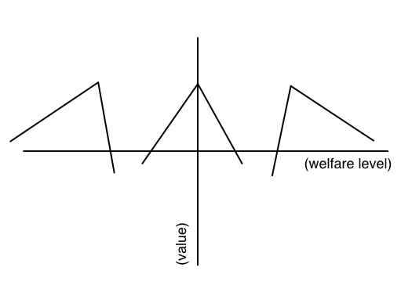
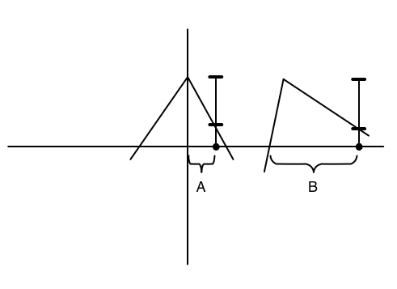

# Desert
**First published Fri Oct 9, 2015; substantive revision Tue Sep 22, 2020**

*Feldman, Fred, Skow, Brad*

Claims about desert are familiar and frequent in ordinary non-philosophical conversation. We say that a hard-working student who produces work of high quality deserves a high grade; that a vicious criminal deserves a harsh penalty; that someone who has suffered a series of misfortunes deserves some good luck for a change.

Philosophers have made use of the concept of desert in several contexts. In discussions of the nature of justice, several philosophers have advocated versions of the idea that justice obtains when goods and evils are distributed according to desert. In discussions of the concept of intrinsic value, some philosophers have suggested that happiness may be the greatest good but it has outstanding value only when enjoyed by someone who deserves it. In theories about moral obligation, some consequentialists have defended the idea that right acts lead to outcomes in which higher welfare is preferentially distributed to people who deserve it. In social and political philosophy (or philosophy of law) a number of philosophers have appealed to the concept of desert when discussing the justification of penalties for violations of law.

So appeals to desert appear frequently in many contexts, in philosophy as well as in ordinary non-philosophical talk. Yet many questions remain about desert: how can it be distinguished from mere entitlement? What is its conceptual structure? What kinds of things can be deserving? What kinds of things can be deserved? What kinds of properties can serve as bases on which a deserver deserves a desert? How can claims about desert be justified?

## 1. Desert and Entitlement

It is important here at the outset that we draw attention to a distinction between *desert* and another concept with which it might be confused. We will speak of this latter concept as the concept of *entitlement*, though different philosophers use different terminology to mark this distinction.

A typical desert claim is a claim to the effect that someone – the “deserver” – deserves something – the “desert” – in virtue of his or her possession of some feature – the “desert base”.[^note-1] For example, consider the claim that a certain student deserves a high grade from her teacher in virtue of the fact that she did excellent work in the course. A typical entitlement claim is a claim to the effect that someone is entitled to something from someone on some basis. For example, consider the claim that a customer is entitled to a refund from a merchant in virtue of the fact that the merchandise he purchased from that merchant had been sold with a guarantee and turned out to be defective.

There are obvious structural similarities between desert claims and claims about entitlement. In typical examples of each sort, someone is said to deserve (or be entitled to) something from someone on some basis. However, there is an important difference between the concepts of desert and entitlement. As the terminology is used here, desert is a more purely normative concept, while entitlement is a sociological or empirical concept. If some social or legal institution is in place in your social group, and that institution has a rule that specifies some treatment for those who have some feature, and you have the feature, then you are entitled to that treatment. Thus, for example, suppose that when the customer purchased a certain item, he received a legally binding written guarantee from the seller. The guarantee specified that if the item should turn out to be defective, the seller would either replace the item or refund the money that the buyer had spent for the defective item. In such a case, if the buyer satisfies the conditions stated in the guarantee, and the purchased item is indeed defective, the buyer is entitled to the refund or replacement.

Typical desert claims have a similar structure, but do not always depend in this way on the existence of laws or contracts or other similar social institutions. A person may deserve some sort of treatment even though there are no rules in place in his society that codify the conditions under which someone deserves that sort of treatment. In such a case, a person may deserve something even though he is not entitled to it. Similarly, a person may be entitled to something by some rules that are in place in his society even though he does not deserve it. Some examples may help to make this distinction clearer.

Consider an example involving a wealthy grandfather and two grandchildren. One grandchild is vicious and rich; the other is virtuous and poor. The vicious grandchild never treated his grandfather with respect. The virtuous grandchild was always respectful and caring. Suppose the grandfather leaves his entire fortune to the vicious grandchild. As the terminology is used here, we may want to describe the situation by saying that the vicious grandchild is *entitled* to the fortune (the rules of the legal system are unambiguous on this point), but at the same time we may want to say that he does not *deserve* it (he already has too much money; he is a rotten person who never treated his grandfather respectfully). The virtuous grandchild may *deserve* at least some of the inheritance, but he is not *entitled* to any of it.

Another example illustrates the same point. Suppose that an athlete has her heart set on doing well in a competition. Suppose she has a lot of natural talent and trains diligently for a long time until she has developed championship-level abilities in her sport. Suppose that the training involves quite a bit of sacrifice on her part. Suppose that at the last minute the competition is cancelled, and the athlete has no opportunity to compete. Then we might say that this was a great misfortune for her; she *deserved* to have a chance to participate. Unfortunately, there is no rule in the rulebook of the athlete’s sport that says that those who have trained diligently are to get a chance to participate. Let us assume that there is no institution in place in the athlete’s society that specifies that those who train hard shall be given a chance to compete. In this case, it would be wrong to say (using the terminology in the way that has been specified) that the athlete is *entitled* to a chance to participate, yet we may still feel that she *deserved* the chance. This seems to be an example of a case in which someone has completely “non-institutional” desert of something.

Some philosophers use the expression ‘pre-institutional desert’ where we use ‘desert’, and ‘institutional desert’ where we use ‘entitlement’. To avoid confusion, we will use ‘desert’ to refer to the relation that does not essentially involve the existence of social or legal institutions, and ‘entitlement’ to refer to the relation that does essentially involve the existence of such institutions. Our focus in this article is on desert; we mention entitlement only as it bears on desert.

## 2. Deservers, Desert, and Desert Bases

In his seminal work on desert and justice (Feinberg 1970)[^feinberg-1970] Joel Feinberg presented a catalog of types of seemingly uncontroversial desert claims: a student might deserve a high grade in virtue of having written a good paper; an athlete might deserve a prize in virtue of having excelled in a competition; a successful researcher might deserve an expression of gratitude in virtue of having perfected a disease-preventing serum; a criminal might deserve the contempt of his community in virtue of having committed crimes; the victim of an industrial accident may deserve compensation from his negligent employer; a hard-working public official may deserve to be promoted to a higher office in virtue of her diligence. Leibniz, Kant, and others focused on examples in which a person is said to deserve happiness in virtue of having been morally excellent.

In all these familiar cases, the deserver is a person. But as Feinberg himself mentioned, there does not seem to be any conceptual barrier to saying that non-persons may also be deservers. Thus, for example, it seems acceptable to say that a beautiful ancient city deserves to be preserved; that a unique and formerly vibrant ecosystem deserves to be restored; that the scene of a horrible massacre deserves to be torn down. In moral and political discussions, cases under scrutiny tend to be ones in which deservers are either individual people or groups of people. This should not blind us to the fact that non-persons can also be deservers.

Desert claims also typically involve a *desert*. This is the thing that the deserver is said to deserve. As Feinberg indicated, familiar deserts include such things as grades, wages, prizes, respect, honors and awards, rights, love, benefits and other such things. Leibniz and Kant would surely insist that we include happiness among the possible deserts; and others would insist that we should mention welfare.

Those deserts may seem at first to be “positive.” However, there are “negative” counterparts. Indeed, some of the items on that list are already negative. Thus, some grades are bad grades, as for example, the F a student might deserve for a very weak paper. Other deserts are uniformly negative: burdens, fines, booby prizes, contempt, dishonors, onerous obligations, penalties, condemnation, hate, etc.

Some contributors to the literature on desert suggest that every desert is either a plus or a minus. Some speak, in this context of “benefits and burdens,” or advantages and disadvantages. However, there are cases in which someone deserves something that is neither good nor bad, neither a benefit nor a burden. Suppose someone who has done outstanding academic work deserves to get an A, while someone who has done completely unsatisfactory work deserves to get an F. It is reasonable to suppose that the A is a good grade – something the recipient will be pleased to get – and the F is a bad grade – something that the recipient will be disappointed to get. But suppose a student did mediocre work and deserves a mediocre grade – a C. This is neither good nor bad, neither a benefit nor a burden. Nevertheless, someone might deserve it. This would be a case in which someone deserves something that is neither “positive” nor “negative.”

The same could be true of welfare. Someone might deserve happiness and (we may assume) that would be a good thing to get; someone else might deserve unhappiness and (we may assume) that would be a bad thing to get. But another person might deserve to be at an intermediate welfare level, neither happy nor unhappy. While it might be good in some way for the person to be at that neutral welfare level, the thing he deserves would be neither good nor bad. So while it is convenient to say that deserts are benefits or burdens – things that will be good or bad for the deserver to receive – in fact some deserts are neither benefits nor burdens.

Feinberg suggested that we can distinguish between “basic” and “derived” deserts. He went on to say that basic deserts are always responsive attitudes such as approval and disapproval. On this view, derived deserts are forms of treatment that would be fitting expressions of the more fundamental basic deserts. Thus, giving a student an A might be the fitting expression for approval of her work; giving a student an F might be the most fitting expression of serious disapproval of her work. Some recent contributors to the literature on desert seem to ignore this distinction between basic and derived desert, but others continue to employ the distinction and to treat it as important. Scanlon, for example, makes it a central feature of his conception of desert (see Scanlon 2013, 2018)[^scanlon-2013].

Perhaps the most important and controversial bit of information we typically seek in connection with a claim about desert concerns the *desert base*. This is generally taken to be the feature in virtue of which the deserver deserves the desert. On this view, a desert base is always a property. If we adopt this view, we will say (for example) that the student deserves a high grade in virtue of her possession of the property of *having produced course work of high quality*. On another view, a desert base is always a fact. If we adopt this view we will prefer to say that the student deserves her high grade in virtue of *the fact that her work was of such high quality*.

We are inclined to think that it makes no difference whether we take desert bases to be properties or to be facts. The views seem to be intertranslatable. In this article, simply as a matter of convenience, we generally speak of desert bases as properties.

In some cases there is little debate about whether a certain property serves as a desert base for a certain sort of treatment. This may be illustrated by the example of the student who produced outstanding work in a course and deserves a high grade. Few would debate the claim that the student deserves the grade in virtue of the high quality of her work. The desert base in that case would be *having produced academic work of high quality*. Similarly consider the case of the cold-blooded criminal who has inflicted great harm on many innocent victims. It is reasonable to suppose that he deserves a harsh penalty in virtue of his evil behavior. In this case, the desert base is something like *having inflicted great harm on many innocent victims*.

In other cases, however, there would be more controversy about desert bases. A good example involves the desert of wages. Suppose an employee works hard, is productive, is loyal to his employer, and in virtue of some health problems in his family, needs more money. We may agree in such a case that the employee deserves a raise – but we may disagree about the basis on which he deserves that raise.

There is general agreement that properties of certain types cannot serve as desert bases. Consider a case in which punishing an innocent person would have good consequences. The person has this property: *being such that punishing him would have good consequences*. But it would be seriously counterintuitive to say that the person deserves punishment in virtue of his possession of this property.

Certain general principles about desert bases have been introduced in an effort to explain why certain properties seem ineligible to serve as desert bases. Perhaps the least controversial principle is the so-called “Aboutness Principle,” mentioned by Feinberg. In its propositional form, this principle says that a person can deserve something in virtue of a certain fact only if that fact is a fact “about the person.” In its property form, the principle would say that a person can deserve something in virtue of a certain property only if the person actually has the property. The Aboutness Principle does not offer any assistance with respect to the punishment case just mentioned. After all, the innocent person in that example actually does have the property of *being such that punishing him would have good consequences*. The fact that punishing him would have good consequences is a fact about him.

Some have said that if someone deserves something, D, in virtue of having some desert base, DB, then the deserving one must be responsible for having DB (see, for example, Rawls 1971; Rachels 1978; Sadurski 1985)[^rachels-1978][^rawls-1971][^sadurski-1985]. This “Responsibility Principle” seems to be satisfied by many of the examples already discussed. The good student, we may suppose, is responsible for having produced good academic work. The cold-blooded criminal, similarly, may seem responsible for his vicious behavior. The hard working employee bears some responsibility for having worked so hard. We may generalize from these cases and conclude that all cases of desert are like this: if someone deserves something, D, on some basis, DB, then he or she is responsible for having DB. Appeal to the Responsibility Principle would explain why the innocent person does not deserve punishment. He is not responsible for having the property of *being such that punishing him would have good consequences*.

A variety of cases have been offered as counterexamples to the Responsibility Principle. Feldman (1995a) described a case in which patrons at a restaurant became ill as a result of having been served spoiled food. He claimed that the patrons in such a case would deserve compensation. The desert base here seems to be *having been harmed by the negligent food preparation by the restaurant* – yet the patrons were not responsible for having that desert base. They were innocent victims. A similar thing happens in the case of someone who has been egregiously insulted. She may deserve an apology in virtue of having been insulted, but she is not responsible for the insult. Another case mentioned by McLeod involves a child who, through no fault of his own, comes down with a painful illness. He deserves the care and sympathy of his parents, yet he is not responsible for having become ill.

Others have suggested what may be called “the Temporality Principle”: the idea here is roughly this: if someone deserves something, D, in virtue of having a certain desert base, DB, then he or she must already have DB at the time he or she begins to deserve D (see, for example, Rachels 1978; Kleinig 1971; Sadurski 1985)[^rachels-1978][^sadurski-1985]. You cannot deserve something on the basis of a property you will begin to have only later. The Temporality Principle has been invoked in an effort to explain why it is wrong to engage in “pre-punishment.” It is said that even if a certain person is going to commit a crime, he does not begin to deserve punishment for that crime until he actually commits it. This line of thought has been debated. One problem is that even before he commits the crime, the future criminal already has this property: *being such that he will later commit a crime*. It might be said that he deserves punishment in virtue of already having this property even before he commits the crime. While the Temporality Principle is widely endorsed, counterexamples have been presented (see, for example, Feldman 1995b)[^feldman-1995b]. Those counterexamples have not been universally accepted (see, for example, Smilansky 1996a, 1996b)[^smilansky-1996a].

In many cases, when we make a desert claim we mention a *distributor*. This is the person or institution from whom the deserver deserves to receive the desert. In some cases, the identity of the distributor will be clear. In other cases, it is not so clear. Consider, for example, the motto that the McDonald’s restaurants formerly used: ‘You deserve a break today.’ No distributor is explicitly mentioned in the motto. It just says that you deserve a break. Perhaps when McDonald’s made this statement, they did not have any particular distributor in mind. Maybe they just thought that you deserve it *from someone*. The same would be true of the Gates Foundation’s former motto according to which ‘Every person deserves the chance to live a healthy and productive life.’ The motto does not mention anyone who has the job of ensuring that everyone gets a chance to live a healthy and productive life. Given that no one has the capacity to ensure that everyone lives a healthy and productive life, we may conclude that in this case no distributor is mentioned precisely because no one is qualified to be a distributor.

In other cases, there is a distributor and its identity is clear. Consider, for example, the claim that a certain elderly professor deserves some respect from his unruly students. Here the distributor is explicitly mentioned: it is the unruly students. Those who endorse the notion that virtuous people deserve happiness in heaven will presumably say that the distributor in that case is God. In social and political contexts we often find philosophers assuming that citizens deserve certain rights from the government of their country.

It may seem that we could relocate this reference to the distributor. We could build reference to the distributor into the description of the desert. Thus, instead of saying that the desert in the example involving the elderly professor is *respect*, we could say that the desert is *respect from his students*.

In some cases a desert statement may also indicate something about the strength of the deserver’s desert of the thing deserved. The strength of someone’s desert of something might be indicated loosely, as when we say that someone’s desert of something is “very strong,” or “only slight.” In some cases we can use some numbers to represent strengths of desert, though the choice of a numbering system will be to some extent arbitrary. But there are some important facts here: sometimes you deserve both A and B, but you deserve A more than you deserve B; sometimes two different deservers deserve the same thing and it is not possible for both of them to get it; maybe one of them deserves it more than the other. Sometimes you deserve something, but only to a very slight degree and this desert could easily be overridden by some other consideration.

In many cases a desert statement (if fully spelled out) would also indicate some *times*. One of these is the time of the deserving; the other is the time when the receipt of the desert is supposed to take place. Thus, for example, suppose a lot of money has been withheld from a certain person’s paycheck each week for a whole year. Suppose in fact the government has withheld more than the person owes in taxes. Then he deserves a refund. Suppose refunds are all given out on April 1. We might want to say this: at every moment in March, the taxpayer deserves to get a refund on April 1. In this example, the time of the deserving is *every moment in March*. The time at which the deserver deserves to receive the desert is April 1.

## 3. The Justification of Desert Claims

A number of related questions have been discussed under the general title of ‘the justification of desert claims.’ Some apparently take the question about justification to be a question about *epistemic* justification (see, for example, McLeod 1995, 89)[^mcleod-1995]. If we understand the question in this way, we may want to know how – if at all – a person can be epistemically justified in believing that (for example) hard work is a desert base for reward. Others take the question about justification in a different way. They take it to be a question about *explanation*. Consider again the question about the justification of the claim that hard work makes us deserve reward. On this second interpretation, the question is: what explains the fact that hard work is a desert base for reward? Others speak in this context of “normative force” (see, for example, Sher 1987, xi)[^sher-1987]. They seem to be concerned with a question about what explains the fact that when someone deserves something, it is obligatory for others to provide it, or good that it be provided. Still others may phrase the question by appeal to concepts of *grounding* or *foundation*. They may ask what grounds the fact that those who work hard deserve rewards. Still others write a bit more vaguely about the *analysis* of desert claims (see, for example, Feinberg 1970)[^feinberg-1970].

There is a further distinction to be noted. Some who write about the justification of desert claims seem to think that it is specific desert claims about particular individuals that call for justification. Thus, they might ask for a justification of the claim that Jones deserves a $100 bonus for having worked extra hard over the holiday weekend. Others apparently think that what calls for justification is a more general claim about desert bases and deserts. They might ask for a justification of the claim that *hard work* is a desert base for *financial reward*.

We will formulate the discussion in the admittedly vague idiom of *justification of claims about desert bases and deserts*. But as we understand the question, it can be explicated in this way: suppose someone claims that in general the possession of some desert base, DB, makes people deserve a certain desert, D. If challenged, how could the maker of such a claim support his claim? How could he argue for his assertion? What facts about DB and D could he cite in order to show that he was right – the possession of DB does make someone deserve D?

Some who write on this topic are “monists” about justification; they apparently assume that there is a single feature that will serve in all cases to justify desert claims. Others are “pluralists.” They defend the idea that desert claims fall into different categories, and that each category has its own distinctive sort of justification (see, for example, Feinberg 1970, Sher 1987, and Lamont 1994)[^feinberg-1970][^lamont-1994][^sher-1987]. We first consider some monist views.

Some popular views about the justification of desert claims are based on the idea that such claims can be justified by appeal to considerations about the values of consequences. Sidgwick seems to be thinking of something like this in *The Methods of Ethics* where he mentions ‘the utilitarian interpretation of Desert.’ He describes this by saying: ‘when a man is said to deserve reward for any services to society, the meaning is that it is expedient to reward him, in order that he and others may be induced to render similar services by the expectation of similar rewards’ (1907, 284, note 1). (It is not clear that Sidgwick means to defend this view about desert; he seems to be offering it as an account of what a determinist would have to say.)

Sidgwick’s statement has direct implications only for cases in which what is deserved is some sort of reward and the desert base of this desert is some sort of ‘service to society.’ As a result, it is not clear that this idea about justification, taken simply by itself, has any direct relevance to cases in which someone deserves punishment, or compensation, or a prize for outstanding performance, or a grade for academic work.

According to a natural extension of the view that Sidgwick mentioned, a claim to the effect that someone deserves something, D, in virtue of his possession of some feature, DB, is justified by pointing out that giving the person D in virtue of his possession of DB would have high utility.

While there surely are some cases in which giving someone what he deserves would have high utility, this link between desert and utility is just as frequently absent. To see this, consider a case in which a very popular person has engaged in some bad behavior for which he deserves punishment – but suppose in addition that no one believes he is guilty. If he were punished for having done the nasty deed, there would be an outpouring of anger from all of the popular person’s fans and friends who think he has been framed. If our interest were in producing an outcome with high utility, we would have to refrain from punishing him. But in spite of that, since in fact he did do the nasty deed, he does deserve the punishment.

In other cases, giving a person some benefit might have good results even though the person does not deserve to receive those benefits. To see this, imagine that a crazed maniac threatens to murder a dozen hostages unless he is given a half-hour of prime time TV to air his grievances. Giving him this airtime might have high utility – it might be the best thing for those in charge to do in the circumstances – but at the same time we might feel that the maniac does not deserve it.

Another serious problem with the consequentialist approach is brought out by consideration of the famous telishment case, also known as ‘The Small Southern Town.’ The example was presented by Carritt in his *Ethical and Political Thinking*, but gained great notoriety as a result of being quoted at length in Rawls’s ‘Two Concepts of Rules’ (Rawls 1955)[^rawls-1955]. Here is the passage from Carritt:

> …if some kind of very cruel crime becomes common, and none of the criminals can be caught, it might be highly expedient, as an example, to hang an innocent man, if a charge against him could be so framed that he were universally thought guilty… (Carritt 1947, 65)[^carritt-1947]

In this example, punishing an innocent person has high utility because it would have great deterrent effect. But the victim of the punishment does not deserve punishment – after all, he is innocent. This highlights an important fact about desert and utility: sometimes it can be expedient to give someone a reward or a punishment that he or she does not deserve.

It appears then that the consequentialist approach confronts overwhelming objections. Sometimes deserved treatment is expedient; sometimes it is not. Sometimes undeserved treatment is expedient; sometimes it is not. As a result, appeals to the utility of giving someone some benefit or burden cannot justify the claim that the person deserves that sort of treatment.

A second approach to the justification of desert claims is based on some ideas concerning institutions. There are several different ways in which this “institutional justification” can be developed. (Our discussion in this section has benefited enormously from McLeod 1999b.)[^mcleod-1999b]

First, some background: an *institution* may be identified by a system of rules that define positions, moves, penalties, rewards, etc. In some cases the rules of an institution are carefully written down and perhaps made a matter of legislation. The system of taxation in some country might be a good example. In other cases the rules of an institution are not explicitly formalized. An example might be the system of etiquette governing the writing, sending, replying to, etc. of wedding invitations. It is not easy to say what makes an institution “exist” in a society. That is a puzzle best left to the sociologists.

We may also need to assume that when people set up institutions, they do so with some intention. They are trying to achieve something; or more likely, they are trying to achieve several different things. Maybe different people have different aims. We can say – somewhat vaguely – that the *point* of an institution is the main goal or aim that people have in establishing or maintaining that institution.

A person may be *governed* by some institution even if he does not like it, or does not endorse it. Thus, for example, suppose a criminal justice system exists in a certain state. Suppose some miscreant lives in that state and has been charged with some crime. Suppose he is found guilty in a duly established court of law and is sentenced to ten years in prison. He is governed by the rules of the judicial system whether he likes it or not. To be governed by an institution one must live (or perhaps be a visitor) in the state or society where the institution exists, and one must somehow “fall under” the rules. Those rules must “apply to” the individual. Again, these are tricky sociological notions, not easily spelled out.

Some philosophers have said things that suggest that it is possible to justify a desert claim by identifying a currently existing, actual institution according to which the deserver is entitled to the desert. We can state this idea a bit more clearly:

> AID: The claim that a person, S, deserves something, D, on the basis of the fact that he has a feature, DB, is justifiable if and only if there is some social institution, I; I exists in S’s society; S is governed by I; according to the rules of I, those who have DB are to receive D; S has DB.

This “actual institutional” account of desert is almost universally rejected.[^note-2] There are several independent sources of difficulty. Most of these emerge from the requirement that a desert claim is justifiable always and only when there is an appropriate *actual* social institution. This produces a number of devastating objections. Suppose a thoroughly decent person has suffered a number of serious misfortunes. He deserves a change of luck; he deserves some good luck for a change. Suppose he lives in a country where there is no social institution that supplies compensatory benefits to those who have had bad luck. If AID were true, it would be impossible to justify the claim that he deserves it.

An equally serious objection arises from the fact that some of the institutions that actually exist are morally indefensible. Let us imagine a thoroughly horrible social institution – slavery. Suppose some unfortunate individual is governed by that institution. Suppose the institution contains rules that say that slaves who are strong and healthy shall be required to work without pay in the cotton fields. Suppose this individual is strong and healthy. Consider the claim that he deserves to be required to work in the fields without pay in virtue of the fact that he is strong and healthy. AID implies that this desert claim is justified. That is as preposterous as it is offensive.

The general point: we must not lose sight of the fundamental difference between *entitlement* and *desert*. AID seems to confuse these. It seems to say that you deserve something if and only if you are entitled to it by the rules of an actual institution. Since there are bad institutions, and cases in which desert arises in the absence of institutions, this is clearly a mistake.

We can deal with all of these objections by altering the institutional account of justification. Instead of making the justification of a desert claim depend upon the existence of an actual social institution, we can make it depend upon the rules that would be contained in some ideal social institution. The main change is that we no longer require that the social institution exists. We require instead that it be an ideal institution – an institution that would be in some way excellent or preferable. Then we can attempt to justify desert claims by saying that the deservers would be entitled to those deserts by the rules of an ideal social institution.

We can state the thesis this way:

> IID: The claim that a person, S, deserves something, D, on the basis of the fact that he has a feature, DB, is justifiable if and only if there is some possible social institution, I; I would be ideal for S’s society; S would be governed by I; according to the rules of I, those who have DB are to receive D; S has DB.

Before we can evaluate this proposal, we have to explain in greater detail what makes a possible institution “ideal” for a society. We might try to define ideality by saying that an ideal institution is one that would distribute benefits and burdens to people precisely in accord with their deserts. With this account of ideality in place, IID generates quite a few correct results. Unfortunately, it would be unhelpful in the present context. After all, the aim here is to explain how desert claims can be justified. This account would explain desert by appeal to ideal institutions, and then explain ideal institutions by appeal to desert.

Following the rule utilitarians, we could attempt to define ideality by saying that a possible institution is ideal for a society if and only if having it as the society’s institutional way of achieving its point would produce more utility than would the having of any alternative institution. This yields a form of the institutional approach that seems importantly similar to the consequentialist approach already discussed.

Unfortunately, with this conception of ideality in place, the proposal seems to inherit some of the defects of the simpler consequentialist approach. It implies, for example, that if it is possible for there to be a seriously unfair but nevertheless utility maximizing institution, then people would deserve the burdens allocated to them by the rules of that institution, even if it were not in place.

A further difficulty arises in connection with actual but not optimific institutions. Suppose, for example, the utility maximizing ice-skating institution would have rules specifying that in order to win the gold medal, a competitor must perform a 7 minute free program; a 6 minute program of required figures; and that all contestants must wear regulation team uniforms consisting of full length trousers and matching long-sleeved team shirts. Suppose in fact that this institution is not in place in Nancy’s society. Suppose instead that the de facto institution contains some slightly different but still fairly reasonable rules for ice-skating competitions. Suppose Nancy abides by all the relevant extant rules and is declared the winner in a competition. She is entitled to the gold medal by the actual rules. It may seem, in such a case, that her claim to deserve the medal would be justified. But since she would not be entitled to it by the rules of the ideal institution, IID implies that it is impossible to justify her claim that she deserves the medal by virtue of her performance here tonight.

It appears, then, that difficulties confront the attempt to justify desert claims by appeal to claims about the entitlements created by institutions, actual or ideal.

Some philosophers have drawn attention to alleged connections between desert claims and facts about “appraising attitudes” or “responsive attitudes” (see, for example, Feinberg 1970)[^feinberg-1970]. Commentators have understood these philosophers to have been defending the idea that desert claims can be justified by appeal to facts about appraising attitudes. Some have said, for example, that David Miller defended a view of this sort in his *Social Justice* (1976). While there may be debate about whether Miller actually intended to be defending such a view, it is worthwhile to consider it. (In the discussion that follows we are indebted to McLeod 1995 and McLeod 2013.)[^mcleod-1995][^mcleod-2013]

We need first to understand what is meant by ‘appraising attitude.’

Admiration, approval, and gratitude are typically cited as examples of “positive” appraising attitudes. In each case, if a person has such an attitude toward someone, he has that attitude in virtue of some feature that he takes the person to have. Suppose, for example, that you admire someone; then you must admire her *for something she is or something she did*. Maybe she worked hard; or wrote a good paper; or can run very fast; or is able to play the violin beautifully. Similarly for the other positive appraising attitudes.

Disapproval, resentment, contempt, “thinking ill of,” and condemnation may be cited as examples of “negative” appraising attitudes. They are similar to the positive attitudes in this respect, if you disapprove of someone, then you must disapprove of him *for something he is or something he did*. Maybe he plagiarized a paper; maybe he is totally out of shape; maybe he is utterly talentless.

Miller says that if we did not have these attitudes, ‘we would not and could not use the concept of desert’ (1976, 89). He also says that the range of possible desert bases coincides with the range of bases for appraising attitudes. You cannot deserve something on the basis of your possession of a property, DB, unless we could have an appraising attitude toward you on the basis of your possession of DB. But what is most important for our present purposes is that, according to Miller, ‘the existence of these appraising attitudes makes intelligible the connection between a desert judgment and its basis’ (89). Some have understood Miller to be claiming that something about these appraising attitudes provides the answer to our question about the justification of desert claims.

A certain appraising attitude may seem appropriate to a desert claim. For example, suppose a person feels strong approval (a positive appraising attitude) of a subject in virtue of his heroic action. The attitude would be appropriate to the claim that the hero deserves a reward for his heroism. On the other hand, if someone feels contempt (a negative appraising attitude) for a person in virtue of his cowardice, then this attitude would be appropriate to the claim that the coward deserves some sort of penalty. On one possible view, whether a desert judgment is justifiable depends upon whether the person who makes that judgment has an appraising attitude that is appropriate to the desert claim.

This view (presumably not Miller’s) is clearly confused. Suppose the leader of a terrorist gang claims that a member of his gang deserves respect for having set off a suicide bomb in an elementary school. Suppose the leader has great admiration for this the gang member precisely because he set off the bomb. On the current proposal, since the leader in fact has a positive appraising attitude toward the member, his desert claim is justified. That cannot be right.

The difficulty cannot be resolved by appealing to the reactions of the community. It is easy enough to imagine a case in which the overwhelming majority of the bomber’s community admire him for destroying the elementary school. Surely, however, no matter how many of his compatriots admire him for doing this deed, the claim that he deserves admiration for having done it is still not justified.

Instead of appealing to facts about the appraising attitudes that others in fact have, we might consider a different question: what sort of appraising attitude would be fitting for others to have in virtue of the fact that he has committed this deed? If it would be fitting for others to admire him for bombing the school, then he deserves admiration. If it would be fitting for others to hold him in contempt for bombing the school, then he deserves contempt.

In general, then, we might say that the claim that S deserves a certain benefit (burden) in virtue of having done X is justified if and only if it would be fitting for observers to have a positive (negative) appraising attitude toward S in virtue of his having done X.

This proposal seems misguided for several reasons. First, it seems to be circular. It purports to explain the justification of desert claims by appeal to claims about what appraising attitude would be “fitting.” But to say that it would be fitting for someone to receive a certain benefit is dangerously close to saying that he deserves to receive it. In this form the proposal seems circular.

Furthermore, it appears that there are cases in which a person deserves something but in which no appraising attitude seems to be fitting. Suppose, for example, that an abandoned child is in need of medical care and nurturance. The fact that the child is sick does not make it appropriate for onlookers to admire her or to condemn her. It does not call for any “positive” or “negative” appraising attitude. Nevertheless, the claim that the child deserves medical care and nurturance in virtue of her need might be justified. This objection presents a genuine difficulty only if every appraising attitude is a favorable or an unfavorable attitude. If we assume that pity, or compassion, is also an appraising attitude, the problem mentioned here will not arise.

In his (1970) Feinberg hints at a different way in which appraising attitudes might figure in the justification of desert claims. Feinberg starts by noting that ‘reasonable men naturally entertain certain responsive attitudes toward various actions, qualities, and achievements.’ Those who engage in the actions or manifest the qualities thereby deserve to be the subjects of the responsive attitudes. Going further, we can say that various forms of treatment – punishments, rewards, prizes, etc. – are the customary way of expressing the natural responsive attitudes. When such forms of treatment are in this way the customary and natural ways of expressing the attitudes, then those who engage in the action or manifest the quality deserve, in a derived way, to receive the treatment. The suggestion, then, is that in such cases the claim that someone deserves D on the basis of his possession of DB can be justified by pointing out that giving D is the conventional way of expressing the responsive attitude that reasonable men entertain toward those with DB.

If understood in the suggested way, this account would rely on some problematic assumptions about the responsive attitudes that ‘reasonable men naturally entertain.’ We might well doubt whether all such men invariably entertain those attitudes in cases where the recipients deserve to be their subject. In any case where only *some* reasonable men entertain the attitudes, it would be impossible to justify the associated desert claims. On the other hand, if we required merely that some reasonable men entertain the attitudes in question, then it would become far too easy to justify dubious desert claims. Furthermore, it would make it possible for there to be cases in which someone both deserves a certain treatment and also deserves not to get that treatment.

The details of the appraising attitudes approach remain controversial.

A few philosophers – including George Sher (1987) and Julian Lamont (1994) – said things that suggest a pluralistic approach to the question about the justification of desert claims. On this view, there are several different “external values”; different values would be relevant in different cases; different desert claims would be justifiable by appeal to different external values. Thus, for example, consider the claim that you deserve a reward for having saved a life. The external value in this case might be some combination of the value of courage and the alleged value of human life. Consider a different case in which someone claims that you deserve a high grade for having done outstanding work in a course. In this case, the external value might be the value of academic achievement. In every case, a desert claim – if it can be justified at all – can be justified by pointing out that giving the deserver the desert would properly respect the associated external value. A full exposition of this approach would require a detailed account of what makes a certain external value be relevant to a desert claim; it would also require a detailed account of what is meant by saying that some action would “properly respect” some external value.

## 4. Desert and Intrinsic Value

Here is a natural and appealing idea: it is a good thing when people get what they deserve. If I am distributing raises, and only Jones deserves a raise, then it would be better for me to give the raise to Jones than to anyone else.

As simple and straightforward as this idea is, given certain background assumptions it raises difficult questions about the connection between desert and “goodness,” or intrinsic value.

Some consequentialist moral theories make use of (and so presuppose the intelligibility of) the notion of the “intrinsic value of a state of affairs,” or the “intrinsic value of a possible world.” This notion of intrinsic value is a quantitative one: consequentialists usually assume that we can choose a unit for measuring intrinsic value, and in terms of that unit we can say that the intrinsic value of one possible world is 100 units, while the intrinsic value of another is, say, merely 10 units.

Common forms of consequentialism go on to say that whether an action A is permissible or impermissible is determined by how the intrinsic value of the world that would be actual if A were performed compares to the intrinsic values of the worlds that would be actual if the alternatives to A were performed instead. (The alternatives to A are the actions other than A that are “open” to the agent at the time he performs A.) One standard form of consequentialism says that an act A is permissible if and only if none of the worlds that would be actual were the agent to perform one of the alternatives to A has a greater intrinsic value than the world that would be actual were he to perform A. Thus, in a consequentialist framework, if one holds that facts about desert make a difference to intrinsic value, one may also hold that facts about desert make a difference to whether an act is permissible or impermissible. If, in virtue of the fact that only Jones deserves a raise, it is better to give a raise only to Jones, then the right thing to do is to give the raise only to Jones.

This section started with the generalization that, other things being equal, it is a good thing when people get what they deserve. We have just seen that in a consequentialist framework this generalization about value leads naturally to another one, about moral obligation: other things being equal, one ought to ensure that people get what they deserve. But one might endorse the second generalization without the first. Some opponents of consequentialism hold that talk of “the intrinsic value of a possible world” makes no sense (for example, Thomson 2008)[^thomson-2008]. They could still accept that, other things being equal, one ought to ensure that people get what they deserve. One could hold, for example, that the obligation to ensure that people get what they deserve is a *prima facie* duty, in the sense that W. D. Ross (2002) attaches to this phrase.

Some consequentialists have hoped that basing their theory of obligation on a “desert-sensitive” theory of intrinsic value will make their theory immune to certain common objections. To get a sense of what these philosophers hope to accomplish we will need a more detailed statement of a theory of intrinsic value. We will make use of the notion of individual welfare, or well-being. Talk of someone’s well-being is talk of how good their life is for them. We may speak of how good someone’s life is at a particular moment, or how good their life is as a whole; our focus here is on welfare-values of entire lives. Let us assume, as is common in discussions of desert, that welfare is a quantitative notion. We can choose a unit for measuring welfare; then for each person there is, relative to that choice of unit, a number that represents how good that person’s life is for them. One simple (non-desert-sensitive) theory of intrinsic value for possible worlds says that the (number representing) the intrinsic value of a world is equal to the sum of the numbers representing the “welfare values” of the lives of the people in that world.

According to standard consequentialism, combined with this theory of intrinsic value, “distribution does not matter.” All that matters, for determining whether an act is right, is the sum total of the welfare in the world that would be actual if that act were performed, and how that sum total differs from the totals in the worlds that would be actual if some alternative act were performed; it does not matter how good any particular individual’s life is. John Rawls famously argued that this is an objectionable feature of the theory (Rawls 1971, 26; his target is a slightly different theory of intrinsic value)[^rawls-1971].

A desert-adjusted theory of intrinsic value might yield a version of standard consequentialism that evades this objection. If worlds in which people get what they deserve are better than worlds in which people do not, then it is not true that distribution does not matter. A desert-adjusted theory of intrinsic value could say that, if Smith and Jones each deserves 25 units of welfare, then a world in which they each receive 25 units is better than a world in which Smith receives 50 and Jones receives 0.

Feldman (1995a, 567) is explicit that the goal of his desert-sensitive version of consequentialism is to respond to Rawls’ objection. He suggests that his theory can handle many of the examples commonly thought to raise problems for consequentialism, such as the Organ Transplant. In another paper Feldman suggests that a desert-adjusted theory of intrinsic value can avoid Parfit’s Repugnant Conclusion (see Feldman 1995c; for the Repugnant Conclusion, see Parfit 1984; for reservations about Feldman’s response to Rawls’ objection, and an alternative, see McLeod 2006)[^feldman-1995c][^mcleod-2006][^parfit-1984].

What might a desert-adjusted theory of intrinsic value, one that might form the basis for a desert-sensitive version of consequentialism, look like? To evaluate desert-adjusted theories of intrinsic value we need to see them stated at a greater level of detail than we have seen so far. Presumably, if it is a good thing when people get what they deserve, then if the people in world *w*₁ are closer to getting what they deserve than the people in world *w*₂, *w*₁ is better (has a greater intrinsic value) than *w*₂ (other things being equal). But, again, intrinsic value is a quantitative notion. So it makes sense to ask: how much better is *w*₁ than *w*₂? 10 units? 100 units? Even if we say a lot more about what worlds *w*₁ and *w*₂ are like, the answers to these questions are not obvious.

To make a start let us go back to an assumption we quietly made three paragraphs back: that welfare levels are among the things that people deserve. This claim does not seem controversial. It follows from the common idea that the wicked deserve to suffer, and the saintly deserve to prosper, for to prosper is to have a relatively high welfare level. But philosophers who attempt to formulate (welfarist) desert-sensitive theories of intrinsic value often make a stronger assumption: that when it comes to determining the intrinsic value of a possible world, *all that matters* is the extent to which people get the welfare levels they deserve. Suppose I deserve an apology from my neighbor in virtue of the fact that he (inadvertently) tore up some of the plants in my yard. But suppose also that I do not really care about my yard, or about the quality of my relationship with my neighbor. Getting the apology would mean nothing to me, nor would I be upset if my neighbor did not apologize. The apology would not make my life better or worse. Then on the stronger assumption, the intrinsic value of the world is not higher if I get the apology than if I don’t – even though only if I get the apology do I get something I deserve.

One possible justification for this assumption goes as follows. Even though we may deserve all sorts of things, only instances of someone’s deserving a certain welfare level are instances of “moral desert.” And only moral desert “matters” for the intrinsic value of a possible world. A theory that says the world is no better if I get that apology is not false-but-legitimately-oversimplified. It is saying the truth. According to this line of thought, it is not, in fact, always better when people get what they deserve. It is only better if they get what they morally deserve. (Shelly Kagan focuses on moral desert, presumably to the exclusion of other kinds of desert, in chapter 1 of his 2012.)

Justified or not, most work on desert-sensitive theories of intrinsic value does assume that the only instances of desert that matter are instances of deserved welfare. What should a desert-sensitive theory of intrinsic value that makes this assumption look like? If the value of a possible world is a function, not just of the welfare levels of the people in that world, but also of the welfare levels they deserve, just which function is it?

Producing a theory that answers this question and is initially plausible is not easy. One way to approach the problem is to start with another simplifying assumption. The simple non-desert-sensitive theory of intrinsic value stated above is “totalist”; the intrinsic value of a possible world is got by summing up “contributions” made by each individual “separately.” The amount of intrinsic value contributed by an individual is equal to (or proportional to) that person’s welfare level. We could try for a desert-sensitive theory that is also totalist. The contribution made by an individual will not (or not always) be equal to their welfare level; the amount they deserve will also be relevant. Still, the value of the world as a whole will just be the sum of the individual contributions.

Here is a sketch of a theory like this. It treats someone’s desert level as a “multiplier.” The value an individual contributes to the intrinsic value of a possible world is equal to the product of the welfare level they receive in that world and the welfare level they deserve. (A more sophisticated treatment of the idea of “desert-as-multiplier” may be found in Kagan 2012, section 2.4.)[^kagan-2012]

This theory says plausible things about simple cases. If Smith deserves 10 units of welfare and Jones deserves 20, and you can either ensure that Smith receives 10 units, or that Jones receives 10 units, the theory says that it is better to ensure that Jones receives the 10 units. For if Smith receives the welfare, the total value of the world will be equal to 100, while if Jones does, the total value will be equal to 200. These facts are summarized in the table below (the multiplications in the contribution columns are “welfare level times desert level”):

| Who gets the welfare? | Smith’s contribution | Jones’s contribution | Total value |
| --- | --- | --- | --- |
| Smith | 10 × 10 = 100 | 0 × 20 = 0 | 100 |
| Jones | 0 × 10 = 0 | 10 × 20 = 200 | 200 |

The idea behind using deserved welfare levels as multipliers is that the welfare of more deserving people is worth more than that of less deserving people. As far as the quality of the lives of the individuals involved are concerned, 10 units of welfare is 10 units of welfare, no matter who it “goes to”: if Smith’s life is made better by 10 units of welfare, his life is made better by the same amount as if Jones’ life is made better by 10 units. But as far as *the world* is concerned, it does make a difference who the 10 units goes to. When 10 units of welfare goes to someone highly deserving, someone who deserves a high welfare level, the value of that 10 units is “augmented,” so that 10 units of welfare corresponds to a much larger number of units of value-for-the-world.

While the desert-as-multiplier idea gets some cases right, it gets other cases very wrong. Think again of Smith and Jones, deserving 10 and 20 units of welfare, respectively. Suppose that, if you do nothing, Jones will live a life worth 100 units, and Smith will live a life worth 0 units. Your only two options are to act so that Jones lives a life worth 110 and Smith “stays where he would have been” (he lives a life worth 0), or act so that Jones stays where he would have been, and Smith lives a life worth 10. The table below shows the values of the worlds that correspond to each of your options, according to this theory:

| Option | Smith’s contribution | Jones’ contribution | Total value |
| --- | --- | --- | --- |
| Do nothing | 0 × 10 = 0 | 100 × 20 = 2000 | 2000 |
| Augment Smith | 10 × 10 = 100 | 100 × 20 = 2000 | 2100 |
| Augment Jones | 0 × 10 = 0 | 110 × 20 = 2200 | 2200 |

The theory says you should augment Jones. This is implausible. Even if you do nothing, Jones will be living a life far better than the one he deserves to be living. What sense is there in making his life better, when instead you could cause Smith to be living a life he deserves, rather than one worse than he deserves?[^note-3]

It seems wrong to multiply every bit of welfare Jones receives by 20, even bits of welfare that put him way above the level of welfare he deserves, when computing his contribution to the intrinsic value of the world. This failure of the desert-as-multiplier view suggests an alternative mathematical role for deserved welfare levels. What is important is not the welfare level you deserve, but *how close* you are to the welfare level you deserve: how good the “fit” is between what you get and what you deserve. A natural way to measure fit is to look at the distance between what you get and what you deserve: the absolute value of the difference between your welfare level and your deserved welfare level. (So when Jones deserves 20 units and gets 100, his “fit value” is the number 80.)

Having latched on to the importance of fit values, how should we make use to them? The simplest way to implement the idea that ‘the closer one is to getting what one deserves, the better’ defines the contribution made to intrinsic value by an individual as follows:

> Contribution = welfare level − fit value.

The minus sign is there because someone’s fit value goes up as their welfare level gets farther away from their deserved welfare level. Thus increases in the fit value correspond to worse states of affairs; so we want fit values to make a negative impact on contributions.

This new theory gives a plausible judgment about our second Smith/Jones case. Here are the values it assigns:

| Option | Smith’s contribution | Jones’ contribution | Total value |
| --- | --- | --- | --- |
| Do nothing | 0 − \|10−0\| = −10 | 100 − \|20−100\| = 20 | 10 |
| Augment Smith | 10 − \|10−10\| = 10 | 100 − \|20−100\| = 20 | 30 |
| Augment Jones | 0 − \|10−0\| = −10 | 110 − \|20−110\| = 20 | 10 |

Philosophers have articulated other principles they think a desert-sensitive theory of value should entail, and have proposed yet more complicated “contribution formulas” as parts of theories of that sort. For example, Eric Carlson holds that if you have a bunch of people with the same desert level, and you “have a fixed amount of welfare to distribute between them” (really, in each world that you can “make actual” the sum of their welfare levels is the same), then the world in which they all receive the same welfare level should have the greatest intrinsic value. Equal levels of welfare are best, when everyone is equally deserving. The theory we just described is incompatible with this idea. (For Carlson’s theory, which does entail this principle, see Carlson 1997. Feldman 1995a articulated many ideas about how intrinsic values should be adjusted to take desert into account. Persson 1997 distinguished the idea of desert as a multiplier (he called it the “merit idea”) from the idea that what matters is the fit between desert and receipt; he sees both ideas at work in Feldman’s paper. Other constraints people have wanted to place on a desert-sensitive theory may be found in Carlson 1997, Arrhenius 2006, and Skow 2012.)

The theories we have discussed so far aim to be “overall” theories of intrinsic value, theories of intrinsic value all things considered, even if they may make some simplifying assumptions about what is valuable. Another approach to theorizing about desert aims to do something different. Shelly Kagan, in his book *The Geometry of Desert* (2012), aims at a theory of “intrinsic value from the perspective of desert.” To have a complete theory of intrinsic value one would have to take Kagan’s theory and find a way to combine it with theories of value from other perspectives.

Kagan’s book is by far the most comprehensive discussion of the role of desert in the theory of value. He discusses both “noncomparative desert” and “comparative desert.” Without trying to be too precise about this distinction, comparative desert concerns how the fit between one person’s welfare level and desert level compares to that of others; noncomparative desert ignores these comparisons. His theory of noncomparative desert comprises several claims, the core of which are these:

1. It is best, from the perspective of noncomparative desert, when someone gets exactly the welfare level they deserve. (That is, a world in which he gets exactly what he deserves is better than a world in which he gets more or less, other things being equal.)
2. If someone has a positive desert level, then it is better, from the perspective of noncomparative desert, if they get more than they deserve, than if they get less (by the same amount); moreover, the degree to which it is better to get more than one deserves increases as one’s desert level increases. The opposite is true if someone has a negative desert level.

The image below illustrates these claims. Each “mountain” plots an individual’s value, from the perspective of non-comparative desert, as a function of their welfare level. The “peak” of a person’s mountain sits directly above the welfare level that person (non-comparatively) deserves; this illustrates claim 1, that things are best when someone gets they welfare level they deserve. Note also that the mountain on the left-hand side of the y-axis has a steeper eastern slope than western slope. This illustrates part of claim 2. It indicates that if you could either overcompensate a person who deserves a negative amount of welfare, or undercompensate him, by the same amount, it is better to undercompensate him. The mountain on the right-hand side of the y-axis illustrates the corresponding claim about someone with “positive desert”: it is better to overcompensate than to undercompensate such a person. The image also illustrates a claim that Kagan calls “Bell Motion” (this claim is also part of 2): the mountains “swing” in a counter-clockwise direction, as they move from left to right in the diagram. Mountains farther to the right have shallower eastern slopes and steeper western slopes. This means, among other things, that if you have to overcompensate one person by a fixed amount, it is best to overcompensate the person with the highest desert level. Overcompensating makes things worse from the perspective of non-comparative desert; overcompensating the most deserving person is, however, less bad, brings about a smaller vertical drop in the graph, than overcompensating anyone else would.

*Figure 1.*

Figure 1.

So far we have been discussing Kagan’s theory of non-comparative desert. His theory of comparative desert is meant to answer questions like the following: suppose that there are two people, that one of them is getting more welfare than he deserves, and that there is nothing we can do about that. What must the welfare level of the other person be, if the demands of comparative desert are to be perfectly satisfied? Kagan advocates what he calls the “Y-gap” view. The image below illustrates this view. Suppose that the mountain on the left represents the person whose welfare level we cannot control, and the mountain on the right represents the person whose welfare level we can control. Then we should overcompensate the person on the right by that amount which results in his Y-gap being the same as that of the person on the left. A person’s Y-gap is the vertical distance between the peak of his mountain, and his actual location (in this case) on the eastern slope. The vertical bars in the diagram depict the two Y-gaps. In this case, although the person on the left is over-compensated by amount A, the person on the right must be over-compensated by a greater amount B, to achieve the same Y-gap, and so to perfectly satisfy the demands of comparative desert, as Kagan sees them.

*Figure 2.*

Figure 2.

One question about Kagan’s theory is, what exactly are we measuring when we measure intrinsic value from the perspective of desert? In his book Kagan remains agnostic about whether it is better if a more deserving person gets exactly what he deserves than if a less deserving person does. Maybe this is better; but maybe, on the other hand, a situation in which someone who deserves a high welfare level gets exactly what he deserves is just as good as a situation in which someone who deserves a low (but still positive) welfare gets exactly what he deserves (2012, section 4.3). However, on one natural understanding of the perspective of desert, there is not much room for debate here. It is natural to think that ‘from the perspective of desert,…’ just means ‘taking into account only how close people are to getting what they deserve,…’ If this is right then it is obvious that a situation in which someone who deserves a welfare level of 50 and gets a welfare level of 50 is just as good, from the perspective of desert, as a situation in which someone who deserves a welfare level of 200 gets a welfare level of 200. (One who held this view can, of course, say that in another sense the second situation is better: it is better all-things-considered, because the total amount of welfare in that situation is higher.) The fact that Kagan does not think it obvious that the two situations are equally good from the perspective of desert is evidence that he rejects this account of what the perspective of desert is. (For more on this question about Kagan’s theory, see Appendix I of Feldman 2003, and Skow 2014.)[^feldman-2003][^skow-2014]

## 5. Desertist Theories of Justice

There is a long tradition according to which justice is fundamentally a matter of receipt in accord with desert. There are passages in the writings of Aristotle, Leibniz, Mill, Sidgwick, Ross and others in which this idea seems to be present.[^note-4] The abstract desertist idea can be combined with different views about what people deserve and the bases upon which they deserve these things; for each combination of these views about deserts and desert bases, there is a different version of the desertist theory of justice. One of the broadest of these may be called “Universal Desertism about Justice.” It is the idea that justice obtains when people receive everything they deserve on any basis. Although Mill did not accept this conception of justice, he claimed that something quite like it is very widely accepted by “the general mind.” Mill said:

> It is universally considered just that each person should obtain that (whether good or evil) which he *deserves*; and unjust that he should obtain a good, or be made to undergo an evil, which he does not deserve. This is, perhaps, the clearest and most emphatic form in which the idea of justice is conceived by the general mind (*Utilitarianism*, ch 5, para 7).[^note-5]

When combined with natural and popular assumptions about what people deserve, Universal Desertism gives an account of a form of justice that probably would not be of much interest to social and political philosophers. For given these assumptions about what people deserve, the view implies that in order for there to be perfect justice in a society, every student would have to get every grade that he or she deserves, and every athlete would have to win every competition that he or she deserves to win, every neighbor would have to receive every apology and thank-you note that he or she deserves, and everyone would have to receive the amount of respect, and admiration, and love, and contempt, and good luck that he or she deserves. The society would be a veritable wonderland of requited desert in which no one would have any grounds for complaint about being short-changed about anything. Surely, however, when political philosophers are drawn to the idea that justice is a matter of receipt in accord with desert, they do not have anything quite so fantastic in mind.

Leibniz maintained a desertist theory of justice that makes use of considerably restricted views about the relevant desert and desert bases. He described what he called ‘the law of justice’ in these words:

> … everyone is to participate in the perfection of the universe, and to have personal happiness, in proportion to his own virtue and to the extent that his will has contributed to the common good. (Leibniz 1697)[^leibniz-1697]

Leibniz evidently was imagining a view according to which there is only one main currency of justice (‘happiness and participation in the perfection of the universe’), and only one main desert base (‘virtue and the extent to which his will has contributed to the common good’) whose magnitude determines the amount of the desert he deserves. Leibniz suggested that it falls to God to ensure that people receive these deserts in the afterlife.

We can say that “Divine Moral Desertism” is the view that justice obtains when everyone receives from God in the afterlife precisely the level of happiness or unhappiness that he or she deserves on the basis of his or her level of moral virtue or vice during life.

Clearly it is possible for there to be a situation in which the level of justice as measured by Universal Desertism is very low, but the level of justice as measured by Divine Moral Desertism is very high. This would happen if people rarely received the prizes and awards and income and other things that they deserve here on earth, but if in addition they always received their heavenly rewards from God in the afterlife.

It is also possible for there to be a situation in which the level of justice as measured by Universal Desertism is very high, but the level of justice as measured by Divine Moral Desertism is very low. This would happen if people often received the apologies, thank-you notes, wages, grades, honorific jobs, etc. that they deserve on earth, but if in addition they never received any heavenly or infernal rewards in an afterlife for the virtue or vice that they manifested while they lived.

While Divine Moral Desertism might be of interest to some theologians or philosophers of religion, it is doubtful that any social or political philosopher would have any professional interest in it. Social and political philosophers are more interested in *earthly* justice – the kind of justice that obtains in virtue of things that governments are called upon to do for their citizens here on earth. But Divine Moral Desertism concerns things that God does; and benefits or burdens to be received in the afterlife, rather than on earth.

A historically important form of desertism emerges if we continue to maintain that the relevant desert bases are all manifestations of moral virtue and vice, but we introduce different assumptions about deserts and distributors. Instead of saying (with Leibniz) that the relevant deserts are levels of happiness and unhappiness to be experienced in heaven or hell, we can say that the relevant deserts are levels of happiness and unhappiness to be experienced here on earth, during our lives. Furthermore, instead of saying that the distributor from whom we deserve to receive these rewards is God, we can say that we deserve them from our country. The result is a form of desertism according to which there is perfect justice in a country if and only if in every case in which a citizen of that country deserves to be at a certain level of happiness or unhappiness in virtue of having lived at a certain level of moral virtue or vice, the government of his or her country sees to it that the person comes to be at that level of happiness during his or her lifetime. We can call this “Earthly Moral Desertism about Justice.”

It should be obvious that justice as measured by Earthly Moral Desertism is not equivalent to justice as measured by Divine Moral Desertism.

In several passages in *A Theory of Justice* John Rawls attacks what he takes to be the desertist conception of justice. In these passages, Rawls seems to have in mind something quite like Earthly Moral Desertism. He mentions what he takes to be the motto of desertism: ‘justice is happiness according to virtue’ (1971, 310). Some of his objections to desertism turn on difficulties that governments would face if they were to try to ensure a proper fit between citizens’ levels of virtue and happiness. This indicates that Rawls was imagining (and trying to refute) a form of desertism that would saddle the government with the task of matching happiness levels to virtue levels.

A more plausible form of earthly desertism might attempt to assess states or communities for the way in which economic items such as money, jobs, and taxes, and political items such as political rights and opportunities and obligations are distributed. The imagined form of desertism could purport to give an account of the circumstances under which these things have been distributed justly even though it is silent on the distribution of other very important things such as happiness, or victories in sporting events, or warm loving relationships or apologies.

Instead of focusing on all the things that anyone could deserve, or upon just one thing – happiness – such a theory could focus on what we may call ‘political economic deserts.’ These might include such things as political rights and obligations, other benefits and burdens we get from our countries, security of certain sorts, access to publicly owned or regulated infrastructure such as transportation systems, educational systems, judicial systems, communication systems, etc.

Instead of focusing on all the desert bases in virtue of which anyone could deserve anything, or simply upon the single desert base of moral virtue, a theory of political economic justice could focus on what we may call ‘political economic desert bases.’ These might include such things as being a citizen; having been unjustifiably harmed by a government agency; having earned a lot of money; being keen on getting into business; being vulnerable to robbers and muggers who might attack. The theory could thus focus on desert bases such that it is the business of a government to take note of the fact that its citizens manifest these bases, and it is the business of that government to try to see to it that its citizens receive the things that they deserve on these bases.

Furthermore, the imagined theory could focus on what we may call our ‘political economic distributors.’ In the typical case, the political economic distributor for a certain person is the government of that person’s country, or suitable representatives of that government. The resulting theory, which we may dub ‘Political Economic Desertism about Justice,’ then could maintain that there is perfect political economic distributive justice in a country if and only if in every case in which a citizen of that country deserves a political economic desert in virtue of having a political economic desert base, the government of his or her country ensures that he or she receives that desert.

It should be clear that there might be perfect justice as measured by Political Economic Desertism in some country even though some citizens of that country fail to get some of the things they deserve. Maybe the citizens are getting everything they deserve from their country, but some fail to receive the apologies that they deserve from their spouses and children, and others fail to receive the good luck in sports or romance that they deserve. Indeed, there could be perfect justice as measured by Political Economic Desertism in every country in some possible world even though many residents of that world fail to receive lots of things that they deserve.

It should also be clear that there is no interesting connection between justice as measured by Divine Moral Desertism and justice as measured by this Political Economic Desertism. We can easily imagine a situation in which people receive all the political economic deserts that they deserve from their governments, but never receive any of the heavenly rewards they deserve in the afterlife.

Suppose the government in some country steadfastly keeps out of the business of tracking the levels of virtue in its citizens. Suppose this government also steadfastly keeps out of the business of worrying about how happy its citizens are. But suppose in addition that the government scrupulously distributes income tax refunds, in-state tuition waivers, voting rights, police protection, and other such things to citizens who deserve to have them. Then the level of justice as measured by Earthly Moral Desertism in that country could be very low, but the level of justice as measured by Political Economic Desertism would be very high. So these are clearly distinct concepts of justice.

In recent work, after explicating his concept of desert, T. M. Scanlon presents an extended argument designed to show “not just that the particular conception of desert that [he has] examined … plays no role in distributive justice. It is rather that initially plausible claims that individuals deserve certain economic benefits turn out, on closer examination, either to be invalid or to reduce to claims of justice of some other identifiable sort” (see Scanlon 2013, 2018)[^scanlon-2013]. Scanlon’s claim seems to be that no fundamentally desertist theory of distributive justice is correct.

In an effort to explicate the notion of desert that he has in mind, Scanlon points out some principles concerning it that he means to endorse. First he distinguishes between desert and entitlement and reminds the reader that the mere fact that someone is entitled to a certain form of treatment by the rules of some institution is not sufficient by itself to show that he or she deserves that treatment. This would be evident in cases in which the entitlement-generating institution is itself seriously unjust. Next, Scanlon reminds the reader that the fact that some treatment would have good consequences is not, in itself, a basis for saying that the person deserves that treatment. Scanlon also accepts the notion that there is a distinction between basic and derived desert. If a person deserves a form of treatment, then this desert must be related to a more fundamental form of desert involving reactive attitudes. The deserved treatment must be a standard way of expressing the deeper fact that the person deserves the attitude. In general, Scanlon accepts the idea that if a person deserves some treatment, the basis on which he or she deserves it must involve his or her own behavior or character. In virtue of the fact that Scanlon endorses all these familiar doctrines about desert, it seems fair to say that his concept of desert is entirely within the mainstream.

Scanlon sketches several proposed desert bases by appeal to which a desertist might attempt to explain why justice requires that citizens receive economic benefits from their countries. These include (a) being morally meritorious, (b) having expended effort in productive labor, (c) having made some other socially valuable contribution, and (d) being in possession of some special talent. In each case, Scanlon claims either that the alleged factor is not a desert base at all, or else that appeal to it cannot explain why certain people deserve greater economic benefits from their countries.

The central problem that Scanlon emphasizes is that, as he sees it, desertist theories of justice cannot explain how it can be just for different citizens to receive different-sized benefits from their countries. In this context, he hints at a two-level view according to which citizens may be entitled to different-sized benefits by the rules and regulations of some distributive institution that has been established in their country. Scanlon seems to acknowledge that if the institution itself is just, the citizens will deserve the different-sized benefits to which they are entitled. But he emphasizes that this desert of differential benefits will arise only if the institution that authorizes them is itself somehow justified. Scanlon suggests that such institutions may be justified, and so the scheme as a whole may be on the right track, but he seems to claim that the justification of the institution would then have to appeal to some justifying feature other than desert. And so, as he sees it, the scheme as a whole would not be a desertist theory of distributive justice.

However, a defender of a desertist theory of political economic distributive justice like the one sketched earlier might claim, in reply, that the distributional system itself might be justified in virtue of the fact that citizens deserve to live in a country where such a system is in place. Perhaps it could be argued that citizens deserve this because they need it in order to flourish as human beings, and no individual human being is capable of establishing such a distributional system on his or her own. If this is right, it would apparently follow that the theory as a whole is a desertist theory of distributive justice. It remains to be seen whether Scanlon’s objections to desertist theories of justice ultimately succeed, or whether a desertist theory of the sort sketched may in the end prove to be acceptable.

## References（引用注释）

> 原文参考文献已转为脚注引用：文内“作者-年份”引用组后附 [^key] 标记，完整条目见本文末脚注定义。

### Works Cited

### Other Readings

## Academic Tools

> |   | [How to cite this entry](https://plato.stanford.edu/cgi-bin/encyclopedia/archinfo.cgi?entry=desert). |
> | --- | --- |
> |   | [Preview the PDF version of this entry](https://leibniz.stanford.edu/friends/preview/desert/) at the [Friends of the SEP Society](https://leibniz.stanford.edu/friends/). |
> |   | [Look up topics and thinkers related to this entry](https://www.inphoproject.org/entity?sep=desert&redirect=True) at the Internet Philosophy Ontology Project (InPhO). |
> |   | [Enhanced bibliography for this entry](https://philpapers.org/sep/desert/) at [PhilPapers](https://philpapers.org/), with links to its database. |

## Other Internet Resources

- McLeod, O., “Desert”, *Stanford Encyclopedia of Philosophy* (Winter 2013 Edition), Edward N. Zalta (ed.), URL = <[https://plato.stanford.edu/archives/win2013/entries/desert/](https://plato.stanford.edu/archives/win2013/entries/desert/)>. [This is the previous entry on Desert in the *Stanford Encyclopedia of Philosophy* — see the [version history](https://plato.stanford.edu/cgi-bin/encyclopedia/archinfo.cgi?entry=desert).]
- [Bibliography on Desert](https://philpapers.org/browse/desert/), at philpapers.org.

## Related Entries

consequentialism | justice: distributive | justice: retributive | value: intrinsic vs. extrinsic | well-being

### Acknowledgments

The authors would like to thank Oxford University Press for allowing them to re-use some material that appears in Fred Feldman, *Distributive Justice: Getting What We Deserve from our Country*.

## Notes（原文脚注）

[^note-1]: Perhaps because so many typical desert claims mention a deserver, the desert that the deserver is said to deserve, and the desert base in virtue of which the deserver is said to deserve the desert, some have concluded that desert is a three place relation relating these three items. This idea is discussed in Olsaretti (2003, 4) as well as in McLeod (1999, 61–2). However, it is important to keep in mind that well-formed desert statements may involve more than, or fewer than, three relata. Consider, for examples, these statements (with related terms italicized and enumerated):

> D1: *You* [1] deserve *a raise* [2].
>
> D2: In virtue of *your hard work* [1], *you* [2] deserve to get *a raise* [3] on *September 1* [4].
>
> D3: In virtue of *your hard work* [1], *you* [2] *now* [3] deserve to get *a raise* [4] from *your boss* [5], on *September 1* [6].

Each of these sentences is well-formed and seemingly “complete”. Each of them suggests something different about the number of terms related by the desert relation.

The kinds of question about desert that are typically of interest when we consider desert claims in ethics or in social and political philosophy can be discussed without making any assumptions about the desert-relation’s number of argument-places. In such contexts, we may want to know (a) who is the deserver; (b) what the deserver is said to deserve; (c) upon what basis the deserver is said to be deserving of that desert; (d) from whom the deserver is said to deserve that desert. We may also want to know (e) the time at which the deserver is deserving of this desert; and (f) the time at which the deserver deserves to receive this desert. We proceed here on the assumption that can profitably discuss these questions without committing ourselves to any view about the metaphysical complexity of the concept of desert.

[^note-2]: There are a few passages in Rawls’ *A Theory of Justice* in which he suggests something like this view. See, for example, the passage on p. 103 where he is talking about a just system of cooperation. He imagines that someone has followed the rules and is therefore entitled to some reward. Rawls says, ‘But this sense of desert presupposes the existence of the cooperative scheme…’ thereby suggesting that there is some sense of ‘desert’ in which it means the same as ‘entitled (by a just scheme)’.

[^note-3]: The multiplier view might be more plausible if we say that Jones is ‘more deserving’ than Smith, but deny that this means that the welfare level Jones deserves is higher than the welfare level Smith deserves. Then no sense can be made of the question whether Jones, or Smith, was getting more, or less, welfare than he deserves; and so one could not object that to augment Jones rather than Smith is to augment the person who is already getting more than he deserves, rather than the person who is getting far less than he deserves. (Understood this way, we could not take the number by which we multiply someone’s welfare level to compute their contribution to the value of the world to be their deserved welfare level. Instead we would have to take that number to represent, in some more vague sense, ‘how deserving’ that person is.) The multiplier view, understood this way, still faces objections: it entails, for example, that if someone deserves to suffer, then no matter how bad his life is (how negative his welfare level), it would always be better for him to suffer more (have an even more negative welfare level). (This is essentially Kagan’s reason for rejecting the multiplier view; see his 2012, 73.)

[^note-4]: Aristotle: ‘…all men agree that what is just in distribution must be according to merit (*axian*)…’ (*Nicomachean Ethics*, V, 3). Sidgwick: ‘Men ought to be rewarded in proportion to their deserts’ (1907, Bk III, Ch. 5). Ross: ‘The duty of justice is particularly complicated, and the word is used to cover things which are really very different – things such as the payment of debts, the reparation of injuries done by oneself to another, and the bringing about of a distribution of happiness between other people in proportion to merit. I use the word to denote only the last of these’ (2002, pp.26–27).

[^note-5]: When stated in this way out of context, the passage is misleading. Mill did not endorse this view; he was just saying that this is what the ‘general mind’ believes.

[^aristotle-nd]: Aristotle, *Nicomachean Ethics*.

[^arrhenius-2006]: Arrhenius, Gustaf, 2006, “Desert as Fit: An Axiomatic Analysis,” in Kris Mc Daniel, Jason Raibley, Richard Feldman, and Michael Zimmerman, eds., *The Good, The Right, Life and Death*, Burlington, VT: Ashgate: 3–18.

[^carlson-1997]: Carlson, Eric, 1997, “Consequentialism, Distribution and Desert,” *Utilitas*, 9: 207–216.

[^carritt-1947]: Carritt, E. F., 1947, *Ethical and Political Thinking*, Oxford: Oxford University Press.

[^feinberg-1970]: Feinberg, Joel, 1970, “Justice and Personal Desert,” in Feinberg, *Doing and Deserving*, Princeton: Princeton University Press.

[^feldman-1995a]: Feldman, Fred, 1995a, “Adjusting Utility for Justice: A Consequentialist Reply to the Objection from Justice,” *Philosophy and Phenomenological Research*, 55: 567–585.

[^feldman-1995b]: –––, 1995b, “Desert: Reconsideration of Some Received Wisdom,” *Mind*, 104: 63–77.

[^feldman-1995c]: –––, 1995c, “Justice, Desert, and the Repugnant Conclusion,” *Utilitas*, 7: 189–206.

[^feldman-2003]: –––, 2003, “Return to Twin Peaks: On the Intrinsic Moral Significance of Equality,” In Serena Olsaretti, ed., *Desert and Justice,* Oxford: Oxford University Press, 145–68.

[^kagan-2012]: Kagan, Shelly, 2012, *The Geometry of Desert*, Oxford: Oxford University Press.

[^kleing-1971]: Kleing, John, 1971, “The Concept of Desert,” *American Philosophical Quarterly*, 8: 71–78.

[^lamont-1994]: Lamont, Julian, 1994, “The Concept of Desert in Distributive Justice,” *The Philosophical Quarterly*, 44: 45–64.

[^leibniz-1697]: Leibniz, Gottfried Wilhelm, 1697, “The Ultimate Origin of Things,” Jonathan Bennett, trans., [available online](http://www.earlymoderntexts.com/assets/pdfs/leibniz1697b.pdf).

[^mcleod-1995]: McLeod, Owen, 1995, *On Being Deserving*, PhD Dissertation, University of Massachusetts, Amherst.

[^mcleod-1999a]: –––, 1999a, “Contemporary Interpretations of Desert,” in Pojman and McLeod 1999, 61–69.

[^mcleod-1999b]: –––, 1999b, “Desert and Institutions,” in Pojman McLeod 1999, 186–95.

[^mcleod-2006]: –––, 2006, “Adjusting Utility for Justice: A Reexamination of the Connections Between Desert and Intrinsic Value,” in Kris McDaniel, Jason Raibley, Richard Feldman, and Michael Zimmerman, eds., *The Good, the Right, Life and Death: Essays in Honor of Fred Feldman*, Burlington, VT: Ashgate, 115–134.

[^mcleod-2013]: –––, 2013, “Desert,” *The Stanford Encyclopedia of Philosophy*, (Winter 2013 Edition), Edward N. Zalta ed., URL = <[https://plato.stanford.edu/archives/win2013/entries/desert/](https://plato.stanford.edu/archives/win2013/entries/desert/)>.

[^mill-nd]: Mill, John Stuart, *Utilitarianism*.

[^miller-1976]: Miller, David, 1976, *Social Justice*, Oxford: Oxford University Press.

[^olsaretti-2003]: Olsaretti, Serena (ed.), 2003, *Desert and Justice*, Oxford: Oxford University Press.

[^parfit-1984]: Parfit, Derek, 1984, *Reasons and Persons*, Oxford: Oxford University Press.

[^persson-1997]: Persson, Ingmar, 1997, “Ambiguities in Feldman’s Desert-adjusted values,” *Utilitas*, 9: 319–327.

[^pojman-1999]: Pojman, Louis J., and Owen McLeod, eds., 1999, *What Do We Deserve?: A Reader on Justice and Desert*, New York: Oxford University Press.

[^rachels-1978]: Rachels, James, 1978, “What People Deserve,” in John Arthur and William Shaw, eds., *Justice and Economic Distribution*, Englewood Cliffs, NJ: Prentice-Hall: 167–196.

[^rawls-1955]: Rawls, John, 1955, “Two Concepts of Rules,” *The Philosophical Review*, 64: 3–32.

[^rawls-1971]: –––, 1971, *A Theory of Justice*, Cambridge, MA: Harvard University Press.

[^ross-2002]: Ross, W. D., 2002, *The Right and the Good*, Philip Stratton-Lake, ed., Oxford: Oxford University Press. (Originally published 1930.)

[^sadurski-1985]: Sadurski, Wojceich, 1985, *Giving Desert its Due*, Dordrecht: D. Reidel Publishing.

[^scanlon-2013]: Scanlon, T. M., 2013, “Giving Desert Its Due,” *Philosophical Explorations*, 16(2): 101–116.

[^scanlon-2018]: –––, 2018, “Desert,” , in T. Scanlon, *Why Does Inequality Matter?* (Chapter 8), Oxford: Oxford University Press, pp. 117–132.

[^sher-1987]: Sher, George, 1987, *Desert*, Princeton, NJ: Princeton University Press.

[^sidgwick-1907]: Sidgwick, Henry, 1907, *The Methods of Ethics*, 7th ed., London: Macmillan.

[^skow-2012]: Skow, Bradford, 2012, “How to Adjust Utility for Desert,” *Australasian Journal of Philosophy*, 90: 235–257.

[^skow-2014]: –––, 2014, Review of *The Geometry of Desert*, *Ethics*, 124: 417–426.

[^thomson-2008]: Thomson, Judith Jarvis, 2008, *Normativity*, Peru, IL: Open Court Publishing.

[^abad-2007]: Abad, Diana, 2007, *Keeping Balance: On Desert and Propriety*, Amsterdam: De Gruyter.

[^arrhenius-2003]: Arrhenius, Gustaf, 2003, “Feldman’s Desert-Adjusted Utilitarianism and Population Ethics,” *Utilitas*, 15: 225–236.

[^arnold-1987]: Arnold, N. Scott, 1987, “Why Profits are Deserved,” *Ethics*, 97: 387–402.

[^barry-1965]: Barry, Brian, 1965, *Political Argument*, London: Routledge and Kegan Paul.

[^barry-1991]: –––, 1991, *Liberty and Justice: Essays in Political Theory* (Volume 2), Oxford: Clarendon Press.

[^benn-1959]: Benn, S. I., and Peters, R. S., 1959, *The Principles of Political Thought*, New York: The Free Press.

[^brock-1999]: Brock, Gillian, 1999, “Just Deserts and Needs,” *Southern Journal of Philosophy*, 37(2): 165–188.

[^card-1972]: Card, Claudia, 1972, “On Mercy,” *Philosophical Review*, 81: 182–207.

[^celello-2009]: Celello, Peter, 2009, “Against Desert as a Forward-Looking Concept,” *Journal of Applied Philosophy*, 26(2): 144–159.

[^cummiskey-1987]: Cummiskey, David, 1987, “Desert and Entitlement: A Rawlsian Consequentialist Account,” *Analysis*, 47: 15–19.

[^cupit-1996a]: Cupit, Geoffrey, 1996a, “Desert and Responsibility,” *Canadian Journal of Philosophy*, 26: 83–100.

[^cupit-1996b]: –––, 1996b, *Justice as Fittingness*, Oxford: Clarendon Press, 1996.

[^feinberg-1973]: Feinberg, Joel, 1973, *Social Philosophy*, Englewood Cliffs, NJ: Prentice-Hall.

[^feinberg-1974]: –––, 1974, “Noncomparative Justice,” *Philosophical Review*, 83: 297–338.

[^feit-2004]: Feit, Neil, and Stephen Kershnar, 2004, “Explaining the Geometry of Desert,” *Public Affairs Quarterly*, 18(4): 273–298.

[^feldman-1992]: Feldman, Fred, 1992. *Confrontations With the Reaper*, Oxford: Oxford University Press.

[^feldman-1996]: –––, 1996, “Responsibility as a Condition for Desert,” *Mind*, 105: 165–168.

[^feldman-1997]: –––, 1997. *Utilitarianism, Hedonism, and Desert*, Cambridge: Cambridge University Press.

[^feldman-2016]: –––, 2016. *Distributive Justice: Getting What We Deserve from our Country*, Oxford: Oxford University Press.

[^galston-1992]: Galston, William, 1992, *Justice and the Human Good*, Chicago: University of Chicago Press.

[^gordon-solmon-2017]: Gordon-Solmon, Kerah, 2017, “Comparative Desert vs. Fairness,” *Law and Philosophy*, 36(4): 367–387.

[^hestevold-1983]: Hestevold, H. Scott, 1983, “Disjunctive Desert,” *American Philosophical Quarterly*, 20: 357–63.

[^hill-1985]: Hill, Christopher, 1985, “Desert and the Moral Arbitrariness of the Natural Lottery,” *Philosophical Forum*, 16: 207–22.

[^hill-2018]: Hill, Scott, 2018, “Aquinas and Gregory the Great on the Puzzle of Petitionary Prayer,” *Ergo: An Open Access Journal of Philosophy*, 5(15). doi:10.3998/ergo.12405314.0005.015

[^holmgren-1986]: Holmgren, Margaret, 1986, “Justifying Desert Claims: Desert and Opportunity,” *Journal of Value Inquiry*, 20: 265–78.

[^hurka-2001]: Hurka, Thomas, 2001, “The Common Structure of Virtue and Desert,”*Ethics*, 112: 6–31.

[^hurka-2003]: –––, 2003, “Desert: Individualistic and Holistic,” in Olsaretti 2003, 45–68.

[^kagan-1999]: Kagan, Shelly, 1999, “Equality and Desert,” in Pojman and McLeod 1999, 298–314.

[^kagan-2003]: –––, 2003, “Comparative Desert,” in Olsaretti 2003, 93–122.

[^kagan-2006]: –––, 2006, “Indeterminate Desert,” in Kris McDaniel, Jason Raibley, Richard Feldman, and Michael Zimmerman, eds., *The Good, the Right, Life and Death: Essays in Honor of Fred Feldman*, Burlington, VT: Ashgate, 45–70.

[^kleinig-1973]: Kleinig, John, 1973, *Punishment and Desert*, The Hague: Martinus Nijhoff.

[^knight-2011]: Knight, Carl, and Zofia Stemplowska (eds.), 2011, *Responsibility and Distributive Justice*, Oxford: Oxford University Press.

[^kristjansson-2005]: Kristjansson, Kristjan, 2005, “A Utilitarian Justification of Desert in Distributive Justice,” *Journal of Moral Philosophy*, 2: 147–170.

[^lippert-rasmussen-2016]: Lippert-Rasmussen, Kasper, 2016, “Desert, Bell Motion, and Fairness,” *Criminal Law and Philosophy*, 10(3): 639–655.

[^mcleod-1996]: McLeod, Owen, 1996, “Desert and Wages,” *Utilitas*, 8: 205–221.

[^mendola-2017]: Mendola, Joseph, 2017, “Review of Fred Feldman’s *Distributive Justice: Getting What We Deserve From Our Country*,” *Ethics*, 127(4): 929–934.

[^miller-1989]: Miller, David, 1989, *Market, State, and Community*, Oxford: Clarendon Press.

[^miller-1992a]: –––, 1992a, “Deserving Jobs,” *Philosophical Quarterly*, 42: 161–81.

[^miller-1992b]: –––, 1992b, “Distributive Justice: What the People Think,” *Ethics*, 102: 555–93.

[^miller-1996]: –––, 1996, “Two Cheers for Meritocracy,” *Journal of Political Philosophy*, 4: 277–301.

[^miller-2001]: –––, 2001, *Principles of Social Justice*, Oxford: Oxford University Press.

[^moriarty-2018]: Moriarty, Jeffrey, 2018, “Desert-Based Justice,” in Olsaretti (ed.), *Oxford Handbook of Distributive Justice*, New York: Oxford University Press, pp. 152–173.

[^mulligan-2018]: Mulligan, Thomas, 2018, *Justice and the Meritocratic State*, New York: Routledge.

[^nozick-1974]: Nozick, Robert, 1974, *Anarchy, State, and Utopia*, New York: Basic Books.

[^olsaretti-2002]: Olsaretti, Serena, 2002, “Unmasking Equality? Kagan on Equality and Desert,” *Utilitas*, 14: 387–400.

[^olsaretti-2004]: –––, 2004, *Liberty, Desert, and the Market*, Cambridge: Cambridge University Press.

[^olsaretti-2018]: Olsaretti, Serena (ed.), 2018, *Oxford Handbook of Distributive Justice*, New York: Oxford University Press.

[^persson-1996]: Persson, Ingmar, 1996, “Feldman’s Justicized Act Utilitarianism,” *Ratio*, 9: 39–46.

[^pojman-1997]: Pojman, Louis, 1997, “Equality and Desert,” *Philosophy*, 72: 549–70.

[^pojman-1999-2]: –––, 1999, “Merit: Why Do We Value It?” *Journal of Social Philosophy*, 30: 83–102.

[^pojman-1999-3]: ––– and McLeod, Owen, eds., 1999, *What Do We Deserve?* New York: Oxford University Press.

[^rawls-1997]: Rawls, John, 1997, “Equality and Desert,” in Louis P. Pojman and Robert Westmoreland (eds.), *Equality: Selected Readings*, New York: Oxford University Press.

[^rescher-1966]: Rescher, Nicholas, 1966, *Distributive Justice*, Indianapolis: Bobbs-Merrill.

[^scheffler-1992]: Scheffler, Samuel, 1992, “Responsibility, Reactive Attitudes, and Liberalism in Philosophy and Politics,” *Philosophy and Public Affairs*, 21: 299–323.

[^schmidtz-2006]: Schmidtz, David, 2006, *Elements of Justice*, Cambridge: Cambridge University Press.

[^skow-2012-2]: Skow, Bradford, 2012, “A Solution to the Problem of Indeterminate Desert,” *Mind*, 121: 37–65.

[^slote-1973]: Slote, Michael, 1973, “Desert, Consent, and Justice,” *Philosophy and Public Affairs*, 2: 323–347.

[^smilansky-1996a]: Smilansky, Saul, 1996a, “Responsibility and Desert: Defending The Connection,” *Mind*, 105: 157–163.

[^smilansky-1996b]: –––, 1996b, “The Connection between Responsibility and Desert: The Crucial Distinction,” *Mind*, 105: 485–486.

[^smilansky-2006a]: –––, 2006a, “Control, Desert, and the Difference Between Distributive and Retributive Justice” *Philosophical Studies*, 131: 511–524.

[^smilansky-2006b]: –––, 2006b, “Control, Desert and the Difference Between Distributive and Retributive Justice,” *Philosophical Studies*, 131(3): 511–524.

[^sterba-1974]: Sterba, James, 1974, “Justice as Desert,” *Social Theory and Practice*, 3: 101–116.

[^sterba-1976]: –––, 1976, “Justice and the Concept of Desert,” *The Personalist*, 57: 188–97.

[^sverdlik-1983a]: Sverdlik, Steven, 1983a, “The Logic of Desert,” *Journal of Value Inquiry*, 17: 317–324.

[^sverdlik-1983b]: –––, 1983b, “The Nature of Desert,” *Southern Journal of Philosophy*, 21: 585–594.

[^vallentyne-1995]: Vallentyne, Peter, 1995, “Taking Justice Too Seriously,” *Utilitas*, 7: 207–216.

[^vallentyne-1989]: –––, 1989, “Uneven Starts and Just Deserts,” *Analysis*, 49: 209–213.

[^vallentyne-2003]: –––, 2003, “Brute Luck Equality and Desert,” in Olsaretti (ed.) 2003.

[^wall-2019]: Wall, Steven, 2019, “Equality, Political Fairness and Desert,” *Philosophical Studies*, 176(12): 3375–3385.

[^weber-2010]: Weber, Michael, 2010, “Should Desert Replace Equality? Replies to Kagan,” *Journal of Ethics and Social Philosophy*, 4(3): 1–28.

[^young-1992]: Young, Robert, 1992, “Egalitarianism and Personal Desert,” *Ethics*, 102: 319–341.

[^zaitchik-1977]: Zaitchik, Alan, 1977, “On Deserving to Deserve,” *Philosophy and Public Affairs*, 6: 370–88.
