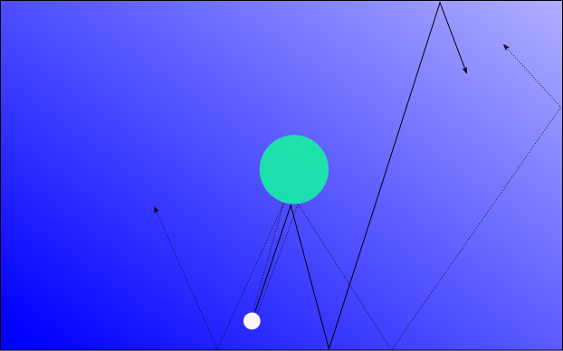
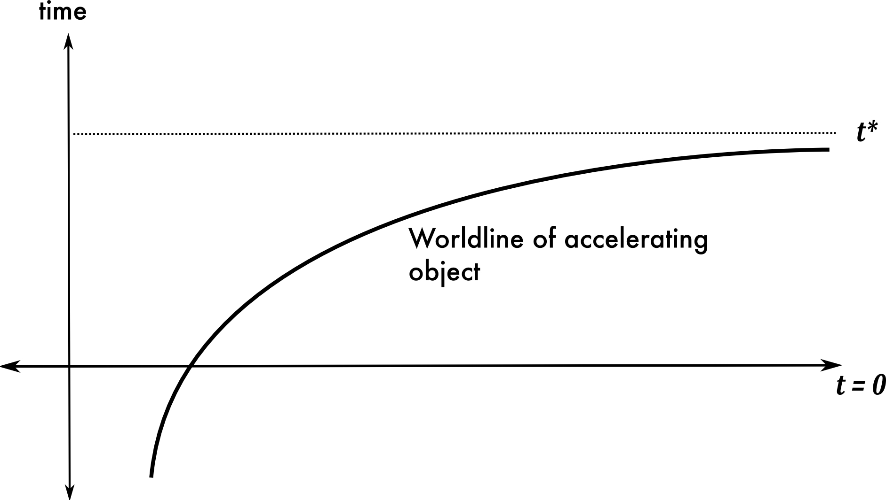
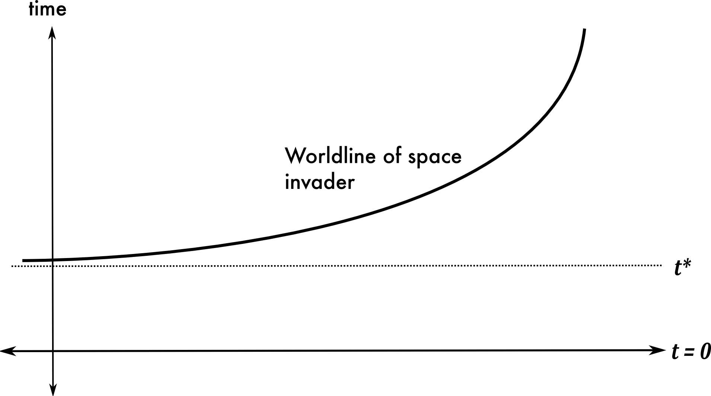
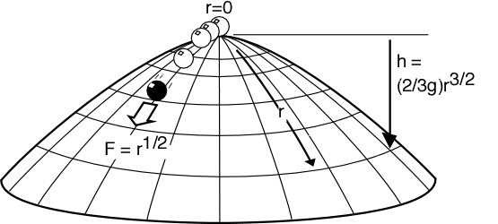
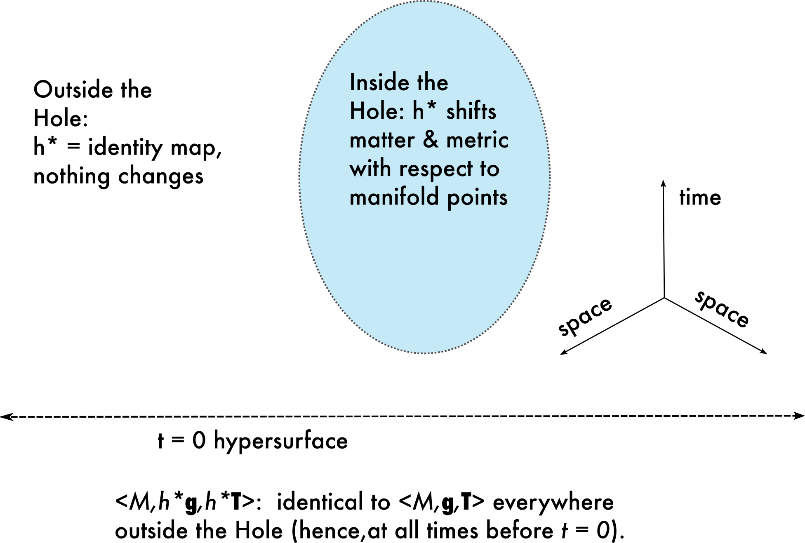

# Causal Determinism
**First published Thu Jan 23, 2003; substantive revision Thu Sep 21, 2023**

*Hoefer, Carl*

Causal determinism is, roughly speaking, the idea that every event is necessitated by antecedent events and conditions together with the laws of nature. The idea is ancient, but first became subject to clarification and mathematical analysis in the eighteenth century. Determinism is deeply connected with our understanding of the physical sciences and their explanatory ambitions, on the one hand, and with our views about human free action on the other. In both of these general areas there is no agreement over whether determinism is true (or even whether it can be known true or false), and what the import for human agency would be in either case.

## 1. Introduction

In most of what follows, I will speak simply of *determinism*, rather than of *causal determinism*. This follows philosophical practice of sharply distinguishing views and theories of what causation is from any conclusions about the success or failure of determinism (cf. Earman, 1986; an exception is Mellor 1995)[^mellor-1995].

Traditionally determinism has been given various, usually imprecise definitions. This is only problematic if one is investigating determinism in a specific, well-defined theoretical context; but it is important to avoid certain major errors of definition. In order to get started we can begin with a loose and (nearly) all-encompassing definition as follows:

> Determinism: Determinism is true of the *world* if and only if, given a specified *way things are at a time t*, the way things go *thereafter* is *fixed* as a matter of *natural law*.

The italicized phrases are elements that require further explanation and investigation, in order for us to gain a clear understanding of the concept of determinism.

The notion of determinism may be seen as one way of cashing out a historically important nearby idea: the idea that *everything can, in principle, be explained*, or that *everything that is, has a sufficient reason for being and being as it is, and not otherwise,* i.e., Leibniz’s Principle of Sufficient Reason. Leibniz’s PSR, however, is not linked to physical laws; arguably, one way for it to be satisfied is for God to *will* that things should be just so and not otherwise. This does not require that physical or causal determinism hold. On the other hand, on a strict reading Leibniz’s PSR may be more demanding than determinism. Under determinism, particular facts and events are the way they are due to the laws and the particular facts of how things stood at an earlier time, for example at the beginning of time. But there need be no answer to the question “Why were things just *so* at the beginning of time?”, and hence no *complete* sufficient reason for all facts and events.[^note-1]

Since the first clear articulations of the concept of determinism, there has been a tendency among philosophers to believe in the truth of some sort of determinist doctrine. There has also been a tendency, however, to confuse determinism proper with two related notions: *predictability* and *fate.*

Fatalism is the thesis that all events (or in some versions, at least some events) are destined to occur no matter what we do. The source of the guarantee that those events will happen is located in the will of the gods, or their divine foreknowledge, or some intrinsic teleological aspect of the universe, rather than in the unfolding of events under the sway of natural laws or cause-effect relations. Fatalism is therefore clearly separable from determinism, at least to the extent that one can disentangle mystical forces and gods’ wills and foreknowledge (about *specific* matters) from the notion of natural/causal law. Not every metaphysical picture makes this disentanglement possible, of course. But as a general matter, we can imagine that certain things are fated to happen, without this being the result of deterministic natural laws alone; and we can imagine the world being governed by deterministic laws, without anything at all being *fated* to occur (perhaps because there are no gods, nor mystical/teleological forces deserving the titles *fate* or *destiny*, and in particular no intentional determination of the “initial conditions” of the world). In a looser sense, however, it is true that under the assumption of determinism, one might say that *given* the way things have gone in the past, all future events that will in fact happen are already *destined* to occur.

Prediction and determinism are also easy to disentangle, barring certain strong theological commitments. As the following famous expression of determinism by Laplace shows, however, the two are also easy to commingle:

> We ought to regard the present state of the universe as the effect of its antecedent state and as the cause of the state that is to follow. An intelligence knowing all the forces acting in nature at a given instant, as well as the momentary positions of all things in the universe, would be able to comprehend in one single formula the motions of the largest bodies as well as the lightest atoms in the world, provided that its intellect were sufficiently powerful to subject all data to analysis; to it nothing would be uncertain, the future as well as the past would be present to its eyes. The perfection that the human mind has been able to give to astronomy affords but a feeble outline of such an intelligence. (Laplace 1820)[^laplace-1820]

In this century, Karl Popper (1982) defined determinism in terms of predictability also, in his book *The Open Universe*.

Laplace probably had God in mind as the powerful intelligence to whose gaze the whole future is open. If not, he should have: 19ᵗʰ and 20ᵗʰ century mathematical studies showed convincingly that neither a finite, nor an infinite but embedded-in-the-world intelligence can have the computing power necessary to predict the actual future, in any world remotely like ours. But even if our aim is only to predict a well-defined subsystem of the world, for a limited period of time, this may be impossible for any reasonable finite agent embedded in the world, as many studies of chaos (sensitive dependence on initial conditions) show. Conversely, certain parts of the world could be *highly* predictable, in some senses, without the world being deterministic. When it comes to predictability of future events by humans or other finite agents in the world, then, predictability and determinism are simply not logically connected at all.

The equation of “determinism” with “predictability” is therefore a *façon de parler* that at best makes vivid what is at stake in determinism: our fears about our own status as free agents in the world. In Laplace’s story, a sufficiently bright demon who knew how things stood in the world 100 years before my birth could predict every action, every emotion, every belief in the course of my life. Were she then to watch me live through it, she might smile condescendingly, as one who watches a marionette dance to the tugs of strings that it knows nothing about. We can’t stand the thought that we are (in some sense) marionettes. Nor does it matter whether any demon (or even God) can, or cares to, actually predict what we will do: the existence of the strings of *physical necessity*, linked to far-past states of the world and determining our current every move, is what alarms us. Whether such alarm is actually warranted is a question well outside the scope of this article (see Hoefer (2002a), Ismael (2016) and the entries on free will and incompatibilist theories of freedom). But a clear understanding of what determinism is, and how we might be able to decide its truth or falsity, is surely a useful starting point for any attempt to grapple with this issue. We return to the issue of freedom in section 6, Determinism and Human Action, below.

## 2. Conceptual Issues in Determinism

Recall that we loosely defined causal determinism as follows, with terms in need of clarification italicized:

> Determinism: The *world* is *governed by* (or is *under the sway of*) determinism if and only if, given a specified *way things are at a time t*, the way things go *thereafter* is fixed as a matter of *natural law*.

### 2.1 The World

Why should we start so globally, speaking of the *world*, with all its myriad events, as deterministic? One might have thought that a focus on individual events is more appropriate: an event *E* is causally determined if and only if there exists a set of prior events {*A*, *B*, *C* …} that constitute a (jointly) sufficient cause of *E*. Then if all—or even just *most*—events *E* that are our human actions are causally determined, the problem that matters to us, namely the challenge to free will, is in force. Nothing so global as states of the whole world need be invoked, nor even a *complete* determinism that claims *all* events to be causally determined.

For a variety of reasons this approach is fraught with problems, and the reasons explain why philosophers of science mostly prefer to drop the word “causal” from their discussions of determinism. Generally, as John Earman quipped (1986), to go this route is to “… seek to explain a vague concept—determinism—in terms of a truly obscure one—causation.” More specifically, neither philosophers’ nor laymen’s conceptions of *events* have any correlate in any modern physical theory.[^note-2] The same goes for the notions of *cause* and *sufficient cause*. A further problem is posed by the fact that, as is now widely recognized, a set of events {*A*, *B*, *C* …} can only be genuinely *sufficient* to produce an effect-event if the set includes an open-ended *ceteris paribus* clause excluding the presence of potential disruptors that could intervene to prevent *E*. For example, the start of a football game on TV on a normal Saturday afternoon may be sufficient *ceteris paribus* to launch Ted toward the fridge to grab a beer; but not if a million-ton asteroid is approaching his house at .75*c* from a few thousand miles away, nor if his phone is about to ring with news of a tragic nature, …, and so on. Bertrand Russell famously argued against the notion of cause along these lines (and others) in 1912, and the situation has not changed. By trying to define causal determination in terms of a set of prior sufficient conditions, we inevitably fall into the mess of an open-ended list of negative conditions required to achieve the desired sufficiency.

Moreover, thinking about how such determination relates to free action, a further problem arises. If the *ceteris paribus* clause is open-ended, who is to say that it should not include the negation of a potential disruptor corresponding to my freely deciding not to go get the beer? If it does, then we are left saying “When *A*, *B*, *C*, … Ted will then go to the fridge for a beer, unless *D* or *E* or *F* or … or Ted decides not to do so.” The marionette strings of a “sufficient cause” begin to look rather tenuous.

They are also too short. For the typical set of prior events that can (intuitively, plausibly) be thought to be a sufficient cause of a human action may be so close in time and space to the agent, as to not look like a threat to freedom so much as like enabling conditions. If Ted is propelled to the fridge by {seeing the game’s on; desiring to repeat the satisfactory experience of other Saturdays; feeling a bit thirsty; etc}, such things look more like *good reasons to have decided* to get a beer, not like external physical events far beyond Ted’s control. Compare this with the claim that {state of the world in 1900; laws of nature} entail Ted’s going to get the beer: the difference is dramatic. So we have a number of good reasons for sticking to the formulations of determinism that arise most naturally out of physics. And this means that we are not looking at how a specific event of ordinary talk is determined by previous events; we are looking at how *everything* that happens is determined by what has gone before. The state of the world in 1900 only entails that Ted grabs a beer from the fridge by way of entailing the entire physical state of affairs at the later time.

### 2.2 The way things are at a time *t*

The typical explication of determinism fastens on the *state of the (whole) world* at a particular time (or instant), for a variety of reasons. We will briefly explain some of them. Why take the state of the whole world, rather than some (perhaps very large) region, as our starting point? One might, intuitively, think that it would be enough to give the complete state of things *on Earth*, say, or perhaps in the whole solar system, at *t*, to fix what happens thereafter (for a time at least). But notice that all sorts of influences from outside the solar system come in at the speed of light, and they may have important effects. Suppose Mary looks up at the sky on a clear night, and a particularly bright blue star catches her eye; she thinks “What a lovely star; I think I’ll stay outside a bit longer and enjoy the view.” The state of the solar system one month ago did not fix that that blue light from Sirius would arrive and strike Mary’s retina; it arrived into the solar system only a day ago, let’s say. So evidently, for Mary’s actions (and hence, all physical events generally) to be fixed by the state of things a month ago, that state will have to be fixed over a much larger spatial region than just the solar system. (If no physical influences can go faster than light, then the state of things must be given over a spherical volume of space 1 light-month in radius.)

But in making vivid the “threat” of determinism, we often want to fasten on the idea of the *entire future* of the world as being determined. No matter what the “speed limit” on physical influences is, if we want the entire future of the world to be determined, then we will have to fix the state of things over all of space, so as not to miss out something that could later come in “from outside” to spoil things. In the time of Laplace, of course, there was no known speed limit to the propagation of physical things such as light-rays. In principle light could travel at any arbitrarily high speed, and some thinkers did suppose that it was transmitted “instantaneously.” The same went for the force of gravity. In such a world, evidently, one has to fix the state of things over the *whole* of the world at a time *t*, in order for events to be strictly determined, by the laws of nature, for *any* amount of time thereafter.

Ismael (2016) has argued that even this is not enough to secure the desired logical entailment of the full future: in addition, one must add an “and nothing else” clause or premise, saying that in the (putatively) full description of the way things are at *t*, nothing has been left out that could interfere with the natural time-evolution of the world-state. In the next section we will see an example of such a thing that could be “left out” of the earlier description of the world.

A final assumption may be worth mentioning here, that usually goes unremarked. It is assumed that the state of the world is completely *sharp and determinate*. That is, there is no mathematical or ontological vagueness in the description of the way things are at time *t*. This assumption goes hand in hand with our usual tendency to think of the *past* as fully determinate and “fixed”. Without this assumption, in most theoretical frameworks mathematical predictability of future states would be impossible.

In all this, we have been presupposing the common-sense Newtonian framework of space and time, in which the world-at-a-time is an objective and meaningful notion. Below when we discuss determinism in relativistic theories we will revisit this assumption.

### 2.3 Thereafter

For a wide class of physical theories (i.e., proposed sets of laws of nature), if they can be viewed as deterministic at all, they can be viewed as *bi-directionally* deterministic. That is, a specification of the state of the world at a time *t*, along with the laws, determines not only how things go *after t*, but also how things go *before t*. Philosophers, while not exactly unaware of this symmetry, tend to ignore it when thinking of the bearing of determinism on the free will issue. The reason for this is that, as noted just above, we tend to think of the past (and hence, states of the world in the past) as *sharp and determinate*, and hence *fixed and beyond our control*. Forward-looking determinism then entails that these past states—beyond our control, perhaps occurring long before humans even existed—determine everything we do in our lives. It then seems a mere curious fact that it is equally true that the state of the world *now* determines everything that happened in the past. We have an ingrained habit of taking the direction of both causation and explanation as being past → present, even when discussing physical theories free of any such asymmetry. We will return to this point shortly.

Another point to notice here is that the notion of things being determined *thereafter* is usually taken in an unlimited sense—i.e., determination of all future events, no matter how remote in time. But conceptually speaking, the world could be only *imperfectly* deterministic: things could be determined only, say, for a thousand years or so from any given starting state of the world. For example, suppose that near-perfect determinism were regularly (but infrequently) interrupted by spontaneous particle creation events, which occur only once every thousand years in a thousand-light-year-radius volume of space. This unrealistic example shows how determinism could be strictly false, and yet the world be deterministic enough for our concerns about free action to be unchanged.

### 2.4 Laws of nature

In the loose statement of determinism we are working from, metaphors such as “govern” and “under the sway of” are used to indicate the strong force being attributed to the laws of nature. Part of understanding determinism—and especially, whether and why it is metaphysically important—is getting clear about the status of the presumed laws of nature.

In the physical sciences, the assumption that there are fundamental, exceptionless laws of nature, and that they have some strong sort of modal force, usually goes unquestioned. Indeed, talk of laws “governing” and so on is so commonplace that it takes an effort of will to see it as metaphorical. We can characterize the usual assumptions about laws in this way: the laws of nature are assumed to be *pushy explainers*. They *make things happen in certain ways* and, by having this power, their existence lets us *explain* why things happen in certain ways. (For a defense of this perspective on laws, see Maudlin (2007)). Laws, we might say, are implicitly thought of as the *cause* of everything that happens. If the laws governing our world are deterministic, then in principle everything that happens can be explained as following from states of the world at earlier times. (Again, we note that even though the entailment typically works in the future→past direction also, we have trouble thinking of this as a legitimate *explanatory* entailment. In this respect also, we see that laws of nature are being implicitly treated as the causes of what happens: causation, intuitively, can only go past→future.)

Interestingly, philosophers tend to acknowledge the apparent threat determinism poses to free will, even when they explicitly reject the view that laws are pushy explainers. Earman (1986), for example, advocates a theory of laws of nature that takes them to be simply the best system of regularities that systematizes all the events in universal history. This is the Best Systems Analysis (BSA), with roots in the work of Hume, Mill and Ramsey, and most recently refined and defended by David Lewis (1973, 1994) and by Earman (1984, 1986). (cf. entry on laws of nature). Yet he ends his comprehensive *Primer on Determinism* with a discussion of the free will problem, taking it as a still-important and unresolved issue. *Prima facie* this is quite puzzling, for the BSA is founded on the idea that the laws of nature are ontologically derivative, not primary; it is the events of universal history, as brute facts, that make the laws be what they are, and *not* vice-versa. Taking this idea seriously, the actions of every human agent in history are simply a part of the universe-wide pattern of events that determines what the laws are for this world. It is then hard to see how the most elegant summary of this pattern, the BSA laws, can be thought of as determiners of human actions. The determination or constraint relations, it would seem, can go one way or the other, not both.

On second thought, however, it is not so surprising that broadly Humean philosophers such as Ayer, Earman, Lewis and others still see a potential problem for freedom posed by determinism. For even if human actions are part of what makes the laws be what they are, this does not mean that we automatically *have* freedom of the kind we think we have, particularly freedom *to have done otherwise* given certain past states of affairs. It is one thing to say that everything occurring in and around my body, *and* everything everywhere else, conforms to Maxwell’s equations and thus the Maxwell equations are genuine exceptionless regularities, and that because they in addition are simple and strong, they turn out to be laws. It is quite another thing to add: thus, I might have chosen to do otherwise at certain points in my life, and if I had, then Maxwell’s equations would not have been laws. One might try to defend this claim—unpalatable as it seems intuitively, and Lewis (1981) does this. But it does not follow directly from a Humean approach to laws of nature, and Loewer (2020, Other Internet Resources) defends a different Humean compatibilism, to which we will return in section 6.

A second important genre of theories of laws of nature holds that the laws are in some sense *necessary*. For any such approach, laws are just the sort of pushy explainers that are assumed in the traditional language of physical scientists and free will theorists. But a third and growing class of philosophers holds that (universal, exceptionless, true) laws of nature *simply do not exist*. Among those who hold this are influential philosophers such as Nancy Cartwright, Bas van Fraassen, and John Dupré. For these philosophers, there is a simple consequence: determinism is a false doctrine. As with the Humean view, this does not mean that concerns about human free action are automatically resolved; instead, they must be addressed afresh in the light of whatever account of physical nature without laws is put forward. See Dupré (2001) for one such discussion.

### 2.5 Fixed

We can now put our—still vague—pieces together. Determinism requires a world that (a) has a well-defined state or description, at any given time, and (b) laws of nature that are true at all places and times. If we have all these, then if (a) and (b) together *logically entail* the state of the world at all other times (or, at least, all times later than that given in (a)), the world is deterministic. Logical entailment, in a sense broad enough to encompass mathematical consequence, is the modality behind the determination in “determinism.”

## 3. The Epistemology of Determinism

How could we ever decide whether our world is deterministic or not? Given that some philosophers and some physicists have held firm views—with many prominent examples on each side—one would think that it should be at least a clearly *decidable* question. Unfortunately, even this much is not clear, and the epistemology of determinism turns out to be a thorny and multi-faceted issue.

### 3.1 Laws again

As we saw above, for determinism to be true there have to *be* some laws of nature. Most philosophers and scientists since the 17ᵗʰ century have indeed thought that there are. But in the face of more recent skepticism, how can it be proven that there are? And if this hurdle can be overcome, don’t we have to know, with certainty, precisely *what the laws of our world are*, in order to tackle the question of determinism’s truth or falsity?

The first hurdle can perhaps be overcome by a combination of metaphysical argument and appeal to knowledge we already have of the physical world. Philosophers are currently pursuing this issue actively, in large part due to the efforts of the anti-laws minority. The debate has been most recently framed by Cartwright in *The Dappled World* (Cartwright 1999)[^cartwright-1999] in terms psychologically advantageous to her anti-laws cause. Those who believe in the existence of traditional, universal laws of nature are *fundamentalists*; those who disbelieve are *pluralists*. This terminology seems to be becoming standard (see Belot 2001)[^belot-2001], so the first task in the epistemology of determinism is for fundamentalists to establish the reality of laws of nature (see Hoefer 2002b)[^hoefer-2002b].

Even if the first hurdle can be overcome, the second, namely establishing precisely what the actual laws are, may seem daunting indeed. In a sense, what we are asking for is precisely what 19ᵗʰ and 20ᵗʰ century physicists sometimes set as their goal: the Final Theory of Everything. But perhaps, as Newton said of establishing the solar system’s absolute motion, “the thing is not altogether desperate.” Many physicists in the past 60 years or so have been convinced of determinism’s falsity, because they were convinced that (a) whatever the Final Theory is, it will be some recognizable variant of the family of quantum mechanical theories; and (b) all quantum mechanical theories are non-deterministic. Both (a) and (b) are highly debatable, but the point is that one can see how arguments in favor of these positions might be mounted. The same was true in the 19ᵗʰ century, when theorists might have argued that (a) whatever the Final Theory is, it will involve only continuous fluids and solids governed by partial differential equations; and (b) all such theories are deterministic. (Here, (b) is almost certainly false; see Earman (1986),ch. XI). Even if we now are not, we may in future be in a position to mount a credible argument for or against determinism on the grounds of features we think we know the Final Theory must have.

### 3.2 Experience

Determinism could perhaps also receive direct support—confirmation in the sense of probability-raising, not proof—from experience and experiment. For theories (i.e., potential laws of nature) of the sort we are used to in physics, it is typically the case that if they are deterministic, then to the extent that one can perfectly isolate a system and repeatedly impose identical starting conditions, the subsequent behavior of the systems should also be identical. And in broad terms, this is the case in many domains we are familiar with. Your computer starts up every time you turn it on, and (if you have not changed any files, have no anti-virus software, re-set the date to the same time before shutting down, and so on …) always in exactly the same way, with the same speed and resulting state (until the hard drive fails). The light comes on exactly 32 *µsec* after the switch closes (until the day the bulb fails). These cases of repeated, reliable behavior obviously require some serious *ceteris paribus* clauses, are never perfectly identical, and always subject to catastrophic failure at some point. But we tend to think that for the small deviations, *probably* there are explanations for them in terms of different starting conditions or failed isolation, and for the catastrophic failures, *definitely* there are explanations in terms of different conditions.

There have even been studies of paradigmatically “chancy” phenomena such as coin-flipping, which show that if starting conditions can be *precisely* controlled and outside interferences excluded, identical behavior results (see Diaconis, Holmes & Montgomery 2007). Most of these bits of evidence for determinism no longer seem to cut much ice, however, because of faith in quantum mechanics and its indeterminism. Indeterminist physicists and philosophers are ready to acknowledge that *macroscopic* repeatability is usually obtainable, where phenomena are so large-scale that quantum stochasticity gets washed out. But they would maintain that this repeatability is not to be found in experiments at the microscopic level, and also that at least *some* failures of repeatability (in your hard drive, or coin-flipping experiments) are genuinely due to quantum indeterminism, not just failures to isolate properly or establish identical initial conditions.

If quantum theories were unquestionably indeterministic, and deterministic theories guaranteed repeatability of a strong form, there could conceivably be further experimental input on the question of determinism’s truth or falsity. Unfortunately, the existence of Bohmian quantum theories casts strong doubt on the former point, while *chaos theory* casts strong doubt on the latter. More will be said about each of these complications below.

### 3.3 Determinism and Chaos

If the world were governed by strictly deterministic laws, might it still *look* as though indeterminism reigns? This is one of the difficult questions that chaos theory raises for the epistemology of determinism.

A deterministic chaotic system has, roughly speaking, two salient features: (i) the evolution of the system over a long time period effectively mimics a random or stochastic process—it lacks predictability or computability in some appropriate sense; (ii) two systems with nearly identical initial states will have radically divergent future developments, within a finite (and typically, short) timespan. We will use “randomness” to denote the first feature, and “sensitive dependence on initial conditions” (SDIC) for the latter. Definitions of chaos may focus on either or both of these properties; Batterman (1993) argues that only (ii) provides an appropriate basis for defining chaotic systems.

A simple and very important example of a chaotic system in both randomness and SDIC terms is the Newtonian dynamics of a pool table with a convex obstacle (or obstacles) (Sinai 1970 and others)[^sinai-1970]. See Figure 1.

*Figure 1:*

Figure 1: Billiard table with convex obstacle

The usual idealizing assumptions are made: no friction, perfectly elastic collisions, no outside influences. The ball’s trajectory is determined by its initial position and direction of motion. If we imagine a *slightly* different initial direction, the trajectory will at first be only slightly different. And collisions with the straight walls will not tend to increase very rapidly the difference between trajectories. But collisions with the convex object will have the effect of *amplifying* the differences. After several collisions with the convex body or bodies, trajectories that started out very close to one another will have become wildly different—SDIC.

In the example of the billiard table, we know that we are starting out with a Newtonian deterministic system—that is how the idealized example is defined. But chaotic dynamical systems come in a great variety of types: discrete and continuous, 2-dimensional, 3-dimensional and higher, particle-based and fluid-flow-based, and so on. Mathematically, we may suppose all of these systems share SDIC. But generally they will also display properties such as unpredictability, non-computability, Kolmogorov-random behavior, and so on—at least when looked at in the right way, or at the right level of detail. This leads to the following epistemic difficulty: if, in nature, we find a type of system that displays some or all of these latter properties, how can we decide which of the following two hypotheses is true?

1. The system is governed by genuinely stochastic, indeterministic laws (or by no laws at all), i.e., its apparent randomness is in fact *real* randomness.
2. The system is governed by underlying deterministic laws, but is chaotic.

In other words, once one appreciates the varieties of chaotic dynamical systems that exist, *mathematically* speaking, it starts to look difficult—maybe impossible—for us to ever decide whether apparently random behavior in nature arises from genuine stochasticity, or rather from deterministic chaos. Patrick Suppes (1993, 1996) argues, on the basis of theorems proven by Ornstein (1974 and later) that “There are processes which can equally well be analyzed as deterministic systems of classical mechanics or as indeterministic semi-Markov processes, no matter how many observations are made.” And he concludes that “Deterministic metaphysicians can comfortably hold to their view knowing they cannot be empirically refuted, but so can indeterministic ones as well.” (Suppes 1993, p. 254)[^suppes-1993] For more recent works exploring the extent to which deterministic and indeterministic model systems may be regarded as empirically indistinguishable, see Werndl (2016) and references therein.

There is certainly an interesting problem area here for the epistemology of determinism, but it must be handled with care. It may well be true that there are some deterministic dynamical systems that, *when viewed properly*, display behavior indistinguishable from that of a genuinely stochastic process. For example, using the billiard table above, if one divides its surface into quadrants and looks at which quadrant the ball is in at 30-second intervals, the resulting sequence is no doubt highly random. But this does not mean that the same system, when viewed in a *different* way (perhaps at a higher degree of precision) does not cease to look random and instead betray its deterministic nature. If we partition our billiard table into squares 2 centimeters a side and look at which quadrant the ball is in at .1 second intervals, the resulting sequence will be far from random. And finally, of course, if we simply look at the billiard table with our eyes, and see it *as a billiard table*, there is no obvious way at all to maintain that it may be a truly random process rather than a deterministic dynamical system. (See Winnie 1997 for a nice technical and philosophical discussion of these issues. Winnie explicates Ornstein’s and others’ results in some detail, and disputes Suppes’ philosophical conclusions.)[^winnie-1997]

The dynamical systems usually studied under the label of “chaos” are usually either purely abstract, mathematical systems, or classical Newtonian systems. It is natural to wonder whether chaotic behavior carries over into the realm of systems governed by quantum mechanics as well. Interestingly, it is much harder to find natural correlates of classical chaotic behavior in true quantum systems (see Gutzwiller 1990)[^gutzwiller-1990]. Some, at least, of the interpretive difficulties of quantum mechanics would have to be resolved before a meaningful assessment of chaos in quantum mechanics could be achieved. For example, SDIC is hard to find in the Schrödinger evolution of a wavefunction for a system with finite degrees of freedom; but in Bohmian quantum mechanics it is handled quite easily on the basis of particle trajectories (see Dürr, Goldstein and Zhangì 1992).

The popularization of chaos theory in the relatively recent past perhaps made it seem self-evident that nature is full of genuinely chaotic systems. In fact, it is far from self-evident that such systems exist, other than in an approximate sense. Nevertheless, the mathematical exploration of chaos in dynamical systems helps us to understand some of the pitfalls that may attend our efforts to know whether our world is genuinely deterministic or not.

### 3.4 Metaphysical arguments

Let us suppose that we shall never have the Final Theory of Everything before us—at least in our lifetime—and that we also remain unclear (on physical/experimental grounds) as to whether that Final Theory will be of a type that can or cannot be deterministic. Is there nothing left that could sway our belief toward or against determinism? There is, of course: metaphysical argument. Metaphysical arguments on this issue are not currently very popular. But philosophical fashions change at least twice a century, and grand systemic metaphysics of the Leibnizian sort might one day come back into favor. Conversely, the anti-systemic, anti-fundamentalist metaphysics propounded by Cartwright (1999) might also come to predominate. As likely as not, for the foreseeable future metaphysical argument may be just as good a basis on which to discuss determinism’s prospects as any arguments from mathematics or physics.

## 4. The Status of Determinism in Physical Theories

John Earman’s *Primer on Determinism* (1986) remains the richest storehouse of information on the truth or falsity of determinism in various physical theories, from classical mechanics to quantum mechanics and general relativity. (See also his update on the subject, “Aspects of Determinism in Modern Physics” (2007)). Here I will give only a brief discussion of some key issues, referring the reader to Earman (1986) and other resources for more detail. Figuring out whether well-established theories are deterministic or not (or to what extent, if they fall only a bit short) does not do much to help us know whether our world is *really* governed by deterministic laws; all our current best theories, including General Relativity and the Standard Model of particle physics, are too flawed and ill-understood to be mistaken for anything close to a Final Theory. Nevertheless, as Earman stressed, the exploration is very valuable because of the way it deepens our understanding of the richness and complexity of determinism.

### 4.1 Classical mechanics

Despite the common belief that classical mechanics (the theory that inspired Laplace in his articulation of determinism) is perfectly deterministic, in fact the theory is rife with possibilities for determinism to break down. One class of problems arises due to the absence of an upper bound on the velocities of moving objects. Below we see the trajectory of an object that is accelerated unboundedly, its velocity becoming in effect infinite in a finite time. See Figure 2:

*Figure 2:*

Figure 2: An object accelerates so as to reach spatial infinity in a finite time

By the time *t = t**, the object has literally disappeared from the world—its world-line never reaches the *t = t** surface. (Never mind how the object gets accelerated in this way; there are mechanisms that are perfectly consistent with classical mechanics that can do the job. In fact, Xia (1992) showed that such acceleration can be accomplished by gravitational forces from only 5 finite objects, without collisions. No mechanism is shown in these diagrams.) This “escape to infinity,” while disturbing, does not yet look like a violation of determinism. But now recall that classical mechanics is time-symmetric: any model has a time-inverse, which is also a consistent model of the theory. The time-inverse of our escaping body is playfully called a “space invader.”

*Figure 3:*

Figure 3: A ‘space invader’ comes in from spatial infinity

Clearly, a world with a space invader does fail to be deterministic. Before *t = t**, there was nothing in the state of things to enable the prediction of the appearance of the invader at *t* = *t* +*.[^note-3] One might think that the infinity of space is to blame for this strange behavior, but this is not obviously correct. In finite, “rolled-up” or cylindrical versions of Newtonian space-time space-invader trajectories can be constructed, though whether a “reasonable” mechanism to power them exists is not clear.[^note-4]

A second class of determinism-breaking models can be constructed on the basis of collision phenomena. The first problem is that of multiple-particle collisions for which Newtonian particle mechanics simply does not have a prescription for what happens. (Consider three identical point-particles approaching each other at 120 degree angles and colliding simultaneously. That they bounce back along their approach trajectories is possible; but it is equally possible for them to bounce in other directions (again with 120 degree angles between their paths), so long as momentum conservation is respected.)

Moreover, there is a burgeoning literature of physical or quasi-physical systems, usually set in the context of classical physics, that carry out supertasks (see Earman and Norton (1998) and the entry on supertasks for a review). Frequently, the puzzle presented is to decide, on the basis of the well-defined behavior before time *t* = *a*, what state the system will be in at *t* = *a* itself. A failure of CM to dictate a well-defined result can then be seen as a failure of determinism.

In supertasks, one frequently encounters infinite numbers of particles, infinite (or unbounded) mass densities, and other dubious infinitary phenomena. Coupled with some of the other breakdowns of determinism in CM, one begins to get a sense that most, if not all, breakdowns of determinism rely on some combination of the following set of (physically) dubious mathematical notions: {infinite space; unbounded velocity; continuity; point-particles; singular fields}. The trouble is, it is difficult to imagine *any* recognizable physics (much less CM) that eschews everything in the set.

*Figure 4:*

Figure 4: A ball may spontaneously start sliding down this dome, with no violation of Newton’s laws. (Reproduced courtesy of John D. Norton and *Philosopher’s Imprint)*

Finally, an elegant example of apparent violation of determinism in classical physics has been created by John Norton (2003). As illustrated in Figure 4, imagine a ball sitting at the apex of a frictionless dome whose equation is specified as a function of radial distance from the apex point. This rest-state is our initial condition for the system; what should its future behavior be? Clearly one solution is for the ball to remain at rest at the apex indefinitely.

But curiously, this is not the only solution under standard Newtonian laws. The ball may also start into motion sliding down the dome—at any moment in time, and in any radial direction. This example displays “uncaused motion” without, Norton argues, any violation of Newton’s laws, including the First Law. And it does not, unlike some supertask examples, require an infinity of particles. Still, many philosophers are uncomfortable with the moral Norton draws from his dome example, and point out reasons for questioning the dome’s status as a Newtonian system (see e.g. Malament (2007)).

### 4.2 Special Relativistic physics

Two features of special relativistic physics make it perhaps the most hospitable environment for determinism of any major theoretical context: the fact that no process or signal can travel faster than the speed of light, and the static, unchanging spacetime structure. The former feature, including a prohibition against tachyons (hypothetical particles travelling faster than light)[^note-5]), rules out space invaders and other unbounded-velocity systems. The latter feature makes the space-time itself nice and stable and non-singular—unlike the dynamic space-time of General Relativity, as we shall see below. For source-free electromagnetic fields in special-relativistic space-time, a nice form of Laplacean determinism is provable. Unfortunately, interesting physics needs more than source-free electromagnetic fields. Earman (1986) ch. IV surveys in depth the pitfalls for determinism that arise once things are allowed to get more interesting (e.g. by the addition of particles interacting gravitationally).

### 4.3 General Relativity (GTR)

Defining an appropriate form of determinism for the context of general relativistic physics is extremely difficult, due to both foundational interpretive issues and the plethora of weirdly-shaped space-time models allowed by the theory’s field equations. The simplest way of treating the issue of determinism in GTR would be to state flatly: determinism fails, frequently, and in some of the most interesting models. Here we will briefly describe some of the most important challenges that arise for determinism, directing the reader yet again to Earman (1986, 2007), and also Earman (1995) for more depth.

#### 4.3.1 Determinism and manifold points

In GTR, we specify a model of the universe by giving a triple of three mathematical objects, <M, **g**,**T**>. *M* represents a continuous “manifold”: that means a sort of unstructured space (-time), made up of individual points and having smoothness or continuity, dimensionality (usually, 4-dimensional), and global topology, but no further structure. What is the further structure a space-time needs? Typically, at least, we expect the time-direction to be distinguished from space-directions; and we expect there to be well-defined distances between distinct points; and also a determinate *geometry* (making certain continuous paths in *M* be straight lines, etc.). All of this extra structure is coded into **g**, the metric field. So *M* and **g** together represent space-time. **T** represents the matter and energy content distributed around in space-time (if any, of course).

For mathematical reasons not relevant here, it turns out to be possible to take a given model spacetime and perform a mathematical operation called a “hole diffeomorphism” *h** on it; the diffeomorphism’s effect is to shift around the matter content **T** and the metric **g** relative to the continuous manifold *M*.[^note-6] If the diffeomorphism is chosen appropriately, it can move around **T** and **g** after a certain time *t = 0*, but leave everything alone before that time. Thus, the new model represents the matter content (now *h** **T**) and the metric (*h****g**) as differently located relative to the points of *M* making up space-time. Yet, the new model is also a perfectly valid model of the theory. This looks on the face of it like a form of indeterminism: GTR’s equations do not specify how things will be distributed in space-time in the future, even when the past before a given time *t* is held fixed. See Figure 5:

*Figure 5:*

Figure 5: “Hole” diffeomorphism shifts contents of spacetime

Usually the shift is confined to a finite region called *the hole* (for historical reasons). Then it is easy to see that the state of the world at time *t = 0* (and all the history that came before) does not suffice to fix whether the future will be that of our first model, or its shifted counterpart in which events inside the hole are different.

This is a form of indeterminism first highlighted by Earman and Norton (1987) as an interpretive philosophical difficulty for realism about GTR’s description of the world, especially the point manifold *M*. They showed that realism about the manifold as a part of the furniture of the universe (which they called “manifold substantivalism”) commits us to an automatic indeterminism in GTR (as described above), and they argued that this is unacceptable. Note that this indeterminism, unlike most others we are discussing in this section, is empirically undetectable: our two models <*M*, **g**, **T**> and the shifted model <*M*, *h****g**, *h****T**> are empirically indistinguishable.

A huge range of responses to the Hole Argument have been published since 1989; after an initial burst of articles in the late 1980s and early-mid 1990s, there was a relatively quiet period, followed by a revival of interest from 2011 onward (see the hole argument for in-depth consideration of a number of responses to the argument). One popular family of responses (e.g., Hoefer 1996, Pooley 2006)[^hoefer-1996][^pooley-2006] departs from the observation that the differences represented by the models <*M*, **g**, **T**> and <*M*, *h****g**, *h****T**> are purely *haecceitistic* and therefore may be rejected if one adopts an anti-haecceitistic metaphysics. Following Belot & Earman (2001), anti-haecceitist substantivalism is sometimes called “sophisticated substantivalism”.

#### 4.3.2 Singularities

The separation of space-time structures into manifold and metric (or connection) facilitates mathematical clarity in many ways, but also opens up Pandora’s box when it comes to determinism. The indeterminism of the Earman and Norton hole argument is only the tip of the iceberg; singularities make up much of the rest of the berg. In general terms, a singularity can be thought of as a “place where things go bad” in one way or another in the space-time model. For example, near the center of a Schwarzschild black hole, curvature increases without bound, and at the center itself it is undefined, which means that Einstein’s equations cannot be said to hold, which means (arguably) that this point does not exist as a part of the space-time at all! Some specific examples are clear, but giving a general definition of a singularity, like defining determinism itself in GTR, is a vexed issue (see the entry on singularities and black holes and Earman (1995) for extensive treatments; Callender and Hoefer (2001) gives a brief overview). We will not attempt here to catalog the various definitions and types of singularity.

Different types of singularity bring different types of threat to determinism. In the case of ordinary black holes, mentioned above, all is well outside the so- called “event horizon”, which is the spherical surface defining the black hole: once a body or light signal passes through the event horizon to the interior region of the black hole, it can never escape again. Generally, no violation of determinism looms outside the event horizon; but what about inside? Some black hole models have so-called “Cauchy horizons” inside the event horizon, i.e., surfaces beyond which determinism breaks down.

Another way for a model spacetime to be singular is to have points or regions go missing, in some cases by simple excision. Perhaps the most dramatic form of this involves taking a nice model with a space-like surface *t* = *E* (i.e., a well-defined part of the space-time that can be considered “the state state of the world at time *E*”), and cutting out and throwing away this surface and all points temporally later. The resulting spacetime satisfies Einstein’s equations; but, unfortunately for any inhabitants, the universe comes to a sudden and unpredictable end at time *E*. This is too trivial a move to be considered a real threat to determinism in GTR; we can impose a reasonable requirement that space-time not “run out” in this way without some physical reason (the spacetime should be “maximally extended”). For discussion of precise versions of such a requirement, and whether they succeed in eliminating unwanted singularities, see Earman (1995, chapter 2).

The most problematic kinds of singularities, in terms of determinism, are *naked singularities* (singularities not hidden behind an event horizon). When a singularity forms from gravitational collapse, the usual model of such a process involves the formation of an event horizon (i.e. a black hole). A universe with an ordinary black hole has a singularity, but as noted above, (outside the event horizon at least) nothing unpredictable happens as a result. A naked singularity, by contrast, has no such protective barrier. In much the way that anything can disappear by falling into an excised-region singularity, or appear out of a white hole (white holes themselves are, in fact, technically naked singularities), there is the worry that anything at all could pop out of a naked singularity, without warning (hence, violating determinism *en passant*). While most white hole models have Cauchy surfaces and are thus *arguably* deterministic, other naked singularity models lack this property. Physicists disturbed by the unpredictable potentialities of such singularities have worked to try to prove various *cosmic censorship hypotheses* that show—under (hopefully) plausible physical assumptions—that such things do not arise by stellar collapse in GTR (and hence are not liable to come into existence in our world). To date no very general and convincing forms of the hypothesis have been proven (see the entry on singularities and black holes, section 4) so the prospects for determinism in GTR as a mathematical theory do not look terribly good.

### 4.4 Quantum mechanics

As indicated above, QM is widely thought to be a strongly non-deterministic theory. Popular belief (even among most physicists) holds that phenomena such as radioactive decay, photon emission and absorption, and many others are such that only a *probabilistic* description of them can be given. The theory does not say what happens in a given case, but only says what the probabilities of various results are. So, for example, according to QM the fullest description possible of a radium atom (or a chunk of radium, for that matter), does not suffice to determine when a given atom will decay, nor how many atoms in the chunk will have decayed at any given time. The theory gives only the probabilities for a decay (or a number of decays) to happen within a given span of time. Einstein and others thought that this was a defect of the theory that should eventually be removed, perhaps by a supplemental *hidden variable* theory[^note-7] that restores determinism; but subsequent work showed that no such hidden variables account could exist. At the microscopic level the world is ultimately mysterious and chancy.

So goes the story; but like much popular wisdom, it is partly mistaken and/or misleading. Ironically, quantum mechanics is one of the best prospects for a genuinely deterministic theory in modern times. Everything hinges on what interpretational and philosophical decisions one adopts. The fundamental law at the heart of non-relativistic QM is the Schrödinger equation. The evolution of a wavefunction describing a physical system under this equation is normally taken to be perfectly deterministic.[^note-8] If one adopts an interpretation of QM according to which that’s it—i.e., nothing ever interrupts Schrödinger evolution, and the wavefunctions governed by the equation tell the complete physical story—then quantum mechanics is a perfectly deterministic theory. There are several interpretations that physicists and philosophers have given of QM which go this way. (See the entries on quantum mechanics for general discussion and Everettian quantum mechanics and many-worlds interpretation of quantum mechanicsfor discussion of the most prominent such interpretation).

More commonly in the 20th century—and this is part of the basis for the popular wisdom—physicists resolved the quantum measurement problem by postulating that some process of “collapse of the wavefunction” occurs during measurements or observations that interrupts Schrödinger evolution. The collapse process is usually postulated to be indeterministic, with probabilities for various outcomes, *via* Born’s rule, calculable on the basis of a system’s wavefunction. The once-standard Copenhagen interpretation of QM posits such a collapse. It has the virtue of solving certain problems such as the infamous Schrödinger’s cat paradox, but few philosophers or physicists can take it very seriously unless they are instrumentalists about the theory. The reason is simple: the collapse process is not physically well-defined, is characterised in terms of an anthropomorphic notion (*measurement*) and feels too *ad hoc* to be a fundamental part of nature’s laws.[^note-9]In recent decades, it is more common to preset the “collapse of the wavefunction” as a merely *effective* or *apparent* phenomenon, usually by appealing to some sort of “decoherence” that renders the continuing existence of superpositions empirically undetectable. On this approach, the deterministic and unitary evolution of quantum states is not interrupted (see the entry on the [many-worlds interpretation of quantum mechanics](https://plato.stanford.edu/entries/qm-manyworlds/)).

In 1952 David Bohm created an alternative theoretical framework for non-relativistic QM that realizes Einstein’s dream of a hidden variable theory, restoring determinism and definiteness to micro-reality. In Bohmian quantum mechanics, unlike other interpretations, it is postulated that all particles have, at all times, a definite position and velocity. In addition to the Schrödinger equation, Bohm posited a *guidance equation* that determines, on the basis of the system’s wavefunction and particles’ initial positions and velocities, what their future positions and velocities should be. As much as any classical theory of point particles moving under force fields, then, Bohm’s theory is deterministic. Amazingly, he was also able to show that, as long as the statistical distribution of initial positions and velocities of particles are chosen so as to meet a “quantum equilibrium” condition, his theory is empirically equivalent to standard Copenhagen QM. However, and unfortunately, as Wallace (2020) has forcefully argued, Bohmian mechanics and its later extensions do not yet offer an alternative to the standard quantum field theories of the Standard Model of particle physics. One approach to extending Bohmian mechanics to general quantum field theories, that of John Bell, changes the theory to being stochastic rather than deterministic.

This small survey of determinism’s status in some prominent physical theories, as indicated above, does not really tell us anything about whether determinism is true of our world. Instead, it raises a couple of further disturbing possibilities for the time when we do have the Final Theory before us (if such time ever comes): first, we may have difficulty establishing whether the Final Theory is deterministic or not—depending on whether the theory comes loaded with unsolved interpretational or mathematical puzzles. Second, we may have reason to worry that the Final Theory, if indeterministic, has an empirically equivalent yet deterministic rival (as illustrated by Bohmian quantum mechanics.)

## 5. Chance and Determinism

Some philosophers maintain that if determinism holds in our world, then there are no *objective chances* in our world. And often the word ‘chance’ here is taken to be synonymous with ‘probability’, so these philosophers maintain that there are no non-trivial objective probabilities for events in our world. (The caveat “non-trivial” is added here because on some accounts, under determinism, all future events that actually happen have probability, conditional on past history, equal to 1, and future events that do not happen have probability equal to zero. Non-trivial probabilities are probabilities strictly between zero and one.) Conversely, it is often held, if there are laws of nature that are irreducibly probabilistic, determinism must be false. (Some philosophers would go on to add that such irreducibly probabilistic laws are the basis of whatever genuine objective chances obtain in our world.)

The discussion of quantum mechanics in section 4 shows that it may be difficult to know whether a physical theory postulates genuinely irreducible probabilistic laws or not. If a Bohmian version of QM is correct, then the probabilities dictated by the Born rule are not irreducible. If that is the case, should we say that the probabilities dictated by quantum mechanics are not objective? Or should we say that we need to distinguish ‘chance’ and ‘probability’ after all—and hold that not all objective probabilities should be thought of as objective *chances*? The first option may seem hard to swallow, given the many-decimal-place accuracy with which such probability-based quantities as half-lives and cross-sections can be reliably predicted and verified experimentally with QM.

Whether objective chance and determinism are really incompatible or not may depend on what view of the nature of laws is adopted. On a *“pushy explainers”* view of laws such as that defended by Maudlin (2007), probabilistic laws are interpreted as irreducible dynamical transition-chances between allowed physical states, and the incompatibility of such laws with determinism is immediate. But what should a defender of a Humean view of laws, such as the BSA theory (section 2.4 above), say about probabilistic laws? The first thing that needs to be done is explain how probabilistic laws can fit into the BSA account at all, and this requires modification or expansion of the view, since as first presented the only candidates for laws of nature are true universal generalizations. If ‘probability’ were a univocal, clearly understood notion then this might be simple: We allow universal generalizations whose logical form is something like: “Whenever conditions *Y* obtain, Pr(*A*) = *x*”. But it is not at all clear how the meaning of ‘Pr’ should be understood in such a generalization; and it is even less clear what features the Humean pattern of actual events must have, for such a generalization to be held true. (See the entry on interpretations of probability and Lewis (1994).)

Humeans about laws believe that what laws there are is a matter of what patterns are there to be discerned in the overall mosaic of events that happen in the history of the world. It seems plausible enough that the patterns to be discerned may include not only strict associations (whenever *X*, *Y*), but also stable statistical associations. If the laws of nature can include either sort of association, a natural question to ask seems to be: why can’t there be non-probabilistic laws strong enough to ensure determinism, and on top of them, probabilistic laws as well? If a Humean wanted to capture the laws not only of fundamental theories, but also non-fundamental branches of physics such as (classical) statistical mechanics, such a peaceful coexistence of deterministic laws plus further probabilistic laws would seem to be desirable. Loewer (2004), Frigg & Hoefer (2015) and Hoefer (2019) offer forms of this peaceful coexistence that can be achieved within a Humean account of laws.

## 6. Determinism and Human Action

In the introduction, we noted the threat that determinism seems to pose to human free agency. It is hard to see how, if the state of the world 1000 years ago fixes everything I do during my life, I can meaningfully say that I am a free agent, the author of my own actions, which I could have freely chosen to perform differently. After all, I have neither the power to change the laws of nature, nor to change the past! So in what sense can I attribute freedom of choice to myself?

Philosophers have not lacked ingenuity in devising answers to this question. There is a long tradition of compatibilists arguing that freedom is fully compatible with physical determinism; a prominent recent defender is John Fischer (1994, 2012). Hume went so far as to argue that determinism is a *necessary condition* for freedom—or at least, he argued that some causality principle along the lines of “same cause, same effect” is required. There have been equally numerous and vigorous responses by those who are not convinced. Can a clear understanding of what determinism is, and how it tends to succeed or fail in real physical theories, shed any light on the controversy?

Physics, particularly 20ᵗʰ century physics, does have one lesson to impart to the free will debate; a lesson about the relationship between *time* and determinism. Recall that we noticed that the fundamental theories we are familiar with, if they are deterministic at all, are time-symmetrically deterministic. That is, earlier states of the world can be seen as fixing all later states; but equally, later states can be seen as fixing all earlier states. We tend to focus only on the former relationship, but we are not led to do so by the theories themselves.

Nor does 20ᵗʰ (21ˢᵗ) century physics countenance the idea that there is anything ontologically special about the past, as opposed to the present and the future. In fact, it fails to use these categories in any respect, leading some philosophers to argue that they are merely perspectival and, in a physical sense, illusory.[^note-10] So there is no support in physics for the idea that the past is “fixed” in some way that the present and future are not, or that it has some ontological power to constrain our actions that the present and future do not have. It is not hard to uncover the reasons why we naturally do tend to think of the past as special, and assume that both physical causation and physical explanation work only in the past present/future direction (see the entry on thermodynamic asymmetry in time). But these pragmatic matters have nothing to do with fundamental determinism. If we shake loose from the tendency to see the past as special, when it comes to the relationships of determination, it may prove possible to think of a deterministic world as one in which each part bears a determining—or partial-determining—relation to other parts, but in which no particular part (region of space-time, event or set of events, ...) has a special, privileged determining role that undercuts the others. Hoefer (2002a), Ismael (2016), and Loewer (2020, Other Internet Resources) use such considerations to argue in distinct but closely related ways for the compatibility of determinism with human free agency.

## References（引用注释）

> 原文参考文献已转为脚注引用：文内“作者-年份”引用组后附 [^key] 标记，完整条目见本文末脚注定义。

## Academic Tools

> |   | [How to cite this entry](https://plato.stanford.edu/cgi-bin/encyclopedia/archinfo.cgi?entry=determinism-causal). |
> | --- | --- |
> |   | [Preview the PDF version of this entry](https://leibniz.stanford.edu/friends/preview/determinism-causal/) at the [Friends of the SEP Society](https://leibniz.stanford.edu/friends/). |
> |   | [Look up topics and thinkers related to this entry](https://www.inphoproject.org/entity?sep=determinism-causal&redirect=True) at the Internet Philosophy Ontology Project (InPhO). |
> |   | [Enhanced bibliography for this entry](https://philpapers.org/sep/determinism-causal/) at [PhilPapers](https://philpapers.org/), with links to its database. |

## Other Internet Resources

- Loewer, B., 2020, “[The Consequence Argument Meets the Mentaculus](http://philsci-archive.pitt.edu/id/eprint/17328),” archived manuscript at the PhilSci Archive; accessed 31 August 2023.
- [PhilPapers bibliography on free will](https://philpapers.org/browse/free-will)
- [Determinism/Indeterminism](http://philsci-archive.pitt.edu/view/subjects/determinism-indeterminism.html) at the PhilSci Archive/University of Pittsburgh.

## Related Entries

compatibilism | free will | Hume, David | incompatibilism: (nondeterministic) theories of free will | laws of nature | Popper, Karl | probability, interpretations of | quantum mechanics | quantum mechanics: Bohmian mechanics | Russell, Bertrand | space and time: supertasks | space and time: the hole argument | time: thermodynamic asymmetry in

### Acknowledgments

The author would like to acknowledge the invaluable help of John Norton in the preparation of this entry. Thanks also to A. Ilhamy Amiry for bringing to my attention some errors in an earlier version of this entry.

## Notes（原文脚注）

[^note-1]: Thanks go to Eddy Chen for questioning the claim, in earlier editions of this article, that Leibniz’s PSR is the historical root of the notion of determinism. Chen (forthcoming) discusses the connections between PSR and both determinism and what he calls “strong determinism”. Strong determinism holds if the fundamental laws in our world determine all events at all times, on their own (i.e., without the need of a separate postulated initial condition or “way things are at time *t*”.

[^note-2]: Some philosophers are misled on this point by the fact that some now-defunct presentations of Special Relativity theory seem to be grounded on an ontology of events. But Special Relativity does not need to be so presented, nor were the “events” used anything like common sense events.

[^note-3]: The talk here of prediction is intuitive but sloppy. What we should say is: none of the states of the world before *t* = 0, conjoined with the laws of CM, entailed the appearance of the space invader at *t* = 0.

[^note-4]: To create a cylindrical, spatially finite version of 2-D Newtonian space-time, one draws two vertical lines (e.g. *x* = 0 and *x* = *a*), cuts and throws away everything to the left of one and to the right of the other, and identifies the two lines, thus making space finite and closed. In this space-time setting, to power the space invader we can’t use the non-collision mechanism of Gerver and Xia; see Earman (1986), p. 45.

[^note-5]: Tachyons are hypothesized faster-than-light particles; there is no experimental basis for them, so ruling them out is no sin.

[^note-6]: In GTR, a model system consists of a point manifold *M* on which a metric tensor **gᵃᵇ** is defined, as well as a stress-energy tensor **Tᵃᵇ** (which can be everywhere zero), jointly satisfying Einstein’s field equations. The mathematical property of general covariance possessed by Einstein’s equations entails that from one valid model system <*M*, **g ᵃᵇ**, **Tᵃᵇ**>, we can produce another model in which **T ᵃᵇ** and **gᵃᵇ** have been altered by the diffeomorphism *h** : <*M*, *h****gᵃᵇ**, *h****Tᵃᵇ**>. This new model is also a valid solution of Einstein’s equations, but it describes a model in which the location of the metrical structures and material fields of **Tᵃᵇ** and **gᵃᵇ** have been given different locations on the manifold. (They have been "shifted around", one might say, on the space-time manifold.) It is easy to construct a diffeomorphism *h** that shifts the locations of **T ᵃᵇ** and **gᵃᵇ** only *after* some global time-slice *t* = 0 (at least, in models that admit such slices -- i.e., the GTR equivalent of our familiar “state of the world at time *t* = 0.”).

[^note-7]: Quantum mechanics describes physical systems by means of states that are, notoriously, in some sense incomplete, a charge leveled against the theory by Einstein, Podolsky and Rosen in their famous 1935 essay “Can the Quantum Mechanical Description of Reality Be Considered Complete?”. This is most commonly illustrated by appeal to the Heisenberg Uncertainty Principle (in one of its forms): if the position of a particle is specified precisely, then its momentum must be unknown (i.e., described by a state such that the probabilities of the particle having a certain momentum are spread out over a wide range of possible values), and vice-versa. Quantum mechanics as normally interpreted says that these states are as complete a description as one can possibly get. A *hidden variable theory* however postulates the existence of determinate values for system-variables such as position and momentum, despite their being “hidden” from quantum mechanics itself. Einstein believed that ultimately we would find such a theory; David Bohm did precisely that, in 1952 (see below, main article).

[^note-8]: There are theorems proving that for certain kinds of Hamiltonians (including most of those that may be considered physically realistic), the evolution of the wavefunction under the Schrödinger equation is deterministic. The theorems have other antecedent conditions that may be considered restrictive, however, and see J. Norton, "A Quantum Mechanical Supertask," Foundations of Physic, 29 (1999), 1265-1302 for a case in which determinism breaks down. [I thank an anonymous referee for drawing my attention to these points.]

[^note-9]: In the 1980s the physicists Girardi, Rimini and Weber developed a revised version of QM that incorporates a physically well-defined collapse mechanism. Their theory solves certain interpretive problems in QM but has remaining difficulties; it is an indeterministic theory.

[^note-10]: Here I am not referring to the time *directions* (toward-the-past, toward-the-future), which are certainly legitimate enough in physics and do sometimes play important roles. Rather, I am referring to our intuitive *ontological* division of history into the past, the present, and the future. “The present” in particular is not to be found in any physical theory’s description of the world. And relativity theory undermines the traditional conception of a non-observer-relative present (see Callender 2017)[^callender-2017].

[^batterman-1993]: Batterman, R. B., 1993, “Defining Chaos,” *Philosophy of Science*, 60: 43–66.

[^belot-2001]: Belot, G. and Earman, J., 2001, “Pre-Socratic Quantum Gravity,” in C. Callender and N. Huggett (eds.), *Physics Meets Philosophy at the Planck Scale*, Cambridge: Cambridge University Press, pp. 213–255.

[^bishop-2002]: Bishop, R. C., 2002, “Deterministic and Indeterministic Descriptions,” in *Between Chance and Choice*, H. Atmanspacher and R. Bishop (eds.), Imprint Academic, 5–31.

[^butterfield-1998]: Butterfield, J., 1998, “Determinism and Indeterminism,” in *Routledge Encyclopedia of Philosophy*, E. Craig (ed.),

[^callender-2017]: Callender, C., 2017, *What Makes Time Special*, Oxford University Press.

[^callender-2001]: Callender, C., and Hoefer, C., 2001, “Philosophy of Space-time Physics,” in The Blackwell Guide to the Philosophy of Science, P. Machamer and M. Silberstein (eds), Oxford: Blackwell, pp. 173–198.

[^cartwright-1999]: Cartwright, N., 1999, *The Dappled World*, Cambridge: Cambridge University Press.

[^chen-nd]: Chen, E.K., forthcoming, “Strong Determinism,” *Philosopher’s Imprint*. doi:10.3998/phimp.3250

[^diaconis-2007]: Diaconis, P., Holmes, S., & Montgomery, R., 2007, “Dynamical Bias in the Coin Toss,” *SIAM Review*, 49(2): 211–235.

[^dupré-2001]: Dupré, J., 2001, *Human Nature and the Limits of Science*, Oxford: Oxford University Press.

[^dürr-1992]: Dürr, D., Goldstein, S., and Zanghì, N., 1992, “Quantum Chaos, Classical Randomness, and Bohmian Mechanics,” *Journal of Statistical Physics*, 68: 259–270. [[Preprint available online in gzip’ed Postscript.](http://math.rutgers.edu/~oldstein/papers/qe.ps.gz)]

[^earman-1984]: Earman, J., 1984, “Laws of Nature: The Empiricist Challenge,” in R. J. Bogdan (ed.), *D.H.Armstrong*, Dordrecht: Reidel, pp. 191–223.

[^earman-1986]: –––, 1986, *A Primer on Determinism*, Dordrecht: Reidel.

[^earman-1995]: –––, 1995, *Bangs, Crunches, Whimpers, and Shrieks: Singularities and Acausalities in Relativistic Spacetimes*, New York: Oxford University Press.

[^earman-1987]: Earman, J., and Norton, J., 1987, “What Price Spacetime Substantivalism: the Hole Story,” *British Journal for the Philosophy of Science*, 38: 515–525.

[^earman-1998]: –––, 1998, “Comments on Laraudogoitia’s ‘Classical Particle Dynamics, Indeterminism and a Supertask’,” *British Journal for the Philosophy of Science*, 49: 123–133.

[^fisher-1994]: Fisher, J., 1994, *The Metaphysics of Free Will*, Oxford: Blackwell Publishers.

[^fisher-2012]: –––, 2012, *Deep Control: Essays on Free Will and Value*, New York: Oxford University Press.

[^ford-1989]: Ford, J., 1989, “What is chaos, the we should be mindful of it?” in *The New Physics*, P. Davies (ed.), Cambridge: Cambridge University Press, 348–372.

[^frigg-2015]: Frigg, R., and Hoefer, C., 2015, “The Best Humean System for Statistical Mechanics,” *Erkenntnis*, 80 (3 Supplement): 551–574.

[^gisin-1991]: Gisin, N., 1991, “Propensities in a Non-Deterministic Physics,” *Synthese*, 89: 287–297.

[^gutzwiller-1990]: Gutzwiller, M., 1990, *Chaos in Classical and Quantum Mechanics*, New York: Springer-Verlag.

[^hitchcock-1999]: Hitchcock, C., 1999, “Contrastive Explanation and the Demons of Determinism,” *British Journal of the Philosophy of Science*, 50: 585–612.

[^hoefer-1996]: Hoefer, C., 1996, “The Metaphysics of Spacetime Substantivalism,” *The Journal of Philosophy*, 93: 5–27.

[^hoefer-2002a]: –––, 2002a, “Freedom From the Inside Out,” in *Time, Reality and Experience*, C. Callender (ed.), Cambridge: Cambridge University Press, pp. 201–222.

[^hoefer-2002b]: –––, 2002b, “For Fundamentalism,” *Philosophy of Science* v. 70, no. 5 (PSA 2002 Proceedings), pp. 1401–1412.

[^hoefer-2019]: –––, 2019, *Chance in the World: A Humean Guide to Objective Chance*, Oxford: Oxford University Press.

[^hutchison-1993]: Hutchison, K., 1993, “Is Classical Mechanics Really Time-reversible and Deterministic?” *British Journal of the Philosophy of Science*, 44: 307–323.

[^ismael-2016]: Ismael, J., 2016, *How Physics Makes Us Free*, Oxford: Oxford University Press.

[^laplace-1820]: Laplace, P., 1820, *Essai Philosophique sur les Probabilités* forming the introduction to his *Théorie Analytique des Probabilités*, Paris: V Courcier; repr. F.W. Truscott and F.L. Emory (trans.), A Philosophical Essay on Probabilities, New York: Dover, 1951 .

[^leiber-1998]: Leiber, T., 1998, “On the Actual Impact of Deterministic Chaos,” *Synthese*, 113: 357–379.

[^lewis-1973]: Lewis, D., 1973,*Counterfactuals*, Oxford: Blackwell.

[^lewis-1981]: –––, 1981, “Are We Free to Break the Laws?,” *Theoria*, 47(3): 113–121.

[^lewis-1994]: –––, 1994, “Humean Supervenience Debugged,” *Mind*, 103: 473–490.

[^loewer-2004]: Loewer, B., 2004, “Determinism and Chance,” *Studies in History and Philosophy of Modern Physics*, 32: 609–620.

[^malament-2008]: Malament, D., 2008, “Norton’s Slippery Slope,” *Philosophy of Science*, vol. 75, no. 4, pp. 799–816.

[^maudlin-2007]: Maudlin, T., 2007, *The Metaphysics Within Physics*, Oxford: Oxford University Press.

[^melia-1999]: Melia, J., 1999, “Holes, Haecceitism and Two Conceptions od Determinism,” *British Journal of the Philosophy of Science*, 50: 639–664.

[^mellor-1995]: Mellor, D. H., 1995, *The Facts of Causation*, London: Routledge.

[^norton-2003]: Norton, J. D., 2003, “Causation as Folk Science,” *Philosopher’s Imprint*, 3 (4): [[Available online](http://www.philosophersimprint.org/003004/)].

[^ornstein-1974]: Ornstein, D. S., 1974, *Ergodic Theory, Randomness, and Dynamical Systems*, New Haven: Yale University Press.

[^pooley-2006]: Pooley, O., 2006, “Points, Particles, and Structural Realism,” in D. Rickles *et al.* (eds), *The Structural Foundations of Quantum Gravity*, Oxford: Oxford University Press, pp. 83–120.

[^popper-1982]: Popper, K., 1982, *The Open Universe: an argument for indeterminism*, London: Rutledge (Taylor & Francis Group).

[^ruelle-1991]: Ruelle, D., 1991, Chance and Chaos, London: Penguin.

[^russell-1912]: Russell, B., 1912, “On the Notion of Cause,” *Proceedings of the Aristotelian Society*, 13: 1–26.

[^shanks-1991]: Shanks, N., 1991, “Probabilistic physics and the metaphysics of time,” *South African Journal of Philosophy*, 10: 37–44.

[^sinai-1970]: Sinai, Ya.G., 1970, “Dynamical systems with elastic reflections,” *Russ. Math. Surveys* 25: 137–189.

[^suppes-1993]: Suppes, P., 1993, “The Transcendental Character of Determinism,” *Midwest Studies in Philosophy*, 18: 242–257.

[^suppes-1999]: –––, 1999, “The Noninvariance of Deterministic Causal Models,” *Synthese*, 121: 181–198.

[^suppes-1996]: Suppes, P. and M. Zanotti, 1996, *Foundations of Probability with Applications*, New York: Cambridge University Press.

[^fraassen-1989]: van Fraassen, B., 1989, *Laws and Symmetry*, Oxford: Clarendon Press.

[^van-1991]: Van Kampen, N. G., 1991, “Determinism and Predictability,” *Synthese*, 89: 273–281.

[^wallace-2020]: Wallace, D., 2020, “Lessons from Realistic Physics for the Metaphysics of Quantum Theory,” *Synthese*, 197: 4303–4318.

[^werndl-2016]: Werndl, C., 2016, *The Oxford Handbook of Philosophy of Science*, Oxford: Oxford University Press. Online at www.oxfordhandbooks.com, December 2015.

[^winnie-1997]: Winnie, J. A., 1997, “Deterministic Chaos and the Nature of Chance,” in *The Cosmos of Science—Essays of Exploration*, J. Earman and J. Norton (eds.), Pittsburgh: University of Pittsburgh Press, pp. 299–324.

[^xia-1992]: Xia, Z., 1992, “The existence of noncollision singularities in newtonian systems,” *Annals of Mathematics*, 135: 411–468.
