# Diagrams and Diagrammatical Reasoning
**First published Tue Aug 28, 2001; substantive revision Mon Sep 15, 2025**

*Shin, Sun-Joo, Lemon, Oliver, Mumma, John*

Diagrams (or pictures) probably rank among the oldest forms of human communication. They have been used not only for representation but also for carrying out certain types of reasoning. Reasoning as performed by human beings typically involves information obtained through more than one medium. Relatively recently, some philosophers, psychologists, logicians, mathematicians, and computer scientists have become increasingly aware of the importance of multi-modal reasoning and, moreover, much research has been undertaken on the topic of non-symbolic, especially diagrammatic, representation.[^note-1] This entry outlines the overall directions of this research area, by examining (i) diagrammatic reasoning adopted in various scientific disciplines and (ii) diagrammatic representation systems in a formal context of logic and mathematics. Some discussions of unique properties of diagrammatic representation follow.

## 1. Introduction

The identification of reasoning with sequences of sentences is a 20th century development. In the centuries preceding the 20th, non-sentential diagrammatic representations were taken to be an acceptable means of inference in logic, mathematics and science. The square of opposition for syllogistic reasoning, the diagrams of Euclidean geometry and electric circuits are only a few cited examples. In these cases, diagrams were used to carry out reasoning without any qualification that they were reducible to sentences. At the same time, the phrase “carrying out reasoning” is somewhat ambiguous.

Therefore, we recognize two distinct, albeit related, ways to carry out reasoning with diagrams. One is to adopt diagrams as a reasoning aid and the other is to take diagrams as an independent and systematic language. We believe these two directions of research on diagrams—diagrams as a reasoning tool versus diagrams as a formal system—are not only are complementary to each other but also assist each other and open up a related and new territory of research on representation.

The history of syllogism (or term logic) and its diagrammatic representations illustrates how diagrammatic reasoning and diagrammatic systems are closely related to each other. As is well known, [ the square of opposition ](https://plato.stanford.edu/entries/square/) is a time-honored diagrammatic representation of the relations among basic categorical statements. The square itself is not part of a formal diagrammatic system, but diagrammatizes logical relations among basic categorical statements. In the 14th century Buridan expressed logical relations among more fine grained categorical propositions with octagons of opposition.(Read) Syllogistic reasoning itself has been explored for several hundred years through systematic diagrammatic representation. In the 18th century Euler started the train with circles to represent terms, a century later Venn expanded the power of expression, and Peirce’s further extension of term logic diagrams follows in the 20th century. Syllogistic reasoning has not been diagrammatized only by Euler’s or Venn’s circles. Lambert’s linear diagrams, Marquand’s square diagrams, and Lewis Carroll’s somewhat different style of square diagrams are well-known examples. (Chapter 2 of Gardner, and Moktefi and Shin)

As various forms of inquiry into syllogisms show, we sometimes utilize diagrams to explore logical reasoning, while sometimes we adopt diagrams as a language to carry out reasoning itself. Acknowledging that these two trends have their own long and extremely rich history, the entry does not aim for a historical investigation but to discuss more recent developments of research on each aspect of diagram use. More specifically, we have the following goals for the entry. The second section takes us to a rather broad topic—various kinds of diagrammatic reasoning practiced in different disciplines. It is challenging to address such a vastly diverse area under one section and we have a plan to add more subsections in the near future. In the third section, we would like to acquaint the reader with the details of some specific diagrammatic systems. The case studies of the section provide us not only with a concrete idea about what it takes for representation to be a system but also with solid material for handling theoretical and general issues involving diagrammatic representation. Stepping out of particular reasoning or specific diagrammatic systems by diagrams, we discuss in the fourth section diagrammatic properties more generally. Being open-ended, the topic invites further fruitful and significant work.

The diagrammatic reasoning research discussed in the second section starts with our ongoing adoption of diagrams in a non-formal setting and focuses on the maximal utility of diagrams for efficient reasoning. Being free from rigid rules and theoretical justification, such research opens up the opportunity to explore intriguing questions about our discriminatory adoptions of representation forms: Why do we draw diagrams in certain parts of reasoning? Why do we adopt certain types of diagrams here and different types of diagrams there? What kinds of information are more easily represented in symbols or in diagrams? Another important aspect of this practice-oriented research helps us realize that there are many different kinds of diagrams—so many and so various that we might need to justify why all of these representations are called diagrams—while we do not see any need to justify sentential representation.

Sentential representation systems (e.g., first-order logic) have been dominant in the modern history of logic, while diagrams have largely been seen as only of marginal interest. Diagrams are usually adopted as a heuristic tool in exploring a proof, but not as part of a proof.[^note-2] Being aware of the dominance of symbolic over diagrammatic representation in a formal setting, some researchers have explored the possibility of formalizing diagrammatic representation and have presented formal systems. Are there intrinsic differences between symbolic and diagrammatic systems in terms of their logical status? Some logicians have offered case studies to prove that diagrammatic systems can be sound and complete in the same sense as symbolic systems. This type of result directly refuted a widely-held assumption that diagrams are inherently misleading, and abolished theoretical objections to diagrams being used in proofs (Shin 1994; Hammer 1995a)[^hammer-1995a][^shin-1994]. We would like to emphasize that the diagrammatic systems in the third section are only examples and there are many other diagrammatic systems. Interestingly, diagrammatic representation was not foreign to Frege and Peirce---the two founders of predicate logic---as Frege’s notation in *Begriffsschrift* and Peirce’s Existential Graphs attest.

The third section also presents a detailed case study of Euclidean geometry. As already mentioned, the diagrammatic reasoning of Euclidean geometry was traditionally (i.e. before the 20th century) well accepted. Confirming the validity of this reasoning, the third section formalizes Euclidean geometry so that diagrams become an independent language. This case study shows how productive it is to embrace two ways of using diagrams—diagrams as a reasoning tool and diagrams as a formal system—in one project.

Formalizing diagrams is not only a theoretical but also a meaningful enterprise in the context of the modern tradition of sentential formalization. The success of this task shows that logical concepts, validity, consequence, consistent, etc. are not tied to a mode of representation, but are understood in terms of information that is conveyed in a given form of representation. Hence, there should be no surprise or mystery with our diagrammatic reasoning practice. Reasoning carried out by diagrams in various disciplines is as legitimate as any verbal reasoning we have taken for granted.

The fascinating issues raised about the practice of diagrammatic reasoning in the second section, in turn, enrich diagram formalization research in the following way: If certain kinds of information are more apt to be represented and to be transformed by certain types of representation, we may mix different modes of representation in one system, that is, formalize multi-modal representation. There is no theoretical reason why we need to stick to homogeneous representation systems only. The syntax and the semantics of a formal system are shown to be defined in a non-symbolic system and so are other logical concepts, which formalization of diagrams illustrates. Furthermore, there are convincing practical reasons why we would like to explore heterogeneous systems, as diagrammatic reasoning research gets under way. At the same time, the items discussed in the fourth section, that is, properties unique to diagrams, if any, could also contribute to the development of multi-reasoning research.

For further discussion, we need to clarify two related but distinct uses of the word ‘diagram’: diagram as internal mental representation and diagram as external representation. The following quotation from Chandrasekaran et al. (1995: p. xvii) succinctly sums up the distinction between internal versus external diagrammatic representations:

- *External diagrammatic representations*: These are constructed by the agent in a medium in the external world (paper, etc), but are meant as representations by the agent.
- *Internal diagrams or images*: These comprise the (controversial) internal representations that are posited to have some pictorial properties.

As we will see below, logicians focus on external diagrammatic systems, the imagery debate among philosophers of mind and cognitive scientists is mainly about internal diagrams, and research on the cognitive role of diagrams touches on both forms.

## 2. Diagrammatic Reasoning

This section looks at the ways diagrams serve as a vehicle for thought and reasoning. In section 2.1, we discuss the use of diagrams in problem solving. In section 2.2, we look into the way diagrams are adopted in mathematics as a reasoning tool to carry out mathematical reasoning. In the last subsection, we explore the adoption of diagrams in various scientific disciplines. As said in the Introduction, we are perfectly aware that these subsections are far from being exhaustive and anticipate additional subsections to appear

### 2.1 Diagrams in Problem-Solving

A common response on being confronted with the verbal presentation of a problem in mathematics, the sciences or engineering is to diagram it. What explains this? How does a diagram improve a problem solver’s position with respect to a problem?

We can frame this question by looking to the mathematician George Polya’s beloved book *How to solve it?* (1945) about heuristic methods in solving mathematical problems. Polya proposes that the problem solving process be understood in terms of four steps: (i) understanding the problem (pp. 6–8), (ii) devising a plan (pp. 8–12), (iii) carrying out the plan (pp. 12–14), and (iv) reviewing the solution (pp. 14–19). These steps are in order: (i) should precede (ii), (iii) follows (ii), and the step (iv) assumes all of the previous steps completed. Polya makes it clear the importance of this order: “It is foolish to answer a question that you do not understand.”(p. 6) Below we show representation plays a crucial role at every step of the problem-solving process and discuss how diagrammatic representation is handled in the relevant literature.

Poyla’s first step of understanding a problem is directly related to representing it, in two slightly different ways. First, a problem is itself given to us in a certain representational format, linguistically, visually, or in a mixed way. Hence, an initial understanding of the problem is only possible within the framework of a representational system. Second, in order to understand the problem better a problem solver often changes the initial representation format into another representation format. That is, even when a problem is proposed in a linguistic text, we can re-represent it visually, or (theoretically) vice versa. Acknowledging an individual difference in preference between linguistic and visual representation, many accept that representation greatly matters in understanding a given problem. Polya’s following statement directly addresses our topic: “Figures are not only the object of geometric problems but also an important help for all sorts of problems in which there is nothing geometric at the outset. Thus, … good reasons to consider the role of figures in solving problems” (p. 103).

Interestingly, questions regarding representation do not recede after the first step of Poyla’s problem-solving process but continue to matter in the second and third steps—i.e. making and executing a plan. Even after a solver understands the problem, that is, what is given and what is asked to do, we are far from bridging a gap between where we are (i.e. premises) and where we should arrive at (i.e. conclusion). We would like to build a bridge and build it efficiently. Usually there is more than one way to get to the conclusion from premises and among those many viable routes some routes are better or more efficient than others. Thus both the planning and execution steps are related to the efficiency issue. Moreover, the routes along which these steps are taken depend directly on how the problem is represented.

It is necessary at this point to address an ambiguity surrounding the use of the term “representation.” We can mean with it either an internal or external representation, as mentioned briefly in the Introduction. Cheng captures the distinction in the following way: “An ER [external representation] is a particular physically rendered instance of a representation in the external environment; an IR [internal representation] comprises the information associated with the representation in the internal mental environment” (2016, p. 18) While these two different kinds of representation are closely related to each other, how they interact with each other or the nature of their relationship is far from being clear and has been one of the main topics in cognitive science. Scaiffe and Rogers insightfully warn us of “the erroneous equivalence of external and internal structure.”(Scaiffe and Rogers, 1996, p. 189) Acknowledging the existence of complicated stories involving differences and relations between external and internal representation, throughout the entry we mainly focus on external representation. Accordingly, what we mean by diagrammatic or graphical representation is a diagram or graph as an external representation, not mental images as internal representation.

When we talk about effective representation, then, we are talking about effective external representation, rather than effective internal representation. Interestingly and importantly, effective external representation has two edges: effective (i) in the relation to internal representation and (ii) in the relation to problem-solving. If external diagrammatic representations are effective in expressing internal representations, then is it effective in solving a given problem? Some authors seem to give priority to (i): “We consider effective external representations in relation to the internal representations they induce” (Stockdill et al., 2021, p. 39)[^stockdill-2021]. Here we note that the relation between external and internal representation has two different directions, one from internal to external (when we express internal representation outwardly) and the other from external to internal representation (when we understand external representation internally): “We would argue, however, that the interplay between internal and external representations in problem-solving is likely to be more complex, involving cyclical, interacting processes, especially when considering how graphical representations are both perceived and acted upon” (Scaffie and Rogers, 1996, p. 203). At the same time, we realize that the reason why we are interested in efficiency (i) is to solve a problem more efficiently, that is, efficiency (ii). Hence, we mainly focus on the efficiency of external representation in terms of the problem-solving process. Scaffie and Roger carefully and nicely demarcate their research area focusing on cognitive roles of external representations and coined the phrase “external cognition.’’ (Scaiffe and Rogers, 1996, p. 188)

A seminal work on the nature of efficiency (ii) is Larkin and Simon’s “Why a Diagram is Sometimes Worth Ten Thousand Words” (1987). Central to their investigation is a distinction between the informational and computational aspects of representations. Two representations are informationally equivalent if they express the same content. They are computationally equivalent if they express the same content and allow for the same inferences to be “easily and quickly” drawn from them. Larkin and Simon compare sentential and diagrammatic representations of two example problems—one from physics and one from geometry—and argue that while equivalent informationally the two modes of representations differ computationally. The two-dimensional presentation of diagrams facilitates search in a way that a one-dimensional sentential presentation does not. Moreover, there are key concepts and relationships which are directly perceived in diagrammatic representations but require some computational work to extract from sentential representations. Larkin and Simon reiterate this point in a discussion of the supply-demand graphs ubiquitous in economics texts, which they consider to illustrate how effective diagrammatic representation extends to abstract, nonspatial subject matters. “As in our other examples, the great utility of the diagram arises from perceptual enhancement, the fact that it makes explicit the relative positions of the equilibrium points, so that the conclusion can be read off with the help of simple, direct perceptual operations” (Larkin and Simon, 1987, p.95)[^larkin-1987].

The capacity of diagrammatic representations to enable a direct `reading off’ of a conclusion is often understood in the literature in terms of the notion of a free ride, introduced in Barwise and Shimojiima (1995) and more in Shimojima 1996. For Shimojima’s most recent formulation of a what free ride is, see Shimojima 2015. In Stapleton et al. 2017, a notion of observational advantages is proposed as a generalization of that of a free ride and is used to analyze the effectiveness of Euler diagrams as a representation of set-theoretic relations. Stenning(2002) offers an alternative theoretical approach: what distinguishes diagrams as representations is the directness of the rules for interpreting their syntax, and this enables an “agglomerative” mode of reasoning.

More recent work has explored more fine-grained criteria for effective representation. After presenting five criteria (cf. 19 criteria by Cheng 2016)[^cheng-2016] for representation to be effective in relation to the internal representation (i.e. direct encoding, low-cost inference, conceptual transparency, generality, and conceptual-syntactic compatibility), Stockdill et al. (2021) discuss related, but not necessarily identical, aspects of diagrammatic representation.

It should be noted that among the various approaches to diagrammatic reasoning and representation some scholars have expressed a healthy skepticism towards a clear-cut category of diagrams, correctly pointing out how difficult it is, if not impossible, to come up with the necessary and sufficient conditions for some notation to qualify as diagrammatic. Instead we can focus on practical aspects of diagram use depending on which aspects of diagrams are emphasized. Giardino’s classification of diagrams in terms of (i) dynamic/static and (ii) degree of structural similarity to what a diagram represents is a good example for that direction of the research. (“Towards a diagrammatic classification,” 2013)

Is our problem-solving discussion limited to human problem solving? Not necessarily. More than a half century ago, “Elements of a theory of human problem solving” (Newell, Shaw, and Simon, 1958,)[^newell-1958] reported their work on tentative relation between computer and human problem-solving processes. Their classic paper “Human Problem Solving: The State of the Theory in 1970” (Simon and Newell, 1971)[^simon-1971] further breaks down human problem-solving activities, having a simulation program in mind. More recently, a group of researchers in various areas have sharpened Simon and Newell’s main ideas and zoomed in on certain features of diagrammatic and heterogeneous representation both in human problem solving and automated provers. “Considerations in Representations Selection for Problem Solving: A Review” (Stockdill, Raggi, Jamnik, Garcia and Cheng, 2021)[^stockdill-2021] is a good reference to introduce this topic as well.

### 2.2 Diagrams in Mathematics

Commenting on Barwise and Etchemendy 1991 and Shin 1994, Paolo Mancosu in 2005 articulates a view skeptical of the philosophical value of work that investigates diagrams in relation to issues of proof and justification. Such work, on his view, remains within the confines of a traditional philosophical approach. The capacity of diagrams to further other epistemic goals in mathematics—e.g. discovery, explanation, the genesis of concepts—is where the most fertile philosophical ground lies.

Exploring this philosophical ground is indeed fruitful; for a careful and illuminating discussion that does this, see the entry [ The Epistemology of Visual Thinking in Mathematics](https://plato.stanford.edu/entries/epistemology-visual-thinking/). Nevertheless, understanding diagrams is not a philosophical dead end. In this section we survey the philosophical work that approaches diagrams in mathematics from this perspective, where what is examined are not individual diagrams in relation to individual mathematical propositions or proofs but rather diagrammatic proof methods in relation to mathematical subjects. The most prominent case of a diagrammatic proof method is that of elementary Euclidean geometry. Though it has received the most attention, recent work has also shed light on the systematic use of diagrams in the contemporary mathematical subjects of knot theory and category theory.

#### 2.2.1 Diagrammatic proof methods: general philosophical issues

The assumption that diagrammatic proof methods exist is not a trivial one given the default conception of rigorous mathematical proof as sentential. Formulating it as a general philosophical position requires addressing some questions on the nature of mathematical proof and its relation to logic. Specifically: what conditions must a diagrammatic proof method satisfy to qualify as a legitimate proof method for a subject? And how do the proofs of a such a method relate to those corresponding to them within a sentential axiomatization of the subject?

The discussion of diagrammatic proof methods in Larvor 2019 starts by considering a more general version of the second question: how do the proofs of mathematical practice relate to their formalizations in a sentential axiomatization? Citing arguments (e.g. Detlefsen 2008, Tanswell 2015 )[^detlefsen-2008][^tanswell-2015] that they do not capture the reasoning of the proofs, Larvor proposes to broaden the notion of a proof’s logical structure “to include mathematical inferences of any sort, including those that cannot be modelled in [standard sentential] formal logic without serious distortion.” He takes Manders’ seminal work “The Euclidean diagram” 2008 to have revealed the logical structure of Euclid’s plane proofs in this broader sense. On the basis of Manders’ analysis he formulates three conditions necessary for a diagrammatic proof practice to be rigorous: a) it is easy to draw a diagram that shares or otherwise indicates the structure of the mathematical object; b) the information thus displayed is not metrical; and c) it is possible to put the inferences into systematic mathematical relation with other mathematical inferential practices.

De Toffoli conceptualizes the diagrams of a diagrammatic proof method as a kind of notation in 2022. She terms them *mathematical diagrams* and advances the following as a ‘Carnapian explication’ of the notion:

> A **mathematical diagram** is a systematic notational item used in mathematics that is either geometric-topological or two dimensional, or both.

The diagrams of Euclid, knot theory and category theory all fall under this disjunctive definition. Though the diagrams of category theory do not depict spatial objects or relations studied in geometry or topology, they still count as mathematical diagrams because they are two dimensional. And though a diagram of a geometric line is one-dimensional, it still counts as a mathematical diagram because it depicts a spatial object of geometry. The adjective ‘systematic’ is what in the definition secures the status of mathematical diagrams as proof symbols. De Toffoli characterizes the systematicity of a notation in terms of its *constitutive features*—i.e. the features that carry mathematical meaning. As a systematic notational item, a mathematical diagram has constitutive features that 1) are clearly identifiable 2) are reproducible and 3) allow for mathematically fruitful manipulation.

In contrast to Lavor, De Toffoli takes the possibility of a propositional analyses of a diagrammatic method to be essential to its status as a method. She fleshes out what conditions 1) and 3) amount to in terms of such analyses. In identifying what a mathematical diagram expresses via its constitutive features, we are according to her grasping a content expressible as finite list of propositions; and in manipulating a mathematical diagram, we are performing a mathematical operation specifiable by a finite list of propositions. There is thus in De Toffoli’s account an important connection between the proofs of a diagrammatic method and the proofs corresponding to them in a sentential axiomatization. The existence of the latter underlies our identification of the former as proofs. De Toffoli stresses that this does not mean that there are no significant epistemological advantages of the former over the latter. The differences between them however are not for her to be understood as *logical* differences as they are for Larvor. In his alternative picture, diagrammatic methods are freestanding. They have their own topic specific non-propositional logics, and are integrated with the topic specific logics of other mathematical practices.

#### 2.2.2 Accounts of specific diagrammatic proof methods

Assuming diagrammatic proof methods to exist thus may or may not involve holding that diagrammatic logics exist. At the very least, however, the assumption entails that there is an epistemological significance to the various specific ways diagrams are used in different mathematical subjects. Examining a specific diagrammatic proof method and explaining how it works serves from this perspective to deepen our understanding of the epistemology of mathematical practice.

Manders 2008 set the paradigm for this kind of project. With respect to Euclid’s geometry specifically, it brought about a sea change in how its diagrammatic method was understood within the philosophy of mathematics. Instead of being dismissed out of hand as mathematically illegitimate, it came to be a topic worthy of philosophical analysis. Manders himself presents his analysis as part of a philosophical project in which the mathematical norms governing artifacts such as diagrams are studied to gain insights into the nature of mathematical thought. In the account of Euclid’s geometry advanced in Panza 2012, diagrams have an essential role in constituting the segments, points and circles the theory is about; they determine the identity conditions of these geometrical objects as well as embody certain properties and relations of them. Macbeth 2010 uses Euclid’s proofs to develop a notion of diagrammatic reasoning whereby diagrams serve to extend knowledge (rather than merely make explicit what is already implicitly known). They do this, according to Macbeth, by depicting objects not mentioned in the construction of a proof—e.g. the two triangles that ‘pop-up’ in a diagram of a rectangle once a diagonal is drawn between the rectangle’s vertices. Building on Lassalle Casanave 2013, Dal Magro and Valente 2021 conceptualizes the diagrams of elementary Euclidean geometry as co-exact *samples* (in the sense of Goodman 2021) and argues for the advantages of such a conceptualization in accounting for Euclid’s diagrammatic reductio ad absurdum proofs. Waszek 2022 also discusses these proofs in assessing whether they show—as Manders 2008 asserts—that Euclid’s diagrams do not represent geometric objects. Finally, for a detailed historical argument that the fourth and fifth common notions of the *Elements* were introduced in late antiquity to regulate diagrammatic inferences, see De Risi 2020.

A field of contemporary mathematics where diagrams are ubiquitous is knot theory. The knots studied in knot theory are curves that define a closed path in space and do not self-intersect. Projections of these curves onto the plane (with information indicating the relative heights of the projected portions of the knot at points of intersection) are termed *knot diagrams* and are canonically presented with graphical diagrams. Much of knot theory concerns how knots can be classified according to properties of their knot diagrams. Since it is via graphic diagrams that these properties are determined for simple examples of knot diagrams, the diagrammatic method of knot theory is in a strong sense fundamental to it. De Toffoli and Giardino 2014 gives an account of both what makes this method a method and the cognitive processes underlying its implementation in practice.

Category theory furnishes a second example of a contemporary mathematical subject in which a diagrammatic method is employed. As mentioned above, its diagrams do not concern mathematical objects that are in any sense spatial. They instead depict relationships and substructures present within the abstract algebraic structure of a category. As with any algebraic structure, the atomic sentences of category theory are equations. All the information expressed by diagrams in its diagrammatic proofs could thus also be expressed by logically complex sentences built up from equations. Why isn’t this done? What is the epistemic value of opting for diagrams over sentences? De Toffoli 2017 explores this question with a case study of two proofs of homological algebra in which the diagrams of category theory are used.

### 2.3 Diagrams in Scientific Reasoning

From science textbooks to scientific magazines and scholarly journal articles, we encounter numerous photos, drawings, diagrams, tables, and charts. The roles of these non-sentential forms are too diverse to be covered here. Focusing on three scientific areas—biology, chemistry, and physics, we introduce some of intriguing and novel research on diagrammatic representation in scientific reasoning.

There is something special about biology in terms of visual information and visual representation: Unlike mathematics, one might think biology inherently handles spatial information. Living things take up space, and physicochemical processes of organisms take place in physical space. Hence, we may easily convince ourselves that diagrammatic representation should be more natural in biology than other disciplines. Analogy to the use of diagrams in geometry: We are proving something about figures, say, a triangle. Objects of geometry are inherently (at least) two-dimensional. Hence, drawing a triangle is much more natural than introducing a sentential symbol as a triangle. In spite of a somewhat analogous aspect, there is a fundamental difference between biology and geometry in the role of diagrams. A triangle-token drawn on the board represents triangle in general or triangle-type and we agree triangle in general is abstract. However, organisms, for example, cells, are not abstract entities and what happens to organisms is concrete physicochemical process we could record and we could take a picture of. This is a clear difference in the nature of represented information between in geometry and in biology. There is no scene geometricians can take a picture of, since concrete triangles are not an object of investigation. On the other hand, biology aims to explain physicochemical processes of concrete living creatures. Hence, we could show actual cells and their changing processes by photo-slides. In some sense, these slides are visual representation while we could describe what is happening in a non-visual mode, that is, by sentences. On the other hand, not many of us would argue these photo-slides are diagrammatic representation of biological information. Rather we would say: What slides show can be represented either by words or by diagrams. As we know, diagrams are adopted more than frequently by biologists. Philosophers and scientists have discussed in depth how diagrams have helped us to carry out biological reasoning. What kinds of special, if any, nature of diagrammatic representation contribute to biological research? Some might be unique in the case of biological research and some common among scientific inferences.

Being able to take a picture of certain biological processes might assign a special status to diagrams over sentential representation, one might say. However, there are several reasons why this would not get us off from the ground. First, biological reasoning involves inference, not just observation, and pictures of changing scenes do not explain to us why that change takes place. Second, even though non-diagrammatic photo images and diagrammatic representations share spatial features, there is a fundamental difference between these two kinds of representation. When we draw a diagram, we intentionally skip certain aspects of biological scenes in order to carry out the relevant biological reasoning. On the other hand, photo images are not produced through intentional selectivity. The selectivity aspect makes diagrammatic images richer than photo images in terms of reasoning. Hence, third, there are various kinds of diagrammatic representations depending on which features are brought in along with spatial features. Perini (2013) presents three types of diagrams depending on how different features are adopted for selective representation: pictorial diagrams, compositional diagrams, and schematic drawings. Quasi-visual matching plays a role in the case of pictorial diagrams, hence, closer to non-diagrammatic photo image, with less, but more focused information than photo-images. Not relying on visual matching between diagrammatic components and their referents, say atoms, compositional diagrams take structures of components to be the most important representing fact. These diagrams are used in reasoning changing spatial relations among atomic components. Schematic diagrams do not portray details but overall contours, hence, representing generic features. Unlike electron micrographic images filled with details, schematic drawings help us reason through represented fact more easily by focusing on relevant information. Perini’s classification among diagrams, emphasizing common and different aspects of each kind of diagram, opens up further fruitful diagrammatic research. There might be more different kinds of diagrams in biology. Even more importantly, other scientific areas might have different ways to classify various diagrams in their own disciplines.

Instead of classifying kinds of diagrams, Jones and Wolkenhauer (2012) delve into the special nature of spatial features of diagrams in biological reasoning, and analyzes several roles of diagrams in more depth, including the construction of mathematical models and both functional and nomological explanations of the cell cycle. And they propose locality aids as the main feature of diagrams to carry out these crucial roles. Diagrams, being two-dimensional, group relevant pieces of information in a unique and efficient way, especially compared with sentential representation. When visually grouped together or topological structures represented, diagrammatic representation helps users to narrow down research space. As a result, extracting information, and furthermore, formulating and testing hypotheses become easier through diagrams. Sharpening the existing views of features and advantages of diagrammatic representations—two-dimensional (hence, spatial) features and explicitness—they locate the source of these strengths more specifically, that is, grouping information, in the case of biological reasoning.

We cannot imagine a physics class without diagrams drawn on the board, from almost universally adopted diagrams, e.g. vector diagrams, free-body diagrams, force diagrams, circuit diagrams, ray diagrams, etc., to more specific, nonetheless well-known, diagrams, say Feynman diagram or endless versions of quantum physics diagrams. One of the most recent and the most revolutionary enterprise for diagrammatic reasoning in physics has taken place in quantum mechanics.

Facing mysteries of quantum mechanics, Bob Coecke (2010) has been working on “better formalism for quantum theory.” He aims to look for a “high-level” more structure-oriented representation, while existing quantum mechanical formalism is much too detailed low-level. He develops a diagrammatic representation for quantum physics and calls it “quantum picturalism.” Diagrams are much better equipped with representing structures, hence, high-level representation, according to Coecke. One can easily see the scope of Coecke and Kissinger’s ambitious project by opening an impressive book *Picturing Quantum Processes*. (2017)

Visual language has always been with chemistry, as Knight shows (1996), including drawings of labs, illustrations of experiment process, etc. Interestingly, as chemistry has become more scientific, “[a] richer pictorial language had given way to something more like geometry” (Knight, 1996, p. 147)[^knight-1996]. As mentioned in the case of biology, photo-images are not adopted to carry out scientific reasoning. “The photograph displays a particular piece of apparatus in a particular setting; and for most scientific purposes something more diagrammatic is more useful” (Knight, 1996, p. 151)[^knight-1996]. To many of us, learning chemistry is often associated with understanding diagrams of atomic structures and chemical bonds. Representing three dimensional entities of molecules to two-dimensional flat diagrams is not a distortion of reality, but an accurate and efficient way of representing certain structures among elements which chemists aim to show and explain. The periodic table of elements is a prime example of diagrammatic representation which is distinctly different from sentential descriptions and any image a photograph could produce. Grouping and classifying chemical elements in terms of a visually clear table “transformed the science” (Knight, 1996, p. 161)[^knight-1996]. Extracting properties of elements from this organized Table can be achieved through the abstract nature of a table we are familiar with, that is, columns and rows. This is one of the most powerful ways to adopt diagrammatic representation to present relevant information and work on it.

## 3. Diagrammatic Formal Systems

Our cases studies of diagrammatic formal systems fall into two broad categories: systems which formalize diagrammatic representation in logic and systems which formalize diagrammatic representation in elementary geometry. The former are discussed in 3.1, the latter in 3.2.

### 3.1 Euler, Venn, Peirce, and Beyond

The dominance of sentential representation systems in the history of modern logic has obscured several important facts about diagrammatic systems. One of them is that several well-known diagrammatic systems were available as a heuristic tool before the era of modern logic. Euler circles, Venn diagrams, and Lewis Carroll’s squares have been widely used for certain types of syllogistic reasoning (Euler 1768; Venn 1881; Carroll 1896)[^carroll-1896][^euler-1768]. Another interesting, but neglected, story is that a founder of modern symbolic logic, Charles Peirce, not only revised Venn diagrams but also invented a graphical system, Existential Graphs, which has been proven to be equivalent to a predicate language (Peirce 1933; Roberts 1973; Zeman 1964)[^peirce-1933][^roberts-1973][^zeman-1964].

These existing diagrams have inspired research in multi-modal representation. Logicians who participate in the project have explored the subject in two distinct ways. First, their interest has focused exclusively on externally-drawn representation systems, as opposed to internal mental representations. Second, their aim has been to establish the logical status of a system, rather than to explain its heuristic power, by testing the correctness and the expressive power of selective representation systems. If a system fails to justify its soundness or if its expressive power is too limited, a logician’s interest in that language will fade (Sowa 1984; Shin 1994)[^shin-1994][^sowa-1984].

In this section, we examine the historical development of Euler and Venn diagrams as a case study to illustrate the following aspects: First, this process will show us how one mathematician’s simple intuition about diagramming syllogistic reasoning has gradually been developed into a formal representation system. Second, we will observe different emphases given to different stages of extension and modification of a diagrammatic system. Thirdly and relatedly, this historical development illustrates an interesting tension and trade-off between the expressive power and visual clarity of diagrammatic systems. Most importantly, the reader will witness logicians tackle the issue of whether there is any intrinsic reason that sentential systems, but not diagrammatic systems, could provide us with rigorous proofs, and their success in answering this question in the negative.

Hence, the reader will not be surprised by the following conclusion drawn by Barwise and Etchemendy, the first logicians to launch an inquiry into diagrammatic proofs in logic,

> there is no principled distinction between inference formalisms that use text and those that use diagrams. One can have rigorous, logically sound (and complete) formal systems based on diagrams. (Barwise & Etchemendy 1995: 214)[^barwise-1995][^barwise-1995-2]

This conviction was necessary for the birth of their innovative computer program *Hyperproof*, which adopts both first-order languages and diagrams (in a *multi-modal* system) to teach elementary logic courses (Barwise & Etchemendy 1993 and Barwise & Etchemendy 1994)[^barwise-1993][^barwise-1993-2][^barwise-1994].

#### 3.1.1 Euler diagrams

Leonhard Euler, an 18th century mathematician, adopted closed curves to illustrate syllogistic reasoning (Euler 1768)[^euler-1768]. The four kinds of categorical sentences are represented by him as shown in Figure 1.

![Four cases: the first labeled ‘All A are B’ has an inner circle labeled ‘A’ completely inside an outer circle labeled ‘B’; the second labeled ‘No A is B’ has two non-overlapping circles, one labeled ‘A’ and the other ‘B’; the third labeled ‘Some A is B’ has two overlapping circles, the overlap is labeled ‘A’ and the non-overlap bit of one circle is labeled ‘B’; the fourth case labeled ‘Some A is not B’ has two overlapping circles, the non-overlap bit of one is labeled ‘A’ and the non-overlap bit of the other is labeled ‘B’](../assets/diagrams/fig-1.png)

*Figure 1:* Euler Diagrams

For the two universal statements, the system adopts spatial relations among circles in an intuitive way: If the circle labelled ‘$A$’ is *included* in the circle labelled ‘$B$,’ then the diagram represents the information that all $A$ is $B$. If there is *no overlapping* part between two circles, then the diagram conveys the information that no $A$ is $B$.

This representation is governed by the following convention:[^note-3]

> Every object $x$ in the domain is assigned a unique location, say $l(x)$, in the plane such that $l(x)$ is $in$ region $R$ if and only if $x$ is a member of the set that the region $R$ represents.

The power of this representation lies in the fact that an object being a member of a set is easily conceptualized as the object falling inside the set, just as locations on the page are thought of as falling inside or outside drawn circles. The system’s power also lies in the fact that no additional conventions are needed to establish the meanings of diagrams involving more than one circle: relationships holding among sets are asserted by means of the same relationships holding among the circles representing them. The representations of the two universal statements, ‘All $A$are $B$’ and ‘No $A$ is $B$,’ illustrate this strength of the system.

Moving on to two existential statements, this clarity is not preserved. Euler justifies the diagram of “Some $A$ is $B$” saying that we can infer *visually* that something in $A$ is also contained in $B$ since part of area $A$ is contained in area $B$ (Euler 1768: 233)[^euler-1768]. Obviously, Euler himself believed that the same kind of visual containment relation among areas can be used in this case as well as in the case of universal statements. However, Euler’s belief is not correct and this representation raises a damaging ambiguity. In this diagram, not only is part of circle $A$ contained in area $B$ (as Euler describes), but the following are true: (i) part of circle $B$ is contained in area $A$ (ii) part of circle $A$ is not contained in circle $B$ (iii) part of circle $B$ is not contained in circle $A$. That is, the third diagram could be read off as “Some $B$ is $A$,” “Some $A$ is not $B$,” and “Some $B$ is not $A$” as well as “Some $A$ is $B$.” In order to avoid this ambiguity, we need to set up several more conventions.[^note-4]

Euler’s own examples nicely illustrate the strengths and weaknesses of his diagrammatic system.

**Example 1**. All $A$ are $B$. All $C$ are $A$. Therefore, all $C$ are $B$.

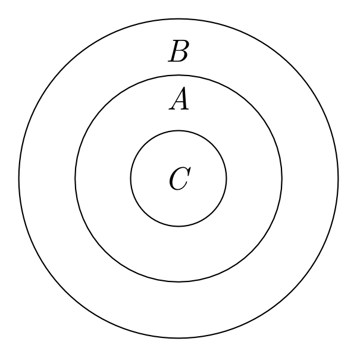

**Example 2**. No $A$ is $B$. All $C$ are $B$. Therefore, no $C$ is $A$.

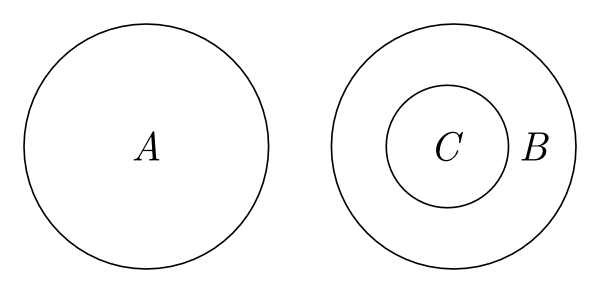

In both examples, the reader can easily infer the conclusion, and this illustrates visually powerful features of Euler diagrams. However, when existential statements are represented, things become more complicated, as explained above. For instance:

**Example 3**. No $A$ is $B$. Some $C$ is $A$. Therefore, Some $C$ is not $B$.

No single diagram can represent the two premises, since the relationship between sets $B$ and $C$ cannot be fully specified in one single diagram. Instead, Euler suggests the following three possible cases:

![Three cases: Case 1 has on the left two overlapping circles, the overlap is labeled ‘C’ and the non-overlap section of first circle is labeled ‘A’; on the right and separate is a third circle labeled ‘B’. Case 2 has three circles, two of the circles overlap and the overlap section is labeled ‘C’ and the non-overlap section of the first circle is labeled ‘A’; in the non-overlap section of the second circle is the third circle labeled ‘B’. Case 3 is similar to Case 2 except the third circle is not completely within the non-overlap section of the second circle; the section of the third circle outside the second circle is labeled ‘B’](../assets/diagrams/ex-3.png)

Euler claims that the proposition ‘Some $C$ is not $B$’ can be read off from all these diagrams. However, it is far from being visually clear how the first two cases lead a user to reading off this proposition, since a user might read off “No $C$ is $B$” from case 1 and “All $B$ is $C$” from case 2.

Hence, the representation of existential statements not only obscures the visual clarity of Euler Circles but also raises serious interpretational problems for the system. Euler himself seemed to recognize this potential problem and introduced a new syntactic device, ‘*’ (representing non-emptiness) as an attempt to repair this flaw (1768: Letter 105).

However, a more serious drawback is found when this system fails to represent certain compatible (that is, consistent) pieces of information in a single diagram. For example, Euler’s system prevents us from drawing a single diagram representing the following pairs of statements: (i) “All $A$ are $B$” and “No $A$ is $B$” (which are consistent if $A$ is an empty set). (ii) “All $A$ are $B$” and “All $B$ are $A$” (which are consistent when $A = B)$. (iii) “Some $A$ is $B$” and “All $A$ are $B$”. (Suppose we drew an Euler diagram for the former proposition and try to add a new compatible piece of information, i.e., the latter, to this existing diagram.) This shortcoming is closely related to Venn’s motivation for his own diagrammatic system (see Section 4.1 for other shortcomings of Euler’s system).

#### 3.1.2 Venn diagrams

Venn’s criticism of Euler Circles is summarized in the following passage:

> The weak point in this [Euler diagrams], and in all similar schemes, consists in the fact that they only illustrate in strictness the actual relation of classes to each other, rather than the imperfect knowledge of these relations which we may possess, or may wish to convey by means of the proposition. (Venn 1881: 510)

Because of its strictness, Euler’s system sometimes fails in representing consistent pieces of information in a single diagram, as shown above. In addition to this expressive limitation, Euler’s system also suffers other kinds of expressive limitations with respect to non-empty sets, due to topological restrictions on plane figures (see Section 4.1).

Venn’s new system (1881) was to overcome these expressive limitations so that partial information can be represented. The solution was his idea of ‘primary diagrams’. A primary diagram represents all the possible set-theoretic relations between a number of sets, without making any existential commitments about them. For example, Figure 2 shows the primary diagram about sets $A$ and $B$.

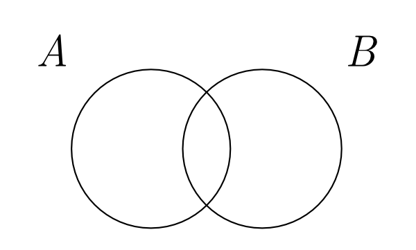

*Figure 2:* Venn’s Primary diagrams

According to Venn’s system, this diagram does not convey any specific information about the relation between these two sets. This is the major difference between Euler and Venn diagrams.

For the representation of universal statements, unlike the visually clear spatial containment relations in the case of Euler diagrams, Venn’s solution is ‘to shade them [the appropriate areas] out’ (Venn 1881: 122). By using this syntactic device, we obtain diagrams for universal statements as shown in Figure 3.

*Figure 3:* Venn’s shading

Venn’s choice of shading might not be absolutely arbitrary in that a shading could be interpreted as a visualization of set emptiness. However, it should be noted that a shading is a new syntactic device which Euler did not use. This revision gave flexibility to the system so that certain compatible pieces of information may be represented in a single diagram. In the following, the diagram on the left combines two pieces of information, “All $A$ are $B$” and “No $A$ is $B$,” to visually convey the information “Nothing is $A$.” The diagram on the right, which represents both “All $A$ are $B$” and “All $B$ are $A$,” clearly shows that $A$ is the same as $B$:

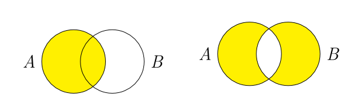

In fact, using primary diagrams also avoids some other expressivity problems (to do with spatial properties of diagram objects) discussed below, in Section 4. Surprisingly, Venn was silent about the representation of existential statements, which was another difficulty of Euler diagrams. We can only imagine that Venn might have introduced another kind of a syntactic object representing existential commitment. This is what Charles Peirce did about twenty years later.

#### 3.1.3 Peirce’s extension

Peirce points out that Venn’s system has no way of representing the following kinds of information: existential statements, disjunctive information, probabilities, and relations. Peirce aimed to extend Venn’s system in expressive power with respect to the first two kinds of propositions, i.e., existential and disjunctive statements. This extension was completed by means of the following three devices. (i) Replace Venn’s shading representing emptiness with a new symbol, ‘o’. (ii) Introduce a symbol ‘x’ for existential import. (iii) For disjunctive information, introduce a linear symbol ‘-’ which connects ‘o’ and ‘x’ symbols.

For example, Figure 4 represents the statement, ‘All $A$ are $B$ or some $A$ is $B$’, which neither Euler’s nor Venn’s system can represent in a single diagram.

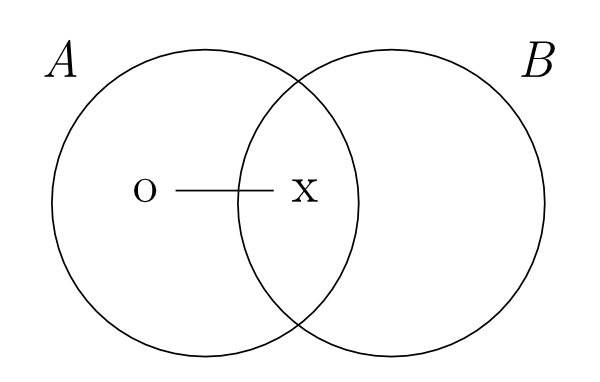

*Figure 4:* A Peirce diagram

The reason that Peirce replaced Venn’s shading for emptiness with the symbol ‘o’ seems to be obvious: It would not be easy to connect shadings or shadings and ‘x’s in order to represent disjunctive information. In this way, Peirce increased the expressive power of the system, but this change was not without its costs.

For example, the following diagram represents the proposition ‘*Either* all $A$ are $B$ and some $A$ is $B, or$ no $A$ is $B$ and some $B$ is not $A$’:

![two overlapping circles labeled ‘A’ and ‘B’; first, inside the non-overlapping section of circle A is an ‘o’ connected by a line to an ‘o’ inside the overlap; second, also in the non-overlapping section of circle A is another ‘o’ connected by a line to an ‘x’ in the non-overlapping section of circle ‘B’; third in the overlapping section of the two circles are an ‘x and an ‘o’ connected by a line; fourth an ‘x’ in the overlapping section connected by a line to an ‘x’ in the non-overlapping section of circle B.](../assets/diagrams/fig-4b.png)

Reading off this diagram requires more than reading off visual containment among circles (as in Euler diagrams) or shadings (as in Venn diagrams), but also requires extra conventions for reading combinations of the symbols ‘o,’ ‘x,’ and lines. Peirce’s new conventions increased the expressive power of single diagrams, but the arbitrariness of its conventions and more confusing representations (for example, the above diagram) sacrificed the visual clarity which Euler’s original system enjoys. At this point, Peirce himself confesses that ‘there is a great complexity in the expression that is essential to the meaning’ (Peirce 1933: 4.365)[^peirce-1933]. Thus, when Peirce’s revision was completed, most of Euler’s original ideas about visualization were lost, except that a geometrical object (the circle) is used to represent (possibly empty) sets.

Another important contribution Peirce made to the study of diagrams starts with the following remark:

> ‘Rule’ is here used in the sense in which we speak of the ‘rules’ of algebra; that is, as a permission under strictly defined conditions. (Peirce 1933: 4.361)[^peirce-1933]

Peirce was probably the first person to discuss rules of transformation in a non-sentential representation system. In the same way that the rules of algebra tell us which transformations of symbols are permitted and which are not, so should the rules of diagram manipulation. Some of Pierce’s six rules needed more clarification and turn out to be incomplete—a problem which Peirce himself anticipated. However, more importantly, Peirce did not have any theoretical tool—a clear distinction between syntax and semantics—to convince the reader that each rule is correct or to determine whether more rules are needed. That is, his important intuition (that there could be transformation rules for diagrams) remained to be justified.

#### 3.1.4 Formalization

Shin (1994) follows up Peirce’s work in two directions. One is to improve Peirce’s version of Venn diagrams, and the other is to prove the soundness and the completeness of this revised system.

Shin’s work alters Peirce’s modifications of Venn diagrams to achieve an increase in expressive power without such a severe loss of visual clarity. This revision is made in two stages: (i) Venn-I: retains Venn’s shadings (for emptiness), Peirce’s ‘x’ (for existential import) and Peirce’s connecting line between ‘x’s (for disjunctive information). (ii) Venn-II: This system, which is proven to be logically equivalent to monadic predicate logic, is the same as Venn-I except that a connecting line between diagrams is newly introduced to display disjunctive information.

Returning to one of Euler’s examples we will see the contrast among these different versions clearly:

**Example 3**. No $A$ is $B$. Some $C$ is $A$. Therefore, Some $C$ is not $B$.

Euler admits that no single Euler diagram can be drawn to represent the premises, but that three possible cases must be drawn. Venn’s system is silent about existential statements. Now, Peirce’s and Shin’s systems represent these two premises in a single diagram as follows:

![Two diagrams both consisting of three overlapping circles labeled ‘A’, ‘B’, and ‘C’. The first diagram, titled ‘Peirce’, has in the overlap of all three circles an ‘x’ connected to an ‘x’ in the overlap of only circles A and C; it also has in the overlap of all three circles an ‘o’ and also an ‘o’ in the overlap of only circles A and B. The second diagram, titled ‘Shin’, has in the overlap of all three circles an ‘x’ connected to an ‘x’ in the overlap of only circles A and C; the overlap of A and B is shaded.](../assets/diagrams/ex-3b.png)

In the case of Shin’s diagram, Venn’s shading convention for emptiness, as opposed to Peirce’s ‘o’, much more naturally leads the reader to the inference “Some $C$ is not $B$” than in the case of Peirce’s diagram.

However, Venn-I cannot express disjunctive information between universal statements or between universal and existential statements. Retaining Venn-I’s expressive power, Venn-II allows diagrams to be connected by a line. Peirce’s confusing looking diagram above is equivalent to the following Venn-II diagram:

> 

In addition to this revision, Shin (1994) presented each of these two systems as a standard formal representation system equipped with its own syntax and semantics. The syntax tells us which diagrams are acceptable, that is, which are well-formed, and which manipulations are permissible in each system. The semantics defines logical consequences among diagrams. Using these tools, it is proven that the systems are sound and complete, in the same sense that some symbolic logics are.

This approach has posed a fundamental challenge to some of the assumptions held about representation systems. Since the development of modern logic, important concepts, e.g., syntax, semantics, inference, logical consequence, validity, and completeness, have been applied to sentential representation systems only. However, none of these turned out to be intrinsic to these traditional symbolic logics only. For *any* representation system, whether it is sentential or diagrammatic, we can discuss two levels, a syntactic and a semantic level. What inference rules tell us is how to manipulate a given unit, whether symbolic or diagrammatic, to another. The definition of logical consequence is also free from any specific form of a representation system. The same argument goes for the soundness and the completeness proofs. When a system is proven to be sound, we should be able to adopt it in proofs. In fact, much current research explores the use of diagrams in automated theorem proving (see Barker-Plummer & Bailin 1997; and Jamnik et al. 1999)[^barker-plummer-1997][^jamnik-1999].

#### 3.1.5 Euler’s circle revisited

It is interesting and important to notice that the gradual changes made from Euler Circles through to Shin’s systems share one common theme: to increase both the expressive and logical power of the system so that it is sound, complete, and logically equivalent to monadic predicate logic. The main revision from Euler to Venn diagrams, introducing primary diagrams, allows us to represent partial knowledge about relations between sets. The extension from Venn to Peirce diagrams is made so that existential and disjunctive information may be represented more effectively.

Both Venn and Peirce adopted the same kind of solution in order to achieve these improvements: to introduce new syntactic objects, that is, shadings by Venn, and ‘x’s, ‘o’s, and lines by Peirce. However, on the negative side, these revised systems suffer from a loss of visual clarity, as seen above, mainly because of the introduction of more arbitrary conventions. The modifications from Peirce to Shin diagrams concentrate on restoring visual clarity, but without loss of expressive power.

Hammer and Shin take a different path from these revisions: To revive Euler’s homomorphic relation between circles and sets—containment among circles represents the subset relation among sets, and non-overlapping of regions represents the disjoint relation—and at the same time, to adopt Venn’s primary diagrams by default. On the other hand, this revised Euler system is not a self-sufficient tool for syllogistic reasoning, since it cannot represent existential statements. For more details of this revised system, refer to (Hammer & Shin 1998)[^hammer-1998].

This case study raises an interesting question for further research on diagrammatic reasoning. Throughout the different developments of Euler diagrams, increasing its expressive power and enhancing its visual clarity seem to be complementary to each other. Depending on purposes, we need to give priority to one over the other. Hammer and Shin’s alternative system provides a simple model for the development of other efficient non-sentential representational systems, a topic that has been receiving increasing attention in computer science and cognitive science.

### 3.2 Euclid and Beyond

Mathematicians have used, and continue to use, diagrams extensively. The communication of mathematical concepts and proofs—in textbooks, on blackboards—is not uniformly sentential. Figures and pictures are common. In line with the prevailing conception of logic as essentially sentential, however, they have not been thought to play a role in rigorous mathematical reasoning. From this perspective, their use is limited to enhancing comprehension of a proof. They are not part of the proof itself.

The attitude is well illustrated by the standard 20th century assessment of Euclid’s methodology in the *Elements*. In no mathematical subject are diagrams more prominent than in the elementary geometry Euclid develops in the text. The proofs of the subject seem to be in some sense about the diagrams of triangles and circles that appear with them. This is especially the case with the geometric proofs of the *Elements*. Diagrams for Euclid are not merely illustrative. Some of his inference steps depend on an appropriately constructed diagram. On the standard 20th century story, these steps indicate gaps in Euclid’s proofs. They show how Euclid did not fully carry out the project of developing geometry axiomatically.

Ken Manders set out to explode this story with (2008 [1995]). His analysis of Euclid’s diagrammatic proof method reveals that Euclid employs diagrams in a controlled, systematic way. It thus calls into question negative assessments of the rigor of the *Elements*. Moreover, the specifics of Manders’ analysis suggest that the proofs of the text can be understood to adhere to a formal diagrammatic logic. This was subsequently confirmed by the development of formal diagrammatic systems designed to characterize such a logic. The first of these was **FG** (presented in Miller 2007)[^miller-2007], followed by the system **Eu** (Mumma 2010)[^mumma-2010].

This section is devoted to explicating Manders’ analysis and the formal systems that have emerged from it. We first explain how the analysis lays the groundwork for the project of formalizing Euclid’s diagrammatic proofs. We then discuss how this project is realized in **FG** and **Eu**.

#### 3.2.1 Understanding the role of Euclid’s diagrams

For an example of Euclid’s diagrammatic method in action, consider the proof for proposition 16 of book I of the *Elements*.

The proposition is:

> In any triangle, if one of the sides be produced, the exterior angle is greater than either of the interior and opposite angles.

Euclid’s proof is:

> 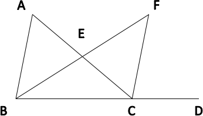
>
> - Let ABC be a triangle, and let one side of it BC be produced to D;
> - I say that the angle ACD is greater than the interior and opposite angle BAC.
> - Let AC be bisected at E [I, 10], and let BE be joined and produced in a straight line to F;
> - let EF be made equal to BE [I,3], and let FC be joined.
> - Then, since AE is equal to EC, and BE equal to EF, the two sides AE, EB are equal to the two sides CE, EF respectively; and the angle AEB is equal to the angle FEC [I, 15].
> - Therefore the base AB is equal to the base FC, and the triangle ABE is equal to the triangle CFE [I,4];therefore the angle BAE is equal to the angle ECF (which is also the angle ACF);
> - But the angle ACD is greater than the angle ACF;
> - Therefore the angle ACD is greater than BAE.

On the usual approach, logical analysis of the proof requires situating it within an axiomatic theory of elementary geometry. Such a theory specifies the subject’s primitive undefined concepts and its fundamental unproven truths. The canonical first order theory fulfilling this foundational role is that presented in Tarski, 1959. Developed by Alfred Tarski in the tradition of David Hilbert’s epochal axiomatization 1899, the theory has two primitives: a three-place relation of betweenness and a four-place relation of segment congruence. To analyze the proof of I,16 with it, the proof’s premises and conclusion are first formulated in terms of betweenness and segment congruence. A derivation of the latter from the former is then constructed. The derivation presents the logic of the reasoning as completely diagram-free. It consists, specifically, of a tree of first order formulas linked to one another other by sound, topic neutral derivation rules.

Though carrying such an analysis is not a trivial task—the details take some thought to work out—the general character of what the analysis yields is clear. We obtain a depiction of the proof in which steps of reasoning proceed from geometrical statements to geometrical statements via precisely defined derivation rules. The clarity and precision of this picture was taken in the 20th century to contrast sharply with Euclid’s original diagrammatic proof. The diagram was viewed as a free-floating illustration, to be consulted whenever there was no other way to reach a conclusion, rather than something a with a definite and principled role in the proof’s reasoning.

What Manders shows in 2008 [1995] is that diagrams have in fact a definite and principled role in the proofs of ancient geometry. Central to his account is the distinction between the exact and co-exact properties of geometric diagrams. The co-exact conditions realized by a diagram ‘are those conditions which are unaffected by some range of every continuous variation of a specified diagram.’ Exact conditions, in contrast, are affected once the diagram is subject to the smallest variation. Roughly, a diagram’s co-exact properties comprise the ways its parts define a finite set of planar regions, and the containment relations between these regions. The paradigm exact relation is the equality of two magnitudes within a diagram. For example, only the slightest change to the position of CF in the diagram for proposition 16 is required to make the angles BAE and ECF unequal.

Manders’ key observation is that Euclid’s diagrams contribute to proofs *only* through their co-exact properties. Euclid never infers an exact property from a diagram unless it follows directly from a co-exact property. Relations between magnitudes which are not exhibited as a containment are either assumed from the outset or are proved via a chain of inferences in the text. This can easily be confirmed with the proof of proposition 16. The one inference that relies on the diagram is the second to last inference of the proof. The inference, specifically, is that angle ACD is greater than angle ACF. This, crucially, is based on seeing from the diagram that angle ACD *contains* angle ACF. There are many other relations asserted to hold in the proof. Though the diagram instantiates them, they are explicitly justified in the text. And with these relations, the relata are spatially separated magnitudes.

It is not difficult to hypothesize why Euclid would have restricted himself in such a way. It is only in their capacity to represent co-exact properties and relations that diagrams seem capable of functioning effectively as symbols of proof. The exact properties of diagrams are too refined to be easily reproducible and to support determinate judgments. As Manders puts it

> The practice has resources to limit the risk of disagreement on (explicit) co-exact attributions from a diagram; but it lacks such resources for exact attributions, and therefore could not allow them without dissolving into a disarray of irresolvably conflicting judgements. (Manders 2008 [1995]: 91–92)[^manders-2008]

Manders’ insights lead naturally to the idea that Euclid’s arguments could be formalized in a manner similar to the way Venn diagrams have been formalized in Shin 1994. The co-exact information carried by Euclid’s diagrams is discrete. When a diagram is consulted for this information, what matters about it is how its lines and circles partition a bounded planar region into a finite set of sub-regions. This opens the door to conceptualizing Euclid’s diagrams as part of the *syntax* of Euclid’s proof method.

Realizing this conception in a formal system of proof amounts, as in Shin 1994, to specifying the syntax and semantics of diagrams. On the syntactic side, this means defining Euclid’s diagrams as formal objects precisely, and giving rules whereby diagrams as formal object figure in derivations of Euclid’s propositions. On the semantic side, this means specifying how derivable expressions are to be interpreted geometrically, or in other words how exactly are they to be understood as representing Euclid’s propositions.

The semantic situation with Euclid’s diagrams is thus different from that with Venn’s. Venn diagrams are used to prove *logical* results. The inferences made with them are topic neutral. Euclid’s diagrams on the other hand are used to prove *geometrical* results. The inferences made with them are topic specific. In particular, though the objects of plane Euclidean geometry are abstract (e.g., geometric lines are breadthless), they are still spatial. Consequently, issues surrounding the spatiality of diagrams and representational scope do not arise with Euclid’s diagrams as they do, for instance, with Euler diagrams. In the case of geometry, in fact, the spatiality of diagrams counts in their favor. Spatial constraints on what is possible with geometric configurations are also operative with spatial Euclidean diagrams.

Nevertheless, as recognized in the philosophical commentary on Euclid’s geometry from antiquity onward, there are with Euclidean diagrams issues of representational scope to contend with. What is the justification for treating properties of a single geometric diagram as representative of all the configurations in the range of a proof? How can a single diagram prove a general result? Manders’ exact/co-exact distinction provides the basis for a partial answer. The co-exact properties of a diagram can be shared by all geometric configurations in the range of a proof, and so in such cases one is justified in reading off co-exact properties from the diagram. In a proof about triangles for instance, variation among the configurations in the range of the proof is variation of exact properties—e.g., the measure of the triangles’ angles, the ratios between their sides. They all share the same co-exact properties—i.e., they all consists of three bounded linear regions which together define an area.

This is not a full answer because Euclid’s proofs typically involve constructions on an initial configuration type. With the proof of proposition 16, for example, a construction on a triangle with one side extended is specified. In such cases, a diagram may adequately represent the co-exact properties of an initial configuration. But the result of applying a proof’s construction to the diagram cannot be assumed to represent the co-exact properties of all configurations resulting from the construction. One does not need to consider complex geometric situations to see this. Suppose for instance the initial configuration type of a proof is *triangle*. Then the diagram

> 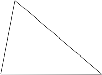

serves to represent the co-exact properties of this type. Suppose further that the first step of a proof’s construction is to drop the perpendicular from a vertex of the triangle to the line containing the side opposite the vertex. Then the result of carrying this step out on the diagram

> 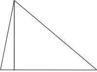

ceases to be representative. That the perpendicular falls within the triangle in the diagram is a co-exact feature of it. But there are triangles with exact properties different from the initial diagram where applying the construction step results in a perpendicular lying outside the triangle. For example, with the triangle

> 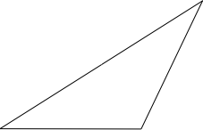

the result of applying the construction step is

> 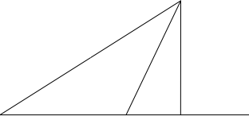

#### 3.2.2 Formalizing Euclid’s Diagrammatic Logic

Manders’ account of Euclid’s diagrammatic method provides the broad outlines for formalizing it. Filling in the details amounts to carrying out two main tasks. The first is to define geometric diagrams as formal proof symbols, and the second is to specify a method for proving results with geometric diagrams so characterized.

**Task 1: defining formal geometric diagrams.** As mentioned above, the definition of geometric diagrams as formal proof symbols must specify their syntax and semantics. The formal objects satisfying the first syntactic part of the definition model the actual physical geometric diagrams produced with Euclid’s proofs. The second, semantic part of the definition codifies Manders’ notion of co-exactness with respect to these objects via an equivalence relation. The properties and relations that a formal diagram shares with all diagrams equivalent to express the geometric information it carries as a proof symbol.

The syntax of **FG** diagrams is purely topological. Its linear elements (segments, rays and lines) and circles are sets of one-dimensional bounded curves within a rectangular two dimensional frame. The conditions on a well-formed **FG** diagram guarantee that these sets have the expected topological properties—e.g. set representing a line does not self-intersect, a set representing a circle forms a simple closed curve, the sets representing two distinct lines intersect in at most one point, and so on. For the details see section 3.1 of chapter 2 in Miller 2007.

The conditions **Eu** imposes on its lines and circles are not, in contrast, purely topological. An **Eu** diagram has as a background a coordinatized $n \times n$ array, where n is any natural number greater than 2. An **Eu** point is a distinguished array element and **Eu** linear elements and circles are sets of array elements. The linearity of linear elements and convexity of circles is guaranteed by the equations and inequalities theses sets are required to satisfy. For the details see section 3.1 of Mumma 2019.

The range of distinct co-exact configurations stipulated by the **FG** notion of diagram equivalence is not exactly the same as that stipulated by the **Eu** notion. The main difference between them stems from how segments are understood in both systems. An **FG** segment is not taken to define regions on either side of it while an **Eu** segment is. It is only when an **FG** segment is extended to a line that regions above and below the segment are depicted. Further, **FG** lines are interpreted as representing infinite lines, while **Eu** lines are interpreted as depicting the extendibility of segments. This has consequences for how parallelism is treated in both systems. See section 3.2.2 of Mumma 2019.

| 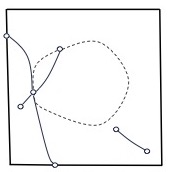 | 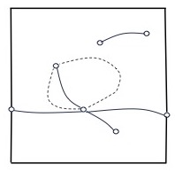 |
| --- | --- |
| 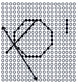 | 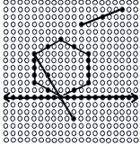 |

*Figure 5:* Two equivalent FG diagrams and two equivalent Eu diagrams

**Taks 2: prescribing a diagrammatic method of geometric proof.** Situating the formally defined diagrams like those of **FG** and **Eu** in a formal geometric proof system requires two things. The first is a technique for expressing a configuration’s exact information in conjunction with the co-exact information expressed by a diagram. The second is a method for distinguishing general co-exact features from non-general ones in diagrammatic representations of constructions.

The first requirement is met in **FG** by expressing equalities between magnitudes depicted in a diagram via markings of segments and angles in line with the familiar convention where distinct segments or angles with the same angle are understood as equal. **Eu** in contrast is a heterogeneous system, with a sentential as well as a diagrammatic syntax. **Eu** sentences expressing equalities and inequalities between magnitudes are related to the diagrams depicting the magnitudes via labels. For examples of these two methods of representation with respect to I, 16, see figure 6.

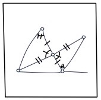

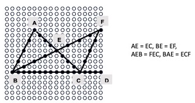

Figure 6: The FG and Eu representation of the equalities constructed and proven in I, 16.

In each system formulating proofs rules for reasoning about exact information with its specific way of representing it is straightforward. Less straightforward is formulating the proof rules that govern the inference of co-exact information from diagrams. The core difference between **FG** and **Eu** is with respect to these rules. As illustrated in the example in 3.2.1, the central issue is the potential of a geometric diagram to display co-exact relations that are not shared by all configurations in the scope of a proof after a construction step is applied. A formal method for reasoning about geometric constructions represented with diagrams must guarantee that only co-exact relations that are shared by all configurations in the scope of a proof play a role.

An approach that naturally suggests itself is akin to Euler’s treatment of example 3 in section 3.1.1: produce with each construction step all the co-exact configurations that could result from it. This is the method prescribed by **FG**. Performing the construction of one of Euclid’s proofs on an **FG** diagram results, in general, in an array of diagrams depicting all of the construction’s possible co-exact cases. A general co-exact relation of the construction is then one that appears in every case. **FG**’s demand that every case be produced would, of course, be of a little interest if it did not also provide a method for producing them all. The method **FG** provides depends on the fact that lines and circles in the system’s diagrams are defined in purely topological terms. Their resulting flexibility makes it possible to formulate and implement in a computer program a general method for generating cases. [^note-5]

It turns out that the proof of I,16 can be represented in **FG** without any case branching if the sides of the initially given triangle in a **FG** diagram are extended to the frame. (Otherwise topologically coherent but geometrically uninterpretable cases would result, and the key co-exact relation of the containment of ACF in ACD would not be inferable.) A proof in the *Elements* whose representation in **FG** does necessitate a fair amount of case branching is that of I,2. This is due to proof’s construction having two steps where circles are drawn. Performing these steps in **FG** means producing cases for all possible positions of points (inside, on, outside) in the diagram with respect to the circles.

The lines and circles of **Eu** diagrams are not flexible like those of **FG**. Consequently, it cannot resolve the generality problem via case-analysis as **FG** does. It seeks instead to formalize a process in which a reasoner confirms with a single given diagram that select relations depicted in it are general. A reasoner who employs Euler diagrams in this way would not, for instance, produce three separate diagrammatic representations of the premises of the syllogism of example 3. She would instead first represent it in one of the three possible ways. She would then confirm that the relation between B to the part of C in A is general while also recognizing the relation of B to the part of C outside of A can vary. (David Waszek argues for this understanding Euler’s diagrammatic method in this way, and provides explicit rules codifying it, in 2018.)

Accordingly, in the picture of diagrammatic reasoning underlying **Eu**, there are two kinds of acts: 1) the production of a single diagram representing what is explicitly stipulated in the proof or problem; 2) the extraction of content from the single diagram produced. **Eu** thus has two kinds of rules regulating its diagrammatic syntax in derivations. Its *construction rules* govern acts of kind 1) and its *positional rules* govern acts of kind 2). Formally, the positional rules have as input and output sub-diagrams of the diagram produced by the construction of a derivation. The derivation of a sub-diagram via a positional rule means that all the co-exact relations that it depicts are general.

For example, to derive I, 16 in **Eu**, we first produce the **Eu** diagram

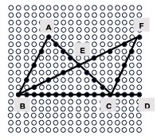

*Figure 7a*

via its construction rules. We then apply positional rules repeatedly to obtain the sub-diagram

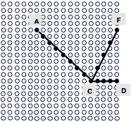

*Figure 7b*

and then apply a rule for deriving inequalities from diagrams to obtain ACF $\lt$ ACD.[^note-6]

Generally, the approach of **Eu** allows for less cases to be considered. In its representation of the proof of I, 2, for example, one can confirm that the co-exact relations necessary for the proof to go through without taking into account the various ways the proof’s points and circles can relate.

The differences between the **FG** and **Eu** approaches to formalizing Euclid’s constructions can be understood as representing different general conceptions of the role of diagrams in mathematics. **FG** embodies a conception where diagrams concretely realize a range of mathematical possibilities. They support mathematical inference by furnishing direct access to these possibilities. **Eu** in contrast embodies a conception where diagrams serve to represent in a single symbol the various components of a complex mathematical situation. They support mathematical inference by allowing the mathematical reasoner to consider all these components in one place, and to focus on those components relevant to a proof.

### 3.3 Other Diagrammatic Systems

It is worth noting that many mathematicians and philosophers proposed diagrammatic systems, often with a didactic motivation. Some systems, like Lewis Carroll’s in “The Game of Logic” (1896) are variants on the proposals of Euler and Venn. Others, like Frege (1879), used lines rather than plane regions. (For a description of Frege’s notation, see the section on Complex Statements and Generality in the entry on [Gottlob Frege](https://plato.stanford.edu/entries/frege/). See also Englebretsen 1992.) Carroll’s system supersedes Venn’s in that the complements of sets are explicitly represented as regions of the diagram, rather than being left as the background region against which the circles appear. This means that Carroll’s system is able to draw inferences about relations between complements of properties, at the expense of representing some properties as disjoint (i.e., non-connected) regions. This shift closely mirrors the shift in logic from subject-predicate argumentation to a function-argument representation (Stenning 1999)[^stenning-1999]. In the tradition of the work of Venn and Carroll, Frank Thomas Sautter presents four new diagrammatic systems for syllogistic reasoning and discusses them in relation to the systems of Venn and Carroll in 2019.

Peirce, a founder of modern quantified logic, also invented a graphical system, called Existential Graphs, which is logically equivalent to predicate logic. Along with Don Robert’s pioneering work on Existential Graphs and John Sowa’s creative application of Peirce’s graphs, a group of diagrammatic researchers provided more diverse approaches to Existential Graphs in a broader theoretical context (Shin 2003)[^shin-2003].

On a more practical theme, AI researchers, one of whose main concerns is the heuristic power of representation systems in addition to their expressive power, have been debating about different forms of representation for decades (Sloman 1971, 1985, 1995)[^sloman-1971][^sloman-1985][^sloman-1995]. Hence, they have welcomed discussions of the distinct role of visual reasoning and have hosted interdisciplinary symposiums on diagrammatic reasoning at AI conferences.[^note-7] At the same time, realizing that human beings adopt different representation forms depending on the kinds of problems they face, some AI researchers and design theorists have practiced domain-specific approaches to bringing in problem-tailored representation forms.[^note-8]

For instance, Harel (1988) invented higraphs to represent system specifications in computer science. This idea has been taken up in industrial applications (e.g., UML, in Booch et al. 1998). Barker-Plummer & Bailin (1997) present a case study in developing computers which can carry out the kind of analogical reasoning that humans perform when proving certain mathematical theorems. Along these lines, an interesting result was presented by Mateja Jamnik of Alan Bundy’s Mathematical Reasoning Group at Edinburgh (Jamnik 2001)[^jamnik-2001]. Jamnik shows how a semi-automatic formal proof system can perform some of the perceptual inferences which humans find so natural. For instance, that the sum of the first $n$ odd natural numbers is $n$ squared is easily seen by decomposing an $n \times n$ grid into “ells” (Jamnik et al. 1999)[^jamnik-1999].

Scholars at the University of Brighton has been carrying out interesting projects both in developing diagrammatic systems and in applying visual tools in software development, see the link in the Other Internet Resources section.

## 4. Diagrammatic Properties

While it is often possible to afford diagrams the same logical status as formulae (as argued above), there are still important differences (which can have ramifications for correctness of the system) between diagrams and traditional linear proof calculi. An important point to note about diagrams (cf. Russell 1923)[^russell-1923] is that spatial relations between objects in a diagram can be used to represent relations between objects in some other domain. Sequential languages (e.g., symbolic logics, natural languages), however, use only the relation of concatenation to represent relations between objects. The peculiar representational use of spatial relations in the case of diagrams is direct and intuitive, as seen in the development of Euler Diagrams above, but also has its perils—as we shall discuss. Spatial constraints, being peculiar to diagrammatic systems, can be expected to be an important source of both their strengths and weaknesses. Psychological considerations concerning human capacities for visual processing of information, and skill at qualitative spatial reasoning, also have ramifications for the effectiveness of reasoning with diagrams, but we shall not survey them here at length. In the last subsection we outline some aspects of cognitive role of diagrams in connection with mental representation perspective.

A particular distinguishing feature of diagrams is that they obey certain “nomic” or “intrinsic” constraints due to their use of plane surfaces as a medium of representation. The idea is that sentential languages are based on acoustic signals which are sequential in nature, and so must have a compensatingly complex syntax in order to express certain relationships—whereas diagrams, being two-dimensional, are able to display some relationships without the intervention of a complex syntax (Stenning & Lemon 2001)[^stenning-2001]. Diagrams exploit this possibility—the use of spatial relations to represent other relations. The question is; how well can spatial relations and objects represent other (possibly more abstract) objects and relations?

Logical reasoning with diagrams is often carried out in virtue of their depiction of all possible models of a situation, up to topological equivalence of the diagrams (this, of course, depends on the particular diagrammatic system in use). A single diagram is often an abstraction over a class of situations, and once a suitable diagram has been constructed, inferences can simply be read off the representation without any further manipulation. Examples and our discussions in section 3 nicely illustrate this point. In some diagrammatic systems (e.g., Euler Circles) inference is carried out by constructing diagrams correctly and reading information off them. The complexity of using inference rules in a symbolic logic is, in these cases, replaced by the problem of drawing particular diagrams correctly.[^note-9] For instance, an Euler Circles diagram ventures to capture relationships between sets using topological relationships between plane regions in such a way that that it depicts all the possible ways that a certain collection of set-theoretic statements could be true. This has two important consequences: (1) if a certain diagram cannot be drawn then the described situation must be impossible (termed “self-consistency”), and (2) if a certain relationship between diagram objects must be drawn, then the corresponding relation can be inferred as logically valid. (See the numerous examples in Section 3.) This phenomenon is often termed a “free-ride” (Barwise & Shimojima 1995)[^barwise-1995][^barwise-1995-2]. This style of diagrammatic reasoning is thus dependent on a particular representational use of diagrams—that they represent classes of models. If a particular class of models cannot be represented by a diagrammatic system, then those cases will not be taken into account in inferences using the system, and incorrect inferences might be drawn. This fact makes the representational adequacy of diagrammatic systems, restricted by their spatial nature, of paramount importance, as we shall now explore.

### 4.1 Limitations on Diagrammatic Representation and Reasoning

The representational use of the spatial relations in the plane constrains diagrammatic representation, and therefore reasoning with diagrams, in certain important ways. In particular, there are topological and geometrical (let us lump them together as “spatial”) properties of diagrammatic objects and relations which limit the expressive power of diagrammatic systems. For instance, in graph theory it is known that some simple structures cannot be drawn in the plane. For example, the graph $K_5$ is the graph consisting of 5 nodes, each joined to the other by an arc. This graph is non-planar, meaning that it cannot be drawn without at least two of the arcs crossing. This is just the sort of constraint on possible diagrams that limits the expressive power of diagrammatic systems. Now, since diagrammatic reasoning can occur by enumeration of all possible models of a situation, this representational inadequacy (a type of incompleteness) renders many diagrammatic systems incorrect if they are used for logical reasoning (e.g., see the critique of Englebretsen 1992 in Lemon & Pratt 1998)[^englebretsen-1992][^lemon-1998].

Perhaps the most simple example of this is due to Lemon and Pratt (see e.g., 1997). Consider Euler Circles—where convex regions of the plane represent sets, and overlap of the regions represents non-empty intersection of the corresponding sets. A result of convex topology known as Helly’s Theorem states (for the 2 dimensional case) that if every triple of 4 convex regions has a non-empty intersection then all four regions must have a non-empty intersection.

To understand the ramifications of this, consider the following problem:

> **Example 4**. Using Euler Circles, represent the following premises:
>
> - $A \cap B \cap C \ne \varnothing$
> - $B \cap C \cap D \ne \varnothing$
> - $C \cap D \cap A \ne \varnothing$

Note that, in terms of set-theory, only trivial consequences follow from these premises. However, an Euler diagram of the premises, such as Figure 8, leads to the incorrect conclusion that $A \cap B \cap C \cap D \ne \varnothing$ (due to the quadruple overlap region in the centre of the diagram):

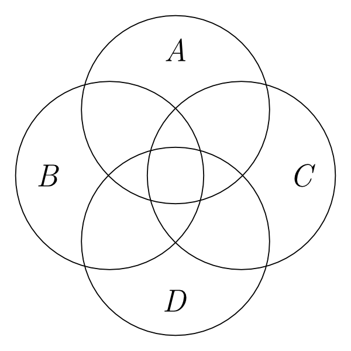

Figure 8: An Euler’s Circles representation exhibiting Helly’s Theorem

In other words, a user of Euler Circles is forced[^note-10] to represent a relationship between the sets which is not logically necessary. This means both that there are logically possible situations which the system cannot represent, and that a user would make incorrect inferences if they relied on the system for reasoning. More generally, this type of result can be generated for many different types of diagrammatic system, depending on the particular spatial relations and objects which they use in representation—a research programme which is ongoing.

For example, using non-convex regions (e.g., “blobs” instead of circles) leads to a similar problem, only that non-planar graphs are involved instead of Helly’s Theorem. A similar result concerns linear diagrams for syllogisms Englebretsen 1992, where lines are used to represent sets, points represent individuals, point-line intersection represents set-membership, and intersection of lines represents set-intersection. Again, planarity constraints restrict the expressive power of the system and lead to incorrect inferences.

Atsushi Shimojima’s “constraint hypothesis” perhaps best sums all this up:

> Representations are objects in the world, and as such they obey certain structural constraints that govern their possible formation. The variance in inferential potential of different modes of representation is largely attributable to different ways in which these structural constraints on representations match with the constraints on targets of representation (Shimojima 1996a, 1999)[^shimojima-1996a][^shimojima-1999].

### 4.2 Efficacy of Diagrams

As discussed above, much of the interest in diagrams has been generated by the claim that they are somehow more “effective” than traditional logical representations for certain types of task. Certainly, for example, a map is a greater aid to navigation than a verbal description of a landscape. However, while there are certainly psychological advantages to be gained through the use of diagrams, they are (as in the case of Euler Circles) often ineffective as representations of abstract objects and relationships. Once a purely intuitive notion, non-psychological claims about “efficacy” of diagrammatic systems can be examined in terms of standard formal properties of languages (Lemon et al. 1999)[^lemon-1999]. In particular, many diagrammatic systems are self-consistent, incorrect, and incomplete, and complexity of inference with the diagrams is NP-hard. By way of contrast, most sentential logics, while able to express inconsistencies, are complete and correct[^note-11] .

On the other hand, not being able to represent contradictions could provide us with interesting insights about the nature of diagrammatic representation. If a central goal of a language is to represent the world or a state of affairs, then representing contradictions or tautologies is called into question. Neither contradictions nor tautologies are part of the world. How can we draw a picture, or take a picture, of the contradiction that “it is raining and it is not raining”? How about the picture of the disjunctive information “it is either raining or not raining”? Now, we seem to be much closer to Wittgenstein’s classic picture theory of language (Wittgenstein 1921)[^wittgenstein-1921].

### 4.3 The Cognitive Role of Diagrams

One might locate a special role of diagrammatic reasoning in the relation between mental representation and diagrams. We have been alluding this relation in a couple of times in the above.

Do our mental representations have diagram-like or picture-like entities as components? This question has a long history both in philosophy and in psychology, independently of each other. More recently, however, some philosophers have participated in this “imagery debate”, one of the most time-honored controversies in psychology, and some cognitive psychologists find certain epistemological theories in philosophy useful to support their views on the issue.

The nature of mental representation has been one of the perennial topics in philosophy, and we can easily trace back philosophical discussions on images and mental representation to ancient times.[^note-12] The writings of Hobbes, Locke, Berkeley, and Hume concern themselves in large part with mental discourse, the meaning of words, mental images, particular ideas, abstract ideas, impressions, and so on. Descartes’ well-known distinction between imagining and conceiving something has generated much discussion about the unique role of visual images in mental representations. The development of cognitive science in the 20th century naturally has brought certain group of philosophers and psychologists closer and we find a number of authors whose works easily belong to both disciplines (Block 1983; Dennett 1981; Fodor 1981)[^block-1983][^dennett-1981][^fodor-1981].

Imagery based on introspection was the main focus in the early development of psychology until the behavioristic approach became predominant in the discipline. During the era of behaviorism, anything related to mental inspection, including images, was excluded from any serious research agenda. Finally when the topic of mental images made a comeback in psychology in 1960s, researchers adopted a more humble agenda for mental imagery than before: Not all mental representations involve imagery, and imagery is one of many ways of manipulating information in the mind. Also, thanks to the influence of behaviorism, it is acknowledged that introspection is not enough to explore imagery, but a claim about mental imagery needs to be confirmable by experiments in order to show that we successfully externalize mental events. That is, if what a certain mental introspection tells us is genuine, then there would be observable external consequences of that mental state.

Thus the contemporary imagery debate among cognitive scientists is about the claim that picture-like images exist as mental representations and about how we interpret certain experiments.[^note-13]

Kosslyn (1980, 1994) and other pictorialists (Shepard & Metzler 1971)[^shepard-1971] present experimental data to support their position that some of our mental images are more like pictures than a linear form of language (for example, natural languages or artificial symbolic languages) in some important aspects, even though not all visual mental images and pictures are of exactly the same kind. By contrast, Pylyshyn (1981) and other descriptionalists (Dennett 1981)[^dennett-1981] raise questions about the picture-like status of mental images and argue that mental images are formed out of structured descriptions. To them, mental images represent in the manner of language rather than pictures and, hence, there are no picture-like visual mental images.

Both sides of the debate sometimes used a philosophical theory as a supporting factor. For example, pictorialists in the imagery debate found the modern sense-datum theory in philosophy quite close to their point of view. By the same token, the critics of the sense-datum theory argued that the mistaken pictorial view of mental images arises mainly from our confusion about ordinary language and claimed that mental images are epiphenomena.

Without being heavily involved in the imagery debate, some researchers have focused on a distinct role that diagrams or pictures—as opposed to traditional sentential forms—play in our cognitive activities. (Shin 2015; Hamami & J. Mumma 2013)[^hamami-2013][^shin-2015] Based on the conjectures that humans adopt diagrammatic or spatial internal mental representations in their reasoning about concrete or abstract situations (see Howell 1976; Sober 1976)[^howell-1976][^sober-1976], some cognitive scientists have concentrated on the functions of images or diagrams in our various cognitive activities, for example, memory, imagination, perception, navigation, inference, problem-solving, and so on. Here, the distinct nature of “visual information,” which is obtained either through internal mental images or through externally drawn diagrams, has become a major topic of research. Even though most of these works assume that there are mental images (that is, they accept the pictorialists’ claim), strictly speaking they do not have to commit themselves to the view that these images exist as basic units in our cognition. Descriptionalists do not have to discard discussions of the functions of images, but only need to add that these images are not primitive units stored in our memory, but formed out of structured descriptions more like the sentences of a language (see Pylyshyn 1981)[^pylyshyn-1981].

A search for the distinct role of diagrams has led researchers to explore the differences among different forms of external or internal representations, and mainly between diagrammatic and sentential representations. Many important results have been produced in cognitive science. Starting from Larkin and Simon’s classic case study (1987) to illustrate a difference between informational and computational equivalence among representation systems as discussed in section 3.1, Lindsay’s work locates where this computational difference lies, which he calls a ‘non-deductive’ method. As briefly pointed out above, this inference process is called ‘free ride’ by Barwise and Shimojiima (1995), i.e., the kind of an inference in which the conclusion seems to be read off automatically from the representation of premises. In Gurr, Lee, and Stenning (1998) and Stenning and Lemon (2001), there is an explanation of the uniqueness of diagrammatic inference in terms of a degree of ‘directness’ of interpretation, and it is argued that this property is relative, and hence that “some rides are cheaper than others”. Having the role of graphs in mind, Wang and Lee (1993) present a formal framework as a guideline for correct visual languages. At this point, we are very close to applied aspects of research in multi-modal reasoning—design theory and AI research—by providing these disciplines with computational support for visual reasoning.

Related to the issue of imagistic mental representation is the examination of the semantics of various diagrammatic systems and what they can teach us about the nature of languages in general (e.g., Goodman 1968)[^goodman-1968]. For instance, Robert Cummins (1996), amongst others, argues that too little attention has been given to diagrammatic representations and that focus on a notion of “structural representation” more akin to diagrammatic representation can help to explicate the nature of representation itself. We believe that the considerations presented above give us some empirical handle on this type of claim at least—depending on the imagistic objects and relations used, patterns of incorrect inference should be predictable and detectable. An important, if little-known, article on this theme is Malinas 1991. Here Malinas explores the concepts of pictorial representation and “truth in” a picture via the notion of resemblance, and considers various semantic puzzles about pictorial representation. He develops Peacocke’s “Central Thesis” of depiction (Peacocke 1987)[^peacocke-1987], where experienced similarities between properties of pictorial objects and their referents in the visual field give rise to the relation of depiction. He goes on to provide a formal semantics for pictures which is “analogous to a semantics for an ideal language”.

## Summary

We began by motivating the philosophical interest of diagrams, by way of their role in human reasoning and their relation to the study of language in general, and multi-modal information processing. We then explained the trade-off between expressive power and visual clarity of diagrammatic systems, by examining the historical development of diagram systems from Euler and Venn, through Peirce’s work, to more recent work by Shin and Hammer. Formalization of Euclid’s geometry is presented in detail as well. It was argued that diagrammatic systems can be afforded the same logical status as traditional linear proof calculi. Importantly, diagrams have been adopted without a formal framework. Examining various kinds of diagrammatic reasoning in different disciplines, we aim to open a new path for broader multi-modal reasoning research. We then explained some of the potential pitfalls of diagrammatic representation and reasoning, by examining spatial constraints on diagrammatic systems and how they can affect correctness and expressive power. We closed by surveying other diagrams systems, the interest in diagrams generated in computer science and cognitive science, and gave an introduction to the imagery debate in the philosophy of mind.

## References（引用注释）

> 原文参考文献已转为脚注引用：文内“作者-年份”引用组后附 [^key] 标记，完整条目见本文末脚注定义。

### References（引用注释）

> 原文参考文献已转为脚注引用：文内“作者-年份”引用组后附 [^key] 标记，完整条目见本文末脚注定义。

### Relevant Literature

- Barwise, J. and E. Hammer, 1994, “Diagrams and the Concept of a Logical System”, in Gabbay, D. (ed.), *What is a Logical System?* New York: Oxford University Press.
- Hammer, E., 1995b, *Logic and Visual Information*, Studies in Logic, Language, and Computation. Stanford: CSLI Publications and FoLLI.
- –––, 1998, “Semantics for Existential Graphs”, *Journal of Philosophical Logic*, 27: 489–503
- Hammer, E. and S. Shin, 1996, “Euler and the Role of Visualization in Logic”, in Seligman, J. and Westerståhl, D. (eds), *Logic, Language and Computation: Volume 1*, CSLI Lecture Notes #58, pages 271–286. Stanford: CSLI Publications.
- Kneale, W., and Kneale, M., 1962, *The Development of Logic*, Oxford: Clarendon Press.
- Lemon, O., 1997, “Review of *Logic and Visual Information*, by E. M. Hammer”, *Journal of Logic, Language, and Information*, 6(2): 213–216.
- Roberts, D., 1992, “The Existential Graphs of Charles S. Peirce”, *Computer and Mathematical Applications*, 23: 639–663.
- Shimojima, A., 1996b, “Operational Constraints in Diagrammatic Reasoning”, in J. Barwise and G. Allwein, (eds), *Logical Reasoning with Diagrams*, New York: Oxford University Press, pages 27–48.
- –––, 1996c, “Reasoning with Diagrams and Geometrical Constraints”, in Seligman, J. and Westerståhl, D. (eds), *Logic, Language and Computation: Volume 1*, CSLI Lecture Notes #58, pages 527–540. Stanford, CSLI Publications.
- Shin, S., 1991, “A Situation-Theoretic Account of Valid Reasoning with Venn Diagrams”, in J. Barwise, J. Gawron, G. Plotkin, and S. Tutiya, (eds), *Situation Theory and its Applications: Volume 2*, CSLI Lecture Notes #26, pages 581–605. Stanford: CSLI Publications.
- –––, 1999, “Reconstituting Beta Graphs into an Efficacious System”, *Journal of Logic, Language, and Information*, 8: 273–295.
- –––, 2000, “Reviving the Iconicity of Beta Graphs”, in Anderson, Cheng, and Haarslev, (eds), *Theory and Application of Diagrams*, pages 58–73. Springer-Verlag.
- –––, 2002a, *The Iconic Logic of Peirce’s Graphs*, Cambridge, MA: MIT Press.
- –––, 2002b, “Multiple Readings of Peirce’s Alpha Graphs”, in M. Anderson, B. Meyer, and P. Olivier, (eds), *Diagrammatic Representation and Reasoning*, London: Springer-Verlag, pp. 297–314.
- Sowa, J., 2000, *Knowledge Representation: Logical, Philosophical, Computational Foundations*, Belmont, CA: Brooks/Cole.
- Stenning, K., 2002, *Seeing Reason: Image and Language in Learning to Think*, Oxford: Oxford University Press.
- Stenning, K. and J. Oberlander, 1995, “A Cognitive Theory of Graphical and Linguistic Reasoning: Logic and Implementation”, *Cognitive Science*, 19(1): 97–140.
- Tufte, E., 1983, *The Visual Display of Quantitative Information*, Connecticut: Graphics Press.
- –––, 1990, *Envisioning Information*, Connecticut: Graphics Press.

## Academic Tools

> |   | [How to cite this entry](https://plato.stanford.edu/cgi-bin/encyclopedia/archinfo.cgi?entry=diagrams). |
> | --- | --- |
> |   | [Preview the PDF version of this entry](https://leibniz.stanford.edu/friends/preview/diagrams/) at the [Friends of the SEP Society](https://leibniz.stanford.edu/friends/). |
> |   | [Look up topics and thinkers related to this entry](https://www.inphoproject.org/entity?sep=diagrams&redirect=True) at the Internet Philosophy Ontology Project (InPhO). |
> |   | [Enhanced bibliography for this entry](https://philpapers.org/sep/diagrams/) at [PhilPapers](https://philpapers.org/), with links to its database. |

## Other Internet Resources

- [The Theory And Application On Diagrams: An International Conference Series](https://diagrams-conference.org/).
- [Existential Graphs](http://www.jfsowa.com/peirce/ms514.htm) (Peirce’s MS 514 with commentary by John Sowa).
- [Edward Tufte’s Visual Display.](https://www.edwardtufte.com/tufte/)
- [A Survey of Venn Diagrams](http://www.combinatorics.org/Surveys/ds5/VennEJC.html) (University of Victoria, Frank Ruskey).
- [Lewis Carroll’s Logic Game](https://www.cut-the-knot.org/LewisCarroll/index.shtml).
- [Researchers on Diagrammatic Reasoning](https://scholar.google.com/citations?view_op=search_authors&hl=en&mauthors=label:diagrammatic_reasoning), output of search at Google Scholar.

## Related Entries

cognitive science | Frege, Gottlob: theorem and foundations for arithmetic | mental imagery | Peirce, Charles Sanders: logic

## Notes（原文脚注）

[^note-1]: Please note on-going interdisciplinary conferences at [The Theory And Application On Diagrams: An International Conference Series](https://diagrams-conference.org/).

[^note-2]: It is an interesting question why this has been the case. The possibility of being misled by diagrams and their limited expressive power have been considered as major reasons for their rejection. Mark Greaves (2002) explores the philosophical and historical roots for the adoption or rejection of diagrams in logical and geometric proofs, and concludes that whether a diagrammatic system is invented, or accepted, is a reflection of whether the inventor, or user, accepts a certain metaphysics.

[^note-3]: Note that, however natural this convention may sound, this is still an arbitrary convention. For example, Lambert and Englebretsen’s systems visualize individuals as points and sets as lines (Lambert 1764; Englebretsen 1992)[^englebretsen-1992][^lambert-1764].

[^note-4]: For more details, see Hammer and Shin (1998).

[^note-5]: The name of the program is $\mathbf{CDEG}$ (Computerized Diagrammatic Elementary Geometry). See Miller 2007. As the lines and circles of $\mathbf{FG}$ diagrams do not have the metric properties of Euclidean lines and circles, the ranges of mathematical possibilities $\mathbf{FG}$ diagrams realize do not line up with ranges of possible configurations in Euclidean geometry. There are, in particular, $\mathbf{FG}$ diagrams whose topological relationships cannot be realized by a Euclidean configuration. Determining whether an $\mathbf{FG}$ diagram has this property is a decidable, though NP-hard, problem. See Miller 2006.

[^note-6]: The part of the derivation involving positional rules starts with the sub-diagram depicting the initial configuration of I,16. There are then five postional rules used to devive the diagram depicting the containment of ACF withing ACD. They are:

1. Input: diagram $D$. Output: sub-diagram of $D$.
2. Input: diagram $D$ satisfying the conditions of a previously proven construction. Output: diagram resulting from application of construction to $D$.
3. Input: diagram $D$ of a segment $S$ with a point $X$ on it and point $Y$ on a side of it. Output: diagram resulting from joining $X$ and $Y$ in $D$.
4. Input: diagram $D$ of a an angle with vertex $X$ and point $Y$ inside of it. Output: diagram resulting from joining $X$ and $Y$ in $D$.
5. Input: diagram $D$ and diagrams $D_1,\ldots,D_n$ composed of a sub-diagram of $D$ and a point X not in $D.$ Output: diagram $D$ with point X added in the only position in $D$ compatible with $D_1,\ldots,D_n$ (if there is only one position for A in $D$ compatible with $D_1,\ldots,D_n$).

With (i), (ii) and (v), the sub-diagram with E added to the sub-diagram depicting the initial configuration is derived. Call this sub-diagram $G.$ From $G$ with (i), (ii), (iii) and (v), the sub-diagram $G'$ depicting the segment AC and the point F is derived. From $G$ with (i), (ii), (iii) and (v) again, the sub-diagram $G''$ depicting the segment CD and the point F is derived. (v) is then applied to the sub-diagram depicting the angle ACD, the sub-diagram $G'$ and the sub-diagram $G''$ to derive the sub-diagram $G'''$ depicting the angle ACD and F. Finally, (iv) is applied to $G'''$ to derive the sub-diagram depicting the containment of ACF in ACD.

If one is interested solely in how information from diagrams is situated logically in Euclid’s proofs according to the $\mathbf{Eu}$ approach, diagrams need not be formalized as symbols. One can instead represent the geometric information extracted from diagrams in sentential form. This is what is done with the formal system $E$, presented in Avigad et al. 2009. The system is complete with respect to modern axiomatizations of elementary Euclidean geometry. Diagrammatic inference in the system is captured in the system via a notion of *direct diagrammatic consequence*. Deciding whether something is a direct diagrammatic consequence in $E$ is a polynomial time problem.

[^note-7]: For example: Reasoning with Diagrammatic Representations: 1992 AAAI Spring Symposium; Cognitive and Computational Models of Spatial Representation: 1996 AAAI Spring Symposium; Reasoning with Diagrammatic Representations II: 1997 AAAI Fall Symposium; and Formalizing Reasoning with Visual and Diagrammatic Representations: 1998 AAAI Fall Symposium. See also Narayanan (1993).

[^note-8]: The following conferences are good evidence for this effort: VISUAL ’98: Visualization Issues in Formal Methods (Lisbon); International Roundtable Conference on Visual and Spatial Reasoning in Design (MIT, 1999); and Theories of Visual Languages—Track of VL ’99: 1999 IEEE Symposium on Visual Languages.

[^note-9]: Such problems have been studied under the banner of “Topological Inference ” and are nearly all NP hard (Grigni et al. 1995; Lemon & Pratt 1997; Lemon 2001)[^grigni-1995][^lemon-1997].

[^note-10]: As a practical instance of Helly’s Theorem.

[^note-11]: For further logical study on this issue, refer to papers by Aiello and van Benthem, Fisler, and Lemon, in Barker-Plummer et al. (2002).

[^note-12]: See Aristotle *On the Soul* and *On the Memory and Recollection*.

[^note-13]: Block 1981 is one of the best collections of important papers on this debate, and Block (1983) presents a succinct summary of this controversy and raises insightful philosophical questions about the debate. Chapters 1–4 of Tye 1991 are a good overview of both cognitive scientists’ and philosophers’ various positions on this issue.

[^allwein-1996]: Allwein, G. and J. Barwise (eds.), 1996, *Logical Reasoning with Diagrams*, Oxford: Oxford University Press.

[^avigad-2009]: Avigad, J. with E. Dean and J. Mumma, 2009, “A Formal System for Euclid’s Elements”, *Review of Symbolic Logic*, 2: 700–768.

[^barker-plummer-1997]: Barker-Plummer, D. and S. Bailin, 1997, “The Role of Diagrams in Mathematical Proofs”, *Machine GRAPHICS and VISION*, 6(1): 25–56. (Special Issue on Diagrammatic Representation and Reasoning).

[^barker-plummer-2002]: Barker-Plummer, D., D. Beaver, J. van Benthem, and P. Scotto di Luzio, 2002, *Words, Proofs, and Diagrams*, Stanford: CSLI Publications.

[^barwise-1993]: Barwise, J., 1993, “Heterogeneous Reasoning”, in G. Mineau, B. Moulin, and J. Sowa, (eds), *ICCS 1993: Conceptual Graphs for Knowledge Representation* (Lecture Notes in Artificial Intelligence: Volume 699), Berlin: Springer Verlag, pp. 64–74.

[^barwise-1989]: Barwise, J. and J. Etchemendy, 1989, “Information, Infons, and Inference”, in Cooper, Mukai, and Perry, (eds), *Situation Theory and its Applications*, volume 1, Stanford: CSLI Publications.

[^barwise-1991]: –––, 1991, “Visual Information and Valid Reasoning”, in Zimmerman and Cunningham, (eds), *Visualization in Teaching and Learning Mathematics*, pages 9–24. Washington: Mathematical Association of America.

[^barwise-1993-2]: –––, 1993, *The Language of First-Order Logic*, Stanford: CSLI Publications.

[^barwise-1994]: –––, 1994, *Hyperproof*, Stanford: CSLI Publications.

[^barwise-1995]: –––, 1995, “Heterogeneous Logic”, in J. Glasgow, N. Hari Narayanan, and B. Chandrasekaran, (eds), *Diagrammatic Reasoning: Cognitive and Computational Perspectives*, pages 209–232. Cambridge, MA: AAAI Press/The MIT Press.

[^barwise-1995-2]: Barwise, J. and A. Shimojima, 1995, “Surrogate Reasoning”, *Cognitive Studies: Bulletin of Japanese Cognitive Science Society*, 4(2): 7–27.

[^block-1981]: Block, N., (ed.), 1981, *Imagery*, Cambridge, MA: MIT Press.

[^block-1983]: –––, 1983, “Mental Pictures and Cognitive Science”, *The Philosophical Review*, 92: 499–541

[^booch-1999]: Booch, G., J. Rumbaugh, and I. Jacobson, 1999, *The Unified Modeling Language Reference Manual*, Reading, Mass.: Addison-Wesley.

[^coecke-2017]: Coecke, B. and Kissinger, A., 2017, *Picturing Quantum Processes. A First Course in Quantum Theory and Diagrammatic Reasoning*, Cambridge: Cambridge University Press.

[^carroll-1896]: Carroll, L., 1896, *Symbolic Logic*, New York: Dover.

[^chandrasekaran-1995]: Chandrasekaran, B., J. Glasgow, and N. Hari Narayanan, (eds.), 1995, *Diagrammatic Reasoning: Cognitive and Computational Perspectives*, Cambridge, MA: AAAI Press/The MIT Press.

[^cheng-2016]: Cheng, P., 2016, “ What Constitutes an Effective Representation?”, in *Diagrammatic Representation and Inference* (9th International Conference, Diagrams 2016, Philadelphia, PA, USA, August 7–10, 2016, Proceedings), Mateja Jamnik, Yuri Uesaka, and Stephanie Elzer Schwartz (eds.), Cham: Springer.

[^coecke-2010]: Coecke, B., 2010, “Quantum Picturalism”, *Contemporary Physics*, 51(1): 59–83.

[^coecke-2017-2]: Coecke, B. and Kissinger, A., 2017, *Picturing Quantum Processes*, Cambridge: Cambridge University Press.

[^cummins-1996]: Cummins, R., 1996, *Representations, Targets, and Attitudes*, Cambridge, MA: MIT Press.

[^dal-2021]: Dal Magro, T. and M. Valente, 2021, “On the Representational Role of Euclidean Diagrams: Representing qua Samples”, *Synthese*, 199(1–2): 3739-3760.

[^dennett-1981]: Dennett, D., 1981, “The Nature of Images and the Introspective Trap”, in Block 1981, pp. 87–107.

[^detlefsen-2008]: Detlefsen, M., 2008, “Proof: Its Nature and Significance.”, in B. Gold & R. Simons (eds.), *Proof and Other Dilemmas*, Cambridge: Cambridge University Press, 3–32.

[^de-2017]: De Toffoli, S., 2017, “Chasing The Diagram—The Use of Visualizations in Algebraic Reasoning”, *Review of Symbolic Logic*, 10(1): 158–186.

[^de-2022]: –––, 2022, “What are Mathematical Diagrams?”, *Synthese*, 200(2): 1–29.

[^de-2014]: De Toffoli, S. and Giardino, V., 2014, “Forms and Roles of Diagrams in Knot Theory”, *Erkenntnis*, 79(4): 829–842.

[^de-2020]: De Risi, V., 2020, “ Euclid’s Common Notions and the Theory of Equivalence.”, *Foundations of Science*, 26(2): 301–324.

[^englebretsen-1992]: Englebretsen, G., 1992, “Linear Diagrams for Syllogisms (with Relationals)”, *Notre Dame Journal of Formal Logic*, 33(1): 37–69.

[^euclid-1956]: Euclid, *The Thirteen Books of the Elements* (second edition, Vols. I–III), New York, NY: Dover Publications, 1956. Translated with introduction and commentary by Sir Thomas L. Heath, from the text of Heiberg.

[^euler-1768]: Euler, L., 1768, *Lettres à une Princesse d’Allemagne*, St. Petersburg; l’Academie Imperiale des Sciences.

[^fodor-1981]: Fodor, J., 1981, “Imagistic Representation”, in Block 1981, pp. 63–86.

[^frege-1879]: Frege, G., 1879, *Begriffsschrift: eine der arithmetischen nachgebildete Formelsprache des reinen Denkens*, Halle am See: Louis Nebert

[^gardner-1958]: Gardner, M., 1958, *Logic Machines and Diagrams*, Sussex: Harvester Press.

[^goodman-1968]: Goodman, N., 1968, *Languages of Art: An Approach to a Theory of Symbols*, London: Oxford University Press.

[^giardino-2013]: Giardino, V., 2013, “Towards a Diagrammatic Classification”, *The Knowledge Engineering Review*, 28(3): 237–248.

[^greaves-2002]: Greaves, M., 2002, *The Philosophical Status of Diagrams*, Stanford: CSLI Publications.

[^grigni-1995]: Grigni, M., D. Papadias, and C. Papadimitriou, 1995, “Topological Inference”, in *International Joint Conference on Artificial Intelligence (IJCAI ‘95)*, pages 901–907, Cambridge, MA: AAAI Press.

[^gurr-1998]: Gurr, C., J. Lee, and K. Stenning, 1998, “Theories of Diagrammatic Reasoning: Distinguishing Component Problems”, *Minds and Machines*, 8: 533–557.

[^hamami-2013]: Hamami Y. and Mumma J., 2013, “A Prolegomena to a Cognitive Investigation of Euclidean Diagrammatic Reasoning”, *Journal of Language, Logic and Information*, 22(4): 421–448.

[^hammer-1995a]: Hammer, E., 1995a, “Reasoning with Sentences and Diagrams”, *Notre Dame Journal of Formal Logic*, 35(1): 73–87.

[^hammer-1998]: Hammer, E. and S. Shin, 1998, “Euler’s Visual Logic”, *History and Philosophy of Logic*, 19: 1–29.

[^harel-1988]: Harel, D., 1988, “On Visual Formalisms”, *Communications of the ACM*, 31(5): 514–530.

[^hilbert-1899]: Hilbert, D., 1899, “Grundlagen der Geometrie” in *Festschrift zur Fejer der Enthüllung des Gauss-Weber-Denkmals in Göttingen*, Leipzig: Teubner, 1–92, 1st edition.

[^howell-1976]: Howell, R., 1976, “Ordinary Pictures, Mental Representations, and Logical Forms”, *Synthese*, 33: 149–174.

[^jamnik-2001]: Jamnik, M., 2001, *Mathematical Reasoning with Diagrams*, Stanford: CSLI Publications.

[^jamnik-1999]: Jamnik, M., A. Bundy, and I. Green, 1999, “On Automating Diagrammatic Proofs of Arithmetic Arguments”, *Journal of Logic, Language, and Information*, 8(3): 297–321.

[^jones-2012]: Jones, N., and Wolkenhauer, O., 2012, “Diagrams as Locality Aids for Explanation and Model Construction in Cell Biology”, *Biology and Philosophy*, 27: 705–721.

[^kauffman-1991]: Kauffman, L. 1991, *Knots and Physics*, Singapore: World Scientific.

[^kosslyn-1980]: Kosslyn, S., 1980, *Image and Mind*, Cambridge, MA: Harvard University Press.

[^kosslyn-1994]: –––, 1994, *Image and Brain: the Resolution of the Imagery Debate*, Cambridge, MA: MIT Press.

[^lambert-1764]: Lambert, J. H., 1764, *Neues Organon*, Berlin: Akademie Verlag, 1990.

[^larkin-1987]: Larkin, J. and H. Simon, 1987, “Why a Diagram is (Sometimes) Worth 10,000 Words”, *Cognitive Science*, 11: 65–99.

[^larvor-2019]: Larvor B., 2019, “From Euclidean Geometry to Knots and Nets”, *Synthese*, 196(7): 2715–2736.

[^lassalle-2013]: Lassalle Casanave, A., 2013, “Diagramas en pruebas geométricas por reductio ad absurdum”, in O. M. Esquisabel & F. T. Sautter (eds.), *Conocimiento simbólico y conocimiento gráfico*. Buenos Aires: Centro de Estudios Filosóficos Eugenio Pucciarelli, pp. 21–28.

[^knight-1996]: Knight, D., 1996, “Illustrating Chemistry”, in B. Baigrie (ed.), *Picturing Knowledge: Historical and Philosophical Problems Concerning the Use of Art in Science*, Toronto: University of Toronto Press, 135–163.

[^leibniz-1704]: Leibniz, G., 1704, *New Essays Concerning Human Understanding*, LaSalle: Open Court Publishing, 1949.

[^lemon-2002]: Lemon, O., 2002, “Comparing the Efficacy of Visual Languages”, in Barker-Plummer et al. (eds.), 2002, pp. 47–69.

[^lemon-1999]: Lemon, O., M. de Rijke, and A. Shimojima, 1999, “Efficacy of Diagrammatic Reasoning” (Editorial), *Journal of Logic, Language, and Information*, 8(3): 265–271.

[^lemon-1997]: Lemon, O. and I. Pratt, 1997, “Spatial Logic and the Complexity of Diagrammatic Reasoning,” *Machine Graphics and Vision*, 6(1): 89–108, 1997. (Special Issue on Diagrammatic Representation and Reasoning). [Ian Pratt is now Ian Pratt-Hartmann.]

[^lemon-1998]: –––, 1998, “On the Insufficiency of Linear Diagrams for Syllogisms”, *Notre Dame Journal of Formal Logic*, 39(4): 573–580.

[^malinas-1991]: Malinas, G., 1991, “A Semantics for Pictures”, *Canadian Journal of Philosophy*, 21(3): 275–298.

[^maceth-2010]: Maceth, D., 2010, “Diagrammatic Reasoning in Euclid’s *Elements*”, in Bart van Kerkhove, Jean Paul van Bendegem & Jonas de Vuyst (eds.), *Philosophical Perspectives on Mathematical Practice*, London: College Publications, pp. 235–267.

[^mancosu-2005]: Mancosu, P., 2005, “Visualization in Logic and Mathematics”, in P. Mancosu, K. Jørgensen, and S. Pedersen (eds.), *Visualization, Explanation and Reasoning Styles in Mathematics*, Dordrecht: Springer-Verlag, pp. 13–28.

[^manders-2008]: Manders, K., 2008 [1995], “The Euclidean Diagram”, in *Philosophy of Mathematical Practice*, P. Mancosu (ed.), Oxford: Clarendon Press, pp. 112–183. (First circulated as a manuscript in 1995.)

[^miller-2007]: Miller, Nathaniel, 2007, *Euclid and His Twentieth Century Rivals: Diagrams in the Logic of Euclidean Geometry*, (CSLI Studies in the Theory and Applications of Diagrams), Stanford: CSLI Publications.

[^moktefi-2012]: Moktefi, A. and S. Shin, 2012, “A History of Logic Diagrams” in Dov M. Gabbay, Francis Jeffry Pelletier, and John Woods (eds.), *Handbook of the History of Logic* (Volume 11), Amsterdam: Elsevier, pp. 611–682.

[^mumma-2010]: Mumma, J., 2010, “Proofs, Pictures and Euclid”, *Synthese*, 175(2): 255–287.

[^mumma-2019]: –––, 2019, “The **Eu** Approach to Formalizing Euclid: a Fesponse to Miller’s ‘On the Inconsistency of Mumma’s **Eu**’,”, *Notre Dame Journal of Formal Logic*, 60(3): 457–480.

[^narayanan-1993]: Narayanan, N., 1993, “Taking Issue/Forum: The Imagery Debate Revisited”, *Computational Intelligence*, 9(4): 303–435.

[^newell-1958]: Newell, A., J.C. Shaw, and H.A. Simon, 1958, “Elements of a Theory of Human Problem Solving”, *Psychological review*, 65(3): 151.

[^panza-2012]: Panza, M., 2012, “The Twofold Role of Diagrams in Euclid’s Plane Geometry”, *Synthese*, 186(1): 55–102.

[^peacocke-1987]: Peacocke, C., 1987, “Depiction”, *The Philosophical Review*, 96: 383–410

[^peirce-1933]: Peirce, C.S., 1933, *Collected Papers*, Cambridge, MA: Harvard University Press.

[^perini-2013]: Perini, L., 2013, “Diagrams in Biology”, *The Knowledge Engineering Review*, 28(3): 273–286.

[^polya-2014]: Polya, G., 2014, *How to Solve it: A New Aspect of Mathematical Method*. Princeton: Princeton University Press.

[^pylyshyn-1981]: Pylyshyn, Z., 1981, “Imagery and Artificial Intelligence”, in N. Block, (ed.), *Readings in Philosophy of Psychology*, volume 2, pages 170–196. Cambridge, MA: Harvard University Press.

[^read-2012]: Read, S., 2012, “John Buridan’s Theory of Consequence and his Octagons of Opposition”, in *Around and Beyond the Square of Opposition* 93–110. Basel: Springer Basel.

[^roberts-1973]: Roberts, D., 1973, *The Existential Graphs of Charles S. Peirce*, The Hague: Mouton.

[^russell-1923]: Russell, B., 1923, “Vagueness”, in J. Slater, (ed.), *Essays on Language, Mind, and Matter: 1919–26 (The Collected Papers of Bertrand Russell)*, pages 145–154. London: Unwin Hyman.

[^sautter-2019]: Sautter, F.T., 2019, “A Bunch of Diagrammatic Methods for Syllogistic ”, *Logica Universalis*, 13: 21–36.

[^scaife-1996]: Scaife, M. and Y. Rogers, 1996, “External Cognition: How Do Graphical Representations Work?”, *International Journal of Human-Computer Studies*, 45(2): 185–213.

[^shepard-1971]: Shepard, R. and J. Metzler, 1971, “Mental Rotation of Three-Dimensional Objects”, *Science*, 171: 701–3.

[^shimojima-1996a]: Shimojima, A., 1996a, *On the Efficacy of Representation*, Ph.D. thesis, Indiana University.

[^shimojima-1999]: –––, 1999, “Constraint-Preserving Representations”, in L. Moss, J. Ginzburg, and M. de Rijke, (eds), *Logic, Language and Computation: Volume 2* (CSLI Lecture Notes #96), Stanford: CSLI Publications, pp. 296–317. .

[^shimojima-2015]: –––, 2015, *Semantic Properties of Diagrams and their Cognitive Potentials*, Stanford: CSLI Publications.

[^shin-1994]: Shin, S., 1994, *The Logical Status of Diagrams*, Cambridge: Cambridge University Press.

[^shin-2003]: –––, 2003, *The Iconic Logic of Peirce’s Graphs*, Cambridge: MIT Press (Bradford).

[^shin-2015]: –––, 2015, “The Mystery of Deduction and Diagrammatic Aspects of Representation”, *Review of Philosophy and Psychology: Pictorial and Spatial Representation*, 6: 49–67.

[^simon-1971]: Simon, H. A., & A. Newell, 1971, “Human Problem Solving: The State of the Theory in 1970”, *American psychologist*, 26(2): 145–159.

[^sloman-1971]: Sloman, A., 1971, “Interaction Between Philosophy and AI: The Role of Intuition and Non-Logical Reasoning in Intelligence”, in *Proceedings Second International Joint Conference on Artificial Intelligence*, Los Altos, CA: Morgan Kaufmann.

[^sloman-1985]: –––, 1985, “Why We Need Many Knowledge Representation Formalisms”, in M. Bramer, (ed.), *Research and Development in Expert Systems*, Cambridge: Cambridge University Press, pp. 163–183.

[^sloman-1995]: –––, 1995, “Musings on the Roles of Logical and Nonlogical Representations in Intelligence”, in Chandrasekaran et al., 1995, pp. 7–32.

[^sober-1976]: Sober, E., 1976, “Mental Representations”, *Synthese*, 33: 101–148

[^sowa-1984]: Sowa, J., 1984, *Conceptual Structures: Information Processing in Mind and Machine*, London: Addison Wesley.

[^stapleton-2017]: Stapleton, G., M. Compton, and J. Howse, 2017, “Visualizing OWL 2 Using Diagrams”, *2017 IEEE Symposium on Visual Languages and Human-Centric Computing* (VL/HCC), IEEE, 245–253. doi:10.1109/VLHCC.2017.8103474

[^stenning-1999]: Stenning, K., 1999, “Review of *Das Spiel der Logik*, by Lewis Carrol”, *Journal of Symbolic Logic*, 64: 1368–1370.

[^stenning-2002]: –––, 2002, *Seeing Reason: Image and Language in Learning to Think*, Oxford: Oxford University Press.

[^stenning-2001]: Stenning, K. and O. Lemon, 2001, “Aligning Logical and Psychological Perspectives on Diagrammatic Reasoning”, *Artificial Intelligence Review*, 15(1–2): 29–62. (Reprinted in *Thinking with Diagrams*, Kluwer, 2001.)

[^stockdill-2021]: Stockdill, A., D. Raggi, M. Jamnik, G. Garcia, and P. Cheng, 2021, “Considerations in Representation Selection for Problem Solving: A Review”, *International Conference on Theory and Application of Diagrams*, Cham: Springer International Publishing.

[^tanswell-2015]: Tanswell, F., 2015, “A Problem with the Dependence of Informal Proofs on Formal Proofs ”, *Philosophia Mathematica*, 23(3): 295–310.

[^tarski-1959]: Tarski, A., 1959, “What is Elementary Geometry?”, in Leon Henkin, Patrick Suppes and Alfred Tarski (eds.), *The Axiomatic Method. With Special Reference to Geometry and Physics*, Amsterdam: North-Holland, pp. 16–29.

[^tye-1991]: Tye, M., 1991, *The Imagery Debate*, Cambridge, MA: MIT Press.

[^venn-1894]: Venn, J., 1894 (revised edition), *Symbolic Logic*, London: Macmillan.

[^wang-1993]: Wang, D. and J. Lee, 1993, “Visual Reasoning: its Formal Semantics and Applications”, *Journal of Visual Languages and Computing*, 4: 327–356.

[^waszek-2018]: Waszek, D., 2018, “Rigor and the Context-Dependence of Diagrams: The Case of Euler Diagrams.”, in Peter Chapman, Gem Stapleton, Amirouche Moktefi, Sarah Perez-Kriz and Francesco Bellucci (eds.), *Diagrammatic Representation and Inference*, Cham: Springer, pp. 382–389.

[^waszek-2022]: –––, 2022, “Are Euclid’s Diagrams Representations? On an Argument by Ken Manders.”, in Maria Zack & Dirk Schlimm (eds.), *Research in History and Philosophy of Mathematics* (The CSHPM 2019–2020 Volume), Birkhäuser (Cham: Springer), pp. 115–127.

[^wittgenstein-1921]: Wittgenstein, L., 1921, *Tractatus Logico-Philosophicus*, B. Pears and B. McGuinness (trans), London: Routledge & Kegan Paul, 1961.

[^zeman-1964]: Zeman, J., 1964, *The Graphical Logic of C. S. Peirce*, Ph.D. thesis, University of Chicago.
