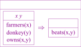
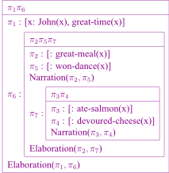

# Discourse Representation Theory
**First published Tue May 22, 2007; substantive revision Thu Jul 11, 2024**

*Geurts, Bart, Beaver, David I., Maier, Emar*

In the early 1980s, Discourse Representation Theory (DRT) was introduced by Hans Kamp as a theoretical framework for dealing with issues in the semantics and pragmatics of anaphora and tense (Kamp 1981a)[^kamp-1981a]; a very similar theory was developed independently by Irene Heim (1982). The distinctive features of DRT, to be discussed below, are that it is a mentalist and representationalist theory of interpretation, and that it is a theory of the interpretation not only of individual sentences but of discourse, as well. In these respects DRT made a clear break with classical formal semantics, which during the 1970s had emanated from Montague’s pioneering work (Montague 1974)[^montague-1974], but in other respects it continued the tradition, e.g., in its use of model-theoretical tools. In the meantime, DRT has come to serve as a framework for explaining a wide range of phenomena, and given rise to numerous extensions, modifications, applications and implementations. We will confine our attention to topics related to philosophical debates, ignoring applications related more to linguistics, logic, or AI.

## 1. Introduction

This article concerns Discourse Representation Theory narrowly defined as work in the tradition descending from Kamp (1981a). The same term is sometimes used more broadly, occasionally embracing Heim’s (1982) work and the developments initiated by Groenendijk and Stokhof (1990, 1991). However, the more common common label for the extended DRT family is “dynamic semantics”, and that is the term we will use, too.

Two features that set DRT apart from other varieties of dynamic semantics is that it is representational and non-compositional. In the 1980s, the founding years of dynamic semantics, these features made DRT a controversial theory, though by now those controversies have abated. DRT’s main innovation, beyond the Montagovian paradigm which was then considered orthodox, is that it introduced a level of mental representations, called “discourse representation structures” (DRSs). The basic idea is rather straightforward. It is that a hearer builds up a mental representation of the discourse as it unfolds, and that every incoming sentence prompts additions to that representation. This picture has always been commonplace in the psychology of language. DRT’s principal tenet is that it should be the starting point for semantic theory, too.

A theory of the DRT family consists of the following ingredients:

- A formal definition of the representation language, consisting of:
- a recursive definition of the set of all well-formed DRSs, and
- a model-theoretic semantics for the members of this set;
- a construction procedure, which specifies how to extend a given DRS when a sentence comes in.

Technically, this is very similar to earlier work in formal semantics, with two exceptions: the interpretation process always takes the previous discourse into account, and the level of semantic representations is claimed to be essential. What has worried some semanticists is not so much the fact that DRSs are mental representations, but that an additional level is needed, and used in ways that render the theory non-compositional; we will return to this issue in Section 7.

## 2. Donkey pronouns

The relationship between a pronoun and its antecedent is one that has received a great deal of attention in linguistics and philosophy. We say that a pronoun is anaphoric, as opposed to deictic, for example, if it depends for its interpretation on an antecedent expression elsewhere in the sentence or the discourse. In some cases the nature of this dependency seems straightforward:

**[1]**

Pedro beats his donkey.

(Here and henceforth we use underlining to highlight the anaphoric links we are currently interested in.) Since “Pedro” is a referential expression, it makes sense, in this case, to say that “his” is a referential term, too, which derives its reference from its antecedent. This construal is plausible enough, but it doesn’t apply across the board:

**[2]**

No farmer beats his donkey.

The term “no farmer” is not a referential expression, so “his” cannot be coreferential with it. Rather, it would seem that, in this case, the relationship between the pronoun and its antecedent is one of **binding**, in the logical sense of the word: “no farmer” and “his” are interpreted as a quantifier and a variable, respectively, and the former binds the latter.

It is fairly obvious that the bound-variable construal of pronouns is subject to syntactic constraints. Most importantly, this type of interpretation requires that the pronoun be **c-commanded** by its antecedent, where c-command is defined as follows:

> *A* c-commands *B* iff *B* is, or is contained in, a sister constituent of *A*’s.

The constituent structure of sentence [2] is [_{S} [_{NP} No farmer][_{VP} beat [_{NP} his donkey]]]. Here the pronoun is contained in the sister of its antecedent, so the c-command constraint is met. In [3] “no farmer” does not c-command “his”, and so we predict, correctly, that the pronoun cannot be bound.

**[3]**

His donkey likes no farmer.

Since the syntactic structure of [1] is identical to that of [2], we might wonder if the pronoun in [1] may not be bound by its antecedent, just as in [2]. If this were possible, there would be two ways of construing the pronoun in [1]: it could function either as a referential term or as a bound variable. There is evidence that this is indeed the case:

**[4a]**

Pedro beats his donkey, and Juan does, too.

**[4b]**

Every farmer beats his donkey, and Juan does, too.

[4a] is ambiguous in a way [4b] is not. Its second conjunct can be construed as saying either that Juan beats his own donkey or that Juan beats Pedro’s donkey. The second conjunct of [4b], by contrast, can only be interpreted as saying that Juan beats his own donkey. If the possessive pronoun in the first conjunct of [4a] can be either referential or a bound variable, the contrast is readily explained.

In large part, the motivation for developing dynamic theories of interpretation, beginning with DRT, was the realization that the dichotomy between referential and bound-variable (occurrences of) pronouns is less natural than one might think—less natural in the sense that some pronouns don’t fit comfortably in either category.

**[5a]**

Pedro owns a donkey.

**[5b]**

It is grey.

What is the relationship between “it” in the second sentence and its antecedent expression in the first? On the one hand, it cannot be coreference. If the pronoun were coreferential with its antecedent, the indefinite “a donkey” would have to be a referential term, which seems unlikely, e.g., because the negation of [5a] says not that there is a donkey that Pedro fails to own, but rather that he doesn’t own any donkey, and furthermore, if [5a] is negated, the anaphoric link between the pronoun and its antecedent is severed:

**[6a]**

Pedro doesn’t own a donkey.

**[6b]**

*It is grey.

(The asterisk indicates that the sentence is infelicitous if “a donkey” is to be interpreted as the antecedent of “it”.) Observations like these suggest rather strongly that indefinites are quantifiers rather than referential terms. However, if we construe “a donkey” as an existential quantifier, how does it manage to bind the pronoun across a sentence boundary?

The problem with [5] is related to the fact that the pronoun and its indefinite antecedent occur in different sentences. The following examples show, however, that similar problems arise within sentences:

**[7a]**

If Pedro owns a donkey, he beats it.

**[7b]**

Every farmer who owns a donkey beats it.

These are the infamous “donkey sentences” that were already discussed by scholastic philosophers, and in modern times were reintroduced into philosophy by Geach (1962). In these cases it is obvious that the pronouns don’t refer, so they can’t be coreferential with their antecedents, either. Nor are the pronouns bound by their antecedents, for they aren’t c-commanded by them. The constituent structure of [7b] is roughly as follows:

> [_{S} [_{NP} Every [_{N} farmer who owns [_{NP} a donkey]]] [_{VP} beats it]]

Whatever the syntactical details, “a donkey” is too deeply embedded for it to c-command “it”. The same goes for [7a]. Hence, the neuter pronouns in [7a,b] cannot be construed as bound variables.

Another way of showing that donkey pronouns are problematic is by considering how we might render these sentences in predicate logic. The most obvious interpretation of [7a] is that Pedro beats every donkey he owns, and [7b] is naturally interpreted as claiming that every farmer beats every donkey he owns. (So, somewhat surprisingly, it appears that the indefinites in these sentences have universal force.) These readings may be captured as follows:

**[9a]**

$\forall x[[\textrm{donkey}(x) \amp \textrm{own}(\textrm{Pedro},x)] \rightarrow \textrm{beat}(\textrm{Pedro},x)]$

**[9b]**

$\forall x \forall y[[\textrm{farmer}(x) \amp \textrm{donkey}(y) \amp \textrm{own}(x,y)] \rightarrow \textrm{beat}(x,y)]$

So the problem is not that predicate logic fails to capture the meanings of [7a] and [7b]. The problem is, rather, how to derive [9a] and [9b] from [7a] and [7b] in a principled way. In order to derive these logical forms, we have to assume not only that an indefinite expression buried in a subordinate position ends up having wide scope, but also that it acquires universal force in the process. A theory based on such assumptions might capture the facts, but it would be clearly ad hoc, and would generate a host of false predictions, as well.

The upshot of the foregoing observations is that, apparently, indefinites are neither quantifiers nor referential terms, and this problem entrains another one, for as long as it is unclear what indefinites mean, it will also remain obscure how they can serve as antecedents to pronouns. Later on we will see that very similar problems arise in seemingly disparate domains, like the interpretation of tense and presuppositions.

## 3. Basic DRT

This section introduces DRT in fairly informal terms. We show how a hearer builds up a mental model of the ongoing discourse, dealing not only with simple sentences, but also with conditionals, quantification, and anaphora, and we discuss DRT’s treatment of indefinites, and how they are set apart from quantifying expressions.

### 3.1 The key ideas

A discourse representation structure (DRS) is a mental representation built up by the hearer as the discourse unfolds. A DRS consists of two parts: a universe of so-called “discourse referents”, which represent the objects under discussion, and a set of DRS-conditions which encode the information that has accumulated on these discourse referents. The following DRS represents the information that there are two individuals, one of which is a farmer, the other a donkey, and that the former chased the latter:

**[1]**

$\cb{[\R{x},\R{y}: \textrm{farmer}(\R{x}),\textrm{donkey}(\R{y}),\textrm{chased}(\R{x},\R{y})]}$

The universe of this DRS contains two discourse referents, $\cb{\R{x}}$ and $\cb{\R{y}},$ and its condition set is $\{\cb{\textrm{farmer}(\R{x}), \textrm{donkey}(\R{y}), \textrm{chased}(\R{x},\R{y})}\}.$

A DRS like the one in [1] can be given a straightforward model-theoretic interpretation. In DRT this is done by means of **embedding functions**, which are partial functions from discourse referents to individuals in a given model $M$; or put otherwise, an embedding function is a partial variable assignment. An embedding function $f$ **verifies** [1] in $M$ iff the domain of $f$ includes at least $\cb{\R{x}}$ and $\cb{\R{y}}$, and according to $M$ it is the case that $f(\cb{\R{x}})$ is a farmer, $f(\cb{\R{y}})$ is a donkey, and $f(\cb{\R{x}})$ chased $f(\cb{\R{y}}).$

Meanwhile it will have become clear that the DRS in [1] is designed to reflect the intuitive meaning of:

**[2]**

A farmer chased a donkey.

Indeed, it is claimed that, in the absence of any information about the context in which this sentence is uttered, [1] is the semantic representation of [2]. So the indefinite expressions “a farmer” and “a donkey” prompt the introduction of two new discourse referents, $\cb{\R{x}}$ and $\cb{\R{y}}$, and contribute the information that $\cb{\R{x}}$ is a farmer and $\cb{\R{y}}$ a donkey, while the verb contributes the information that the former chased the latter.

If a discourse begins with an utterance of [2], the DRS in [1] is constructed, and this DRS forms the background against which the next utterance is interpreted. Suppose now that [2] is followed by a token of [3a]:

**[3a]**

He caught it.

**[3b]**

$\cb{[\ulR{v}, \ulR{w}: \textrm{caught}(\R{v},\R{w})]}$

[3b] is the DRS that reflects the semantic content of [3a] before the pronouns are resolved. In this DRS, the anaphoric pronouns “he” and “it” in [3a] are represented by the discourse referents $\cb{\R{v}}$ and $\cb{\R{w}},$ respectively. These discourse referents are underlined to indicate that they require an antecedent. Since [3a] is uttered in the context of [1], the next step in the interpretation of this sentence is to merge the DRS in [3b] with that in [1]. The result of this merging operation is [4a]:

**[4a]**

$\cb{[\R{x}, \R{y}, \ulR{v}, \ulR{w}: \textrm{farmer}(\R{x}), \textrm{donkey}(\R{y}), \textrm{chased}(\R{x},\R{y}), \textrm{caught}(\R{v},\R{w})]}$

Since [3a] is immediately preceded by [2], the antecedent of “he” is probably (though not necessarily) “a farmer”, while “it” is anaphorically dependent on “a donkey”. At the DRS level, this is represented by equating the discourse referents $\cb{\R{v}}$ and $\cb{\R{w}}$ with $\cb{\R{x}}$ and $\cb{\R{y}}$, respectively. These operations yield [4b], which is equivalent to [4c]. Either DRS is verified in a model $M$ iff $M$ features a farmer who chased and caught a donkey.

**[4b]**

$\cb{ [\R{x}, \R{y}, \R{v}, \R{w}: \R{v} = \R{x}, \R{w} = \R{y}, \textrm{farmer}(x), \textrm{donkey}(\R{y}), \textrm{chased}(\R{x},\R{y}), \textrm{caught}(\R{v},\R{w})] }$

**[4c]**

$\cb{[\R{x}, \R{y}: \textrm{farmer}(\R{x}), \textrm{donkey}(\R{y}), \textrm{chased}(\R{x},\R{y}), \textrm{caught}(\R{x},\R{y})]}$

Thus far, we have only considered DRSs with simple conditions, but in order to account for negated and conditional sentences, say, complex conditions are required.

**[5a]**

Pedro doesn’t have a donkey.

**[5b]**

$\cb{[_{1} \R{x}: \textrm{Pedro}(\R{x}), \neg [_{2} \R{y}: \textrm{donkey}(\R{y}), \textrm{owns}(\R{x},\R{y})] ]}$

[5b] is the sentence DRS corresponding to [5a]. This DRS contains a condition that consists of a DRS prefixed by a negation sign. For ease of reference we will sometimes adorn DRSs with numerical labels, as we have done in [5b], and use these in names like “[5b₁]”, “[5b₂]”, and so on. In general, labeling of DRSs will be top-down and left-to-right, so the main (or principal) DRS will always be number one.

A function $f$ verifies [5b₁] in a model $M$ iff $f$ maps $\cb{\R{x}}$ onto an individual in $M$ which “is a Pedro”, i.e., which is called “Pedro”, and $f$ cannot be extended to a function *g* which verifies [5b₂]. That is to say, no such *g* should map $\cb{\R{y}}$ onto a donkey that Pedro owns.

[5b₂] contains a token of the discourse referent $\cb{\R{x}}$ which is introduced externally, in the DRS in which [5b₂] is embedded, i.e., [5b₁]. Apart from that, [5b₂] also introduces a discourse referent of its own, i.e., $\cb{\R{y}}$, which is associated with the indefinite NP “a donkey”, and whose scope is delimited by [5b₂]. Consequently, it doesn’t make sense to refer to $\cb{\R{y}}$ outside of [5b₂]. In DRT, this is taken to explain why the “lifespan” of the individual introduced by the indefinite NP in [5a] is delimited by the scope of the negation operator. If [5a] were followed by [6a], for example, the pronoun could not be linked to the indefinite:

**[6a]**

It is grey.

**[6b]**

$\cb{[\ulR{z}: \textrm{grey}(\R{z})]}$

**[6c]**

$\cb{[_{1} \R{x}, \ulR{z}: \textrm{Pedro}(\R{x}), \neg [_{2} \R{y}:\textrm{donkey}(\R{y}), \textrm{owns}(\R{x},\R{y})], \textrm{grey}(\R{z})]}$

If we merge [5b] and [6b], which is the sentence DRS corresponding with [6a], we obtain [6c]. In this representation, the discourse referent $\cb{\R{z}}$ does not have access to $\cb{\R{y}}$, because $\cb{\R{y}}$ is introduced in a DRS that is not accessible to the DRS in which $\cb{\R{z}}$ is introduced, and therefore it is not possible to bind $\cb{\R{z}}$ to $\cb{\R{y}}$. In other words, if [6a] is preceded by [5a], the pronoun cannot be anaphorically linked to the indefinite. This prediction appears to be correct.

Accessibility is in the first instance a relation between DRSs; derivatively, it is also a relation between discourse referents. [6c₁] is accessible to [6c₂], but not the other way round, and therefore the discourse referents introduced in [6c₁], i.e., $\cb{\R{x}}$ and $\cb{\R{z}}$, are accessible from [6c₂], but conversely, if we are in [6c₁] we have no access to [6c₂] and its discourse referents, i.e., $\cb{\R{y}}$. Thus in [6c] anaphora is not possible because $\cb{\R{y}}$ is not accessible to $\cb{\R{z}}$. In [4a], by contrast, anaphora is possible, because $\cb{\R{x}}$ and $\cb{\R{y}}$ are accessible to $\cb{\R{v}}$ and $\cb{\R{w}}$ (the accessibility relation being reflexive). The notion of accessibility is crucial to DRT’s account of anaphora, and it is important to note that it is not stipulated, but is entailed by the semantics of the DRS language. [6c₁] is accessible to [6c₂] because every embedding function that must be considered for [6c₂] is an extension of an embedding function for [6c₁], and it is for this reason that every discourse referent in [6c₁] is also defined in [6c₂]. The converse, however, does not hold.

Like negated sentences, conditionals give rise to complex DRS-conditions, too. [7] gives an example:

**[7a]**

If Pedro owns a donkey, he beats it.

**[7b]**

$\cb{[_{1} \R{x}: \textrm{Pedro}(\R{x}), [_{2} \R{y}: \textrm{donkey}(\R{y}), \textrm{owns}(\R{x},\R{y})] \Rightarrow [_3 \ulR{v}, \ulR{w}: \textrm{beats}(\R{v},\R{w})] ]}$

[7b] is the sentence DRS which corresponds to [7a], and assuming for convenience that this sentence is uttered in an empty context, it is also the initial DRS of the discourse. The complex condition in this structure is interpreted as follows: if $f$ is to verify [7b₁] in the current model, then $f(\cb{\R{x}})$ must be an individual called “Pedro”, and every extension of $f$ which verifies [7b₂] must itself be extendable to a function that verifies [7b₃]. It follows from this that [7b₁] is accessible to [7b₂], which in its turn is accessible to [7b₃], and therefore $\cb{\R{v}}$ may be linked up to $\cb{\R{x}}$ (accessibility being a transitive relation) and $\cb{\R{w}}$ to $\cb{\R{y}}$. The result is [7c], which is equivalent to [7d], both DRSs saying that Pedro beats every donkey he owns.

**[7c]**

$\cb{[_1 \R{x}, \R{v}: \R{v} = \R{x}, \textrm{Pedro}(\R{x}),[_{2} \R{y}, \R{w}: \R{w} = \R{y}, \textrm{donkey}(\R{y}), \textrm{owns}(\R{x},\R{y})] \Rightarrow [_{3} : \textrm{beats}(\R{v},\R{w})] ]}$

**[7d]**

$\cb{[_{1} \R{x}: \textrm{Pedro}(\R{x}), [_{2} \R{y}: \textrm{donkey}(\R{y}), \textrm{owns}(\R{x},\R{y})] \Rightarrow [_{3} : \textrm{beats}(\R{x},\R{y})] ]}$

### 3.2 Quantifiers vs. indefinites

The interpretation of quantified donkey sentences is very similar to what we have just seen:

**[8a]**

Every farmer who owns a donkey beats it.

**[8b]**

$\cb{[_{1} : [_{2} \R{x}, \R{y}: \textrm{farmer}(\R{x}), \textrm{donkey}(\R{y}), \textrm{owns}(\R{x},\R{y})](\forall \R{x})[_{3} \ulR{v}, \ulR{w}: \textrm{beats}(\R{v},\R{w})] ])}$

There are two ways of spelling out the interpretation of so-called **duplex conditions** of the form $K(\cb{\forall} x) K'.$ On its weak interpretation, [8a] means that every farmer who owns a donkey beats at least one of the donkeys he owns; on its strong interpretation the sentence says that every farmer beats every donkey he owns. While the strong reading is the most natural choice for [8a], other donkey sentences prefer a weak reading:

**[9]**

Every farmer who owns a tractor uses it to drive to church on Sundays.

The most likely interpretation for [9] to have is that every tractor-owning farmer uses one of their tractors to drive to church.

The distinction between weak and strong interpretations is somewhat mysterious, because it doesn’t seem to be an ordinary ambiguity. For example, donkey sentences with existential quantifiers don’t seem to license strong readings:

**[10]**

Some farmers who own a donkey beat it.

This can only be construed as saying that some donkey-owning farmers beat at least one of their donkeys. More generally, the universally quantified donkey sentences seem to be the only ones to license both interpretations. It is not entirely clear why this should be the case (see Kanazawa 1994; Geurts 2002)[^geurts-2002][^kanazawa-1994].

Whether weak or strong, the interpretation of a condition of the form $K(Qx)K',$ where $Q$ may be any quantifier, makes $K$ accessible to $K',$ and in this respect (which is the fulcrum of the DRT analysis) conditionals and quantified sentences are the same. Consequently, the discourse referents $\cb{\R{x}}$ and $\cb{\R{y}}$ in [8b₂] are accessible to $\cb{\R{v}}$ and $\cb{\R{w}}$ in [8b₃], and the latter may be equated to the former. The resulting representation is [8c], which is equivalent to [8d].

**[8c]**

$\cb{[_{1} : [_{2} \R{x}, \R{y}, \R{v}, \R{w}: \R{v} = \R{x}, \R{w} = \R{y}, \textrm{farmer}(\R{x}), \textrm{donkey}(\R{y}), \textrm{owns}(\R{x},\R{y})](\forall \R{x})[_{3} : \textrm{beats}(\R{v},\R{w})] ]}$

**[8d]**

$\cb{[_{1} : [_{2} \R{x}, \R{y}: \textrm{farmer}(\R{x}), \textrm{donkey}(\R{y}), \textrm{owns}(\R{x},\R{y})](\forall \R{x})[_{3} : \textrm{beats}(\R{x},\R{y})] ]}$

The DRT analysis of quantified expressions like “all” or “most” is fairly standard. A quantifier binds a variable and delivers the truth conditions one should expect. Indefinites are different. An indefinite like “a donkey” is treated not as a quantifier but simply as device for introducing a discourse referent and one or more conditions; on the DRT account, indefinites have no quantifying force of their own. What quantifying force they seem to have is not theirs, but derives from the environment in which they occur. If the semantic material associated with “a donkey” is introduced in the main DRS, as in [4c], the quantifying effect will be existential, owing to the fact that this DRS is verified in a model $M$ iff **there is** a way of verifying it in $M$. If the semantic material associated with “a donkey” is introduced in the antecedent of a conditional, as in [7d], the quantifying effect will be universal, owing to the fact that a condition of the form $K\cb{\Rightarrow} K'$ is verified in $M$ iff **every** way of verifying $K$ can be extended to a way of verifying $K'.$ This view on indefinites lies at the heart of DRT.

DRT was one of the first semantic theories to go beyond the sentence boundary, and take into account how the interpretation of an expression may depend on the preceding discourse. Looking back at the examples discussed in the foregoing, we see that, if the DRT approach is on the right track, sentence boundaries are not as important as the Fregean (or Chomskyan) conception of language would have it. In particular, there is essentially no difference between the DRT analysis of cross-sentential anaphora, as exemplified by the mini-discourse [2]–[3a], and sentence-internal anaphora, as in [7a] or [9a]. In either case, the pronoun simply serves to pick up an accessible discourse referent. This raises the question of how DRT’s new-fangled notion of anaphora relates to the dichotomy between referential and bound-variable pronouns. Curiously, this issue doesn’t seem to have received much attention yet.

### 3.3 One- vs. two-level versions of DRT

In the foregoing we assumed that the contribution of a sentence to the discourse, as represented by a DRS, was obtained in two steps. In the first one, a sentence DRS was constructed in a compositional way; this part of the construction process we took for granted, but its implementation wouldn’t be too difficult. In the second step, the sentence DRS was merged with the DRS representing the prior discourse, and anaphoric references were resolved. This two-stage procedure has become the industrial standard, but the original version of DRT (Kamp 1981a; Kamp & Reyle 1993)[^kamp-1981a][^kamp-1993] was monostratal in the sense that one set of rules took care of both tasks at once. In the meantime, Kamp and his co-workers have adopted the two-step method, too (e.g., Kamp, van Genabith, & Reyle 2011).

In one-level versions of DRT, a single set of rules is used to obtain the semantic contribution of a sentence. To take a simple example, if the sentence is “It is grey”, the first rule to apply will say that the semantic correlate of the subject is an argument to the predicate expressed by “is grey”. Then the two main parts of the sentence are analysed further, and the pronoun “it” triggers a rule which at once deals with the pronoun’s lexical content and its context dependence; i.e., it says that we must select a new discourse referent, link it to a discourse referent made available by the preceding discourse, and update the DRS so as to record these changes. In two-level versions of DRT there is no such rule. Its duties are divided between two separate mechanisms. In the first stage, a separate DRS is constructed for the sentence, in which pronouns prompt the introduction of new discourse referents that are marked as being anaphoric (we use underlining for this purpose). In the second stage, there is a general mechanism for dealing with discourse referents thus marked.

The distinction between one- and two-level versions of DRT is of interest for at least two reasons. First, once we go beyond basic DRT, the two-stage system may actually be more economical overall. For example, if DRT is extended for dealing with presuppositions (see Section 5), the one-pass approach becomes unwieldy. Secondly, and perhaps more importantly, two-stage theories may be viewed as implementing a distinction between semantics and pragmatics which has some prima facie plausibility: in the first stage a representation is computed which is projected from the sentence’s lexico-grammatical structure, while in the second stage, context-dependent aspects of meaning are dealt with. This division of labor is reminiscent of the traditional dichotomy between compositional semantics and non-compositional pragmatics, but it should be noted that the two do not coincide. Usually, the “semantical” part of a two-stage version of DRT is not compositional in the Fregean sense, because its output is essentially incomplete; it may contain anaphoric “gaps”, for example. Therefore, even if a sentence DRS admits of a truth-conditional interpretation, it will typically fall short of capturing everything that is conventionally thought to belong to truth-conditional content.

## 4. The DRS language: syntax, semantics, accessibility

In this section we give a more precise description of the DRS language than we have done so far. We define the syntax of the language, present a model-theoretic interpretation, and discuss the notion of accessibility, which figures so prominently in DRT’s account of anaphora.

### 4.1 Syntax

DRSs are set-theoretic objects built from **discourse referents** and **DRS-conditions**. A DRS-condition is either atomic, in which case it consists of a predicate and a suitable number of discourse referents, or complex, in which case it embeds one or two DRSs. Hence, the definition of the DRS language is by simultaneous recursion:

**DRSs and DRS-conditions**

A DRS $K$ is a pair $\langle U_K, \textit{Con}_K\rangle$, where $U_K$ is a set of discourse referents, and $\textit{Con}_K$ is a set of DRS-conditions. If $P$ is an n-place predicate, and $x_1, \ldots, x_n$ are discourse referents, then $P(x_1, \ldots, x_n)$ is a DRS-condition. If $x$ and $y$ are discourse referents, then $x \cb{=} y$ is a DRS-condition. If $K$ and $K'$ are DRSs, then $\cb{\neg} K,$ $K \cb{\Rightarrow} K',$ and $K \cb{\lor } K'$ are DRS-conditions. If $K$ and $K'$ are DRSs and $x$ is a discourse referent, then $K(\cb{\forall} x )K'$ is a DRS-condition.

Note that there are no conditions corresponding to conjoined sentences. Such sentences are dealt with, rather, by merging the DRSs associated with their parts, where the merge of two DRSs $K$ and $K'$ is defined as their pointwise union:

**DRS-merge**

$K\oplus K' = \langle U_{K} \cup U_{K'}, \textit{Con}_{K} \cup \textit{Con}_{K'}\rangle$

The merge operation is also used for combining a sentence DRS with the DRS representing the preceding discourse, so the idea is that there is no principled distinction between (clausal) conjunction and sentence concatenation (see Muskens 1996 for discussion)[^muskens-1996].

Officially, DRSs are set-theoretical objects, but in this article we use a linear notation. Many sources, including Kamp’s own work, employ a graphical “box notation” which is sometimes clearer, but less parsimonious and more difficult to type. To illustrate the various schemes, here are three ways of representing the content of a conditional donkey sentence:

**Official DRS:**

$\cb{\langle \{\}, \{\langle \{\R{x}, \R{y}\}, \{\textrm{farmer}(\R{x}), \textrm{donkey}(\R{y}), \textrm{owns}(\R{x},\R{y})\}\rangle \Rightarrow \langle \{\}, \{\textrm{beats}(\R{x},\R{y})\}\rangle \} \rangle }$

**Linear notation:**

$\cb{[: [\R{x}, \R{y}: \textrm{farmer}(\R{x}), \textrm{donkey}(\R{y}), \textrm{owns}(\R{x},\R{y})] \Rightarrow [: \textrm{beats}(\R{x},\R{y})]]}$

**Box notation:**

The choice between these formats is one of convenience, and does not have any theoretical significance.

### 4.2 Accessibility

Accessibility is a relation between DRSs that is transitive and reflexive, i.e., it is a preorder. More in particular, it is the smallest preorder for which the following holds, for all DRSs $K$, $K'$, and $K''$: if $\textit{Con}_{K}$ contains a condition of the form …

- $\cb{\neg} K',$ then $K$ is accessible to $K'$
- $K'\cb{\lor} K'',$ then $K$ is accessible to $K'$ and $K''$
- $K' \cb{\rightarrow} K''$, then $K$ is accessible to $K'$ and $K'$ is accessible to $K''$
- $K'(\cb{\forall} x)K''$, then $K$ is accessible to $K'$ and $K'$ is accessible to $K''$

To illustrate, in the following schematic representations, every DRS is accessible to all and only those DRSs whose number doesn’t precede its own (so every DRS is accessible to itself):

- $\cb{[_{1} \ldots [_{2} \ldots ](\forall x)[_{3} \ldots \neg [_{4} \ldots ] ] ]}$
- $\cb{[_{1} \ldots [_{2} \ldots ] \rightarrow [_{3} \ldots \neg [_{4} \ldots ] ] ]}$

The **accessible domain** of a DRS $K,$ $A_{K},$ is the set of discourse referents that occur in some $K'$ that is accessible to $K$, i.e., $A_{K} = \{x : K'$ is accessible to $K$ and $x \in U_{K'}\}.$ The main constraint which DRT imposes on the interpretation of anaphora is this:

**Accessibility constraint**

A pronoun is represented by a discourse referent $x$ which must be equated to some discourse referent $y \in A_{K},$ where $K$ is the DRS in which $x$ is introduced.

It is important to note that neither the notion of accessibility nor the accessibility constraint need be stipulated. For, as we will presently see, both follow from the way the DRS language is interpreted (cf. the notion of variable binding in standard predicate logic). Thus, we are not at liberty to modify the accessibility relation, should we wish to do so, unless we simultaneously revise the truth conditions associated with the DRS language. The accessibility constraint is a semantic one.

As discussed in Section 2, the main syntactic constraint on bound-variable pronouns is that they be c-commanded by their antecedents. The domain of the accessibility constraint overlaps with that of the c-command constraint, but it is wider. For one thing, sentence boundaries don’t affect accessibility. For another, within the confines of a sentence, the semantic correlate of an expression $E_{1}$ may be accessible to that of $E_{2},$ even if $E_{1}$ doesn’t c-command $E_{2}.$ To illustrate this point, consider the conditional donkey sentence in [1a] and its sentence DRS in [1b]:

**[1a]**

$[_{S} [_{S} \textrm{ If} [_{S} [_{\textrm{NP}} \textrm{a farmer}] [_{\textrm{VP}} \textrm{owns a donkey}]] [_{S} \textrm{he beats it}]\,]$

**[1b]**

$\cb{[_{1} : [_{2} \R{x}, \R{y}: \textrm{farmer}(\R{x}), \textrm{donkey}(\R{y}), \textrm{owns}(\R{x},\R{y})] \Rightarrow [_{3} \R{u}, \R{v}: \textrm{beats}(\R{u},\R{v})] ]}$

Syntactically speaking, neither “a farmer” nor “a donkey” can bind (in the sense of Chomsky 1986)[^chomsky-1986] an expression beyond the smallest clause in which they occur. In particular, neither can bind any of the pronouns in the main clause of [1a]. But the discourse referents associated with these indefinites, i.e., $\cb{\R{x}}$ and $\cb{\R{y}}$, are in the accessible domain of [1b₃], and therefore the anaphoric discourse referents in this embedded DRS can be linked to $\cb{\R{x}}$ and $\cb{\R{y}}$. Put otherwise, they are bindable at a semantic but not at a syntactic level.

### 4.3 Semantics

The truth-conditional semantics of the DRS language is given by defining when an embedding function **verifies** a DRS in a given model. An embedding function is a partial mapping from discourse referents to individuals. Given two embedding functions $f$ and $g$ and a DRS $K$, we say that $g$ extends $f$ with respect to $K$, or $f[K]g$ for short, iff $\textit{Dom}(g) = \textit{Dom}(f) \cup U_{K},$ and for all $x$ in $\textit{Dom}(f): f(x) = g(x).$ Viewing functions as set-theoretic objects, this can be formulated more succinctly as follows:

$f[K]g$ iff $f \subset g$ and $\textit{Dom}(g) = \textit{Dom}(f) \cup U_{K}$

In the following we define what it takes for an embedding function to verify a DRS or DRS-condition in a given model. As usual, a model $M$ is a pair $\langle D,I\rangle,$ where $D$ is a set of individuals, and *I* is an interpretation function that assigns sets of individuals to one-place predicates, sets of pairs to two-place predicates, and so on. To enhance the legibility of our definition somewhat we omit the qualifier “in $M$” throughout:

**Verifying embeddings**

$f$ verifies a DRS $K$ iff $f$ verifies all conditions in $\textit{Con}_{K}.$ $f$ verifies $P(x_{1}, \ldots , x_{n})$ iff $\langle f(x_{1}),$ …, $f(x_{n})\rangle \in I(P).$ $f$ verifies $x\cb{=}y$ iff $f(x) = f(y).$ $f$ verifies $\cb{\neg }K$ iff there is no $g$ such that $f[K]g$ and $g$ verifies $K.$ $f$ verifies $K\cb{\lor }K'$ iff there is a $g$ such that $f[K]g$ and $g$ verifies $K$ or $K'.$ $f$ verifies $K\cb{\Rightarrow }K'$ iff, for all $f[K]g$ such that $g$ verifies $K$, there is an $h$ such that $g[K']h$ and $h$ verifies $K'.$ $f$ verifies $K(\cb{\forall} x)K'$ iff, for all individuals $d \in D_{M}$ and for all $f[K]g$ such that $g(x) = d$ and $g$ verifies $K$, every $h$ such that $g[K']h$ verifies $K'.$

The last clause gives a strong interpretation to universal duplex conditions (cf. Section 3.2); the weak interpretation is obtainable as follows:

- $f$ verifies $K(\cb{\forall }x)K'$ iff, for all individuals $d \in D_{M}$ for which there is a $g$ such that $f[K]g,$ $g(x) = d,$ and $g$ verifies $K$, there is an $h$ such that $g$[K']h\) and $h$ verifies $K'.$

A DRS is true in a given model iff we can find a verifying embedding for it, as follows:

**Truth**

A DRS $K$ is true in a model $M$ iff there is an embedding function $f$ such that $\textit{Dom}(f) = U_{K}$ and $f$ verifies $K$ in $M$.

To see how accessibility follows from these definitions, the critical junctures are the points at which extensions of embedding functions are called for. For example, consider a schematic DRS with a conditional in it:

**[2]**

$\cb{[\R{x}: \R{A}(\R{x}), [\R{y}: \R{B}(\R{x},\R{y})] \rightarrow [\R{z}: \R{C}(\R{x},\R{y},\R{z})] ]}$

This DRS is true iff we can find an embedding function $f$, $\textit{Dom}(f) = {\cb{\R{x}}},$ which verifies all conditions in [2], which is to say that $f(\cb{\R{x}})$ must be an $\cb{\R{A}},$ and $f$ verifies the complex condition $\cb{[y: \R{B}(\R{x},\R{y})] \rightarrow [\R{z}: \R{C}(\R{x},\R{y},\R{z})]}.$ The latter requirement is met iff every extension $g$ of $f$, $\textit{Dom}(g) = \{\cb{\R{x},\R{y}\}},$ such that $g$ verifies $\cb{[\R{y}: \R{B}(\R{x},\R{y})]}$ can be extended to a function $h, \textit{Dom}(h) = {\cb{\R{x},\R{y},\R{z}}},$ such that $h$ verifies $\cb{[\R{z}: \R{C}(\R{x},\R{y},\R{z})]}.$ Hence, no matter how we choose $g$, $g(\cb{\R{x}})$ must be the same individual as $f(\cb{\R{x}},$) and for any $g,$ no matter how we choose $h,$ $h(\cb{\R{x}})$ and $h(\cb{\R{y}})$ must be the same as $g(\cb{\R{x}})$ and $g(\cb{\R{y}}),$ respectively. This is why $\cb{\R{x}}$ is in the accessible domain associated with the antecedent of the conditional, and why $\cb{\R{y}}$ is in the accessible domain associated with the consequent.

## 5. Applications and extensions

Having focussed thus far on the interpretation of anaphoric pronouns, the purpose of this section is to illustrate how the ideas lying at the heart of DRT have been applied to other phenomena. We will restrict ourselves to three topics: tense, presupposition, and propositional attitudes. In the first two cases, we will encounter interpretative dependencies reminiscent of the dependency relation between an anaphor and its antecedent, and we will describe, if only in outline, how basic DRT has been extended so as to capture the similarities. DRT’s representationalism comes into its own in its treatment of attitudes and attitude ascriptions, which is the third topic on our list. In section 6 we introduce SDRT, a significant extension of the DRT framework designed to model discourse structure more accurately.

### 5.1 Tense

Historically, the original ideas behind DRT grew out of Kamp’s earlier work on tense logic (Kamp 1971)[^kamp-1971] and the apparent inability of such static systems to adequately capture the interpretation of tense and aspect in natural language discourse (Kamp 1981b [2017])[^kamp-1981b]. Crucially, as Partee (1973) had already pointed out, there are systematic parallels between tenses and pronouns, and, as Partee (1984) herself also showed, these parallels can be adequately captured in a DRT framework. In the following we will briefly discuss some of Partee’s observations, and outline a DRT treatment.

**[1a]**

Pedro owns a donkey. He beats it.

**[1b]**

Yesterday, Pedro tried to kiss Juanita. She slapped him.

Intuitively, the indefinite description “a donkey” in the opening sentence of [1a] serves to introduce an entity that is subsequently picked up by the pronoun “it” in the second sentence, and the DRT account of indefinites and pronouns seeks to formalize this intuitive picture. [1b] shows that a very similar phenomenon occurs in the temporal domain, for in this case it is natural to construe the past tense of the second sentence as being anaphorically dependent on the content of the first: presumably, Juanita slapped Pedro right after he tried to kiss her. In order to capture this idea, DRT adopts an event-based semantics, treating events as semantic values of a designated class of discourse referents. Sentences are now construed like indefinite descriptions in that they, too, serve to introduce discourse referents. For example, the first sentence in [1b] introduces a discourse referent of the event type that represents Pedro’s attempting to kiss Juanita, and the tense morpheme in “slapped” is construed as referring back, very much like an anaphoric pronoun, to that event: by default, the time of Juanita’s slapping Pedro will be taken to be immediately after the time of him trying to kiss her.

Our second example involves what one might call “donkey tense”:

**[2a]**

Every farmer who owns a donkey beats it.

**[2b]**

Whenever Pedro tried to kiss Juanita, she slapped him.

In an event-based semantics, it is natural to construe [2b] as quantifying over events, just like [2a] quantifies over individuals. In conjunction with the DRT treatment of quantification, this allows us to interpret the tense in “slapped” as referring back to the event introduced in the subordinate clause, along the following lines (where $\cb{\rar}$ stands for the “right after” relation, $\cb{\ul{\R{e}}''}$ is the variable introduced by the tense in “slapped”, and its underlining indicates that it requires an antecedent):

**[3a]**

$\cb{[\R{x}, \R{y}: \textrm{Pedro}(\R{x}), \textrm{Juanita}(\R{y}),}$

$\cb{[\R{e}: \textrm{try-to-kiss}(\R{e},\R{x},\R{y})](\forall \R{e})[\R{e}', \ul{\R{e}}'' : \R{e}'' \rar \R{e}', \textrm{slap}(\R{e}',\R{y},\R{x})] ]}$

**[3b]**

$\cb{[\R{x}, \R{y}: \textrm{Pedro}(\R{x}), \textrm{Juanita}(y),}$

$\cb{[\R{e}: \textrm{try-to-kiss}(\R{e},\R{x},\R{y})](\forall \R{e})[\R{e}': \R{e} \rar \R{e}', \textrm{slap}(\R{e}',\R{y},\R{x})] ]}$

In [3a] the past tense in “slapped” introduces an anaphoric element, which can be bound in the restrictor of the quantifier, just as an ordinary donkey pronoun might be bound. The result, after a minor simplification, is [3b], which says that every event $\cb{\R{e}}$ of Pedro trying to kiss Juanita is immediately followed by an event $\cb{\R{e}'}$ of her slapping him. Note that, although this DRS captures the most natural interpretation of the past tense in “slapped”, it leaves the past tense in “tried” unaccounted for. But this is as it should be, for if tense is anaphoric, then that tense, too, should be linked to a salient time point, which seems to be right: in the absence of a context that furnishes such a time, [2b] is simply infelicitous; it is like saying “He is handsome” when it is not clear whom the pronoun is intended to refer to.

### 5.2 Presupposition

Presuppositions are chunks of information associated with particular lexical items or syntactic constructions. There are many such items and constructions, and the following is just a small selection:

**Factive verbs**

[4a] Juan knows that Pedro beats his donkey.

**[4b]**

Pedro beats his donkey.

**It-clefts**

[5a] It’s in the stable that Pedro beats his donkey.

**[5b]**

Pedro beats his donkey.

**Definites**

[6a] Pedro beats his donkey.

**[6b]**

Pedro has a donkey.

Someone who utters any of the [a] sentences commits himself to the truth of the respective [b] sentence. Of course, this does nothing to distinguish presuppositions from ordinary entailments, but the difference becomes apparent when we embed presuppositional expressions or constructions in non-entailing environments, as in:

**[7a]**

It isn’t in the stable that Pedro beats his donkey.

**[7b]**

Maybe it’s in the stable that Pedro beats his donkey.

Here [5a] is embedded in the scope of a negation and a modal operator, respectively, and it appears that these sentences commit a speaker to the truth of [5b] just as much as [5a] does. This behavior sets presuppositions apart from ordinary entailments.

Generally speaking, presuppositions tend to escape from **any** embedded position in the sense that, if a sentence *S* contains a presupposition-inducing expression *P*, an utterance of *S* will usually imply that *P* holds. This is only generally speaking, because this rule, though correct in the majority of cases, does not hold without exceptions:

**[8a]**

It may be that Pedro is a mean farmer, and that he beats his donkey.

**[8b]**

It may be that Pedro has a donkey, and that he beats his donkey.

**[9a]**

If Pedro is a mean farmer, he beats his donkey.

**[9b]**

If Pedro has a donkey, he beats his donkey.

While the [a] sentences would normally commit a speaker to the claim that Pedro has a donkey, the same does not hold for the [b] sentences. It appears, therefore, that presuppositions are typically though not invariably inherited by the sentences in which they occur. This is the so-called “projection problem” for presuppositions.

Considering that anaphora and presupposition were widely discussed from the late 1960s onward, it took a remarkably long time before it was discovered that, in some respects at least, the two phenomena are very similar (van der Sandt 1992; Kripke 2009)[^kripke-2009][^sandt-1992]. To see how, consider the following pairs:

**[10a]**

Pedro owns a donkey. Juan knows {it / that he owns a donkey}.

**[10b]**

If Pedro owns a donkey, Juan knows {it / that he owns a donkey}.

**[10c]**

Every farmer who owns a donkey knows {it / that he owns a donkey}.

It is true that the variants with the “that”-complements are slightly odd, but actually the fact that they are proves the point we want to make; for it is clear that, in these examples, the pronoun “it” and the clause “that he owns a donkey” perform the same duty, and if the latter sounds somewhat off it is presumably because the former does the job just as well.

While the factive verb “know” triggers the presupposition that its clausal complement is true, this presupposition is neutralized in [10b] and [10c]. If presuppositions behave similarly to anaphoric pronouns, it is clear why that should be so: in both cases, the presupposition is **bound** sentence-internally, just like the neuter pronoun is bound.

Presupposed information is information that is presented as given, and according to the so-called “binding theory” of presupposition this means that presuppositions want to have discourse referents to bind to (van der Sandt 1992; Geurts 1999)[^geurts-1999][^sandt-1992]. However, whereas anaphoric pronouns are rarely interpretable in the absence of a suitable antecedent, the same does not hold for all presupposition-inducing expressions. For instance, a speaker may felicitously assert that she met “Pedro’s sister” even if she knows full well that her audience wasn’t aware that Pedro has a sister. In such cases, Karttunen (1974) and Stalnaker (1974) suggested, presuppositions are generally **accommodated**, which is to say that the hearer accepts the information as given, and revises his representation of the context accordingly. Accommodation, thus understood, is a form of exploitation in Grice’s sense: the purpose of presuppositional expressions is to signal that this or that information is given, and if some information is new but not particularly interesting or controversial (like the fact that somebody has a sister) the speaker may choose to “get it out of the way” by presuppositional means.

The binding theory incorporates the notion of accommodation as follows. Presuppositions, according to the theory, introduce information that prefers to be linked to discourse referents that are already available in the DRS, and in this respect they are like pronouns. However, if a suitable discourse referent is not available, a new one will be accommodated, and the presupposition is linked to that. Generally speaking, accommodation is not an option in the interpretation of pronouns, and a possible reason for this is that a pronoun’s descriptive content is relatively poor. Being told that “she” is wonderful is not particularly helpful if it isn’t clear who the pronoun is meant to refer to. By contrast, if the speaker refers to “Pedro’s sister” there is more to go on, and accommodation becomes feasible. Hence, the binding theory views pronouns as a special class of presuppositional expressions. While all presupposition triggers prefer to be bound, pronouns almost always must be bound. According to the binding theory, this is because pronouns are descriptively attenuated, and therefore cannot be construed by way of accommodation.

In addition to the classic examples of presupposition triggers, the binding theory of presupposition in DRT has been applied to a variety of constructions that are not traditionally classified as presupposition triggers, including proper names (Geurts 1997)[^geurts-1997], indexicals (Hunter 2013)[^hunter-2013], and quotation (Geurts & Maier 2005)[^geurts-2005]. Arguments in each case involve pointing out examples of the characteristic presuppositional behaviors. For proper names, for instance, Geurts gives [11] as a case of donkey binding:

**[11]**

If a child is christened “Bambi” and Disney Inc. find out about it, they will sue Bambi’s parents (Geurts 1997)[^geurts-1997]

Geurts takes examples like these to support an analysis where a name is analyzed as triggering the presupposition that there is someone named thus. This analysis amounts to a form of descriptivism (names function like definite descriptions, in this case descriptions of the form “the person named so-and-so”). As such, it runs afoul of Kripke’s (1980) well-known anti-descriptivist argumentation, i.e., that we incorrectly predict the following two statements, uttered out of the blue, to be synonymous.

**[12a]**

Pedro is named “Pedro”.

**[12b]**

The person named “Pedro” is named “Pedro”.

As Kripke observes, while [12a] expresses a contingent truth (his parents might have changed their mind), [12b] is, or at least has a reading that is, (weakly) necessary, which shows that these sentences, and hence the name and the description, are not equivalent. Similar arguments apply to indexicals and their descriptive/presuppositional counterparts (“I” is not equivalent to “the speaker”). DRT solutions to this Kripkean challenge by Geurts & Maier (2013), Maier (2009a), and Hunter (2013) all involve adding distinct layers or levels to the DRS language in which certain discourse referents and conditions are evaluated with respect to the actual context of utterance (Kaplan 1989)[^kaplan-1989] and thus effectively rigidified. Kamp (2015) provides a more drastic overhaul of the DRT framework to capture the semantics and pragmatics of proper names in a broader mentalistic account of attitudinal states, to which we turn now.

### 5.3 Attitudes and attitude ascriptions

Propositional attitudes (mental states like belief, desire, or imagination) and attitude ascriptions (sentences like “John thinks/hopes that Mary likes him”) have been a rich source of philosophical puzzles. DRT’s representationalism offers fresh solutions to some of them.

A central issue in the philosophical/semantic analysis of attitudes is that of logical omniscience: humans are cognitively limited agents, and are not aware of all the consequences of their beliefs and desires. On this basis, Kamp (1990) argues that the objects of thought should not be seen as purely model-theoretic entities, for example a set of belief worlds, as is common in logics of belief from Hintikka (1962) onward. Rather, the logic of belief and other attitudes must involve structured mental representations. The problem of logical omniscience is then resolved in terms of the failure of human agents to perform logically complete computations over these representations. Modeling the objects of attitudes in this way, as representational entities, allows us to make the fine distinctions necessary to distinguish between believing that it is raining and believing that if it is not raining then 37 is not prime. However, traditional versions of such a sententialist or Language-of-Thought approach to omniscience typically run into the problem of intentionality: to be useful to us, our attitudes must somehow be about the external world we live in, so we still have to explain how these syntactic representations connect with reality. In a Hintikka-style possible worlds semantics the link between world and attitude is hardwired into the semantics: believing that John is happy means that the agent takes the actual world to be an element of the set of worlds where John is happy. The DRT approach combines these two strategies: use the classic, model-theoretic semantics of the DRS language to cash out intentionality in terms of possible worlds, but hold on to the representational level to model resource-bounded computations in practical reasoning.

A special type of intentionality is that of singular or *de re* attitudes: beliefs and desires that directly involve objects in the external world that the attitude holder is acquainted with. To capture such attitudes, Kamp (1990) introduces anchors. An internal anchor is a descriptive mode of presentation, in the form of a DRS with a distinguished discourse referent, while an external anchor maps that discourse referent to an actual individual. A full-fledged entity representation comprises an internal and an external anchor, and is a construct closely related to the Mental Files of Récanati (2012).

A complete mental state representation then consists of

1. a set of internal anchors and attitude descriptions, each consisting of a DRS paired with a mode indicator (e.g., $\cb{\textrm{ANCH}},$ $\cb{\textrm{BEL}},$ $\cb{\textrm{DES}})$ and possibly sharing discourse referents, and
2. an external anchor mapping the internally anchored discourse referents to objects of acquaintance.

By way of illustration, the mental state representation below describes my *de re* belief that this cup $c$ I’m holding now contains coffee, along with the desire that it is still warm:

**[13a]**

internal mental state: $$\cb{\begin{multline} \{ \langle \textrm{ANCH } \R{x}, [\R{x}: \textrm{cup}(\R{x}), \textrm{hold}(\R{i},\R{x})]\rangle ,\\ \langle \textrm{BEL}, [\R{y}: \textrm{contains}(\R{x},\R{y}), \textrm{coffee}(\R{y})]\rangle ,\\ \langle \textrm{DES}, [: \textrm{warm}(\R{y})]\rangle \} \end{multline}}$$

**[13b]**

external anchor: $\cb{\{\langle \R{x},c\rangle \}}$

Compartmentalized mental state representations with entity representations like in [13] have been turned into semantic theories of attitude ascriptions and used to solve a variety of familiar philosophical puzzles, such as those involving Kripke’s (1979) Pierre who believes Londres is pretty but London is not (i.e., puzzles involving “double vision”, see Asher 1986; Kamp 2015)[^asher-1986][^kamp-2015], Geach’s (1967) Hob who believes a witch killed his cow while Nob believes she, the same witch, blighted his mare (i.e., puzzles of intentional identity, see Asher 1987)[^asher-1987], and Karttunen’s (1973) examples of presuppositions triggered under non-doxastic attitude verbs but filtered out by doxastic ones (i.e., puzzles involving parasitic attitudes, see Maier 2015)[^maier-2015]. Other applications of what Kamp calls Mental State DRT (MSDRT) include semantic analyses of specific indefinites (Kamp & Bende-Farkas 2019)[^kamp-2019] and reference to fictional entities (Maier 2017; Kamp 2021)[^kamp-2021][^maier-2017]. All of the semantic analyses listed above exploit the dual nature of DRT, i.e., they use both the representational level (featuring (in)accessible discourse referents, embedded DRS’s, presupposition accommodation, etc.) and the model-theoretic semantics (featuring entities, possible worlds, contexts etc.)

## 6. Discourse relations in SDRT

We’ve seen in section 3 and section 4 above how anaphora resolution is constrained by accessibility. But there are many other factors that play a role in the resolution process, from local, grammatical factors like subject antecedents being generally more prominent than object antecedents in pronoun resolution, to more global, discourse structural factors. Focusing on the latter, Hobbs (1979) argues that the interpreter’s desire to create a maximally coherent interpretation will often play a decisive role in choosing between multiple accessible antecedents for a pronoun, as he illustrates with the following contrast:

**[1a]**

John can open Bill’s safe. He knows the combination.

**[1b]**

John can open Bill’s safe. He’ll have to change the combination soon.

In [1a] the pronoun binds to John, because that delivers the most coherent interpretation of the two-sentence discourse as a whole. In [1b], by contrast, the pronoun is bound to Bill. This difference corresponds to a difference in the kind of coherence relations exemplified by the two discourses: [1a] exemplifies a coherence relation known as Elaboration, while [1b] is an instance of Result. That discourse relations play an important role in discourse interpretation is shown by examples like [2] (again from Hobbs 1979)[^hobbs-1979].

**[2]**

John took a train from Paris to Istanbul. He likes spinach.

Reading [2] you might wonder if Turkish spinach is really that much better than what you can get in France, which shows to what lengths we go to accommodate a suitable coherence relation, in this case Explanation, before we give up our quest for a coherent interpretation.

Asher and Lascarides (2003) take the idea that pronoun resolution and the inference of coherence relations between discourse units are closely related processes as the starting point for their Segmented Discourse Representation Theory (SDRT), combining DRT with insights from discourse coherence theories like Hobbs’s. SDRT assumes a set of discourse relations (Narration, Result, Contrast, Explanation, Elaboration, Correction, to name a few) that we may infer to connect the propositions expressed by the individual sentences (or clauses), in order to create a maximally coherent interpretation of the discourse as a whole. Different types of discourse relations may lead to discourse structural configurations that impose different constraints on anaphora resolution over and above DRT’s accessibility. Take the example in [3] (Asher & Lascarides 2003)[^asher-2003].

**[3a]**

John had a great evening last night.

**[3b]**

He had a great meal.

**[3c]**

He ate salmon.

**[3d]**

He devoured lots of cheese.

**[3e]**

He won a dancing competition.

**[3f]**

??It was a beautiful pink.

In standard DRT the salmon introduced in [3c] would provide a suitable and accessible antecedent for the pronoun in [3f], but in fact this resolution appears to be unavailable. SDRT explains this observation in terms of a discourse structural constraint known as the Right Frontier Constraint (Polanyi 1988)[^polanyi-1988]. This constraint is best illustrated by drawing a discourse structure graph like the one below. A horizontal arrow in this graph indicates a coordinating discourse relation (where neither relatum dominates the other), in this case Narration. A vertical arrow indicates a subordinating discourse relation (where a nucleus dominates a satellite), in this case Elaboration.

Figure 1 [An extended description of figure 1 is in the supplement.]

SDRT’s version of the Right Frontier Constraint says that the pronoun in [3f] can only find an antecedent introduced in the node that was just introduced ([3e]), or one that dominates it ([3a]).

More formally, an SDRS consists of such a discourse structure graph, where each vertex corresponds to a discourse relation and each node to a DRS. A common SDRS notation extends the familiar box notation of DRT (see section 4) with labels for elementary and complex discourse units:

Figure 2 [An extended description of figure 2 is in the supplement.]

Anaphora and presupposition resolution rely on a modified notion of accessibility that incorporates the Right Frontier Constraint (Polanyi 1988)[^polanyi-1988]. The model-theoretic interpretation of an SDRS is built around a set of special interpretation rules for the various discourse relations. Narration for instance comes with a semantic interpretation rule that states that the both relata hold and moreover the main events they introduce stand in a relation of temporal progression. Some notational shortcuts: $K{\pi}$ is the DRS associated with label $\pi$ (i.e. the $K$ such that $\pi : K$ occurs somewhere in the SDRS); $e_{\pi}$ is the unique event discourse referent that occurs in $U(K_{\pi})$ (for readability we left out event referents from the example SDRS above, but for the purpose of modelling narrative temporal progression in SDRT we should treat every verb phrase as introducing an event discourse referent).

> $f$ verifies $\cb{\textrm{Narration}(\pi_{1},\pi_{2})}$ iff there is an embedding function $g$ such that $f[K_{\cb{\pi_1}}]g$ and $g$ verifies $K_{\cb{\pi_1}},$ and there is an embedding $h$ such that $g[K_{\cb{\pi_2}}]h$ and $h$ verifies $K_{\cb{\pi_2}}$ and moreover $h(e_{\cb{\pi_1}}) \rar h(e_{\cb{\pi_2}})$

Although we’re treating SDRT here as an extension of DRT, the theory of discourse structure it provides is entirely compatible with other forms of dynamic semantics providing the contents of the elementary discourse units. In fact, SDRT does not even require those units to be linguistic in nature—as long as we’re interpreting sequences of discourse units that express propositional contents and introduce discourse referents for events and individuals. The framework has thus proved useful for studying multimodal discourse like speech-plus-gesture (Lascarides &Stone 2009)[^lascarides-2009], text-plus-emoji (Maier 2023)[^maier-2023], or even primarily visual narratives like comics and film (Bateman &Wildfeuer 2014)[^bateman-2014].

## 7. Representationalism and compositionality

DRT is a representational theory of interpretation. In the DRT framework, sentences have meanings, if at all, only in a derivative sense: a sentence prompts the hearer to modify his DRS, and it is DRSs that have a truth-conditional interpretation. Thus, a sentence causes a DRS $K_{i}$ to be transformed into a DRS $K_{i+1}$ (usually, though not invariably, the process will consist in adding information to $K_{i}$), and at a remove there is an associated transition at the semantical level, from $K_{i}$’s interpretation to $K_{i+1}$’s. Hence, if we could cut out the representational middleman, we would have a theory that defines sentence meaning in dynamic terms, as a transition from one semantic object to another. Thus arises the question of whether or not the representational level can be dispensed with. Kamp (1981a) claimed that representations were essential to his **ur**-version of DRT, which was a subset of our basic DRT, but in the meantime he was proved wrong by a slew of dynamic theories that recast classical DRT in purely semantical terms: Barwise (1987), Rooth (1987), Groenendijk and Stokhof (1990, 1991), Muskens (1996), and many more. However, Kamp’s claim still holds for various extensions of classical DRT, like the theories of presupposition and attitude ascription discussed in the foregoing.

These theories are allegedly “non-representational”, but what exactly does that mean? Consider, for example, Groenendijk and Stokhof’s (1991) Dynamic Predicate Logic (DPL), which provides a dynamic semantics for the language of classical predicate logic, in which “Pedro owns a donkey and beats it” may be rendered as follows:

**[1]**

$\exists x [\textrm{donkey}(x) \amp \textrm{own}(\textrm{Pedro},x)] \amp \textrm{beat}(\textrm{Pedro},x)$

DPL’s semantics ensures that, unlike in classical logic, the last occurrence of $x$ is bound by the existential quantifier. The way this works is that DPL analyzes sentence meanings in terms of variable assignments, which are manipulated by the logical constants in such as way that [1] is true in a model $M$ iff $M$’s domain features an individual which, when assigned to the variable $x,$ makes each of the atomic sentences in [1] come out true in $M$. Formally, this is implemented by stipulating that the meaning of a sentence is a relation between variable assignments.

A variable assignment is a mapping from variables to individuals, and variables are linguistic expressions, so it can hardly be claimed that assignments are non-representational entities. Therefore, it is a bit puzzling that, in contrast to DRT, DPL is widely seen as a non-representational variety of dynamic semantics. True, DRT’s representationalism goes quite a bit further than DPL’s, and the two theories are obviously very different in this respect, but both theories import representational elements into semantics, and this holds for dynamic theories of semantics generally (though see Dekker 2012 for exceptions)[^dekker-2012].

Note, incidentally, that DRT’s representationalism is not particularly troubling from a psychological point of view. For if we adopt a cognitivist perspective, and view DRT as a (somewhat abstract) theory of the psychology of interpretation, then its representationalism wouldn’t be particularly controversial, since for most psychologists, the controversy is not over whether there exist mental representations, but over what they are like.

One way in which DRT’s representationalism manifests itself as being more radical than other theories’ is that it is a non-compositional theory as well. These two features are intertwined. Consider, for instance, the way pronouns are interpreted in basic DRT, by first setting up a discourse referent, which is subsequently linked to another discourse referent. This is a non-deterministic process, but even if it were not, it is clear that the anaphoric link is not part of the meaning of the pronoun. A standard statement of compositionality would say that the meaning of a compound expression must be a function of the meaning of their components and their mode of combination. But if some of the components, like pronouns, do not introduce into the DRS any object that can naturally be described as the meaning of that object, then it is clear that we do not have a compositional system.

How bad is it that we lose compositionality? It is generally agreed that some of the standard arguments for compositionality are not particularly compelling. In particular, we don’t need compositionality to explain why people can understand an indefinite number of sentences, and we don’t need it for explaining how languages can be learned. To explain such facts, it suffices that there is some procedure for establishing the meanings of sentences, but it is not strictly necessary for this procedure to be compositional. Compositionality is often viewed as a methodological principle (Groenendijk & Stokhof 1990, 1991; Janssen 1997; Dever 1999)[^dever-1999][^groenendijk-1990][^janssen-1997], since any model of interpretation can be made compositional if we are sufficiently relaxed about the nature of lexical meanings and/or the syntactic structures over which the compositional theory is defined. In the case of DRT, the standard approaches to making the system compositional involve dispensing with Kamp’s construction algorithm, and replacing it with a system in which DRSs can be composed either through suitable merge operations (Zeevat 1989b)[^zeevat-1989b], or, in dynamic semantic systems like those of Groenendijk and Stokhof (1990) and Muskens (1996), through use of function application in a lambda calculus. But while most such systems capture meanings for sentences that are closely related to those of original DRT, they do not capture every aspect of DRT. In particular, whereas anaphora resolution is an integral part of DRT, in compositional theories anaphora resolution is assumed to be performed by a separate component of the theory.

Representationalism and compositionality are issues that have produced great disagreement amongst semanticists and philosophers of language in the 1980s. The methodological view of compositionality has reduced what appeared once to be a substantive argument to a matter of taste, and as regards DRT it has been shown that researchers who care about compositionality are free to adopt a variant of the original system with many of its features, but none of its non-compositionality. But representationalism may be a more serious issue, for if it is true, as we have suggested, that dynamic theories generally rely on a notion of meaning that contains at least some form of representation, then that notion could do with a bit more philosophical attention than it has received so far.

## 8. Further reading

- **General introductions:** Kamp and Reyle (1993), Kamp (1995), Blackburn and Bos (2005), van Eijck (2006), van Eijck and Kamp (1997), Kamp et al. (2011).
- **Donkey anaphora:** Heim (1990), Evans (1980), Neale (1990), Kanazawa (1994), Geurts (2002), Krifka (1996).
- **Presupposition:** van der Sandt (1992), Geurts (1999), Beaver (2002), Beaver and Zeevat (2007), Kamp (2001a), Kamp and Roßdeutscher (1994), Krahmer (1998).
- **Tense and aspect:** Kamp and Reyle (1993), Kamp et al. (2011), Partee (1984).
- **Quantification and plurality:** Kamp and Reyle (1993).
- **Attitude reports:** Asher (1986, 1989), Zeevat (1996), Kamp (1990), Geurts (1999), Maier (2009b).
- **Discourse structure and SDRT:** Asher (1993), Asher and Lascarides (2003), van Leusen (2007).
- **Inference systems for DRT:** Kamp and Reyle (1996), Saurer (1993).

## References（引用注释）

> 原文参考文献已转为脚注引用：文内“作者-年份”引用组后附 [^key] 标记，完整条目见本文末脚注定义。

## Academic Tools

> |   | [How to cite this entry](https://plato.stanford.edu/cgi-bin/encyclopedia/archinfo.cgi?entry=discourse-representation-theory). |
> | --- | --- |
> |   | [Preview the PDF version of this entry](https://leibniz.stanford.edu/friends/preview/discourse-representation-theory/) at the [Friends of the SEP Society](https://leibniz.stanford.edu/friends/). |
> |   | [Look up topics and thinkers related to this entry](https://www.inphoproject.org/entity?sep=discourse-representation-theory&redirect=True) at the Internet Philosophy Ontology Project (InPhO). |
> |   | [Enhanced bibliography for this entry](https://philpapers.org/sep/discourse-representation-theory/) at [PhilPapers](https://philpapers.org/), with links to its database. |

## Other Internet Resources

[Please contact the author with suggestions.]

## Related Entries

anaphora | compositionality | descriptions | events | indexicals | presupposition | semantics: dynamic

### Acknowledgments

We would like to thank the editors and reviewers of the Stanford Encyclopedia of Philosophy for helpful feedback, and Emilie Destruel for help with formatting.

[^asher-1986]: Asher, Nicholas, 1986, “Belief in Discourse Representation Theory”, *Journal of Philosophical Logic*, 15(2): 127–189. doi:10.1007/BF00305490

[^asher-1987]: –––, 1987, “A Typology for Attitude Verbs and Their Anaphoric Properties”, *Linguistics and Philosophy*, 10(2): 125–197. doi:10.1007/BF00584317

[^asher-1989]: –––, 1989, “Belief, Acceptance and Belief Reports”, *Canadian Journal of Philosophy*, 19(3): 327–361. doi:10.1080/00455091.1989.10716484

[^asher-1993]: –––, 1993, *Reference to Abstract Objects in Discourse* (Studies in Linguistics and Philosophy, 50), Dordrecht/Boston: Kluwer Academic. doi:10.1007/978-94-011-1715-9

[^asher-2003]: Asher, Nicholas and Alex Lascarides, 2003, *Logics of Conversation* (Studies in Natural Language Processing), Cambridge/New York: Cambridge University Press.

[^barwise-1987]: Barwise, Jon, 1987, “Noun Phrases, Generalized Quantifiers and Anaphora”, in Gärdenfors 1987: 1–29. doi:10.1007/978-94-009-3381-1_1

[^bateman-2014]: Bateman, John A. and Janina Wildfeuer, 2014, “A Multimodal Discourse Theory of Visual Narrative”, *Journal of Pragmatics*, 74: 180–208. doi:10.1016/j.pragma.2014.10.001

[^beaver-1997]: Beaver, David Ian, 1997, “Presupposition”, in van Benthem and ter Meulen 1997: 939–1008 (ch. 17). doi:10.1016/B978-044481714-3/50022-9

[^beaver-2001]: –––, 2001, *Presupposition and Assertion in Dynamic Semantics*, Stanford, CA: CSLI Publications.

[^beaver-2002]: –––, 2002, “Presupposition Projection in DRT”, in *The Construction of Meaning*, David I. Beaver, Luis D. Casillas Martínez, Brady Z. Clark, and Stefan Kaufmann (eds.), Stanford, CA: CSLI Publications, 23–44.

[^beaver-2007]: Beaver, David and Henk Zeevat, 2007, “Accommodation”, in *The Oxford Handbook of Linguistic Interfaces*, Gillian Ramchand and Charles Reiss (eds.), Oxford/New York: Oxford University Press, 503–538.

[^blackburn-2005]: Blackburn, Patrick and Johannes Bos, 2005, *Representation and Inference for Natural Language: A First Course in Computational Semantics* (Studies in Computational Linguistics), Stanford, CA: CSLI Publications.

[^chomsky-1986]: Chomsky, Noam, 1986, *Barriers* (Linguistic Inquiry Monographs 13), Cambridge, MA: MIT Press.

[^dekker-2012]: Dekker, Paul Jacques Edgar, 2012, *Dynamic Semantics* (Studies in Linguistics and Philosophy 91), New York: Springer. doi:10.1007/978-94-007-4869-9

[^dever-1999]: Dever, Josh, 1999, “Compositionality as Methodology”, *Linguistics and Philosophy*, 22(3): 311–326. doi:10.1023/A:1005410301126

[^evans-1980]: Evans, Gareth, 1980, “Pronouns”, *Linguistic Inquiry*, 11(2): 337–362.

[^fauconnier-1984]: Fauconnier, Gilles, 1984 [1985], *Espaces mentaux: aspects de la construction du sens dans les langues naturelles* (Propositions), Paris: Editions de Minuit. Translated as *Mental Spaces: Aspects of Meaning Construction in Natural Language*, Cambridge, MA: MIT Press, 1985.

[^gärdenfors-1987]: Gärdenfors, Peter (ed.), 1987, *Generalized Quantifiers: Linguistic and Logical Approaches* (Studies in Linguistics and Philosophy, 31), Dordrecht/Boston: D. Reidel. doi:10.1007/978-94-009-3381-1

[^geach-1962]: Geach, P. T., 1962, *Reference and Generality: An Examination of Some Medieval and Modern Theories* (Contemporary Philosophy Series), Ithaca, NY: Cornell University Press.

[^geach-1967]: –––, 1967, “Intentional Identity”, *The Journal of Philosophy*, 64(20): 627–632. doi:10.2307/2024459

[^geurts-1997]: Geurts, Bart, 1997, “Good News about the Description Theory of Names”, *Journal of Semantics*, 14(4): 319–348. doi:10.1093/jos/14.4.319

[^geurts-1999]: –––, 1999, *Presuppositions and Pronouns* (Current Research in the Semantics/Pragmatics Interface 3), Amsterdam/New York: Elsevier.

[^geurts-2002]: –––, 2002, “Donkey Business”, *Linguistics and Philosophy*, 25(2): 129–156. doi:10.1023/A:1014624331450

[^geurts-2005]: Geurts, Bart and Emar Maier, 2005, “Quotation in Context”, *Hybrid Quotations* (*Belgian Journal of Linguistics*, 17), Philippe de Brabaner (ed.), Amsterdam: John Benjamins, 109–128. From a meeting in 2003. doi:10.1075/bjl.17.07geu

[^geurts-2013]: –––, 2013, “Layered Discourse Representation Theory”, in *Perspectives on Linguistic Pragmatics* (Perspectives in Pragmatics, Philosophy & Psychology 2), Alessandro Capone, Franco Lo Piparo, and Marco Carapezza (eds.), Cham/New York: Springer, 311–327. doi:10.1007/978-3-319-01014-4_12

[^groenendijk-1990]: Groenendijk, Jeroen and Martin Stokhof, 1990, “Dynamic Montague Grammar”, in *Papers from the Second Symposium on Logic and Language*, László Kálmán and László Pólos (eds.), Budapest: Akadémiai Kiadó, 3–48.

[^groenendijk-1991]: –––, 1991, “Dynamic Predicate Logic”, *Linguistics and Philosophy*, 14(1): 39–100. doi:10.1007/BF00628304

[^heim-1982]: Heim, Irene R., 1982, *The Semantics of Definite and Indefinite Noun Phrases*, PhD thesis, University of Massachusetts, Amherst.

[^heim-1990]: –––, 1990, “E-Type Pronouns and Donkey Anaphora”, *Linguistics and Philosophy*, 13(2): 137–177. doi:10.1007/BF00630732

[^hintikka-1962]: Hintikka, Jaakko, 1962, *Knowledge and Belief: An Introduction to the Logic of the Two Notions* (Contemporary Philosophy), Ithaca, NY: Cornell University Press.

[^hobbs-1979]: Hobbs, Jerry R., 1979, “Coherence and Coreference”, *Cognitive Science*, 3(1): 67–90. doi:10.1207/s15516709cog0301_4

[^hunter-2013]: Hunter, Julie, 2013, “Presuppositional Indexicals”, *Journal of Semantics*, 30(3): 381–421. doi:10.1093/jos/ffs013

[^janssen-1997]: Janssen, Theo M.V., 1997, “Compositionality”, in van Benthem and ter Meulen 1997: 417–473 (ch. 7). doi:10.1016/B978-044481714-3/50011-4

[^kamp-1971]: Kamp, Hans, 1971, “To the Memory of Arthur Prior Formal Properties of ‘Now’”, *Theoria*, 37(3): 227–273. doi:10.1111/j.1755-2567.1971.tb00071.x

[^kamp-1981a]: –––, 1981a, “A Theory of Truth and Semantic Representation”, in *Formal Methods in the Study of Language* (Mathematical Centre Tracts 135), Jeroen A. G. Groenendijk, Theo M. V. Janssen, and Martin J. B. Stokhof (eds.), Amsterdam: Mathematisch Centrum, 277–322.

[^kamp-1981b]: –––, 1981b [2017], “Evénements, représentations discursives et référence temporelle”, Frédéric Nef (trans.), *Langages*, 15(64): 39–64. The English original was published in 2017 with additions from the French translation and corrections as “Events, Discourse Representations and Temporal Reference”, *Semantics and Pragmatics*, 10: article 2. doi:10.3406/lgge.1981.1884 (French) doi:10.3765/sp.10.2 (English)

[^kamp-1990]: –––, 1990, “Prolegomena to a Structural Account of Belief and Other Attitudes”, in *Propositional Attitudes: The Role of Content in Logic, Language, and Mind* (CSLI Lecture Notes 20), C. Anthony Anderson and Joseph Owens (eds.), Stanford, CA: CSLI Publications, 27–90.

[^kamp-1995]: –––, 1995, “Discourse Representation Theory”, in *Handbook of Pragmatics. Manual* (Handbook of Pragmatics 1), Jef Verschueren, Jan-Ola Östman, and Jan Blommaert (eds.), Amsterdam: J. Benjamins, 253–257.

[^kamp-2001a]: –––, 2001a, “The Importance of Presupposition”, in *Linguistic Form and Its Computation* (Studies in Computational Linguistics), Christian Rohrer, Antje Roßdeutscher, and Hans Kamp (eds.), Stanford, Calif: CSLI Publications, 207–254.

[^kamp-2001b]: –––, 2001b, “Presupposition Computation and Presupposition Justification: One Aspect of the Interpretation of Multi-Sentence Discourse”, in *Semantic and Pragmatic Issues in Discourse and Dialogue: Experimenting with Current Dynamic Theories* (Current Research in the Semantics/Pragmatics Interface 9), Myriam Bras and Laure Vieu (eds.), Amsterdam/New York: Elsevier, 57–84.

[^kamp-2015]: –––, 2015, “Using Proper Names as Intermediaries Between Labelled Entity Representations”, *Erkenntnis*, 80(S2): 263–312. doi:10.1007/s10670-014-9701-2

[^kamp-2021]: –––, 2021, “Sharing Real and Fictional Reference”, in *The Language of Fiction*, Emar Maier and Andreas Stokke (eds.), Oxford: Oxford University Press, 37–87. doi:10.1093/oso/9780198846376.003.0003

[^kamp-1993]: Kamp, Hans and Uwe Reyle, 1993, *From Discourse to Logic: Introduction to Modeltheoretic Semantics of Natural Language, Formal Logic and Discourse Representation Theory* (Studies in Linguistics and Philosophy 42), Dordrecht/Boston: Kluwer Academic.

[^kamp-1996]: –––, 1996, “A Calculus for First Order Discourse Representation Structures”, *Journal of Logic, Language and Information*, 5(3–4): 297–348. doi:10.1007/BF00159343

[^kamp-2011]: –––, 2011, “Discourse Representation Theory”, in *Semantics: An International Handbook of Natural Language Meaning, Volume 1*, Claudia Maienborn, Klaus von Heusinger, and Paul Portner (eds.), Berlin/Boston: De Gruyter Mouton, 872–923 (ch. 37).

[^kamp-2019]: Kamp, Hans and Ágnes Bende-Farkas, 2019, “Epistemic Specificity from a Communication-Theoretic Perspective”, *Journal of Semantics*, 36(1): 1–51. doi:10.1093/jos/ffy005

[^kamp-1994]: Kamp, Hans and Antje Roßdeutscher, 1994, “DRS-Construction and Lexically Driven Inference”, *Theoretical Linguistics*, 20(2–3). doi:10.1515/thli.1994.20.2-3.165

[^kamp-2011-2]: Kamp, Hans, Josef van Genabith, and Uwe Reyle, 2011, “Discourse Representation Theory”, in *Handbook of Philosophical Logic, Volume 15*, Dov M. Gabbay and Franz Guenthner (eds.), Dordrecht: Springer Netherlands, 125–394. doi:10.1007/978-94-007-0485-5_3

[^kanazawa-1994]: Kanazawa, Makoto, 1994, “Weak vs. Strong Readings of Donkey Sentences and Monotonicity Inference in a Dynamic Setting”, *Linguistics and Philosophy*, 17(2): 109–158. doi:10.1007/BF00984775

[^kaplan-1989]: Kaplan, David, 1989, “Demonstratives”, in *Themes from Kaplan*, Joseph Almog, John Perry and Howard Wettstein (eds.), New York: Oxford University Press, 481–563.

[^karttunen-1973]: Karttunen, Lauri, 1973, “Presuppositions of Compound Sentences”, *Linguistic Inquiry*, 4(2): 169–193.

[^karttunen-1974]: –––, 1974, “Presupposition and Linguistic Context”, *Theoretical Linguistics*, 1(1–3): 181–194. doi:10.1515/thli.1974.1.1-3.181

[^krahmer-1998]: Krahmer, Emiel, 1998, *Presupposition and Anaphora* (CSLI Lecture Notes 89), Stanford, CA: CSLI Publications.

[^krifka-1996]: Krifka, Manfred, 1996, “Pragmatic strengthening in plural predications and donkey sentences”, in *Proceedings from Semantics and Linguistic Theory (SALT 6)*, Teresa Galloway and Justin Spence (eds.), pp. 136–153. doi:10.3765/salt.v6i0.2769

[^kripke-1979]: Kripke, Saul A., 1979, “A Puzzle about Belief”, in *Meaning and Use* (Synthese Language Library, 3), Avishai Margalit (ed.), Dordrecht: Reidel, 239–283. doi:10.1007/978-1-4020-4104-4_20

[^kripke-1980]: –––, 1980, *Naming and Necessity*. Cambridge, MA: Harvard University Press.

[^kripke-2009]: –––, 2009, “Presupposition and Anaphora: Remarks on the Formulation of the Projection Problem”, *Linguistic Inquiry*, 40(3): 367–386. doi:10.1162/ling.2009.40.3.367

[^lascarides-2009]: Lascarides, Alex and Matthew Stone, 2009, “A Formal Semantic Analysis of Gesture”, *Journal of Semantics*, 26(4): 393–449. doi:10.1093/jos/ffp004

[^maier-2009a]: Maier, Emar, 2009a, “Proper Names and Indexicals Trigger Rigid Presuppositions”, *Journal of Semantics*, 26(3): 253–315. doi:10.1093/jos/ffp006

[^maier-2009b]: –––, 2009b, “Presupposing Acquaintance: A Unified Semantics for *de dicto*, *de re* and *de se* Belief Reports”, *Linguistics and Philosophy*, 32(5): 429–474. doi:10.1007/s10988-010-9065-2

[^maier-2015]: –––, 2015, “Parasitic Attitudes”, *Linguistics and Philosophy*, 38(3): 205–236. doi:10.1007/s10988-015-9174-z

[^maier-2017]: –––, 2017, “Fictional Names in Psychologistic Semantics”, *Theoretical Linguistics*, 43(1–2): 1–45. doi:10.1515/tl-2017-0001

[^maier-2023]: –––, 2023, “Emojis as Pictures”, *Ergo an Open Access Journal of Philosophy*, 10: article 11. doi:10.3998/ergo.4641

[^montague-1970]: Montague, Richard, 1970, “Universal Grammar”, *Theoria*, 36(3): 373–398. doi:10.1111/j.1755-2567.1970.tb00434.x

[^montague-1974]: Montague, Richard, 1974, *Formal Philosophy: Selected Papers of Richard Montague*, Richard H. Thomason (ed.), New Haven, CT: Yale University Press.

[^muskens-1996]: Muskens, Reinhard, 1996, “Combining Montague Semantics and Discourse Representation”, *Linguistics and Philosophy*, 19(2): 143–186. doi:10.1007/BF00635836

[^neale-1990]: Neale, Stephen., 1990, *Descriptions*, Cambridge, MA: MIT Press.

[^partee-1973]: Partee, Barbara Hall, 1973, “Some Structural Analogies between Tenses and Pronouns in English”, *The Journal of Philosophy*, 70(18): 601–609. doi:10.2307/2025024

[^partee-1984]: –––, 1984, “Nominal and Temporal Anaphora”, *Linguistics and Philosophy*, 7(3): 243–286. doi:10.1007/BF00627707

[^polanyi-1988]: Polanyi, Livia, 1988, “A Formal Model of the Structure of Discourse”, *Journal of Pragmatics*, 12(5–6): 601–638. doi:10.1016/0378-2166(88)90050-1

[^récanati-2012]: Récanati, François, 2012, *Mental Files*, Oxford: Oxford University Press. doi:10.1093/acprof:oso/9780199659982.001.0001

[^rooth-1987]: Rooth, Mats, 1987, “Noun Phrase Interpretation in Montague Grammar, File Change Semantics, and Situation Semantics”, in Gärdenfors 1987: 237–268. doi:10.1007/978-94-009-3381-1_9

[^saurer-1993]: Saurer, Werner, 1993, “A Natural Deduction System for Discourse Representation Theory”, *Journal of Philosophical Logic*, 22(3): 249–302. doi:10.1007/BF01049304

[^stalnaker-1974]: Stalnaker, Robert, 1974, “Pragmatic Presuppositions”, in *Semantics and Philosophy: Essays*, Milton K. Munitz and Peter K. Unger (eds.), New York: New York University Press, 197–214.

[^stalnaker-1998]: –––, 1998, “On the Representation of Context”, *Journal of Logic, Language and Information*, 7(1): 3–19. doi:10.1023/A:1008254815298

[^benthem-1997]: van Benthem, Johan and Alice G. B. ter Meulen (eds.), 1997, *Handbook of Logic and Language*, Amsterdam/New York: Elsevier & Cambridge, MA: MIT Press.

[^sandt-1992]: van der Sandt, Rob A., 1992, “Presupposition Projection as Anaphora Resolution”, *Journal of Semantics*, 9(4): 333–377. doi:10.1093/jos/9.4.333

[^eijck-2006]: van Eijck, Jan, 2006, “Discourse Representation Theory”, in *Encyclopedia of Language & Linguistics*, Keith Brown (ed.), second edition, Amsterdam: Elsevier, 660–668. doi:10.1016/B0-08-044854-2/01090-7

[^eijck-1997]: van Eijck, Jan and Hans Kamp, 1997, “Representing Discourse in Context”, in van Benthem and ter Meulen 1997: 179–237 (ch. 3). doi:10.1016/B978-044481714-3/50006-0

[^leusen-2007]: van Leusen, Nora, 2007, *Description Grammar for Discourse*, PhD thesis, University of Nijmegen. [[van Leusen 2007 available online](https://hdl.handle.net/2066/40570)]

[^zeevat-1984]: Zeevat, Henk, 1984, “Belief”, in *Varieties of Formal Semantics: Proceedings of the Fourth Amsterdam Colloquium, September 1982* (Groningen-Amsterdam Studies in Semantics 3), Fred Landman and Frank Veltman (eds.), Dordrecht: Foris Publications, 405–425.

[^zeevat-1989a]: –––, 1989a, “Realism and Definiteness”, in *Properties, Types and Meaning, Volume II: Semantic Issues* (Studies in Linguistics and Philosophy 39), Gennaro Chierchia, Barbara H. Partee, and Raymond Turner (eds.), Dordrecht: Kluwer, 269–297. doi:10.1007/978-94-009-2723-0_7

[^zeevat-1989b]: –––, 1989b, “A Compositional Approach to Discourse Representation Theory”, *Linguistics and Philosophy*, 12(1): 95–131. doi:10.1007/BF00627399

[^zeevat-1992]: –––, 1992, “Presupposition and Accommodation in Update Semantics”, *Journal of Semantics*, 9(4): 379–412. doi:10.1093/jos/9.4.379

[^zeevat-1996]: –––, 1996, “A Neoclassical Analysis of Belief Sentences”, in *Proceedings of the Tenth Amsterdam Colloquium: December 18–21, 1995*, ILLC, University of Amsterdam, part III, p. 723–742.
