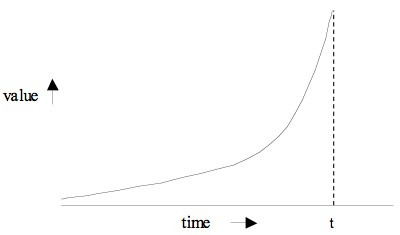
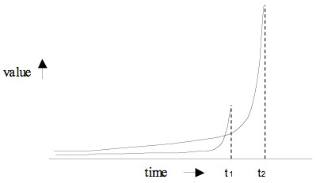

# Dynamic Choice
**First published Mon Oct 15, 2007; substantive revision Mon May 12, 2025**

*Andreou, Chrisoula*

Sometimes a series of choices do not serve one’s concerns well even though each choice in the series seems perfectly well suited to serving one’s concerns. In such cases, one has a dynamic choice problem. Otherwise put, one has a problem related to the fact that one’s choices are spread out over time. There is a growing philosophical literature, which crosses over into psychology and economics, on the obstacles to effective dynamic choice. This literature examines the challenging choice situations and problematic preference structures that can prompt dynamic choice problems. It also proposes solutions to such problems. Increasingly, familiar but potentially puzzling phenomena—including, for example, self-destructive addictive behavior and dangerous environmental destruction—have been illuminated by dynamic choice theory. This suggests that the philosophical and practical significance of dynamic choice theory is quite broad.

## 1. Challenging Choice Situations, Problematic Preference Structures, and Dynamic Choice Problems

Agents often lack some information about the consequences of each available option that they face in a choice situation (with the choice made under some risk or uncertainty about the outcome of that choice). But, even where such a lack of information is not at issue, effective choice over time can be extremely difficult given certain challenging choice situations or problematic preference structures, such as the ones described below. As will become apparent, these choice situations or preference structures can prompt a series of decisions that serve one’s large-scale, ongoing concerns very badly. (Of course, if, due perhaps to some substantial transformation(s), one is so fragmented over time that one has no large-scale, ongoing concerns to which one is persistently accountable, then inconsistency in one’s choices over time may be inevitable; but my primary interest here is in the philosophically puzzling cases of dynamic choice in which an agent remains accountable to certain large-scale, ongoing concerns that are nonetheless poorly served by her choices over time.)

### 1.1 Incommensurable Alternatives

Let us first consider situations that involve choosing between incommensurable alternatives. According to the now familiar use of the term “incommensurable” popularized by philosophers such as Joseph Raz and John Broome (see, for example, Raz 1986 and Broome 2000)[^broome-2000][^raz-1986], two alternatives are incommensurable if neither alternative is better than the other, nor are the two alternatives equally good. (Although this entry sticks with this standard use, it is worth noting that some philosophers, such as, for example, Ruth Chang (2017)[^chang-2017], use the term “incommensurable” in a different way and thus favor a different label for options that are here described as incommensurable, such as “in equipoise”, see Chang 2013.)

It might seem as though the idea of incommensurable alternatives does not really make sense. For if the value of an alternative (to a particular agent) is neither higher nor lower than the value of another alternative, then the values of the two alternatives must, it seems, be equal. But this assumes that there is a common measure that one can use to express and rank the value of every alternative; and, if there are incommensurable alternatives, then this assumption is mistaken.

Now consider the following: If all alternatives were commensurable, then whenever one faced two alternatives neither of which was better than the other, slightly improving one of the alternatives would, it seems, ‘break the tie’ and render one alternative, namely the improved alternative, superior. But there seem to be cases in which there are two alternatives such that (i) neither alternative is better than the other and (ii) this feature is not changed by slightly improving one of the alternatives. Consider, for example, the following case: For Kay, neither of the following alternatives is better than the other:

**(A1)**

going on a six-day beach vacation with her children

**(A2)**

taking a two-month oil-painting course.

Furthermore, although the alternative

**(A1⁺)**

going on a seven-day beach vacation with her children

is a slight improvement on A1, A1⁺ is not better than A2. This scenario seems possible, and if it is, then we have a case of incommensurable alternatives. For, in this case, A1 is not better than A2, A2 is not better than A1, and yet A1 and A2 are not equally good. If A1 and A2 were equally good, then an improvement on A1, such as A1⁺, would be better than A2. But, for Kay, A1⁺ is not better than A2.

It is often supposed that incommensurable alternatives must be incomparable. But things are complicated once it is recognized that there is conceptual room for two alternatives that are not comparable as one better than the other or as equally good (and so are incommensurable according the conception of incommensurability identified above) to be comparable as ‘in the same league’ or ‘on a par,’ and thus not altogether incomparable, as would be the case if there were no positive relation connecting the overall value of each option (see Chang, 2002)[^chang-2002]. For the purposes of this discussion, the question of whether incommensurable alternatives are invariably incomparable can be put aside, since the dynamic choice problem that will be discussed in relation to incommensurability applies regardless of whether the incommensurable options at issue are incomparable or are instead comparable as on a par.

Although there is still some controversy concerning the possibility of incommensurable alternatives (compare, for a sense of the issues, Raz 1997 and Regan 1997)[^raz-1997][^regan-1997], there is widespread agreement that we often *treat* alternatives as incommensurable. Practically speaking, determining the value of two very different alternatives in terms of a common measure, even if this is possible, may be too taxing. It is thus often natural to treat two alternatives as though they are neither equal nor one better than the other.

The existence or appearance of incommensurable alternatives can give rise to dynamic choice problems. Consider Abraham’s case, as described by John Broome in his work on incommensurability:

> God tells Abraham to take his son Isaac to the mountain, and there sacrifice him. Abraham has to decide whether or not to obey. Let us assume this is one of those choices where the alternatives are incommensur[able]. The option of obeying will show submission to God, but the option of disobeying will save Isaac’s life. Submitting to God and saving the life of one’s son are such different values that they cannot be weighed determinately against each other; that is the assumption. Neither option is better than the other, yet we also cannot say that they are equally good. (Broome 2001, 114)[^broome-2001]

Given that the options of submitting to God and saving Isaac are incommensurable (and even if they were only incommensurable as far as a reasonable person could tell), Abraham’s deciding to submit to God seems rationally permissible. So it is easy to see how Abraham’s situation might prompt him to set out for the mountain in order to sacrifice Isaac. But it is also easy to see how, once at the foot of the mountain, Abraham might decide to turn back. For, even though, as Broome puts it, “turning back at the foot of the mountain is definitely worse than never having set out at all” since “trust between father and son [has already been] badly damaged” (2001, 115), the option of saving Isaac by turning back and the option of submitting to God and sacrificing Isaac may be incommensurable. This becomes apparent if one recalls Kay’s case and labels Abraham’s above-mentioned options as follows:

**(B1)**

saving Isaac by turning back at the foot of the mountain

**(B1⁺)**

saving Isaac by refusing to set out for the mountain

**(B2)**

submitting to God and sacrificing Isaac.

Even though B1⁺ is better than B1, both B1⁺ and B1 may be incommensurable with B2. But if B1 is incommensurable with B2, then Abraham could, once at the foot of the mountain, easily decide to opt for B1 over B2. Given that B1 is worse than B1⁺, Abraham could thus easily end up with an outcome that is worse than another that was available to him, even if each of his choices makes sense given the value of the alternatives he faces.

The moral, in general terms, is that in cases of incommensurability (or cases in which it is tempting to treat two alternatives as incommensurable), decisions that seem individually defensible can, when combined, result in a series of decisions that fit together very poorly relative to the agent’s large-scale, ongoing concerns. Contributions concerning the possibility, significance, and implications of incommensurability —both for individuals and for public policy —continue to quickly grow and gather interest, with recent debates appearing in multiple new collections on the topic. (See, for example, Andersson & Herlitz 2021 and Eyal & Herlitz 2024.)[^andersson-2021][^eyal-2024]

### 1.2 Time-Biased Preferences

Another source of dynamic choice problems is present-biased preferences. Like other animals, humans give more weight to present satisfaction than to future satisfaction. In other words, we discount future utility. Insofar as one discounts future utility, one prefers, other things equal, to get a reward sooner rather than later; relatedly, the closer one gets to a future reward, the more the reward is valued. If we map the value (to a particular agent) of a given future reward as a function of time, we get a discount curve, such as in Figure 1:

\*Figure 1.\* The discounted value of a reward gradually increases as *t*, the time at which the reward will be available, approaches.

Research in experimental psychology (see, for example, Kirby & Herrnstein 1995, Millar & Navarick 1984, Solnick et al. 1980, and Ainslie 2001)[^ainslie-2001][^kirby-1995][^millar-1984] suggests that, given how animals, including humans, discount future utility, there are plenty of cases in which the discount curves from two rewards, one a small reward and the other a larger later reward, cross, as in Figure 2:

\*Figure 2.\* Two crossing discount curves, one tracking the discounted value of a small reward that will be available at *t*₁ and the other tracking the discounted value of a large reward that will be available at *t*₂.

In such cases, the agent’s discounting of future utility induces a preference reversal with respect to the two possible rewards. When neither reward is imminent, before the discount curves cross, the agent consistently prefers the larger later reward over the smaller earlier reward. But when the opportunity to accept the small reward is sufficiently close, the discounted value of the small reward catches up with and then overtakes the discounted value of the larger later reward. As the discount curves cross, the agent’s preferences reverse and she prefers the small reward over the larger later reward.

Discounting-induced preference reversals make consistent and efficient choice over time a challenge. An agent subject to discounting-induced preference reversals can easily find herself performing a series of actions that she planned against and will soon regret. Consider the agent who wants to save for a decent retirement but, as each opportunity to save approaches, prefers to spend her potential retirement contribution on just one more trivial indulgence before finally tightening her belt for the sake of the future satisfaction she feels is essential to her well-being. Although this agent consistently plans to save for her retirement (such saving figures as among her large-scale, ongoing concerns), her plans can be consistently thwarted by her discounting-induced preference reversals. Her life may thus end up looking very different from the sort of life she wanted.

Interestingly, in addition to giving more weight to present satisfaction than to future satisfaction, human beings also seem to give more weight to future satisfaction than to past satisfaction (Greene et al. 2022)[^greene-2022]. Relatedly, human beings seem to discount past pain more than future pain. Suppose, to appeal to a variation on Derek Parfit’s famous thought experiment (1984, 165–6), your situation is such that either you’ve already suffered a perfectly safe but terribly painful ten-hour medical procedure yesterday or else you will suffer a perfectly safe but terribly painful nine-hour medical procedure tomorrow. (You don’t know which situation you’re in because amnesia is administered right after the procedure and you’ve just woken up in the hospital confused about whether you’re recovering from the procedure or being prepped for it.) Wouldn’t you prefer to be in the former situation? Intuitively, it seems like the prevailing and rational response would be “most definitely!” But there is some concern that this form of future bias, in which past rewards or costs are discounted more than future rewards or costs, can lead to trouble (Dougherty 2011; Greene and Sullivan 2015)[^dougherty-2011][^greene-2015]. For example, Preston Greene and Meghan Sullivan (2015) argue that it can be a recipe for a life of “meager returns” and/or regret. Their reasoning is quite elaborate, but the following simple illustration and somewhat extemporized analysis, will hopefully provide a glimpse into some of the interesting philosophical issues at stake. Consider Massimo, who thoroughly enjoys massages and who can choose between a longer massage early on or a shorter massage later. If Massimo is future biased, then, with some variation on the length and timing of the massages, he can easily find himself faced with the following dilemma: if he opts for getting a longer massage early on, he will, sometime after getting the longer massage and before the shorter massage would have been available, regret accepting a pleasure, now past, that could have still been in the future (even if diminished); if, alternatively, he opts for getting a shorter massage later on (thus avoiding regret of the preceding sort), he will face a life of “meager returns,” in which less pleasure later is, potentially routinely, chosen over more pleasure earlier (a scenario that can itself generate regret and/or concern, particularly once both massage times are past, or if one recognizes, even as one is gladly awaiting a lesser pleasure after giving up a greater pleasure that would now have been in the past, that, insofar as the same sort of choice has arisen repeatedly and will continue to arise repeatedly, repeated choices for less pleasure later make for a life that is both retrospectively and prospectively much less appealing than repeated choices for more pleasure early on).

### 1.3 Intransitive Preferences

An agent’s preference structure need not be changing over time for it to prompt dynamic choice problems. Such problems can also be prompted by preferences that are stable but intransitive. One’s preferences count as transitive if they satisfy the following condition: for all *x*, *y*, and *z*, if one prefers *x* to *y*, and *y* to *z*, then one also prefers *x* to *z*. If one’s preferences over a set of options do not satisfy this condition, then these preferences count as intransitive. When one’s preferences over a set of options are intransitive, then one cannot rank the options from most preferred to least preferred. This holds even if one’s preferences over the options are complete, in the sense that all the options are ranked with respect to one another. Suppose, for example, that one prefers job *A* to job *B*, job *B* to job *C*, but job *C* to job *A*. In this case, one’s complete preferences over the set {job *A*, job *B*, job *C*} form a preference loop, which can be represented as follows:

\*Figure 3.\*

where *x* > *y* is to be read as *x* is preferred to *y*.

Could an agent really have intransitive preferences? Work in experimental and theoretical economics (see, for example, Tversky 1969)[^tversky-1969] suggests that intransitive preferences exist and may be quite common. (For a recent taxonomy of examples of intransitive preferences, see Bovens 2022.)[^bovens-2022] Consideration of the following situation might help make it clear how intransitive preferences can arise (whether or not they are rational). Suppose Jay can accept one of three jobs: job *A* is very stimulating but low-paying; job *B* is somewhat stimulating and pays decently; job *C* is not stimulating but pays very well. Given this situation, one can imagine Jay having the following preferences: He prefers job *A* over job *B* because the difference between having a low-paying job and a decently-paying job is not significant enough to make Jay want to pass up a very stimulating job. Similarly, he prefers job *B* over job *C* because the difference between having a decently-paying job and a high-paying job is not significant enough to make Jay want to pass up a stimulating job. But he prefers job *C* over job *A* because the difference between having a high-paying job and a low-paying job is significant enough to make Jay want to pass up even a very stimulating job.

Given the famous “money pump argument,” developed by Donald Davidson, J. McKinsey, and Patrick Suppes (1955), it is clear that intransitive preferences can be problematic. Like Dutch book arguments regarding betting, in which the rationality of an agent is put into question because the agent is susceptible to having a book made against her (i.e., to accepting a series of bets which are such that she is bound to lose more than she can gain), the money-pump argument is concerned with agents who are vulnerable to making a combination of choices that lead to a sure loss. According to the money-pump argument, intransitive preferences are irrational because they can prompt an agent to accept a series of trade offers that leaves the agent with the same option he began with, but with less money. Here is a case of the relevant sort. Suppose that Alex has the following intransitive preferences: he prefers owning a computer of type *A* to owning a computer of type *B*, owning a computer of type *B* to owning a computer of type *C*, and owning a computer of type *C* to owning a computer of type *A*. Suppose also that Alex owns a computer of type *C* and a hundred dollars in spending money. Suppose finally that, given his preferences between different computer types, Alex prefers (i) owning a computer of type *B* and one less dollar of spending money over owning a computer of type *C*, (ii) owning a computer of type *A* and one less dollar of spending money over owning a computer of type *B*, and (iii) owning a computer of type *C* and one less dollar of spending money over owning a computer of type *A*. Then a series of unanticipated trade opportunities can spell trouble for Alex. In particular, given the opportunity to trade his current (type *C*) computer and a dollar for a computer of type *B*, Alex’s preferences will prompt him to make the trade. Given the further opportunity to trade his current (type *B*) computer and a dollar for a computer of type *A*, Alex’s preferences will prompt him to trade again. And given the opportunity to trade his current (type *A*) computer and a dollar for a computer of type *C*, Alex’s preferences will prompt him to make a third trade. But this series of trades leaves Alex with the type of computer he started off with and only 97 dollars. And, given that unexpected trading opportunities may keep popping up, Alex’s situation may continue to deteriorate. Even though he values his spending money, his preferences make him susceptible to being used as a ‘money pump.’ Moreover, interesting variations on the basic money pump argument show that an agent with intransitive preferences like those just considered is susceptible to being money-pumped even if he shows foresight and correctly anticipates his upcoming trading opportunities. See, for example, Rabinowicz 2000 and Dougherty 2014. For a recent in-depth defense of the significance of money-pump arguments, see Gustafsson 2022.

Even if he does not serve as a money pump, an agent with intransitive preferences can get into a great deal of trouble. To see this, consider Warren Quinn’s “puzzle of the self-torturer” (1993): Suppose someone—who, for reasons that will become apparent, Quinn calls the self-torturer—has a special electric device attached to him. The device has 1001 settings: 0, 1, 2, 3, …, 1000 and works as follows: moving up a setting raises, by a tiny increment, the amount of electric current applied to the self-torturer’s body. The increments in current are so small that the self-torturer cannot tell the difference between adjacent settings. He can, however, tell the difference between settings that are far apart. And, in fact, there are settings at which the self-torturer would experience excruciating pain. Once a week, the self-torturer can compare all the different settings. He must then go back to the setting he was at and decide if he wants to move up a setting. If he does so, he gets \$10,000, but he can never permanently return to a lower setting. Like most of us, the self-torturer would like to increase his fortune but also cares about feeling well. Since the self-torturer cannot feel any difference in comfort between adjacent settings but gets \$10,000 at each advance, he prefers, for any two consecutive settings *s* and *s*+1, stopping at *s*+1 to stopping at *s*. But, since he does not want to live in excruciating pain, even for a great fortune, he also prefers stopping at a low setting, such as 0, over stopping at a high setting, such as 1000.

Given his preferences, the self-torturer cannot rank the setting options he faces from most preferred to least preferred. More specifically, his preferences incorporate the following preference loop:

\*Figure 4.\*

Relatedly, the self-torturer’s preferences over the available setting options are intransitive. If his preferences were transitive, then, given that he prefers setting 2 to setting 1 and setting 1 to setting 0, he would prefer setting 2 to setting 0. Given that he also prefers setting 3 to setting 2, he would (assuming transitivity) prefer setting 3 to setting 0. Given that he also prefers setting 4 to setting 3, he would (assuming transitivity) prefer setting 4 to setting 0. Continuing with this line of reasoning leads to the conclusion that he would, if his preferences were transitive, prefer setting 1000 to setting 0. Since he does not prefer setting 1000 to setting 0, his preferences are intransitive. And this intransitivity can lead the self-torturer down a terrible path. In particular, if, each week, the self-torturer follows his preference over the pair of settings he must choose between, he will end up in a situation that he finds completely unacceptable. This is quite disturbing, particularly once one realizes that, although the situation of the self-torturer is pure science fiction, the self-torturer is not really alone in his predicament. As Quinn stresses, “most of us are like him in one way or another. [For example, most of us] like to eat but also care about our appearance. Just one more bite will give us pleasure and won’t make us look fatter; but very many bites will” (Quinn 1993, 199)[^quinn-1993].

Given the money pump argument and the puzzle of the self-torturer, we can, it seems, conclude that although intransitive preferences are sometimes understandable, acting on them can be far from sensible. (Note, however, that, as Duncan MacIntosh (2010)[^macintosh-2010] suggests, the notion of “an unacceptable situation” plays an important role here and the question of how to cash out this notion stands in need of additional attention. For a recent attempt at addressing this issue, see (Andreou 2023, chapter 3)[^andreou-2023], wherein instrumental rationality is portrayed as accountable to “subjective appraisal responses” that go beyond the agent’s preferences and that sometimes allow some outcomes in a “preference loop” to figure as (rationally) acceptable and others to figure as (rationally) unacceptable.)

### 1.4 Vague Goals and other Challenging Wholes

Like intransitive preferences, vague goals or projects can prompt dynamic choice problems even if the agent’s preference structure is not changing over time. Indeed, some have suggested that the deep source of the self-torturer’s problem, and what prompts his intransitive preferences, is that his goal of avoiding extreme pain is vague in the sense that, in the situation described, avoiding extreme pain requires engaging in a multitude of goal-directed actions that are not individually necessary or sufficient for the achievement of the goal and that are thus dispensable and perhaps even dominated if considered individually (Tenenbaum and Raffman, 2012)[^tenenbaum-2012]. It may be helpful to consider a more familiar example of a vague goal or project, such as that of writing a good book. As Sergio Tenenbaum and Diana Raffman explain, this project may be characterizable as follows (2012, 99–100):

1. Its completion requires the successful execution of many momentary actions.
2. For each momentary action in which you execute the project, failure to execute that action would not have prevented you from writing the book.
3. On many occasions when you execute the project, there is something else that you would prefer to be doing, given how unlikely it is that executing the project at this time would make a difference to the success of your writing the book.
4. Had you failed to execute the project every time you would have preferred to be doing something else, you would not have written the book.
5. You prefer executing the project at every momentary choice situation in which you could work on the project, over not writing the book at all.

It is not difficult to see how, in a case like this, seemingly rational “local” decisions can lead one off course.

Tenenbaum and Raffman’s discussion of the pursuit of vague goals is interestingly related to Luca Ferrero’s suggestion that many activities are “made up of momentary actions that relate in non-local ways that span over the entire length of the activities” and “require the agent’s continuous appreciation of the structure and outcome of the extended activities taken as a whole” (2009, 406). Ferrero focuses on activities that have a narrative dimension, in that “the unfolding of the characteristic temporal structure of …[the] activities can be fully and perspicuously described solely by a narrative” (412–3), but the pursuit of vague goals also seems to fit Ferrero’s initial description, as well as his idea that activities of the relevant sort involve the “paradigmatic operation” of the “diachronic will” (406). In all such activities, relentless guidance by “proximal concerns” interferes with what is required by “the activity’s global structure” (406).

### 1.5 Autonomous Benefit Cases

The discussions in the preceding three sections suggest that, when it comes to serving one’s concerns well, the ability to choose counter-preferentially may be quite helpful. This point is reinforced by the possibility of autonomous benefit cases.

In autonomous benefit cases, one benefits from forming a certain intention but not from carrying out the associated action. The autonomous benefit cases that have figured most prominently in the literature on dynamic choice are those in which carrying out the action associated with the beneficial intention is detrimental rather than just unrewarding. Among the most famous autonomous benefit cases is Gregory Kavka’s “toxin puzzle” (1983). In Kavka’s invented case,

> an eccentric billionaire…places before you a vial of toxin…[and provides you with the following information:] If you drink [the toxin], [it] will make you painfully ill for a day, but will not threaten your life or have any lasting effects…. The billionaire will pay you one million dollars tomorrow morning if, at midnight tonight, you intend to drink the toxin tomorrow afternoon…. You need not drink the toxin to receive the money; in fact, the money will already be in your bank account hours before the time for drinking it arrives, if you succeed…. [The] arrangement of…external incentives is ruled out, as are such alternative gimmicks as hiring a hypnotist to implant the intention… (Kavka 1983, 33–4)[^kavka-1983]

Part of what is interesting about this case is that, even though most people would gladly drink the toxin for a million dollars, getting the million dollars is not that easy. This is because one does not get the million dollars for drinking the toxin. Indeed, one does not get anything but a day of illness for drinking the toxin. As Kavka explains, by the time the toxin is to be consumed, one either already has the million in one’s account or not; and drinking the toxin will not get one any (additional) funds. Assuming one has no desire to be ill for nothing, drinking the toxin seems to involve acting counter-preferentially—and this is, if not impossible, at least no easy feat. So, given a clear understanding of the situation, one is likely to find it difficult, if not impossible, to form the intention to drink the toxin. Presumably, one cannot form the intention to drink the toxin if one is confident that one will not drink it. If only one could somehow rely on the cooperation of one’s future self, one could then genuinely form the intention to drink the toxin and thus get the million—a wonderful result from the perspective of both one’s current and one’s future self. But, alas, one’s future self will, it seems, have no reason to drink the toxin when the time for doing so arrives.

Here again we have a situation in which doing well by oneself is not easy.

## 2. Solving Dynamic Choice Problems

Given how much trouble dynamic choice problems can cause, it is natural to wonder whether and how they can be solved. Various solutions of varying scope have been proposed in the literature on dynamic choice. The first three subsections that follow focus on ideas regarding the practical issue of dealing with dynamic choice problems. The fourth subsection focuses on attempts at resolving the theoretical puzzles concerning rational choice raised by various dynamic choice problems.

### 2.1 Rational Irrationality

Two strategies that we can sometimes use to solve (in the sense of practically deal with) dynamic choice problems are suggested in Kavka’s description of the toxin puzzle. One strategy is to use gimmicks that cause one to reason or choose in a way that does not accord with one’s preferences. The other strategy involves the arrangement of external incentives. Although such maneuvers are ruled out in Kavka’s case, they can prove useful in less restrictive cases. This subsection considers the former strategy and the next subsection considers the latter strategy.

If one accepts the common assumption that causing oneself to reason or choose in a way that does not accord with one’s preferences involves rendering oneself irrational, the former strategy can be thought of as aiming at rationally-induced irrationality. A fanciful but clear illustration of this strategy is presented in Derek Parfit’s work (1984). In Parfit’s example (which is labeled *Schelling’s Answer to Armed Robbery* because it draws on Thomas Schelling’s view that “it is not a universal advantage in situations of conflict to be inalienably and manifestly rational in decision and motivation” (Schelling 1960, 18)[^schelling-1960]), a robber breaks into someone’s house and orders the owner, call him Moe, to open the safe in which he hoards his gold. The robber threatens to shoot Moe’s children unless Moe complies. But Moe realizes that both he and his children will probably be shot even if he complies, since the robber will want to get rid of them so that they cannot record his getaway car information and get it to the police (who will be arriving from the nearest town in about 15 minutes in response to Moe’s call, which was prompted by the first signs of the break-in). Fortunately, Moe has a special drug at hand that, if consumed, causes one to be irrational for a brief period. Recognizing that this drug is his only real hope, Moe consumes the drug and immediately loses his wits. He begins “reeling about the room” saying things like “Go ahead. I love my children. So please kill them” (Parfit 1984, 13)[^parfit-1984]. Given Moe’s current state, the robber cannot do anything that will induce Moe to open the safe. There is no point in killing Moe or his children. The only sensible thing to do now is to hurry off before the police arrive.

Given that consuming irrationality drugs and even hiring hypnotists are normally not feasible solutions to our dynamic choice problems, the possibility of rationally inducing irrationality may seem practically irrelevant. But it may be that we often benefit from the non-conscious employment of what is more or less a version of this strategy. We sometimes, for example, engage in self-deception or indulge irrational fears or superstitions when it is convenient to do so. Many of us might, in toxin-type cases, be naturally prone to dwell on and indulge superstitious fears, like the fear that one will somehow be jinxed if one manages to get the million dollars but then does not drink the toxin. Given this fear, one might be quite confident that one will drink the toxin if one gets the million; and so it might be quite easy for one to form the intention to drink the toxin. Although this is not a solution to the toxin puzzle that one can consciously plan on using (nor is it one that resolves the theoretical issues raised by the case), it may nonetheless often help us effectively cope with toxin-type cases. (For a clear and compact discussion concerning self-deception, “motivationally biased belief,” and “motivated irrationality” more generally, see, for example, Mele 2004.)[^mele-2004]

### 2.2 The Arrangement of External Incentives

The other above-mentioned strategy that is often useful for dealing with certain dynamic choice problems is the arrangement of external incentives that make it worthwhile for one’s future self to cooperate with one’s current plans. This strategy can be particularly useful in dealing with discounting-induced preference reversals. Consider again the agent who wants to save for a decent retirement but, as each opportunity to save approaches, prefers to spend her potential retirement contribution on just one more trivial indulgence before finally tightening her belt for the sake of the future satisfaction she feels is essential to her well-being. If this agent’s plans are consistently thwarted by her discounting-induced preference reversals, she might come to the conclusion that she will never manage to save for a decent retirement if she doesn’t supplement her plans with incentives that will prevent the preference reversals that are causing her so much trouble. If she is lucky, she may find an existing precommitment device that she can take advantage of. Suppose, for example, that she can sign up for a program at work that, starting in a month, automatically deposits a portion of her pay into a retirement fund. If she cannot remove deposited funds without a significant penalty, and if she must provide a month’s notice to discontinue her participation in the program, signing up for the program might change the cost-and-reward structure of spending her potential retirement contributions on trivial indulgences enough to make this option consistently dispreferred. If no ready-made precommitment device is available, she might be able to create a suitable one herself. If, for example, she is highly averse to breaking promises, she might be able to solve her problem by simply promising a concerned friend that she will henceforth deposit a certain percentage of her pay into a retirement fund.

In some cases, one might not be confident that one can arrange for external incentives that will get one’s future self to voluntarily cooperate with one’s current plans. One might therefore favor the related but more extreme strategy of making sure that one’s future self does not have the power to thwart one’s current plans. Rather than simply making cooperation more worthwhile (and thus, in a sense, more compelling), this strategy involves arranging for the use of force (which *compels* in a stronger sense of the term). A fictional but particularly famous employment of the strategy (which is discussed in, for example, Elster 1984)[^elster-1984] is its employment by Odysseus in Homer’s *Odyssey*. Because he longed to hear the enchanting singing of the Sirens, but feared that he would thereby be lured into danger, Odysseus instructed his companions to tie him to the mast of his ship and to resist his (anticipated) attempts at freeing himself from the requested bonds.

### 2.3 Symbolic Utility

Another strategy for dealing with certain dynamic choice problems—this one proposed by Robert Nozick (1993)[^nozick-1993]—is the strategy of investing actions with symbolic utility (or value) and then allowing oneself to be influenced not only by the causal significance of one’s actions, but also by their symbolic significance. According to Nozick, “actions and outcomes can symbolize still further events … [and] draw upon themselves the emotional meaning (and utility…) of these other events” (26). If “we impute to actions… utilities coordinate with what they symbolize, and we strive to realize (or avoid) them as we would strive for what they stand for” (32), our choices will differ from what they would be if we considered only the causal significance of our actions. Consider, for example, the case of the self-torturer. Suppose the self-torturer has moved up ten settings in ten weeks. He is still in a very comfortable range, but he is starting to worry about ending up at a high setting that would leave him in excruciating pain. It occurs to him that he should quit while he is ahead, and he begins to symbolically associate moving up a setting at the next opportunity with moving up a setting at every upcoming opportunity. By the time the next opportunity to move up a setting comes around, the extremely negative symbolic significance of this potential action steers him away from performing the action. For a structurally similar but more down-to-earth example, consider someone who really enjoys eating but is averse to putting on a considerable amount of weight because of issues associated with joint pain. If this individual comes to symbolically associate having an extra helping with overeating in general and thus with putting on a considerable amount of weight, he may be averse to having the extra helping, even if, in causal terms, what he does in this particular case is negligible.

### 2.4 Plans and Resoluteness

The three strategies discussed so far suggest that, to cope with dynamic choice problems, one must either mess with one’s rationality or else somehow change the payoffs associated with the options one will face. Some philosophers—including, for example, Michael Bratman (1999; 2006)[^bratman-1999][^bratman-2006], David Gauthier (1986; 1994)[^gauthier-1986][^gauthier-1994], and Edward McClennen (1990; 1997)[^mcclennen-1990][^mcclennen-1997]—have, however, suggested that the rational agent will not need to resort to such gimmicks as often as one might think—a good thing, since making the necessary arrangements can require a heavy investment of time, energy, and/or money. The key to their arguments is the idea that adopting plans can affect what it is rational for one to do even when the plans do not affect the payoffs associated with the options one will face; relatedly, their arguments incorporate the idea that rationality at least sometimes calls for resolutely sticking to a plan even if the plan disallows an action that would fit as well or better with one’s preferences than the action required by the plan. (For some interesting discussion relating resoluteness, one’s current options, and the options one will face, see Portmore 2019.)[^portmore-2019] For Bratman, Gauthier, and McClennen, being resolute is not simply useful in coping with dynamic choice problems. Rather, it figures as part of a conception of rationality that resolves the theoretical puzzles concerning rationality and choice over time posed by various dynamic choice problems. In particular, it figures as part of a conception of rationality whose dictates provide intuitively sensible guidance not only in simple situations but also in challenging dynamic choice situations. (Significantly, in some of his more recent work, Bratman (2014; 2018)[^bratman-2014][^bratman-2018] distances himself from the idea that rational resoluteness involves acting contrary to one’s current preferences by suggesting that when rationality calls for sticking to a plan even if this is not called for by one’s current preferences, there may be “rational pressure” to change one’s current preferences.)

We are, as Michael Bratman (1983; 1987)[^bratman-1983][^bratman-1987] stresses, planning creatures. Our reasoning is structured by our plans, which enable us to achieve complex personal and social goals. To benefit from planning, one must take plans seriously. For Bratman, this involves, among other things, (i) recognizing a general rational pressure favoring sticking to one’s plan so long as there is no problem with the plan (Bratman 2006, section 8)[^bratman-2006], and (ii) “taking seriously how one will see matters at the conclusion of one’s plan, or at appropriate stages along the way, in the case of plans or policies that are ongoing” (1999, 86). In accordance with these proposed requirements, Bratman (1999)[^bratman-1999] concludes that rationality at least sometimes calls for sticking to a plan even if this is not called for by one’s current preferences. Moreover, although this conception of rationality requires that one sometimes resist one’s current preferences, it is taken to prompt more sensible choices in challenging dynamic choice situations than do conceptions of rationality whose dictates do not take plans seriously.

The significance of the first requirement is easy to see. If there is a general rational pressure favoring sticking to one’s plan so long as there is no problem with it, then a rational agent that takes plans seriously will not get into the sort of trouble Broome imagines Abraham might get into. When faced with incommensurable alternatives, the rational agent who takes plans seriously will adopt a plan and then stick to it even if his preferences are consistent with pursuing an alternative course of action.

What about the significance of the second requirement? For Bratman, if one is concerned about how one will see matters at the conclusion of one’s plan or at appropriate stages along the way, then one will, other things equal, avoid adjusting one’s plan in ways that one will regret in the future. So Bratman’s planning conception of rationality includes a “no-regret condition.” And, according to Bratman, given this condition, his conception of rationality gives intuitively plausible guidance in cases of temptation like the case of the self-torturer or the retirement contribution case. In particular, it implies that, in such cases, the rational planner will adopt a plan and refrain from adjusting it. For in both sorts of cases, if the simple fact that one’s preferences favor adjusting one’s plan leads one to adjust it, one is bound to end up, via repeated adjustments of one’s plan, in the situation one finds unacceptable. One is thus bound to experience future regret. And, while Bratman allows that regret can sometimes be misguided—which is why he does not present avoiding regret as an exceptionless imperative—there are not, for Bratman, any special considerations that would make regret misguided if one gave into temptation in cases like the case of the self-torturer or the retirement contribution case.

Based on their own reasoning concerning rational resoluteness, Gauthier (1994)[^gauthier-1994] and McClennen (1990; 1997)[^mcclennen-1990][^mcclennen-1997] argue that rational resoluteness can help an agent do well in autonomous benefit cases like the toxin case. They maintain that being rational is not a matter of always choosing the action that best serves one’s concerns. Rather it is a matter of acting in accordance with the deliberative procedure that best serves one’s concerns. Now it might seem as though the deliberative procedure that best serves one’s concerns must be the deliberative procedure that calls for always choosing the action that best serves one’s concerns. But autonomous benefit cases like the toxin case suggest that this is not quite right. For, the deliberative procedure that calls for always choosing the action that best serves one’s concerns does not serve one’s concerns well in autonomous benefit cases. More specifically, someone who reasons in accordance with this deliberative procedure does worse in autonomous benefit cases than someone who is willing to resolutely stick to a prior plan that he did well to adopt. Accordingly, Gauthier and McClennen deny that the best deliberative procedure requires one to always choose the action that best serves one’s concerns; in their view, the best deliberative procedure requires some resoluteness. Relatedly, they see drinking the toxin in accordance with a prior plan to drink the toxin as rational, indeed as rationally required, given that one did well to adopt the plan; so rationality helps one benefit, rather than hindering one from benefiting, in autonomous benefit cases like the toxin case.

Note that, while there is widespread agreement that a plausible conception of rationality will imply that the self-torturer should resist the temptation to keep advancing one more setting, there is no widespread agreement that a plausible conception of rationality will imply that it is rational to drink the toxin. For those who find the idea that it is rational to drink the toxin completely counter-intuitive, its emergence figures as a problematic, rather than welcome, implication of Gauthier’s and McClennen’s views concerning rational resoluteness.

If Bratman and/or Gauthier and McClennen are on the right track—and this is, of course, a big if—then (some form of) resoluteness may often be the key to keeping oneself out of potential dynamic choice traps. It may also be the key to resolving various puzzles concerning rationality and dynamic choice. (For a recent in-depth discussion of commitment and resoluteness in rational choice, see Andreou 2022.)[^andreou-2022]

In an interesting critique of planning solutions to cases of temptation, Tenenbaum and Raffman (2012) challenge the purported centrality of resoluteness. They suggest that, in cases of temptation, instrumental rationality may not require planning and resoluteness, but simply exercising “sufficiently many” “permissions” to do something other than what “would be best at a given moment” when this is required by a “rationally innocent” goal or project. For instance, “suppose you take a break from writing an important memo and start surfing the web. Surely surfing for one additional second will not prevent you from completing the memo, but if you surf for long enough you won’t have time to finish it” (110). Instrumental rationality requires that you stop surfing at an acceptable point. But this need not involve stopping at a point determined by a prior plan. Whether or not you have a plan to stop at time t, and whether or not you resolutely adhere to such a plan need not be of crucial importance. What matters is that, ultimately, you stop in good time by exercising, at one or more points, the rational permission to do something other than what would be best at that moment with an eye to achieving the rationally innocent goal of completing the important memo. Tenenbaum (2020)[^tenenbaum-2020] develops a theory of instrumental rationality that illuminates and accommodates the need to exercise rational permissions of the sort just described.

## 3. Some Familiar Phenomena Illuminated by Dynamic Choice Theory

Although dynamic choice problems are often presented with the help of fanciful thought experiments, their interest is not strictly theoretical. As this section highlights, they can wreak havoc in our real lives, supporting phenomena such as self-destructive addictive behavior and dangerous environmental destruction. In some cases, these phenomena can be understood in terms of procrastination (Andreou 2007)[^andreou-2007][^andreou-2007-2], which seems to be, by its very nature, a dynamic choice problem (Stroud 2010)[^stroud-2010].

According to the most familiar model of self-destructive addictive behavior, such behavior results from cravings that limit “the scope for volitional control of behavior” and can in some cases be irresistible, “overwhelm[ing] decision making altogether” (Loewenstein 1999, 235–6). But, as we know from dynamic choice theory, self-destructive behavior need not be compelled. It can also be supported by challenging choice situations and problematic preference structures that prompt dynamic choice problems. Reflection on this point has led to new ideas concerning possible sources of self-destructive addictive behavior. For example, George Ainslie (2001)[^ainslie-2001] has developed the view that addictive habits such as smoking—which can, it seems, flourish even in the absence of irresistible craving—are often supported by discounting-induced preference reversals. Given the possibility of discounting-induced preference reversals, even someone who cares deeply about having a healthy future, and who therefore does not want to be a heavy smoker, can easily find herself smoking cigarette after cigarette, where this figures as a series of indulgences that she plans against and then regrets.

Reflection on dynamic choice theory has also led to new ideas in environmental philosophy. For example, Chrisoula Andreou (2006)[^andreou-2006] argues that, although dangerous environmental destruction is usually analyzed as resulting from interpersonal conflicts of interest, such destruction can flourish even in the absence of such conflicts. In particular, where individually negligible effects are involved, as is the case among “creeping environmental problems” such as pollution, “an agent, whether it be an individual or a *unified* collective, can be led down a course of destruction simply as a result of following its informed and perfectly understandable but *intransitive* preferences” (Andreou 2006, 96)[^andreou-2006]. Notice, for example, that if a unified collective values a healthy community, but also values luxuries whose production or use promotes a carcinogenic environment, it can find itself in a situation that is structurally similar to the situation of the self-torturer. Like the self-torturer, such a collective must cope with the fact that while one more day, and perhaps even one more month of indulgence can provide great rewards without bringing about any significant alterations in (physical or psychic) health, “sustained indulgence is far from innocuous” (Andreou 2006, 101)[^andreou-2006].

Clearly, success in achieving a long-term goal can require showing some restraint along the way; but it is tempting to put off showing restraint and to favor a bit more indulgence over embarking on the challenging doings or omissions that will serve the valued long-term goal. Here, as in many other contexts, procrastination figures as a serious threat.

Though both philosophically intriguing and practically significant, procrastination has only recently received substantial attention as an important topic of philosophical debate. (Much of the debate can be found in a 2010 collection of papers on the topic edited by Chrisoula Andreou and Mark D. White.) It has perhaps been assumed that procrastination is just a form of weakness of will and so, although there has been little explicit discussion of procrastination, most of the philosophical work necessary for understanding procrastination has already been done. But, as Sarah Stroud (2010)[^stroud-2010] has argued, this assumption is problematic, since there are cases of procrastination that do not fit with the traditional conception of weakness of will, which casts the agent as acting against her better judgment, or with the influential revisionary conception of weakness of will due to Richard Holton (1999)[^holton-1999], which casts the agent as acting irresolutely. Although the well-developed literature on weakness of will is an important resource in the study of procrastination, there is a lot more philosophical work that needs to be done, and the modeling work that seems to be most promising focuses heavily on the fact that procrastination is a problem faced by agents whose choices are spread out over time.

## 4. Concluding Remarks

When one performs a series of actions that do not serve one’s concerns well, it is natural to feel regret and frustration. Why, it might be wondered, is one doing so badly by oneself? Self-loathing, compulsion, or simple ignorance might in some cases explain the situation; but, oftentimes, none of these things seems to be at the root of the problem. For, in many cases, one’s steps along a disadvantageous course seem voluntary, motivated by the prospect of some benefit, and performed in light of a correct understanding of the consequences of each step taken. As we have seen, dynamic choice theory makes it clear how such cases are possible.

Although an agent with a dynamic choice problem can often be described as insufficiently resolute, she is normally guided by her preferences or her evaluation of the options she faces. As such, she is not, in general, properly described as simply out of control. Still, the control she exhibits is inadequate with respect to the task of effectively governing her (temporally-extended) self. So her problem is, at least in part, a problem of effective self-governance over time. Accordingly, some work on choice over time (e.g. Velleman 2000; Bratman, 2012)[^bratman-2012][^velleman-2000] includes discussion of effective self-governance over time and explores the connection between the requirements for effective self-governance over time and the requirements for rational choice over time (sometimes referred to as the requirements of diachronic rationality). Some big questions in this area include the following: To what extent does self-governance over time (or at least effective self-governance over time) require cross-temporal coherence in the form of a presumption in favor of prior intentions? To what extent does diachronic rationality require self-governance over time? And to what extent does diachronic rationality require cross-temporal coherence in the form of a presumption in favor of prior intentions. My own view is that it is ensuring the avoidance of self-defeating behavior rather than ensuring self-governance over time that is rationally required, and so diachronic rationality requires a presumption in favor of prior intentions only when this is necessary for avoiding self-defeating behavior (Andreou, 2023, chapter 2)[^andreou-2023]. But debate on this topic has not been very extensive and further exploration of the topic is certainly in order.

## References（引用注释）

> 原文参考文献已转为脚注引用：文内“作者-年份”引用组后附 [^key] 标记，完整条目见本文末脚注定义。

## Academic Tools

> |   | [How to cite this entry](https://plato.stanford.edu/cgi-bin/encyclopedia/archinfo.cgi?entry=dynamic-choice). |
> | --- | --- |
> |   | [Preview the PDF version of this entry](https://leibniz.stanford.edu/friends/preview/dynamic-choice/) at the [Friends of the SEP Society](https://leibniz.stanford.edu/friends/). |
> |   | [Look up topics and thinkers related to this entry](https://www.inphoproject.org/entity?sep=dynamic-choice&redirect=True) at the Internet Philosophy Ontology Project (InPhO). |
> |   | [Enhanced bibliography for this entry](https://philpapers.org/sep/dynamic-choice/) at [PhilPapers](https://philpapers.org/), with links to its database. |

## Other Internet Resources

- [PEA Soup](https://peasoupblog.com/)
- [PEA Soup: Practical Rationality](https://peasoupblog.com/category/discussions/metaethics/practical-rationality/)

## Related Entries

decision theory | Dutch book arguments | economics: philosophy of | free rider problem | practical reason | preferences | prisoner’s dilemma | rational choice, normative: expected utility | value: incommensurable | value: pluralism | voting: methods | weakness of will

### Acknowledgments

I am grateful to the University of Utah Tanner Humanities Center for a mini-grant that supported my research for this entry.

[^ainslie-1999]: Ainslie, George, 1999. “The Dangers of Willpower,” in *Getting Hooked*, Jon Elster and Ole-Jørgen Skog (eds.), Cambridge: Cambridge University Press, pp. 65–92.

[^ainslie-2001]: –––, 2001. *Breakdown of Will*, Cambridge: Cambridge University Press.

[^andersson-2021]: Andersson, Henrik and Anders Herlitz, 2021. *Value Incommensurability: Ethics, Risk, and Decision-Making*, New York: Routledge.

[^andreou-2005]: Andreou, Chrisoula, 2005. “Incommensurable Alternatives and Rational Choice,” *Ratio*, 18(3): 249–61.

[^andreou-2005-2]: –––, 2005. “Going from Bad (or Not So Bad) to Worse: On Harmful Addictions and Habits,” *American Philosophical Quarterly*, 42(4): 323–31.

[^andreou-2006]: –––, 2006. “Environmental Damage and the Puzzle of the Self-Torturer,” *Philosophy & Public Affairs*, 34(1): 95–108.

[^andreou-2007]: –––, 2007. “There Are Preferences and Then There Are Preferences” in *Economics and the Mind*, Barbara Montero and Mark D. White (eds.), New York: Routledge, pp. 115–126.

[^andreou-2007-2]: –––, 2007. “Understanding Procrastination,” *Journal for the Theory of Social Behaviour*, 37(2): 183–93.

[^andreou-2022]: –––, 2022. “Commitment and Resoluteness in Rational Choice,” in *Elements in Decision Theory and Philosophy*, Martin Peterson (ed.), Cambridge: Cambridge University Press.

[^andreou-2023]: –––, 2023. *Choosing Well: The Good, the Bad, and the Trivial*, New York: Oxford University Press.

[^andreou-2010]: Andreou, Chrisoula and Mark D. White (eds.), 2010. *The Thief of Time: Philosophical Essays on Procrastination*, Oxford: Oxford University Press.

[^bratman-1983]: Bratman, Michael, 1983. “Taking Plans Seriously,” *Social Theory and Practice*, 9: 271–87.

[^bratman-1987]: –––, 1987. *Intentions, Plans, and Practical Reason*, Cambridge, MA: Harvard University Press.

[^bratman-1999]: –––, 1999. “Toxin, Temptation, and the Stability of Intention,” in *Faces of Intention*, Cambridge: Cambridge University Press, pp. 58–90.

[^bratman-2006]: –––, 2006. “Temptation Revisited,” in *Structures of Agency*, Oxford: Oxford University Press, pp. 257–282.

[^bratman-2012]: –––, 2012. “Time, Rationality, and Self-Governance,” *Philosophical Issues*, 22: 73–88.

[^bratman-2014]: –––, 2014. “Temptation and the Agent’s Standpoint,” *Inquiry*, 57: 293–310.

[^bratman-2018]: –––, 2018. *Planning, Time, and Self-Governance*, New York: Oxford University Press.

[^broome-2000]: Broome, John, 2000. “Incommensurable Values,” in *Well-Being and Morality: Essays in Honour of James Griffin*, Roger Crisp and Brad Hooker (eds.), Oxford: Oxford University Press, pp. 21–38.

[^broome-2001]: –––, 2001. “Are Intentions Reasons? And How Should We Cope with Incommensurable Values?” in *Practical Rationality and Preference*, Christopher W. Morris and Arthur Ripstein (eds.), Cambridge: Cambridge University Press, pp. 98–120.

[^bovens-2022]: Bovens, Luc, 2022. “Four Structures of Intransitive Preferences,” *Routledge Handbook of Philosophy, Politics, and Economics*, C. M. Melenovsky (ed.), New York: Routledge, pp. 81–93.

[^chang-1997]: Chang, Ruth (ed.), 1997. *Incommensurability, Incomparability, and Practical Reason*, Cambridge, MA: Harvard University Press.

[^chang-2002]: –––, 2002. “The Possibility of Parity,” *Ethics*, 112: 659–88

[^chang-2013]: –––, 2013. “Grounding Practical Normativity: Going Hybrid,” *Philosophical Studies*, 164: 163–187.

[^chang-2017]: –––, 2017. “Hard Choices,” *Journal of the American Philosophical Association*, 3(1): 1–21.

[^davidson-1955]: Davidson, Donald, McKinsey, J. and Suppes, Patrick, 1955. “Outlines of a Formal Theory of Value,” *Philosophy of Science*, 22: 140–60.

[^dougherty-2011]: Dougherty, Tom, 2011, “On Whether to Prefer Pain to Pass,” *Ethics*, 121: 521–37.

[^dougherty-2014]: –––, 2014, “A Deluxe Money Pump,” *Thought*, 3: 21–29.

[^elster-1984]: Elster, Jon, 1984. *Ulysses and the Sirens*, Cambridge: Cambridge University Press.

[^elster-2000]: –––, 2000. *Ulysses Unbound*, Cambridge: Cambridge University Press.

[^elster-1999]: Elster, Jon and Ole-Jørgen Skog (eds.), 1999. *Getting Hooked*, Cambridge: Cambridge University Press.

[^eyal-2024]: Eyal, Nir and Anders Herlitz (eds.), 2024. *Philosophical Studies* Special issue: *Incommensurability and Population-Level Bioethics*, 181(12): 3219–3519.

[^ferrero-2009]: Ferrero, Luca, 2009. “What Good is a Diachronic Will?,” *Philosophical Studies*, 144: 403–30.

[^gauthier-1986]: Gauthier, David, 1986. *Morals by Agreement*, Oxford: Clarendon Press.

[^gauthier-1994]: –––, 1994. “Assure and Threaten,” *Ethics*, 104(4): 690–716.

[^greene-2015]: Greene, Preston and Meghan Sullivan, 2015. “Against Time Bias,” *Ethics*, 125: 947–70.

[^greene-2022]: Greene, Preston, Andrew J. Latham, Kristie Miller, and James Norton, 2022. “How much do we discount past pleasures?” *American Philosophical Quarterly*, 59: 367–376.

[^gustafsson-nd]: Gustafsson, Johan E., *Money-Pump Arguments*, in *Elements in Decision Theory and Philosophy*, Martin Peterson (ed.), Cambridge: Cambridge University Press.

[^holton-1999]: Holton, Richard, 1999. “Intention and Weakness of Will,” *Journal of Philosophy*, 96: 241–62.

[^kavka-1983]: Kavka, Gregory S., 1983. “The Toxin Puzzle,” *Analysis*, 43: 33–6.

[^kirby-1995]: Kirby, Kris N. and R. J. Herrnstein, 1995. “Preference Reversals Due to Myopic Discounting of Delayed Reward,” *Psychological Science*, 6: 83–89.

[^loewenstein-1992]: Loewenstein, George and Jon Elster (eds.), 1992. *Choice Over Time*, New York: Russell Sage Foundation.

[^loewenstein-2003]: Loewenstein, George, Daniel Read, and Roy Baumeister (eds.), 2003. *Time and Decision*, New York: Russell Sage Foundation.

[^macintosh-2010]: MacIntosh, Duncan, 2010. “Intransitive Preferences, Vagueness, and the Structure of Procrastination” in *The Thief of Time: Philosophical Essays on Procrastination*, Chrisoula Andreou and Mark D. White (eds.), Oxford: Oxford University Press, pp. 68–86.

[^mele-2004]: Mele, Alfred, 2004. “Motivated Irrationality,” in *The Oxford Handbook of Rationality*, Oxford: Oxford University Press, pp. 240–256.

[^mcclennen-1990]: McClennen, Edward, 1990. *Rationality and Dynamic Choice*, Cambridge: Cambridge University Press.

[^mcclennen-1997]: –––, 1997. “Pragmatic Rationality and Rules,” *Philosophy and Public Affairs*, 26(3): 210–58.

[^millar-1984]: Millar, Andrew and Douglas J. Navarick, 1984. “Self-Control and Choice in Humans: Effects of Video Game Playing as a Positive Reinforcer,” *Learning and Motivation*, *15*: 203–218.

[^nozick-1993]: Nozick, Robert, 1993. *The Nature of Rationality*, Princeton: Princeton University Press.

[^parfit-1984]: Parfit, Derek, 1984. *Reasons and Persons*, Oxford: Clarendon Press.

[^portmore-2019]: Portmore, Douglas W., 2019. *Opting for the Best: Oughts and Options*, New York: Oxford University Press.

[^quinn-1993]: Quinn, Warren, 1993. “The Puzzle of the Self-Torturer,” in *Morality and Action*, Cambridge: Cambridge University Press, pp. 198–209.

[^rabinowicz-2000]: Rabinowicz, Wlodek, 2000. “Money Pump with Foresight,” in M. J. Almeida (ed.), *Imperceptible Harms and Benefits* (Library of Ethics and Applied Philosophy: 8), Dordrecht, London: Kluwer Academic, pp. 123–154.

[^ramsey-1926]: Ramsey, Frank P., 1926. “Truth and Probability,” in *The Foundations of Mathematics and other Logical Essays*, R. B. Braithwaite (ed.), London: Routledge & Kegan Paul, 1931, pp. 156–198.

[^raz-1997]: Raz, Joseph, 1997. “Incommensurability and Agency,” in *Incommensurability, Incomparability, and Practical Reason*, Ruth Chang (ed.), Cambridge, MA: Harvard University Press, pp. 110–128.

[^raz-1986]: –––, 1986. *The Morality of Freedom*, Oxford: Clarendon Press.

[^regan-1997]: Regan, Donald, 1997. “Value, Comparability, and Choice,” in *Incommensurability, Incomparability, and Practical Reason*, Ruth Chang (ed.), Cambridge, MA: Harvard University Press, pp. 129–150.

[^schelling-1960]: Schelling, Thomas C., 1960. *The Strategy of Conflict*, Cambridge, MA: Harvard University Press.

[^solnick-nd]: Solnick, Jay V., Catherine H. Kannenberg, David A. Eckerman, and Marcus B. Waller. “An Experimental Analysis of Impulsivity and Impulse Control in Humans,” *Learning and Motivation*, 11: 61–77.

[^stroud-2010]: Stroud, Sarah, 2010. “Is Procrastination Weakness of Will?” in *The Thief of Time: Philosophical Essays on Procrastination*, Chrisoula Andreou and Mark D. White (eds.), Oxford: Oxford University Press, pp. 51–67.

[^tenenbaum-2020]: Tenenbaum, Sergio, 2020. *Rational Powers in Action*, New York: Oxford University Press.

[^tenenbaum-2012]: Tenenbaum, Sergio and Diana Raffman, 2012. “Vague Projects and the Puzzle of the Self-Torturer,” *Ethics*, 123: 86–112.

[^tversky-1969]: Tversky, Amos, 1969. “Intransitivity of Preferences,” *Psychological Review*, 76: 31–48.

[^velleman-2000]: Velleman, David, 2000. “Deciding How to Decide,” in *The Possibility of Practical Reason*, Oxford: Clarendon Press, pp. 221–243.
