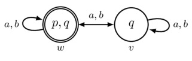

# dynamic-epistemic — appendix-A-kripke（supplement）

> （《dynamic-epistemic》词条补充材料，源：plato.stanford.edu/entries/dynamic-epistemic/appendix-A-kripke.html）

#### Supplement to Dynamic Epistemic Logic

## Appendix A: Kripke models for modal logic

Kripke’s models for modal logic (or variants thereof) are the basis for many modern approaches to reasoning about knowledge and belief (Fagin et al. 1995). Intuitively, these models characterize the knowledge (or beliefs) of idealized agents in terms of *considered possibilities*: to say that an agent knows (or believes) some statement *F* means that *F* holds in all of the states of affairs that the agent considers as possible candidates for the actual state of affairs. Hence eliminating from consideration one or more alternative states of affairs generally increases one’s certainty, thereby trending toward increased knowledge (or belief). In contrast, entertaining additional (perhaps new) states of affairs generally decreases one’s certainty, thereby trending toward decreased knowledge (or belief). Higher-order knowledge or belief (i.e., knowledge [or beliefs] about knowledge [or beliefs]) is represented by *iterated considered possibilities*; for example, if *F* is true of each possibility that agent *b* entertains when in any one of the states of affairs that agent *a* entertains, then we say that *a* knows (or believes) *b* knows (or believes) *F*. To make these concepts more concrete, let us consider a simple example.

*M*

*Figure A1.* A Kripke model.

Figure A1 pictures a Kripke model *M*. This model consists of two worlds: an “actual” world *w* (indicated by the double circle) in which the propositional letters *p* and *q* are true and an alternative world *v* in which *p* is false and *q* is true. The actual world indicates what is in fact true of the situation being modeled; in this case, *p* and *q* are true. Alternative worlds serve as candidates for the actual world that the agents may consider. As for which worlds are considered, an agent-labeled arrow pointing from a world *x* to a world *y* indicates that the agent in question will consider world *y* as a possible candidate for the actual state of affairs whenever we assume that world *x* is actual. Therefore, as we can see from the picture, each of agents *a* and *b* entertains both worlds *w* and *v* as possible states of affairs: *a*-arrows point from *w* to *w*, from *w* to *v*, from *v* to *w*, and from *v* to *v*; and *b*-arrows also point between the same pairs of worlds. Adopting an epistemic (i.e., knowledge-based) reading for the purposes of this example, an agent in the state of affairs given by world *x* is by definition said to know a statement *F* if and only if *F* is true in all worlds the agent considers possible with respect to *a* (i.e., those worlds that are the target of an arrow that has source *x* and that is labeled by that agent’s name). Looking at the picture, we see that neither agent knows that *p* is true. Indeed, each agent entertains a possibility—world *v*—in which *p* is false and therefore does not know that *p* is true. Likewise, neither agent knows that *p* is false because each entertains a world—world *w*—in which *p* is true. Defining the phrase “knowing whether *F* is true” to mean “knowing that *F* is true or knowing that *F* is false”, what we have seen is that neither agent knows *whether* *p* is true. Taking our analysis further, let us now show that each agent knows that neither agent knows whether *p* is true, a statement of *higher-order knowledge* (i.e., knowledge about knowledge). Indeed, in each of the possibilities agent *a* considers (i.e., in both *w* and *v*), neither agent *b* nor agent *a* herself knows whether *p* is true, as we have already seen. Therefore, since it is true in each of agent *a*’s possibilities that “neither agent knows whether *p* is true”, it follows that agent *a* knows that “neither agent knows whether *p* is true”. Similar reasoning leads us to conclude that agent *b* knows that “neither agent knows whether *p* is true”. Hence we conclude that each agent knows that “neither agent knows whether *p* is true”, as was claimed. This kind of analysis can be taken even further to show that it is in fact *common knowledge* among agents *a* and *b* that neither knows whether *p* is true; that is, neither agent knows whether *p* is true, each agent knows neither agent knows whether *p* is true, each agent knows each agent knows neither agent knows whether *p* is true, and so on, taking any finite number of iterations of the phrase “each agent knows” followed by the phrase “neither agent knows whether *p* is true”. One can also undertake a further analysis to show that it is common knowledge that *q* is true.

Formally, the notion of Kripke model is defined as follows.

**Kripke model.** Given a nonempty set $\sP$ of propositional letters and a finite nonempty set $\sA$ of agents, a *Kripke model* is a structure $$ M=(W,R,V) $$ consisting of

- a nonempty set *W* of *worlds* identifying the possible states of affairs that might obtain,
- a function $R:\sA\to \wp(W\times W)$ that assigns to each agent *a* a binary *possibility relation* $R_a\subseteq W\times W$ with $wR_av$ indicating that agent *a* will entertain world *v* as a candidate for the actual world whenever we assume that *w* is in fact actual), and
- a *propositional valuation* $V:\sP\to \wp(W)$ mapping each propositional letter $p\in\sP$ to the set $V(p)\subseteq W$ of worlds at which that letter is true.

Notation: if *M* is a Kripke model, then adding a superscript *M* to a symbol in $\{W,R,V\}$ is used to denote a component of the triple that makes up *M* in such a way that $(W^M,R^M,V^M)=M$. An *a*-arrow (sometimes also called an *$R_a$-arrow*) is a pair of worlds $(w,v)$ satisfying $wR_av$, which says that the *a*-arrow points from the source world *w* to the target world *v*. A *pointed Kripke model*, sometimes called a *scenario* or a *situation*, is a pair $(M,w)$ consisting of a Kripke model *M* and a world $w\in W^M$ (called the *point*) that designates the state of affairs that we (the formal modelers) currently assume to be actual. In drawing a Kripke model, worlds are indicated as circles labeled by their names, a letter *p* is true at a world *w* (i.e., $w\in V(p)$) if and only if *p* is listed inside the circle for world *w*, and arrows between worlds are drawn explicitly, often with a single arrow labeled by a set or a list of agents denoting a family of arrows, one for each agent in the set or list. If the model is pointed, the point is indicated by a double circle. See Figure A1 above for an example drawing.

For a given possibility relation $R_a$, some combination of relational properties such as reflexivity, transitivity, Euclideanness, symmetry, and seriality (see [Appendix C](dynamic-epistemic.appendix-C-relations.md) for definitions), among others, may be assumed based on the particular cognitive notion that this $R_a$ is supposed to represent and on one’s philosophical position as to the properties satisfied by the notion in question. The traditional “logic of knowledge” assumes reflexivity, transitivity, and Euclideanness; the traditional “logic of belief” assumes seriality, transitivity, and Euclideanness (Fagin et al. 1995).

The collection of formulas interpreted on pointed Kripke models generally contains at least the formulas coming from a modal language \eqref{ML } defined by the following grammar:

$$\begin{gather*}\taglabel{ML } F \ccoloneqq p \mid F \wedge F \mid \neg F \mid [a]F \\ \small p \in \sP,\; a \in \sA \end{gather*}$$

In words, the above “Backus–Naur Form” for defining symbolic notation defines the formulas of the language \eqref{ML } (a.k.a., the “\eqref{ML }-formulas”) as follows. First, each of the letters *p* coming from a given nonempty set $\sP$ of propositional letters is an \eqref{ML }-formula. Second, given \eqref{ML }-formulas $F_1$ and $F_2$, each of the following is also an \eqref{ML }-formula: the conjunction $F_1\land F_2$, the negation $\lnot F_1$, and the modal expression $[a]F_1$ obtained using an *a* coming from a given finite (and nonempty) set $\sA$ of agent names. (The symbol “$[a]$” is called a *modal operator*, a *modality*, or a *modal*.) Third, something is an \eqref{ML }-formula if and only if it can be formed from a propositional letter by way of conjunction, negation, or addition of a modal in the manner just specified. And this defines the collection of \eqref{ML }-formulas. When convenient, we will identify the expression “\eqref{ML }” with the set of \eqref{ML }-formulas. Other languages we define later will also be defined by Backus–Naur notation using similar notational conventions.

We make use of the usual notational abbreviations (from classical propositional logic) when writing formulas containing Boolean connectives other than conjunction ($\land$) or negation ($\lnot$); this includes, among others, appropriate abbreviations for material implication ($\to$), disjunction ($\lor$), the always-true propositional constant $\top$ for truth, and the always-false propositional constant $\bot$ for falsehood. The formula $[a]F$ is assigned either the epistemic reading “agent *a* knows *F*” or the doxastic reading “agent *a* believes *F*”, with the particular choice of reading depending on the situation to be modeled. Formulas are therefore used to express Boolean combinations of “ontic” (i.e., non-epistemic and non-doxastic) statements along with statements of agents’ knowledge (or beliefs). As an example, the formula $p\land\lnot [a]p$, which says that “*p* is true and agent *a* does not know that *p* is true”, expresses an ontic fact *p* along with the negation of the epistemic statement $[a]p$. (Here an epistemic reading of $\lnot [a]p$ was taken; a doxastic one could have been used just as well.) For a set *B* of agents, we make the following abbreviation:

$$ [B]F \text{ denotes } \bigwedge_{a\in B}[a]F. $$

which is the conjunction of all formulas $[a]F$ with *a* ranging over the set *B*. The formula $[B]F$ therefore says, “everyone in group *B* knows (or believes) *F*”. If common knowledge is to be included in the language for the purposes of a particular scenario, then the grammar \eqref{ML+C} is used:

$$\begin{gather*}\taglabel{ML+C} F \ccoloneqq p \mid F \wedge F \mid \neg F \mid [a]F \mid [B*]F \\ \small p \in \sP,\; a \in \sA,\; B\subseteq\sA \end{gather*}$$

The formula $[B*]F$ is read epistemically as “*F* is common knowledge among group *B*” and doxastically as “*F* is common belief among group *B*”. The expression $[C]F$ is used as an abbreviation for $[\sA]F$ (“it is common knowledge that *F* is true” or “it is common belief that *F* is true”). Sometimes authors choose to restrict grammar \eqref{ML+C} by requiring that the common knowledge group is always the full group of agents (i.e., $B=\sA$), but we will not do this here.

Each of the modal operators written between square brackets has a “dual” form defined by way of abbreviation and written using angled brackets:

- The dual $\langle a\rangle$ of $[a]$ is an abbreviation defined by setting $\langle a\rangle F \coloneqq \lnot[a]\lnot F$.
- Given a set *B* of agents, the dual $\langle B\rangle$ of $[B]$ is an abbreviation defined by setting $\langle B\rangle F \coloneqq \lnot[B]\lnot F$.
- Given a set *B* of agents, the dual $\langle B*\rangle$ of $[B]$ is an abbreviation defined by setting $\langle B*\rangle F \coloneqq \lnot[B*]\lnot F$.

The dual form of an operator expresses consistency. For example, $\langle a\rangle F$ says, “*F* is consistent with agent *a*’s beliefs”. A knowledge reading is also possible.

Some languages extend \eqref{ML } by addition of the *universal modality* $\forall$. The formula $[\forall]F$ says that *F* is true at every world in the Kripke model. The dual of the universal modality is the *existential modality*, written for convenience as $[\exists]$ and defined as the abbreviation $[\exists]F\coloneqq\lnot[\forall]\lnot F$. The formula $[\exists]F$ says that *F* is true at some world in the model.

The binary truth relation $\models$ between pointed models (written without delimiting parentheses) and formulas is defined inductively as follows:

- $M,w\models p$ holds if and only if $w\in V(p)$.
- $M,w\models F\land G$ holds if and only if $M,w\models F$ and $M,w\models G$.
- $M,w\models \lnot F$ holds if and only if $M\not\models F$.
- $M,w\models [a]F$ holds if and only if $M,v\models F$ for each *v* satisfying $wR_av$.
- $M,w\models [B]F$ holds if and only if $M,v\models F$ for each *v* satisfying $wR_Bv$.
- $M,w\models [B*]F$ holds if and only if $M,v\models F$ for each *v* satisfying $w(R_B)^*v$.
- $M,w\models [\forall]F$ holds if and only if $M,v\models F$ for each $v\in W$.

The relation $R_B\coloneqq\bigcup_{a\in A} R_a$ is the union of all relations $R_a$ with *a* in *B*, so that $xR_By$ holds if and only if $xR_ay$ holds for some *a* in *B*. The relation $(R_B)^*$ is the *reflexive-transitive closure* of $R_B$, so that $x(R_B)^*y$ holds if and only if $x=y$ or there is a finite sequence

$$ x R_B z_1 R_B z_2 R_B \cdots R_B z_n R_B y $$

of $R_B$-arrows connecting *x* to *y*. Said roughly, $R_B$ says what is considered possible by any one of the members of group *B*, and $(R_B)^*$ says what is jointly considered possible by members of group *B* when the members’ possibilities are chained together (i.e., one thinks something is possible, which leads another to think something else possible, leading another to consider yet another possibility, and so on, somewhat like a group of paranoid worriers sequentially raising more and more far-fetched possible ways something might go wrong). We write $M,w\models G$ to mean that formula *G* is true at world *w* of the pointed model $(M,w)$; the negation is written $M,w\not\models G$. As an exercise, one can go back to Figure A1 and check that

- $M,w\models p\land[a]p$ — “*p* is true at *w* but agent *a* does not know it”
- $M,w\models[b]\lnot[a]p$ — “agent *b* knows that agent *a* does not know *p*”; and
- $M,w\models[C]\lnot([a]p\lor[a]\lnot p)$ — “it is common knowledge that agent *a* does not know whether *p* is true”.

If $\sC_*$ is a collection of pointed Kripke models, then $\sC_*\models G$ means that *G* is true at each pointed model in collection $\sC_*$. Finally, $\models G$ means that *G* is true at all pointed Kripke models. For example, one can readily verify that

$$\begin{equation*}\tag{K} \models[a](F\to G)\to([a]F\to[a]G), \end{equation*}$$

which says that agent *a*’s knowledge is closed under the classical rule of *Modus Ponens*: if agent *a* knows an implication and she knows its antecedent, then she also knows its consequent. The same of course holds for the doxastic reading of the modal operator $[a]$.

For more on Kripke models, we refer the reader to the following entries in the *Stanford Encyclopedia of Philosophy*: Modal Logic, Modern Origins of Modal Logic, and Epistemic Logic.

← beginning of main article
