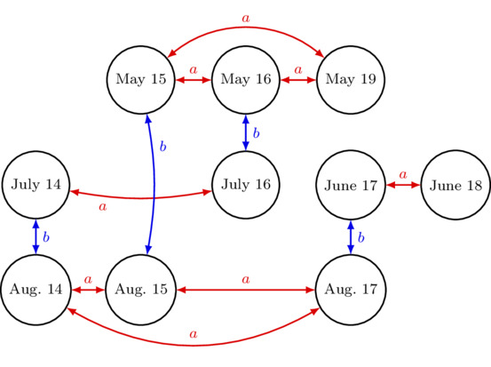
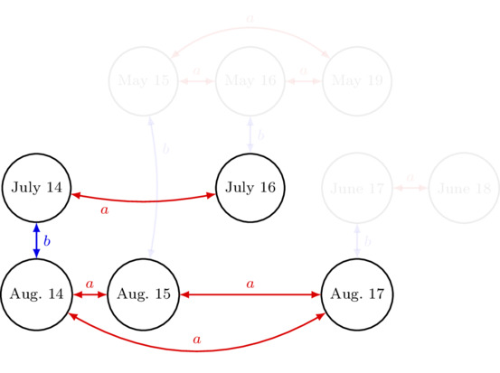
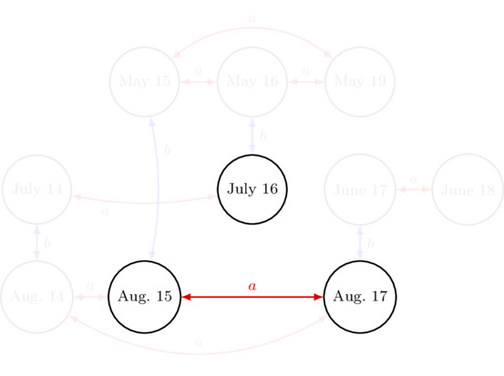
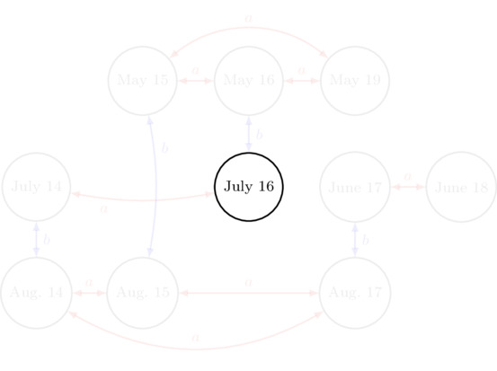
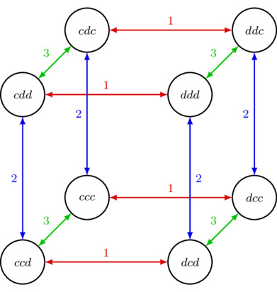
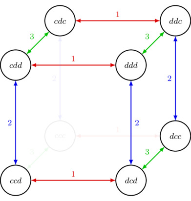
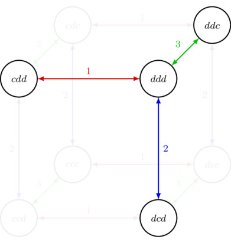
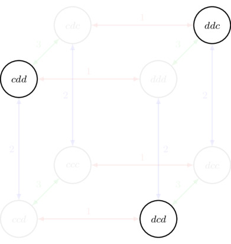
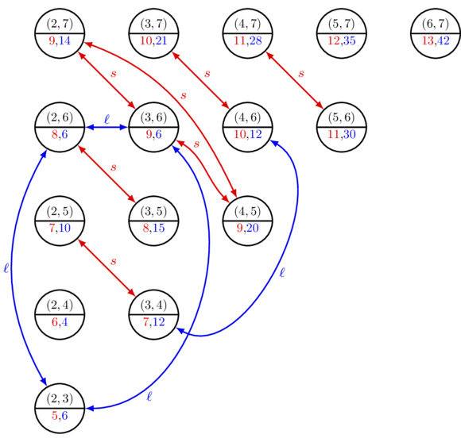
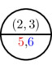

# dynamic-epistemic — appendix-B-solutions（supplement）

> （《dynamic-epistemic》词条补充材料，源：plato.stanford.edu/entries/dynamic-epistemic/appendix-B-solutions.html）

#### Supplement to Dynamic Epistemic Logic

## Appendix B: Solutions to Cheryl’s Birthday, Muddy Children, and Sum and Least Common Multiple

- 1. Cheryl’s Birthday
- 1.1 Problem Statement
- 1.2 Solution
- 1.3 Formalizing the Solution
- 1.3.1 Syntactic Formalization
- 1.3.2 Semantic Formalization
- 2. The Muddy Children
- 2.1 Problem Statement
- 2.2 Solution
- 2.3 Formalizing the Solution
- 3. The Sum and Least Common Multiple Puzzle
- 3.1 Problem Statement
- 3.2 Solution
- 3.3 Formalizing the Solution

### 1. Cheryl’s Birthday

#### 1.1 Problem Statement

**Cheryl’s Birthday (version of Chang (2015, 15 April)).** Albert and Bernard just met Cheryl. “When’s your birthday?” Albert asked Cheryl. Cheryl thought a second and said, “I’m not going to tell you, but I’ll give you some clues”. She wrote down a list of 10 dates:

- May 15, May 16, May 19
- June 17, June 18
- July 14, July 16
- August 14, August 15, August 17

“My birthday is one of these”, she said. Then Cheryl whispered in Albert’s ear the month—and only the month—of her birthday. To Bernard, she whispered the day, and only the day. “Can you figure it out now?” she asked Albert.

- Albert: I don’t know when your birthday is, but I know Bernard doesn’t know either.
- Bernard: I didn’t know originally, but now I do.
- Albert: Well, now I know too!

When is Cheryl’s birthday?

#### 1.2 Solution

We represent Albert’s and Bernard’s knowledge just after Cheryl asks “Can you figure it out now?” but before Albert and Bernard have their conversation using the model $M_{cb}$ pictured in Figure B1.

$ M_{cb} $

*Figure B1.* The Kripke model $M_{cb}$: the situation just after Cheryl asks “Can you figure it out now?” but before Albert and Bernard have their conversation. Red *a*-arrows represent Albert’s uncertainty, and blue *b*-arrows represent Bernard’s uncertainty. For simplicity, the picture omits reflexive arrows for each agent at each date (i.e., to complete the picture, we must add at each world both an *a*-arrow and a *b*-arrow pointing in a loop from the date in question back to itself).

In this model, we have one possible world for each date. A red *a*-arrow pointing from date *D* to date $D'$ tells us the following: “If Cheryl’s birthday is in fact *D*, then Albert considers it possible that her birthday might be $D'$”. For example, there is a red *a*-arrow pointing from June 17 to June 18: assuming Cheryl’s birthday is in fact June 17, then Albert will consider it possible that her birthday is June 18 because he was told the month—here assumed to be June—so if the date is actually June 17, then he considers June 18 a possibility. Note that there should also be a red *a*-arrow from June 17 to itself; indeed, if the actual date is June 17, then Albert should consider both June 18 and June 17 to be possible. However, to simplify the picture, we have omitted such “reflexive” arrows (i.e., arrows pointing in a loop from one date back to that very same date). Properly speaking, these arrows should be added in order to complete the picture: every date should have a reflexive red *a*-arrow.

Just as red *a*-arrows indicate the various possibilities Albert considers, blue *b*-arrows tell us the possibilities Bernard considers: a blue *b*-arrow from date *D* to date $D'$ tells us that “If Cheryl’s birthday is in fact *D*, then Bernard considers it possible that her birthday might be $D'$”. Reflexive blue *b*-arrows have also been omitted from the picture for simplicity.

It is not too difficult to verify that the arrow structure in Figure B1 correctly describes the situation with regard to Albert’s and Bernard’s knowledge just after Cheryl asks “Can you figure it out now?” but before Albert and Bernard have their conversation. Indeed, according to the usual Kripke-style notion of knowledge (i.e., “an agent knows *F* if and only if *F* is true at all worlds he considers possible”), Figure B1 shows that Albert knows the month: there are red *a*-arrows pointing between all dates having the same month. Therefore, no matter which of these dates is Cheryl’s birthday, all possibilities Albert will entertain will have the same month and therefore he can be said to know the month of her birthday. Figure B1 also shows that Bertrand knows the numerical day: there are blue *b*-arrows pointing between all dates having the same numerical day. So no matter which of these dates is Cheryl’s birthday, all possibilities Bertrand will entertain will have the same day and therefore he can be said to know the day of her birthday.

Now let us consider the effect of Albert’s first announcement, which we label as $A_1$:

- $(A_1)$Albert: I don’t know when [Cheryl’s] birthday is, but I know Bernard doesn’t know either.

The effect of this statement is a public announcement: we eliminate all dates at which this statement is false, thereby retaining only those dates at which it is true. That is, we eliminate all those possibilities at which

1. Albert knows the birthday, or
2. Albert knows Bernard knows the birthday.

For one of our agents Albert or Bernard to “know” the birthday, he must consider only one of the dates to be possible. That is, supposing date *D* is the birthday, then an agent will know that “*D* is Cheryl’s birthday” if and only if there is no arrow for that agent pointing from *D* to some different date $D'$. So, looking at the dates in Figure B1, we can see that there is no date at which Albert knows the birthday: at each date *D*, there is a red *a*-arrow pointing to some different date $D'$. Therefore, the first of Albert’s first public announcement (“I don’t know when [Cheryl’s] birthday is”) does not call for us to eliminate any dates.

Now we return to the second part of Albert’s first public announcement: “I know Bernard doesn’t know [Cheryl’s birthday] either”. This calls for us to eliminate from Figure B1 any date at which this statement is false: Albert does *not* know that Bernard does not know the birthday. To understand which dates we should eliminate, let us look at this in stages. First, if date *D* is the birthday and Albert does not know some statement *F*, then there must be a red *a*-arrow from *D* to some date $D'$ (which might be the same as *D*) and *F* must be false at $D'$. Second, the statement *F* we are interested in is “Bernard does not know the birthday”. So for this statement *F* to be *false*, it must be that Bernard *does* know the birthday: there must be no blue *b*-arrow pointing to a different date. So since we must eliminate all dates *D* at which Albert does not know that Bernard knows the birthday, we must eliminate *D* if there is a red *a*-arrow pointing to a not necessarily different date $D'$ at which there are no blue *b*-arrows pointing to a different date. Note: it is important to take into account the reflexive red *a*-arrows that have been omitted from the picture; this is why $D'$ can be the same as *D*.

Looking to Figure B1, at which dates can we take a red *a*-arrow (including the possibility of a non-drawn reflexive *a*-arrow, which loops us right back to the same date) to a location at which there is no blue *b*-arrow pointing to a different date? These are:

- May 15: from this date, we can take an *a*-arrow to May 19, which has no *b*-arrows to a different date;
- May 16: same as for May 15;
- May 19: from this date, we can take a reflexive *a*-arrow (not drawn) right back to May 19, which has no *b*-arrows to a different date;
- June 17: from this date, we can take an *a*-arrow to June 18, which has no *b*-arrows to a different date; and
- June 18: from this date, we can take a reflexive *a*-arrow (not drawn) right back to June 18, which has no *b*-arrows to a different date.

These are the dates we should eliminate. All other dates should remain: at these other dates, every *a*-arrow (including the reflexive ones) leads us to a location at which there is indeed a *b*-arrow going to a different date. So after elimination, we obtain the result of Albert’s first public announcement $A_1$: the model $M_{cb}[A_1]$ pictured in Figure B2.

$M_{cb}[A_1]$

*Figure B2.* The model $M_{cb}[A_1]$ obtained from $M_{cb}$ (Figure B1) after Albert’s first public announcement $A_1$. Eliminated worlds and arrows from the model $M_{cb}$ are faintly drawn in this picture for clarity; these are not actually present in the model. Also, as with Figure B1, reflexive arrows for each agent at each world have been omitted for simplicity.

Now let us consider the effect of Bernard’s first announcement, which we label as $B_1$:

- $(B_1)$Bernard: I didn’t know [Cheryl’s birthday] originally, but now I do.

The first part of this statement (“I didn’t know [Cheryl’s birthday] originally”) is to be interpreted in the model $M_{cb}[A_1]$ of Figure B2; however, this part uses the past tense (“did not know”), which suggests the interpretation must involve looking back at what was true in the original model $M_{cb}$ from Figure B1. The most straightforward way to do this is as follows: at date *D* in $M_{cb}[A_1]$, to determine if it is true that “Bernard did not know [Cheryl’s birthday] originally”, we look back to the same date in the model $M_{cb}$ of Figure B1 and see if Bernard does know the birthday. If he does not, then we say that the statement holds in date *D* of model $M_{cb}[A_1]$; otherwise, we say the statement does not hold at date *D* of $M_{cb}[A_1]$. In this way, we determine whether to eliminate date *D* from $M_{cb}[A_1]$ in terms of what is true of that same date in the original model $M_{cb}$, which provides our straightforward interpretation of the past tense. Proceeding with this interpretation, we find that this first part of Bernard’s announcement holds at every date in $M_{cb}[A_1]$: for each of these dates, if we look back to that same date in Figure B1, we see that Bernard does not know the birthday there (because there is a blue *b*-arrow pointing to a different date in Figure B1). Therefore the first part of this announcement does not cause us to eliminate any worlds.

How about the second part (“now I do [know Cheryl’s birthday]”)? For this, we must eliminate any date in $M_{cb}[A_1]$ of Figure B2 that makes the statement false: these are the dates in $M_{cb}[A_1]$ at which Bernard does *not* know the birthday, which are the dates in $M_{cb}[A_1]$ that have a blue *b*-arrow pointing to a different date. Examining Figure B2, it is clear that there are only two such dates: July 14 and August 14. Therefore, the net result of Bernard’s first announcement $B_1$ is to eliminate these worlds. This gives us the model $M_{cb}[A_1][B_1]$ pictured in Figure B3.

$M_{cb}[A_1][B_1]$

*Figure B3.* The model $M_{cb}[A_1][B_1]$ obtained from $M_{cb}[A_1]$ (Figure B2) after Bernard’s first public announcement $B_1$. Eliminated worlds and arrows from the models $M_{cb}$ and $M_{cb}[A_1]$ are faintly drawn in this picture for clarity; these are not actually present in the model. Also, reflexive arrows for each agent at each world have been omitted for simplicity.

Now let us look at the effect of Albert’s second announcement, which we label as $A_2$:

- ($A_2$) Albert: Well, now I know [Cheryl’s birthday] too!

This public announcement has us eliminate from $M_{cb}[A_1][B_1]$ of Figure B3 all dates at which the statement is false: these are the dates in $M_{cb}[A_1][B_1]$ at which Albert does *not* know the birthday, which are the dates in $M_{cb}[A_1][B_1]$ at which there is a red *a*-arrow pointing to a different date. Examining Figure B3, it is clear that there are only two such dates: August 15 and August 17. Therefore, the result of Albert’s second announcement $A_2$ is to eliminate these worlds. This gives us the model $M_{cb}[A_1][B_1][A_2]$ pictured in Figure B4.

$M_{cb}[A_1][B_1][A_2]$

*Figure B4.* The model $M_{cb}[A_1][B_1][A_2]$ obtained from $M_{cb}[A_1][B_1]$ (Figure B3) after Albert’s second public announcement $A_2$. Eliminated worlds and arrows from the models $M_{cb}$, $M_{cb}[A_1]$, and $M_{cb}[A_1][B_1]$ are faintly drawn in this picture for clarity; these are not actually present in the model. Also, reflexive arrows for each agent at each world have been omitted for simplicity.

So we obtain the solution: the only possible date that is consistent with the information provided in the problem statement is July 16.

#### 1.3 Formalizing the Solution

The correctness of our solution depends on the assumption that the sequence of models $M_{cb}$, $M_{cb}[A_1]$, $M_{cb}[A_1][B_1]$, and $M_{cb}[A_1][B_1][A_2]$ we have identified is the only possible sequence that is consistent with the problem statement. Since we have not proved that this is so, we cannot be said to have proved that the solution is correct. Therefore, while our picture-based “solution” is visually appealing, it is not mathematically complete because it does not provide a proof.

To prove that July 16 is the correct answer, we must develop a mathematical formalization of the problem and then prove that this formalization implies that July 16 is the answer. Then the correctness of our solution rests only on the correctness of our formalization itself: so long as the formalization is all right, the solution must be correct. Note: one might argue that our picture-based solution is one such formalization; however, we have not proved that the starting model $M_{cb}$ is the only Kripke model that adequately represents the initial setup, nor have we proved that our interpretation of which worlds to eliminate is correct! However, we will see that our picture-based solution *can* be formalized.

In this section, we consider two ways of filling this gap, one syntactic (i.e., based on proofs) and one semantic (i.e., based on models). The semantic formalization provides the missing argument that our picture-based solution works, whereas the syntactic formalization uses the theory $\PALC$ to prove that the solution we identified above is correct.

A proper formalization would use a formal language that can capture the past-tense part of Bernard’s first announcement $B_1$ (“I didn’t know [Cheryl’s birthday] originally”). However, since we saw that the past-tense part provided no additional information (in that it eliminated no dates), we will simplify the problem by ignoring this part of Bernard’s announcement, so that we may define a formal language that does not address tense issues. (The interested reader is directed to [Appendix N](dynamic-epistemic.appendix-N-time.md) for details on some approaches one might use in order to incorporate tense into the formalization and give a “true” formalization of the original problem.) So strictly speaking, our formalization here is for a variation of the original problem in which Bernard’s announcement is changed by eliminating the past-tense part; we might call this the “tense-free version” of the problem. (Note that we expect the formalization of both versions to lead to the same solution, though we have not proved it!)

1.3.1 Syntactic Formalization

Our set $\sA$ of agents will be “*a*” for Albert and “*b*” for Bernard: $$ \sA \coloneqq\{a,b\}. $$ The set $\sP$ of propositional letters of our language will be the dates: $$ \sP \coloneqq \left\{ \begin{array}{l} \text{May 15, May 16, May 19,}\\ \text{June 17, June 18,}\\ \text{July 14, July 16,}\\ \text{Aug. 14, Aug. 15, Aug. 17} \end{array} \right\}. $$ For convenience, we define the following subsets of $\sP$: $$ \begin{align*} \mathsf{May} & \coloneqq \{ \text{May 15, May 16, May 19} \}, \\ \mathsf{June} & \coloneqq \{ \text{June 17, June 18} \}, \\ \mathsf{July} & \coloneqq \{ \text{July 14, July 16} \}, \\ \mathsf{Aug} & \coloneqq \{ \text{Aug. 14, Aug. 15, Aug. 17} \}, \\ \mathsf{14} & \coloneqq \{ \text{July 14, Aug. 14} \}, \\ \mathsf{15} & \coloneqq \{ \text{May 15, Aug. 15} \}, \\ \mathsf{16} & \coloneqq \{ \text{May 16, July 16} \}, \\ \mathsf{17} & \coloneqq \{ \text{June 17, Aug. 17} \}, \\ \mathsf{18} & \coloneqq \{ \text{June 18} \}, \\ \mathsf{19} & \coloneqq \{ \text{May 19} \}. \end{align*} $$ We also define the following sets of subsets of $\sP$: $$\begin{align*} \mathsf{month} & \coloneqq \{ \mathsf{May}, \mathsf{June}, \mathsf{July}, \mathsf{Aug} \},\\ \mathsf{day} & \coloneqq \{\mathsf{14}, \mathsf{15}, \mathsf{16}, \mathsf{17}, \mathsf{18}, \mathsf{19} \}. \end{align*}$$ We use the sets $\sA$ and $\sP$ to define the language \eqref{PAL+C } of Public Announcement Logic with common knowledge defined in the main article: $$\begin{gather*}\taglabel{PAL+C } F \ccoloneqq p \mid F \wedge F \mid \neg F \mid [a]F \mid [F!]F \mid [B*]F \\ \small p \in \sP,\; a \in \sA,\; B\subseteq\sA \end{gather*}$$ The information Cheryl provides establishes the following assumptions:

1. **It is common knowledge that Cheryl’s birthday is one of those in $\sP$.** We represent this using the formula $$ \mathsf{A}_1 \coloneqq [\sA*]\left(\bigwedge_{d\in\sP}\may{\sA{*}}d\right)\land\left([\sA*]{\textstyle\bigvee\sP}\right), $$ which says: it is common knowledge that for each of the dates *d* in the set $\sP$, the agents jointly entertain the possibility that Cheryl’s birthday might be *d*; further, it is common knowledge that Cheryl’s birthday must be one of those in $\sP$. This assumption ensures that Albert and Bernard do not exclude any of the dates from Cheryl’s initial list and that the only dates they consider are those on this list.
2. **It is common knowledge that each of the dates in $\sP$ is different.** We represent this using the formula $$ \mathsf{A}_2 \coloneqq [\sA*]\bigwedge_{d\in\sP}\left(d\to\bigwedge_{d'\in\sP-\{d\}}\lnot d'\right), $$ which says: it is common knowledge that each date *d* in the set $\sP$ is different than any other date $d'$ in $\sP$. This “obvious” assumption is required so that Albert and Bernard do not mistakenly believe different dates can coincide.
3. **It is common knowledge that Albert knows the month of Cheryl’s birthday.** We represent this using the formula $$ \mathsf{A}_3 \coloneqq \bigwedge_{m\in\mathsf{month}}[\sA*]\left({\textstyle\bigvee m}\to\left([a]\left({\textstyle\bigvee m}\right)\land\bigwedge_{d\in m}\may{a}d\right)\right), $$ which says: for each month *m* appearing in Cheryl’s list, it is common knowledge that if the month of Cheryl’s birthday is *m*, then Albert knows this, although he considers each of the dates *d* in *m* to be possible. This assumption ensures that Albert knows the month of Cheryl’s birthday but that his knowledge is incomplete because he cannot exclude any date from the list that has the same month as the birthday.
4. **It is common knowledge that Bernard knows the day of Cheryl’s birthday.** We represent this using the formula $$ \mathsf{A}_4 \coloneqq \bigwedge_{d\in\mathsf{day}}[\sA*]\left({\textstyle\bigvee d}\to\left([b]\left({\textstyle\bigvee d}\right)\land\bigwedge_{d'\in d}\may{a}d'\right)\right), $$ which says: for each numerical day *d* appearing in Cheryl’s list, it is common knowledge that if the day of Cheryl’s birthday is *d*, then Bernard knows this, although he considers each of the dates $d'$ having the same numerical day as *d* to be possible. This assumption ensures that Bernard knows the day of Cheryl’s birthday but that his knowledge is incomplete because he cannot exclude any date from the list that has the same numerical day as the birthday.

We write “$\mathsf{Setup}$” to denote the conjunction of the assumptions:

$\mathsf{Setup}$ $\coloneqq$ $\mathsf{A}_1$ $\land$ $\mathsf{A}_2$ $\land$ $\mathsf{A}_3$ $\land$ $\mathsf{A}_4$ .

For an agent $x\in\sA$ to know Cheryl’s birthday, he must only consider one date to be possible. We express this using the formula $$ \text{KB}_x \coloneqq \bigwedge_{d\in\sP}(d\to [x]d), $$ which says: for each of the dates *d* in Cheryl’s list, if *d* is her birthday, then agent *x* knows this. We use this formula to formalize the public announcements from Albert and Bernard’s conversation, listed here in order:

1. $\lnot\text{KB}_a\land[a]\lnot\text{KB}_b$ — Albert does not know the birthday, and he knows that Bernard does not either;
2. $\text{KB}_b$ — Bernard knows the birthday; and
3. $\text{KB}_a$ — Albert knows the birthday.

Taken together, to verify our solution, we need to derive in the logic $\PALC$ the formula:

$$\begin{equation*}\taglabel{CB} \mathsf{Setup} \to [\lnot\text{KB}_a\land[a]\lnot\text{KB}_b !] [\text{KB}_b !] [\text{KB}_a !] \text{(July 16)}. \end{equation*}$$

This formula says: given the initial setup, after Albert and Bernard have their conversation, the only possible date is July 16.

To complete the formalization, can the reader derive \eqref{CB} in $\PALC$?

1.3.2 Semantic Formalization

The semantic formalization takes our picture-based solution and fills in the missing details so as to prove that the sequence of models we used to derive an answer indeed gives us the correct answer. The basic idea of this solution is the following: though we cannot use the language \eqref{PAL+C } to capture the exact models we use in our picture-based solution, we can capture these models *up to bisimulation*. (The reader is directed to Appendix G for the definition of bisimulation, the statement of the Bisimulation Theorem, and the notation that we define in each of these.)

To begin, we define our sets $\sA$ of agents and $\sP$ of propositional letters just as we did for the syntactic solution. Likewise, we define the formulas $\mathsf{A}_1$ through $\mathsf{A}_4$, $\mathsf{Setup}$, $\text{KB}_a$, and $\text{KB}_b$ as we did before.

We shall restrict attention to the class $\sC$ of Kripke models *M* whose agent set is $\sA$ and whose set of propositional letters is $\sP$. This means that $M\in\sC$ if and only if *M* contains a binary accessibility relation $R^M_x\subseteq W^M\times W^M$ for each of our agents $x\in\sA$ and no others and the valuation $V^M$ in *M* has functional type $V^M:\sP\to W^M$ (i.e., this valuation maps letters in the set $\sP$, and not some other set, to sets of worlds in *M*). We let $\sC_*$ be the class of pointed Kripke models $(M,w)$ having $M\in\sC$.

Given a Kripke model $M\in\sC$, a world $w\in W^M$, and an agent $x\in\sA$, we define the *connected component* $$ \cc^M(w) \coloneqq \left\{ v\in W^M \mid w\left(R^M_\sA\right)^*v \right\} $$ of *w*. This is the set of all worlds *v* in *M* that can be reached from *w* by following zero or more agent arrows. (And hence $\cc^M(w)$ includes *w* itself.) The idea is that $\cc^M(w)$ is the set of all worlds that the agents would jointly consider possible from a “common knowledge” perspective. (In [Appendix A](dynamic-epistemic.appendix-A-kripke.md), we define $R^M_\sA\coloneqq\bigcup_{x\in\sA}R^M_x$ and use $R^*$ to denote the application of the reflexive-transitive closure operator to the binary relation *R*.)

It shall now be our task to prove the following theorem.

**Setup Theorem.** Given $(M_1,w_1)\in\sC_*$ and $(M_2,w_2)\in\sC_*$, if there exists $d_*\in\sP$ such that $$ M_1,w_1\models d_*\land\mathsf{Setup} \text{ and } M_2,w_2\models d_*\land\mathsf{Setup}, $$ then $(M_1,w_1)\bisim(M_2,w_2)$.

*Proof.* Assume there exists $d_*\in\sP$ such that $M_1,w_1\models d_*\land\mathsf{Setup}$ and $M_2,w_2\models d_*\land\mathsf{Setup}$. It follows that the pointed Kripke models $(M_1,w_1)$ and $(M_2,w_2)$ both satisfy the assumption formulas $\mathsf{A}_1$ through $\mathsf{A}_4$. In particular, since they satisfy $\mathsf{A}_1$ and $\mathsf{A}_2$, it follows by inspection of these formulas and the definition of satisfaction that for each $i\in\{1,2\}$, there exists a surjection $f_i:\cc^{M_i}(w_i)\to\sP$ satisfying the property that for each world $u\in\cc^{M_i}(w_i)$ and date $d\in\sP$, we have $M_i,u\models d$ if and only if $f_i(u)=d$. Intuitively, this says that each world in the connected component $\cc^{M_1}(w_1)$ corresponds to a unique date from Cheryl’s list; the same goes for worlds in the connected component $\cc^{M_2}(w_2)$. Define the inverse $f_i^{-1}:\sP\to\wp(\cc^{M_i}(w_i))$ by setting $f_i^{-1}(d)\coloneqq\{u\in \cc^{M_i}(w_i)\mid f_i(u)=d\}$. So $f_i^{-1}(d)$ is the set of worlds in $\cc^{M_i}(w_i)$ that are assigned to date *d*. We define the following binary relations between $W^{M_1}$ and $W^{M_2}$:

$$\begin{align} Z_0 &\,{\coloneqq}\, \{(w_1,w_2)\}, \\ Z_{i+1} &\,{\coloneqq}\, \{ (u_1',u_2') \mid f_1(u_1')=f_2(u_2')\land \exists x\in\sA,u_1,u_2: u_1Z_iu_2 \land u_1R^{M_1}_xu_1' \land u_2R^{M_2}_xu_2' \},\\ Z &\,{\coloneqq}\,\textstyle \bigcup_{i=0}^\infty Z_i. \end{align}$$

Since $w_1Zw_2$, it follows that *Z* is nonempty. By induction on *i*, one can prove that $u_1Z_iu_2$ implies $f_1(u_1)=f_2(u_2)$. The base case, where $i=0$, follows because because $(M_1,w_1)$ and $(M_2,w_2)$ both satisfy the same letter $d_*\in\sP$ (and no others). For the induction step, where $i\gt 0$, the result follows by the definition of $Z_i$. Therefore, $u_1Zu_2$ implies $f_1(u_1)=f_2(u_2)$. Making use of this fact, and referring now to the definition of bisimulation (Appendix G), it follows by the definitions of $f_1$ and $f_2$ that *Z* satisfies Propositional Identity. It shall now be our task to prove that *Z* also satisfies Back. For this, we first note that $u_1Z_iu_2$ implies $u_1\in\cc^{M_1}(w_1)$ and $u_2\in\cc^{M_2}(w_2)$; this is proved by a straightforward induction on *i*. To prove Back, we must show that if $u_1Zu_2$ and $u_2R_x^{M_2}u_2'$ for some $x\in\sA$, then there exists $u_1'\in W^{M_1}$ such that $u_1R_x^{M_1}u_1'$ and $u_1'Zu_2'$. Since $\sA=\{a,b\}$, we may break up this proof into two items, one for $x=a$ and one for $x=b$.

- If $u_1Zu_2$ and $u_2R^{M_2}_au_2'$, then there exists $u_1'\in W^{M_1}$ such that $u_1R^{M_1}_au_1'$ and $u_1'Zu_2'$. Here we will actually prove the following for each $i\geq 0$: if $u_1Z_iu_2$ and $u_2R^{M_2}_au_2'$, then there exists $u_1'\in W^{M_1}$ such that $u_1R^{M_1}_au_1'$ and $u_1'Z_{i+1}u_2'$. Since we have $u_1Zu_2$ if and only if there exists *k* such that $u_1Z_ku_2$, it follows that what we will actually prove implies the desired result. So let us proceed with our proof. Assume $u_1Z_iu_2$ and $u_2R^{M_2}_au_2'$. It follows that $f_1(u_1)=f_2(u_2)$, $u_1\in\cc^{M_1}(w_1)$, and $u_2\in\cc^{M_2}(w_2)$. Since our collection $\mathsf{month}$ (of “months”) consists of pairwise disjoint sets of dates and every date in $\sP$ occurs in exactly one set in the collection, it follows from $M_2,w_2\models \mathsf{A}_1\land \mathsf{A}_2\land \mathsf{A}_3$ and $u_2\in\cc^{M_2}(w_2)$ that we have $M_2,u_2\models\bigvee m$ for some $m\in\mathsf{month}$. Thus $f_2(u_2)\in m$. In words: date $f_2(u_2)$ falls in month *m*. Further, since $M_2,w_2\models \mathsf{A}_3$ and $u_2\in\cc^{M_2}(w_2)$, it follows that $M_2,u_2\models[a](\bigvee m)$. Therefore, since $u_2R^{M_2}_au_2'$, we have $M_2,u_2'\models\bigvee m$. Hence $f_2(u_2')\in m$, so that date $f_2(u_2')$ falls in month *m* as well. Since $f_1(u_1)=f_2(u_2)$, the date $f_1(u_1)$ also falls in month *m*, and so $M_1,u_1\models\bigvee m$. Applying the fact that $M_1,w_1\models \mathsf{A}_3$ and $u_1\in\cc^{M_1}(w_1)$, it follows by $M_1,u_1\models\bigvee m$ and the definition of $\mathsf{A}_3$ that $M_1,u_1\models\bigwedge_{d\in m}\may{a}d$. Since $f_2(u_2')\in m$, we obtain $M_1,u_1\models\may{a}f_2(u_2')$. As a consequence of this, there exists $u_1'\in W^{M_1}$ such that $u_1R^{M_1}_au_1'$ and $M_1,u_1'\models f_2(u_2')$. Hence $f_1(u_1')=f_2(u_2')$. But then we have shown that $f_1(u_1')=f_2(u_2')$, $u_1Z_iu_2$, $u_1R^{M_1}_au_1'$, and $u_2R^{M_2}_au_2'$. Applying the definition of $Z_{i+1}$, it follows that $u_1'Z_{i+1}u_2'$.
- If $u_1Zu_2$ and $u_2R^{M_2}_bu_2'$, then there exists $u_1'\in W^{M_1}$ such that $u_1R^{M_1}_bu_1'$ and $u_1'Zu_2'$. The argument is almost the same as for the previous item, except that we use *b* instead of *a*, use $\mathsf{A}_4$ instead of $\mathsf{A}_3$, use $\textsf{day}$ instead of $\textsf{month}$, and refer to days instead of months.

So *Z* satisfies Back. By a similar argument (that interchanges $1$'s and $2$'s in the appropriate places), it follows that *Z* satisfies Forth as well. So *Z* is a bisimulation between $M_1$ and $M_2$. To complete the proof, we observe that since $w_1Z_0w_2$, we obtain $w_1Zw_2$. Conclusion: $(M_1,w_1)\bisim(M_2,w_2)$. ■

We will also make use of the following result about preservation of bisimulation under public announcements by (ML)-formulas:

**Bisimulation Preservation Theorem**. Let $(M_1,w_1)$ and $(M_2,w_2)$ be pointed Kripke models and *F* be an (ML)-formula such that $M_i,w_i\models F$ for each $i\in\{1,2\}$. If $(M_1,w_1)\bisim(M_2,w_2)$, then $(M_1[F],w_1)\bisim(M_2[F],w_2)$.

*Proof.* Let *Z* be the bisimulation between $M_1$ and $M_2$ satisfying $w_1Zw_2$. We prove that $$ Z'\coloneqq Z\cap(W^{M_1}[F]\times W^{M_2}[F]) $$ is a bisimulation between $M_1[F]$ and $M_2[F]$ satisfying $w_1Z'w_2$. Proceeding, Propositional Identity for $Z'$ follows by the definition of $Z'$ and Propositional Identity for *Z*. To prove Back for $Z'$, assume we have $u_1Z'u_2$ and $u_2R^{M_2[F]}_xu_2'$. It follows that $u_1Zu_2$, $u_2R^{M_2}_xu_2'$, and $M_2,u_2'\models F$. Applying the Back property for *Z*, there exists $u_1'\in W^{M_1}$ such that $u_1R^{M_1}_xu_1'$ and $u_1'Zu_2'$. But then $(M_1,u_1')\bisim(M_2,u_2')$, so since we have $F\in\text{(ML})$ and $M_2,u_2'\models F$, it follows by the Bisimulation Theorem that $M_1,u_1'\models F$ and therefore $u_1'\in W^{M_1[F]}$. Hence $u_1R^{M_1[F]}_xu_1'$ and $u_1'Z'u_2'$. This completes the proof of Back for $Z'$. Forth for $Z'$ is proved similarly. Finally, we have $w_1Z'w_2$ by the assumption that $M_i,w_i\models F$ for each $i\in\{1,2\}$ and the definition of $Z'$. ■

Referring to the model $M_{cb}$ from our picture-based solution (Figure B1), it is not difficult to verify that we have each of the following:

- $M_{cb}$ has $\sA$ as its agent set and $\sP$ as its set of propositional letters; that is, $M_{cb}\in\sC$.
- We have $M_{cb},w\models\mathsf{Setup}$ for each world $w\in W^{M_{cb}}$.
- Each world *w* in $M_{mc}$ satisfies exactly one date $d_w\in\sP$, meaning we have $M_{mc},w\models d_w$ and $M_{mc},w\not\models d'$ for each $d'\in\sP-\{d_w\}$.

Choose an arbitrary $M\in\sC$ satisfying the property that $M,v\models\mathsf{Setup}$ for each world $v\in W^M$. Since $M\in\sC$ (and so *M* is based on the propositional letter set $\sP$), each world *w* in $M_{cb}$ gives rise to a set $$ g(w) \coloneqq \{ v\in W^M \mid M,v\models d_w \} $$ of worlds in *M* that also satisfy the same date $d_w$. This defines a function $g:W^{M_{cb}}\to\wp(W^M)$ mapping worlds in $M_{cb}$ to sets of worlds in *M*. Since every world in *M* satisfies $\mathsf{Setup}$, it is not difficult to see that $g(w)\neq\emptyset$ for each *w* in $M_{mc}$. Further, since worlds in *M* all satisfy $\mathsf{Setup}$ and since each date in $\sP$ is true at a unique world in $M_{mc}$, it follows that every world $v\in W^M$ gives rise to a unique world $g^{-1}(v)\in W^{M_{mc}}$ such that $g(g^{-1}(v))=v$. Given *w* in $M_{cb}$, since *w* and the worlds in $g(w)$ all satisfy $d_w\land\text{Setup}$, it follows by the Setup Theorem that $(M_{cb},w)\bisim(M,v)$ for each $v\in g(w)$. Therefore, for each sequence $F_1,\dots,F_n$ of (ML)-formulas such that the structures $M_{cb}[F_1]\cdots[F_n]$ and $M[F_1]\cdots[F_n]$ contain nonempty sets of worlds (and therefore these structures are Kripke models), it follows by the Bisimulation Preservation Theorem that

$$ (M_{cb}[F_1]\cdots[F_n],w) \bisim (M[F_1]\cdots[F_n],v) \text{ for each }v\in g(w). $$

For a Kripke model $M\in\sC$ and a date $d\in\sP$, we shall say that a sequence $F_1,\dots,F_n$ of (ML)-formulas yields date *d* in *M* to mean that the structure $M[F_1]\cdots[F_n]$ contains worlds (so this is a Kripke model) and each of these worlds satisfies a unique date $d\in\sP$. This leads us to the following result:

**Agreement Theorem.** Suppose $M\in\sC$ satisfies $M,w\models\mathsf{Setup}$ for each world $w\in W^M$. The sequence $F_1,\dots,F_n$ of (ML)-formulas yields date *d* in $M_{mc}$ if and only if this same sequence yields date *d* in *M*.

*Proof.* This proof uses the notation and results established just above the statement of the theorem. Since each date in $\sP$ is satisfied at a unique world in $M_{cb}$, it follows that $F_1,\dots,F_n$ yields date *d* in $M_{mc}$ if and only if $M_{mc}[F_1]\cdots[F_n]$ contains a unique world *w* such that $d_w=d$. We make use of this in what follows. Proceeding, assume that $F_1,\dots,F_n$ yields date *d* in $M_{cb}$, so that *w* is the unique world in $M_{mc}[F_1]\cdots[F_n]$ and $d=d_w$. It follows that for each world $u\in W^{M_{cb}}-\{w\}$, there exists a minimum $k(u)\in\{1,\dots,n-1\}$ such that $M_{cb}[F_1]\cdots[F_{k(u)-1}],u\not\models F_{k(u)}$. Now we have seen that $g(w)\neq\emptyset$. Further, since we have for each $i\in\{1,\dots,n\}$ and $v\in g(w)$ that $$ (M_{cb}[F_1]\cdots[F_i],w)\bisim(M[F_1]\cdots[F_i],v), $$ it follows by the Bisimulation Theorem that $M[F_1]\cdots[F_n]$ contains the worlds in $g(w)$. To see that it contains no other worlds, notice that for any $v\in W^M-g(w)$, we have that $$ M_{cb}[F_1]\cdots[F_{k(g^{-1}(v))-1}],g^{-1}(v)\not\models F_{k(g^{-1}(v))} $$ and therefore, since we have a bisimulation linking $g^{-1}(v)$ in $M_{cb}[F_1]\cdots[F_{k(g^{-1}(v))-1}]$ to *v* in $M[F_1]\cdots[F_{k(g^{-1}(v))-1}]$, it follows by the Bisimulation Theorem that $$ M[F_1]\cdots[F_{k(g^{-1}(v))-1}],v\not\models F_{k(g^{-1}(v))} . $$ As a result, *v* is not in $M[F_1]\cdots[F_n]$. Since $v\in W^M-g(w)$ was chosen arbitrarily, we have proved that $F_1,\dots,F_n$ yields date $d_w=d$ in *M*. This proves one direction of the theorem. For the converse, we assume that $F_1,\dots,F_n$ yields date *d* in *M*. It follows that $M[F_1]\cdots[F_n]$ consists of a nonempty set *W* of worlds and for each $v\in W$, we have $M[F_1]\cdots[F_n],v\models d$. Further, for each world $u\in W^M-W$, there exists a minimum $k(u)\in\{1,\dots,n-1\}$ such that $M[F_1]\cdots[F_{k(u)-1}],u\not\models F_{k(u)}$. Since there is a bisimulation linking each *v* in *M* to $g^{-1}(v)$ in $M_{cb}$, it follows by the Bisimulation Preservation Theorem that $M_{cb}[F_1]\cdots[F_n]$ has $\{g(v)\mid v\in W\}$ as a subset of its set of worlds. However, since we assumed that $F_1,\dots,F_n$ yields date *d* in *M* and since $M_{mc}$ has exactly one world satisfying a given date, it follows $\{g(v)\mid v\in W\}$ is a singleton $\{w\}$. To show that $M_{cb}[F_1]\cdots[F_n]$ contains no worlds other than this *w*, take an arbitrary $u\in W^{M_{cb}}-\{w\}$. Since $$ M[F_1]\cdots[F_{k(g(u))-1}],g(u)\not\models F_{k(g(u))} $$ and we have a bisimulation linking $g(u)$ in $M[F_1]\cdots[F_{k(g(u))-1}]$ to *u* in $M_{cb}[F_1]\cdots[F_{k(g(u))-1}]$, it follows by the Bisimulation Theorem that $$ M_{cb}[F_1]\cdots[F_{k(g(u))-1}],u\not\models F_{k(g(u))} $$ and therefore *u* is not in $M[F_1]\cdots[F_n]$. As a result, we may conclude that the set of worlds of the latter model is $\{w\}$ and therefore $F_1,\dots,F_n$ yields date *d* in $M_{mc}$ as well. ■

We shall say that a picture-based solution to the Cheryl’s birthday problem is *legitimate* if and only if it satisfies each of the following items:

- The solution starts with a Kripke model *M* based on agent set $\sA$ and propositional letter set $\sP$; that is, we have $M\in\sC$.
- Each world of the starting model *M* satisfies the initial assumptions of the problem; that is, we have $M,w\models\mathsf{Setup}$ for each world $w\in W^M$.
- The solution produces date $d\in\sP$ as its answer if and only if the sequence $$\begin{equation*}\taglabel{CBS} \lnot\text{KB}_a\land[a]\lnot\text{KB}_b,\; \text{KB}_b,\; \text{KB}_a \end{equation*}$$ of (ML)-formulas yields date *d* in *M*.

This completes the definition of “legitimate” picture-based solutions. Note that this definition omits the condition that the starting model be finite. One might wish to add this condition so as to guarantee that the picture-based solution can actually be drawn using the notation for Kripke models from [Appendix A](dynamic-epistemic.appendix-A-kripke.md). For those so inclined, this further condition may be added without affecting the remainder of our argument. However, in the interest of having “legitimate” picture-based solutions be the largest class possible, we do not add this requirement here.

We use the Agreement Theorem to obtain the following result:

**Picture-based Solution Theorem.** Every legitimate picture-based solution to the Cheryl’s Birthday Problem produces the same answer.

*Proof.* Our picture-based solution from above is legitimate: we have $M_{cb}\in\sC$, every world of $M_{cb}$ satisfies $\mathsf{Setup}$, and we produced our answer by showing that the sequence \eqref{CBS} yields July 16 in $M_{cb}$. Applying the Agreement Theorem, every other legitimate picture-based solution must also produce July 16 as its answer. ■

This theorem tells us why our picture-based solution from above is correct: no legitimate picture-based solution can disagree with the answer we obtained.

### 2. The Muddy Children Puzzle

#### 2.1 Problem Statement

**The Muddy Children Puzzle.** Three children are playing in the mud. Father calls the children to the house, arranging them in a semicircle so that each child can clearly see every other child. “At least one of you has mud on your forehead”, says Father. The children look around, each examining every other child’s forehead. Of course, no child can examine his or her own. Father continues, “If you know whether your forehead is dirty, then step forward now”. No child steps forward. Father repeats himself a second time, “If you know whether your forehead is dirty, then step forward now”. Some but not all of the children step forward. Father repeats himself a third time, “If you know whether your forehead is dirty, then step forward now”. All of the remaining children step forward. How many children have muddy foreheads?

#### 2.2 Solution

Each of the three children has a forehead that is either dirty or clean. Using *c* for “clean” and *d* for “dirty”, a sequence of three letters may be used to indicate the state of affairs. For example, $cdc$ indicates that the first child has a clean forehead, the second child has a dirty forehead, and the third child has a clean forehead. As a result, there are 8 possibilities in total. This leads to the model $M_{mc}$ pictured in Figure B5.

$M_{mc}$

*Figure B5.* Initial setup for the Muddy Children Puzzle. Red 1-arrows indicate the first child’s uncertainty, blue 2-arrows indicate the second child’s uncertainty, and green 3-arrows indicate the third child’s uncertainty. For simplicity, the picture omits reflexive arrows (i.e., to complete the picture, one must add for each child and each world an arrow for that child pointing in a loop from that world right back to that same world).

In the model $M_{mc}$ of Figure B5, we see that each child knows the status of the other children’s forehead but not that of his own: at each world, the only worlds a child considers possible are those in which the status of the other children’s foreheads is the same but the status of his own forehead might be different. For example, at world $ddc$, the only possibilities the first child entertains are $ddc$ itself (via the non-drawn reflexive 1-arrow) and the world $cdc$. Since the status of the other children’s foreheads is the same at worlds $ddc$ and $cdc$ (i.e., 2’s forehead is dirty and 3’s is clean) but the status of the first child’s forehead is not the same (i.e., 1’s forehead is dirty in $ddc$ but clean in $cdc$), we can say the following: at world $ddc$, the first child knows whether the other children’s foreheads are dirty but does not know whether his own is dirty. We can show that this is so at every world and for every child. Therefore, $M_{mc}$ indeed models the initial situation of the Muddy Children Puzzle.

Now let us consider the effect of Father’s first announcement, which we label by *F*:

- (*F*) “At least one of you has mud on your forehead.”

The effect of this public announcement is to eliminate all those worlds at which *F* is false; these are the worlds at which no child is dirty. There is only one such world: $ccc$. Therefore, the public announcement of *F* modifies the initial situation $M_{mc}$ by producing the mode $M_{mc}[F]$ pictured in Figure B6.

$M_{mc}[F]$

*Figure B6.* The model $M_{mc}[F]$ obtained from $M_{mc}$ (Figure B5) by the public announcement of *F*. Worlds and arrows from $M_{mc}$ that have been deleted are drawn faintly; these are not actually present in the model $M_{mc}[F]$. Also, the picture omits reflexive arrows for each agent at each world.

Father then says, “If you know whether your forehead is dirty, then step forward now”. This is the first time he says this and no child steps forward. We take Father’s statement followed by no child stepping forward to be equivalent to the following public announcement, which we denote by *N*:

- (*N*) “No child knows whether his own forehead is dirty.”

The effect of an announcement of *N* is to eliminate those worlds at which *N* is false; these are the worlds at which some child knows whether his own forehead is dirty. For an agent to know whether his own forehead is dirty at a given world, he must know at that world that his forehead is dirty or he must know at that world that his forehead is clean. And we have that “agent *a* knows *F* at *w*” if and only if *F* is true at each world $w'$ such that there is an *a*-arrow pointing from *w* to $w'$ (of course taking into account non-drawn reflexive arrows). So, taken together, agent *a* knows whether his forehead is dirty just in case every outgoing *a*-arrow points only to worlds having the same clean/dirty status for agent *a*. Therefore, the effect of the public announcement of *N* is to eliminate worlds satisfying this property for one of the children. Referring to Figure B6, we see that the worlds to eliminate are:

- $cdc$, since this world has no 2-arrow pointing to a world with a different clean/dirty status for the second child;
- $ccd$, since this world has no 3-arrow pointing to a world with a different clean/dirty status for the third child; and
- $dcc$, since this world has no 1-arrow pointing to a world with a different clean/dirty status for the first child.

The result of the announcement of *N* is the model $M_{mc}[F][N]$ pictured in Figure B7.

$M_{mc}[F][N]$

*Figure B7.* The model $M_{mc}[F][N]$ obtained from $M_{mc}[F]$ (Figure B6) after the public announcement of *N*. Worlds and arrows from $M_{mc}$ and $M_{mc}[F]$ that have been deleted are drawn faintly; these are not actually present in the model $M_{mc}[F][N]$. Also, the picture omits reflexive arrows for each agent at each world.

Father now makes his announcement for the second time (“If you know whether your forehead is dirty, then step forward now”). But this time some children step forward, thereby conveying that these children know whether their foreheads are dirty. We therefore interpret Father’s statement followed by the actions of the children as a single announcement of the negation $\lnot N$ of our statement *N* from before. That is, we take the net result to be equivalent to the following public announcement:

- ($\lnot N$) “Some child knows whether his forehead is dirty.”

The effect of this announcement is to delete all those worlds at which the statement $\lnot N$ is false: these are the worlds at which no child knows whether is forehead is dirty. That is, we are to delete worlds at which each agent has an arrow pointing to a world at which his forehead is clean and another arrow pointing to another world at which his forehead is dirty (of course taking into account non-drawn reflexive arrows). Examining Figure B7, we see that the only such world is $ddd$: at this world, every agent entertains a possibility at which his own forehead is clean along with a possibility at which his own forehead is dirty. Therefore, the result of the public announcement of $\lnot N$ is to delete this world, thereby yielding the model $M_{mc}[F][N][\lnot N]$ pictured in Figure B8.

$M_{mc}[F][N][\lnot N]$

*Figure B8.* The model $M_{mc}[F][N][\lnot N]$ obtained from $M_{mc}[F][N]$ (Figure B7) after the public announcement of $\lnot N$. Worlds and arrows from $M_{mc}$, $M_{mc}[F]$, and $M_{mc}[F][N]$ that have been deleted are drawn faintly; these are not actually present in the model $M_{mc}[F][N][\lnot N]$. Also, the picture omits reflexive arrows for each agent at each world.

Father now makes his announcement for the third time (“If you know whether your forehead is dirty, then step forward now”). Now, we are told, the remaining children step forward. We again take this to be equivalent to the announcement of $\lnot N$ (“Some child knows whether his forehead is dirty”). As before, the effect of this announcement is to delete any worlds at which the announcement is false: these are the worlds at which no child knows whether his forehead is dirty, which are the worlds at which every child entertains a possibility at which his forehead is dirty and a possibility at which his forehead is clean. Examining Figure B8, we see that none of the worlds satisfy these requirements: at each world, each child only entertains that very world, and therefore each child knows whether his forehead is dirty. So the result of the second public announcement of $\lnot N$ is the model $M_{mc}[F][N][\lnot N][\lnot N]$ pictured in Figure B9.

$M_{mc}[F][N][\lnot N][\lnot N]$

*Figure B9.* The model $M_{mc}[F][N][\lnot N][\lnot N]$ obtained from $M_{mc}[F][N]$ (Figure B8) after the public announcement of $\lnot N$. Worlds and arrows from $M_{mc}$, $M_{mc}[F]$, and $M_{mc}[F][N]$ that have been deleted are drawn faintly; these are not actually present in the model $M_{mc}[F][N][\lnot N][\lnot N]$. Also, the picture omits reflexive arrows for each agent at each world.

Obviously, since the second announcement of $\lnot N$ did not delete any worlds, the models of Figures B8 and B9 are the same: $$ M_{mc}[F][N][\lnot N] = M_{mc}[F][N][\lnot N][\lnot N] . $$ Looking now to this model, we obtain the solution: two children are dirty and one is clean.

#### 2.3 Formalizing the Solution

Formalization of the Muddy Children Puzzle has certain similarities to the formalization of Cheryl’s Birthday, though there are of course some differences. We refer the reader to Plaza (1989, 2007) for a full formalization of the Muddy Children Puzzle that uses public announcements. A similar solution that does not explicitly use this machinery may be found in Fagin et al. (1995).

### 3. The Sum and Least Common Multiple Puzzle

#### 3.1 Problem Statement

**The Sum and Least Common Multiple Puzzle.** Referee reminds Mr. S and Mr. L that the least common multiple (“$\text{lcm}$”) of two positive integers *x* and *y* is the smallest positive integer that is divisible without any remainder by both *x* and *y* (e.g., $\text{lcm}(3,6)=6$ and $\text{lcm}(5,7)=35$). Referee then says,

> Among the integers ranging from $2$ to $7$, including $2$ and $7$ themselves, I will choose two different numbers. I will whisper the sum to Mr. S and the least common multiple to Mr. L.

Referee then does as promised. The following dialogue then takes place:

- Mr. S: I know that you don’t know the numbers.
- Mr. L: Ah, but now I do know them.
- Mr. S: And so do I!

What are the numbers?

#### 3.2 Solution

Referee must choose two different integers in range $[2,7]$. Since the order they are chosen does not matter, there are fifteen ways for Referee to make this choice. For each choice, we calculate the sum and the least common multiple. If two choices have the same sum, then Mr. S should consider one possible relative to the other: he knows only the sum and so cannot distinguish between these two possibilities. If the two choices have the same least common multiple (henceforth “LCM”), then Mr. L should consider one possible relative to the other: he knows only the LCM and so cannot distinguish between these two possibilities. This leads to the model $M_{s\ell}$ pictured in Figure B10.

$M_{s\ell}$

*Figure B10.* The model $M_{s\ell}$ depicting the initial setup for the Sum and Least Common Multiple Puzzle. Each of the circles depicts a possible choice by Referee: the pair of numbers in parenthesis above the horizontal line are the numbers chosen by Referee; below the line, the number on the left in red is the sum of the chosen numbers and the number on the right in blue is the least common multiple of the chosen numbers. Red arrows labeled by *s* represent Mr. S’s uncertainties, and blue arrows labeled by $\ell$ represent Mr. L’s uncertainties. For simplicity, reflexive arrows have been omitted (i.e., to complete the picture, one should add for each agent at each world an arrow for that agent pointing in a loop from the world in question back to that same world).

In Figure B10, we see that Mr. S has uncertainty between worlds having the same sum and Mr. L has uncertainty between worlds having the same LCM. Mr. S then makes his first statement, which we denote by $S_1$:

- ($S_1$) Mr. S: I know that [Mr. L does not] know the numbers.

The effect of the public announcement of $S_1$ is to delete any world (i.e., possibility) at which $S_1$ is false: these are worlds at which Mr. S does not know that Mr. L does not know the numbers. Such worlds satisfy the property that there is a red *s*-arrow to a world at which Mr. L does know the numbers. And Mr. L knows the numbers at a given world if and only if there is no blue $\ell$-arrow pointing to a different world. Taken together, the public announcement of $S_1$ should delete every world from which we can take a red *s*-arrow (possibly a reflexive one) to a world that has no $\ell$-arrow pointing to a different world. Let us call such $\ell$-arrows “outgoing”. Examining Figure B10, we see that the following worlds are to be deleted:

- (2,7): from this world we can take a reflexive *s*-arrow to the world itself, which has no outgoing $\ell$-arrows;
- (3,7): as for (2,7);
- (4,7): as for (2,7);
- (5,7): as for (2,7);
- (6,7): as for (2,7);
- (2,6): from this world we can take an *s*-arrow to (3,5), which has no outgoing $\ell$-arrows;
- (3,6): from this world we can take an *s*-arrow to (2,7), which has no outgoing $\ell$-arrows;
- (4,6): from this world we can take an *s*-arrow to (3,7), which has no outgoing $\ell$-arrows;
- (5,6): as for (2,7);
- (2,5): as for (2,7);
- (3,5): as for (2,7);
- (4,5): as for (2,7);
- (2,4): as for (2,7); and
- (3,4): from this world we can take an *s*-arrow to (2,5), which has no outgoing $\ell$-arrows.

The result is the model $M[S_1]$ pictured in Figure B11.

$M_{s\ell}[S_1]$

*Figure B11.* The model $M_{s\ell}[S_1]$ obtained from $M_{s\ell}$ (Figure B10) after the public announcement of $S_1$. The picture omits reflexive arrows for each agent at each world.

Note that in the model $M_{s\ell}[S_1]$, both agents know the numbers: each of the agents only considers one pair of numbers to be possible. From here we have Mr. L’s first announcement, which we label as *L*:

- (*L*) Mr. L: Ah, but now I do know [the numbers].

This announcement has the effect of removing any world at which *L* is false: these are the worlds at which Mr. L does not know the numbers. As we have seen, no such worlds exist. Therefore the model $M_{s\ell}[S_1][L]$ obtained from $M_{s\ell}[S_1]$ by the public announcement of *L* is unchanged: $$ M_{s\ell}[S_1][L] = M_{s\ell}. $$ So Figure B11 also depicts $M_{s\ell}[S_1][L]$.

We then turn to Mr. S’s second announcement, which we label as $S_2$:

- ($S_2$) Mr. S: And now so do I [know the numbers]!

This announcement has the effect of removing any world at which $S_2$ is false: these are the worlds at which Mr. S does not know the numbers. But again we saw that there is no such world in the model $M_{s\ell}[S_1][L]$. Therefore, the final model $M_{s\ell}[S_1][L][S_2]$ obtained from $M_{s\ell}[S_1][L]$ via the public announcement of $S_2$ is again unchanged: $$ M_{s\ell}[S_1][L][S_2]=M_{s\ell}[S_1][L]. $$ As a result, Figure B11 depicts the final model obtained at the conclusion of the conversation. From this we obtain the solution: the numbers are 2 and 3.

#### 3.3 Formalizing the Solution

Formalization of the Sum and Least Common Multiple Puzzle has certain similarities to the formalization of Cheryl’s Birthday, though there are of course some differences. The formalization is easy once one has seen the formalization of the more difficult *Sum and Product Puzzle*. For details, we refer the reader to Plaza’s (1989, 2007) formalization of the Sum and Product Puzzle.

← beginning of main article
