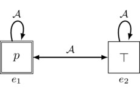
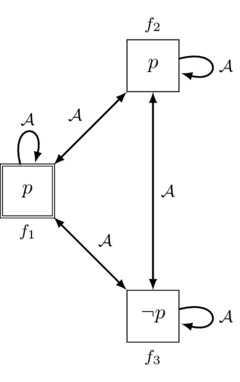
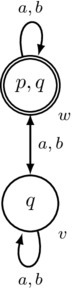
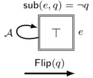
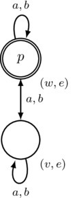
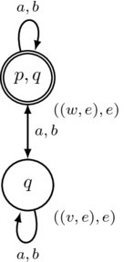

# dynamic-epistemic — appendix-G-EAL（supplement）

> （《dynamic-epistemic》词条补充材料，源：plato.stanford.edu/entries/dynamic-epistemic/appendix-G-EAL.html）

#### Supplement to Dynamic Epistemic Logic

## Appendix G: More on action models and the Logic of Epistemic Actions

In this Appendix, we examine three key topics in the Logic of Epistemic Actions: a notion of action model equivalence known as *action emulation*, how to extend action models so as to allow “factual change” via valuation-changing substitutions, and how to add common knowledge to the Logic of Epistemic Actions.

- 1. Action emulation
- 2. Incorporating factual change
- 3. Adding common knowledge

### 1. Action emulation

Two different pointed Kripke models can satisfy exactly the same (ML)-formulas, making them *semantically equivalent*. This lead to the study of a notion of *structural equivalence* for pointed Kripke models that would hold if and only if semantic equivalence holds as well, thereby allowing us to determine if two pointed Kripke models are semantically equivalent by examining only their structure. An often-used notion of structural equivalence is *bisimulation*

**Bisimulation.** A *bisimulation* between Kripke models $M_1=(W_1,R_1,V_1)$ and $M_2=(W_2,R_2,V_2)$ is a nonempty binary relation $Z\subseteq W_1\times W_2$ between $W_1$ and $W_2$ satisfying the following properties:

- Propositional Identity: $xZy$ implies $x\in V_1(p)$ if and only if $y\in V_2(p)$ for each letter $p\in\sP$;
- Back: if $xZy$ and $y(R_2)_ay'$, then there exists $x'\in W_1$ such that $x(R_1)_ax'$ and $x'Zy'$; and
- Forth: if $xZy$ and $x(R_1)_ax'$, then there exists $y'\in W_2$ such that $y(R_2)_ay'$ and $x'Zy'$.

To say that the pointed Kripke models $(M_1,w_1)$ and $(M_2,w_2)$ are *bisimilar*, written $(M_1,w_1)\bisim(M_2,w_2)$, means there exists a bisimulation *Z* between $M_1$ and $M_2$ satisfying $w_1 Zw_2$. To say $M_1$ and $M_2$ are *bisimilar*, written $M_1\bisim M_2$, means there exists a bisimulation *Z* between $M_1$ and $M_2$ that is *total*: every $x\in W_1$ has a $y\in W_2$ such that $xZy$, and every $y\in W_2$ has an $x\in W_1$ such that $xZy$.

**Bisimulation Theorem (see, e.g., Blackburn, de Rijke, and Venema 2002).** Let $(M_1,w_1)$ and $(M_2,w_2)$ be pointed Kripke models. We write $(M_1,w_1)\equiv(M_2,w_2)$ to indicate that these pointed Kripke models are (ML)-*semantically equivalent*, meaning we have $M_1,w_1\models F$ if and only if $M_2,w_2\models F$ for each (ML)-formula *F*.

- Bisimulation implies (ML)-semantic equivalence: $$ (M_1,w_1)\bisim(M_2,w_2) \text{ implies } (M_1,w_1)\equiv(M_2,w_2). $$
- (ML)-semantic equivalence of image finite models implies bisimulation: if $M_1$ and $M_2$ are *image finite*, meaning each world in the model has at most finitely many outgoing $R_a$-arrows for each agent $a\in\sA$, then $$ (M_1,w_1)\equiv(M_2,w_2) \text{ implies } (M_1,w_1)\bisim(M_2,w_2). $$

Notice that the Bisimulation Theorem does not give us an exact correspondence between bisimulation and (ML)-semantic equivalence: the second item of the theorem requires the models be image finite. A more complicated version of the Bisimulation Theorem makes it possible to avoid the issue of image finiteness; see Blackburn et al. (2002) for details.

Similar to the way in which different pointed Kripke models can be (ML)-semantically equivalent, different actions $(A_1,e_1)$ and $(A_2,e_2)$ can also be “equivalent”. Following van Eijck, Ruan, and Sadzik (2012), action equivalence is defined in terms of bisimulation: to say that two actions are “equivalent” means that the actions can be executed in the same situations and, furthermore, whenever the actions are both executable, they yield bisimilar (and hence (ML)-indistinguishable) results.

**Equivalence of action models (van Eijck, Ruan, and Sadzik 2012).** To say that action models $A_1$ and $A_2$ are *equivalent*, written $A_1\equiv A_2$, means that

- $A_1$ and $A_2$ are executable in the same Kripke models; and
- if $A_1$ and $A_2$ are both executable in the Kripke model *M*, then $M[A_1]\bisim M[A_2]$.

To say that the actions $(A_1,e_1)$ and $(A_2,e_2)$ are *equivalent*, written $(A_1,e_1)\equiv(A_2,e_2)$, means that the underlying action models $A_1$ and $A_2$ are equivalent (i.e., $A_1\equiv A_2$).

Figure G1 provides an example of equivalent actions. Examining this figure, it is clear that $A_1$ and $A_2$ are executable in the same situations: each is executable in situations satisfying *p* and in situations satisfying $\lnot p$. Further, these two action models produce bisimilar results: events $e_1$ and $f_1$ execute in the same situations and events $f_2$ and $f_3$ effectively “simulate” the always-executable event $e_2$. This “simulation” works as follows: any situation at which $e_2$ is executable satisfies either *p* or $\lnot p$ and so may be matched up with one of $f_2$ or $f_3$. Since all events are interconnected in both action models, the connections between $e_2$-produced worlds match up with the connections between the corresponding $f_2$- or $f_3$-produced worlds in a way that ensures bisimilar results. For example, for a sequence of three worlds *w*, *x*, *y*, *z* connected in order using $R_a$-arrows and respectively satisfying *p*, *p*, $\lnot p$, and *p* in the original model:

- the $A_1$-produced $(w,e_1)$, $(x,e_2)$, $(y,e_2)$, and $(z,e_1)$ are connected in order using $R_a$-arrows; and
- the $A_2$-produced final model will have the worlds $(w,f_1)$, $(x,f_2)$, $(y,f_3)$, and $(z,f_2)$ are connected in order using $R_a$-arrows.

Sietsma and van Eijck (2012) provide a full proof that these actions are equivalent.

$A_1$

$A_2$

*Figure G1.* The actions $(A_1,e_1)$ and $(A_2,f_2)$ are equivalent (van Eijck, Ruan, and Sadzik 2012; Sietsma and van Eijck 2012).

It is possible to define a notion of bisimulation for actions, but it turns out that there are equivalent actions that are not bisimilar (van Eijck, Ruan, and Sadzik 2012; Sietsma and van Eijck 2012). This led to the search for a structural relationship between actions that hold if and only if the actions are equivalent. A notion of *parameterized action emulation* was proposed by van Eijck, Ruan, and Sadzik (2012), and a variant called *action emulation* was later proposed by Sietsma and van Eijck (2012). To introduce these, we first need the following preliminary definitions.

Single negation, closure, atoms, and pre(*A*) (Sietsma and van Eijck 2012). Let *S* be a set of (ML)-formulas.

- The *single negation* of an (ML)-formula *F*, written ${\sim} F$, is defined as follows: if *F* has the form $\lnot G$, then ${\sim} F$ is *G*; otherwise, ${\sim} F$ is $\lnot F$. The *single negation* of the set *S*, written ${\sim} S$, is the set consisting of the single negation of every formula in *S*.
- The *closure* of *S* is the smallest set $\Cl(S)$ that contains *S* and is closed under subformulas (i.e., $F\in \Cl(S)$ and *G* a subformula of *F* together imply $G\in \Cl(S)$) and closed under single negations (i.e., ${\sim}\Cl(S)=\Cl(S)$).
- An *atom* over *S* is a maximal consistent subset of $\Cl(S)$: a subset *T* of $\Cl(S)$ that is *consistent* (i.e., $\not\models\lnot\bigwedge T$) and that satisfies the property that adding any formula in $\Cl(S)$ that is not already present will result in a set that is $inconsistent$ (i.e., not consistent). We let $\At(S)$ denote the set of atoms over *S*.
- For each action model *A*, define the set $\pre(A)\coloneqq\{\pre(e)\mid e\in E^A\}$ of preconditions in *A*.
- A *multi-pointed action model* is a pair $(A,Z)$ consisting of an action model $A=(E,A,\pre)$. and a set $Z\subseteq E$ of events in *A* called the *multi-point*. We let $$ [A,Z]F \quad\text{abbreviate}\quad \textstyle\bigwedge_{e\in Z}[A,e]F, $$ so that a multi-pointed action model modality acts as a conjunction over all events in the multi-point. Note that the conjunction is equal to $\top$ if the multi-point *Z* is empty. Multi-pointed action models will sometimes be called *multi-actions*. If we write a pointed action model $(A,e)$ where a multi-pointed action model is expected, then what is meant is the multi-action $(A,\{e\})$. In this way, actions may be identified with multi-actions.

The single negation of a formula strips any outermost negation that is present or, if none is present, adds one. The single negation of a set just performs the single negation of each formula in the set. The closure of a set expands the set by repeatedly adding subformulas and performing single negations on the formulas present until no further expansion is possible. In essence, the closure if a set of formulas is the collection of all formulas that are “relevant” when it comes to determining whether a formula in the set is true at a pointed Kripke model. An atom over a set of formulas is a subset whose formulas can all be made true at a pointed Kripke model and, further, any larger subset would violate this property (see, e.g., Blackburn, de Rijke, and Venema 2002). In effect, choosing an atom of a set *S* is the same as choosing a pointed Kripke model that makes true the formulas in the atom and makes false the other formulas in *S* that are not in the atom. By choosing the set $S=\pre(A_1)\cup\pre(A_2)$ to be the collection of all precondition formulas in either the action model $A_1$ or the action model $A_2$, an atom $\sigma\in\At(S)$ over *S* identifies a maximal collection of preconditions in these action models that can simultaneously be made true: these are just the actions *e* having $\pre(e)\in\sigma$. These ideas lead to the following notion of structural equivalence between action models.

**Parameterized action emulation (adapted from van Eijck, Ruan, and Sadzik 2012).** Let $A_1=(E_1,R_1,\pre_1)$ and $A_2=(E_2,R_2,\pre_2)$ be action models and let $S=\pre(A_1)\cup\pre(A_2)$ be the set of preconditions for all events in either of $A_1$ or $A_2$. For each $i\in\{1,2\}$ and event $e\in E_i$, define $$ \Sigma_i(e)\coloneqq\{\sigma\in\At(S)\mid\pre_i(e)\in\sigma\} $$ to be the set of atoms satisfying the precondition of *e*. A *parameterized action emulation* between $A_1$ and $A_2$ is a set of indexed binary relations $\{E_\sigma\}_{\sigma\in\At(S)}$ between $E_1$ and $E_2$ (i.e., $E_\sigma\subseteq E_1\times E_2$ for each $\sigma\in\At(S)$) satisfying the property that $xE_\sigma y$ implies the following:

- Invariance: $\pre(x)\in\sigma$ and $\pre(y)\in\sigma$;
- Back: if we have that $y (R_2)_a y'$, that $\sigma\in\Sigma_2(y')$ and that $\bigwedge\sigma\land\langle a\rangle\bigwedge\sigma'$ is consistent, then there exists $x'\in E_1$ such that $x(R_1)_a x'$ and $x'E_{\sigma'}y'$; and
- Forth: if we have that $x (R_1)_a x'$, that $\sigma\in\Sigma_2(x')$ and that $\bigwedge\sigma\land\langle a\rangle\bigwedge\sigma'$ is consistent, then there exists $y'\in E_2$ such that $y(R_1)_a y'$ and $x'E_{\sigma'}y'$.

For multi-actions $(A_1,Z_1)$ and $(A_2,Z_2)$, we write $(A_1,Z_1)\rightleftarrows_p(A_2,Z_2)$ to mean that there is a parameterized action emulation $\{E_\sigma\}_{\sigma\in\At(S)}$ between $A_1$ and $A_2$ satisfying the following:

- for each $x\in Z_1$ and $\sigma\in\Sigma_1(x)$, there exists $y\in Z_2$ such that $xE_\sigma y$; and
- for each $y\in Z_2$ and $\sigma\in\Sigma_2(x)$, there exists $x\in Z_1$ such that $xE_\sigma y$.

Intuitively, an emulation between actions links events *e* and *f* via $eE_\sigma f$ only if the preconditions of these events can be made simultaneously true in a situation that makes true all formulas in the atom $\sigma$. Further, this linkage his bisimulation-like Back and Forth properties that respect consistency of the linking atoms: a link made between events via $E_\sigma$ gives rise to another link made between events via $E_\sigma$ only if it is consistent for a situation satisfying the formulas in $\sigma$ to lead via an *a*-arrow to a situation satisfying the formulas in $\sigma'$ (i.e., $\bigwedge\sigma\land\langle a\rangle\bigwedge\sigma'$ is consistent). In this way, the Back and Forth conditions come with built-in guarantees of consistency, and this is leveraged in proving the following result.

**Parameterized Action Emulation Theorem (van Eijck, Ruan, and Sadzik 2012).** For multi-actions $(A_1,Z_1)$ and $(A_2,Z_2)$, we have

$$ (A_1,Z_1)\leftrightarrows_p(A_2,Z_2) \text{ if and only if } A_1\equiv A_2. $$

This gives a direct correspondence between a parameterized structural relationship over actions and the semantic notion of action equivalence. However, the parameterization makes this notion complex. A simpler, non-parameterized structural relationship that gets close to providing a similar direct correspondence was recently proposed by Sietsma and van Eijck (2012). This relationship and the related results are formulated in terms of *multi-pointed action models*.

**Action emulation (adapted from Sietsma and van Eijck 2012).** Let $A_1=(E_1,R_1,\pre_1)$ and $A_2=(E_2,R_2,\pre_2)$ be action models. An *action emulation* between $A_1$ and $A_2$ is a binary relation $E\subseteq E_1\times E_2$ satisfying the property that $xEy$ implies:

- Consistency: $\pre_1(x)\land\pre_2(y)$ is consistent;
- Back: $y(R_2)_ay'$ implies there exists $X'\subseteq E_1$ such that $x(R_1)_a x'$ and $x' E_ay'$ for each $x'\in X'$ and $$ \models (\pre_1(x)\land\pre_2(y)) \to [a](\pre_2(y')\to\bigvee_{x'\in X'}\pre_1(x')); $$
- Forth: $x(R_1)_ax'$ implies there exists $Y'\subseteq E_2$ such that $y(R_1)_a y'$ and $x' E_ay'$ for each $y'\in Y'$ and $$ \models (\pre_1(x)\land\pre_2(y)) \to [a](\pre_2(x')\to\bigvee_{y'\in Y'}\pre_1(y')). $$

For multi-actions $(A_1,Z_1)$ and $(A_2,Z_2)$, we write $(A_1,Z_1)\leftrightarrows(A_2,Z_2)$ to mean that there is an action emulation *E* between $A_1$ and $A_2$ satisfying the following:

- every $x\in Z_1$ gives rise to a $Y\subseteq Z_2$ such that $xEy$ for each $y\in Y$ and $$ \textstyle \models\pre_1(x)\to\bigvee_{y\in Y}\pre_2(y); $$
- every $y\in Z_2$ gives rise to a $X\subseteq Z_1$ such that $xEy$ for each $x\in X$ and $$ \textstyle \models\pre_1(y)\to\bigvee_{x\in X}\pre_2(X). $$

An action emulation connects events only if their preconditions are consistent. Further, for events *e* and *f* linked via $eEf$, an event reachable from one of *e* and *f* via *a*-arrows is linked up with a set of events reachable from the other via *a*-arrows in such a way that the preconditions of *e* and *f* together imply that *a*-accessible worlds must satisfy a precondition from an event in the set whenever the precondition from the *a*-accessible event is satisfied. As it turns out, this is just what is needed to show that emulation implies equivalence. The converse (i.e., the statement that equivalence implies emulation) is an open question. However, a weaker version of the converse has been proved. This version makes use of the following result.

**Canonical Action Model Theorem (Sietsma and van Eijck 2012).** Let *S* be a finite set of (ML)-formulas and $A=(E,R,\pre)$ be an action model. To say that *A* is $canonical$ over *S* means that:

- for each $e\in E$, there is an atom $\sigma\in\At(S)$ over *S* such that $\pre(e)=\bigwedge\sigma$, and
- $e R_a e'$ implies $\pre(e)\land\langle a\rangle\pre(e')$ is consistent.

To say that an action or multi-action is *canonical* means that the action model underlying (i.e., the first element of the pair making up) the action or multi-action is canonical. The multi-action $(A,\{e\})$ is equivalent to the multi-action $(A^c,e^c)$, where the canonical action model $A^c\coloneqq(E^c,R^c,\pre^c)$ over $\pre(A)$ and the event $e^c\in E^c$ are defined as follows:

- $E^c\coloneqq\{(x,\sigma)\in E\times\At(\pre(A))\mid \pre(x)\in\sigma\}$,
- $(x,\sigma)R^c_a(x',\sigma')$ if and only if $xR_ax'$ and $\bigwedge\sigma\land\langle a\rangle\bigwedge\sigma'$ is consistent,
- $\pre^c((x,\sigma))\coloneqq\bigwedge\sigma$, and
- $e^c\coloneqq\{(x,\sigma\in E^c\mid x=e\}$.

An action model that is canonical over a set *S* of formulas is an action model whose preconditions are conjunctions of atoms over *S*. Therefore, each precondition describes a situation in which the formulas in the corresponding atom over *S* are all true and the other formulas in *S* are all false. This gives important information that is exploited in proof of the following result.

**Action Emulation Theorem (Sietsma and van Eijck 2012).** Let $(A_1,Z_1)$ and $(A_2,Z_2)$ be multi-actions.

- Emulation implies equivalence: $$ (A_1,Z_1)\leftrightarrows(A_2,Z_2) \quad\text{implies}\quad A_1\equiv A_2; $$
- Equivalence between canonical action models implies emulation of multi-actions: if $A_1$ is canonical over $S_1$ and $A_2$ is canonical over $S_2$, then $$ A_1\equiv A_2 \quad\text{implies}\quad (A_1,Z_1)\leftrightarrows(A_2,Z_2). $$

Non-parameterized action emulation provides a procedure for determining whether two actions $(A_1,e_1)$ and $(A_2,e_2)$ are equivalent: construct the equivalent canonical multi-actions $(A_1^c,e_1^c)$ and $(A_2^c,e_2^c)$ and determine whether $$ (A_1^c,e_1^c)\leftrightarrows(A_2^c,e_a^c). $$ Since $A_1^c$ and $A_2^c$ are both finite and computable from $A_1$ and $A_2$, it follows that the overall procedure is computable as well.

It is an open question whether the canonicity condition can be dropped in the second part of the Action Emulation Theorem. If this condition cannot be dropped, then it is possible that there may be a variant of the above-defined notion of non-parameterized action emulation that would correspond directly with action equivalence (as in the Parameterized Action Emulation Theorem except without the parameterization).

### 2. Incorporating factual change

As a consequence of the (EAL) semantics presented in the main article, an executable action $(A,e)$ transforms an initial world *w* into a resultant world $(w,e)$ in a manner that preserves the valuation. That is, a propositional letter *p* is true at the resultant world $(w,e)$ if and only if *p* was true at the initial world *w*. By the soundness of the axiomatic system $\EAL$, the preservation of propositional valuation must be reflected in the axiomatics as well. And indeed, this is so: the $\EAL$ reduction axiom for propositional letters $$ [A,e]p\leftrightarrow(\pre(e)\to p) \text{ for letters } p\in\sP $$ implies the scheme $$ \pre(e)\to([A,e]p\leftrightarrow p) \text{ for letters }p\in\sP, $$ which says that whenever $(A,e)$ is executable, *p* is true after the occurrence of $(A,e)$ if and only if *p* was true before the occurrence. Since this is true of all propositional letters, it follows that all actions are valuation-preserving. Thinking of propositional letters as the “basic facts” of the situations that we reason about using $\EAL$, the preservation of valuations is sometimes described as “preserving (basic) facts” or as “leaving (basic) facts unchanged”.

Sometimes we want to reason about fact-changing actions. For example, if we use the letter *q* to represent the statement that “the light is on” and this is true in an initial world *w*, then the action of “flipping the light switch” should bring about a resultant world $(w,e)$ in which *q* is false. That is, the valuation should change: the basic fact *q* goes from being true in *w* to being false in $(w,e)$.

Incorporating factual change into the theory of action models requires two modifications: one syntactical-semantical and one axiomatic. For the syntactical-semantical modification, we add an extra component to action models that allows us to specify changes in the valuation of various letters.

**Action model with substitution (van Benthem, van Eijck, and Kooi 2006).** Given a set of formulas $\Lang$ and a finite nonempty set $\sA$ of agents, an *action model with substitution* is a structure $A=(E,R,\pre,\sub)$ satisfying the following:

- $(E,R,\pre)$ is an action model (as defined before); and
- $\sub:(E\times\sP)\to\Lang$ is a *(finite) substitution*: a function mapping each event-letter pair $(e,p)\in E\times\sP$ to an $\Lang$-formula $\sub(e,p)$ subject to the restriction that $\sub(e,p)=p$ for all but finitely many pairs ($e,p)\in E\times\sP$.

We then define the language \eqref{EAL+S} of Epistemic Action Logic with substitution along with the set $\AMS_*$ of pointed action models with substitution having preconditions in the language \eqref{EAL+S} much as we did for (EAL) and $\AM_*$ but with a slightly different recursive grammar (in which pointed action models come from $\AMS_*$ instead of from $\AM_*$):

$$\begin{gather*}\taglabel{EAL+S} F \ccoloneqq p \mid F\land F\mid \lnot F \mid [a]F \mid [A,e]F \\ \small p\in\sP,\; a\in\sA,\; (A,e)\in\AMS_* \end{gather*}$$

A substitution $\sub$ specifies substitutions for propositional letters: to have $\sub(e,p)=F$ means that we are to reassign the truth value of *p* so that it is like *F* as per the occurrence of event *e*. That is, at any world *w* at which *e* can occur (i.e., at which the precondition $\pre(e)$ holds), the execution of *e* yields a world $(w,e)$ at which *p* is true if and only if *F* was true before in *w*. As a result, *p* is essentially replaced with *F* during the occurrence of the event. Formally, this works as follows:

- $M,w\models[A,e]G$ holds if and only if $M,w\not\models\pre(e)$ or $M[A],(w,e)\models G$, where the model $$ M[A]=(W[A],R[A],V[A]) $$ is the result of the *product update (with substitution)* $M\mapsto M[A]$ defined by:
- $W[A]\coloneqq\{(v,g)\in W\times E \mid M,v\models\pre(g)\}$ — pair worlds with events whose preconditions they satisfy,
- $(w_1,e_1)R[A]_a(w_2,e_2)$ if and only if there is an *a*-arrow from $w_1$ to $w_2$ in *M* and an *a*-arrow from $e_1$ to $e_2$ in *A*, and
- $(v,g)\in V[A](p)$ if and only if $M,v\models\sub(g,p)$ — make the truth of *p* at $(v,g)$ like that of the formula $\sub(g,p)$ at *v*.

So if $\sub(e,p)=F$, then the letter *p* is true after the occurrence of *e* if and only if *F* was true before the occurrence of *e*. Therefore, $\sub(e,p)=p$ implies that the valuation of *p* is left unchanged, which is how the semantics worked before we introduced substitutions. Our assumption that we have $\sub(e,p)=p$ for all but finitely many pairs $(e,p)$ ensures that the valuation changes for at most finitely many letters. The reason for this restriction is that we want action models to be finite objects: it should be possible in principle to write down a sequence of symbols (or draw a picture) that completely specifies any given action model in our language.

The axiomatic theory $\EALS$ of Epistemic Action Logic with substitutions is identical to the theory $\EAL$ except that the reduction axiom for propositional letters is changed to the following:

1. $[A,e]p \leftrightarrow (\pre(e)\to \sub(e,p))$ for letters $p\in\sP$ “After a non-executable action, every letter holds—a contradiction. After an executable action, the substitution sets truth values.”

An example utilizing an action model with substitution is given in Figure G2, where the action $\mathsf{Flip}(q)$ implements our light-switch action: the occurrence of this action toggles the truth value of *q* between “on” (i.e., true) and “off” (i.e., false) in a manner that is common knowledge to all.

$\small M$

$\small M[\mathsf{Flip}(q)]$

$\small M[\mathsf{Flip}(q)][\mathsf{Flip}(q)]$

*Figure G2.* The pointed action model $(\mathsf{Flip}(q),e)$ toggles the truth value of letter *q* in a way that is common knowledge to all.

Almost all results about action model logics carry through *mutatis mutandis* upon addition of valuation-changing substitutions. So in the interest of simplicity, we assume in what follows that, unless stated otherwise, our action models do not contain valuation-changing substitutions. It is worth noting that this assumption is often made in the DEL literature and, in light of how simple it is to include valuation-changing substitutions if they are desired, this assumption should not be viewed as a genuine limitation to a given piece of work.

### 3. Adding common knowledge

To study the effect of common knowledge on action models, we define the language \eqref{EAL+C} of (EAL) with common knowledge along with the set $\AMC_*$ of pointed action models with preconditions in the language \eqref{EAL+C} according to the following recursive grammar:

$$\begin{gather*}\taglabel{EAL+C} F \ccoloneqq p \mid F\land F \mid \lnot F \mid [a]F \mid [A,e]F \mid [B*]F \\ \small p\in\sP,\; a\in\sA,\; (A,e)\in\AMC_*,\; B\subseteq\sA \end{gather*}$$

The semantics of this language over pointed Kripke models is defined above. There are a number of interesting fragments of \eqref{EAL+C} obtained by restricting the action model modalities $[A,e]$ to have certain communicative forms. Here are a few examples.

- (PUB+C) is the fragment of \eqref{EAL+C} obtained by requiring that any action model modality $[A,e]$ used in the formation of a formula be a public announcement modality $[\Pub(F),e]$. See Figure 4 (main article) for a picture of the action model $\Pub(p)$.
- (PRI+C) is the fragment of \eqref{EAL+C} obtained by requiring that any action model modality $[A,e]$ used in the formation of a formula be a private announcement modality $[\Pri(F),e]$ Figure 3 (main article) depicts the action model $\Pri(p)$.

We now examine the axiomatic theory of EAL with common knowledge.

**The axiomatic theory $\EALC$.** Other name in the literature: $\mathsf{AMC}$ (van Ditmarsch, van der Hoek, and Kooi 2007).

- Axiom schemes and rules for the theory $\EAL$
- Axiom schemes for common knowledge:
- $[B*](F\to G)\to([B*]F\to[B*]G)$ “Common knowledge is closed under logical consequence.”
- $[B*]F\leftrightarrow(F\land[B][B*]F)$, the “Mix axiom” “Common knowledge is equivalent to truth and group knowledge of common knowledge.”
- $[B*](F\to[B]F)\to(F\to[B*]F)$, the “Induction axiom” “If there is common knowledge that truth implies group knowledge and there is truth, then there is common knowledge.”
- CK Necessitation Rule: from *F*, infer $[B*]F$ “There is common knowledge of every validity.”
- AM-CK Rule: given \eqref{EAL+C}-formulas $G_x$ for each event *x* in the action model *A*, from $$ \bigwedge_{e (R_B)*f} \left( (G_f\land \pre(f)\land (G_f\to[A,f]F))\to \bigwedge_{a\in B}\bigwedge_{f R_a g}[a]G_g \right) $$ infer $$ G_e\to[A,e][B*]F $$

Just like for $\PALC$, there can be no reduction theorem for $\EALC$. This makes for a more intricate completeness proof.

**$\EALC$ Soundness and Completeness (Baltag, Moss, and Solecki 1999; van Ditmarsch, van der Hoek, and Kooi 2007).** $\EALC$ is sound and complete with respect to the collection $\sC_*$ of pointed Kripke models for which the underlying logic $\EAL$ is sound and complete. That is, for each \eqref{EAL+C}-formula *F*, we have $\EALC\vdash F$ if and only if $\sC_*\models F$.

We summarize some of the known expressive relationships between various fragments of \eqref{EAL+C} over the class of all pointed Kripke models. Relationships over various other classes are reported by van Ditmarsch, van der Hoek, and Kooi (2007).

**Relative Expressivity Theorem.** Over the class of all pointed Kripke models, we have each of the following.

- \eqref{EAL+C} is strictly more expressive than each of (PUB+C) and (PRI+C) (Baltag, Moss, and Solecki 1999).
- (PUB+C) and (PRI+C) are expressively incomparable: there is a (PUB+C)-formula that cannot be expressed in (PRI+C) (Renne 2008), and there is a (PRI+C)-formula that cannot be expressed in (PUB+C) (Baltag, Moss, and Solecki 1999).
- (PUB+C) and (PAL+C) are equally expressive (Baltag, Moss, and Solecki 1999).
- (PAL+C) is strictly more expressive than (ML+C) (Baltag, Moss, and Solecki 1999).
- (ML+C) is strictly more expressive than (ML) (Fagin et al. 1995).
- (EAL) and (ML) are equally expressive (Baltag, Moss, and Solecki 1999).

In closing, we note two alternative approaches to reasoning about action models and common knowledge.

- van Benthem, van Eijck, and Kooi (2006) extend (ML) to an “Epistemic Propositional Dynamic Logic” that can express common knowledge (and relativized common knowledge). It is shown via a Reduction Theorem that adding action model modalities does not increase expressivity of the language.
- Van Benthem and Ikegami (2008) show that modal $\mu$-calculus, which can express common knowledge, is closed under the product update. That is, a Reduction Theorem implies that adding action model modalities does not increase expressivity of the language.

← beginning of main article
