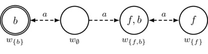

# dynamic-epistemic — appendix-K-evidence（supplement）

> （《dynamic-epistemic》词条补充材料，源：plato.stanford.edu/entries/dynamic-epistemic/appendix-K-evidence.html）

#### Supplement to Dynamic Epistemic Logic

## Appendix K: Evidential dynamics and justified belief

In this Appendix, we examine work in DEL aimed at reasoning about evidence, belief, and knowledge.

- 1. Connections with Justification Logic
- 2. Connections with neighborhood models

### 1. Connections with Justification Logic

In this section, we overview the Baltag, Renne, and Smets (2014) study of a logic of “conclusive” (or “good”) evidence based on a combination of plausibility models with an adaptation of the syntactic bookkeeping mechanisms of Justification Logic (Artemov 2008; see entry on Justification Logic). The language \eqref{JBG} of the logic $\JBG$ of *Justified Belief with Good Evidence* is an extension of the language $(K\Box)$ obtained by adding a few additional features. First, \eqref{JBG} introduces structured objects *t* called *terms* that encode evidence, reasons, or justifications (words we use synonymously here). Second, \eqref{JBG} adds to $(K\Box)$ two new kinds of formulas for reasoning about terms: $E_at$ (“agent *a* possesses evidence *t*”) and $t\arr F$ (“*t* is admissible (as evidence) for *F*”).

$$\begin{align*}\taglabel{JBG} F & \ccoloneqq p \mid F\land F\mid \lnot F \mid \Box_a F \mid K_a F \mid E_at \mid t\arr F \\ t & \ccoloneqq c_F \mid t\cdot t \mid t+t \\ &\quad \small p\in\sP,\; a\in\sA \end{align*}$$

Objects formed using the symbol *F* in the above grammar are called *formulas*. Objects formed using the symbol *t* in the above grammar are called *terms*; a term of the form $c_F$ is called a certificate for *F*. The dual $\Diamond_a$ of $\Box_a$ is defined by $\Diamond_aF \coloneqq \lnot\Box_a\lnot F$ and the dual $\hat K_a$ of $K_a$ is defined by $\hat K_aF \coloneqq \lnot K_a\lnot F$. The set $\sub(t)$ of *subterms* of a term *t* is defined by induction on the construction of *t* as follows:

$$\begin{align*} \sub(c_F) &= \{c_F\}, \\ \sub(t\cdot s) &= \{t\cdot s\}\cup\sub(t)\cup\sub(s)\text{, and}\\ \sub(t+s) &= \{t+s\}\cup\sub(t)\cup\sub(s). \end{align*}$$

Terms are used to represent evidence, reasons, or justification in support of a formula. A number of evidential relationships between a term and a formula may be introduced. Each depends on two key components. First, the term must be “admissible” for the formula, a technical notion defined in a moment. Roughly speaking, to say a term is admissible for a formula means that the term has the proper “shape” of a logical argument for that formula. Second, the certificates that make up the term must be “conclusive” (or “good”). This means that a formula *F* named in any certificate *c_{F}* occurring in the term must be true. Let us first look at admissibility.

**Admissibility.** *Admissibility* is the smallest binary relation ${\gg}'$ between terms and formulas satisfying the following:

- $c_F\arrp F$,
- $t\arrp(F\to G)$ and $s\arrp F$ together imply $(t\cdot s)\arrp G$,
- $t\arrp F$ and $s\arrp G$ together imply $(t+s)\arrp F$, and
- $t\arrp F$ and $s\arrp G$ together imply $(s+t)\arrp F$.

In the forthcoming semantics, we will see that the formula $t\arr F$ is true if and only if $t\arrp F$ holds. So we may sometimes conflate ${\gg}'$ and ${\gg}$ without risking confusion. Further, we see that admissibility does describe terms as having a proper logical “shape”:

- a certificate $c_F$ is admissible for the formula *F* it certifies and so certificates may be used to represent evidence for observations (including introspection as self-observation) or for other basic evidenced assumptions;
- the (non-commutative) term-combining operator “$\cdot$” combines terms so that admissibility follows via the logical rule of *Modus Ponens*, thereby encoding one step of logical derivation; and
- the (commutative) term-combining operator “$+$” combines terms so that admissibility follows via simple aggregation without logical inference, thereby encoding the “grouping together” of separate pieces of evidence into a unified whole.

The condition on the formula *G* in the definition of admissibility for the “$+$” operation is there to ensure that a term $t+s$ that is admissible for some formula (and “well-shaped”) satisfies the property that each of its component terms is also admissible for some formula (and is also “well-shaped”). We note that the *content* of a term *t*, defined as the set $$ \con(t) \coloneqq \{\theta \mid t\arr\theta\} $$ of formulas for which *t* is admissible, is finite and computable. In particular, by examining the stepwise construction of a term according to the grammar defining terms, we see that each inductive step in the construction specifies either a *Modus Ponens* operation “$\cdot$” or an aggregation operation “$+$”. This enables us to establish a “chain of evidence” that begins with certificates and proceeds stepwise via *Modus Ponens* or aggregation until the full term is constructed and a particular admissible formula *F* is found.

The formula $E_at$ says that agent *a* possesses the term *t*. This means that *a* has done all the work necessary to collect, examine, and make proper sense of the term *t*. The set of terms that the agent possesses at world *w* is denoted by $E_a(w)$.

To define the notion of evidential “conclusiveness” (or “goodness”), we must define the models for \eqref{JBG} in two stages. In the first, we define “plausibility evidence pre-models”, which are just plausibility models to which we add sets $E_a(w)$ naming the evidence in possession for each agent *a* and world *w*.

**Plausibility evidence pre-model.** Given a nonempty set $\sP$ of propositional letters and a finite nonempty set $\sA$ of agents, an *plausibility evidence pre-model* is a structure $$ M=(W,\geq,E,V) $$ for which $(W,\geq,V)$ is a plausibility model and *E* is a function that assigns to each agent *a* and each world *w* a set $E_a(w)$ of terms such that the following are satisfied:

- Trivial Evidence: $c_\top\in E_a(w)$.
- Certification of Evidence: if $t\in E_a(w)$ and $t\arr F$, then $c_F\in E_a(w)$.
- Subterm Closure: if $t\in E_a(w)$, then $\sub(t)\subseteq E_a(w)$.
- Availability of Evidence:
- if $t\cdot s\in E_a(w)$, $w'\in\cc_a(w)$, and $\{t,s\}\subseteq E_a(w')$, then $t\cdot s\in E_a(w')$; and
- if $t+s\in E_a(w)$, $w'\in\cc_a(w)$, and $\{t,s\}\subseteq E_a(w')$, then $t+s\in E_a(w')$.

A *pointed plausibility evidence pre-model* is a pair $(M,w)$ consisting of a plausibility evidence pre-model *M* and a world *w* (called the *point*) that designates the state of affairs that we (the formal modelers) currently assume to be actual.

Trivial Evidence says that each agent always has evidence for *something*, even if this is only the trivial the propositional constant $\top$ for truth. Certification of Evidence says that if the agent has *t* and this term is admissible for *F*, then the agent also has the certificate $c_F$ for *F*. This tells us that agents can always “convert” complicated pieces of evidence into certificates, thereby ignoring the complicated term structure and keeping track only of the fact that there was *some* evidence in support of *F*. Subterm closure says that an agent cannot possess a piece of evidence without also possessing its constituent parts. Availability of Evidence says that whenever the agent has constructed a piece of evidence *t* and there is an informationally consistent world $w'$ at which she has also constructed the components that make up *t*, then she has also constructed *t* at $w'$. Intuitively, this says that the agent has information about the evidence she has constructed.

The satisfaction relation $\models$ between pointed plausibility evidence pre-models and formulas of \eqref{JBG} is defined as follows.

- $M,w\models p$ holds if and only if $w\in V(p)$.
- $M,w\models F\land G$ holds if and only if both $M,w\models F$ and $M,w\models G$.
- $M,w\models\lnot F$ holds if and only if $M,w\not\models F$.
- $M,w\models \Box_aF$ holes if and only if $M,v\models F$ for each $v\leq_a w$.
- $M,w\models K_aF$ holds if and only if $M,v\models F$ for each $v\in\cc_a(w)$.
- $M,w\models E_at$ holds if and only if $t\in E_a(w)$.
- $M,w\models t\arr F$ holds if and only if $t\arrp F$.

The models of \eqref{JBG} are the pre-models in which evidence is “conclusive” (or, synonymously, “good”). This means that available certificates are fully reliable: what they certify is true.

**Plausibility evidence model.** Given a nonempty set $\sP$ of propositional letters and a finite nonempty set $\sA$ of agents, a *plausibility evidence model* is a plausibility evidence pre-model *M* (based on $\sP$ and $\sA$) satisfying the following property for each $a\in\sA$ and $F\in\eqref{JBG}$:

- Evidential Goodness: $c_F\in E_a(w)$ implies $M,w\models F$.

A *pointed plausibility evidence model*, sometimes called a *scenario* or a *situation*, is a pair $(M,w)$ consisting of a plausibility evidence model *M* and a world *w* (called the *point*) that designates the state of affairs that we (the formal modelers) currently assume to be actual.

Because the evidence-combining operations “$\cdot$;” of *Modus Ponens* and “$+$” of aggregation are logically sound, it is not difficult to see that *all* evidence in possession is “good” (i.e., “conclusive”) in plausibility evidence models; that is, for a plausibility evidence model *M*, if we have $t\in E_a(w)$ and $t\arr F$, then $M,w\models F$. Also, while Evidential Goodness may at first seem too strong (in that it postulates infallibility of available evidence), we note that agents still can have a fallible relationship with respect to evidence even with Evidential Goodness in place. In particular, it is possible for agent *a* to believe she possesses evidence when she in fact does not (i.e., $E_at$ is true at the most plausible worlds but false at the actual world), and it is also possible for agent *a* to believe that she does not possess evidence that she in fact does (i.e., $E_at$ is false in some most plausible world but true at the actual world). So we see that Evidential Goodness still allows evidence to be misleading.

The following are abbreviations defined notions built upon the simple language \eqref{JBG}:

- Unconditional belief: $B_aF = \Diamond_a\Box_a F$.
- Conditional belief: $B_a^GF = \hat K_aG\to \hat K_a(G\land \Box_a(G\to F))$.
- Implicit justification: $t\col F = (t\arr F)\land\bigwedge\{\theta\mid c_\theta\in\sub(t)\}$.
- Explicit justification: $t\,{:}_a^e\, F = E_at\land(t\arr F)$.
- Explicit belief: $B_a^eF = B_aE_ac_F$.
- Explicit conditional belief: $B_a^{e,G}F = B_a^GE_ac_F$.
- Explicit defeasible knowledge: $\Box_a^e F = \Box_aE_ac_F$.
- Explicit information possession: $K_a^e F = K_aE_ac_F$.

Conditional and unconditional belief are equivalent to the definition of conditional belief and unconditional belief for the language $(K\Box)$. The other notions are new.

- *Implicit Justification*: to say that *t* is implicit justification for *F*, written $t\col F$, means that *t* is admissible for *F* and the certificates that make up *t* are “good” (i.e., what they certify is true). Intuitively, this says that *t* is a piece of evidence that objectively supports *F*, no matter whether any agent actually has *t* in her possession. It is in this sense that the justification is “implicit” as opposed to “explicit”, which would require some agent to have gone to the trouble to gather, process, and make sense of *t*. Implicit justification is closely related to some common schematic principles from Justification Logic; see Baltag, Renne, and Smets (2014) for details.
- *Explicit Justification*: to say that agent *a* has explicit justification for *F*, written $t\,{:}_a^e\,F$, means that *t* is implicit justification for *F* and *a* actually has *t* in her possession. If this is so then, intuitively, *a* has gone to the trouble to gather, process, and make sense of *t*, and therefore *a* explicitly possesses this evidence for *F*.
- *Other explicit notions*: the notions of explicit belief, explicit conditional belief, explicit defeasible knowledge, and explicit information concern the agent’s propositional attitude with respect to the certificate $c_F$ for a formula *F*: she believes she has the certificate, she conditionally believes she has it, she defeasibly knows she has it, or she has information that she has it.

The theory $\JBG$ of *Justified Belief with Good Evidence* is defined as follows.

**The axiomatic theory $\JBG$.**

- Classical Logic: Axiom schemes and rules for classical propositional logic
- Admissibility: $$\begin{gather*} t\arr F \text{ for each }t \text{ and }F \text{ such that }t\arrp F\\ \lnot(t\arr F) \text{ for each } t \text{ and } F \text{ such that not }t\arrp F \end{gather*}$$
- Trivial Evidence: $E_ac_\top$
- Certification of Evidence: $(E_at\land t\arr F)\to E_ac_F$
- Subterm Closure: $(E_a(t\cdot s)\lor E_a(t+s))\to (E_at\land E_as)$
- Availability of Evidence: $$\begin{align*} E_a(t\cdot s)&\to K_a((E_at\land E_as)\to E_a(t\cdot s))\\ E_a(t+s)&\to K_a((E_at\land E_as)\to E_a(t+s)) \end{align*}$$
- Evidential Goodness: $E_ac_F\to F$
- Information: $\mathsf{S5}$ axiom schemes and rules for $K_a$
- Defeasible Knowledge: $\mathsf{S4}$ axiom schemes and rules for $\Box_a$
- Indefeasibility: $K_a F\to\Box_a F$
- Local Connectedness: $K_a(\Box_a F\to G)\lor K_a(\Box_a G\to F)$

**Soundness, Completeness, and Finite Model Property.** To say an evidence model is *finite* means the set of worlds is finite and each set $E_a(w)$ is also finite. $\JBG$ is sound and complete with respect to the collection $\sC_*$ of pointed finite evidence models. That is, for each \eqref{JBG}-formula *F*, we have that $\JBG\vdash F$ if and only if $\sC_*\models F$.

$\JBG$ can be used to reason about certain examples from Epistemology. For example, Gettier (1963) constructs a famous counterexample to the claim that “knowledge” may be equated with “justified true belief” (i.e., justified *correct* belief). In this example, an agent—let us call her *a*—has evidence for a propositional letter *f*, concludes via logical deduction that $b\lor f$, and therefore has evidence for this disjunction; however, unknown to the agent, *f* is false but *b* is true. She therefore has justified true belief but not knowledge that $b\lor f$ is true (since her reason for believing this disjunction is based on her belief in the wrong disjunct). This example is easily reconstructed in $\JBG$ using the pointed plausibility evidence model in Figure K1. In this figure, the *f*-worlds are more plausible than the $\lnot f$ worlds (since the agent believes *f*) and, within each group of equi-plausible worlds, there is both a *b*-world and a $\lnot b$-world (representing the fact that she has no information about *b*). In the actual world, *b* is true but *f* is false. The agent actually has available to her only the evidence $c_{f\to(b\lor f)}$ representing her knowledge of the logical truth $f\to(b\lor f)$. However, the agent mistakenly believes she has available to her the good evidence $c_f$ and the combined evidence $c_{f\to(b\lor f)}\cdot c_f$ for $b\lor f$ (along with the certificate $c_{b\lor f}$ in accordance with Certification of Evidence). Also, by Trivial Evidence, she has (and believes she has) the trivial certificate $c_\top$. Therefore, as is readily verified, the agent has a justified true belief of $b\lor f$ based on the evidence $c_{f\to(b\lor f)}\cdot c_f$, which explicitly represents her reasoning, and yet she does not have defeasible knowledge of $b\lor f$ because she is mistaken about her evidence.

*Figure K1.*

 $$\begin{align*} E_a (w_{\{b\}}) & \coloneqq \{c_\top,c_{f\to b\lor f}\} \\ E_a (w_{\emptyset}) & \coloneqq E_a (w_{\{b\}}) \\ E_a (w_{\{f,b\}}) & \coloneqq \{c_\top, c_f, c_{f\to b\lor f}, c_{f\to b\lor f}\cdot c_f, c_{b\lor f}\} \\ E_a (w_{\{f\}}) & \coloneqq E(w_{\{f,b\}}) \end{align*}$$ $$M_G$$

Figure K1. The Gettier Example: justified true belief without knowledge; that is, we have $M_G,w_{\{b\}}\models(b\lor f)\land B_a^e(b\lor f)$ and yet we have $M_G,w_{\{b\}}\not\models \Box_a^e(b\lor f)$ (i.e., no explicit knowledge) and $M_G,w_{\{b\}}\not\models\Box_a(b\lor f)$ (i.e., no implicit knowledge).

Baltag, Renne, and Smets (2014) also study another example of “explicit justified true belief and implicit knowledge without explicit knowledge” and discuss how $\JBG$ may be used to avoid the problem of (logical) omniscience, among other matters. A version of $\JBG$ with DEL-style dynamics (of addition of new terms, dynamic *Modus Ponens*, announcement-like addition of evidence with world elimination, and evidential upgrade) is studied in Baltag, Renne, and Smets (2012). The latter is part of what we might call *Dynamic Justification Logic*, the joint literature on Justification Logic and Dynamic Epistemic Logic. Other works in this joint field include work by Renne on evidence elimination (Renne 2009, 2011b, 2012) and on public announcements in Justification Logic-style languages (Renne 2011a), by Bucheli et al. (2010) on Gerbrandy–Groeneveld-style public announcements in a Justification Logic setting, and by Bucheli, Kuznets, and Studer (2011) on the “Realization Problem” (concerning the relationship between theorems of a Justification Logic-based theory with syntactically similar theorems of a modal logic-based theory) for a logic with GG-style announcements.

Finally, a discussion in Baltag, Renne, and Smets (2012) describes how the work there may be viewed as a generalization and refinement of other DEL-style logics of inference and update (Velázquez-Quesada 2009; van Benthem and Velázquez-Quesada 2010).

### 2. Connections with neighborhood models

A different approach to evidence in Dynamic Epistemic Logic was proposed by van Benthem and Pacuit (2011a,b) and studied further in van Benthem Fernández-Dunque, and Pacuit (2012, 2014). This approach is much less syntactic than the Justification Logic-style approaches, focusing instead on the semantic notion of modal “neighborhood” (or “minimal”) models that have been repurposed with an evidential twist.

**Neighborhood evidence models.** Given a nonempty set $\sP$ of propositional letters and a finite nonempty set $\sA$ of agents, an *neighborhood evidence model* is a structure $$ M=(W,E,V) $$ consisting of

- a nonempty set *W* of *worlds* identifying the possible states of affairs that might obtain;
- a function $E:W\to \wp(\wp(W))$ that maps each agent *a* and each world *w* to a set $E_a(w)$ of sets of worlds such that
- $\emptyset\notin E_a(w)$ and
- $W\in E_a(w)$; and
- a *propositional valuation* $V:\sP\to \wp(W)$ mapping each propositional letter to the set of worlds at which that letter is true.

A *pointed neighborhood evidence model*, sometimes called a *scenario* or a *situation*, is a pair $(M,w)$ consisting of a neighborhood evidence model *M* and a world *w* (called the *point*) that designates the state of affairs that we (the formal modelers) currently assume to be actual.

Let us call a set of worlds a *proposition*. Intuitively, a proposition is true at just those worlds it contains. The set $E_a(w)$ represents the propositions for which agent *a* has evidence at world *w*. The condition $\emptyset\notin E_a(w)$ ensures that the agent does not have evidence for a contradiction (i.e., the proposition $\emptyset$, which is true at no worlds). The condition $W\in E_a(w)$ says that the agent has some evidence at her disposal, even if it is only for the trivial proposition consisting of all worlds.

An agent may have inconsistent evidence at a world. For example, the agent might have $P\in E_a(w)$ and $Q\in E_a(W)$ for disjoint nonempty propositions *P* and *Q*. As van Benthem and Pacuit (2011a,b) observe, such situations lead to a number of possibilities for defining agent belief. One that van Benthem and Pacuit (2011a,b) and van Benthem, Fernández-Dunque, and Pacuit (2012, 2014) study in detail goes as follows: the agent should combine as much mutually consistent evidence as is possible, and she is said to believe whatever is true at all of the worlds in this maximally consistent combination. Here the natural notion of evidence combination is intersection: if propositions *P* and $P'$ are *consistent*, meaning they have nonempty intersection, then their combination is just the intersection $P\cap P'$ consisting of the worlds supported by both propositions. So to combine as much consistent evidence as is possible, the agent should intersect as many propositions from $E_a(w)$ as possible such that the empty set is not the result. There may be multiple different ways to do this, some yielding different final nonempty intersections. Nevertheless, once she has reached any such maximal nonempty intersection, then the formulas true at all worlds in the intersection are those the agent believes. Or, put in the language of propositions, the agent believes all propositions that are extensions (i.e., supersets) of some maximal nonempty intersection of evidenced propositions. A maximal nonempty intersections of evidenced propositions is called a “scenario” in van Benthem, Fernández-Dunque, and Pacuit (2012). To avoid a conflict with other uses of the word “scenario” in this article, we will use different terminology.

**Body of evidence.** Let $(M,w)$ be a pointed neighborhood evidence model. A *body of evidence* at world *w* is a nonempty subset $S\subseteq E_a(w)$ of propositions. When convenient, a singleton body of evidence $\{P\}$ may be identified with the proposition *P* making up the singleton set. To say a body of evidence *S* is *consistent* means that $\bigcap S\neq\emptyset$; an *inconsistent* body of evidence is one that is not consistent. To say that a body of evidence *S* at *w* is *maximal consistent* means that *S* is consistent and any body of evidence *T* at *w* that strictly contains *S* (i.e., $T\supsetneq S$) is inconsistent. A *belief set* at *w* is the intersection of a maximal consistent body of evidence at *w*.

Van Benthem and Pacuit (2011a,b) and van Benthem, Fernández-Dunque, and Pacuit (2012) consider the following language, which we call \eqref{NEL}, for reasoning about neighborhood evidence models. (A wider variety of languages is studied in van Benthem, Fernández-Dunque, and Pacuit 2014, but we focus on this language here.) The language \eqref{NEL} uses doxastic modal formulas $B_aF$ (“agent *a* believes *F*”), modal formulas $\Box_aF$ (“agent *a* has evidence for *F*”), and a universal modality $[\forall]$.

$$\begin{gather*}\taglabel{NEL} F \ccoloneqq p \mid F\land F \mid \lnot F \mid B_aF \mid \Box_a F \mid [\forall]F \\ \small p\in\sP,\; a\in\sA \end{gather*}$$

The satisfaction relation $\models$ between pointed neighborhood evidence models and formulas of \eqref{NEL} is defined as follows.

- $M,w\models p$ holds if and only if $w\in V(p)$.
- $M,w\models F\land G$ holds if and only if both $M,w\models F$ and $M,w\models G$.
- $M,w\models\lnot F$ holds if and only if $M,w\not\models F$.
- $M,w\models B_aF$ holds if and only if there exists a belief set *P* at *w* such that $M,v\models F$ for each $v\in P$.
- $M,w\models \Box_aF$ holds if and only if there exists $P\in E_a(w)$ such that $M,v\models F$ for each $v\in P$.
- $M,w\models[\forall]F$ holds if and only if $M,v\models F$ for each $v\in W$.

Van Benthem and Pacuit (2011a,b) also define extensions of \eqref{NEL} with conditional evidential existence and conditional belief. The conditional evidential existence formula $\Box_a^GF$ is true at a world *w* if and only if there is an evidenced proposition $P\in E_a(w)$ that is consistent with the set $\sem{G}$ of *G*-worlds and that is contained in the set $\sem{F}$ of *F*-worlds. The conditional belief formula $B_a^GF$ is true at a world *w* if and only if there exists a belief set *P* at *w* that is consistent with $\sem{G}$ and contained in $\sem{F}$. These conditional versions of evidence existence and belief are used in the study of a number of different DEL-style dynamic operations on neighborhood evidence models (van Benthem and Pacuit 2011a,b).

- Public announcement of *F*: this is the straightforward adaptation of public announcements to the neighborhood models setting. In particular, the public announcement of *F* performs the operation $$ (W,E,V)\mapsto (W^{F!},E^{F!},V^{F!}) $$ defined by setting
- $W^{F!}\coloneqq W\cap\sem{F}$,
- $E^{F!}_a(w) \coloneqq\{P\cap W^{F!}\mid P\in E_a(W)\}$, and
- $V^{F!}(p)\coloneqq V(p)\cap W^{F!}$.
- Addition of evidence for *F*: this adds evidence for *F* at each world according to the operation $$ (W,E,V)\mapsto (W,E^{+F},V) $$ defined by setting $$ E^{+F}_a(w) \coloneqq E_a(w)\cup\{\sem{F}\}. $$
- Removal of evidence for *F*: this removes evidence at each world for anything that implies *F* via the operation $$ (W,E,V) \mapsto (W,E^{-F},V) $$ defined by setting $$ E^{-F}_a(w) \coloneqq E_a(w) - \{P\in E_a(w)\mid P\subseteq\sem{F}\}. $$
- Upgrade of evidence for *F*: this makes evidence for *F* “important” by making sure every piece of evidence supports *F*. This is achieved by way of the operation $$ (W,E,V) \mapsto (W,E^{\Up F},V) $$ defined by setting $$ E^{\Up F}_a(w) \coloneqq \{\sem{F}\} \cup \{P\cup\sem{F}\mid P\in E_a(w)\}. $$
- Evidence combination: this combines evidenced propositions via intersection according to the operation $$ (W,E,V) \mapsto (W,E^\sharp,V) $$ defined by setting $$ E^\sharp_a(w) \coloneqq \textstyle \{\bigcap S\mid S \text{ is a consistent body of evidence at } w\}. $$

Neighborhood evidence models and plausibility models are related, with neighborhood evidence models acting as a generalization of plausibility models, in the sense of the following theorem.

**Theorem (van Benthem and Pacuit 2011a,b).**

- Given a plausibility model $M=(W,\geq,V)$, define the neighborhood evidence model $\mathbb{n}(M)\coloneqq(W,E,V)$ by setting $$ E_a(w) \coloneqq \{P\subseteq W\mid P\neq\emptyset \text{ and } \forall x,\forall y:(x\in P\land y\leq_a x)\Rightarrow {y\in P}\}. $$ That is, $E_a(w)$ consists of all nonempty propositions that are “closed” under increasing plausibility (i.e., if the proposition contains world *x* and world *y* is more plausible in the eyes of *a* than is *x*, then the proposition also contains *y*). Define the translation $$ (-)':\eqref{NEL}\to\text{(\(K\Box\)+\(\forall\))} $$ from \eqref{NEL}-formulas *F* to $(K\Box)$-formulas $F'$ with a universal modality as follows: $F'$ is obtained from the \eqref{NEL}-formula *F* by replacing every subformula $\Box_a G$ with $[\exists]\Box_aG'$ and replacing every subformula $B_a G$ with $[\forall]\Diamond_a[\exists]\Box_aG'$. For each \eqref{NEL}-formula *F*, we have $$ \mathbb{n}(M),w\models F \text{ iff } M,w\models F'. $$ This result can be extended to conditional evidence possession and conditional belief as well (see van Benthem and Pacuit 2011b for details).
- Let $M=(W,E,V)$ be a neighborhood evidence model. If *M* is *uniform*, meaning $E_a(x)=E_a(y)$ for all worlds *x* and *y*, then we define the plausibility model $\mathbb{p}(M)=(W,\geq,V)$ as follows: $$ x\geq_a y \text{ means } \forall P\in E_a(w): x\in P \text{ implies } y\in P. $$ We have the following:
- $\mathbb{p}(\mathbb{n}(M))=M$ for each plausibility model *M*.
- $\mathbb{n}(\mathbb{p}(M))=M^\sharp$ for each neighborhood evidence model *M*.
- The equality $\mathbb{n}(\mathbb{p}(M))=M$ does not hold for every neighborhood evidence model *M*.

The neighborhood approach to evidence has not yet been applied to concrete examples from Epistemology, though perhaps this approach could provide a natural semantic backdrop for a Justification Logic-style approach such as that presented above. There are also possible connections with other Dynamic Epistemic Logic-style of logics of awareness and inference (van Benthem 2008b,c; Velázquez-Quesada 2009; van Benthem and Velázquez-Quesada 2010). Regardless, the neighborhood approach does provide natural and elegant evidence dynamics worth further study. We refer the reader to van Benthem and Pacuit (2011a,b) and van Benthem, Fernández-Dunque, and Pacuit (2012) for further details. Further study of additional structure on neighborhood models and other languages may be found in van Benthem, Fernández-Dunque, and Pacuit (2014).

← beginning of main article
