# Dynamic Epistemic Logic
**First published Fri Jun 24, 2016**

*Baltag, Alexandru, Renne, Bryan*

Dynamic Epistemic Logic is the study of modal logics of model change. DEL (pronounced “dell”) is a highly active area of applied logic that touches on topics in many areas, including Formal and Social Epistemology, Epistemic and Doxastic Logic, Belief Revision, multi-agent and distributed systems, Artificial Intelligence, Defeasible and Non-monotonic Reasoning, and Epistemic Game Theory. This article surveys DEL, identifying along the way a number of open questions and natural directions for further research.

## 1. Introduction

Dynamic Epistemic Logic is the study of a family of modal logics, each of which is obtained from a given logical language by adding one or more modal operators that describe model-transforming actions. If $[A]$ is such a modality, then new formulas of the form $[A]F$ are used to express the statement that *F* is true after the occurrence of action *A*. To determine whether $[A]F$ is true at a pointed Kripke model $(M,w)$ (see [Appendix A](dynamic-epistemic.appendix-A-kripke.md) for definitions), we transform the current Kripke model *M* according to the prescription of action *A* and we obtain a new pointed Kripke model $(M',w')$ at which we then investigate whether *F* is true. If it is true there, then we say that original formula $[A]F$ is true in our starting situation $(M,w)$. If *F* is not true in the newly produced situation $(M',w')$, then we conclude the opposite: $[A]F$ is not true in our starting situation $(M,w)$. In this way, we obtain the meaning of $[A]F$ not by the analysis of what obtains in a single Kripke model but by the analysis of what obtains as a result of a specific modality-specified Kripke model transformation. This is a shift from a *static* semantics of truth that takes place in an individual Kripke model to a *dynamic* semantics of truth that takes place across modality-specified Kripke model transformations. The advantage of the dynamic perspective is that we can analyze the epistemic and doxastic consequences of actions such as public and private announcements without having to “hard wire” the results into the model from the start. Furthermore, we may look at the consequences of different sequences of actions simply by changing the sequence of action-describing modalities.

In the following sections, we will look at the many model-changing actions that have been studied in Dynamic Epistemic Logic. Many natural applications and questions arise as part of this study, and we will see some of the results obtained in this work. Along the way it will be convenient to consider many variations of the general formal setup described above. Despite these differences, at the core is the same basic idea: new modalities describing certain application-specific model-transforming operations are added to an existing logical language and the study proceeds from there. Proceeding now ourselves, we begin with what is perhaps the quintessential and most basic model-transforming operation: the public announcement.

## 2. Public communication

### 2.1 Public Announcement Logic

Public Announcement Logic (PAL) is the modal logic study of knowledge, belief, and public communication. PAL (pronounced “pal”) is used to reason about knowledge and belief and the changes brought about in knowledge and belief as per the occurrence of completely trustworthy, truthful announcements. PAL’s most common motivational examples include the *Muddy Children Puzzle* and the *Sum and Product Puzzle* (see, e.g., Plaza 1989, 2007)[^plaza-1989][^plaza-2007]. The *Cheryl’s Birthday* problem, which became a sensation on the Internet in April 2015, can also be addressed using PAL. Here we present a version of the Cheryl’s Birthday problem due to Chang (2015, 15 April) and a three-child version of the Muddy Children Puzzle (Fagin et al. 1995)[^fagin-1995]. Instead of presenting the traditional Sum and Product Puzzle (see Plaza (1989, 2007)[^plaza-1989][^plaza-2007] for details), we present our own simplification that we call the *Sum and Least Common Multiple Problem*.

**Cheryl’s Birthday (version of Chang (2015, 15 April)).** Albert and Bernard just met Cheryl. “When’s your birthday?” Albert asked Cheryl.

Cheryl thought a second and said, “I’m not going to tell you, but I’ll give you some clues”. She wrote down a list of 10 dates:

- May 15, May 16, May 19
- June 17, June 18
- July 14, July 16
- August 14, August 15, August 17

“My birthday is one of these”, she said.

Then Cheryl whispered in Albert’s ear the month—and only the month—of her birthday. To Bernard, she whispered the day, and only the day.

“Can you figure it out now?” she asked Albert.

- Albert: I don’t know when your birthday is, but I know Bernard doesn’t know either.
- Bernard: I didn’t know originally, but now I do.
- Albert: Well, now I know too!

When is Cheryl’s birthday?

**The Muddy Children Puzzle.** Three children are playing in the mud. Father calls the children to the house, arranging them in a semicircle so that each child can clearly see every other child. “At least one of you has mud on your forehead”, says Father. The children look around, each examining every other child’s forehead. Of course, no child can examine his or her own. Father continues, “If you know whether your forehead is dirty, then step forward now”. No child steps forward. Father repeats himself a second time, “If you know whether your forehead is dirty, then step forward now”. Some but not all of the children step forward. Father repeats himself a third time, “If you know whether your forehead is dirty, then step forward now”. All of the remaining children step forward. How many children have muddy foreheads?

**The Sum and Least Common Multiple Puzzle.** Referee reminds Mr. S and Mr. L that the least common multiple (“$\text{lcm}$”) of two positive integers *x* and *y* is the smallest positive integer that is divisible without any remainder by both *x* and *y* (e.g., $\text{lcm}(3,6)=6$ and $\text{lcm}(5,7)=35$). Referee then says,

> Among the integers ranging from $2$ to $7$, including $2$ and $7$ themselves, I will choose two different numbers. I will whisper the sum to Mr. S and the least common multiple to Mr. L.

Referee then does as promised. The following dialogue then takes place:

- Mr. S: I know that you don’t know the numbers.
- Mr. L: Ah, but now I do know them.
- Mr. S: And so do I!

What are the numbers?

The Sum and Product Puzzle is like the Sum and Least Common Multiple Puzzle except that the allowable integers are taken in the range $2,\dots,100$ (inclusive), Mr. L is told the product of the two numbers (instead of their least common multiple), and the dialogue is altered slightly (L: “I don’t know the numbers”, S: “I knew you didn’t know them”, L: “Ah, but now I do know them”, S: “And now so do I!”). These changes result in a substantially more difficult problem. See Plaza (1989, 2007)[^plaza-1989][^plaza-2007] for details.

The reader is advised to try solving the puzzles himself or herself and to read more about PAL below before looking at the PAL-based solutions found in a [Appendix B](dynamic-epistemic.appendix-B-solutions.md). Later, after the requisite basics of PAL have been presented, the authors will again point the reader to this appendix.

There are many variations of these puzzles, some of which motivate logics that can handle more than just public communication. Restricting attention to the variations above, we note that a formal logic for reasoning about these puzzles must be able to represent various agents’ knowledge along with changes in this knowledge that are brought about as a result of public announcements. One important thing to note is that the announcements in the puzzles are all *truthful* and *completely trustworthy*: so that we can solve the puzzles, we tacitly assume (among other things) that everything that is announced is in fact true and that all agents accept the content of a public announcement without question. These assumptions are of course unrealistic in many everyday situations, and, to be sure, there are more sophisticated Dynamic Epistemic Logics that can address more complicated and nuanced attitudes agents may have with respect to the information they receive. Nevertheless, in an appropriately restricted situation, Public Announcement Logic provides a basic framework for reasoning about truthful, completely trustworthy public announcements.

Given a nonempty set $\sP$ of propositional letters and a finite nonempty set $\sA$ of agents, the basic modal language \\eqref{ML} is defined as follows:

$$\begin{gather*} F \ccoloneqq p \mid F \wedge F \mid \neg F \mid [a]F \\ \small p \in \sP,\; a \in \sA \taglabel{ML} \end{gather*}$$

Formulas $[a]F$ are assigned a reading that is doxastic (“agent *a* believes *F*”) or epistemic (“agent *a* knows *F*”), with the particular reading depending on the application one has in mind. In this article we will use both readings interchangeably, choosing whichever is more convenient in a given context. In the language \\eqref{ML}, Boolean connectives other than negation $\lnot$ and conjunction $\land$ are taken as abbreviations in terms of negation in conjunction as is familiar from any elementary Logic textbook. See [Appendix A](dynamic-epistemic.appendix-A-kripke.md) for further details on \\eqref{ML} and its Kripke semantics.

The language $\eqref{PAL}$ of Public Announcement Logic extends the basic modal language \\eqref{ML} by adding formulas $[F!]G$ to express that “after the public announcement of *F*, formula *G* is true”:

$$\begin{gather*} F \ccoloneqq p \mid F \wedge F \mid \neg F \mid [a]F \mid [F!]F \\ \small p \in \sP,\; a \in \sA \taglabel{PAL} \end{gather*}$$

Semantically, the formula $[F!]G$ is interpreted in a Kripke model as follows: to say that $[F!]G$ is true means that, whenever *F* is true, *G* is true after we eliminate all not-*F* possibilities (and all arrows to and from these possibilities). This makes sense: since the public announcement of *F* is completely trustworthy, all agents respond by collectively eliminating all non-*F* possibilities from consideration. So to see what obtains after a public announcement of *F* occurs, we eliminate the non-*F* worlds and then see what is true in the resulting situation. Formally, $\eqref{PAL}$-formulas are evaluated as an extension of the binary truth relation $\models$ between pointed Kripke models and \\eqref{ML}-formulas (defined in [Appendix A](dynamic-epistemic.appendix-A-kripke.md)) as follows: given a Kripke model $M=(W,R,V)$ and a world $w\in W$,

- $M,w\models p$ holds if and only if $w\in V(p)$;
- $M,w\models F\land G$ holds if and only if both $M,w\models F$ and $M,w\models G$;
- $M,w\models\lnot F$ holds if and only if $M,w\not\models F$;
- $M,w\models[a]F$ holds if and only if $M,v\models F$ for each *v* satisfying $wR_av$; and
- $M,w \models [F!]G$ holds if and only if we have that $M,w \not\models F$ or that $M[F!],w \models G$, where the model $$ M[F!] = (W[F!],R[F!],V[F!]) $$ is defined by:
- $W[F!] \coloneqq \{ v \in W \mid M,v \models F\}$ — retain only the worlds where *F* is true,
- $xR[F!]_ay$ if and only if $xR_ay$ — leave arrows between remaining worlds unchanged, and
- $v \in V[F!](p)$ if an only if $v \in V(p)$ — leave the valuation the same at remaining worlds.

Note that the formula $[F!]G$ is vacuously true if *F* is false: the announcement of a false formula is inconsistent with our assumption of truthful announcements, and hence every formula follows after a falsehood is announced (*ex falso quodlibet*). It is worth remarking that the dual announcement operator $\may{F!}$ defined by

$$ \may{F!}G \coloneqq \neg[F!]\neg G $$

gives the formula $\may{F!} G$ the following meaning: *F* is true and, after *F* is announced, *G* is also true. In particular, we observe that the announcement formula $\may{F!} G$ is false whenever *F* is false.

Often one wishes to restrict attention to a class of Kripke models whose relations $R_a$ satisfy certain desirable properties such as reflexivity, transitivity, Euclideanness, or seriality. Reflexivity tells us that agent knowledge is truthful, transitivity tells us that agents know what they know, Euclideanness tells us that agents know what they do not know, and seriality tells us that agent knowledge is consistent. (A belief reading is also possible.) In order to study public announcements over such classes, we must be certain that the public announcement of a formula *F* does not transform a given Kripke model *M* into a new model $M[F!]$ that falls outside of the class. The following theorem indicates when it is that a given class of Kripke models is “closed” under public announcements (meaning a public announcement performed on a model in the class always yields another model in the class).

See [Appendix C](dynamic-epistemic.appendix-C-relations.md) for the definition of reflexivity, transitivity, Euclideanness, seriality, and other important relational properties.

**Public Announcement Closure Theorem.** Let $M=(W,R,V)$ be a Kripke model and *F* be a formula true at at least one world in *W*.

- If $R_a$ is reflexive, then so is $R[F!]_a$.
- If $R_a$ is transitive, then so is $R[F!]_a$.
- If $R_a$ is Euclidean, then so is $R[F!]_a$.
- If $R_a$ is serial and Euclidean, then so is $R[F\land\bigwedge_{x\in\sA}\may{x} F!]_a$.

The Public Announcement Closure Theorem tells us that reflexivity, transitivity, and Euclideanness are always closed under the public announcement operation. Seriality is in general not; however, if seriality comes with Euclideanness, then public announcements of formulas of the form $F\land\bigwedge_{x\in\sA}\may{x} F$ (read, “*F* is true and consistent with each agent’s knowledge”) preserve both seriality and Euclideanness. Therefore, if we wish to study classes of models that are serial, then, to make use of the above theorem, we will need to further restrict to models that are both serial and Euclidean and we will need to restrict the language of public announcements so that all announcement formulas have this form. (One could also restrict to another form, so long as public announcements of this form preserve seriality over some class $\sC$ of serial models.) Restricting the language \\eqref{PAL} by requiring that public announcements have the form $F\land\bigwedge_{x\in\sA}\may{x} F$ leads to the language \\eqref{sPAL} of *serial* Public Announcement Logic, which we may use when interested in serial and Euclidean Kripke models.

$$\begin{gather*} F \ccoloneqq p \mid F \wedge F \mid \neg F \mid [a]F \mid [F\land\bigwedge_{x\in\sA}\may{x} F!]F\\ \small p \in \sP,\; a \in \sA \taglabel{sPAL} \end{gather*}$$

Given a class of Kripke models satisfying certain properties and a modal logic $\L$ in the language \\eqref{ML} that can reason about that class, we would like to construct a Public Announcement Logic whose soundness and completeness are straightforwardly proved. To do this, we would like to know in advance that $\L$ is sound and complete with respect to the class of models in question, that some public announcement extension $\LPAL$ of the language \\eqref{ML} (e.g., the language \\eqref{sPAL} or maybe even \\eqref{PAL} itself) will include announcements that do not spoil closure, and that there is an easy way for us to determine the truth of $\LPAL$-formulas by looking only the underlying modal language \\eqref{ML}. This way, we can “reduce” completeness of the public announcement theory to the completeness of the basic modal theory $\L$. We call such theories for which this is possible *PAL-friendly*.

**PAL-friendly theory.** To say that a logic $\L$ is *PAL-friendly* means we have the following:

- $\L$ is a normal multi-modal logic in the language \\eqref{ML} (i.e., with modals $[a]$ for each agent $a\in\sA$),
- there is a class of Kripke models $\sC$ such that $\L$ is sound and complete with respect to the collection of pointed Kripke models based on models in $\sC$, and
- there is a language $\LPAL$ (the “announcement extension of $\L$”) obtained from \\eqref{PAL} by restricting the form of public announcement modals $[F!]$ such that $\sC$ is closed under public announcements of this form (i.e., performing a public announcement of this form on a model in $\sC$ having at least one world at which the announced formula is true yields another model in $\sC$).

See [Appendix D](dynamic-epistemic.appendix-D-normal-ML.md) for the exact meaning of the first component of a PAL-friendly theory.

Examples of PAL-friendly theories include the common “logic of belief” (multi-modal $\mathsf{KD45}$), the common “logic of knowledge” (multi-modal $\mathsf{S5}$), multi-modal $\mathsf{K}$, multi-modal $\mathsf{T}$, multi-modal $\mathsf{S4}$, and certain logics that mix modal operators of the previously mentioned types (e.g., $\mathsf{S5}$ for $[a]$ and $\mathsf{T}$ for all other agent modal operators $[b]$). Fixing a PAL-friendly theory $\L$, we easily obtain an axiomatic theory of public announcement logic based on $\L$ as follows.

**The axiomatic theory $\PAL$.**

- Axiom schemes and rules for the PAL-friendly theory $\L$
- Reduction axioms (all in the language $\LPAL$):
- $ [F!]p \leftrightarrow (F\to p) $ for letters $p\in\sP$ “After a false announcement, every letter holds—a contradiction. After a true announcement, letters retain their truth values.”
- $[F!](G\land H)\leftrightarrow([F!]G\land[F!]H)$ “A conjunction is true after an announcement iff each conjunct is.”
- $[F]\lnot G\leftrightarrow(F\to\lnot[F!]G)$ “*G* is false after an announcement iff the announcement, whenever truthful, does not make *G* true.”
- $[F!][a]G \leftrightarrow (F\to[a][F!]G)$ “*a* knows *G* after an announcement iff the announcement, whenever truthful, is known by *a* to make *G* true.”
- Announcement Necessitation Rule: from *G*, infer $[F!]G$ whenever the latter is in $\LPAL$. “A validity holds after any announcement.”

The reduction axioms characterize truth of an announcement formula $[F!]G$ in terms of the truth of other announcement formulas $[F!]H$ whose post-announcement formula *H* is less complex than the original post-announcement formula *G*. In the case where *G* is just a propositional letter *p*, Reduction Axiom 1 says that the truth of $[F!]p$ can be reduced to a formula not containing any announcements of *F*. So we see that the reduction axioms “reduce” statements of truth of complicated announcements to statements of truth of simpler and simpler announcements until the mention of announcements is not necessary. For example, writing the reduction axiom used in a parenthetical subscript, we have the following sequence of provable equivalences:

$$ \begin{array}{ll} & [[b]p!](p\land[a]p) \\ \leftrightarrow_{(2)} & [[b]p!]p\land[[b]p!][a]p\\ \leftrightarrow_{(1)} & ([b]p\to p)\land[[b]p!][a]p\\ \leftrightarrow_{(4)} & ([b]p\to p)\land([b]p\to[a][[b]p!]p)\\ \leftrightarrow_{(1)} & ([b]p\to p)\land([b]p\to[a]([b]p\to p)) \end{array} $$

Notice that the last formula does not contain public announcements. Hence we see that the reduction axioms allow us to express the truth of the announcement-containing formula $[[b]p!](p\land[a]p)$ in terms of a provably equivalent announcement-free formula. This is true in general.

**$\PAL$ Reduction Theorem.** Given a PAL-friendly theory $\L$, every *F* in the language $\LPAL$ of Public Announcement Logic (without common knowledge) is $\PAL$-provably equivalent to a formula $F^\circ$ coming from the announcement-free fragment of $\LPAL$.

The Reduction Theorem makes proving completeness of the axiomatic theory with respect to the appropriate class of pointed Kripke models easy: since every $\LPAL$-formula can all be expressed using a provably equivalent announcement-free \\eqref{ML}-formula, completeness of the theory $\PAL$ follows by the Reduction Theorem, the soundness of $\PAL$, and the known completeness of the underlying modal theory $\L$.

**$\PAL$ Soundness and Completeness.** $\PAL$ is sound and complete with respect to the collection $\sC_*$ of pointed Kripke models for which the underlying PAL-friendly theory $\L$ is sound and complete. That is, for each $\LPAL$-formula *F*, we have that $\PAL\vdash F$ if and only if $\sC_*\models F$.

One interesting $\PAL$-derivable scheme (available if allowed by the language $\LPAL$) is the following:

$$ [F!][G!]H \leftrightarrow [F\land[F!]G!]H $$

This says that two consecutive announcements can be combined into a single announcement: to announce that *F* is true and then to announce that *G* is true will have the same result as announcing the single statement that “*F* is true and, after *F* is announced, *G* is true”.

We conclude with a few complexity results for Public Announcement Logic.

**PAL Complexity.** Let $\sC$ be the class of all Kripke models. Let $\sC_{\mathsf{S5}}$ be the class of Kripke models such that each binary accessibility relation is reflexive, transitive, and symmetric.

- The satisfiability problem for single-agent \\eqref{PAL} over $\sC_{\mathsf{S5}}$ is NP-complete (Lutz 2006)[^lutz-2006].
- The satisfiability problem for multi-agent \\eqref{PAL} over $\sC_{\mathsf{S5}}$ is PSPACE-complete (Lutz 2006)[^lutz-2006].
- The model checking problem for \\eqref{PAL} over $\sC$ is in P (Kooi and van Benthem 2004)[^kooi-2004][^benthem-2004].

One thing to note about the theory $\PAL$ as presented above is that it is parameterized on a PAL-friendly logic $\L$. Therefore, “Public Announcement Logic” as an area of study in fact encompasses a wide-ranging family individual Public Announcement Logics, one for each instance of $\L$. Unless otherwise noted, the results and concepts we present apply to all logics within this family.

In [Appendix E](dynamic-epistemic.appendix-E-PAL.md), we detail further aspects of Public Announcement Logic: schematic validity, expressivity and succinctness, Gerbrandy–Groeneveld announcements, consistency-preserving announcements and Arrow Update Logic, and quantification over public announcements in Arbitrary Public Announcement Logic.

While iterated public announcements seem like a natural operation to consider (motivated by, e.g., the Muddy Children Puzzle), Miller and Moss (2005) showed that a logic of such a language cannot be recursively axiomatized.

Finally, PAL-based solutions to the Cheryl’s Birthday, Muddy Children, and Sum and Least Common Multiple Puzzles are presented in [Appendix B](dynamic-epistemic.appendix-B-solutions.md).

### 2.2 Group knowledge: common knowledge and distributed knowledge

#### 2.2.1 Common knowledge

To reason about common knowledge and public announcements, we add the common knowledge operators $[B*]$ to the language for each group of agents $B\subseteq\sA$. The formula $[B*]F$ is read, ”it is common knowledge among the group *B* that *F* is true”. We define the language \\eqref{PAL+C} of *public announcement logic with common knowledge* as follows:

$$\begin{gather*} F \ccoloneqq p \mid F \wedge F \mid \neg F \mid [a]F \mid [F!]F \mid [B*]F \\ \small p \in \sP,\; a \in \sA,\; B\subseteq\sA \taglabel{PAL+C} \end{gather*}$$

The semantics of this language over pointed Kripke models is defined in [Appendix A](dynamic-epistemic.appendix-A-kripke.md). We recall two key defined expressions:

$[B]F$ denotes $\bigwedge_{a\in B}[a]F$ — “everyone in group *B* knows (or believes) *F*”;

$[C]F$ denotes $[\sA*]F$ — “it is common knowledge (or belief) that *F* is true.”

For convenience in what follows, we will adopt the epistemic (i.e., knowledge) reading of formulas in the remainder of this subsection. In particular, using the language \\eqref{PAL+C}, we are able to provide a formal sense in which public announcements bring about common knowledge.

**Theorem.** For each pointed Kripke model $(M,w)$, we have:

- $M,w\models[p!][C]p$ for each propositional letter $p\in\sP$. “A propositional letter becomes common knowledge after it is announced.”
- If *F* is successful (i.e., $\models[F!]F$), then $M,w\models[F!][C]F$. “A successful formula becomes common knowledge after it is announced.”

We now examine the axiomatic theory of public announcement logic with common knowledge.

**The axiomatic theory $\PALC$.**

- Axiom schemes and rules for the theory $\PAL$
- Axiom schemes for common knowledge:
- $[B*](F\to G)\to([B*]F\to[B*]G)$ “Common knowledge is closed under logical consequence.”
- $[B*]F\leftrightarrow(F\land[B][B*]F)$, the “Mix axiom” “Common knowledge is equivalent to truth and group knowledge of common knowledge.”
- $[B*](F\to[B]F)\to(F\to[B*]F)$, the “Induction axiom” “If there is common knowledge that truth implies group knowledge and there is truth, then there is common knowledge.”
- CK Necessitation Rule: from *F*, infer $[B*]F$ “There is common knowledge of every validity.”
- Announcement-CK Rule: from $H\to[F!]G$ and $(H\land F)\to[B]H$, infer $H\to[F!][B*]G$ “If *H* guarantees the truth of *G* after *F* is announced and the joint truth of *H* and *F* guarantees group knowledge of *H*, then *H* guarantees the announcement of *F* will lead to common knowledge of *G*.”

**$\PALC$ Soundness and Completeness (Baltag, Moss, and Solecki 1998, 1999; see also van Ditmarsch, van der Hoek, and Kooi 2007)[^baltag-1998][^baltag-1999][^kooi-2007][^ditmarsch-2007][^ditmarsch-2007-2].** $\PALC$ is sound and complete with respect to the collection $\sC_*$ of pointed Kripke models for which the underlying public announcement logic $\PAL$ is sound and complete. That is, for each \\eqref{PAL+C}-formula *F*, we have that $\PALC\vdash F$ if and only if $\sC_*\models F$.

Unlike the proof of completeness for the logic $\PAL$ without common knowledge, the proof for the logic $\PALC$ with common knowledge does not proceed by way of a reduction theorem. This is because adding common knowledge to the language strictly increases the expressivity.

**Theorem (Baltag, Moss, and Solecki 1998, 1999; see also van Ditmarsch, van der Hoek, and Kooi 2007)[^baltag-1998][^baltag-1999][^kooi-2007][^ditmarsch-2007][^ditmarsch-2007-2].** Over the class of all pointed Kripke models, the language \\eqref{PAL+C} of public announcement logic with common knowledge is strictly more expressive than language \\eqref{PAL} without common knowledge. In particular, the \\eqref{PAL+C}-formula $[p!][C]q$ cannot be expressed in \\eqref{PAL} with respect to the class of all pointed Kripke models: for every \\eqref{PAL}-formula *F* there exists a pointed Kripke model $(M,w)$ such that $M,w\not\models F\leftrightarrow[p!][C]q$.

This result rules out the possibility of a reduction theorem for $\PALC$: we cannot find a public announcement-free equivalent of every \\eqref{PAL+C}-formula. This led van Benthem, van Eijck, and Kooi (2006) to develop a common knowledge-like operator for which a reduction theorem does hold. The result is the binary *relativized common knowledge* operator $[B*](F|G)$, which is read, “*F* is common knowledge among group *B* relative to the information that *G* is true”. The language \\eqref{RCK} of relativized common knowledge is given by the following grammar:

$$\begin{gather*} F \ccoloneqq p \mid F \wedge F \mid \neg F \mid [a]F \mid [F!]F \mid [B*](F|F) \\ \small p \in \sP,\; a \in \sA,\; B\subseteq\sA \taglabel{RCK} \end{gather*}$$

and the language \\eqref{RCK+P} of relativized common knowledge with public announcements is obtained by adding public announcements to \\eqref{RCK}:

$$\begin{gather*} F \ccoloneqq p \mid F \wedge F \mid \neg F \mid [a]F \mid [F!]F \mid [B*](F|F) \mid [F!]F \\ \small p \in \sP,\; a \in \sA,\; B\subseteq\sA \taglabel{RCK+P} \end{gather*}$$

The semantics of \\eqref{RCK} is an extension of the semantics of \\eqref{ML}, and the semantics of \\eqref{RCK+P} is an extension of the semantics of \\eqref{PAL}. In each case, the extension is obtained by adding the following inductive truth clause:

- $M,w\models[B*](F|G)$ holds if and only if $M,v\models F$ for each *v* satisfying $w(R[G!]_B)^*v$

Here we recall that $R[G!]$ is the function that obtains after the public announcement of *G*; that is, we have $xR[G!]_ay$ if and only if *x* and *y* are in the model after the announcement of *G* (i.e., $M,w\models G$ and $M,y\models G$) and there is an *a*-arrow from *x* to *y* in the original model (i.e., $xR_ay$). The relation $R[G!]_B$ is then the union of the relations for those agents in *B*; that is, we have $xR[G!]_By$ if and only if there is an $a\in B$ with $xR[G!]_ay$. Finally, $(R[G!]_B)^*$ is the reflexive-transitive closure of the relation $R[G!]_B$; that is, we have $x(R[G!]_B)^*y$ if and only if $x=y$ or there is a finite sequence

$$ x\,R[G!]_B\,z_1\,R[G!]_B\cdots R[G!]_B\,z_n\,R[G!]_B\,y $$

of $R[G!]_B$-arrows connecting *x* to *y*. So, all together, the formula $[B*](F|G)$ is true at *w* if and only if an *F*-world is at the end of every finite path (of length zero or greater) that begins at *w*, contains only *G*-worlds, and uses only arrows for agents in *B*. Intuitively, this says that if the agents in *B* commonly assume *G* is true in jointly entertaining possible alternatives to the given state of affairs *w*, then, relative to this assumption, *F* is common knowledge among those in *B*.

As observed by van Benthem, van Eijck, and Kooi (2006), relativized common knowledge is not the same as non-relativized common knowledge after an announcement. For example, over the collection of all pointed Kripke models, the following formulas are not equivalent:

- $\lnot[\{a,b\}*]([a]p\mid p)$ — “it is not the case that, relative to *p*, it is common knowledge among *a* and *b* that *a* knows *p*.”
- $[p!]\lnot[\{a,b\}*][a]p$ — “after *p* is announced, it is not the case that it is common knowledge among *a* and *b* that *a* knows *p*.”

In particular, in the pointed model $(M,w)$ pictured in Figure 1, the formula $\lnot[\{a,b\}*]([a]p\mid p)$ is true because there is a path that begins at *w*, contains only *p*-worlds, uses only arrows in $\{a,b\}$, and ends on the $\lnot[a]p$-world *u*.

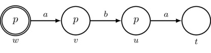

*M*

*Figure 1:* The pointed Kripke model $(M,w)$.

However, the formula $[p!]\lnot[\{a,b\}*][a]p$ is false at $(M,w)$ because, after the announcement of *p*, the model $M[p!]$ pictured in Figure 2 obtains, and all worlds in this model are $[a]p$-worlds. In fact, whenever *p* is true, the formula $[p!]\lnot[\{a,b\}*][a]p$ is *always* false: after the announcement of *p*, all that remains are *p*-worlds, and therefore every world is an $[a]p$-world.

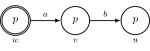

$M[p!]$

*Figure 2:* The pointed Kripke model $(M[p!],w)$.

The axiomatic theories of relativized common knowledge with and without public announcements along with expressivity results for the corresponding languages are detailed in [Appendix F](dynamic-epistemic.appendix-F-RCK.md).

We now state two complexity results for the languages of this subsection.

**\\eqref{PAL+C} and \\eqref{RCK} Complexity.** Let $\sC$ be the class of all Kripke models. Let $\sC_{\mathsf{S5}}$ be the class of Kripke models such that each binary accessibility relation is reflexive, transitive, and symmetric.

- The satisfiability problem for each of \\eqref{PAL+C} and \\eqref{RCK} over $\sC_{\mathsf{S5}}$ is EXPTIME-complete (Lutz 2006)[^lutz-2006].
- The model checking problem for each of \\eqref{PAL+C} and \\eqref{RCK} over $\sC$ is in P (Kooi and van Benthem 2004)[^kooi-2004][^benthem-2004].

In the remainder of the article, unless otherwise stated, we will generally assume that we are working with languages that do not contain common knowledge or relativized common knowledge.

#### 2.2.2 Distributed knowledge

Another notion of group knowledge is *distributed knowledge* (Fagin et al. 1995)[^fagin-1995]. Intuitively, a group *B* of agents has distributed knowledge that *F* is true if and only if, were they to pool together all that they know, they would then know *F*. As an example, if agents *a* and *b* are going to visit a mutual friend, *a* knows that the friend is at home or at work, and *b* knows that the friend is at work or at the cafe, then *a* and *b* have distributed knowledge that the friend is at work: after they pool together what they know, they will each know the location of the friend. Distributed knowledge and public announcements have been studied by Wáng and Ågotnes (2011). Related to this is the study of whether a notion of group knowledge (such as distributed knowledge) satisfies the property that something known by the group can be established via communication; see Roelofsen (2007)[^roelofsen-2007] for details.

### 2.3 Moore sentences

It may seem as though public announcements always “succeed”, by which we mean that after something is announced, we are guaranteed that that it is true. After all, this is often the purpose of an announcement: by making the announcement, we wish to inform everyone of its truth. However, it is not hard to come up with announcements that are true when announced but false afterward; that is, not all announcements are successful. Here are a few everyday examples in plain English.

- Agent *a*, who is visiting Amsterdam for the first time, steps off the plane in the Amsterdam Airport Schiphol and truthfully says, “*a* has never made a statement in Amsterdam”. This is unsuccessful because it is “self-defeating”: it rules out various past statements, but it itself is one of those ruled out, so the announcement violates what it says.
- Agent *a* who does not know it is raining, is told, “It is raining but *a* does not know it”. This is an example of a *Moore formula*, which are sentences of the form “*p* is true but agent *a* does not know *p*.“ In the language \\eqref{ML}, Moore formulas have the form $p\land\lnot[a]p$. An announcement of a Moore formula is unsuccessful because, after the announcement the agent comes to know the first conjunct *p* (the statement “it is raining” in the example), which therefore falsifies the second conjunct $\lnot[a]p$ (the statement “*a* does not know it is raining” in the example).

The opposite of unsuccessful formulas are the “successful” ones: these are the formulas that are true after they are announced. Here one should distinguish between “performative announcements” that bring about truth by their very occurrence (e.g., a judge says, “The objection is overruled”, which has the effect of making the objection overruled) and “informative announcements” that simply inform their listeners of truth (e.g., our mutual friend says, “I live on 207th Street”, which has the effect of informing us of something that is already true). Performative announcements are best addressed in a Dynamic Epistemic Logic setting using *factual changes*, a topic discussed in [Appendix G](dynamic-epistemic.appendix-G-EAL.md). For now our concern will be with informative announcements.

The phenomena of (un)successfulness of announcements was noted early on by Hintikka (1962)[^hintikka-1962] but was not studied in detail until the advent of Dynamic Epistemic Logic. In DEL, the explicit language for public announcements provides for an explicit syntactic definition of (un)successfulness.

**(Un)successful formula (van Ditmarsch and Kooi 2006; see also Gerbrandy 1999)[^gerbrandy-1999][^ditmarsch-2006][^ditmarsch-2006-2].** Let *F* be a formula in a language with public announcements.

- To say that *F* is *successful* means that $\models[F!]F$. “A successful formula is one that is always true after it is announced.”
- To say that *F* is *unsuccessful* means that *F*is not successful (i.e., $\not\models[F!]F$). “An unsuccessful formula is one that may be false after it is announced.”

As we have seen, the Moore formula

$$\begin{equation*}\tag{MF} p\land\lnot[a]p \end{equation*}$$

is unsuccessful: if (MF) is true, then its announcement eliminates all $\lnot p$-worlds, thereby falsifying $\lnot[a]p$ (since the truth of $\lnot[a]p$ requires the existence of an *a*-arrow leading to a $\lnot p$-world).

An example of a successful formula is a propositional letter *p*. In particular, after an announcement of *p*, it is clear that *p* still holds (since the propositional valuation does not change); that is, $[p!]p$. Moreover, as the reader can easily verify, the formula $[a]p$ is also successful.

In considering (un)successful formulas, a natural question arises: can we provide an syntactic characterization of the formulas that are (un)successful? That is, is there a way for us know whether a formula is (un)successful simply by looking at its form? Building off of the work of Visser et al. (1994) and Andréka, Németi, and van Benthem (1998), van Ditmarsch and Kooi (2006) provide one characterization of some of the successful \\eqref{PAL+C}-formulas.

**Theorem (van Ditmarsch and Kooi 2006)[^ditmarsch-2006][^ditmarsch-2006-2].** The *preserved formulas* are formed by the following grammar. $$\begin{gather*} F \ccoloneqq p \mid \lnot p \mid F\land F \mid F\lor F\mid [a]F\mid [\lnot F!]F \mid [B*]F \\ \small p\in\sP,\; a\in\sA,\; B\subseteq\sA \end{gather*}$$ Every preserved formula is successful.

Using a slightly different notion of successfulness wherein a formula *F* is said to be *successful* if and only if we have that $M,w\models F\land \may{a}F$ implies $M[F!],w\models F$ for each pointed Kripke model $(M,w)$ coming from a given class $\sC$, Holliday and Icard (2010) provide a comprehensive analysis of (un)successfulness with respect to the class of single-agent $\mathsf{S5}$ Kripke models and with respect to the class of single-agent $\mathsf{KD45}$ Kripke models. In particular, they provide a syntactic characterization of the successful formulas over these classes of Kripke models. This analysis was extended in part to a multi-agent setting by Saraf and Sourabh (2012). The highly technical details of these works are beyond the scope of the present article.

For more on Moore sentences, we refer the reader to Section 5.3 of the *Stanford Encyclopedia of Philosophy* entry on Epistemic Paradoxes (Sorensen 2011)[^sorensen-2011].

## 3. Complex epistemic interactions

In the previous section, we focused on one kind of model-transforming action: the public announcement. In this section, we look at the popular “action model” generalization of public announcements due to Baltag, Moss, and Solecki (Baltag, Moss, and Solecki 1998)[^baltag-1998], together referred to as “BMS”. Action models are simple relational structures that can be used to describe a variety of informational actions, from public announcements to more subtle communications that may contain degrees of privacy, misdirection, deception, and suspicion, to name just a few possibilities.

### 3.1 Action models describe complex informational scenarios

To begin, let us consider a specific example of a more complex communicative action: a completely private announcement. The idea of this action is that one agent, let us call her *a*, is to receive a message in complete privacy. Accordingly, no other agent should learn the contents of this message, and, furthermore, no other agent should even consider the possibility that agent *a* received the message in the first place. (Think of agent *a* traveling unnoticed to a secret and secure location, finding and reading a coded message only she can decode, and then destroying the message then and there.) One way to think about this action is as follows: there are two possible events that might occur. One of these, let us call it event *e*, is the announcement that *p* is true; this is the secret message to *a*. The other event, let us call it *f*, is the announcement that the propositional constant $\top$ for truth is true, an action that conveys no new propositional information (since $\top$ is a tautology). Agent *a* should know that the message is *p* and hence that the event that is in fact occurring is *e*. All other agents should mistakenly believe that it is common knowledge that the message is $\top$ and not even consider the possibility that the message is *p*. Accordingly, other agents should consider event *f* the one and only possibility and mistakenly believe that this is common knowledge. We picture a diagrammatic representation of this setup in Figure 3.

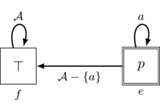

$\Pri_a(p)$

*Figure 3:* The pointed action model $(\Pri_a(p),e)$ for the completely private announcement of *p* to agent *a*.

In the figure, our two events *e* and *f* are pictured as rectangles (to distinguish these from the circled worlds of a Kripke model). The formula appearing inside an event’s rectangle is what is announced when the event occurs. So event *e* represents the announcement of *p*, and event *f* represents the announcement of $\top$. The event that actually occurs, called the “point”, is indicated using a double rectangle; in this case, the point is *e*. The only event that *a* considers possible is *e* because the only *a*-arrow leaving *e* loops right back to *e*. But all of the agents in our agent set $\sA$ other than *a* mistakenly consider the alternative event *f* as the only possibility: all non–*a*-arrows leaving *e* point to *f*. Furthermore, from the perspective of event *f*, it is common knowledge that event *f* (and its announcement of $\top$) is the only event that occurs: every agent has exactly one arrow leaving *f* and this arrow loops right back to *f*. Accordingly, the structure pictured above describes the following action: *p* is to be announced, agent *a* is to know this, and all other agents are to mistakenly believe it is common knowledge that $\top$ is announced. Structures like those pictured in Figure 3 are called *action models*.

**Action model (Baltag, Moss, and Solecki 1998, 1999; see also Baltag and Moss 2004)[^baltag-2004][^baltag-1998][^baltag-1999].** Other names in the literature: “event model” or “update model”. Given a set of formulas $\Lang$ and a finite nonempty set $\sA$ of agents, an *action model* is a structure $$ A=(E,R,\pre) $$ consisting of

- a nonempty finite set *E* of the possible communicative *events* that might occur,
- a function $R:\sA\to P(W\times W)$ that assigns to each agent $a\in\sA$ a binary possibility relation $R_a\subseteq E\times E$, and
- a function $\pre:E\to\Lang$ that assigns to each event $e\in E$ a *precondition* formula $\pre(e)\in\Lang$. Intuitively, the precondition $\pre(e)$ is announced when event *e* occurs.

Notation: if *A* is an action model, then adding a superscript *A* to a symbol in $\{E,R,\pre\}$ is used to denote a component of the triple that makes up *A* in such a way that $(E^A,R^A,\pre^A)=A$. We define a *pointed action model*, sometimes also called an *action*, to be a pair $(A,e)$ consisting of an action model *A* and an event $e\in E^A$ that is called the $point$. In drawing action models, events are drawn as rectangles, and a point (if any) is indicated with a double rectangle. We use many of the same drawing and terminological conventions for action models that we use for (pointed) Kripke models (see [Appendix A](dynamic-epistemic.appendix-A-kripke.md)).

$(\Pri_a(p),e)$ is the action pictured in Figure 3. Given an initial pointed Kripke model $(M,w)$ at which *p* is true, we determine the model-transforming effect of the action $(\Pri_a(p),e)$ by constructing a new pointed Kripke model $$ (M[\Pri_a(p)],(w,e)). $$ The construction of the Kripke model $M[\Pri_a(p)]$ is given by the BMS “product update”.

**Product update (Baltag, Moss, and Solecki 1998, 1999; see also Baltag and Moss 2004)[^baltag-2004][^baltag-1998][^baltag-1999].** Let $(M,w)$ be a pointed Kripke model and $(A,e)$ be a pointed action model. Let $\models$ be a binary satisfaction relation defined between $(M,w)$ and formulas in the language $\Lang$ of the precondition function $\pre^A:E^A\to\Lang$ of the action model *A*. If $M,w\models\pre^A(e)$, then the Kripke model $$ M[A]=(W[A],R[A],V[A]) $$ is defined via the *product update* operation $M\mapsto M[A]$ given as follows:

- $W[A] \coloneqq \{ (v,f)\in W\times E \mid M,v\models\pre^A(f) \}$ — pair worlds with events whose preconditions they satisfy,
- $(v_1,f_1)R[A]_a(v_2,f_2)$ if and only if $v_1 R^M_a v_2$ and $f_1 R^A_a f_2$ — insert an *a*-arrow in $M[A]$ between a pair just in case there is an *a*-arrow in *M* between the worlds and an *a*-arrow in *A* between the events, and
- $V[A]((v,f))\coloneqq V^M(p)$ — make the valuation of *p* at the pair $(v,f)$ just as it was at *v*.

An action $(A,e)$ operates on an initial situation $(M,w)$ satisfying $M,w\models\pre^A(e)$ via the product update to produce the resultant situation $(M[A],(w,e))$.

In this definition, the worlds of $M[A]$ are obtained by making multiple copies of the worlds of *M*, one copy per event $f\in E^A$. The event-*f* copy of a world *v* in *M* is represented by the pair $(v,f)$. Such a pair is to be included in the worlds of $M[A]$ if and only if $(M,v)$ satisfies the precondition $\pre^A(f)$ of event *f*. The term “product update” comes from the fact that the set $W[A]$ of worlds of $M[A]$ is specified by restricting the full Cartesian product $W^M\times E^A$ to those pairs $(v,f)$ whose indicated world *v* satisfies the precondition $\pre^A(f)$ of the indicated event *f*; that is, the “product update” is based on a restricted Cartesian product, hence the name.

According to the product update, we insert an *a*-arrow $(v_1,f_1)\to_a (v_2,f_2)$ in $M[A]$ if and only if there is an *a*-arrow $v_1\to_a v_2$ in *M* and an *a*-arrow $f_1\to_a f_2$ in *A*. In this way, agent *a*’s uncertainty in the resultant model $M[A]$ comes from two sources: her initial uncertainty in *M* (represented by $R^M_a$) as to which is the actual world and her uncertainty in *A* (represented by $R^A_a$) as to which is the actual event. Finally, the valuation at the copy $(v,f)$ in $M[A]$ is just the same as it was at the original world *v* in *M*.

For an example of the product update in action, consider the following pointed Kripke model $(M,w)$:

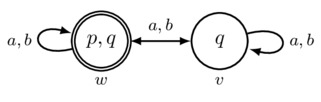

*M*

The action model $\Pri_a(p)$ from Figure 3 operates on $(M,w)$ via the product update to produce the resultant situation $(M[\Pri_a(p)],(w,e))$ pictured as follows:

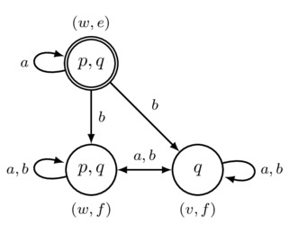

$M[\Pri_a(p)]$

Indeed, to produce $M[\Pri_a(p)]$ from *M* via the product update with the action model $\Pri_a(p)$:

- Event *e* has us copy worlds at which $\pre^{\Pri_a(p)}(e)=p$ is true; this is just the world *w*, which we retain in the form $(w,e)$ with the same valuation.
- Event *f* has us copy worlds at which $\pre^{\Pri_a(p)}(f)=\top$ is true; this is both *w* and *v*, which we retain in the forms $(w,f)$ and $(v,f)$, respectively, with their same respective valuations.
- We interconnect the worlds in $M[\Pri_a(p)]$ with agent arrows according to the recipe of the product update: place an arrow between pairs just in case we have arrows componentwise in *M* and in $\Pri_a(p)$, respectively. For example, we have a *b*-arrow $(w,e)\to_b(v,f)$ in $M[\Pri_a(p)]$ because we have the *b*-arrow $w\to_b v$ in *M* and the *b*-arrow $e\to_b f$ in $\Pri_a(p)$.
- The point (i.e., actual world) $(w,e)$ of the resultant situation is obtained by paring together the point *w* from the initial situation $(M,w)$ and the point *e* from the applied action $(\Pri_a(p),e)$.

We therefore obtain the model $M[\Pri_a(p)]$ as pictured above. We note that the product update-induced mapping $$ (M,w) \mapsto (M[A],(w,e)) $$ from the initial situation $(M,w)$ to the resultant situation $(M[A],(w,e))$ has the following effect: we go from an initial situation $(M,w)$ in which neither agent knows whether *p* is true to a resultant situation $(M[A],(w,e))$ in which *a* knows *p* is true but *b* mistakenly believes everyone’s knowledge is unchanged. This is of course just what we want of the private announcement of *p* to agent *a*.

We now take a moment to comment on the similarities and differences between action models and Kripke models. To begin, both are labeled directed graphs (consisting of labeled nodes and labeled edges pointing between the nodes). A node of a Kripke model (a “world”) is labeled by the propositional letters that are true at the world; in contrast, a node of an action model (an “event”) is labeled by a single formula that is to be announced if the event occurs. However, in both cases, agent uncertainty is represented using the same “considered possibilities” approach. In the case of Kripke models, an agent considers various possibilities for the world that might be actual; in the case of action models, an agent considers various possibilities for the event that might actually occur. The key insight behind action models, as put forward by Baltag, Moss, and Solecki (1998), is that these two uncertainties can be represented using similar graph-theoretic structures. We can therefore leverage our experience working with Kripke models when we need to devise new action models that describe complex communicative actions. In particular, to construct an action model for a given action, all we must do is break up the action into a number of simple announcement events and then describe the agents’ respective uncertainties among these events in the appropriate way so as to obtain the desired action. The difficulty, of course, is in determining the exact uncertainty relationships. However, this determination amounts to inserting the appropriate agent arrows between possible events, and doing this requires the same kind of reasoning as that which we used in the construction of Kripke models meeting certain basic or higher-order knowledge constraints. We demonstrate this now by way of example, constructing a few important action models along the way.

### 3.2 Examples of action models

We saw the example of a completely private announcement in Figure 3, a complex action in which one agent learns something without the other agents even suspecting that this is so. Before devising an action model for another similarly complicated action, let us return to our most basic action: the public announcement of *p*. The idea of this action is that all agents receive the information that *p* is true, and this is common knowledge. So to construct an action model for this action, we need only one event *e* that conveys the announcement that *p* is true, and the occurrence of this event should be common knowledge. This leads us immediately to the action model $\Pub(p)$ pictured in Figure 4.

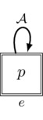

$\Pub(p)$

*Figure 4:* The pointed action model $(\Pub(p),e)$ for the public announcement of *p*.

It is not difficult to see that $\Pub(p)$ is just what we want: event *e* conveys the desired announcement and the reflexive arrows for each agent make it so that this event is common knowledge. It is important to note that in virtue of the fact that we can construct an action model for public announcements, it follows that action models are a generalization of public announcements.

We now turn to a more complicated action: the semi-private announcement of *p* to agent *a* (sometimes called the “semi-public announcement” of *p* to agent *a*). The idea of this action is that agent *a* is told that *p* is true, the other agents know that *a* is told the truth value of *p*, but these other agents do not know what it is exactly that *a* is told. This suggests an action model with two events, one for each thing that *a* might be told: an event *e* that announces *p* and event *f* that announces $\lnot p$. Agent *a* is to know which event occurs, whereas all other agents are to be uncertain as to which event occurs. This leads us to the action model $\frac12\Pri_a(p)$ pictured in Figure 5.

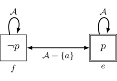

$\frac12\Pri_a(p)$

*Figure 5:* The pointed action model $(\frac12\Pri_a(p),e)$ for the semi-private announcement of *p* to agent *a*.

We see that $\frac12\Pri_a(p)$ satisfies just what we want: the actual event that occurs is the point *e* (the announcement of the precondition *p*), agent *a* knows this, but all other agents consider it possible that either *e* (the announcement of *p*) or *f* (the announcement of $\lnot p$) occurred. Furthermore, the other agents know that *a* knows which event was the case (since at each of the events *e* and *f* that they consider possible, agent *a* knows the event that occurs). This is just what we want of a semi-private announcement.

Finally, let us consider a much more challenging action: the misleading private announcement of *p* to agent *a*. The idea of this action is that agent *a* is told *p* in a completely private manner but all other agents are misled into believing that *a* received the private announcement of $\lnot p$ instead. So to construct an action model for this, we need a few elements: events for the private announcement of $\lnot p$ to *a* that the non-*a* agents mistakenly believe occurs and an event for the actual announcement of *p* that only *a* knows occurs. As for the events for the private announcement of $\lnot p$, it follows by a simple modification of Figure 3 that the private announcement of $\lnot p$ to agent *a* is the action $(\Pri_a(\lnot p),e)$ pictured as follows:

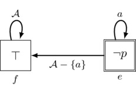

$\Pri_a(\lnot p)$

Since the other agents are to believe that the above action occurs, they should believe it is event *e* that occurs. However, they are mistaken: what actually does occur is a new event *g* that conveys to *a* the private information that *p* is true. Taken together, we obtain the action $(\MPri_a(p),g)$ pictured in Figure 6.

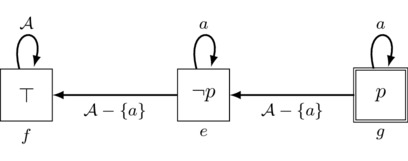

$\MPri_a(p)$

*Figure 6:* The pointed action model $(\MPri_a(p),g)$ for the misleading private announcement of *p* to agent *a*.

Looking at $\MPri_a(p)$, we see that if we were to to delete event *g* (and all arrows to and from *g*), then we would obtain $\Pri_a(\lnot p)$. So events *e* and *f* in $\MPri_a(p)$ play the role of representing the “misdirection” the non-*a* agents experience: the private announcement of $\lnot p$ to agent *a*. However, it is event *g* that actually occurs: this event conveys to *a* that *p* is true while misleading the other agents into believing that it is event *e*, the event corresponding to the private announcement of $\lnot p$ to *a*, that occurs. In sum, *a* receives the information that *p* is true while the other agents are mislead into believing that *a* received the private announcement of $\lnot p$. One consequence of this is that non-*a* agents come to hold the following beliefs: $\lnot p$ is true, agent *a* knows this, and agent *a* believes the others believe that no new propositional information was provided. These beliefs are all incorrect. The non-*a* agents are therefore highly mislead.

### 3.3 The Logic of Epistemic Actions

Now that we have seen a number of action models, we turn to the formal syntax and semantics of the language \\eqref{EAL} of *Epistemic Action Logic* (a.k.a., *the Logic of Epistemic Actions*). We define the language \\eqref{EAL} along with the set $\AM_*$ of pointed action models with preconditions in the language \\eqref{EAL} according to the following recursive grammar:

$$\begin{gather*} F \ccoloneqq p \mid F \wedge F \mid \neg F \mid [a]F \mid [A,e]F \\ \small p \in \sP,\; a \in \sA,\; (A,e)\in\AM_* \taglabel{EAL} \end{gather*}$$

To be clear: in the language \\eqref{EAL}, the precondition $\pre^A(e)$ of an action model *A* may be a formula that includes an action model modality $[A',e']$ for some other action $(A',e')\in\AM_*$. For full technical details on how this works, please see [Appendix H](dynamic-epistemic.appendix-H-recursion.md).

For convenience, we let $\AM$ denote the set of all action models whose preconditions are all in the language \\eqref{EAL}. As we saw in the previous two subsections, the set $\AM_*$ contains pointed action models for public announcements (Figure 4), private announcements (Figure 3), semi-private announcements (Figure 5), and misleading private announcements (Figure 6), along with many others. The satisfaction relation $\models$ between pointed Kripke models and formulas of \\eqref{EAL} is the smallest extension of the relation $\models$ for \\eqref{ML} (see [Appendix A](dynamic-epistemic.appendix-A-kripke.md)) satisfying the following:

- $M,w\models[A,e]G$ holds if and only if $M,w\not\models\pre^A(e)$ or $M[A],(w,e)\models G$, where the Kripke model $M[A]$ is defined via the BMS product update (Baltag, Moss, and Solecki 1999)[^baltag-1999].

Note that the formula $[A,e]G$ is vacuously true if the precondition $\pre(e)$ of event *e* is false. Accordingly, the action model semantics retains the assumption of truthfulness that we had for public announcements. That is, for an event to actually occur, its precondition must be true. As a consequence, the occurrence of an event *e* implies that its precondition $\pre(e)$ was true, and hence the occurrence of an event conveys its precondition formula as a message. If an event can occur at a given world, then we say that the event is *executable* at that world.

**Executable events and action models.** To say that a pointed action model $(A,e)$ is *executable* at a pointed Kripke model $(M,w)$ means that $M,w\models\pre(e)$. To say that an event *f* in an action model *A* is *executable* means that $(A,f)$ is executable. To say that an action model *A* is *executable* in a Kripke model *M* means there is an event *f* in *A* and a world *v* in *M* such that *f* is executable at $(M,v)$.

As was the case for PAL, one often wishes to restrict attention to Kripke models whose relations $R_a$ satisfy certain desirable properties such as reflexivity, transitivity, Euclideanness, and seriality. In order to study actions over such classes, we must be certain that the actions do not transform a Kripke model in the class into a new Kripke model not in the class; that is, we must ensure that the class of Kripke models is “closed” under actions. The following theorem provides some sufficient conditions that guarantee closure.

**Action Model Closure Theorem.** Let $M=(W^M,R^M,V)$ be a Kripke model and $A=(W^A,R^A,\pre)$ be an action model executable in *M*.

- If $R^M_a$ and $R^A_a$ are reflexive, then so is $R^M[A]_a$.
- If $R^M_a$ and $R^A_a$ are transitive, then so is $R^M[A]_a$.
- If $R^M_a$ and $R^A_a$ are Euclidean, then so is $R^M[A]_a$.
- If *A* satisfies the condition that every event $e\in W^A$ gives rise to a nonempty set $$ S(e)\subseteq \{f\in W^A\mid eR^A_af\} $$ of events such that $$ \textstyle \models \pre^A(e) \to \may{a}\left(\bigvee_{f\in S(e)}\pre^A(f)\right) \,, $$ then $R^M[A]_a$ is serial. (Note: the condition on *A* and the executability of *A* in *M* together imply that $R^M_a$ is serial.)

This theorem, like the analogous theorem for Public Announcement Logic, is used in providing simple sound and complete theories for the Logic of Epistemic Actions based on appropriate “action-friendly” logics.

**Action-friendly logic.** To say that a logic $\L$ is *action-friendly* means we have the following:

- $\L$ is a normal multi-modal logic in the language \\eqref{ML} (i.e., with modals $[a]$ for each agent $a\in\sA$),
- there is a class of Kripke models $\sC$ such that $\L$ is sound and complete with respect to the collection of pointed Kripke models based on models in $\sC$, and
- there is a language $\LEAL$ (the “action model extension of $\L$”) obtained from \\eqref{EAL} by restricting the form of action models such that $\sC$ is closed under the product update with executable actions of this form (i.e., performing an executable action model of this form on a model in $\sC$ yields another model in $\sC$).

The various axiomatic theories of modal logic with action models (without common knowledge) are obtained based on the choice of an underlying action-friendly logic $\L$.

**The axiomatic theory $\EAL$.** Other names in the literature: $\DEL$ or $\AM$ (for “action model”; see van Ditmarsch, van der Hoek, and Kooi 2007)[^kooi-2007][^ditmarsch-2007][^ditmarsch-2007-2].

- Axiom schemes and rules for the action-friendly logic $\L$
- Reduction axioms (each in the language $\LEAL$):
- $[A,e]p\leftrightarrow(\pre(e)\to p)$ for letters $p\in\sP$ “After a non-executable action, every letter holds—a contradiction. After an executable action, letters retain their truth values.”
- $[A,e](G\land H)\leftrightarrow([A,e]G\land[A,e]H)$ “A conjunction is true after an action iff each conjunct is.”
- $[A,e]\lnot G\leftrightarrow(\pre(e)\to\lnot[A,e]G)$ “*G* is false after an action iff the action, whenever executable, does not make *G* true.”
- $[A,e][a]G\leftrightarrow (\pre(e)\to\bigwedge_{e R_a f} [a][A,f]G)$ “*a* knows *G* after an action iff the action, whenever executable, is known by *a* to make *G* true despite her uncertainty of the actual event.”
- Action Necessitation Rule: from *G*, infer $[A,e]G$ whenever the latter is in $\LEAL$. “A validity holds after any action.”

The first three reduction axioms are nearly identical to the corresponding reduction axioms for $\PAL$, except that the first and third $\EAL$ reduction axioms check the truth of a precondition in the place where the $\PAL$ reduction axioms would check the truth of the formula to be announced. This is actually the same kind of check: for an event, the precondition must hold in order for the event to be executable; for a public announcement, the formula must be true in order for the public announcement to occur (and hence for the public announcement event in question to be “executable”). The major difference between the $\PAL$ and $\EAL$ reduction axioms is in the fourth $\EAL$ reduction axiom. This axiom specifies the conditions under which an agent has belief (or knowledge) of something after the occurrence of an action. In particular, adopting a doxastic reading for this discussion, the axiom says that agent *a* believes *G* after the occurrence of action $(A,e)$ if and only if the formula $$ \textstyle \pre(e)\to\bigwedge_{e R_af}[a][A,f]G $$ is true. This formula, in turn, says that if the precondition is true—and therefore the action is executable—then, for each of the possible events the agent entertains, she believes that *G* is true if the event in question occurs. This makes sense: *a* cannot be sure which of the events has occurred, and so for her to believe something after the action has occurred, she must be sure that this something is true no matter which of her entertained events might have been the actual one. For example, if *a* sees her friend *b* become elated as he listens to something he hears on the other side of a private phone call, then the *a* may not know exactly what it is that *b* is being told; nevertheless, *a* has reason to believe that *b* is receiving good news because, no matter what it is exactly that he is being told (i.e., no matter which of the events she thinks that he may be hearing), she knows from his reaction that he must be receiving good news.

As was the case for $\PAL$, the $\EAL$ reduction axioms allow us to “reduce” each formula containing action models to a provably equivalent formula whose action model modalities appear before formulas of lesser complexity, allowing us to eliminate action model modalities completely via a sequence of provable equivalences. As a consequence, we have the following.

**$\EAL$ Reduction Theorem (Baltag, Moss, and Solecki 1998, 1999; see also Baltag and Moss 2004)[^baltag-2004][^baltag-1998][^baltag-1999].** Given an action-friendly logic $\L$, every *F* in the language $\LEAL$ of Epistemic Action Logic (without common knowledge) is $\EAL$-provably equivalent to a formula $F^\circ$ coming from the action model-free modal language \\eqref{ML}.

Once we have proved $\EAL$ is sound, the Reduction Theorem leads us to axiomatic completeness via the known completeness of the underlying modal theory.

**$\EAL$ Soundness and Completeness (Baltag, Moss, and Solecki 1998, 1999; see also Baltag and Moss 2004)[^baltag-2004][^baltag-1998][^baltag-1999].** $\EAL$ is sound and complete with respect to the collection $\sC_*$ of pointed Kripke models for which the underlying action-friendly logic $\L$ is sound and complete. That is, for each $\LEAL$-formula *F*, we have that $\EAL\vdash F$ if and only if $\sC_*\models F$.

We saw above that for $\PAL$ it was possible to combine two consecutive announcements into a single announcement via the schematic validity $$ [F!][G!]H\leftrightarrow[F\land[F!]G!]H. $$ Something similar is available for action models.

**Action model composition.** The *composition* $A\circ B=(E,R,\pre)$ of action models $A=(E^A,R^A,\pre^A)$ and $B=(E^B,R^B,\pre^B)$ is defined as follows:

- $E=E^A\times E^B$ — composed events are pairs $(e,f)$ of constituent events;
- $(e_1,f_1) R_a (e_2,f_2)$ if and only if $e_1 R^A_a e_2$ and $f_1 R^B_a f_2$ — a composed event is entertained iff its constituent events are; and
- $\pre((e_1,e_2))=\pre^A(e_1)\land[A,e_1]\pre^B(e_2)$ — a composed event is executable iff the first constituent is executable and, after it occurs, the second constituent is executable as well.

**Composition Theorem.** Each instance of the following schemes is $\EAL$-derivable (so long as they are permitted in the language $\LEAL$).

- Composition Scheme: $[A,e][B,f]G\leftrightarrow[A\circ B,(e,f)]G$
- Associativity Scheme: $[A\circ B,(e,f)][C,g]H \leftrightarrow [A,e][B\circ C,(f,g)]H$

We conclude this subsection with two complexity results for \\eqref{EAL}.

**EAL Complexity (Aucher and Schwarzentruber 2013)[^aucher-2013].** Let $\sC$ be the class of all Kripke models.

- The satisfiability problem for \\eqref{EAL} over $\sC$ is NEXPTIME-complete.
- The model checking problem for \\eqref{EAL} over $\sC$ is PSPACE-complete.

[Appendix G](dynamic-epistemic.appendix-G-EAL.md) provides information on action model equivalence (including the notions of action model bisimulation and emulation), studies a simple modification that enables action models to change the truth value of propositional letters (permitting so-called “factual changes”), and shows how to add common knowledge to $\EAL$.

### 3.4 Variants and generalizations

In this section, we mention some variants of the action model approach to Kripke model transformation.

- **Graph modifier logics.** Aucher et al. (2009) study extensions of \\eqref{ML} that contain modalities for performing certain graph modifying operations.
- **Generalized Arrow Update Logic.** Kooi and Renne (2011b)[^renne-2011b] introduce a theory of model-changing operations that delete arrows instead of worlds. This theory, which is equivalent to $\EAL$ in terms of language expressivity and update expressivity, is a generalization of a simpler theory called Arrow Update Logic (see Section 4 of [Appendix E](dynamic-epistemic.appendix-E-PAL.md)).
- **Logic of Communication and Change.** Van Benthem, van Eijck, and Kooi (2006) introduce $\LCC$, the Logic of Communication and Change, as a Propositional Dynamic Logic-like language that incorporates action models with “factual change”.
- **General Dynamic Dynamic Logic.** Girard, Seligman, and Liu (2012) propose General Dynamic Dynamic Logic $\GDDL$, a Propositional Dynamic Logic-style language that has complex action model-like modalities that themselves contain Propositional Dynamic Logic-style instructions.

More on these variants to the action model approach may be found in [Appendix I](dynamic-epistemic.appendix-I-variants.md).

## 4. Belief change and Dynamic Epistemic Logic

Up to this point, the logics we have developed all have one key limitation: an agent cannot meaningfully assimilate information that contradicts her knowledge or beliefs; that is, incoming information that is *inconsistent* with an agent’s knowledge or belief leads to difficulties. For example, if agent *a* believes *p*, then announcing that *p* is false brings about a state in which the agent’s beliefs are trivialized (in the sense that she comes to believe *every* sentence):

$$\models [a]p\to[\lnot p!][a]F\quad \text{for all formulas } F.$$

Note that in the above, we may replace *F* by a contradiction such as the propositional constant $\bot$ for falsehood. Accordingly, an agent who initially believes *p* is lead by an announcement that *p* is false to an inconsistent state in which she believes *everything*, including falsehoods. This trivialization occurs whenever something is announced that contradicts the agent’s beliefs; in particular, it occurs if a contradiction such as $\bot$ is itself announced:

$$\models[\bot!][a]F\quad \text{ for all formulas } F.$$

In everyday life, the announcement of a contradiction, when recognized as such, is generally not informative; at best, a listener who realizes she is hearing a contradiction learns that there is some problem with the announcer or the announced information itself. However, the announcement of something that is not intrinsically contradictory but merely contradicts existing beliefs is an everyday occurrence of great importance: upon receipt of trustworthy information that our belief about something is wrong, a rational response is to adjust our beliefs in an appropriate way. Part of this adjustment requires a determination of our attitude toward the general reliability or trustworthiness of the incoming information: perhaps we trust it completely, like a young child trusts her parents. Or maybe our attitude is more nuanced: we are willing to trust the information for now, but we still allow for the possibility that it might be wrong, perhaps leading us to later revise our beliefs if and when we learn that it is incorrect. Or maybe we are much more skeptical: we distrust the information for now, but we do not completely disregard the possibility, however seemingly remote, that it might turn out to be true.

What is needed is an adaptation of the above-developed frameworks that can handle incoming information that may contradict existing beliefs and that does so in a way that accounts for the many nuanced attitudes an agent may have with respect to the general reliability or trustworthiness of the information. This has been a focus of much recent activity in the DEL literature.

### 4.1 Belief Revision: error-aware belief change

Belief Revision is the study of belief change brought about by the acceptance of incoming information that may contradict initial beliefs (Gärdenfors 2003; Ove Hansson 2012; Peppas 2008)[^hansson-2012][^peppas-2008]. The seminal work in this area is due to Alchourrón, Gärdenfors, and Mackinson, or “AGM” (1985). The AGM approach to belief revision characterizes belief change using a number of postulates. Each postulate provides a qualitative account of the belief revision process by saying what must obtain with respect to the agent’s beliefs after revision by an incoming formula *F*. For example, the AGM *Success* postulate says that the formulas the agent believes after revision by *F* must include *F* itself; that is, the revision always “succeeds” in causing the agent to come to believe the incoming information *F*.

Belief Revision has traditionally restricted attention to single-agent, “ontic” belief change: the beliefs in question all belong to a single agent, and the beliefs themselves concern only the “facts” of the world and not, in particular, higher-order beliefs (i.e., beliefs about beliefs). Further, as a result of the Success postulate, the incoming formula *F* that brings about the belief change is assumed to be *completely trustworthy*: the agent accepts without question the incoming information *F* and incorporates it into her set of beliefs as per the belief change process.

Work on belief change in Dynamic Epistemic Logic incorporates key ideas from Belief Revision Theory but removes three key restrictions. First, belief change in DEL can can involve higher-order beliefs (and not just “ontic” information). Second, DEL can be used in multi-agent scenarios. Third, the DEL approach permits agents to have more nuanced attitudes with respect to the incoming information.

### 4.2 Static and dynamic belief change

The literature on belief change in Dynamic Epistemic Logic makes an important distinction between “static” and “dynamic” belief change (van Ditmarsch 2005; Baltag and Smets 2008b; van Benthem 2007)[^baltag-2008b][^benthem-2007][^benthem-2007-2][^benthem-2007-3][^ditmarsch-2005][^ditmarsch-2005-2].

- **Static belief change:** the objects of agent belief are fixed external truths that do not change, though the agent’s beliefs about these truths may change. In a motto, static belief change involves “changing beliefs about an *unchanging* situation”.
- **Dynamic belief change:** the objects of agent belief include not only external truths but also the beliefs themselves, and part or all of these can change. In a motto, dynamic belief change involves “changing beliefs about a *changing* situation that itself includes these very beliefs”.

To better explain and illustrate the difference, let us consider the result of a belief change brought about by the Moore formula

$$\begin{equation*}\taglabel{MF} p\land\lnot[a]p, \end{equation*}$$

informally read, “*p* is true but agent *a* does not believe it”. Let us suppose that this formula is true; that is, *p* is true and, indeed, agent *a* does not believe that *p* is true. Now suppose that agent *a* receives the formula \\eqref{MF} from a completely trustworthy source and is supposed to change her beliefs to take into account the information this formula provides. In a dynamic belief change, she will accept the formula \\eqref{MF} and hence, in particular, she will come to believe that *p* is true. But then the formula \\eqref{MF} becomes false: she now believes *p* and therefore the formula $\lnot[a]p$ (“agent *a* does not believe *p*”) is false. So we see that this belief change is indeed dynamic: in revising her beliefs based on the incoming true formula \\eqref{MF}, the truth of the formula \\eqref{MF} was itself changed. That is, the “situation”, which involves the truth of *p* and the agent’s beliefs about this truth, changed as per the belief change brought about by the agent learning that \\eqref{MF} is true. (As an aside, this example shows that for *dynamic* belief change, the AGM Success postulate is violated and so must be dropped.)

Perhaps surprisingly, it is also possible to undergo a *static* belief change upon receipt of the true formula \\eqref{MF} from a completely trustworthy source. For this to happen, we must think of the “situation” with regard to the truth of *p* and the agent’s beliefs about this truth as completely static, like a “snapshot in time”. We then look at how the agent’s beliefs about that static snapshot might change upon receipt of the completely trustworthy information that \\eqref{MF} was true in the moment of that snapshot. To make sense of this, it might be helpful to think of it this way: the agent learns something *in the present* about what was true of her situation *in the past*. So her present views about her past beliefs change, but the past beliefs remain fixed. It is as though the agent studies a photograph of herself from the past: her “present self” changes her beliefs about that “past self” pictured in the photograph, fixed forever in time. In a certain respect, the “past self” might as well be a different person:

> Now that I have been told \\eqref{MF} is true at the moment pictured in the photograph, what can I say about the situation in the picture and about the person in that situation?

So to perform a *static belief change* upon receipt of the incoming formula *F*, the agent is to change her present belief based on the information that *F* was true in the state of affairs that existed *before* she was told about *F*. Accordingly, in performing a static belief change upon receipt of \\eqref{MF}, the agent will come to accept that, just before she was told \\eqref{MF}, the letter *p* was true but she did not believe that *p* was true. But most importantly, this will not cause her to believe that \\eqref{MF} is true *afterward*: she is only changing her beliefs about what was true *in the past*; she has not been provided with information that bears on the present. In particular, while she will change her belief about the truth of *p* in the moment that existed just before she was informed of \\eqref{MF}, she will leave her present belief about *p* as it is (i.e., she still will not know that *p* is true). Therefore, upon static belief revision by \\eqref{MF}, it is still the case that \\eqref{MF} is true! (As an aside, this shows that for *static* belief change, the AGM Success postulate is satisfied.)

Static belief change occurs in everyday life when we receive information about something that can quickly change, so that the information can become “stale” (i.e., incorrect) just after we receive it. This happens, for example, with our knowledge of the price of a high-volume, high-volatility stock during trading hours: if we check the price and then look away for the rest of the day, we only know the price at the given moment in the past and cannot guarantee that the price remains the same, even right after we checked it. Therefore, we only know the price of the stock in the past—not in the present—even though for practical reasons we sometimes operate under the fiction that the price remains constant after we checked it and therefore speak as though we know it (even though we really do not).

Dynamic belief change is more common in everyday life. It happens whenever we receive information whose truth cannot rapidly become “stale”: we are given the information and this information bears directly on our present situation.

We note that the distinction between static and dynamic belief change may raise a dilemma that bears on the problem of skepticism in Epistemology (see, e.g., entry on Epistemology): our “dynamic belief change skeptic” might claim that *all* belief changes must be static because we cannot really know that then information we have received has not become stale. To the authors’ knowledge, this topic has not yet been explored.

### 4.3 Plausibility models and belief change

In the DEL study of belief change, situations involving the beliefs of multiple agents are represented using a variation of basic Kripke models called *plausibility models*. Static belief change is interpreted as conditionalization in these models: without changing the model (i.e., the situation), we see what the agent would believe conditional on the incoming information. This will be explained in detail in a moment. Dynamic belief change involves transforming plausibility models: after introducing plausibility model-compatible action models, we use model operators defined from these “plausibility action models” to describe changes in the plausibility model (i.e., the situation) itself.

Our presentation of the DEL approach to belief change will follow Baltag and Smets (2008b), so all theorems and definitions in the remainder of Section 4 are due to them unless otherwise noted. Their work is closely linked with the work of van Benthem (2007)[^benthem-2007][^benthem-2007-2][^benthem-2007-3], Board (2004)[^board-2004], Grove (1988)[^grove-1988], and others. For an alternative approach based on Propositional Dynamic Logic, we refer the reader to van Eijck and Wang (2008).

Plausibility models are used to represent more nuanced versions of knowledge and belief. These models are also used to reason about *static* belief changes. The idea behind plausibility models is similar to that for our basic Kripke models: each agent considers various worlds as possible candidates for the actual one. However, there is a key difference: among any two worlds *w* and *v* that an agent *a* considers possible, she imposes a relative *plausibility order*. The plausibility order for agent *a* is denoted by $\geq_a$. We write

$w\geq_a v$ to mean that “world *w* is no more plausible than world *v* according to agent *a*”.

Note that if we think of $\geq_a$ as a “greater than or equal to” sign, it is the “smaller” world that is either *more* plausible or else of equal plausibility. The reason for ordering things in this way comes from an idea due to Grove (1988)[^grove-1988]: we think of each world as positioned on the surface of exactly one of a series of concentric spheres (of non-equal radii), with a more plausible world located on a sphere of smaller radius and a less plausible world located on a sphere of greater radius. Consider the following illustration:

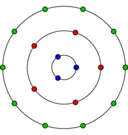

In this diagram, the black concentric circles indicate spheres, the blue points on the smallest (i.e., innermost) sphere are the most plausible worlds overall, the red points on the second-smallest (i.e., middle) sphere are the second-most plausible worlds, and the green points on the largest sphere are the least plausible worlds overall.

We write $\leq_a$ (“no less plausible than”) for the *converse plausibility relation*: $w\leq_a v$ means that $v\geq_a w$. Also, we define the *strict plausibility relation* $\gt_a$ (“strictly more plausible than”) in the usual way: $w\gt_a v$ means that we have $w\geq_a v$ and $v\ngeq_a w$. (A slash through the relation means the relation does not hold.) The *strict converse plausibility relation* $\lt_a$ (“strictly less plausible than”) is defined as expected: $w\lt_a v$ means that $v\gt_a w$. Finally, we define the *equi-plausibility relation* $\simeq_a$ (“equally plausible”) as follows: $w\simeq_a v$ means that we have $w\geq_a v$ and $v\geq_a w$.

We draw plausibility models much like our basic Kripke models from before except that we use dashed arrows (instead of solid ones) in order to indicate the plausibility relations and also to indicate that the picture in question is one of a plausibility model. We adopt the following conventions for drawing plausibility models.

- One-way arrows indicate non-increasing plausibility: 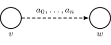 indicates $v\geq_aw$ for each $a\in\{a_0,\dots,a_n\}$
- Two-way arrows are a shorthand for two one-way arrows, one in each direction: letting *σ* denote a comma-separated list of agents in $\sA$, 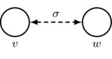 indicates 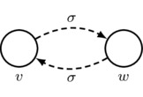
- Reflexive arrows are implied (so that $\geq_a$ is reflexive for each $a\in\sA$): 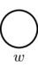 indicates 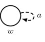
- Transitive arrows are implied (so that $\geq_a$ is transitive for each $a\in\sA$): 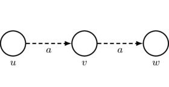 indicates 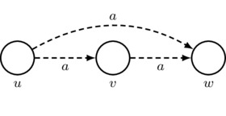 The transitive arrow rule and the two-way arrow rule may interact: if one or both of the arrows $u\dashrightarrow_a v$ or $v\dashrightarrow_a w$ were two-way, then we would still obtain the implied transitive arrow $u\dashrightarrow_a w$.
- An absence of a drawn or implied *a*-arrow from *v* to *w* indicates $v\not\geq_a w$: 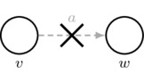 indicates $v\not\geq_a w$ The picture above indicates there is no *a*-arrow from *v* to *w* that is either drawn or implied. So we conclude that $v\not\geq_a w$ only after we have taken into account all drawn and implied *a*-arrows and determined that no *a*-arrow from *v* to *w* is indicated.
- The picture must specify a relation $\geq_a$ that is *locally connected*: defining for each world *w* the *connected component* $$ \cc_a(w) \coloneqq \{ v\in W \mid w({\geq_a}\cup{\leq_a})^*v\} $$ of *w*, we have that $v\in\cc_a(w)$ implies $w\geq_a v$ or $v\geq_a w$. To explain the meaning of this property, we first explain the definition of the connected component $\cc_a(w)$. This set is based on the union relation ${\geq_a}\cup{\leq_a}$, which relates two worlds if and only if they are related according to $\geq_a$ or $\leq_a$; that is, we have $w({\geq_a}\cup{\leq_a})v$ if and only if $w\geq_a v$ or $w\leq_a v$. We then take the union relation and apply the operator $(-)^*$, which forms the *reflexive-transitive closure* $R^*$ of a relation *R*: the relation $R^*$ relates two worlds if and only if they are the same or there exists a sequence of intermediate worlds that are stepwise connected by the underlying relation *R*. Therefore, we have $w({\geq_a}\cup{\leq_a})^*v$ if and only if $w=v$ or there exists a sequence $u_1,\dots,u_n$ of worlds such that $$ w({\geq_a}\cup{\leq_a})u_1 ({\geq_a}\cup{\leq_a})\cdots ({\geq_a}\cup{\leq_a})u_n({\geq_a}\cup{\leq_a})v. $$ So, taken together, we have $v\in\cc_a(w)$ if and only if $v=w$ or there is a sequence $u_1,\dots,u_n$ of worlds connecting *v* to *w* stepwise in terms of plausibility (without regard to whether the relative plausibility is increasing, decreasing, or remaining the same). In terms of our pictures of plausibility models, we have $v\in\cc_a(w)$ if and only if, after taking into account all drawn and implied *a*-arrows and disregarding arrow directionality, *v* and *w* are the same or are linked by a sequence of *a*-arrows (in which each arrow can be followed both forward and backward). The property of local connectedness then tells us that if $v\in\cc_a(w)$, then we must have $w\geq_a v$ or $v\geq_a w$. That is, if there is an undirected *a*-arrow path from *w* to *v*, then there is an *a*-arrow directly linking *w* and *v* in one direction or the other. Therefore, if we think of $\cc_a(w)$ as the set of worlds that the agent *a* considers to be possible whenever *w* is the actual world, local connectedness tells us that agent *a* must always have an opinion as to the relative plausibility between any two worlds that she considers to be possible. It is in this sense that each agent must be “opinionated“ as to the relative plausibility of worlds she considers possible. As an example, the property of local connectivity disallows the following picture: 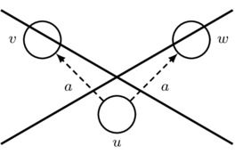 This picture is disallowed because because it violates local connectivity for $\geq_a$: we have $v\in\cc_a(w)$ and yet neither $v\geq_a w$ nor $w\geq_a v$. In detail: we have $v\in\cc_a(w)$ because we have the undirected *a*-arrow path $w\dashleftarrow_a u\dashrightarrow_a v$ from *w* to *v*; and we have neither $y\geq_a z$ nor $z\geq_a y$ because, after adding all implied arrows (in this case only reflexive arrows must be added), we find that we have neither $v\dashrightarrow_a w$ nor $v\dashleftarrow_a w$.

Worlds in the same connected component are said to be *informationally equivalent*.

**Informational equivalence.** Worlds *v* and *w* are said to be *informationally equivalent (for agent a)* if and only if $\cc_a(w)=\cc_a(v)$. Notice that we have $\cc_a(w)=\cc_a(v)$ if and only if $v\in\cc_a(w)$ if and only if $w\in\cc_a(v)$.

The idea is that if *w* is the actual world, then agent *a* has the information that the actual world must be one of those in her connected component $\cc_a(w)$. Thus the set $\cc_a(w)$ makes up the worlds agent *a* considers to be possible whenever *w* is the actual world. And since $w\in\cc_a(w)$, agent *a* will always consider the actual world to be possible. Local connectivity then guarantees that the agent always has an opinion as to the relative plausibility of any two worlds among those in $\cc_a(w)$ that she considers possible.

One consequence of local connectivity is that informationally equivalent states can be stratified according to Grove's idea (Grove 1988)[^grove-1988] of concentric spheres: the most plausible worlds overall are positioned on the innermost sphere, the next-most-plausible worlds are positioned on the next-most-larger sphere, and so on, all the way out to the positioning of the least-most-plausible worlds on the largest sphere overall. (The number of worlds in our pictures of plausibility models will always be finite—otherwise we could not draw them according to our above-specified conventions—so it is always possible to organize the worlds in our pictures into concentric spheres in this way.)

Grove spheres (Grove 1988)[^grove-1988] also suggest a natural method for static belief revision in plausibility models: if the agent is told by a completely trustworthy source that the actual world is among some nonempty subset $S\subseteq \cc_a(w)$ of her informationally equivalent worlds, then she will restrict her attention to the worlds in *S*. The most plausible worlds in *S* will be the worlds she then considers to be most plausible overall, the next-most-plausible worlds in *S* will be the worlds she then considers to be next-most-plausible overall, and so on. That is, she will “reposition” her system of spheres around the set *S*.

To see how all of this works, let us consider a simple example scenario in which our two agents *a* and *b* are discussing the truth of two statements *p* and *q*. In the course of the conversation, it becomes common knowledge that neither agent has any information about *q* and hence neither knows whether *q* is true, though, as it turns out, *q* happens to be true. However, it is common knowledge that agent *b* is an expert about an area of study whose body of work encompasses the question of whether *p* is true. Further, agent *b* publicly delivers his expert opinion: *p* is true. Agent *a* trusts agent *b*’s expertise and so she (agent *a*) comes to believe that *p* is true. But her trust is not absolute: *a* still maintains the possibility that agent *b* is wrong or deceitful; hence she is willing to concede that her belief of *p* is incorrect. Nevertheless, she does trust *b* for now and comes to believe *p*. Unfortunately, her trust is misplaced: agent *b* has knowingly lied; *p* is actually false. We picture this scenario in Figure 8.

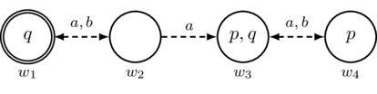

*N*

*Figure 8:* The pointed plausibility model $(N,w_1)$.

It is easy to see that the pointed plausibility model $(N,w_1)$ clearly satisfies the property of local connectedness, so this is an allowable picture. To see that this picture reasonably represents the above-describe example scenario, first notice that we have one world for each of the four possible truth assignments to the two letters *p* and *q*. At the actual world $w_1$, the letter *p* is false and the letter *q* is true. Agent *a* considers each of the four worlds to be informationally equivalent (since she does not know with certainty which world is the actual one); however, she considers the *p*-worlds to be strictly more plausible than the $\lnot p$-worlds. This represents her belief that *p* is true: each of the worlds she considers to be most plausible overall satisfies *p*. Further, if she is told that *p* is in fact false, she will restrict her attention to the next-most-plausible $\lnot p$-worlds, thereby statically revising her belief. It is in this sense that she trusts *b* (and so believes *p* is true) but does not completely rule out the possibility that he is incorrect or deceptive. Since *a* has no information about *q*, each of her spheres—the inner *p*-sphere and the outer $\lnot p$-sphere—contains both a world at which *q* is true and a world at which *q* is false.

Now let us look at the attitudes of agent *b*. First, we see that *b* has two connected components, one consisting of the *p*-worlds and the other consisting of the $\lnot p$-worlds, and these two components are not informationally equivalent. That is, no *p*-world is informationally equivalent to a $\lnot p$-world in the eyes of agent *b*. This tells us that *b* conclusively knows whether *p* is true. Further, *a* knows this is so (since each of *a*’s informationally equivalent worlds is one in which *b* knows whether *p* is true). Since the actual world is a $\lnot p$-world, agent *b* in fact knows *p* is false. Finally, we see that *b* knows that *a* mistakenly believes that *p* is true: at each of *b*’s informationally equivalent worlds $w_1$ and $w_2$, agent *a* believes that *p* is true (since *a*’s most plausible worlds overall, $w_3$ and $w_4$, both satisfy *p*).

We are now ready for the formal definition of plausibility models. This definition summarizes what we have seen so far.

**Plausibility model.** Given a nonempty set $\sP$ of propositional letters and a finite nonempty set $\sA$ of agents, a *plausibility model* is a structure $$ M=(W,\geq,V) $$ consisting of

- a nonempty set *W* of *worlds* identifying the possible states of affairs that might obtain,
- a function $\geq$ that assigns to each agent $a\in\sA$ a binary relation $\geq_a$ on *W* satisfying the property of *Plausibility* that we define shortly, and
- a *propositional valuation* *V* mapping each propositional letter to the set of worlds at which that letter is true.

We define the following relations, with a negation of a relation indicated by placing a slash through the relational symbol:

- *Converse plausibility*: $w\leq_a v$ means we have $v\geq_a w$.
- *Strict plausibility*: $w\gt_a v$ means we have $w\geq_a v$ and $v\not\geq_a w$.
- *Strict converse plausibility*: $w\lt_a v$ means we have $v\geq_a w$ and $w\not\geq_a v$.
- *Equi-plausibility*: $w\simeq_a v$ means we have $w\geq_a v$ and $v\geq_a w$.

For each world *w* in *W* and agent *a*, we define the *connected component* of *w*, also called the *a-connected component* if emphasizing *a* is important, as follows: $$ \cc_a(w) \coloneqq \{ v\in W \mid w({\geq_a}\cup{\leq_a})^*v\} . $$ If $\cc_a(w)=\cc_a(w)$, then we say that *w* and *v* are *informationally equivalent* (or that they are *a-informationally equivalent*). The relation $\geq_a$ must satisfy the property of *Plausibility*, which consists of the following three items:

- $\geq_a$ is reflexive and transitive;
- $\geq_a$ is *locally connected*: $v\in\cc_a(w)$ implies $w\geq_a v$ or $v\geq_a w$; and
- $\geq_a$ is *converse well-founded*: for each nonempty set $S\subseteq W$ of worlds, the set $$ \textstyle \min_a(S)\coloneqq\{w\in S\mid \forall v\in S:v\not\lt_a w\} $$ of *a-minimal elements* of *S* is itself nonempty.

A *pointed plausibility model*, sometimes called a *scenario* or a *situation*, is a pair $(M,w)$ consisting of a plausibility model *M* and a world *w* (called the *point*) that designates the state of affairs that we (the formal modelers) currently assume to be actual.

Intuitively, $w \geq_a v$ means that *w* is no more plausible than *v* according to agent *a*. Therefore, it is the “smaller” worlds that are *more* plausible, so that $\min_a(\cc_w(w))$ is the set of worlds that agent *a* considers to be *most plausible* of all worlds that are informationally equivalent with *w*.

Local connectivity, as we have seen, ensures that the agent has an opinion as to the relative plausibility of informationally equivalent worlds. Converse well-foundedness guarantees that the agent can always stratify informationally equivalent worlds in such a way that some worlds are the most plausible overall. As a result, we cannot have a situation where agent *a* has some sequence $$ w_1\gt_a w_2\gt_a w_3 \gt_a \cdots $$ of worlds of strictly increasing plausibility, a circumstance in which it would be impossible to find “the most plausible worlds”. By forbidding such a circumstance, converse well-foundedness guarantees that the notion of “the most plausible worlds” is always well-defined.

The collection of formulas interpreted on pointed plausibility models generally contains at least the formulas coming from the language \\eqref{KBox} defined by the following grammar:

$$\begin{gather*} F \ccoloneqq p \mid F \wedge F \mid \neg F \mid K_aF \mid \Box_a F \\ \small p \in \sP,\; a \in \sA \tag{\(K\Box\)}\label{KBox} \end{gather*}$$

The satisfaction relation $\models$ between pointed plausibility models and formulas of \\eqref{KBox} is defined as follows.

- $M,w\models p$ holds if and only if $w\in V(p)$.
- $M,w\models F\land G$ holds if and only if both $M,w\models F$ and $M,w\models G$.
- $M,w\models\lnot F$ holds if and only if $M,w\not\models F$.
- $M,w\models K_aF$ holds if and only if $M,v\models F$ for each $v\in\cc_a(w)$.
- $M,w\models \Box_aF$ holds if and only if $M,v\models F$ for each $v\leq_a w$.

For each \\eqref{KBox}-formula *F* and plausibility model $M = (W, \geq, V)$, we define the set

$$ \sem{F}_M \coloneqq \{ w\in W\mid M,w\models F\} $$

of worlds at which *F* is true. If *M* is fixed, we may simply write $\sem{F}$ without the subscript *M*.

$K_aF$ is assigned the reading “agent *a* has information that *F* is true”. One may consider $K_a$ as a kind of knowledge, though not the kind usually possessed by actual, real-life agents (because it satisfies properties such as closure under logical consequence that are typically not satisfied in practice). Intuitively, possession of information of *F* is belief in *F* that persists upon receipt of *any* further information, even information that is *not true*. This kind of knowledge is therefore infallible and indefeasible.

We assign $\Box_aF$ the reading “agent *a* defeasibly knows *F*”. This is a weak notion of knowledge studied by Lehrer and Paxson (1969) and by Lehrer (1990, 2000)[^lehrer-1990][^lehrer-2000] and formalized by Stalnaker (1980, 2006)[^stalnaker-1980][^stalnaker-2006]. Intuitively, defeasible knowledge of *F* is belief in *F* that persists upon receipt of any further true information: the agent believes *F* and, if told any further *true* information, she will continue to believe *F*. Defeasible knowledge is sometimes also called “safe belief”.

The dual form of information possession $K_aF$, written $\hat K_a F$, denotes *informational consistency*:

$$ \hat K_a F \mbox{ denotes } \lnot K_a\lnot F. $$

which has the meaning that *F* is consistent with agent *a*’s information. We use this to define a notion of *conditional belief*:

$$ B_a^GF \mbox{ denotes } \hat K_aG \to \hat K_a(G\land\Box_a(G\to F)). $$

which is assigned the reading “agent *a* believes *F* conditional on *G*”. Sometimes $B_a^GF$ is abbreviated by $B_a(F|G)$. Though the meaning of $B_a^GF$ can be derived from the above definitions, the following provides a more intuitive interpretation.

**Theorem.** For each pointed plausibility model $(M,w)$, we have: $$ \textstyle M,w\models B_a^GF \quad\text{iff}\quad \min_a(\sem{G}_M\cap\cc_a(w))\subseteq\sem{F}_M ; $$ that is, agent *a* believes *F* conditional on *G* at world *w* if and only if *F* is true at the most plausible *G*-worlds that are consistent with *a*’s information.

This theorem tell us that to see what an agent believes conditional on *G*, all we need to do is look at the agent’s most plausible *G*-worlds. In this way, conditional belief has the agent “recenter” her system of spheres over the set of all worlds at which *G* is true. Conditional belief thereby implements static belief revision: to see what agent *a* believes after statically revising her beliefs by *G* we simply see what it is she believes conditional on *G*. Thus $B_a^GF$ says that agent *a* believes *F* after statically revising her beliefs by *G*.

The notion of conditional belief allows us to connect the notions knowledge possession $K_a$ and defeasible knowledge $\Box_a$ with the defeasibility analysis of knowledge, as indicated by the following result.

**Theorem.** For each pointed plausibility model $(M,w)$, we have each of the following.

- $M,w\models K_aF$ if and only if for each \\eqref{KBox}-formula *G*, we have $M,w\models B_a^GF$. “Information possession $K_a$ is belief that persists under receipt of *any* information.”
- $M,w\models\Box_aF$ if and only if for each \\eqref{KBox}-formula *G* satisfying $M,w\models G$, we have $M,w\models B_a^GF$. “Defeasible knowledge $\Box_a$ is belief that persists under receipt of *true* information.”

Conditional belief gives rise to a notion of *unconditional belief* obtained by taking the trivial condition $\top$ (i.e., the propositional constant for truth) as the condition:

$$ B_aF \mbox{ denotes } B_a^\top F . $$

So to see what the agent believes *unconditionally*, we simply conditionalize her beliefs on the trivial condition $\top$, which is true everywhere. It is then easy to see that we have the following.

**Theorem.** For each pointed plausibility model $(M,w)$, we have: $$ \textstyle M,w\models B_aF \quad\text{iff}\quad \min_a(\cc_a(w))\subseteq\sem{F}_M; $$ that is, agent *a* believes *F* (unconditionally) at world *w* if and only if *F* is true at the most plausible worlds that are consistent with *a*’s information.

We conclude this section with the axiomatic theory characterizing those formulas that are valid in all plausibility models. Since we can express conditional belief (and since conditional belief describes static belief revision), what we obtain is a theory of defeasible knowledge, possession of information, conditional belief, unconditional belief, and static belief revision.

**The axiomatic theory $\KBox$.**

- The $\mathsf{S5}$ axiom schemes and rules for $K_a$ for each $a\in\sA$
- The $\mathsf{S4}$ axiom schemes and rules for $\Box_a$ for each $a\in\sA$
- $K_aF\to\Box_a F$ “If *F* follows from *a*’s information, then *a* defeasibly knows *F*.”
- $K_a(\Box_a F\to G)\lor K_a(\Box_a G\to F)$ “Worlds consistent with the information received are always comparable in terms of plausibility.” (That this axiom has this meaning requires some technical details; see Baltag et al. (2014). In particular, the axiom may be viewed as a slight modification of the .3 scheme from basic modal logic; see, e.g., Blackburn et al. 2002).

**$\KBox$ Soundness and Completeness.** $\KBox$ is sound and complete with respect to the collection $\sC_*$ of pointed plausibility models. That is, for each \\eqref{KBox}-formula *F*, we have that $\KBox\vdash F$ if and only if $\sC_*\models F$.

Instead of taking information possession $K_a$ and defeasible knowledge $\Box_a$ as the basic propositional attitudes, one may instead choose conditional belief statements $B_a^GF$. This choice gives the theory $\CDL$ of Conditional Doxastic Logic. See [Appendix J](dynamic-epistemic.appendix-J-CDL.md) for details.

We may define a number of additional propositional attitudes beyond conditional belief $B_a^GF$, defeasible knowledge $\Box_aF$, and information possession $K_aF$. We take a brief look at a two of these that have important connections with the Belief Revision literature.

- The *unary revision operator* $*_aF$ has the semantics: $$M,w\models *_aF \mbox{ means } M,w\models F \mbox{ and } M,v\not\models F \mbox{ for all } v\lt_a w$$ That is, to say that $*_aF$ is true at world *w* means that *F* is true at *w* and that *F* is false at any world *v* that agent *a* ranks strictly more plausible. So to have $*_aF$ true at *w* says that *w* will be among the most plausible after the agent undergoes a belief revision by *F*. The unary revision operator $*_aF$ therefore picks out the worlds that will make up agent *a*’s theory of beliefs after revision by *F*. As such, we have $$ M,w\models B_a^FG \quad\text{ iff } M,w\models K_a(*_aF\to G), $$ which says that agent *a* believes *G* after revision by *F* if and only if she knows that *G* is a consequence of her theory after revision by *F*.
- For each natural number *n*, we have a *degree-n belief operator* $B_a^nF$. To define the semantics of these operators, we first define formulas $b_a^n$ for each natural number *n* according to the following: $$\begin{align*} b_a^0 &= *_a\top, \\ b_a^{n+1} &= *_a(\lnot b_a^0\land \lnot b_a^1\land\cdots\land\lnot b_a^n) . \end{align*}$$ $b_a^0$ is true at the worlds the agent *a* ranks most plausible overall, $b_a^1$ is true at the worlds the agent *a* ranks next-most plausible after the $b_a^0$-worlds, $b_a^2$ is picks out the next-most plausible after the $b_a^1$-worlds, and so on. The $b_a^n$-worlds thereby pick out agent *a*’s “degree-*n* theory of belief”, which is the collection of beliefs the agent will hold after giving up all theories of lesser degree. This setup allows us to realize Spohn's (1988)[^spohn-1988] notion of “degrees of belief”: $$ M,w\models B_a^nF \mbox{ means } M,w\models K_a(b_a^n\to F)\land \bigwedge_{i\lt n}\lnot K_a(b_a^i\to F), $$ which says that agent *a* believes *F* to degree *n* if and only if she knows it follows from her degree-*n* theory and she does not know it to follow from any of her theories of lesser degree.

### 4.4 The Logic of Doxastic Actions: Action-priority update

The theories and operators we have seen so far all concern *static* belief change. We now wish to turn to *dynamic* belief change. For this the approach follows the typical pattern in Dynamic Epistemic Logic: we take a given static theory (in this case $\KBox$) and we add action model-style modalities to create the dynamic theory. When we did this before in the case of basic multi-modal epistemic and doxastic logic, the relational structure of the added action models matched the relational structure of the models of the theory—Kripke models. The structural match between action models and finite Kripke models is not accidental: the semantics of action model modalities (as explained by the BMS product update) uses the same Kripke model-based notion of agent uncertainty over objects (i.e., the “worlds”) to describe agent uncertainty over action model objects (i.e., the “events”). Both uncertainties are represented using the same kind of structure: the binary possibility relation $R_a$.

For the present theory of conditional belief $B_a^FG$, defeasible knowledge $\Box_aF$, and information possession $K_aF$, we take a similar approach: we define *plausibility action models*, which are action model-type objects whose relational structure matches the relational structure of the models of this theory—plausibility models. Since a finite plausibility model has the form $(W,\geq,V)$, our intuition from the Kripke model case suggests that plausibility action models should have the form $(E,\geq,\pre)$, with *E* a finite nonempty set of events, $\geq$ a function giving a plausibility relation $\geq_a$ for each agent *a*, and $\pre$ a precondition function as before.

**Plausibility action model.** Given a set of formulas $\Lang$ and a finite nonempty set $\sA$ of agents, a *plausibility action model* is a structure $$ A=(E,\geq,\pre) $$ consisting of

- a nonempty finite set *E* of the possible communicative *events* that might occur,
- a function $\geq$ that assigns to each agent $a\in\sA$ a binary relation $\geq_a$ on *E* satisfying the property of Plausibility defined earlier, and
- a function $\pre:E\to\Lang$ that assigns to each event *e* in *E* a formula $\pre(e)\in\Lang$ called the *precondition* of *e*. Intuitively, the precondition is announced when the event occurs.

A *pointed plausibility action model*, sometimes also called an *action*, is a pair $(A,e)$ consisting of a plausibility action model *A* and an event *e* in *A* that is called the *point*. In drawing plausibility action models, events are drawn as rectangles, a point (if any) is indicated with a double rectangle, and arrows are drawn using dashes (as for plausibility models). We use many of the same drawing and terminological conventions for plausibility action models that we use for (pointed) plausibility models.

As expected, the main difference between plausibility action models and basic action models is that the agent-specific component (i.e., the function $\geq$ giving the agent-specific relation $\geq_a$). In constructing new plausibility models based on plausibility action models, we may follow a construction similar to the product update. To make this work, our main task is to describe how the plausibility relation $\geq_a$ in the resultant plausibility model $M[A]$ is to be determined in terms of the plausibility relations coming from the given initial plausibility model *M* and the plausibility action model *A*. For this it will be helpful to consider an example.

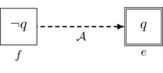

$\rPub_G(q)$

*Figure 9:* The pointed plausibility action model $(\rPub(q),e)$ for the revisable public announcement of *q* (also called the “lexicographic upgrade by *q*” by van Benthem 2007)[^benthem-2007][^benthem-2007-2][^benthem-2007-3].

Figure 9 depicts $(\rPub(q),e)$, a pointed plausibility action model consisting of two events: the event *f* in which $\lnot q$ is announced and the event *e* in which *q* is announced. Event *e* is the event that actually occurs. For each agent *a* (coming from the full set of agents $\sA$), event *e* is strictly more plausible. We adopt the same drawing conventions for plausibility action models that we did for plausibility models: one- and two-way arrows, reflexive and transitive closures, and the requirement of local connectedness. (Well-foundedness follows because the set *E* of events is finite.) Accordingly, Figure 9 implicitly contains reflexive dashed arrows for each agent at each event.

$(\rPub(q),e)$ has the following intuitive effect: the public announcement of *q* (i.e., event *e*) occurs and this is common knowledge; however, the agents still maintain the possibility that the negation $\lnot q$ was announced (i.e., event *f* occurred). In effect, the agents will come to believe *q* (because the announcement of this was most plausible), but they will nevertheless maintain the less plausible possibility that *q* is false. This allows the agents to accept the announced formula *q* but with some caution: they can still revise their beliefs if they later learn that *q* is false.

The “action-priority update” is the analog of the product update for plausibility models.

**Action-priority update (Baltag and Smets 2008b)[^baltag-2008b].** Let $(M,w)$ be a pointed plausibility model and $(A,e)$ be a pointed plausibility action model. Let $\models$ be a binary satisfaction relation defined between $(M,w)$ and formulas in the language $\Lang$ of the precondition function $\pre^A:E^A\to\Lang$ of the plausibility action model *A*. If $M,w\models\pre^A(e)$, then the plausibility model $$ M[A]=(W[A],{\geq}[A],V[A]) $$ is defined via the *action-priority update* operation $M\mapsto M[A]$ given as follows:

- $W[A] \coloneqq \{ (v,f)\in W\times E \mid M,v\models\pre^A(f) \}$ — pair worlds with events whose preconditions they satisfy;
- $(v_1,f_1)\mathrel{{\geq}[A]_a}(v_2,f_2)$ if and only if we have one of the following:
- $f_1\gt_a f_2$ and $\cc_a(v_1)=\cc_a(v_2)$ — events of strictly differing plausibility are applied to informationally equivalent worlds, or
- $f_1\simeq_a f_2$ and $v_1\geq_a v_2$ — equi-plausible events are applied to informationally equivalent worlds of differing plausibility;
- $V[A]((v,f))\coloneqq V^M(p)$ — make the valuation of *p* at the pair $(v,f)$ just as it was at *v*.

An action $(A,e)$ operates on an initial situation $(M,w)$ satisfying $M,w\models\pre^A(e)$ via the action-priority update to produce the resultant situation $(M[A],(w,e))$. Note that we may write the plausibility relation $\mathrel{{\geq}[A]_a}$ for agent *a* after the action-priority update by *A* simply as $\geq_a$ when the meaning is clear from context.

We now turn to *Action-Priority Update Logic* (a.k.a., *the Logic of Doxastic Actions*). To begin, we define the language \\eqref{APUL} of Action-Priority Update Logic along with the set $\PAM_*$ of pointed plausibility action models having preconditions in the language \\eqref{APUL} according to the following recursive grammar:

$$\begin{gather*} F \ccoloneqq p \mid F \wedge F \mid \neg F \mid K_aF \mid \Box_aF \mid [A,e]F \\ \small p \in \sP,\; a \in \sA,\; (A,e)\in\PAM_* \taglabel{APUL} \end{gather*} $$

The satisfaction relation $\models$ between pointed plausibility models and formulas of \\eqref{APUL} is the smallest extension of the above-defined satisfaction relation $\models$ for \\eqref{KBox} satisfying the following:

- $M,w\models[A,e]G$ holds if and only if $M,w\not\models\pre(e)$ or $M[A],(w,e)\models G$, where the model $M[A]$ is given by the action-priority update.

In addition to the revisable public announcement (Figure 9), there are a number of interesting pointed plausibility action models.

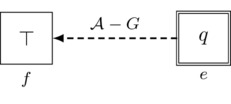

$\rPri_G(q)$

*Figure 11:* The pointed plausibility action model $(\rPri_G(q),e)$ for the private announcement of *q* to the group of agents *G*.

Figure 11 depicts the private announcement of *q* to a group of agents *G*. This consists of two events: the event *e* in which *q* is announced and the event *f* in which the propositional constant for truth $\top$ is announced. For agents outside the group *G*, the most plausible event is the one in which the $\top$ is announced; for agents in the group, the most plausible event is the one in which *q* is announced. In reality, the announcement of *q* (i.e., event *e*) occurs. Since the propositional constant for truth $\top$ is uninformative, the agents outside of *G* will come to believe that the situation is as it was before. The agents inside *G*, however, will come to believe *q*.

The plausibility action model version of the private announcement (Figure 11) is almost identical to the action model version of the private announcement (Figure 3). This is because action models are easily converted into plausibility action models: simply change the arrows to dashed arrows. In this way, we readily obtain plausibility action models from our existing action models. In particular, we can obtain plausibility actions for a public announcement by converting Figure 4, for a semi-private announcement by converting Figure 5, and for a misleading private announcement by converting Figure 6.

Finally, van Benthem (2007)[^benthem-2007][^benthem-2007-2][^benthem-2007-3] studied two important operations on multi-agent plausibility models that are representable using the action-priority update.

- The *lexicographic upgrade* $[\Up F]G$ (Rott 1989; van Benthem 2007)[^rott-1989][^benthem-2007][^benthem-2007-2][^benthem-2007-3]: after changing the plausibility relation so that *F*-worlds are ranked over $\lnot F$-worlds but worlds within each of the *F*- and $\lnot F$-regions are ranked as before, *G* is true. The lexicographic upgrade by *F* is just the revisable public announcement of *F* (Figure 9): $$M,w\models[\Up F]G \quad\text{ iff } M,w\models[\rPub(F),e]G.$$
- The *conservative upgrade* $[\up F]G$ (Boutilier 1993; van Benthem 2007)[^boutilier-1993][^benthem-2007][^benthem-2007-2][^benthem-2007-3]: after changing the plausibility relation so that the best *F*-worlds are ranked over all other worlds but the rankings are otherwise left unchanged, *G* is true. We note that in the case where the set $\sA$ of agents consists of just the one agent *a*, we have $$\begin{align*} M,w\models[\up F]G\quad & \text{ iff } M,w\models[\Up*_aF]G \\ & \text{ iff } M,w\models[\rPub(*_aF),e] \end{align*}$$ which says that the conservative upgrade by *F* is equal to the lexicographic upgrade by $*_aF$ in the case of a single agent *a*. This makes sense: $*_aF$ picks out the most plausible *F*-worlds, and then the lexicographic upgrade $\Up *_aF$ ranks these most plausible *F*-worlds as most plausible overall and leaves all other rankings as before. In the multi-agent case with *n* agents, we observe that a plausibility action model with $2^n$ actions is equivalent to $\Up F$. In particular, let $$ \CU(F) \coloneqq (E,\geq,\pre) $$ be the plausibility action model defined as follows:
- $E\coloneqq\{e_I \mid I\subseteq\sA\}$ — there is one event $e_I$ for each (possibly empty) subset $I\subseteq\sA$ of agents,
- $e_I\geq_a e_J$ if and only if $a\in J$ — event $e_J$ is of equal or grader plausibility according to *a* iff *a* is a member of *J*, and
- $\pre(e_I) \coloneqq (\bigwedge_{i\in I}*_i F)\land (\bigwedge_{j\in(\sA-I)}\lnot *_jF)$ — event $e_I$ picks out the worlds that are best *F*-worlds for agents in *I* and not best *F*-worlds for agents not in *I*. Intuitively, this plausibility action model has each agent *a* split the events into two categories: those that are best *F*-worlds according to *a* make up the first category and are ranked highest, and those that are not best *F*-worlds according to *a* make up the second category and are ranked strictly less plausible than the first category. In particular, since we have $e_I\leq_a e_J$ if and only if *a* is in *I*, it follows that:
- if $i\in I\cap J$, then $e_I\simeq_a e_J$;
- if $i\in I-J$, then $e_I\lt_a e_J$;
- if $i\in J-I$, then $e_I\gt_a e_J$;
- if $i\in \sA-(I\cup J)$, then $e_I\simeq_a e_J$. So the $e_I$’s having *i* in *I* make up the first category and are all ranked most plausible overall by *a*, and the $e_I$’s not having *i* in *I* make up the second category are ranked strictly less plausible by *a*. The preconditions are arranged so that any two events are pairwise inconsistent: if $I\neq J$, then *I* and *J* differ on at least one agent *a* and therefore they differ on whether their precondition asserts $*_aF$ or its negation $\lnot *_aF$. Further, the preconditions of the events exhaust all possibilities: given a world *w* of a plausibility model, there is a (possibly empty) set of agents *I* such that the agents in *I* rank *w* as a best *F*-world and the agents not in *I* do not rank *w* as a best *F*-world; as such, world *w* satisfies the precondition of $e_I$ for the set *I* in question. Therefore, the events in $\CU(F)$ partition the worlds of a given input plausibility model into a number of pieces, one piece for each subset $I\subseteq\sA$. The piece of the given model corresponding to the subset *I* is picked out by event $e_I$ and consists of those worlds in the given model that satisfy the precondition $\pre(e_I)$; these are the worlds that are best *F*-worlds according to the agents in *I* and not best *F*-worlds according to the agents not in *I*. So we see that $\CU(F)$ breaks up the model into various pieces based on which of the agents think the worlds in the given piece are best *F*-worlds, has the agents rank the pieces so that each agent has her best *F*-worlds outrank all other worlds, and otherwise leaves the ranking as it was. Accordingly, it is not too hard to see that we have $$ M,w\models[\up F]G \quad\text{ iff } M,w\models\bigvee_{I\subseteq\sA}[\CU(F),e_I]G \mbox{ (general case),} $$ which says that the conservative upgrade by *F* is equal to the action-priority update brought about by the pointed plausibility action model $(\CU(F),e_I)$ for some subset $I\subseteq\sA$. As already stated, a world in the initial model will satisfy the precondition of exactly one event $e_J$. Therefore, the truth at *w* of the disjunction $\bigvee_{I\subseteq\sA}[\CU(F),e_I]G$ is determined by evaluating the truth at *w* of the disjunct $[\CU(F),e_J]G$ for the particular *J* corresponding to *w*.

We now study the axiomatic theory of Action-Priority Update Logic.

**The axiomatic theory $\APUL$.**

- Axiom schemes and rules for the theory $\KBox$
- Reduction axioms:
- $[A,e]p\leftrightarrow(\pre(e)\to p)$ for letters $p\in\sP$ “After a non-executable action, every letter holds—a contradiction. After an executable action, letters retain their truth values.”
- $[A,e](G\land H)\leftrightarrow([A,e]G\land[A,e]H)$ “A conjunction is true after an action iff each conjunct is.”
- $[A,e]\lnot G\leftrightarrow(\pre(e)\to\lnot[A,e]G)$ “*G* is false after an action iff the action, whenever executable, does not make *G* true.”
- $[A,e]K_aG\leftrightarrow(\pre(e)\to\bigwedge_{e\simeq_a f}K_a[A,f]G)$ “*a* has information that *G* after an action iff the action, whenever executable, provides *a* with information that *G* will become true despite the uncertainty in her information as to the actual event.”
- $[A,e]\Box_a G\leftrightarrow(\pre(e)\to (\bigwedge_{e\gt_a f}K_a[A,f]G) \land (\bigwedge_{e\simeq_a f}\Box_a[A,f]G))$ “*a* defeasibly knows *G* after an action iff the action, whenever executable, provides *a* with information that *G* will become true after all more plausible events and, further, gives *a* defeasible knowledge that *G* will become true after all equi-plausible events.”
- Action Necessitation Rule: from *G*, infer $[A,e]G$ “A validity holds after any action.”

The first three reduction axioms are identical to the corresponding reduction axioms for $\EAL$. The fourth $\APUL$ reduction axiom is almost identical to the fourth $\EAL$ reduction axiom. In particular, the fourth $\EAL$ reduction axiom, which reads

$$ \textstyle [A,e]K_aG\leftrightarrow(\pre(e)\to\bigwedge_{e R_af}K_a[A,f]G), $$

differs only in the conjunction on the right-hand side: the $\EAL$ axiom has its conjunction over events related to *e* via the Kripke model-style relation $R_a$, whereas the $\APUL$ axiom has its conjunction over events related to *e* via the plausibility model-style relation $\simeq_a$.

The fifth $\APUL$ reduction axiom is new. This axiom captures the essence of the action-priority update: for an agent to have defeasible knowledge after an action, she must have information about what happens as a result of more plausible actions and, further, she must have defeasible knowledge about the outcome of equi-plausible actions. The reason for this follows from the definition of the resulting plausibility relation ${\geq}[A]_a$. As a reminder, this is defined by setting $(v_1,f_1)\mathrel{{\geq}[A]_a}(v_2,f_2)$ if and only if we have one of the following:

- $f_1\gt_a f_2$ and $\cc_a(v_1)=\cc_a(v_2)$ — events of strictly differing plausibility are applied to informationally equivalent worlds; or
- $f_1\simeq_a f_2$ and $v_1\geq_a v_2$ — equi-plausible events are applied to informationally equivalent worlds of differing plausibility.

Looking to the fifth $\APUL$ reduction axiom, the conjunct $\bigwedge_{e\gt_a f}K_a[A,f]G$ says that *G* is true whenever an event of plausibility strictly greater than *e* is applied to a world within *a*’s current connected component. This tells us that *G* is true at worlds having greater plausibility in light of the first bulleted item above. The other conjunct $\bigwedge_{e\simeq_a f}\Box_a[A,f]G)$ of the fifth $\APUL$ reduction axiom says that *G* is true whenever an event equi-plausible with *e* is applied to world of equal or greater plausibility within *a*’s current connected component. This tells us that *G* is true at worlds having greater or equal plausibility in light of the second bulleted item above. Taken together, since these two bulleted items define when it is that a world has equal or greater plausibility in the resultant model $M[A]$, the truth of these two conjuncts at an initial situation $(M,w)$ at which $(A,e)$ is executable implies that *G* is true at all worlds of equal or greater plausibility than the actual world $(w,e)$ of the resultant model $M[A]$. That is, we have $M[A],(w,e)\models\Box_a G$ and therefore that $M,w\models[A,e]G$. This explains the right-to-left direction of the fifth $\APUL$ reduction axiom. The left-to-right direction is explained similarly.

As was the case for $\EAL$, the $\APUL$ reduction axioms allow us to “reduce” each formula containing plausibility action models to a provably equivalent formula whose plausibility action model modalities appear before formulas of lesser complexity, allowing us to eliminate plausibility action model modalities completely via a sequence of provable equivalences. As a consequence, we have the following.

**APUL Reduction Theorem.** Every *F* in the language \\eqref{APUL} is $\APUL$-provably equivalent to a formula $F^\circ$ coming from the plausibility action model-free modal language \\eqref{KBox}.

Once we have proved $\APUL$ is sound, the Reduction Theorem leads us to axiomatic completeness via the known completeness of the underlying modal theory $\KBox$.

**$\APUL$ Soundness and Completeness.** $\APUL$ is sound and complete with respect to the collection $\sC_*$ of pointed plausibility action models. That is, for each \\eqref{APUL}-formula *F*, we have that $\APUL\vdash F$ if and only if $\sC_*\models F$.

As is the case for $\EAL$, it is possible to combine two consecutive actions into a single action. All that is required is an appropriate notion of plausibility action model composition.

**Plausibility action model composition.** The *composition* $A\circ B=(E,\geq,\pre)$ of plausibility action models $A=(E^A,\geq^A,\pre^A)$ and $B=(E^B,\geq^B,\pre^B)$ is defined as follows:

- $E=E^A\times E^B$ — composed events are pairs $(e,f)$ of constituent events;
- $(e_1,f_1)\geq_a (e_2,f_2)$ if and only if one of the following obtains:
- $e_1\geq_a e_2$ and $\cc_a(f_1)=\cc_a(f_2)$ — events of differing plausibility are followed by informationally equivalent events, or
- $e_1\simeq_a e_2$ and $f_1\geq_a f_2$ — equi-plausible events are followed by informationally equivalent events of differing plausibility;
- $\pre((e_1,e_2)) = \pre^A(e_1)\land[A,e_1]\pre^B(e_2)$ — a composed event is executable iff the first constituent is executable and, after it occurs, the second constituent is executable as well.

**Composition Theorem.** Each instance of the following schemes is $\APUL$-derivable.

- Composition Scheme: $[A,e][B,f]G\leftrightarrow[A\circ B,(e,f)]G$
- Associativity Scheme: $[A\circ B,(e,f)][C,g]H \leftrightarrow [A,e][B\circ C,(f,g)]H]$

It is also possible to add valuation-changing substitutions (i.e., “factual changes”) to plausibility action models. This is done exactly as it is done for action models proper: substitutions are added to plausibility action models, the action-priority update is modified to account for substitutions in the semantics, and the first reduction axiom is changed to account for substitutions in the axiomatics. See [Appendix G](dynamic-epistemic.appendix-G-EAL.md) for details.

### 4.5 Evidential dynamics and justified belief

One development in DEL is work aimed toward building logics of evidence, belief, and knowledge for use in Formal Epistemology.

- Velázquez-Quesada (2009)[^velázquez-quesada-2009] and van Benthem and Velázquez-Quesada (2010) study logics of inference and update. These have models containing worlds that explicitly list the formulas of which agents are “aware”, like awareness logics (Fagin et al. 1995)[^fagin-1995], except that DEL-style modalities can change these awareness sets, allowing agents to increase the formulas of which they are aware and make inferences with these formulas over time. In this sense, the “awareness sets” may be though of as evidence for the formulas the agents presently know.
- Baltag, Renne, and Smets (2014) study a logic of “conclusive” (or “good”) evidence based on a combination of plausibility models with an adaptation of the syntactic bookkeeping mechanisms of Justification Logic (Artemov 2008; Artemov and Fitting 2012)[^artemov-2008][^artemov-2012]. They argue that their work generalizes the awareness logics of Velázquez-Quesada (2009)[^velázquez-quesada-2009] and van Benthem and Velázquez-Quesada (2010) and better addresses updates with higher-order information.
- A different approach to evidence in Dynamic Epistemic Logic was proposed by van Benthem and Pacuit (2011a,b) and studied further in van Benthem, Fernández-Dunque, and Pacuit (2012, 2014). This approach is much less syntactic than the Justification Logic-style approaches, focusing instead on the semantic notion of modal “neighborhood” (or “minimal”) models that have been repurposed with an evidential twist.

We refer the reader to [Appendix K](dynamic-epistemic.appendix-K-evidence.md) for further details.

## 5. Probabilistic update in Dynamic Epistemic Logic

Dynamic Epistemic Logics that incorporate probability have been studied by a number of authors. Van Benthem (2003)[^benthem-2003], Kooi (2003)[^kooi-2003], Baltag and Smets (2008a), and van Benthem, Gerbrandy, and Kooi (2009b) studied logics of finite probability spaces. Sack (2009)[^sack-2009] extended the work of Kooi (2003)[^kooi-2003] and van Benthem, Gerbrandy, and Kooi (2009b) to full probability spaces (based on σ-algebras of events). Of these, we mention two in particular:

- Baltag and Smets (2008a) develop logics of finite probability spaces that connect three areas of work: the Popper–Réyni–de Finetti extension of Bayesian probabilistic conditionalization, the theory of Belief Revision, and Dynamic Epistemic Logic. This leads to a definition of an action-model-style probabilistic product update that permits update on events of probability zero (which is required by belief revision).
- Van Benthem, Gerbrandy, and Kooi (2009b) have a different approach with action-model-style probabilistic update that takes into account three sources of probabilistic information: prior probabilities, occurrence probabilities, and observation probabilities.

We refer the reader to [Appendix L](dynamic-epistemic.appendix-L-probability.md) for further details.

## 6. Applications of Dynamic Epistemic Logic

### 6.1 Preference dynamics

DEL-style model-changing operators have been applied by a number of researchers to the study of preferences, preference change, and related notions. We refer the reader to [Appendix M](dynamic-epistemic.appendix-M-preferences.md) for further information, which mentions the work of van Benthem et al. (2009), van Benthem and Liu (2007), Liu (2008)[^liu-2008], Yamada (2007a,b, 2008), van Eijck (2008)[^eijck-2008], van Eijck and Sietsma (2010), van Benthem, Girard, and Roy (2009c), and Liu (2011)[^liu-2011].

### 6.2 Connections with Temporal Logic

Action model-style modalities $[A,e]$ of Dynamic Epistemic Logic have a temporally suggestive reading: “*after* action $(A,e)$, formula *F* is true”. This “before-after” reading suggests, naturally enough, that time passes as actions occur. The semantics of action models supports this suggestion: determining the truth of an action model formula $[A,e]F$ in a model—the model “before” the action—requires us to apply the model-transforming operation induced by the action $(A,e)$ and then see whether *F* holds in the model that results “after” the action. Channeling Parikh and Ramanujam (2003) some DEL authors further this suggestion by using the temporally charged word “history” to refer to a sequence of pointed Kripke models brought about by the occurrence of a sequence of model-transforming operations. All of this seems to point to the existence of a direct relationship between the occurrence of model-transforming actions and the passage of time: time passes as these actions occur. However, the formal languages introduced so far do not have a built-in means for directly expressing the passage of time, and so, as a consequence, the axiomatic theories developed above are silent on the relationship between the flow of time and the occurrence of model-changing actions. This leaves open the possibility that, within the context of these theories, the passage of time and the occurrence of actions need not necessarily relate as we might otherwise suspect.

For more on this, we refer the interested reader to [Appendix N](dynamic-epistemic.appendix-N-time.md), which mentions a number of studies that bring some method of time-keeping within the scope of the Dynamic Epistemic Logic approach: the work of Sack (2007, 2008, 2010)[^sack-2007][^sack-2008][^sack-2010], Yap (2006, 2011)[^yap-2006][^yap-2011], Hoshi (2009)[^hoshi-2009][^hoshi-2009-2], Hoshi and Yap (2009), van Benthem, Gerbrandy, and Pacuit (2007), van Benthem et al. (2009a), Dégremont, Löwe, and Witzel (2011), and Renne, Sack, and Yap (2009, 2015).

### 6.3 Connections to mainstream Epistemology

A number of works utilize tools and techniques from Dynamic Epistemic Logic for formal reasoning on topics in mainstream Epistemology.

- Baltag and Smets (2008b) use plausibility models (Section 4.3) and The Logic of Doxastic Actions (Section 4.4) to capture a number of notions of knowledge, including Aumann’s partition-based notion and Stalnaker’s (2006)[^stalnaker-2006] formalization of Lehrer’s (1990, 2000)[^lehrer-1990][^lehrer-2000] defeasibility analysis of knowledge.
- Building on the work mentioned in the previous item, Baltag, Renne, and Smets (2014) show that a theory $\JBG$ of Justified Belief with “Good” Evidence can be used to reason about certain examples from mainstream Epistemology. For example, Gettier (1963)[^gettier-1963] constructs a famous counterexample to the claim that “knowledge” may be equated with “justified true belief” (i.e., justified *correct* belief). In this example, an agent—let us call her *a*—has evidence for a propositional letter *f*, concludes via logical deduction that $b\lor f$, and therefore has evidence for this disjunction; however, unknown to the agent, *f* is false but *b* is true. She therefore has justified true belief but not knowledge that $b\lor f$ is true (since her reason for believing this disjunction is based on her belief in the wrong disjunct). This example is easily reconstructed in $\JBG$, providing one formal account of an agent whose justified belief is correct and yet the agent does not have knowledge (even in a weakly defeasible sense). See [Appendix K](dynamic-epistemic.appendix-K-evidence.md) for additional details.
- Baltag, Renne, and Smets (2012) analyze a Gettier-like example due to Lehrer (1990, 2000)[^lehrer-1990][^lehrer-2000] in a variant of $\JBG$ that includes dynamic operations for addition of evidence, stepwise logical reasoning, announcement-like addition of evidence with world elimination, and evidence-based plausibility upgrades of worlds.
- Fitch’s paradox (Fitch 1963)[^fitch-1963] concerns the seemingly strange result that the existence of unknown truths implies not all truths are knowable. Following the suggestion of van Benthem (2004)[^benthem-2004], Balbiani et al. (2008) equate “knowability” with “being known after some announcement” and show using Arbitrary Public Announcement Logic (see [Appendix E](dynamic-epistemic.appendix-E-PAL.md)) that it is jointly inconsistent to assume that “*p* is an unknown truth” and that “all truths are knowable”. We refer the reader to the discussions in van Benthem (2004)[^benthem-2004], Balbiani et al. (2008), and Brogaard and Salerno (2012) for further details.

## 7. Conclusion

We have surveyed the literature of Dynamic Epistemic Logic, from its early development in the Public Announcement Logic to the generalized communication operations of action models, work on qualitative and quantitative belief revision, and applications in a variety of areas. Dynamic Epistemic Logic is an active and expanding area, and we have highlighted a number of open problems and directions for further research.

## Appendices

- [A. Kripke models for modal logic](dynamic-epistemic.appendix-A-kripke.md)
- [B. Solutions to Cheryl’s Birthday, Muddy Children, and Sum and Least Common Multiple](dynamic-epistemic.appendix-B-solutions.md)
- [C. Properties of binary relations](dynamic-epistemic.appendix-C-relations.md)
- [D. Normal modal logic](dynamic-epistemic.appendix-D-normal-ML.md)
- [E. Technical details of Public Announcement Logic](dynamic-epistemic.appendix-E-PAL.md)
- [F. The axiomatic theories of Relativized Common Knowledge](dynamic-epistemic.appendix-F-RCK.md)
- [G. More on action models and the Logic of Epistemic Actions](dynamic-epistemic.appendix-G-EAL.md)
- [H. Recursive definition of languages with action models](dynamic-epistemic.appendix-H-recursion.md)
- [I. Variants of the action model approach to Dynamic Epistemic Logic](dynamic-epistemic.appendix-I-variants.md)
- [J. Conditional Doxastic Logic](dynamic-epistemic.appendix-J-CDL.md)
- [K. Evidential dynamics and justified belief](dynamic-epistemic.appendix-K-evidence.md)
- [L. Probabilistic update in Dynamic Epistemic Logic](dynamic-epistemic.appendix-L-probability.md)
- [M. Preference dynamics](dynamic-epistemic.appendix-M-preferences.md)
- [N. Temporal aspects of Dynamic Epistemic Logic](dynamic-epistemic.appendix-N-time.md)

## References（引用注释）

> 原文参考文献已转为脚注引用：文内“作者-年份”引用组后附 [^key] 标记，完整条目见本文末脚注定义。

## Academic Tools

> |   | [How to cite this entry](https://plato.stanford.edu/cgi-bin/encyclopedia/archinfo.cgi?entry=dynamic-epistemic). |
> | --- | --- |
> |   | [Preview the PDF version of this entry](https://leibniz.stanford.edu/friends/preview/dynamic-epistemic/) at the [Friends of the SEP Society](https://leibniz.stanford.edu/friends/). |
> |   | [Look up topics and thinkers related to this entry](https://www.inphoproject.org/entity?sep=dynamic-epistemic∧redirect=True) at the Internet Philosophy Ontology Project (InPhO). |
> |   | [Enhanced bibliography for this entry](http://philpapers.org/sep/dynamic-epistemic/) at [PhilPapers](http://philpapers.org/), with links to its database. |

## Other Internet Resources

[Please contact the author with suggestions.]

## Related Entries

belief, formal representations of | common knowledge | epistemic paradoxes | epistemology | Fitch’s paradox of knowability | logic, history of: modal logic | logic: and probability | logic: classical | logic: conditionals | logic: epistemic | logic: justification | logic: modal | logic: of belief revision | logic: temporal

### Acknowledgments

Bryan Renne was supported by Innovational Research Incentives Scheme Veni grant 275-20-030 from the Netherlands Organisation for Scientific Research (NWO). The grant was hosted by the Institute for Logic, Language, Information and Computation (ILLC) at the University of Amsterdam.

[^please-nd]: Please note that the [enhanced bibliography for this entry](http://philpapers.org/sep/dynamic-epistemic/) at PhilPapers includes direct links to those articles below that include digital object identifiers (DOIs).

[^ågotnes-2010]: Ågotnes, T., P. Balbiani, H. van Ditmarsch, and P. Seban, 2010, “Group announcement logic”, *Journal of Applied Logic*, 8(1): 62–81. doi:10.1016/j.jal.2008.12.002

[^alchourrón-1985]: Alchourrón, C.E., P. Gärdenfors, and D. Makinson, 1985, “On the logic of theory change: Partial meet contraction and revision functions”, *Journal of Symbolic Logic*, 50(2): 510–530. doi:10.2307/2274239

[^andréka-1998]: Andréka, H., I. Németi, and J. van Benthem, 1998, “Modal languages and bounded fragments of predicate logic”, *Journal of Philosophical Logic*, 27(3): 217–274. doi:10.1023/A:1004275029985

[^areces-2012]: Areces, C., R. Fervari, and G. Hoffmann, 2012, “Moving arrows and four model checking results”, in Ong and Queiroz 2012: 142–153. doi:10.1007/978-3-642-32621-9_11

[^arló-costa-2005]: Arló-Costa, H. and R. Parikh, 2005, “Conditional probability and defeasible inference”, *Journal of Philosophical Logic*, 34(1): 97–119. doi:10.1007/s10992-004-5553-6

[^artemov-2008]: Artemov, S.N., 2008, “The logic of justification”, *The Review of Symbolic Logic*, 1(4): 477–513. doi:10.1017/S1755020308090060

[^artemov-2012]: Artemov, S.N. and M. Fitting, 2012, “Justification logic”, in E.N. Zalta (ed.), *The Stanford Encyclopedia of Philosophy* (Fall 2012 Edition). URL=<[https://plato.stanford.edu/archives/fall2012/entries/logic-justification/](https://plato.stanford.edu/archives/fall2012/entries/logic-justification/)>

[^aucher-2003]: Aucher, G., 2003, “A combined system for update logic and belief revision”, Master's thesis, University of Amsterdam. [[Aucher 2003 available online (pdf)](http://www.illc.uva.nl/Research/Reports/MoL-2003-03.text.pdf)]

[^aucher-2005]: –––, 2005, “A combined system for update logic and belief revision”, in *Intelligent Agents and Multi-Agent Systems: 7th Pacific Rim International Workshop on Multi-Agents, PRIMA 2004, Auckland, New Zealand, August 8–13, 2004, Revised Selected Papers*, Volume 3371 of *Lecture Notes in Computer Science*, pp. 1–17, Berlin/Heidelberg: Springer. doi:10.1007/b107183

[^aucher-2008]: –––, 2008, “Consistency preservation and crazy formulas in BMS”, in S. Hölldobler, C. Lutz, and H. Wansing (eds.), *Logics in Artificial Intelligence: 11th European Conference, JELIA 2008, Dresden, Germany, September 28–October 1, 2008. Proceedings*, Volume 5293 of *Lecture Notes in Computer Science*, pp. 21–33, Berlin/Heidelberg: Springer. doi:10.1007/978-3-540-87803-2_4

[^aucher-2009]: Aucher, G., P. Balbiani, L. Fariñas del Cerro, and A. Herzig, 2009, “Global and local graph modifiers”, in C. Areces and S. Demri (eds.), *Proceedings of the 5th Workshop on Methods for Modalities (M4M5 2007)*, Volume 231 of *Electronic Notes in Theoretical Computer Science*, Cachan, France, pp. 293–307. doi:10.1016/j.entcs.2009.02.042

[^aucher-2013]: Aucher, G. and F. Schwarzentruber, 2013, “On the complexity of dynamic epistemic logic”, in B.C. Schipper (ed.), *Proceedings of the 14th Conference of Theoretical Aspects of Rationality and Knowledge (TARK XIV)*, Chennai, India, pp. 19–28. [[Aucher and Schwarzentruber 2013 available online (pdf)](http://tark.org/proceedings/tark_jan7_13/p19-aucher.pdf)]

[^balbiani-2007]: Balbiani, P., A. Baltag, H. van Ditmarsch, A. Herzig, T. Hoshi, and T. de Lima, 2007, “What can we achieve by arbitrary announcements? A dynamic take on Fitch's knowability”, in D. Samet (ed.), *Proceedings of the 11th Conference on Theoretical Aspects of Rationality and Knowledge (TARK XI)*, Brussels, Belgium, pp. 42–51. [[Balbiani et al. 2007 available online (pdf)](http://tark.org/proceedings/tark_jun25_07/p42-balbiani.pdf)]

[^balbiani-2008]: –––, 2008, “‘Knowable’ as ‘known after an announcement’”, *The Review of Symbolic Logic*, 1(3): 305–334. doi:10.1016/j.entcs.2006.05.034 | [[Balbiani et al. 2008 available online (pdf)](http://dare.uva.nl/document/2/63109)]

[^balbiani-2012]: Balbiani, P., H. van Ditmarsch, A. Herzig, and T. De Lima, 2012, “Some truths are best left unsaid”, in Bolander et al. 2012: Vol. 9, pp. 36–54. [[Balbiani et al. 2012 available online (pdf)](http://www.aiml.net/volumes/volume9/Balbiani-Ditmarsch-Herzig-Lima.pdf)]

[^ballarin-2010]: Ballarin, R., 2010, “Modern origins of modal logic”, in E.N. Zalta (ed.), *The Stanford Encyclopedia of Philosophy* (Winter 2014 edition). URL=<[https://plato.stanford.edu/archives/win2014/entries/logic-modal-origins/](https://plato.stanford.edu/archives/win2014/entries/logic-modal-origins/)>

[^baltag-2004]: Baltag, A. and L.S. Moss, 2004, “Logics for epistemic programs”, *Synthese*, 139(2): 165–224. doi:10.1023/B:SYNT.0000024912.56773.5e

[^baltag-1998]: Baltag, A., L.S. Moss, and S. Solecki, 1998, “The logic of public announcements, common knowledge, and private suspicions”, in I. Gilboa (ed.), *Proceedings of the 7th Conference on Theoretical Aspects of Rationality and Knowledge (TARK VII)*, Evanston, Illinois, USA, pp. 43–56. [[Baltag, Moss, and Solecki 1998 available online (pdf)](http://www.tark.org/proceedings/tark_jul22_98/p43-baltag.pdf)]

[^baltag-1999]: –––, 1999, “The logic of public announcements, common knowledge, and private suspicions”, Technical Report TR534 (November), Indiana University. [[Baltag, Moss, and Solecki 1999 available online (pdf)](http://www.cs.indiana.edu/pub/techreports/TR534.pdf)]

[^baltag-2012]: Baltag, A., B. Renne, and S. Smets, 2012, “The logic of justified belief change, soft evidence and defeasible knowledge”, in Ong and Queiroz 2012: 168–190. doi:10.1007/978-3-642-32621-9_13

[^baltag-2014]: –––, 2014, “The logic of justified belief, explicit knowledge, and conclusive evidence”, *Annals of Pure and Applied Logic*, 165(1): 49–81. doi:10.1016/j.apal.2013.07.005

[^baltag-2015]: –––, 2015, “Revisable justified belief: Preliminary report”, E-print, arXiv.org. arXiv:1503.08141 [cs.LO]. [[Baltag, Renne, and Smets 2015 available online (html)](http://arxiv.org/abs/1503.08141) | [Baltag, Renne, and Smets 2015 available online (pdf)](http://arxiv.org/pdf/1503.08141.pdf)]

[^baltag-2008a]: Baltag, A. and S. Smets, 2008a, “Probabilistic dynamic belief revision”, *Synthese*, 165(2): 179–202. doi:10.1007/s11229-008-9369-8

[^baltag-2008b]: –––, 2008b, “A qualitative theory of dynamic interactive belief revision”, in G. Bonanno, W. van der Hoek, and M. Wooldridge (eds.), *TLG 3: Logic and the Foundations of Game and Decision Theory (LOFT 7)*, Volume 3 of *Texts in logic and games*, pp. 11–58, Amsterdam: Amsterdam University Press. [[Baltag and Smets 2008a available online (pdf)](http://www.vub.ac.be/CLWF/SS/BeliefRevision-Smets.pdf)]

[^blackburn-2002]: Blackburn, P., M. de Rijke, and Y. Venema, 2002, *Modal Logic*, Volume 53 of *Cambridge Tracts in Theoretical Computer Science*, Cambridge: Cambridge University Press.

[^board-2004]: Board, O., 2004, “Dynamic interactive epistemology”, *Games and Economic Behavior*, 49(1): 49–80. doi:10.1016/j.geb.2003.10.006

[^bolander-2012]: Bolander, T., T. Braüner, S. Ghilardi, and L.S. Moss (eds.), 2012, *Advances in Modal Logic (AiML)*, Copenhagen, Denmark: College Publications.

[^boutilier-1993]: Boutilier, C., 1993, “Revision sequences and nested conditionals”, in *Proceedings of the 13th International Joint Conference on Artificial Intelligence (IJCAI 2011)*, Volume 93, Chambéry, France, pp. 519–531. [[Boutilier 1993 available online (pdf)](http://www.ijcai.org/Past%20Proceedings/IJCAI-93-VOL1/PDF/073.pdf)]

[^boutilier-1995]: –––, 1995, “On the revision of probabilistic belief states”, *Notre Dame Journal of Formal Logic*, 36(1): 158–183. doi:10.1305/ndjfl/1040308833

[^brogaard-2012]: Brogaard, B. and J. Salerno, 2012, “Fitch's paradox of knowability”, in E.N. Zalta (ed.), *The Stanford Encyclopedia of Philosophy* (Winter 2013 edition). URL=<[https://plato.stanford.edu/archives/win2013/entries/fitch-paradox/](https://plato.stanford.edu/archives/win2013/entries/fitch-paradox/)>

[^bucheli-2010]: Bucheli, S., R. Kuznets, J. Sack, and T. Studer, 2010, “Justified belief change”, in X. Arrazola and M. Ponte (eds.), *LogKCA-10: Proceedings of the 2nd ILCLI International Workshop on Logic and Philosophy of Knowledge, Communication and Action*, pp. 135–155. The University of the Basque Country Press. [[Bucheli et al. available online (pdf)](http://www.iam.unibe.ch/~tstuder/papers/bkrss-justifiedBeliefChange.pdf)]

[^bucheli-2011]: Bucheli, S., R. Kuznets, and T. Studer, 2011, “Partial realization in dynamic justification logic”, in L.D. Beklemishev and R. de Queiroz (eds.), *Logic, Language, Information and Computation: 18th International Workshop, WoLLIC 2011, Philadelphia, PA, USA, Proceedings*, Volume 6642 of *Lecture Notes in Computer Science*, pp. 35–51, Berlin/Heidelberg: Springer. doi:10.1007/978-3-642-20920-8_9 | [[Bucheli et al. 2011 available online (pdf)](http://www.iam.unibe.ch/~tstuder/papers/wollic2011.pdf)]

[^chang-2015]: Chang, K., 2015, “A math problem from Singapore goes viral: When is Cheryl's birthday?” *The New York Times* (15 April 2015). [[Chang 2015 available online (html)](http://nyti.ms/1CVmkuP)]

[^dégrémont-2011]: Dégrémont, C., B. Löwe, and A. Witzel, 2011, “The synchronicity of dynamic epistemic logic”, in K.R. Apt (ed.), *Proceedings of the 13th Conference of Theoretical Aspects of Rationality and Knowledge (TARK XIII)*, Groningen, The Netherlands, pp. 145–152. [[Dégrémont et al. 2011 available online (pdf)](http://tark.org/proceedings/tark_jul11_11/p145-degremont.pdf)]

[^demey-2013]: Demey, L., B. Kooi, and J. Sack, 2013, “Logic and probability”, in E.N. Zalta (ed.), *The Stanford Encyclopedia of Philosophy* (Fall 2014 edition). URL=<[https://plato.stanford.edu/archives/fall2014/entries/logic-probability/](https://plato.stanford.edu/archives/fall2014/entries/logic-probability/)>

[^fagin-1990]: Fagin, R., J.Y. Halpern, and N. Megiddo, 1990, “A logic for reasoning about probabilities”, *Information and Computation*, 87, 78–128. doi:10.1016/0890-5401(90)90060-U

[^fagin-1995]: Fagin, R., J.Y. Halpern, Y. Moses, and M. Vardi, 1995, *Reasoning About Knowledge*, Cambridge, MA: MIT Press.

[^fervari-2014]: Fervari, R., 2014, *Relation-Changing Modal Logics*, Ph. D. thesis, Facultad de Matemática Astronomía y Física, Universidad Nacional de Córdoba, Córdoba, Argentina.

[^fitch-1963]: Fitch, F.B., 1963, “A logical analysis of some value concepts”, *The Journal of Symbolic Logic*, 28(2): 135–142.

[^french-2011]: French, T., W. van der Hoek, P. Iliev, and B. Kooi, 2011, “Succinctness of epistemic languages”, in *Proceedings of the 22nd International Joint Conference on Artificial Intelligence (IJCAI 2011)*, Barcelona, Spain, pp. 881–886. doi:10.5591/978-1-57735-516-8/IJCAI11-153 | [[French et al. 2011 available online (pdf)](http://ijcai.org/papers11/Papers/IJCAI11-153.pdf)]

[^french-2013]: –––, 2013, “On the succinctness of some modal logics”, *Artificial Intelligence*, 197: 56–85. doi:10.1016/j.artint.2013.02.003

[^french-2008]: French, T. and H. van Ditmarsch, 2008, “Undecidability for arbitrary public announcement logic”, in L. Beklemishev, V. Goranko, and V. Shehtman (eds.), *Advances in Modal Logic (AiML)*, Volume 7, Nancy, France, pp. 23–42. College Publications. [[French and van Ditmarsch 2008 available online (pdf)](http://www.aiml.net/volumes/volume7/French-vanDitmarsch.pdf)]

[^gärdenfors-1988]: Gärdenfors, P., 1988, *Knowledge in Flux: Modeling the Dynamics of Epistemic States*, Cambridge, MA: MIT Press.

[^garson-2014]: Garson, J., 2014, “Modal logic”, in E.N. Zalta (ed.), *The Stanford Encyclopedia of Philosophy* (Summer 2014 edition). URL=<[https://plato.stanford.edu/archives/sum2014/entries/logic-modal/](https://plato.stanford.edu/archives/sum2014/entries/logic-modal/)>

[^gerbrandy-1999]: Gerbrandy, J., 1999, *Bisimulations on Planet Kripke*, Ph. D. thesis, University of Amsterdam. [[Gerbrandy 1999 available online (pdf)](http://www.illc.uva.nl/Research/Dissertations/DS-1999-01.text.pdf)]

[^gerbrandy-1997]: Gerbrandy, J. and W. Groeneveld, 1997, “Reasoning about information change”, *Journal of Logic, Language and Information*, 6(2): 147–169. doi:10.1023/A:1008222603071

[^gettier-1963]: Gettier, E., 1963, “Is justified true belief knowledge?” *Analysis*, 23, 121–123.

[^girard-2008]: Girard, P., 2008, *Modal Logic for Belief and Preference Change*, Ph. D. thesis, University of Amsterdam. [[Girard 2008 available online (pdf)](http://www.illc.uva.nl/Research/Dissertations/DS-2008-04.text.pdf)]

[^girard-2011]: Girard, P., O. Roy, and M. Marion (eds.), 2011, *Dynamic Formal Epistemology*, Volume 351 of *Synthese Library*, Berlin/Heidelberg: Springer.

[^girard-2012]: Girard, P., J. Seligman, and F. Liu, 2012, “General dynamic dynamic logic”, in Bolander et al. 2012: Vol. 8, pp. 239–260. [[Girard, Seligman, and Liu 2012 available online (pdf)](http://www.aiml.net/volumes/volume9/Girard-Seligman-Liu.pdf)]

[^grove-1988]: Grove, A., 1988, “Two modellings for theory change”, *Journal of Philosophical Logic*, 17(2): 157–170. doi:10.1007/BF00247909

[^halpern-2001]: Halpern, J.Y., 2001, “Lexicographic probability, conditional probability, and nonstandard probability”, in J. van Benthem (ed.), *Proceedings of the 8th Conference on Theoretical Aspects of Rationality and Knowledge (TARK VIII)*, Certosa di Pontignano, Italy, pp. 17–30. [[Halpern 2001 available online (pdf)](http://tark.org/proceedings/tark_jul8_01/p17-halpern.pdf)]

[^halpern-2003]: –––, 2003, *Reasoning about Uncertainty*, Cambridge, MA: MIT Press.

[^hansson-2012]: Hansson, S.O., 2012, “Logic of belief revision”, in E.N. Zalta (ed.), *The Stanford Encyclopedia of Philosophy* (Winter 2014 edition). URL=<[https://plato.stanford.edu/archives/win2014/entries/logic-belief-revision/](https://plato.stanford.edu/archives/win2014/entries/logic-belief-revision/)>

[^hendricks-2006]: Hendricks, V. and J. Symons, 2006, “Epistemic logic”, in E.N. Zalta (ed.), *The Stanford Encyclopedia of Philosophy* (Fall 2015 edition). URL=<[https://plato.stanford.edu/archives/fall2015/entries/logic-epistemic/](https://plato.stanford.edu/archives/fall2015/entries/logic-epistemic/)>

[^hintikka-1962]: Hintikka, J., 1962, *Knowledge and belief: an introduction to the logic of the two notions*, Cornell: Cornell University Press.

[^holliday-2012]: Holliday, W.H., T. Hoshi, and T.F. Icard, III, 2012, “A uniform logic of information dynamics”, in Bolander et al. 2012: Vol. 8, pp. 348–367. [[Holliday et al. 2012 available online (pdf)](http://www.aiml.net/volumes/volume9/Holliday-Hoshi-Icard.pdf)]

[^holliday-2010]: Holliday, W.H. and T.F. Icard, III, 2010, “Moorean phenomena in epistemic logic”, in L. Beklemishev, V. Goranko, and V. Shehtman (eds.), *Advances in Modal Logic (AiML)*, Volume 8, Moscow, Russia, pp. 178–199. College Publications. [[Holliday and Icard 2010 available online (pdf)](http://www.aiml.net/volumes/volume8/Holliday-Icard.pdf)]

[^hoshi-2008]: Hoshi, T., 2008, “Public announcement logics with constrained protocols”, in *Proceedings of the 8th Conference on Logic and the Foundations of Game and Decision Theory (LOFT 8)*, Amsterdam, The Netherlands. [[Hoshi 2008 available online (pdf)](http://www.illc.uva.nl/LOFT2008/Papers/Hoshi.pdf)]

[^hoshi-2009]: –––, 2009, *Epistemic dynamics and protocol information*, Ph. D. thesis, Stanford University. [[Hoshi 2009 available online (pdf)](http://www.illc.uva.nl/Research/Dissertations/DS-2009-08.text.pdf)]

[^hoshi-2010]: –––, 2010, “Merging DEL and ETL”, *Journal of Logic, Language and Information*, 19(4): 413–430. doi:10.1007/s10849-009-9116-7

[^hoshi-2009-2]: Hoshi, T. and A. Yap, 2009, “Dynamic epistemic logic with branching temporal structures”, *Synthese*, 169(2): 259–281. doi:10.1007/s11229-009-9552-6

[^katsuno-1991]: Katsuno, H. and A.O. Mendelzon, 1991, “Propositional knowledge base revision and minimal change”, *Artificial Intelligence*, 52(3): 263–294. doi:10.1016/0004-3702(91)90069-V

[^kooi-2003]: Kooi, B., 2003, “Probabilistic dynamic epistemic logic”, *Journal of Logic, Language and Information*, 12(4): 381–408. doi:10.1023/A:1025050800836

[^kooi-2007]: –––, 2007, “Expressivity and completeness for public update logics via reduction axioms”, *Journal of Applied Non-Classical Logics*, 17(2): 231–253. doi:10.3166/jancl.17.231-253

[^kooi-2011a]: Kooi, B. and B. Renne, 2011a, “Arrow update logic”, *Review of Symbolic Logic*, 4(4): 536–559. doi:10.1017/S1755020311000189

[^kooi-2011b]: –––, 2011b, “Generalized arrow update logic”, in K.R. Apt (ed.), *Proceedings of the 13th Conference of Theoretical Aspects of Rationality and Knowledge (TARK XIII)*, Groningen, The Netherlands, pp. 205–211. [[Kooi and Renne 2011b available online (pdf)](http://www.tark.org/proceedings/tark_jul11_11/p205-kooi.pdf)]

[^kooi-2004]: Kooi, B. and J. van Benthem, 2004, “Reduction axioms for epistemic actions”, in R. Schmidt, I. Pratt-Hartmann, M. Reynolds, and H. Wansing (eds.), *AiML-2004: Advances in Modal Logic (Preliminary Proceedings)*, Manchester, UK, pp. 197–211. [[Kooi and van Benthem 2003 available online (pdf)](https://www.rug.nl/research/portal/files/2960510/extendedabstract.pdf)]

[^lehrer-1990]: Lehrer, K., 1990, *Theory of Knowledge*, Routledge.

[^lehrer-2000]: –––, 2000, *Theory of Knowledge*, Westview Press.

[^lehrer-1969]: Lehrer, K. and J. Paxson, T., 1969, “Knowledge: Undefeated justified true belief”, *Journal of Philosophy*, 66, 225–237.

[^liu-2008]: Liu, F., 2008, *Changing for the better: Preference dynamics and agent diversity*, Ph. D. thesis, University of Amsterdam. [[Liu 2008 available online (pdf)](http://www.illc.uva.nl/Research/Dissertations/DS-2008-02.text.pdf)]

[^liu-2010]: –––, 2010, “Von Wright's ‘The logic of preference’ revisited”, *Synthese*, 175(1): 69–88. doi:10.1007/s11229-009-9530-z

[^liu-2011]: –––, 2011, *Reasoning about preference dynamics*, Volume 354 of *Synthese Library*, Berlin/Heidelberg: Springer. doi:10.1007/978-94-007-1344-4

[^lutz-2006]: Lutz, C., 2006, “Complexity and succinctness of public announcement logic”, in *Proceedings of the 5th International Conference on Autonomous Agents and Multiagent Systems (AAMAS-2006)*, Hakodate, Japan, pp. 137–144. Association for Computing Machinery (ACM), New York, New York, USA. doi:10.1145/1160633.1160657

[^miller-2005]: Miller, J.S. and L.S. Moss, 2005, “The undecidability of iterated modal relativization”, *Studia Logica*, 79(3): 373–407. doi:10.1007/s11225-005-3612-9

[^ong-2012]: Ong, L. and R. de Queiroz (eds.), 2012, *Logic, Language, Information and Computation: 19th International Workshop, WoLLIC 2012, Buenos Aires, Argentina, September 3–6, 2012, Proceedings*, Volume 7456 of *Lecture Notes in Computer Science*, Berlin/Heidelberg: Springer-Verlag.

[^parikh-2003]: Parikh, R. and R. Ramanujam, 2003, “A knowledge based semantics of messages”, *Journal of Logic, Language and Information*, 12(4): 453–467. doi:10.1023/A:1025007018583

[^peppas-2008]: Peppas, P., 2008, “Belief revision”, in F. van Harmelen, V. Lifschitz, and B. Porter (eds.), *Handbook of Knowledge Representation*, Volume 3 of *Foundations of Artificial Intelligence*, Chapter 8, pp. 317–359, Amsterdam, The Netherlands: Elsevier. doi:10.1016/S1574-6526(07)03008-8

[^plaza-1989]: Plaza, J., 1989, “Logics of public communications”, in M.L. Emrich, M.S. Pfeifer, M. Hadzikadic, and Z.W. Ras (eds.), *Proceedings of the 4th International Symposium on Methodologies for Intelligent Systems (ISMIS 1989): Poster Session Program*, Charlotte, North Carolina, USA, pp. 201–216. Oak Ridge National Laboratory ORNL/DSRD-24.

[^plaza-2007]: –––, 2007, “Logics of public communications”, *Synthese*, 158(2): 165–179. doi:10.1007/s11229-007-9168-7

[^popper-2002]: Popper, K., 2002 [1935], *The Logic of Scientific Discovery*, London, United Kingdom: Routledge Classics. First published in 1935 as *Logik der Forschung*, Vienna: Verlag von Julius Springer.

[^renardel-2004]: Renardel de Lavalette, G.R., 2004, “Changing modalities”, *Journal of Logic and Computation*, 14(2): 251–275. doi:10.1093/logcom/14.2.251

[^renne-2008]: Renne, B., 2008, “Public and private communication are different: Results on relative expressivity”, *Synthese*, 165(2): 225–245. doi:10.1007/s11229-008-9395-6

[^renne-2009]: –––, 2009, “Evidence elimination in multi-agent justification logic”, in A. Heifetz (ed.), *Proceedings of the 12th Conference of Theoretical Aspects of Rationality and Knowledge (TARK XII)*, Stanford, California, USA, pp. 227–236. doi:10.1145/1562814.1562845

[^renne-2011a]: –––, 2011a, “Public communication in justification logic”, *Journal of Logic and Computation*, 21(6): 1005–1034. doi:10.1093/logcom/exq026

[^renne-2011b]: –––, 2011b, “Simple evidence elimination in justification logic”, in Girard et al. 2011: Chapter 7, pp. 127–149. doi:10.1007/978-94-007-0074-1_7

[^renne-2012]: –––, 2012, “Multi-agent justification logic: Communication and evidence elimination”, *Synthese*, 185(S1), 43–82. doi:10.1007/s11229-011-9968-7

[^renne-2009-2]: Renne, B., J. Sack, and A. Yap, 2009, “Dynamic epistemic temporal logic”, in X. He, J. Horty, and E. Pacuit (eds.), *Logic, Rationality, and Interaction: Second International Workshop, LORI 2009, Chongqing, China, October 8–11, 2009, Proceedings*, Volume 5834 of *Lecture Notes in Computer Science*, pp. 263–277, Berlin/Heidelberg: Springer-Verlag. doi:10.1007/978-3-642-04893-7_21

[^renne-2015]: –––, 2015, “Logics of temporal-epistemic actions”, *Synthese*. doi:10.1007/s11229-015-0773-6. [[Renne, Sack, and Yap available online](http://link.springer.com/article/10.1007%2Fs11229-015-0773-6)]

[^rényi-1955]: Rényi, A., 1955, “On a new axiomatic theory of probability”, *Acta Mathematica Hungarica*, 6(3–4), 285–335. doi:10.1007/BF02024393

[^rényi-1964]: –––, 1964, “Sur les espaces simples des probabilités conditionnelles”, in *Annales de l'institut Henri Poincaré (B) Probabilités et Statistiques*, Volume 1, pp. 3–21. [[Rényi 1964 available online](http://eudml.org/doc/76848)]

[^roelofsen-2007]: Roelofsen, F., 2007, “Distributed knowledge”, *Journal of Applied Non-Classical Logics*, 17(2): 255–273. doi:10.3166/jancl.17.255-273

[^rott-1989]: Rott, H., 1989, “Conditionals and theory change: Revisions, expansions, and additions”, *Synthese*, 81(1): 91–113. doi:10.1007/BF00869346

[^sack-2007]: Sack, J., 2007, *Adding Temporal Logic to Dynamic Epistemic Logic*, Ph. D. thesis, Indiana University.

[^sack-2008]: –––, 2008, “Temporal languages for epistemic programs”, *Journal of Logic, Language and Information*, 17(2): 183–216. doi:10.1007/s10849-007-9054-1

[^sack-2009]: –––, 2009, “Extending probabilistic dynamic epistemic logic”, *Synthese*, 169(2): 241–257. doi:10.1007/s11229-009-9555-3

[^sack-2010]: –––, 2010, “Logic for update products and steps into the past”, *Annals of Pure and Applied Logic*, 161(12): 1431–1461. doi:10.1016/j.apal.2010.04.011

[^saraf-2012]: Saraf, S. and S. Sourabh, 2012, “Characterizing successful formulas: the multi-agent case”, E-print 1209.0935, arXiv.org. [[Saraf and Sourabh 2012 available online (pdf)](http://arxiv.org/pdf/1209.0935.pdf)]

[^seligman-2011]: Seligman, J., F. Liu, and P. Girard, 2011, “Logic in the community”, in M. Banerjee and A. Seth (eds.), *Logic and Its Applications: 4th Indian Conference, ICLA 2011, Delhi, India, January 5–11, 2011, Proceedings*, Volume 6521 of *Lecture Notes in Computer Science*, pp. 178–188, Berlin/Heidelberg: Springer. doi:10.1007/978-3-642-18026-2_15

[^seligman-2013]: –––, 2013, “Facebook and the epistemic logic of friendship”, in B.C. Schipper (ed.), *Proceedings of the 14th Conference of Theoretical Aspects of Rationality and Knowledge (TARK XIV)*, Chennai, India, pp. 229–238. [[Seligman, Liu, and Girard 2013 available online (pdf)](http://tark.org/proceedings/tark_jan7_13/p229-seligman.pdf)]

[^sietsma-2012]: Sietsma, F. and J. van Eijck, 2012, “Action emulation between canonical models”, in *Proceedings of the 10th Conference on Logic and the Foundations of Game and Decision Theory (LOFT 10)*, Sevilla, Spain. [[Sietsma and van Eijck 2012 available online (pdf)](http://homepages.cwi.nl/~jve/papers/13/pdfs/aecmJournal.pdf)]

[^sorensen-2011]: Sorensen, R., 2011, “Epistemic paradoxes”, in E.N. Zalta (ed.), *The Stanford Encyclopedia of Philosophy* (Spring 2014 edition). URL=<[https://plato.stanford.edu/archives/spr2014/entries/epistemic-paradoxes/](https://plato.stanford.edu/archives/spr2014/entries/epistemic-paradoxes/)>

[^spohn-1988]: Spohn, W., 1988, “Ordinal conditional functions: A dynamic theory of epistemic states”, in W.L. Harper and B. Skyrms (eds.), *Causation in Decision, Belief Change, and Statistics: Proceedings of the Irvine Conference on Probability and Causation*, Volume 42 of *The University of Western Ontario Series in Philosophy of Science*, pp. 105–134, Netherlands: Springer. doi:10.1007/978-94-009-2865-7_6

[^stalnaker-1980]: Stalnaker, R.C., 1980, “A theory of conditionals”, in W.L. Harper, R. Stalnaker, and G. Pearce (eds.), *IFS: Conditionals, Belief, Decision, Chance and Time*, Volume 15 of *The University of Western Ontario Series in Philosophy of Science*, pp. 41–55, Netherlands: Springer. doi:10.1007/978-94-009-9117-0_2

[^stalnaker-2006]: –––, 2006, “On logics of knowledge and belief”, *Philosophical studies*, 128(1): 169–199. doi:10.1007/s11098-005-4062-y

[^steiner-2006]: Steiner, D., 2006, “A system for consistency preserving belief change”, in S. Artemov and R. Parikh (eds.), *Proceedings of the Workshop on Rationality and Knowledge, 18th European Summer School in Logic, Language, and Information (ESSLLI)*, Málaga, Spain, pp. 133–144. [[Steiner 2006 available online (pdf)](http://www.iam.unibe.ch/til/publications/pubitems/pdfs/ste06.pdf)]

[^steiner-2009]: –––, 2009, *Belief Change Functions for Multi-Agent Systems*, Ph. D. thesis, Universität Bern. [[Steiner 2009 available online (pdf)](http://www.iam.unibe.ch/tilpub/2009/ste09.pdf)]

[^steiner-2007]: Steiner, D. and T. Studer, 2007, “Total public announcements”, in *Logical Foundations of Computer Science: International Symposium, LFCS 2007, New York, NY, USA, June 4–7, 2007, Proceedings*, Volume 4514 of *Lecture Notes in Computer Science*, pp. 498–511, Berlin/Heidelberg: Springer. doi:10.1007/978-3-540-72734-7_35

[^steup-2005]: Steup, M., 2005, “Epistemology”, in E.N. Zalta (ed.), *The Stanford Encyclopedia of Philosophy* (Spring 2014 edition). URL=<[https://plato.stanford.edu/archives/spr2014/entries/epistemology/](https://plato.stanford.edu/archives/spr2014/entries/epistemology/)>

[^benthem-2003]: van Benthem, J., 2003, “Conditional probability meets update logic”, *Journal of Logic, Language and Information*, 12(4): 409–421. doi:10.1023/A:1025002917675

[^benthem-2004]: –––, 2004, “What one may come to know”, *Analysis*, 64(2): 95–105. doi:10.1111/j.1467-8284.2004.00467.x

[^benthem-2005]: –––, 2005, “An essay on sabotage and obstruction”, in D. Hutter and W. Stephan (eds.), *Mechanizing Mathematical Reasoning*, Volume 2605 of *Lecture Notes in Computer Science*, pp. 268–276, Berlin/Heidelberg: Springer. doi:10.1007/978-3-540-32254-2_16

[^benthem-2007]: –––, 2007, “Dynamic logic for belief revision”, *Journal of Applied Non-Classical Logics*, 17(2): 129–155. doi:10.3166/jancl.17.129-155

[^benthem-2008a]: –––, 2008a, “For better of for worse: Dynamic logics of preference”, Technical Report PP-2008-16, Institute for Logic, Language, Information and Computation (ILLC), University of Amsterdam. [[van Benthem 2008a available online (pdf)](http://www.illc.uva.nl/Research/Reports/PP-2008-16.text.pdf)]

[^benthem-2008b]: –––, 2008b, “Merging observation and access in dynamic epistemic logic”, *Studies in Logic*, 1(1): 1–17.

[^benthem-2008c]: –––, 2008c, “Merging observation and access in dynamic logic”, Technical Report PP-2008-36, Institute for Logic, Language, Information and Computation (ILLC), University of Amsterdam. [[van Benthem 2008c available online (pdf)](http://www.illc.uva.nl/Research/Reports/PP-2008-36.text.pdf)]

[^benthem-2012]: van Benthem, J., D. Fernández-Dunque, and E. Pacuit, 2012, “Evidence logic: A new look at neighborhood structures”, in Bolander et al. 2012: Vol. 9, pp. 97–118. [[van Benthem, Fernández-Dunque, and Pacuit 2012 available online (pdf)](http://www.aiml.net/volumes/volume9/Benthem-Fernandez-Duque-Pacuit.pdf)]

[^benthem-2014]: –––, 2014, “Evidence and plausibility in neighborhood structures”, *Annals of Pure and Applied Logic*, 165(1): 106–133. doi:10.1016/j.apal.2013.07.007

[^benthem-2009a]: van Benthem, J., J. Gerbrandy, T. Hoshi, and E. Pacuit, 2009a, “Merging frameworks for interaction”, *Journal of Philosophical Logic*, 38(5): 491–526. doi:10.1007/s10992-008-9099-x

[^benthem-2009b]: van Benthem, J., J. Gerbrandy, and B. Kooi, 2009b, “Dynamic update with probabilities”, *Studia Logica*, 93(1): 67–96. doi:10.1007/s11225-009-9209-y

[^benthem-2007-2]: van Benthem, J., J. Gerbrandy, and E. Pacuit, 2007, “Merging frameworks for interaction: DEL and ETL”, in D. Samet (ed.), *Proceedings of the 11th Conference on Theoretical Aspects of Rationality and Knowledge (TARK XI)*, Brussels, Belgium, pp. 43–56. [[van Benthem 2007 available online (pdf)](http://www.tark.org/proceedings/tark_jun25_07/p72-van_benthem.pdf)]

[^benthem-2009c]: van Benthem, J., P. Girard, and O. Roy, 2009c, “Everything else being equal: A modal logic for ceteris paribus preferences”, *Journal of Philosophical Logic*, 38(1): 83–125. doi:10.1007/s10992-008-9085-3

[^benthem-2008]: van Benthem, J. and D. Ikegami, 2008, “Modal fixed-point logic and changing models”, in A. Avron, N. Dershowitz, and A. Rabinovich (eds.), *Pillars of Computer Science: Essays Dedicated to Boris (Boaz) Trakhtenbrot on the Occasion of His 85th Birthday*, Volume 4800 of *Lecture Notes in Computer Science*, pp. 146–165, Berlin/Heidelberg: Springer. doi:10.1007/978-3-540-78127-1_9

[^benthem-2007-3]: van Benthem, J. and F. Liu, 2007, “Dynamic logic of preference upgrade”, *Journal of Applied Non-Classical Logics*, 17(2): 157–182. doi:10.3166/jancl.17.157-182

[^benthem-2011a]: van Benthem, J. and E. Pacuit, 2011a, “Dynamic logics of evidence-based beliefs”, *Studia Logica*, 99(1–3), 61–92. doi:10.1007/s11225-011-9347-x

[^benthem-2011b]: –––, 2011b, “Dynamic logics of evidence-based beliefs”, Technical Report PP-2011-19, Institute for Logic, Language, Information and Computation (ILLC), University of Amsterdam. [[van Benthem and Pacuit 2011b available online (pdf)](http://www.illc.uva.nl/Research/Reports/PP-2011-19.text.pdf)]

[^benthem-2006]: van Benthem, J., J. van Eijck, and B. Kooi, 2006, “Logics of communication and change”, *Information and Computation*, 204(11): 1620–1662. doi:10.1016/j.ic.2006.04.006

[^benthem-2010]: van Benthem, J. and F.R. Velázquez-Quesada, 2010, “The dynamics of awareness”, *Synthese*, 177(1): 5–27. doi:10.1007/s11229-010-9764-9

[^ditmarsch-2005]: van Ditmarsch, H., 2005, “Prolegomena to dynamic logic for belief revision”, *Synthese*, 147(2): 229–275. doi:10.1007/s11229-005-1349-7

[^ditmarsch-2012a]: van Ditmarsch, H., J. Eijck, I. Hernández-Antón, F. Sietsma, S. Simon, and F. Soler-Toscano, 2012a, “Modelling cryptographic keys in dynamic epistemic logic with demo”, in J.B. Pérez, M.A. Sánchez, P. Mathieu, J.M.C. Rodríguez, E. Adam, A. Ortega, M.N. Moreno, E. Navarro, B. Hirsch, H. Lopes-Cardoso, and V. Julián (eds.), *Highlights on Practical Applications of Agents and Multi-Agent Systems: 10th International Conference on Practical Applications of Agents and Multi-Agent Systems*, Volume 156 of *Advances in Intelligent and Soft Computing*, pp. 155–162, Berlin/Heidelberg: Springer. doi:10.1007/978-3-642-28762-6_19

[^ditmarsch-2006]: van Ditmarsch, H. and B. Kooi, 2006, “The secret of my success”, *Synthese*, 151(2): 201–232. doi:10.1007/s11229-005-3384-9

[^ditmarsch-2007]: van Ditmarsch, H. and J. Ruan, 2007, “Model checking logic puzzles”, in *Proceedings of Quatrièmes Journées Francophones Modèls Formels de l'Interaction (MFI'07)*. [[van Ditmarsch and Ruan 2007 available online (pdf)](http://hal.archives-ouvertes.fr/docs/00/18/89/53/PDF/AN8LAMSADE_139-150.pdf)]

[^ditmarsch-2008]: van Ditmarsch, H., J. Ruan, and R. Verbrugge, 2008, “Sum and product in dynamic epistemic logic”, *Journal of Logic and Computation*, 18(4): 563–588. doi:10.1093/logcom/exm081

[^ditmarsch-2012b]: van Ditmarsch, H., W. van der Hoek, and P. Iliev, 2012b, “ Everything is knowable — how to get to know whether a proposition is true”, *Theoria*, 78(2): 93–114. doi:10.1111/j.1755-2567.2011.01119.x

[^ditmarsch-2005-2]: van Ditmarsch, H., W. van der Hoek, and B. Kooi, 2005, “Dynamic epistemic logic with assignment”, in *Proceedings of the 4th International Conference on Autonomous Agents and Multiagent Systems (AAMAS-2005)*, Utrecht, The Netherlands, pp. 141–148. Association for Computing Machinery (ACM), New York, New York, USA. doi:10.1145/1082473.1082495

[^ditmarsch-2007-2]: –––, 2007, *Dynamic Epistemic Logic*, Volume 337 of *Synthese Library*, Netherlands: Springer. doi:10.1007/978-1-4020-5839-4

[^ditmarsch-2006-2]: van Ditmarsch, H., W. van der Hoek, R. van der Meyden, and J. Ruan, 2006, “Model checking Russian cards”, in C. Pecheur and B. Williams (eds.), *Proceedings of the Third Workshop on Model Checking and Artificial Intelligence (MoChArt 2005)*, Volume 149 of *Electronic Notes in Theoretical Computer Science*, pp. 105–123. doi:10.1016/j.entcs.2005.07.029

[^ditmarsch-2010a]: van Ditmarsch, H., J. van Eijck, and W. Wu, 2010a, “One hundred prisoners and a lightbulb — logic and computation”, in F. Lin, U. Sattler, and M. Truszczynski (eds.), *Proceedings of the 12th International Conference on the Principles of Knowledge Representation and Reasoning (KR 2010)*, Toronto, Canada, pp. 90–100. AAAI Press. [[van Ditmarsch et al. 2010a available online](http://aaai.org/ocs/index.php/KR/KR2010/paper/download/1234/1604)]

[^ditmarsch-2010b]: –––, 2010b, “Verifying one hundred prisoners and a lightbulb”, *Journal of Applied Non-Classical Logics*, 20(3): 173–191. doi:10.3166/jancl.20.173-191

[^eijck-2005]: van Eijck, J., 2005, “Dynamic epistemic modelling”, Manuscript version 1.03. [[van Eijck 2005 available online (pdf)](http://www.cwi.nl/~jve/demo/DEMO.pdf)]

[^eijck-2008a]: –––, 2008a, “Demo—a demo of epistemic modelling”, in J. van Benthem, B. Löwe, and D.M. Gabbay (eds.), *Interactive Logic: Selected Papers from the 7th Augustus de Morgan Workshop, London*, Number 1 in Texts in Logic and Games, pp. 303–362. Amsterdam University Press. doi:10.5117/9789053563564 | [[van Eijck 2008a available online (pdf)](http://homepages.cwi.nl/~jve/papers/07/pdfs/DEMO_IL.pdf)]

[^eijck-2008b]: –––, 2008b, “Yet more modal logics of preference change and belief revision”, in K.R. Apt and R. van Rooij (eds.), *New Perspectives on Games and Interaction*, Volume 4 of *Texts in Logic and Games*, pp. 81–104. Amsterdam University Press. [[van Eijck 2008b available online (pdf)](http://homepages.cwi.nl/~jve/papers/08/pdfs/ymml.pdf)]

[^eijck-2005-2]: van Eijck, J. and S. Orzan, 2005, “Modelling the epistemics of communication with functional programming”, in M. van Eekelen (ed.), *Proceedings of the 6th Symposium on Trends in Functional Programming (TFP 2005)*, pp. 44–59. [[van Eijck and Orzan 2005 available online (pdf)](http://www.cs.ioc.ee/tfp-icfp-gpce05/tfp-proc/04num.pdf)]

[^eijck-2012]: van Eijck, J., J. Ruan, and T. Sadzik, 2012, “Action emulation”, *Synthese*, 185(1): 131–151. doi:10.1007/s11229-012-0083-1

[^eijck-2010]: van Eijck, J. and F. Sietsma, 2010, “Multi-agent belief revision with linked preferences”, in G. Bonanno, B. Löwe, and W. Hoek (eds.), *Logic and the Foundations of Game and Decision Theory — LOFT 8: 8th International Conference, Amsterdam, The Netherlands, July 3–5, 2008, Revised Selected Papers*, Volume 6006 of *Lecture Notes in Computer Science*, pp. 174–189, Berlin/Heidelberg: Springer. doi:10.1007/978-3-642-15164-4_9

[^eijck-2008]: van Eijck, J. and Y. Wang, 2008, “Propositional dynamic logic as a logic of belief revision”, in W. Hodges and R. de Queiroz (eds.), *Logic, Language, Information and Computation: 15th International Workshop, WoLLIC 2008 Edinburgh, UK, July 1–4, 2008 Proceedings*, Volume 5110 of *Lecture Notes in Computer Science*, pp. 136–148, Berlin/Heidelberg: Springer. doi:10.1007/978-3-540-69937-8_13

[^fraassen-1976]: van Fraassen, B.C., 1976, “Representational of conditional probabilities”, *Journal of Philosophical Logic*, 5(3): 417–430.

[^fraassen-1995]: –––, 1995, “Fine-grained opinion, probability, and the logic of full belief”, *Journal of Philosophical Logic*, 24(4): 349–377. doi:10.1007/BF01048352

[^velázquez-quesada-2009]: Velázquez-Quesada, F.R., 2009, “Inference and update”, *Synthese*, 169(2): 283–300. doi:10.1007/s11229-009-9556-2

[^visser-1994]: Visser, A., 1994, “Actions under Presuppositions”, in J. van Eijck and A. Visser (eds.), *Logic and Information Flow*, pp. 196–233, Cambridge, MA: MIT Press.

[^wright-1963]: von Wright, G.H., 1963, *The Logic of Preference*, Edinburgh University Press.

[^wang-2013]: Wang, Y. and Q. Cao, 2013, “On axiomatizations of public announcement logic”, *Synthese*, 190(1): 103–134. doi:10.1007/s11229-012-0233-5

[^wáng-2011]: Wáng, Y.N. and T. Ågotnes, 2011, “Public announcement logic with distributed knowledge”, in H. Ditmarsch, J. Lang, and S. Ju (eds.), *Logic, Rationality, and Interaction: Third International Workshop, LORI 2011, Guangzhou, China, October 10–13, 2011, Proceedings*, Volume 6953 of *Lecture Notes in Computer Science*, pp. 328–341, Berlin/Heidelberg: Springer. doi:10.1007/978-3-642-24130-7_24

[^wáng-2013]: –––, 2013, “Public announcement logic with distributed knowledge: expressivity, completeness and complexity”, *Synthese*, 190(1): 135–162. doi:10.1007/s11229-012-0243-3

[^yamada-2007a]: Yamada, T., 2007a, “Acts of commanding and changing obligations”, in K. Inoue, K. Satoh, and F. Toni (eds.), *Computational Logic in Multi-Agent Systems: 7th International Workshop, CLIMA VII, Hakodate, Japan, May 8–9, 2006, Revised Selected and Invited Papers*, Volume 4371 of *Lecture Notes in Computer Science*, pp. 1–19, Berlin/Heidelberg: Springer. doi:10.1007/978-3-540-69619-3_1

[^yamada-2007b]: –––, 2007b, “Logical dynamics of some speech acts that affect obligations and preferences”, in J. van Benthem, S. Ju, and F. Veltman (eds.), *A Meeting of the Minds: Proceedings of the Workshop on Logic, Rationality and Interaction, Beijing, 2007 (LORI-I)*, Volume 8 of *Texts in Computer Science*, pp. 275–290. College Publications.

[^yamada-2008]: –––, 2008, “Logical dynamics of some speech acts that affect obligations and preferences”, *Synthese*, 165(2): 295–315. doi:10.1007/s11229-008-9368-9

[^yap-2006]: Yap, A., 2006, “Product update and looking backward”, Technical Report PP-2006-39, Institute for Logic, Language, Information and Computation (ILLC), University of Amsterdam. [[Yap 2006 available online (pdf)](http://www.illc.uva.nl/Research/Reports/PP-2006-39.text.pdf)]

[^yap-2011]: –––, 2011, “Dynamic epistemic logic and temporal modality”, in Girard et al. 2011: Chapter 3, pp. 33–50. doi:10.1007/978-94-007-0074-1_3
