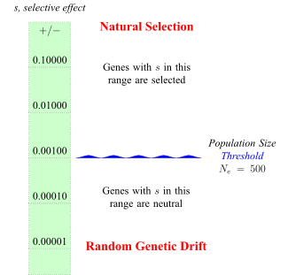
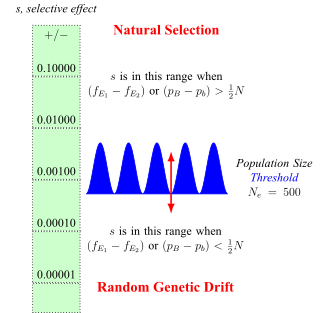

# Ecological Genetics
**First published Fri Nov 19, 2021; substantive revision Mon Jan 12, 2026**

*Wade, Michael*

*Ecological genetics* is the broad field of studies that investigates the relationship between genetic change and features of the biotic and abiotic environment. In population genetic theory, the role of the environment in adaptive evolution tends to be hidden in the recursion equations for gene frequency dynamics, where the common assumption of a constant selection coefficient implies a constant relationship between genotype, phenotype and fitness irrespective of environment. For *ecological genetics*, in contrast, the central focus is the causal relationship between genetic variation and environmental variation, where conspicuous (especially discrete) phenotypic variation is assumed to have an underlying genetic component. The advent of molecular tools and the development of molecular ecology within ecological genetics has greatly broadened the conceptual scope of the field within the last fifteen years.

The origins of *ecological genetics* are founded in the “modern synthesis” (Huxley 1942)[^huxley-1942], where the integration of genetics and Darwinian evolution was achieved through the theoretical works of R. A. Fisher, S. Wright, and J. B. S. Haldane and the conceptual works and influential writings of J. Huxley, T. Dobzhansky, and H. J. Muller. From these genetic beginnings, it was natural for much evolutionary research to be concentrated on the forces that cause changes in gene and genotype frequencies within populations. In this genetics-centered view, the four evolutionary forces (mutation, random genetic drift, natural selection, and gene flow) act within and among populations to cause micro-evolutionary change. Those same forces act in concert to convert the genetic variation within populations into more or less permanent genetic variation between species. Given enough time, the micro-evolutionary forces are believed to be sufficient to account for macro-evolutionary patterns characteristic of the higher taxonomic groups. In short, the central challenge of the field of *evolutionary genetics* has been to describe how the four evolutionary forces shape patterns of gene, genome and species diversity, with a particular emphasis on the predominant role of natural selection among the several evolutionary forces.

However, the gene-centered viewpoint was not the primary research focus or challenge for a large subset of field researchers, consisting of naturalists, zoologists and ecologists. Their focus was similarly on natural selection as the only evolutionary force which can produce adaptation, the fit between an organism and its environment. However, its focus is on the role of environment in adaptation. *Ecological genetics* is the study of evolutionary processes, especially adaptation by natural selection, in an ecological context in order to account for phenotypic patterns observed in nature. Where evolutionary genetics tends toward a branch of applied mathematics founded on Mendelian axioms, *ecological genetics* is grounded in the reciprocal interaction between theory and empirical observations from field and laboratory.

## 1. Introduction

In this entry, I review briefly the history of ecological genetic research and its recent integration with molecular genetic methods in the sub-field of molecular ecology. Most studies in ecological genetics begin with one or the other of the two most prominent patterns in nature:

1. adaptation, the “fit” between an organism and its environment (see the entry on fitness); or,
2. polymorphism, the maintenance of two or more phenotypic or genetic forms within a single population by natural selection.

With the development of molecular ecology, the latter can be significantly extended to explore phenotypic differences between species in a phylogenetic context. This permits a more incisive investigation of the environments that favor adaptive divergence of phenotypes between species. Moreover, the same molecular methods useful in phylogenetics can often be modified to identify the genes or chromosomal regions responsible for those inter-specific phenotypes (Gibson et al. 2021)[^gibson-2021].

The earliest studies attempted to document the action of natural selection in wild populations in support of Darwinian’s theory. In so doing, these studies attempted to demonstrate that evolution by natural selection was not only an historical causal force, but that it also continued to act on the characteristics of wild populations in the present day. Under the assumption of gradualism, it was not clear whether natural selecting acting on phenotypes in wild populations could be detected, let alone account for between species phenotypic differences. The starting observations of many of the earliest ecological genetic investigations, i.e., the phenotypes of most interest, were conspicuous phenotypic polymorphisms, such as the spotting patterns on butterfly wings or banding patterns of snail shells or polymorphisms of chromosomal rearrangements. These were either known to have a genetic basis or could safely be assumed to have one.

Although natural selection is the only evolutionary force that can account for adaptation, several evolutionary forces, acting alone or in combination, can sustain a genetic polymorphism, at least transiently. Thus, assigning causal agency to a single evolutionary force is often a more difficult problem when explaining polymorphism within species than it is for adaptations. In these studies of conspicuous polymorphisms, natural selection was “privileged” among the four evolutionary forces as an explanation for their maintenance, at least in part, because one of the founders of ecological genetics, E. B. Ford, collaborated extensively with R. A. Fisher (see Ford 1975)[^ford-1975]. In the early period (1928–1950), much of the problem of assigning causal agency to the maintenance of genetic polymorphism was resolved by definition rather than by empirical observation (see section 2 below: Classical Ecological Genetics and Polymorphism). That is, only those polymorphisms where the rarest form was deemed “too common” to be accounted for by recurrent mutation were considered suitable for study. Moreover, if the species was abundant, then random genetic drift could similarly be eliminated as a relevant process. Indeed, the longest standing controversies in ecological genetics centered on whether natural selection could account for the observed frequencies of polymorphism or whether the variation in those frequencies indicated a significant role of random genetic drift (see, for example, Schemske and Bierzychudek [2001] regarding the interpretation of flower color polymorphism in the desert annual, *Linanthus parryae*).

In the later period (1966–present), the advent of allozymes and molecular genetics permitted investigation of a less biased sample of genetic polymorphism. The modern characterization and analyses of allozymes and single nucleotide polymorphisms still retains the early emphasis on natural selection as the single most important evolutionary force shaping the hereditary material. Differently put, adaptive explanations for patterns of species divergence tend to be favored over non-adaptive explanations (see recent review of the causes of the rapid diversification among species of reproductive genes by Dapper and Wade [2020].)

Ecological genetics began at a time when the major theoretical aspects of the Modern Synthesis were in place, when the marvels of adaptation were clear, but when few empirical examples of natural selection in action were available. Achieving adaptive perfection by gradualism requires long periods of time wherein

> … a very slight selective effect acting for a correspondingly long time will be equivalent to a much greater effect acting for a proportionately shorter time. (R. A. Fisher 1921, in correspondence with S. Wright, quoted by Provine [1986: 247])

Very weak natural selection, however, is an impediment to the goal of ecological genetics to illuminate natural selection in action in the wild. Thus, the shift in focus toward understanding the role of strong natural selection in maintaining visible genetic polymorphisms is understandable. As put by its founder, E. B. Ford,

> It [ecological genetics] supplies the means, and the only direct means, of investigating the actual process of evolution taking place in the present time. (1975: 3)

The focus of traditional ecological genetic research on the current action of natural selection has been broadened in several ways over the last two decades. First, whereas the early studies tended to focus on evolution in single populations, there is now a significant emphasis in ecological genetics on the population genetic structure of metapopulations and the roles of migration, extinction, and colonization on evolutionary and adaptive processes (e.g., Goodacre 2002)[^goodacre-2002]. Secondly, whereas the earliest studies emphasized conspicuous polymorphisms or chromosomal rearrangements and their influence on fitness, the advent of biochemical genetics in the late 1960s significantly broadened the phenotype, beginning with the application of electrophoretic methods to population studies. These studies revealed abundant “hidden polymorphism” in the new, biochemical phenotype of enzyme mobility. These methods extended the domain of ecological genetics from the classic “conspicuous phenotypic polymorphisms” in color, shape and behavior to the physiological domain of enzyme function. The new emphasis on functional biochemical phenotypes, however, did not change the explanatory or causal framework of the field. Determining the role of natural selection in maintaining enzyme polymorphisms, such as the fast/slow polymorphisms of alcohol dehydrogenase (an enzyme involved in the detoxification of environmental alcohols), superoxide dismutase (which catalyzes the removal of free oxygen radicals), or the esterases (which are involved in the detoxification of pesticides in many insects), became a primary focus of investigation with the goal of finding a *selective* basis for the enzyme variants in terms of differences in their physical and kinetic properties. Indeed, the roots of controversy between the selectionist and neutralist schools over the maintenance of “balanced” polymorphisms (see Lewontin 1974)[^lewontin-1974] lie in the controversy over random genetic drift versus natural selection in early ecological genetic research (see below).

The more recent advent of DNA sequencing initiated the growth of molecular phylogenetics and molecular ecology. The new technology added not only a new phenotype, but also a more pronounced historical (phylogenetic) dimension to ecological genetic research. Molecular phylogenics and comparative sequence analysis have become the primary modern tools for the investigation of the evolutionary patterns and processes that shape DNA sequences. These methods have strengthened inferences regarding biogeography, speciation, and adaptation, especially in regard to the diversification of taxonomic lineages that attends ecological release and adaptive radiations. They have shifted the focus from polymorphism within species to diversification among clades (e.g., Kostyun et al. 2019)[^kostyun-2019] and permitted the investigation of the history of individual genes (Gibson et al. 2021)[^gibson-2021]. For example, ecological genomic data have permitted the reconstruction of the invasion of the Galapagos Islands by the wild tomato species, *Solanum pimpinellifolium*, through hybridization and introgression with a closely related endemic species, *Solanum cheesmaniae*. Moreover, an adaptive phenotype, orange fruit color similar to the endemic species, is associated with two introgressed regions of the *Solanum* genome which contain known fruit color loci, supporting the inference that adaptive convergence was genetically facilitated by introgression (Gibson et al. 2021)[^gibson-2021].

Two new patterns in particular have been recognized by these DNA-based methods. The first is the preponderance of “purifying selection”, wherein the conservative power of natural selection is seen as a barrier to diversity. It is this conservative aspect of natural selection acting at the molecular level that lends power to the investigation of the genetic architecture of model organisms *vis à vis* human genetics. The second pattern is the discovery of the existence of *ancient polymorphisms*, molecular genetic variation whose age may be greater than that of the species or taxon in which it occurs. Natural selection remains the privileged explanatory force in modern sequence studies. Indeed, the search for, characterization, and explanation of uniquely molecular patterns, such as codon bias (Behura & Severson 2013)[^behura-2013] and selective sweeps, has, if anything, elevated the focal explanatory power of natural selection in evolutionary studies. That is, nonrandom or biased use of redundant codons in DNA sequences is seen as evidence that, although they have no effect on amino acid sequence, redundant codons are not all functionally equivalent in that some permit more efficient gene expression. This is taken as evidence that natural selection is all powerful, reaching down into the genome to affect even the smallest and least significant components of the hereditary material.

In this entry, I review classical ecological genetics and then discuss the novel kinds of processes and explanations that accompanied the expansion of the field from single populations to genetically structured metapopulations and from phenotypic to biochemical and DNA sequence polymorphisms. I will show that the central early controversy over the roles of random genetic drift and natural selection in evolution has continued to this day, despite the apparent technological refinements afforded by the availability of biochemical and DNA sequence data. That is, finer scale or more reductionistic genetic data has not yet led to a resolution of the original conceptual issues that lie at the foundation of ecological genetics.

## 2. Classical Ecological Genetics and Polymorphism

Historically, the starting point of ecological genetic research has been the discovery of variation within a natural population, i.e., a phenotypic polymorphism. The subsequent goal is three-fold:

1. determination of whether or not the polymorphism has a genetic component;
2. determination of the frequency of each of the polymorphic types and their spatial and temporal variability; and,
3. determination of how natural selection maintains the polymorphism, either alone or in combination with other evolutionary forces.

Ford defines *genetic polymorphism* as

> …the occurrence together in the same locality of two or more discontinuous forms of a species in such proportions that the rarest of them cannot be maintained merely by recurrent mutation. (1975: 109; and see also Ford 1940)[^ford-1940]

Although recurrent mutation can maintain a polymorphism indefinitely at mutation-selection balance, here Ford is clearly interested in a more active role for natural selection in the maintenance of polymorphism. The first task was facilitated by early developments in population genetic theory, particularly the findings of Fisher (1930). Ford interpreted these to mean that naturally occurring, discontinuous phenotypic variation is “nearly always genetic”. The reasoning stems from the theoretical findings that, in large populations, it is unlikely that the positive and negative fitness effects of an allele (or chromosomal inversion) will be exactly balanced. As a result, the number of individuals with a rare neutral mutation is proportional to the number of generations since its origin. Furthermore, if truly neutral, such alleles would spread so slowly through a large population by random genetic drift that the

> delicate equipoise required for their neutrality will have been upset by changes in the environment and in the genetic outfit of the organism (Ford 1975: 110)[^ford-1975]

before a neutral allele reached appreciable frequency. In addition, recurrent mutation as a cause of persistent polymorphism was considered most unlikely and, in fact, this evolutionary cause is explicitly excluded from the definition of genetic polymorphism by Ford (see above). Hence, neutral genetic polymorphism was considered an exceptionally rare event by the founders of ecological genetics and, consequently, such polymorphisms were the hallmark of strong, active natural selection.

Ford (1940) further distinguished two types of selective polymorphism, transient polymorphism and balanced polymorphism. *Transient polymorphism*, caused by a new favorable mutation in the process of displacing its ancestral allele by natural selection, was considered unlikely, because “…advantageous genes will usually have been already incorporated into the genetic constitution of the species” (Ford 1975: 110)[^ford-1975]. This and statements like it reflect the viewpoint that organisms in nature are exquisitely adapted to their environments by the long-acting process of Fisherian gradualistic natural selection (see the entry on natural selection). It is a prelude to the more explicitly adaptationist views found in the current behavioral literature (see review in Shuster & Wade 2003)[^shuster-2003]. This view of the evolutionary process as primarily one of refinement of existing organismal adaptation is an essential part of the Fisherian theory of evolutionary genetics (Wade & Goodnight 1998)[^wade-1998].

The presumptions of a genetic basis for discontinuous phenotypic polymorphism and its maintenance by natural selection are clear from the writings of Ford cited above but these principles also can be found together in a single statement:

> In view of these considerations it is clear that if any unifactorial character is at all widespread it must be of some [adaptive] value. Indeed, it is probably true that even if it occurs at as low a frequency as 1 per cent, it must have been favored by selection. (Ford 1975: 110)[^ford-1975]

Thus, the primary goal of the ecological geneticist is to discern exactly how natural selection is acting to maintain a *balanced polymorphism* by the relative strength of opposing fitness effects acting on the different sexes, at different stages in the life history, at different localities or at different times in the lifetime of the organism.

The existence of males and females was discussed by Ford as a prime example of a balanced polymorphism because,

> It is obvious that any tendency for the males to increase at the expense of the females, or the reverse, would be opposed by selection. (Ford 1975: 111)[^ford-1975]

Fisher (1930) first argued that, because every individual has a mother and a father, the mean fitness of males must be equal to the mean fitness of females multiplied by the sex ratio, expressed as the number of females to males (i.e., the mean number of mates per male; see also Shuster and Wade 2003, Chapter 1)[^shuster-2003]. As a result, fitness increases with rarity, and, in this circumstance, whenever the population sex ratio deviates from unity, a gene that increases the numbers of the minority sex at birth will have a selective advantage. Thus, a sex ratio of unity is a stable, balanced polymorphism, achieved in many species by chromosomal determination of sex, which Ford referred to as a “‘built-in’ genetic switch-mechanism”, characteristic of other genetic polymorphisms, like Batesian mimicry. In general, the fitnesses of two different types constituting a phenotypic polymorphism must be equal to be maintained within a population by natural selection at a intermediate equilibrium frequency (a point recognized in Darwin 1871, Vol. II, Chapter 14)[^darwin-1871]. However, the balance of selective forces for non-sex related (or even sex-linked) polymorphisms is very different from that required to maintain an equal sex ratio. Using the existence of the separate sexes as an example of a balanced polymorphism is misleading or, at least unrepresentative, of the selective forces necessary to sustain balanced polymorphisms in general.

## 3. Classical Ecological Genetics, Population Size, and Natural Selection

The founding ecological geneticists dismissed any significant role for random genetic drift in evolution (see the entry on genetic drift). The theoretical interaction of random genetic drift and natural selection for single genes with constant effects can be seen in Figure 1. Fisher in his evolutionary theory assumed that natural populations achieved or sustained very large sizes as seen in his correspondence with S. Wright (letter from R. A. Fisher to S. Wright, August 13, 1929, as quoted in Provine 1986: 255)[^provine-1986] where he stated that “I believe *N* must usually be the total population on the planet, enumerated at sexual maturity”. Similarly, according to his intellectual biographer W. Ewens:

> Fisher never paid much attention to the concept [effective population size] as he should have … and used extremely high population sizes (up to $10^{12})$ in his analyses, surely far too large in general. (2000: 33)

For such extremely large population sizes, the threshold between selection and drift (see Fig. 1), which is determined by the effective population size, $N_e$, is too lower to matter evolutionarily. That is, the strength of random genetic drift, which is proportional to (1/$2N_e)$, is very, very weak and even genes with very small values of $s$ have their evolutionary fate determined entirely by selection. This is the essence of “*Fisherian gradualism*”—very small selective forces given sufficient time can have effects on adaptation similar to those of genes with much larger effects acting over a shorter time period. With very large $N_e$, the domain of random genetic drift is greatly restricted even as that of natural selection is expanded (see Fig. 1).

*Figure 1.*

Figure 1. The interaction of Random Genetic Drift and Natural Selection. The strength of selection is measured by the selective effect, $s$, of a single gene and the strength of random genetic drift is indicated by $(1/2N_e)$, where the population has effective size, $N_e$. When $s$ exceeds $(1/2N_e)$, then the evolutionary fate of a gene is determined primarily by Natural Selection. When $s$ is less than $(1/2N_e)$, then the evolutionary fate of a gene is determined primarily by Random Genetic Drift. Thus, the evolutionary domains of natural selection (upper) and random genetic drift (lower) are separated by the wavy boundary determined by the effective population size. [An extended description of figure 1 is in the supplement.]

However, ecological geneticists did *not* entirely dismiss random genetic drift as a significant evolutionary force for the same reasons that Fisher did. Field observations conducted with the mark-recapture methods developed by ecological geneticists documented generation-to-generation fluctuations in population size up to or exceeding an order of magnitude in most natural populations studied long term. Thus, small local population sizes were not seen as unusual by ecological geneticists. Indeed, Ford believed that

> … organisms automatically generate their own cycles of abundance and rarity and that the changes in selection pressure with which these are associated many greatly increase the speed of evolution; (Ford 1975: 36)[^ford-1975]

Despite the not infrequent occurrence of small population sizes where drift would be expected to be most efficacious, random genetic drift was still considered an irrelevant evolutionary force in ecological genetics because natural selection was viewed as being particularly strong during periods of population decline. That is, the strength of natural selection was negatively correlated with population density. Thus, as population size and $N_e$ declined owing to environmental stress, natural selection gained in strength so that the boundary between domains (Fig. 1) always favored selection. The smallest populations showed little phenotypic variation, which was seen as evidence that they were the most fit or most finely adapted populations. Thus, the lack of phenotypic variation in small populations was owing to it having been eliminated by natural selection during the immediately prior period of decline. Conversely, under periods of population increase, environmental stresses were minimal, so that natural selection was weaker and more permissive of variation. This concept of relaxed selection provided Ford with a cause for the increase in observations of rare phenotypic variants in large and growing natural populations. If selection pressure increases inversely to population size, then the role of random genetic drift in evolution must be greatly restricted.

In addition, Ford (1975: 38) believed that ecological genetic research had clearly demonstrated that the selective advantage of a gene in nature “… quite commonly exceeds 25 per cent and is frequently far more…”. Referring to Figure 1, this means that the range for values of $s$ in natural populations lies significantly above 0.01, placing genes, even in very small populations, firmly in the domain governed by natural selection.

Furthermore, Ford considered that not only the strength but also the nature of selective pressures must frequently change with density because

> … an organism has not the same adaptive requirements when abundant as when rare, or when the plant and animal forms which impinge on it are so. (Ford 1975: 39)[^ford-1975]

Indeed, he thought that the fluctuating selection pressure caused by variations in abundance “invalidates” Wright’s Shifting Balance Theory of Evolution, which he referred to as “far-fetched”. Interestingly, Ford and his colleagues believed that genetic subdivision of the sort postulated by Wright would promote rapid evolution but for reasons very different from Wright’s and by different genetic mechanisms (natural selection instead of random genetic drift, local selection, and interdemic selection). Ford (1975: 40–44) argued that subdivision of a large, geographically extensive population into relatively small groups promotes rapid evolution because,

> … when populations occupy a series of restricted habitats they can adapt themselves independently to the local environment in each of them, while when spread over a larger area they can be adjusted [by natural selection] only to the average of the diverse conditions which obtain there. This, however, requires that the adaptations should not be constantly broken down by a trickle of immigrants from one small colony to another.

Here, he proposes a trade-off between specialized adaptation to local conditions in the absence of migration and generalized adaptation to global conditions in the presence of migration. In modern terms, this is called genotype-by-environment interaction, where the selective effect, $s$, of a gene changes with change in the environment. A gene might be adaptive in one environmental context (i.e., $s \gt 0)$ but maladaptive in another (i.e., $s \lt 0)$. Migration between local environments mixes the adaptive and maladaptive responses to selection and reduces the average magnitude of gene frequency change. In this sense, genotype-by-environment interaction for fitness is viewed as an evolutionary constraint because it limits the rate of gene frequency change. The restraint can be removed simply by stopping gene flow and the mixing of genes across different local environments. Thus, the fixed selective effect illustrated in Figure 1, must be considered an *average* of variable selective effects across environments. Clearly, large local effects of opposite sign must be averaged when there is gene flow among habitats and the averaging tends to reduce the magnitude of a gene’s selective effect. Ford also suggests that the genetic mechanism involves “gene complex[es] balanced to fit their own local environment”. That is, he claimed interactions among genes, or epistasis, contributes to local adaptation. Thus, Ford invokes genotype-by-environment interactions for fitness as well as gene-gene interactions for fitness in his cases of rapid evolution, although both *reduce* the average selective effect of a gene. This argument also runs counter to his assertion that the adaptive advantage of a gene is typically 25 percent in natural populations. Both kinds of interaction change the depiction of the threshold separating natural selection from random genetic drift (Fig. 1); in fact they tend to raise it and thereby increase the domain of random genetic drift. Before turning to interaction effects, I will examine a representative discussion of ecological genetics of random genetic drift using data from a natural population.

## 4. The Sewall Wright Effect

Several wing coloration variants segregating in a small natural population of the moth, *Panaxia dominula* (Fisher & Ford 1947)[^fisher-1947], were investigated using mark-recapture in one of the longest continuous studies of a single population in all of evolutionary research. The goal of Fisher and Ford was to determine whether year-to-year fluctuations in the frequency of the variants (*medionigra*, a heterozygote, and *bimaculata*, a homozygote) were better explained by natural selection or by random genetic drift. (Banding patterns in the snail, *Cepea nermoralis¸were* the topic of similar discussions of the relative roles of natural selection and genetic drift [Cain & Shephard 1954; Cain & Provine 1992; Millstein 2008, 2009].)[^cain-1992][^cain-1954][^millstein-2008][^millstein-2009] They inferred from their analysis

> The conclusion that natural populations in general, like that to which this study is devoted, are affected by selective action, varying from time to time in direction and intensity and of sufficient magnitude to cause fluctuating variations in all gene frequencies is in good accordance with other studies of observable frequencies in wild populations. … We do not think, however, that it has been sufficiently emphasized that this fact is fatal to the theory which ascribes particular evolutionary importance to such fluctuations in gene ratios as may occur by chance in very small isolated populations. …
>
> Thus our analysis, the first in which the relative parts played by random survival and selection in a wild population can be tested, does not support the view that chance fluctuations can be of any significance in evolution. (Fisher & Ford 1947: 171, 172; quoted in Provine 1986: 423)[^fisher-1947][^provine-1986]

With this paper, Fisher and Ford moved the long-standing debate between Wright and Fisher over the relative roles of natural selection and random genetic drift in evolution from theory to nature. It is remarkable that, in the first such study with only eight years of observations on a single locus with alternative alleles, they are confident in rejecting Wright’s theory and random genetic drift in its entirety.

In his response to their analyses, Wright (1948) pointed out, first, that his theory of evolution explicitly involved the simultaneous action of several forces (selection, drift, mutation, and migration) and he emphatically rejected the paradigm of Fisher and Ford that *either* selection or drift alone had to be responsible for all of the observed fluctuation in gene frequencies (see the entry on population genetics). Wright noted that, in order to reach their statistical conclusion, Ford and Fisher had to include gene frequency data from a decade before the more careful study, notably a period without any estimates of population size. Without this earlier data point, the average fluctuations were much smaller and not significant. He pointed out that, like the mark-recapture estimates of population numbers, the gene frequencies themselves were estimates whose variation, based on the reported sample sizes, accounted for more than half (55.2%) of the observed variance that Fisher and Ford were trying to explain. He then showed that, if one assumed only the unitary explanation of natural selection, then the observed gene frequency fluctuations were so large *even without the sampling variance* that the temporal variations in the allelic selection coefficients must range from near lethality (or sterility) to tremendous advantage (i.e., from −0.50 to +0.50). However, Fisher and Ford (1947) provided no indication of comparable levels of temporal variation in any environmental factor acting as a selective agent. Wright argued that the effective population sizes used in the analysis were almost certainly too large, possibly by an order of magnitude, and that Fisher and Ford had made no attempt to estimate the factors expected to reduce effective size, like temporal variation in breeding numbers, non-random mortality among larvae (mortality clustered within families as might affect a species which experiences > 85% pupal mortality owing to viral infection), or other causes of the variance in offspring numbers (such as variation among females in egg numbers or variation among males in mate numbers). In an unyielding reply, Fisher and Ford (1950) labeled chance or random fluctuations in gene frequency, the *Sewall Wright Effect*, a term which has endured to the present day as a synonym for random genetic drift.

With a larger data set covering several more years, Ford (1975: 146) revisited this exchange and argued that Wright remained wrong on each count. Ford also showed that the selective advantage for the rarer of the genes varied widely, from −0.10 to +0.20, and that there was no evidence of heterozygote advantage. He did not find, however, the expected negative correlation between strength of selection and population size in these data. In the intervening decades, data from a variety of other organisms and natural population had become available and its review led Ford to conclude:

> As a result, it is no longer possible to attribute to random genetic drift or to mutation any significant part in the control of evolution. (1975: 389)

Thus, throughout its founding period, ecological genetics was relentlessly supportive of natural selection as unitary explanation for evolutionary change. (Later laboratory research has shown that the expression of the color patterns is sensitive or plastic to the thermal environment during development and thus the gene frequency estimates may be subject to significant measurement error, owing to the misclassification of genotypes. This is yet another source of variation, not accounted for in the Ford analyses. It tends to weaken the link between genotype and phenotype and thereby weaken the relationship between selection acting on phenotypes and the underlying genotypes. In addition, empirical evidence has found, as Wright expected, that temporal fluctuations in population size, large variance among females in fecundity, and sexual selection reduce the effective number to less than half the Fisher-Ford estimate. In addition, more careful studies have reduced Ford’s estimates of the magnitude of the average genic selection coefficient by about two thirds [see Cook & Jones 1996][^cook-1996].)

## 5. Interactions and their Effect on the Threshold between Natural Selection and Random Drift

The existence of either genotype-by-environment interaction $(\rG \times \rE)$ or gene-by-gene interaction (epistasis or $\rG \times \rG$) greatly complicates the estimation of selection coefficients. Ecological geneticists like Ford postulated interactions of the sort that could change the sign of genic selection coefficients with changes in the environment (including density) or in the genetic background. This kind of reversal of selective effect requires what is known as a “crossing-type” norm of reaction for $\rG \times \rE$ or additive-by-additive epistasis for $\rG \times \rG$ (Wade 2002)[^wade-2002]. The simplest model of crossing-type $\rG \times \rE$, consists of additive selection (i.e., genotypic fitnesses of $1 + 2s, 1 + s$, and 1 for genotypes AA, Aa, and aa, in one environment and the opposite order in the second environment) in each of two alternative environments, $E_1$ and $E_2$, with frequencies, $f_{E_1}$ and $f_{E_2}$, respectively. As the two environments fluctuate in frequency, spatially or temporally, the selective effect of an A allele changes in both magnitude and sign (see Fig. 2). Depending upon the relative frequencies of the alternative environments and the amount of gene flow or migration between them, the A allele on average can be a “good” gene or a “bad” gene with respect to fitness, a gene of major effect or minor effect on fitness, or even a neutral gene if the two environments are equally abundant. The smaller the amount of migration between the environments, the greater is the degree of local adaptation to each as theory and Ford suggested (see above). However, the *average* selective effect of the gene in the sense of Fisher’s theory must be smaller than the average observation in a particular locality at a particular time because the long-term average contains both positive and negative values of $s$. Furthermore, to the extent that the local value of $s$ changes sign owing to continuous fluctuations in local environmental conditions, the average effect on fitness A allele will also move downwards, from the domain of selection to the domain of drift as Wright suggested. Thus, the very kind of population subdivision imagined by Ford, with selection acting in every locality albeit in different directions, creates, rather than eliminates, an increased opportunity for random genetic drift.

*Figure 2.*

Figure 2. The interaction of Random Genetic Drift and Natural Selection, when there is either genotype-by-environment interaction or additive-by-additive epistasis (see text). The selective effect, $s$, of a single gene changes magnitude as the frequency of the alternative environments, $f_{E_1}$ and $f_{E_2}$, connected by gene flow, changes *or* as the frequency of alternative alleles, $p_B$ and $p_b$, change at an interacting locus. Thus, neither the selective effect of a gene nor the effective population size remains constant. As a result, relative to Figure 1, the threshold boundary between the domains of Natural Selection and Random Genetic Drift is greatly widened, meaning that both forces play more or less equal evolutionary roles over a broad range of values of $s$ and $N_e$. Furthermore, interactions of this sort open the possibility that changes in the relative frequencies of alternative environments or alternative alleles at other loci can move a gene’s selective effect from the domain of selection that of drift or vice versa during the course of its evolution. [An extended description of figure 2 is in the supplement.]

A very similar effect on the “gene”s eye view’ of selection is caused by additive-by-additive epistasis (Goodnight & Wade 2000; Wade 2001, 2002)[^goodnight-2000][^wade-2001][^wade-2002]. The simplest model of this kind of $\rG \times \rG$, with interaction between loci A and B, each with alternative alleles, results in an average genic selection coefficient acting on the A allele of $s(p_B - p_b)$, where $p_B$ and $p_b$ are the frequencies of alternative alleles at the B-locus that interact in the additive-by-additive model with alleles at the A locus. The relative frequencies of the alternative alleles at the B locus, determine whether the A allele is a “good” gene or a “bad” gene with respect to fitness, a gene of major effect or minor fitness effect, or even a neutral gene when the background alleles are equally abundant (i.e., $p_B = p_b)$. Whenever allele frequencies of its epistatic partner change, either by drift or selection, the A allele’s selective effect also changes and, like the case of $\rG \times \rE$, it moves the boundary between the domains of natural selection and random drift (Fig. 2), increasing the domain of the latter at the expense of the former.

## 6. Allozyme Variation and the Drift vs Selection Controversy

The central problem with using conspicuous polymorphisms for investigating the relative roles of the variety of different evolutionary forces is that they not an unbiased sample of genetic diversity with respect to either adaptive function or amount of genetic variation. Indeed, the definition of genetic polymorphism adopted by Ford (see above) incorporates the essence of both of these biases. For a period, it was believed that “The solution to our dilemma lies in the development of molecular genetics” (Lewontin 1974: 99)[^lewontin-1974]. With the advent of electrophoresis, the amino acid sequence of a random sample of proteins from almost any organism could be studied and, for the first time, the level of genetic diversity, in the form of amino acid substitutions, across the genome could be quantified.

Two measures of genetic diversity were possible using electrophoresis:

1. the number of loci polymorphic; and,
2. the average heterozygosity per locus per individual.

From studies across a number of species, it was estimated that 15–40% of all loci were polymorphic and the average individual was heterozygous at 5–15% of its genome. Since this technique measured primarily amino acid substitutions resulting in charge changes, i.e., only one third of all possible amino acid substitutions, one could infer that these were minimal levels of genetic diversity which significantly underestimated the actual levels. The conclusion that genetic variation was ubiquitous, with most genes being polymorphic, was inescapable. The search for the adaptive function of allozyme variants and balancing selection at the physiological level ensued, just as it had in the earliest studies in ecological genetics.

However, the observed levels of genetic polymorphism presented an insurmountable problem for the mathematical theory of evolutionary genetics. The amount of genetic variation was much too large to be explained by the type of balancing selection observed by Ford and his colleagues for conspicuous phenotypic polymorphisms in natural populations. The basic problem was that the numbers of selective deaths necessary to account for the observed levels of allozyme polymorphism exceeded the reproductive excess of almost all species. This where the focus on genetics must be coupled with the ecology of reproduction and viability. Haldane (1957) called this the “cost of natural selection” and it is also referred to as the substitutional load. Differently put, the mortality of homozygous genotypes, if independently selected, (also known as the “segregation load”) would exceed the total numbers of offspring produced by a population. For this reason, Kimura (1983) proposed his neutral theory of molecular evolution, founded on the theoretical observation that the probability of fixation of a novel mutant allele with selective coefficient, $s \gt 0$, was approximately $2s$ (Wright 1931: 133)[^wright-1931]. Since $s$ was generally believed to be in the range of 0.001 to 0.0001, the likelihood of loss of a new favorable mutation by chance is quite high, only slightly smaller than the probability of loss by chance for a truly neutral allele.

Studies of protein structure revealed that the functional, non-synonymous sites of a protein, which constitute the minority of its amino acids, evolved several times more slowly than the non-functional, synonymous or structural sites. Kimura’s view that much, if not most, of evolutionary change at the molecular level was determined by random genetic drift and not natural selection was highly controversial. As Kimura noted,

> …if a certain doctrine is constantly being spoken of favorably by the majority, endorsed by top authorities in their books and taught in classes, then a belief is gradually built up in one’s mind, eventually becoming the guiding principle and the basis of value judgment. At any rate, this was the time when the panselectionist or “neo-Darwinian” position was most secure in the history of biology: the heyday of the traditional “synthetic theory” of evolution. (1983: 22)

It was soon recognized that a more reductionistic approach (DNA sequence studies) might help to resolve the issue of whether or not every amino acid was of some functional value because the redundant positions in the code of life were assumed to provide an estimate of the true “neutral” rate of evolution, owing to random genetic drift acting in the absence of selection.

## 7. Sequence Variation and the Drift vs Selection Controversy

The neutral theory of evolution is the antithesis of ecological genetics. It states that random genetic drift, independent of the environment, rather than natural selection, governs most evolutionary change at the level of the DNA and proteins. At the same time, it admits that natural selection predominates in shaping the morphological and physiological traits that manifest an adaptive fit with the environment. This is a paradox because most of the DNA appears to be non-functional while most of the externally observable phenotype appears to have adaptive function.

Tests of the theory using DNA sequence data consist of comparisons of the relative evolutionary rates of different kinds of sites (base pairs) within codons and take advantage of the redundancy in the genetic code. The rate of neutral evolution is estimated from levels of polymorphism or numbers of segregating sites within species or the divergence between species in silent or redundant site substitutions (e.g., Dapper & Wade 2020)[^dapper-2020]. Silent sites are those that do not result in an amino acid change in the protein and, hence, are non-functional in the usual sense. In contrast, the rate of selective change or selective constraint is evaluated relative to the neutral rate using replacement sites, those base pair changes that result in amino acid changes. If the rate of substitution or polymorphism is lower than neutral, it is evidence of selective constraint or purifying natural selection acting to prevent change and preserve function in the face of mutational damage. If the rate of substitution is higher than neutral, then it is evidence of adaptive substitution.

Molecular evolutionary studies also revealed the existence of *pseudogenes*, non-coding stretches of DNA derived by the tandem duplication and subsequent inactivation by mutation of single copy genes. The lack of function of the pseudogene makes all of its codons effectively neutral and provides another estimate of the rate of neutral evolution. Importantly, “replacement” sites that evolve slowly in the functional gene have been shown to evolve more rapidly in the nonfunctional tandem duplicate pseudogene.

Changes in the pattern of neutral variation in the vicinity of a selected site(s) are also informative because, during an adaptive substitution, neutral variants linked to the piece of selected DNA are carried or “swept” to fixation along with it. This “selective sweep” temporarily reduces the level of neutral variation in the vicinity of selected sites until it can be replaced by mutation. The degree of reduction in neutral variation or the “footprint of selection” depends upon the strength of selection, the frequency of recombination during selection, and the time since the initiation of selection. The footprint is most conspicuous when a selective sweep is initiated by the advent of a single, novel favorable mutation. To the extent that novel selection results from a change of environment and begins to act on existing or standing variation already in the population, the impact on neutral polymorphisms may be quite minimal.

Balancing selection of the sort observed by Ford leaves its own unique “reverse” footprint on neutral diversity (Kreitman & Di Rienzo 2004)[^kreitman-2004] . Because the segments of DNA constituting the balanced polymorphism are held in the population by selection much longer than expected based on random drift, these segments have a higher effective population size (owing to lower variation in offspring numbers than random). As a result, they have a longer time to accumulate mutational variation at nearby neutral sites. In some cases, the time is longer than that required to create new species, resulting in *trans-specific polymorphisms* (Cho et al. 2006)[^cho-2006]. Thus, levels of neutral diversity are expected to be enhanced in the vicinity of a molecular balanced polymorphism. When the mating system restricts recombination (e.g., selfing or inbreeding species), the region of elevated neutral diversity in the vicinity of a balanced polymorphism can be extensive (e.g., *Arabiodopsis thaliana* [Tian et al. 2002])[^tian-2002].

Kimura predicted that silent substitutions would evolve more rapidly than replacement substitutions *before* sequence data were available to test his neutral theory of molecular evolution. Molecular genetic studies have confirmed his prediction: silent sites evolve several times faster than replacement sites. These studies clearly show that the primary mode of action of natural selection at the level of the DNA sequence is purifying selection. It is this highly conservative aspect of natural selection that permits comparative molecular evolutionary studies of developmental processes across species as diverse as humans and flies. At the molecular level, most genes, though polymorphic in sequence, do not display evidence of balancing selection and instead manifest patterns of variation that accord well with neutral theory.

The interaction of selection and random drift across linked regions of DNA sequence is one of the most active current areas of theoretical and empirical research in molecular evolution. Theory shows that it can be difficult to separate cleanly the action of the evolutionary forces of selection and drift except for certain regions of parameter space, whose generality remains unknown and subject to much debate. Like the study by Fisher and Ford (1947), most empirical studies interpret *all* deviations away from strictly the neutral expectation as evidence of natural selection without addressing the issue of agency. For example, codon bias is evidence that natural selection affects even the apparently non-functional components of genes. Thus, the original ecological genetic view that natural selection is the only significant evolutionary force characterizes much of modern molecular evolution, despite progress in theory and the availability of much more reductionistic genetic methods. The parallels between the summary statement of Ford (1975: 389; see above) and that of the molecular evolutionary geneticist, E. Nevo, twenty-five years later are remarkable:

> Biodiversity evolution, even in small isolated populations, is primarily driven by natural selection, including diversifying, balancing, cyclical, and purifying selective regimes, interacting with, but ultimately overriding, the effects of mutation, migration, and stochasticity [random genetic drift]. (Nevo 2001: 6223)[^nevo-2001]

## References（引用注释）

> 原文参考文献已转为脚注引用：文内“作者-年份”引用组后附 [^key] 标记，完整条目见本文末脚注定义。

## Academic Tools

> |   | [How to cite this entry](https://plato.stanford.edu/cgi-bin/encyclopedia/archinfo.cgi?entry=ecological-genetics). |
> | --- | --- |
> |   | [Preview the PDF version of this entry](https://leibniz.stanford.edu/friends/preview/ecological-genetics/) at the [Friends of the SEP Society](https://leibniz.stanford.edu/friends/). |
> |   | [Look up topics and thinkers related to this entry](https://www.inphoproject.org/entity?sep=ecological-genetics&redirect=True) at the Internet Philosophy Ontology Project (InPhO). |
> |   | [Enhanced bibliography for this entry](https://philpapers.org/sep/ecological-genetics/) at [PhilPapers](https://philpapers.org/), with links to its database. |

## Other Internet Resources

[Please contact the author with suggestions.]

## Related Entries

fitness | genetic drift | genetics: molecular | genetics: population | natural selection

### Acknowledgments

This entry replaces and is based on the former entry titled [Evolutionary Genetics](https://plato.stanford.edu/archives/fall2021/entries/evolutionary-genetics/) by the same author.

[^behura-2013]: Behura, Susanta K. and David W. Severson, 2013, “Codon Usage Bias: Causative Factors, Quantification Methods and Genome-Wide Patterns: With Emphasis on Insect Genomes”, *Biological Reviews*, 88(1): 49–61. doi:10.1111/j.1469-185X.2012.00242.x

[^cain-1992]: Cain, A. J. and William Provine, 1992, “Genes and Ecology in History”, in *Genes in Ecology*, R.J. Berry, T.J. Crawford, and G.M. Hewitt (eds), Oxford: Blackwell Scientific, 3–28.

[^cain-1954]: Cain, A. J. and P. M. Sheppard, 1954, “Natural Selection in Cepaea”, *Genetics*, 39(1): 89–116. doi:10.1093/genetics/39.1.89

[^cho-2006]: Cho, Soochin, Zachary Y. Huang, Daniel R. Green, Deborah R. Smith, and Jianzhi Zhang, 2006, “Evolution of the Complementary Sex-Determination Gene of Honey Bees: Balancing Selection and Trans-Species Polymorphisms”, *Genome Research*, 16(11): 1366–1375. doi:10.1101/gr.4695306

[^cook-1996]: Cook, L. M. and D. A. Jones, 1996, “The *Medionigra* Gene in the Moth *Panaxia dominulcr*: The Case for Selection”, *Philosophical Transactions of the Royal Society of London. Series B: Biological Sciences*, 351(1347): 1623–1634. doi:10.1098/rstb.1996.0146

[^dapper-2020]: Dapper, Amy L. and Michael J. Wade, 2020, “Relaxed Selection and the Rapid Evolution of Reproductive Genes”, *Trends in Genetics*, 36(9): 640–649. doi:10.1016/j.tig.2020.06.014

[^darwin-1871]: Darwin, Charles, 1871, *The Descent of Man and Selection in Relation to Sex*, Volume II, London: John Murray.

[^ewens-2000]: Ewens, Warren C., 2000, “The Mathematical Foundations of Population Genetics”, in *Evolutionary Genetics: From Molecules to Morphology*, Rama S. Singh and Costas B. Krimbas (eds), New York: Cambridge University Press, 24–40.

[^fisher-1930]: Fisher, R. A., 1930, *The Genetical Theory of Natural Selection*, Oxford: Clarendon Press.

[^fisher-1947]: Fisher, R. A. and E. B. Ford, 1947, “The Spread of a Gene in Natural Conditions in a Colony of the Moth *Panaxia dominula L.*”, *Heredity*, 1(2): 143–174. doi:10.1038/hdy.1947.11

[^fisher-1950]: –––, 1950, “The ‘Sewall Wright Effect’”, *Heredity*, 4(1): 117–119. doi:10.1038/hdy.1950.8

[^ford-1940]: Ford, E. B., 1940, “Genetic Research in the Lepidoptera: Being the Galton Lecture of London University, Delivered August 1939, to the Seventh International Congress of Genetics”, *Annals of Eugenics*, 10: 227–252. doi:10.1111/j.1469-1809.1940.tb02249.x

[^ford-1975]: –––, 1975, “Balanced Polymorphism in *Panaxia Dominula*”, in his *Ecological Genetics*, fourth edition, London: Chapman and Hall, 137–156 (ch. 7).

[^gibson-2021]: Gibson, Matthew J.S., María de Lourdes Torres, Yaniv Brandvain, and Leonie C. Moyle, 2021, “Introgression Shapes Fruit Color Convergence in Invasive Galapagos Tomato”, *Elife*, 10: p.e64165.

[^goodacre-2002]: Goodacre, Sara L., 2002, “Population Structure, History and Gene Flow in a Group of Closely Related Land Snails: Genetic Variation in Partula from the Society Islands of the Pacific”, *Molecular Ecology*, 11(1): 55–68. doi:10.1046/j.0962-1083.2001.01422.x

[^goodnight-2000]: Goodnight, Charles J. and Michael J. Wade, 2000, “The Ongoing Synthesis: A Reply to Coyne, Barton, and Turelli (2000)”, *Evolution*, 54(1): 317–324. doi:10.1111/j.0014-3820.2000.tb00034.x

[^haldane-1957]: Haldane, J. B. S., 1957, “The Cost of Natural Selection”, *Journal of Genetics*, 55(3): 511–524. doi:10.1007/BF02984069

[^huxley-1942]: Huxley, Julian, 1942, *Evolution, the Modern Synthesis*, New York: Harper & Brothers.

[^kimura-1983]: Kimura, Motoo, 1983, *The Neutral Theory of Molecular Evolution*, Cambridge: Cambridge University Press. doi:10.1017/CBO9780511623486

[^kostyun-2019]: Kostyun, Jamie L., Matthew J. S. Gibson, Christian M. King, and Leonie C. Moyle, 2019, “A Simple Genetic Architecture and Low Constraint Allow Rapid Floral Evolution in a Diverse and Recently Radiating Plant Genus”, *New Phytologist*, 223(2): 1009–1022. doi:10.1111/nph.15844

[^kreitman-2004]: Kreitman, Martin and Anna Di Rienzo, 2004, “Balancing Claims for Balancing Selection”, *Trends in Genetics*, 20(7): 300–304. doi:10.1016/j.tig.2004.05.002

[^lewontin-1974]: Lewontin, Richard C., 1974, *The Genetic Basis of Evolutionary Change*, New York: Columbia University Press.

[^millstein-2008]: Millstein, Roberta L., 2008, “Distinguishing Drift and Selection Empirically: ‘The Great Snail Debate’ of the 1950s”, *Journal of the History of Biology*, 41(2): 339–367. doi:10.1007/s10739-007-9145-5

[^millstein-2009]: –––, 2009, “Concepts of Drift and Selection in ‘The Great Snail Debate’ of the 1950s and Early 1960s”, in *Descended from Darwin: Insights into the History of Evolutionary Studies, 1900–1970*, Joe Cain and Michael Ruse (eds.), (Transactions of the American Philosophical Society 99), Philadelphia, PA: American Philosophical Association, 271–298. [[Millstein 2009 available online](https://profjoecain.net/descended-darwin-book-evolutionary-synthesis/)]

[^nevo-2001]: Nevo, Eviatar, 2001, “Evolution of Genome-Phenome Diversity under Environmental Stress”, *Proceedings of the National Academy of Sciences*, 98(11): 6233–6240. doi:10.1073/pnas.101109298

[^provine-1971]: Provine, William B., 1971, *The Origins of Theoretical Population Genetics*, Chicago: University of Chicago Press.

[^provine-1986]: –––, 1986, *Sewall Wright and Evolutionary Biology*, Chicago: University of Chicago Press.

[^schemske-2001]: Schemske, Douglas W. and Paulette Bierzychudek, 2001, “Perspective: Evolution of Flower Color in the Desert Annual *Linanthus parryae*: Wright Revisited”, *Evolution*, 55(7): 1269–1282. doi:10.1111/j.0014-3820.2001.tb00650.x

[^shuster-2003]: Shuster, Stephen M. and Michael J. Wade, 2003, *Mating Systems and Strategies*, Princeton, NJ: Princeton University Press.

[^tian-2002]: Tian, Dacheng, Hitoshi Araki, Eli Stahl, Joy Bergelson, and Martin Kreitman, 2002, “Signature of Balancing Selection in Arabidopsis”, *Proceedings of the National Academy of Sciences*, 99(17): 11525–11530. doi:10.1073/pnas.172203599

[^wade-2001]: Wade, Michael J., 2001, “Epistasis, Complex Traits, and Mapping Genes”, *Genetica*, 112: 59–69. doi:10.1023/A:1013316611768

[^wade-2002]: –––, 2002, “A Gene’s Eye View of Epistasis, Selection and Speciation: A Gene’s Eye View of Epistasis”, *Journal of Evolutionary Biology*, 15(3): 337–346. doi:10.1046/j.1420-9101.2002.00413.x

[^wade-1998]: Wade, Michael J. and Charles J. Goodnight, 1998, “Perspective: The Theories of Fisher and Wright in the Context of Metapopulations: When Nature Does Many Small Experiments”, *Evolution*, 52(6): 1537–1553. doi:10.1111/j.1558-5646.1998.tb02235.x

[^wright-1931]: Wright, Sewall, 1931, “Evolution in Mendelian Populations”, *Genetics*, 16: 97–159.

[^wright-1948]: –––, 1948, “On the Roles of Directed and Random Changes in Gene Frequency in the Genetics of Populations”, *Evolution*, 2(4): 279–294. doi:10.1111/j.1558-5646.1948.tb02746.x
