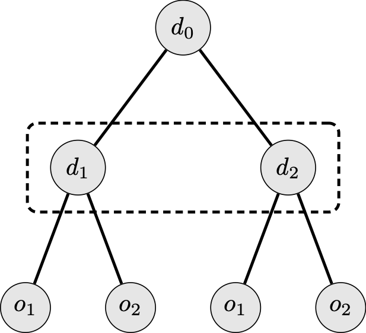
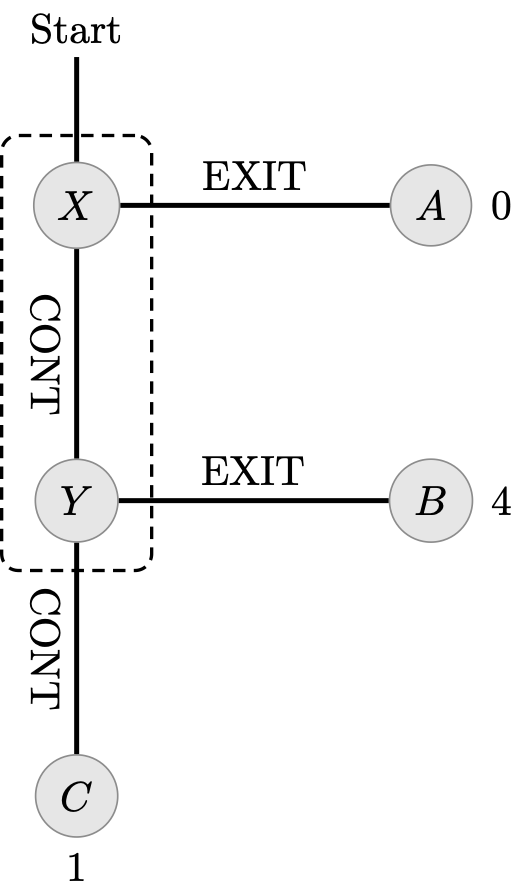
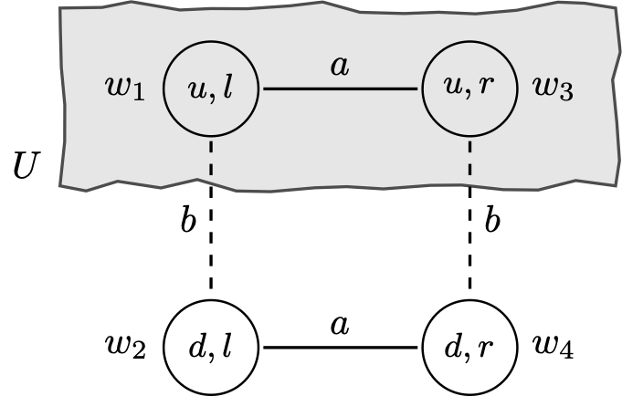
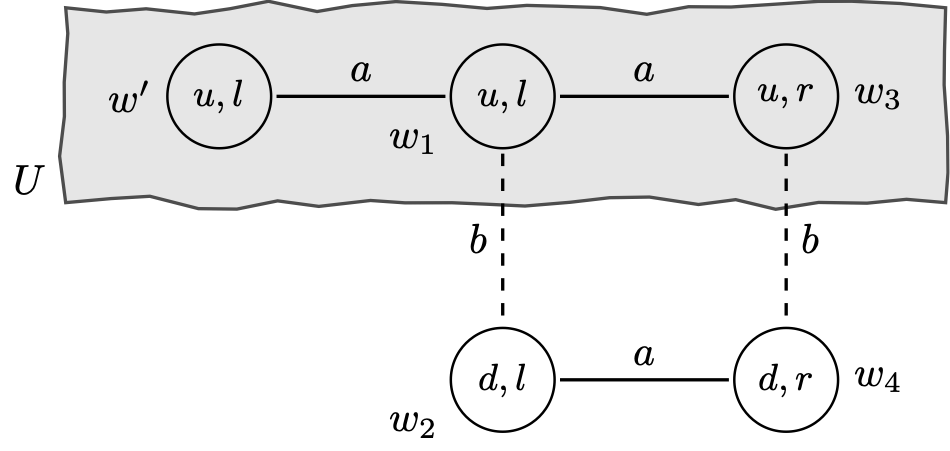
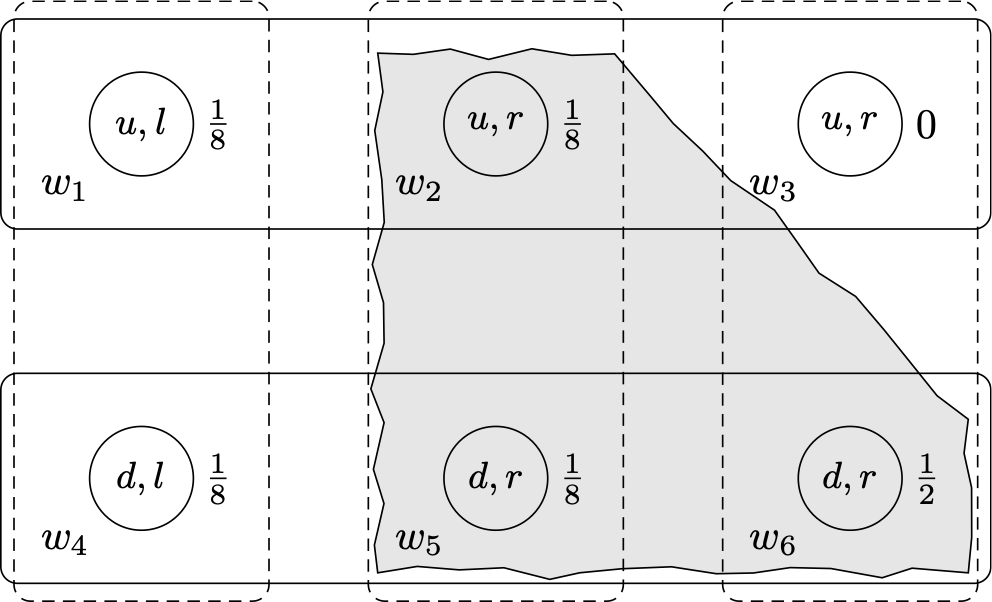
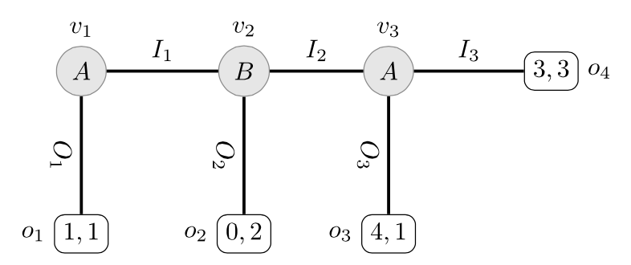
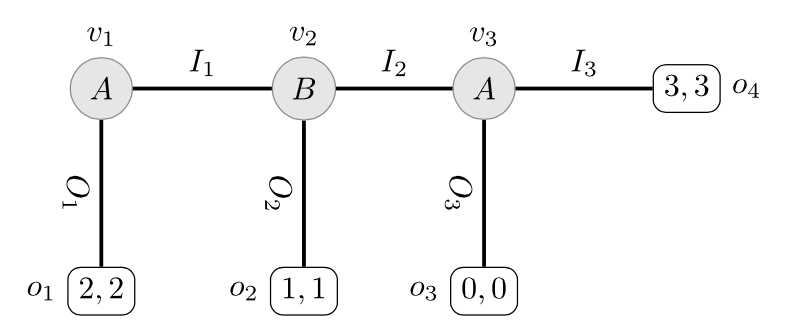
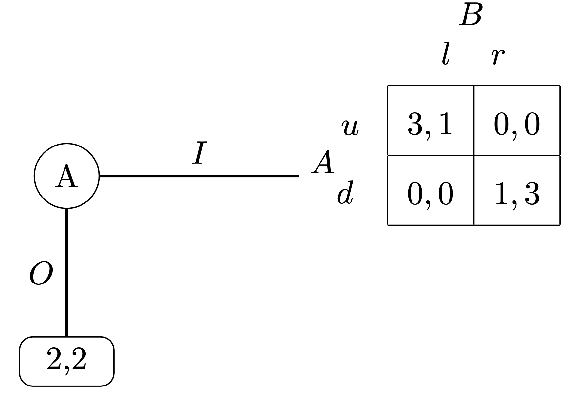

# Epistemic Foundations of Game Theory
**First published Fri Mar 13, 2015; substantive revision Fri Jun 27, 2025**

*Pacuit, Eric, Roy, Olivier*

Non-cooperative game theory studies how individual players, or agents, make decisions in situations involving strategic interaction. In these situations, each player’s outcome depends not only on their own choices but also on the choices of the other players (see Ross 1997 [2024] for an overview)[^ross-1997]. Epistemic game theory investigates how assumptions about the players’ beliefs and rationality influence their choices in strategic situations. This entry begins by discussing the role of uncertainty in strategic situations. It then introduces models of multi-agent knowledge and belief developed in the epistemic game theory and epistemic logic literature. Next, it examines how these models can be used to characterize classical game-theoretic solution concepts, focusing on the relationship between players’ rationality and their mutual beliefs about each other’s rationality. The entry concludes with a brief overview of other key topics in the epistemic game theory literature and suggestions for further reading.

## 1. The Epistemic View of Games

This section provides an overview of the key ideas and concepts that are used throughout epistemic game theory.

### 1.1 Classical Game Theory

A *game* refers to an interactive situation involving a group of “self-interested” players, or agents. The defining feature of a game is that the players are engaged in an “interdependent decision problem” where the outcome of the game depends on all of the player’s choices (Schelling 1960)[^schelling-1960]. The mathematical description of a game includes at least the following components:

1. the *players*: in this entry, we only consider games with finitely many players and use $N $ to denote the set of players in a game;
2. for each player $i\in N$, a finite set of *feasible* options (typically called *actions* or *strategies*); and
3. for each player $i\in N$, a *utility function* that represents $i$’s preference over the possible outcomes of the game. A standard assumption in game theory is that the outcomes of a game are the sequences of actions, one for each player. A sequence of actions is called a **strategy profile**. Identifying the outcomes of a game with strategy profiles reflects the key idea that the outcome of a game depends on the choices of *all players*.

Different mathematical representations of a game describe other features of the interactive situation, such as the order in which the players move.

**Definition 1.1 (Game in Strategic Form)** A game in **strategic form** is a tuple $\langle N , (S_i)_{i\in N}, (u_i)_{i\in N }\rangle$ where $N $ is a nonempty finite set of players, for each $i\in N$, $S_i$ is a nonempty set of actions for player $i$, and for each $i\in N$, $u_i:\times_{i\in N } S_i\rightarrow\mathbb{R}$ is player $i$’s utility function, where $\times_{i\in N} S_i$ is the set of strategy profiles.

A game in strategic form represents a situation in which all the players make a single decision simultaneously without stochastic moves.

Figure 1 is an example of a game in strategic form. There are two players, Ann and Bob, and each has two available actions: $N = \{\Ann, \Bob\}$, $S_{\Ann} = \{u, d\}$ and $S_{\Bob} = \{l, r\}$. The players’ utilities $u_{\Ann}$ and $u_{\Bob}$ are displayed in the cells of the matrix (the first number in the tuple is Ann’s utility and the second number is Bob’s utility). If Bob chooses $l$, for instance, Ann prefers the outcome she would get by choosing $u$ to the one she would get by choosing $d$ since $u_{\Ann}(u,l) > u_{\Ann}(d,l)$, but this preference is reversed if Bob chooses $r$. In the game in Figure 1, there are 4 outcomes of the game corresponding to the 4 different strategy profiles $\{(u,l), (u, r), (d, l), (d,r)\}$ (represented by each of the 4 cells in the matrix displayed in Figure 1).

|   |   | Bob |   |
| --- | --- | --- | --- |
|   |   | *l* | *r* |
| Ann | *u* | 1,1 | 0,0 |
| *d* | 0,0 | 1,1 |   |

*Figure 1:* A coordination game

The game displayed in Figure 1 is called a *pure coordination game*: the players have a common interest in coordinating their choices on $(u, l)$ or $(d, r)$ and they are both indifferent about which way they coordinate their choices.

#### 1.1.1 Solution Concepts and Mixed Strategies

A major focus of classical game theory research is studying and developing *solution concepts*. A solution concept associates a set of outcomes (i.e., a set of strategy profiles) with each game (from some fixed class of games). The most well-known solution concept is the Nash equilibrium, although we will encounter others in this entry. From a prescriptive point of view, a solution concept is a recommendation about what the players should do in a game, or about what outcomes can be expected assuming that the players choose rationally. From a predictive point of view, solution concepts describe what the players will actually do in a game.

Many solution concepts in game theory involve *mixed strategies*, where a player deliberately randomizes between their available actions rather than choosing one with certainty. The matching pennies game illustrates why mixed strategies are important: two players simultaneously show heads or tails, where one player wins if the coins match and the other wins if they differ. In this game, if your opponent can predict your choice, they will win by choosing accordingly. To prevent your opponent from gaining this advantage, you should make your choice truly unpredictable—even to yourself—by randomizing. A mixed strategy specifies the probability of choosing each action (e.g., 60% heads, 40% tails), selected from the infinitely many possible probability distributions over your available actions.

Formally, a mixed strategy for a player $i$ is a probability over $i$’s available strategies. Let $\Delta(X)$ denote the set of probability measures over the finite[^note-1] set $X$. Each $m\in \Delta(S_i)$ is called a **mixed strategy** for player $i$. If $m\in\Delta(S_i)$ assigns probability 1 to a strategy $s\in S_i$, then $m$ is called a **pure strategy** (in this case, we write $s$ for $m$).

Mixed strategies play an important role in game theory, especially when it comes to the existence of Nash equilibria. However, the interpretation of mixed strategies is controversial (see, for instance, Rubinstein 1991: 913)[^rubinstein-1991]. The main issue is whether players should be seen as genuinely randomizing—i.e., as delegating their choices to some randomization device—or whether mixed strategies capture something else, such as the opponents’ *uncertainty* about a player’s choice (cf. Zollman 2022 and Icard 2021)[^icard-2021][^zollman-2022]. We return to the interpretation of mixed strategies in Section 3.3.2.

### 1.2 Epistemic Game Theory

Epistemic game theory emerged as a well-defined research program in the 1980s as a response to the equilibrium refinement program. The equilibrium refinement program (see van Damme 1983 for an overview)[^damme-1983] started with the observation that the Nash equilibrium (see Section 3.3 for a definition of Nash equilibrium) does not always provide a unique or compelling solution of a game. The equilibrium refinement program aims to identify more desirable solutions to a game by imposing additional criteria on the set of Nash equilibria. These refined equilibrium concepts were often based on intuitive judgments about what constituted rational plays in games. The development of epistemic game theory was motivated by a desire to formalize these intuitive judgments. Armbruster & Böge (1979) is arguably the earliest contribution to this approach, but other notable works include Spohn (1982)[^spohn-1982], Bernheim (1984)[^bernheim-1984], Pearce (1984)[^pearce-1984], and Tan & Werlang (1988), all of which present clear statements contrasting the epistemic program with the equilibrium refinement program. Consult Perea (2014b)[^perea-2014b] for a more comprehensive discussion on the history of epistemic game theory.

One of the objectives of epistemic game theory is to characterize the behavior of rational players who mutually recognize each other’s rationality, where rationality is typically understood as in standard decision theory (see Briggs 2014 [2019])[^briggs-2014]. This approach to the study of games is nicely encapsulated by the following:

> There is no special concept of rationality for decision making in a situation where the outcomes depend on the actions of more than one agent. The acts of other agents are, like chance events, natural disasters and acts of God, just facts about an uncertain world that agents have beliefs and degrees of belief about. The utilities of other agents are relevant to an agent only as information that, together with beliefs about the rationality of those agents, helps to predict their actions. (Stalnaker 1996: 136)[^stalnaker-1996]

A central component of an epistemic analysis of a game is a description of what the players know and believe about each other. In epistemic game theory, there are two main sources of uncertainty for the players:

- Strategic uncertainty: What will the other players do?
- Higher-order information: What are the other players thinking?

Of course, game theorists have studied uncertainty in games long before the emergence of epistemic game theory. This work has largely focused on two other sources of uncertainty in game:

- Information about the structure of the game (called *complete/incomplete information*): Who else is involved in the game? What actions are available? What are the payoffs for each player? This type of uncertainty in games is briefly discussed in Section 1.4
- Information about the play of the game (called *perfect/imperfect information*): Which moves have been played? This type of uncertainty in games is briefly discussed in Section 1.5.

These four sources of uncertainty in games are conceptually important, but not necessarily exhaustive nor mutually exclusive. John Harsanyi, for instance, argued that all uncertainty about the structure of the game—i.e., all possible incompleteness in information—can be reduced to uncertainty about the payoffs (Harsanyi 1967–68, cf. also Hu & Stuart 2002 and Lorini & Schwarzentruber 2010)[^harsanyi-1967][^harsanyi-1967-2][^lorini-2010]. In a similar vein, Kadane & Larkey argue that for a player

> in a single-play game, all aspects of his opinion except his [opinion] about his opponent’s behavior are irrelevant, and can be ignored in the analysis by integrating them out of the joint opinion. (1982: 116)

### 1.3 Stages of Decision Making

It is standard in the game theory literature to distinguish three stages of the decision making process: *ex ante*, *ex interim*, and *ex post*. At one extreme is the *ex ante* stage where no decision has yet been made. The other extreme is the *ex post* stage where the choices of all players are openly disclosed. In between these two extremes is the *ex interim* stage where the players have made their decisions, but they are still uninformed about the choices of the other players.

These distinctions are not intended to be sharp. Rather, they describe various stages of information disclosure for the players during the decision-making process. At the *ex ante* stage, little is known except the structure of the game, who is taking part, and possibly (but not necessarily) something about the other players’ beliefs. At the *ex post* stage the game is basically over: all players have made their decision and these are now irrevocably out in the open. This does not mean that all uncertainty is removed as an agent may remain uncertain about what exactly the others were expecting of her. In between these two extremes lies a whole gradation of states of information disclosure that we loosely refer to as “the” *ex interim* stage. Common to these states of information disclosure is the fact that the agents have made *a* decision, although not necessarily an irrevocable one.

In this entry, we focus on the *ex interim* stage of decision making. This is in line with much of the literature on the epistemic foundations of game theory as it allows for a straightforward assessment of the players’ rationality given their expectations about what their opponents will do. Focusing on the *ex interim* stage does raise some interesting questions about how a player should react to learning that she did not choose “rationally” (cf. Stalnaker 1999, Section 4, and Skyrms 1990)[^skyrms-1990][^stalnaker-1999]. Note that this question is different from the one of how players should revise their beliefs upon learning that *others* did not choose rationally. This second question is very relevant in games in which players choose sequentially, and will be addressed in Section 3.2.

### 1.4 Incomplete Information

A natural question to ask about *any* mathematical model of a game situation is *how does the analysis change if the players are uncertain about some parameters of the model?* This motivated Harsanyi’s seminal 1967–68 paper that introduced a model of beliefs for players with incomplete information about some aspect of a game. Building on these ideas, there is an extensive literature that studies *Bayesian games*, that is, games in which the players are uncertain about some aspect of the game. Consult Leyton-Brown & Shoham (2008: ch. 7) for a concise summary and pointers to the relevant literature. We discuss Harsanyi’s approach to modeling higher-order beliefs in Section 2.2. Following Brandenburger 2010 (Sections 4 and 5), we note two crucial differences between the study of Bayesian games and epistemic game theory.

1. In a Bayesian game, the only source of uncertainty for a player is the payoffs of the game, what the other players believe are the correct payoffs, what other players believe that the other players believe about the payoffs, and so on. The underlying idea is that the players’ (higher-order) beliefs about the payoffs in a game completely determine the (higher-order) beliefs about the other aspects of the game. In particular, if a player comes to *know* the payoffs of the other players, then that player is certain (and correct) about the possible (rational) choices of the other players.[^note-2] As discussed in Section 1.2, in epistemic game theory, the models of beliefs focus on other sources of uncertainty for the players, such as strategic uncertainty.
2. In a Bayesian game, it is assumed that all players choose optimally given their information. That is, all players choose a strategy that maximizes their expected utility given their beliefs about the game, beliefs about what other players believe about the game, and so on. This means, in particular, that players do not entertain the possibility that their opponents may choose “irrationally”. In contrast, epistemic game theory models allow for the possibility that players may believe that the other players choose irrationally.

Note that these assumptions are not inherent in the formalism that Harsanyi used to represent the players’ beliefs in a game of incomplete information. Rather, they are conventions followed by Harsanyi and subsequent researchers studying Bayesian games.

### 1.5 Imperfect Information and Perfect Recall

The defining feature of a game in strategic form is that the players choose their actions *simultaneously*. This is not an assumption about the precise timing of the players’ choices in the game, but rather an assumption about what the players know and believe about the choices of the other players in the game. More generally, a game in strategic form is an example of a game with *imperfect information* in which the players may not be perfectly informed about the moves of their opponents or the outcome of chance moves by nature. The choices of two players that do not move at the same time, but are not informed about the choice of the other player can be pictured as follows (where, for instance, the first player chooses at $d_0$ and the second player chooses at $d_1$ and $d_2$, and the labels for the available actions are suppressed):

*Figure 2* [An extended description of figure 2 is in the supplement.]

The interpretation is that the decision made at the first node ($d_0$) is forgotten or not observed, and so the second decision is made under uncertainty about whether the decision maker is at node $d_1$ or $d_2$. See Osborne (2004: ch. 9 & 10) for the general theory of games with imperfect information. Allowing imperfect information in a game raises an interesting question about whether players may be imperfectly informed about their own past decisions.

Harold Kuhn (1953)[^kuhn-1953] introduced the distinction between *perfect* and *imperfect* recall in games with imperfect information. The key idea is that players have perfect recall when they remember all of their own past moves. A standard assumption in game theory is that all players have perfect recall—i.e., they may be uncertain about previous choices of their opponents or nature, but they do remember all of their own moves. The perfect recall assumption has not only played an important role in game theory (Bonanno 2004; Kaneko & Kline 1995; Piccione & Rubinstein 1997a)[^bonanno-2004][^kaneko-1995][^piccione-1997a], but also in the study of logics of knowledge and time (Halpern, van der Meyden, & Vardi 2004)[^halpern-2004], and in computational models of poker (Waugh et al. 2009)[^waugh-2009].

As we noted in Section 1.3, there are different stages to the decision making process. Differences between these stages of decision-making are more pronounced in *sequential* decision problems in which decision makers choose at different moments in time. There are two ways to think about the decision making process in sequential decision problems. The first is to focus on the initial “planning stage”. Initially (before any moves are made), the decision makers settle on a *plan* specifying the (possibly random) move they will make at each of their choice nodes. Then, the players start making their respective moves following the plan which they have committed to without reconsidering their options at each choice node. Alternatively, the decision makers can make “local judgements” at each of their choice nodes, always choosing the best option given the information that is currently available to them. Kuhn’s Theorem (1953) shows that if players have perfect recall, then a plan is optimal if, and only if, it is locally optimal—that is, an optimal plan leads to the same sequence of choices that result from each decision maker choosing optimally at their decision node (see Maschler, Solan, & Zamir 2013: 219–250, for a proof of this classic result)[^maschler-2013].

The assumption of perfect recall is crucial for Kuhn’s result. This is demonstrated by the so-called *absent-minded driver’s problem* of Piccione & Rubinstein (1997a):

> An individual is sitting late at night in a bar planning his midnight trip home. In order to get home he has to take the highway and get off at the second exit. Turning at the first exit leads into a disastrous area (payoff 0). Turning at the second exit yields the highest reward (payoff 4). If he continues beyond the second exit, he cannot go back and at the end of the highway he will find a motel where he can spend the night (payoff 1). The driver is absentminded and is aware of this fact. At an intersection, he cannot tell whether it is the first or the second intersection and he cannot remember how many he has passed (one can make the situation more realistic by referring to the 17th intersection). While sitting at the bar, all he can do is to decide whether or not to exit at an intersection. (Piccione & Rubinstein 1997a: 7)[^piccione-1997a]

The decision tree for the absent-minded driver is depicted below:

*Figure 3* [An extended description of figure 3 is in the supplement.]

This problem shows that there may be a conflict between what the decision maker commits to do while planning at the bar and what he thinks is best at the first intersection:

**Planning stage:** While planning his trip home at the bar, the decision maker is faced with a choice between “Continue; Continue” and “Exit”. Since he cannot distinguish between the two intersections, he cannot plan to “Exit” at the second intersection (he must plan the same behavior at both $X$ and $Y$). Since “Exit” will lead to the worst outcome (with a payoff of 0), the optimal strategy is “Continue; Continue” with a guaranteed payoff of 1.

**Action stage:** When arriving at an intersection, the decision maker is faced with a local choice of either “Exit” or “Continue” (possibly followed by another decision). Now the decision maker knows that since he committed to the plan of choosing “Continue” at each intersection, it is possible that he is at the second intersection. Indeed, the decision maker concludes that he is at the first intersection with probability 1/2. But then, his expected payoff for “Exit” is $1/2 * 4 + 1/2 * 0 = 2$, which is greater than the payoff guaranteed by following the strategy he previously committed to. Thus, he chooses to “Exit”.

This problem has been discussed by a number of different researchers.[^note-3] It is beyond the scope of this article to discuss the details of the different analyses. An entire issue of *Games and Economic Behavior* (Volume 20, 1997) was devoted to the analysis of this problem. For a representative sampling of the approaches to this problem, see Aumann, Hart, & Perry (1997); Board (2003)[^board-2003]; Halpern (1997)[^halpern-1997]; Piccione & Rubinstein (1997b); Kline (2002)[^kline-2002]; Levati, Uhl & Zultan (2014); Schwarz (2015)[^schwarz-2015]; and Milano and Perea (2023).

## 2. Game Models

Researchers interested in the foundations of decision and game theory, epistemic and doxastic logic, and formal epistemology have developed many different formal models that can describe a variety of informational attitudes important for assessing the choices of players in a game. It is beyond the scope of this article to survey the details of these different models (cf. Genin & Huber 2020 [2022] and Weisberg 2015 [2021])[^genin-2020][^weisberg-2015]. In this section, we introduce the two main types of models found in the Epistemic Game Theory literature: *Epistemic-Probability Models*, also called *Aumann-* or *Kripke-structures*, (Aumann 1999a; Fagin, Halpern, Moses, & Vardi 1995)[^aumann-1999a][^fagin-1995] and *Type Spaces* (Harsanyi 1967–68; Siniscalchi 2008)[^harsanyi-1967][^harsanyi-1967-2][^siniscalchi-2008].[^note-4]

A *model* of a game represents both the strategies chosen by each player and the players’ opinions about the choices and opinions of the other players. The players’ opinions are described in terms of the players’ *hard* and *soft* informational attitudes (cf. van Benthem 2011)[^benthem-2011][^benthem-2011-2]. Hard informational attitudes capture what a player is certain of in a game. They are veridical, fully introspective and not revisable. At the *ex interim* stage, for instance, the players have hard information about their own choice. They “know” which strategy they chose, they know that they know this, and no new incoming information could make them change their opinion about which strategy they chose. As this phrasing suggests, “knowledge” is often used, in absence of better terminology, to describe this very strong type of informational attitude.[^note-5] Soft informational attitudes are not necessarily veridical, not necessarily fully introspective and/or revisable in the presence of new information. As such, they come much closer to *beliefs*.[^note-6] The game models discussed in this entry can be broadly described as “possible worlds models” which are typically associated with a *propositional* view of the players’ informational attitudes. Players have beliefs/knowledge about *propositions*, called *events* in the game-theory literature, represented as sets of possible worlds. These basic modeling choices are not uncontroversial, but such issues are not our concern in this entry.

### 2.1 Epistemic-Probability Models

We start with models that are familiar from the philosophical logic (van Benthem 2010)[^benthem-2010] and computer science (Fagin, Halpern, et al. 1995)[^fagin-1995] literatures. These models were introduced to game theory by Robert Aumann in his seminal paper *Agreeing to Disagree* (1976).

The starting point is a non-empty (finite) set $S$ of strategy profiles from some underlying game[^note-7] and a set $W$ of *possible worlds*, or *(epistemic) states*. Each possible world is associated with a *unique* element of $S$ (i.e., there is a function from $W$ to $S$, but this function need not be one–one or even onto). It is crucial for the analysis of rationality in games that *different* possible worlds may be associated with the same strategy profile in order to represent different states of information for a player.

#### 2.1.1 Epistemic Models

Before giving the definition of an epistemic model for a game, we need some notation. Let $W$ be a non-empty set, elements of which are called *states*, or *possible worlds*. A subset $E\subseteq W$ is called an *event* or *proposition*. Given events $E\subseteq W$ and $F\subseteq W$, we use standard set-theoretic notation for intersection ($E\cap F$, read “$E$ and $F$”), union ($E\cup F$, read “$E$ or $F$”) and (relative) complement ($-{E}$, read “not $E$”).

We say that an event $E\subseteq W$ *occurs at state $w$* when $w\in E$. Given a set $X$, we write $\wp(X)$ for the *powerset of $X$*—i.e., the set of all subsets of $W$. A set $\Pi\subseteq \wp(W)$ is called a **partition** on $W$ when 1. the sets in *Π* are pairwise disjoint: for all $E, F\in\Pi$, $E\cap F=\varnothing$; and 2. the union of the sets in *Π* is $W$: $\bigcup\Pi = W$. If *Π* is a partition on $W$ and $w\in W$, then $\Pi(w)$ is the unique element of *Π* that contains $w$.

**Definition 2.1 (Epistemic Model)** Suppose that

$$G=\langle N, (S_i)_{i\in N}, (u_i)_{i\in N}\rangle$$

is a game in strategic form. An **epistemic model for $G$** is a triple $\langle W, (\Pi_i)_{i\in N },\sigma\rangle$, where $W$ is a nonempty set, for each $i\in N $, $\Pi_i$ is a partition on $W$, and $\sigma:W\rightarrow \times_{i\in N} S_i$.

The function *σ* assigns to each state a unique outcome of the game. If $\sigma(w) = \sigma(w')$ then the two worlds $w$ and $w'$ agree on the players’ choices in the game, but, crucially, the players may have different information at $w$ and $w'$ (i.e., $w$ and $w'$ may belong to different elements of $\Pi_i$). So, the possible worlds $W$ are *richer* than the elements of $S$ (more on this below).

Given a state $w\in W$, the element of the partition $\Pi_i$ containing $w$, denoted $\Pi_i(w)$, is called player $i$’s *information set at $w$*. Following standard terminology, if $\Pi_i(w)\subseteq E$, we say the player $i$ *knows* that the event $E$ holds at state $w$. Formally, for each player $i$ we define a knowledge function that assigns to every event $E$ the event that the player $i$ knows that $E$:

**Definition 2.2 (Knowledge Function)** Let $\cM=\langle W,(\Pi_i)_{i\in N },\sigma\rangle$ be an epistemic model for a game. The **knowledge function** for $i\in N$ based on $\cM$ is the function $K_i:\wp(W)\rightarrow\wp(W)$ defined as follow: for all $E\subseteq W$,

$$K_i(E)=\{w \mid \Pi_i(w)\subseteq E\}$$

**Remark 2.3** It is often convenient to use *equivalence relations* rather than partitions in an epistemic model. In this case, an epistemic model is a triple $\langle W,(\sim_i)_{i\in N },\sigma \rangle$ where $W$ and *σ* are as above and for each $i\in N $, $\sim_i\subseteq W\times W$ is a reflexive, transitive and symmetric relation on $W$. For each $w\in W$ let $[w]_i=\{v\in W \mid w\sim_i v\}$ be the equivalence class of $w$. Since there is a correspondence between equivalence relations and partitions,[^note-8] we will abuse notation and use $\sim_i$ and $\Pi_i$ interchangeably. In particular, an alternative definition of $K_i$ is $K_i(E)=\{w\mid [w]_i\subseteq E\}$. That is, $w\in K_i(E)$ when $E$ contains all states equivalent to $w$ according to $\sim_i$.

Partitions (or equivalence relations) are intended to represent the players’ *hard information*. It is well-known that the knowledge function based on an epistemic model satisfies the following properties (see Rendsvig & Symons 2019 [2021] for a discussion)[^rendsvig-2019]. For all players $i$ and events $E$ and $F$:

- (*Monotonicity*) If $E\subseteq F$, then $K_i(E)\subseteq K_i(F)$
- (*Conjunction*) $K_i(E)\cap K_i(F) = K_i(E\cap F)$
- (*Truth*) $K_i(E)\subseteq E$
- (*Positive Introspection*) $K_i(E) \subseteq K_i(K_i(E))$
- (*Negative Introspection*) $-K_i(E) \subseteq K_i(-K_i(E))$

**Remark 2.4** The players’ beliefs can be represented by changing the properties of the relations associated with the players in an epistemic model of a game. For instance, a **doxastic model** of a game $G$ is a tuple $\langle W,(R_i)_{i\in N },\sigma\rangle$ where $W$ and *σ* are defined as in Definition 2.1, and for each $i\in N$, $R_i\subseteq W\times W$ is serial (for all $w\in W$ there is a $v\in W$ such that $w\mathrel{R_i} v$), transitive (for all $w,v,x\in W$, if $w\mathrel{R_i} v$ and $v\mathrel{R_i}x$, then $w\mathrel{R_i} x$) and Euclidean (for all $w,v,x\in W$, if $w\mathrel{R_i} v$ and $w\mathrel{R_i}x$, then $v\mathrel{R_i} x$). For states $w,v\in W$ and a player $i$, $w\mathrel{R_i} v$ means that $v$ is a doxastic possibility for player $i$ at state $w$. Then, a player $i$ **believes** an event $E\subseteq W$ at state $w$ when $\{v\mid w\mathrel{R}_i v\}\subseteq E$. This notion of belief shares all of the properties of $K_i$ listed above except *Truth* (this is replaced with a weaker assumption of “consistency” stating that players do not believe contradictions).

To illustrate an epistemic model of a game, consider the following coordination game between Ann (*a*) and Bob (*b*).

|   |   | *b* |   |
| --- | --- | --- | --- |
|   |   | *l* | *r* |
| *a* | *u* | 3,3 | 0,0 |
| *d* | 0,0 | 1,1 |   |

*Figure 4:* A strategic coordination game between two players *a* and *b*.

The set of strategy profiles is $S=\{(u,l),(d,l),(u,r),(d,l)\}$ and the set of players is $N =\{a, b\}$. To complete the description of the game model we must specify the set $W$ of possible worlds and a partition on $W$.

For simplicity, we start by assuming $W=S$, so there is exactly one possible world corresponding to each strategy profile. There are many different partitions on $W$ for the players that we can use to complete the description of this simple epistemic model. However, not all of the partitions are appropriate for analyzing the *ex interim* stage of the decision-making process. For example, suppose $\Pi_{a}=\Pi_{b}=\{W\}$ and consider the event $U=\{(u,l),(u,r)\}$ representing the event that Ann chooses $u$. Notice that $K_a(U)=\emptyset$ since for all $w\in W$, $\Pi_a(w)\not\subseteq U$, so there is no state where Ann *knows* that she chooses $u$. This means that this model is appropriate for representing the *ex ante* rather than the *ex interim* stage of decision-making in the game. This is easily fixed with an additional assumption:

An epistemic model of a game $\langle W, (\Pi_i)_{i\in N },\sigma \rangle$ is an ***ex interim* epistemic model** if for all $i\in N $ and $w,v\in W$, if $v\in\Pi_i(w)$ then $\sigma_i(w)=\sigma_i(v)$

where $\sigma_i(w)$ is player $i$’s component of the strategy profile $s\in S$ assigned to $w$ by *σ*. An example of an *ex interim* epistemic model with states $W$ is:

- $\Pi_a=\{\{(u,l),(u,r)\},\{(d,l),(d,r)\}\}$ and
- $\Pi_b=\{\{(u,l),(d,l)\},\{(u,r),(d,r)\}\}$.

Note that this simply reinterprets the game matrix in Figure 4 as an epistemic model where the rows are *a*’s information sets and the columns are *b*’s information sets.

Unless otherwise stated, we assume that our epistemic models are *ex interim*. The class of *ex interim* epistemic models is very rich with models describing the (hard) information the players have about their own choices, the (possible) choices of the other players *and* the players’ higher-order (hard) information (e.g., “*a* knows that *b* knows that…”).

It is standard to use the following diagrammatic representation of an epistemic model to ease exposition. Suppose that $W=\{w_1, w_2, w_3, w_4\}$ and *σ* is the function where $\sigma(w_1)=(u, l), \sigma(w_2)=(d, l), \sigma(w_3)=(u, r),$ and $\sigma(w_4)=(d, r)$. Furthermore, the partitions for the players are $\Pi_a=\{\{w_1, w_3\}, \{w_2, w_4\}\}$ and $\Pi_b=\{\{w_1, w_2\}, \{w_3, w_4\}\}$. This epistemic model is depicted in Figure 5 where the nodes represent the states with the strategy profile associated with that state displayed inside the node and there is a (undirected) edge between states $w_i$ and $w_j$ when $w_i$ and $w_j$ are in the same partition cell. We use a solid line labeled with *a* for *a*’s partition and a dashed line labeled with *b* for *b*’s partition. Note that reflexive edges and edges that can be inferred by transitivity are typically not represented (so, for instance, there is no edge between $w_1$ and itself). The event $U=\{w_1,w_3\}$ representing the proposition that “*a* chooses strategy $u$” is the shaded gray region.

*Figure 5* [An extended description of figure 5 is in the supplement.]

Notice that the following events are true at all states:

1. $-K_b(U) = W$: at each state, “*b* does not know that *a* chose action $u$”.
2. $K_b(K_a(U)\cup K_a(-U)) = W$: at each state, “*b* knows that *a* knows whether she has chosen action $u$”.
3. $K_a(-K_b(U))=W$: at each state, “*a* knows that *b* does not know that she has chosen action $u$”.

In particular, these events are true at state $w_1$ where *a* has chosen $u$ (i.e., $w_1\in U$). The first event makes sense given the assumptions about the available information at the *ex interim* stage: each player knows their own choice but, in general, not the other players’ choices. The second event is a natural assumption about *b*’s information about *a*’s choice in the game: *b* has the information that *a* has, in fact, settled on *some* choice. But what reason does *a* have to conclude that *b* does not know she has chosen $u$ (the third event)? This is a substantive assumption about what *a* knows about what *b* expects her to do. Indeed, in certain contexts, *a* may have very good reasons to think it is possible that *b* actually *knows* that she chose $u$. There is an *ex interim* epistemic model where this event ($-K_a(-K_b(U))$) is true at $w_1$, but this requires adding an additional element to $W$:

*Figure 6* [An extended description of figure 6 is in the supplement.]

Notice that since $\Pi_b(w')=\{w'\}\subseteq U$ we have $w'\in K_b(U)$. That is, *b* knows that *a* chooses $u$ at state $w'$. Finally, a simple calculation shows that $w_1\in -K_a(-K_b(U))$, as desired. Of course, there are other substantive assumptions built-in to this new model (e.g., at $w_1$, *b* knows that *a* does not know he will choose $l$) which may require additional modifications (cf. Roy & Pacuit 2013)[^roy-2013]. This raises a number of interesting conceptual and technical issues which we discuss in Section 2.4.

#### 2.1.2 Adding Beliefs

There are different ways to extend an epistemic model of a game with the players’ beliefs. We start by sketching an approach motivated by research on belief revision (see van Benthem 2011; Baltag & Renne 2016; and Baltag & Smets 2006 for an overview)[^baltag-2006][^baltag-2016][^benthem-2011][^benthem-2011-2].

An **epistemic-plausibility model** of a game $G = \langle N, (S_i)_{i\in N}, (u_i)_{i\in N}\rangle$ is a tuple $\langle W, (\Pi_i)_{i\in N }, (\succeq_i)_{i\in N },\sigma\rangle$ where $W$ is a nonempty finite set of states, $\langle W, (\Pi_i)_{i\in N },\sigma\rangle$ is an epistemic model of $G$ and for each $i\in N $, $\succeq_i$ is a reflexive and transitive relation on $W$ satisfying the following properties[^note-9], for all $w,v\in W$,

1. (plausibility implies possibility) if $v\succeq_i w$ then $v\in \Pi_i(w)$, and
2. (locally-connected) if $v\in \Pi_i(w)$ then either $w\succeq_i v$ or $v\succeq_i w$.

The plausibility ordering not only describes the players’ beliefs, but also how the players’ revise their beliefs in the presence of new information (see Section 4.3 of Baltag & Renne 2016 for a discussion)[^baltag-2016]. Different types of belief operators can be defined using the plausibility ordering. We first need some notation. First, for an event $E\subseteq W$, let

$$\Max_{\succeq_i}(E)=\{v\in W\ |\ v\succeq_i w \text{ for all \(w\in E\) }\}$$

denote the set of maximal elements of $E$ according to $\succeq_i$. Second, the plausibility relation $\succeq_i$ can be lifted to subsets of $W$ as follows: $X\succeq_i Y\text{ if, and only if, \(x\succeq_i y$ for all $x\in X$ and $y\in Y$.}\\)

- *Belief:* For any event $E\subseteq W$, let $B_i(E)=\{w \mid \Max_{\succeq_i}(\Pi_i(w))\subseteq E\}$ This is the usual notion of belief which satisfies the standard properties discussed above (e.g., consistency and positive and negative introspection).
- *Robust Belief:* For any event $E\subseteq W$, let $\textit{RB}_i(E)=\{w \mid v\in E, \mbox{ for all } v \mbox{ with } v \succeq_i w\}$ So, $E$ is robustly believed if it is true in all worlds at least as plausible then the current world. This stronger notion of belief has also been called *certainty* by some authors (cf. Leyton-Brown & Shoham 2008: sec. 13.7)[^leyton-brown-2008].
- *Strong Belief:* For any event $E\subseteq W$, let $$ \begin{multline} \SB_i(E)=\{w \mid E \cap \Pi_i(w) \neq \emptyset \text{ and } \\ (E \cap \Pi_i(w)) \succeq_{i} (- E \cap \Pi_i(w))\} \end{multline} $$ So, $E$ is strongly believed provided it is epistemically possible and player $i$ considers *any* state in $E$ more plausible than *any* state in the complement of $E$.
- *Conditional Belief:* For events $E, F\subseteq W$, let $$B_i^F(E)=\{w \mid \Max_{\succeq_i}(F\cap \Pi_i(w))\subseteq E\} $$ So, ‘$B_i^F$’ encodes what agent $i$ will believe upon receiving (possibly misleading) evidence that $F$ is true.

The standard approach in epistemic game theory is to represent the players’ beliefs using probabilities rather than using plausibility orderings to represent the players’ *qualitative* beliefs:

**Definition 2.5 (Epistemic-Probability Model)** Suppose that

$$G = \langle N, (S_i)_{i\in N}, (u_i)_{i\in N}\rangle$$

is a game in strategic form. An **epistemic-probabilistic model** for $G$ is a tuple

$$ \langle W,(\Pi_i)_{i\in N },(P_i)_{i\in N },\sigma\rangle $$

where $W$ is a nonempty finite set of states, $\langle W,(\Pi_i)_{i\in N },\sigma\rangle$ is an epistemic model for $G$ and for each $i\in N$, $P_i:W\rightarrow \Delta(W)$ assigns a probability measure[^note-10] to each element of $W$ satisfying the following two assumptions:

1. For all $v\in W$, if $P_i(w)(v)>0$ then $P_i(w)=P_i(v)$; and
2. For all $v\not\in\Pi_i(w)$, $P_i(w)(v)=0$.

To simplify notation, for each $i\in N$ and $w\in W$, write $p_i^w$ for $P_i(w)$.

Property 1 says that if $i$ assigns a non-zero probability to state $v$ at state $w$ then the player is assigned the same probability measure at both $w$ and $v$. This means that we can view $P_i$ as assigning a probability measure to each of $i$’s information cells. The second property says that any probability measure assigned to an information cell must assign probability zero to all states outside that information cell.

In many applications, it is useful to view the player’s probability measures associate with each information cell as arising from a single probability measure through conditionalization. For each $i\in N $, player $i$’s **(subjective) prior probability** is an element of $p_i\in\Delta(W)$. Then, an epistemic-probability model is defined by specifying for each $i\in N $, (1) a prior probability $p_i\in\Delta(W)$ and (2) a partition $\Pi_i$ on $W$ such that for each $w\in W$, $p_i(\Pi_i(w)) > 0$. The probability measures for each $i\in N $ associated with each possible world are then defined as follows:

$$ P_i(w)(\cdot)= p_i(\cdot \mid \Pi_i(w)) = \frac{p_i(\cdot\cap \Pi_i(w))}{p_i(\Pi_i(w))} $$

Of course, the side condition that for each $w\in W$, $p_i(\Pi_i(w)) > 0$ is important since we cannot divide by zero—this will be discussed in more detail in later sections.

A key observation (assuming that $W$ is finite) is that for any epistemic-probability model, for each player, there is a prior probability (possibly different ones for different players) that generates the model as described above. This means that an epistemic-probability model assumes that the players’ beliefs about the possible outcome of the game are fixed *ex ante* with the *ex interim* beliefs derived through conditionalization on the player’s *hard information*. See Morris 1995 for an extensive discussion of the situation when there is a *common* prior (i.e., all players have the same prior).

As above we can define belief operators, this time specifying the precise degree to which an agent believes an event:

- *Probabilistic belief:* For each $r\in [0,1]$, let $$(B_i^r(E)=\{w \mid p_i^w(E)\ge r\}$$
- *Full belief:* $B_i(E)=B_i^1(E)=\{w \mid p_i^w(E)=1\}$ So, full belief is defined as belief with probability 1. This is a standard assumption in this literature despite a number of well-known conceptual difficulties (see Genin & Huber 2020 [2022] for an extensive discussion of this and related issues)[^genin-2020]. It is sometimes useful to work with the following alternative characterization of full-belief (giving it a more “modal” flavor): Player $i$ believes $E$ at state $w$ provided that the *support* of $i$’s probability at $w$ is a subset of $E$. That is, $$ B_i(E)=\{w \mid \text{for all \(v\), if \(p_i^w(v)>0\) then \(v\in E\)}\} $$

See Fagin, Halpern, & Megiddo (1990); Heifetz & Mongin (2001); and Zhou (2010)[^zhou-2010] for a logical analyses of these belief operators.

We conclude this section with an example of an epistemic-probability model. Recall the coordination game depicted in Figure 4: there are two actions for player Ann (*a*), $u$ and $d$, and two actions for Bob (*b*), $l$ and $r$. The set of strategy profiles is $\{(u,l), (u,r), (d,l), (d,r)\}$. The preferences (or utilities) of the players are not important at this stage since we are only interested in describing the players’ knowledge and beliefs.

*Figure 7* [An extended description of figure 7 is in the supplement.]

The solid lines represent Ann’s partition and the dashed lines represent Bob’s partition. We further assume there is a common prior $p: W\rightarrow [0, 1]$ with the probabilities assigned to each state written to the right of the state (e.g., $p(w_2)=\frac{1}{8}$). Let $E=\{w_2,w_5,w_6\}$ be an event. Then, we have

- $B_a^{\frac{1}{2}}(E)=\{w \mid p(E \mid \Pi_a(w))=\frac{p(E\cap\Pi_a(w))}{p(\Pi_a(w))}\geq\frac{1}{2}\}\,=$ $\{w_1,w_2,w_3, w_4, w_5, w_6\}$: “Ann assigns probability at least 1/2 to the event $E$ given her information at all states”.
- $B_b(E)=B_b^1(E)=\{w_2,w_5,w_3,w_6\}$. In particular, note that at $w_6$, the agent believes (with probability 1) that $E$ is true, but does not *know* that $E$ is true as $\Pi_b(w_6)\not\subseteq E$. So, there is a distinction between states the agent considers possible (given their “hard information”) and states to which players assign a non-zero probability.
- Let $U=\{w_1,w_2,w_3\}$ be the event that Ann plays $u$ and $L=\{w_1,w_4\}$ the event that Bob plays $l$. Then, we have
- $K_a(U)=U$ and $K_b(L)=L$: Both Ann and Bob know that strategy they have chosen;
- $B_a^{\frac{1}{2}}(L)=U$: At all states where Ann plays $u$, Ann believes that Bob plays $L$ with probability 1/2; and
- $B_a(B_b^{\frac{1}{2}}(U))=\{w_1,w_2,w_3\}=U$: At all states where Ann plays $u$, she believes that Bob believes with probability 1/2 that she is playing $u$.

#### 2.1.3 Rational Choice in Epistemic-Probability Models

Each state in an epistemic-probability model of a game describes the players’ choices and each player’s belief about the other players’ choices. Suppose that $\langle N, (S_i)_{i\in N}, (u_i)_{i\in N}\rangle$ is a game in strategic form and $\langle W, (\Pi_i)_{i\in N}, (P_i)_{i\in N}, \sigma\rangle$ is an epistemic-probability model for $G$. For each strategy profile $s\in S$, let $s_i$ be the action chosen by $i$ in $s$ (i.e., $s_i$ is the *i*th component of $s$), and $s_{-i}$ is the tuple of the choices in $s$ of all players except $i$. Each strategy profile $s$ is associated with the following events:

- $[s_i]=\{w\mid \sigma(w)_i = s_i\}$ is the event that player $i$ chooses $s_i$.
- $[s_{-i}]=\{w\mid \sigma(w)_{-i} = s_{-i}\}=\bigcap_{j\ne i} [s_j]$ is the event that all the players except $i$ choose their action in $s_{-i}$.
- $[s] = \{w\mid \sigma(w)=s\} = \bigcap_i [s_i]$ is the event that the outcome of the game is $s$.

For each player $i$, let $S_{-i} = \times_{j\ne i} S_j$ be all the possible combinations of choices of all players except $i$. For each $i\in N$ and each $s_{-i}\in S_{-i}$, $p_i^w([s_{-i}])$ is the probability that player $i$ assigns to the other players choosing their strategies in $s_{-i}$. Then, the **expected utility** of player $i$’s choice in state $w$, denoted $\EU(i,w)$, is:

$$\sum_{s_{-i} \in S_{-i}} p_i^w([s_{-i}])u(\sigma(w)_i, s_{-i})$$

where $u(\sigma(w)_i, s_{-i})$ is the utility assigned to the strategy profile $s^\prime\in S$ where $s^\prime_i=\sigma(w)_i$ and $s^\prime_{-i}=s_{-i}$. Player $i$ is **rational** in state $w$ when the expected utility of $i$’s choice in state $w$ is maximal with respect to $i$’s other available choices (cf. Briggs 2014 [2019])[^briggs-2014]. That is, $i$ is rational in $w$ when for all $s'\in S_i$,

$$\sum_{s_{-i} \in S_{-i}} p_i^w([s_{-i}])u_i(\sigma(w)_i, s_{-i})\ge\sum_{s_{-i} \in S_{-i}} p_i^w([s_{-i}])u_i(s', s_{-i}) $$

Then, for each $i\in N$, the event $\Rat_i = \{w \mid \mbox{ \(i$ is rational in state } w\\}\\) is the event that player $i$ is rational, and $\Rat=\bigcap_{i\in N } \Rat_i$ is the event that all players are rational.

To illustrate the above definitions, consider the epistemic-probability model depicted in Figure 7 for the game depicted in Figure 4. The profile $(u, r)$ corresponds to the following events:

- $[(u,r)] = \{w_2, w_3\}$
- $[(u,r)_a] = [u] = \{w_1, w_2, w_3\}$
- $[(u,r)_{-a}] = [(u,r)_b]= [r] = \{w_2, w_3, w_5, w_6\}$

For $w\in \{w_1, w_2, w_3\}$, we have the following:

$$ \begin{align*} \EU(\sigma_a(w),w) &= \EU(u, w)\\ & = p_a^{w}([l])u_a(u,l) + p_a^{w}([r])u_a(u,r) \\ &= \frac{1}{2} \cdot 3 + \frac{1}{2} \cdot 0 \\ &= \frac{3}{2} \end{align*} $$ $$ \begin{align*} \EU(d,w) &= p_a^{w}([l])u_a(d,l) + p_a^{w}([r])u_a(d,r) \\ &= \frac{1}{2}\cdot 0 + \frac{1}{2} \cdot 1 \\ &= \frac{1}{2} \end{align*} $$

For $w\in \{w_4, w_5, w_6\}$, we have the following:

$$ \begin{align*} \EU(\sigma_a(w),w) &= \EU(d, w)\\ & = p_a^{w}([l])u_a(d,l) + p_a^{w}([r])u_a(d,r) \\ &= \frac{1}{6} \cdot 0 +\frac{5}{6} \cdot 1 \\ &= \frac{5}{6} \end{align*} $$ $$ \begin{align*} \EU(u,w) &= p_a^{w}([l])u_a(u,l) + p_a^{w}([r])u_a(u,r) \\ &= \frac{1}{6} \cdot 3 +\frac{5}{6} \cdot 0 \\ &= \frac{1}{2} \end{align*} $$

Thus, we have that

$$\Rat_a = \{w_1, w_2, w_3, w_4, w_5, w_6\}.$$

A similar calculation shows that

$$\Rat_b = \{w_1, w_4, w_3, w_6\}.$$

Thus,

$$\Rat = \{w_1, w_4, w_3, w_6\}.$$

### 2.2 Type Spaces

Type Spaces were initially introduced in Harsanyi’s seminal three-part paper, “Games with Incomplete Information Played by ‘Bayesian’ Players” (1967–68). Harsanyi aimed to develop a model for games in which players

> may lack full information about other players’ or even their own payoff functions, about the physical facilities and strategies available to other players or even to themselves, about the amount of information the other players have about various aspects of the game situation, etc. (1967: 163)

The primary issue Harsanyi sought to address was the seemingly “infinite regress of reciprocal expectations on the part of the players” (1967: 163). Harsanyi’s proposed solution involved assigning each player a “type”, which represents their private information concerning any factors that could impact their beliefs about the game’s payoffs and the types of other players. The main idea is that each player’s type generates a *hierarchy of beliefs* describing what that player believes, believes that the other players’ believe, and so on. Thus, a Type Space is a compact representation of players’ belief hierarchies associated for a game.

Consult Siniscalchi (2008)[^siniscalchi-2008] for an overview of Type Spaces and Myerson (2004)[^myerson-2004] for some historical remarks about Harsanyi’s (1967–68) groundbreaking contribution.

#### 2.2.1 Belief Hierarchies

A key component of an epistemic analysis of a game is the players’ hierarchies of beliefs. For a game with a set $S$ of strategy profiles, a hierarchy of beliefs for player $i$ is an infinite sequence of probability measures $(p_i^1, p_i^2, p_i^3, \ldots)$ where, for each $k\ge 1$, $p_i^k$ represents **player *i*’s *k*th-order belief**. The formal definition of a hierarchy of belief is easiest to explain for two players. Consider a game for two players *a* and *b* with $S_a$ the strategy set for *a* and $S_b$ the strategy set for *b*. Recall that $S_{-b}=S_a$ and $S_{-a}=S_b$. Then, for $i\in\{a,b\}$, player $i$’s first- and second-order beliefs are defined as follows:

- $i$’s first-order beliefs are about what the other player is going to do in the game. Thus, $p_i^1$ is a probability measure over the strategies of the other player: $p_i^1\in \Delta(S_{-i})$.
- $i$’s second-order beliefs are about what the other player is going to do in the game and what the other player believes that $i$ is going to do in the game. Since the set $S_{-i}\times \Delta(S_{i})$ contains all pairs consisting of a choice for the other player and a first-order belief for the other player, we have that $p_i^2\in \Delta(S_{-i}\times \Delta(S_i))$.

Continuing in this manner, player $i$’s *k*th-order belief $p_i^k$ is defined as follows. For each $i\in\{a,b\}$, for all $k\ge 1$, recursively define sets $X_{-i}^{k}$ as follows: let $X_{-a}^0 = S_{b}$ and $X_{-b}^0 = S_{a}$ and for $k\ge 1$, set

$$X_{-i}^k = X_{-i}^{k-1} \times \Delta(X_i^{k-1}),$$

where $X_{i}^{k-1}$ is the domain of $-i$’s $(k-1)$-order beliefs (e.g., $S_a$ is the domain of *b*’s first-order beliefs). Then, we have that $p_i^k\in \Delta(X_{-i}^{k})$. Thus, the set of all hierarchies of beliefs for player $i$ is the set $\times_{k\ge 0} \Delta(X_{-i}^k)$.

It is important to keep in mind the following points regarding the players hierarchies of beliefs:

1. In the previous section when defining an epistemic-probability model, we did not define a *σ*-algebra or mention any other mathematical assumption needed to formally define probability measures. This is because we have restricted attention to finite games and epistemic-probability models with a finite set of states. However, even if $X$ is finite, the set $\Delta(X)$ of probability measures over $X$ is infinite (indeed, it is uncountable). Thus, some care is needed to formally define *k*th-order beliefs for $k\geq 2$. Consult Billingsley (1999)[^billingsley-1999] for the mathematical details.
2. A hierarchy of beliefs does not represent uncertainty about the players’ own choices or beliefs. Note that $p_i^2\in \Delta(S_{-i}\times \Delta(S_i))$ and so $p_i^2$ does assign probability to elements of $\Delta(S_i)$. However, the elements of $\Delta(S_i)$ are interpreted as beliefs of player $-i$ rather than a mixed strategy for player $i$ or beliefs of player $i$ about her own strategy (cf. Section 3.3.2). The standard assumption in epistemic game theory is that the players are certain of their own strategy and are fully introspective in the sense that they are certain of their own beliefs.
3. There are two ways to define a player’s *k*th-order belief given a hierarchy of belief. For example, consider $p_i^2\in \Delta(S_{-i}\times \Delta(S_i))$. This probability measure generates a probability over $S_{-i}$ by taking the *marginal* with respect to $S_{-i}$ (i.e., by finding the expectation of each element of $S_{-i}$ with respect to $\Delta(S_{-i})$), denoted $\textrm{marg}_{S_{-i}} p_i^2$ (i.e., $\textrm{marg}_{S_{-i}} p_i^2\in \Delta(S_{-i})$). A natural assumption is to require that $\textrm{marg}_{S_{-i}} p_i^2$ and $p_i^1$ are the same probability measure. More generally, say that a hierarchy of belief $(p_i^1, p_i^2, \ldots)$ is **coherent** when for all $k\geq 2$, $\textrm{marg}_{X^{k-1}_{-i}}p_i^k = p_i^{k-1}$.
4. Given the previous comment, one may wonder why $p_i^2$ is defined to be a probability over the $S_{-i}\times \Delta(S_i)$ rather than using the simpler definition $p_i^2\in \Delta(\Delta(S_i))$. The main observation is that in order to assess the probability that $i$ assigns to player $-i$ being rational, we need $i$’s probability that $-i$ will choose a strategy *when* $-i$ has such-and-such belief. It is not enough to represent $i$’s belief about what $-i$ is going to do (an element of $\Delta(S_{-i})$) and separately what $i$ believes that $-i$ believes that $i$ is going to do (an element of $\Delta(\Delta(S_i))$). A belief about rationality involves beliefs about the correct matching of choices with beliefs.

Rather than using a set of hierarchies of beliefs as a model of a game, much of the epistemic game theory literature uses a model, called a type space, introduced by Harsanyi in his seminal paper (1967–68) to represent the players’ hierarchies of beliefs (consult Brandenburger & Dekel 1993; Mertens & Zamir 1985; and Perea & Kets 2016, for an extended discussion about representing hierarchies of beliefs in Harsanyi’s model)[^brandenburger-1993][^mertens-1985][^perea-2016].

#### 2.2.2 Qualitative Type Spaces

We start by defining a non-probabilistic version of a Type Space.

**Definition 2.6 (Qualitative Type Space)** Suppose that

$$G=\langle N, (S_i)_{i\in N}, (u_i)_{i\in N}\rangle$$

is a game in strategic form. A **qualitative type space** for $G$ is a tuple $\langle S, (T_i)_{i\in N}, (\lambda_i)_{i\in N}\rangle$ where for each $i\in N $, $T_i$ is a nonempty set (elements of which are called types), $S$ is the set of strategy profiles in $G$, and

$$ \lambda_i:T_i\rightarrow \wp(T_{-i} \times S_{-i}). $$

where $T=\times_i T_i$, $T_{-i}=\times_{j\ne i} T_j$, $S=\times_i S_i$, and $S_{-i}=\times_{j\ne i} S_j$.

So, for each player $i\in N$, the $\lambda_i$ function assigns each type $t\in T_i$ a set of tuples describing both the types and the choices of the other players.

Consider the initial example of the coordination game between Ann (*a*) and Bob (*b*) pictured in Figure 1. In this case, the set of strategy profiles is $S=\{(u,l),(d,l),(u,r),(d,r)\}$. Then, $S_{-b} = S_a=\{u,d\}$ and $S_{-a}=S_b = \{l,r\}$. Suppose that there are two types for each player: $T_a=\{t_1,t_2\}$ and $T_b=\{t'_1,t'_2\}$. Suppose that the functions $\lambda_a$ and $\lambda_b$ are defined as follows:

- $\lambda_a:T_a\rightarrow \wp(T_b\times S_b)$ is the function where $\lambda_a(t_1) = \{(t'_1, l), (t'_2, l)\}$ and $\lambda_a(t_2) = \{(t'_2, l)\}$
- $\lambda_b:T_b\rightarrow \wp(T_a\times S_a)$ is the function where $\lambda_b(t'_1) = \{(t_1, u)\}$ and $\lambda_b(t'_2) = \{(t_2, d)\}$

A convenient way to represent these functions is as follows:

|   |   | *l* | *r* |
| --- | --- | --- | --- |
| $\lambda_a(t_{1})$ | $t'_1$ | 1 | 0 |
| $t'_2$ | 1 | 0 |   |

|   |   | *l* | *r* |
| --- | --- | --- | --- |
| $\lambda_a(t_{2})$ | $t'_1$ | 0 | 0 |
| $t'_2$ | 1 | 0 |   |

|   |   | *u* | *d* |
| --- | --- | --- | --- |
| $\lambda_b(t'_{1})$ | $t_1$ | 1 | 0 |
| $t_2$ | 0 | 0 |   |

|   |   | *u* | *d* |
| --- | --- | --- | --- |
| $\lambda_b(t'_{2})$ | $t_1$ | 0 | 0 |
| $t_2$ | 0 | 1 |   |

*Figure 8*

where for each $i\in \{a, b\}$ and for each $t\in T_i$, a 1 in the $(t',s)$ entry of the above matrices means that $(t',s)\in\lambda_i(t)$. Before giving the formal definition of beliefs in a qualitative type space, we make the following observations about the above type structure:

1. Both of Ann’s types believes that Bob will choose $l$: In both matrices, $\lambda_a(t_1)$ and $\lambda_a(t_2)$, the only places where a 1 appears is under the $l$ column.
2. The type $t_2$ believes that Bob believes that she will choose $d$:The only row assigned a 1 by the type $t_2$ is $t'_2$, and the only column assigned a 1 by $t'_2$ is $d$.
3. Both of Bob’s types believe that Ann believes that he will choose $l$. The only row assigned a 1 by $t'_1$ is $t_1$ and the only row assigned a 1 by $t'_2$ is $t_2$, and, as noted in item 1, both of Ann’s types believe that Bob will choose $l$.

These informal observations can be made more precise using the following notions: Fix a qualitative type space $\langle (T_i)_{i\in N}, (\lambda_i)_{i\in N}, S\rangle$ for a game $G=\langle N, (S_i)_{i\in N}, (u_i)_{i\in N}\rangle$.

- A **(global) state**, or **possible world**, is a tuple $(t_1,t_2,\ldots,t_n,s)$ where $t_i\in T_i$ for each $i\in N$ and $s\in S$. It is convenient to write a possible world as: $(t_1,s_1,t_2,s_2,\ldots,t_n,s_n)$ where $s_i\in S_i$ for each $i\in N$.
- Type spaces describe the players beliefs about the other players’ choices (and beliefs), so an *event* needs to be relativized to a player. An **event for player $i$** is a subset of $\times_{j\ne i}T_j\times S_{-i}$.
- Suppose that $E$ is an event for player $i$, then we say that **$i$ believes $E$ at $(t_1,t_2,\ldots,t_n,s)$** provided that $\lambda(t_i)\subseteq E$.

In the example above, an event for Ann is a subset of $T_b\times S_b$ and an event for Bob is a subset of $T_a\times S_a$. Then, we have the following formal versions of the above informal observations about the qualitative type space in Figure 8.

1. Let $L=\{(t'_1, l), (t'_2, l)\}$ be the event that Bob chooses strategy $l$. Then, since $$\lambda_a(t_1) = \{(t'_1, l), (t'_2, l)\} \subseteq L$$ and $$\lambda_a(t_2) = \{(t'_2, l)\}\subseteq L,$$ we have that $$B_a(L)=\{(t_1, u), (t_1, d), (t_2, u), (t_2,d)\}$$
2. Let $D=\{(t_1, d), (t_2, d)\}$ be the event that Ann chooses strategy $d$. Then $$B_b(D)=\{(t'_2, l), (t'_2, r)\}.$$ Since $$\lambda_a(t_1)=\{(t'_1, l), (t'_2, l)\}\not\subseteq B_b(D)$$ and $$\lambda_a(t_2)=\{(t'_2, l)\}\subseteq B_b(D),$$ we have that $$B_a(B_b(D)) = \{(t_2,u), (t_2, d)\}.$$
3. Recall that $L=\{(t'_1, l), (t'_2, l)\}$ and $$B_a(L) = \{(t_1, u), (t_1, d), (t_2, u), (t_2,d)\}.$$ Then, it is straightforward to check that $$B_b(B_a(L)) = \{(t'_1, l), (t'_2, r), (t'_2, l), (t'_2, r)\}$$

Note that the event $B_a(L)$ is an event for Bob and the event $B_b(D)$ is an event for Ann.

#### 2.2.3 Probabilistic Type Spaces

A small change to the definition of a qualitative type space (Definition 2.6) allows us to represent *probabilistic* beliefs:

**Definition 2.7 (Type Space)** Suppose that $G=\langle N, (S_i)_{i\in N}, (u_i)_{i\in N}\rangle$ is a game in strategic form. A **type space** for $G$ is a tuple $\langle S, (T_i)_{i\in N}, (\lambda_i)_{i\in N}\rangle$ where for each $i\in N $, $T_i$ is a nonempty set (elements of which are called types), $S$ is the set of strategy profiles in $G$, and

$$ \lambda_i:T_i\rightarrow \Delta(\times_{j\ne i} T_j\times S_{-i}). $$

Types and their associated image under $\lambda_i$ encode the players’ hierarchies of beliefs. For instance, if $t\in T_i$, then $\lambda_i(t)$ is a probability on $T_{-i}\times S_{-i}$, and so $\textrm{marg}_{S_{-i}}\lambda_i(t)\in \Delta(S_{-i})$ is $i$’s first-order belief. For a type $t\in T_i$, let $p^1_t$ denote the first-order belief for player $i$ associated with $t$ (i.e., $p^1_t = \textrm{marg}_{S_{-i}} \lambda_i(t)$). We illustrate how to define higher-order beliefs with an example.

##### Example 2.8

Returning again to our running example games where Ann (*a*) has two available actions $\{u,d\}$ and Bob (*b*) has two available actions $\{l,r\}$. Suppose that there is one type for Ann $T_a=\{t_1\}$ and two types for Bob $T_b=\{t_1', t'_2\}$ with the definition of $\lambda_a$ and $\lambda_b$ given in the following matrices:

|   |   | *l* | *r* |
| --- | --- | --- | --- |
| $\lambda_a(t_1)$ | $t^\prime_1$ | 0.5 | 0 |
| $t^\prime_2$ | 0.4 | 0.1 |   |

*Figure 9:* Ann’s beliefs about Bob

|   |   | *u* | *d* |
| --- | --- | --- | --- |
| $\lambda_b(t^\prime_1)$ | $t_1$ | 1 | 0 |

|   |   | *u* | *d* |
| --- | --- | --- | --- |
| $\lambda_b(t^\prime_2)$ | $t_1$ | 0.2 | 0.8 |

*Figure 10:* Bob’s belief about Ann

The first- and second-order beliefs for the players encoded in the above type space are:

- For Ann, we have that $p^1_{t_1}$ is the probability with $$p^1_{t_1}(l) = \lambda_a(t_1)(l,t^\prime_1) + \lambda_a(t_1)(l,t^\prime_2) = 0.5 + 0.4 = 0.9$$ and $$p^1_{t_1}(r) = \lambda_a(t_1)(r,t^\prime_1) + \lambda_a(t_1)(r,t^\prime_2) = 0 + 0.1 = 0.1.$$ For Bob, we have that $p^1_{t^\prime_1}$ is the probability with $p^1_{t^\prime_1}(u) = 1.0$ and $p^1_{t^\prime_1}(d) = 0.0$ and $p^1_{t^\prime_2}$ is the probability with $p^1_{t^\prime_2}(u) = 0.2$ and $p^1_{t^\prime_2}(d) = 0.8$
- Ann considers both of Bob’s types equally probable (0.5): Ann’s probability that Bob is of type $t^\prime_1$ is $$\lambda_a(t_1)(l, t^\prime_1) + \lambda_a(t_1)(r, t^\prime_1) = 0.5 + 0 = 0.5$$ and Ann’s probability that Bob is of type $t^\prime_2$ is $$\lambda_a(t_1)(l, t^\prime_2) + \lambda_a(t_1)(r, t^\prime_2) = 0.4 + 0.1 = 0.5.$$ This means that she believes that it is equally likely that Bob is certain she plays $u$ as Bob believing with probability 0.2 that she plays $u$. More precisely, the second-order probability for $t_1$, denoted $p^2_{t_1}$, is defined as follows:
- $p^2_{t_1}(l, p^1_{t^\prime_1}) = 0.5$,
- $p^2_{t_1}(r, p^1_{t^\prime_1}) = 0.0$,
- $p^2_{t_1}(l, p^1_{t^\prime_2}) = 0.4$, and
- $p^2_{t_1}(u, p^1_{t^\prime_2}) = 0.1$.
- Since there is a unique type for Ann, Bob is certain that Ann is of type $t_1$, and so Bob’s second-order (and higher-order) probabilities are based only on his first-order beliefs.

The above type space is a very compact description of the players’ beliefs. It is not hard to see that every type space can be transformed into an epistemic-probability model. Suppose that $\cT= \langle S, (T_i)_{i\in N}, (\lambda_i)_{i\in N}\rangle$ is a type space for a game $G=\langle N, (S_i)_{i\in N}, (u_i)_{i\in N}\rangle$. We can transform $\cT$ into the epistemic-probability model $\cM^\cT = \langle W^\cT, (\sim^\cT_i)_{i\in N}, (P^\cT_i)_{i\in N}\rangle$, where

- $W^\cT = T\times S$, where $T=\times_{i\in N}T_i$ and $S=\times_{i\in N} S_i$
- For $(t,s), (t', s')\in W^\cT$, we have $(t,s)\sim^\cT_i (t',s')$ if and only if $t_i=t'_i$ and $s_i = s'_i$
- $P^\cT_i$ is the function where for $(t,s)\in W^\cT$, $P^\cT_i(t,s)$ is the following probability: $$P^\cT_i(t,s)(t',s') = \begin{cases} \lambda_i(t)(t'_{-i}, s'_{-i}) & \mbox{ if \((t',s')\in [(t,s)]_i\)}\\ 0 & \mbox{ otherwise} \end{cases}$$

It is immediate that $\cT$ and $\cM^\cT$ are equivalent game models in the sense that they generate the same hierarchies of beliefs. To illustrate the above construct, the following epistemic-probability model is $\cM^\cT$, where $\cT$ is the type space from the above Example 2.8. (In the the figure below, rather than representing the function $P_i$ for each player $i\in \{a,b\}$, prior probabilities $p_a$ and $p_b$ are given and the functions $P_a$ and $P_b$ are derived by conditioning as explained in Section 2.1.2.)

*Figure 11* [An extended description of figure 11 is in the supplement.]

Some simple (but instructive!) calculations shows that the above epistemic-probability model describes the same beliefs as the type space from the above Example 2.8. Constructing and equivalent type space from an epistemic-probability model is more complicated. See Galeazzi & Lorini 2016 and Bjorndahl & Halpern 2017 for a discussion (cf. also Fagin, Geanakoplos, et al. 1999; Brandenburger & Dekel 1993; Heifetz & Samet 1998; and Klein & Pacuit 2014 for further discussions about the relationship between type spaces and epistemic-probability models)[^brandenburger-1993][^fagin-1999][^heifetz-1998][^klein-2014].

#### 2.2.4 Rational Choice in Type Spaces

A state in a type space is a pair $(t, s)$ where $t$ lists the type for each player and $s$ is a strategy profile in the underlying game. Suppose that

$$G=\langle N, (S_i)_{i\in N}, (u_i)_{i\in N}\rangle$$

is a game in strategic form and

$$\langle S, (T_i)_{i\in N}, (\lambda_i)_{i\in N}\rangle$$

is a type space for $G$.

For each state $(t,s)$, for each player $i\in N$, $t\in T_i$, player $i$’s first-order belief $p^1_{t_i}\in \Delta(S_{-i})$ is defined as $p^1_{t_i} = \textrm{marg}_{S_{-i}} \lambda(t_i)$. When the sets of types and strategies are finite, this means that $p^1_{t_i}$ is defined as follows:

$$ p^1_{t_i}(s_{-i})= \sum_{t_{-i}\in T_{-i}}\lambda_i(t_i)(s_{-i},t_{-i}) $$

Given a state $(t,s)$, we say that $i$ is rational in $(t,s)$ when $s_i$ maximizes player $i$’s expected utility with respect to $i$’s first-order beliefs $p_{t_i}^1$ (for a strategy $x$ and probability $p$, we write $\EU(x, p)$ for the expected utility of $x$ with respect to $p$). That is, $i$ is rational in $(t,s)$ when for all $s'\in S_i$,

$$\begin{align*} \EU(s_i, p^1_{t_i}) & = \sum_{s'_{-i} \in S_{-i}} p^1_{t_i}(s'_{-i})u_i(s_i, s'_{-i})\\ & \ge\sum_{s'_{-i} \in S_{-i}} p^1_{t_i}(s'_{-i})u_i(s', s'_{-i}) \\ & = \EU(s', p^1_{t_i}) \\ \end{align*} $$

Let $\Rat\subseteq T\times S$ be the set of states in which all players are rational:

$$\Rat = \{(t,s) \mid (t,s)\in T\times S\mbox{ and \(i\) is rational in \((t,s)\) for all \(i\in N\) }\}$$

Given the set $\Rat$ of states in which all players are rational, we define the following sets:

- $\Rat_i = \{(t_i, s_i)\mid (t,s)\in \Rat\}$
- $\Rat_{-i} = \{(t_{-i}, s_{-i})\mid (t,s)\in \Rat\}$

To illustrate the above definitions, consider the game in Figure 4 and the type space from the above Example 2.8. The following calculations show that $u$ maximizes expected utility for player *a* given her beliefs defined by $t_1$:

$$ \begin{align*} \EU(u,p^1_{t_1}) &= p^1_{t_a}(l)u_a(u,l) + p^1_{t_a}(r)u_a(u,r)\\ & = [\lambda_a(t_1)(l, t^\prime_1) + \lambda_a(t_1)(l ,t^\prime_2)]\cdot u_a(u,l) \\ &\qquad {} + [\lambda_a(t_1)(r, t^\prime_1) + \lambda_a(t_1)(r,t^\prime_2)] \cdot u_a(u,r) \\ &= (0.5 + 0.4) \cdot 3 + (0 + 0.1)\cdot 0 \\ &= 2.7 \end{align*} $$ $$ \begin{align*} \EU(d,p^1_{t_1}) &= p^1_{t_a}(l)u_a(d,l) + p_{t_a}(r)u_a(d,r)\\ & = [\lambda_a(t_1)(l,t^\prime_1) + \lambda_a(t_1)(l,t^\prime_2)]\cdot u_a(d,l) \\ & \qquad {} + [\lambda_a(t_1)(r, t^\prime_1) + \lambda_a(t_1)(r, t^\prime_2)] \cdot u_a(d,r) \\ &= (0.5 + 0.4) \cdot 0 + (0 + 0.1)\cdot 1 \\ &= 0.1 \end{align*}$$

Since $\EU(u, p^1_{t_1}) > \EU(d, p^1_{t_1})$, $u$ maximizes expected utility for the type $t_1$. Similar calculations show that $\Rat = \{(t_1, t^\prime_1, u, l), (t_1, t^\prime_2, u, r)\}.$

### 2.3 Common Knowledge and Belief

A standard assumption in game theory is that the players in a game are rational and that it is commonly known or commonly believed that the players are rational. Both game theorists and logicians have extensively discussed different notions of knowledge and belief for a group, such as common knowledge and belief. For more information and pointers to the relevant literature, see Vanderschraaf & Sillari (2005 [2022]); Fagin, Halpern, et al. (1995: ch. 6); and Lederman (2018a)[^lederman-2018a].

Suppose that $G$ is a game with players $N$ and that $(K_i)_{i\in N}$ are knowledge operators from some epistemic(-probability) model for $G$. We define the following notions of group knowledge:

- An event $E$ is **mutual knowledge** if all of the players know that $E$: For each event $E$ let $$ K(E)\ \ :=\ \ \bigcap_{i\in N}K_i(E). $$
- For $k\ge 0$, the ***k*th-level knowledge** of an event $E$ is defined recursively as follows: $$ K^0(E)=E \qquad{\text{and for \(k\ge 1\),}}\quad K^k(E)=K(K^{k-1}(E)) $$
- If $E$ is **common knowledge** for a group of players, then not only does every player know that $E$ is true, but this fact is completely transparent to all the players. Then, following Aumann (1976)[^aumann-1976], **common knowledge** of $E$ is defined as the following infinite conjunction: $$ \CK(E)=\bigcap_{k\ge 0}K^k(E) $$ Unpacking the definitions, we have $$ \CK(E)=E\cap K(E) \cap K(K(E)) \cap K(K(K(E)))\cap \cdots $$ Consult Barwise 1988, Heifetz 1999a, Cubitt & Sugden 2014, and Lederman 2018b for a discussion of alternative definitions of common knowledge.

The approach to defining common knowledge outlined above can be viewed as a recipe for defining common (robust/strong) belief (simply replace the knowledge operators $K_i$ with the appropriate belief operator). For instance, the definition of common belief in a type space follows a similar pattern.

Suppose that $G=\langle N, (S_i)_{i\in N}, (u_i)_{i\in N}\rangle$ is a game in strategic form and $\langle S, (T_i)_{i\in N}, (\lambda_i)_{i\in N}\rangle$ is a type space for $G$. Suppose that $i\in N$ and that $E\subseteq S_{-i}\times T_{-i}$ is an event for player $i$. We say that a type for player $i$ **believes** that $E$ when the type assigns probability 1 to $E$ (in the epistemic game theory literature, it is standard to use “belief” for probability 1 rather than “certainty”). Let $B_i(E)$ be the set of strategy-type pairs for player $i$ such that the type assigns probability 1 to $E$:

$$B_i(E) = \{(s_i, t_i)\mid (s,t)\in S\times T\mbox{ and } \lambda_i(t_i)(E) = 1\}$$

Suppose that $(E_i)_{i\in N}$ is a sequence of event where for each $i\in N$, $E_i\subseteq S_{-i}\times T_{-i}$. Let $E=\times_{i\in N} E_i$ and $E_{-i} = \times_{j\ne i} E_j$. Then, **mutual belief** of $E$, denoted $B(E)$, is defined as follows:

$$B(E) = \times_{i\in N}B_i(E_{-i})$$

Note that $B(E)_{-i} = \times_{j\ne i}B_j(E_{-j})$ and, after applying the obvious transformation, we can treat this set as a subset of $S_{-i}\times T_{-i}$. Thus, we can abuse notation and write $B_i(B(E)_{-i})$ for the set of strategy-type pairs such that the type assigns probability 1 to the mutual belief of $E$. The ***k*th-level belief** of $E$ is defined as above:

$$ B^1(E)=B(E) \qquad{\text{and for \(k\geq 2\),}}\quad B^k(E)=B(B^{k-1}(E)) $$

Finally, **common belief** of $E$ is also defined as above:

$$\CB(E)=\bigcap_{k\geq 1}B^k(E)$$

See Bonanno (1996)[^bonanno-1996] and Lismont & Mongin (1994, 2003) for a discussion of the logic of common belief. Although we do not discuss it in this entry, a probabilistic variant of common belief was introduced by Monderer & Samet (1989).

### 2.4 A Paradox of Self-Reference in Game Models

The first step in any epistemic analysis of a game is to describe the players’ knowledge and beliefs using (a variant of) one of the models introduced in Section 2. As we noted in Section 2.1.1, there will be statements about what the players know and believe about the game situation and about each other that are commonly known in some models but not in others:

> In any particular [type] structure, certain beliefs, beliefs about belief, …, will be present and others won’t be. So, there is an important implicit assumption behind the choice of a [type] structure. This is that it is “transparent” to the players that the beliefs in the type structure—and only those beliefs—are possible ….The idea is that there is a “context” to the strategic situation (e.g., history, conventions, etc.) and this “context” causes the players to rule out certain beliefs. (Brandenburger & Friedenberg 2010: 801)[^brandenburger-2010][^brandenburger-2010-2]

Ruling out certain configurations of beliefs constitute *substantive assumptions* about the players’ reasoning during the decision making process. In other words, substantive assumptions are about what the players know and believe about the game and each other over and above what is intrinsic to the mathematical representation of the players’ knowledge and beliefs. It is not hard to see that one always finds substantive assumptions in finite game models: Given a countably infinite set of basic facts (e.g., atomic propositions in a propositional language), in any finite game model it will be common knowledge that some logically consistent combination of these basic facts are not realized, and *a fortiori* for logically consistent configurations of (higher-order) beliefs/knowledge about these basic facts. On the other hand, monotonicity of the belief/knowledge operator is a typical example of an assumption that is *not* substantive. More generally, there are no models of games, as we defined in Section 2, where it is not common knowledge that the players believe all the logical consequences of their beliefs.[^note-11]

Are there models that make no, or at least as few as possible, substantive assumptions? This question has been extensively discussed in epistemic game theory—see, for instance, Dekel & Gul (1997), Aumann (1999a, 1999b)[^aumann-1999a][^aumann-1999b], and Samuelson (1992)[^samuelson-1992]. Intuitively, a model without any substantive assumptions must represent all possible states of (higher-order) knowledge and beliefs of the players. Whether such a model exists will depend, in part, on how the players’ informational attitudes are represented—e.g., as probability measures or set-valued knowledge/belief functions.

There are different ways to understand what it means for a model to minimize the substantive assumptions about what the players know and believe about each other and the game. We do not attempt a complete overview of this interesting literature here (see Brandenburger & Keisler (2006: sec. 11) and Siniscalchi (2008: sec. 3) for discussion and pointers to the relevant results). One approach considers the space of all (Harsanyi type-/epistemic-/epistemic-probability-) models and tries to find a single model that, in some suitable sense, “contains” all other models. Such a model, often called called a *universal structure* (or a *terminal object* in the language of category theory), if it exists, incorporates any substantive assumption that an analyst can imagine. A universal structure has been shown to exists for probabilistic type spaces (Mertens & Zamir 1985; Brandenburger & Dekel 1993)[^brandenburger-1993][^mertens-1985]. However, there is no similar universal structure for epistemic models (Heifetz & Samet 1998; Fagin, Geanakoplos, Halpern, & Vardi 1999; Meier 2005)[^fagin-1999][^heifetz-1998][^meier-2005], with some qualifications regarding the language that is used to describe the players’ knowledge (Heifetz 1999b; Roy & Pacuit 2013)[^heifetz-1999b][^roy-2013].

A second approach takes an internal perspective by asking whether, *for a fixed set of states or types*, the players are making any substantive assumptions about what their opponents know or believe. The idea is to identify (in a given model) a set of possible *conjectures* about the players. For example, in an epistemic model based on a set of states $W$ this might be the set of all subsets of $W$ or the set definable subsets of $W$ in some suitable logical language. A space is said to be *complete* if each agent correctly takes into account each possible conjecture about her opponents. A simple counting argument shows that there cannot exist a complete structure when the set of conjectures is *all* subsets of the set of states (Brandenburger 2003)[^brandenburger-2003]. However, there is a deeper result which we discuss below.

#### The Brandenburger-Keisler Paradox

Adam Brandenburger and H. Jerome Keisler (2006) introduce the following Russell-style paradox. The statement of the paradox involves two concepts: beliefs and assumptions. An *assumption* for a player is that player’s strongest belief: it is a set of states that implies all other beliefs at a given state. We will say more about the interpretation of an assumption below. Suppose there are two players, Ann and Bob, and consider the following description of beliefs.

**(S)**

Ann believes that Bob assumes that Ann believes that Bob’s assumption is wrong.

A paradox arises by asking the question:

**(Q)**

Does Ann believe that Bob’s assumption is wrong?

To ease the discussion, let $C$ be Bob’s assumption in (S): that is, $C$ is the statement:

**(C)**

Ann believes that Bob’s assumption is wrong.

So, (Q) asks whether $C$ is true or false. We will argue that $C$ is true if, and only if, $C$ is false.

Suppose that $C$ is true. Then, Ann believes that Bob’s assumption is wrong, and, by (positive) introspection, she believes that she believes this. That is, Ann believes that $C$ is correct. Furthermore, according to (S), Ann believes that Bob’s assumption is $C$. So, Ann, in fact, believes that Bob’s assumption is correct (she believes Bob’s assumption is $C$ and that $C$ is correct). So, $C$ is false.

Suppose that $C$ is false. So Ann does not believe that Bob’s assumption is wrong. That is, Ann does not believe that $C$ is wrong. By (negative) introspection, Ann believes that she does not believe that $C$ is wrong. Now, by (S), *Ann believes that Bob’s assumption is that she believes that $C$ is wrong* and Ann believes that she does not believe that $C$ is wrong. Thus, Ann believes that Bob’s assumption is wrong. So, $C$ is true.

Brandenburger and Keisler formalize the above argument in order to prove a very strong impossibility result about the existence of so-called *assumption-complete* structures. We need some notation to state this result. It will be most convenient to work in qualitative type spaces for two players (Definition 2.6). A qualitative type space for two players $N=\{a, b\}$ is a structure (the set of states is not important for this argument, so we leave them out) $\langle (T_a, T_b), (\lambda_a, \lambda_b)\rangle$ where

$$\lambda_a:T_a\rightarrow \wp(T_b)\qquad\lambda_b:T_b\rightarrow\wp(T_a)$$

A set of **conjectures about Ann (*a*)** is a subset $\cC_a\subseteq \wp(T_a)$ (similarly, the set of conjectures about Bob is a subset $\cC_b\subseteq \wp(T_b)$). A structure $\langle (T_a, T_b), (\lambda_a, \lambda_b)\rangle$ is said to be **assumption-complete** for the conjectures $\cC_a$ and $\cC_b$ provided for each conjecture in $\cC_a$ there is a type that assumes that conjecture (similarly for Bob). Formally, for each $Y\in\cC_b$ there is a $t\in T_a$ such that $\lambda_a(t)=Y$, and similarly for Bob. As we remarked above, a simple counting argument shows that when $\cC_a=\wp(T_a)$ and $\cC_b=\wp(T_b)$, then assumption-complete models only exist in trivial cases. A much deeper result is:

**Theorem 2.9 (Brandenburger & Keisler 2006: Theorem 5.4)[^brandenburger-2006]** There is no assumption-complete type structure for the set of conjectures that contains the first-order definable subsets.

See the supplement for a discussion of the proof of this theorem (see Supplement, Section 2).

Consult Pacuit (2007)[^pacuit-2007], Abramsky & Zvesper (2015), and Başkent (2015, 2018)[^başkent-2015][^başkent-2018] for an extensive analysis and generalization of this result. But, it is not all bad news: Mariotti, Meier, & Piccione (2005) construct an assumption-complete structure where the set of conjectures are compact subsets of some well-behaved topological space.

## 3. Epistemic Characterizations of Solution Concepts

One of the central questions in epistemic game theory involves determining the assumptions about the players’ rationality and what the players recognize about each others’ rationality that *guarantee* that the players’ decisions result in a strategy profile defined by a given solution concept. In a game model (either an Epistemic-Probability model or a Type Space), each state corresponds to a strategy profile. The aim of an epistemic characterization of a solution concept is to describe the set of states in terms of the players’ rationality and their higher-order beliefs and knowledge about the other players’ rationality that corresponds to the strategy profiles identified by a given solution concept.

### 3.1 The Fundamental Theorem of Epistemic Game Theory

What has been called the fundamental theorem of epistemic game theory is that rationality and common belief in rationality *implies* that the players choose strategies that survive iterated elimination of strictly dominated strategies (this result is also discussed in Section 3.3 of Vanderschraaf & Sillari 2005 [2022])[^vanderschraaf-2005]. This result is fundamental for several reasons. Historically, it marks the beginning of the epistemic analysis of games as an alternative to the equilibrium refinement program. Indeed, when Bernheim (1984)[^bernheim-1984] and Pearce (1984)[^pearce-1984] independently proposed “rationalizable strategies” as a solution concept, they did so with the explicit goal of bringing the equilibrium refinement program back to more classical decision-theoretic foundations. The same motivation is also present, with a formulation even closer to the contemporary result, in Spohn (1982)[^spohn-1982].

#### 3.1.1 Strict Dominance

A basic principle of rational choice is that a decision maker will not choose an act that is *strictly dominated* (de Finetti 1974)[^finetti-1974]. To apply this notion to players in a game, we need some notation. Suppose that

$$G=\langle N, (S_i)_{i\in N}, (u_i)_{i\in N}\rangle$$

is a game in strategic form and $m\in\Delta(S_i)$ is a mixed strategy for player $i$. If $s_{-i}\in S_{-i}$ is a sequence of strategies for the players other than $i$, then

$$U_i(m, s_{-i})=\sum_{s\in S_i} m(s) * u_i(s,s_{-i}),$$

where $u_i(s, s_{-i})$ is the utility of player $i$ for the strategy profile where $i$ chooses $s$ and the other players choose as in $s_{-i}$.

**Definition 3.1 (Strict Dominance)** Suppose that

$$G=\langle N, (S_i)_{i\in N}, (u_i)_{i\in N}\rangle$$

is a game in strategic form and $X\subseteq S_{-i}$. Let $m, m'\in \Delta(S_i)$ be two mixed strategies for player $i$. The strategy $m$ **strictly dominates $m'$ with respect to $X$** provided for all $s_{-i}\in X$,

$$U_i(m,s_{-i}) > U_i(m',s_{-i}). $$

We say $m$ is **strictly dominated** provided there is some $m'\in \Delta(S_i)$ that strictly dominates $m$.

We say that a strategy $m\in \Delta(S_i)$ strictly dominates $m'\in \Delta(S_i)$ when $m$ strictly dominates $m'$ with respect to $S_{-i}$. Thus, $m$ strictly dominates $m'$ when $m$ is better than $m'$ (i.e., gives a higher expected payoff to player $i$) *no matter what* the other players do.

The definition of strict dominance is given in terms of mixed strategies for a player. Mixed strategies are important to define strict dominance, because there are games in which some pure strategies are strictly dominated by a mixed strategy, but not by any pure strategies.[^note-12] Consult Apt (2007)[^apt-2007] and Section 3.4 for further variants of the above notion of strict dominance.

The parameter $X$ in the definition of strict dominance is intended to represent the set of choices of the other players that player $i$ takes to be “live possibilities”. An important special case is when the players consider *all* of their opponents’ strategies possible. It should be clear that a rational player will *never* choose a strategy that is strictly dominated with respect to $S_{-i}$. That is, if $s$ is strictly dominated with respect that $S_{-i}$, then there are no beliefs that $i$ can have about her opponents with respect to which it is rational for player $i$ to choose $s$. More formally, given a probability $p\in \Delta(X)$ over a set $X\subseteq S_{-i}$, we say that $s\in S_i$ is a **best response to $p$** provide that for all $s'\in S_i$

$$ \sum_{s_{-i}\in S_{-i}} p(s_{-i}) * u_i(s, s_{-i})\geq \sum_{s_{-i}\in S_{-i}} p(s_{-i}) * u_i(s', s_{-i}).$$

We can now state the following well-known Lemma.

**Lemma 3.2** Suppose that $G=\langle N, (S_i)_{i\in N}, (u_i)_{i\in N}\rangle$ is a game in strategic form. A strategy $s\in S_i$ for player $i$ is strictly dominated (possibly by a mixed strategy) with respect to $X\subseteq S_{-i}$ iff there is no probability measure $p\in \Delta(X)$ such that $s$ is a best response with respect to $p$.

The proof of this Lemma is given in the supplement, Section 1.

A second important feature of strict dominance is that if a strategy is strictly dominated, it remains so if the player gets more information about what her opponents (might) do. That is, we have the following monotonicity property:

**Observation 3.3** Suppose that $G=\langle N, (S_i)_{i\in N}, (u_i)_{i\in N}\rangle$ is a game in strategic form. For all strategies $s\in S_i$, if $s$ is strictly dominated with respect to $X\subseteq S_{-i}$ and $X'\subseteq X$, then $s$ is strictly dominated with respect to $X'$.

#### 3.1.2 Common Belief in Rationality and Iterated Elimination of Strictly Dominated Strategies

Common belief of rationality has long been used as an informal explanation of the idealizations underlying classical game-theoretical analyses (see, e.g., Myerson 1991)[^myerson-1991]. The results in this section show that, once formalized, this assumption does lead to a classical solution concept, namely iterated elimination of strictly dominated strategies. It does not, however, suffice to ensure that the players will play a Nash equilibrium (see Section 3.3 for a discussion of the epistemic characterization of the Nash equilibrium).

*Iterated elimination of strictly dominated strategies* (IESDS) is a solution concept that runs as follows. First, for each player $i$, remove from the original game any strategy that is strictly dominated (with respect to all of the opponents’ strategy profiles). In the subgame that arises after removing all of the strictly dominated strategies in the original game, remove all of the strategies which have become strictly dominated in the subgame. Repeat this process until the elimination does not remove any strategies. The profiles that survive this process are said to be *iteratively non-dominated*.

For example, consider the following strategic game:

|   |   | Bob |   |   |
| --- | --- | --- | --- | --- |
|   |   | *l* | *c* | *r* |
| Ann | *x* | 3,3 | 1,1 | 0,0 |
| *y* | 1,1 | 3,3 | 1,0 |   |
| *z* | 0,4 | 0,0 | 4,0 |   |

*Figure 12*

Strategy $r$ is strictly dominated by $l$ for Bob. Once $r$ is removed from the game, $z$ becomes strictly dominated for Ann. Thus, $\{(x,l), (x,c), (y,l), (y,c)\}$ are iteratively undominated. That is, iteratively removing strictly dominated strategies generates the following sequence of games:

|   | *l* | *c* | *r* |
| --- | --- | --- | --- |
| *x* | 3,3 | 1,1 | 0,0 |
| *y* | 1,1 | 3,3 | 1,0 |
| *z* | 0,4 | 0,0 | 4,0 |

$\ \rightarrowtail\ $

|   | *l* | *c* |
| --- | --- | --- |
| *x* | 3,3 | 1,1 |
| *y* | 1,1 | 3,3 |
| *z* | 0,4 | 0,0 |

$\ \rightarrowtail\ $

|   | *l* | *c* |
| --- | --- | --- |
| *x* | 3,3 | 1,1 |
| *y* | 1,1 | 3,3 |

*Figure 13*

For arbitrary large (finite) strategic games, if all players are *rational* and there is **common belief that all players are rational**, then the players’ choices will be a strategy profile that is iteratively non-dominated. Before stating the formal result, we illustrate it with an example. Consider a type space

$$\cT=\langle (T_a, T_b), (\lambda_a,\lambda_b), S\rangle,$$

where $N=\{a, b\}$ is the set of players (*a* for Ann and *b* for Bob) and $S$ is the set of strategy profiles in the game depicted in Figure 12. Suppose that there are two types for Ann $(T_a=\{a_1, a_2\})$ and three types for Bob $(T_b=\{b_1, b_2, b_3\})$. The type functions $\lambda_a$ and $\lambda_b$ are defined as follows:

|   |   | *l* | *c* | *r* |
| --- | --- | --- | --- | --- |
| $\lambda_a(a_1)$ | $b_1$ | 0.5 | 0.5 | 0 |
| $b_2$ | 0 | 0 | 0 |   |
| $b_3$ | 0 | 0 | 0 |   |

|   |   | *l* | *c* | *r* |
| --- | --- | --- | --- | --- |
| $\lambda_a(a_2)$ | $b_1$ | 0 | 0.5 | 0 |
| $b_2$ | 0 | 0 | 0.5 |   |
| $b_3$ | 0 | 0 | 0 |   |

|   |   | *x* | *y* | *z* |
| --- | --- | --- | --- | --- |
| $\lambda_b(b_1)$ | $a_1$ | 0.5 | 0.5 | 0 |
| $a_2$ | 0 | 0 | 0 |   |

|   |   | *x* | *y* | *z* |
| --- | --- | --- | --- | --- |
| $\lambda_b(b_2)$ | $a_1$ | 0.25 | 0.25 | 0 |
| $a_2$ | 0.25 | 0.25 | 0 |   |

|   |   | *x* | *y* | *z* |
| --- | --- | --- | --- | --- |
| $\lambda_b(b_3)$ | $a_1$ | 0.5 | 0 | 0 |
| $a_2$ | 0 | 0 | 0.5 |   |

*Figure 14*

We then consider the pairs $(s,t)$ where $s\in S_i$ and $t\in T_i$ and identify all the rational pairs as in Section 2.2.4 (i.e., where $s$ is a best response to $\lambda_i(t)$).

- $\Rat_a=\{(x, a_1), (y, a_1), (z, a_2)\}$
- $\Rat_b=\{(l, b_1), (c, b_1), (l, b_2), (c, b_2), (l, b_3) \}$

The next step is to identify the types that *believe* that the other players are rational. For the type $a_1$, we have $\lambda_a(a_1)(\Rat_b)=1$; however, $\lambda_a(a_2)(b_2,r)=0.5$ but $(r,b_2)\not\in \Rat_b$. Thus, type $b_2$ does not believe that player *b* is rational. This can be turned into an iterative process based on the definition of common belief for Type Spaces from Section 2.3: For each $i\in N$, let $R_i^1=\Rat_i$. Suppose that for each $i\in N$, $R_i^n$ has been defined. Then, define $R_{-i}^n$ as follows:

$$R_{-i}^n=\{(s,t) \mid \text{\(s\in S_{-i}\), \(t\in T_{-j}\), and for each \(j\ne i\), \((s_j,t_j)\in R_j^n\)}\}. $$

For each $n>1$, define $R_i^n$ inductively as follows:

$$R_i^{n+1}=\{(s,t) \mid (s,t)\in R_i^n \text{ and \(\lambda_i(t)\) assigns probability 1 to \(R_{-i}^n\)}\} $$

Thus, we have $R_a^2=\{(x, a_1), (y, a_1)\}$. Note that $b_2$ assigns non-zero probability to the pair $(y,a_2)$ which is not in $R_a^1$, so $b_2$ does not believe that *a* is rational. Thus, we have $R_b^2=\{(l,b_1), (c,b_1),(l,b_3)\}$. Continuing with this process, we have $R_a^2=R_a^3$. However, $b_3$ assigns non-zero probability to $(z,a_2)$ which is not in $R_a^2$, so $R_b^3=\{(l, b_1), (c,b_1)\}$. Putting everything together, we have

$$\bigcap_{n\ge 1}R^n_a\ \times \ \bigcap_{n\ge 1}R^n_b=\{(x, a_1), (y, a_1)\}\times \{(l, b_1), (c, b_1)\}. $$

Thus, all the profiles that survive iterative removal of strictly dominated strategies, i.e. $(x,l), (y,l), (x,c)$ and $(y,c)$ are consistent with states where the players are rational and commonly believe they are rational.

Note that, the above process need not generate *all* strategies that survive iteratively removing strictly dominated strategies. For example, consider a type space with a single type $a_1$ for Ann and a single type $b_1$ for Bob. Suppose that $\lambda_a(l, b_1)= 1 = \lambda_b(u, a_1)$. Then, $(u,l)$ is the only strategy profile in this model and obviously rationality and common belief of rationality is satisfied. However, for any type space, if a strategy profile is consistent with rationality and common belief of rationality, then it must be a strategy that is in the set of strategies that survive iteratively removing strictly dominated strategies (Brandenburger & Dekel 1987; Tan & Werlang 1988)[^brandenburger-1987][^tan-1988]:

**Theorem 3.4** Suppose that $G$ is a strategic game and $\cT$ is any type space for $G$. If $(s,t)$ is a state in $\cT$ in which all the players are rational and there is common belief of rationality—formally, for each $i$,

$$(s_i, t_i)\in \bigcap_{n\ge 1} R_i^n$$

—then $s$ is a strategy profile that survives iteratively removal of strictly dominated strategies.

This result, which establishes a *sufficient* condition that a strategy profile survives iteratively elimination of strictly dominated strategies, also has a converse direction. Given any strategy profile that survives iterated elimination of strictly dominated strategies, there is a model in which this profile is played where all players are rational and this is common belief. In other words, one can always interpret the choice of a strategy profile that would survive the iterative elimination procedure as one that is played by rational players under common belief of rationality.

This converse direction can be strengthened to show that the entire set of strategy profiles that survive iteratively removal of strictly dominated strategies is consistent with rationality and common belief in rationality (Brandenburger & Dekel 1987; Tan & Werlang 1988)[^brandenburger-1987][^tan-1988]:

**Theorem 3.5** For any game $G$, there is a type structure for that game in which the strategy profiles consistent with rationality and common belief in rationality is the set of strategies that survive iterative removal of strictly dominated strategies.

See Friedenberg & Keisler (2021) for the strongest version of the above result. Analogues of the above results have been proven using different game models. For example, Apt & Zvesper (2010), Halpern & Moses (2017), Bonanno (2015)[^bonanno-2015], and Lorini (2016)[^lorini-2016] prove analogous results using Epistemic(-Probability) models.

#### 3.1.3 Beliefs about Correlated Choices

There are two crucial assumptions needed for the proof of Lemma 3.2. The first assumption is that the players believe that their choices are *independent*. It is well-known that it may be rational to choose a strictly-dominated act when there is *act-state dependence* (cf. Schervish, Seidenfeld, & Kadane 1990)[^schervish-1990]. To illustrate, consider the so-called Prisoner’s Dilemma depicted in Figure 15 (see S. Kuhn 1997 [2019] for a complete discussion of the Prisoner’s Dilemma)[^kuhn-1997].

|   |   | Bob |   |
| --- | --- | --- | --- |
|   |   | *c* | *d* |
| Ann | *c* | 3,3 | 0,4 |
| *d* | 4,0 | 1,1 |   |

*Figure 15:* A Prisoner’s Dilemma

In the Prisoner’s Dilemma, $c$ is strictly dominated by $d$ for both players. According to Lemma 3.2, there is no probability over the choices of the Bob that makes $c$ a best response. However, if Ann believes that the Bob’s choice is correlated with her choice (i.e., Bob will match her choice by choosing $c$ if she does and choosing $d$ if she does) and that her choice is *transparent* to Bob, then $c$ may be a rational choice with respect to this belief (cf. Brams 1975; Davis 1977; Capraro & Halpern 2016; Halpern & Pass 2018)[^brams-1975][^capraro-2016][^davis-1977][^halpern-2018]. Thus, Lemma 3.2 only holds when it is assumed that each player believes that the choices of the other players do not depend on the player’s own choice.[^note-13]

The second assumption needed for the proof of Lemma 3.2 involves games with more than two players. With three or more players, Lemma 3.2 only holds if it is possible for the players to believe that the choices of the *other* players *are* correlated (Brandenburger & Dekel 1987; Brandenburger & Friedenberg 2008)[^brandenburger-1987][^brandenburger-2008][^brandenburger-2008-2]. The following example from Brandenburger & Friedenberg (2008) illustrates this point. Consider the following three person game where Ann’s strategies are $S_a=\{u,d\}$, Bob’s strategies are $S_b=\{l,r\}$ and Charles’ strategies are $S_c=\{x,y,z\}$ and their respective preferences for each outcome are given in the corresponding cell (where Ann’s utility is the number in the first component, Bob’s utility is the number in the second component, and Charles’ utility is the number in the third component):

*$x$*

|   | *l* | *r* |
| --- | --- | --- |
| *u* | 1,1,3 | 1,0,3 |
| *d* | 0,1,0 | 0,0,0 |

*$y$*

|   | *l* | *r* |
| --- | --- | --- |
| *u* | 1,1,2 | 1,0,0 |
| *d* | 0,1,0 | 1,1,2 |

*$z$*

|   | *l* | *r* |
| --- | --- | --- |
| *u* | 1,1,0 | 1,0,0 |
| *d* | 0,1,3 | 0,0,3 |

*Figure 16*

Note that $y$ is not strictly dominated for Charles. As expected from Lemma 3.2, it is easy to find a probability measure $p\in\Delta(S_a\times S_b)$ such that $y$ is a best response to $p$. Suppose that $p(u,l)=p(d,r)=0.5$. Then,

$$\begin{align*} \EU(x,p) & =3 * 0.5 + 0 * 0.5 \\ & =1.5\\ & = 0*0.5 + 3* 0.5 \\ & = \EU(z,p)\\ \end{align*} $$

while $\EU(y,p)=2$. However, there is no probability measure $p\in \Delta(S_a\times S_b)$ such that $y$ is a best response to $p$ and $p(u,l)=p(u)\cdot p(l)$ (i.e., Charles believes that Ann and Bob’s choices are independent). To see this, suppose that $p$ is any probability representing Charles’ beliefs about Ann and Bob’s choices such that *α* is the probability assigned to $u$ and *β* is the probability assigned to $l$ and $p(u,l) = p(u)p(l)=\alpha\beta$. Note that this means that: $p(u, r) = \alpha(1-\beta),$ $p(d, l) = (1-\alpha)\beta$, and $p(d, r)=(1-\alpha)(1-\beta)$. Then, we have:

- The expected utility of $x$ is $$\begin{align*} \EU(x, p) & = 3\alpha\beta +3\alpha(1-\beta)\\ & =3\alpha(\beta+(1-\beta))\\ & =3\alpha;\\ \end{align*} $$
- The expected utility of $y$ is $$\EU(y, p) = 2\alpha\beta + 2(1-\alpha)(1-\beta);$$ and
- The expected utility of $z$ is $$ \begin{align*} \EU(z, p) & = 3(1-\alpha)\beta+3(1-\alpha)(1-\beta) \\ &= 3(1-\alpha)(\beta+(1-\beta))\\ & =3(1-\alpha). \end{align*}$$

There are two cases:

1. Suppose that $1-\alpha \leq \alpha$. Then, $$\begin{align*} \EU(y, p) & = 2\alpha \beta + 2(1-\alpha)(1-\beta) \\ &\leq 2\alpha \beta + 2\alpha(1-\beta) \\ & =2\alpha \\ & < 3\alpha \\ & = \EU(x,p).\\ \end{align*}$$ Hence, $y$ is not a best response since $\EU(x,p) > \EU(y, p)$.
2. Suppose that $\alpha < 1-\alpha$. Then, $$\begin{align*} \EU(y, p) & = 2\alpha \beta + 2(1-\alpha)(1-\beta)\\ &<2(1-\alpha) \beta + 2(1-\alpha)(1-\beta) \\ & =2(1-\alpha) \\ & < 3(1-\alpha) \\ & = \EU(z,p). \\ \end{align*}$$ Hence, $y$ is not a best response since $\EU(z,p) > \EU(y,p)$.

In either case, $y$ is not a best response to $p$. Thus, although $y$ is strictly dominated for Charles, there is no probability over the choices of Ann and Bob such that Ann and Bob’s choices are independent and $y$ is a best response to that probability.

### 3.2 Subgame Perfect Equilibrium

The shift from simultaneous-move games to sequential games, where players can observe the other players’ decisions prior to making their own, raises many interesting questions in epistemic game theory. The most well-known solution concept for sequential games is the *subgame perfect equilibrium*, first proposed by Selten (1975)[^selten-1975]. This equilibrium is computed using the well-known *backward induction* algorithm.

The plausibility or even meaningfulness of the subgame perfect equilibrium as a solution concept for extensive games has been debated by philosophers and game theorists at least since the work of Binmore (1987)[^binmore-1987]. See Perea (2007b)[^perea-2007b] and Kuechle (2009)[^kuechle-2009] for historical overviews. The epistemic perspective on games has shed light on this debate by focusing on the question of whether assuming that there is common knowledge of rationality among the players is sufficient for the outcome of the game to be the subgame perfect equilibrium. Numerous, and apparently contradictory answers to that question have been given. These answers, as it turns out, rest on different views about how the players should change their beliefs when they observe unexpected moves.

#### 3.2.1 Games in Extensive Form

Sequential games, called games in extensive form, describe the order that the players move. In this entry, we focus on games with *perfect information*, in which there are no simultaneous choices and no uncertainty about the choices made earlier in the game.

**Definition 3.6 (Perfect Information Game in Extensive Form)** A perfect information game in extensive form is a tuple

$$\langle N, T, \Act, \tau, (u_i)_{i\in N}\rangle,$$

where

- $N$ is a finite set of players;
- $T$ is a tree describing the order of choices for each player: Formally, $T$ consists of a set of nodes and an immediate successor relation $\rightarrowtail$ (i.e., if $v$ and $v'$ are nodes, then $v\rightarrowtail v'$ means that $v'$ is the node immediately following $v$, called the successor of $v$). Suppose that $Z$ is the set of terminal nodes (i.e., nodes without any successors) and $V$ is the remaining nodes (called decision nodes). Let $v_0$ denote the initial node (i.e., the **root** of the tree). Each transition from a node $v$ to a successor node $v'$ is labeled by an **action** from the set $\Act$. We write $\Act(v)$ denote the set of actions available at $v$.
- *τ* is a turn function assigning a player to each decision node $v\in V$. For each player $i\in N$, let $V_i=\{v\in V \mid \tau(v)=i\}$ be the set of nodes where $i$ is moving.
- $u_i: Z\rightarrow \mathbb{R}$ is the utility function for player $i$ assigning real numbers to each terminal node.

A strategy is a plan that tells a player what to do at all of her decision nodes, even those which are excluded by the strategy itself.

**Definition 3.7 (Strategies)** Suppose that $G=\langle N, T, \Act, \tau, (u_i)_{i\in N}\rangle$ is a game in extensive form. A **strategy** for player $i$ in $G$ is a function $s:V_i \rightarrow \Act$ where for all $v\in V_i$, $s(v)\in \Act(v)$. For each player $i$, let $S_i$ be the set of strategies for player $i$ in $G$. A **strategy profile** for $G$, denoted ${\mathbf{s}}$, is an element of $\times_{i\in N} S_i$. Given a strategy profile ${\mathbf{s}}$, we write ${\mathbf{s}}_i$ for player $i$’s component of ${\mathbf{s}}$ and ${\mathbf{s}}_{-i}$ for the sequence of strategies from ${\mathbf{s}}$ for all players except $i$.

Each strategy profile ${\mathbf{s}}$ for an extensive game $G=\langle N, T, \Act, \tau, (u_i)_{i\in N}\rangle$ generates a **path** through $T$, where a path is a sequence of nodes $v_0, v_1, \ldots, v_k$, where $v_k$ is a terminal node and for all $0\leq j < k$, $v_{i+1} = \mathbf{s}_{\tau(v_i)}(v_i)$. We say that $v$ is **reached** by a strategy profile ${\mathbf{s}}$ if $v$ is on the path generated by ${\mathbf{s}}$. Suppose that $v$ is any node in an extensive game. Let $\out(v,{\mathbf{s}})$ be the terminal node that is reached if, starting at node $v$, all the players move according to their respective strategies in the profile ${\mathbf{s}}$. Given a decision node $v\in V_i$ for player $i$, a strategy $s\in S_i$ for player $i$, and a set $X\subseteq S_{-i}$ of strategy profiles of the opponents of $i$, let $\Out_i(v,s, X)=\{\out(v, (s, s_{-i})) \mid s_{-i}\in X\}$. That is, $\Out_i(v, s, X)$ is the set of terminal nodes that may be reached if, starting at node $v$, player $i$ uses strategy $s$ and $i$’s opponents use a strategy profile from $X$.

Figure 17 shows an example of a game in extensive form (this game from Rosenthal (1981)[^rosenthal-1981] is called the **centipede game**).

*Figure 17:* A centipede game [An extended description of figure 17 is in the supplement.]

The decision nodes for *a* and *b* are $V_A=\{v_1, v_3\}$ and $V_B=\{v_2\}$; and the terminal nodes are $O=\{o_1, o_2, o_3, o_4\}$. The labels of the edges are the actions of each player. For instance, $\Act(v_1)=\{O_1, I_1\}$. There are four strategies for *a* and two strategies for *b*. To simplify notation, we denote the players’ strategies by the sequence of choices at each of their decision nodes. For example, *a*’s strategy $s_A^1$ defined as $s_A^1(v_1)=O_1$ and $s_A^1(v_3)=O_3$ is denoted by the sequence $O_1O_3$. Thus, *a*’s strategies are:

- $s_A^1=O_1O_3$,
- $s_A^2=O_1I_3$,
- $s_A^3=I_1O_3$ and
- $s_A^4=I_1I_3$.

Note that *a*’s strategy $s_A^2$ specifies a move at $v_3$, even though the earlier move at $v_1$, $O_1$, means that *a* will not be given a chance to move at $v_3$. Similarly, Bob’s strategies will be denoted by $s_B^1=O_2$ and $s_B^2=I_2$, giving the actions chosen by *b* at his decision node. Then, for example, $\out(v_2,(s_A^2, s_B^2))=o_4$. Finally, if $X=\{s_A^1, s_A^4\}$, then

$$\Out_B(v_2,s_B^2, X)=\{o_3, o_4\}.$$

Given a game in extensive form $G=\langle N, T, \Act, \tau, (u_i)_{i\in N}\rangle$ and a decision node $v$, the **subgame** generated by $v$ is the game in extensive form defined by restricting $G$ to $v$ and all nodes reachable from $v$ (so $v$ is the root in the subgame of $G$ generated by $v$). For instance, in addition of the full game in Figure 17, there are two subgames: one generated by $v_2$ and the other generated by $v_3$. A strategy profile $\mathbf{s}$ is a subgame perfect equilibrium of a game in extensive form $G$ if, for any subgame of $G$, no player $i$ has an incentive to deviate from $\mathbf{s}_i$ given that the other players are following $\mathbf{s}_{-i}$. That is, there is no $s'\in S_i$ such that

$$u_i(\out(s', \mathbf{s}_{-i})) > u_i(\out(\mathbf{s}))$$

For the game in Figure 17 the unique subgame perfect equilibrium is $(O_1O_3, O_2)$.

The so-called backward induction algorithm can be used to compute the unique subgame perfect equilibrium in perfect information games in extensive form in which no player receives the same payoff at two different nodes.[^note-14] The algorithm runs as follows:

**BI Algorithm** At terminal nodes, all nodes are marked with the players’ utilities. At a non-terminal node $v$, once all immediate successors are marked, the node is marked as follows: find the immediate successor $v'$ that has the highest utility for player $\tau(v)$ (the players whose turn it is to move at $v$). Copy the utilities from $v$ onto $v'$. Repeat this procedure until all nodes are marked with the players’ utilities.

Given an extensive game where all nodes are marked, the unique path that leads from the root $v_0$ of the game tree to the outcome with the utilities that match the utilities assigned to $v_0$ is called the **backward induction path**. The backward induction algorithm defines, for every non-terminal node, a path from that node to a terminal node. These paths can be used to define strategies for each player: At each decision node $v$, choose the action that is consistent with the path from $v$. The resulting combination of strategies is the **backward induction profile** (where each player is following the strategy given by the backward induction algorithm). This profile is a subgame perfect equilibrium.

We focus on extensive games with perfect information in this section in which no player receives the same payoff at two different terminal nodes, but backward induction reasoning is applicable to a broader class of extensive games where information might be imperfect or even incomplete (see, for example, Bonanno 2014; Perea 2014a; and Catonini & Penta 2022 [Other Internet Resources])[^bonanno-2014][^perea-2014a].

#### 3.2.2 Models of Games in Extensive Form

There are many ways to describe the players’ knowledge and beliefs in games in extensive form (see Battigalli & Bonanno 1999 and Bonanno 2015 for surveys)[^battigalli-1999][^bonanno-2015]. These game models build upon those discussed in Section 2 by describing how players are disposed to revise their beliefs during a play of the game. See Samet (1996)[^samet-1996]; Stalnaker (1999)[^stalnaker-1999]; Battigalli & Siniscalchi (2002); Baltag, Smets, & Zvesper (2009); and Battigalli, Di Tillio, & Samet (2013)[^samet-2013] for a sample of different approaches to describing the players changing beliefs in an extensive form game. In this section, we present the models used in Halpern (2001)[^halpern-2001] to facilitate our discussion of the implications of assuming that there is common knowledge of rationality in extensive form games. We start by adapting the Epistemic Models from Definition 2.1 to games in extensive form:

**Definition 3.8 (Epistemic model for games in extensive form)** An **epistemic model of a game in extensive form**

$$G=\langle N, T, \Act, \tau, (u_i)_{i \in N}\rangle$$

is a tuple $\langle W, (\Pi_i)_{i\in N}, \sigma\rangle $ where $W$ is a nonempty set of states; for each $i\in N$, $\Pi_i$ is a partition on $W$; and $\sigma:W\rightarrow \times_{i\in N} S_i$ is a function assigning to each state $w$, a strategy profile for $G$. If $\sigma(w)={\mathbf{s}}$, then we write $\sigma_i(w)$ for ${\mathbf{s}}_i$ and $\sigma_{-i}(w)$ for ${\mathbf{s}}_{-i}$. As usual, we assume that players know their own strategies: for all $w\in W$, if $w'\in \Pi_i(w)$, then $\sigma_i(w)=\sigma_i(w')$.

The rationality of a strategy at a decision node depends both on what actions the strategy prescribes at all future decision nodes *and* what the players know or believe about the strategies that their opponents are following. Since we are working with non-probabilistic models of knowledge in this section, we use a corresponding qualitative notion of rational choice.

Let $S_{-i}(w)=\{\sigma_{-i}(w') \mid w'\in \Pi_i(w)\}$ be the set of strategy profiles of player $i$’s opponents that $i$ thinks are possible at state $w$. Then, $\Out_i(v, s, S_{-i}(w))$ is the set of outcomes that player $i$ thinks are possible starting at node $v$ if she follows strategy $s$.

**Definition 3.9 (Rationality at a decision node)** Suppose that $G=\langle N, T, \Act, \tau, (u_i)_{i \in N}\rangle$ is a game in extensive form with perfect information (see Definition 3.6) and $\cM = \langle W, (\Pi_i)_{i\in N}, \sigma\rangle $ is a model of $G$ (see Definition 3.8). Player $i$ is **rational at node $v\in V_i$ in state $w$** provided that, for all strategies $s\in S_i$ such that $s\ne \sigma_i(w)$, there is are terminal nodes $o'\in \Out_i(v, s, S_{-i}(w))$ and $o\in \Out_i(v, \sigma_i(w), S_{-i}(w))$ such that $u_i(o)\ge u_i(o')$.

Thus, a player $i$ is rational at a decision node $v\in V_i$ in state $w$ provided that $i$ does not know that there is an alternative strategy that would always give her a strictly higher payoff.

**Definition 3.10 (Substantive rationality)** Suppose that

$$G=\langle N, T, \Act, \tau, (u_i)_{i \in N}\rangle$$

is a game in extensive form with perfect information and $\cM = \langle W, (\Pi_i)_{i\in N}, \sigma\rangle $ is a model of $G$. Player $i$ is **substantively rational at state $w$** provided for all decision nodes $v\in V_i$, $i$ is rational at $v$ in state $w$.

Note player $i$ is substantively rational at state $w$ when $i$ is rational at *all* of $i$’s decision nodes, even those that are ruled-out at previous decision nodes of player $i$ according to $i$’s strategy at $w$. The event that player $i$ is substantively rational is defined as follows: $\SRat_i=\{w \mid \mbox{player } i$ is substantively rational at state $w\}$; and so, the event that all players are substantively rational is $\SRat=\bigcap_{i\in N} \SRat_i$. Common knowledge of (substantive) rationality is then defined as in Section 2.3. In the remainder of this section, “common knowledge of rationality” will mean common knowledge of substantive rationality.

#### 3.2.3 Common Knowledge of Rationality and Subgame Perfect Equilibrium

There is a longstanding debate on whether common knowledge of rationality implies that the players will play their component of the subgame perfect equilibrium in extensive form games with perfect information. In this section, we start with arguments that question whether common knowledge of rationality is sufficient for the players to choose their components of a subgame preference equilibrium. We then turn to the view that common knowledge of rationality, or more precisely common knowledge of *future* rationality, entails that players will choose their component of the subgame perfect equilibrium in perfect information games. These apparently contradictory views rest on different assumptions regarding how the players change their mind upon observing deviations from the subgame perfect equilibrium path.

##### Common Knowledge of Rationality is Not Sufficient for the Subgame Perfect Equilibrium

Arguments against the sufficiency of common knowledge of rationality for the subgame perfect equilibrium in perfect information games can be divided in two broad groups. The first group argues that common knowledge of rationality is *incoherent* at nodes that are not on the subgame perfect equilibrium path. The second group defends the view that although common knowledge of rationality is coherent even at nodes not on the subgame perfect equilibrium path, it is also consistent with profiles of strategies that do not form a subgame prefect equilibrium.

Arguments from the first group have been pioneered by Bicchieri (1988b)[^bicchieri-1988b], Basu (1990)[^basu-1990], and Reny (1988, 1993)[^reny-1988][^reny-1993]. They are best illustrated by an example. Consider the centipede game in Figure 17. We start by arguing that if

1. both players are rational,
2. *b* knows that *a* is rational,
3. *a* knows that *b* is rational, and
4. *a* knows that *b* knows that she is rational, then the players will play their component of the subgame perfect equilibrium.

In particular, *a* will choose $O_1$ at her first decision node ($v_1$). No matter what she believes or knows, if *a* is rational then *a* would never play $I_3$ at her final decision node ($v_3$). Since *b* knows that *a* is rational and her only rational choice at $v_3$ is $I_3$, *b* knows that *a* will choose $I_3$ at $v_3$. Thus, if he is rational, then he will play $O_2$ at his decision node ($v_2$). Therefore, by assumptions (iii) and (iv), *a* knows that *b* will choose his only rational choice $O_2$ at $v_2$, and so, since *a* is rational, *a* will choose $O_1$ at her first decision node ($v_1$).

Bicchieri (1988b)[^bicchieri-1988b] and Reny (1988, 1993)[^reny-1988][^reny-1993], have argued that this reasoning breaks down if we add just one level of knowledge of rationality, and so *a fortiori* if we assume that rationality is common knowledge (cf. Section 3.4 of the entry on common knowledge). Suppose that, alongside the assumptions (i)–(iv) that we saw lead to *a* and *b* to play their subgame perfect equilibrium strategies, *b* knows what *a* knows. That is, he knows that *a* knows that he is rational, and he knows that *a* knows that he knows that she is rational. Then *b* also knows that the only rational choice for *a* at the first node is $O_1$. Since he knows that *a* is rational, he also knows that the decision node $v_2$, where he was planning to play $O_2$, will not be reached. Taking the contrapositive of the previous statement, if *b* knows that $v_2$ has been reached—i.e., that *a* chose $I_1$ at $v_1$—then given what he otherwise knows about what *a* knows, he must conclude that her choice at the previous node was irrational, and so that common knowledge of rationality cannot hold. So *b* cannot simultaneously know that rationality is common knowledge and that $v_2$ has been reached.

The key idea is that the additional assumption that *b* knows what *a* knows gives him too much knowledge: it appears to undermine the very reasoning that leads to the subgame perfect equilibrium solution. Reny (1992)[^reny-1992] strengthened this observation by arguing that common knowledge of rationality is consistent only in trivial games where *every* node is reached by the subgame perfect equilibrium. Basu (1990)[^basu-1990] and later de Bruin (2008)[^bruin-2008] provide similar results, all of which can be interpreted as showing the impossibility of common knowledge of rationality to hold at states in which players make choices off the subgame perfect equilibrium path.

These impossibility results can, however, be re-interpreted in a way that has allowed several authors to defend the claim that common knowledge of rationality might not be inconsistent with the players choosing their components in the subgame perfect equilibrium, but also that it is not sufficient for the players to make these choices. The main idea is that observing deviations from the subgame perfect equilibrium strategies might trigger changes in what some players expect the others to do later on in the game. This, in turn, might rationalize deviations from the subgame perfect equilibrium profile. This line of thought goes back at least to Binmore (1987)[^binmore-1987] and Bicchieri (1988a)[^bicchieri-1988a], and has been articulated in subsequent literature (Bonanno 1991, Aumann 1998, Stalnaker 1996, 1999)[^aumann-1998][^bonanno-1991][^bonanno-1996][^stalnaker-1996][^stalnaker-1999]. To illustrate this idea consider the extensive game in Figure 18, developed by Halpern (2001)[^halpern-2001] in order to illustrate the result reported in (Stalnaker 1999)[^stalnaker-1999]. The subgame perfect equilibrium profile is $(I_1, I_3, I_2)$ leading to the outcome $o_4$ with both players receiving a payoff of 3.

*Figure 18:* An extensive game [An extended description of figure 18 is in the supplement.]

**Example 3.11 (Epistemic model for the game in Figure 18)** Suppose that the set of states is $\{w_1, w_2, w_3, w_4, w_5\}$ with *σ* defined as follows:

- $\sigma(w_1) = (O_1I_3, O_2)$
- $\sigma(w_2) = (I_1I_3, O_2)$
- $\sigma(w_3) = (I_1O_3, O_2)$
- $\sigma(w_4) = (I_1I_3, I_2)$
- $\sigma(w_5) = (I_1O_3, I_2)$

Let us assume that *a* always knows what state she is in: $\Pi_A(w_i) = \{w_i\}$ for all $i \in \{1,2,3, 4,5\}$. In states $w_1, w_4,$ and $w_5$, *b* knows what state he is in ($\Pi_B(w_i) = \{w_i\}$ for all $i \in \{1,4,5\}$), but *b* cannot distinguish states $w_2$ and $w_3$ $(\Pi_B(w_2) = \Pi_B(w_3) = \{w_2,w_3\}).$

The idea that players might change their mind upon observing deviations from the subgame perfect equilibrium solution has been captured in various ways. In the remainder of this section, following Stalnaker (1996, 1999)[^stalnaker-1996][^stalnaker-1999] and Halpern (2001)[^halpern-2001], we add a **selection function** to the epistemic model from Definition 3.8. See Bicchieri (1988a)[^bicchieri-1988a] for a similar approach to representing how the players revise their beliefs in a game in extensive form.

Suppose that $G=\langle N, T, \Act, \tau, (u_i)_{i \in N}\rangle$ is a game in extensive form with perfect information and $\cM = \langle W, (\Pi_i)_{i\in N}, \sigma\rangle $ is a model of $G$. A selection function for $\cM$ is a function $f:W\times V\rightarrow W$, where $V$ is the set of decision nodes in $T$, mapping pairs $(w, v)$ consisting of a state $w \in W$ and a node $v$ from $T$ to a state $f(w, v)\in W$. Intuitively, $f(w,v)=w'$ means that if the players would reach state $v$ by the strategy profile $\sigma(w)$ (we say **$v$ is reached in the state $w$**), then the players would change their knowledge from what is described at state $w$ to what is described at $w'$. Of course not every such selection function captures rational belief revision policies. Stalnaker (1996)[^stalnaker-1996] imposes the following three postulates for the selection function $f$, inspired by classical belief revision theory (Alchourrón, Gärdenfors, & Makinson 1985)[^alchourrón-1985].

1. (*success*): The node $v$ is reached in $f(w,v)$.
2. (*centering*): If $v$ is reachable in $w$ then $f(w,v) = w$.
3. (*minimality*): $\sigma(f(w,v)) = \sigma(w)$ for the sub-tree starting at $v$.

The key idea is to adapt the definition of substantive rationality (Definition 3.10) to take into account the possibility that players may change what they know about the other players in response to observed choices.

**Definition 3.12 (Substantive rationality with selection functions)** Suppose that $G=\langle N, T, \Act, \tau, (u_i)_{i \in N}\rangle$ is a game in extensive form with perfect information and $\cM = \langle W, (\Pi_i)_{i\in N}, \sigma\rangle $ is a model of $G$, and $f$ is a selection function for $\cM$. Player $i$ is **substantively rational at state $w$** provided for all decision nodes $v\in V_i$, $i$ is rational at $v$ in state $f(w,v)$.

There is a unique function $f$ satisfying the above three postulates for the model described in Example 3.11. Crucially, we have that $f(w_1, v_2) = w_2$ and $f(w_1, v_3) = w_4$: from the perspective of $w_1$, if $v_3$ was reached then *a* would still play $I_3$ and this would be common knowledge (since $\Pi_A(w_4) = \Pi_B(w_4) = \{w_4\}$). If, however, $v_2$ was reached in $w_1$, then *b* would still play $O_2$. Observe that this choice is not irrational for *b*. The reason is that $f(w_1, v_2) = w_2$, and at $w_2$, we have that *b* is uncertain of what *a* will do at $v_3$: Since, $\Pi_B(w_2) = \{w_2,w_3\}$, he considers it possible that *a* will play either $I_3$ or $O_3$. In this case it is not irrational for *b* to play $O_2$. Now, since $\Pi_A(w_1) = \Pi_B(w_1) = \{w_1\}$, it is common knowledge at $w_1$ that both players are substantively rational at all nodes according to Definition 3.12. Yet, $\sigma(w_1)$ is not the subgame perfect equilibrium of that game.

This example is representative of many arguments showing that common knowledge of rationality is not sufficient for the players to choose their components of the subgame prefect equilibrium. The key aspect of these arguments involve explicitly modeling how deviations from the subgame perfect equilibrium path might trigger belief changes. Note, however, that these arguments do not necessarily rule out that common knowledge of rationality can entail that the subgame perfect equilibrium *path* will be played, as opposed to players adopting the complete subgame perfect equilibrium strategies (see, for example, Bonanno 1991 and Aumann 1998)[^aumann-1998][^bonanno-1991]. Furthermore, strengthening the rationality constraints that are imposed on the belief revision policies for the players can lead the players to adopt the complete subgame perfect equilibrium strategies (Rich 2015)[^rich-2015].

##### Common Knowledge of Rationality is Sufficient for the Subgame Perfect Equilibrium

The primary argument that players choose their component of the subgame perfect equilibrium in a perfect information games is based on the idea of common knowledge of both current and *future* rationality. For brevity, we will refer to this as “common knowledge of future rationality”. This concept implies players act as if any node they reach is the start of a new game, disregarding what must have happened to arrive at that node. A different approach to argue for the subgame perfect equilibrium *path*, but not the full profile, uses the notion of extensive form rationalizability, a type of forward induction reasoning, discussed briefly in Section 3.4.

The idea that common knowledge of future rationality entails that player choose their components of the subgame perfect equilibrium has been shown by Aumann (1995)[^aumann-1995][^aumann-1995-2], and has subsequently been formalized in different frameworks, see, for example, (Balkenborg & Winter 1997; Stalnaker 1998; Asheim 2002; Clausing 2003, 2004; Asheim & Perea 2005; Feinberg 2005; Perea 2007b, 2014a; Samet 2013; Baltag, Smets, & Zvesper 2009)[^asheim-2002][^asheim-2005][^balkenborg-1997][^baltag-2009][^clausing-2003][^clausing-2004][^feinberg-2005][^perea-2007b][^perea-2014a][^samet-2013][^stalnaker-1998]. Consult Perea (2007a)[^perea-2007a] and Kuechle (2009)[^kuechle-2009] for detailed overviews of these arguments.

We illustrate the main ideas of these arguments using the epistemic model described in Example 3.11 with the selection function described above. The key observation is that common knowledge of future rationality fails at state $w_1$. Recall that at $v_3$ the only rational choice for *a* is $I_3$, and that this fact is common knowledge since *a*’s choice at $v_3$ is not dependent on what she knows about *b*. However, if $v_2$ were reached in $w_1$, then *b* considers it possible that *a* will play $O_3$ if he chooses $I_2$. This rationalizes his choice of $O_2$ at $f(w_1, v_2)$, but contradicts common knowledge of future rationality.

Focusing on common knowledge of future rationality bypasses the impossibility results presented above. Recall that these impossibility results point out that, while deciding what to do at nodes that are off the subgame perfect equilibrium path, the players are required to assume that the off-path nodes are reached yet common knowledge of rationality rules out that assumption (Bicchieri 1988b; Basu 1990; and Reny 1988, 1993)[^basu-1990][^bicchieri-1988b][^reny-1988][^reny-1993]. Common knowledge of future rationality avoids this problem. It does not require the players to have any specific beliefs about how they have reached a particular node, and in particular about the rationality of previous choices. All that common knowledge of future rationality entails is that the players know that, *from now on*, all players will be rational.

Common knowledge of future rationality can be seen as a limited and perhaps implausible belief revision policy in extensive games. Indeed, we have already seen that some assumptions about the rationality of other players at past nodes no longer hold at nodes that are not on the subgame perfect equilibrium path. For instance, in the game depicted in Figure 17, we argued that *b* cannot simultaneously know that $v_2$ is reached and that rationality was common knowledge at $v_1$. However, *b* can maintain the hypothesis that, from $v_2$ onward rationality is and will remain common knowledge, and this is sufficient to ensure that he will follow his subgame perfect equilibrium strategy at that node. This hypothesis might be acceptable for *b* following a single observed deviation, but it becomes less intuitive in games where such deviations are frequent or systematic. Importantly, it disregards belief changes suggested by early literature on subgame perfect equilibrium where players adapt future strategies based on past behaviors of others (Binmore 1987 and Bicchieri 1988b)[^bicchieri-1988b][^binmore-1987].

Before closing this section we mention Aumann’s (1995)[^aumann-1995][^aumann-1995-2] characterization of subgame-perfect equilibrium. This well-known result is one of the first epistemic characterizations of the subgame perfect equilibrium in terms of common knowledge of rationality. Aumann’s result is explicitly formulated as a reply to the impossibility results presented in the previous section, and indeed assumes common knowledge of rationality at all nodes, past, present or future, in a game. How can this be? The answer is that in Aumann’s models the players contemplate what they will do “*if*” some off-paths nodes are reached, while at the same time having common knowledge that these nodes are indeed not reached. In our example, for instance, this boils down to assessing the rationality of *b*’s choices at $v_2$ in the state of knowledge described by $w_1$ where, recall, it is common knowledge that $v_2$ is not reached.

Although mathematically consistent, there is some debate about the nature of knowledge described in Aumann’s models. Aumann himself describes the choices off the subgame perfect equilibrium as “substantive conditionals”, which he claims are neither material nor counterfactual. Perea (2007b)[^perea-2007b] re-interprets the off-path choices in terms of forward-looking rationality, and de Bruin (2008)[^bruin-2008] describes them in terms of a “one-shot” interpretation of what the player know in the extensive game. Under these interpretations, Aumann’s model describes the knowledge of the players about what will happen at different nodes before the game starts, not at specific nodes after observing moves in the game.

More generally, the difference between common knowledge of rationality in Aumann’s (1995)[^aumann-1995][^aumann-1995-2] sense and the models that we have presented in the previous section can be seen as a quantifier switch. Common knowledge of rationality in Aumann’s sense follows an “exists-forall” pattern: It holds at a state $w$ whenever *there exists* a state of knowledge, namely the one described in the epistemic model of the game, such that *for all* nodes $v$, reached or not by $\sigma(w)$, the player’s choice at $v$ is rational with respect to the state of knowledge. Allowing the players’ beliefs or states of knowledge to change off the subgame perfect equilibrium path boils down to switching to a “forall-exists” pattern. For instance, Stalnaker’s (1999)[^stalnaker-1999] notion of common knowledge of rationality holds at a state $w$ whenever *for all* nodes $v$ *there exists* a state of knowledge, described by the state $f(w,v)$, under which the player’s choice at that node is rational. We have seen that the state of knowledge described by $f(w,v)$ may vary at nodes that are not reached at $w$.

### 3.3 Nash Equilibrium

A **Nash equilibrium** is a strategy profile in which no player has an incentive to unilaterally deviate from her strategy choice. In other words, a Nash equilibrium is a combination of (possibly mixed) strategies such that all players play their best response given the strategy choices of the others. For example, in the coordination game depicted in Figure 1, $(u,l)$ and $(d,r)$ are the only pure-strategy equilibria. There is also an equilibrium in mixed strategy, where both Ann and Bob play each of their pure strategies with equal probabilities. See Osborne (2004: ch. 2–4) for a more detailed introduction to Nash equilibrium.

#### 3.3.1 Epistemic Characterizations of Equilibrium Play

Many authors have observed that equilibrium play involve the players having *correct* beliefs about, or even knowledge of the *choices* of the others, and not necessarily about their rationality. Early statements of this observation can be found in Armbruster & Böge (1979), Spohn (1982)[^spohn-1982], and Tan & Werlang (1988). A well-known statement of this result is from Aumann & Brandenburger (1995). Before stating their result, we discuss an example that illustrates the key ideas. Consider the following coordination game, often called “HiLo” game.

|   |   | *B* |   |
| --- | --- | --- | --- |
|   |   | *l* | *r* |
| *A* | *u* | 2,2 | 0,0 |
| *d* | 0,0 | 1,1 |   |

*Figure 19*

The game has two pure-strategy Nash equilibria: $(u,l)$ and $(d,r)$, where $(u, l)$ Parteo-dominates $(d, r)$ (both players strictly prefer the outcome $(u,l)$ to the outcome $(d, r)$). There is also a mixed-strategy equilibrium where *a* and *b* play, respectively, $u$ and $l$ with probability 1/3 (we denote this mixed-strategy for *a* by $(1/3u, 2/3d)$ and for *b* by $(1/3l, 2/3r)$). Suppose that $\cT$ is a type space for the game with three types for each player $T_A=\{a_1,a_2, a_3\}$ and $T_B=\{b_1,b_2,b_3\}$ with the following type functions:

*$\lambda_A(a_1)$*

|   | *l* | *r* |
| --- | --- | --- |
| $b_1$ | 0.5 | 0.5 |
| $b_2$ | 0 | 0 |
| $b_3$ | 0 | 0 |

*$\lambda_A(a_2)$*

|   | *l* | *r* |
| --- | --- | --- |
| $b_1$ | 0.5 | 0 |
| $b_2$ | 0 | 0 |
| $b_3$ | 0 | 0.5 |

*$\lambda_A(a_3)$*

|   | *l* | *r* |
| --- | --- | --- |
| $b_1$ | 0 | 0 |
| $b_2$ | 0 | 0.5 |
| $b_3$ | 0 | 0.5 |

*$\lambda_B(b_1)$*

|   | *u* | *d* |
| --- | --- | --- |
| $a_1$ | 0.5 | 0 |
| $a_2$ | 0 | 0.5 |
| $a_3$ | 0 | 0 |

*$\lambda_B(b_2)$*

|   | *u* | *d* |
| --- | --- | --- |
| $a_1$ | 0.5 | 0 |
| $a_2$ | 0 | 0 |
| $a_3$ | 0 | 0.5 |

*$\lambda_B(b_3)$*

|   | *u* | *d* |
| --- | --- | --- |
| $a_1$ | 0 | 0 |
| $a_2$ | 0 | 0.5 |
| $a_3$ | 0 | 0.5 |

*Figure 20*

Consider the state $(d,r,a_3,b_3)$. Both $a_3$ and $b_3$ correctly believe (i.e., assign probability 1 to) that the outcome is $(d,r)$ (we have $\lambda_A(a_3)(r)=\lambda_B(b_3)(d)=1$). This fact is not common knowledge. Type $a_3$ of *a* assigns a 0.5 probability to *b* being of type $b_2$, and type $b_2$ of *b* assigns a 0.5 probability to *a* playing $l$. Thus, *a* is not certain whether *b* is certain that she is playing $r$. Furthermore, while it is true that both *a* and *b* are rational, it is not common knowledge that they are rational. Indeed, the type $a_3$ assigns a 0.5 probability to *b* being of type $b_2$ and choosing $r$. However, this is an irrational type-strategy pair, since $b_2$ believes that both of *a*’s options are equally probable.

The example above is a situation where there is mutual knowledge of the choices of the players, both players are rational, and they play a Nash equilibrium. The latter follows from the first two facts. Recall that rationality boils down to playing a best response given one’s belief about the strategy choices of the others. If these beliefs turn out to be correct—i.e., the other player is actually playing what the opponent believes she will play—then we have recovered the definition of the Nash equilibrium in terms of mutual best response.

This observation also holds for mixed strategies, although it is crucial that *both* players (note that we are only considering the case of two players) play a best response to correct belief about the others. For instance, if Ann believes with probability $\frac{2}{3}$ that Bob will play $r$, then she is indifferent between *any* of her strategies, pure or mixed. In other words, any strategy choice is a best response to this belief of Ann, not just her corresponding component of the mixed-strategy Nash equilibrium $(1/3u, 2/3d)$. However, if Bob’s belief about what Ann does is also correct, and $(1/3l, 2/3r)$ is a best response to that, then she must indeed be playing $(1/3u, 2/3d)$. Any higher probability on $u$, for instance, would make Bob prefer to play his pure strategy $l$.

Although we focus on complete information games in this article, the result in fact also holds in cases of incomplete information. See, for instance, Aumann & Brandenburger (1995) and Bach & Perea (2020) for details.

Extending this result to three or more players raises complications (Tan & Werlang 1988; Bicchieri 1995)[^bicchieri-1995][^tan-1988]. Rationality and mutual knowledge of strategy choice is no longer sufficient to ensure the Nash equilibrium. Some results for an arbitrary finite number of players use *common knowledge* of the strategies that are played, as well assuming that there is a *common prior belief*. We return to this latter assumption in the next section, where we discuss the epistemic interpretation of mixed strategy Nash equilibria. See Aumann & Brandenburger (1995: Theorem B) for precise formulation of the result, and, again, Spohn (1982)[^spohn-1982] for an early version. See, also, Perea (2007b)[^perea-2007b] and Tan & Werlang (1988), Bach & Tsakas (2014), Barelli (2009)[^barelli-2009] and Brandenburger & Dekel (1987) for similar results or alternative characterizations of the Nash equilibrium.

Both the two player and the *n*-player characterizations of Nash equilibrium no longer hold when the players can be mistaken about the strategy choice of the others. Suppose, for instance, that in our example Ann assigns probability 1 to Bob playing $r$, and Bob probability 1 to Ann playing $u$. Their respective best response, $(d,l)$, is indeed not a Nash equilibrium.

The use of mutually correct beliefs in the epistemic characterization of the Nash equilibrium has lead to criticisms of the Nash equilibrium as a solution concept. The question is how do players ever come to have such correct beliefs or common knowledge about what the other players are choosing (cf. Skyrms 1990)[^skyrms-1990]. This seems to go against the very idea of a game in strategic form, where the players choose simultaneously, without knowing the choices of the other players. Tan & Werlang (1988) were among the first to express this concern, which has become increasingly prevalent in epistemic game theory (see, for instance, Gintis 2009, de Bruin 2010, and Perea 2012)[^bruin-2010][^gintis-2009][^perea-2012]. However, one might justify the strong correctness assumption by citing exogenous factors such as the broader historical, evolutionary, or cultural context within which the game is situated, particularly for coordination games. Bicchieri (1995)[^bicchieri-1995] offers an insightful and nuanced discussion of this argument and the epistemic characterization of Nash equilibrium.

There is another important lesson to draw from the epistemic characterization of Nash equilibrium play. The widespread idea that game theory assumes common knowledge of rationality, perhaps in conjunction with the extensive use of equilibrium concepts in game-theoretic analysis, has lead to the misconception that the Nash Equilibrium either *requires* common knowledge of rationality, or that common knowledge of rationality is sufficient for the players to play according to a Nash equilibrium (see Bicchieri 1995 for a discussion of this point)[^bicchieri-1995]. The above result shows that both of these ideas are incorrect. Common knowledge of rationality is neither necessary nor sufficient for Nash Equilibrium play. In fact, as we just stressed, the Nash equilibrium can be played under full uncertainty, and *a fortiori* under higher-order uncertainty, about the rationality of others.

#### 3.3.2 Epistemic Interpretation of Mixed Strategy Equilibrium

A seminal result in game theory is that every finite game in strategic form has a Nash equilibrium (Nash 1951)[^nash-1951]. It is crucial for this result to allow players to adopt *mixed* strategies. Indeed, it is not hard to find games in which there are no pure-strategy Nash equilibria. Figure 21 is a well-known example of a *zero-sum* game in which there are no pure-strategy Nash equilibria (this game is called *matching pennies*).

|   |   | *B* |   |
| --- | --- | --- | --- |
|   |   | *l* | *r* |
| *A* | *u* | 1,−1 | −1,1 |
| *d* | −1,1 | 1,−1 |   |

*Figure 21:* The matching pennies game

It is not hard to see that the mixed strategy profile in which *a* adopts the mixed-strategy that assigns probability 0.5 to $u$ and *b* adopts the mixed strategy that assigns probability 0.5 to $l$ is a Nash equilibrium: Neither *a* nor *b* has an incentive to unilaterally deviate from their mixed strategy.[^note-15]

The interpretation of mixed-strategy Nash equilibria, especially in one-shot games, has been much debated. The traditional interpretation of a mixed strategy Nash equilibria is in terms of genuine randomization. When a player adopts a mixed strategy, she commits to using some type of randomizing device, which picks one of her pure strategies with the probabilities specified by the mixed strategy. probabilities. One classical defense of this interpretation can be found already in von Neumann and Morgenstern: randomization allows players to obfuscate their choices to their opponents.[^note-16] While this idea makes sense for zero-sum games such as the matching pennies game depicted in Figure 21, it is less compelling when players are not in direct competition. For instance, in the coordination game from Figure 19, the players seems to have an incentive to reveal their choice to the other player to ensure a beneficial outcome. Furthermore, a number of authors have expresses reservations about the idea of delegating one’s choice to a randomizing device (consult Rubinstein 1991, Icard 2021, and Zollman 2022 for different perspectives about this)[^icard-2021][^rubinstein-1991][^zollman-2022].

The *epistemic* interpretation of mixed strategies has emerged, in part, as a reaction to worries about the traditional interpretation as genuine randomization. The idea for an epistemic interpretation of a mixed-strategy Nash equilibrium can be traced to three sources: Harsanyi’s (1973)[^harsanyi-1973] purification theorem, Aumann’s work on correlated equilibrium (Aumann 1974, 1987)[^aumann-1974][^aumann-1987], and early work in epistemic game theory (Armbruster & Böge 1979; Spohn 1982; Tan & Werlang 1988)[^armbruster-1979][^spohn-1982][^tan-1988]. Starting in the mid 1990s, corresponding roughly with the publication of (Aumann & Brandenburger 1995)[^aumann-1995][^aumann-1995-2] where the epistemic interpretation is prominently stated, the epistemic interpretation of mixed-strategies has been widely adopted in the epistemic game theory literature.

The epistemic interpretation of mixed strategy equilibrium, as presented in (Aumann & Brandenburger 1995)[^aumann-1995][^aumann-1995-2], consists of three claims:

1. The players do not randomize;
2. The probabilities in a mixed strategy for a player represent uncertainty about what that player will do;
3. The probabilities in the mixed strategy for player $i$ are the subjective credences of the other players about what player $i$ will do.

Given this, a mixed strategy Nash equilibrium is interpreted as a set of commonly known expectations with the property that all players play best response to those expectations.

The first claim is that players only choose pure strategies. This claim by itself need not lead to an epistemic interpretation of mixed strategies. One popular, non-epistemic interpretation of a mixed strategy Nash equilibrium, the steady-state interpretation, views mixed strategies as reflecting distributions of pure strategies in large populations of players (Weibull 1995)[^weibull-1995]. On this interpretation the players do not randomize either, but the mixed strategies are not interpreted as subjective probabilities.

The core of the epistemic interpretation is the second claim that a mixed strategy for a player represents uncertainty about what that player will do. Harsanyi’s (1973)[^harsanyi-1973] purification theorem was one of the earliest formulations of this claim. This theorem interprets mixed strategies as expressing payoff uncertainties in a ‘perturbed game’, where the players’ utilities may slightly fluctuate due to exogenous factors viewed as each players’ ‘mood’. Each player knows his or her own mood but not those of the other players. So, the perturbed games are games of incomplete information (cf. Section 1.4). According to the theorem, for almost all mixed strategy Nash equilibrium in a strategic form game, one can construct a sequence of perturbed games of incomplete information where all the equilibria involve pure strategies, and these equilibria converge to the mixed strategy equilibrium as the size of the payoff perturbations goes to zero (see Morris 2006 for an overview of this important theorem)[^morris-2006]. The upshot of this theorem is that the mixed strategies in a Nash equilibrium represent uncertainty about each players’ private inclination to choose one action or another.[^note-17]

Harsanyi’s purification theorem provides an epistemic interpretation of mixed strategy Nash equilibria by augmenting the underlying description of the game with payoff-relevant factors—i.e., by moving from complete information games to incomplete information games. Aumann (1974)[^aumann-1974] developed a similar interpretation of mixed strategies using exogenous but payoff irrelevant signals. The idea is that the players condition their strategy choice on some private external *signal*. The signals received by the players are drawn from a commonly known probability distribution and are private in the sense that each player knows her own signal but not the signal received by the other players. Aumann (1974, 1987)[^aumann-1974][^aumann-1987] has shown that if the players are rational and the signals received by each player are independent, then the probability distribution on the players’ respective pure strategies that is naturally constructed from the distributions on signals and the player’s conditional strategies is a mixed strategy Nash equilibrium. In the more general case, when the signals may be correlated, the players will end up playing a *Correlated Equilibrium* (see Vanderschraaf, 2001, for a excellent discussion of this and related results)[^vanderschraaf-2001].

The final step to arrive at the contemporary epistemic interpretation of mixed strategies is to do away with exogenous components such as ‘moods’ or ‘signals’, and focus exclusively on the strategic uncertainty of the players. This was achieved by Tan and Werlang (1988)—who also credit Armbruster & Böge (1979) for the result—for two players, and generalized to three or more players by Aumann and Brandenburger (1995). The first key idea is to endogenize, in game models, the role that was played by the commonly known probability on the player’s signals from Aumann (1974, 1987)[^aumann-1974][^aumann-1987]. This is typically done by assuming that the players have *common prior beliefs* on the underlying set of states in a type space or an epistemic(-probability) model. The player’s posterior at the *ex interim* stage is then computed by conditioning this common prior on the player’s private information, which typically includes her type and her choice of pure strategy. The second key idea is to make sense of the notion of *the* subjective credence of the other players about a player’s pure-strategy choice. In two-player games this is not a problem, since there is just one opponent we can read off the subjective credences from a mixed strategy. However, with more than two players, nothing in principle prevents different opponents from having different posterior beliefs about what some player will do, even if their is a common prior belief. Thus, with more than two players, the notion of *the* credence of the other players does not make sense. The assumption that the posterior probabilities are commonly known, under a common prior, circumvents this difficulty (Aumann 1976)[^aumann-1976]. Putting everything together, we have the following theorem, which captures the epistemic interpretation of mixed strategies (Tan & Werlang 1988; Aumann & Brandenburger 1995)[^aumann-1995][^aumann-1995-2][^tan-1988].

We first need some notation. Suppose that $G=\langle N, (S_i)_{i\in N}, (u_i)_{i\in N}\rangle$ is a game in strategic form. A **conjecture** for player $i$ is a probability on the strategies of the other players: i.e., a conjecture for player $i$ is an element of $\Delta(\times_{j\neq i} S_j)$. Suppose that $p\in \Delta(\times_{j\neq i} S_j)$ is a conjecture for player $i$. Then, for each player $j\neq i$, the conjecture $p$ induces a probability over $S_j$ (formally, by taking the marginal of $p$ with respect to $S_j$) that represents the conjecture of $i$ about $j$ induced by $p$. We can associate a state $w$ in a model for the game $G$ (either an epistemic-probability model or a type space), with a conjecture for player $i$ denoted by $\phi_{w,i}$ (so $\phi_{w,i}\in \Delta(\times_{j\neq i} S_j)$). For all players $i$ and states $w$ in the game model and all players $j\neq i$, let $\phi^j_{w,i}$ be $i$’s conjecture about $j$ induced by $\phi_{w,i}$ (so $\phi^j_{w,i}\in \Delta(S_j)$).

**Theorem 3.13** Let $G$ be a game in strategic form and $w$ be a state in a model for $G$ (either an epistemic-probability model or a type space). Suppose that

1. there is a common prior (i.e., a single probability measure) on the set of states in the game model that assumes that the choices of all the players are independent,
2. all players are rational at $w$,
3. all players assign probability 1 to the other players being rational at $w$, and
4. the players’ conjectures at $w$ about the other players are common knowledge (i.e., the event that each player $i$’s conjecture is $\phi_{w,i}$ is common knowledge),

Then, for all players $j$, each player’s induced conjecture about $j$ are the same (i.e., for all players $i$, $j$, and $k$, if $k\neq i$ and $k\neq j$, then $p_{w,i}^j=p_{w,k}^j$). Furthermore, the conjectures about each player induced by the other players’ conjecture at $w$ form a mixed strategy Nash equilibrium.

If we lift the assumption that the common prior beliefs are uncorrelated then the conjectures about each player induced by the other players’ conjecture form a mixed strategy correlated equilibrium (Brandenburger & Dekel 1987)[^brandenburger-1987], and if we lift the common prior assumption altogether we obtain that the conjectures about each player induced by the other players’ conjecture constitute *rationalizable* mixed strategies (cf. Section 3.1.2).

It is important to emphasize that this result is not a characterization of equilibrium *play*. Recall that in a mixed strategy Nash equilibrium any strategy in the support of that mixed strategy is a best response to the mixed strategy played by the others.[^note-18] Thus, in any state in a model of game satisfying the assumptions of the above Theorem, any strategy for a player $i$ in the support of the other players’ beliefs about her choice is a best response to $i$’s belief about what the others will do. For example, if, in the HiLo game from Figure 19, Ann believes that Bob will play $l$ with probability 1/3, then she is indifferent between $u$ and $d$, and similarly for Bob. So, it is possible to construct a state where the conditions of the above Theorem hold while Ann plays $u$ and Bob plays $r,$ which is *not* a Nash equilibrium play of the game. Some authors have argued that this puts into question the predictive power of a Nash equilibrium as a solution concept (cf. Bicchieri 1995; Rubinstein, 1991)[^bicchieri-1995][^rubinstein-1991].

### 3.4 Iterated Weak Dominance and Cautious Beliefs

The fundamental theorem of epistemic game theory (Section 3.1) is an epistemic characterization of the strategy profiles that survive iterated removal of strictly dominated strategies. Another important iterative procedure in game theory is iteratively removing strategies that are *weakly* dominated strategies.

**Definition 3.14 (Weak Dominance)** Suppose that

$$G=\langle N, (S_i)_{i\in N}, (u_i)_{i\in N}\rangle$$

is a game in strategic form and $X\subseteq S_{-i}$. Let $m, m'\in \Delta(S_i)$ be two mixed strategies for player $i$. The strategy $m$ **weakly dominates $m'$ with respect to $X$** provided

1. for all $s_{-i}\in X$, $U_i(m,s_{-i}) \geq U_i(m',s_{-i})$, and
2. there is some $s_{-i}\in X$ such that $U_i(m,s_{-i}) > U_i(m',s_{-i})$.

We say $m$ is **weakly dominated** provided there is some $m'\in \Delta(S_i)$ that weakly dominates $m$.

There is an analogue of Lemma 3.2 stating that a strategy in a game is strictly dominated if, and only if, that strategy is not a best response to any probability over the other players’ choices. Given a set $X$, say that a probability measure $p\in \Delta(X)$ has **full support** with respect to $X$ if $p$ assigns positive probability to every element of $X$ (i.e., for all $x\in X$,$p(x) > 0$). Let $\Delta^{>0}(X)$ be the set of full support probability measures on $X$. A full support probability on $S_{-i}$ means that player $i$ does not completely rule out (in the sense, that she assigns zero probability to) any strategy profile of her opponents.

**Lemma 3.15** Suppose that $G=\langle N, (S_i)_{i\in N}, (u_i)_{i\in N}\rangle$ is a game in strategic form. A strategy $s\in S_i$ is weakly dominated (possibly by a mixed strategy) with respect to $X\subseteq S_{-i}$ iff there is no full support probability measure $p\in \Delta^{>0}(X)$ such that $s_i$ is a best response with respect to $p$.

The proof of this Lemma is more involved than the proof of Lemma 3.2: See Bernheim (1984: Appendix A) for a proof.

Iterated elimination of weakly dominated strategies proceeds as follows: iteratively remove all weakly dominated strategies from a game until there are no strategies that are weakly dominated (cf. the definition of iterated elimination of strictly dominated strategies from Section 3.1.2). Clearly, since strict dominance implies weak dominance, any strategy that is removed during the iterated removal of strictly dominated strategies is also removed during the iterated removal of weakly dominated strategies. However, it is not hard to find games in which there are strategy profiles that do not survive iterated removal of weakly dominated strategies yet they do survive iterated removal of strictly dominated strategies (e.g., the game in Figure 22 in which no strategies are strictly dominated in the full game yet the only strategy that survives iterated removal of weakly dominated strategies is $(u,l)$).

There are three crucial differences between iterated removal of weakly dominated strategies and iterated removal of strictly dominated strategies. The first difference is that iterative elimination of strictly dominated strategies is *order-independent* but iteratively removal of weakly dominated strategies is not order-independent. This means that, in contrast to iterated strict dominance, the sequence of eliminating weakly dominated strategies can make a difference to the end result. That is, there are games in which a strategy profile survives iterated removal of some sequence of weakly dominated strategies but does not survive if the weakly dominated strategies are removed in a different order (see, for instance, Apt 2011 for a discussion of this well-known fact)[^apt-2011]. There is an interesting question about the significance of order-independence for the epistemic characterization of an iterative procedure (Trost 2014)[^trost-2014]. To avoid this complication, it is important that *all* weakly dominated strategies for all players are removed at each step of the iterative procedure.

The second difference between weak and strict dominance poses an intriguing problem for the epistemic characterization of iterated elimination of weakly dominated strategies. Compare the characterization of strict dominance in Lemma 3.2 with the characterization of weak dominance in Lemma 3.15: A strategy is strictly dominated if it is never a best response to *any* probability over the opponents strategies while a strategy is weakly dominated if it is never a best response to any full support probability over the opponents strategies. Thus, avoiding weakly dominated strategies with respect to $X$ requires the player to have *cautious beliefs* about their opponents that does not rule-out any strategy profile in $X$.

The third difference is that there is no analogue of Observation 3.3 for weak dominance. If a strategy is strictly dominated, it remains so if the player gets more information about what her opponents (might) do. However, if a strategy $s$ is weakly dominated with respect to $X$ then it need not be the case that $s$ is weakly dominated with respect to some $X'\subsetneq X$.

Many authors have pointed out that these differences between weak and strict dominance creates a puzzle for the epistemic characterization of iterated removal of weakly dominated strategies (Samuelson 1992; Asheim & Dufwenberg 2003; Brandenburger, Friedenberg & Keisler 2008; Cubitt & Sugden 1994)[^asheim-2003][^brandenburger-2008][^brandenburger-2008-2][^cubitt-1994][^samuelson-1992]. To illustrate the puzzle, consider the following game (Samuelson, 1992)[^samuelson-1992]:

|   |   | Bob |   |
| --- | --- | --- | --- |
|   |   | *l* | *r* |
| Ann | *u* | 1,1 | 1,0 |
| *d* | 1,0 | 0,1 |   |

*Figure 22*: Game from Samuelson (1992)[^samuelson-1992].

In this game $d$ is weakly dominated by $u$ for Ann. If Bob knows that she does not choose weakly dominated strategies, then he can rule out her playing $d$. In the smaller game, $r$ is now strictly dominated by $l$ for Bob. If Ann knows that Bob is rational and that Bob knows that she does not choose weakly dominated strategies (and so, rules out option $d$), then she can rule out option $r$. Assuming that the above reasoning is transparent to both Ann and Bob, it is common knowledge that Ann will play $u$ and Bob will play $l$. But now, what is the reason for Bob to rule out the possibility that Ann will play $d$? He knows that Ann knows that he is going to play $l$ and both $u$ and $d$ are best responses to $l$. The problem is that assuming that the players’ beliefs are cautious conflicts with the logic of iteratively removing weakly dominated strategies. This issue is nicely described in a well-known microeconomics textbook:

> [T]he argument for deletion of a weakly dominated strategy for player $i$ is that he contemplates the possibility that every strategy combination of his rivals occurs with positive probability. However, this hypothesis clashes with the logic of iterated deletion, which assumes, precisely that eliminated strategies are not expected to occur. (Mas-Colell, Whinston, & Green 1995: 240)[^mas-colell-1995]

The extent of this tension is nicely illustrated by Samuelson (1992)[^samuelson-1992], who shows that there is no epistemic-probability model[^note-19] of the above game where, on the one hand, it is common knowledge that players do not choose strategies that are iteratively weakly dominated but also, on the other hand, that the players do not know *more* than that. This second requirement is a strengthening of the notion of cautious beliefs described above. Not knowing more than the fact that the others do not choose weakly dominated strategies means, for Samuelson (1992)[^samuelson-1992], that in case two strategies have the same expected utility for a player, her opponents cannot *know* which options she will *pick*[^note-20]. In game depicted in Figure 22, if Ann knows that Bob is choosing $l$, then Ann is indifferent between $u$ and $d$. So according to this stronger notion of cautious belief Bob cannot know that Ann is choosing $u$. This suggests an additional constraint on a game model. Suppose that $w$ is a state in a model for a game $G$ (either an epistemic-probability model or a type space), $i$ is a player in $G$ and $s$ is strategy for player $i$. If $s$ is rational for player $i$ at state $w$, then for all players $j\neq i$, $j$ cannot know that $i$ does not choose $s$ (i.e., $j$ cannot assign probability 0 to the event that player $i$ chooses $s$). This property is called “privacy of tie-breaking” by Cubitt and Sugden (2011: 8) and “no extraneous beliefs” by Asheim and Dufwenberg (2003).[^note-21] Thus, Samuelson (1992)[^samuelson-1992] showed that there is a fundamental tension between common knowledge of not playing strategies that do not survive iterated weakly dominated strategies and a strong form of cautiousness of belief that includes privacy of tie-breaking (see Cubitt & Sugden 2011, for a discussion)[^cubitt-2011].

The epistemic characterization of iterated weak dominance is not a straightforward adaptation of the analysis of iterated strict dominance discussed presented in Section 3.1.2. In particular, any such analysis must resolve the conflict between strategic reasoning where players *rule out* certain strategy choices of their opponent(s) and some form of cautiousness where players all rational choices of the other players are consider *possible*. A number of authors have developed frameworks that resolve this conflict (Brandenburger, Friedenberg, & Keisler 2008; Asheim & Dufwenberg 2003; Halpern & Pass 2019; Lorini 2013; Catonini & De Vito 2023 [Other Internet Resources]; Stahl 1995; Hillas & Samet 2020)[^asheim-2003][^brandenburger-2008][^brandenburger-2008-2][^halpern-2019][^hillas-2020][^lorini-2013][^stahl-1995]. In the remainder of this section, we sketch one of these solutions from (Brandenburger, Friedenberg, & Keisler 2008)[^brandenburger-2008][^brandenburger-2008-2]

The key idea is to represent the players’ beliefs as a *lexicographic probability system* (LPS). An LPS is a finite sequence of probability measures $(p_1,p_2,\ldots,p_n)$ with supports (the **support** of a probability measure $p$ defined on a set of states $W$ is the set of all states that have nonzero probability; formally, $Supp(p)=\{w \mid p(w)>0\}$) that do not overlap. This is interpreted as follows: if $(p_1,\ldots,p_n)$ represents Ann’s beliefs, then $p_1$ is Ann’s “initial hypothesis” about what Bob is going to do, $p_2$ is Ann’s secondary hypothesis, and so on. For example, in the game from Figure 22, we can describe Bob’s beliefs as follows: his initial hypothesis is that Ann will choose $u$ with probability 1 and his secondary hypothesis is that she will choose $d$ with probability 1. The interpretation is that, although Bob does not completely rule out the possibility that Ann will choose $d$, he considers it *infinitely less likely* than her choosing $u$.

Representing beliefs as lexicographic probability measures brings us one step closer to resolving the conflict between strategic reasoning and the assumption that players do not play strategies that do not survive iterated removal of weakly dominated strategies. However, there is another, more fundamental, issue that arises in the epistemic analysis of iterated weak dominance:

> Under admissibility, Ann considers everything possible. But this is only a decision-theoretic statement. Ann is in a game, so we imagine she asks herself: “What about Bob? What does he consider possible?” If Ann truly considers everything possible, then it seems she should, in particular, allow for the possibility that Bob does not! Alternatively put, it seems that a full analysis of the admissibility requirement should include the idea that other players do not conform to the requirement. (Brandenburger, Friedenberg, & Keisler 2008: 313)[^brandenburger-2008][^brandenburger-2008-2]

There are two main ingredients to the epistemic characterization of iterated weak dominance. The first is to represent the players’ beliefs as lexicographic probability systems. The second is to use a stronger notion of belief: A player **assumes** an event $E$ provided $E$ is infinitely more likely than $\overline{E}$ (on finite spaces, this means each state in $E$ is infinitely more likely than states not in $E$) (see Brandenburger, Friedenberg, & Keisler 2023, for a recent discussion of this notion of belief)[^brandenburger-2023]. The key question is: What is the precise relationship between the event “rationality and common assumption of rationality” and the strategies that survive iterated removal of weakly dominated strategies? The details of the answer are beyond the scope of this article (see Brandenburger, Friedenberg, & Keisler 2008 for the answer)[^brandenburger-2008][^brandenburger-2008-2].

### 3.5 Forward Induction and Extensive Form Rationalizability

Unlike backward induction, *forward induction* is not a well-defined solution concept for games in extensive form, but rather an umbrella term for the idea that players draw inferences about the strategies and the beliefs of others at current and future decision nodes based on observations about what they chose in the past. Indeed, the term “induction” in “backward induction” evokes the concept of mathematical induction. “Forward induction”, on the other hand, brings to mind inductive reasoning in a more Humean sense: the decision maker draws conclusions about future observations based on a limited number of past observations. A key aspect of any solution concept for game in extensive form that incorporates forward induction reasoning is a representation of how players react to observing surprising moves in a game:

> Faced with surprising behavior in the course of a game, the players must decide what then to believe. Their strategies will be based on how their beliefs would be revised, which will in turn be based on their epistemic priorities—whether an unexpected action should be regarded as an isolated mistake that is thereby epistemically independent of beliefs about subsequent actions, or whether it reveals, intentionally or inadvertently, something about the player’s expectations, and so about the way she is likely to behave in the future. (Stalnaker 1998: 54)[^stalnaker-1998]

Examples of forward induction methods include explainable equilibrium (Reny 1992)[^reny-1992] and strong $\Delta$-rationalizability, which is a form of rationalizability under constraints (Battigalli 2003; Battigalli & Siniscalchi 2003, Catonini 2019)[^battigalli-2003][^battigalli-2003-2][^catonini-2019]. In this section, we focus on extensive form rationalizability (Pearce 1984; Battigalli 1997)[^battigalli-1997][^pearce-1984], which is arguably the most well-studied forward induction method.

The core idea of extensive form rationalizability is that players should try, as much as possible, to interpret past choices of the other players as rational. Here, “interpret” means attribute beliefs to the other players for which their past choices are rational (Battigalli 1997)[^battigalli-1997]. To illustrate, consider the well-known game in which player *a* initially chooses to end the game with a payout of 2 for both players or to play the strategic form game (Kohlberg & Mertens 1986; van Damme 1989)[^damme-1989][^kohlberg-1986]. Note that this is an example of an *extensive game with simultaneous moves* since neither player observes the other players move at the second decision node.

*Figure 23* [An extended description of figure 23 is in the supplement.]

In the game in Figure 23, *a* first chooses between playing normal form game with *b*, or choosing an “outside option” and ending the game at the first node. *a* cannot rationally choose $I$ unless she assigns a probability of at least 2/3 that *b* will choose $l$. Otherwise, whatever she chooses in the normal form game, her expected utility is lower than the guaranteed 2 that she gets from the outside option $O$. So, if *b* observes *a* choosing $I$ and he believes that this was a rational choice, then he must conclude that *a* believes with degree at least 2/3 that he will choose $l$. Then, he also concludes that the only rational choice in the normal form game for *a* is $u$, leading him to choose $l$ (assuming that he is rational). In other words, extensive-form rationalizability requires *b* to rule out certain beliefs of *a* after he observes her choosing $I$, from which he can conclude that she must choose $u$ in the normal form game. If this reasoning is transparent to both players, then *a* will choose $I$ followed by $u$ and *b* will choose $l$.

The main epistemic characterization of extensive form rationalizability is in terms of common strong belief in rationality (Battigalli & Siniscalchi 2002)[^battigalli-2002]. We briefly discussed “strong belief” in the beginning of Section 2.1.2. The mathematical representation of beliefs in Battigalli & Siniscalchi (2002) is different, although the underlying idea is the same. A useful characterization of strong belief is that a player strongly believes an event $E$ provided she believes $E$ is true at the beginning of the game (in the sense that she assigns probability 1 to $E$) and continues to believe $E$ as long as it is not ruled out by her evidence. The evidence available to a player in an extensive form game consists of the observations of the previous moves that are consistent with the structure of the game tree. So, common strong belief in rationality means that the players commonly believe that everyone rationalizes past moves, in the sense of ruling out beliefs under which these moves are not rational.

An important result about backward and forward induction is that in extensive games of perfect information with no ties in the players utilities, common strong belief in rationality and hence extensive form rationalizability yield the *same* outcome as subgame perfect equilibrium (Battigalli 1997)[^battigalli-1997]. This is not to say that the two solution concepts fully coincide in perfect information games. They can make different predictions off the subgame perfect equilibrium path. The underlying idea is that deviations from the subgame perfect equilibrium path may not be rationalizable, and extensive form rationalizability does not impose constraints in such cases. See Heifetz & Perea (2015), Catonini (2019)[^catonini-2019], and Perea (2018)[^perea-2018] for different proofs of this result and Arieli & Aumann (2015) for a proof in the special case where each player only moves once.

## 4. Additional Topics

This section provides a brief overview and references to relevant research concerning topics that are related to the main ideas of epistemic game theory discussed in the previous sections.

### 4.1 Incorporating Unawareness

In all of the results presented in this article, the structure of the game (who is playing, what are the preferences of the players, and which actions are available) is assumed to be common knowledge among the players. There are of course many situations where the players do not have such complete information about the game. The models of games presented in Section 2 can be used to describe the beliefs of players with incomplete information about the game. However, these models cannot capture cases where, for instance, a player cannot even conceive of the possibility that her opponent will choose a certain action, or more generally that different players have completely different views of the game that they are playing. This type of *unawareness* goes beyond simply believing that it is impossible for one’s opponent to choose a certain action. There is an extensive literature devoted to developing models that can represent the players’ unawareness. See Schipper (2015)[^schipper-2015] for an overview of this extensive literature, and, for instance, Rêgo & Halpern (2012)[^halpern-2012] and Perea (2022)[^perea-2022] for a discussion of how representing unawareness of the players affects key results in epistemic game theory.

### 4.2 Alternative Choice Rules

In an epistemic analysis of a game, the specific recommendations or predictions for the players’ choices are derived from decision-theoretic choice rules. Maximization of expected utility, for instance, underlies most of the results in the contemporary literature in epistemic game theory. From a methodological perspective, however, the choice rule that the modeler assumes the players are following is simply a parameter that can be varied. In recent years, there have been some initial attempts to develop epistemic analyses with alternative choice rules. See, La Mura (2009) and Halpern & Pass (2012) for steps in this direction, and Galeazzi & Marti (2023) for a study of higher-order uncertainty with alternative choice rules.

### 4.3 Dynamic Game Models

The key results in epistemic game theory discussed in this entry assume that the players are in some state of knowledge and belief, such as common belief of rationality. This leaves open the question of how the players arrive at such a state of knowledge and belief. This question has been addressed from two perspectives. The first perspective uses models from Dynamic Epistemic Logic (see, for instance, Baltag & Renne 2016)[^baltag-2016] that represent *announcements* and other epistemic actions that update all of the players’ knowledge and beliefs in a game model. In such a dynamic game model, for instance, the players can eliminate all higher-order uncertainty regarding each others’ rationality by repeatedly and publicly announcing that they are not irrational (van Benthem 2003)[^benthem-2003]. See van Benthem (2007)[^benthem-2007] for an early contribution, and van Benthem, Pacuit, & Roy (2011) and van Benthem & Klein (2019 [2022]) for surveys of this literature. The second perspective develops models that explicitly representing the players’ deliberation about what they will do in a game (Skyrms 1990; Binmore 1987, 1988; Cubitt & Sugden 2011)[^binmore-1987][^binmore-1988][^cubitt-2011][^skyrms-1990]. For instance, Skyrms (1990)[^skyrms-1990] interprets a player’s mixed strategy as representing subjective uncertainty about what that player will do at the end of deliberation. Then, the players deliberate by calculating their expected utility and then use this new information to recalculate their probabilities about what they will do in the game and their expected utilities (cf. the work on *learning* in games discussed in Fudenberg & Levine, 1998)[^fudenberg-1998]. See Pacuit (2015)[^pacuit-2015] for a survey that describes both approaches to representing the players’ reasoning in games.

### 4.4 Finite Hierarchies of Belief

Many authors have pointed out the strength of the assumption of common belief of rationality (see, e.g., Gintis 2009; de Bruin 2010)[^bruin-2010][^gintis-2009]. It requires that the players not only believe that the others are rational, but also to believe that everybody believes that the others are rational, and everyone believes that everyone believes that everyone believes that the others are rational, and so on. An interesting line of research is to study the bounded version of each of the results presented in the entry. That is, what are the implications of assuming that the players are rational, believe that the others are rational, and so on up to $k$-levels of belief but not $(k+1)$-levels of belief? See Rubinstein (1989)[^rubinstein-1989]; Kets (2012)[^kets-2012]; Colman (2003)[^colman-2003]; de Weerd, Verbrugge, & Verheij (2013); Brandenburger, Danieli, & Friedenberg (2021)[^friedenberg-2021] for work on this question.

## 5. Concluding Remarks

Broadly speaking, much of the epistemic game theory literature is focused on two types of projects. The goal of the first project is to map out the relationship between different mathematical representations of what the players know and believe about each other in a game situation. Research along these lines not only raises interesting technical questions about how to compare and contrast different mathematical models of the players’ epistemic states, but it also highlights the benefits and limits of an epistemic analysis of games. The second project addresses the nature of rational choice in game situations. The importance of this project is nicely explained by Wolfgang Spohn:

> …game theory…is, to put it strongly, confused about the rationality concept appropriate to it, its assumptions about its subjects (the players) are very unclear, and, as a consequence, it is unclear about the decision rules to be applied….The basic difficulty in defining rational behavior in game situations is the fact that in general each player’s strategy will depend on his expectations about the other players’ strategies. Could we assume that his expectations were given, then his problem of strategy choice would become an ordinary maximization problem: he could simply choose a strategy maximizing his own payoff on the assumption that the other players would act in accordance with his given expectations. But the point is that game theory cannot regard the players’ expectations about each other’s behavior as given; rather, one of the most important problems for game theory is precisely to decide what expectations intelligent players can rationally entertain about other intelligent players’ behavior. (Spohn 1982: 267)[^spohn-1982]

Much of the work in epistemic game theory can be viewed as an attempt to use precise representations of the players’ knowledge and beliefs to help resolve some of the confusion alluded to in the above quote.

The reader interested in more extensive coverage of all or some of the topics discussed in this entry should consult the following articles and books.

- *Logic in Games*, by Johan van Benthem: This book uses the tools of modal logic broadly conceived to discuss many of the issues raised in this entry (2014, MIT Press).
- *The Language of Game Theory*, by Adam Brandenburger: A collection of Brandenburger’s key papers on epistemic game theory (2014, World Scientific Series in Economic Theory).
- “Epistemic Foundations of Game Theory”, by Giacomo Bonanno: A survey paper aimed at logicians and computer scientists covering the main technical results in epistemic game theory (Chapter 9 in the *Handbook of Logics for Knowledge and Belief*, 2015, [Bonanno 2015 available online](https://faculty.econ.ucdavis.edu/faculty/bonanno/PDF/handbook.pdf)).
- “Rationality and Knowledge in Game Theory”, by Eddie Dekel and Faruk Gul: An early survey paper discussing important foundational questions about rational choice and representing knowledge in game-theoretic situations (Chapter 5 in *Advances in Economics and Econometrics: Theory and Applications*, 1997, Cambridge University Press, [Dekel and Gul 1997 available online](https://cet.econ.northwestern.edu/dekel/pdf/rationality-and-knowledge-in-game-theory.pdf)).
- “Epistemic Game Theory”, by Eddie Dekel and Marciano Siniscalchi: A survey paper aimed at economists covering the main technical results of epistemic game theory (Chapter 12 in the *Handbook of Game Theory with Economic Applications*, 2015, [Dekel and Siniscalchi 2015 available online](http://faculty.wcas.northwestern.edu/~msi661/EpistemicGameTheory-131120.pdf)).
- *Epistemic Game Theory: Reasoning and Choice*, by Andrés Perea: An introduction to epistemic game theory covering many of the topics presented in this entry (2012, Cambridge University Press).
- *The Bounds of Reason: Game Theory and the Unification of the Behavioral Sciences*, by Herbert Gintis: This book offers a broad overview of the social and behavioral science using the ideas of epistemic game theory (2009, Princeton University Press).

## References（引用注释）

> 原文参考文献已转为脚注引用：文内“作者-年份”引用组后附 [^key] 标记，完整条目见本文末脚注定义。

## Academic Tools

> |   | [How to cite this entry](https://plato.stanford.edu/cgi-bin/encyclopedia/archinfo.cgi?entry=epistemic-game). |
> | --- | --- |
> |   | [Preview the PDF version of this entry](https://leibniz.stanford.edu/friends/preview/epistemic-game/) at the [Friends of the SEP Society](https://leibniz.stanford.edu/friends/). |
> |   | [Look up topics and thinkers related to this entry](https://www.inphoproject.org/entity?sep=epistemic-game&redirect=True) at the Internet Philosophy Ontology Project (InPhO). |
> |   | [Enhanced bibliography for this entry](https://philpapers.org/sep/epistemic-game/) at [PhilPapers](https://philpapers.org/), with links to its database. |

## Other Internet Resources

- Catonini, Emiliano and Nicodemo De Vito, 2023, “[Cautious belief and iterated admissibility](https://arxiv.org/abs/2305.15330)”, manuscript, arxiv.org.
- Catonini, Emiliano and Antonio Penta, 2022, “Backward induction reasoning beyond backward induction”, Economics Working Paper Series, Working Paper No. 1815. [[Catonini & Penta 2022 available online](https://bse.eu/research/working-papers/backward-induction-reasoning-beyond-backward-induction)]

## Related Entries

belief | belief, formal representations of | common knowledge | decision theory: causal | epistemology, formal | game theory | logic: dynamic epistemic | logic: epistemic | logic: for analyzing games | prisoner’s dilemma | rational choice, normative: expected utility

### Acknowledgments

The authors and editors would like to thank Boning Yu and Philippe van Basshuysen for many comments that improved the readability of this entry.

## Notes（原文脚注）

[^note-1]: When $X$ is infinite, we need to define a $\Sigma$-algebra on $X$, but these technical issues are not important for us at this point, so we restrict attention to finite sets. In this case, $p:X\rightarrow[0,1]$ is a probability measure when $\sum_{x\in X} p(x) = 1$.

[^note-2]: This does not mean that the player will know exactly what the other players will do in the game. There may be more than one “rational choice” or the other players may randomize.

[^note-3]: A variant of this problem is the well-known *sleeping beauty problem*, which has been extensively discussed in the philosophy literature. Of course, much of the discussion of the sleeping beauty problem found in the philosophy literature is relevant here; however, the issues surrounding the sleeping beauty problem is typically framed differently than we have done in this section. See Titelbaum (2013)[^titelbaum-2013] for a survey and pointers to the relevant literature.

[^note-4]: Some of the literature in epistemic game theory distinguishes between “belief-based” approaches when Harsanyi type spaces are used as a model of a game and “knowledge-based” approaches when Aumann structures (also called Kripke structures) are used as a model of a game. However, both types of models can be used to represent both knowledge and beliefs of the players in a game.

[^note-5]: While hard information shares *some* of the characteristics that have been attributed to knowledge in epistemology, such as truthfulness, researchers in epistemic game theory are well aware of discrepancies between hard information and our philosophical understanding of knowledge.

[^note-6]: Once again, philosophical carefulness is in order here. The whole range of informational attitudes that are labeled as “beliefs” in the epistemic game theory literature falls into the category of attitudes that can be described as “regarding something as true” (Schwitzgebel 2006 [2021])[^schwitzgebel-2006], among which belief seems to form a proper sub-category.

[^note-7]: Recall that, for simplicity, we identify the outcomes of the game with the strategy profiles. It is not difficult to adapt the models presented in this entry to account for uncertainty about outcomes associated with a given strategy profile.

[^note-8]: Given an equivalence relation $\sim_i$ on $W$, the collection

$$\Pi_i=\{[w]_i\mid w\in W\}$$

is a partition. Furthermore, given any partition $\Pi_i$ on $W$,

$$\sim_i=\{(w,v)\mid v\in \Pi_i(w)\}$$

is an equivalence relation with $[w]_i=\Pi_i(w)$.

[^note-9]: If $W$ is infinite, we need an additional property that $W$ is *well-founded* implying that every non-empty subset of $W$ has a maximal element according to $\succeq_i$. /p>

[^note-10]: As mentioned in Footnote 1, when $W$ is infinite, we need to define a $\Sigma$-algebra on $W$, but these technical issues are not important for us at this point, so we restrict attention to finite sets of states. In this case, $p:W\rightarrow[0,1]$ is a probability measure when $\sum_{w\in W} p(w) = 1$.

[^note-11]: Of course, one could consider a different class of models where monotonicity does not hold, such as neighborhood models (Pacuit 2017)[^pacuit-2017].

[^note-12]: Even though it is important to consider situations in which a player’s pure strategy is strictly dominated by a mixed strategy, we do not extend the above definition to probabilities over the opponents’ strategies. That is, we do not replace the above definition with:

Suppose that $G=\langle N, (S_i)_{i\in N}, (u_i)_{i\in N}\rangle$ is a game in strategic form. We say that $m_i$ is strictly *p*-dominated $m_i'$ with respect to $X\subseteq \Delta(S_{-i})$, provided that for all $q\in X$, $U_i(m_i,q)>U_i(m_i',q)$, where $U_i(m_1, q)=\sum_{s\in \times_{i\in N}S_i} m_i(s_i) * q(s_{-i}) * u_i(s)$.

It is not hard to see that strict dominance and *p*-strict dominance are equivalent. Obviously, *p*-strict dominance implies strict dominance. To see the converse, suppose that $m'$ is strictly dominated by $m$ with respect to $X\subseteq S_{-i}$. We show that for all $q\in \Delta(X)$, $U_i(m_i,q) > U_i(m_i',q)$ (and so $m'$ is *p*-strictly dominated by $m$ with respect to $\Delta(X)$). Suppose that $q\in \Delta(X)$. Then,

$$ \begin{align*} U_i(m, q) & = \sum_{s_{-i}\in S_{-i}} q(s_{-i}) U_i(m, s_{-i}) \\ & > \sum_{s_{-i}\in S_{-i}} q(s_{-i}) U_i(m', s_{-i})=U_i(m',q).\\ \end{align*} $$

[^note-13]: This discussion is related to the debate between causal and evidential decision theorists in Newcomb-like decision problems (see Weirich 2008 [2024])[^weirich-2008].

[^note-14]: The uniqueness of the payoffs at each outcome is needed to ensure that there is a unique backward induction solution.

[^note-15]: Player $i$ does not have an incentive to deviate from a mixed strategy profile $\mathbf{m}$ if there is no mixed strategy $m'$ for player $i$ such that $i$ assigns strictly greater utility to $m'$ than to $\mathbf{m}_i$ given that the other players adopt their mixed strategies in $\mathbf{m}$. To formally define this, we need to define the utility of a mixed strategy profile for a player. Suppose that

$$G=\langle N, (S_i)_{i\in N}, (u_i)_{i\in N}\rangle$$

is a game in strategic form and $\mathbf{m}\in\times_{i\in N}\Delta(S_i)$ is a mixed strategy profile. Let $S=\times_{i\in N} S_i$ be the set of pure-strategy profiles $N=\{1, \ldots, n\}$. Then the utility of a mixed strategy profile $\mathbf{m}$ for player $i$ is:

$$U_i(m) = \sum_{\mathbf{s}\in S} \mathbf{m}_1(\mathbf{s}_1)*\cdots \mathbf{m}_n(\mathbf{s}_n)* u_i(\mathbf{s}).$$

[^note-16]: See Joyce (2012)[^joyce-2012] for a similar discussion about the well-known “Death in Damascus” example.

[^note-17]: It is important to note that Harsanyi was not motivated by a dissatisfaction with the thought that players delegate their choices to a randomizing device. He was concerned with another puzzling feature of mixed strategy Nash equilibria. When all players play their component of a mixed strategy Nash equilibrium, each player is indifferent between all of her strategies that are assigned a non-zero probability by her mixed strategy. Harsanyi’s purification theorem explains why each player uses the probability given in the mixed strategy Nash equilibrium rather than some other mixture between her available strategies.

[^note-18]: There can even be strategies outside the support of a mixed strategy that are a best response to the mixed strategy played by the others, although these cases are extremely unlikely (cf. the notion of an *extra-weak* equilibrium from Harsanyi 1973)[^harsanyi-1973].

[^note-19]: The models used by Samuelson differ from the ones presented in Section 2. In his model, each state is assigned a *set* of actions for each agent (rather than a single action). This formal detail is important for Samuelson’s main results, but is not crucial for the main point we are making here.

[^note-20]: Recall the well-known distinction between “picking” and “choosing” from the seminal paper by Edna Ullmann-Margalit and Sidney Morgenbesser (1977).

[^note-21]: Wlodeck Rabinowicz (1992)[^rabinowicz-1992] takes this idea even further and argues that from the principle of indifference, players must assign equal probability to all choice-worthy options.

[^abramsky-2015]: Abramsky, Samson and Jonathan Zvesper, 2015, “From Lawvere to Brandenburger–Keisler: Interactive Forms of Diagonalization and Self-Reference”, *Journal of Computer and System Sciences*, 81(5): 799–812. doi:10.1016/j.jcss.2014.12.001

[^alchourrón-1985]: Alchourrón, Carlos E., Peter Gärdenfors, and David Makinson, 1985, “On the logic of theory change: Partial meet contraction and revision functions”, *The Journal of Symbolic Logic* 50.2: 510–530.

[^apt-2007]: Apt, Krzysztof R., 2007, “The Many Faces of Rationalizability”, *The B.E. Journal of Theoretical Economics*, 7(1): 0000102202193517041339. doi:10.2202/1935-1704.1339

[^apt-2011]: –––, 2011, “Direct Proofs of Order Independence”, *Economics Bulletin*, 31(1): 106–115.

[^apt-2010]: Apt, Krzysztof R. and Jonathan A. Zvesper, 2010, “The Role of Monotonicity in the Epistemic Analysis of Strategic Games”, *Games*, 1(4): 381–394. doi:10.3390/g1040381

[^arieli-2015]: Arieli, Itai and Robert J. Aumann, 2015, “The Logic of Backward Induction”, *Journal of Economic Theory*, 159: 443–464. doi:10.1016/j.jet.2015.07.004

[^armbruster-1979]: Armbruster, W. and W. Böge, 1979, “Bayesian Game Theory”, in *Game Theory and Related Topics: Proceedings of the Seminar on Game Theory and Related Topics, Bonn/Hagen, 26–29 September, 1978*, Diethard Pallaschke and O. Moeschlin (eds.), Amsterdam/New York: North-Holland.

[^asheim-2002]: Asheim, Geir B., 2002, “On the Epistemic Foundation for Backward Induction”, *Mathematical Social Sciences*, 44(2): 121–144. doi:10.1016/S0165-4896(02)00011-2

[^asheim-2003]: Asheim, Geir B. and Martin Dufwenberg, 2003, “Admissibility and Common Belief”, *Games and Economic Behavior*, 42(2): 208–234. doi:10.1016/S0899-8256(02)00551-1

[^asheim-2005]: Asheim, Geir B. and Andrés Perea, 2005, “Sequential and Quasi-Perfect Rationalizability in Extensive Games”, *Games and Economic Behavior*, 53(1): 15–42. doi:10.1016/j.geb.2004.06.015

[^aumann-1974]: Aumann, Robert J., 1974, “Subjectivity and Correlation in Randomized Strategies”, *Journal of Mathematical Economics*, 1(1): 67–96. doi:10.1016/0304-4068(74)90037-8

[^aumann-1976]: –––, 1976, “Agreeing to Disagree”, *The Annals of Statistics*, 4(6): 1236–1239. doi:10.1214/aos/1176343654

[^aumann-1987]: –––, 1987, “Correlated Equilibrium as an Expression of Bayesian Rationality”, *Econometrica*, 55(1): 1–18. doi:10.2307/1911154

[^aumann-1995]: –––, 1995, “Backward Induction and Common Knowledge of Rationality”, *Games and Economic Behavior*, 8(1): 6–19. doi:10.1016/S0899-8256(05)80015-6

[^aumann-1998]: –––, 1998, “On the Centipede Game”, *Games and Economic Behavior*, 23(1): 97–105. doi:10.1006/game.1997.0605

[^aumann-1999a]: –––, 1999a, “Interactive Epistemology I: Knowledge”, *International Journal of Game Theory*, 28(3): 263–300. doi:10.1007/s001820050111

[^aumann-1999b]: –––, 1999b, “Interactive Epistemology II: Probability”, *International Journal of Game Theory*, 28(3): 301–314. doi:10.1007/s001820050112

[^aumann-1995-2]: Aumann, Robert and Adam Brandenburger, 1995, “Epistemic Conditions for Nash Equilibrium”, *Econometrica*, 63(5): 1161–1180. doi:10.2307/2171725

[^aumann-1997]: Aumann, Robert J., Sergiu Hart, and Motty Perry, 1997, “The Absent-Minded Driver”, *Games and Economic Behavior*, 20(1): 102–116. doi:10.1006/game.1997.0577

[^bach-2020]: Bach, Christian W. and Andrés Perea, 2020, “Generalized Nash Equilibrium without Common Belief in Rationality”, *Economics Letters*, 186: 108526. doi:10.1016/j.econlet.2019.108526

[^bach-2014]: Bach, Christian W. and Elias Tsakas, 2014, “Pairwise Epistemic Conditions for Nash Equilibrium”, *Games and Economic Behavior*, 85: 48–59. doi:10.1016/j.geb.2014.01.017

[^balkenborg-1997]: Balkenborg, Dieter and Eyal Winter, 1997, “A Necessary and Sufficient Epistemic Condition for Playing Backward Induction”, *Journal of Mathematical Economics*, 27(3): 325–345. doi:10.1016/S0304-4068(96)00776-8

[^baltag-2006]: Baltag, Alexandru and Sonja Smets, 2006, “Conditional Doxastic Models: A Qualitative Approach to Dynamic Belief Revision”, *Electronic Notes in Theoretical Computer Science*, 165: 5–21. doi:10.1016/j.entcs.2006.05.034

[^baltag-2009]: Baltag, Alexandru, Sonja Smets, and Jonathan Alexander Zvesper, 2009, “Keep ‘Hoping’ for Rationality: A Solution to the Backward Induction Paradox”, *Synthese*, 169(2): 301–333. doi:10.1007/s11229-009-9559-z

[^baltag-2016]: Baltag, Alexandru and Bryan Renne, 2016, “Dynamic Epistemic Logic”, in *The Stanford Encyclopedia of Philosophy* (Winter 2016 edition), Edward N. Zalta (ed.), URL = <[https://plato.stanford.edu/archives/win2016/entries/dynamic-epistemic](https://plato.stanford.edu/archives/win2016/entries/dynamic-epistemic)>.

[^barelli-2009]: Barelli, Paulo, 2009, “Consistency of Beliefs and Epistemic Conditions for Nash and Correlated Equilibria”, *Games and Economic Behavior*, 67(2): 363–375. doi:10.1016/j.geb.2009.02.003

[^barwise-1988]: Barwise, Jon, 1988, “Three views of common knowledge”, in *Proceedings of the 2nd Conference on Theoretical Aspects of Reasoning about Knowledge (TARK 1988)*, San Francisco: Morgan Kaufmann, California, 365–379. [[Barwise 1988 available online (pdf)](http://www.tark.org/proceedings/tark_mar7_88/p365-barwise.pdf)]

[^başkent-2015]: Başkent, Can, 2015, “Some Non-Classical Approaches to the Brandenburger–Keisler Paradox”, *Logic Journal of IGPL*, 23(4): 533–552. doi:10.1093/jigpal/jzv001

[^başkent-2018]: –––, 2018, “A Yabloesque Paradox in Epistemic Game Theory”, *Synthese*, 195(1): 441–464. doi:10.1007/s11229-016-1231-9

[^basu-1990]: Basu, K., 1990, “On the Non-Existence of a Rationality Definition for Extensive Games”, *International Journal of Game Theory*, 19(1): 33–44. doi:10.1007/BF01753706

[^battigalli-1997]: Battigalli, Pierpaolo, 1997, “On Rationalizability in Extensive Games”, *Journal of Economic Theory*, 74(1): 40–61. doi:10.1006/jeth.1996.2252

[^battigalli-2003]: –––, 2003, “Rationalizability in Infinite, Dynamic Games with Incomplete Information”, *Research in Economics*, 57(1): 1–38. doi:10.1016/S1090-9443(02)00054-6

[^battigalli-1999]: Battigalli, Pierpaolo and Giacomo Bonanno, 1999, “Recent Results on Belief, Knowledge and the Epistemic Foundations of Game Theory”, *Research in Economics*, 53(2): 149–225. doi:10.1006/reec.1999.0187

[^battigalli-2002]: Battigalli, Pierpaolo and Marciano Siniscalchi, 2002, “Strong Belief and Forward Induction Reasoning”, *Journal of Economic Theory*, 106(2): 356–391. doi:10.1006/jeth.2001.2942

[^battigalli-2003-2]: –––, 2003, “Rationalization and Incomplete Information”, *Advances in Theoretical Economics*, 3(1). doi:10.2202/1534-5963.1073

[^battigalli-2013]: Battigalli, Pierpaolo, Alfredo Di Tillio, and Dov Samet, 2013, “Strategies and Interactive Beliefs in Dynamic Games”, in *Advances in Economics and Econometricsm, Tenth World Congress: Volume 1, Economic Theory*, Daron Acemoglu, Manuel Arellano, and Eddie Dekel (eds.), 1st ed., Cambridge University Press, 391–422 (chapter 12). doi:10.1017/CBO9781139060011.013

[^benthem-2003]: van Benthem, Johan, 2003, “Rational dynamic and epistemic logic in games”, in S. Vannucci (ed.), *Logic, Game Theory and Social Choice III*, Department of Political Economy, University of Siena, pages 19–23. A version appeared as van Benthem 2007.

[^benthem-2007]: –––, 2007, “Rational Dynamics and Epistemic Logic in Games”, *International Game Theory Review*, 9(1): 13–45. doi:10.1142/S0219198907001254

[^benthem-2010]: –––, 2010, *Modal Logic for Open Minds*, (CSLI Lecture Notes 199), Stanford, CA: CSLI Publications.

[^benthem-2011]: –––, 2011, *Logical Dynamics of Information and Interaction*, Cambridge: Cambridge University Press. doi:10.1017/CBO9780511974533

[^benthem-2019]: van Benthem, Johan and Dominik Klein, 2019 [2022], “Logics for Analyzing Games”, *The Stanford Encyclopedia of Philosophy* (Winter 2022 edition), Edward N. Zalta and Uri Nodelman (eds), URL = <[https://plato.stanford.edu/archives/win2022/entries/logics-for-games/](https://plato.stanford.edu/archives/win2022/entries/logics-for-games/)>.

[^benthem-2011-2]: van Benthem, Johan, Eric Pacuit, and Olivier Roy, 2011 “Toward a theory of play: A logical perspective on games and interaction”, *Games* 2.1: 52–86.

[^bernheim-1984]: Bernheim, B. Douglas, 1984, “Rationalizable Strategic Behavior”, *Econometrica*, 52(4): 1007–1028. doi:10.2307/1911196

[^bicchieri-1988a]: Bicchieri, Cristina, 1988a, “Strategic Behavior and Counterfactuals”, *Synthese*, 76(1): 135–169. doi:10.1007/BF00869644

[^bicchieri-1988b]: –––, 1988b, “Common Knowledge and Backward Induction: A Solution to the Paradox”, in *Proceedings of the 2nd Conference on Theoretical Aspects of Reasoning about Knowledge (TARK 1988)*, Moshe Y. Vardi (ed.), San Francisco, CA: Morgan Kaufmann, 381–393.

[^bicchieri-1995]: –––, 1995, “The Epistemic Foundations of Nash Equilibrium”, in *On the Reliability of Economic Models*, Daniel Little (ed.), Dordrecht: Springer Netherlands, 91–146. doi:10.1007/978-94-011-0643-6_4

[^billingsley-1999]: Billingsley, Patrick, 1999, *Convergence of Probability Measures*, second edition, (Wiley Series in Probability and Statistics. Probability and Statistics Section), New York: Wiley. doi:10.1002/9780470316962

[^binmore-1987]: Binmore, Ken, 1987, “Modeling Rational Players: Part I”, *Economics and Philosophy*, 3(2): 179–214. doi:10.1017/S0266267100002893

[^binmore-1988]: –––, 1988, “Modeling Rational Players: Part II”, *Economics and Philosophy*, 4(1): 9–55. doi:10.1017/S0266267100000328

[^binmore-1996]: –––, 1996, “A Note on Backward Induction”, *Games and Economic Behavior*, 17(1): 135–137. doi:10.1006/game.1996.0098

[^binmore-1997]: –––, 1997, “Rationality and Backward Induction”, *Journal of Economic Methodology*, 4(1): 23–41. doi:10.1080/13501789700000002

[^bjorndahl-2017]: Bjorndahl, Adam and Joseph Y. Halpern, 2017, “From Type Spaces to Probability Frames and Back, via Language”, in *Proceedings of of the Sixteenth Conference on Theoretical Aspects of Rationality and Knowledge (TARK 2017)* (EPTCS 251), 75–87. doi:10.4204/EPTCS.251.6

[^board-2003]: Board, Oliver, 2003, “The Not-so-Absent-Minded Driver”, *Research in Economics*, 57(3): 189–200. doi:10.1016/S1090-9443(03)00034-6

[^bonanno-1991]: Bonanno, Giacomo, 1991, “The Logic of Rational Play in Games of Perfect Information”, *Economics and Philosophy*, 7(1): 37–65. doi:10.1017/S0266267100000900

[^bonanno-1996]: –––, 1996, “On the Logic of Common Belief”, *Mathematical Logic Quarterly*, 42(1): 305–311. doi:10.1002/malq.19960420126

[^bonanno-2004]: –––, 2004, “Memory and Perfect Recall in Extensive Games”, *Games and Economic Behavior*, 47(2): 237–256. doi:10.1016/j.geb.2003.06.002

[^bonanno-2014]: –––, 2014, “A Doxastic Behavioral Characterization of Generalized Backward Induction”, *Games and Economic Behavior*, 88: 221–241. doi:10.1016/j.geb.2014.10.004

[^bonanno-2015]: –––, 2015, “Epistemic Foundations of Game Theory”, in *Handbook of Epistemic Logic*, Hans van Ditmarsch, Joseph Y. Halpern, W. van der Hoek, and Barteld Pieter Kooi (eds.), UK: College Publications, 443–488.

[^brams-1975]: Brams, Steven J., 1975, “Newcomb’s Problem and Prisoners’ Dilemma”, *Journal of Conflict Resolution*, 19(4): 596–612. doi:10.1177/002200277501900402

[^brandenburger-2003]: Brandenburger, Adam, 2003, “On the Existence of a ‘Complete’ Possibility Structure”, in *Cognitive Processes and Economic Behaviour*, Marcello Basili, Nicola Dimitri, and Itzhak Gilboa (eds.), London: Routledge, 30–34.

[^brandenburger-2010]: –––, 2010, “Origins of Epistemic Game Theory”, in *Epistemic Logic: 5 Questions*, Vincent F. Hendricks and Olivier Roy (eds.), London: Automatic Press, 59–69.

[^brandenburger-1987]: Brandenburger, Adam and Eddie Dekel, 1987, “Rationalizability and Correlated Equilibria”, *Econometrica*, 55(6): 1391–1402. doi:10.2307/1913562

[^brandenburger-1993]: –––, 1993, “Hierarchies of Beliefs and Common Knowledge”, *Journal of Economic Theory*, 59(1): 189–198. doi:10.1006/jeth.1993.1012

[^brandenburger-2008]: Brandenburger, Adam, and Amanda Friedenberg, 2008, “Intrinsic correlation in games”, *Journal of Economic Theory* 141.1 (2008): 28–67.

[^brandenburger-2010-2]: Brandenburger, Adam and Amanda Friedenberg, 2010, “Self-Admissible Sets”, *Journal of Economic Theory*, 145(2): 785–811. doi:10.1016/j.jet.2009.11.003

[^brandenburger-2006]: Brandenburger, Adam and H. Jerome Keisler, 2006, “An Impossibility Theorem on Beliefs in Games”, *Studia Logica*, 84(2): 211–240. doi:10.1007/s11225-006-9011-z

[^brandenburger-2021]: Brandenburger, Adam, Alexander Danieli, and Amanda Friedenberg, 2021, “The Implications of Finite‐order Reasoning”, *Theoretical Economics*, 16(4): 1605–1654. doi:10.3982/TE2889

[^brandenburger-2008-2]: Brandenburger, Adam, Amanda Friedenberg, and H. Jerome Keisler, 2008, “Admissibility in Games”, *Econometrica*, 76(2): 307–352. doi:10.1111/j.1468-0262.2008.00835.x

[^brandenburger-2023]: –––, 2023, “The Relationship between Strong Belief and Assumption”, *Synthese*, 201(5): 175. doi:10.1007/s11229-023-04167-6

[^briggs-2014]: Briggs, R. A., 2014 [2019], “Normative Theories of Rational Choice: Expected Utility”, *The Stanford Encyclopedia of Philosophy*, (Fall 2019 edition), Edward N. Zalta (ed.), URL = <[https://plato.stanford.edu/archives/fall2019/entries/rationality-normative-utility/](https://plato.stanford.edu/archives/fall2019/entries/rationality-normative-utility/)>.

[^bruin-2008]: de Bruin, Boudewijn, 2008, “Common Knowledge of Rationality in Extensive Games”, *Notre Dame Journal of Formal Logic*, 49(3): 261–280. doi:10.1215/00294527-2008-011

[^bruin-2010]: –––, 2010, *Explaining Games: The Epistemic Programme in Game Theory*, Dordrecht: Springer Netherlands. doi:10.1007/978-1-4020-9906-9

[^catonini-2019]: Catonini, Emiliano, 2019, “Rationalizability and Epistemic Priority Orderings”, *Games and Economic Behavior*, 114: 101–117. doi:10.1016/j.geb.2018.12.004

[^capraro-2016]: Capraro, Valerio and Joseph Y. Halpern, 2016, “Translucent Players: Explaining Cooperative Behavior in Social Dilemmas”, in *Proceedings of the Fifteenth Conference on Theoretical Aspects of Rationality and Knowledge (TARK 2015)* (EPCTS 215), 114–126. doi:10.4204/EPTCS.215.9

[^clausing-2003]: Clausing, Thorsten, 2003, “Doxastic Conditions for Backward Induction”, *Theory and Decision*, 54(4): 315–336. doi:10.1023/B:THEO.0000004258.22525.f4

[^clausing-2004]: –––, 2004, “Belief Revision in Games of Perfect Information”, *Economics and Philosophy*, 20(1): 89–115. doi:10.1017/S0266267104001269

[^colman-2003]: Colman, Andrew M., 2003, “Cooperation, Psychological Game Theory, and Limitations of Rationality in Social Interaction”, *Behavioral and Brain Sciences*, 26(2): 139–198. doi:10.1017/S0140525X03000050

[^cubitt-1994]: Cubitt, Robin P. and Robert Sugden, 1994, “Rationally Justifiable Play and the Theory of Non-Cooperative Games”, *The Economic Journal*, 104(425): 798–803. doi:10.2307/2234975

[^cubitt-2011]: –––, 2011, “The Reasoning-Based Expected Utility Procedure”, *Games and Economic Behavior*, 71(2): 328–338. doi:10.1016/j.geb.2010.04.002

[^cubitt-2014]: –––, 2014, “Common Reasoning in Games: A Lewisian Analysis of Common Knowledge of Rationality”, *Economics and Philosophy*, 30(3): 285–329. doi:10.1017/S0266267114000339

[^damme-1983]: van Damme, Eric, 1983, *Refinements of the Nash Equilibrium Concept*, (Lecture Notes in Economics and Mathematical Systems 219), Berlin/New York: Springer-Verlag. doi:10.1007/978-3-642-49970-8

[^damme-1989]: –––, 1989, “Stable Equilibria and Forward Induction”, *Journal of Economic Theory*, 48(2): 476–496. doi:10.1016/0022-0531(89)90038-0

[^davis-1977]: Davis, Lawrence H., 1977, “Prisoners, Paradox, and Rationality”, *American Philosophical Quarterly*, 14(4): 319–327.

[^dekel-1997]: Dekel, Eddie and Faruk Gul, 1997, “Rationality and Knowledge in Game Theory”, in *Advances in Economics and Econometrics: Theory and Applications*, David M. Kreps and Kenneth F. Wallis (eds.), Cambridge: Cambridge University Press, 87–172. doi:10.1017/CCOL521580110.005

[^fagin-1999]: Fagin, Ronald, John Geanakoplos, Joseph Y. Halpern, and Moshe Y. Vardi, 1999, “The Hierarchical Approach to Modeling Knowledge and Common Knowledge”, *International Journal of Game Theory*, 28(3): 331–365. doi:10.1007/s001820050114

[^fagin-1990]: Fagin, Ronald, Joseph Y. Halpern, and Nimrod Megiddo, 1990, “A Logic for Reasoning about Probabilities”, *Information and Computation*, 87(1–2): 78–128. doi:10.1016/0890-5401(90)90060-U

[^fagin-1995]: Fagin, Ronald, Joseph Y. Halpern, Yoram Moses, and Moshe Vardi, 1995, *Reasoning about Knowledge*, Cambridge, MA: MIT Press.

[^feinberg-2005]: Feinberg, Yossi, 2005, “Subjective Reasoning—Dynamic Games”, *Games and Economic Behavior*, 52(1): 54–93. doi:10.1016/j.geb.2004.06.001

[^finetti-1974]: de Finetti, Bruno, 1974, *Theory of Probability: A Critical Introductory Treatment*, Antonio Machi and Adrian Smith (trans.), 2 vols., (Wiley Series in Probability and Mathematical Statistics), London/New York: Wiley.

[^friedenberg-2021]: Friedenberg, Amanda and H. Jerome Keisler, 2021, “Iterated Dominance Revisited”, *Economic Theory*, 72(2): 377–421. doi:10.1007/s00199-020-01275-z

[^fudenberg-1998]: Fudenberg, Drew and David K. Levine, 1998, *The Theory of Learning in Games*, (MIT Press Series on Economic Learning and Social Evolution 2), Cambridge, MA: MIT Press.

[^galeazzi-2016]: Galeazzi, Paolo and Emiliano Lorini, 2016, “Epistemic Logic Meets Epistemic Game Theory: A Comparison between Multi-Agent Kripke Models and Type Spaces”, *Synthese*, 193(7): 2097–2127. doi:10.1007/s11229-015-0834-x

[^galeazzi-2023]: Galeazzi, Paolo and Johannes Marti, 2023, “Choice Structures in Games”, *Games and Economic Behavior*, 140: 431–455. doi:10.1016/j.geb.2023.05.002

[^genin-2020]: Genin, Konstantin and Franz Huber, 2020 [2022], “Formal Representations of Belief”, *The Stanford Encyclopedia of Philosophy* (Spring 2022 edition), Edward N. Zalta and Uri Nodelman (eds), URL = <[https://plato.stanford.edu/archives/spr2022/entries/formal-belief/](https://plato.stanford.edu/archives/spr2022/entries/formal-belief/)>.

[^gintis-2009]: Gintis, Herbert, 2009, “The Local Best Response Criterion: An Epistemic Approach to Equilibrium Refinement”, *Journal of Economic Behavior & Organization*, 71(2): 89–97. doi:10.1016/j.jebo.2009.03.008

[^halpern-1997]: Halpern, Joseph Y., 1997, “On Ambiguities in the Interpretation of Game Trees”, *Games and Economic Behavior*, 20(1): 66–96. doi:10.1006/game.1997.0557

[^halpern-2001]: –––, 2001, “Substantive Rationality and Backward Induction”, *Games and Economic Behavior*, 37(2): 425–435. doi:10.1006/game.2000.0838

[^halpern-2004]: Halpern, Joseph Y., Ron Van Der Meyden, and Moshe Y. Vardi, 2004, “Complete Axiomatizations for Reasoning about Knowledge and Time”, *SIAM Journal on Computing*, 33(3): 674–703. doi:10.1137/S0097539797320906

[^halpern-2017]: Halpern, Joseph Y. and Yoram Moses, 2017, “Characterizing Solution Concepts in Terms of Common Knowledge of Rationality”, *International Journal of Game Theory*, 46(2): 457–473. doi:10.1007/s00182-016-0535-9

[^halpern-2012]: Halpern, Joseph Y. and Rafael Pass, 2012, “Iterated Regret Minimization: A New Solution Concept”, *Games and Economic Behavior*, 74(1): 184–207. doi:10.1016/j.geb.2011.05.012

[^halpern-2018]: –––, 2018, “Game Theory with Translucent Players”, *International Journal of Game Theory*, 47(3): 949–976. doi:10.1007/s00182-018-0626-x

[^halpern-2019]: –––, 2019, “A Conceptually Well-Founded Characterization of Iterated Admissibility Using an ‘All I Know’ Operator”, in *Proceedings of of the Seventeenth Conference on Theoretical Aspects of Rationality and Knowledge (TARK 2019)* (EPTCS 297), 221–232. doi:10.4204/EPTCS.297.15

[^harsanyi-1967]: Harsanyi, John C., 1967–68, “Games with Incomplete Information Played by ‘Bayesian’ Players, I–III”, *Management Science*,

[^harsanyi-1967-2]: 1967, “Part I. The Basic Model”, 14(3): 159–182.

[^harsanyi-1968a]: 1968a, “Part II. Bayesian Equilibrium Points”, 14(5): 320–334.

[^harsanyi-1968b]: 1968b, “Part III. The Basic Probability Distribution of the Game”, 14(7): 486–502.

[^harsanyi-1973]: –––, 1973, “Games with Randomly Disturbed Payoffs: A New Rationale for Mixed-Strategy Equilibrium Points”, *International Journal of Game Theory*, 2(1): 1–23. doi:10.1007/BF01737554

[^heifetz-1999a]: Heifetz, Aviad, 1999a, “Iterative and Fixed Point Common Belief”, *Journal of Philosophical Logic*, 28(1): 61–79. doi:10.1023/A:1004357300525

[^heifetz-1999b]: –––, 1999b, “How Canonical Is the Canonical Model? A Comment on Aumann’s Interactive Epistemology”, *International Journal of Game Theory*, 28(3): 435–442. doi:10.1007/s001820050118

[^heifetz-2001]: Heifetz, Aviad and Philippe Mongin, 2001, “Probability Logic for Type Spaces”, *Games and Economic Behavior*, 35(1–2): 31–53. doi:10.1006/game.1999.0788

[^heifetz-2015]: Heifetz, Aviad and Andrés Perea, 2015, “On the Outcome Equivalence of Backward Induction and Extensive Form Rationalizability”, *International Journal of Game Theory*, 44(1): 37–59. doi:10.1007/s00182-014-0418-x

[^heifetz-1998]: Heifetz, Aviad and Dov Samet, 1998, “Knowledge Spaces with Arbitrarily High Rank”, *Games and Economic Behavior*, 22(2): 260–273. doi:10.1006/game.1997.0591

[^hillas-2020]: Hillas, John and Dov Samet, 2020, “Dominance Rationality: A Unified Approach”, *Games and Economic Behavior*, 119: 189–196. doi:10.1016/j.geb.2019.11.001

[^hu-2002]: Hu, Hong and Harborne W. Stuart Jr., 2002, “An Epistemic Analysis of the Harsanyi Transformation”, *International Journal of Game Theory*, 30(4): 517–525. doi:10.1007/s001820200095

[^icard-2021]: Icard, Thomas, 2021, “Why Be Random?”, *Mind*, 130(517): 111–139. doi:10.1093/mind/fzz065

[^joyce-2012]: Joyce, James M., 2012, “Regret and Instability in Causal Decision Theory”, *Synthese*, 187(1): 123–145. doi:10.1007/s11229-011-0022-6

[^kadane-1982]: Kadane, Joseph B. and Patrick D. Larkey, 1982, “Subjective Probability and the Theory of Games”, *Management Science*, 28(2): 113–120. [[Kadane & Larkey 1982 available online](http://repository.cmu.edu/cgi/viewcontent.cgi?article=1035&context=statistics)]

[^kaneko-1995]: Kaneko, Mamoru and J. Jude Kline, 1995, “Behavior Strategies, Mixed Strategies and Perfect Recall”, *International Journal of Game Theory*, 24(2): 127–145. doi:10.1007/BF01240038

[^kets-2012]: Kets, Willemien, 2012, “Bounded Reasoning and Higher-Order Uncertainty”. SSRN Scholarly Paper, Rochester, NY, first online: 24 June 2012. doi:10.2139/ssrn.2116626

[^klein-2014]: Klein, Dominik and Eric Pacuit, 2014, “Changing Types: Information Dynamics for Qualitative Type Spaces”, *Studia Logica*, 102(2): 297–319. doi:10.1007/s11225-014-9545-4

[^kline-2002]: Kline, J. Jude, 2002, “Minimum Memory for Equivalence between *Ex Ante* Optimality and Time-Consistency”, *Games and Economic Behavior*, 38(2): 278–305. doi:10.1006/game.2001.0888

[^kohlberg-1986]: Kohlberg, Elon and Jean-Francois Mertens, 1986, “On the Strategic Stability of Equilibria”, *Econometrica*, 54(5): 1003–1037. doi:10.2307/1912320

[^kuechle-2009]: Kuechle, Graciela, 2009, “What Happened to the Three-Legged Centipede Game?”, *Journal of Economic Surveys*, 23(3): 562–585. doi:10.1111/j.1467-6419.2008.00572.x

[^kuhn-1953]: Kuhn, Harold William, 1953, “Extensive Games and the Problem of Information”, in *Contributions to the Theory of Games (AM-28), Volume II*, Harold William Kuhn and Albert William Tucker (eds.), Princeton, NJ: Princeton University Press, 193–216. doi:10.1515/9781400881970-012

[^kuhn-1997]: Kuhn, Steven, 1997 [2019], “Prisoner’s Dilemma”, *The Stanford Encyclopedia of Philosophy* (Winter 2019 edition), Edward N. Zalta (ed.), URL = <[https://plato.stanford.edu/archives/win2019/entries/prisoner-dilemma/](https://plato.stanford.edu/archives/win2019/entries/prisoner-dilemma/)>.

[^la-2009]: La Mura, Pierfrancesco, 2009, “Game Theory without Decision-Theoretic Paradoxes”, in *Algorithmic Decision Theory: First International Conference, ADT 2009, Venice, Italy, October 2009*, Francesca Rossi and Alexis Tsoukias (eds.), (Lecture Notes in Computer Science 5783), Berlin/Heidelberg: Springer, 316–327. doi:10.1007/978-3-642-04428-1_28

[^lederman-2018a]: Lederman, Harvey, 2018a, “Common Knowledge”, in *The Routledge Handbook of Collective Intentionality*, Marija Jankovic and Kirk Ludwig (eds.), New York: Routledge, 181–195.

[^lederman-2018b]: –––, 2018b, “Uncommon Knowledge”, *Mind*, 127(508): 1069–1105. doi:10.1093/mind/fzw072

[^levati-2014]: Levati, M. Vittoria, Matthias Uhl, and Ro’i Zultan, 2014, “Imperfect Recall and Time Inconsistencies: An Experimental Test of the Absentminded Driver ‘Paradox’”, *International Journal of Game Theory*, 43(1): 65–88. doi:10.1007/s00182-013-0373-y

[^leyton-brown-2008]: Leyton-Brown, Kevin and Yoav Shoham, 2008, *Essentials of Game Theory: A Concise, Multidisciplinary Introduction*, (Synthesis Lectures on Artificial Intelligence and Machine Learning), New York: Morgan & Claypool. doi:10.1007/978-3-031-01545-8

[^lismont-1994]: Lismont, Luc and Philippe Mongin, 1994, “On the Logic of Common Belief and Common Knowledge”, *Theory and Decision*, 37(1): 75–106. doi:10.1007/BF01079206

[^lismont-2003]: –––, 2003, “Strong Completeness Theorems for Weak Logics of Common Belief”, *Journal of Philosophical Logic*, 32(2): 115–137. doi:10.1023/A:1023032105687

[^lorini-2013]: Lorini, Emiliano, 2013, “On the Epistemic Foundation for Iterated Weak Dominance: An Analysis in a Logic of Individual and Collective Attitudes”, *Journal of Philosophical Logic*, 42(6): 863–904. doi:10.1007/s10992-013-9297-z

[^lorini-2016]: –––, 2016, “A Minimal Logic for Interactive Epistemology”, *Synthese*, 193(3): 725–755. doi:10.1007/s11229-015-0960-5

[^lorini-2010]: Lorini, Emiliano and François Schwarzentruber, 2010, “A Modal Logic of Epistemic Games”, *Games*, 1(4): 478–526. doi:10.3390/g1040478

[^mariotti-2005]: Mariotti, Thomas, Martin Meier, and Michele Piccione, 2005, “Hierarchies of Beliefs for Compact Possibility Models”, *Journal of Mathematical Economics*, 41(3): 303–324. doi:10.1016/j.jmateco.2003.11.009

[^maschler-2013]: Maschler, Michael, Eilon Solan, and Shmuel Zamir, 2013, *Game Theory*, Ziv Hellman (trans.), Cambridge: Cambridge University Press.

[^mas-colell-1995]: Mas-Colell, Andreu, Michael D. Whinston, and Jerry R. Green, 1995, *Microeconomic theory*, New York: Oxford University Press.

[^meier-2005]: Meier, Martin, 2005, “On the Nonexistence of Universal Information Structures”, *Journal of Economic Theory*, 122(1): 132–139. doi:10.1016/j.jet.2003.07.003

[^mertens-1985]: Mertens, Jean-François and Shmuel Zamir, 1985, “Formulation of Bayesian Analysis for Games with Incomplete Information”, *International Journal of Game Theory*, 14(1): 1–29. doi:10.1007/BF01770224

[^milano-2023]: Milano, Silvano and Andrés Perea, 2023, “Rational updating at the crossroads”, *Economics and Philosophy*, 1–22. doi:10.1017/S0266267122000360

[^monderer-1989]: Monderer, Dov and Dov Samet, 1989, “Approximating Common Knowledge with Common Beliefs”, *Games and Economic Behavior*, 1(2): 170–190. doi:10.1016/0899-8256(89)90017-1

[^morris-1995]: Morris, Stephen, 1995, “The Common Prior Assumption in Economic Theory”, *Economics and Philosophy*, 11(2): 227–253. doi:10.1017/S0266267100003382

[^morris-2006]: –––, 2006, “Purification”, in *The New Palgrave Dictionary of Economics*, Steven N. Durlauf and Lawrence E. Blume (eds.), New York: Palgrave Macmillan, 779–782.

[^myerson-1991]: Myerson, Roger B., 1991, *Game Theory: Analysis of Conflicts*, Harvard University Press.

[^myerson-2004]: –––, 2004, “Comments on ‘Games with Incomplete Information Played by *Bayesian* Players, I–III Harsanyi’s Games with Incomplete Information’”, *Management Science*, 50(12_supplement): 1818–1824. doi:10.1287/mnsc.1040.0297

[^nash-1951]: Nash, John, 1951, “Non-Cooperative Games”, *The Annals of Mathematics*, 54(2): 286–295. doi:10.2307/1969529

[^osborne-2004]: Osborne, Martin J., 2004, *An Introduction to Game Theory*, New York/Oxford: Oxford University Press.

[^pacuit-2007]: Pacuit, Eric, 2007, “Understanding the Brandenburger-Keisler Paradox”, *Studia Logica*, 86(3): 435–454. doi:10.1007/s11225-007-9069-2

[^pacuit-2015]: –––, 2015, “Dynamic Models of Rational Deliberation in Games”, in *Models of Strategic Reasoning: Logics, Games, and Communities*, Johan Van Benthem, Sujata Ghosh, and Rineke Verbrugge (eds.), (Lecture Notes in Computer Science 8972), Berlin/Heidelberg: Springer Berlin Heidelberg, 3–33. doi:10.1007/978-3-662-48540-8_1

[^pacuit-2017]: –––, 2017, *Neighborhood Semantics for Modal Logic*, (Short Textbooks in Logic), Cham: Springer International Publishing. doi:10.1007/978-3-319-67149-9

[^pearce-1984]: Pearce, David G., 1984, “Rationalizable Strategic Behavior and the Problem of Perfection”, *Econometrica*, 52(4): 1029–1050. doi:10.2307/1911197

[^perea-2007a]: Perea, Andrés, 2007a, “Epistemic Foundations for Backward Induction: An Overview”, in *Interactive Logic: Selected Papers from the 7th Augustus de Morgan Workshop, London*, Johan van Benthem, Benedikt Löwe, and Dov M. Gabbay (eds.), (Texts in Logic and Games 1), Amsterdam: Amsterdam University Press, 159–193.

[^perea-2007b]: –––, 2007b, “A One-Person Doxastic Characterization of Nash Strategies”, *Synthese*, 158(2): 251–271. doi:10.1007/s11229-007-9217-2

[^perea-2012]: –––, 2012, *Epistemic Game Theory: Reasoning and Choice*, Cambridge: Cambridge University Press. doi:10.1017/CBO9780511844072

[^perea-2014a]: –––, 2014a, “Belief in the Opponentsʼ Future Rationality”, *Games and Economic Behavior*, 83: 231–254. doi:10.1016/j.geb.2013.11.008

[^perea-2014b]: –––, 2014b, “From Classical to Epistemic Game Theory”, *International Game Theory Review*, 16(1): 1440001. doi:10.1142/S0219198914400015

[^perea-2018]: –––, 2018, “Why Forward Induction Leads to the Backward Induction Outcome: A New Proof for Battigalli’s Theorem”, *Games and Economic Behavior*, 110: 120–138. doi:10.1016/j.geb.2018.04.001

[^perea-2022]: –––, 2022, “Common Belief in Rationality in Games with Unawareness”, *Mathematical Social Sciences*, 119: 11–30. doi:10.1016/j.mathsocsci.2022.05.005

[^perea-2016]: Perea, Andrés and Willemien Kets, 2016, “When Do Types Induce the Same Belief Hierarchy?”, *Games*, 7(4): article 28. doi:10.3390/g7040028

[^piccione-1997a]: Piccione, Michele and Ariel Rubinstein, 1997a, “On the Interpretation of Decision Problems with Imperfect Recall”, *Games and Economic Behavior*, 20(1): 3–24. doi:10.1006/game.1997.0536

[^piccione-1997b]: –––, 1997b, “The Absent-Minded Driver’s Paradox: Synthesis and Responses”, *Games and Economic Behavior*, 20(1): 121–130. doi:10.1006/game.1997.0579

[^rabinowicz-1992]: Rabinowicz, Wlodzimierz, 1992, “Tortuous Labyrinth: Noncooperative Normal-Form Games between Hyperrational Players”, in *Knowledge, Belief, and Strategic Interaction*, Cristina Bicchieri and Maria Luisa Dalla Chiara (eds.), (Cambridge Studies in Probability, Induction, and Decision Theory), Cambridge/New York: Cambridge University Press, 107–125.

[^rêgo-2012]: Rêgo, Leandro C. and Joseph Y. Halpern, 2012, “Generalized Solution Concepts in Games with Possibly Unaware Players”, *International Journal of Game Theory*, 41(1): 131–155. doi:10.1007/s00182-011-0276-8

[^rendsvig-2019]: Rendsvig, Rasmus and John Symons, 2019 [2021], “Epistemic Logic”, *The Stanford Encyclopedia of Philosophy* (Summer 2021 edition), Edward N. Zalta (ed.), URL = <[https://plato.stanford.edu/archives/sum2021/entries/logic-epistemic/](https://plato.stanford.edu/archives/sum2021/entries/logic-epistemic/)>.

[^reny-1988]: Reny, Philip J., 1988, “Common Knowledge and Games with Perfect Information”, in *PSA: Proceedings of the Biennial Meeting of the Philosophy of Science Association, 1988*, volume 2, 363–369.

[^reny-1992]: –––, 1992, “Backward Induction, Normal Form Perfection and Explicable Equilibria”, *Econometrica*, 60(3): 627–649. doi:10.2307/2951586

[^reny-1993]: –––, 1993, “Common Belief and the Theory of Games with Perfect Information”, *Journal of Economic Theory*, 59(2): 257–274. doi:10.1006/jeth.1993.1017

[^rich-2015]: Rich, Patricia, 2015, “Rethinking Common Belief, Revision, and Backward Induction”, *Mathematical Social Sciences*, 75: 102–114. doi:10.1016/j.mathsocsci.2015.03.001

[^rosenthal-1981]: Rosenthal, R.W., 1981, “Games of perfect information, predatory pricing and the chain-store paradox”, *Journal of Economic theory*, 25(1), pp.92–100.

[^ross-1997]: Ross, Don, 1997 [2024], “Game Theory”, *The Stanford Encyclopedia of Philosophy* (Winter 2024 edition), Edward N. Zalta (ed.), URL = <[ https://plato.stanford.edu/archives/win2024/entries/game-theory/ ](https://plato.stanford.edu/archives/win2024/entries/game-theory/)>.

[^roy-2013]: Roy, Olivier and Eric Pacuit, 2013, “Substantive Assumptions in Interaction: A Logical Perspective”, *Synthese*, 190(5): 891–908. doi:10.1007/s11229-012-0191-y

[^rubinstein-1989]: Rubinstein, Ariel, 1989, “The Electronic Mail Game: Strategic Behavior Under ‘Almost Common Knowledge’”, *The American Economic Review*, 79(3): 385–391.

[^rubinstein-1991]: –––, 1991, “Comments on the Interpretation of Game Theory”, *Econometrica*, 59(4): 909–924. doi:10.2307/2938166

[^samet-1996]: Samet, Dov, 1996, “Hypothetical Knowledge and Games with Perfect Information”, *Games and Economic Behavior*, 17(2): 230–251. doi:10.1006/game.1996.0104

[^samet-2013]: –––, 2013, “Common Belief of Rationality in Games of Perfect Information”, *Games and Economic Behavior*, 79: 192–200. doi:10.1016/j.geb.2013.01.008

[^samuelson-1992]: Samuelson, Larry, 1992, “Dominated Strategies and Common Knowledge”, *Games and Economic Behavior*, 4(2): 284–313. doi:10.1016/0899-8256(92)90020-S

[^selten-1975]: Selten, Reinhard, 1975, “Reexamination of the Perfectness Concept for Equilibrium Points in Extensive Games”, *International Journal of Game Theory*, 4(1): 25–55. doi:10.1007/BF01766400

[^schelling-1960]: Schelling, Thomas C., 1960, *The Strategy of Conflict*, Cambridge, MA: Harvard University Press.

[^schervish-1990]: Schervish, Mark J., Teddy Seidenfeld, and Joseph B. Kadane, 1990, “State-Dependent Utilities”, *Journal of the American Statistical Association*, 85(411): 840–847. doi:10.1080/01621459.1990.10474948

[^schwarz-2015]: Schwarz, Wolfgang, 2015, “Lost Memories and Useless Coins: Revisiting the Absentminded Driver”, *Synthese*, 192(9): 3011–3036. doi:10.1007/s11229-015-0699-z

[^schwitzgebel-2006]: Schwitzgebel, Eric, 2006 [2021], “Belief”, *The Stanford Encyclopedia of Philosophy* (Winter 2021 edition), Edward N. Zalta and Uri Nodelman (eds), URL = <[https://plato.stanford.edu/archives/win2021/entries/belief/](https://plato.stanford.edu/archives/win2021/entries/belief/)>.

[^schipper-2015]: Schipper, Burkhard C., 2015, “Awareness”, in *Handbook of Epistemic Logic*, Hans van Ditmarsch, Joseph Y. Halpern, W. van der Hoek, and Barteld Pieter Kooi (eds.), UK: College Publications, 77–146.

[^siniscalchi-2008]: Siniscalchi, Marciano, 2008, “Epistemic Game Theory: Beliefs and Types”, in *The New Palgrave Dictionary of Economics*, Steven N. Durlauf and Lawrence E. Blume (eds.), New York: Palgrave Macmillan.

[^skyrms-1990]: Skyrms, Brian, 1990, *The Dynamics of Rational Deliberation*, Cambridge, MA: Harvard University Press.

[^stahl-1995]: Stahl, Dale O., 1995, “Lexicographic Rationalizability and Iterated Admissibility”, *Economics Letters*, 47(2): 155–159. doi:10.1016/0165-1765(94)00530-F

[^stalnaker-1996]: Stalnaker, Robert, 1996, “Knowledge, Belief and Counterfactual Reasoning in Games”, *Economics and Philosophy*, 12(2): 133–163. doi:10.1017/S0266267100004132

[^stalnaker-1998]: –––, 1998, “Belief Revision in Games: Forward and Backward Induction”, *Mathematical Social Sciences*, 36(1): 31–56. doi:10.1016/S0165-4896(98)00007-9

[^stalnaker-1999]: –––, 1999, “Extensive and Strategic Forms: Games and Models for Games”, *Research in Economics*, 53(3): 293–319. doi:10.1006/reec.1999.0200

[^spohn-1982]: Spohn, Wolfgang, 1982, “How to Make Sense of Game Theory”, in *Philosophy of Economics*, Wolfgang Stegmüller, Wolfgang Balzer, and Wolfgang Spohn (eds.), (Studies in Contemporary Economics 2), Berlin/Heidelberg: Springer Berlin Heidelberg, 239–270. doi:10.1007/978-3-642-68820-1_14

[^tan-1988]: Tan, Tommy Chin-Chiu and Sérgio Ribeiro da Costa Werlang, 1988, “The Bayesian Foundations of Solution Concepts of Games”, *Journal of Economic Theory*, 45(2): 370–391. doi:10.1016/0022-0531(88)90276-1

[^titelbaum-2013]: Titelbaum, Michael G., 2013, “Ten Reasons to Care About the Sleeping Beauty Problem”, *Philosophy Compass*, 8(11): 1003–1017. doi:10.1111/phc3.12080

[^trost-2014]: Trost, Michael, 2014, “An Epistemic Rationale for Order Independence”, *International Game Theory Review*, 16(1): 1440002. doi:10.1142/S0219198914400027

[^ullmann-margalit-1977]: Ullmann-Margalit, Edna and Sidney Morgenbesser, 1977, “Picking and Choosing”, *Social Research*, 44(4): 757–785.

[^vanderschraaf-2001]: Vanderschraaf, Peter, 2001, *Learning and Coordination: Inductive Deliberation, Equilibrium, and Convention*, (Studies in Ethics), New York: Routledge. doi:10.4324/9781315054797

[^vanderschraaf-2005]: Vanderschraaf, Peter and Giacomo Sillari, 2005 [2022], “Common Knowledge”, *The Stanford Encyclopedia of Philosophy* (Fall 2022 edition), Edward N. Zalta and Uri Nodelman (eds), URL = <[https://plato.stanford.edu/archives/fall2022/entries/common-knowledge/](https://plato.stanford.edu/archives/fall2022/entries/common-knowledge/)>.

[^waugh-2009]: Waugh, Kevin, Martin Zinkevich, Michael Johanson, Morgan Kan, David Schnizlein, and Michael Bowling, 2009, “A Practical Use of Imperfect Recall”, in *Proceedings of the Eighth Symposium on Abstraction, Reformulation and Approximation (SARA)*.

[^weerd-2013]: de Weerd, Harmen, Rineke Verbrugge, and Bart Verheij, 2013, “How Much Does It Help to Know What She Knows You Know? An Agent-Based Simulation Study”, *Artificial Intelligence*, 199–200: 67–92. doi:10.1016/j.artint.2013.05.004

[^weibull-1995]: Weibull, Jörgen W., 1995, *Evolutionary Game Theory*, Cambridge, MA: MIT Press.

[^weirich-2008]: Weirich, Paul, 2008 [2020], “Causal Decision Theory”, in *The Stanford Encyclopedia of Philosophy* (Winter 2020 edition), Edward N. Zalta (ed.), URL = <[https://plato.stanford.edu/archives/win2020/entries/decision-causal/](https://plato.stanford.edu/archives/win2020/entries/decision-causal/)>.

[^weisberg-2015]: Weisberg, Jonathan, 2015 [2021], “Formal Epistemology”, *The Stanford Encyclopedia of Philosophy* (Spring 2021 edition), Edward N. Zalta (ed.), URL = <[https://plato.stanford.edu/archives/spr2021/entries/formal-epistemology/](https://plato.stanford.edu/archives/spr2021/entries/formal-epistemology/)>.

[^zhou-2010]: Zhou, Chunlai, 2010, “Probability Logic of Finitely Additive Beliefs”, *Journal of Logic, Language and Information*, 19(3): 247–282. doi:10.1007/s10849-009-9100-2

[^zollman-2022]: Zollman, Kevin J. S., 2022, “On the Normative Status of Mixed Strategies”, in *Reflections on the Foundations of Probability and Statistics: Essays in Honor of Teddy Seidenfeld*, Thomas Augustin, Fabio Gagliardi Cozman, and Gregory Wheeler (eds), (Theory and Decision Library A 54), Cham: Springer International Publishing, 207–239. doi:10.1007/978-3-031-15436-2_10
