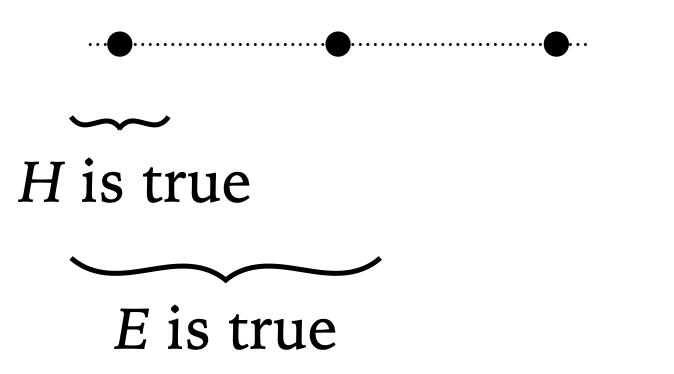
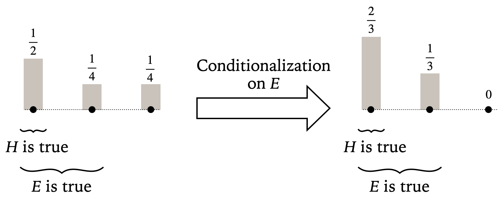
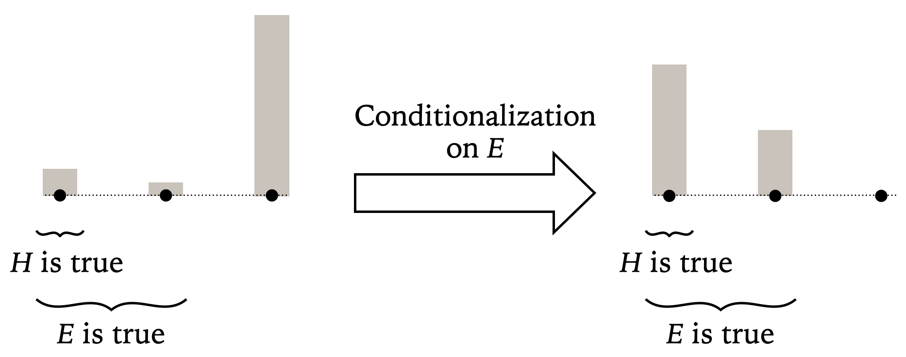

# Bayesian Epistemology
**First published Mon Jun 13, 2022**

*Lin, Hanti*

We can think of belief as an all-or-nothing affair. For example, I believe that I am alive, and I don’t believe that I am a historian of the Mongol Empire. However, often we want to make distinctions between *how strongly* we believe or disbelieve something. I strongly believe that I am alive, am fairly confident that I will stay alive until my next conference presentation, less confident that the presentation will go well, and strongly disbelieve that its topic will concern the rise and fall of the Mongol Empire. The idea that beliefs can come in different strengths is a central idea behind Bayesian epistemology. Such strengths are called *degrees of belief*, or *credences*. Bayesian epistemologists study norms governing degrees of beliefs, including how one’s degrees of belief ought to change in response to a varying body of evidence. Bayesian epistemology has a long history. Some of its core ideas can be identified in Bayes’ (1763) seminal paper in statistics (Earman 1992: ch. 1)[^earman-1992], with applications that are now very influential in many areas of philosophy and of science.

The present entry focuses on the more traditional, general issues about Bayesian epistemology, and, along the way, interested readers will be referred to entries that discuss the more specific topics. A tutorial on Bayesian epistemology will be provided in the first section for beginners and those who want a quick overview.

## 1. A Tutorial on Bayesian Epistemology

This section provides an introductory tutorial on Bayesian epistemology, with references to subsequent sections or related entries for details.

### 1.1 A Case Study

For a glimpse of what Bayesian epistemology is, let’s see what Bayesians have to say about this episode in scientific inquiry:

- *Example (Eddington’s Observation).* Einstein’s theory of General Relativity entails that light can be deflected by a massive body such as the Sun. This physical effect, predicted by Einstein in a 1911 paper, was observed during a solar eclipse on May 29, 1919, from locations chosen from Eddington’s two expeditions. This result surprised the physics community and was deemed a significant confirmation of Einstein’s theory.

The above case makes a general point:

- *The Principle of Hypothetico-Deductive Confirmation.* Suppose that a scientist is testing a hypothesis *H*. She deduces from it an empirical consequence *E*, and does an experiment, being not sure whether *E* is true. It turns out that she obtains *E* as new evidence as a result of the experiment. Then she ought to become more confident in *H*. Moreover, the more surprising the evidence *E* is, the higher the credence in *H* ought to be raised.

This intuition about how credences ought to change can be vindicated in Bayesian epistemology by appeal to two norms. But before turning to them, we need a setting. Divide the space of possibilities into four, according to whether hypothesis *H* is true or false and whether evidence *E* is true or false. Since *H* logically implies *E*, there are only three distinct possibilities on the table, which are depicted as the three dots in figure 1.

*Figure 1:* A Space of Three Possibilities. [An extended description of figure 1.]

Those possibilities are *mutually exclusive* in the sense that no two of them can hold together; and they are *jointly exhaustive* in the sense that at least one of them must hold. A person can be more or less confident that a given possibility holds. Suppose that it makes sense to say of a person that she is, say, 80% confident that a certain possibility holds. In this case, say that this person’s degree of belief, or credence, in that possibility is equal to 0.8. A credence might be any other real number. (How to make sense of real-valued credences is a major topic for Bayesians, to be discussed in §1.6 and §1.7 below.)

Now I can sketch the two core norms in Bayesian epistemology. According to the first norm, called *Probabilism*, one’s credences in the three possibilities in figure 1 ought to fit together so nicely that they are non-negative and sum to 1. Such a distribution of credences can be represented by a bar chart, as depicted on the left of figure 2.

*Figure 2:* Conditionalization on Evidence. [An extended description of figure 2.]

Now, suppose that a person with this credence distribution receives *E* as new evidence. It seems that as a result, there should be some change in credences. But how should they change? According to the second norm, called the *Principle of Conditionalization*, the possibility incompatible with *E* (i.e., the rightmost possibility) should have its credence dropped down to 0, and to satisfy Probabilism, the remaining credences should be scaled up—rescaled to sum to 1. So this person’s credence in hypothesis *H* has to rise in a way such as that depicted in figure 2.

Moreover, suppose that new evidence *E* is very surprising. It means that the person starts out being highly confident in the falsity of *E*, as depicted on the left of figure 3.

*Figure 3:* Conditionalization on Surprising Evidence. [An extended description of figure 3.]

Then conditionalization on *E* requires a total credence collapse followed by a dramatic scaling-up of the other credences. In particular, the credence in *H* is raised significantly, unless it is zero to begin with. This vindicates the intuition reported in the case of Eddington’s Observation.

### 1.2 Two Core Norms

The two Bayesian norms sketched above can be stated a bit more generally as follows. (A formal statement will be provided after this tutorial, in section 2.) Suppose that there are some possibilities under consideration, which are mutually exclusive and jointly exhaustive. A proposition under consideration is one that is true or false in each of those possibilities, so it can be identified with the set of the possibilities in which it is true. When those possibilities are finite in number, and when you have credences in all of them, Probabilism takes a simple form, saying that your credences ought to be probabilistic in this sense:

- (*Non-Negativity*) The credences assigned to the possibilities under consideration are non-negative real numbers.
- (*Sum-to-One*) The credences assigned to the possibilities under consideration sum to 1.
- (*Additivity*) The credence assigned to a proposition under consideration is equal to the sum of the credences assigned to the possibilities in that proposition.

While this norm is *synchronic* in that it constrains your credences at each time, the next norm is *diachronic*. Suppose that you just received a piece of evidence *E*, which is true in at least some possibilities under consideration. Suppose further that *E* exhausts all the evidence you just received. Then the Principle of Conditionalization says that your credences ought to change as if you followed the procedure below (although it is possible to design other procedures to the same effect):

- (*Zeroing*) For each possibility incompatible with evidence *E*, drop its credence down to zero.
- (*Rescaling*) For the possibilities compatible with evidence *E*, rescale their credences by a common factor to make them sum to 1.
- (*Resetting*) Now that there is a new credence distribution over the individual possibilities, reset the credences in propositions according to the Additivity rule in Probabilism.

The second step, rescaling, deserves attention. It is designed to ensure compliance with Probabilism, but it also has an independent, intuitive appeal. Consider any two possibilities in which new evidence *E* is true. Thus the new evidence alone cannot distinguish those two possibilities and, hence, it seems to favor the two equally. So it seems that, if a person starts out being twice as confident in one of those two possibilities as in the other, she should remain so after the credence change in light of *E*, as required by the rescaling step. The essence of conditionalization is preservation of certain ratios of credences, which is a feature inherited by generalizations of conditionalization (see section 5 for details).

So there you have it: Probabilism and the Principle of Conditionalization, which are held by most Bayesians to be the two core norms in Bayesian epistemology.

### 1.3 Applications

Bayesian epistemology features an ambition: to develop a simple normative framework that consists of little or nothing more than the two core Bayesian norms, with the goal of explaining or justifying a wide range of intuitively good epistemic practices and perhaps also of guiding our inquiries, all done with a focus on credence change. That sounds quite ambitious, given the narrow focus on credence change. But many Bayesians maintain that credence change is a unifying theme that underlies many different aspects of our epistemic endeavors. Let me mention some examples below.

First of all, it seems that a hypothesis *H* is *confirmed* by new evidence *E* exactly when one’s credence in *H* ought to increase in response to the acquisition of *E*. Extending that idea, it also seems that *how much* *H* is confirmed correlates with how much its credence ought to be raised. With those ideas in mind, Bayesians have developed several accounts of confirmation; see section 3 of the entry on confirmation. Through the concept of confirmation, some Bayesians have also developed accounts of closely related concepts. For example, being *supported by evidence* seems to be the same as or similar to being confirmed by evidence, which is ultimately explained by Bayesians in terms of credence change. So there are some Bayesian accounts of evidential support; see section 3 of the entry on Bayes’ theorem and sections 2.3–2.5 of the entry on imprecise probabilities. Here is another example: *how well* a theory *explains* a body of evidence seems to be closely related to how well the theory is confirmed by the evidence, which is ultimately explained by Bayesians in terms of credence change. So there are some Bayesian accounts of explanatory power; see section 2 of the entry on abduction.

The focus on credence change also sheds light on another aspect of our epistemic practices: inductive inference. An inductive inference is often understood as a process that results in the formation of an all-or-nothing attitude: believing or accepting the truth of a hypothesis *H* on the basis of one’s evidence *E*. That does not appear to fit the Bayesian picture well. But to Bayesians, what really matters is how new evidence *E* ought to change one’s credence in *H*—whether one’s credence ought to be *raised* or *lowered*, and by *how much*. To be sure, there is the issue of whether the resulting credence would be high enough to warrant the formation of the attitude of believing or accepting. But to many Bayesians, that issue seems only secondary, or better forgone as argued by Jeffrey (1970). If so, the fundamental issue about inductive inference is ultimately how credences ought to change in light of new evidence. So Bayesians have had much to say about various kinds of inductive inferences and related classic problems in philosophy of science. See the following footnote for a long list of relevant survey articles (or research papers, in cases where survey articles are not yet available).[^note-1]

For monographs on applications in epistemology and philosophy of science, see Earman (1992), Bovens & Hartmann (2004), Howson & Urbach (2006), and Sprenger & Hartmann (2019). In fact, there are also applications to natural language semantics and pragmatics: for indicative conditionals, see the survey by Briggs (2019: sec. 6 and 7) and sections 3 and 4.2 of the entry on indicative conditionals; for epistemic modals, see Yalcin (2012).

The applications mentioned above rely on the assumption of some or other norms for credences. Although the correct norms are held by most Bayesians to include at least Probabilism and the Principle of Conditionalization, it is debated whether there are more and, if so, what they are. It is to this issue that I now turn.

### 1.4 Bayesians Divided: What Does Coherence Require?

Probabilism is often regarded as a *coherence norm*, which says how one’s opinions ought to fit together on pain of incoherence. So, if Probabilism matters, the reason seems to be that coherence matters. This raises a question that divides Bayesians: *What does the coherence of credences require?* A typical Bayesian thinks that coherence requires at least that one’s credences follow Probabilism. But there are actually different versions of Probabilism and Bayesians disagree about which one is correct. Bayesians also disagree about whether the coherence of credences requires more than Probabilism and, if so, to what extent. For example, does coherence require that one’s credence in a *contingent* proposition lie strictly between 0 and 1? Another issue is what coherence requires of conditional credences, i.e., the credences that one has on the supposition of the truth of one or another proposition. Those and other related questions have far-reaching impacts on applications of Bayesian epistemology. For more on the issue of what coherence requires, see section 3.

### 1.5 Bayesians Divided: The Problem of the Priors

There is another issue that divides Bayesians. The package of Probabilism and the Principle of Conditionalization seems to explain well why one’s credence in General Relativity ought to rise in Eddington’s Observation Case. But that particular Bayesian explanation relies on a crucial feature of the case: the evidence *E* is *entailed* by the hypothesis *H* in question. But such an entailment is missing in many interesting cases, such as this one:

- *Example (Enumerative Induction).* After a day of field research, we observed one hundred black ravens without a counterexample. So the newly acquired evidence is *E* = “we have observed one hundred ravens and they all were black”. We are interested in this hypothesis *H* = “the next raven to be observed will be black”.

Now, should the credence in the hypothesis be increased or lowered, according to the two core Bayesian norms? Well, it depends. Note that in the present case *H* entails neither *E* nor its negation, so the possibilities in *H* can be categorized into two groups: those compatible with *E*, and those incompatible with *E*. As a result of conditionalization, the possibilities incompatible with *E* will have their credences be dropped down to zero; those compatible, scaled up. If the scaling up outweighs the dropping down for the possibilities inside *H*, the credence in *H* will rise and thus behave inductively; otherwise, it will stay constant or even go down and thus behave counter-inductively. So it all depends on the specific details of the *prior*, which is shorthand for the assignment of credences that one has before one acquires the new evidence in question. To sum up: Probabilism and the Principle of Conditionalization, alone, are too weak to entitle us to say whether one’s credence ought to change inductively or counter-inductively in the above example.

This point just made generalizes to most applications of Bayesian epistemology. For example, some coherent priors lead to enumerative induction and some don’t (Carnap 1955)[^carnap-1955], and some coherent priors lead to Ockham’s razor and some don’t (Forster 1995: sec. 3)[^forster-1995]. So, besides the coherence norms (such as Probabilism), are there any other norms that govern one’s prior? This is known as *the problem of the priors*.

This issue divides Bayesians. First of all, there is the party of *subjective Bayesians*, who hold that every prior is permitted unless it fails to be coherent. So, to those Bayesians, the correct norms for priors are exhausted by Probabilism and the other coherence norms if any. Second, there is the party of *objective Bayesians*, who propose that the correct norms for priors include not just the coherence norms but also a norm that codifies the epistemic virtue of freedom from bias. Those Bayesians think that freedom from bias requires at least that, roughly speaking, one’s credences be evenly distributed to certain possibilities unless there is a reason not to. This norm, known as *the Principle of Indifference*, has long been a source of controversy. Last but not the least, some Bayesians even propose to take seriously certain epistemic virtues that have been extensively studied in other epistemological traditions, and argue that those virtues need to be codified into norms for priors. For more on those attempted solutions to the problem of the priors, see section 4 below. Also see section 3.3 of the entry on interpretations of probability.

So far I have been mostly taking for granted the package of Probabilism and the Principle of Conditionalization. But is there any good reason to accept those two norms? This is the next topic.

### 1.6 An Attempted Foundation: Dutch Book Arguments

There have been a number of arguments advanced in support of the two core Bayesian norms. Perhaps the most influential is of the kind called *Dutch Book arguments*. Dutch Book arguments are motivated by a simple, intuitive idea: Belief guides action. So, the more strongly you believe that it will rain tomorrow, the more inclined you are, or ought to be, to bet on bad weather. This idea, which connects degrees of belief to betting dispositions, can be captured at least partially by the following:

- *A Credence-Betting Bridge Principle (Toy Version).* If one’s credence in a proposition *A* is equal to a real number *a*, then it is acceptable for one to buy the bet “Win $100 if *A* is true” at the price $\$100 \cdot a$ (and at any lower price).

This bridge principle might be construed as part of a definition or as a necessary truth that captures the nature of credences, or understood as a norm that jointly constrains credences and betting dispositions (Christensen 1996; Pettigrew 2020a: sec. 3.1)[^christensen-1996][^pettigrew-2020a]. The hope is that, through this bridge principle or perhaps a refined one, bad credences generate bad symptoms in betting dispositions. If so, a close look at betting dispositions might help us sort out bad credences from good ones. This is the strategy that underlies Dutch Book arguments.

To illustrate, consider an agent who has a .75 credence in proposition *A* and a .30 credence in its negation $\neg A$ (which violates Probabilism). Assuming the bridge principle stated above, the agent is willing to bet as follows:

- Buy “win $100 if *A* is true” at $\$75$.
- Buy “win $100 if $\neg A$ is true” at $\$30$.

So the agent is willing to accept *each* of those two offers. But it is actually very bad to accept *both* at the same time, for that leads to a sure loss (of $5):

|   | *A* is true | *A* is false |
| --- | --- | --- |
| buy “win $100 if *A* is true” at $75 | $-\$75 + \$100$ | $-\$75$ |
| buy “win $100 if $\neg A$ is true” at $30 | $-\$30$ | $-\$30 + \$100$ |
| net payoff | $-\$5$ | $-\$5$ |

So this agent’s betting dispositions make her susceptible to a set of bets that are individually acceptable but jointly inflict a sure loss. Such a set of bets is called a *Dutch Book*. The above agent is susceptible to a Dutch Book, which sounds bad for the agent. So what has gone wrong? The problem seems to be this: Belief guides action, and in this case, bad beliefs result in bad actions: garbage in, garbage out. Therefore, the agent should not have had the combination of credence .75 in $A$ and .30 in $\neg A$ to begin with—or so a Dutch Book argument would conclude.

The above line of thought can be generalized and turned into a template for Dutch Book arguments:

*A Template for Dutch Book Arguments*

- Premise 1. You should follow such and such a credence-betting bridge principle (or, due to the nature of credences, you do so necessarily).
- Premise 2. If you do, and if your credences violate constraint *C*, then provably you are susceptible to a Dutch Book.
- Premise 3. But you should not be so susceptible.
- Conclusion. So your credences should satisfy constraint *C*.

There is a Dutch Book argument for Probabilism (Ramsey 1926, de Finetti 1937)[^finetti-1937][^ramsey-1926]. The idea can be extended to develop an argument for the Principle of Conditionalization (Lewis 1999, Teller 1973)[^lewis-1999][^teller-1973]. Dutch Book arguments have also been developed for other norms for credences, but they require modifying the concept of a Dutch Book in one way or another. See section 3 for references.

An immediate worry about Dutch Book arguments is that a higher credence might not be correlated with a stronger disposition to bet. Consider a person who loathes very much the anxiety caused by placing a bet. So, though she is very confident in a proposition, she might still refuse to buy a bet on its truth even at a low price—and rightly so. This seems to be a counterexample to premise 1 in the above. For more on Dutch Book arguments, including objections to them as well as refinements of them, see the survey by Hájek (2009) and the entry on Dutch Book arguments.

There is a notable worry that applies even if we have a Dutch Book argument that is logically valid and only has true premises. A Dutch Book argument seems to give only a *practical* reason for accepting an *epistemic* norm: “Don’t have such and such combinations of credences, for otherwise there would be something bad pragmatically”. Such a reason seems unsatisfactory for those who wish to explain the correctness of the Bayesian norms with a reason that is distinctively epistemic or at least non-pragmatic. Some Bayesians still think that Dutch Book arguments are good, and address the present worry by trying to give a non-pragmatic reformulation of Dutch Book arguments (Christensen 1996; Christensen 2004: sec. 5.3)[^christensen-1996][^christensen-2004]. Some other Bayesians abandon Dutch Book arguments and pursue alternative foundations of Bayesian epistemology, to which I turn now.

### 1.7 Alternative Foundations

A second proposed type of foundation for Bayesian epistemology is based on the idea of *accurate estimation*. This idea has two parts: estimation, and its accuracy. On this approach, one’s credence in a proposition *A* is one’s *estimate* of the truth value of *A*, where *A*’s truth value is identified with 1 if it is true and 0 if it is false (Jeffrey 1986)[^jeffrey-1986]. The closer one’s credence in *A* is to the truth value of *A*, the *more accurate* one’s estimate is. Then a Bayesian may argue that one’s credences ought to be probabilistic, for otherwise the overall accuracy of one’s credence assignment would be *dominated*—namely, it would, come what may, be lower than the overall accuracy of another credence assignment that one could have adopted. To some Bayesians, this gives a distinctively epistemic reason or explanation why one’s credences ought to be probabilistic. The result is the so-called *accuracy-dominance* argument for Probabilism (Joyce 1998)[^joyce-1998]. This approach has also been extended to argue for the Principle of Conditionalization (Briggs & Pettigrew 2020)[^briggs-2020]. For more on this approach, see the entry on epistemic utility arguments for probabilism as well as Pettigrew (2016).

There is a third proposed type of foundation for Bayesian epistemology. It appeals to a kind of doxastic state called *comparative probability*, which concerns a person’s taking one proposition to be *more probable than*, or *as probable as*, or *less probable than* another proposition. On this approach, we postulate some bridge principles that connect one’s credences to one’s comparative probabilities. Here is an example of such a bridge principle: for any propositions *X* and *Y*, if *X* is equivalent to the disjunction of *two* incompatible propositions, each of which one takes to be more probable than *Y*, then one’s credence in *X* should be more than *twice* of that in *Y*. With such bridge principles, a Bayesian may argue from norms for comparative probabilities to norms for credences, such as Probabilism. See Fishburn (1986) for the historical development of this approach. See Stefánsson (2017) for a recent defense and development. For a general survey of this approach, see Konek (2019). This approach has been extended by Joyce (2003: sec. 4) to justify the Principle of Conditionalization.

The above are just some of the attempts to provide foundations for Bayesian epistemology. For more, see the surveys by Weisberg (2011: sec. 4) and Easwaran (2011).

There is a distinctive class of worries for all the three proposed foundations presented above, due to the fact that they rely on one or another account of the nature of credences. This is where Bayesian epistemology meets philosophy of mind. Recall that they try to understand credences in relation to some other mental states: (i) betting dispositions, (ii) estimates of truth values, or (iii) comparative probabilities. But those accounts of credences are apparently vulnerable to counterexamples. (An example was mentioned above: a person who dislikes the anxiety caused by betting seems to be a counterexample to the betting account of credences). For more on such worries, see Eriksson and Hájek (2007). For more on accounts of credences, see section 3.3 of the entry on interpretations of probability and section 3.4 of the entry on imprecise probabilities.

There is a fourth, *application-driven* style of argument for norms for credences that seems to be explicit or implicit in the minds of many Bayesians. The idea is that a good argument for the two core Bayesian norms can be obtained by appealing to applications. The goal is to account for a *comprehensive* range of intuitively good epistemic practices, all done with a *simple* set of general norms consisting of little or nothing more than the two core Bayesian norms. If this Bayesian normative system is so good that, of the known competitors, it strikes the best balance of those two virtues just mentioned—comprehensiveness and simplicity—then *that* is a good reason for accepting the two core Bayesian norms. In fact, the method just described is applicable to any norm, for credences or for actions, in epistemology or in ethics. Some philosophers argue that this method in its full generality, called *Reflective Equilibrium*, is the ultimate method for finding a good reason for or against norms (Goodman 1955; Rawls 1971)[^goodman-1955][^rawls-1971]. For more on this method and its controversies, see the entry on reflective equilibrium.

The above are some ways to argue for Bayesian norms. The rest of this introductory tutorial is meant to sketch some general objections, leaving detailed discussions to subsequent sections.

### 1.8 Objections to Conditionalization

The Principle of Conditionalization requires one to react to new evidence by conditionalizing on it. So this principle, when construed literally, appears to be silent on the case in which one receives *no* new evidence. That is, it seems to be too weak to require that one shouldn’t arbitrarily change credences when there is no new evidence. To remedy this, the Principle of Conditionalization is usually understood such that the case of no new evidence is identified with the limiting case in which one acquires a logical truth as trivial new evidence, which rules out no possibilities. In that case, conditionalization on the trivial new evidence lowers no credences, and thus rescales credences only by a factor of 1—no credence change at all—as desired. Once the Principle of Conditionalization is construed that way, it is no longer too weak, but then the worry is that it becomes too strong. Consider the following case, which Earman (1992) adapts from Glymour (1980):

- *Example (Mercury).* It is 1915. Einstein has just developed a new theory, General Relativity. He assesses the new theory with respect to some old data that have been known for at least fifty years: the anomalous rate of the advance of Mercury’s perihelion (which is the point on Mercury’s orbit that is closest to the Sun). After some derivations and calculations, Einstein soon recognizes that his new theory entails the old data about the advance of Mercury’s perihelion, while the Newtonian theory does not. Now, Einstein increases his credence in his new theory, and rightly so.

Note that, during his derivation and calculation, Einstein does not perform any experiment or collect any new astronomical data, so the body of his evidence seems to remain unchanged, only consisting of the old data. Despite gaining no new evidence, Einstein changes (in fact, raises) his credence in the new theory, and rightly so—against the usual construal of the Principle of Conditionalization. Therefore, there is a dilemma for that principle: when construed literally, it is too weak to prohibit arbitrary credence change; when construed in the usual way, it is too strong to accommodate Einstein’s credence change in the Mercury Case. This problem is *Earman’s problem of old evidence*.

The problem of old evidence is sometimes presented in a different way—in Glymour’s (1980) way—whose target of attack is not the Principle of Conditionalization but this:

- *Bayesian Confirmation Theory (A Simple Version).* Evidence *E* confirms hypothesis *H* for a person at a time if and only if, at that time, her credence in *H* would be raised if she were to conditionalize on *E* (whether or not she actually does that).

If *E* is an old piece of evidence that a person had received before, this person’s credence in *E* is currently 1. So, conditionalization on *E* at the present time would involve dropping no credence, followed by rescaling credences with a factor of 1—so there is no credence change at all. Then, by the Bayesian account of confirmation stated above, old evidence *E* must fail to confirm new theory *H*. But that result seems to be wrong because the old data about the advance of Mercury’s perihelion confirmed Einstein’s new theory; this is *Glymour’s problem of old evidence*, construed as a challenge to a Bayesian account of confirmation. But, if Earman (1992) is right, the Mercury Case challenges not just Bayesian confirmation theory, but actually cuts deeper, all the way to one of the two core Bayesian norms—namely, the Principle of Conditionalization—as suggested by Earman’s problem of old evidence. For attempted solutions to Earman’s old evidence problem (about conditionalization), see section 5.1 below. For more on Glymour’s old evidence problem (about confirmation), see section 3.5 of the entry on confirmation.

The above is just the beginning of a series of problems for the Principle of Conditionalization, which will be discussed after this tutorial, in section 5. But here is a rough sketch: The problem of old evidence arises when a new theory is developed to accommodate some old evidence. When the focus is shifted from old evidence to new theory, we shall discover another problem, no less thorny. Also note that the problem of old evidence results from a kind of inflexibility in conditionalization: no credence change is permitted without new evidence. Additional problems have been directed at other kinds of inflexibility in conditionalization, such as the preservation of fully certain credences. In response, some Bayesians defend the Principle of Conditionalization by trying to develop it into better versions, as you will see in section 5.

### 1.9 Objections about Idealization

Another worry is that the two core Bayesian norms are not the kind of norms that we ought to follow, in that they are too demanding to be actually followed by ordinary human beings—after all, *ought* implies *can*. More specifically, those Bayesian norms are often thought to be too demanding for at least three reasons:

1. (*Sharpness*) Probabilism demands that one’s credence in a proposition be extremely sharp, as sharp as an individual real number, precise to potentially infinitely many digits.
2. (*Perfect Fit*) Probabilism demands that one’s credences fit together nicely; for example, some credences are required to sum to exactly 1, no more and no less—a perfect fit. The Principle of Conditionalization also demands a perfect fit among three things: prior credences, posterior credences, and new evidence.
3. (*Logical Omniscience*) Probabilism is often thought to demand that one be *logically omniscient*, having credence 1 in every logical truth and credence 0 in every logical falsehood.

The last point, logical omniscience, might not be immediately clear from the preceding presentation, but it can be seen from this observation: A logical truth is true in all possibilities, so it has to be assigned credence 1 by Sum-to-One and Additivity in Probabilism.

So the worry is that, although Bayesians have a simple normative framework, they seem to enjoy the simplicity because they idealize away from the complications in humans’ epistemic endeavors and turn instead to normative standards that can be met only by highly idealized agents. If so, there are pervasive counterexamples to the two core Bayesian norms: all human beings. Call this *the problem of idealization*. For different ways of presenting this problem, see Harman (1986: ch. 3), Foley (1992: sec. 4.4), Pollock (2006: ch. 6), and Horgan (2017).

In reply, Bayesians have developed at least three strategies, which might complement each other. The first strategy is to *remove* idealization gradually, one step at a time, and explain why this is a good way of doing epistemology—just like this has long been taken as a good way of doing science. The second strategy is to explain why it makes sense for we human beings to *strive for* some ideals, including the ideals that the two core Bayesian norms point to, even though human beings cannot attain those ideals. The third strategy is to explain how the kind of idealization in question actually *empowers and facilitates* the applications of Bayesian epistemology in science (including especially scientists’ use of Bayesian statistics). For more on those replies to the problem of idealization, see section 6.

### 1.10 Concerns, or Encouragements, from Non-Bayesians

In the eyes of those immersed in the epistemology of all-or-nothing opinions such as believing or accepting propositions, Bayesians seem to say and care too little about many important and traditional issues. Let me give some examples below.

First of all, the more traditional epistemologists would like to see Bayesians engage with varieties of skepticism. For example, there is *Cartesian* skepticism, which is the view that we cannot know whether an external world, as we understand it through our perceptions, exists. There is also the *Pyrrhonian* skeptical worry that no belief can ever be justified because, once a belief is to be justified with a reason, the adduced reason is in need of justification as well, which kickstarts an infinite regress of justifications that can never be finished. Note that the above skeptical views are expressed in terms of knowledge and justification. So, the more traditional epistemologists would also like to hear what Bayesians have to say about *knowledge* and *justification*, rather than just norms for credences.

Second, the more traditional philosophers of science would like to see Bayesians contribute to some classic debates, such as the one between scientific realism and anti-realism. *Scientific realism* is, roughly, the view that we have good reason to believe that our best scientific theories are true, literally or approximately. But the anti-realists disagree. Some of them, such as the *instrumentalists*, think that we only have good reason to believe that our best scientific theories are good tools for certain purposes. Bayesians often compare the credences assigned to competing scientific theories, but one might like to see a comparison between, on the one hand, the credence that a certain theory *T* is true and, on the other hand, the credence that *T* is a good tool for such and such purposes.

Last but not least, frequentists about statistical inference would urge that Bayesians also think about a certain epistemic virtue, *reliability*, rather than focus exclusively on coherence. Namely, they would like to see Bayesians take seriously the analysis and design of reliable inference methods—reliable in the sense of having a low objective, physical chance of making errors.

To be sure, Bayesian epistemology was not initially designed to address the concerns just expressed. But those concerns need not be taken as objections, but rather as encouragements to Bayesians to explore new territories. In fact, Bayesians have begun such explorations in some of their more recent works, as you will see in the closing section, 7.

The above finishes the introductory tutorial on Bayesian epistemology. The following sections, as well as many other encyclopedia entries cited above, elaborate on one or another more specific topic in Bayesian epistemology. Indeed, the above tutorial only shows you what topics there are and aims to help you jump to the sections below, or to the relevant entries, that interest you.

## 2. A Bit of Mathematical Formalism

To facilitate subsequent discussions, a bit of mathematical formalism is needed. Indeed, the two core Bayesian norms were only stated above in a simple, finite setting (section 1.2), but there can be an infinity of possibilities under consideration. For example, think about this question: What’s the objective, physical chance for a carbon-14 atom to decay in 20 years? Every possible chance in the unit interval $[0, 1]$ is a possibility to which a credence can be assigned. So the two core Bayesian norms need to be stated in a more general way than above.

Let $\Omega$ be a set of possibilities that are mutually exclusive and jointly exhaustive. There is no restriction on the size of $\Omega$; it can be finite or infinite. Let $\cal A$ be a set of propositions identified with some subsets of $\Omega$. Assume that $\cal A$ contains $\Omega$ and the empty set $\varnothing$, and is closed under the standard Boolean operations: conjunction (intersection), disjunction (union), and negation (complement). This closure assumption means that, whenever $A$ and $B$ are in $\cal A$, so are their intersection $A \cap B$, union $A \cup B$, and complement $\Omega \mcomplement A$, which are often written in logical notation as conjunction $A \wedge B$, disjunction $A \vee B$, and negation $\neg A$. When $\cal A$ satisfies the assumption just stated, it is called an *algebra* of sets/propositions.[^note-2]

Let $\Cr$ be an assignment of credences to some propositions. We will often think of $\Cr(A)$ as denoting one’s credence in proposition $A$ and refer to $\Cr$ as one’s *credence function* or *credence assignment*. Next, we need a definition from probability theory:

- *Definition (Probability Measure).* A credence function $\Cr(\wcdot)$ is said to be *probabilistic*, also called a *probability measure*, if it is a real-valued function defined on an algebra ${\cal A}$ of propositions and satisfies the three axioms of probability:
- (*Non-Negativity*) $\Cr(A) \ge 0$ for every $A$ in $\cal A$.
- (*Normalization*) $\Cr(\Omega) = 1$.
- (*Finite Additivity*) $\Cr(A \cup B) = \Cr(A) + \Cr(B)$ for any two incompatible propositions (i.e., disjoint sets) $A$ and $B$ in $\cal A$.

Now Probabilism can be stated as follows:

- *Probabilism (Standard Version).* One’s assignment of credences at each time ought to be a probability measure.

When it is clear from the context that the credence assignment $\Cr$ is assumed to be probabilistic, it is often written $\Pr$ or $P$. The process of conditionalization can be defined as follows:

- *Definition (Conditionalization).* Suppose that $\Cr(E) \neq 0$. A (new) credence function $\Cr'(\wcdot)$ is said to be obtained from (old) credence function $\Cr(\wcdot)$ by *conditionalization* on $E$ if, for each $X \in {\cal A}$, $$\Cr'(X) = \frac{\Cr(X\cap E)}{\Cr(E)}.$$

Conditionalization changes the credence in $X$ from $\Cr(X)$ to $\Cr'(X)$, which can be understood as involving two steps:

$$\Cr(X) \ovrightarrow{(i)} \Cr(X \cap E) \ovrightarrow{(ii)} \frac{\Cr(X\cap E)}{\Cr(E)} = \Cr'(X) .$$

Transition (i) corresponds to the zeroing step in the informal presentation in section 1.2 of conditionalization; transition (ii), the rescaling step. Now the second norm can be stated as follows:

- *The Principle of Conditionalization (Standard Version).* One’s credences ought to change by and only by conditionalization on the new evidence received.

The two norms just stated reduce to the informal versions presented in the tutorial section 1.2 when $\Omega$ contains only finitely many possibilities and $\cal A$ is the set of all subsets of $\Omega$.

Let $\Cr(X \mid E)$ denote one’s credence in $X$ on the supposition of the truth of $E$ (whether or not one will actually receive $E$ as new evidence); it is also called credence in $X$ given $E$, or credence in $X$ conditional on $E$. So $\Cr(X \mid E)$ denotes a *conditional* credence, while $\Cr(X)$ denotes an *unconditional* one. The connection between those two kinds of credences is often expressed by

*The Ratio Formula*

$$\Cr(X\mid E) = \frac{\Cr(X \cap E)}{\Cr(E)} \quad\text{ if } \Cr(E) \neq 0.$$

It is debatable whether this formula should be construed as a definition or as a normative constraint. See Hájek (2003) for some objections to the definitional construal and for further discussion. $\Cr(X \mid E)$ is often taken as shorthand for the credence in $X$ that results from conditionalization on $E$, assuming that the Ratio Formula holds.

Many applications of Bayesian epistemology make use *Bayes’ theorem*. It has different versions, of which two are particularly simple:

- *Bayes’ Theorem (Simplest Version).* Suppose that $\Cr$ is probabilistic and assigns nonzero credences to $H$ and $E$, and that the Ratio Formula holds.[^note-3] Then we have: $$ \Cr(H\mid E) = \frac{\Cr(E \mid H) \cdot \Cr(H)}{\Cr(E)} . $$

- *Bayes’ Theorem (Finite Version).* Suppose further that hypotheses $H_1, \ldots, H_N$ are mutually exclusive and finite in number, and that each is assigned a nonzero credence and their disjunction is assigned credence 1 by $\Cr$. Then we have: $$ \Cr(H_i\mid E) = \frac{\Cr(E \mid H_i) \cdot \Cr(H_i)}{\sum_{j=1}^{N} \Cr(E \mid H_j) \cdot \Cr(H_j)} . $$

This theorem is often useful for calculating credences that result from conditionalization on evidence $E$, which are represented on the left side of the formula. Indeed, this theorem is very useful and important in statistical applications of Bayesian epistemology (see section 3.5 below). For more on the significance of this theorem, see the entry on Bayes’ theorem. But this theorem is not essential to some other applications of Bayesian epistemology. Indeed, the case studies in the tutorial section make no reference to Bayes’ theorem. As Earman (1992: ch. 1) points out in his presentation of Bayes’ (1763) seminal essay, Bayesian epistemology is *Bayesian* not really because Bayes’ theorem is used in a certain way, but because Bayes’ essay already contains the core ideas of Bayesian epistemology: Probabilism and the Principle of Conditionalization.

Here are some introductory textbooks on Bayesian epistemology (and related topics) that include presentations of elementary probability theory: Skyrms (1966 [2000]), Hacking (2001), Howson & Urbach (2006), Huber (2018), Weisberg (2019 [Other Internet Resources]), and Titelbaum (forthcoming).

## 3. Synchronic Norms (I): Requirements of Coherence

A coherence norm states how one’s opinions ought to fit together on pain of incoherence. Most Bayesians agree that the correct coherence norms include at least Probabilism, but they disagree over which version of Probabilism is right. There is also the question of whether there are correct coherence norms that go beyond Probabilism and, if so, what they are. Those issues were only sketched in the tutorial section 1.4. They will be detailed in this section.

To argue that a certain norm is not just correct but ought to be followed *on pain of incoherence*, Bayesians traditionally proceed by way of a Dutch Book argument (as presented in the tutorial section 1.6). For the susceptibility to a Dutch Book is traditionally taken by Bayesians to imply one’s personal incoherence. So, as you will see below, the norms discussed in this section have all been defended with one or another type of Dutch Book argument, although it is debatable whether some types are more plausible than others.

### 3.1 Versions of Probabilism

Probabilism is often stated as follows:

- *Probabilism (Standard Version).* One’s assignment of credences ought to be probabilistic in this sense: it is a probability measure.

This norm implies that one should have a credence in a logical truth (indeed, a credence of 1) and that, when one has credences in some propositions, one should *also* have credences in their conjunctions, disjunctions, and negations. So Probabilism in its standard version asks one to have credences in certain propositions. But that seems to be in tension with the fact that Probabilism is often understood as a *coherence* norm. To see why, note that coherence is a matter of fitting things together nicely. So coherence is supposed to put a constraint on the combinations of attitudes that one may have, *without* saying that one must have an attitude toward such and such propositions—contrary to the above version of Probabilism. If so, the right version of Probabilism must be weak enough to allow the absence of some credences, also called *credence gaps*.

The above line of thought has led some Bayesians to develop and defend a weaker version of Probabilism (de Finetti 1970 [1974], Jeffrey 1983, Zynda 1996)[^finetti-1970][^jeffrey-1983][^zynda-1996]:

- *Probabilism (Extensibility Version).* One’s assignment of credences ought to be probabilistically extensible in this sense: either it is already a probability measure, or it can be turned into a probability measure by assigning new credences to some more propositions without changing the existing credences.

It is the second disjunct that allows credence gaps. De Finetti (1970 [1974: sec. 3]) also argues that, when the Dutch Book argument for Probabilism is carefully examined, it can be seen to support only the extensibility version rather than the standard one. His idea is to adopt a liberal conception of betting dispositions: one is permitted to lack any betting disposition about a proposition, which in turn permits one to lack a credence in that proposition.

The above two versions of Probabilism are still similar in that they both imply that any credence ought to be sharp—being an individual real number. But some Bayesians maintain that coherence does not require that much but allows credences to be *unsharp* in a certain sense. An even weaker version of Probabilism has been developed accordingly, defended with a Dutch Book argument that works with a more liberal conception of betting dispositions than mentioned above (Smith 1961; Walley 1991: ch. 2 and 3)[^smith-1961][^walley-1991]. See supplement A for some non-technical details. Bayesians actually disagree over whether coherence allows credences to be unsharp. For this debate, see the survey by Mahtani (2019) and the entry on imprecise probabilities.

### 3.2 Countable Additivity

Probabilism, as stated in section 2, implies Finite Additivity, the norm that one’s credence in the disjunction of two incompatible disjuncts ought to be equal to the sum of the credences in those two disjuncts. Finite Additivity can be naturally strengthened as follows:

- *Countable Additivity.* It ought to be that, for any propositions $A_1,$ $A_2,$…, $A_n,$… that are mutually exclusive, if one has credences in those propositions and in their disjunction $\bigcup_{n=1}^{\infty} A_n$, then one’s credence function $\Cr$ satisfies the following formula: $$\Cr\left( \bigcup_{n=1}^{\infty} A_n \right) = \sum_{n = 1}^{\infty} \Cr\left(A_n\right).$$

Countable Additivity has extensive applications, both in statistics and in philosophy of science; for a concise summary and relevant references, see J. Williamson (1999: sec. 3).

Although Countable Additivity is a natural strengthening of Finite Additivity, the former is much more controversial. De Finetti (1970 [1974]) proposes a counterexample:

- *Example (Infinite Lottery).* There is a fair lottery with a countable infinity of tickets. Since it is fair, there is one and only one winning ticket, and all tickets are equally likely to win. For an agent taking all those for granted (i.e., with full credence), what should be her credence in the proposition $A_n$ that the *n*-th ticket will win?

The answer seems to be 0. To see why, note that all those propositions $A_n$ should be assigned equal credences $c$, by the fairness of the lottery. Then it is not hard to show that, in order to satisfy Probabilism, a positive $c$ is too high and a negative $c$ is too low.[^note-4] So, by Probabilism, the only alternative is $c = 0$. But this result violates Countable Additivity: by the fairness of the lottery, the left side is

$$\Cr\left(\bigcup_{n = 1}^{\infty} A_n\right) = 1,$$

but the right side is

$$\sum_{n = 1}^{\infty} \Cr\left(A_n\right) = \sum_{n=1}^{\infty} c = 0.$$

De Finetti thus concludes that this is a counterexample to Countable Additivity. For closely related worries about Countable Additivity, see Kelly (1996: ch. 13) and Seidenfeld (2001). Also see Bartha (2004: sec. 3) for discussions and further references.

Despite the above controversy, attempts have been made to argue for Countable Additivity, partly because of the interest in saving its extensive applications. For example, J. Williamson (1999) defends the idea that there is a good Dutch Book argument for Countable Additivity even though the Dutch Book involved has to contain a countable infinity of bets and the agent involved has to be able to accept or reject that many bets. Easwaran (2013) provides further defense of the Dutch Book argument for Countable Additivity (and another argument for it). The above two authors also argue that the Infinite Lottery Case only appears to be a counterexample to Countable Additivity and can be explained away.

It is debatable whether we really need to defend Countable Additivity in order to save its extensive applications. Bartha (2004) thinks that the answer is negative. He argues that, even if Countable Additivity is abandoned due to the Infinite Lottery Case, this poses no serious threat to its extensive applications.

### 3.3 Regularity

A contingent proposition is true in some cases, while a logical falsehood is true in no cases at all. So perhaps the credence in the former should always be greater than the credence in the latter, which must be 0. This line of thought motivates the following norm:

- *Regularity.* It ought to be that, if one has a credence in a logically consistent proposition, it is greater than 0.

Regularity has been defended with a Dutch Book argument—a somewhat nonstandard one. Kemeny (1955) and Shimony (1955) show that any violation of Regularity opens the door to a nonstandard, *weak* Dutch Book, which is a set of bets that guarantees no gain but has a possible loss. In contrast, a standard Dutch Book has a sure loss. This raises the question whether it is really so bad to be vulnerable to a weak Dutch Book.

One might object to Regularity on the ground that it is in conflict with Conditionalization. To see the conflict, note that conditionalization on a contingent proposition $E$ drops the credence in another contingent proposition, $\neg E$, down to zero. But that violates Regularity. In reply, defenders of Regularity can replace conditionalization by a generalization of it called *Jeffrey Conditionalization*, which need not drop any credence down to zero. Jeffrey Conditionalization will be defined and discussed in section 5.3.

There is a more serious objection to Regularity. Consider the following case:

- *Example (Coin).* An agent is interested in the *bias* of a certain coin—the objective, physical chance for that coin to land heads when tossed. This agent’s credences are *distributed uniformly* over the possible biases of the coin. This means that her credence in “the bias falls within interval $[a, b]$” is equal to the length of the interval, $b-a$, provided that the interval is nested within $[0, 1]$. Now think about “the coin is fair”, which says that the bias is equal to 0.5, i.e., that the bias falls within the trivial interval $[0.5, 0.5]$. So “the coin is fair” is assigned credence $0.5 - 0.5$, which equals 0 and violates Regularity.

But there seems to be nothing incoherent in this agent’s credences.

One possible response is to insist on Regularity and hold that the agent in the Coin Case is actually incoherent in a subtle way. Namely, that agent’s credence in “the coin is fair” should not be zero but should be an *infinitesimal*—smaller than any positive real number but still greater than zero (Lewis 1980)[^lewis-1980]. On this view, the fault lies not with Regularity but with the standard version of Probabilism, which needs to be relaxed to permit infinitesimal credences. For worries about this appeal to infinitesimals, see Hájek (2012) and Easwaran (2014). For a survey of infinitesimal credences/probabilities, see Wenmackers (2019).

The above response to the Coin Case implements a general strategy. The idea is that some doxastic states are so nuanced that even real numbers are too coarse-grained to distinguish them, so real-valued credences need to be supplemented with *something else* for a better representation of one’s doxastic states. The above response proposes that the supplement be *infinitesimal credences*. A second response proposes, instead, that the supplement be *comparative probability*, with a very different result: abandoning Regularity rather than saving it.

This second response can be developed as follows. While being assigned a higher numerical credence implies being taken as more probable, being assigned the same numerical credence does not really imply being taken as equally probable. That is, (real-valued) numerical credences actually do not have enough structure to represent everything there is in a qualitative ordering of comparative probability, as Hájek (2003) suggests. So, in the Coin Case, the contingent proposition “the coin is fair” is assigned credence 0, the same credence as a logical falsehood is assigned. But it does not mean that those two propositions, one contingent and one self-contradictory, should be taken as equally probable. Instead, the contingent proposition “the coin is fair” should still be taken as more probable than a logical falsehood. That is, the following norm still holds:

- *Comparative Regularity.* It ought to be that, whenever one has a judgment of comparative probability between a contingent proposition and a logical falsehood, the former is taken to be more probable than the latter.

So, although the second response bites the bullet and abandons Regularity (due to the Coin Case), it manages to settle on a variant, Comparative Regularity. But even Comparative Regularity can be challenged: see T. Williamson (2007) for a putative counterexample. And see Haverkamp and Schulz (2012) for a reply in support of Comparative Regularity.

Note that the second response makes use of one’s ordering of comparative probability, which can be too nuanced to be fully captured by real-valued credences. As it turns out, such an ordering can still be fully captured by real-valued *conditional* credences (as explained in supplement B), provided that it makes sense for a person to have a credence in a proposition conditional on a *zero-credence* proposition. It is to this kind of conditional credence that I now turn.

### 3.4 Norms of Conditional Credences

In Bayesian epistemology, a doxastic state is standardly represented by a credence assignment $\Cr$, with conditional credences characterized by

*The Ratio Formula*

$$ \Cr(A\mid B) = \frac{\Cr(A \cap B)}{\Cr(B)}\quad \text{ if } \Cr(B) \neq 0.$$

The Ratio Formula might be taken to define conditional credences (on the left) in terms of unconditional credences (on the right), or be taken as a normative constraint on those two kinds of mental states without defining one by the other. See Hájek (2003) for some objections to the definitional construal and for further discussion.

Whether the Ratio Formula is construed as a definition or a norm, it applies only when the conditioning proposition $B$ is assigned a nonzero credence: $\Cr(B) \neq 0$. But perhaps this qualification is too restrictive:

- *Example (Coin, Continued).* Conditional on “the coin is fair”, the agent has a 0.5 credence in “the coin will land heads the next time it is tossed”—and rightly so. But this agent assigns a *zero* credence in the conditioning proposition, “the coin is fair”, as in the previous Coin Case.

This 0.5 conditional credence seems to make perfect sense, but it eludes the Ratio Formula. Worse, the above case is not rare: the above conditional credence is a credence in an event conditional on a statistical hypothesis, and such conditional credences, often called *likelihoods*, have been extensively employed in statistical applications of Bayesian epistemology (as will be explained in section 3.5).

There are three possible ways out. They differ in the importance they attribute to the Ratio Formula as a stand-alone norm. So you can expect a reformatory approach which takes it to be unimportant, a conservative one which retains its importance, and a middle way between the two.

On the *reformatory* approach, the Ratio Formula is no longer important and, instead, is derived as a mere consequence of something more fundamental. While the standard Bayesian view takes norms of unconditional credences to be fundamental and then uses the Ratio Formula as a bridge to conditional credences, the reformatory approach reverses the direction, taking norms of conditional credences as fundamental. Following Popper (1959) and Rényi (1970), this idea can be implemented with a version of Probabilism designed directly for conditional credences:

- *Probabilism (Conditional Version).* It ought to be that one’s assignment of conditional credences $\Cr( \wcdot \mid \wcdot)$ is a Popper-Rényi function over an algebra ${\cal A}$ of propositions, namely, a function satisfying the following axioms:
- (*Probability*) For any logically consistent proposition $A \in {\cal A}$ held fixed, $\Cr( \wcdot \mid A)$ is a probability measure on ${\cal A}$ with $\Cr( A \mid A) = 1$.
- (*Multiplication*) For any propositions $A$, $B$, and $C$ in ${\cal A}$ such that $B \cap C$ is logically consistent, $$\Cr(A\cap B \mid C) = \Cr(A \mid B \cap C) \cdot \Cr(B \mid C) .$$

This approach is often called the approach of *coherent conditional probability*, because it seeks to impose coherence constraints directly on conditional credences without a detour through unconditional credences. Once those constraints are in place, one may then add a constraint—normative or definitional—on unconditional credences:

$$\Cr(A) = \Cr(A \mid \top),$$

where $\top$ is a logical truth. From the above we can derive the Ratio Formula and the standard version of Probabilism. See Hájek (2003) for a defense of this approach. A Dutch Book argument for the conditional version of Probabilism is developed by Stalnaker (1970).

In contrast to the reformatory nature of the above approach, the second one is *conservative*. On this approach, the Ratio Formula is sufficient by itself as a norm (or definition) for conditional credences. It makes sense to have a credence conditional on “the coin is fair” because one’s credence in that conditioning proposition ought to be an infinitesimal rather than zero. This approach may be called the approach of *infinitesimals*. It forms a natural package with the infinitesimal approach to saving Regularity from the Coin Case, which was discussed in section 3.3.

Between the conservative and the reformatory, there is the *middle* way, due to Kolmogorov (1933). The idea is to think about the cases where the Ratio Formula applies, and then use them to “approximate” the cases where it does not apply. If this can be done, then although the Ratio Formula is not all there is to norms for conditional credences, it comes close. To be more precise, when we try to conditionalize on a zero-credence proposition $B$, we can approximate $B$ by a sequence of propositions $B_1,$ $B_2,$… such that:

- those propositions $B_1, B_2, \ldots$ are progressively more specific (i.e., $B_i \supset B_{i+1}$),
- they jointly say what $B$ says (i.e., $\bigcap_{i=1}^{\infty} B_i = B$).

In that case, it seems tempting to accept the norm or definition that conditionalization on $B$ be approximated by successive conditionalizations on $B_1, B_2, \ldots$, or in symbols:

$$\Cr(A \mid B) = \lim_{i \to \infty}\Cr(A \mid B_i),$$

where each term $\Cr(A \mid B_i)$ is governed by the Ratio Formula because $\Cr(B_i)$ is nonzero by design. An important consequence of this approach is that, when one chooses a different sequence of propositions to approximate $B$, the limit of conditionalizations might be different, and, hence, a credence conditional on $B$ is, or ought to be, relativized to how one presents $B$ as the limit of a sequence of approximating propositions. This relativization is often illustrated with what’s called the *Borel-Kolmogorov paradox*; see Rescorla (2015) for an accessible presentation and discussion. Once the mathematical details are refined, this approach becomes what’s known as the theory of *regular conditional probability*.[^note-5] A Dutch Book argument for this way of assigning conditional credences is developed by Rescorla (2018).

For a critical comparison of those three approaches to conditional credences, see the survey by Easwaran (2019).

### 3.5 Chance-Credence Principles

Recall the Coin Case discussed above: one’s credence in “the coin will land heads the next time it is tossed” conditional on “the coin is fair” is equal to 0.5. This 0.5 conditional credence seems to be the only permissible alternative until the result of the next coin toss is observed. This example suggests a general norm, which connects chances to conditional credences:

- *The Principal Principle/Direct Inference Principle.* Let $\Cr$ be one’s prior, i.e., the credence assignment that one has at the beginning of an inquiry. Let $E$ be the event that such and such things will happen at a certain future time. Let $A$ be a proposition that entails $\Ch(E) = c$, which says that the chance for $E$ to come out true is equal to $c$. Then one’s prior $\Cr$ ought to be such that $\Cr(E \mid A) = c$, if $A$ is an “ordinary” proposition in that it is logically equivalent to the conjunction of $\Ch(E) = c$ with an “admissible” proposition.

The if-clause refers to “admissible” propositions, which are roughly propositions that give no more information about whether or not $E$ is true than is already contained in $\Ch(E) = c$. To see why we need the qualification imposed by the if-clause, suppose for instance that the event $E$ is “the coin will land heads the next time it is tossed”. If the conditioning proposition $A$ is “the coin is fair”, it is a paradigmatic example of an “ordinary” proposition. This reproduces the Coin Case, with the conditional credence being the chance 0.5. Alternatively, if the conditioning proposition $A$ is the conjunction of “the coin is fair” and $E$, then the conditional credence $\Cr(E \mid A)$ should be 1 rather than the 0.5 chance of $E$ that $A$ entails. After all, to be given this $A$ is to be given a lot of information, which entails $E$. So this case is supposed to be ruled out by an account of “admissible” propositions. Lewis (1980) initiates a systematic quest for such an account, which has invited counterexamples and responses. See Joyce (2011: sec. 4.2) for a survey.

The Principal Principle has been defended with an argument based on considerations about the accuracies of credences (Pettigrew 2012)[^pettigrew-2012], and with a nonstandard Dutch Book argument (Pettigrew 2020a: sec. 2.8)[^pettigrew-2020a].

The Principal Principle is important perhaps mainly because of its extensive applications in Bayesian statistics, in which this principle is more often called the Direct Inference Principle. To illustrate, suppose that you are somehow certain that one of the following two hypotheses is true: $H_1 =$ “the coin has a bias 0.4” and $H_2 =$ “the coin has a bias 0.6”, which are paradigmatic examples of “ordinary” hypotheses. Then your credence in the first hypothesis $H_1$ given evidence $E$ that the coin lands heads ought to be expressible as follows:[^note-6]

$$\begin{align} \Cr(H_1 \mid E) &= \frac{ \Cr(E \mid H_1) \cdot \Cr(H_1) }{ \sum_{i =1}^2 \Cr(E \mid H_i) \cdot \Cr(H_i) } &{\text{by Bayes' Theorem}\\ \text{(as stated in §2)}} \\ &= \frac{ 0.4 \cdot \Cr(H_1) }{ 0.4 \cdot \Cr(H_1) + 0.6 \cdot \Cr(H_2) } &{\text{by the Principal}\\ \text{Principle}} \end{align}$$

So Bayes’ Theorem works by expressing posterior credences in terms of some prior credences $\Cr(H_i)$ and some prior conditional credences $\Cr(E \mid H_i)$. The latter, called *likelihoods*, are *subjective* opinions, but they can be replaced by *objective* chances thanks to the Principal Principle. So this principle is often taken to be an important way to reduce some subjective factors in the Bayesian account of scientific inference. For discussions of other subjective factors, see section 4.1.

Even though the Principal Principle has important, extensive applications in Bayesian statistics as just explained, de Finetti (1970 [1974]) argues that it is actually dispensable and thus need not be accepted as a norm. To be more specific, he argues that the Principal Principle is dispensable in a way that changes little of the actual practice of Bayesian statistics. His argument relies on his *exchangeability theorem*. See Gillies (2000: 69–82) for a non-technical introduction to this topic; also see Joyce (2011: sec. 4.1) for a more advanced survey.

### 3.6 Reflection and Other Deference Principles

We have just discussed the Principal Principle, which in a sense asks one to defer to a kind of expert (Gaifman 1986)[^gaifman-1986]: the chance of an event $E$ can be understood as an expert at predicting whether $E$ will come out true. So, conditional on that expert’s saying so and so about $E$, one’s opinion ought to defer to that expert. Construed that way, the Principal Principle is a kind of *deference principle*. There can be different deference principles, referring to different kinds of experts.

Here is another example of a deference principle, proposed by van Fraassen (1984):

- *The Reflection Principle.* One’s credence at any time $t_1$ in a proposition $A$, conditional on the proposition that one’s future credence at $t_2$ $(> t_1)$ in $A$ will be equal to $x$, ought to be equal to $x$; or put symbolically: $$\Cr_{t_1}( A \mid \Cr_{t_2}(A) = x ) = x.$$ More generally, it ought to be that $$\Cr_{t_1}( A \mid \Cr_{t_2}(A) \in [x, x'] ) \in [x, x'].$$

Here, one’s future self is taken as an expert to which one ought to defer. The Reflection Principle admits of a Dutch Book argument (van Fraassen 1984)[^fraassen-1984]. There is another way to defend the Reflection Principle: this synchronic norm is argued to follow from the *synchronic* norm that one ought, at any time, to be fully certain that one will follow the *diachronic* Principle of Conditionalization (as suggested by Weisberg’s 2007 modification of van Fraassen’s 1995 argument)[^fraassen-1995][^weisberg-2007].

The Reflection Principle has invited some putative counterexamples. Here is one, adapted from Talbott (1991):

- *Example (Dinner).* Today is March 15, 1989. Someone is very confident that she is now having spaghetti for dinner. She is also very confident that, on March 15, 1990 (exactly one year from today), she will have completely forgotten what she is having for dinner now.

So, this person’s current assignment of credences $\Cr_\textrm{1989}$ has the following properties, where $A$ is the proposition that she has spaghetti for dinner on March 15, 1989:

$$\begin{align} \Cr_\textrm{1989} \big( A \big) &= \text{high} \\ \Cr_\textrm{1989} \Big( \Cr_\textrm{1989+1}(A) \mbox{ is low} \Big) &= \text{high} . \end{align}$$

But conditionalization on a proposition with a high credence can only slightly change the credence assignment. For such a conditionalization involves lowering just a small bit of credence down to zero and hence it only requires a slight rescaling, by a factor close to 1. So, assuming that $\Cr$ is a probability measure, we have:

$$ \Cr_\textrm{1989} \Big( A \Bigm\vert \Cr_\textrm{1989+1}(A) \mbox{ is low} \Big) = \text{still high} , $$

which violates the Reflection Principle.

The Dinner Case serves as a putative counterexample to the Reflection Principle by allowing one to suspect that one will lose some memories. So it allows one to have a specific kind of *epistemic self-doubt*—to doubt one’s own ability to achieve or retain an epistemically favorable state. In fact, some are worried that the Reflection Principle is generally incompatible with epistemic self-doubt, which seems rational and permissible. For more on this worry, see the entry on epistemic self-doubt.

## 4. Synchronic Norms (II): The Problem of the Priors

Much of what Bayesians have to say about confirmation and inductive inference depends crucially on the norms that govern one’s prior credences (the credences that one has at the beginning of an inquiry). But what are those norms? This is known as the *problem of the priors*. Some potential solutions were only sketched in the tutorial section 1.5. They will be detailed in this section.

### 4.1 Subjective Bayesianism

Subjective Bayesianism is the view that every prior is permitted unless it fails to be coherent (de Finetti 1970 [1974]; Savage 1972; Jeffrey 1965; van Fraassen 1989: ch. 7)[^finetti-1970][^jeffrey-1965][^savage-1972][^fraassen-1989]. Holding that view as the common ground, subjective Bayesians often disagree over what coherence requires (which was the topic of the preceding section 3).

The most common worry for subjective Bayesianism is that, on that view, anything goes. For example, under just Probabilism and Regularity, there is a prior that follows enumerative induction and there also is a prior whose posterior never generalizes from data, defying enumerative induction (see Carnap 1955 for details, but see Fitelson 2006 for a concise presentation)[^carnap-1955][^fitelson-2006]. Under just Probabilism and the Principal Principle, there is a prior that follows Ockham’s razor in statistical model selection but there also is a prior that does not (Forster 1995: sec. 3; Sober 2002: sec. 6)[^forster-1995][^sober-2002].[^note-7] So, although subjective Bayesianism does not really say that anything goes, it seems to permit too much, failing to account for some important aspects of scientific objectivity—or so the worry goes. Subjective Bayesians have replied with at least two strategies.

Here is one: argue that, despite appearances, coherence alone captures everything there is to scientific objectivity. For example, it might be argued that it is actually correct to permit a wide range of priors, for people come with different background opinions and it seems wrong—objectively wrong—to require all of them to change to the same opinion at once. What ought to be the case is, rather, that people’s opinions be brought closer and closer to each other as their shared evidence accumulates. This idea of *merging-of-opinions* as a kind of scientific objectivity can be traced back to Peirce (1877), although he develops this idea for the epistemology of all-or-nothing beliefs rather than credences. Some subjective Bayesians propose to develop this Peircean idea in the framework of subjective Bayesianism: to have the ideal of merging-of-opinions be derived as a norm—derived solely from coherence norms. That is, they prove so-called *merging-of-opinions theorems* (Blackwell & Dubins 1962; Gaifman & Snir 1982)[^blackwell-1962][^gaifman-1982]. Such a theorem states that, under such and such contingent initial conditions together with such and such coherence norms, two agents must be *certain* that their credences in the hypotheses under consideration will merge with each other *in the long run* as the shared evidence accumulates indefinitely.

The above theorem is stated with two italicized parts, which are the targets of some worries. The merging of the two agents’ opinions might not happen and is only believed with certainty to happen in the long run. And the long run might be too long. There is another worry: the proof of such a theorem requires Countable Additivity as a norm of credences, which is controversial, as was discussed in section 3.2. See Earman (1992: ch. 6) for more on those worries.[^note-8] For a recent development of merging-of-opinions theorems and a defense of their use, see Huttegger (2015).

Whether or not merging-of-opinions theorems can capture the intended kind of scientific objectivity, it is still debated whether there are other kinds of scientific objectivity that elude subjective Bayesianism. For more on this issue, see section 4.2 of the entry on scientific objectivity, Gelman & Hennig (2017) (including peer discussions), Sprenger (2018), and Sprenger & Hartmann (2019: ch. 11).

Here is a second strategy in defense of scientific objectivity for subjective Bayesians: distance themselves from any substantive theory of inductive inference and hold instead that Bayesian epistemology can be construed as a kind of deductive logic. This view draws on some parallel features between deductive logic and Bayesian epistemology. First, the coherence of credences can be construed as an analogue of the logical consistency of propositions or all-or-nothing beliefs (Jeffrey 1983)[^jeffrey-1983]. Second, just as premises are inputs into a deductive reasoning process, prior credences are inputs into the process of an inquiry. And, just as the job of deductive logic is not to say what premises we should have except that they be logically consistent, Bayesian epistemology need not say what prior credences we should have except that they be coherent (Howson 2000: 135–145)[^howson-2000]. Call this view the *deductive construal* of Bayesian epistemology, for lack of a standard name.

Yet it might be questioned whether the above parallelism really works in favor of subjective Bayesianism. Just as substantive theories of inductive inferences have been developed with deductive logic as their basis, to take the parallelism seriously it seems that there should also be a substantive account of inductive inferences with the deductive construal of Bayesian epistemology as their basis. Indeed, the anti-subjectivists to be discussed below—objective Bayesians and forward-looking Bayesians—all think that a substantive account of inductive inferences is furnished by norms that go beyond the consideration of coherence. It is to such a view that I turn now. But for more on subjective Bayesianism, see the survey by Joyce (2011).

### 4.2 Objective Bayesianism

*Objective Bayesians* contend that, in addition to coherence, there is another epistemic virtue or ideal that needs to be codified into a norm for prior credences: freedom from bias and avoidance of overly strong opinions (Jeffreys 1939; Carnap 1945; Jaynes 1957, 1968; Rosenkrantz 1981; J. Williamson 2010)[^carnap-1945][^jaynes-1957][^jaynes-1968][^jeffreys-1939][^rosenkrantz-1981][^williamson-2010]. This view is often motivated by a case like this:

- *Example (Six-Faced Die).* Suppose that there is a cubic die with six faces that look symmetric, and we are going to toss it. Suppose further that we have no other idea about this die. Now, what should our credence be that the die will come up 6?

An intuitive answer is $1/6$, for it seems that we ought to distribute our credences evenly, with an equal credence, $1/6$, in each of the six possible outcomes. While subjective Bayesians would only say that we *may* do so, objective Bayesians would make the stronger claim that we *ought* to do so. More generally, objective Bayesians are sympathetic to this norm:

- *The Principle of Indifference.* A person’s credences in any two propositions should be equal if her total evidence no more supports one than the other (the *evidential symmetry* version), or if she has no sufficient reason to have a higher credence in one than in the other (the *insufficient reason* version).

A standard worry about the Indifference Principle comes from *Bertrand’s paradox*. Here is a simplified version (adapted from van Fraassen 1989)[^fraassen-1989]:

- *Example (Square).* Suppose that there is a square and that we know for sure that its side length is between 1 and 4 centimeters. Suppose further that we have no other idea about that square. Now, how confident should we be that the square has a side length between 1 and 2 centimeters?

Now, have a look at the two groups of propositions listed in the table below. The left group (1)–(3) focuses on possible side lengths and divides up possibilities by 1-cm-long intervals; the right group $(1')$–$(15')$ focuses on possible areas instead:

| Partition By Length | Partition By Area |
| --- | --- |
| (1) The side length is 1 to 2 cm. | $(1')$ The area is 1 to 2 cm². |
| (2) The side length is 2 to 3 cm. | $(2')$ The area is 2 to 3 cm². |
| (3) The side length is 3 to 4 cm. | $(3')$ The area is 3 to 4 cm². |
|   | $\;\;\vdots$ |
|   | $(15')$ The area is 15 to 16 cm² |

The Indifference Principle seems ask us to assign a $1/3$ credence to each proposition in the left group $(1)$–$(3)$ and, simultaneously, assign $1/15$ to each one in the right group $(1')$–$(15')$. If so, it asks us to assign unequal credences to equivalent propositions: $1/3$ to $(1)$, and $3/15$ to the disjunction $(1') \!\vee (2') \!\vee (3')$. That violates Probabilism.

In reply, objective Bayesians may reply that Bertrand’s paradox provides no conclusive reason against the Indifference Principle and perhaps the fault lies elsewhere. Following White (2010), let’s think about how the Indifference Principle works: it outputs a normative recommendation for credence assignment only when it receives one or another *input*, which is a judgement about insufficient reason or evidential symmetry. Indeed, Bertrand’s paradox has to be generated by at least two inputs, such as, first, the lack-of-evidence judgement about the left group in the above table and, second, that about the right group. So perhaps the fault lies not with the Indifference Principle but with one of the two inputs—after all, garbage in, garbage out. White (2010) substantiates the above idea with an argument to this effect: at least one of the two inputs in Bertrand’s paradox must be mistaken, because they already contradict each other even when we only assume certain weak, plausible principles that have nothing to do with credences and concern just the evidential support relation.

There still remains the task of developing a systematic account to guide one’s judgments of evidential symmetry (or insufficient reason) before those judgments are passed as inputs to the Indifference Principle. An important source of inspiration has been the symmetry in the Six-Faced Die Case: it is a kind of *physical* symmetry due to the cubic shape of the die; it is also a kind of *permutation* symmetry because nothing essential changes when the six faces of the die are relabeled. Those two aspects of the symmetry—physical and permutational—are extended by two influential approaches to the Indifference Principle, respectively, which are presented in turn below.

The first approach to the Indifference Principle looks for a wider range of *physical* symmetries, including especially the symmetries associated with a change of coordinate or unit. This approach, developed by Jeffreys (1946) and Jaynes (1968, 1973), yields a consistent, somewhat surprising answer 1/2 (rather than 1/3 or 1/15) to the question in the Square Case. See supplement C for some non-technical details.

The second approach to the Indifference Principle focuses on *permutation* symmetries and proposes to look for those not in a physical system but in the *language in use*. This approach is due to Carnap (1945, 1955). He maintains, for example, that two sentences ought to be assigned equal prior credences if one differs from the other only by a permutation of the names in use. Although Carnap says little about the Square Case, he has much to say about how his approach to the Indifference Principle helps to justify enumerative induction; see the survey by Fitelson (2006). So objective Bayesianism is often regarded as a substantive account of inductive inference, while many subjective Bayesians often take their view as a quantitative analogue of deductive logic (as presented in section 4.1). For refinement of Carnap’s approach, see Maher (2004). The most common worry for Carnap’s approach is that it renders the normative import of the Indifference Principle too sensitive to the choice of a language; for a reply, see J. Williamson (2010: chap. 9). For more criticisms, see Kelly & Glymour (2004).

The Indifference Principle has been challenged for another reason. This principle is often understood to dictate equal *real-valued* credences in cases of ignorance, but there is the worry that sometimes we are too ignorant to be justified in having sharp, real-valued credences, as suggested by this case (Keynes 1921: ch. 4)[^keynes-1921]:

- *Example (Two Urns)*. Suppose that there are two urns, *a* and *b*. Urn *a* contains 10 balls. Exactly half of those are white; the other half, black. Urn *b* contains 10 balls, each of which is either black or white, but we have no idea about the white-to-black ratio. Those two urns are each shaken well. A ball is to be drawn from each. What should our credences be in the following propositions?
- (*A*) The ball from urn *a* is white.
- (*B*) The ball from urn *b* is white.

By the Principle of Indifference, the answers seems to be 0.5 and 0.5, respectively. If so, there should be equal credences (namely 0.5) in *A* and in *B*. But this result sounds wrong to Keynes. He thinks that, compared with urn *a*, we have much less background information about urn *b*, and that this severe lack of background information should be reflected in the difference between the doxastic attitudes toward propositions *A* and *B*—a difference that the Principle of Indifference fails to make. If so, what is the difference? It is relatively uncontroversial that the credence in *A* should be 0.5, being the ratio of the white balls in urn *a* (perhaps thanks to the Principal Principle). On the other hand, some Bayesians (Keynes 1921; Joyce 2005)[^joyce-2005][^keynes-1921] argue that the credence in *B* does not have to be an individual real number but, instead, is at least permitted to be unsharp, being the interval $[0, 1]$, which covers all the possible white-to-black ratios under consideration. This is only one motivation for an interval account of *unsharp* credences; for another motivation, see supplement A.

In reply to the Two Urns Case, objective Bayesians have defended one or another version of the Indifference Principle. White (2010) does it while maintaining that credences ought to be sharp. Weatherson (2007: sec. 4) defends a version that allows credences to be unsharp. Eva (2019) defends a version that governs comparative probabilities rather than numerical credences. For more on this debate, see the survey by Mahtani (2019) and the entry on imprecise probabilities.

The Principle of Indifference appears unhelpful when one has had substantive reason or evidence against some assignments of credences (making the principle inapplicable with a false if-clause). The standard remedy appeals to a generalization of the Indifference Principle, called *the Principle of Maximum Entropy* (Jaynes 1968)[^jaynes-1968]; for more on this, see supplement D.

The above has only mentioned the versions of objective Bayesianism that are more well-known in philosophy. There are other versions, developed and discussed mostly by statisticians. For a survey, see Kass & Wasserman (1996) and Berger (2006).

### 4.3 Forward-Looking Bayesianism

Some Bayesians propose that some norms for priors can be obtained by looking into possible futures, with two steps (Good 1976)[^good-1976]:

- *Step I (Think Ahead)*. Develop a normative constraint *C* on the posteriors in some possible futures in which new evidence is acquired.
- *Step II (Solve Backwards)*. Require one’s priors to be such that, after conditionalization on new evidence, its posterior must satisfy *C*.

For lack of a standard name, this approach may be called *forward-looking* Bayesianism. This name is used here as an umbrella term to cover different possible implementations, of which two are presented below.

Here is one implementation. It might be held that one ought to favor a hypothesis if it explains the available evidence better than any other competing hypotheses do. This view is called *inference to the best explanation* (IBE) if construed as a method for theory choice, as originally developed in the epistemology of all-or-nothing beliefs (Harman 1986)[^harman-1986]. It can be carried over to Bayesian epistemology as follows:

- *Explanationist Bayesianism (Preliminary Version).* One’s prior ought to be such that, given each body of evidence under consideration, a hypothesis that explains the evidence better has a higher posterior.

What’s stated here is only a preliminary version. More sophisticated versions are developed by Lipton (2004: ch. 7) and Weisberg (2009a). This view is resisted by some Bayesians to varying degrees. van Fraassen (1989: ch. 7) argues that IBE should be rejected because it is in tension with the two core Bayesian norms. Okasha (2000) argues that IBE only serves as a good heuristic for guiding one’s credence change. Henderson (2014) argues that IBE need not be assumed to guide one’s credence change because it can be justified by little more than the two core Bayesian norms. For more on IBE, see the entry on abduction, in which sections 3.1 and 4 discuss explanationist Bayesianism.

Here is another implementation of forward-looking Bayesianism. It might be thought that, although a scientific method for theory choice is subject to error due to its inductive nature, it is supposed to be able, in a sense, to correct itself. This view is called *the self-corrective thesis*, originally developed in the epistemology of all-or-nothing beliefs by Peirce (1903) and Reichenbach (1938: sec. 38–40). But it can be carried over to Bayesian epistemology as follows:

- *Self-Correctionist Bayesianism (Preliminary Version).* One’s prior ought, if possible, to have at least the following self-corrective property in every possible state of the world under consideration: one’s posterior credence in the true hypothesis under consideration would eventually become high and stay so if the evidence were to accumulate indefinitely.

An early version of this view is developed by Freedman (1963) in statistics; see Wasserman (1998: sec. 1–3) for a minimally technical overview. The self-corrective property concerns the long run, so it invites the standard, Keynesian worry that the long run might be too long. For replies, see Diaconis & Freedman (1986b: pp. 63–64) and Kelly (2000: sec. 7). A related worry is that a long-run norm puts no constraint on what matters, namely, our doxastic states in the short run (Carnap 1945)[^carnap-1945]. A possible reply is that the self-corrective property is only a minimum qualification of permissible priors and can be conjoined with other norms for credences to generate a significant constraint on priors. To substantiate that reply, it has been argued that such a constraint on priors is actually stronger than what the rival Bayesians have to offer in some important cases of statistical inference (Diaconis & Freedman 1986a)[^diaconis-1986a] and enumerative induction (Lin forthcoming).

The above two versions of forward-looking Bayesianism both encourage Bayesians to do this: assimilate some ideas (such as IBE or self-correction) that have long been taken seriously in some non-Bayesian traditions of epistemology. Forward-looking Bayesianism seems to be a convenient template for doing that.

### 4.4 Connection to the Uniqueness Debate

The above approaches to the problem of the priors are mostly developed with this question in mind:

- *The Question of Norms.* What are the correct norms that we can articulate to govern prior credences?

The interest in this question leads naturally to a different but closely related question. Imagine that you are unsympathetic to subjective Bayesianism. Then you might try to add one norm after another to narrow down the candidate pool for the permissible priors, and you might be wondering what this process might end up with. This raises a more abstract question:

- *The Question of Uniqueness.* Given each possible body of evidence, is there exactly one permissible credence assignment or doxastic state (whether or not we can articulate norms to single out that state)?

*Impermissive* Bayesianism is the view that says “yes”; *permissive* Bayesianism says “no”. The question of uniqueness is often addressed in a way that is somewhat orthogonal to the question of norms, as is suggested by the ‘whether-or-not’ clause in the parentheses. Moreover, the uniqueness question is often debated in a broader context that considers not just credences but all possible doxastic states, thus going beyond Bayesian epistemology. Readers interested in the uniqueness question are referred to the survey by Kopec and Titelbaum (2016).

Let me close this section with some clarifications. The two terms ‘objective Bayesianism’ and ‘impermissive Bayesianism’ are sometimes used interchangeably. But those two terms are used in the present entry to distinguish two different views, and neither implies the other. For example, many prominent objective Bayesians such as Carnap (1955), Jaynes (1968), and J. Williamson (2010) are not committed to impermissivism, even though some objective Bayesians tend to be sympathetic to impermissivism. For elaboration on the point just made, see supplement E.

## 5. Issues about Diachronic Norms

The Principle of Conditionalization has been challenged with several putative counterexamples. This section will examine some of the most influential ones. We will see that, to save that principle, some Bayesians have tried to refine it into one or another version. A number of versions have been systematically compared in papers such as those of Meacham (2015, 2016), Pettigrew (2020b), and Rescorla (2021), while the emphasis below will be centered on the proposed counterexamples.

### 5.1 Old Evidence

Let’s start with the problem of old evidence, which was presented above (in the tutorial section 1.8) but is reproduced below for ease of reference:

- *Example (Mercury).* It is 1915. Einstein has just developed a new theory, General Relativity. He assesses the new theory with respect to some old data that have been known for at least fifty years: the anomalous rate of the advance of Mercury’s perihelion (which is the point on Mercury’s orbit that is closest to the Sun). After some derivations and calculations, Einstein soon recognizes that his new theory entails the old data about the advance of Mercury’s perihelion, while the Newtonian theory does not. Now, Einstein increases his credence in his new theory, and rightly so.

There appears to be no change in the body of Einstein’s evidence when he is simply doing some derivations and calculations. But the *limiting case* of no new evidence seems to be just the case in which the new evidence *E* is trivial, being a logical truth, ruling out no possibilities. Now, conditionalization on new evidence *E* as a logical truth changes no credence; but Einstein changes his credences nonetheless—and rightly so. This is called *the problem of old evidence*, formulated as a counterexample to the Principle of Conditionalization.

To save the Principle of Conditionalization, a standard reply is to note that Einstein seems to discover something new, a logical fact:

- $(E_\textrm{logical})$ The new theory, together with such and such auxiliary hypotheses, logically implies such and such old evidence.

The hope is that, once this proposition has a less-than-certain credence, Einstein’s credence change can then be explained and justified as a result of conditionalization on this proposition (Garber 1983, Jeffrey 1983, and Niiniluoto 1983)[^garber-1983][^jeffrey-1983][^niiniluoto-1983]. There are four worries about this approach.

An initial worry is that the discovery of the logical fact $E_\textrm{logical}$ does not sound like adding anything to the body of Einstein’s evidence but seems *only* to make clear the evidential relation between the new theory and the existing, unaugmented body of evidence. If so, there is no new evidence after all. This worry might be addressed by providing a modified version of the Conditionalization Principle, according to which the thing to be conditionalized on is not exactly what one acquires as new evidence but, rather, what one *learns*. Indeed, it seems to sound natural to say that Einstein learns something nontrivial from his derivations. For more on the difference between learning and acquiring evidence, see Maher (1992: secs 2.1 and 2.3). So this approach to the problem of old evidence is often called *logical learning*.

A second worry for the logical learning approach points to an internal tension: On the one hand, this approach has to work by permitting a less-than-certain credence in a logical fact such as $E_\textrm{logical}$, and that amounts to permitting one to make a certain kind of logical error. On the other hand, this approach has been developed on the assumption of Probabilism, which seems to require that one be logically omniscient and make no logical error (as mentioned in the tutorial section 1.9). van Fraassen (1988) argues that these two aspects of the logical learning approach contradict each other under some weak assumptions.

A third worry is that the logical learning approach depends for its success on certain questionable assumptions about prior credences. For criticisms of those assumptions as well as possible improvements, see Sprenger (2015), Hartmann & Fitelson (2015), and Eva & Hartmann (2020).

There is a fourth worry, which deserves a subsection of its own.

### 5.2 New Theory

The logical learning approach to the problem of old evidence invites another worry. It seems to fail to address a variant of the Mercury Case, due to Earman (1992: sec. 5.5):

- *Example (Physics Student).* A physics student just started studying Einstein’s theory of general relativity. Like most physics students, the first thing she learns about the theory, even before hearing any details of the theory itself, is the logical fact $E_\textrm{logical}$ as formulated above. After learning that, this student forms an *initial* credence 1 in $E_\textrm{logical}$, and an initial credence in the new, Einsteinian theory. She also lowers her credence in the old, Newtonian theory.

The student’s *formation* of a new, initial credence in the new theory seems to pose a relatively little threat to the Principle of Conditionalization, which is most naturally construed as a norm that governs, not credence formation, but credence change. So the more serious problem lies in the student’s *change* of her credence in the old theory. If this credence drop really results from conditionalization on what was just learned, $E_\textrm{logical}$, then the credence in $E_\textrm{logical}$ must be boosted to 1 from somewhere below 1, which unfortunately never happens. So it seems that the student’s credence drop violates the Principle of Conditionalization and rightly so, which is known as *the problem of new theory*. The following presents two reply strategies for Bayesians.

One reply strategy is to qualify the Conditionalization Principle and make it weaker in order to avoid counterexamples. The following is one way to implement this strategy (see supplement F for another one):

- *The Principle of Conditionalization (Plan/Rule Version)*. It ought to be that, if one has a plan (or follows a rule) for changing credences in the case of learning *E*, then the plan (or rule) is to conditionalize on *E*.

Note how this version is immune from the Physics Student Case: what is learned, $E_\textrm{logical}$, is something entirely new to the student, so the student simply did not have in mind a plan for responding to $E_\textrm{logical}$—so the if-clause is not satisfied. The Bayesians who adopt this version, such as van Fraassen (1989: ch. 7), often add that one is *not* required to have a plan for responding to any particular piece of new evidence.

The plan version is independently motivated. Note that this version puts a normative constraint on the *plan* that one has *at each time* when one has a plan, whereas the standard version constrains the *act* of credence change *across different times*. So the plan version is different from the standard, act version. But it turns out to be the former, rather then the latter, that is supported by the major existing arguments for the Principle of Conditionalization. See, for example, the Dutch Book argument by Lewis (1999), the expected accuracy argument by Greaves & Wallace (2006), and the accuracy dominance argument by Briggs & Pettigrew (2020).

While the plan version of the Conditionalization Principle is weak enough to avoid the Physics Student counterexample, it might be worried that it is too weak. There are actually two worries here. The first worry is that the plan version is too weak because it leaves open an important question: Even if one’s plan for credence change is always a plan to conditionalize on new evidence, should one actually follow such a plan whenever new evidence is acquired? For discussions of this issue, see Levi (1980: ch. 4), van Fraassen (1989: ch. 7), and Titelbaum (2013a: parts III and IV). (Terminological note: instead of ‘plan’, Levi uses ‘confirmational commitment’ and van Fraassen uses ‘rule’.) The second worry is that the plan version is too weak because it only avoids the problem of new theory, without giving a positive account as to why the student’s credence in the old theory ought to drop.

A positive account is promised by the next strategy for solving the problem of new theory. It operates with a series of ideas. The first idea is that, typically, a person only considers possibilities that are not jointly exhaustive, and she only has credences *conditional* on the set *C* of the considered possibilities—lacking an unconditional credence in *C* (Shimony 1970; Salmon 1990)[^salmon-1990][^shimony-1970]. This deviates from the standard Bayesian view in allowing two things: credence gaps (section 3.1), and primitive conditional credences (section 3.4). The second idea is that the set *C* of the considered possibilities might shrink or expand in time. It might shrink because some of those possibilities are ruled out by new evidence, or it might expand because a new possibility—a new theory—is taken into consideration. The third and last idea is a diachronic norm (sketched by Shimony 1970 and Salmon 1990, developed in detail by Wenmackers & Romeijn 2016)[^salmon-1990][^shimony-1970][^wenmackers-2016]:

- *The Principle of Generalized Conditionalization (Considered Possibilities Version)*. It ought to be that, if two possibilities are under consideration at an earlier time and remain so at a later time, then their credence ratio be preserved across those two times.

Here, a credence ratio has to be understood in such a way that it can exist without any unconditional credence. To see how this is possible, suppose for simplicity that an agent starts with two old theories as the only possibilities under consideration, $\mathsf{old}_1$ and $\mathsf{old}_2$, with a credence ratio $1:2$ but without any unconditional credence. This can be understood to mean that, while the agent lacks an unconditional credence in the set $\{\mathsf{old}_1 , \mathsf{old}_2\}$, she still has a conditional credence $\frac{1}{1+2}$ in $\mathsf{old}_1$ given that set. Now, suppose that this agent then thinks of a new theory: $\mathsf{new}$. Then, by the diachronic norm stated above, the credence ratio among $\mathsf{old}_1$, $\mathsf{old}_2$, $\mathsf{new}$ should now be $1:2:x$. Notice the change of this agent’s conditional credence in $\mathsf{old}_1$ given the *varying* set of the considered possibilities: it drops from $\frac{1}{1+2}$ down to $\frac{1}{1+2+x}$, provided that $x>0$. Wenmackers & Romeijn (2016) argues that this is why there appears to be a drop in the student’s credence in the old theory—it is actually a drop in a conditional credence given the varying set of the considered possibilities.

The above account invites a worry from the perspective of rational choice theory. According to the standard construal of Bayesian decision theory, the kind of doxastic state that ought to enter decision-making is *unconditional* credence rather than conditional credence. So Earman (1992: sec. 7.3) is led to think that what we really need is an epistemology for *unconditional* credence, which the above account fails to provide. A possible reply is anticipated by some Bayesian decision theorists, such as Savage (1972: sec. 5.5) and Harsanyi (1985). They argue that, when making a decision, we often only have conditional credences—conditional on a simplifying assumption that makes the decision problem in question manageable. For other Bayesian decision theorists who follow Savage and Harsanyi, see the references in Joyce (1999: sec. 2.6, 4.2, 5.5 and 7.1). For more on rational choice theory, see the entry on decision theory and the entry on normative theories of rational choice: expected utility.

### 5.3 Uncertain Learning

When we change our credences, the Principle of Conditionalization requires us to raise the credence in some proposition, such as the credence in the new evidence, all the way to 1. But it seems that we often have credence changes that do not accompany such as a radical rise to certainty, as witnessed by the following case:

- *Example (Mudrunner).* A gambler is very confident that a certain racehorse, called Mudrunner, performs exceptionally well on muddy courses. A look at the extremely cloudy sky has an immediate effect on this gambler’s opinion: an increase in her credence in the proposition $(\textsf{muddy})$ that the course will be muddy—an increase *without* reaching certainty. Then this gambler raises her credence in the hypothesis $(\textsf{win})$ that Mudrunner will win the race, but nothing becomes fully certain. (Jeffrey 1965 [1983: sec. 11.3])[^jeffrey-1965]

Conditionalization is too inflexible to accommodate this case.

Jeffrey proposes a now-standard solution that replaces conditionalization by a more flexible process for credence change, called *Jeffrey conditionalization*. Recall that conditionalization has a defining feature: it preserves the credence ratios of the possibilities inside new evidence *E* while the credence in *E* is raised all the way to 1. Jeffrey conditionalization does something similar: it preserves the same credence ratios *without* having to raise any credence to 1, and also preserves some *other* credence ratios, i.e., the credence ratios of the possibilities outside *E*. A simple version of Jeffrey’s norm can be stated informally as follows (in the style of the tutorial section 1.2):

- *The Principle of Jeffrey Conditionalization (Simplified Version).* It ought to be that, if the direct experiential impact on one’s credences causes the credence in *E* to rise to a real number *e* (which might be less than 1), then one’s credences are changed as follows:
- For the possibilities inside *E*, rescale their credences upward by a common factor so that they sum to *e*; for the possibilities outside *E*, rescale their credences downward by a common factor so that they sum to $1-e$ (to obey the rule of Sum-to-One).
- Reset the credence in each proposition *H* by adding up the new credences in the possibilities inside *H* (to obey the rule of Additivity).

This reduces to standard conditionalization in the special case that $e = 1$. The above formulation is quite simplified; see supplement G for a general statement. This principle has been defended with a Dutch Book argument; see Armendt (1980) and Skyrms (1984) for discussions.

Jeffrey conditionalization is flexible enough to accommodate the Mudrunner Case. Suppose that the immediate effect of the gambler’s sky-looking experience is to raise the credence in $E$, i.e. $\Cr(\mathsf{muddy})$. One feature of Jeffrey conditionalization is that, since certain credence ratios are required to be held constant, one has to hold constant the conditional credences given $E$ and also those given $\neg E$, such as $\Cr(\mathsf{win} \mid \mathsf{muddy})$ and $\Cr(\mathsf{win} \mid \neg\mathsf{muddy})$. The credences mentioned above can be used to express $\Cr(\mathsf{win})$ as follows (thanks to Probabilism and the Ratio Formula):

$$\begin{multline} \Cr(\mathsf{win}) = \underbrace{\Cr(\mathsf{win} \mid \mathsf{muddy})}_\textrm{high, held constant} \wcdot \underbrace{\Cr(\mathsf{muddy})}_\textrm{raised} \\ {} + \underbrace{\Cr(\mathsf{win} \mid \neg\mathsf{muddy})}_\textrm{low, held constant} \wcdot \underbrace{\Cr(\neg\mathsf{muddy})}_\textrm{lowered}. \end{multline}$$

It seems natural to suppose that the first conditional credence is high and the second is low, by the description of the Mudrunner Case. The annotations in the above equation imply that $\Cr(\mathsf{win})$ must go up. This is how Jeffrey conditionalization accommodates the Mudrunner Case.

Although Jeffrey conditionalization is more flexible than conditionalization, there is the worry that it is still too inflexible due to something it inherits from conditionalization: the preservation of certain credence ratios or conditional credences (Bacchus, Kyburg, & Thalos 1990; Weisberg 2009b)[^bacchus-1990][^weisberg-2009b]. Here is an example due to Weisberg (2009b: sec. 5):

- *Example (Red Jelly Bean).* An agent with a prior $\Cr_\textrm{old}$ has a look at a jelly bean. The reddish appearance of that jelly bean has only one immediate effect on this agent’s credences: an increased credence in the proposition that $(\textsf{red})$ there is a red jelly bean. Then this agent comes to have a posterior $\Cr_\textrm{new}$. If this agent later learns that $(\textsf{tricky})$ the lighting is tricky, her credence in the redness of the jelly bean will drop. So, ($a$) $\Cr_\textrm{new}( \textsf{red} \mid \textsf{tricky} ) < \Cr_\textrm{new}( \textsf{red} )$. But if, instead, the tricky lighting had been learned *before* the look at the jelly bean, it would not have changed the credence in the jelly bean’s redness; that is: ($b$) $\Cr_\textrm{old}( \textsf{red} \mid \textsf{tricky} ) = \Cr_\textrm{old}( \textsf{red} ).$

Yet it can be proved (with elementary probability theory) that $\Cr_\textrm{new}$ cannot be obtained from $\Cr_\textrm{old}$ by a Jeffrey conditionalization on $\textsf{red}$ (assuming the two conditions $(a)$ and $(b)$ in the above case, the Ratio Formula, and that $\Cr_\textrm{old}$ is probabilistic). See supplement H for a sketch of proof.

The above example is used by Weisberg (2009b) not just to argue against the Principle of Jeffrey Conditionalization, but also to illustrate a more general point: that principle is in tension with an influential thesis called *confirmational holism*, most famously defended by Duhem (1906) and Quine (1951). Confirmational holism says roughly that how one should revise one’s beliefs depends on a good deal of one’s background opinions—such as the opinions about the quality of the lighting, the reliability of one’s vision, the details of one’s experimental setup (which are conjoined with a tested scientific theory to predict experimental outcomes). In reply, Konek (forthcoming) develops and defends an even more flexible version of conditionalization, flexible enough to be compatible with confirmational holism. For more on confirmational holism, see the entry on underdetermination of scientific theory and the survey by Ivanova (2021).

For a more detailed discussion of Jeffrey conditionalization, see the surveys by Joyce (2011: sec. 3.2 and 3.3) and Weisberg (2011: sec. 3.4 and 3.5).

### 5.4 Memory Loss

Conditionalization in the standard version preserves certainties, which fails to accommodate cases of memory loss (Talbott 1991)[^talbott-1991]:

- *Example (Dinner).* At 6:30 PM on March 15, 1989, Bill is certain that he is having spaghetti for dinner that night. But by March 15 of the next year, Bill has completely forgotten what he had for dinner one year ago.

There are even putative counterexamples that appear to be worse—with an agent who faces only the danger of memory loss rather than actual memory loss. Here is one such example (Arntzenius 2003)[^arntzenius-2003]:

- *Example (Shangri-La).* A traveler has reached a fork in the road to Shangri-La. The guardians will flip a fair coin to determine her path. If it comes up heads, she will travel the path by the Mountains and correctly remember that all along. If instead it comes up tails, she will travel by the Sea—with her memory altered upon reaching Shangri-La so that she will incorrectly remember having traveled the path by the Mountains. So, either way, once in Shangri-La the traveler will remember having traveled the path by the Mountains. The guardians explain this entire arrangement to the traveler, who believes those words with certainty. It turns out that the coin comes up heads. So the traveler travels the path by the Mountains and has credence 1 that she does. But once she reaches Shangri-La and recalls the guardians’ words, that credence suddenly drops from 1 down to 0.5.

That credence drop violates the Principle of Conditionalization, and all that happens without any actual loss of memory.

It may be replied that conditionalization can be plausibly generalized to accommodate the above case. Here is an attempt made by Titelbaum (2013a: ch. 6), who develops an idea that can be traced back to Levi (1980: sec. 4.3):

- *The Principle of Generalized Conditionalization (Certainties Version).* It ought to be that, if two considered possibilities each entail one’s certainties at an earlier time and continue to do so at a later time, then their credence ratio are preserved across those two times.

This norm allows the set of one’s certainties to expand or shrink, while incorporating the core idea of conditionalization: preservation of credence ratios. To see how this norm accommodates the Shangri-La Case, assume for simplicity that the traveler starts at the initial time with a set of certainties, which expands upon seeing the coin toss result at a later time, but shrinks back to the *original* set of certainties upon reaching Shangri-La at the final time. Note that there is no change in one’s certainties across the initial time and the final time. So, by the above norm, one’s credences at the final time (upon reaching Shangri-La) should be identical to those at the initial time (the start of the trip). In particular, one’s final credence in traveling the path by the Mountains should be the same as the initial credence, which is 0.5. For more on the attempts to save conditionalization from cases of actual or potential memory loss, see Meacham (2010), Moss (2012), and Titelbaum (2013a: ch. 6 and 7).

The Principle of Generalized Conditionalization, as stated above, might be thought to be an incomplete diachronic norm because it leaves open the question of how one’s certainties ought to change. Early attempts at a positive answer are due to Harper (1976, 1978) and Levi (1980: ch. 1–4). Their ideas are developed independently of the issue of memory loss, but are motivated by the scenarios in which an agent finds a need to revise or even retract what she used to take to be her evidence. Although Harper’s and Levi’s approaches are not identical, they share the common idea that one’s certainties ought to change under the constraint of certain diachronic axioms, now known as the *AGM axioms* in the belief revision literature.[^note-9] For some reasons against the Harper-Levi approach to norms of certainty change, see Titelbaum (2013a: sec. 7.4.1).

### 5.5 Self-Locating Credences

One’s *self-locating* credences are, for example, credences about who one is, where one is, and what time it is. Such credences pose some challenges to conditionalization. Let me mention two below.

To begin with, consider the following case, adapted from Titelbaum (2013a: ch. 12):

- *Example (Writer).* At $t_1$ it’s midday on Wednesday, and a writer is sitting in an office finishing a manuscript for a publisher, with a deadline by the end of next day, being certain that she only has three more sections to go. Then, at $t_2$, she notices that it gets dark out—in fact, she has lost sense of time because of working too hard, and she is now only sure that it is either Wednesday evening or early Thursday morning. She also notices that she has only got one section done since the midday. So the writer utters to herself: “Now, I still have two more sections to go”. That is the new evidence for her to change credences.

The problem is that it is not immediately clear what exactly is the proposition *E* that the writer should conditionalize on. The right *E* appears to be the proposition expressed by the writer’s utterance: “Now, I still have two more sections to go”. And the expressed proposition must be one of the following two candidates, depending on when the utterance is actually made (assuming the standard account of indexicals, due to Kaplan 1989)[^kaplan-1989]:

**$(A)$**

The writer still has two more sections to go on Wednesday evening.

**$(B)$**

The writer still has two more sections to go on early Thursday Morning.

But, with the lost sense of time, it also seems that the writer should conditionalize on a less informative body of evidence: the disjunction $A \vee B$. So exactly what should she conditionalize on? $A$, $B$, or $A \vee B$? See Titelbaum (2016) for a survey of some proposed solutions to this problem.

While the previous problem concerns only the inputs that should be passed to the conditionalization process, conditionalization itself is challenged when self-locating credences meet the danger of memory loss. Consider the following case, made popular in epistemology by Elga (2000):

- *Example (Sleeping Beauty).* Sleeping Beauty participates in an experiment. She knows for sure that she will be given a sleeping pill that induces limited amnesia. She knows for sure that, after she falls asleep, a fair coin will be flipped. If it lands heads, she will be awakened on Monday and asked: “How confident are you that the coin landed heads?”. She will not be informed which day it is. If the coin lands tails, she will be awaken on both Monday and on Tuesday and asked the same question each time. The amnesia effect is designed to ensure that, if awakened on Tuesday she will not remember being woken on Monday. And Sleeping Beauty knows all that for sure.

What should her answer be when she is awakened on Monday and asked how confident she is in the coin’s landing heads? Lewis (2001) employs the Principle of Conditionalization to argue that the answer is $1/2$. His reasoning proceeds as follows: Sleeping Beauty, upon her awakening, acquires no new evidence or acquires only a piece of new evidence that she is already certain of, so by conditionalization her credence in the coin’s landing heads ought to remain the same as it was before the sleep: $1/2$.

But Elga (2000) argues that the answer is $1/3$ rather than $1/2$. If so, that will seem to be a counterexample to the Principle of Conditionalization. Here is a sketch of his argument. Imagine that we are Sleeping Beauty and reason as follows. We just woke up, and there are only three possibilities on the table, regarding how the coin landed and what day it is today:

**$(A)$**

Heads and it’s Monday.

**$(B)$**

Tails and it’s Monday.

**$(C)$**

Tails and it’s Tuesday.

If we are told that it’s Monday ($A \vee B$), we will judge that the coin’s landing heads ($A$) is as probable as its landing tails ($B$). So

$$\Cr(A \mid A \vee B) = \Cr(B \mid A \vee B) = 1/2.$$

If we are told that it lands tails ($B \vee C$), we will judge that today being Monday ($B$) and today being Tuesday ($C$) are equally probable. So

$$\Cr(B \mid B \vee C) = \Cr(C \mid B \vee C) = 1/2.$$

The only way to meet the above conditions is to distribute the unconditional credences evenly:

$$\Cr(A) = \Cr(B) = \Cr(C) = 1/3.$$

Hence the credence in landing heads, $A$, is equal to $1/3$, or so Elga concludes. This result seems to challenge the Principle of Conditionalization, which recommends the answer $1/2$ as explained above. For more on the Sleeping Beauty problem, see the survey by Titelbaum (2013b).

### 5.6 Bayesianism without Kinematics

Confronted with the existing problems for the Principle of Conditionalization, some Bayesians turn away from any diachronic norm and develop another variety of Bayesianism: *time-slice Bayesianism*. On this view, what credences you should (or may) have at any particular time *depend solely* on the total evidence you have at that same time—independently of your earlier credences. To specify this dependency relation is to specify exclusively synchronic norms—and to forget about diachronic norms. Strictly speaking, there is still a diachronic norm, but it is derived rather than fundamental: when the time flows from $t$ to $t'$, your credences ought to change in a certain way—they ought to change to the credences that you ought to have with respect to your total evidence at the latter time $t'$—and the earlier time $t$ is to be ignored. Any diachronic norm, if correct, is at most an epiphenomenon that arises when correct synchronic norms are applied repeatedly across different times, according to time-slice Bayesianism. (This view is stated above in terms of one’s total evidence, but that can be replaced by one’s total reasons or information.)

A particular version of this view is held by J. Williamson (2010: ch. 4), who is so firmly an objective Bayesian that he argues that the Principle of Conditionalization should be rejected if it is in conflict with repeated applications of certain synchronic norms, such as Probabilism and the Principle of Maximum Entropy (which generalizes the Principle of Indifference; see supplement D). Time-slice Bayesianism as a general position is developed and defended by Hedden (2015a, 2015b).

## 6. The Problem of Idealization

A worry about Bayesian epistemology is that the two core Bayesian norms are so demanding that they can be followed only by highly idealized agents—being *logically omniscient*, with *precise* credences that always fit together *perfectly*. This is the problem of idealization, which was presented in the tutorial section 1.9. This section surveys three reply strategies for Bayesians, which might complement each other. As will become clear below, the work on this problem is quite interdisciplinary, with contributions from epistemologists as well as scientists and other philosophers.

### 6.1 De-idealization and Understanding

One reply to the problem of idealization is to look at how idealized models are used and valued in science, and to argue that certain values of idealization can be carried over to epistemology. When a scientist studies a complex system, she might not really need an accurate description of it but might rather want to pursue the following:

1. some simplified, idealized models of the whole (such as a block sliding on a frictionless, perfectly flat plane in vacuum);
2. gradual de-idealizations of the above (such as adding more and more realistic considerations about friction);
3. an articulated reason why de-idealizations should be done this way rather than another to improve upon the simpler models.

Parts 1 and 2 do not have to be ladders that will be kicked away once we reach a more realistic model. Instead, the three parts, 1–3, might work together to help the scientist achieve a deeper understanding of the complex system under study—a kind of understanding that an accurate description (alone) does not provide. The above is one of the alleged values of idealized models in scientific modeling; for more, see section 4.2 of the entry on understanding and the survey by Elliott-Graves and Weisberg (2014: sec. 3). Some Bayesians have argued that certain values of idealization are applicable not just in science but also in epistemology (Howson 2000: 173–177; Titelbaum 2013a: ch. 2–5; Schupbach 2018)[^howson-2000][^schupbach-2018][^titelbaum-2013a]. For more on the values of building more or less idealized models not just in epistemology but generally in philosophy, see T. Williamson (2017).

The above reply to the problem of idealization has been reinforced by a sustained project of de-idealization in Bayesian epistemology. The following gives you the flavor of how this project may be pursued. Let’s start with the usual complaint that Probabilism implies:

- *Strong Normalization.* An agent ought to assign credence 1 to every logical truth.

The worry is that a person can meet this demand only by luck or with an unrealistic ability—the ability to demarcate all logical truths from the other propositions. But some Bayesians argue that the standard version of Probabilism can be suitably de-idealized to obtain a weak version that does not imply Strong Normalization. For example, the extensibility version of Probabilism (discussed in section 3.1) permits one to have credence gaps and, thus, have no credence in any logical truth (de Finetti 1970 [1974]; Jeffrey 1983; Zynda 1996)[^finetti-1970][^jeffrey-1983][^zynda-1996]. Indeed, the extensibility version of Probabilism only implies:

- *Weak Normalization.* It ought to be that, if an agent has a credence in a logical truth, that credence is equal to 1.

Some Bayesians have tried to de-idealize Probabilism further, to set it free from the commitment that any credence ought to be as sharp as an individual real number, precise to every digit. For example, Walley (1991: ch. 2 and 3) develops a version of Probabilism according to which a credence is permitted to be unsharp in this way. A credence can be bounded by one or another interval of real numbers *without* being equal to any particular real number or any particular interval—even the tightest bound on a credence can be an *incomplete* description of that credence. This interval-bound approach gives rise to a Dutch Book argument for an even weaker version of Probabilism, which only implies:

- *Very Weak Normalization.* It ought to be that, if an agent has a credence in a logical truth, then that credence is bounded only by intervals that include 1.

See supplement A for some non-technical details. For more details and related controversies, see the survey by Mahtani (2019) and the entry on imprecise probabilities.

The above are just some of the possible steps that might be taken in the Bayesian project of de-idealization. There are more: Can Bayesians provide norms for agents who can lose memories and forget what they used to take as certain? See Meacham (2010), Moss (2012), and Titelbaum (2013a: ch. 6 and 7) for positive accounts; also see section 5.4 for discussion. Can Bayesians develop norms for agents who are somewhat incoherent and incapable of being perfectly coherent? See Staffel (2019) for a positive account. Can Bayesians provide norms even for agents who are so cognitively underpowered that they only have all-or-nothing beliefs without a numerical credence? See Lin (2013) for a positive account. Can Bayesians develop norms that explain how one may be rationally uncertain whether one is rational? See Dorst (2020) for a positive account. Can Bayesians develop a diachronic norm for cognitively bounded agents? See Huttegger (2017a, 2017b) for a positive account.

While the project of de-idealization can be pursued gradually and incrementally as illustrated above, Bayesians disagree about how far this project should be pursued. Some Bayesians want to push it further: they think that Very Weak Normalization is still too strong to be plausible, so Probabilism needs to be abandoned altogether and replaced by a norm that permits credences less than 1 in logical truths. For example, Garber (1983) tries to do that for certain logical truths; Hacking (1967) and Talbott (2016), for all logical truths. On the other hand, Bayesians of the more traditional variety retain a more or less de-idealized version of Probabilism, and try to defend it by clarifying its normative content, to which I now turn.

### 6.2 Striving for Ideals

Probabilism is often thought to have a counterexample to this effect: it implies that we should meet a very high standard, but it is not the case that we should, because we cannot. In reply, some Bayesians hold that this is actually not a counterexample, and that the apparent counterexample can be explained away once an appropriate reading of ‘ought’ is in place and clearly distinguished from another reading.

To see that there are two readings of ‘ought’, think about the following scenario. Suppose that this is true:

- (i) We ought to launch a war now.

The truth of this particular norm might sound like a counterexample to the general norm below:

- (ii) There ought to be no war.

But perhaps there can be a context in which (i) and (ii) are both true and hence the former is not a counterexample to the latter. An example is the context in which we know for sure that we are able to launch a war that ends all existing wars. Indeed, the occurrences of ‘ought’ in those two sentences seem to have very different readings. Sentence (ii) can be understood to express a norm which portrays what the state of the world *ought to be* like—what the world would be like if things were *ideal*. Such a norm is often called an *ought-to-be* norm or *evaluative* norm, pointing to one or another ideal. On the other hand, sentence (i) can be understood as a norm which specifies what an agent *ought to do* in a less-than-ideal situation that she turns out to be in—possibly with the goal to improve the existing situation and bring it closer to the ideal specified by an ought-to-be norm, or at least to prevent the situation from getting worse. This kind of norm is often called an *ought-to-do* norm, a *deliberative* norm, or a *prescriptive* norm. So, although the truth of (i) can sound like a counterexample to (ii), the tension between the two seems to disappear with appropriate readings of ‘ought’.

Similarly, suppose that an ordinary human has some incoherent credences, and that it is not the case that she ought to remove the incoherence right away because she has not detected the incoherence. The norm just stated can be thought of as an ought-to-do norm and, hence, need not be taken as a counterexample to Probabilism construed as an ought-to-be norm:

- *Probabilism (Ought-to-Be Version).* It *ought to be* that one’s credences fit together in the probabilistic way.

The ought-to-be reading of ‘ought’ has been employed implicitly or explicitly to defend Bayesian norms—not just by Bayesian philosophers (Zynda 1996; Christensen 2004: ch. 6; Titelbaum 2013a: ch. 3 and 4; Wedgwood 2014; Eder forthcoming)[^christensen-2004][^titelbaum-2013a][^wedgwood-2014][^zynda-1996], but also by Bayesian psychologists (Baron 2012)[^baron-2012]. The distinction between the ought-to-be and the ought-to-do oughts is most often defended in the broader context of normative studies, such as in deontic logic (Castañeda 1970; Horty 2001: sec. 3.3 and 3.4)[^castañeda-1970][^horty-2001] and in metaethics (Broome 1999; Wedgwood 2006; Schroeder 2011)[^broome-1999][^schroeder-2011][^wedgwood-2006].

The ought-to-be construal of Probabilism still leaves us a prescriptive issue: How should a person go about detecting and fixing the incoherence of one’s credences, noting that it is absurd to strive for coherence at all costs? This is an issue about ought-to-do/prescriptive norms, addressed by a prescriptive research program in an area of psychology called *judgment and decision making*. For a survey of that area, see Baron (2004, 2012) and Elqayam & Evans (2013). In fact, many psychologists even think that, for better or worse, this prescriptive program has become the “new paradigm” in the psychology of reasoning; for references, see Elqayam & Over (2013).

The prescriptive issue mentioned above raises some other questions. There is an *empirical, computational* question: What is the extent to which a human brain can approximate the Bayesian ideal of synchronic and diachronic coherence? See Griffiths, Kemp, & Tenenbaum (2008) for a survey of some recent results. And there are *philosophical* questions: Why is it epistemically better for a human’s credences to be less incoherent? Speaking of being *less* incoherent, how can we develop a measure of degrees of incoherence? See de Bona & Staffel (2018) and Staffel (2019) for proposals.

### 6.3 Applications Empowered by Idealization

There is a third approach to the problem of idealization: to some Bayesians, some aspects of the Bayesian idealization are to be utilized rather than removed, because it is those aspects of idealization that *empower* certain important applications of Bayesian epistemology in science. Here is the idea. Consider a human scientist confronted with an empirical problem. When some hypotheses have been stated for consideration and some data have been collected, there remains an inferential task—the task of inferring from the data to one of the hypotheses. This inferential task can be done by human scientists alone, but it has been done increasingly often this way: by developing a computer program (in Bayesian statistics) to simulate an idealized Bayesian agent as if that agent were hired to perform the inferential task. The purpose of this inferential task would be undermined if what is simulated by the computer were a cognitively underpowered agent who mimics the limited capacities of human agents. Howson (1992: sec. 6) suggests that this inferential task is what Bayesian epistemology and Bayesian statistics were mainly designed for at the early stages of their development. See Fienberg (2006) for the historical development of Bayesian statistics.

So, on the above view, idealization is essential to the existing applications of Bayesian epistemology in science. If so, the real issue is whether the kind of scientific inquiry *empowered by Bayesian idealization* serves the purpose of the inferential task better than do the non-Bayesian rivals, such as so-called *frequentism* and *likelihoodism* in statistics. For a critical comparison of those three schools of thought about statistical inference, see Sober (2008: ch. 1), Hacking (2016), and the entry on philosophy of statistics. For an introduction to both Bayesian statistics and frequentist statistics written for philosophers, see Howson & Urbach (2006: ch. 5–8).

## 7. Closing: The Expanding Territory of Bayesianism

Bayesian epistemology, despite the problems presented above, has been expanding its scope of application. In addition to the more standard, older areas of application listed in section 1.3, the newer ones can be found in the entry on epistemic self-doubt, sections 5.1 and 5.4 of the entry on disagreement, Adler (2006 [2017]: sec. 6.3), and sections 3.6 and 4 of the entry on social epistemology.

In their more recent works, Bayesians have also started to contribute to some epistemological issues that have traditionally been among the most central concerns for many non-Bayesians, especially for those immersed in the epistemology of all-or-nothing beliefs. I wish to close by giving four groups of examples.

1. *Skeptical Challenges*: Central to traditional epistemology is the issue of how to address certain skeptical challenges. The Cartesian skeptic thinks that we are not justified in believing that we are not a brain in a vat. Huemer (2016) and Shogenji (2018) have each developed a Bayesian argument against this variety of skepticism. There is also the Pyrrhonian skeptic, who holds the view that no belief can be justified due to the regress problem of justification: once a belief is justified with a reason, that reason is in need of justification, too, which kickstarts a regress. An attempt to reply to this skeptic quickly leads to a difficult choice among three positions: first, foundationalism (roughly, that the regress can be stopped); second, coherentism (roughly, that it is permissible for the regress of justifications to be circular); and third, infinitism (roughly, that it is permissible for the regress of justifications to extend *ad infinitum*). To that issue Bayesians have made some contributions. For example, White (2006) develops a Bayesian argument against an influential version of foundationalism, followed by a reply from Weatherson (2007); for more, see section 3.2 of the entry on formal epistemology. Klein & Warfield (1994) develop a probabilistic argument against coherentism, which initiates a debate joined by many Bayesians; for more, see section 7 of the entry on coherentist theories of epistemic justification. Peijnenburg (2007) defends infinitism by developing a Bayesian version of it. For more on the Cartesian and Pyrrhonian skeptical views, see the entry on skepticism.
2. *Theories of Knowledge and Justified Beliefs*: While traditional epistemologists praise knowledge and have extensively studied what turns a belief into knowledge, Moss (2013, 2018) develops a Bayesian counterpart: she argues that a credence can also be knowledge-like, a property that can be studied by Bayesians. Traditional epistemology also features a number of competing accounts of justified belief, and the possibilities of their Bayesian counterparts have been explored by Dunn (2015) and Tang (2016). For more on the prospects of such Bayesian counterparts, see Hájek and Lin (2017).
3. *The Scientific Realism/Anti-Realism Debate*: One of the most classic debates in philosophy of science is that between scientific realism and anti-realism. The scientific realist contends that science pursues theories are true literally or at least approximately, while the anti-realist denies that. An early contribution to this debate is van Fraassen’s (1989: part II) Bayesian argument against inference to the best explanation (IBE), which is often used by scientific realists to defend their view. Some Bayesians have joined the debate and try to save IBE instead; see sections 3.1 and 4 of the entry on abduction. Another influential defense of scientific realism proceeds with the so-called *no-miracle argument*. (This argument runs roughly as follows: scientific realism is correct because it is the only philosophical view that does not render the success of science a miracle.) Howson (2000: ch. 3) and Magnus & Callender (2004) maintain that the no-miracle argument commits a fallacy that can be made salient from a Bayesian perspective. In reply, Sprenger & Hartmann (2019: ch. 5) contend that Bayesian epistemology makes possible a better version of the no-miracle argument for scientific realism. An anti-realist view is instrumentalism, which says that science only need to pursue theories that are useful for making observable predictions. Vassend (forthcoming) argues that conditionalization can be generalized in a way that caters to both the scientific realist and the instrumentalist—regardless of whether evidence should be utilized in science to help us pursue truth or usefulness.
4. *Frequentist Concerns*: Frequentists about statistical inference design inference procedures for the purposes of, say, testing a working hypothesis, identifying the truth among a set of competing hypotheses, or producing accurate estimates of certain quantities. And they want to design procedures that infer *reliably*—with a low objective, physical chance of making errors. Those concerns have been incorporated into Bayesian statistics, leading to the Bayesian counterparts of some frequentist accounts. In fact, those results have already appeared in standard textbooks on Bayesian statistics, such as the influential one by Gelman et al. (2014: sec. 4.4 and ch. 6). The line between frequentist and Bayesian statistics is blurring.

So, as can be seen from the many examples in I–IV, Bayesians have been assimilating ideas and concerns from the epistemological tradition of all-or-nothing beliefs. In fact, there have also been attempts to develop a joint epistemology—an epistemology for agents who have both credences and all-or-nothing beliefs at the same time; for details, see section 4.2 of the entry on formal representations of belief.

It is debatable which, if any, of the above topics can be adequately addressed in Bayesian epistemology. But Bayesians have been expanding their territory and their momentum will surely continue.

## References（引用注释）

> 原文参考文献已转为脚注引用：文内“作者-年份”引用组后附 [^key] 标记，完整条目见本文末脚注定义。

## Academic Tools

> |   | [How to cite this entry](https://plato.stanford.edu/cgi-bin/encyclopedia/archinfo.cgi?entry=epistemology-bayesian). |
> | --- | --- |
> |   | [Preview the PDF version of this entry](https://leibniz.stanford.edu/friends/preview/epistemology-bayesian/) at the [Friends of the SEP Society](https://leibniz.stanford.edu/friends/). |
> |   | [Look up topics and thinkers related to this entry](https://www.inphoproject.org/entity?sep=epistemology-bayesian&redirect=True) at the Internet Philosophy Ontology Project (InPhO). |
> |   | [Enhanced bibliography for this entry](https://philpapers.org/sep/epistemology-bayesian/) at [PhilPapers](https://philpapers.org/), with links to its database. |

## Other Internet Resources

- Strevens, Michael, 2017, [*Notes on Bayesian Confirmation Theory*](http://www.strevens.org/bct/)
- Weisberg, Jonathan, 2019, [*Odds & Ends: Introducing Probability & Decision with a Visual Emphasis*](https://jonathanweisberg.org/vip/), Version 0.3 Beta, Open Access Publication.
- Talbott, William, “Bayesian Epistemology”, *Stanford Encyclopedia of Philosophy* (Spring 2022 Edition), Edward N. Zalta (ed.), URL = <[https://plato.stanford.edu/archives/spr2022/entries/epistemology-bayesian/](https://plato.stanford.edu/archives/spr2022/entries/epistemology-bayesian/)>. [This was the previous entry on this topic in the *Stanford Encyclopedia of Philosophy* — see the [version history](https://plato.stanford.edu/cgi-bin/encyclopedia/archinfo.cgi?entry=epistemology-bayesian).]

## Related Entries

abduction | Bayes’ Theorem | belief, formal representations of | conditionals | confirmation | decision theory | disagreement | Dutch book arguments | epistemic utility arguments for epistemic norms | epistemology, formal | epistemology: social | induction: problem of | justification, epistemic: coherentist theories of | logic: inductive | logic: of belief revision | prediction versus accommodation | probabilities, imprecise | probability, interpretations of | rational choice, normative: expected utility | reflective equilibrium | scientific objectivity | scientific realism | self-doubt, epistemic | skepticism | statistics, philosophy of | underdetermination, of scientific theories | understanding

### Acknowledgments

I thank Alan Hájek for his incredibly extensive, extremely helpful comments. I thank G. J. Mattey for his long-term support and editorial assistance. I also thank William Talbott, Stephan Hartmann, Jon Williamson, Chloé de Canson, Maomei Wang, Ted Shear, Jeremy Strasser, Kramer Thompson, Joshua Thong, James Willoughby, Rachel Boddy, and Tyrus Fisher for their comments and suggestions.

## Notes（原文脚注）

[^note-1]: For *enumerative induction*, see Fitelson (2006) and section 3.2.1 of the entry on interpretations of probability. For *Ockham’s razor*, see Rosenkrantz (1983: sec. 3) and Sprenger & Hartmann (2019: ch. 10). For *inference to the best explanation*, see sections 3.1 and 4 of the entry on abduction. For *statistical inference*, see section 4 of the entry on philosophy of statistics. For *causal inference*, see Howson & Urbach (2006: sec. 8.e) and Heckerman (1996 [2008]). For Bayesian replies to Hume’s argument for *inductive skepticism* (the view that there is no good argument for any kind of induction), see section 3.2.2 of the entry on the problem of induction. For Bayesians’ contributions to the controversies about *predictivism* (the thesis that predictions are superior to accommodations in the assessment of scientific theories), see sections 5, 6.1, and 7 of the entry on prediction versus accommodation. There is also the *Duhem-Quine problem* (which concerns when a body of evidence tells against a theory rather than one of its auxiliary hypotheses, as explained in sections 1 and 2 of the entry on underdetermination of scientific theory); for Bayesians’ attempts to solve that problem, see Dorling (1979), Earman (1992: sec. 3.7), Strevens (2001), Fitelson & Waterman (2005), and the survey by Ivanova (2021: ch. 4).

[^note-2]: A less general but quite common setting requires also that $\cal A$ be closed under countable unions; in that case, $\cal A$ is called a *σ-algebra*.

[^note-3]: If the Ratio Formula is taken as a definition, we don’t really need to assume that it holds—it does automatically. But, as mentioned earlier, it is debatable whether the Ratio Formula should be taken as a definition or a normative constraint.

[^note-4]: Argue as follows that $c=0$. If $c > 0$, then by Probabilism the credence of a sufficiently long finite disjunction of some $A_n$’s will be a large multiple of $c$, greater than $1$, which violates Probabilism. If $c < 0$, Probabilism is automatically violated. So, by Probabilism, the only alternative is $c = 0$.

[^note-5]: The theory of regular conditional probability actually involves more ideas than presented in the main text, because this theory is also designed to generalize an equivalent form of the Ratio Formula. More specifically, the Ratio Formula is equivalent to the following formula (assuming Probabilism):

$$\Cr(A \cap B) = \sum_{k = 1}^n \Cr(A \mid B_k) \, \Cr(B_k),$$

where $\Cr(B_k)$ is nonzero for each $k$ and propositions $B_1,$…, $B_n$ form a partition of $B$ (i.e., $B_1,$…, $B_n$ are mutually exclusive and their union is $B$). The above equivalent form of the Ratio Formula has a generalized version, which is important for many applications in probability theory and statistics. The generalization replaces the sum by an integral, allows $\Cr(B_i)$ to be zero, and hence makes use of conditionalization on a zero-credence proposition. It is this generalization that the theory of regular conditional probability is partly designed for. See Rescorla (2015) for an accessible presentation.

[^note-6]: If a continuum of hypotheses is considered instead, as is often the case in statistical applications, then the summation $\sum$ will have to be replaced by an integral $\int$.

[^note-7]: Forster and Sober do not just object to the Bayesian approach to Ockham’s razor in statistical model selection. In fact, they also develop their own positive, non-Bayesian view (Forster & Sober 1994)[^forster-1994], which has been criticized by some Bayesians (Sprenger & Hartmann 2019: ch. 10)[^sprenger-2019].

[^note-8]: While the above presents some worries to the effect that merging-of-opinions theorems are *too weak* to get the job done for subjective Bayesians, Belot (2013) raises the worry that they are too strong—and too strong for Bayesians in general, not just for subjective Bayesians. He argues that those theorems (as well as some other Bayesian convergence theorems) require one to be somewhat arrogant—be fully confident that one is so good at certain things, even though one is typically not that good (in a sense of typicality that Belot defines).

[^note-9]: Interestingly, although Harper’s work (1976, 1978) and Levi’s work (1980: ch. 1–4) on change of certainties belong to Bayesian epistemology, those works actually made an important contribution to the creation of another area of formal epistemology, called *belief revision theory*. Namely, Harper’s and Levi’s axioms for change of certainties were first reinterpreted as axioms for change of all-or-nothing beliefs, and then adopted as the standard axioms in belief revision theory. Those axioms include, for example, the axioms that are now known as *the AGM axioms* and *Levi identity*. For the relevant history, see section 1.1 of the entry on logic of belief revision.

[^note-10]: 10. Although this idea is attributed by Easwaran (2014: sec. 2.4) to Hájek (2003), it can only be found in the former paper but not in the latter.

[^adler-2006]: Adler, Jonathan, 2006 [2017], “Epistemological Problems of Testimony”, *The Stanford Encyclopedia of Philosophy* (Winter 2017 Edition), Edward N. Zalta (ed.), first written 2006. URL = <[https://plato.stanford.edu/archives/win2017/entries/testimony-episprob/](https://plato.stanford.edu/archives/win2017/entries/testimony-episprob/)>.

[^armendt-1980]: Armendt, Brad, 1980, “Is There a Dutch Book Argument for Probability Kinematics?”, *Philosophy of Science*, 47(4): 583–588. doi:10.1086/288958

[^arntzenius-2003]: Arntzenius, Frank, 2003, “Some Problems for Conditionalization and Reflection”, *Journal of Philosophy*, 100(7): 356–370. doi:10.5840/jphil2003100729

[^bacchus-1990]: Bacchus, Fahiem, Henry E. Kyburg Jr, and Mariam Thalos, 1990, “Against Conditionalization”, *Synthese*, 85(3): 475–506. doi:10.1007/BF00484837

[^baron-2004]: Baron, Jonathan, 2004, “Normative Models of Judgment and Decision Making”, in *Blackwell Handbook of Judgment and Decision Making*, Derek J. Koehler and Nigel Harvey (eds.), London: Blackwell, 19–36.

[^baron-2012]: –––, 2012, “The Point of Normative Models in Judgment and Decision Making”, *Frontiers in Psychology*, 3: art. 577. doi:10.3389/fpsyg.2012.00577

[^bartha-2004]: Bartha, Paul, 2004, “Countable Additivity and the de Finetti Lottery”, *The British Journal for the Philosophy of Science*, 55(2): 301–321. doi:10.1093/bjps/55.2.301

[^bayes-1763]: Bayes, Thomas, 1763, “An Essay Towards Solving a Problem in the Doctrine of Chances”, *Philosophical Transactions of the Royal Society of London*, 53: 370–418. Reprinted 1958, *Biometrika*, 45(3–4): 296–315, with G. A. Barnard’s “Thomas Bayes: A Biographical Note”, *Biometrika*, 45(3–4): 293–295. doi:10.1098/rstl.1763.0053 doi:10.1093/biomet/45.3-4.296 doi:10.1093/biomet/45.3-4.293 (note)

[^belot-2013]: Belot, Gordon, 2013, “Bayesian Orgulity”, *Philosophy of Science*, 80(4): 483–503. doi:10.1086/673249

[^berger-2006]: Berger, James, 2006, “The Case for Objective Bayesian Analysis”, *Bayesian Analysis*, 1(3): 385–402. doi:10.1214/06-BA115

[^blackwell-1962]: Blackwell, David and Lester Dubins, 1962, “Merging of Opinions with Increasing Information”, *The Annals of Mathematical Statistics*, 33(3): 882–886. doi:10.1214/aoms/1177704456

[^bovens-2004]: Bovens, Luc and Stephan Hartmann, 2004, *Bayesian Epistemology*, Oxford: Oxford University Press. doi:10.1093/0199269750.001.0001

[^briggs-2019]: Briggs, R.A., 2019, “Conditionals”, in Pettigrew and Weisberg 2019: 543–590.

[^briggs-2020]: Briggs, R.A. and Richard Pettigrew, 2020, “An Accuracy-Dominance Argument for Conditionalization”, *Noûs*, 54(1): 162–181. doi:10.1111/nous.12258

[^broome-1999]: Broome, John, 1999, “Normative Requirements”, *Ratio*, 12(4): 398–419. doi:10.1111/1467-9329.00101

[^carnap-1945]: Carnap, Rudolf, 1945, “On Inductive Logic”, *Philosophy of Science*, 12(2): 72–97. doi:10.1086/286851

[^carnap-1955]: –––, 1955, “Statistical and Inductive Probability and Inductive Logic and Science” (leaflet), Brooklyn, NY: Galois Institute of Mathematics and Art.

[^carnap-1963]: –––, 1963, “Replies and Systematic Expositions”, in *The Philosophy of Rudolf Carnap*, Paul Arthur Schilpp (ed.), La Salle, IL: Open Court, 859–1013.

[^castañeda-1970]: Castañeda, Hector-Neri, 1970, “On the Semantics of the Ought-to-Do”, *Synthese*, 21(3–4): 449–468. doi:10.1007/BF00484811

[^christensen-1996]: Christensen, David, 1996, “Dutch-Book Arguments Depragmatized: Epistemic Consistency For Partial Believers”, *Journal of Philosophy*, 93(9): 450–479. doi:10.2307/2940893

[^christensen-2004]: –––, 2004, *Putting Logic in Its Place: Formal Constraints on Rational Belief*, Oxford: Oxford University Press. doi:10.1093/0199263256.001.0001

[^bona-2018]: de Bona, Glauber and Julia Staffel, 2018, “Why Be (Approximately) Coherent?”, *Analysis*, 78(3): 405–415. doi:10.1093/analys/anx159

[^finetti-1937]: de Finetti, Bruno, 1937, *“La Prévision: Ses Lois Logiques, Ses Sources Subjectives”*, *Annales de l’institut Henri Poincaré*, 7(1):1–68. Translated as “Foresight: its Logical Laws, its Subjective Sources”, Henry E. .Kyburg, Jr. (trans.), in *Studies in Subjective Probability*, Henry Ely Kyburg and Henry Edward Smokler (eds), New York: Wiley, 1964, 97–158. Second edition, Huntington: Robert Krieger, 1980, 53–118.

[^finetti-1970]: –––, 1970 [1974], *Teoria delle probabilità*, Torino: G. Einaudi. Translated as *Theory of Probability*, two volumes, Antonio Machi and Adrian Smith (trans), New York: John Wiley, 1974.

[^diaconis-1986a]: Diaconis, Persi and David Freedman, 1986a, “On the Consistency of Bayes Estimates”, *The Annals of Statistics*, 14(1): 1–26. doi:10.1214/aos/1176349830

[^diaconis-1986b]: –––, 1986b, “Rejoinder: On the Consistency of Bayes Estimates”, *The Annals of Statistics*, 14(1): 63–67. doi:10.1214/aos/1176349842

[^dorling-1979]: Dorling, Jon, 1979, “Bayesian Personalism, the Methodology of Scientific Research Programmes, and Duhem’s Problem”, *Studies in History and Philosophy of Science Part A*, 10(3): 177–187. doi:10.1016/0039-3681(79)90006-2

[^dorst-2020]: Dorst, Kevin, 2020, “Evidence: A Guide for the Uncertain”, *Philosophy and Phenomenological Research*, 100(3): 586–632. doi:10.1111/phpr.12561

[^duhem-1906]: Duhem, Pierre, 1906 [1954], *La théorie physique: son objet et sa structure*, Paris: Chevalier & Rivière. Translated as *The Aim and Structure of Physical Theory*, Philip P. Wiener (trans.), Princeton, NJ: Princeton University Press, 1954.

[^dunn-2015]: Dunn, Jeff, 2015, “Reliability for Degrees of Belief”, *Philosophical Studies*, 172(7): 1929–1952. doi:10.1007/s11098-014-0380-2

[^earman-1983]: Earman, John (ed.), 1983, *Testing Scientific Theories*, (Minnesota Studies in the Philosophy of Science 10), Minneapolis, MN: University of Minnesota Press.

[^earman-1992]: –––, 1992, *Bayes or Bust? A Critical Examination of Bayesian Confirmation Theory*, Cambridge, MA: MIT Press.

[^easwaran-2011]: Easwaran, Kenny, 2011, “Bayesianism I: Introduction and Arguments in Favor”, *Philosophy Compass*, 6(5): 312–320. doi:10.1111/j.1747-9991.2011.00399.x

[^easwaran-2013]: –––, 2013, “Why Countable Additivity?”, *Thought: A Journal of Philosophy*, 2(1): 53–61. doi:10.1002/tht3.60

[^easwaran-2014]: –––, 2014, “Regularity and Hyperreal Credences”, *Philosophical Review*, 123(1): 1–41. doi:10.1215/00318108-2366479

[^easwaran-2019]: –––, 2019, “Conditional Probabilities”, in Pettigrew and Weisberg 2019: 131–198.

[^eder-2020]: Eder, Anna-Maria, forthcoming, “Evidential Probabilities and Credences”, *The British Journal for the Philosophy of Science*, first online: 24 December 2020. doi:10.1093/bjps/axz043

[^elga-2000]: Elga, Adam, 2000, “Self-Locating Belief and the Sleeping Beauty Problem”, *Analysis*, 60(2): 143–147. doi:10.1093/analys/60.2.143

[^elliott-graves-2014]: Elliott-Graves, Alkistis and Michael Weisberg, 2014, “Idealization”, *Philosophy Compass*, 9(3): 176–185. doi:10.1111/phc3.12109

[^elqayam-2013]: Elqayam, Shira and Jonathan St. B. T. Evans, 2013, “Rationality in the New Paradigm: Strict versus Soft Bayesian Approaches”, *Thinking & Reasoning*, 19(3–4): 453–470. doi:10.1080/13546783.2013.834268

[^elqayam-2013-2]: Elqayam, Shira and David E. Over, 2013, “New Paradigm Psychology of Reasoning: An Introduction to the Special Issue Edited by Elqayam, Bonnefon, and Over”, *Thinking & Reasoning*, 19(3–4): 249–265. doi:10.1080/13546783.2013.841591

[^eriksson-2007]: Eriksson, Lina and Alan Hájek, 2007, “What Are Degrees of Belief?”, *Studia Logica*, 86(2): 183–213. doi:10.1007/s11225-007-9059-4

[^eva-2019]: Eva, Benjamin, 2019, “Principles of Indifference”, *The Journal of Philosophy*, 116(7): 390–411. doi:10.5840/jphil2019116724

[^eva-2020]: Eva, Benjamin and Stephan Hartmann, 2020, “On the Origins of Old Evidence”, *Australasian Journal of Philosophy*, 98(3): 481–494. doi:10.1080/00048402.2019.1658210

[^fienberg-2006]: Fienberg, Stephen E., 2006, “When Did Bayesian Inference Become ‘Bayesian’?”, *Bayesian Analysis*, 1(1): 1–40. doi:10.1214/06-BA101

[^fishburn-1986]: Fishburn, Peter C., 1986, “The Axioms of Subjective Probability”, *Statistical Science*, 1(3): 335–345. doi:10.1214/ss/1177013611

[^fitelson-2006]: Fitelson, Branden, 2006, “Inductive Logic”, in *The Philosophy of Science: An Encyclopedia*, Sahotra Sarkar and Jessica Pfeifer (eds), New York: Routledge, 384–394.

[^fitelson-2005]: Fitelson, Branden and Andrew Waterman, 2005, “Bayesian Confirmation and Auxiliary Hypotheses Revisited: A Reply to Strevens”, *The British Journal for the Philosophy of Science*, 56(2): 293–302. doi:10.1093/bjps/axi117

[^foley-1992]: Foley, Richard, 1992, *Working without a Net: A Study of Egocentric Epistemology*, New York: Oxford University Press.

[^forster-1995]: Forster, Malcolm R., 1995, “Bayes and Bust: Simplicity as a Problem for a Probabilist’s Approach to Confirmation”, *The British Journal for the Philosophy of Science*, 46(3): 399–424. doi:10.1093/bjps/46.3.399

[^forster-1994]: Forster, Malcolm and Elliott Sober, 1994, “How to Tell When Simpler, More Unified, or Less *Ad Hoc* Theories Will Provide More Accurate Predictions”, *The British Journal for the Philosophy of Science*, 45(1): 1–35. doi:10.1093/bjps/45.1.1

[^freedman-1963]: Freedman, David A., 1963, “On the Asymptotic Behavior of Bayes’ Estimates in the Discrete Case”, *The Annals of Mathematical Statistics*, 34(4): 1386–1403. doi:10.1214/aoms/1177703871

[^gabbay-2011]: Gabbay, Dov M., Stephan Hartman, and John Woods (eds), 2011, *Handbook of the History of Logic, Volume 10: Inductive Logic*, Boston: Elsevier.

[^gaifman-1986]: Gaifman, Haim, 1986, “ A Theory of Higher Order Probabilities”, *Proceedings of the 1986 Conference on Theoretical Aspects of Reasoning about Knowledge*, San Francisco: Morgan Kaufmann Publishers, 275–292.

[^gaifman-1982]: Gaifman, Haim and Marc Snir, 1982, “Probabilities over Rich Languages, Testing and Randomness”, *Journal of Symbolic Logic*, 47(3): 495–548. doi:10.2307/2273587

[^garber-1983]: Garber, Daniel, 1983, “Old Evidence and Logical Omniscience in Bayesian Confirmation Theory”, in Earman 1983: 99–131. [[Garber 1983 available online](https://hdl.handle.net/11299/185350)]

[^gelman-2014]: Gelman, Andrew, John B. Carlin, Hal Steven Stern, David B. Dunson, Aki Vehtari, and Donald B. Rubin, 2014, *Bayesian Data Analysis*, third edition, (Chapman & Hall/CRC Texts in Statistical Science), Boca Raton, FL: CRC Press.

[^gelman-2017]: Gelman, Andrew and Christian Hennig, 2017, “Beyond Subjective and Objective in Statistics”, *Journal of the Royal Statistical Society: Series A (Statistics in Society)*, 180(4): 967–1033. Includes discussions of the paper. doi:10.1111/rssa.12276

[^gendler-2010]: Gendler, Tamar Szabo and John Hawthorne (eds), 2010, *Oxford Studies in Epistemology, Volume 3*, Oxford: Oxford University Press.

[^gillies-2000]: Gillies, Donald, 2000, *Philosophical Theories of Probability*, (Philosophical Issues in Science), London/New York: Routledge.

[^glymour-1980]: Glymour, Clark N., 1980, “Why I Am Not a Bayesian”, in his *Theory and Evidence*, Princeton, NJ: Princeton University Press.

[^good-1976]: Good, Irving John, 1976, “The Bayesian Influence, or How to Sweep Subjectivism under the Carpet”, in *Foundations of Probability Theory, Statistical Inference, and Statistical Theories of Science*, William Leonard Harper and Clifford Alan Hooker (eds.), Dordrecht: Springer Netherlands, 125–174. Reprinted in his *Good Thinking: The Foundations of Probability and Its Applications*, Minneapolis, MN: University of Minnesota Press, 22–58. doi:10.1007/978-94-010-1436-6_5

[^goodman-1955]: Goodman, Nelson, 1955, *Fact, Fiction, and Forecast*, Cambridge, MA: Harvard University Press.

[^greaves-2006]: Greaves, Hilary and David Wallace, 2006, “Justifying Conditionalization: Conditionalization Maximizes Expected Epistemic Utility”, *Mind*, 115(459): 607–632. doi:10.1093/mind/fzl607

[^griffiths-2008]: Griffiths, Thomas L., Charles Kemp, and Joshua B. Tenenbaum, 2008, “Bayesian Models of Cognition”, in *The Cambridge Handbook of Computational Psychology*, Ron Sun (ed.), Cambridge: Cambridge University Press, 59–100. doi:10.1017/CBO9780511816772.006

[^hacking-1967]: Hacking, Ian, 1967, “Slightly More Realistic Personal Probability”, *Philosophy of Science*, 34(4): 311–325. doi:10.1086/288169

[^hacking-2001]: –––, 2001, *An Introduction to Probability and Inductive Logic*, Cambridge: Cambridge University Press. doi:10.1017/CBO9780511801297

[^hacking-2016]: –––, 2016, *Logic of Statistical Inference*, Cambridge: Cambridge University Press. doi:10.1017/CBO9781316534960

[^hájek-2003]: Hájek, Alan, 2003, “What Conditional Probability Could Not Be”, *Synthese*, 137(3): 273–323. doi:10.1023/B:SYNT.0000004904.91112.16

[^hájek-2009]: –––, 2009, “Dutch Book Arguments”, in *The Handbook of Rational and Social Choice*, Paul Anand, Prasanta Pattanaik, and Clemens Puppe (eds.), New York: Oxford University Press, 173–195. doi:10.1093/acprof:oso/9780199290420.003.0008

[^hájek-2012]: –––, 2012, “Is Strict Coherence Coherent?”, *Dialectica*, 66(3): 411–424. doi:10.1111/j.1746-8361.2012.01310.x

[^hájek-2017]: Hájek, Alan and Hanti Lin, 2017, “A Tale of Two Epistemologies?”, *Res Philosophica*, 94(2): 207–232.

[^harman-1986]: Harman, Gilbert, 1986, *Change in View: Principles of Reasoning*, Cambridge, MA: MIT Press.

[^harsanyi-1985]: Harsanyi, John C., 1985, “Acceptance of Empirical Statements: A Bayesian Theory without Cognitive Utilities”, *Theory and Decision*, 18(1): 1–30.

[^harper-1976]: Harper, William L., 1976, “Rational Conceptual Change”, *PSA: Proceedings of the Biennial Meeting of the Philosophy of Science Association*, 1976(2): 462–494. doi:10.1086/psaprocbienmeetp.1976.2.192397

[^harper-1978]: –––, 1978, “Bayesian Learning Models with Revision of Evidence”, *Philosophia*, 7(2): 357–367. doi:10.1007/BF02378821

[^hartmann-2015]: Hartmann, Stephan and Branden Fitelson, 2015, “A New Garber-Style Solution to the Problem of Old Evidence”, *Philosophy of Science*, 82(4): 712–717. doi:10.1086/682916

[^haverkamp-2012]: Haverkamp, Nick and Moritz Schulz, 2012, “A Note on Comparative Probability”, *Erkenntnis*, 76(3): 395–402. doi:10.1007/s10670-011-9307-x

[^heckerman-1996]: Heckerman, David, 1996 [2008], “A Tutorial on Learning with Bayesian Networks”. Technical Report MSR-TR-95-06, Redmond, WA: Microsoft Research. Reprinted in *Innovations in Bayesian Networks: Theory and Applications*, Dawn E. Holmes and Lakhmi C. Jain (eds.), (Studies in Computational Intelligence, 156), Berlin/Heidelberg: Springer Berlin Heidelberg, 2008, 33–82. doi:10.1007/978-3-540-85066-3_3

[^hedden-2015a]: Hedden, Brian, 2015a, “Time-Slice Rationality”, *Mind*, 124(494): 449–491. doi:10.1093/mind/fzu181

[^hedden-2015b]: –––, 2015b, *Reasons without Persons: Rationality, Identity, and Time*, Oxford/New York: Oxford University Press. doi:10.1093/acprof:oso/9780198732594.001.0001

[^henderson-2014]: Henderson, Leah, 2014, “Bayesianism and Inference to the Best Explanation”, *The British Journal for the Philosophy of Science*, 65(4): 687–715. doi:10.1093/bjps/axt020

[^hitchcock-2004]: Hitchcock, Christopher (ed.), 2004, *Contemporary Debates in Philosophy of Science*, (Contemporary Debates in Philosophy 2), Malden, MA: Blackwell.

[^horgan-2017]: Horgan, Terry, 2017, “Troubles for Bayesian Formal Epistemology”, *Res Philosophica*, 94(2): 233–255. doi:10.11612/resphil.1535

[^horty-2001]: Horty, John F., 2001, *Agency and Deontic Logic*, Oxford/New York: Oxford University Press. doi:10.1093/0195134613.001.0001

[^howson-1992]: Howson, Colin, 1992, “Dutch Book Arguments and Consistency”, *PSA: Proceedings of the Biennial Meeting of the Philosophy of Science Association*, 1992(2): 161–168. doi:10.1086/psaprocbienmeetp.1992.2.192832

[^howson-2000]: –––, 2000, *Hume’s Problem: Induction and the Justification of Belief*, Oxford: Clarendon Press.

[^howson-2006]: Howson, Colin and Peter Urbach, 2006, *Scientific Reasoning: The Bayesian Approach*, third edition, Chicago: Open Court. First edition, 1989.

[^huber-2018]: Huber, Franz, 2018, *A Logical Introduction to Probability and Induction*, New York: Oxford University Press.

[^huemer-2016]: Huemer, Michael, 2016, “Serious Theories and Skeptical Theories: Why You Are Probably Not a Brain in a Vat”, *Philosophical Studies*, 173(4): 1031–1052. doi:10.1007/s11098-015-0539-5

[^hume-1748]: Hume, David, 1748/1777 [2008], *An Enquiry Concerning Human Understanding*, London. Last edition corrected by the author, 1777. 1777 edition reprinted, Peter Millican (ed.), (Oxford World’s Classics), New York/Oxford: Oxford University Press.

[^huttegger-2015]: Huttegger, Simon M., 2015, “Merging of Opinions and Probability Kinematics”, *The Review of Symbolic Logic*, 8(4): 611–648. doi:10.1017/S1755020315000180

[^huttegger-2017a]: –––, 2017a, “Inductive Learning in Small and Large Worlds”, *Philosophy and Phenomenological Research*, 95(1): 90–116. doi:10.1111/phpr.12232

[^huttegger-2017b]: –––, 2017b, *The Probabilistic Foundations of Rational Learning*, Cambridge: Cambridge University Press. doi:10.1017/9781316335789

[^ivanova-2021]: Ivanova, Milena, 2021, *Duhem and Holism*, Cambridge: Cambridge University Press. doi:10.1017/9781009004657

[^jaynes-1957]: Jaynes, Edwin T., 1957, “Information Theory and Statistical Mechanics”, *Physical Review*, 106(4): 620–630. doi:10.1103/PhysRev.106.620

[^jaynes-1968]: –––, 1968, “Prior Probabilities”, *IEEE Transactions on Systems Science and Cybernetics*, 4(3): 227–241. doi:10.1109/TSSC.1968.300117

[^jaynes-1973]: –––, 1973, “The Well-Posed Problem”, *Foundations of Physics*, 3(4): 477–492. doi:10.1007/BF00709116

[^jeffrey-1965]: Jeffrey, Richard C., 1965 [1983], *The Logic of Decision*, (McGraw-Hill Series in Probability and Statistics), New York: McGraw-Hill. Second edition, Chicago: University of Chicago Press, 1983.

[^jeffrey-1970]: –––, 1970, “Dracula Meets Wolfman: Acceptance vs. Partial Belief”, in *Induction, Acceptance and Rational Belief*, Marshall Swain (ed.), Dordrecht: Springer Netherlands, 157–185. doi:10.1007/978-94-010-3390-9_8

[^jeffrey-1983]: –––, 1983, “Bayesianism with a Human Face”, in Earman 1983: 133–156. [[Jeffrey 1983 available online](https://conservancy.umn.edu/handle/11299/185349)]

[^jeffrey-1986]: –––, 1986, “Probabilism and Induction”, *Topoi*, 5(1): 51–58. doi:10.1007/BF00137829

[^jeffreys-1939]: Jeffreys, Harold, 1939, *Theory of Probability*, Oxford: Oxford University Press.

[^jeffreys-1946]: –––, 1946, “An Invariant Form for the Prior Probability in Estimation Problems”, *Proceedings of the Royal Society of London. Series A. Mathematical and Physical Sciences*, 186(1007): 453–461. doi:10.1098/rspa.1946.0056

[^joyce-1998]: Joyce, James M., 1998, “A Nonpragmatic Vindication of Probabilism”, *Philosophy of Science*, 65(4): 575–603. doi:10.1086/392661

[^joyce-1999]: –––, 1999, *The Foundations of Causal Decision Theory*, Cambridge: Cambridge University Press. doi:10.1017/CBO9780511498497

[^joyce-2003]: –––, 2003 [2021], “Bayes’ Theorem”, *The Stanford Encyclopedia of Philosophy* (Fall 2021 edition), Edward N. Zalta (ed.), URL = <[https://plato.stanford.edu/archives/fall2021/entries/bayes-theorem/](https://plato.stanford.edu/archives/fall2021/entries/bayes-theorem/)>

[^joyce-2005]: –––, 2005, “How Probabilities Reflect Evidence”, *Philosophical Perspectives*, 19(1): 153–178. doi:10.1111/j.1520-8583.2005.00058.x

[^joyce-2011]: –––, 2011, “The Development of Subjective Bayesianism”, in Gabbay, Hartmann, and Woods 2011: 415–475. doi:10.1016/B978-0-444-52936-7.50012-4

[^kaplan-1989]: Kaplan, David, 1989, “Demonstratives. An Essay on the Semantics, Logic, Metaphysics, and Epistemology of Demonstratives and Other Indexicals”, in *Themes from Kaplan*, Joseph Almog, John Perry, and Howard Wettstein (eds.), New York: Oxford University Press, 481–563.

[^kass-1996]: Kass, Robert E. and Larry Wasserman, 1996, “The Selection of Prior Distributions by Formal Rules”, *Journal of the American Statistical Association*, 91(435): 1343–1370.

[^kelly-1996]: Kelly, Kevin T., 1996, *The Logic of Reliable Inquiry*, (Logic and Computation in Philosophy), New York: Oxford University Press.

[^kelly-2000]: –––, 2000, “The Logic of Success”, *The British Journal for the Philosophy of Science*, 51(S1): 639–666. doi:10.1093/bjps/51.4.639

[^kelly-2004]: Kelly, Kevin T., and Clark Glymour, 2004, “Why Probability Does Not Capture the Logic of Scientific Justification”, in Hitchcock 2004: 94–114.

[^kemeny-1955]: Kemeny, John G., 1955, “Fair Bets and Inductive Probabilities”, *Journal of Symbolic Logic*, 20(3): 263–273. doi:10.2307/2268222

[^keynes-1921]: Keynes, John Maynard, 1921, *A Treatise on Probability*, London: Macmillan.

[^klein-1994]: Klein, Peter and Ted A. Warfield, 1994, “What Price Coherence?”, *Analysis*, 54(3): 129–132. doi:10.1093/analys/54.3.129

[^kolmogorov-1933]: Kolmogorov, A. N., 1933, *Grundbegriffe der Wahrscheinlichkeitsrechnung*, Berlin: Springer. Translated as *Foundations of the Theory of Probability*, Nathan Morrison (ed.), New York: Chelsea, 1950. Second English edition with an added bibliography by A.T. Bharucha-Reid, New York: Chelsea, 1956. Second edition reprinted Mineola, NY: Dover, 2018.

[^konek-2019]: Konek, Jason, 2019, “Comparative Probabilities”, in Pettigrew and Weisberg 2019: 267–348.

[^konek-nd]: –––, forthcoming, “The Art of Learning”, in *Oxford Studies in Epistemology, Volume 7*, Oxford: Oxford University Press.

[^kopec-2016]: Kopec, Matthew and Michael G. Titelbaum, 2016, “The Uniqueness Thesis”, *Philosophy Compass*, 11(4): 189–200. doi:10.1111/phc3.12318

[^laplace-1814]: Laplace, Pierre Simon, 1814 [1902], *Essai philosophique sur les probabilités*, Paris: Mme. Ve. Courcier. Translated as *A Philosophical Essay on Probabilities*, Frederick Wilson Truscott and Frederick Lincoln Emory (trans.), New York: J. Wiley, 1902.

[^levi-1980]: Levi, Isaac, 1980, *The Enterprise of Knowledge: An Essay on Knowledge, Credal Probability, and Chance*, Cambridge, MA: MIT Press.

[^lewis-1980]: Lewis, David, 1980, “A Subjectivist’s Guide to Objective Chance”, in *Studies in Inductive Logic and Probability, Volume 2*, R.C. Jeffrey (ed.), Berkeley, CA: University of California Press, 263–293. Reprinted in Lewis’s *Philosophical Papers, Volume 2*, Oxford: Oxford University Press, 1986, ch. 19.

[^lewis-1999]: –––, 1999, “Why Conditionalize?”, in his *Papers in Metaphysics and Epistemology*, Cambridge: Cambridge University Press, 403–407.

[^lewis-2001]: –––, 2001, “Sleeping Beauty: Reply to Elga”, *Analysis*, 61(3): 171–176. doi:10.1093/analys/61.3.171

[^lin-2013]: Lin, Hanti, 2013, “Foundations of Everyday Practical Reasoning”, *Journal of Philosophical Logic*, 42(6): 831–862. doi:10.1007/s10992-013-9296-0

[^lin-2022]: –––, forthcoming, “Modes of Convergence to the Truth: Steps toward a Better Epistemology of Induction”, *The Review of Symbolic Logic*, first online: 3 January 2022. doi:10.1017/S1755020321000605

[^lipton-2004]: Lipton, Peter, 2004, *Inference to the Best Explanation*, second edition, (International Library of Philosophy), London/New York: Routledge/Taylor and Francis Group.

[^magnus-2004]: Magnus, P. D. and Craig Callender, 2004, “Realist Ennui and the Base Rate Fallacy”, *Philosophy of Science*, 71(3): 320–338. doi:10.1086/421536

[^maher-1992]: Maher, Patrick, 1992, “Diachronic Rationality”, *Philosophy of Science*, 59(1): 120–141. doi:10.1086/289657

[^maher-2004]: –––, 2004, “Probability Captures the Logic of Scientific Confirmation”, in Hitchcock 2004: 69–93.

[^mahtani-2019]: Mahtani, Anna, 2019, “Imprecise Probabilities”, in Pettigrew and Weisberg 2019: 107–130.

[^meacham-2010]: Meacham, Chris J.G., 2010, “Unravelling the Tangled Web: Continuity, Internalism, Non-uniqueness and Self-Locating Beliefs”, in Gendler and Hawthorne 2010: 86–125.

[^meacham-2015]: –––, 2015, “Understanding Conditionalization”, *Canadian Journal of Philosophy*, 45(5–6): 767–797. doi:10.1080/00455091.2015.1119611

[^meacham-2016]: –––, 2016, “Ur-Priors, Conditionalization, and Ur-Prior Conditionalization”, *Ergo, an Open Access Journal of Philosophy*, 3: art. 17. doi:10.3998/ergo.12405314.0003.017

[^morey-2013]: Morey, Richard D., Jan-Willem Romeijn, and Jeffrey N. Rouder, 2013, “The Humble Bayesian: Model Checking from a Fully Bayesian Perspective”, *British Journal of Mathematical and Statistical Psychology*, 66(1): 68–75. doi:10.1111/j.2044-8317.2012.02067.x

[^moss-2012]: Moss, Sarah, 2012, “Updating as Communication”, *Philosophy and Phenomenological Research*, 85(2): 225–248. doi:10.1111/j.1933-1592.2011.00572.x

[^moss-2013]: –––, 2013, “Epistemology Formalized”, *Philosophical Review*, 122(1): 1–43. doi:10.1215/00318108-1728705

[^moss-2018]: –––, 2018, *Probabilistic Knowledge*, Oxford, United Kingdom: Oxford University Press. doi:10.1093/oso/9780198792154.001.0001

[^niiniluoto-1983]: Niiniluoto, Ilkka, 1983, “Novel Facts and Bayesianism”, *The British Journal for the Philosophy of Science*, 34(4): 375–379. doi:10.1093/bjps/34.4.375

[^okasha-2000]: Okasha, Samir, 2000, “Van Fraassen’s Critique of Inference to the Best Explanation”, *Studies in History and Philosophy of Science Part A*, 31(4): 691–710. doi:10.1016/S0039-3681(00)00016-9

[^peijnenburg-2007]: Peijnenburg, Jeanne, 2007, “Infinitism Regained”, *Mind*, 116(463): 597–602. doi:10.1093/mind/fzm597

[^peirce-1877]: Peirce, Charles Sanders, 1877, “The Fixation of Belief”, *Popular Science Monthly*, 12: 1–15. Reprinted in 1955, *Philosophical Writings of Peirce*, Justus Buchler (ed.), Dover Publications, 5–22.

[^peirce-1903]: –––, 1903, “The Three Normative Sciences”, fifth Harvard lecture on pragmatism delivered 30 April 1903. Reprinted in 1998, *The Essential Peirce, Vol. 2 (1893–1913)*, The Peirce Edition Project (ed.), Bloomington, IN: Indiana University Press, 196–207 (ch. 14).

[^pettigrew-2012]: Pettigrew, Richard, 2012, “Accuracy, Chance, and the Principal Principle”, *Philosophical Review*, 121(2): 241–275. doi:10.1215/00318108-1539098

[^pettigrew-2016]: –––, 2016, *Accuracy and the Laws of Credence*, Oxford, United Kingdom: Oxford University Press. doi:10.1093/acprof:oso/9780198732716.001.0001

[^pettigrew-2020a]: –––, 2020a, *Dutch Book Arguments*, Cambridge: Cambridge University Press. doi:10.1017/9781108581813

[^pettigrew-2020b]: –––, 2020b, “What Is Conditionalization, and Why Should We Do It?”, *Philosophical Studies*, 177(11): 3427–3463. doi:10.1007/s11098-019-01377-y

[^pettigrew-2019]: Pettigrew, Richard and Jonathan Weisberg (eds), 2019, *The Open Handbook of Formal Epistemology*, PhilPapers Foundation. [[Pettigrew and Weisberg (eds) 2019 available online](https://philpapers.org/rec/PETTOH-2)]

[^pollock-2006]: Pollock, John L., 2006, *Thinking about Acting: Logical Foundations for Rational Decision Making*, Oxford/New York: Oxford University Press.

[^popper-1959]: Popper, Karl R., 1959, *The Logic of Scientific Discovery*, New York: Basic Books. Reprinted, London: Routledge, 1992.

[^putnam-1963]: Putnam, Hilary, 1963, “Probability and Confirmation”, *The Voice of America Forum Lectures, Philosophy of Science Series*, No. 10, Washington, D.C.: United States Information Agency, pp. 1–11. Reprinted in his *Mathematics, Matter, and Method*, London/New York: Cambridge University Press, 1975, 293–304.

[^quine-1951]: Quine, W. V., 1951, “Main Trends in Recent Philosophy: Two Dogmas of Empiricism”, *The Philosophical Review*, 60(1): 20–43. doi:10.2307/2181906

[^ramsey-1926]: Ramsey, Frank Plumpton, 1926 [1931], “Truth and Probability”, manuscript. Printed in *Foundations of Mathematics and Other Logical Essays*, R.B. Braithwaite (ed.), London: Kegan, Paul, Trench, Trubner & Co. Ltd., 1931, 156–198.

[^rawls-1971]: Rawls, John, 1971, *A Theory of Justice*, Cambridge, MA: Harvard University Press. Revised edition 1999.

[^reichenbach-1938]: Reichenbach, Hans, 1938, *Experience and Prediction: An Analysis of the Foundations and the Structure of Knowledge*, Chicago: The University of Chicago Press.

[^rényi-1970]: Rényi, Alfréd, 1970, *Foundations of Probability*, San Francisco: Holden-Day.

[^rescorla-2015]: Rescorla, Michael, 2015, “Some Epistemological Ramifications of the Borel–Kolmogorov Paradox”, *Synthese*, 192: 735–767. doi:10.1007/s11229-014-0586-z

[^rescorla-2018]: –––, 2018, “A Dutch Book Theorem and Converse Dutch Book Theorem for Kolmogorov Conditionalization”, *The Review of Symbolic Logic*, 11(4): 705–735. doi:10.1017/S1755020317000296

[^rescorla-2021]: –––, 2021, “On the Proper Formulation of Conditionalization”, *Synthese*, 198(3): 1935–1965. doi:10.1007/s11229-019-02179-9

[^rosenkrantz-1981]: Rosenkrantz, Roger D., 1981, *Foundations and Applications of Inductive Probability*, Atascadero, CA: Ridgeview.

[^rosenkrantz-1983]: –––, 1983, “Why Glymour Is a Bayesian”, in Earman 1983: 69–97. [[Rosenkrantz 1983 available online](https://conservancy.umn.edu/handle/11299/185351)]

[^salmon-1990]: Salmon, Wesley C., 1990, “Rationality and Objectivity in Science or Tom Kuhn Meets Tom Bayes”, in *Scientific Theories* (Minnesota Studies in the Philosophy of Science, 14), C. W. Savage (ed.), Minneapolis, MN: University of Minnesota Press, 175–205.

[^savage-1972]: Savage, Leonard J., 1972, *The Foundations of Statistics*, second revised edtion, New York: Dover Publications.

[^schoenfield-2014]: Schoenfield, Miriam, 2014, “Permission to Believe: Why Permissivism Is True and What It Tells Us About Irrelevant Influences on Belief”, *Noûs*, 48(2): 193–218. doi:10.1111/nous.12006

[^schroeder-2011]: Schroeder, Mark, 2011, “Ought, Agents, and Actions”, *Philosophical Review*, 120(1): 1–41. doi:10.1215/00318108-2010-017

[^schupbach-2018]: Schupbach, Jonah N., 2018, “Troubles for Bayesian Formal Epistemology? A Response to Horgan”, *Res Philosophica*, 95(1): 189–197. doi:10.11612/resphil.1652

[^seidenfeld-1979]: Seidenfeld, Teddy, 1979, “Why I Am Not an Objective Bayesian; Some Reflections Prompted by Rosenkrantz”, *Theory and Decision*, 11(4): 413–440. doi:10.1007/BF00139451

[^seidenfeld-2001]: –––, 2001, “Remarks on the Theory of Conditional Probability: Some Issues of Finite Versus Countable Additivity”, in *Probability Theory: Philosophy, Recent History and Relations to Science*, Vincent F. Hendricks, Stig Andur Pedersen, and Klaus Frovin Jørgensen (eds.), (Synthese Library 297), Dordrecht/Boston: Kluwer Academic Publishers, 167–178.

[^shimony-1955]: Shimony, Abner, 1955, “Coherence and the Axioms of Confirmation”, *Journal of Symbolic Logic*, 20(1): 1–28. doi:10.2307/2268039

[^shimony-1970]: –––, 1970, “Scientific Inference”, in *The Nature and Function of Scientific Theories* (Pittsburgh Studies in the Philosophy of Science, 4), Robert G. Colodny (ed.), Pittsburgh, PA: University of Pittsburgh Press, 79–172.

[^shogenji-2018]: Shogenji, Tomoji, 2018, *Formal Epistemology and Cartesian Skepticism: In Defense of Belief in the Natural World*, (Routledge Studies in Contemporary Philosophy 101), New York: Routledge, Taylor & Francis Group.

[^skyrms-1966]: Skyrms, Brian, 1966 [2000], *Choice and Chance: An Introduction to Inductive Logic*, Belmont, CA: Dickenson. Fourth edition, Belmont, CA: Wadsworth, 2000.

[^skyrms-1984]: –––, 1984, *Pragmatics and Empiricism*, New Haven, CT: Yale University Press.

[^smith-1961]: Smith, Cedric A. B., 1961, “Consistency in Statistical Inference and Decision”, *Journal of the Royal Statistical Society: Series B (Methodological)*, 23(1): 1–25. doi:10.1111/j.2517-6161.1961.tb00388.x

[^sober-2002]: Sober, Elliott, 2002, “Bayesianism—Its Scope and Limits”, in *Bayes’s Theorem* (Proceedings of the British Academy, 113), Richard Swinburne (ed.), Oxford: Oxford University Press.

[^sober-2008]: –––, 2008, *Evidence and Evolution: The Logic behind the Science*, Cambridge: Cambridge University Press. doi:10.1017/CBO9780511806285

[^sprenger-2015]: Sprenger, Jan, 2015, “A Novel Solution to the Problem of Old Evidence”, *Philosophy of Science*, 82(3): 383–401. doi:10.1086/681767

[^sprenger-2018]: –––, 2018, “The Objectivity of Subjective Bayesianism”, *European Journal for Philosophy of Science*, 8(3): 539–558. doi:10.1007/s13194-018-0200-1

[^sprenger-2019]: Sprenger, Jan and Stephan Hartmann, 2019, *Bayesian Philosophy of Science: Variations on a Theme by the Reverend Thomas Bayes*, Oxford/New York: Oxford University Press. doi:10.1093/oso/9780199672110.001.0001

[^staffel-2019]: Staffel, Julia, 2019, *Unsettled Thoughts: A Theory of Degrees of Rationality*, Oxford/New York: Oxford University Press. doi:10.1093/oso/9780198833710.001.0001

[^stalnaker-1970]: Stalnaker, Robert C., 1970, “Probability and Conditionals”, *Philosophy of Science*, 37(1): 64–80. doi:10.1086/288280

[^stefánsson-2017]: Stefánsson, H. Orri, 2017, “What Is ‘Real’ in Probabilism?”, *Australasian Journal of Philosophy*, 95(3): 573–587. doi:10.1080/00048402.2016.1224906

[^strevens-2001]: Strevens, Michael, 2001, “The Bayesian Treatment of Auxiliary Hypotheses”, *The British Journal for the Philosophy of Science*, 52(3): 515–537. doi:10.1093/bjps/52.3.515

[^talbott-1991]: Talbott, William J., 1991, “Two Principles of Bayesian Epistemology”, *Philosophical Studies*, 62(2): 135–150. doi:10.1007/BF00419049

[^talbott-2016]: –––, 2016, “A Non-Probabilist Principle of Higher-Order Reasoning”, *Synthese*, 193(10): 3099–3145. doi:10.1007/s11229-015-0922-y

[^tang-2016]: Tang, Weng Hong, 2016, “Reliability Theories of Justified Credence”, *Mind*, 125(497): 63–94. doi:10.1093/mind/fzv199

[^teller-1973]: Teller, Paul, 1973, “Conditionalization and Observation”, *Synthese*, 26(2): 218–258. doi:10.1007/BF00873264

[^titelbaum-2013a]: Titelbaum, Michael G., 2013a, *Quitting Certainties: A Bayesian Framework Modeling Degrees of Belief*, Oxford: Oxford University Press. doi:10.1093/acprof:oso/9780199658305.001.0001

[^titelbaum-2013b]: –––, 2013b, “Ten Reasons to Care About the Sleeping Beauty Problem”, *Philosophy Compass*, 8(11): 1003–1017. doi:10.1111/phc3.12080

[^titelbaum-2016]: –––, 2016, “Self-Locating Credences”, in *The Oxford Handbook of Probability and Philosophy*, Alan Hájek, and Christopher Hitchcock (eds), Oxford: Oxford University Press, p. 666–680.

[^titelbaum-nd]: –––, forthcoming, *Fundamentals of Bayesian Epistemology*, Oxford University Press.

[^fraassen-1984]: van Fraassen, Bas C., 1984, “Belief and the Will”, *The Journal of Philosophy*, 81(5): 235–256. doi:10.2307/2026388

[^fraassen-1988]: –––, 1988, “The Problem of Old Evidence”, in *Philosophical Analysis*, David F. Austin (ed.), Dordrecht: Springer Netherlands, 153–165. doi:10.1007/978-94-009-2909-8_10

[^fraassen-1989]: –––, 1989, *Laws and Symmetry*, Oxford/New York: Oxford University Press. doi:10.1093/0198248601.001.0001

[^fraassen-1995]: –––, 1995, “Belief and the Problem of Ulysses and the Sirens”, *Philosophical Studies*, 77(1): 7–37. doi:10.1007/BF00996309

[^vassend-2020]: Vassend, Olav Benjamin, forthcoming, “Justifying the Norms of Inductive Inference”, *The British Journal for the Philosophy of Science*, first online: 17 December 2020. doi:10.1093/bjps/axz041

[^mises-1928]: von Mises, Richard, 1928 [1981], *Wahrscheinlichkeit, Statistik, und Wahrheit*, J. Springer; third German edition, 1951. Third edition translated as *Probability, Statistics, and Truth*, second revised edition, Hilda Geiringer (trans.), London: George Allen & Unwin, 1951. Reprinted New York: Dover, 1981.

[^walley-1991]: Walley, Peter, 1991, *Statistical Reasoning with Imprecise Probabilities*, London: Chapman and Hall.

[^wasserman-1998]: Wasserman, Larry, 1998, “Asymptotic Properties of Nonparametric Bayesian Procedures”, in *Practical Nonparametric and Semiparametric Bayesian Statistics*, Dipak Dey, Peter Müller, and Debajyoti Sinha (eds.), (Lecture Notes in Statistics 133), New York: Springer New York, 293–304. doi:10.1007/978-1-4612-1732-9_16

[^weatherson-2007]: Weatherson, Brian, 2007, “The Bayesian and the Dogmatist”, *Proceedings of the Aristotelian Society (Hardback)*, 107(1pt2): 169–185. doi:10.1111/j.1467-9264.2007.00217.x

[^wedgwood-2006]: Wedgwood, Ralph, 2006, “The Meaning of ‘Ought’ ”, *Oxford Studies in Metaethics, Volume 1*, Russ Shafer-Landau (ed.), Oxford: Clarendon Press, 127–160.

[^wedgwood-2014]: –––, 2014, “Rationality as a Virtue: Rationality as a Virtue”, *Analytic Philosophy*, 55(4): 319–338. doi:10.1111/phib.12055

[^weisberg-2007]: Weisberg, Jonathan, 2007, “Conditionalization, Reflection, and Self-Knowledge”, *Philosophical Studies*, 135(2): 179–197. doi:10.1007/s11098-007-9073-4

[^weisberg-2009a]: –––, 2009a, “Locating IBE in the Bayesian Framework”, *Synthese*, 167(1): 125–143. doi:10.1007/s11229-008-9305-y

[^weisberg-2009b]: –––, 2009b, “Commutativity or Holism? A Dilemma for Conditionalizers”, *The British Journal for the Philosophy of Science*, 60(4): 793–812. doi:10.1093/bjps/axp007

[^weisberg-2011]: –––, 2011, “Varieties of Bayesianism”, in Gabbay, Hartmann, and Woods 2011: 477–551. doi:10.1016/B978-0-444-52936-7.50013-6

[^wenmackers-2019]: Wenmackers, Sylvia, 2019, “Infinitesimal Probabilities”, in Pettigrew and Weisberg 2019: 199–265.

[^wenmackers-2016]: Wenmackers, Sylvia and Jan-Willem Romeijn, 2016, “New Theory about Old Evidence: A Framework for Open-Minded Bayesianism”, *Synthese*, 193(4): 1225–1250. doi:10.1007/s11229-014-0632-x

[^white-2006]: White, Roger, 2006, “Problems for Dogmatism”, *Philosophical Studies*, 131(3): 525–557. doi:10.1007/s11098-004-7487-9

[^white-2010]: –––, 2010, “Evidential Symmetry and Mushy Credence”, in Gendler and Hawthorne 2010: 161–186.

[^williamson-1999]: Williamson, Jon, 1999, “Countable Additivity and Subjective Probability”, *The British Journal for the Philosophy of Science*, 50(3): 401–416. doi:10.1093/bjps/50.3.401

[^williamson-2010]: –––, 2010, *In Defence of Objective Bayesianism*, Oxford/New York: Oxford University Press. doi:10.1093/acprof:oso/9780199228003.001.0001

[^williamson-2007]: Williamson, Timothy, 2007, “How Probable Is an Infinite Sequence of Heads?”, *Analysis*, 67(3): 173–180. doi:10.1093/analys/67.3.173

[^williamson-2017]: –––, 2017, “Model-Building in Philosophy”, in *Philosophy’s Future: The Problem of Philosophical Progress*, Russell Blackford and Damien Broderick (eds.), Hoboken, NJ: Wiley, 159–171. doi:10.1002/9781119210115.ch12

[^yalcin-2012]: Yalcin, Seth, 2012, “Bayesian Expressivism”, *Proceedings of the Aristotelian Society (Hardback)*, 112(2pt2): 123–160. doi:10.1111/j.1467-9264.2012.00329.x

[^zynda-1996]: Zynda, Lyle, 1996, “Coherence as an Ideal of Rationality”, *Synthese*, 109(2): 175–216. doi:10.1007/BF00413767
