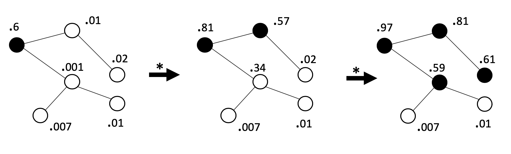
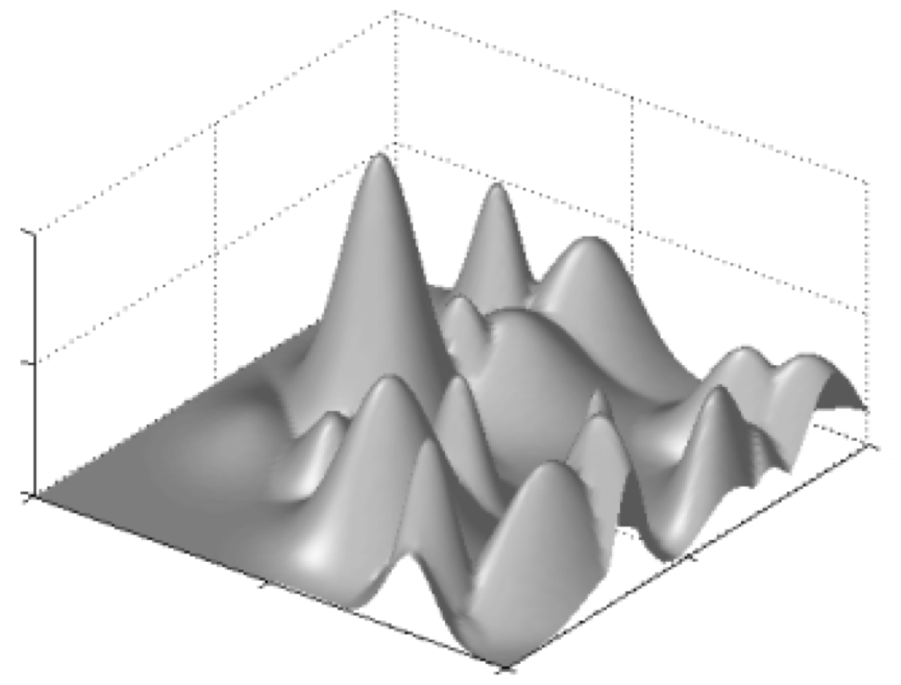

# Social Epistemology
**First published Mon Feb 26, 2001; substantive revision Fri Mar 22, 2024**

*O’Connor, Cailin, Goldberg, Sanford, Goldman, Alvin*

Until recently, epistemology—the study of (the nature, sources, and pursuit of) knowledge—was heavily individualistic in focus. The emphasis was on the pursuit of knowledge by individual subjects, taken in isolation from their social environment. Social epistemology seeks to redress this imbalance by investigating the epistemic effects of social interactions, practices, norms, and systems. After briefly discussing the history of the field in sections 1 and 2, we move on to discuss central topics in social epistemology in section 3. Section 4 turns to recent approaches which use formal methods to characterize the functioning of epistemic communities like those in science. In section 5 we briefly turn to social epistemological approaches to the proper functioning of democratic societies, including responses to mis/disinformation as well as to the variety of epistemic dysfunctions that arise when we are in community with others.

## 1. What is Social Epistemology?

Epistemology is concerned with how people should go about the business of determining what is true. Social epistemology is concerned with how people can best pursue the truth *with the help* of, or sometimes *in the face* of, other people or relevant social practices and institutions. It is also concerned with the pursuit of truth by groups, or collective agents.

The most influential tradition in (Western) epistemology, best exemplified by René Descartes (1637), has focused almost exclusively on how individual epistemic agents, using their own cognitive faculties, can soundly pursue truth. Descartes contended that the most promising way to do so is by use of one’s own reasoning, as applied to one’s own “clear and distinct” ideas. The central challenge for this approach is to show how one can discern what is true using only this restricted basis. Even early empiricists such as John Locke (1690) also insisted that knowledge be acquired through intellectual self-reliance. As Locke put it, “other men’s opinions floating in one’s brain” do not constitute genuine knowledge.

In contrast with the individualistic orientations of Descartes and Locke, social epistemology proceeds on the idea that we often rely on others in our pursuit of truth. Accordingly, social epistemology’s core questions revolve around the nature, scope, and epistemic significance of this reliance: what are the ways we rely on others when seeking information, and how does our relying on others in these ways bear on the epistemic goodness of our resulting beliefs? (See Greco (2021) for an informative discussion of both of these questions.)

Since epistemology itself emerged in the modern period along with the rise of science, where reliance on others (in replication and elsewhere) is pervasive, one might wonder why social epistemology has only really come into its own in the last few decades. One possible explanation may lie in the individualistic self-understanding of early modern science: the Royal Society of London, created in 1660 to support and promote scientific inquiry, had as its motto “*Nullius in verba*”—roughly, “take no one’s word for it.” Another important factor appears to have been the centrality philosophers have traditionally ascribed to the problem of skepticism. Such an orientation presents the pursuit of truth as a solitary endeavor, where epistemology itself centers on the challenges and practices of individual agents. Still, once individualism in epistemology is called into question, we will see that there are important connections between social epistemology and philosophy of science.

## 2. Giving Shape to the Field of Social Epistemology

Along these lines, an approach somewhat analogous to social epistemology was developed in the middle part of the 20th century. Primarily sociological in nature, this movement focused on how science is actually practiced, often aiming to debunk what theorists saw as the “idealized” accounts of science in orthodox epistemology and in mid-century philosophy of science. Members of what came to be known as the “Strong Program” in the sociology of knowledge, such as Harry Collins and David Bloor, provided a philosophical rationale for challenging the notion of objective truth, arguing that so-called “facts” are not discovered by science but rather are “constructed,” “constituted,” or “fabricated.” For his part, Bloor advocated for the “symmetry thesis,” according to which scientists’ beliefs are to be explained by social factors, regardless of whether these beliefs are true or false, rational or irrational (Bloor 1991: 7)[^bloor-1991]. This view denies the explanatory relevance of such things as facts and evidence.

A second intellectual tradition that factored into the development of social epistemology is the interdisciplinary field of Science and Technology Studies (STS), which emerged in the 1960s and 70s. Borrowing from sociology, policy studies, history and philosophy of science, as well as parts of history, political science, and anthropology, theorists in this field urged that we see science and technology themselves as deeply embedded in social practices. Research in STS has explored topics as diverse as the role of science in public policy, the “social construction” of the objects of science, and the nature of technology. Influential work includes Latour and Woolgar (1986), Bijker, Hughes, and Pinch (1987), Fuller (1988), and Jasanoff (1998).

Views emphasizing the importance of the social dimensions of knowledge also emerged in certain parts of philosophy. Michel Foucault, for example, developed a radically political view of knowledge and science, arguing that practices of so-called knowledge-seeking are driven by quests for power and social domination (1969 [1972], 1975 [1977]). Richard Rorty (1979) rejected the traditional conception of knowledge as “accuracy of representation” and sought to replace it with a notion of the “social justification of belief” – although it is worth noting that he was not particularly canonical among theorists in the STS tradition. Other philosophers ascribed a central explanatory role to social factors but were less extreme in their critique of objectivity in science. Most significant among these was Thomas Kuhn, who had been trained as a physicist but who moved post-PhD into the history and philosophy of science. Kuhn held that purely objective considerations could never settle disputes between competing theories, underscoring the social factors that influence the development of scientific theory (Kuhn 1962/1970)[^kuhn-1962]. Debates about these topics persisted under the heading of “the science wars.”

Even for those philosophers who repudiate skeptical and debunking positions, there are important lessons from the debates such positions inspired. Above all, the key lesson concerns the importance of social factors in cognition, including the role of cultural beliefs and the biases that operate in the pursuit of knowledge. It is in this context that what we might call the dominant strand of social epistemology emerged.

Seeing itself as departing sharply from the debunking themes sketched above, contemporary social epistemology aims to acknowledge and account for the variety of social factors that figure centrally in the pursuit of truth. Theorists in this tradition often defend proposals that are continuous with traditional epistemology. While they continue to acknowledge that there are identifiable cases in which social factors or social interactions pose threats to truth acquisition (see below), they also contend that the right kinds of social organization and social norms enhance the prospects of acquiring truth.

The seminal defense for this sort of approach to social epistemology is Alvin Goldman (1999). This book, whose influence on contemporary social epistemology is hard to overstate, developed Goldman’s “veritistic” approach, which focuses on the reliability with which various social practices produce true beliefs (Goldman 1999: 5)[^goldman-1999]. While Goldman (1999) presented a framework for research in social epistemology, work on relevant topics had already begun to flourish. Testimony emerged as a central topic for social epistemology owing to works such as Elizabeth Fricker (1987), Edward Craig (1990), and C.A.J. Coady (1992). Philosophy of science, too, eventually became an important site of contemporary social epistemology; seminal work includes Philip Kitcher (1990, 1993), Helen Longino (1990, 2002), and Miriam Solomon (2007). Margaret Gilbert (1989) made a forceful case for the existence of “plural subjects,” thereby providing the metaphysical foundations for the social epistemology of collectives. And, under the influence of Cristina Bicchieri (2005), social epistemologists began to take stock of the importance of social norms in social epistemological analysis (see e.g. Henderson and Graham (2019) and Sanford Goldberg (2018, 2021).

The salience of social epistemology has also been enhanced by journals devoted in whole or in part to the topic. In 1987, Steve Fuller created the journal *Social Epistemology: A Journal of Knowledge, Culture, and Policy*, whose original focus was the interdisciplinary study of knowledge production in both empirical and normative contexts. Also in 1987, Fred Schmitt edited a volume of *Synthese* devoted to social approaches to epistemology. This edition includes contributions from both Fuller and Goldman, both of whom conceived of their respective research programmes in full awareness of their divergent goals, methods, and concerns. Some years later Goldman, inspired by the desire for a social epistemology journal that engaged more with “mainstream” epistemology, started *Episteme: A Journal of Individual and Social Epistemology* in 2004. (While it originally focused exclusively on social epistemology, it has since expanded its scope to include individual epistemology.) Finn Collin (2013) attempts to characterize the difference between Fuller’s and Goldman’s approaches to social epistemology.

## 3. Central Topics in Social Epistemology

Here we look at some core topics.

### 3.1 Testimony

When it comes to the various ways we rely on others as we engage in the pursuit of truth, testimony is paradigmatic. For our purposes here, we can think of testimony as the act in which one agent (the speaker or writer) reports something to an audience. An audience who accepts the report on the speaker’s authority acquires a “testimony-based” belief. Social epistemologists have raised several questions regarding testimonial transactions.

The central topic in the “epistemology of testimony” concerns how testimony-based beliefs are to be evaluated. The core question here is whether testimony is to be regarded as a basic source of justification. We can think of a basic source of justification as a source whose reliability can be taken for granted and relied upon, except in cases in which one has reasons for doubt. As illustration, consider perception. A perceptual belief of yours can be justified even without your having reasons to assume that perception is reliable. (It suffices that you lack reasons for doubt in the case at hand.). The question is whether testimony can be treated similarly.

Those who deny that testimony is a basic source of justification hold that testimony-based beliefs are justified only if the audience has adequate independent reasons to regard the speaker’s testimony as trustworthy. Such a view, known as “reductionism” since it proposes that the justification of these beliefs can be “reduced to” justifications provided by other sources (perception, memory, induction), was defended by David Hume. Contemporary defenders argue that the denial of reductionism is a “recipe for gullibility,” (Fricker 1994)[^fricker-1994], or that it sanctions irresponsibility (Faulkner 2000; see also Malmgren 2006 and Kenyon 2013)[^faulkner-2000][^kenyon-2013][^malmgren-2006]. By contrast, those who hold that testimony *is* a basic source of justification hold that testimony-based beliefs are justified so long as the audience has no reasons for doubt. Such a view, known as “anti-reductionism,” was defended by Thomas Reid (1764/1983), who argued that honesty (in speakers) and credulity (in audiences) are as much a part of our natural psychological endowment, and so are as worthy of being relied upon in belief-formation, as is the faculty of perception. Contemporary theorists have offered additional arguments for anti-reductionism. Coady (1990) argues that audiences typically lack the evidence needed to confirm the reliability of the speakers they encounter, so that denying anti-reductionism is a recipe for skepticism; Burge (1993) argues that intelligible speech itself is an indication of having been produced by a rational source, one which by nature aims at truth (and so is worthy of being believed); and various others have offered variations on Reid’s own argument.

In addition to the question of whether testimony is a basic source of justification, a second question concerns whether we can specify the conditions on justified testimony-based belief in individualistic terms, that is, terms that are restricted to materials from the audience alone (the evidence in her possession, the reliability of her faculties, etc.). While individualism remains the dominant view on this score, a number of social epistemologists have rejected this in favor of one or another version of *anti-individualism* about testimonial justification. According to these views, the justification of an audience’s testimony-based belief can be affected by factors including *the speaker’s* epistemic condition (Welbourne 1981, Hardwig 1991, Schmitt 2006, Lackey 2008, Goldberg 2010)[^goldberg-2010][^lackey-2008][^schmitt-2006] or the general reliability of testimony *in the audience’s local environment* (Kallestrup and Pritchard 2012, Gerken 2013, 2022)[^gerken-2013][^kallestrup-2012]. Still, anti-individualistic views remain controversial (see Gerken 2012, Leonard 2016, 2018)[^gerken-2012][^leonard-2016].

A third question social epistemologists have raised regarding testimonial exchanges concerns the interpersonal nature of the act of testifying itself. According to the assurance view of testimony (Hinchman 2005, Moran 2006, McMyler 2011)[^mcmyler-2011], testifying is an act of assurance, and beliefs formed on the basis of another’s assurance should not be understood in ordinary evidentialist terms. (See also Lawlor (2013).) According to trust views (Faulkner 2011, Keren 2014)[^faulkner-2011][^keren-2014], the act of testifying takes place in a context rich with norms of trust whose presence serves to make testimonies more reliable, and hence more worthy of trust (see also Graham 2020 for related discussion)[^graham-2020]. Both views remain controversial (see Lackey 2008)[^lackey-2008].

A question that has recently begun to attract more attention from social epistemologists concerns the role of technology in testimony. *Wikipedia* entries may be testimony, but they have multiple authors; how does this affect the epistemology of *Wikipedia*-based belief? (See Tollefsen 2009, Fallis 2011, Fricker 2012)[^fallis-2011][^fricker-2012][^tollefsen-2009]. ChatGPT and other forms of AI produce reports (or apparent reports) that incorporate results from fully automated search; is this testimony? Some, thinking of testimony as a speech act for which a speaker bears responsibility, deny that AI-produced sentences constitute testimony (see e.g. Goldberg 2020 for a defense of this view regarding instrument-based belief)[^goldberg-2020]; others embrace the idea of AI-testimony and argue that we ought to extend the epistemology of testimony accordingly (Freiman and Miller 2020, Freiman 2023)[^freiman-2023][^freiman-2020][^miller-2020].

### 3.2 Peer Disagreement

In many cases of testimony, we believe what another person tells us. But in other cases we disagree with them. When this is so, is it rational for us to continue to hold onto our beliefs with the same degree of confidence as before? Or does rationality require us to reduce our confidence? This would appear to depend on our evidence regarding who is better-placed to reach a correct verdict on the matter at hand. But consider the case in which, prior to the disagreement, one has excellent evidence that one’s interlocutor is an “epistemic peer,” someone who is roughly as likely as oneself to get it right on the matter at hand. What, if anything, does rationality require in this (“peer disagreement”) case?

“Conciliationism” is the view that in peer disagreement (some degree of) modification in one’s confidence is rationally required. Two related considerations seem to support conciliationism: failure to conciliate appears to be objectionably dogmatic, and the disagreement itself seems to constitute some (higher-order) evidence that one has erred. The most demanding version of Conciliationism is the Equal Weight View, according to which one ought to assign equal weight to a peer’s opinion as to one’s own (Christensen 2007, Elga 2007, Feldman 2006, 2007, and Matheson 2015)[^christensen-2007][^elga-2007][^feldman-2006].

Critics of conciliationism offer a number of objections. One presents a charge of self-refutation: since conciliationism itself is a widely-disputed claim, it follows (given conciliation) that if conciliationism is true, we are not in a position to rationally believe it. (For further discussion, see Christensen 2013.)[^christensen-2013] A second criticism derives from the “right reasons” view of Kelly (2005). Suppose that after all evidence has been disclosed two peers continue to disagree over whether interests rates will rise. Since the fact of disagreement itself is not evidence bearing on whether interest rates will rise, it is irrelevant to what one should believe regarding whether interest rates will rise. For this very reason, learning of a peer disagreement should not affect one’s confidence on this topic at all. Rather, what rationality requires here is what rationality requires everywhere: belief in accordance with the relevant evidence. (Titelbaum (2015) offers a version of this argument restricted to the domain of beliefs regarding the norms of rationality themselves.)

In a more recent paper, Kelly has developed a third criticism of conciliationism, which calls into question whether rationality requires the same thing in every peer disagreement. Developing what he calls the “Total Evidence View,” Kelly (2010) puts the point this way:

> [If] you and I have arrived at our opinions in response to a substantial body of evidence, and your opinion is a reasonable response to the evidence while mine is not, then you are not required to give equal weight to my opinion and to your own. Indeed, one might wonder whether you are required to give *any* weight to my opinion in such circumstances. (2010: 135)

Lackey (2010) develops a similar “justificationist” position about peer disagreement. According to her view, what rationality requires in a case of peer disagreement is determined by what one’s total evidence supports *after* one adds the evidence one acquires in the disagreement itself. In some cases, she argues, one’s (post-disagreement) total evidence will require a significant change in one’s degree of confidence, in other cases it will require no change at all, and in still other cases it will require something in between. As we will see, these positions are roughly consistent with more formal, Bayesian approaches to updating beliefs on the credences of others.

Debates over peer disagreement have branched out in interesting ways. One branch concerns the epistemic significance of disagreement that is (not actual but) reasonably anticipated. (See Ballantyne (2015) for an argument for skeptical results.) A second branch concerns the epistemic significance of what Fogelin (1985) called “deep” disagreements, long-standing controversies in which there is no consensus about how to resolve the disagreement. While deep disagreement has long been the basis for skeptical worries about the possibility of ethical or religious knowledge, social epistemologists have turned their eyes more recently towards philosophy itself (Frances 2010, Goldberg 2013, Kornblith 2013)[^frances-2010][^goldberg-2013][^kornblith-2013] and beyond (Frances 2005)[^frances-2005].

### 3.3 Group Belief

The cases discussed thus far focus on epistemic agents who are individuals. What makes them topics of social epistemology is that they involve agents interacting in the course of belief-formation, where this interaction bears on the epistemic status of one or more of their beliefs. The cases we will now consider involve not individual agents but rather groups that appear to act as collective epistemic subjects. When we speak of collective epistemic subjects, we have in mind collections of individuals which constitute a group to which actions, intentions, and/or representational states, including beliefs, are ascribed. Such collections might include juries, panels, governments, assemblies, teams, etc.

Social epistemologists have addressed various questions concerning the nature of such “collective” subjects, of which we highlight the two most salient ones. First, under what conditions can a group be said to believe something or (more generally) constitute an epistemic agent in its own right? (Here social epistemology has borrowed extensively from extant discussions of this question in philosophy of mind, action theory, the metaphysics of groups, and social and political philosophy). Second, given a case in which a group believes something, under what conditions does this belief count as epistemically justified (or amount to knowledge)? We consider this latter question below in section 3.4.

Let us begin with the question about group belief. Two main views have dominated the discussion: Summativism and Non-Summativism (or Collectivism). According to Summativism about group belief, group belief is a function of the beliefs of its members. On a simple version, a group believes something just in case all, or almost all, of its members hold the belief (Quinton 1976: 17)[^quinton-1976]. Since Summativism construes claims asserting group beliefs as merely summarizing claims about the beliefs of the individuals who make up the group, this view is popular among those who worry about the “metaphysics” of group agents.

Non-summativist or “Collectivist” accounts of group belief are motivated by objections to Summativism. Margaret Gilbert objects that it is common in ordinary language to ascribe a belief to a group without assuming that most or all members hold the belief in question. On this basis, she advances a Non-Summativist account of group belief based on the notion of joint commitment, according to which:

> A group *G* believes that *p* if and only if the members of *G* are *jointly committed* to believe that *p* as a body.

Joint commitments create normative requirements for group members to emulate a single believer. On Gilbert’s account, the commitment to act this way is common knowledge, and if group members do not act accordingly they can be held normatively responsible by their peers for failing to do so (see Gilbert 1987, 1989, 2004; see also Tuomela 1992, Schmitt 1994a, and Tollefsen 2015 for variations on this theme)[^gilbert-1987][^schmitt-1994a][^tollefsen-2015][^tuomela-1992].

While joint commitment accounts of group belief are popular, they are not beyond criticism. One worry is that they focus on responsibility to peers, and not on the belief-states of the group members. On this basis Wray (2001) suggests that they should be considered accounts of group acceptance instead. Another worry is that joint commitment accounts fail to recognize that there can be various reasons for joint commitment, not all of which are reflective of group belief (Lackey 2021)[^lackey-2021].

A different Collectivist approach is taken by Alexander Bird (2014, 2022) who contends that the joint acceptance model of group belief is only one of many different (but legitimate) models. For instance, he introduces the “distributed model” to deal with systems that feature information-intensive tasks which cannot be processed by a single individual. Several individuals must gather different pieces of information while others coordinate this information and use it to complete the task. (See also Hutchins 1995.)[^hutchins-1995] Bird contends that this is a fairly standard type of group model that occurs in science. (See also Brown 2023 for a variant on this position, motivated by functionalism about the propositional attitudes.)

An interestingly “hybrid” account of group belief is that of Lackey (2021), who adopts what she terms the “Group Agent” account. According to it,

> A group, G, believes that p if and only if: (1) there is a significant percentage of G’s operative members who believe that p, and (2) are such that adding together the basis of their beliefs that p yields a belief set that is not substantively incoherent. (2021: 49)

While (1) is a Summativist condition, (2), which is meant to avoid ascribing belief to a group when its members’ reasons cannot be coherently combined, is a normative requirement that governs the collective itself. The account is thus Summativist without being reductive.

### 3.5 Group Justification

Until this point, we have only looked at the phenomenon of group belief itself. We have not yet considered how such beliefs can be evaluated from the epistemic point of view — that is, how such belief can be evaluated as to whether it is justified, reasonable, warranted, rational, knowledgeable, etc. In this section we explore this question by focusing on the conditions under which a group’s belief is justified.

If the government of the United States were to believe that global warming presents significant environmental challenges, we might say it was justified in doing so because of the overwhelming consensus of climate scientists to this effect. Under what conditions can we say that the belief of a group is justified?

Schmitt (1994a: 265) held that a group belief is justified only if every member of the group has a justified belief to the same effect. But this seems to make group justification too hard to come by (Lackey 2016: 249–250)[^lackey-2016]. Goldman (2014) defended a Process Reliabilist account of group justification. The basic idea of Process Reliabilism is to construe justification in terms of the reliable production of true belief, where this is understood to involve (i) a cognitive process that reliably produces true belief, or else (ii) a cognitive process (such as *drawing an inference*) that takes beliefs as inputs and which reliably produces true beliefs when its inputs are justified (Goldman 1979)[^goldman-1979]. Goldman (2014) proposes to treat group justification in analogous terms. Starting with the requirement that the group’s belief be caused by a type of belief-forming process that takes inputs from member beliefs in some proposition and outputs a group belief in that proposition, his idea is to model group justification along the lines of (ii). A type of process that exemplifies this feature might be a majoritarian process in which member beliefs (of the group) are aggregated into a group belief. Such a process is likely to produce a true belief when its inputs—the individual members’ beliefs to the same effect—are justified.

Lackey (2021) develops various criticisms of Goldman (2014) and defends an alternative account of group justification on this basis. According to her alternative account, a group G justifiedly believes that p if and only if (1) G believes that p [see 3.3 above for her “hybrid” analysis of this] and

> (2) Full disclosure of the evidence relevant to the proposition that p, accompanied by rational deliberation about that evidence among the members of G in accordance with their individual and group epistemic normative requirements, would not result in further evidence that, when added to the bases of G’s members’ beliefs that p, yields a total belief set that fails to make sufficiently probable that p. (2021: 97)

An alternative account of group justification can be found in Brown (2024). Like Goldman (2014), Brown appeals to the testimony of group members in its account of group justification, but unlike Goldman, Brown’s account does not require the beliefs expressed in these testimonies to be justified in order for the group’s belief to be justified. In this way, Brown argues, her account is not susceptible to the objections Lackey (2021) raises against Goldman (2014).

## 4. Formal Approaches to Social Epistemology

We have now seen some of the problems that face those who develop accounts of knowledge acquisition within a community. In recent years philosophers have turned to formal methods to understand some of these social aspects of belief and knowledge formation. There are broadly two approaches in this vein. The first comes from the field of formal epistemology, which mostly uses proof-based methods to consider questions that mostly originate within individual-focused epistemology. Some work in this field, though, considers questions related to, for example, judgment aggregation and testimony. The second approach, sometimes dubbed “formal social epistemology,” stems largely from philosophy of science, where researchers have employed modeling methods to understand the workings of epistemic communities. While much of this work has been motivated by a desire to understand the workings of science, it is often widely applicable to social aspects of belief formation.

Another distinction between these traditions is that while formal epistemologists tend to focus on questions related to ideal belief creation, such as what constitutes rationality, formal *social* epistemologists have been more interested in explaining real human behavior, and designing good knowledge-creation systems. We will now briefly discuss relevant work from formal epistemology, and then look at three topics in formal social epistemology.

### 4.1 Formal Epistemology in the Social Realm

As mentioned, formal epistemology has mostly focused on issues related to individual epistemology. This said, there is a significant portion of this literature addressing questions including 1) how should a group aggregate their judgements? 2) how should a group aggregate their (more fine-grained) beliefs? 3) how should Bayesians update on the testimony of others? and 4) what sorts of aggregation methods create rational or effective groups?

Let’s start with judgement aggregation. Judgement aggregation assumes that individuals in a group hold binary opinions or attitudes on some matters. These could be factual like “defendant X is innocent” or actionable like “we should get Chinese food tonight.” The question is then how the group should aggregate these judgements to facilitate group action. Or: how can individually rational judgements be combined into a rationally judging group?

A sticky problem that emerges is the “doctrinal paradox,” originally formulated by Kornhauser and Sager (1986) in the context of legal judgments. Suppose that a court consisting of three judges must render a judgment. The group judgment is to be based on each of three related propositions, where the first two propositions are premises and the third the conclusion. For example:

1. The defendant was legally obliged not to do a certain action.
2. The defendant did do that action.
3. The defendant is liable for breach of contract.

Legal doctrine entails that obligation and action are jointly necessary and sufficient for liability. That is, conclusion (3) is true if and only if the two preceding premises are each true. Suppose, however, as shown in the table below, that the three judges form the indicated beliefs, vote accordingly, and the judgment-aggregation function delivers a conclusion guided by majority rule.

|   | Obligation? | Action? | Liable? |
| --- | --- | --- | --- |
| Judge 1 | True | True | True |
| Judge 2 | True | False | False |
| Judge 3 | False | True | False |
| Group | True | True | False |

In this example, each of the three judges has a logically self-consistent set of beliefs. Moreover, a majority aggregation function seems eminently reasonable. Nonetheless, the upshot is that the court’s judgments are jointly inconsistent.

This kind of problem arises easily when a judgment is made by multiple members of a collective entity. This led a number of authors, starting with List and Pettit (2002), to prove impossibility theorems in which reasonable-looking combinations of constraints were nonetheless shown to be jointly unsatisfiable in judgment aggregation. Further generalizations are due to Pauly and van Hees 2006, Dietrich 2006, and Mongin 2008. These results reflect Arrow’s famous impossibility theorem for preference aggregation (Arrow 1951/1963)[^arrow-1951].

In light of these results, various “escape routes” have been proposed. List and Pettit (2011) offer ways to relax requirements so that majority voting, for example, satisfies collective rationality. Briggs et al. (2014) argue that it may be too strong to require that entities always have logically consistent beliefs. Following Joyce (1998), they introduce a weaker notion of coherence of beliefs. They show that the majority voting aggregation of logically consistent beliefs will always be coherent, and the aggregation of coherent beliefs will typically be coherent as well.

Some apply the theory of judgment aggregation to the increasingly common problem of how collaborating scientific authors should decide what statements to endorse. Solomon (2006), for instance, argues that voting might help scientists avoid “groupthink” arising from group deliberation. While Wray (2014) defends deliberation as crucial to the production of group consensus, Bright et al. (2018) point out that consensus is not always necessary (or possible) in scientific reporting. In such cases, they argue, majority voting is a good way to decide what statements a report will endorse, even if there is disagreement in the group.

Rather than focusing on the aggregation of judgements, we might, instead, consider aggregating degrees of belief, or “credences.” These are numbers between 0 and 1 representing an agent’s degree of certainty in a statement. (For instance, if I think there is a 90% chance it is raining, my credence that it is raining is .9.) This representation changes the question of judgement aggregation to something like this: if a group of people hold different individual credences, what should the group credence be?

This ends up being very closely related to the question of how an individual ought to update their credences upon learning the credences of others. If a rational group ought to adopt some aggregated belief, then it might also make sense for an individual in the group to adopt the same belief as a result of learning about the credences of their peers. In other words, the problems of belief aggregation, peer disagreement, and testimony are entangled in this literature. (Though see Easwaran et al. (2016) for a discussion of distinctions between these issues.) We’ll focus here on belief aggregation.

In principle, there are many ways that one can go about aggregating credences or pooling opinions (Genest and Zidek 1986)[^genest-1986]. A simple option is to combine opinions by linear pooling—taking a weighted average of credences. This averaging could respect all credences equally, or put extra weights on the opinions of, say, recognized experts. This option has some nice properties, such as preserving unanimous agreement, and allowing groups to aggregate over different topics independently (DeGroot 1974; Lehrer and Wagner 1981)[^degroot-1974][^lehrer-1981]. Despite some issues which will be described shortly, it is defended by many in formal epistemology as the best way to combine credences (Moss 2011, Pettigrew 2019b)[^moss-2011].

In thinking about ideal knowledge creation though, we might ask how a *Bayesian* (i.e., an individual who rationally holds to ideals of credence updating) should update credences in light of peer disagreement or how a group of Bayesians should aggregate beliefs. A Bayesian will not simply average across beliefs, except under particular assumptions or in special cases (Genest and Zidek 1986; Bradley 2007; Steele 2012; Russell et al. 2015)[^bradley-2007][^genest-1986][^russell-2015][^steele-2012]. And a group that engages in linear averaging of this sort can typically be Dutch booked, meaning they will accept a series of bets guaranteed to lose them money.

A fully-fledged Bayesian approach to aggregation demands that final credences be derived by Bayesian updating in light of the opinions held by each group member (Keeney and Raiffa 1993)[^keeney-1993]. Notice, this is also what a Bayesian individual should do to update on the credences of others. To do this properly, though, is very complicated. It requires prior probabilities about what obtains in the world, as well as probabilities about how likely each group member is to develop their credences in light of what might obtain in world. This will not be practical in real cases.

Instead, many approaches consider features that are desirable for rational aggregation, and then ask which simpler aggregation rules satisfy them. For instance, one thing a rational aggregation method should do (to prevent Dutch booking) is yield the same credence regardless of whether information is obtained before or after aggregating. For instance, if we all have credences about the rain, and someone comes in wearing shorts, it should not matter to the final group output whether 1) they entered and we all updated our credences (in a Bayesian way) and then aggregated them, or 2) we aggregated our credences, they entered, and we updated the aggregated credence (in a Bayesian way). Geometric methods, which take the geometric average of probabilities over *worlds*, yield this desirable property (and other desirable properties) in many cases (Genest 1984; Dietrich and List 2016, Russell et al. 2015, Baccelli & Stewart 2023)[^baccelli-2023][^dietrich-2016][^genest-1984][^russell-2015]. These methods proceed by multiplying (weighted) credences over worlds that might obtain and then renormalizing them to sum to 1.

One thing that geometric averaging does not do, though, is allow for credences over different propositions to be aggregated completely independently from each other. (This is something often treated as a desideratum for judgment aggregation.) For instance, our beliefs about the probabilities of hail might influence how we will aggregate our beliefs over the probabilities of rain. Instead, a more holistic approach to aggregation is required. This is an important lesson for approaches to social epistemology which focus on individual topics of interest in addressing peer disagreement and testimony (Russell et al. 2015)[^russell-2015].

Another thing that some take to be strange about geometric averaging is that it sometimes will aggregate identical credences to a different group credence. For instance, we might all have credence .7 that it is raining, but our group credence might be .9. Easwaran et al. (2016) argue, though, that this often makes sense when updating on the credences of others—their confidence *should* make us more confident (see also Christensen 2009)[^christensen-2009]. In light of critiques of both geometric and linear averaging, Kinney (2022) argues that attention should be paid to the underlying models of the world that individuals are working from when combining credences. He advocates for an aggregation method using “model stacking” a la Le and Clarke (2017). A general take-away is that although the question of rational credence aggregation might initially sound trivial, this is very far from the reality. There are deep and enduring questions about what a rational group consists in.

The question of whether aggregated credences can be more extreme than individual ones echoes much earlier work bearing on the question: are groups smart? In 1785, the Marquis de Condorcet wrote an essay proving the following. Suppose a group of individuals form independent beliefs about a topic and they are each more than 50% likely to reach a correct judgement. If they take a majority vote, the group is more likely to vote correctly the larger it gets (in the limit this likelihood approaches 1). This result, now known as the “Condorcet Jury Theorem,” underlies what is sometimes called the “wisdom of the crowds”: in the right conditions combining the knowledge of many can be very effective. Many have drawn on this result to think about the rationality of group reasoning and decision making.

In many cases, though, real groups are prone to epistemic problems when it comes to combining beliefs. Consider the phenomenon of information cascades, first identified by Bikhchandani et al. (1992). Take a group of agents who almost all have private information that Nissan stock is better than GM stock. The first agent buys GM stock based on their (minority) private information. The second agent has information that Nissan is better, but on the basis of this observed action updates their belief to think GM is likely better. They also buy GM stock. The third agent now sees that two peers purchased GM and likewise updates their beliefs to prefer GM stock. This sets off a cascade of GM buying among observers who, without social information, would have bought Nissan. The problem here is a lack of independence in the “vote”—each individual is influenced by the beliefs and actions of the previous individuals in a way that obscures the presence of private information. In updating on the credences of others, we thus may need to be careful to take into account that they might already have updated on the credences of others.

### 4.2 The Credit Economy

Let us now turn to three paradigms in formal social epistemology: the credit economy, network models, and models of epistemic diversity.

A key realization, due initially to sociologist of science Robert Merton, is that scientists often seek *credit*—a proxy for recognition and approbation of one’s scientific work, along with all the attendant benefits (Merton 1973)[^merton-1973]. Credit economy models draw on game and decision theory to model scientists as rational credit seekers, and then assess the epistemic impacts of the credit incentives scientists face. At the heart of much of this work is a debate going back as far as Du Bois (1898) that asks: what is the best motive for an epistemic community? Is it credit seeking or “pure” truth seeking? Or some combination of the two?

Philip Kitcher’s 1990 paper “The Division of Cognitive Labor” argues that scientists divide labor more effectively when they are motivated by credit. Truth seekers might all herd onto the most promising problem in science, while credit seekers will choose less popular topics where they are more likely to be the one generating a finding. Strevens (2003) extends Kitcher’s work by arguing that an existing feature of credit incentives, the priority rule, can lead to an even better division of labor. This is the rule which stipulates that credit will be allocated only to the scientist who first makes a discovery. Zollman (2018) critiques both of these models, though, by pointing out that pure truth seekers should be happy if anyone makes new discoveries (while Kitcher and Strevens assume that “truth seekers” are only motivated to find truth themselves). If scientists do not care who makes a discovery, then credit is not needed to motivate division of labor.

Others point out that the priority rule has its downsides. Higginson and Munafo (2016) and Romero (2017) argue that the priority rule strongly disincentivizes scientists from performing replications because credit is so strongly associated with new, positive findings. Replications are often crucial in determining whether new results are accurate. Another worry is that the priority rule incentivizes fraud and/or sloppy work by those who want to quickly claim credit (Merton 1973, Casadevall and Fang 2012)[^casadevall-2012][^merton-1973]. Both Zollman (2022—see Other Internet Resources) and Heesen (2021) show how fraud can positively impact a scientist’s credit in light of the priority rule. And Higginson and Munafo (2016) and Heesen (2018) show that on the realistic assumption that speed of production trades off with quality, the priority rule incentivizes fast, poor, sloppy science. Bright (2017a), though, uses a model to point out that credit-seekers who fear retaliation may publish more accurate results than truth-seekers who are convinced of some fact, despite their experimental results to the contrary. In other words, a true believer may be just as incentivized to commit fraud as someone who simply seeks approval from their community.

There is one more worry about the priority rule, which regards unfair scientific rewards and their consequences. Merton (1968) described the “Matthew Effect,” that pre-eminent scholars often get more credit for work than less famous ones. Strevens (2006) argues that this follows the scientific norm to reward credit based on the benefit a discovery yields to science and society. Because famous scientists are more trusted, their discoveries do more good. Heesen (2017), on the other hand, uses a credit economy model to show how someone who gets credit early on due to luck may later accrue more and more credit because of the Matthew effect. When this kind of compounding luck happens, he argues, the resulting stratification of credit in a scientific community does not improve inquiry. Rubin and Schneider (2021) and Rubin (2022) add to these worries with network models showing how older, more connected member of the community will tend to get unfair credit in cases of multiple discovery as a result of the dynamics of information sharing. As they argue, these dynamics will often unfairly advantage dominant social groups who tend to be more established and connected in science.

On the positive side, besides possible benefits to division of labor, the priority rule incentivizes sharing in science. The communist norm states that scientists will share work promptly and widely, which benefits scientists because they want to establish priority and receive credit. While models show how scientists can be incentivized to hide intermediate research to get later credit (Dasgupta and David 1994), they also show how enough credit can promote communism (Banerjee et al. 2014, Heesen 2017b)[^banerjee-2014][^heesen-2017b].

This debate is further complicated by models that look at how credit influences not just rational decision making, but selective processes in science. Credit can impact who remains in a discipline, whose practices and ideas become influential, and whose students get jobs. Smaldino and McElreath (2016) show how poor methods (like low study power) tend to generate false positives and thus credit for those using them. If investigators using these poor methods train their students into them, and then place those students disproportionately, they will tend to proliferate. Likewise Tiokhin et al. (2021) show how selection can drive the proliferation of fast work (using small samples sizes) and O’Connor (2019) shows how it can lead to conservative, safe problem choice in science. Others, like Smaldino et al. (2019) and Stewart and Plotkin (2021) consider what conditions might promote the selection of good science in light of selection.

As we have seen, credit economy models help answer questions like: what is the best credit structure for an epistemic community? And how do we promote true discoveries via incentive systems? As credit economy models show us, designing good epistemic communities is by no means a trivial task.

### 4.3 Epistemic Networks

Another paradigm, widely used by philosophers to explore social aspects of epistemology, are epistemic network models. This kind of model uses networks to explicitly represent social or informational ties where beliefs, evidence, and testimony can be shared.

There are different ways to do this. In the social sciences generally, a popular approach takes a “diffusion” or “contagion” view of beliefs. A belief or idea is transmitted from individual to individual across their network connections, much like a virus can be transmitted (Rogers 1962)[^rogers-1962]. (See Lacroix et al 2021 for a use of this sort of model in philosophy.) Alternatively, agents can start with credences and in successive rounds average those credences with their neighbors until reaching a steady state (Golub and Jackson 2010, 2012)[^golub-2010].

In these diffusion/contagion models, though, the individuals do not gather evidence from the world, share evidence with each other, or form beliefs in any sort of rational way. For this reason, philosophers of science have tended to use the *network epistemology framework* introduced by economists Bala and Goyal (1998) to model how more rational individuals learn from neighbors. These models start with a collection of agents on a network, who choose from some set of actions or action guiding theories. Agents have beliefs about which action is best, and change these beliefs in light of the evidence they gather from their actions. In addition, they also update on evidence gathered by neighbors in the network, typically using some version of Bayes’ rule. It is in this sense that agents are part of an epistemic community. Figure 1 shows what this might look like. The numbers next to each agent represent their degree of belief in some proposition like “vaccines are safe.” The black agents think this is more likely than not. As this model progresses these agents gather data, which increases their neighbors’ degrees of belief in turn.

*Figure 1:*

Figure 1: Agents in a network epistemology model use their credences to guide theory testing. Their results change their credences, and those of their neighbors. [An extended description of figure 1 is in the supplement.]

Communities in this model can develop beliefs that the better theory (vaccines are safe) is indeed better, or else they can pre-emptively settle on the worse theory (vaccines cause autism) as a result of misleading evidence. Generally, since networks of agents are sensitive to the evidence they gather, they are more likely to figure out the “truth” of which is best (Zollman 2013; Rosenstock et al. 2017)[^rosenstock-2017][^zollman-2013].

Zollman (2007, 2010) describes what has now been dubbed the “Zollman effect” in these models; the surprising observation that it is generically worse for communities to communicate more (see also, Grim 2009)[^grim-2009]. In tightly connected networks, misleading evidence is widely shared, and may cause the community to pre-emptively settle on a poor theory. Others find similar results for diverse features of networks that slow consensus and promote diversity of investigation, including irrational stubbornness (Zollman 2010, Frey and Seselja 2020, Gabriel and O’Connor 2023)[^frey-2020][^zollman-2010], using grant giving strategies to promote diversity (Kummerfeld and Zollman 2020, Wu and O’Connor 2023), and demographic diversity (Wu 2023, Fazelpour and Steel 2023).

On the basis of results like these Mayo-Wilson et al. (2011, 2013) defend the “independence thesis”—that rational groups may be composed of irrational individuals, and rational individuals may constitute irrational groups. This supports central claims from social epistemology espoused by Goldman (1999). Smart (2018) calls one direction of this claim—that sometimes individual cognitive vices can improve group performance— “Mandevillian intelligence.”

Others have considered how else cognitive biases might impact the development of consensus in these models. Weatherall and O’Connor (2018) and Mohseni and Williams (2019) show how conformity can prevent the adoption of successful beliefs, or slow this adoption, because agents who conform to their neighbors are often unwilling to pass on good information that goes against the grain. Both Olsson (2013) and O’Connor and Weatherall (2018) consider network models where actors instead place less trust in the evidence (or testimony) of those who do not share their beliefs. This can lead to stable, polarized camps that each ignore evidence and testimony coming from the other camp.

These latter models relate to other work attempting to show how polarization might arise in epistemic communities not from biases, but from more rational forms of updating. Singer et al. (2019) show how agents who exchange reasons for beliefs, but reject reasons that do not cohere with their beliefs, can polarize. Jern et al. (2014) show how actors who hold causally or probabilistically related beliefs can polarize in light of the same new evidence. This observation is extended and explored by Freeborn (2023) who considers how networks of agents who share information and hold multiple beliefs can polarize and factionalize. Dorst (2023) provides a model where mostly rational agents can polarize in response to the same evidence, and in ways that are predictable.

Other literature investigates the role of pernicious influencers, especially from industry, on epistemic communities. Holman and Bruner (2015) develop a network model where one agent shares only fraudulent evidence meant to support an inferior theory. As they show, this agent can keep a network from reaching successful consensus by muddying the water with misleading data. Holman and Bruner (2017) show how industry can shape the output of a community through “industrial selection”—funding only agents whose methods bias them towards preferred findings. Weatherall et al. (2020) and Lewandowsky et al. (2019) show how a propagandist can mislead public agents simply by sharing a biased sample of the real results produced in an epistemic network. Together these papers give insight into how strategies that do not involve fraud can shape scientific research and mislead the public.

One truth about epistemic communities is that relationships matter. These are the ties that ground testimony, disagreement, and trust. Epistemic network models allow philosophers to explore processes of influence in social networks, yield insights into why social ties matter to the way communities form beliefs, and think about how to create better knowledge systems.

### 4.4 Modeling Diversity in Epistemic Communities

Diversity has emerged several times in our discussion of formal social epistemology. Credit incentives can encourage scientists to choose a diversity of problems. In network models, a transient diversity of beliefs is necessary for good inquiry. Let us now turn to models that tackle the influence of diversity more explicitly. It has been suggested that cognitive diversity benefits epistemic communities because a group where members start with different assumptions, use different methodologies, or reason in different ways may be more likely to find truth.

Weisberg and Muldoon (2009) introduce a model where actors investigate an “epistemic landscape”—a grid where each section represents a problem in science, of varying epistemic importance. Figure 2 shows an example of such a landscape. Learners are randomly scattered on the landscape, and follow search rules that are sensitive to this importance. Investigators can then ask: how well did these learners do? Did they fully search the landscape? Did they find the peaks? And: do communities with diverse search strategies outperform communities with uniform ones?

*Figure 2:*

Figure 2: An epistemic landscape. Location represents problem choice, and height represents epistemic significance.

Weisberg and Muldoon argue that a combination of “followers” (who work on problems similar to other individuals) and “mavericks” (who prefer to explore new terrain) do better than either group alone; i.e., there is a benefit to cognitive diversity. Their modeling choices and main result have been convincingly criticized (Alexander et al. 2015; Thoma 2015; Poyhönen 2017; Fernández Pinto and Fernández Pinto 2018)[^alexander-2015][^fernández-2018][^thoma-2015], but the framework has been co-opted by other philosophers to useful ends. Thoma (2015) and Poyhönen (2017), for instance, show that in modified versions of the model, cognitive diversity indeed provides the sort of benefit Weisberg and Muldoon hypothesize.

Hong and Page (2004) (and following work) use a simple model to derive their famous “Diversity Trumps Ability” result. Agents face a simple epistemic landscape — a ring with some number of locations on it, each associated with a number representing its goodness as a solution. An agent is represented as a finite set of integers, such as ⟨3, 7, 10⟩. Such an agent is placed on the ring, and can move to locations 3, 7, and 10 spots ahead of their current position, assuming it improves their position. The central result is that randomly selected groups of agents who tackle the task together tend to outperform groups created of top performers. This is because the top performers have similar integers, and thus gain relatively little from group membership, whereas random agents have a greater variety of integers. This result has been widely cited, though there have been criticisms of the model either as insufficient to show something so complicated, as lacking crucial representational features, or as failing to show what it claims (Thompson 2014; Singer 2019)[^singer-2019][^thompson-2014].

To this point we have addressed cognitive diversity. But we might also be interested in diversity of social identity in epistemic communities. Social diversity is an important source of cognitive diversity, and for this reason can benefit the functioning of epistemic groups. For instance, different life histories and experiences may lead individuals to hold different assumptions and tackle different research programs (Haraway 1989; Longino 1990; Harding 1991; Hong and Page 2004)[^haraway-1989][^harding-1991][^hong-2004][^longino-1990]. If so, then we may want to know: why are some groups of people often excluded from epistemic communities like those in academia? And what might we do about this?

In recent work, scholars have used models of bargaining to represent academic collaboration. They have shown 1) how the emergence of bargaining norms across social identity groups can lead to discrimination with respect to credit sharing in collaboration (Bruner and O’Connor 2017; O’Connor and Bruner 2019)[^bruner-2017][^o’connor-2019][^o’connor-2019-2][^o’connor-2019-3] and 2) why this may lead some groups to avoid academia, or else cluster in certain subfields (Rubin and O’Connor 2018)[^o’connor-2018][^rubin-2018]. In addition, in the credit-economy tradition, Bright (2017b) and Hengel (2022) provide models showing how women may be less productive if they reasonably expect more stringent criticism of their work, and react rationally.

As we have seen in this section, models can help explain how and when cognitive diversity might matter to the production of knowledge by a community. They can also tell us something about why epistemic communities often, nonetheless, fail to be diverse with respect to social identity.

## 5. Social Epistemology and Society

Let us now move on to see how topics from social epistemology intersect with important questions about the proper functioning of democratic societies, and questions about the dysfunctions in the social practices bound up in our quest for knowledge.

### 5.1 The Social Epistemology of Democracies

A good deal of social epistemology focuses on topics in political epistemology.

A large portion of this work is devoted to evaluating the epistemic properties of democratic institutions and practices, falling within what Alvin Goldman (2010) labeled “systems-oriented” social epistemology. By a “system” he meant some entity with various working components and multiple goals. System-oriented social epistemology asks how best to design systems whose goals include epistemic goods such as the production or distribution of knowledge or true belief. A number of theorists have pursued this research programme, examining various institutions in democratic political systems (see e.g. Zollman (2015), Fallis and Matheson (2019), O’Connor and Weatherall (2019), Miller (2020), and Frost-Arnold (2021).)

The systems-oriented research programme in social epistemology has also been brought to bear on more general questions regarding democratic politics. Elizabeth Anderson (2006), for example, addresses how the epistemic properties of democratic systems can be designed to attain the best possible form of democracy. She provides three epistemic models of democracy: the Condorcet Jury Theorem, the Diversity Trumps Ability result, and John Dewey’s experimentalism. Anderson herself plumps for Dewey’s experimentalist approach, while several others argue for voting aggregation and the Condorcet Jury Theorem (List and Goodin 2001; Landemore 2011)[^landemore-2011], and Singer (2019) defends a version of diversity trumps ability (albeit in connection with scientific teams). By contrast, Claudio Lopez-Guerra (2010), Hélène Landemore (2013) and Alex Guerrero (2014) defend a lottery system for selecting political representatives, contending that the policies that would result would be better than those arrived at through voting. (Estlund 2008 rejects the core idea of systems-oriented social epistemology— that the epistemic goodness of democratic politics is to be sought in the quality of its outcomes—arguing instead that it should be sought in the legitimacy of its procedures.)[^estlund-2008]

Politically-oriented social epistemologists have also written extensively on the epistemic properties of public deliberation. Since John Stuart Mill’s *On Liberty*, there has been a long history of attempts to argue for free speech rights on epistemic grounds. This discussion has continued, albeit with many recent authors casting a more skeptical eye. Some, recognizing the pitfalls of deliberation under conditions of oppression, continue to defend the epistemic potential of deliberation to illuminate social problems (Young 2000; Anderson 2010)[^anderson-2010][^young-2000].

In addition, there is a lively discussion about the role of experts in democratic politics. One question concerns how non-experts are to identify experts (Goldman 2001 is the *locus classicus*)[^goldman-2001]. Another question concerns how to balance reliance on experts with democracy’s commitment to deliberation and equality (see e.g. Kitcher 2011)[^kitcher-2011]. There is also a question regarding how to square the democratic legitimacy conferred by public deliberation among equals with the distinctive epistemic authority of experts (see e.g. Christiano 2012)[^christiano-2012].

Two excellent recent handbooks on political epistemology are Hannon and De Ridder (2021) and Edenberg and Hannon (2021). (In addition to the topics listed above, these handbooks also delve into such social epistemology topics as political disagreement, polarization, and the epistemic responsibilities of citizenship.)

### 5.2 Misleading Online Content

The latest challenge confronting the informational state of the public is the accelerating spread of misleading content on the internet. Over the last decade it has become increasingly clear that such content is widespread, pernicious, and threatening democratic function. Philosophers have contributed to emerging research on internet epistemology in a number of ways.

One question, relevant to thinking about preventing the harms of misleading content, is how to define and categorize such content. A typical distinction disambiguates misinformation and disinformation, where the former is false or inaccurate content not intended to mislead and the latter is intended to mislead (Fallis 2016, Floridi 2013)[^fallis-2016]. It is increasingly recognized, though, that misleading content need not be false (Fallis 2015, O’Connor and Weatherall 2019)[^fallis-2015][^o’connor-2019][^o’connor-2019-2][^o’connor-2019-3], leading some to define malinformation which is intended to mislead but potentially true or accurate (Wardle and Derakhshan 2017)[^wardle-2017]. Others have challenged the idea that disinformation needs to be misleading, as opposed to producing ignorance (Simion 2023)[^simion-2023][^simion-2023-2] or otherwise blocking successful action (Harris 2023)[^harris-2023]. Given the variety and complexity in misleading online content, some argue that these terms will always be imprecise (Weatherall and O’Connor 2019)[^o’connor-2019][^o’connor-2019-2][^o’connor-2019-3] or that we should carefully describe relevant epistemic failures in any case (Habgood-Coote 2019)[^habgood-coote-2019].

A number of researchers have turned to virtue epistemology to think about epistemic failures related to the internet. This work has identified socially-oriented vices that might increase susceptibility to misleading content (and increase its sharing), such as Cassam (2018)’s epistemic insouciance, which he describes as a careless attitude towards expertise, especially when communicating with others. Lynch (2018) argues that epistemic arrogance, which involves an unwillingness to learn from others, undermines the process of public debate. Meyer et al. (2021), in empirical work, found an association between high scores on an epistemic vice scale and false belief. And Priest (2021) worries about the role of epistemic vices among elites, such as obstructionism (using overly complex language and theory), and how these vices impact public belief. On the other side, authors like Porter et al. (2022) and Koetke et al. (2022) argue for the benefits of intellectual humility – an awareness of one’s own limitations and openness to the possibility of being wrong – in communities grappling with internet misinformation.

Social media connections and algorithms determine what content is seen to what degree and by whom. There have been concerns that various aspects of this process may exacerbate false beliefs. Echo chambers, where individuals select online connections and spaces that continually “echo” their own beliefs back to them, may lead to polarization and prevent disconfirmation of false beliefs (Cinelli et al. 2021)[^cinelli-2021]. Nguyen (2020) gives a more specific analysis of echo chambers as actively discrediting of those with different beliefs, and disambiguates these from epistemic bubbles where there is selective exposure to confirmatory content without the discrediting of outsiders. (This analysis is also in line with the empirical work done by Ruiz and Nilson (2023).) Both sorts of effects are worrying. Exacerbating this are tendencies by algorithms to present users with data and opinions that confirm their beliefs and attitudes, because that is precisely the content that users tend to like. This is sometimes called the “filter bubble” or “information bubble” effect (though these various phenomena are by no means clearly delineated) (Pariser 2011, Kitchens et al. 2020)[^pariser-2011]. One response might be that platforms should make structural and algorithmic choices that best promote accurate beliefs among users, but it has been widely acknowledged that this goes against platform incentives to increase engagement. Another difficulty is that as platforms shape algorithms to prevent the spread of disinformation, the producers of disinformation are incentivized to adapt and create new forms of misleading content (O’Connor and Weatherall 2019)[^o’connor-2019][^o’connor-2019-2][^o’connor-2019-3].

An ill-informed populace may not be able to effectively represent their interests in a democratic society. In order to protect democratic functioning, it will be necessary for those fighting online misinformation to keep adapting with the best tools and theory available to them. This includes understanding social aspects of knowledge and belief formation. In other words, social epistemology has much to say to those faced with the challenging task of protecting democracy from misleading content.

### 5.3 Socio-Epistemic Dysfunctions

Influenced by long-standing work in feminism and critical race theory, social epistemology has attempted to theorize about various types of dysfunction in the social practices through which we aim to generate, communicate, assess, and preserve knowledge. In this subsection we highlight several of these.

In one of the most influential works in epistemology in the last two decades, Miranda Fricker (2007) introduced the term “epistemic injustice” to designate the sort of injustice which wrongs a subject in their capacity as a knower. Fricker distinguished two kinds. “Testimonial” injustice obtains when (on the basis of identity-based prejudice) an audience gives less credence to a speaker than she deserves. (Fricker illustrated this sort of injustice with Tom Robinson, a character in *To Kill a Mockingbird* whose testimony, as a Black man on trial for raping a white woman, was prejudicially rejected by the all-white jury.) “Hermeneutical” injustice obtains when, owing to social forces which reflect the interests of certain social groups, a subject lacks the concepts for understanding and/or communicating socially significant aspects of her own experience. (Fricker’s example is the experience of women before the term “sexual harassment” was coined.) Fricker’s (2007) reflections on epistemic injustice have inspired a generation of social philosophers to pursue questions in this vicinity. Some have sought to amend or qualify Fricker’s definitions (Medina 2011, Mason 2011, Anderson 2012, Davis 2016, Lackey 2018, Maitra 2018)[^anderson-2012][^davis-2016][^lackey-2018][^maitra-2018][^mason-2011][^medina-2011], while others have employed one or another notion of epistemic injustice in new domains, including social or political contexts (Medina 2012, Dular 2021)[^dular-2021][^medina-2012], health care (Carel and Kidd 2014)[^carel-2014], education (Kotzee 2017)[^kotzee-2017], and criminal law (Lackey 2023)[^lackey-2023].

A second type of socio-epistemic dysfunction of significant interest to social epistemologists is ignorance. Influenced by the seminal work of Sandra Harding (1991), Michelle Moody-Adams (1994), Charles Mills (1997, 2007), Patricia Hill Collins (2000), Nancy Tuana (2004, 2006), Kristie Dotson (2011), and Gaile Pohlhaus (2012), among others, social epistemologists have begun to characterize how ignorance—understood as involving either false belief or lack of information—is distributed, and sometimes willfully maintained, in communities. The guiding hypothesis, explicitly formulated by Mills (2007) in connection with his notion of “white ignorance,” is that ignorance in contemporary society patterns in ways that reflect the interests of dominant social groups. (Because Mills, Dotson, and others have argued that this sort of ignorance can be willfully maintained through certain social arrangements, it can be somewhat misleading to label this a “dysfunction.”) Interesting work has been done in the “epistemology of ignorance” in connection with women’s health (Tuana 2004)[^tuana-2004], matters of race (Sullivan and Tuana 2007)[^sullivan-2007], gender oppression (Gilson 2011)[^gilson-2011], and trust in social media (Frost-Arnold (2016)), among other areas. This work makes clear that the ignorant subject often *lacks evidence she ought to have*. As such, it challenges the traditional idea that the focus of epistemic assessment should be restricted to how well a subject does with the evidence she has. For this reason, the acquisition and handling of evidence, long a topic in feminist and virtue epistemology, has recently begun to attract the attention of social epistemologists as well. (For discussion see Goldberg 2017, Lackey 2020, Simion 2021, Woodard and Flores 2023)[^goldberg-2017][^lackey-2020].

To be sure, there are many other types of dysfunction that are discussed by social epistemologists. We have already mentioned several of these above: misleading online content, polarization, bias, and echo chambers. Beyond these, social epistemologists have been developing concepts for additional types. A general framework for understanding various dimensions of epistemic oppression can be found in Dotson (2014). Regarding additional types themselves, Abramson (2014) and McKinnon (2017) treat gaslighting as a socio-epistemic dysfunction in which one person consistently questions another’s sanity or competence in order to destroy the victim’s self-confidence and undermine her sense of self (Ruíz 2020 develops the cultural analogue of this phenomenon)[^ruíz-2020]; Stanley (2015) presents a wide-ranging discussion of propaganda, including its socio-epistemic dimensions; Berenstain (2016) introduces the notion of epistemic exploitation, the phenomenon in which members of underrepresented groups are burdened by the expectation of informing dominant group members about their experiences; Davis (2018) develops the notion of “epistemic appropriation,” the epistemic analogue of cultural appropriation; Ballantyne (2019) discusses “epistemic trespassing,” wherein experts assume authority and speak on topics beyond their expertise; and Leydon-Hardy (2021) identifies “epistemic infringement” as the phenomenon in which one person undermines the epistemic agency of another by violating social and epistemic norms.

## References（引用注释）

> 原文参考文献已转为脚注引用：文内“作者-年份”引用组后附 [^key] 标记，完整条目见本文末脚注定义。

## Academic Tools

> |   | [How to cite this entry](https://plato.stanford.edu/cgi-bin/encyclopedia/archinfo.cgi?entry=epistemology-social). |
> | --- | --- |
> |   | [Preview the PDF version of this entry](https://leibniz.stanford.edu/friends/preview/epistemology-social/) at the [Friends of the SEP Society](https://leibniz.stanford.edu/friends/). |
> |   | [Look up topics and thinkers related to this entry](https://www.inphoproject.org/entity?sep=epistemology-social&redirect=True) at the Internet Philosophy Ontology Project (InPhO). |
> |   | [Enhanced bibliography for this entry](https://philpapers.org/sep/epistemology-social/) at [PhilPapers](https://philpapers.org/), with links to its database. |

## Other Internet Resources

- Mohseni, Aydin and Cole Randall Williams, 2019, “[Truth and Conformity on Networks](http://philsci-archive.pitt.edu/id/eprint/16350)”, unpublished manuscript at philsci-archive.pitt.edu.
- Weatherall, James Owen and Cailin O’Connor, 2018, “[Do as I Say, Not as I Do, or, Conformity in Scientific Networks](http://arxiv.org/abs/1803.09905)”, unpublished manuscript at arXiv.org.
- Zollman, Kevin J.S., 2022, “[The Scientific Ponzi Scheme](https://philpapers.org/rec/ZOLTSP-2)”, unpublished maniscript at PhilPapers.org.
- [Episteme](https://www.cambridge.org/core/journals/episteme/latest-issue), Journal of Individual and Social Epistemology.
- [Social Epistemology](http://www.tandfonline.com/toc/tsep20/current#), A Journal of Knowledge, Culture and Policy.
- [Social Epistemology Review and Reply Collective](https://social-epistemology.com/), an online blog devoted to work in social epistemology.

## Related Entries

agency: shared | belief merging and judgment aggregation | democracy | epistemology | evidence | feminist philosophy, interventions: epistemology and philosophy of science | freedom: of speech | knowledge: analysis of | moral epistemology: a priorism in | relativism | reliabilist epistemology | transmission of justification and warrant

[^abramson-2014]: Abramson, Kate, 2014, “Turning up the Lights on Gaslighting,” *Philosophical Perspectives*, 28(1): 1–30.

[^alexander-2015]: Alexander, Jason McKenzie, Johannes Himmelreich, and Christopher Thompson, 2015, “Epistemic Landscapes, Optimal Search, and the Division of Cognitive Labor,” *Philosophy of Science*, 82(3): 424–453. doi:10.1086/681766

[^anderson-2006]: Anderson, Elizabeth, 2006, “The Epistemology of Democracy,” *Episteme: A Journal of Social Epistemology*, 3(1): 8–22. doi:10.1353/epi.0.0000

[^anderson-2010]: –––, 2010, *The Imperative of Integration*. Princeton, NJ: Princeton University Press.

[^anderson-2012]: –––, 2012, “Epistemic justice as a virtue of social institutions,” *Social epistemology* 26(2): 163–173.

[^arrow-1951]: Arrow, Kenneth, 1951/1963, *Social Choice and Individual Values*. New York: Wiley.

[^baccelli-2023]: Baccelli, Jean, & Stewart, Rush T., 2023, “Support for geometric pooling,” *Review of Symbolic Logic*, 16(1): 298–337.

[^bala-1998]: Bala, Venkatesh and Sanjeev Goyal, 1998, “Learning from Neighbours,” *Review of Economic Studies*, 65(3): 595–621. doi:10.1111/1467-937X.00059

[^ballantyne-2015]: Ballantyne, Nathan, 2015, “The significance of unpossessed evidence,” *The Philosophical Quarterly*, 65(260): 315–335.

[^ballantyne-2019]: –––, 2019, “Epistemic Trespassing,” *Mind*, 128(510): 367–395.

[^banerjee-2014]: Banerjee, Siddhartha, Ashish Goel, and Anilesh Kollagunta Krishnaswamy, 2014, “Reincentivizing discovery: mechanisms for partial-progress sharing in research,” *Proceedings of the Fifteenth ACM Conference on Economics and Computation*, 149–166.

[^berelson-1954]: Berelson, Bernard, Paul F. Lazarsfeld, and William N. McPhee, 1954, *Voting; a Study of Opinion Formation in a Presidential Campaign*, Chicago, IL: University of Chicago Press.

[^berenstain-2016]: Berenstain, Nora, 2016, “Epistemic Exploitation,” *Ergo: An Open Access Journal of Philosophy*, 3: 569–590.

[^bicchieri-2005]: Bicchieri, Cristina, 2005, *The grammar of society: The nature and dynamics of social norms*, Cambridge: Cambridge University Press.

[^bikhchandani-1992]: Bikhchandani, Sushil, David Hirshleifer, and Ivo Welch, 1992, “A Theory of Fads, Fashion, Custom, and Cultural Change as Informational Cascades,” *Journal of Political Economy*, 100(5): 992–1026. doi:10.1086/261849

[^bird-2014]: Bird, Alexander, 2014, “When Is There a Group That Knows?,” in Lackey 2014: 42–63. doi:10.1093/acprof:oso/9780199665792.003.0003

[^bird-2022]: –––, 2022, *Knowing Science*. Oxford: Oxford University Press.

[^bloor-1991]: Bloor, David, 1991, *Knowledge and Social Imagery*, 2nd ed. Chicago, IL: University of Chicago Press.

[^bradley-2007]: Bradley, Richard, 2007, “Reaching a Consensus,” *Social Choice and Welfare*, 29(4): 609–632. doi:10.1007/s00355-007-0247-y

[^briggs-2014]: Briggs, Rachael, Fabrizio Cariani, Kenny Easwaran, and Branden Fitelson, 2014, “Individual Coherence and Group Coherence,” in Lackey 2014: 215–239. doi:10.1093/acprof:oso/9780199665792.003.0010

[^bright-2017a]: Bright, Liam Kofi, 2017a, “On Fraud,” *Philosophical Studies*, 174(2): 291–310. doi:10.1007/s11098-016-0682-7

[^bright-2017b]: –––, 2017b, “Decision Theoretic Model of the Productivity Gap,” *Erkenntnis*, 82(2): 421–442. doi:10.1007/s10670-016-9826-6

[^bright-2018]: Bright, Liam Kofi, Haixin Dang, and Remco Heesen, 2018, “A Role for Judgment Aggregation in Coauthoring Scientific Papers,” *Erkenntnis*, 83(2): 231–252. doi:10.1007/s10670-017-9887-1

[^brown-2024]: Brown, Jessica, 2024, *Groups as Epistemic and Moral Agents*, Oxford: Oxford University Press.

[^bruner-2017]: Bruner, Justin and Cailin O’Connor, 2017, “Power, Bargaining, and Collaboration,” in *Scientific Collaboration and Collective Knowledge*, Thomas Boyer-Kassem, Conor Mayo-Wilson, and Michael Weisberg, eds., Oxford: Oxford University Press. doi:10.1093/oso/9780190680534.003.0007

[^burge-1993]: Burge, Tyler, 1993, “Content Preservation,” *Philosophical Review*, 102(4): 457–488. doi:10.2307/2185680

[^carel-2014]: Carel, H., & Kidd, I. J., 2014, “Epistemic injustice in healthcare: a philosophical analysis,” *Medicine, Health Care and Philosophy*, 17: 529–540.

[^casadevall-2012]: Casadevall, Arturo and Ferric C Fang, 2012, “Reforming science: methodological and cultural reforms,” *Infection and immunity*, 80: 891–896.

[^cassam-2018]: Cassam, Quasim, 2018, “Epistemic insouciance,” *Journal of Philosophical Research*, 43: 1–20.

[^christensen-2007]: Christensen, David, 2007, “Epistemology of Disagreement: The Good News,” *Philosophical Review*, 116(2): 187–217. doi:10.1215/00318108-2006-035

[^christensen-2009]: –––, 2009, “Disagreement as Evidence: The Epistemology of Controversy,” *Philosophy Compass*, 4(5): 756–767. doi:10.1111/j.1747-9991.2009.00237.x

[^christensen-2013]: –––, 2013, “Epistemic Modesty Defended,” in *The Epistemology of Disagreement*, David Christensen and Jennifer Lackey, eds., Oxford: Oxford University Press, 76–97. doi:10.1093/acprof:oso/9780199698370.003.0005

[^christiano-2012]: Christiano, Thomas, 2012, “Rational deliberation among experts and citizens,” in Parkinson, John and Mansbridge, Jane, eds., *Deliberative Systems*. Cambridge: Cambridge University Press, 27–51.

[^cinelli-2021]: Cinelli, M., De Francisci Morales, G., Galeazzi, A., Quattrociocchi, W., & Starnini, M., 2021, “The echo chamber effect on social media,” *Proceedings of the National Academy of Sciences*, 118(9): e2023301118.

[^coady-1992]: Coady, C. A. J., 1992, *Testimony: A Philosophical Study*, Oxford: Clarendon Press.

[^collin-2013]: Collin, Finn, 2013, “Two Kinds of Social Epistemology,” *Social Epistemology Review and Reply Collective*, 2(8): 79–104.

[^collins-2000]: Collins, Patricia Hill, 2000, *Black Feminist Thought: Knowledge, Consciousness, and the Politics of Empowerment* New York: Routledge

[^condorcet-1785]: Condorcet, Marquis de, 1785, *Essai sur l’application de l’analyse à la probabilité des décisions rendues à la pluralité des voix*, Paris. [[Condorcet 1785 available online](https://gallica.bnf.fr/ark:/12148/bpt6k417181.image)]

[^craig-1990]: Craig, Edward, 1990, *Knowledge and the State of Nature: An Essay in Conceptual Synthesis*, Oxford: Clarendon Press. doi:10.1093/0198238797.001.0001

[^davis-2016]: Davis, Emmalon, 2016, “Typecasts, tokens, and spokespersons: A case for credibility excess as testimonial injustice,” *Hypatia*, 31(3): 485–501.

[^davis-2018]: –––, 2018, “On epistemic appropriation,” *Ethics*, 128(4): 702–727.

[^degroot-1974]: DeGroot, Morris H., 1974, “Reaching a Consensus,” *Journal of the American Statistical Association*, 69(345): 118–121. doi:10.1080/01621459.1974.10480137

[^descartes-1637]: Descartes, René, 1637, *Discours de la Méthode Pour bien conduire sa raison, et chercher la vérité dans les sciences*, (Discourse on the Method of Rightly Conducting the Reason and Seeking for Truth in the Sciences), Leiden: Jan Maire. [[Descartes 1667 available online](https://gallica.bnf.fr/ark:/12148/btv1b86069594/f5.image)]

[^diaz-2023]: Diaz Ruiz, C. and Nilsson, T, 2023, “Disinformation and echo chambers: how disinformation circulates on social media through identity-driven controversies,” *Journal of Public Policy & Marketing*, 42(1): 18–35.

[^dietrich-2006]: Dietrich, F., 2006, “Judgment Aggregation: (Im)Possibility Theorems,” *Journal of Economic Theory*, 126: 286–298.

[^dietrich-2016]: Dietrich, F. and List, C., 2016, “Probabilistic Opinion Pooling,” in A. Hajek and C. Hitchcock, eds., *The Oxford Handbook of Philosophy and Probability*, Oxford: Oxford University Press, 519–542.

[^dorst-2023]: Dorst, K., 2023, “Rational polarization,” *The Philosophical Review*, Available at SSRN 3918498

[^dotson-2011]: Dotson, Kristie, 2011, “Tracking Epistemic Violence, Tracking Practices of Silencing,” *Hypatia*, 26(2): 236–57.

[^dotson-2014]: –––, 2014, “Conceptualizing epistemic oppression,” *Social Epistemology*, 28(2): 115–138.

[^dular-2021]: Dular, Nicole, 2021, “Mansplaining as Epistemic Injustice,” *Feminist Philosophy Quarterly*, 7(1): Article 1. doi:10.5206/fpq/2021.1.8482

[^du-1898]: Du Bois, W. E. Burghardt, 1898, “The Study of the Negro Problems,” *The Annals of the American Academy of Political and Social Science*, 11: 1–23.

[^easwaran-2016]: Easwaran, Kenny, Luke Fenton-Glynn, Christopher Hitchcock, and Joel D. Velasco, 2016, “Updating on the Credences of Others: Disagreement, Agreement, and Synergy”, *Philosopher’s Imprint*, 16(11): 1–39. [[Easwaran et al. 2016 available online](http://hdl.handle.net/2027/spo.3521354.0016.011)]

[^edenberg-2021]: Edenberg, Elizabeth, and Hannon, Michael, eds. 2021, *Political Epistemology*. Oxford: Oxford University Pres.

[^elga-2007]: Elga, Adam, 2007, “Reflection and Disagreement,” *Noûs*, 41(3): 478–502. Reprinted in Goldman & Whitcomb, eds., 2011, 158–182. doi:10.1111/j.1468-0068.2007.00656.x

[^estlund-2008]: Estlund, David, 2008, *Democratic Authority: A Philosophical Framework.* Princeton: Princeton University Press.

[^fallis-2011]: Fallis, D. 2011, “Wikipistemology,” in A. Goldman and D. Whitcombe, eds., *Social epistemology: Essential readings*, Oxford: Oxford University Press, 297–313.

[^fallis-2015]: –––, 2015, “What is disinformation?” *Library trends*, 63(3): 401–426.

[^fallis-2016]: –––, 2016, “Mis-and dis-information,” in L. Floridi, ed., *The Routledge handbook of philosophy of information* New York: Routledge, 332–346

[^fallis-2019]: Fallis, Don, and Mathiesen, Kay, 2019, “Fake news is counterfeit news,” *Inquiry*, 1–20.

[^faulkner-2000]: Faulkner, Paul, 2000, “The social character of testimonial knowledge,” *The Journal of Philosophy*, 97(110): 581–601.

[^faulkner-2011]: –––, 2011, *Knowledge on trust*. Oxford: Oxford University Press.

[^fazelpour-2022]: Fazelpour, Sina, and Daniel Steel, 2022, “Diversity, trust, and conformity: A simulation study,” *Philosophy of Science*, 89(2): 209–231.

[^feldman-2006]: Feldman, Richard, 2006, “Epistemological puzzles about disagreement,” in Stephen Hetherington, ed., *Epistemology Futures*. Oxford: Oxford University Press, 216–236.

[^feldman-2007]: –––, 2007, “Reasonable Religious Disagreement,” in *Philosophers without Gods: Meditations on Atheism and the Secular Life*, Louise Antony, ed., Oxford: Oxford University Press, 194–214. Reprinted in Goldman & Whitcomb, eds., 2011, 137–157.

[^fernández-2018]: Fernández Pinto, Manuela and Daniel Fernández Pinto, 2018, “Epistemische Landschaften Reloaded. Eine Analyse Agentenbasierter Modelle in Der Sozialen ErkenntnistheorieEpistemic Landscapes Reloaded: An Examination of Agent-Based Models in Social Epistemology,” *Historical Social Research / Historische Sozialforschung*, 43(163): 48–71. doi:10.12759/hsr.43.2018.1.48–71

[^floridi-2016]: Floridi, Luciano, 2016, *The philosophy of information*, Oxford: Oxford University Press.

[^foucault-1969]: Foucault, Michel, 1969 [1972], *L’archéologie du savoir*, Paris: Gallimard. Translated as *The Archaeology of Knowledge*, Allan Sheridan (trans.), New York: Harper and Row, 1972.

[^foucault-1975]: –––, 1975 [1977], *Surveiller et punir : Naissance de la prison*, Paris: Gallimard. Translated as *Discipline and Punish: The Birth of the Prison*, Allan Sheridan (trans.), New York: Pantheon, 1977.

[^frances-2005]: Frances, Bryan, 2005, *Scepticism comes alive*, Oxford: Oxford University Press.

[^frances-2010]: –––, 2010, “The reflective epistemic renegade,” *Philosophy and Phenomenological Research*, 81(2): 419–463.

[^freiman-2023]: Freiman, Ori, 2023, “Analysis of Beliefs Acquired from a Conversational AI: Instruments-based Beliefs, Testimony-based Beliefs, and Technology-based Beliefs,” *Episteme*, 1–17.

[^freiman-2020]: Freiman, Ori, and Miller, Boaz, 2020, “Can artificial entities assert?” in S. Goldberg, ed., *The Oxford handbook of assertion*, Oxford: Oxford University Press, 415–436.

[^freeborn-2023]: Freeborn, David, 2023, “Polarization and factionalization for agents with multiple, related beliefs,” Dissertation, UC Irvine.

[^frey-2020]: Frey, Daniel, and Dunja Šešelja, 2020, “Robustness and idealizations in agent-based models of scientific interaction.” *The British Journal for the Philosophy of Science*

[^fricker-1987]: Fricker, Elizabeth, 1987, “The epistemology of testimony,” *Proceedings of the Aristotelian Society*, Supplementary volume, 61: 57–83.

[^fricker-1994]: –––, 1994, “Against Gullibility,” in *Knowing from Words*, Bimal Krishna Matilal and Arindam Chakrabarti, eds., Dordrecht: Springer, 125–161. doi:10.1007/978-94-017-2018-2_8

[^fricker-2007]: Fricker, Miranda, 2007, *Epistemic Injustice: Power and the Ethics of Knowing*, Oxford: Oxford University Press. doi:10.1093/acprof:oso/9780198237907.001.0001

[^fricker-2012]: –––, 2012, “Group testimony? The making of a collective good informant,” *Philosophy and Phenomenological Research*, 84(2): 249–276.

[^frost-arnold-2016]: Frost-Arnold, Karen, 2016, “Social media, trust, and the epistemology of prejudice,” *Social Epistemology*, 30(5–6): 513–531.

[^frost-arnold-2021]: –––, 2021, “The Epistemic Dangers of Context Collapse Online,” in Jennifer Lackey, ed., *Applied Epistemology*, New York: Oxford University Press, 437–56.

[^fuller-1988]: Fuller, Steve, 1988, *Social Epistemology*, Bloomington: Indiana University Press.

[^gabriel-2024]: Gabriel, Nathan, and O'Connor, Cailin, 2024, “Can Confirmation Bias Improve Group Learning?” *Philosophy of Science*, 91(2): 329–350

[^genest-1984]: Genest, Christian, 1984, “A Characterization Theorem for Externally Bayesian Groups,” *The Annals of Statistics*, 12(3): 1100–1105. doi:10.1214/aos/1176346726

[^genest-1986]: Genest, Christian and James V. Zidek, 1986, “Combining Probability Distributions: A Critique and an Annotated Bibliography,” *Statistical Science*, 1(1): 114–135. doi:10.1214/ss/1177013825

[^gerken-2012]: Gerken, Mikkel, 2012, “Critical study of Goldberg’s Relying on others,” *Episteme*, 9(1): 81–88.

[^gerken-2013]: –––, 2013, “Internalism and Externalism in the Epistemology of Testimony,” *Philosophy and Phenomenological Research*, 87(3): 532–57.

[^gerken-2022]: –––, 2022, *Scientific Testimony: Its roles in science and society*, Oxford: Oxford University Press.

[^gilbert-1987]: Gilbert, Margaret, 1987, “Modelling Collective Belief,” *Synthese*, 73(1): 185–204. doi:10.1007/BF00485446

[^gilbert-1989]: –––, 1989, *On Social Facts*, New York: Routledge.

[^gilbert-2004]: –––, 2004, “Collective Epistemology,” *Episteme*, 1(2): 95–107. doi:10.3366/epi.2004.1.2.95

[^gilson-2011]: Gilson, Erinn, 2011, “Vulnerability, ignorance, and oppression,” *Hypatia* 26(2): 308–332.

[^goldberg-2010]: Goldberg, Sanford, 2010, *Relying on Others: An Essay in Epistemology*, Oxford: Oxford University Press.

[^goldberg-2013]: –––, 2013, “Disagreement, Defeaters, and Assertion,” in D. Christensen and J. Lackey, eds., *Disagreement*, Oxford: Oxford University Press, 167–89

[^goldberg-2014]: –––, 2014, “Interpersonal Epistemic Entitlements,” *Philosophical Issues*, 24(1): 159–83

[^goldberg-2017]: –––, 2017, “Should have known,” *Synthese*, 194: 2863–2894.

[^goldberg-2018]: –––, 2018, *To the Best of Our Knowledge: Social Expectations and Epistemic Normativity*, Oxford: Oxford University Press.

[^goldberg-2020]: –––, 2020, “Epistemically Engineered Environments,” *Synthese* 197: 2783–2802

[^goldberg-2021]: –––, 2021, *Foundations and Applications of Social Epistemology: Collected Essays*. Oxford: Oxford University Press.

[^goldman-1979]: Goldman, Alvin I., 1979, “What Is Justified Belief?,” in *Justification and Knowledge*, George S. Pappas, ed., Dordrecht: Springer, 1–23. doi:10.1007/978-94-009-9493-5_1

[^goldman-1987]: –––, 1987, “Foundations of Social Epistemics,” *Synthese*, 73(1): 109–144. doi:10.1007/BF00485444

[^goldman-1999]: –––, 1999, *Knowledge in a Social World*, Oxford: Oxford University Press. doi:10.1093/0198238207.001.0001

[^goldman-2001]: –––, 2001, “Experts: Which Ones Should You Trust?,” *Philosophy and Phenomenological Research*, 63(1): 85–110. Reprinted in Goldman & Whitcomb. eds., 2011, 109–133. doi:10.1111/j.1933-1592.2001.tb00093.x

[^goldman-2014]: –––, 2014, “Social Process Reliabilism: Solving Justification Problems in Collective Epistemology,” in *Essays in Collective Epistemology*, Jennifer Lackey, ed.: 11–41. doi:10.1093/acprof:oso/9780199665792.003.0002

[^golub-2010]: Golub, Benjamin and Matthew O Jackson, 2010, “Naive learning in social networks and the wisdom of crowds,” *American Economic Journal: Microeconomics*, 2(1): 112–49.

[^golub-2012]: –––, 2012, “How homophily affects the speed of learning and best-response dynamics,” *The Quarterly Journal of Economics* 127(3): 1287–1338.

[^graham-2006]: Graham, Peter, 2006, “Testimonial justification: inferential or non-inferential?,” *The Philosophical Quarterly*, 56(222): 84–95.

[^graham-2020]: –––, 2020, “Assertions, handicaps, and social norms,” *Episteme*, 17(3): 349–363.

[^greco-2021]: Greco, John, 2021, “What Is Social Epistemic Dependence?,” *Philosophical Topics*, 49(2): 113–132.

[^grim-2009]: Grim, Patrick, 2009, “Threshold Phenomena in Epistemic Networks,” in *AAAI Fall Symposium Series: Complex Adaptive Systems and the Threshold Effect*, AAAI Publications. [[Grim 2009 available online](https://aaai.org/ocs/index.php/FSS/FSS09/paper/view/916)]

[^guerrero-2014]: Guerrero, Alexander, 2014, “Against Elections: The Lottocratic Alternative,” *Philosophy & Public Affairs*, 42(2): 135–178.

[^habgood-coote-2019]: Habgood-Coote, Joshua, 2019, “Stop talking about fake news!,” *Inquiry*, 62(9–l0): 1033–1065.

[^hannon-2021]: Hannon, Michael, and de Ridder, Jeroen, eds., 2021, *The Routledge Handbook of Political Epistemology*, New York: Routledge.

[^haraway-1989]: Haraway, Donna J., 1989, *Primate Visions: Gender, Race, and Nature in the World of Modern Science*, New York: Routledge.

[^harding-1991]: Harding, Sandra, 1991, *Whose Science? Whose Knowledge? Thinking from Women’s Lives*, Ithaca, NY: Cornell University Press.

[^harris-2023]: Harris, K. R., 2023, “Beyond belief: On disinformation and manipulation,” *Erkenntnis*: 1–21.

[^heesen-2017]: Heesen, Remco, 2017, “Academic Superstars: Competent or Lucky?,” *Synthese*, 194(11): 4499–4518. doi:10.1007/s11229-016-1146-5

[^heesen-2017b]: –––, 2017b,“Communism and the Incentive to Share in Science,” *Philosophy of Science* 84(4): 698–716.

[^heesen-2018]: –––, 2018, “Why the reward structure of science makes reproducibility problems inevitable,” *The journal of Philosophy*, 115(12): 661–674.

[^heesen-2021]: –––, 2021, “Cumulative Advantage and the Incentive to Commit Fraud in Science,” *British Journal for the Philosophy of Science*, doi:10.1086/716235.

[^henderson-2019]: Henderson, David, & Graham, Peter, 2019, “Epistemic norms as social norms,” in Fricker, M., Graham, P, Henderson, D., and Pedersen, N., eds., *The Routledge Handbook of Social Epistemology* New York: Routledge, 425–436.

[^hengel-2022]: Hengel, Erin, 2022, “Publishing while female: Are women held to higher standards? Evidence from peer review,” *The Economic Journal*, 132(648): 2951–2991.

[^higginson-2016]: Higginson, Andrew D. & Munafo, Marcus R., 2016,“Current incentives for scientists lead to underpowered studies with erroneous conclusions,” *PLoS Biology*, 14(11): e2000995.

[^holman-2015]: Holman, Bennett & Bruner, Justin P., 2015, “The Problem of Intransigently Biased Agents,” *Philosophy of Science*, 82(5): 956–968. doi:10.1086/683344

[^holman-2017]: –––, 2017, “Experimentation by Industrial Selection,” *Philosophy of Science*, 84(5): 1008–1019. doi:10.1086/694037

[^hong-2004]: Hong, Lu & Page, Scott E., 2004, “Groups of Diverse Problem Solvers Can Outperform Groups of High-Ability Problem Solvers,” *Proceedings of the National Academy of Sciences*, 101(46): 16385–16389. doi:10.1073/pnas.0403723101

[^hume-1777]: Hume, D., 1777, *Enquiries Concerning Human Understanding and Concerning the Principles of Morals*, ed., L. A. Selby-Bigge, Oxford: Clarendon Press.

[^hutchins-1995]: Hutchins, Edwin, 1995, *Cognition in the Wild*, Cambridge, MA: MIT Press.

[^jasanoff-1998]: Jasanoff, Sheila, 1998, *The Fifth Branch: Science Advisers as Policymakers*, Cambridge, MA: Harvard University Press.

[^jern-2014]: Jern, A., Chang, K. M. K., & Kemp, C., 2014, “Belief polarization is not always irrational,” *Psychological review*, 121(2): 206.

[^joyce-1998]: Joyce, James M., 1998, “A Nonpragmatic Vindication of Probabilism,” *Philosophy of Science*, 65(4): 575–603. doi:10.1086/392661

[^kallestrup-2012]: Kallestrup, Jesper, & Pritchard, Duncan, 2012, “Robust virtue epistemology and epistemic anti-individualism,” *Pacific Philosophical Quarterly*, 93(1): 84–103.

[^keeney-1993]: Keeney, Ralph L. & Howard Raiffa, 1993, *Decisions with Multiple Objectives: Preferences and Value Trade-Offs*, Cambridge: Cambridge University Press. doi:10.1017/CBO9781139174084

[^kelly-2005]: Kelly, Tom, 2005, “The Epistemic Significance of Disagreement,” in Tamar Szabo Gendler & John Hawthorne, eds., *Oxford Studies in Epistemology*, Volume 1. Oxford: Oxford University Press.

[^kelly-2010]: –––, 2010, “Peer Disagreement and Higher-Order Evidence,” in *Disagreement*, Richard Feldman & Ted A. Warfield, eds., Oxford: Oxford University Press, 111–174. Reprinted in Goldman & Whitcomb, eds., 2011, 183–217. doi:10.1093/acprof:oso/9780199226078.003.0007

[^kenyon-2013]: Kenyon, Tim, 2013, “The Informational Richness of Testimonial Contexts,” *The Philosophical Quarterly*, 63(250): 58–80.

[^keren-2014]: Keren, Arnon, 2014, “Trust and Belief: A Preemptive Reasons Account,” *Synthese*, 191(12): 2593–2615.

[^kitcher-1990]: Kitcher, Philip, 1990, “The Division of Cognitive Labor,” *Journal of Philosophy*, 87(1): 5. doi:10.2307/2026796

[^kitcher-1995]: –––, 1995, *The Advancement of Science: Science Without Legend, Objectivity Without Illusions*, Oxford: Oxford University Press. doi:10.1093/0195096533.001.0001

[^kitcher-2011]: –––, 2011, *Science in a Democratic Society*, New York: Prometheus Books.

[^kinney-2022]: Kinney, David, 2022, “Why Average When You Can Stack? Better Methods for Generating Accurate Group Credences,” *Philosophy of Science*, 89(4): 845–863.

[^kornblith-2013]: Kornblith, Hilary, 2013, “Is philosophical knowledge possible?,” in D. Machuca, ed., *Disagreement and skepticism*, New York: Routledge, 260–276.

[^kornhauser-1986]: Kornhauser, Lewis A. & Lawrence G. Sager, 1986, “Unpacking the Court,” *The Yale Law Journal*, 96(1): 82–117. doi:10.2307/796436

[^kotzee-2017]: Kotzee, Ben, 2017, “Education and epistemic injustice,” in *The Routledge Handbook of Epistemic Injustice*, New York: Routledge, 325–335.

[^kuhn-1962]: Kuhn, Thomas, 1962 [1970], *The Structure of Scientific Revolutions*, Chicago: University of Chicago Press. Second edition 1970.

[^lackey-2008]: Lackey, Jennifer, 2008, *Learning from Words: Testimony as a Source of Knowledge*, Oxford: Oxford University Press. doi:10.1093/acprof:oso/9780199219162.001.0001

[^lackey-2010]: –––, 2010, “A Justificationalist View of Disagreement’s Epistemic Significance,” in Adrian Haddock, Alan Millar, and Duncan Pritchard (eds.), *Social Epistemology*, Oxford: Oxford University Press.

[^lackey-2014]: ––– ed., 2014, *Essays in Collective Epistemology*, Oxford: Oxford University Press. doi:10.1093/acprof:oso/9780199665792.001.0001

[^lackey-2016]: –––, 2016, “What Is Justified Group Belief?,”: *Philosophical Review*, 125(3): 341–396. doi:10.1215/00318108-3516946

[^lackey-2018]: –––, 2018, “Credibility and the distribution of epistemic goods,” in K. McCain, ed., *Believing in Accordance with the Evidence: New essays on evidentialism* Dordrecht: Springer, 145–168.

[^lackey-2020]: –––, 2020, “Epistemic duties regarding others,” in K. McCain and S. Stapleford, eds., *Epistemic Duties*, New York: Routledge, 281–295

[^lackey-2021]: –––, 2021, *The Epistemology of Groups*, Oxford: Oxford University Press.

[^lackey-2023]: –––, 2023, *Criminal Testimonial Injustice*, Oxford: Oxford University Press.

[^lacroix-2021]: LaCroix, Travis, Geil, Anders & O'Connor, Cailin, 2021, “The dynamics of retraction in epistemic networks,” *Philosophy of Science*, 81(3): 415–438

[^landemore-2011]: Landemore, Hélène, 2011, *Democratic Reason: Politics, Collective Intelligence, and the Rule of the Many*, Princeton, NJ: Princeton University Press. doi:10.23943/princeton/9780691155654.001.0001

[^landemore-2013]: –––, 2013, “Deliberation, cognitive diversity, and democratic inclusiveness: an epistemic argument for the random selection of representatives,” *Synthese*, 190: 1209–1231.

[^latour-1986]: Latour, Bruno and Steve Woolgar, 1986, *Laboratory Life: The Construction of Scientific Facts*, 2nd edition, Princeton, NJ: Princeton University Press.

[^lawlor-2013]: Lawlor, Krista, 2013, *Assurance: An Austinian view of knowledge and knowledge claims*, Oxford: Oxford University Press.

[^le-2017]: Le, T. & Clarke, B., 2017, “A Bayes interpretation of stacking for M-complete and M-open settings,” *Bayesian Analysis*, 12(3): 807–829.

[^lehrer-1981]: Lehrer, Keith & Carl Wagner, 1981, *Rational Consensus in Science and Society: A Philosophical and Mathematical Study*, Dordrecht: Springer. doi:10.1007/978-94-009-8520-9

[^leonard-2016]: Leonard, Nick, 2016, “Testimony, evidence and interpersonal reasons,” *Philosophical Studies*, 173: 2333–2352.

[^leydon-hardy-2021]: Leydon-Hardy, Lauren, 2021, “Predatory grooming and epistemic infringement,” in J. Lackey, ed., *Applied Epistemology* Oxford: Oxford University Press, 119–147.

[^list-2002]: List, Christian & Pettit, Philip, 2002, “Aggregating sets of judgments: an impossibility result,” *Economics and Philosophy*, 18: 89–110.

[^list-2011]: –––, 2011, *Group Agency: The Possibility, Design, and Status of Corporate Agents*, Oxford: Oxford University Press. doi:10.1093/acprof:oso/9780199591565.001.0001

[^locke-1690]: Locke, John, 1690, *An Essay Concerning Human Understanding*, London.

[^longino-1990]: Longino, Helen E., 1990, *Science as Social Knowledge: Values and Objectivity in Scientific Inquiry*, Princeton, NJ: Princeton University Press.

[^longino-2002]: –––, 2002. *The Fate of Knowledge*, Princeton, NJ: Princeton University Press.

[^lopez-guerra-2010]: Lopez-Guerra, Claudio, 2010, “The Enfranchisement Lottery,” *Politics, Philosophy, and Economics* 10(2): 211–233.

[^lynch-2018]: Lynch, Michael, 2018, “Epistemic Arrogance and Political Dissent,” in Casey Rebecca Johnson (ed.), *Voicing Dissent: The Ethics and Epistemology of Making Disagreement Public*, New York: Routledge, 129–139.

[^maitra-2018]: Maitra, Ishani, 2018, “New words for old wrongs,” *Episteme*, 15(3): 345–362.

[^malmgren-2006]: Malmgren, Anna-Sara, 2006, “Is There A Priori Knowledge by Testimony?,” *The Philosophical Review*, 115(2): 199–241.

[^mason-2011]: Mason, Rebecca, 2011, “Two Kinds of Unknowing,” *Hypatia*, 26(2): 294–307.

[^mayo-wilson-2011]: Mayo-Wilson, Conor, Zollman, Kevin J. S., & David Danks, 2011, “The Independence Thesis: When Individual and Social Epistemology Diverge,” *Philosophy of Science*, 78(4): 653–677. doi:10.1086/661777

[^mayo-wilson-2013]: –––, 2013, “Wisdom of Crowds versus Groupthink: Learning in Groups and in Isolation,” *International Journal of Game Theory*, 42(3): 695–723. doi:10.1007/s00182-012-0329-7

[^mckinnon-2017]: McKinnon, Rachel, 2017, “Gaslighting as epistemic injustice,” in Kidd, I., Medina, J., and Pohlhaus, G., eds., *The Routledge Handbook of Epistemic Injustice*, New York: Routledge, 167–174.

[^mcmyler-2011]: McMyler, Benjamin, 2011, *Testimony, trust, and authority*, Oxford: Oxford University Press.

[^medina-2011]: Medina, José, 2011, “The relevance of credibility excess in a proportional view of epistemic injustice: Differential epistemic authority and the social imaginary,” *Social Epistemology*, 25(1): 15–35.

[^medina-2012]: –––, 2012, *The Epistemology of Resistance: Gender and Racial Oppression, Epistemic Injustice, and the Social Imagination*, Oxford: Oxford University Press.

[^merton-1968]: Merton, Robert K., 1968, “The Matthew Effect in Science: The Reward and Communication Systems of Science Are Considered,” *Science*, 159(3810): 56–63. doi:10.1126/science.159.3810.56

[^merton-1973]: –––, 1973, *The Sociology of Science: Theoretical and Empirical Investigations*, Chicago: University of Chicago Press.

[^meyer-2021]: Meyer, M., Alfano, M., and De Bruin, B., 2021, “Epistemic vice predicts acceptance of Covid-19 misinformation,” *Episteme*: 1–22.

[^mill-1859]: Mill, John Stuart, 1859 [1966], *On Liberty*, London. Reprinted in his *A Selection of His Works*, John M. Robson ed., London: Palgrave, 1966, 1–147.

[^miller-2020]: Miller, Richard, 2020, “The Epistemology of Plea Bargaining,” *Social Epistemology*, 34(5): 501–512

[^mills-1997]: Mills, Charles, 1997, *The Racial Contract*, Ithaca, NY: Cornell University Press.

[^mills-2007]: –––, 2007, “White Ignorance,” in Shannon Sullivan & Nancy Tuana, eds., *Race and Epistemologies of Ignorance*, Albany: State Univ of New York Press, 11–38.

[^mongin-2008]: Mongin, P., 2008, “Factoring Out the Impossibility of Logical Aggregation,”*Journal of Economic Theory*, 141: 100–113.

[^moody-adams-1994]: Moody-Adams, Michelle, 1994, “Culture, Responsibility, and Affected Ignorance,” *Ethics*, 104(2): 291–309.

[^moss-2011]: Moss, Sarah, 2011, “Scoring Rules and Epistemic Compromise,” *Mind*, 120(480): 1053–1069. doi:10.1093/mind/fzs007

[^nguyen-2020]: Nguyen, C. T., 2020, “Echo chambers and epistemic bubbles,” *Episteme*, 17(2): 141–161.

[^o’connor-2019]: O’Connor, Cailin, 2019, “The natural selection of conservative science,” *Studies in History and Philosophy of Science*, Part A (76): 24–29.

[^o’connor-2019-2]: O’Connor, Cailin & Bruner, Justin, 2019, “Dynamics and Diversity in Epistemic Communities,” *Erkenntnis*, 84(1): 101–119. doi:10.1007/s10670-017-9950-y

[^o’connor-2018]: O’Connor, Cailin & Weatherall, James Owen, 2018, “Scientific Polarization”, *European Journal for Philosophy of Science*, 8(3): 855–875. doi:10.1007/s13194-018-0213-9

[^o’connor-2019-3]: –––, 2019, *The Misinformation Age: How False Beliefs Spread*, New Haven: Yale University Press.

[^olsson-2013]: Olsson, Erik J., 2013, “A Bayesian Simulation Model of Group Deliberation and Polarization,” in *Bayesian Argumentation*, Frank Zenker, ed., Dordrecht: Springer Netherlands, 113–133. doi:10.1007/978-94-007-5357-0_6

[^pariser-2011]: Pariser, Eli, 2011, *The filter bubble: How the new personalized web is changing what we read and how we think* New York: Penguin.

[^pauly-2006]: Pauly, Marc & van Hees, Martin, 2006, “Logical Constraints on Judgment Aggregation,” *Journal of Philosophical Logic*, 35: 569–585.

[^pettigrew-2019]: Pettigrew, Richard, 2019, “On the Accuracy of Group Credences,” in *Oxford Studies in Epistemology Volume 6*, Tamar Szabó Gendler and John Hawthorne eds., Oxford: Oxford University Press, 137–160. doi:10.1093/oso/9780198833314.003.0006

[^pöyhönen-2017]: Pöyhönen, Samuli, 2017, “Value of Cognitive Diversity in Science,” *Synthese*, 194(11): 4519–4540. doi:10.1007/s11229-016-1147-4

[^pohlhaus-2012]: Pohlhaus, Gaile, 2012, “Relational knowing and epistemic injustice: Toward a theory of willful hermeneutical ignorance,” *Hypatia*, 27(4): 715–735.

[^priest-2021]: Priest, Maura, 2021, “How vice can motivate distrust in elites and trust in fake news,” in *The Epistemology of Fake News*, Sven Bernecker, Amy K. Floweree & Thomas Grundmann, eds., 180–205.

[^quinton-1976]: Quinton, Anthony, 1976, “Social Objects,” *Proceedings of the Aristotelian Society*, 76: 1–28. doi:10.1093/aristotelian/76.1.1

[^reid-1764]: Reid, Thomas, 1764/1983, *Inquiry and Essays*, Ronald E. Beanblossom and Keith Lehrer, eds., Indianapolis: Hackett.

[^rogers-1962]: Rogers, Everett M., 1962, *Diffusion of Innovations*, New York: Free Press. Fifth edition, New York: Simmon and Schuster, 2003.

[^romero-2017]: Romero, Felipe, 2017, “Novelty versus Replicability: Virtues and Vices in the Reward System of Science,” *Philosophy of Science*, 84(5): 1031–1043. doi:10.1086/694005

[^rorty-1979]: Rorty, Richard, 1979, *Philosophy and the Mirror of Nature*, Princeton: Princeton University Press.

[^rosenstock-2017]: Rosenstock, Sarita, Justin Bruner, and Cailin O’Connor, 2017, “In Epistemic Networks, Is Less Really More?,” *Philosophy of Science*, 84(2): 234–252. doi:10.1086/690717

[^rubin-2018]: Rubin, Hannah and Cailin O’Connor, 2018, “Discrimination and Collaboration in Science,” *Philosophy of Science*, 85(3): 380–402. doi:10.1086/697744

[^ruíz-2020]: Ruíz, Elena, 2020, “Cultural gaslighting,” *Hypatia*, 35(4): 687–713.

[^russell-2015]: Russell, Jeffrey Sanford, John Hawthorne, and Lara Buchak, 2015, “Groupthink,” *Philosophical Studies*, 172(5): 1287–1309. doi:10.1007/s11098-014-0350-8

[^schmitt-1994a]: Schmitt, Frederick F., 1994a, “The Justification of Group Beliefs,” in Schmitt 1994b: 257–288.

[^schmitt-1994b]: –––, ed., 1994b, *Socializing Epistemology: The Social Dimensions of Knowledge*, Lanham: Rowman & Littlefield.

[^schmitt-2006]: –––, 2006, “Testimonial Justification and Transindividual Reasons” in Jennifer Lackey & Ernest Sosa eds., *The Epistemology of Testimony*, Oxford: Oxford University Press, 193–224.

[^simion-2023]: Simion, Mona, 2023, “Resistance to Evidence and the Duty to Believe,” *Philosophy and Phenomenological Research*, doi:10.1111/phpr.12964.

[^simion-2023-2]: –––, 2023, “Knowledge and disinformation,” *Episteme*, 1–12.

[^singer-2019a]: Singer, Daniel J., 2019a, “Diversity, Not Randomness, Trumps Ability”, *Philosophy of Science*, 86(1): 178–191. doi:10.1086/701074

[^singer-2019]: Singer, D. J., Bramson, A., Grim, P., Holman, B., Jung, J., Kovaka, K., Ranginani, A. and Berger, W. J., 2019, “Rational social and political polarization,” *Philosophical Studies*, 176: 2243–2267

[^smaldino-2016]: Smaldino, Paul E. and Richard McElreath, 2016, “The Natural Selection of Bad Science”, *Royal Society Open Science*, 3(9): 160384. doi:10.1098/rsos.160384

[^smaldino-2019]: Smaldino, Paul E, Matthew A Turner, and Pablo A Contreras Kallens, 2019,“Open science and modified funding lotteries can impede the natural selection of bad science, ” *Royal Society Open Science*, 6(7): 190194.

[^smart-2018]: Smart, P. R., 2018, “Mandevillian intelligence,” *Synthese*, 195: 4169–4200.

[^solomon-2006]: Solomon, Miriam, 2006, “*Groupthink* versus *The Wisdom of Crowds*: The Social Epistemology of Deliberation and Dissent”, *The Southern Journal of Philosophy*, 44(S1): 28–42. doi:10.1111/j.2041-6962.2006.tb00028.x

[^solomon-2007]: –––, 2007, *Social empiricism*, Cambridge: MIT press.

[^stanley-2015]: Stanley, Jason, 2015, *How propaganda works*, Princeton: Princeton University Press.

[^steele-2012]: Steele, Katie, 2012, “Testimony as Evidence: More Problems for Linear Pooling”, *Journal of Philosophical Logic*, 41(6): 983–999. doi:10.1007/s10992-012-9227-5

[^stewart-2021]: Stewart, Alexander J and Joshua B Plotkin, 2021, “The natural selection of good science” *Nature Human Behaviour*, 5(11): 1510–1518.

[^strevens-2003]: Strevens, Michael, 2003, “The Role of the Priority Rule in Science,” *Journal of Philosophy*, 100(2): 55–79. doi:10.5840/jphil2003100224

[^strevens-2006]: –––, 2006, “The Role of the Matthew Effect in Science”, *Studies in History and Philosophy of Science Part A*, 37(2): 159–170. doi:10.1016/j.shpsa.2005.07.009

[^sullivan-2007]: Sullivan, Shannon, and Tuana, Nancy, eds., 2007. *Race and epistemologies of ignorance*, Albany, NY: SUNY Press.

[^thoma-2015]: Thoma, Johanna, 2015, “The Epistemic Division of Labor Revisited,” *Philosophy of Science*, 82(3): 454–472. doi:10.1086/681768

[^thompson-2014]: Thompson, Abigail, 2014, “Does Diversity Trump Ability?,” *Notices of the American Mathematical Society*, 61(9): 1024. doi:10.1090/noti1163

[^tollefsen-2009]: Tollefsen, Deborah, 2009, “Wikipedia and the Epistemology of Testimony,” *Episteme*, 6(1): 8–24.

[^tollefsen-2015]: –––, 2015, *Groups as Agents*, Cambridge: Polity Press.

[^tuana-2004]: Tuana, Nancy, 2004, “Coming to understand: Orgasm and the epistemology of ignorance,” *Hypatia* 19(1): 194–232.

[^tuana-2006]: –––, 2006, “The speculum of ignorance: The women’s health movement and epistemologies of ignorance,” *Hypatia*, 21(3): 1–19.

[^tuomela-1992]: Tuomela, Raimo, 1992, “Group Beliefs,” *Synthese*, 91(3): 285–318.

[^wardle-2017]: Wardle, Claire, & Derakhshan, Hossein, 2017, “Information disorder: Toward an interdisciplinary framework for research and policymaking,” 27: 1–107. Strasbourg: Council of Europe.

[^weatherall-2020]: Weatherall, James Owen, Cailin O’Connor, and Justin P. Bruner, 2020, “How to Beat Science and Influence People: Policymakers and Propaganda in Epistemic Networks,” *The British Journal for the Philosophy of Science*, 71(4): 1157–1186.

[^weisberg-2009]: Weisberg, Michael and Ryan Muldoon, 2009, “Epistemic Landscapes and the Division of Cognitive Labor,” *Philosophy of Science*, 76(2): 225–252. doi:10.1086/644786

[^wray-2001]: Wray, K. Brad, 2001, “Collective Belief and Acceptance,” *Synthese*, 129(3): 319–333. doi:10.1023/A:1013148515033

[^wray-2014]: –––, 2014, “Collaborative Research, Deliberation, and Innovation,” *Episteme*, 11(3): 291–303. doi:10.1017/epi.2014.9

[^wu-2023]: Wu, Jingyi, 2023, “Epistemic advantage on the margin: A network standpoint epistemology,” *Philosophy and Phenomenological Research*, 106(3): 755–777.

[^wu-2023-2]: Wu, Jingyi, and Cailin O’Connor, 2023, “How should we promote transient diversity in science?,” *Synthese*, 201(2): 37.

[^young-2000]: Young, Iris Marion, 2000, *Inclusion and Democracy*, Oxford: Oxford University Press.

[^zollman-2007]: Zollman, Kevin J. S., 2007, “The Communication Structure of Epistemic Communities,” *Philosophy of Science*, 74(5): 574–587. Reprinted in Goldman & Whitcomb, eds., 2011, 338–350. doi:10.1086/525605

[^zollman-2010]: –––, 2010, “The Epistemic Benefit of Transient Diversity,” *Erkenntnis*, 72(1): 17–35. doi:10.1007/s10670-009-9194-6

[^zollman-2013]: –––, 2013, “Network Epistemology: Communication in Epistemic Communities”, *Philosophy Compass*, 8(1): 15–27. doi:10.1111/j.1747-9991.2012.00534.x

[^zollman-2015]: –––, 2015, “Modeling the social consequences of testimonial norms,” *Philosophical Studies*, 172: 2371–2383.

[^zollman-2018]: –––, 2018, “The Credit Economy and the Economic Rationality of Science,” *Journal of Philosophy*, 115(1): 5–33. doi:10.5840/jphil201811511
