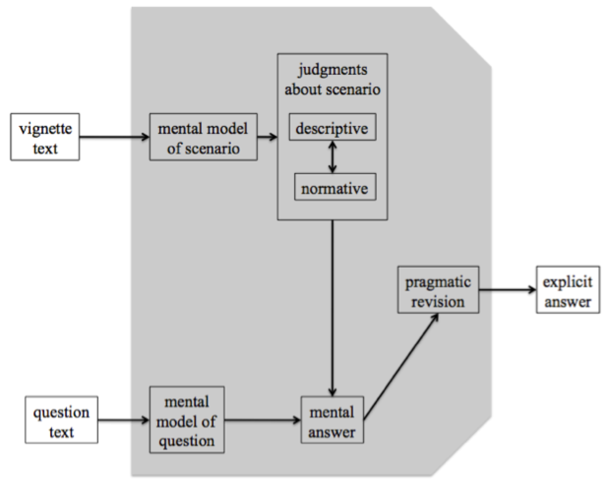

# Experimental Moral Philosophy
**First published Wed Mar 19, 2014; substantive revision Wed Jun 29, 2022**

*Alfano, Mark, Machery, Edouard, Plakias, Alexandra, Loeb, Don*

Experimental moral philosophy emerged as a methodology in the last decade of the twentieth century, as a branch of the larger experimental philosophy (X-Phi) approach. Experimental moral philosophy is the empirical study of moral intuitions, judgments, and behaviors. Like other forms of experimental philosophy, it involves gathering data using experimental methods and using these data to substantiate, undermine, or revise philosophical theories. In this case, the theories in question concern the nature of moral reasoning and judgment; the extent and sources of moral obligations; the nature of a good person and a good life; even the scope and nature of moral theory itself. This entry begins with a brief look at the historical uses of empirical data in moral theory and goes on to ask what, if anything, is distinctive about *experimental* moral philosophy—how should we distinguish it from related work in empirical moral psychology? After discussing some strategies for answering this question, the entry examines two of the main projects within experimental moral philosophy, and then discusses some of the most prominent areas of research within the field. As we will see, in some cases experimental moral philosophy has opened up new avenues of investigation, while in other cases it has influenced longstanding debates within moral theory.

## 1. Introduction and History

The idea that our actual moral judgments are an important source of information about the origins and justification of moral norms goes back to ancient Greece, if not further. Herodotus recounts a story in which the Persian emperor Darius invited Greek members of his court “and asked them what price would persuade them to eat the dead bodies of their fathers. They answered that there was no price for which they would do it.” Darius then summoned members of a different group, “and asked them… what would make them willing to burn their fathers at death. The Indians cried aloud, that he should not speak of so horrid an act.” Herodotus concludes that stories like these prove that, as the poet Pindar writes, “custom is king of all,” thereby providing an instance of the argument from moral disagreement for relativism. Likewise, in the *Outlines of Skepticism*, Sextus Empiricus stresses that empirical discoveries can destabilize our confidence in universal moral agreement:

> even if in some cases we cannot see an anomaly, we should say that possibly there is dispute about these matters too… Just as, if we had not, for example, known about the Egyptian custom of marrying their sisters, we should have affirmed, wrongly, that it is agreed by all that you must not marry your sister. (Sextus Empiricus, *Outlines of Skepticism*)

While the use of empirical observation in moral theory has a long history, the contemporary movement known as experimental philosophy goes back only a few decades. The current experimental philosophy movement owes its beginnings to the work of Stephen Stich, Shaun Nichols and Jonathan Weinberg (2001)[^weinberg-2001] and Joshua Knobe (2003)[^knobe-2003], but the earliest instance of experimental philosophy may be *Truth as Conceived by Those Who Are Not Professional Philosophers* (Naess 1938)[^naess-1938], which surveyed ordinary speakers for their intuitions about the nature of truth. Contemporary philosophers have not been uniformly accepting of the movement, but as we will see, there are reasons to think that experimental evidence might have a distinctive role, significance, and importance in moral philosophy and theorizing.

The relationship between more traditional philosophy and experimental work is instructive and brings out some tensions within moral philosophy and theory: namely, morality is at once practical and normative, and these two aspects inform and constrain the extent to which it is accountable to human psychology.

Insofar as morality is practical, it should be accessible to and attainable by agents like us: if a theory is too demanding, or relies on intuitions, judgments, motivations, or capacities that people do not (or, worse, cannot) possess, we might on those grounds dismiss it. On the other hand, morality is also normative: it aims not just to describe what we actually do or think, but to guide our practice. For this reason, some philosophers have responded to experimental results claiming to show that attaining and reliably expressing virtues in a wide variety of situations is difficult (see section 3.1 below for a discussion of this literature) by pointing out that the fact that people do not always make the right judgment, or perform actions for the right reasons, does not falsify a theory—it simply shows that people often act in ways that are morally deficient. We will return to these issues when we discuss criticisms of experimental moral philosophy at the end of this entry; for now, we mention them to illustrate that the extent to which experimental moral philosophy challenges traditional philosophical approaches is itself a controversial issue. Some moral philosophers see themselves as deriving moral principles a priori, without appeal to contingent facts about human psychology. Others see themselves as working within a tradition, going back at least as far as Aristotle, that conceives of ethics as the study of human flourishing. These philosophers have not necessarily embraced experimental moral philosophy, but many practitioners envision their projects as outgrowths of the naturalistic moral theories developed by Aristotle, Hume, and others.

### 1.1 What Are Experiments?

As the examples discussed above reveal, a variety of types of empirical evidence are useful to moral theorizing (see also the entries on empirical moral psychology, empirical distributive justice, and empirical psychology and character). Anthropological observation and data have long played a role in moral philosophy. The twentieth-century moral philosophers John Ladd and Richard Brandt investigated moral relativism in part by conducting their own ethnographies in Native American communities. Brandt writes, “We have… a question affecting the truth of ethical relativism which, conceivably, anthropology can help us settle. Does ethnological evidence support the view that ”qualified persons“ can disagree in ethical attitude?” But, he notes, “some kinds of anthropological material will not help us—in particular, bare information about intercultural differences in ethical opinion or attitude.” (1952: 238). This is a caveat frequently cited by philosophers engaged in empirical research: it is important to have philosophers participate in experimental design and the gathering of empirical data, because there are certain questions that must be addressed for the data to have philosophical applications—in this case, whether moral disagreements involve different factual beliefs or other non-moral differences. Barry Hallen (1986, 2000)[^hallen-1986][^hallen-2000] conducted a series of interviews and ethnographies among the Yoruba, investigating central evaluative concepts and language relating to epistemology, aesthetics, and moral value. Hallen was motivated by questions about the indeterminacy of translation, but his work provides an example of how in-depth interviews can inform investigations of philosophical concepts.

These examples show that ethnography has a valuable role to play in philosophical theory, but the remainder of this entry will focus primarily on experiments. Paradigmatic experiments involve randomized assignment to varying conditions of objects or people from a random sample, followed by statistical comparison of the outcomes for each condition. The variation in conditions is sometimes called a manipulation. For example, an experimenter might select a random sample of people, randomly assign them either to find or not to find a dime in the coin return of a pay phone, and then measure the degree to which they subsequently help someone they take to be in need (Isen & Levin 1972)[^isen-1972]. Finding or not finding the dime is the condition; degree of helpfulness is the outcome variable.

While true experiments follow this procedure, other types of studies allow non-random assignment to conditions. Astronomers, for example, sometimes speak of natural experiments. Although we are in no position to affect the motions of heavenly bodies, we can observe them under a variety of conditions, over long periods of time, and with a variety of instruments. Likewise, anthropological investigation of different cultures’ moral beliefs and practices is unlikely to involve manipulating variables in the lives of the members of the culture, but such studies are valuable and empirically respectable. Still, inferring causation is more difficult with such studies, so the evidential value of these studies is often less than that of experiments, at least in this respect; most published research in experimental philosophy involves true experiments.

Even within the category of experiments, we find a lot of diversity with respect to inputs, methods of measurement, and outputs. The experiment just described uses a behavioral measure and manipulation—finding the dime is the input, helping is the outcome measured. Other experiments measure not behavior but judgment or intuition, and this can be done using a survey or other form of self–report or informant–report where subjects respond explicitly to some question, situation, or dilemma. Studies measuring judgments might use either manipulations of the condition in which the subject makes the judgment, or they might look for correlations between judgments and some other factor, such as brain activity, emotional response, reaction time, visual attention, and so on (Strohminger et al. 2014)[^strohminger-2014].

The experimental methods available have also changed over time. Surveys have been the dominant method of experimental philosophy for the past few decades, but technology may change this: advances in virtual and augmented reality mean that philosophers can now immerse people in moral dilemmas such as Thompson’s (1971) violinist thought experiment and different versions of the trolley problem (e.g., Navarrete et al 2012)[^navarrete-2012]. Philosophers interested in the neural correlates of moral judgment can use transcranial magnetic stimulation (TMS) to investigate the effects of enhancing or lessening activity in certain areas of the brain. Even survey methods have seen advances thanks to technology; the ubiquity of smartphones allows researchers to ping people in real time, asking for reports on mood (see section 3.2 below for a discussion of surveys relating to happiness and mood).

Whether experimental moral philosophy has to use true experiments or can include studies and even ethnographies and other forms of qualitative data is partly a terminological question about how to define the field and whether we distinguish it from empirical moral psychology, a closely related research program. As we will see below, though, a diversity of both methods and subjects is important in helping experimental moral philosophy respond to its critics.

### 1.2 What Types of Questions and Data?

Like experimental philosophy more generally, experimental moral philosophy is interested in our intuitions and judgments about philosophical thought experiments and moral dilemmas. But research in this area also concerns the cognitive architecture underlying our moral judgments; the developmental processes that give rise to moral judgments; the neuroscience of moral judgment; and other related fields.

*Direct* experiments investigate whether a claim held (or denied) by philosophers is corroborated or falsified. This might mean investigating an intuition and whether it is as widely shared as philosophers claim, or it might mean investigating the claim that a certain behavior or trait is widespread or that two factors covary. For example, we find philosophers claiming that it is wrong to imprison an innocent person to prevent rioting; that a good life must be authentic; and that moral judgments are intrinsically motivating. Experimental research can be (and has been, as we will see below) brought to bear on each of these claims.

*Indirect* experiments look at the nature of some capacity or judgment: for example, whether certain types of moral dilemmas engage particular areas of the brain; how early children develop a capacity to empathize; and whether the moral/conventional distinction is universal across cultures (for discussion of the moral/conventional distinction, see Machery & Stich 2022)[^machery-2022]. These claims have philosophical relevance insofar as they help us understand the nature of moral judgment.

In addition to distinctions involving the type of data and how directly it bears on the question, we can also distinguish among experimental applied ethics, experimental normative ethics, and experimental metaethics. The first involves the variables that influence judgments about particular practical problems, such as how a self-driving car should respond to sacrificial dilemmas (Bonnefon, Sharriff & Rahwan 2016)[^bonnefon-2016]. The second involves investigations of how we ought to behave, act, and judge, as well as our intuitions about moral responsibility, character, and what constitutes a good life. The third involves debates over moral realism and antirealism. In this entry we focus on the latter two.

In many of these cases, the line between experimental moral philosophy and its neighbors is difficult to draw: what distinguishes experimental moral philosophy from empirical moral psychology? What is the difference between experimental moral philosophy and psychology or neuroscience that investigates morality? What is the difference between experimental moral philosophy and metaethics? We might try to answer these questions by pointing to the training of the experimenters—as philosophers or as scientists—but much of the work in these areas is done by collaborative teams involving both philosophers and social scientists or neuroscientists. In addition, some philosophers work in law and psychology departments, and graduate programs increasingly offer cross-disciplinary training. Another approach would be to look at the literature with which the work engages: many psychologists (e.g., Haidt, Greene) investigating moral judgment situate their arguments within the debate between Kantians and Humeans, so engagement with the philosophical tradition might be used as a criterion to distinguish experimental moral philosophy from experimental moral psychology. All this said, an inability to sharply distinguish experimental moral philosophy from adjoining areas of investigation may not be particularly important. Experimental philosophers often point out that the disciplinary divide between philosophy and psychology is a relatively recent phenomenon; early twentieth-century writers such as William James situated themselves in both disciplines, making vital contributions to each. If there is a problem here, it is not unique to experimental moral philosophy. For example, is work on semantics that uses both linguistics and analytic philosophy best understood as linguistics or philosophy of language? These debates arise, and may be largely moot, for many research programs that cut across disciplinary boundaries.

The rest of this entry proceeds as follows. Section 2 canvasses experimental research on moral judgments and intuitions, describing various programmatic uses to which experimental results have been put, then turning to examples of experimental research on moral judgment and intuition, including intuitions about intentionality and responsibility, the so-called linguistic analogy, and some cross-cultural work. Section 3 discusses experimental results on thick (i.e., simultaneously descriptive and normative) topics, including character and virtue, well-being, emotion and affect, and moral standing. Section 4 discusses questions about moral disagreement and moral language, both important sources of evidence in the longstanding debate over moral objectivity. Section 5 considers some objections to experimental moral philosophy.

## 2. Moral Intuitions and Conceptual Analysis

One role for experiments in moral philosophy, as indicated above, is to investigate our moral intuitions about cases, and to use the results gleaned from such investigations to guide or constrain our moral metaphysics, semantics, or epistemology. Philosophers often rely on such judgments—in the form of claims to the effect that “we would judge x” or, “intuitively, x”—as data or evidence for a theory (though see Cappelen 2012, Deutsch 2016, and Machery 2017 for critical discussion of this point)[^cappelen-2012][^deutsch-2016][^machery-2017][^machery-2017-2]. Claims about what we would judge or about the intuitive response to a case are empirically testable, and one project in experimental moral philosophy (perhaps the dominant original project) has been to test such claims via an investigation of our intuitions and related moral judgments. In doing so, experimental moral philosophers can accomplish one of two things: first, they can test the claims of traditional philosophers about what is or is not intuitive; second, they can investigate the sources of our intuitions and judgments. These tasks can be undertaken as part of a positive program, which uses our intuitions and judgments as inputs and constructs theories that accommodate and explain them. Alternatively, these tasks can figure in a negative program, which uses experimental research to undermine traditional appeals to intuition as evidence in moral philosophy and conceptual analysis more broadly. The negative program can proceed directly or indirectly: either via testing and refuting claims about intuitions themselves, or by discrediting the sources of those intuitions by discovering that they are influenced by factors widely regarded as not evidential or unreliable. We discuss both the negative program and the positive program below.

### 2.1 The Negative Program in Experimental Moral Philosophy

Early work in experimental philosophy suggested cross-cultural differences in semantic, epistemic, and moral intuitions. For example, Machery, Mallon, Nichols, and Stich (2004) argued that East Asian subjects were more likely to hold descriptivist intuitions than their Western counterparts, who tended to embrace causal theories of reference. Haidt (2006) argued that the extent to which people judged harmless violations such as eating a deceased pet, or engaging in consensual sibling incest, to be wrong depended on socioeconomic status. Since, presumably, moral wrongness doesn’t itself depend on socioeconomic status, gender, or culture of the person making the moral judgment, these results have been marshaled to argue either against the evidential value of intuitions or against the existence of moral facts altogether.

Negative experimental moral philosophy generates results that are then used to discount the evidential value of appeals to intuition (for review, Machery 2017, Chapter 2)[^machery-2017][^machery-2017-2]. For example, Singer (2005)[^singer-2005], Sinnott-Armstrong (2008d)[^sinnott-armstrong-2008d], Lanteri and colleagues (2008), Lombrozo (2009)[^lombrozo-2009], Schwitzgebel and Cushman (2012, 2015)[^cushman-2012], Liao and colleagues (2012), Tobia and colleagues (2013), Wiegmann and colleagues (2020), Rehren and Walter (2021), and McDonald et al. (2021) have argued that moral intuitions are subject to normatively irrelevant situational influences (e.g., order or framing effects), while Feltz and Cokely (2009) and Knobe (2011)[^knobe-2011] have documented correlations between moral intuitions and (presumably) normatively irrelevant individual differences (e.g., extroversion). Such results might warrant skepticism about moral intuitions, or at least about some classes of intuitions or intuiters.[^note-1]

The studies just mentioned involve results that suggest that the content of intuitions varies along some normatively irrelevant dimension. Another source of evidence for the negative program draws on results regarding the cognitive mechanisms underlying or generating intuitions themselves. For example, studies that suggest that deontological intuitions are driven by emotional aversions to harming others have been used to argue that we ought to discount our deontological intuitions in favor of consequentialist principles—an idea discussed in more detail below (see Singer 2005; Wiegman 2017)[^singer-2005][^wiegman-2017]. In several experiments, Kneer and Machery (2019) show that judgments about moral luck result from the hindsight bias, i.e., the tendency to overestimate the probability that events known to have happened would happen. Thus, the probability that the unlucky event in a bad luck situation (e.g., a car accident involving a drunk driver) would happen is overestimated and the agent is judged to have been more negligent than her counterpart in a lucky situation (the drunk driver who did not get into any accident). This psychological account is then used to undermine the philosophical significance of intuitions about moral luck: If the asymmetry between good and back luck situations is due to a psychological bias, it should not bear on philosophical theorizing.

The distinction between negative and positive experimental moral philosophy is difficult to draw, partly because the negative program often discounts particular classes or types of intuitions in favor of others that are supposed to be more reliable. For example, Singer offers an anti-deontological argument as part of the negative program insofar as his argument uses the emotional origins of deontological intuitions to discount them. But because he then argues for the superiority of consequentialist intuitions, his position also fits within the positive program. So the difference between the two programs is not in the data or the kinds of questions investigated, but in how the data are put to use—whether they are seen as debunking traditional philosophical appeals to intuition or as an addition to traditional philosophical appeals to intuition, by helping philosophers distinguish between reliable and unreliable intuitions and their sources. In the next section, we look at positive uses of intuitions as evidence.

### 2.2 The Positive Program in Experimental Moral Philosophy

Other philosophers are more sanguine about the upshot of experimental investigations of moral judgment and intuition. Knobe, for example, uses experimental investigations of the determinants of moral judgments to identify the contours of philosophically resonant concepts and the mechanisms or processes that underlie moral judgment. He has argued for the pervasive influence of moral considerations throughout folk psychological concepts (2009, 2010; see also Pettit & Knobe 2009)[^knobe-2009][^pettit-2009], claiming, among other things, that the concept of an intentional action is sensitive to the foreseeable evaluative valence of the consequences of that action (2003, 2004b, 2006).[^note-2]

Another line of research is due to Joshua Greene and his colleagues (Greene et al. 2001, 2004, 2008; Greene 2008)[^greene-2008][^greene-2008-2][^greene-2004][^greene-2001], who investigate the neural bases of consequentialist and deontological moral judgments (but see Kahane et al. 2015)[^kahane-2015]. Greene and his colleagues elicited the intuitions of subjects about a variety of trolley problems—cases that present a dilemma in which a trolley is racing towards five individuals, all of whom will be killed unless the trolley is instead diverted towards one individual—while inside an fMRI scanner. The researchers found that, when given cases in which the trolley is diverted by pulling a switch, most subjects agreed that diverting the trolley away from the five and towards the one person was the right action. When, instead, the case involved pushing a person off a bridge to land in front of and halt the trolley, subjects were less likely to judge that sacrificing the one person as morally permissible. In addition, Greene found that subjects who did judge it permissible to push the person took longer to arrive at their judgment, suggesting that they had to overcome conflicting intuitions to do so (but see McGuire et al. 2009)[^mcguire-2009]—a finding bolstered by the fact that when subjects considered pushing the person off the bridge, their brains revealed increased activity in areas associated with the aggregation and modulation of value signals (e.g., ventromedial prefrontal cortex and dorsolateral prefrontal cortex). Greene concludes that our aversion to pushing the person is due to an emotional response to the thought of causing physical harm to someone, while our willingness to pull the switch is due to the rational calculation that saving five people is preferable to letting five people die to spare one life. Greene and Singer use these findings as a basis for a debunking of deontological intuitions and a vindication of consequentialism, since the latter rests on intuitions which stem from a source we consider both generally reliable and appropriately used as the basis for moral reasoning. It should be noted, though, that this argument presupposes that emotional reactions are (at least in these cases) necessarily irrational or arational; philosophers who are unsympathetic to such a view of emotions need not follow Greene and Singer to their ultimate conclusions (Berker 2009; Greene 2014; Railton 2014)[^berker-2009][^greene-2014][^railton-2014].

A related approach aims to identify the features to which intuitions about philosophically important concepts are sensitive. Sripada (2011)[^sripada-2011][^sripada-2011-2] thinks that the proper role of experimental investigations of moral intuitions is not to identify the mechanisms underlying moral intuitions. Such knowledge, it is claimed, contributes little of relevance to philosophical theorizing. It is rather to investigate, on a case by case basis, the features to which people are responding when they have such intuitions. On this view, people (philosophers included) can readily identify whether they have a given intuition, but not why they have it. An example from the debate over determinism and free will: manipulation cases have been thought to undermine compatibilist intuitions—intuition supporting the notion that determinism is compatible with “the sort of free will required for moral responsibility” (Pereboom 2001)[^pereboom-2001]. In such cases, an unwitting victim is described as having been surreptitiously manipulated into having and reflectively endorsing a motivation to perform some action. Critics of compatibilism say that such cases satisfy compatibilist criteria for moral responsibility, and yet, intuitively, the actors are not morally responsible (Pereboom 2001)[^pereboom-2001]. Sripada (2011)[^sripada-2011][^sripada-2011-2] makes a strong case, however, through both mediation analysis and structural equation modeling, that to the extent that people feel the manipulee not to be morally responsible, they do so because they judge him in fact not to satisfy the compatibilist criteria.[^note-3] Thus, by determining which aspects of the case philosophical intuitions are responding to, it might be possible to resolve otherwise intractable questions.

### 2.3 An Example: Intentionality and Responsibility

Since Knobe’s seminal (2003) paper, experimental philosophers have investigated the complex patterns in people’s dispositions to make judgments about moral notions (praiseworthiness, blameworthiness, responsibility), cognitive attitudes (belief, knowledge, remembering), motivational attitudes (desire, favor, advocacy), and character traits (compassion, callousness) in the context of violations of and conformity to various norms (moral, prudential, aesthetic, legal, conventional, descriptive).[^note-4] In Knobe’s original experiment, participants first read a description of a choice scenario: the protagonist is presented with a potential policy (aimed at increasing profits) that would result in a side effect (either harming or helping the environment). Next, the protagonist explicitly disavows caring about the side effect, and chooses to go ahead with the policy. The policy results as advertised: both the primary and the side effect occur. Participants are asked to attribute intentionality or an attitude (or, in the case of later work by Robinson et al. 2013, a character trait)[^robinson-2013] to the protagonist. What Knobe found was that participants were significantly more inclined to indicate that the protagonist had intentionally brought about the side effect when it was perceived to be bad (harming the environment) than when it was perceived to be good (helping the environment). This effect has been replicated dozens of times, and its scope has been greatly expanded from intentionality attributions after violations of a moral norm to attributions of diverse properties after violations of a wide variety of norms.

The first-order aim of interpreters of this body of evidence is to create a model that predicts when the attribution asymmetry will crop up. The second-order aims are to explain as systematically as possible why the effect occurs, and to determine the extent to which the attribution asymmetry can be considered rational. Figure 1, presented here for the first time, models how participants’ responses to this sort of vignette are produced (for a different, neuroscientific approach, see Ngo et al. 2015)[^ngo-2015]:

*Figure 1.* Model of Participant Response to Experimental Philosophy Vignettes

In this model, the boxes represent constructs, the arrows represent causal or functional influences, and the area in grey represents the mind of the participant, which is not directly observable but is the target of investigation. In broad strokes, the idea is that a participant first reads the text of the vignette and forms a mental model of what happens in the story. On the basis of this model (and almost certainly while the vignette is still being read), the participant begins to interpret, i.e., to make both descriptive and normative judgments about the scenario, especially about the mental states and character traits of the people in it. The participant then reads the experimenter’s question, forms a mental model of what is being asked, and—based on her judgments about the scenario—forms an answer to that question. That answer may then be pragmatically revised (to avoid unwanted implications, to bring it more into accord with what the participant thinks the experimenter wants to hear, etc.) and is finally recorded as an explicit response to a statement about the protagonist’s attitudes (e.g., “he brought about the side effect intentionally,” graded on a Likert scale).[^note-5]

A result that has been replicated repeatedly is that, when the vignette describes a norm violation, subjects indicate that they agree more strongly that the action violating the norm was performed intentionally. While this finding could be used by proponents of the negative program to undermine the conceptual coherence of our notion of moral responsibility, experimental moral philosophers working in the positive program have taken up the task of explaining the asymmetry by postulating models of unobservable entities that mediate, explain, and perhaps even rationalize the asymmetry. A discussion of several attempts to do so follows; each offers a different explanation of the asymmetry, but all represent vindications or at least rehabilitations of our intuitions about intention.

*The Conceptual Competence Model*

Perhaps the best known is Knobe’s conceptual competence model, according to which the asymmetry arises at the judgment stage. On this view, normative judgments about the action influence otherwise descriptive judgments about whether it was intentional (or desired, or expected, etc.). Moreover, this influence is taken to be part of the very conception of intentionality (desire, belief, etc.). Thus, on the conceptual competence model, the asymmetry in attributions is a rational expression of the ordinary conception of intentionality (desire, belief, etc.), which turns out to have a normative component (see Machery 2008 for doubts about how to circumscribe what is part of the conceptual competence with any given concept)[^machery-2008].[^note-6]

*The Motivational Bias Model*

The motivational bias model (Alicke 2008; Nadelhoffer 2004, 2006)[^alicke-2008][^nadelhoffer-2004][^nadelhoffer-2006] agrees that the asymmetry originates in the judgment stage, and that normative judgments influence descriptive judgments. However, unlike the conceptual competence model, it takes this to be a bias rather than an expression of conceptual competence. Thus, on this model, the asymmetry in attributions is a distortion of the correct conception of intentionality (desire, belief, etc.).

*The Deep Self Model*

The deep self concordance model (Sripada 2010, 2012; Sripada & Konrath 2011)[^sripada-2010][^sripada-2011][^sripada-2012][^sripada-2011-2] also locates the source of the asymmetry in the judgment stage, but does not recognize an influence (licit or illicit) of normative judgments on descriptive judgments. Instead, proponents of this model claim that when assessing intentional action, people not only attend to their representation of a person’s “surface” self—her expectations, means-end beliefs, moment-to-moment intentions, and conditional desires—but also to their representation of the person’s “deep” self, which harbors her sentiments, values, and core principles (for critical discussion, see Rose et al. 2012)[^rose-2012]. According to this model, when assessing whether someone intentionally brings about some state of affairs, people determine (typically unconsciously) whether there exists sufficient concordance between their representation of the outcome the agent brings about and what they take to be her deep self. For instance, when the chairman says he does not care at all about either harming or helping the environment, people attribute to him a deeply anti-environment stance. When he harms the environment, this is concordant with his anti-environment deep self; in contrast, when the chairman helps the environment, this is discordant with his anti-environment deep self. According to the deep self concordance model, then, the asymmetry in attributions is a reasonable expression of the folk psychological distinction between the deep and shallow self.

*The Conversational Pragmatics Model*

Unlike the models discussed so far, the conversational pragmatics model (Adams & Steadman 2004, 2007; Lindauer & Southwood 2021)[^adams-2004][^adams-2007][^lindauer-2021] locates the source of the asymmetry in the pragmatic revision stage. According to this model, participants judge the protagonist not to have acted intentionally in both norm-conforming and norm-violating cases. However, when it comes time to tell the experimenter what they think, participants do not want to be taken as suggesting that the harm-causing protagonist is blameless, so they report that he acted intentionally. This is a reasonable goal, so according to the pragmatic revision model, the attribution asymmetry is rational, though misleading.

*The Trade-Off Model*

The trade-off model (Machery 2008)[^machery-2008] disagrees with the previous models about the location of the source of the asymmetry: it locates it in the interpretation of the scenario. It proposes that when people read that the chairman agrees to harm the environment, they conceptualize the side effect *harming the environment* as a cost, that is, as something that is negatively valued and that one must incur if one is to reap a greater benefit. People think of this cost as being offset by the benefit *increasing the profits of the company*. That is, they conceptualize the harm case as involving a trade-off between a cost and a benefit. The side effect *helping the environment* cannot be conceptualized in this way since it cannot be plausibly thought of as a cost. Since people think of costs as being intentionally incurred in order to reap some foreseen benefits, the side effect is judged to be intentional in the former situation, but not in the latter situation.

*The Deliberation Model*

Like the trade-off model, according to the deliberation model (Alfano, Beebe, & Robinson 2012; Robinson, Stey, & Alfano 2013; Scaife & Webber 2013)[^alfano-2013][^alfano-2012][^beebe-2012][^robinson-2013][^scaife-2013], the best explanation of the complex patterns of evidence is that the very first mental stage, the formation of a mental model of the scenario, differs between norm-violation and norm-conformity vignettes. When the protagonist is told that a policy he would ordinarily want to pursue violates a norm, he acquires a reason to deliberate further about what to do; in contrast, when the protagonist is told that the policy conforms to some norm, he acquires no such reason. Participants tend to think of the protagonist as deliberating about what to do when and only when a norm would be violated. Since deliberation leads to the formation of other mental states such as beliefs, desires, and intentions, this basal difference between participants’ models of what happens in the story flows through the rest of their interpretation and leads to the attribution asymmetry. On the deliberation model, then, the attribution asymmetry originates earlier than other experimental philosophers suppose, and is due to rational processes.

### 2.4 Another Example: The Linguistic Analogy

Another positive program investigates the structure and form of moral intuitions, in addition to their content, with the aim of using these features to inform a theory of the cognitive structures underlying moral judgment and their etiology.

Rawls (1971)[^rawls-1971], drawing on Chomsky’s (1965)[^chomsky-1965] theory of generative linguistics, suggested that moral cognition might be usefully modeled on our language faculty, a parallel endorsed by Chomsky himself:

> I don’t doubt that we have a natural moral sense….That is, just as people somehow can construct an extraordinarily rich system of knowledge of language on the basis of rather limited and degenerate experience, similarly, people develop implicit systems of moral evaluation, which are more or less uniform from person to person. There are differences, and the differences are interesting, but over quite a substantial range we tend to make comparable judgments, and we do it, it would appear, in quite intricate and delicate ways involving new cases and agreement often about new cases… and we do this on the basis of a very limited environmental context available to us. The child or the adult doesn’t have much information that enables the mature person to construct a moral system that will in fact apply to a rich range of cases, and yet that happens.…whenever we see a very rich, intricate system developing in a more or less uniform way on the basis of rather restricted stimulus conditions, we have to assume that there is a very powerful, very rich, highly structured innate component that is operating in such a way as to create that highly specific system on the basis of the limited data available to it. (Chomsky, quoted in Mikhail 2005)[^mikhail-2005].

Here Chomsky points to four similarities between the development of linguistic knowledge and the development of moral knowledge:

> L1: A child raised in a particular linguistic community almost inevitably ends up speaking an idiolect of the local language despite lack of sufficient explicit instruction, lack of extensive negative feedback for mistakes, and grammatical mistakes by caretakers.
>
> M1: A child raised in a particular moral community almost inevitably ends up judging in accordance with an idiolect of the local moral code despite lack of sufficient explicit instruction, lack of sufficient negative feedback for moral mistakes, and moral mistakes by caretakers.
>
> L2: While there is great diversity among natural languages, there are systematic constraints on possible natural languages.
>
> M2: While there is great diversity among natural moralities, there are systematic constraints on possible natural moralities.
>
> L3: Language-speakers obey many esoteric rules that they themselves typically cannot articulate or explain, and which some would not even recognize.
>
> M3: Moral agents judge according to esoteric rules (such as the doctrine of double effect) that they themselves typically cannot articulate or explain, and which some would not even recognize.
>
> L4: Drawing on a limited vocabulary, a speaker can both produce and comprehend a potential infinity of linguistic expressions.
>
> M4: Drawing on a limited moral vocabulary, an agent can produce and evaluate a very large (though perhaps not infinite) class of action-plans, which are ripe for moral judgment.

We will now explain and evaluate each of these pairs of claims in turn.

L1/M1 refer to Chomsky’s *poverty of the stimulus* argument: despite receiving little explicit linguistic and grammatical instruction, children develop language rapidly and at a young age, and quickly come to display competence applying complex grammatical rules. Similarly, Mikhail and other proponents of the analogy argue that children acquire moral knowledge at a young age based on relatively little explicit instruction. However, critics of the analogy point out several points of difference. First, children actually receive quite a bit of explicit moral instruction and correction, and in contrast with the linguistic case, this often takes the form of explicit statements of moral rules: ‘don’t hit,’ ‘share,’ and so on. Secondly, there is debate over the age at which children actually display moral competence. Paul Bloom (2013; see also Blake, McAuliffe, and Warneken 2014)[^blake-2014] has argued that babies display moral tendencies as early as 3–6 months, but others (most famously Kohlberg (1969) and Piaget (1970)) have argued that children are not fully competent with moral judgment until as late as 8–12 years, by which time they have received quite a bit of moral instruction, both implicit and explicit. A related point concerns the ability to receive instructions: in the case of language, a child requires some linguistic knowledge or understanding in order even to receive instruction: a child who has no understanding of language will not understand instructions given to her. But in the moral case, a child need not understand moral rules in order to be instructed in them, so there is less need to posit some innate knowledge or understanding. Nichols et al. (2016) have conducted a series of experiments using statistical learning and Bayesian modeling to show how children might learn complex rules with scant input (see also Nichols 2021)[^nichols-2021]. Finally, while children may initially acquire the moral values present in their environment, they sometimes change their values or develop their own values later in life in ways that present spontaneously and with little conscious effort. This is in marked contrast with language; as any second-language learner will recognize, acquiring a new language later in life is effortful and, even if one succeeds in achieving fluency, the first language is rarely lost. Lastly, as Prinz (2008)[^prinz-2008] points out, children are punished for moral violations, which may explain why they are quicker to learn moral than grammatical rules.

L2/M2 refer to the existence of so-called *linguistic universals*: structures present in all known languages. Whether this is true in the moral case is controversial, for reasons we’ll discuss further below. Prinz (2008)[^prinz-2008] and Sripada (2004) have argued that there are no *exceptionless* moral universals, unless one phrases or describes the norms in question in such a way as to render them vacuous. Sripada uses the example ‘murder is wrong’ as a vacuous rule: while this might seem like a plausible candidate for a moral universal, when we consider that ‘murder’ refers to a wrongful act of killing, we can see that the norm is not informative. But Mikhail might respond by claiming that the fact that all cultures recognize a subset of intentional killings as morally wrong, even if they differ in how they circumscribe this subset, is itself significant, and the relevant analogy here would be with the existence of categories like ‘subject’, ‘verb’, and ‘object’ in all languages, or with features like recursion, which are present in the grammars of all natural languages (but see Everett 2005)[^everett-2005].

L3/M3 refer to the patterns displayed by grammatical and moral intuitions. In the case of language, native speakers can recognize grammatical and ungrammatical constructions relatively easily, but typically cannot articulate the rules underlying these intuitions. In the case of moral grammar, the analogy claims, the same is true: we produce moral intuitions effortlessly without being able to explain the rules underlying them. Indeed, in both cases, the rules underlying the judgments might be quite esoteric and difficult for native speakers to learn and understand.

L4/M4 refer to the fact that we can embed linguistic phrases within other linguistic phrases to create novel and increasingly complex phrases and sentences. This property is known as *recursion*, and is present in all known natural languages (indeed, Chomsky suggests that perhaps recursion is the only linguistic universal; see Hauser, Chomsky & Fitch 2002; but see Everett 2005)[^everett-2005][^hauser-2002]. For instance, just as phrases can be embedded in other phrases to form more complex phrases:

> the calico cat $\rightarrow$ the calico cat (that the dog chased) $\rightarrow$ the calico cat (that the dog [that the breeding conglomerate wanted] chased) $\rightarrow$ the calico cat (that the dog [that the breeding conglomerate{that was bankrupt} wanted] chased)

so the descriptions of actions that are morally assessed can be embedded in other action descriptions to produce novel action descriptions (Harman 2008, 346)[^harman-2008]. For example:

> It’s wrong to $x \rightarrow$ It’s wrong to coerce someone to $x \rightarrow$ It’s wrong to persuade someone to coerce someone to $x$.

The point is twofold: first, we can create complex action descriptions; second, we can evaluate novel and complex actions and respond with relatively automatic intuitions of grammatical or moral permissibility.

Mikhail (2011: 43–48)[^mikhail-2011] uses experimental evidence of judgments about trolley problems to argue that our moral judgments are generated by imposing a deontic structure on our representation of the causal and evaluative features of the action under consideration. Mikhail points to a variation on the poverty of the stimulus argument, which he calls the *poverty of the perceptual stimulus* (Mikhail 2009: 37)[^mikhail-2009]: when faced with a particular moral situation, we draw complex inferences about both act and actor based on relatively little data. Mikhail (2010) uses this argument against models of moral judgment as affect-driven intuitions:

> Although each of these rapid, intuitive, and highly automatic moral judgments is occasioned by an identifiable stimulus, how the brain goes about interpreting these complex action descriptions and assigning a deontic status to each of them is not something revealed in any obvious way by the surface structure of the stimulus itself. Instead, an intervening step must be postulated: an intuitive appraisal of some sort that is imposed on the stimulus prior to any deontic response to it. Hence, a simple perceptual model, such as the one implicit in Haidt’s (2001)[^haidt-2001] influential model of moral judgment, appears inadequate for explaining these intuitions, a point that can be illustrated by calling attention to the unanalyzed link between eliciting situation and intuitive response in Haidt’s model

Unlike the traditional poverty of the stimulus argument, this version does not rely on developmental evidence, but on our ability to quickly and effortlessly appraise complicated scenarios, such as variations on trolley problems, in a way that is independent of their superficial features (e.g., the way they are described), and then issue normative judgments. The postulated intervening step is like the unconscious appeal to rules of grammar, and the evidence for such a step must come from experiments showing that we do, in fact, have such intuitions, and that they conform to predictable patterns.

The linguistic analogy relies on experimental evidence about the nature and pattern of our moral intuitions, and it outlines an important role for experiments in moral theory. If the analogy holds, then a descriptively adequate moral theory must be based on the judgments of competent moral judges (although a reformist moral theory need not, or at least not to the same extent), just as grammatical rules are constructed based on the judgments of competent speakers. A pressing task will be the systematic collection of such judgments. The analogy also suggests a kind of rationalism about moral judgment, since it posits that our judgments result from the unconscious application of rules to cases. Finally, the analogy might have metaethical implications. Just as we can only evaluate grammaticality of utterances relative to a language, it may be that we can only evaluate the morality of an action relative to a specific moral system. How to individuate moralities, and how many (assuming there are multiple ones) there are, is a question for further empirical investigation, and here again experimental evidence will play a crucial role.

### 2.5 Cross-Cultural Experimental Moral Philosophy

Guided by the idea that variation in some judgments might challenge our trust in them (Machery 2017, Chapter 4)[^machery-2017][^machery-2017-2], the negative program has led experimental philosophers to examine whether moral judgments vary across cultures and other demographic groups (see also Graham et al. 2016; Doris et al. 2020)[^doris-2020][^graham-2016]. Early research focused on the distinction between causing harm as a means or as a side effect, and failed to find any cultural variation using the footbridge and the bystander versions of the trolley case (Hauser et al. 2007; Moore et al. 2011)[^hauser-2007][^moore-2011], but a few articles have observed differences among Americans, Russians and Chinese (Ahlenius & Tännsjö 2012)[^ahlenius-2012], English and Chinese (Gold et al. 2014)[^gold-2014], and Yali horticulturalists in Papua (Sorokowski et al. 2020)[^sorokowski-2020]. A recent study of moral judgments in 45 countries found that people find it less acceptable to cause someone’s death as a means to prevent a greater harm than as a mere side effect; they also find it less acceptable to cause someone’s death as a means to prevent a greater harm when the death results from “personal force”, i.e., when the force that impacts the victim originates in the agent’s muscles; but the interaction between these two factors, which had been observed in the USA, was only found in Western countries (Bago et al. 2022)[^bago-2022]. Moral dilemmas that investigate the permissibility of causing harm to prevent a greater harm also elicit different judgments from men and women: in a metaanalysis of 40 studies, men were more likely to find it permissible to cause harm to prevent a greater harm in this kind of moral dilemmas (Friesdorf et al. 2015)[^friesdorf-2015]. Hannikainen, Machery and Cushman (2018) have also shown that Millenials are more likely to find it permissible to cause harm to prevent a greater harm in the footbridge case than Gen Xers and Boomers, suggesting that the relevant moral norms might have culturally evolved.

Variation is not limited to sacrificial dilemmas (Stich and Machery in press). Cultural factors moderate the influence of valence on judgment about the intentionality of action that was discussed above (Robbins, Shepard and Rochat 2017)[^robbins-2017]: in two rural, traditional cultures (Samoa and Vanuatu) people were more likely to judge the good side effect than the bad side effect as intentional if the protagonist had a high status.

Another area of investigation focuses on the distinction between norms that are thought to be moral and norms that aren’t (see also Machery and Stich 2022 for the cross-cultural work on the moral/conventional distinction)[^machery-2022]. Buchtel et al. (2015) have shown that the Mandarin translation of “immoral” applies to a surprisingly different set of behaviors than “immoral” in English: the former primarily applies to behaviors viewed as uncivilized, the latter often to harmful behavior (see also Dranseika, Berniūnas & Silius 2018)[^dranseika-2018]. Berniūnas (2020)[^berniūnas-2020] extends this research to the Mongolian translation of “moral.” Asking people to classify norms as moral and non-moral, Levine and colleagues (2021) have also shown that religious affiliation influences what counts as moral: religious Jews and non-believers have a very narrow moral domain, while Christians and Muslims tend to have a broad moral domain; surprisingly, Hindus fail to distinguish moral from non-moral norms (see also Dranseika, Berniūnas & Sousa 2016)[^berniūnas-2016]. This kind of findings has led Machery (2018)[^machery-2018] to propose that morality is a cultural invention that is not found in every culture (see also Stich 2018)[^stich-2018].

Judgments related to free will, control, blame, and punishment also vary across cultures (Hannikainen et al. 2019; for a different line of cross-cultural research on free will, see Sarkissian et al. 2010)[^hannikainen-2019][^sarkissian-2010]. In most cultures, people deny free will and control (and thus blame and punish less) when the agent’s action is described as antecedently caused; by contrast, they assign free will and control when the action originates stems from the agent’s own will even if she could not have done otherwise (a situation illustrated by Frankfurt cases). East Asians, however, differ in treating these two kinds of situations similarly: if the surrounding circumstances undercut the agent’s capacity to have done otherwise, they tend to deny her free will and control. East Asians’ greater attention to contextual factors when explaining behavior (Choi, Nisbett and Norenzayan 1999)[^choi-1999] might account for this finding (for related research, see Buchtel et al. 2018)[^buchtel-2018]. Berniunas and colleagues (2021) have even argued that the concept of free will is a culture-specific concept, not found in most cultures.

## 3. Character, Wellbeing, Emotion, and Moral Standing

Until the 1950s, modern moral philosophy had largely focused on either consequentialism or deontology. The revitalization of virtue ethics led to a renewed interest in virtues and vices (e.g., honesty, generosity, fairness, dishonesty, stinginess, unfairness), in *eudaimonia* (often translated as ‘happiness’ or ‘flourishing’), and in the emotions. In recent decades, experimental work in psychology, sociology, and neuroscience has been brought to bear on the empirical grounding of philosophical views in these areas.

### 3.1 Character and Virtue

A virtue is a complex disposition comprising sub-dispositions to notice, construe, think, desire, and act in characteristic ways. To be generous, for instance, is (among other things) to be disposed to notice occasions for giving, to construe ambiguous social cues charitably, to desire to give people things they want, need, or would appreciate, to deliberate well about what they want, need, or would appreciate, and to act on the basis of such deliberation. Manifestations of such a disposition are observable and hence ripe for empirical investigation. Virtue ethicists of the last several decades have sometimes been optimistic about the distribution of virtue in the population. Alasdair MacIntyre claims, for example, that “without allusion to the place that justice and injustice, courage and cowardice play in human life very little will be genuinely explicable” (1984: 199). Julia Annas (2011: 8–10)[^annas-2011] claims that “by the time we reflect about virtues, we already have some.” Linda Zagzebski (2010)[^zagzebski-2010] provides an “exemplarist” semantics for virtue terms that only gets off the ground if there are in fact many virtuous people.

Starting with Owen Flanagan’s *Varieties of Moral Personality* (1993), philosophers began to worry that empirical results from social psychology were inconsistent with the structure of human agency presupposed by virtue theory. In this framework, people are conceived as having more or less fixed traits of character that systematically order their perception, cognition, emotion, reasoning, decision-making, and behavior. For example, a generous person is inclined to notice and seek out opportunities to give supererogatorily to others. The generous person is also inclined to think about what would (and wouldn’t) be appreciated by potential recipients, to feel the urge to give and the glow of satisfaction after giving, to deliberate effectively about when, where, and how to give to whom, to come to firm decisions based on such deliberation, and to follow through on those decisions once they’ve been made. Other traits are meant to fit the same pattern, structuring perception, cognition, motivation, and action of their bearers. Famous results in social psychology, such as Darley and Batson’s (1973) Good Samaritan experiment, seem to tell against this view of human moral conduct. When someone helps another in need, they may do so simply because they are not in a rush, rather than because they are expressing a fixed trait like generosity or compassion.

In the virtue-theoretic framework, people are not necessarily assumed to already be virtuous. However, they are assumed to be at least potentially responsive to the considerations that a virtuous person would ordinarily notice and take into account. Flanagan (1993), followed by Doris (1998, 2002, in press), Harman (1999, 2000)[^harman-1999], and Alfano (2013)[^alfano-2013], made trouble for this framework by pointing to social psychological evidence suggesting that much of people’s thinking, feeling, and acting is instead predicted by (and hence responsive to) situational factors that don’t seem to count as reasons at all—not even bad reasons or temptations to vice. Early discussions of these situational factors emphasized influences such as ambient sensibilia (sounds, smells, light levels, etc.), seemingly trivial and normatively irrelevant inducers of positive and negative moods, order of presentation of stimuli, and a variety of framing and priming effects, many of which are reviewed in Alfano (2013: 40–50)[^alfano-2013].[^note-7] It’s worth emphasizing the depth of the problem these studies appeared to pose. It’s not that they suggest that most people aren’t virtuous (although they do suggest that as well). It’s that they suggest that they undermine the entire framework in which people are conceived as cognitively sensitive and motivationally responsive to reasons. Someone whose failure to act virtuously because they gave in to temptation can be understood in the virtue-theoretic framework. Someone whose failure to act virtuously because they’d just been subliminally primed with physical coldness, which in turn is metaphorically associated with social coldness, finds no place in the virtue-theoretic framework. These sorts of effects push us to revamp our whole notion of agency and personhood (Doris 2015)[^doris-2015].

Some of the most surprising findings touted by critics of virtue ethics (e.g., social priming) now appear to be unreplicable (for discussion, see Alfano 2018)[^alfano-2018], but this outcome does not provide much solace to virtue theorists. Early estimates suggested that individual difference variables typically explain less than 10% of the variance in people’s behavior (Mischel 1968)[^mischel-1968]—though, as Funder and Ozer (1983) pointed out, situational factors may explain less than 16%.[^note-8] More recent aggregated evidence indicates that situational factors explain approximately twice as much of the variance in human behavior as the five main trait factors (Rauthmann et al. 2014). Convergent evidence from both lexicographical and survey studies indicates that there are at least five dimensions of situations that reliably predict thought, feeling, and behavior: (1) negative valence, (2) adversity, (3) duty, (4) complexity, and (5) positive valence (Rauthmann and Sherman 2018)[^rauthmann-2018].

According to Doris (2002, in press), the best explanation of this lack of cross-situational consistency is that the great majority of people have local rather than global, traits: they are not honest, courageous, or greedy, but they may be honest-while-in-a-good-mood, courageous-while-sailing-in-rough-weather-with-friends, and greedy-unless-watched-by-fellow-parishioners. In contrast, Christian Miller (2013, 2014)[^miller-2013][^miller-2014] thinks the evidence is best explained by a theory of mixed global traits, such as the disposition to (among other things) help because it improves one’s mood. Such traits are global, in the sense that they explain and predict behavior across situations (someone with such a disposition will, other things being equal, typically help so long as it will maintain her mood), but normatively mixed, in the sense that they are neither virtues nor vices. Mark Alfano (2013)[^alfano-2013] goes in a third direction, arguing that virtue and vice attributions tend to function as self-fulfilling prophecies. People tend to act in accordance with the traits that are attributed to them, whether the traits are minor virtues such as tidiness (Miller, Brickman, & Bolen 1975)[^miller-1975] and ecology-mindedness (Cornelissen et al. 2006, 2007)[^cornelissen-2006], major virtues such as charity (Jensen & Moore 1977)[^jensen-1977], cooperativeness (Grusec et al. 1978)[^grusec-1978], and generosity (Grusec & Redler 1980)[^grusec-1980], or vices such as cutthroat competitiveness (Grusec et al. 1978)[^grusec-1978]. On Alfano’s view, when people act in accordance with a virtue, they often do so not because they possess the trait in question, but because they think they do or because they know that other people think they do. He calls such simulations of moral character *factitious virtues*, and even suggests that the notion of a virtue should be revised to include reflexive and social expectations.[^note-9]

It might seem that the criticisms that motivate these novel approaches to virtue miss their mark. After all, virtue ethicists needn’t (and often don’t) commit themselves to the claim that almost everyone *is* virtuous. Instead, many argue that virtue is the normative goal of moral development, and that people mostly fail in various ways to reach that goal. The argument from the fact that most people’s dispositions are not virtues to a rejection of orthodox virtue ethics, then, might be thought a *non sequitur*, at least for such views. But empirically-minded critics of virtue ethics do not stop there. They all have positive views about what sorts of dispositions people have *instead* of virtues. These dispositions are alleged to be so structurally dissimilar from virtues (as traditionally understood) that it may be psychologically unrealistic to treat (traditional) virtue as a regulative ideal. What matters, then, is the width of the gap between the descriptive and the normative, between the (structure of the) dispositions most people have and the (structure of the) dispositions that count as virtues.

Three leading defenses against this criticism have been offered. Some virtue ethicists (Kupperman 2009)[^kupperman-2009] have conceded that virtue is extremely rare, but argued that it may still be a useful regulative ideal. Others (Hurka 2006; Merritt 2000)[^hurka-2006][^merritt-2000] have attempted to weaken the concept of virtue in such a way as to enable more people, or at least more behaviors, to count as virtuous. Still others (Kamtekar 2004; Russell 2009; Snow 2010; Sreenivasan 2002)[^kamtekar-2004][^russell-2009][^snow-2010][^sreenivasan-2002] have challenged the situationist evidence or its interpretation. While it remains unclear whether these defenses succeed, grappling with the situationist challenge has led both defenders and challengers of virtue ethics to develop more nuanced and empirically informed views.[^note-10]

### 3.2 Wellbeing, Happiness, and the Good Life

Philosophers have always been interested in what makes a human life go well, but recent decades have seen a dramatic increase in both psychological and philosophical research into happiness, well-being, and what makes for a good life. It is important to distinguish here between ‘good life’ in the sense of a life that goes well for the one who lives it, and a *morally* good life, since philosophers have long debated whether a morally bad person could enjoy a good life. The empirical study of wellbeing focuses primarily on lives that are good in the former sense: good for the person whose life it is. Second, we need to distinguish between a hedonically good life and an overall good life. A life that is hedonically good is one that the subject experiences as pleasant; an overall good life might not contain much pleasure but might be good for other reasons, such as what it accomplishes. We might decide, after investigation, that an overall good life must be a hedonically good life, but the two concepts are distinct.

With these distinctions in mind, we can see the relevance of experimental evidence to investigations in this area. First and perhaps most obviously, experiments can investigate our intuitions about what constitutes a good life, thereby giving us insight into the ordinary concepts of happiness, well-being, and flourishing. To this end, Phillips, Nyholm, and Liao (2014) investigated intuitions about the relationship between morality and happiness. Their results suggest that the ordinary conception of happiness involves both descriptive and normative components: specifically, we judge that people are happy if they are experiencing positive feelings that they ought to experience. So, to use their examples, a Nazi doctor who gets positive feelings from conducting his experiments is not happy. By contrast, a nurse who gets positive feelings from helping sick children is happy, though a nurse who is made miserable by the same actions is not happy.

Another set of experimental findings bearing on this question involves Nozick’s (1974: 44–45)[^nozick-1974] experience machine thought experiment. In response to the hedonist’s claim that pleasure is the only intrinsic good, Nozick asks us to consider the following:

> Suppose there was an experience machine that would give you any experience you desired. Super-duper neuropsychologists could stimulate your brain so that you would think and feel you were writing a great novel, or making a friend, or reading an interesting book. All the time you would be floating in a tank, with electrodes attached to your brain. Should you plug into this machine for life, preprogramming your life experiences? […] Of course, while in the tank you won’t know that you’re there; you’ll think that it’s all actually happening […] Would you plug in?

Nozick argues that our response to the experience machine reveals that well-being is not purely subjective: “We learn that something matters to us in addition to experience by imagining an experience machine and then realizing that we would not use it.” De Brigard (2010)[^de-2010] reports finding that subjects’ intuitions about the experience were different if they were told they were already in such a machine, in which case they would not choose to unplug; he explains this in terms of the status quo bias. Weijers (2014)[^weijers-2014] goes further, asking subjects about Nozick’s original scenario while also asking them to justify their response; he found that many of the justifications implied a kind of imaginative resistance to the scenario or cited irrelevant factors. He also found that respondents were more likely to say that a ‘plugged in life’ would be better when they were choosing for someone else, rather than for themselves. Löhr (2019)[^löhr-2019] shows that a third of philosophers would stay in the machine and recommend it to others. Hindriks and Douven (2018) further show that people are more likely to agree to choose pleasurable, but illusory experiences in scenarios that are more realistic than the experience machine.

A second type of study involves investigating the causes and correlates of happiness, well-being, and life-satisfaction. These experiments look at the conditions under which people report positive affect or life-satisfaction, as well as the conditions under which they judge that their lives are going well. This is distinct from the first type of research, since the fact that someone reports an experience as being pleasurable does not necessarily tell us whether they would judge that experience to be pleasurable for someone else; there may be asymmetries in first- and third-person evaluations. Furthermore, this type of research can tell us how various candidates contribute to well-being from a first-person perspective, but that doesn’t settle the question of the concept of a good life. I might judge that my life is going well, yet fail to notice that I am doing so because I am in a very good mood, and that in fact I am not accomplishing any of my goals; if confronted with another person in a similar situation, I might not make the same judgment. Which of these judgments best represents our concept of well-being is a tricky question, and a normative one since experimental evidence alone may not settle it. As it turns out, experiments have uncovered a number of factors that influence our own reports and assessments of pleasure and well-being. We will discuss two areas of research in particular: reports of pleasures and pains, and judgments of life satisfaction.

First, in the realm of hedonic evaluation, there are marked divergences between the aggregate sums of in-the-moment pleasures and pains and ex post memories of pleasures and pains. For example, the remembered level of pain of a colonoscopy is well-predicted by the average of the worst momentary level of pain and the final level of pain; furthermore, the duration of the procedure has no measurable effect on ex post pain ratings (Redelmeier & Kahneman 1996)[^redelmeier-1996]. What this means is that people’s after-the-fact summaries of their hedonic experiences are not simple integrals with respect to time of momentary hedonic tone. If the colonoscopy were functionally completed after minute 5, but arbitrarily prolonged for another 5 minutes so that the final level of pain was less at the end of minute 10 than at the end of minute 5, the patient would retrospectively evaluate the experience as less painful. This complicates accounts of well-being in terms of pleasure (for example, Bentham’s 1789/1961 hedonism)[^bentham-1789] insofar as it raises the question whether the pleasure being measured is pleasure as experienced in the moment, or retrospectively: if, in the very act of aggregating pleasure, we change the way we evaluate it, this is a complication for hedonism and for some versions of utilitarianism. Since well-being is supposed to be a normative notion capable of guiding both individual actions and social policy, findings like these also call into question what, exactly, we ought to be seeking to maximize: pleasurable moments, or the overall retrospective evaluation of pleasure.

Such findings have led some philosophers to seek out alternatives to hedonism in hopes of establishing a more empirically stable underpinning for well-being: in particular, the idea that well-being consists in life satisfaction. The most prominent psychologist in this field is Ed Diener[^note-11] whose Satisfaction with Life Scale asks participants to agree or disagree with statements such as, “I am satisfied with my life” and “If I could live my life over, I would change almost nothing.” These questions seem to get at more stable and significant features of life than hedonic assessments in terms of pleasure and pain, and one might expect the responses to be more consistent and robust. However, two problems arise. The first is that participants’ responses to life satisfaction questionnaires may not be accurate reports of standing attitudes. Fox and Kahneman (1992), for instance, showed that, especially in personal domains people seem to value (friends and love life), what predicts participants’ responses is not recent intrapersonal factors but social comparison. Someone who has just lost a friend but still thinks of herself as having more friends than her peers will tend to report higher life satisfaction than someone who has just gained a friend but who still thinks of himself as having fewer friends than his peers.

Life satisfaction surveys were also believed to be subject to order effects. If a participant is asked a global life satisfaction question and then asked about his romantic life, the correlation between these questions tends to be near zero, but if the participant is asked the dating question first, the correlation tends to be high and positive (Strack, Martin & Schwarz 1988)[^strack-1988]. Relatedly, weather and life-satisfaction were correlated when subjects were asked about weather first, but not when the weather question followed the life-satisfaction query (Schwarz & Clore 1983)[^schwarz-1983]. Recent work has however cast doubts on this kind of results: Schimmack and Oishi (2005) did not replicate Strack et al.’s (1988) findings and Lucas and Lawless (2013) found no evidence for an effect of weather on life-satisfaction judgments (but see Connolly 2013).[^note-12] Recent surveys suggest that the instability of life satisfaction surveys, which some philosophers have been taken for granted, has been exaggerated (Lucas 2018)[^lucas-2018].

Schwarz’s findings and similar ones have led some philosophers (e.g., Haybron 2008)[^haybron-2008] to argue that life-satisfaction judgments are too arbitrary to ever satisfy the requirements of a theory of well-being. In response, Tiberius and Plakias (2011) argue for an idealized life-satisfaction theory they call *value-based life satisfaction*, suggesting that by asking subjects to consider their life-satisfaction while attending to the domains they most value much of the instability plaguing the studies described above is removed, a claim they support with research showing that judgments made after priming subjects to think about their values demonstrate higher levels of retest stability (Schimmack & Oishi 2005)[^schimmack-2005].

### 3.3 Emotion and Affect

As much of the previous discussion reveals, the relationship between emotion and moral judgment is one of the central concerns of both traditional and experimental moral philosophy. Our discussion of this topic will focus on two types of research: the role of emotion in moral reasoning generally, and the role of a specific emotion—disgust—in moral judgments.

One debate concerns whether hot, emotion-driven reasoning is necessarily better or worse than reasoning based only on cooler, more reflective thinking—a distinction sometimes referred to using Kahneman’s terminology of system 1/system 2 thinking. The terminology is not perfect, though, because Kahneman’s terms map onto a quick, automatic, unconscious system of judgments (system 1) and a slow, effortful, deliberative decision-making process (system 2), and as we saw above, this is not a distinction between emotion and reason, since rule-based judgments can be automatic and unconscious while emotional judgments might be effortful and conscious. The debate between Mikhail and Haidt is a debate over the extent to which emotions rather than rules explain our moral judgments; Singer and Greene’s arguments against deontology rest on the claim that emotion-backed judgments are less justified than their utilitarian counterparts.

One reason for thinking that moral judgments essentially involve some emotional component is that they tend to motivate us. *Internalism* is the view that there is a necessary connection between moral judgment and motivation. This contrasts with *externalism*, which doesn’t deny that moral judgments are usually motivating, but does deny that they are necessarily so, as the link between judgment and motivation is only contingent. Since emotions are intrinsically motivational, showing that moral judgments consist, even in part, of emotions would vindicate internalism. One route to this conclusion has involved surveying people’s intuitions about moral judgment. Nichols (2002: 289)[^nichols-2002] asked subjects whether an agent who “had no emotional reaction to hurting other people” but claims to know that hurting others is wrong really understands that hurting others is wrong. He found that most subjects did attribute knowledge in such cases, suggesting that the ordinary concept of moral judgment is externalist, a claim that is further supported by Strandberg and Björklund (2013). An additional source of evidence comes from psychopaths and patients with traumatic brain injuries, both of whom show evidence of impaired moral functioning—though how one regards this evidence depends on which perspective one begins with: while externalists (Nichols 2002; Roskies 2003)[^nichols-2002][^roskies-2003] claim that the existence of psychopaths provides a counterexample to the claim that moral judgment is motivating (since psychopaths lack empathy and an aversion to harming others), internalists (Smith 1994; Maibom 2005; Kennett & Fine 2008)[^maibom-2005][^smith-1994] argue that psychopaths don’t actually make full-fledged moral judgments. Psychologist Robert Hare (1993: 129)[^hare-1993] quotes a researcher as saying that, they “know the words but not the music.” Psychopaths also display other cognitive and affective deficiencies, as evidenced by their poor decision-making skills in other areas. This may mean that they should not be taken as evidence against internalism.

A reason for thinking that moral judgments ought not involve emotion is that emotions sometimes seem to lead to judgments that are distorted or off-track, or that seem otherwise unjustified. One emotion in particular is often mentioned in this context: disgust. This emotion, which seems to be unique to human animals and emerges relatively late in development (from the ages of about 5–8), involves a characteristic gaping facial expression, a tendency to withdraw from the object of disgust, a slight reduction in body temperature and heart rate, and a sense of nausea and the need to cleanse oneself. In addition, the disgusted subject is typically motivated to avoid and even expunge the offending object, experiences it as contaminating and repugnant, becomes more attuned to other disgusting objects in the immediate environment, and is inclined to treat anything that the object comes in contact with (whether physically or symbolically) as also disgusting. This last characteristic is often referred to as ‘contamination potency’ and it is one of the features that makes disgust so potent and, according to its critics, so problematic. The disgust reaction can be difficult to repress, is easily recognized, and empathically induces disgust in those who do recognize it.[^note-13] There are certain objects that almost all normal adults are disgusted by (feces, decaying corpses, rotting food, spiders, maggots, gross physical deformities). But there is also considerable intercultural and interpersonal variation beyond these core objects of disgust, where the emotion extends into food choices, sexual behaviors, out-group members, and violations of social norms. Many studies have claimed to show that disgust is implicated in harsher moral judgments (Schnall, Haidt, & Clore 2008)[^haidt-2008][^schnall-2008], citing experiments in which subjects filling out questionnaires in smelly or dirty rooms evaluated moral transgressions more harshly. Many of these studies have however failed to replicate, raising doubts about the influence of incidental disgust on moral judgment (e.g., Johnson, Cheung & Donnellan’s (2014) failed replication of Schnall et al. (2008); Ghelfi et al. 2020).

Others have gone further and argued that disgust might itself cause or comprise a part of moral judgment (Haidt 2001; Wheatley & Haidt 2005)[^haidt-2001][^wheatley-2005]. If this is true, critics argue, we ought to be wary of those judgments, because disgust has a checkered past in multiple senses. First, it’s historically (and currently) associated with racism, sexism, homophobia and xenophobia; the language of disgust is often used in campaigns of discrimination and even genocide. Secondly, disgust’s evolutionary history gives us reason to doubt it. Kelly (2011)[^kelly-2011] argues that the universal bodily manifestations of disgust evolved to help humans avoid ingesting toxins and other harmful substances, while the more cognitive or symbolic sense of offensiveness and contamination associated with disgust evolved to help humans avoid diseases and parasites. This system is later recruited for an entirely distinct purpose: to help mark the boundaries between in-group and out-group, and thus to motivate cooperation with in-group members, punishment of in-group defectors, and exclusion of out-group members.

If Kelly’s account of disgust is on the right track, it seems to have a number of important moral upshots. One consequence, he argues, is “disgust skepticism” (139), according to which the combination of disgust’s hair trigger and its ballistic trajectory mean that it is especially prone to incorrigible false positives that involve unwarranted feelings of contamination and even dehumanization. Hence, “the fact that something is disgusting is not even remotely a reliable indicator of moral foul play” but is instead “irrelevant to moral justification” (148).

It is important to note that the skeptical considerations Kelly raises are specific to disgust and its particular evolutionary history, so they aren’t intended to undermine the role of all emotions in moral judgment. Still, if Kelly is correct, and if disgust is implicated in lots of moral judgments, we may have a reason to be skeptical of many of our judgments. Plakias (2011, 2017)[^plakias-2017] argues against the first half of this antecedent, claiming that Kelly and other ‘disgust skeptics’ are wrong to claim that the purposes of moral and physical disgust are totally distinct; she suggests that disgust is sometimes a fitting response to moral violations that protects against social contagion. May (2014)[^may-2014] argues against the second half, claiming that disgust’s role in moral judgment has been significantly overblown; at most, we have evidence that disgust can, in certain cases, slightly amplify moral judgments that are already in place. Recent empirical work indicates that incidental disgust has little effect on the harshness of moral judgments, though dispositional disgust-sensitivity does (Landy & Goodwin 2015; Landy & Piazza 2019)[^goodwin-2015][^landy-2015][^landy-2019].

### 3.4 Moral Standing

A creature has moral standing if its interests are morally relevant to the agents whose actions impact it. Stones don’t have moral standing, people do. Moral philosophers disagree about the grounds of moral standing, i.e., that in virtue of which a creature has moral standing. Some argue that the capacity to feel gives a creature moral standing (e.g., Bentham 1781/2011), others favor autonomy (e.g., Kant 2001)[^kant-2001]. What about lay people (for review, see Goodwin 2015)[^goodwin-2015]? According to Gray, Gray, and Wegner (2007), lay people side with Bentham: Whether a creature can suffer determines whether it has morally relevant interests (see also Robbins & Jack 2006 and Knobe & Prinz 2008)[^knobe-2008][^prinz-2008][^robbins-2006].

However, the influence of another historical tradition, which like Kant highlights the connection between rationality and autonomy and moral standing, suggests that the capacity to feel might not be the whole story. Sytsma and Machery (2012) provided evidence for the two-source hypothesis: both rationality and the capacity to feel underwrite the ascription of moral standing by lay people. Others have since identified further factors that influence the ascription of moral standing (e.g., Piazza, Landy & Goodwin 2014)[^piazza-2014], and they have examined how information about the grounds of moral standing can be used by people in a self-serving manner (Piazza & Loughnan 2016)[^piazza-2016]. Recent work connects moral standing ascription to, on the one hand, vegetarianism and the treatment of animals (e.g., Piazza & Loughnan 2016)[^piazza-2016] and, on the other, the psychological processes underlying dehumanization (Machery 2021)[^machery-2021].

## 4. Metaethics and Experimental Moral Philosophy

Metaethics steps back from moral theorizing to ask about the nature and function of morality. While first-order ethics seeks to explain what we should do, metaethics seeks to explain the status of those theories themselves: what are their metaphysical commitments, and what evidence do we have for or against them? Which epistemology best characterizes our moral practices? What is the correct semantics for moral language? These questions might not seem obviously empirical, but insofar as it attempts to give an account of moral semantics, epistemology, and ontology, metaethics aims, in part, to capture or explain what we do when we engage in moral talk, judgment, and evaluation. To the extent that metaethics sees itself as characterizing our ordinary practice of morality, it is therefore answerable to empirical data about that practice. To the extent that a theory claims that we are mistaken or in widespread error about the meaning of moral language, or that we lack justification for our core moral beliefs, this is taken to be a strike against that theory. For example, relativism is often criticized on the grounds that it requires us to give up the (putatively) widespread belief that moral claims concern objective matters of fact and are true or false independently of our beliefs or attitudes. We have already seen several ways that experimental data bears on theories about moral reasons (the debate between internalists and externalists) and the epistemology of moral judgment (the debate over the role of intuitions). In this section we will examine experimental contributions to the debate over moral realism, arguments about moral disagreement, and moral language.

### 4.1 Folk Metaethics and Moral Realism

Much contemporary metaethics relies on assumptions about the nature of ordinary moral thought, discourse, and practice; metaethicists tend to see their project as essentially conservative. For example, Michael Smith writes that the first step in metaethical theorizing is to “identify features that are manifest in ordinary moral practice” and the second step is to “make sense of a practice having these features.” (1994) This assumption has had a major impact on the debate between realists and anti-realists, with realists claiming to best capture the nature of ordinary moral discourse: “We begin as (tacit) cognitivists and realists about ethics,” says Brink (1989), and then “we are led to some form of antirealism (if we are) only because we come to regard the moral realist’s commitments as untenable… Moral realism should be our metaethical starting point, and we should give it up only if it does involve unacceptable metaphysical and epistemological commitments.”

But experimental work has cast doubt on this claim, beginning with Darley and Goodwin (2008)[^goodwin-2008], and continued by James Beebe (2014)[^beebe-2014] and others (Wright et al. 2013; Campbell & Kumar 2012; Goodwin & Darley 2010; Sarkissian et al. 2011; but see Sousa et al. 2021; for review, see Pölzler & Wright 2019)[^campbell-2012][^goodwin-2010][^pölzler-2019][^sarkissian-2011][^sousa-2021][^wright-2013]. Goodwin and Darley asked subjects to rate their agreement with statements drawn from the moral, ethical, and aesthetic domain, and asked subjects whether they agreed with the statement (for example, “before the 3rd month of pregnancy, abortion for any reason (of the mother’s) is morally permissible,”), whether they thought it represented a *fact* or an *opinion or attitude*, and whether, if someone were to disagree with them about the statement, at least one of the disputants would have to be mistaken. (We will say more about the authors’ use of disagreement as a proxy for realism in the following section.) In general, subjects rated moral statements as less factual than obviously factual statements (e.g. “the earth is at the center of the universe,”) but more factual than statements about matters of taste or etiquette. What is striking about these findings is not just that people are not straightforwardly realist, but that they seem to treat moral questions variably (Wright, Grandjean & McWhite 2013)[^wright-2013]: some are treated as matters of fact, others as matters of opinion. This pattern has been replicated in several studies, and persists even when subjects are allowed to determine for themselves which issues to assign to the moral domain, suggesting that subjects do not think moral claims are uniformly objective

A question that remains is how to explain this variation: are people being inconsistent? Are they tracking something besides the moral question—perhaps the degree of consensus that exists about a question? Further research may help shed some light on these issues, but even if the questions are answered in the affirmative, the realist’s claim to capture folk morality is called into question, since these experiments suggest that folk intuitions are either not uniformly realist, or they are confused (and hence poorly suited for a role in metaethical theorizing). Another response to these findings is that they reveal a kind of folk metaethical pluralism. For example, Michael Gill (2008, 2009)[^gill-2008][^gill-2009] and Walter Sinnott-Armstrong (2009)[^sinnott-armstrong-2009] have suggested a noncognitivist treatment of some areas of morality and cognitivism about others. This response is under-motivated by empirical data, however, since such data shows at most that our judgments about the extent to which moral claims describe mind-independent facts is variable, and not that their semantics itself varies. Nor does such data settle the question whether our moral judgments are beliefs or another conative state: while experimental data can reveal a role for emotion in moral judgment, as discussed above, it does not show that in such cases belief is absent. We will discuss limitations on experimental moral philosophy in more detail in Section 5 below. For now, it seems that data about folk realism are best viewed as undermining one of the most commonly-cited sources of evidence for moral realism, namely, that it captures our ordinary moral discourse and practice better than its competitors. A further question, open to exploration, is whether an anti-realist view might do better at capturing and explaining our folk intuitions than realist competitors.

### 4.2 Moral Disagreement

As we saw at the beginning of this entry, some of the earliest thinking in empirically-informed moral philosophy concerns moral disagreement. Brandt and Ladd conducted in-depth investigations into the moral codes of other groups, and some contemporary moral philosophers have argued for continuing attention to the empirical details of moral disagreement. This is partly due to the influence of Mackie’s (1977: 36–37)[^mackie-1977] formulation of what he dubbed ‘the argument from relativity’ in terms of an inference to the best explanation: the best explanation of the nature and persistence of moral diversity, Mackie argues, is that our moral judgments represent “ways of life,” rather than “perceptions, most of them seriously inadequate and badly distorted, of objective moral values.” Realists have tended to respond to the argument by pointing to other possible explanations of disagreement that are consistent with objectivity, such as mistakes about the non-moral facts, irrationality, and failures of impartiality and imagination (e.g., Brink 1984; Sturgeon 1988; Smith 1994; Shafer-Landau 2003; for an overview and analysis of realist responses, see Loeb 1998)[^brink-1984][^loeb-1998][^shafer-2003][^smith-1994][^sturgeon-1988].

Here it is useful to recall Brandt’s admonition that “bare information about intercultural differences” will not suffice to settle the debate. Because the argument from disagreement turns, in part, on both the existence of moral disagreement and the best explanation for it, evaluating the prospects for the argument requires attention to the empirical details of actual moral disagreements, rather than conjecture about the outcomes of possible moral disagreements. For example, Doris and Plakias (2008) discuss several instances of cross-cultural moral disagreement, and assess the prospects for applying what they call ‘defusing explanations’ to these cases. A defusing explanation is one that accounts for the disagreement in terms of a non-moral difference or an epistemic shortcoming on the part of one or more disputant, thereby showing that it is not, in fact, a moral disagreement. Their argument and the experiments they cite are discussed in detail in the entry on empirical moral psychology, so we will not discuss them in detail here; for now, we will note that such explanations are difficult to assess via survey methods alone. This is why it is especially helpful to look to the anthropological record, as Oliver Curry et al. (2019) do in a recent publication. Curry hypothesizes that morality comprises stable, cooperative solutions to recurrent problems that can be modeled as non-zero-sum games. There are a variety of such recurrent problems, and game theory has established a suite of analytical tools for diagnosing and solving them. Curry and his colleagues show that such solutions are *always* seen as either morally good or morally neutral in societies at various stages of development, from small-band hunter gatherers to industrialized democracies. This research suggests that philosophers may have greatly exaggerated the extent of moral disagreement that actually exists.

### 4.3 Moral Language

One reason disagreement is a useful measure of objectivity is that the impossibility of faultless disagreement is taken to be characteristic of questions concerning objective matters of fact. That is, while we might concede the possibility of faultless disagreements about matters concerning the deliciousness of foods or the merits of a sports team, when we disagree over moral issues, we think that there is a correct answer and that therefore at least one disputant is getting things wrong (for a discussion of the analogy between food and morality, see Loeb 2003)[^loeb-2003]. To the extent that people judge a disagreement to be faultless, we might think that they are evincing a kind of anti-realism about the issue under dispute. This is yet another way disagreement can bear on the realism/antirealism debate. Can experimental evidence involving disagreement tell us anything about the semantics of moral language?

One reason to think it can is that the very idea of faultless disagreement strikes some as incoherent. In cases where one individual thinks (or says) that pistachio ice cream is delicious and another thinks (or says) that it is disgusting, we understand the two parties as expressing their own personal preference. To explain the apparent faultlessness of the dispute, we reinterpret their thoughts or utterances as expressing something like, “pistachio ice cream is delicious [disgusting] *to me*.” Because the two parties do not genuinely contradict one another, we need not say that one of them is mistaken. Faultlessness is therefore supposed to be a point in favor of the moral anti-realist, since it seems to imply that there is no single content about which the parties disagree (and about which one might be mistaken).

By contrast, realists claim that their view is better able to capture our intuition that there is a genuine disagreement at stake when one person says that stealing is wrong and another says that stealing is not wrong. In these cases, realists argue, we have the intuition that there really is a conflict, and only a theory on which moral language involves attributing properties to acts and things, rather than reporting or expressing speakers’ attitudes, can capture this intuition.

We have already seen some data bearing on this issue in our discussion of folk realism above. The claim here is not about realism per se, but about whether experimental evidence can give us insight into the semantics of moral language, since our intuitions about whether there is genuine faultlessness can tell us about whether there is a single shared content between two utterances—a single proposition that one party asserts and another denies—or whether the two parties’ utterances contain implicit relativizations. This has, at least, been the assumption guiding much of the debate over disagreement and its implication for moral semantics. In recent work, however, John Khoo and Joshua Knobe (2018) have cast doubt on this assumption; their experiments indicate that subjects do not see disagreement as requiring exclusionary content—a single proposition that one party accepts and the other rejects. Intuitions about disagreement may thus not be as straightforwardly tied to moral semantics as philosophers have thought: judgments that two individuals genuinely disagree about some claim do not necessarily imply a single shared content between the two speakers. This work is still in early stages, but it reveals the complications involved in reading semantics off disagreement.

A further challenge for attempts to experimentally investigate moral semantics is the debate within antirealism between cognitivism and noncognitivism. According to the cognitivist, ordinary moral sentences are best understood as factual assertions, expressing propositions that attribute moral properties (such as rightness or goodness) to things (such as actions or characters). Noncognitivists (including their contemporary representatives, the expressivists) hold that moral language has a fundamentally different function, to express attitudes or to issue commands, for example. While this debate seems ripe for experimental investigation, the noncognitivist typically acknowledges that their view is a reforming one. Furthermore, the semantics of our terms may be opaque to ordinary users, to the extent that we cannot read off semantics from intuitions but must investigate them indirectly. Lastly, the cognitivist and noncognitivist can agree on a number of empirical features of moral judgment and discourse; the challenge for experimentalists is to find predictions that confirm one view while disconfirming the other. This is a relatively new area of investigation and, while not without challenges, ripe for exploration.

## 5. Criticisms of Experimental Moral Philosophy

Experimental moral philosophy far outstrips what we have been able to cover here, and many issues and areas of productive research have barely been touched upon. For example, experimental evidence is relevant to moral questions in bioethics, such as euthanasia, abortion, genetic screening, and placebogenic interventions. Likewise, experiments in behavioral economics and cognitive psychology are being employed in asking moral questions about public policy (Bicchieri & Chavez 2010; Bicchieri & Xiao 2009)[^bicchieri-2010][^bicchieri-2009]. We neglect these issues only because of lack of space. In the few words remaining, we explore some potential criticisms of experimental philosophy.

### 5.1 Problems with Experimental Design and Interpretation

As a young field, experimental philosophy suffers from various problems with experimental design and interpretation. These are not insurmountable problems (Machery & Doris 2017)[^doris-2017][^machery-2017][^machery-2017-2], and they are problems faced by related fields, such as social psychology, cognitive psychology, and behavioral economics.

One issue that has recently come to the fore is the problem of *replication* (Romero 2019)[^romero-2019].[^note-14] Statistical analysis is not deductive inference, and the mere fact that statistical analysis yields a positive result does not guarantee that anything has been discovered. Typically, an experimental result is only treated as “real” if its *p*-value is at most .05, but such a value just indicates, roughly, the probability that the observation in question or a more extreme observation would have been made if the null hypothesis were true. It is not the probability that the null hypothesis is false given the observation.[^note-15] So, even when statistical analysis indicates that the null hypothesis is to be rejected, that indication can be erroneous, and the null hypothesis might still be quite plausible.

We should also expect other failures of replication because of a bias built into the system of funding experimentation and publishing results. Since experimentalists are reluctant to report (and even discouraged by journal editors and referees from reporting) null results (i.e., results where the *p*-value is more than .05), for every published result there may be any number of unpublished non-results (Rosenthal 1979)[^rosenthal-1979].

Another worry is that simultaneously testing many intuition-probes can lead unwary experimenters on fishing expeditions. Suppose an experimental philosopher conducts an experiment with two conditions: in the experimental condition, participants are primed with deterministic ideas, while in the control condition they are not primed one way or another. She asks participants twenty different questions about their moral intuitions, for instance, whether there is free will, whether malefactors deserve to be punished, whether virtue deserves to be rewarded, and so on. She then makes pairwise comparisons of their responses to each of the questions in an attempt to figure out whether deterministic priming induces changes in moral intuitions. She thus makes twenty independent comparisons, each at the industry-standard 5% level. Suppose now for the sake of argument that there is no effect—that all null hypotheses are true. In that case, the probability that at least one of these tests will result in a Type I error (rejecting the null hypothesis even though it is true) is 64%. More generally, when an experimenter performs *n* independent comparisons at the 5% level, the probability of at least one Type I error is $1-.95^n$. This problem can be addressed by various procedures, most notably the Tukey method and the Bonferroni method.[^note-16]

Multiple testing without correction is a form of p-hacking (Simmons, Nelson & Simohnson 2011)[^simmons-2011]. “P-hacking” refers to a family of practices that increase the probability of obtaining a significant result by capitalizing on chance, such as dropping outliers, testing statistical models with and without covariates, and uncorrected multiple testing. While p-hacking might be surprisingly frequent in psychology (John, Loewenstein & Prelec 2012)[^john-2012], it appears rare in experimental philosophy (Stuart, Colaço & Machery 2018)[^machery-2018].

The best way to tell whether such a result carries any evidential value is for the experiment to be replicated—preferably by another research group. If a result cannot be robustly replicated, it is probably a mirage. Such mirages have turned up to a disturbing extent recently, as Daniel Kahneman has famously pointed out (Yong 2012; see also Wagenmakers et al. 2012)[^wagenmakers-2012][^yong-2012]. Kahneman proposed a “daisy chain” of replication, where no result in psychology would be published until it had been successfully replicated by another prominent lab. This proposal has not yet been (and may never be) instituted, but it has raised the problem of replication to salience, and a related project has taken off. The reproducibility project in psychology aims to establish the extent to which prominent, published results can be replicated.[^note-17] Experimental philosophers have followed suit with their own replication project (see the Other Internet Resources). This work has recently yielded encouraging fruit: a large collaborative replication effort suggests that approximately 7 out of 10 experimental philosophy results can be reproduced, whereas similar efforts show that less than half of the results in biomedicine, economics, and psychology are replicable (Cova et al. 2021, Other Internet Resources)[^cova-2021]. On the other hand, as discussed throughout this entry, many influential experimental studies in moral psychology have failed to replicate.

### 5.2 Philosophical Problems

One might object that the real problem with experimental moral philosophy is not with science, but with its relevance (or more precisely, its irrelevance) to moral philosophy. The objection is that moral philosophy is concerned not with how we are and what we do, but with how we ought to be and what we ought to do. As such, it is a normative enterprise, and is unaffected by empirical results. Science is hard, but so is morality; if we fail to understand and live up to the demands of the latter, that doesn’t show a problem with our moral theory but with our moral natures.

Experimental philosophers can agree with this objection, up to a point. No one is suggesting that we read morality directly off survey results. But, to return to the point with which we began, while morality is normative, it is also essentially practical. Moral theory is a theory about what we ought to do: a theory about how creatures like us ought to conduct ourselves and interact with one another. A morality completely divorced from our natures, that demanded acts impossible from us, would surely be unacceptable. This is not just a point about experimental philosophy; utilitarianism is sometimes critiqued as making unrealistic demands of impartiality. Alongside the famous proscription against deriving an *ought* from an *is*, we also find the dictum that *ought implies can*. The exact extent to which morality can be demanding without being unrealistic is itself a philosophical question, and so experimental moral philosophy works in conjunction with philosophical analysis; it does not aim to eliminate it. Exactly how the two relate to each other, and how empirical evidence will bear on and influence debates in moral theory in the future, is a contested issue, but surely traditional moral theory and experimental moral philosophy have much to learn from one another (Doris, Machery & Stich 2017)[^doris-2017][^machery-2017][^machery-2017-2].

We need to proceed cautiously here. No one doubts that what we ought to do depends on how things are non-morally. For example, the moral claim that a given man deserves to be punished presupposes the non-moral fact that he committed the crime. It should come as no surprise, then, that experimental evidence might be relevant in this way to morality. Whether experimental evidence is relevant to discovering the fundamental moral principles—those meant to be put into action one way or another depending on how the world is non-morally—is still subject to debate.

Another version of this argument says that fundamental moral philosophical principles are, if true at all, necessarily true, and that empirical research can establish at best only contingent truths.[^note-18] But if fundamental moral theories are necessary, then they are necessary *for creatures like us*. And one thing that empirical investigation can do is to help establish what sorts of creatures we are. Imagination needs material to work with. When one sits in one’s armchair, imagining a hypothetical scenario, one makes a whole host of assumptions about what people are like, how psychological processes work, and so on. These assumptions can be empirically well or poorly informed. It’s hard to see why anyone could doubt that being well informed is to be preferred. Likewise it’s hard to see how anyone could doubt the relevance of experimental evidence to better grounding our empirical assumptions, in this case our assumptions relevant to moral philosophy. Exactly how experimental—or more broadly, empirical—evidence is relevant, and how relevant it is, are at present hotly contested matters.

## References（引用注释）

> 原文参考文献已转为脚注引用：文内“作者-年份”引用组后附 [^key] 标记，完整条目见本文末脚注定义。

## Academic Tools

> |   | [How to cite this entry](https://plato.stanford.edu/cgi-bin/encyclopedia/archinfo.cgi?entry=experimental-moral). |
> | --- | --- |
> |   | [Preview the PDF version of this entry](https://leibniz.stanford.edu/friends/preview/experimental-moral/) at the [Friends of the SEP Society](https://leibniz.stanford.edu/friends/). |
> |   | [Look up topics and thinkers related to this entry](https://www.inphoproject.org/entity?sep=experimental-moral&redirect=True) at the Internet Philosophy Ontology Project (InPhO). |
> |   | [Enhanced bibliography for this entry](https://philpapers.org/sep/experimental-moral/) at [PhilPapers](https://philpapers.org/), with links to its database. |

## Other Internet Resources

- Cova, F., Strickland, B., Abatista, A. G. F., Allard, A., Andow, J., Attie, M., … Zhou, X., 2018, [Estimating the Reproducibility of Experimental Philosophy](http://doi.org/10.17605/OSF.IO/DVKPR), 21 April 2018, Open Science Framework.
- [Moral Psychology Research Group](http://www.moralpsychology.net/group/)
- [Experimental Philosophy Blog](http://philosophycommons.typepad.com/xphi/)
- [Replications in Experimental Philosophy](http://experimental-philosophy.yale.edu/xphipage/Experimental%20Philosophy-Replications.html)
- [Blogging Heads TV: Mind Report](http://bloggingheads.tv/programs/mind-report)
- [Positive Psychology Center](http://www.ppc.sas.upenn.edu/)
- [Online Experiments](http://www.philosophyexperiments.com/)
- [University of Missouri Experimental Philosophy Lab](http://muepl.wordpress.com/)
- [Yale Experimental Philosophy Lab](http://pantheon.yale.edu/~jk762/lab/Lab.html)
- [Porto Experimental Philosophy Lab](http://portoxphilab.wordpress.com/)
- [Moral Foundations](http://www.moralfoundations.org/)
- [UPenn Behavioral Ethics Lab](http://sites.sas.upenn.edu/behav-ethics/)

## Related Entries

character, moral | character, moral: empirical approaches | cognitivism vs. non-cognitivism, moral | emotion | ethics: virtue | intuition | moral anti-realism | moral epistemology | morality: and evolutionary biology | moral psychology: empirical approaches | moral realism | moral relativism | well-being

### Acknowledgments

The authors thank James Beebe, Gunnar Björnsson, Wesley Buckwalter, Roxanne DesForges, John Doris, Gilbert Harman, Dan Haybron, Chris Heathwood, Antti Kauppinen, Daniel Kelly, Joshua Knobe, Clayton Littlejohn, Josh May, John Mikhail, Sven Nyholm, Brian Robinson, Chandra Sripada, Carissa Veliz, several anonymous referees, and the editors of this encyclopedia for helpful comments and suggestions.

## Notes（原文脚注）

[^note-1]: Others prominently expressing concern about the bearing of experimental results such as these on philosophers’ reliance on moral intuitions include Kwame Anthony Appiah (2008) and Peter Singer (2005)[^singer-2005].

[^note-2]: This and related research are discussed in more detail in subsection 2.3.

[^note-3]: Mediation analysis attempts to determine whether one variable (the predictor) affects a second variable (the outcome) by influencing a third, *mediating* variable (Baron & Kenny 1986)[^baron-1986]. Structural equation modeling allows the analyst to assess and compare various models relating predictors, outcomes, mediators, and moderators (Kline 2005)[^kline-2005].

[^note-4]: See Nadelhoffer (2004, 2006)[^nadelhoffer-2004][^nadelhoffer-2006]; Knobe & Mendlow (2004); Knobe (2004a, 2004b, 2007)[^knobe-2004a][^knobe-2004b][^knobe-2007]; Pettit & Knobe (2009)[^knobe-2009]; Tannenbaum, Ditto, & Pizarro (2007); Beebe & Buckwalter (2010), Beebe & Jensen (2012); Alfano, Beebe, & Robinson (2012); Robinson, Stey, & Alfano (2013)[^alfano-2013].

[^note-5]: Such scales are named for their inventor, Rensis Likert [pronounced “LICK-urt”] (1932). The participant is presented a statement and then asked to agree or disagree with it on a numeric scale. Commonly, scales run from 1 to 7, 1 to 5, −3 to 3, or −2 to 2. Almost always, the endpoints are labeled ‘strongly disagree’ and ‘strongly agree’. Quite often, the midpoint is labeled ‘neither agree nor disagree’. Sometimes other points on the scale are labeled as well.

[^note-6]: The idea that seemingly predictive and explanatory concepts might also have a normative component is not entirely original with Knobe; Bernard Williams pointed out that virtues and vices have such a dual nature (1985, 129).

[^note-7]: Owen Flanagan (1991) considered some of the same evidence before Doris and Harman, but he was reluctant to draw the pessimistic conclusions they did about virtue ethics.

[^note-8]: When it comes to explaining variance in behavior, the basic idea is that the statistical analysis of experimental results yields a correlation between a personality variable (such as extroversion) and a behavioral variable (such as an act of helping). Correlations range from −1 to +1. A correlation of 0 means that the individual variable is of literally no use in predicting the behavioral outcome; a correlation of 1 means that the individual variable is a perfect positive predictor; a correlation of −1 means that the individual variable is a perfect negative predictor. Actual correlations tend to be between −.3 and +.3. The amount of variance explained by a given predictor variable is the square of the correlation between that variable and the behavior in question. So, for instance, if extroversion is correlated with helping behavior at .25, then extroversion explains 6.25% of the variance in helping behavior. Although this is only one, rather simplistic, measure of explanatory power, personality variables do not look better on other measures, such as Cohen’s $d$, $\eta^2$, or partial-$\eta^2$.

[^note-9]: Merritt (2000)[^merritt-2000] was the first to suggest that the situationist critique could be handled by offloading some of the responsibility for virtue onto the social environment in something like this way.

[^note-10]: One might hope that philosophical reflection on ethics would promote moral behavior. Eric Schwitzgebel has recently begun to investigate whether professional ethicists behave better morally than their non-ethicist philosophical peers, and claims that, on most measures, the two groups are indistinguishable (Schwitzgebel 2009; Schwitzgebel & Rust 2010; Schwitzgebel et al. 2011)[^schwitzgebel-2009][^schwitzgebel-2010][^schwitzgebel-2011].

[^note-11]: See, for instance, Diener, Scollon, & Lucas (2003)[^lucas-2003].

[^note-12]: Schimmack and Oishi (2005) argue that chronically accessible information is a much better predictor of life satisfaction responses than temporarily accessible information, such as how many dates one went on last week.

[^note-13]: See May (2014)[^may-2014] for a criticism of these findings, and Kelly (2011, especially chapter 1) for a comprehensive literature review.

[^note-14]: The scandal over replication has (rightly or wrongly) assumed such proportions recently that John Doris has taken to calling it “Repligate”.

[^note-15]: There is also an ongoing controversy surrounding null-hypothesis significance testing (NHST). In a nutshell, the problem is that a $p$-value is a conditional probability, but not the conditional probability that one might expect. A $p$-value is the probability that the result in hand or a more extreme result would have been observed given the null hypothesis, i.e., given that nothing interesting is happening (no positive correlations, no negative correlations, no interaction effects, and so on). This is sometimes inverted by sloppy researchers and interpreters, who gloss the $p$-value as the probability of the null hypothesis given the observation. This latter conditional probability can be estimated using Bayesian statistical analysis, but seldom is (and there are controversies surrounding Bayesian analysis, especially the arbitrariness of prior probabilities). For an introduction to these problems, see Abelson (1997)[^abelson-1997], Cohen (1994)[^cohen-1994], and Wagenmakers et al. (2012).

[^note-16]: In a recent critique of this kind of fallacious statistical thinking, Peter Austin, Muhammad Mamdani, David Juurlink, and Janet Hux (2006) describe statistical arguments purporting to show that Canadian patients’ astrological signs were often correlated with their pathologies. For instance, using the same statistical techniques favored by many experimental philosophers one would be led to conclude that Gemini are 30% more likely to be alcoholics $(p \lt 0.02)$, Scorpios have an 80% higher risk of developing leukemia $(p \lt 0.05)$, and Virgo women suffer 40% more from excessive vomiting during pregnancy $(p \lt 0.04)$. These are presumably statistical anomalies, not indicators of genuine health risks.

[^note-17]: See the [Open Science Framework Reproducibility Project: Psychology](https://osf.io/ezcuj/wiki/home/).

[^note-18]: We are here indebted to Chris Heathwood.

[^abelson-1997]: Abelson, R., 1997. “On the surprising longevity of flogged horses: Why there is a case for the significance test”, *Psychological Science*, 8(1): 12–15.

[^adams-2004]: Adams, F., & Steadman, A., 2004. “Intentional action in ordinary language: Core concept or pragmatic understanding?” *Analysis*, 64: 173–181.

[^adams-2007]: Adams, F., & Steadman, A., 2007. “Folk concepts, surveys, and intentional action”, in C. Lumer (ed.), *Intentionality, deliberation, and autonomy: The action-theoretic basis of practical philosophy*, Aldershot: Ashgate, 17–33.

[^ahlenius-2012]: Ahlenius, H., & Tännsjö, T., 2012. “Chinese and Westerners respond differently to the trolley dilemmas”, *Journal of Cognition and Culture*, 12: 195–201.

[^alfano-2013]: Alfano, M., 2013. *Character as Moral Fiction*, Cambridge: Cambridge University Press.

[^alfano-2016]: –––, 2016. *Moral Psychology: An Introduction*, London: Polity.

[^alfano-2018]: –––, 2018. “A plague on both your houses: virtue theory after situationism and repligate”, *Teoria*, 38: 115–122.

[^alfano-2012]: Alfano, M., Beebe, J., & Robinson, B., 2012. “The centrality of belief and reflection in Knobe-effect cases”, *The Monist*, 95(2): 264–289.

[^alicke-2008]: Alicke, M., 2008. “Blaming badly”, *Journal of Cognition and Culture*, 8: 179–186.

[^annas-2011]: Annas, J., 2011. *Intelligent Virtue*, Oxford: Oxford University Press.

[^apsler-1975]: Apsler, R., 1975. “Effects of embarrassment on behavior toward others”, *Journal of Personality and Social Psychology*, 32: 145–153.

[^austin-2006]: Austin, P., Mamdani, M., Juurlink, D., Hux, J., 2006. “Testing multiple statistical hypotheses resulted in spurious associations: A study of astrological signs and health”, *Journal of Clinical Epidemiology*, 59(9): 964–969.

[^ayer-1936]: Ayer, A.J., 1936. *Language Truth, and Logic*, London: Gollancz.

[^bago-2022]: Bago, B., et al., 2022. “Situational factors shape moral judgements in the trolley dilemma in Eastern, Southern and Western countries in a culturally diverse sample”, *Nature Human Behaviour*, 1–16.

[^banerjee-2010]: Banerjee, K., Huebner, B., & Hauser, M., 2010. “Intuitive moral judgments are robust across demographic variation in gender, education, politics, and religion: A large-scale web-based study”, *Journal of Cognition and Culture*, 10(1/2): 253–281.

[^baron-1997]: Baron, R., 1997. “The sweet smell of … helping: Effects of pleasant ambient fragrance on prosocial behavior in shopping malls”, *Personality and Social Psychology Bulletin*, 23: 498–503.

[^baron-1986]: Baron, R., & Kenny, D., 1986. “The moderator-mediator variable distinction in social psychological research: Conceptual, strategic, and statistical considerations”, *Journal of Personality and Social Psychology*, 51: 1173–82.

[^baron-1994]: Baron, R.A., & Thomley, J., 1994. “A whiff of reality: Positive affect as a potential mediator of the effects of pleasant fragrances on task performance and helping”, *Environment and Behavior*, 26: 766–784.

[^beebe-2013]: Beebe, J.R., 2013. “A Knobe effect for belief ascriptions”, *Review of Philosophy and Psychology*, 4(2): 235–258.

[^beebe-2014]: –––, 2014. “How different kinds of disagreement impact folk metaethical judgments”, in J.C. Wright & H. Sarkissian (2014), *Advances in Experimental Moral Psychology: Affect, Character, and Commitment*, 167–187 (London: Continuum).

[^beebe-2010]: Beebe, J.R., & Buckwalter, W., 2010. “The epistemic side-effect effect”, *Mind & Language*, 25: 474–498.

[^beebe-2012]: Beebe, J.R., & Jensen, M., 2012. “Surprising connections between knowledge and action: The robustness of the epistemic side-effect effect”, *Philosophical Psychology*, 25(5): 689–715.

[^berker-2009]: Berker, S., (2009). “The normative insignificance of neuroscience”, *Philosophy & Public Affairs*, 37: 293–329.

[^bentham-1789]: Bentham, J., 1789 [1961]. *An Introduction to the Principles of Morals and Legislation*, Garden City: Doubleday. Originally published in 1789.

[^berniūnas-2020]: Berniūnas, R., 2020. “Mongolian yos surtakhuun and WEIRD ”morality“”, *Journal of Cultural Cognitive Science*, 4: 59–71.

[^berniūnas-2021]: Berniūnas, R., Beinorius, A., Dranseika, V., Silius, V., & Rimkevičius, P., 2021. “The weirdness of belief in free will”, *Consciousness and Cognition*, 87: 103054.

[^berniūnas-2016]: Berniūnas, R., Dranseika, V., & Sousa, P., 2016. “Are there different moral domains? Evidence from Mongolia”, *Asian Journal of Social Psychology*, 19: 275–282.

[^bicchieri-2010]: Bicchieri, C. and Chavez, A., 2010. “Behaving as expected: Public information and fairness norms”, *Journal of Behavioral Decision Making*, 23(2): 161–178.

[^bicchieri-2009]: Bicchieri, C. and Xiao, E., 2009. “Do the right thing, but only if others do so”, *Journal of Behavioral Decision Making*, 22: 191–209.

[^blake-2014]: Blake, P., McAuliffe, K., and Warneken, F., 2014. “The developmental origins of fairness: The knowledge-behavior gap”, *Trends in Cognitive Sciences*, 18(11): 559–561.

[^bloom-2013]: Bloom, P., 2013. *Just Babies: The Origins of Good and Evil*, New York: Crown.

[^bonnefon-2016]: Bonnefon, J.-F., Sharriff, A., and Rahwan, I., 2016. “The social dilemma of autonomous vehicles”, *Science*, 352(6293): 1573–1576.

[^brandt-1954]: Brandt, R., 1954. *Hopi Ethics: A Theoretical Analysis*, Chicago: University of Chicago Press.

[^brandt-1998]: –––, 1998. *A Theory of the Right and the Good*, Prometheus Books.

[^brink-1984]: Brink, D., 1984. “Moral realism and the sceptical arguments from disagreement and queerness”, *Australasian Journal of Philosophy*, 62(2): 111–125.

[^buchtel-2015]: Buchtel, E. E., Guan, Y., Peng, Q., Su, Y., Sang, B., Chen, S. X., & Bond, M. H., 2015. “Immorality east and west: Are immoral behaviors especially harmful, or especially uncivilized?”, *Personality and Social Psychology Bulletin*, 41: 1382–1394.

[^buchtel-2018]: Buchtel, E. E., et al., 2018. “A sense of obligation: Cultural differences in the experience of obligation”, *Personality and Social Psychology Bulletin*, 44: 1545–1566.

[^buckwalter-2014]: Buckwalter, W. & Stich, S., 2014. “Gender and philosophical intuition”, in Knobe & Nichols (eds.), *Experimental Philosophy* (Volume 2), Oxford: Oxford University Press.

[^campbell-2012]: Campbell, R. & Kumar, V., 2012. “Moral reasoning on the ground”, *Ethics*, 122(2): 273–312.

[^cappelen-2012]: Cappelen, H., 2012. *Philosophy Without Intuitions*, Oxford: Oxford University Press.

[^case-2006]: Case, T., Repacholi, B., & Stevenson, R., 2006. “My baby doesn’t smell as bad as yours: The plasticity of disgust”, *Evolution and Human Behavior*, 27(5): 357–365.

[^choi-1999]: Choi, I., Nisbett, R. E., & Norenzayan, A., 1999. “Causal attribution across cultures: Variation and universality”, *Psychological Bulletin*, 125: 47–63.

[^chomsky-1965]: Chomsky, N., 1965. *Aspects of the Theory of Syntax*, Cambridge, MA: MIT Press.

[^cohen-1994]: Cohen, J., 1994. “The Earth is round $(p \lt .05)$”, *American Psychologist*, 49(12): 997–1003.

[^cornelissen-2006]: Cornelissen, G., Dewitte, S., Warlop, L., Liegeois, A., Yzerbyt, V., Corneille, O., 2006. “Free bumper stickers for a better future: The long term effect of the labeling technique”, *Advances in Consumer Research*, 33: 284–285.

[^cova-2021]: Cova, F., et al., 2021. “Estimating the reproducibility of experimental philosophy”, *Review of Philosophy and Psychology*, 12: 9–44.

[^curry-2019]: Curry, O., Mullins, D., and Whitehouse, H., 2019. “Is it good to cooperate? Testing the theory of morality-as-cooperation in 60 societies”, *Current Anthropology*, 60: 47–69.

[^cushman-2012]: Cushman, F. & Greene, J., 2012. “Finding faults: How moral dilemmas illuminate cognitive structure”, *Social Neuroscience*, 7(3): 269–279.

[^cushman-2009]: Cushman, F. & Young, L., 2009. “The psychology of dilemmas and the philosophy of morality”, *Ethical Theory and Moral Practice*, 12(1): 9–24.

[^cushman-2011]: –––, 2011. “Patterns of judgment derive from nonmoral psychological representations”, *Cognitive Science*, 35(6): 1052–1075.

[^darley-1973]: Darley, J. and Batson, C. D., 1973. “From Jerusalem to Jericho: A study of situational and dispositional variables in helping behavior”, *Journal of Personality and Social Psychology*, 27: 100–108.

[^de-2010]: De Brigard, F., 2010. “If you like it, does it matter if it’s real?” *Philosophical Psychology*, 23(1): 43–57

[^deutsch-2016]: Deutsch, M., 2016. “Arguments, intuitions, and philosophical cases: A note on a metaphilosophical dialectic”, *Philosophical Forum*, 47(3–4): 297–307.

[^diener-2003]: Diener, E., Scollon, C., & Lucas, R., 2003. “The evolving concept of subjective wellbeing: The multifaceted nature of happiness”, *Advances in Cell Aging and Gerontology*, 15: 187–219.

[^diener-2010]: Diener, E., Emmons, R., Larsen, R., & Griffin, S., 2010. “The satisfaction with life scale”, *Journal of Personality Assessment*, 49(1): 71–5.

[^doris-1998]: Doris, J., 1998. “Persons, situations, and virtue ethics”, *Noûs*, 32(4): 504–540.

[^doris-2002]: –––, 2002. *Lack of Character: Personality and Moral Behavior*, Cambridge: Cambridge University Press.

[^doris-nd]: –––, in press. *Character Trouble: Undisciplined Essays on Moral Agency and Personality*, Oxford: Oxford University Press.

[^doris-2008a]: Doris, J. & Plakias, A., 2008a. “How to argue about disagreement: Evaluative diversity and moral realism”, in Sinnott-Armstrong (2008b), 303–332.

[^doris-2008b]: –––, 2008b. “How to Find a Disagreement: Philosophical Diversity and Moral Realism”, in Sinnott-Armstrong (2008b), 345–54.

[^doris-2015]: –––, 2015. *Talking to Our Selves: Reflection, Ignorance, and Agency*. Oxford: Oxford University Press.

[^doris-2020]: Doris, J., Stich, S. P., Philipps, & Walmsley, L. 2020. “Moral Psychology: Empirical Approaches”, *The Stanford Encyclopedia of Philosophy* (Spring 2020 Edition), Edward N. Zalta (ed.), URL = <[https://plato.stanford.edu/archives/win2012/entries/moral-psych-emp/](https://plato.stanford.edu/archives/win2012/entries/moral-psych-emp/)>.

[^doris-2017]: Doris, J. M., Machery, E., & Stich, S. P., 2017. “Can psychologists tell us anything about morality?”, *The Philosophers’ Magazine*, 77: 24–29.

[^dranseika-2018]: Dranseika, V., Berniūnas, R., & Silius, V., 2018. “Immorality and bu daode, unculturedness and bu wenming”, *Journal of Cultural Cognitive Science*, 2: 71–84.

[^dwyer-1999]: Dwyer, S., 1999. “Moral competence”, in K. Murasugi & R. Stainton (eds.), *Philosophy and Linguistics*, Boulder, CO: Westview Press, 169–190.

[^dwyer-2009]: –––, 2009. “Moral dumbfounding and the linguistic analogy: Implications for the study of moral judgment”, *Mind and Language*, 24: 274–96.

[^everett-2005]: Everett, D., 2005. “Cultural constraints on grammar and cognition in Pirahã: Another look at the design features of human language”, *Current anthropology*, 46: 621–646.

[^flanagan-1983]: Flanagan, O., 1983. *Varieties of Moral Personality: Ethics and Psychological Realism*, Cambridge: Harvard University Press.

[^foot-1978]: Foot, P., 1978. *Virtues and Vices and Other Essays in Moral Philosophy*, Berkeley, CA: University of California Press; Oxford: Blackwell.

[^fox-1992]: Fox, C. & Kahneman, D., 1992. “Correlations, causes and heuristics in surveys of life satisfaction”, *Social Indicators Research*, 27: 221–234.

[^friesdorf-2015]: Friesdorf, R., Conway, P., & Gawronski, B., 2015. “Gender differences in responses to moral dilemmas: a process dissociation analysis”, *Personality and Social Psychology Bulletin*, 41: 696–713.

[^funder-1983]: Funder, D. & Ozer, D., 1983. “Behavior as a function of the situation”, *Journal of Personality and Social Psychology*, 44: 107–112.

[^gill-2008]: Gill, M., 2008. “Metaethical Variability, Incoherence, and Error”, in Sinnott-Armstrong (2008b), 387–402.

[^gill-2009]: –––, 2009. “Indeterminacy and variability in meta-ethics”, *Philosophical Studies*, 145(2): 215–234.

[^gold-2014]: Gold, N., Colman, A. M., & Pulford, B. D., 2014. “Cultural differences in responses to real-life and hypothetical trolley problems”, *Judgment and Decision making*, 9: 65–76.

[^goodwin-2015]: Goodwin, G. P., 2015. E“xperimental approaches to moral standing”, *Philosophy Compass*, 10: 914–926.

[^goodwin-2008]: Goodwin, G. P. and Darley, M., 2008. “The psychology of metaethics: Exploring objectivism”, *Cognition*, 106(3): 1339–1366.

[^goodwin-2010]: Goodwin, G. P. & Darley, J., 2010. “The perceived objectivity of ethical beliefs: Psychological findings and implications for public policy”, *Review of Philosophy and Psychology*, 1: 161–188.

[^graham-2016]: Graham, J., Meindl, P., Beall, E., Johnson, K. M., & Zhang, L., 2016. “Cultural differences in moral judgment and behavior, across and within societies”, *Current Opinion in Psychology*, 8: 125–130.

[^gray-2007]: Gray, H., Gray, K., & Wegner, D., 2007. “Dimensions of mind perception”, *Science*, 619: 315.

[^greene-2008]: Greene, J., 2008. “The secret joke of Kant’s soul”, in Sinnott-Armstrong (2008c), 35–80.

[^greene-2012]: –––, 2012. “Reflection and reasoning in moral judgment”, *Cognitive Science*, 36(1): 163–177.

[^greene-2014]: –––, 2014. “Beyond point-and-shoot morality: Why cognitive (neuro) science matters for ethics”, *Ethics*, 124: 695–726.

[^greene-2008-2]: Greene, J., Morelli, S., Lowenberg, K., Nystrom, L., & Cohen, J., 2008. “Cognitive load selectively interferes with utilitarian moral judgment”, *Cognition*, 107(3): 1144–1154.

[^greene-2004]: Greene, J., Nystrom, L., Engell, A., Darley, J., & Cohen, J., 2004. “The neural bases of cognitive conflict and control in moral judgment”, *Neuron*, 44: 389–400.

[^greene-2001]: Greene, J., Sommerveille, R., Nystrom, L., Darley, J., & Cohen, J., 2001. “An fMRI investigation of emotional engagement in moral judgment”, *Science*, 293: 2105–8.

[^grusec-1980]: Grusec, J. & Redler, E., 1980. “Attribution, reinforcement, and altruism: A developmental analysis”, *Developmental Psychology*, 16(5): 525–534.

[^grusec-1978]: Grusec, J., Kuczynski, L., Rushton, J., & Simutis, Z., 1978. “Modeling, direct instruction, and attributions: Effects on altruism”, *Developmental Psychology*, 14: 51–57.

[^ghelfi-2020]: Ghelfi, E., et al., 2020. “Reexamining the effect of gustatory disgust on moral judgment: A multilab direct replication of Eskine, Kacinik, and Prinz (2011)”, *Advances in Methods and Practices in Psychological Science*, 3: 3–23.

[^haidt-2001]: Haidt, J., 2001. “The emotional dog and its rational tail: A social intuitionist approach to moral judgment”, *Psychological Review*, 108(4): 814–834.

[^haidt-2012]: –––, 2012. *The Righteous Mind: Why Good People are Divided by Politics and Religion*, New York: Pantheon.

[^haidt-2008]: Haidt, J. & Björklund, F., 2008. “Social intuitionists answer six questions about moral psychology”, in Sinnott-Armstrong (2008b), 181–218.

[^hallen-1986]: Hallen, B., 1986. *Knowledge, Belief, and Witchcraft: Analytic Experiments in African Philosophy*, Oxford: Oxford University Press.

[^hallen-2000]: –––, 2000. *The Good, the Bad, and the Beautiful: Discourse about Values in Yoruba Culture*, Bloomington: Indiana University Press.

[^hare-1993]: Hare, R., 1993. *Without Conscience: The Disturbing World of the Psychopaths Among Us*, New York: Guilford Press.

[^hannikainen-2018]: Hannikainen, I. R., Machery, E., & Cushman, F. A., 2018. “Is utilitarian sacrifice becoming more morally permissible?”, *Cognition*, 170: 95–101.

[^hannikainen-2019]: Hannikainen, I. R., et al., 2019. “For whom does determinism undermine moral responsibility? Surveying the conditions for free will across cultures”, *Frontiers in Psychology*, 2428.

[^harman-1999]: Harman, G., 1999. “Moral philosophy meets social psychology: Virtue ethics and the fundamental attribution error. ” *Proceedings of the Aristotelian Society* (New Series), 119: 316–331.

[^harman-2000a]: –––, 2000a. “The nonexistence of character traits”, *Proceedings of the Aristotelian Society*, 100: 223–226.

[^harman-2000b]: –––, 2000b. *Explaining Value and Other Essays in Moral Philosophy*, New York: Oxford University Press.

[^harman-2003]: –––, 2003. No character or personality. *Business Ethics Quarterly*, 13(1): 87–94.

[^harman-2008]: –––, 2008. “Using a linguistic analogy to study morality”, in W. Sinnott-Armstrong (2008a), 345–352.

[^hauser-2006]: Hauser, M., 2006. *Moral Minds: How Nature Designed a Universal Sense of Right and Wrong*, New York: Ecco Press/Harper Collins.

[^hauser-2002]: Hauser, M., Chomsky, N., and Fitch, W., 2002. “The faculty of language: What is it, who has it, and how does it evolve”, *Science*, 298: 1569–1579.

[^hauser-2008]: Hauser, M., Young, L., & Cushman, F., 2008. “Reviving Rawls’s linguistic analogy: Operative principles and the causal structure of moral actions”, in W. Sinnott-Armstrong (2008b), 107–144.

[^hauser-2007]: Hauser, M., Cushman, F., Young, L., Kang-Xing Jin, R., & Mikhail, J., 2007. “A dissociation between moral judgments and justifications”, *Mind & language*, 22: 1–21.

[^haybron-2008]: Haybron, D., 2008. *The Pursuit of Unhappiness*, Oxford: Oxford University Press.

[^heathwood-2005]: Heathwood, C., 2005. “The problem of defective desires”, *Australasian Journal of Philosophy*, 83(4): 487–504.

[^hindriks-2018]: Hindriks, F., & Douven, I., 2018. “Nozick’s experience machine: An empirical study”, *Philosophical Psychology*, 31: 278–298.

[^hurka-2006]: Hurka, T., 2006. “Virtuous act, virtuous dispositions”, *Analysis*, 66(289): 69–76.

[^inbar-2009]: Inbar, Y., Pizarro, Knobe, J. & Bloom, P., 2009. “Disgust sensitivity predicts intuitive disapproval of gays”, *Emotion*, 9(3): 435–443.

[^isen-1972]: Isen, A. & Levin, P., 1972. “The effect of feeling good on helping: Cookies and kindness”, *Journal of Personality and Social Psychology*, 21: 384–388.

[^jackson-1998]: Jackson, F., 1998. *From Metaphysics to Ethics*, Oxford: Oxford University Press.

[^jensen-1977]: Jensen, A. & Moore, S., 1977. “The effect of attribute statements on cooperativeness and competitiveness in school-age boys”, *Child Development*, 48: 305–307.

[^john-2012]: John, L. K., Loewenstein, G., & Prelec, D., 2012. “Measuring the prevalence of questionable research practices with incentives for truth telling”, *Psychological science*, 23: 524–532.

[^johnson-2014]: Johnson, D. J., Cheung, F., & Donnellan, M. B., 2014. “Does cleanliness influence moral judgments?”, *Social Psychology*, 45: 209–215.

[^kahane-2015]: Kahane, G., Everett, J. A., Earp, B. D., Farias, M., & Savulescu, J., 2015. “‘Utilitarian’judgments in sacrificial moral dilemmas do not reflect impartial concern for the greater good”, *Cognition*, 134: 193–209.

[^kahneman-2003]: Kahneman, D., Diener, E., & Schwartz, N. (eds), (2003). *Wellbeing: The Foundations of Hedonic Psychology*, New York: Russell Sage.

[^kahneman-2011]: Kahneman, D., 2011. *Thinking, Fast and Slow*, New York: Farrar, Straus, & Giroux.

[^kamtekar-2004]: Kamtekar, R., 2004. “Situationism and virtue ethics on the content of our character”, *Ethics*, 114(3): 458–491.

[^kant-2001]: Kant, I., 2001. *Lectures on Ethics*, ed. J. B. Schneewind. Cambridge: Cambridge University Press.

[^kelly-2011]: Kelly, D., 2011. *Yuck! The Nature and Moral Significance of Disgust*, Cambridge: MIT Press.

[^kennett-2006]: Kennett, J., 2006. “Do psychopaths really threaten moral rationalism?” *Philosophical Explorations*, 9(1): 69–82.

[^khoo-2018]: Khoo, J. and Knobe, J., 2018. “Moral disagreement and moral semantics,” *Noûs*, 52(1): 109–143.

[^kline-2005]: Kline, R. B., 2005. *Principles and Practice of Structural Equation Modeling*, New York: Guilford Press.

[^kluckhohn-1959]: Kluckhohn, C., 1959. *Mirror for Man*, New York: McGraw Hill.

[^kneer-2019]: Kneer, M., & Machery, E., 2019. “No luck for moral luck”, *Cognition*, 182: 331–348.

[^knobe-2003]: Knobe, J., 2003. “Intentional action and side effects in ordinary language”, *Analysis*, 63(3): 190–194.

[^knobe-2004a]: –––, 2004a. “Folk psychology and folk morality: Response to critics”, *Journal of Theoretical and Philosophical Psychology*, 24: 270–279.

[^knobe-2004b]: –––, 2004b. “Intention, intentional action and moral considerations”, *Analysis*, 2: 181–187.

[^knobe-2006]: –––, 2006. “The concept of intentional action: A case study in the uses of folk psychology”, *Philosophical Studies*, 130(2): 203–231.

[^knobe-2007]: –––, 2007. “Reason explanation in folk psychology”, *Midwest Studies in Philosophy*, 31: 90–107.

[^knobe-2009]: –––, 2009. “Cause and norm”, *Journal of Philosophy*, 106(11): 587–612.

[^knobe-2010]: –––, 2010. “Person as scientist, person as morality”, *Behavioral and Brain Sciences*, 33: 315–329.

[^knobe-2011]: –––, 2011. “Is morality relative? Depends on your personality”, *The Philosopher’s Magazine*, 52: 66–71.

[^knobe-2004]: Knobe, J., & Mendlow, G., 2004. “The good, the bad and the blameworthy: Understanding the role of evaluative reasoning in folk psychology”, *Journal of Theoretical and Philosophical* *Psychology*, 24: 252–258.

[^knobe-2008]: Knobe, J., & Prinz, J., 2008. “Intuitions about Consciousness: Experimental Studies”, *Phenomenology and Cognitive Sciences*, 7: 67–85.

[^kohlberg-1984]: Kohlberg, L., 1984. *The Psychology of Moral Development: The Nature and Validity of Moral Stages*, San Francisco: Harper and Row.

[^kupperman-2009]: Kupperman, J., 2009. Virtue in virtue ethics. *Journal of Ethics*, 13(2–3): 243–255.

[^ladd-1957]: Ladd, J., 1957. *The Structure of a Moral Code: A Philosophical Analysis of Ethical Discourse Applied to the Ethics of the Navaho Indians*, Cambridge, MA: Harvard University Press.

[^landy-2015]: Landy, J. F. and Goodwin, G., 2015. “Does incidental disgust amplify moral judgment? A meta-analytic review of experimental evidence”, *Perspectives on Psychological Science*, 10(4): 518–536.

[^landy-2019]: Landy, J. F. and Piazza, J., 2019. “Reevaluating moral disgust: sensitivity to many affective states predicts extremity in many evaluative judgments”, *Social Psychological and Personality Science*, 10: 211–219.

[^lam-2010]: Lam, B., 2010. “Are Cantonese speakers really descriptivists? Revisiting cross-cultural semantics”, *Cognition*, 115: 320–332.

[^lanteri-2008]: Lanteri, A., Chelini, C., & Rizzello, S., 2008. “An experimental investigation of emotions and reasoning in the trolley problem”, *Journal of Business Ethics*, 83: 789–804.

[^latané-1968]: Latané, B., & Darley, J., 1968. “Group inhibition of bystander intervention in emergencies”, *Journal of Personality and Social Psychology*, 10: 215–221.

[^latané-1970]: –––, 1970. *The Unresponsive Bystander: Why Doesn’t He Help?* New York: Appleton-Century-Crofts.

[^latané-1981]: Latané, B., & Nida, S., 1981. “Ten years of research on group size and helping”, *Psychological Bulletin*, 89: 308–324.

[^latané-1969]: Latané, B., & Rodin, J., 1969. “A lady in distress: inhibiting effects of friends and strangers on bystander intervention”, *Journal of Experimental Psychology*, 5: 189–202.

[^levine-2021]: Levine, S., Rottman, J., Davis, T., O’Neill, E., Stich, S., & Machery, E., 2021. “Religious affiliation and conceptions of the moral domain”, *Social Cognition*, 39: 139–165.

[^liao-2012]: Liao, S. M., Wiegmann, A., Alexander, J., & Vong, G., 2012. “Putting the trolley in order: Experimental philosophy and the loop case”, *Philosophical Psychology*, 25: 661–671.

[^lindauer-2021]: Lindauer, M., & Southwood, N., 2021. “How to cancel the Knobe effect: the role of sufficiently strong moral censure”, *American Philosophical Quarterly*, 58: 181–186.

[^likert-1932]: Likert, R., 1932. “A technique for the measurement of attitudes”, *Archives of Psychology*, 140: 1–55.

[^loeb-1998]: Loeb, D., 1998. “Moral realism and the argument from disagreement”, *Philosophical Studies*, 90(3): 281–303.

[^loeb-2003]: –––, 2003. “Gastronomic value realism: A cautionary tale”, *Journal of Theoretical and Philosophical Psychology*, 21(1): 30–49.

[^lombrozo-2009]: Lombrozo, T., 2009. “The role of moral commitments in moral judgment”, *Cognitive Science*, 33: 273–286.

[^löhr-2019]: Löhr, G., 2019. “The experience machine and the expertise defense”, *Philosophical Psychology*, 32: 257–273.

[^lucas-2007]: Lucas, R., 2007. “Adaptation and the set-point model of subjective wellbeing: Does happiness change after major life events?” *Current Directions in Psychological Science*, 16(2): 75–79.

[^lucas-2018]: –––, 2018. “Reevaluating the strengths and weaknesses of self-report measures of subjective”, in E. Diener, S. Oishi, & L. Tay (eds.), *Handbook of Well-Being*. Salt Lake City: DEF Publishers.

[^lucas-2003]: Lucas, R., Clark, C., Georgellis, Y., & Diener, E., 2003. “Reexamining adaptation and the set point model of happiness: Reactions to changes in marital status”, *Journal of Personality and Social Psychology*, 84(3): 527–539.

[^luetge-2014]: Luetge, C., Rusch, H., and Uhl, M. (eds.), 2014. *Experimental Ethics: Towards an Empirical Moral Philosophy*, London: Palgrave.

[^machery-2008]: Machery, E., 2008. “The folk concept of intentional action: Philosophical and experimental issues”, *Mind & Language*, 2: 165–189.

[^machery-2017]: –––, 2017. *Philosophy Within Its Proper Bounds*. Oxford: Oxford University Press.

[^machery-2018]: –––, 2018. “A historical invention”, in K. Gray & J. Graham (eds.), *Atlas of Moral Psychology*. Guilford Publications, 259–265.

[^machery-2021]: –––, 2021. “Dehumanization and the loss of moral standing”, in M. Kronfeldner (ed.), *The Routledge Handbook of Dehumanization*. New York: Routledge, 145–158.

[^machery-2017-2]: Machery, E., & Doris, J. M., 2017. “An open letter to our students: Doing interdisciplinary moral psychology”, in B. G. Voyer and T. Tarantola (eds.), *Moral Psychology*. Springer, Cham, 119–143.

[^machery-2022]: Machery, E., & Stich, S. P., 2022. “The moral/conventional distinction”, *Stanford Encyclopedia of Philosophy (*Summer 2022 Edition), Edward N. Zalta (ed.), URL = <https://plato.stanford.edu/archives/sum2022/entries/moral-conventional/>.

[^machery-2004]: Machery, E., Mallon, R., Nichols, S., & Stich, S., 2004. “Semantics, cross-cultural style”, *Cognition*, 92(3): B1–B12.

[^macintyre-1998]: MacIntyre, A., 1998. *A Short History of Ethics: A History of Moral Philosophy from the Homeric Age to the Twentieth Century*, South Bend, IN: University of Notre Dame Press

[^macintyre-1984]: –––, 1984. *After Virtue: A Study in Moral Theory*, South Bend, IN: University of Notre Dame Press.

[^mackie-1977]: Mackie, J. L., 1977. *Ethics: Inventing Right and Wrong*, New York: Penguin.

[^maibom-2005]: Maibom, H. L., 2005. “Moral unreason: The case of psychopathy.” *Mind and Language*, 20(2): 237–57.

[^matthews-1975]: Matthews, K. E., & Cannon, L. K., 1975. “Environmental noise level as a determinant of helping behavior”, *Journal of Personality and Social Psychology*, 32: 571–577.

[^may-2014]: May, J., 2014. “Does disgust influence moral judgment?” *Australasian Journal of Philosophy*, 92(1): 125–141.

[^mcdonald-2021]: McDonald, K., Graves, R., Yin, S., Weese, T., & Sinnott-Armstrong, W. 2021. “Valence framing effects on moral judgments: A meta-analysis”, *Cognition*, 212: 104703.

[^mcgilvray-2005]: McGilvray, J., 2005. *The Cambridge Companion to Chomsky.* Cambridge: Cambridge University Press.

[^mcguire-2009]: McGuire, J., Langdon, R., Coltheart, M., & Mackenzie, C., 2009. “A reanalysis of the personal/impersonal distinction in moral psychology research”, *Journal of Experimental Social Psychology*, 45: 577–580.

[^merritt-2000]: Merritt, M., 2000. “Virtue ethics and situationist personality psychology”, *Ethical Theory and Moral Practice*, 3(4): 365–383.

[^mikhail-2005]: Mikhail, J., 2005. “Chomsky and moral philosophy”, in J. McGilvray (2005), 235–53.

[^mikhail-2007]: –––, 2007. “Universal moral grammar: Theory, evidence, and the future”, *Trends in Cognitive Sciences*, 11: 143–152.

[^mikhail-2008]: –––, 2008. “The poverty of the moral stimulus”, in W. Sinnott-Armstrong (2008a), 353–360.

[^mikhail-2009]: –––, 2009. “Moral grammar and intuitive jurisprudence: A formal model of unconscious moral and legal language”, in B. H. Ross, D. M., Bartels, C. W., Bauman, L. J. Skitka, and D. L. Medin (eds.), *Psychology of Learning and Motivation* (Volume 50: Moral Judgment and Decision Making). New York: Academic Press.

[^mikhail-2011]: –––, 2011. *Elements of Moral Cognition: Rawls’s Linguistic Analogy and the Cognitive Science of Moral and Legal Judgment*, Cambridge: Cambridge University Press.

[^miller-2013]: Miller, C., 2013. *Moral Character: An Empirical Theory*, Oxford: Oxford University Press.

[^miller-2014]: –––, 2014. *Character and Moral Psychology*, Oxford: Oxford University Press.

[^miller-1975]: Miller, R., Brickman, P., & Bolen, D., 1975. “Attribution versus persuasion as a means for modifying behavior”, *Journal of Personality and Social Psychology*, 31(3): 430–441.

[^mischel-1968]: Mischel, W., 1968. *Personality and Assessment*, New York: Wiley.

[^moody-adams-1997]: Moody-Adams, M. M., 1997. *Fieldwork in Familiar Places:Morality, Culture, and Philosophy*, Cambridge, MA: Harvard University Press.

[^moore-2011]: Moore, A. B., Lee, N. L., Clark, B. A., & Conway, A. R., 2011. “In defense of the personal/impersonal distinction in moral psychology research: Cross-cultural validation of the dual process model of moral judgment”, *Judgment and Decision Making*, 6: 186–195.

[^nadelhoffer-2004]: Nadelhoffer, T., 2004. “On praise, side effects, and folk ascriptions of intentionality”, *Journal of Theoretical and Philosophical Psychology*, 24: 196–213.

[^nadelhoffer-2006]: –––, 2006. “Bad acts, blameworthy agents, and intentional actions: Some problems for jury impartiality”, *Philosophical Explorations*, 9: 203–220.

[^naess-1938]: Naess, A., 1938. *Truth as Conceived by Those Who are Not Professional Philosophers*, Oslo: Jacob Dybwad.

[^navarrete-2012]: Navarrete, C. D., McDonald, M. M., Mott, M. L., & Asher, B., 2012. “Virtual morality: Emotion and action in a simulated three-dimensional ”trolley problem“”, *Emotion*, 12: 364–370.

[^nichols-2002]: Nichols, S., 2002. “On the genealogy of norms: A case for the role of emotion in cultural evolution”, *Philosophy of Science*, 69: 234–255.

[^nichols-2004]: –––, 2004. *Sentimental Rules*, Oxford: Oxford University Press.

[^nichols-2021]: –––, 2021. *Rational Rules: Towards a Theory of Moral Learning*, Oxford: Oxford University Press.

[^nichols-2016]: Nichols, S., Kumar, S., Lopez, T., Ayars, A., and Chan, H.-Y., 2016. “Rational learners and moral rules”, *Mind and Language*, 31(5): 530–554.

[^ngo-2015]: Ngo, L., Kelley, M. Coutlee, C., McKell Carter, R., Sinnott-Armstrong, W., & Huettel, S.A., 2015, “Two distinct neural mechanisms for ascribing and denying intentionality”, *Nature Scientific Reports*, 5: 17390.

[^nozick-1974]: Nozick, R., 1974. *Anarchy, State, and Utopia*, Basic Books.

[^nussbaum-2001]: Nussbaum, M., 2001. *The Fragility of Goodness: Luck and Ethics in Greek Tragedy and Philosophy*, Cambridge: Cambridge University Press.

[^pereboom-2001]: Pereboom, D., 2001. *Living Without Free Will*, New York: Cambridge University Press.

[^pettit-2009]: Pettit, D. & Knobe, J., 2009. “The pervasive impact of moral judgment”, *Mind and Language*, 24(5): 586–604.

[^phelan-2009]: Phelan, M., & Sarkissian, H., 2009. “Is the ‘trade-off hypothesis’ worth trading for?” *Mind and Language*, 24: 164–180.

[^phillips-2011]: Phillips, J., Misenheimer, L., & Knobe, J., 2011. “The ordinary concept of happiness (and others like it)”, *Emotion Review*, 71: 929–937.

[^phillips-2014]: Phillips, J., Nyholm, S., & Liao, S., 2014. “The good in happiness”, *Oxford Studies in Experimental Philosophy* (Volume 1), Oxford: Oxford University Press, 253–293.

[^piaget-1965]: Piaget, J., 1965. *The Moral Judgment of the Child*, New York: Free Press.

[^piazza-2016]: Piazza, J., & Loughnan, S., 2016. “When meat gets personal, animals’ minds matter less: Motivated use of intelligence information in judgments of moral standing”, *Social Psychological and Personality Science*, 7: 867–874.

[^piazza-2014]: Piazza, J., Landy, J. F., & Goodwin, G. P., 2014. “Cruel nature: Harmfulness as an important, overlooked dimension in judgments of moral standing”, *Cognition*, 131: 108–124.

[^plakias-2017]: Plakias, A., 2017. “The response model of moral disgust”, *Synthese*, first online 3 June 2017. doi:10.1007/s11229-017-1455-3

[^plakias-2013]: –––, 2013. “The good and the gross”, *Ethical Theory and Moral Practice*, 16(2): 261–78.

[^pölzler-2019]: Pölzler, T., & Wright, J. C., 2019. “Empirical research on folk moral objectivism”, *Philosophy compass*, 14: e12589.

[^prinz-2007]: Prinz, J., 2007. *The Emotional Construction of Morals*, Oxford, Oxford University Press.

[^prinz-2008]: –––, 2008. “Resisting the linguistic analogy: A commentary on Hauser, Young, and Cushman”, in W. Sinnott-Armstrong (2008b), 157–170.

[^railton-2014]: Railton, P., 2014. “The affective dog and its rational tale: Intuition and attunement”, *Ethics*, 124(4): 813–859.

[^rauthmann-2018]: Rauthmann, J. and Sherman, R., 2018. “The description of situations: Towards replicable domains of psychological situation characteristics”, *Journal of Personality and Social Psychology*, 114(3): 482–488.

[^rawls-1971]: Rawls, J., 1971. *A Theory of Justice*, Cambridge, MA: Harvard University Press.

[^redelmeier-1996]: Redelmeier, D. & Kahneman, D., 1996. “Patients’ memories of painful medical treatments: Real-time and retrospective evaluations of two minimally invasive procedures”, *Pain*, 1: 3–8.

[^regan-1971]: Regan, J., 1971. “Guilt, perceived injustice, and altruistic behavior”, *Journal of Personality and Social Psychology*, 18: 124–132.

[^rehren-2021]: Rehren, P. & Sinnott- Armstrong, W., 2021. “Moral framing effects within subjects”, *Philosophical Psychology*, 34: 611–636.

[^robbins-2006]: Robbins, P., & Jack, A., 2006. “The phenomenal stance”, *Philosophical Studies*, 127: 59–85.

[^robbins-2017]: Robbins, E., Shepard, J., & Rochat, P., 2017. “Variations in judgments of intentional action and moral evaluation across eight cultures”, *Cognition*, 164: 22–30.

[^robinson-2013]: Robinson, B., Stey, P., & Alfano, M., 2013. “Virtue and vice attributions in the business context: An experimental investigation”, *Journal of Business Ethics*, 113(4): 649–661.

[^roedder-2010]: Roedder, E. & Harman, G., 2010. “Linguistics and moral theory”, in J. Doris (ed.), *The Moral Psychology Handbook*, 273–296. Oxford University Press.

[^romero-2019]: Romero, F., 2019. “Philosophy of science and the replicability crisis”, *Philosophy Compass*, 14: e12633.

[^rose-2012]: Rose, D., Livengood, J., Sytsma, J., Machery, E., 2012. “Deep trouble for the deep self”, *Philosophical Psychology*, 25: 629–646.

[^rosenthal-1979]: Rosenthal, R., 1979. “The file drawer problem and tolerance for null results”, *Psychological bulletin*, 86: 638–641.

[^rönnow-rasmussen-2011]: Rönnow-Rasmussen, T., 2011. *Personal Value*, Oxford: Oxford University Press.

[^roskies-2003]: Roskies, A., 2003. “Are ethical judgments intrinsically motivational? Lessons from ‘acquired sociopathy.’ ” *Philosophical Psychology*, 16(1): 51–66.

[^russell-2009]: Russell, D., 2009. *Practical Intelligence and the Virtues*, Oxford: Oxford University Press.

[^sarkissian-2011]: Sarkissian, H., Park, J., Tien, D., Wright, J. C., & Knobe, J., 2011. “Folk moral relativism”, *Mind and Language*, 26(4): 482–505.

[^sarkissian-2010]: Sarkissian, H., Chatterjee, A., De Brigard, F., Knobe, J., Nichols, S., & Sirker, S., 2010) “Is belief in free will a cultural universal?”, *Mind & Language*, 25: 346–358.

[^sayre-mccord-1988]: Sayre-McCord, Geoffrey (ed.), 1988. *Essays on Moral Realism*, Ithaca: Cornell University Press.

[^sayre-mccord-2008]: Sayre-McCord, Geoffrey,, 2008. “Moral Semantics and Empirical Inquiry”, in Sinnott-Armstrong (2008b), 403–412.

[^scaife-2013]: Scaife, R. & Webber, J., 2013. “Intentional side-effects of action”, *Journal of Moral Philosophy*, 10: 179–203.

[^schimmack-2005]: Schimmack, U. & Oishi, S., 2005. “The influence of chronically and temporarily accessible information on life satisfaction judgments”, *Journal of Personality and Social Psychology*, 89(3): 395–406.

[^schnall-2008]: Schnall, S., Haidt, J., and Clore, 2008. “Disgust as embodied moral judgment”, *Personality and Social Psychology Bulletin*, 34(8): 1096–1109.

[^schwartz-1991]: Schwartz, S. & Gottlieb, A., 1991. “Bystander anonymity and reactions to emergencies”, *Journal of Personality and Social Psychology*, 39: 418–430.

[^schwarz-1983]: Schwarz, N., and Clore, G., 1983. “Mood, Misattribution, and Judgments of Well-Being: Informative and Directive Functions of Affective States”, *Journal of Personality and Social Psychology*, 45(3): 513–523.

[^schwitzgebel-2009]: Schwitzgebel, E., 2009. “Do ethicists steal more books?” *Philosophical Psychology*, 22(6): 711–725

[^schwitzgebel-2012]: Schwitzgebel, E. & Cushman, F., 2012. “Expertise in moral reasoning? Order effects on moral judgment in professional philosophers and non-philosophers”, *Mind and Language*, 27(2): 135–153.

[^schwitzgebel-2015]: –––, 2015. “Philosophers’ biased judgments persist despite training, expertise and reflection”, *Cognition*, 141: 127–137.

[^schwitzgebel-2010]: Schwitzgebel, E. & Rust, J., 2010. “Do ethicists and political philosophers vote more often than other professors?” *Review of Philosophy and Psychology*, 1(2): 189–199.

[^schwitzgebel-2011]: Schwitzgebel, E., Rust, J., Huang, L., Moore, A., & Coates, J., 2011. “Ethicists’ courtesy at philosophy conferences”, *Philosophical Psychology*, 25(3): 331–340.

[^shafer-2003]: Shafer–Landau, R., 2003. *Moral Realism: A Defence*, Oxford: Oxford University Press.

[^simmons-2011]: Simmons, J. P., Nelson, L. D., & Simonsohn, U., 2011. “False-positive psychology: Undisclosed flexibility in data collection and analysis allows presenting anything as significant”, *Psychological science*, 22: 1359–1366.

[^singer-2005]: Singer, P., 2005.“Ethics and Intuitions”, *The Journal of Ethics*, 9(3–4): 331–352.

[^singer-nd]: Singer, P. & de Lazari-Radak, K., forthcoming. *From the Point of View of the Universe: Sidgwick and Contemporary Ethics*, Oxford: Oxford University Press

[^sinnott-armstrong-2009]: Sinnott-Armstrong, W., 2009. “Mixed-up meta-ethics”, *Philosophical Issues*, 19(1): 235–56

[^sinnott-armstrong-2008a]: ––– (ed.), 2008a. *Moral Psychology: The Evolution of Morality: Adaptations and Innateness* (Volume 1), Cambridge, MA: MIT Press.

[^sinnott-armstrong-2008b]: ––– (ed.), 2008b. *Moral Psychology: The Cognitive Science of Morality: Intuition and Diversity* (Volume 2), Cambridge, MA: MIT Press.

[^sinnott-armstrong-2008c]: ––– (ed.), 2008c. *Moral Psychology: The Neuroscience of Morality: Emotion, Brain Disorders, and Development* (Volume 3), Cambridge, MA: MIT Press.

[^sinnott-armstrong-2008d]: –––, 2008d. “Framing moral intuitions”, In Sinnott-Armstrong (2008b), 47–76.

[^sinnott-armstrong-2008]: Sinnott-Armstrong, W., Mallon, R., McCoy, T., & Hull, J., 2008. “Intention, temporal order, and moral judgments”, *Mind and Language*, 23(1): 90–106.

[^smith-1994]: Smith, M., 1994. *The Moral Problem*, Oxford: Blackwell.

[^snow-2010]: Snow, N., 2010. *Virtue as Social Intelligence: An Empirically Grounded Theory*, New York: Routledge.

[^sorokowski-2020]: Sorokowski, P., Marczak, M., Misiak, M., & Białek, M., 2020. “Trolley dilemma in Papua. Yali horticulturalists refuse to pull the lever”, *Psychonomic Bulletin & Review*, *27*: 398–403.

[^sousa-2021]: Sousa, P., Allard, A., Piazza, J., and Goodwin, G. P., 2021. “Folk moral objectivism: The case of harmful actions”, *Frontiers in Psychology*, 2776.

[^sreenivasan-2002]: Sreenivasan, G., 2002. “Errors about errors: Virtue theory and trait attribution”, *Mind*, 111(441): 47–66.

[^sripada-2005]: Sripada, C., 2005. “Punishment and the strategic structure of moral systems”, *Biology and Philosophy*, 20(4): 767–789.

[^sripada-2010]: –––, 2010. “The deep self model and asymmetries in folk judgments about intentional action”, *Philosophical Studies*, 151(2): 159–176.

[^sripada-2011]: –––, 2011. “What makes a manipulated agent unfree?” *Philosophy and Phenomenological Research*, 85(3): 563–593. doi:10.1111/j.1933-1592.2011.00527.x

[^sripada-2012]: –––, 2012. “Mental state attributions and the side-effect effect”, *Journal of Experimental Psychology*, 48(1): 232–238.

[^sripada-2011-2]: Sripada, C. & Konrath, S., 2011. “Telling more than we can know about intentional action”, *Mind and Language*, 26(3): 353–380.

[^stich-2018]: Stich, S. P., 2018. “The moral domain”, in K. Gray & J. Graham (eds.), *Atlas of Moral Psychology*. Guilford Publications, 547–555.

[^stich-nd]: Stich, S. P., & Machery, E., in press. “Demographic differences in philosophical intuition: A reply to Joshua Knobe”, *Review of Philosophy and Psychology*.

[^stich-2001]: Stich, S. P. & Weinberg, J., 2001. “Jackson’s empirical assumptions”, *Philosophy and Phenomenological Research*, 62(3): 637–643.

[^strack-1988]: Strack, F., Martin, L., & Schwartz, N., 1988. “Priming and communication: Social determinants of information use in judgments of life satisfaction”, *European Journal of Social Psychology*, 18: 429–442.

[^strandberg-2013]: Strandberg, C. & Björklund, F., 2013. “Is moral internalism supported by folk intuitions?” *Philosophical Psychology*, 26(3): 319–335.

[^strawson-1962]: Strawson, P. F., 1962. “Freedom and resentment”, *Proceedings of the British Academy*, 48: 1–25.

[^strohminger-2014]: Strohminger, N., Caldwell, B., Cameron, D., Schaich Borg, J., and Sinnott-Armstrong, W., 2014. “Implicit morality: A methodological survey,” in C. Luetge, H. Rusch, and M. Uhl 2014: 133–156.

[^stuart-2019]: Stuart, M. T., Colaço, D., & Machery, E., 2019. “P-curving x-phi: Does experimental philosophy have evidential value?”, *Analysis*, 79: 669–684.

[^sturgeon-1988]: Sturgeon, N., 1988. “Moral Explanations,” in Sayre-McCord 1988: 229–255.

[^sytsma-2011]: Sytsma, J. & Livengood, J., 2011. “A new perspective concerning experiments on semantic intuitions”, *Australasian Journal of Philosophy*, 89(2): 315–332.

[^sytsma-2012]: Sytsma, J., & Machery, E., 2012. “The two sources of moral standing”, *Review of Philosophy and Psychology*, 3: 303–324.

[^thomson-1971]: Thomson, J. J., 1971. “A defense of abortion”, *Philosophy and Public Affairs*, 1: 47–66.

[^tobia-2013]: Tobia, K., Buckwalter, W., & Stich, S. P., 2013. “Moral intuitions: Are philosophers experts?”, *Philosophical Psychology*, 26: 629–638.

[^trivers-1971]: Trivers, R. L., 1971. “The evolution of reciprocal altruism”, *Quarterly Review of Biology*, 46: 35–57.

[^wagenmakers-2012]: Wagenmakers, E.-J., Wetzels, R., Borsboom, D., van der Maas, H., & Kievit, R., 2012. “An agenda for purely confirmatory research”, *Perspectives on Psychological Science*, 7(6): 632–638.

[^weijers-2014]: Weijers, D., 2014. “Nozick’s experience machine is dead, long live the experience machine!” *Philosophical Psychology*, 27(4): 513–535.

[^weinberg-2001]: Weinberg, J. M., Nichols, S., & Stich, S. P., 2001. “Normativity and epistemic intuitions”, *Philosophical topics*, 29: 429–460.

[^weyant-1978]: Weyant, J., 1978. “Effects of mood states, costs, and benefits on helping”, *Journal of Personality and Social Psychology*, 36: 1169–1176.

[^wheatley-2005]: Wheatley, T. and Haidt, J., 2005. “Hypnotically induced disgust makes moral judgments more severe”, *Psychological Science*, 16(10): 780–784.

[^wiegman-2017]: Wiegman, I., 2017. “The evolution of retribution: Intuition undermined”, *Pacific Philosophical Quarterly*, 98(2): 490–510.

[^wiegmann-2020]: Wiegmann, A., Horvath, J., & Meyer, K., 2020. “Intuitive expertise and irrelevant options”, In Lombrozo, Knobe, & Nichols (eds.), *Oxford Studies in Experimental Philosophy*, Volume 3. Oxford: Oxford University Press, 275–310.

[^wright-2013]: Wright, J. C., Grandjean, P., & McWhite, C., 2013. “The meta-ethical grounding of our moral beliefs: Evidence for meta-ethical pluralism”, *Philosophical Psychology*, 26(3): 336–361.

[^wright-2014]: Wright, J. C. & H Sarkissian (eds.), 2014. *Advances in Experimental Moral Psychology: Affect, Character, and Commitment*, London: Continuum.

[^yong-2012]: Yong, E., 2012. “Nobel laureate challenges psychologists to clean up their act: Social-priming research needs ‘daisy chain’ of replication”, *Nature News*, [available online](https://www.nature.com/news/nobel-laureate-challenges-psychologists-to-clean-up-their-act-1.11535), doi:10.1038/nature.2012.11535

[^zagzebski-2010]: Zagzebski, L., 2010. “Exemplarist virtue theory”, *Metaphilosophy*, 41(1): 41–57.

[^zhong-2010]: Zhong, C.-B., Bohns, V., & Gino, F., 2010. “Good lamps are the best police: Darkness increases dishonesty and self-interested behavior”, *Psychological Science*, 21(3): 311–314.
