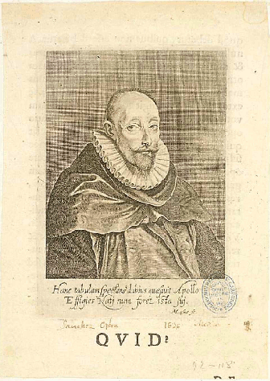

# Francisco Sanches

*Pérez, Rolando*

**First published Tue Mar 31, 2020; substantive revision Fri May 30, 2025**

Francisco Sanches (1551–1623) was an important figure in the history of philosophical scepticism, and most specifically in the later sixteenth and early seventeenth century. Sanches gained notoriety through his controversial text, *That Nothing is Known*. His skeptical ideas concerning what could be known of the phenomenal world, influenced the work of other philosophers like René Descartes. In fact, in the last twenty-five to thirty years, his work has at last been acknowledged as having served as a background source of Descartes’ refutation of scepticism. Sanches was not only a philosopher; he was also a physician, and a professor of medicine – a fact that doubtlessly tempered his scepticism. In recent years, there has been a growing interest in Sanches, as he has come to be seen as a significant philosopher in the history of scepticism, along with Montaigne, Descartes, and Hume. Some contemporary thinkers have gone as far as comparing his notion of language and metaphysics to that of someone like Wittgenstein.

## 1. Life and Work

Francisco Sanches/Sánchez (1551–1623) was a physician and a philosopher. As professor of both medicine and philosophy at the University of Toulouse, he was the author of a number of treatises on both medicine and philosophy, but gained notoriety as the sceptical philosopher who penned *Quod Nihil Scitur* (1581), or *That Nothing is Known* (1988, TNK). As a philosopher who took a sceptical view of knowledge, and who famously ended his writings with the Latin interrogative “*quid*?” even the question of whether he was Portuguese or Spanish by birth, has been the subject of much debate. This has led to the confusing dual spelling of his last name: with an “s” by Luso-Brazilian scholars (Sanches); with a “z” by Spanish scholars (Sánchez); and commonly with an “s” (with some exceptions) by English-language scholars. Here the latter spelling will be used solely in keeping with English language scholarship and translations, while referring to Sanches, as an Iberian philosopher. This confusion over his rightful birth place, is curiously reflected in Elaine Limbrick’s Introduction to *That Nothing is Known*, where she refers to him as “the Portuguese philosopher and doctor” on page 1 and then a few pages later writes that “Francisco Sanches (Franciscus Sanchez) was probably born on July 16, 1551, in Tuy, a city of northwestern Spain…” (Limbrick 1988: 4)[^limbrick-1988]: situated across the border from the Portuguese city of Braga, with which it shared an archdiocese (Cazac 1903, 1904)[^cazac-1903][^cazac-1904]. Supposedly, a distant cousin of Michel de Montaigne, and born to a family of “conversos” (Orden Jiménez 2012, in Other Internet Resources), in 1562 the Sanches family moved to the Bordeaux region where the cultural and political climate was much more amicable towards Jews and converts (Limbrick 1988: 5)[^limbrick-1988]. It was in Bordeaux that Sanches attended the prestigious Collège de Guyenne between the years 1562 and 1571. The Collège de Guyenne, whose course of study ranged from secondary school to college, included a curriculum that emphasized the rhetoric of Aristotle and the scholastics.

> The existence of higher groups in philosophy and of public lectures in Greek and mathematics indicates the overlapping of school and university, (Woodward 1906: 143)[^woodward-1906]

which gives one some idea as to the kind of education Sanches received at the Collège. And in effect, the first two years of college level courses included the study of Aristotelian logic and natural philosophy (based on the *Physica* and on *De Caelo*).

Moreover, the teaching of Aristotle, as Michel Reulos has pointed out, focused on manuals and commentaries on “the Philosopher” rather than on the actual works of Aristotle (Reulos 1976: 149)[^reulos-1976]; and that in turn, had mostly to do with the fact that relatively little of Aristotle (and much less of Plato) had been translated into Latin. The translated excerpts were put at the service of the study of theology (1976: 152), and the way in which Aristotle was taught, says Reulos, did not change until the early 1600s, when due to the influence of Petrus Ramus (1515–1572), the study of Aristotle in the colleges began to emphasize a return to the texts themselves, and deemphasize the medieval commentaries (1976: 154). This explains two major factors regarding Sanches’ early academic background in light of his work: On the one hand, the fluidity of his Latin and on the other, Sanches’ own acknowledgment that the target of the attack in *That Nothing is Known* was not so much Aristotle, but rather the scholastic use of Aristotle. In contrast to the style of Scholastic logicians, Sanches’ style is direct, informal, and devoid of rhetorical flourishes. And yet while Sanches approvingly cites the Spanish humanist, Juan Luis Vives’ (1492–1540) criticism of the non-sense produced by the Scholastic dialecticians who only knew Aristotle “through Latin translations and commentaries”, argues Limbrick (TNK: 29), Petrus Ramus, on the other hand, fails to get mentioned, due to the latter’s wish to fuse rhetoric with dialectic and more significantly, reconfigure the Galenic method so as to “ascend” from particulars to universals (Ong 1958 [1983: 257–258])[^ong-1958]. For it’s a noteworthy fact that in 1571 Sanches went to study medicine at La Sapienza in Rome: where Galen was one of the key figures of medical studies. And to a great extent one could argue that Sanches’ empiricist scepticism can best be understood against the background of Galen’s inductive method and his own training as a physician. Medical pedagogy at La Sapienza underscored the importance of observation while giving much less weight to logic and dialectic; in other words, it centered its teachings on Galen’s method as exemplified in the *Ars medica*, and underplayed the Aristotelian logic and natural philosophy of the scholastics; a factor that doubtlessly, impacted on Sanches’ philosophy. Sanches, however, did not graduate from La Sapienza. Instead, two years later, in 1573, he returned to the south of France, to conclude his studies at the more pedagogically conservative University of Montpellier, which like La Sapienza concentrated primarily on Galenic theory (and secondarily on Hippocrates) (Limbrick 1988: 63)[^limbrick-1988]. And on 13 July 1574 he received his doctorate from the University of Montpellier, where he unsuccessfully tried to secure a position as chair in the Medical Department. Disappointed with internal and external (religious) politics, Sanches gained employment at the University of Toulouse (1575) where he remained until his death in 1623, as professor of both medicine and philosophy.

## 2. Philosophical Works

Sanches wrote treatises on medicine and philosophy, and of his philosophical works, only two were published in his lifetime, *Quod nihil scitur* (1581; *That Nothing is Known*) and *Carmen de cometa anni M.D.LXXVII* (1578; *Poem of the Comet of 1577*). The other philosophical writings were published by his sons in 1636, and they included *De longitudine et brevitate vitae, liber*; *In liber Aristotelis physiognomicon commentarius*; and *De diviniatone per somnum, ad Aristotelem*. All of which can be found in the various editions of his philosophical oeuvre—see the discussion at the beginning of the Bibliography.

Although occasionally there may be references to a variety of texts, for reasons of space, the focus here will be on *Carmen de cometa* [Poem of the Comet] and the Letter to Christopher Clavius, for they best serve as a bridge to *Quod nihil scitur*/*That Nothing is Known* (*QNS/TNK*), the work that made Sanches famous and continues to be studied; either because of its own intrinsic merits or in connection with René Descartes’ (1596–1650) “radical doubt”, and other sixteenth and seventeenth century sceptics like Pierre Charron (1541–1603) or Montaigne. The essay will consequently begin with *Carmen de cometa* (1578)/Poem of the Comet, move to Sanches’ “Letter to Christopher Clavius”, and will lastly deal with *Quod nihil scitur* (1581)/*That Nothing is Known* (1988, TNK).

### 2.1 *Carmen de cometa anni M.D.LXXVII*/Poem of the Comet of 1577

As Elaine Limbrick points out, Sanches wrote *Carmen de cometa anni M.D.LXXVII* in the style of Lucretius’ *De rerum natura* or *The Nature of Things*. His two main targets were (1) Francesco Giuntini’s *Discours sur ce que menace devoir advenir la comete apparue à Lyon le 12 de ce mois de Novembre de 1577. laquelle se voit encores à present,* a treatise that proposed that the comet of 1577, and comets in general, were prophetic phenomena of bad things to come, such as plagues and the deaths of kings; and (2) Aristotelian notions of the heavens, the spheres, and the place of comets within this hierarchical, astronomical ontology.

It is indeed telling that Sanches begins the *Carmen de cometa* in a mocking and critical tone on the question of knowledge. He writes:

> Why do you pretend to know such profound things you, impulsive youth? To what end do you pretend to know these things, you trembling old age? Thus I want to show above all else that the long-haired star cannot predict anything. And even if it could predict, it would not provide any knowledge. It serves no purpose. So why want what is useless? (CC: 143: 1–2; 146: 25–27, my translation)

This is the scepticism that frames the Poem of the Comet.

Firstly, we have Sanches’ view of comets, more or less derived from Aristotle’s notions of the heavens and the place of comets within them. For Aristotle comets were celestial bodies inhabiting the space between the Earth and the upper heavenly spheres. They were created by hot dry exhalation that emanated from the terrestrial sphere, and clashed, as it were, with the movement of the heavenly sphere (*Meteorologica* 344a8–33); or as Aristotle explained: if the exhalation extended in all directions it was called a “comet or long-haired star”, and if it extended lengthwise only it was called a “bearded star”.

> Now when as a result of the upper motion there impinges upon a suitable condensation a fiery principle which is neither so very strong as to cause a rapid and widespread conflagration, nor no feeble as to be quickly extinguished, but which is yet strong enough and widespread enough; and when besides there coincides with it an exhalation from below of suitable consistency; then a comet is produced, its exact form depending on the form taken by the exhalation—if it extends in all directions it is called a comet or long-haired star, if it extends lengthwise only it is called a bearded star. (344a15–26 51)

The fact, thereby, that comets were conceived objects of secondary importance in the great hierarchy of the heavenly spheres, reduce their ontological significance for Sanches. How could such unimportant phenomena prophecy great events and determine the actions of rational beings? Since comets were the product of dry exhalations “with excessively weak forces” that occurred at great distances from the earth, they “could not be the cause of anything” (CC: 194: 658–661, my translation). “What could your long-haired star achieve then? What can that minuscule breath with its dim light, transmit to us from the heights of the heavens” (CC: 666–669). The answer for Sanches, as would be expected, was “*nihil*”. Nowhere was it observable that comets were either signs or final causes (cf. Orden Jiménez 2003)[^orden-2003] In short, comets were not natural phenomena with consciousness that “gave greater importance to kings than to common citizens” (CC: 174–174: 409–410); and they certainly could not be the cause of human actions, for then they would obviate free will.

> The free mind is not subject to laws, and neither are its own acts: it can turn either way; at times the soul turns to a certain thing, and at times to others…Why do you persist that the long-haired stars can predict harmful arguments or cruel poisons in my life? No one can foretell what is subject to free will. (CC: 170: 336–339, 342–346)

And he adds:

> Religion and the habits of our souls are free acts of our will. What effects can celestial bodies have on free acts? What is the relation between our mind and a bearded star? Celestial bodies have not been given any power over the mind…. (CC: 171: 354–359, my translation)

Religion, and even more so, “good acts” can only be attributable to free will. Or to put it another way, morality is contingent on free will. If God were to put special powers into comets such that they could influence human actions, then comets—these material objects—would be superior to humans. Humans would be the playthings of comets, and “good acts” *qua* determined acts would no longer be good. On the other hand, human acts would be subject, to what in the Middle Ages was deemed as “Fortuna”, predestination, and to some extent providence.

Finally, there is Sanches’ tacit criticism of a theory based on nothing more than a syllogistic argument that fails to prove any connection between comets and human actions, not to mention, any connection between the appearance of a comet as a cause, and its putative effects on human actions, death, harvests, and diseases. For how many years could go by before a comet was witnessed, asked Sanches, and still harvests failed, earthquakes rattled the earth, and kings died? Not to mention the fact that comets were often witnessed by certain peoples around the globe and not by others. Did that mean that if the comet were only seen by the peoples of India, it would only have an effect on that particular population, and not on the peoples of the south of France? If comets only predicted certain things, one was left to ask: why these and not others? And what is more, why could they not equally be the cause of good things? “There is no reason for it”, says Sanches (CC: 186: 563). And as such, at the very core of Sanches’ poem, lies the kernel of his scepticism. After all, the Poem of the Comet of 1577 and *That Nothing is Known* were written at nearly the same time. In this respect, Sanches’ Poem is an attack on Ptolemaic astrology, which anticipated Pierre Gassendi’s (1592–1655) criticisms of astrology’s vis-à-vis its threat to the notion of free will (Sarasohn 1996: 99)[^sarasohn-1996]. Interestingly, Sanches and Gassendi shared what Popkin calls a “constructivist scepticism” (1964: 17); which in both cases resulted from their anti-Aristotelianism and scientific empiricism (Popkin 1964: 86–87)[^popkin-1964]. As such, then, from this perspective, *Carmen de Cometa*/Poem of the Comet ought to be considered one of Sanches’ philosophical works, and one which sheds light upon his more popular *Quod nihil scitur/That Nothing is Known*.

### 2.2 Letter to Christopher Clavius

Just as everything else that has to do with Sanches, there is even uncertainty as to the date the Letter to Christopher Clavius was written. Raymond Delassus, Sanches’ disciple, and first biographer, dates the letter to around 1575, while J. Iriarte believes that the latter was written much later, in 1589, in which case it would place the writing of the letter at least eight years after the publication of *Quo nihil scitur* (1581). Given, however, that Clavius’ translation and commentary on Euclid’s *Elements* was published in Rome in 1574, it would seem that the former date of 1575, makes much more sense. It stands to reason that Sanches would have responded to Clavius’ commentary soon after its publication rather than fifteen years later, especially when so much of what is in the letter is implicitly related to Sanches’ epistemology in *Quod nihil scitur*. In that sense the Letter to Clavius constitutes a debate between those who like Clavius believed that the truths of mathematics were *a priori* and indubitable, and thinkers like Sanches who held an anti-Platonist, empiricist view of the world. A few quotes from Clavius’ *Opera mathematica* and from Sanches’s Letter help us to understand the debate. Clavius wrote:

> Since the mathematical disciplines treat things which are considered without any sensible matter (although they are actually impressed in matter), it is clear that they occupy the intermediate place between metaphysics and natural science…If the nobility and preeminence of a science is truly judged by virtue of the certainty of the demonstrations it uses, undoubtedly the mathematical disciplines will occupy the first place among all. (quoted in Sasaki 2003: 56)[^sasaki-2003]

By the time that Descartes wrote the *Meditations*, Clavius’ view concerning what he called the “preeminence” of mathematics was generally accepted. It was the prevailing view that something like Euclid’s theorems were time-tested to be demonstrably true. And indeed it was for this reason that Mersenne suggested to Descartes that he present his arguments in his Second Replies in geometrical fashion, in the form of Definitions, Postulates, Axioms, Common Notions, Propositions and Demonstrations (Dear 1995: 44–45)[^dear-1995]. But at the end of the sixteenth century, Sanches would have none of it. Probably influenced by what he had read of Carneades’ sceptical-empiricist critique of mathematics’ universal truths (cf. Cicero, *Academica* 2.116–118; Sextus Empiricus, *Against the Professors* Book III: “Against the Geometers”), Sanches anonymously challenged the Platonist mathematics of the most renowned mathematician of the age. In the guise of a modern day Carneades, Sanches wrote:

> In my opinion… lest the senses should fail us, we should attempt to get whatever we can get through the eyes, with the help of compass and rule, and not get into long, complicated demonstrations that often make things more confusing. Far is it for me to praise an overabundance of complex and long demonstrations, by which we often make more obscure that which in itself was clear. (LC: 300: #10, my translation)

For Sanches, therefore, the geometrical sign functions in the same way as the thing represented. In other words, geometry, for Sanches, is the science of phenomenal objects of perception. Here Jean-Paul Dumont’s explanation of the way in which ancient scepticism understood phenomena may aid in contextualizing Sanches’ own view. For the ancient sceptics, writes Dumont:

> The phenomenon is not a subjective representation that exists only for thought, or for the imagination of the perceiving subject. The phenomenon is a material reality or, if one prefers, a body. (1972: 8)

This Protagorean scepticism—and rejection of Platonism—is exemplified in Sanches’ critique of Proclus’ (412–485 CE) commentary on Proposition XIV of Euclid’s *Elements*.

Sanches had addressed his critique of Proclus’ commentary in an earlier letter he sent to Clavius. However, while this first letter was lost, the extant letter, “Ad. C. Clavium Epistola”, demonstrates his dissatisfaction with Clavius’ Scholastic appeal to consecrated authority or Proclus. In the first letter, Sanches congratulates Clavius for his ability to demonstrate some of Euclid’s propositions, with fewer words than Proclus and even Euclid. In keeping with common opinion, he believes it is a virtue to state things as clearly as possible in order to avoid unnecessary confusion “especially in mathematics, where we should understand as much as possible through the use of our senses” (LC: 300: #10, my translation).

While the first part of the paragraph above refers to the virtue of brevity, the second, and more important part of it, has to do with Sanches’ empiricist notion of mathematics, for this is the basis of Sanches’ direct critique of Proclus, and indirectly of Clavius. Sanches writes to Clavius:

> … [Proclus] says that angles ACF and angle ACE are equal to two right angles, to which you respond that such angles should be added separately and not in terms of one being part of the other, and that in this way, they are equal to two right angles. We had already come to that response to in previous discussion on the matter, and we agree that we have refuted it [Proclus] satisfactorily. Nevertheless, we will demonstrate it now with greater clarity. (LC: 301: #12)

And from here, Sanches, with more than a touch irony, similar to that exhibited in many parts of *QNS/TNK*, says the following:

> Suppose I said that the eminent Clavius with his own head is a Janus with two heads, would anyone believe me? Suppose that a father common to you and me, were to leave you in his testament two parcels of arable lands, the ones that are two right angles, and made me the executor, would you be satisfied if I gave you the equivalent of the land represented by angle ACF [figure 1], which according to Proclus’ demonstration equals two right angles? But on the other hand, we would have to consider this, for the question is one of geometry, which is to say, of *measuring the land*. (LC: 301: #12, my emphasis)

\*Figure 1\*

Here we witness Sanches turning to the etymology of *geometry* (*γεω μετρία*), meaning: the measurement of the land or earth (*terrae mensura*), followed by a second example, which much like the first is based on a pragmatist view of mathematics [figure 2].

\*Figure 2\*

> If you were to purchase a piece of cloth of the length AB, in order to make a jacket, and the merchant were to give you a piece of cloth of size CD alleging that that CD and CE were equivalent to AB, don’t you think the jacket would come out too short? (LC: 301: #12, my translation).

He summarily concludes:

> If one were to proceed in this fashion in all mathematical matters, in which way would math be different than other deceiving disciplines?

Proclus was a Pythagorean and Platonic philosopher, the author of two commentaries on Plato’s *Timaeus* and the *Parmenides*. For Proclus mathematical objects—and that, of course, included the objects of geometry—were not derived by way of abstraction from sensible particulars, but rather from ideas already contained in the mind. And it was this very kind of “dogmatic” philosophy that Sanches opposed. For Sanches concepts were either unprovable outside of their circular discursive language (e.g., the syllogism), or easily dismissed through the senses, as in the two cases mentioned above. It is for this reason that one can justly qualify Sanches’ philosophy as being empiricist and sceptical at once. Clavius, the addressee of the letter, was clearly against of the sceptics’ conception of knowledge. Chikara Sasaki writes:

> Clavius seems to have known to some extent how the skeptics attacked human knowledge. He is also reported to have reacted against a skeptical attitude in astronomy, which took an instrumental view concerning the status of astronomical hypothesis, defending a kind of realist philosophy together with Johannes Kepler. (Sasaki 2003: 58)[^sasaki-2003]

And Clavius himself in opposition to Pyrrhonism wrote:

> Unless one was revived by the recognition and knowledge of arithmetic, geometry and dialectic (these arts had been established by forefathers), he would almost arrive at the undecidedness of the Pyrrhonists (they were philosophers who decided nothing but doubted everything). (Clavius quoted in Sasaki 2003: 58)[^sasaki-2003]

Almost as a challenge, then, Sanches ended his letter to Clavius, with the following words:

> Do not ask who I am, for I am another Carneades [214–129/8 BCE]: who rather than being a friend of glory, is a friend of the truth and of you. Goodbye. (LC: 305 #18)

This, in a nutshell, describes his brand of scepticism, which rather than being absolute in its denial of truth is a denial of certainty and perfect knowledge, and the Scholastic belief that the Aristotelian syllogism guaranteed access to truth. For Sanches the truths of the syllogism and dialectic were the immanent truths of (self-referential) language, and nothing else.

### 2.3 *Quod nihil scitur/That Nothing is Known*

Sanches, the self-proclaimed follower of Carneades, begins *QNS/TNK* with the famous quote from Aristotle’s *Metaphysics*: “‘Mankind has an inborn desire to know’” (TNK: 166, quoting *Met.* 1, 980a). As Elaine Limbrick points out:

> This quotation from the first line of Aristotle’s *Metaphysics* ironically prefaces a treatise whose entire purpose is to destroy the Aristotelian system of knowledge by pointing out the inadequacies of the Aristotelian scientific methodology and the failure of most ancient philosophers to formulate a theory of knowledge leading to absolute truth. (TNK: 166–167, note 8)

But the irony doesn’t stop there. Also ironic is the fact that *That Nothing is Known*, marks a turning point in philosophy—as did Descartes’ *Meditations on First Philosophy* sixty years later—from an emphasis in metaphysics to one in epistemology; a philosophical turn often associated with the birth of Western modern philosophy. To the person familiar with Descartes’ *Discourse on the Method* (1637) the opening paragraph of *That Nothing is Known* may appear somewhat surprising, since the methodical doubt expressed in the first person, conversational tone in the *Discourse* (Part II) seems almost directly lifted from Sanches’ *QNS/TNK* (more on Sanches and Descartes in §4). The French historian of philosophy, Étienne Gilson was among first to note the similarity of the language employed by both thinkers to give personal voice to their distinct notions of scepticism (Gilson 1925: 267–268)[^gilson-1925]. Sanches wrote:

> My own lot has in no way differed from that of other men. From my earliest years I was devoted to the contemplation of Nature so that I looked into every-thing in great detail. At first my mind, hungry for knowledge, would be indiscriminately satisfied with any diet that was proffered to it; but a little later it was overtaken by indigestion, and began to spew it all forth again. Even at that period I was seeking to find some sustenance for my mind, such that my mind could grasp it completely and also enjoy it without reservations; but no one could appease my longing. I pored over the utterances of past generation of men, and picked the brains of my contemporaries. All of them gave me the same answer, yet they brought me no satisfaction at all. Yes, I admit that some of them reflected a kind of shadow-image of the truth, but I found not one who gave an honest and full report of the judgments one ought to form concerning facts [*res*]. Subsequently I withdrew into myself; I began to question everything, and to examine the facts themselves as though no one had ever said anything about them, which is the proper method of acquiring knowledge. I broke everything down into its ultimate first principles. (TNK: 167)

From this point on, Sanches who begins by taking on Scholastic Aristotelianism, states that his treatise will be written in simple, plain language. “Accordingly you are not to look in me for an elegant, polished style” (TNK: 171). He could write, if he wanted to, in such a style, he tells his reader, but he refuses to do so because “Truth slips away while we substitute one word for another and employ circumlocutions—for this is verbal trickery” (TNK: 171). If that is what the reader wants then she should turn to the elegant language of the rhetoricians like Cicero.

> And you should not ask me to quote many authorities, or to treat my authorities with deference; deference is rather the mark of a servile, untrained mind than of one that is truly investigating the Truth. (TNK: 171–172)

The aim of such statements was clearly to criticize and to distinguish himself from the Aristotelian emphasis on rhetoric as practiced by the Scholastics. Rather than follow Aristotle, or any other authority, he wrote,

> I shall follow Nature alone. Authority bids us *believe*, whereas Reason *demonstrates*; the former is more suited to faith, the latter to the sciences. (TNK: 172)

Here his notion of science is highly significant, because it is this on which his scepticism rests. Science, as becomes clear by the end of *That Nothing is Known*, has to do with rational demonstrations based on facts or things (*rerum*) that come to us from the senses (the eyes), albeit imperfectly. What Sanches seems to find most difficult to “swallow” are metaphysical statements and arguments that cannot be proven, except syllogistically by accepting their first principles on faith. Concepts that do not “possess an understanding of natural phenomena [‘*res intelligas*’, QNS: 92]” are “inventions”, says Sanches; “for who could understand non-existent things?” (TNK: 168). The list of such abstract concepts include: “Democritus’s Atom, Plato’s Ideas, Pythagoras’s Numbers, and Aristotle’s Universals, Active Intellect, and Intelligences” (TNK: 168). He addresses himself, he says, only to those who are “‘not bound by an oath of fidelity to any master’s words,’” but rather “assess the facts for themselves, under the guidance of sense-perception and reason” (TNK: 168). Having said this, he ends the introduction to *QNS/TNK*, just as he did the Poem of the Comet, with the sceptical “*Quid*?” or What?

“I do not *know* even this one thing, namely that I know nothing”, is the opening sentence of the treatise (TNK: 172). Sanches, next considers whether this is a paradoxical or contradictory principle of scepticism. For if you *know* how to establish that you do not know anything, it follows that you already know something. Furthermore, he argues, if you “have understood the ambiguity of the inference, you have clearly perceived that nothing is known” (TNK: 173). And nothing is known, clearly because such ambiguities only point to the fact that language does not give us access to absolute knowledge. Dialectical, logical, and linguistic entanglements such as the one mentioned above only proves his point. Thus in an allusion to Aristotle’s *Metaphysics* (995a30), he asks his reader to help him “untie this knot” (TNK: 173). This marks the beginning of his critique of Aristotelian nominalism.

For Sanches names are arbitrary, and therefore they can in no way define “the nature of things”, or their essences. Now, if you argue that you can use definitions to *demonstrate* the nature of a thing, “then show me one such”, responds Sanches. In a manner that recalls some twentieth century philosophers of language, Sanches questions whether words like Being, Substance, and Essence mean anything at all beyond the circularity of their definitions, and whether we even understand what we mean when we employ them. For example, with respect to the notion of Being, he writes:

> You will say that you will not define this being, for it has no higher genus to which it belongs. This I do not understand, nor do you. You do not know what Being is; much less do I. (TNK: 175)

To muddy the waters even more, we often use different names to refer to the same thing (*res*), e.g., “Being, Substance, Body, Living, Animal, Man, and finally Socrates” to refer to humans. This way a human being “who is something large, solid, and perceptible by the senses” becomes an incomprehensible, conceptual abstraction.

In fact, not only do we not know anything through language, we do not even know what is “‘knowledge’ [*scientia*]” (TNK: 177). Statements such as Aristotle’s “Knowledge is a mental disposition, acquired by demonstration” only beg the question, what is “a mental disposition”? And this, says Sanches, he does not know, so Aristotle’s definition of knowledge has failed to provide any kind of knowledge about what constitutes knowledge. “You are attempting to force me into a linear series of categorical propositions”, writes Sanches as though he were playing some kind of language game with another philosopher (player); and continues, “from these continually onwards, to Being—and what *that is*, you do not know” (TNK: 178). In this manner all questions of knowledge are reduce to categorical propositions, and what are categorical propositions, if not “a long series of words” (TNK: 178). Now, if such a term as a “mental disposition” is obscure, so is, to the same degree, the definition of a “demonstration”, says Sanches. For a demonstration is defined as a “‘syllogism’ that gives birth to knowledge” and so judges Sanches in his Tribunal of Truth, “You have been guilty of a circular argument, and have deceived me just as you have deceived yourself” (TNK: 181). Not to mention, that there simply is “no science [*scientia*] of syllogism”. And there is no science, or knowledge that can be derived from the syllogism because all of Aristotle, including the *Metaphysics,* is nothing but an inquiry about a name, as for

> example whether substance can be predicated of a man…And inasmuch as no one can know this for sure, there is no knowledge, either of things [“*rerum*”, QNS: 101] or words [“*verborum*”, QNS: 101]. (TNK: 183)

We begin and end with particulars. In other words, with material objects of perception: like *this* table before me, and not any sort of Platonic Form of table.

> Individuals alone exist, and can be perceived; it is only of individuals that knowledge can be possessed, and only from individuals that it can be sought,

argues Sanches.

> If this is not so, show me where those ‘universals’ you speak of occur in nature; you will admit that they occur in the particulars themselves. (TNK: 213)

Sanches is clearly a nominalist. In fact, midway through *QNS/TNK*, he writes in capital letters: “KNOWLEDGE IS PERFECT UNDERSTANDING OF A THING” (TNK: 200). As Joseph Moreau points out in “Doute et Savoir chez Francisco Sanches” (1960), this conception of knowledge or science as the “absolute and perfect” understanding of a thing, is a left-over of ancient thought (1960: 37). But again, in any case, such “perfect understanding” only means apprehending all the qualities of a particular object of perception. It does not mean apprehending the object or the thing-in-itself, to put it in Kantian terms. Sanches writes:

> The sense perceives only the outward appearance of things, and does not attain understanding (I am for the moment applying the word “sense” to the *eye*). It is the mind that receives images from the sense, and considers them. If the sense was deceived, so is the mind; but if not, what follows next? The mind regards only the images of things, which the eye has taken in; it studies them from this side and from that, and turns them about, putting the questions “What is this?” and “Whence comes its nature?” and “Why”—and no more than this, for it too sees nothing that is certain. (TNK: 236)

Not only does sensory perception fail to give us the answers to questions of essences, natures, and origins (of *noumena*), it also fails to give us certainty; for all we perceive are “accidents…the most commonplace of all existents” (TNK: 237). We can only make inferences, says Sanches, from the “accidents” of “compound bodies”. The impediment to knowledge, he interestingly states, does not reside in the object, but rather in the perceiving subject who cannot access things themselves.

> Experience is in every instance deceitful and difficult. Even if it is possessed perfectly, it only reveals the external aspect of events; in no way does it reveal the natures of *things*. (TNK: 278)

Sanches continues:

> In respect to the natures of things, it [judgment] reveals them only by speculation; and since it has not ascertained them by means of experience, not only does it too fail to reach the thing itself, but sometimes it forms an opinion in exactly the wrong sense. (TNK: 278)

Obviously if we do not have access to the things themselves, but only to the outward appearances of particulars, we cannot come to know things by their causes either: “Whence comes its nature?” as he says. We are told, states Sanches, that knowledge means understanding something by its causes. But this cannot be the case and the example he gives to illustrate his point, is that of the father-son causal relation from Aristotle’s *Physics* 194b30: “the father is the cause of the child”. But this, argues Sanches, does not lead to any kind of knowledge about the child, “for what does my father contribute to an understanding of *me*?” (TNK: 195). Nothing. The infinite regress required by the notion of causes applies no less to universals than it does to particulars. For even if one were to stop at God, as “both the first cause and the final end of all things” (TNK: 196), and avoid the infinite, in

> avoiding the infinite you fall into what is infinite and measureless, incomprehensible, ineffable and beyond the reach of the understanding. (TNK: 196)

And yet, according to you, says Sanches to his reader, this Being that is admittedly beyond your understanding “is the cause of everything; and therefore, according to your definition, understanding of Him is necessary for the understanding of His works”, which only proves that “you know nothing” (TNK: 196). It was this, Sanches’ fideism that probably saved him from a fate similar to that of Giordano Bruno’s. Sanches’ target was Aristotelian epistemology, never faith. He denied not only knowledge of efficient and first causes, but also of material and formal causes. Aristotle’s answers to sundry philosophical matters failed to convince him. When Aristotle wrote in the *Posterior Analytics* that “[s]ome hold that, owing to the necessity of knowing the primary premises, there is no scientific knowledge” (1.3 72b5–6), he was addressing the very sceptical notion of knowledge held by someone like Sanches. “Our own doctrine”, wrote Aristotle, “is that not all knowledge is demonstrative: on the contrary, *knowledge of the immediate premises* is independent of demonstration” (1.3 72b18–20, my emphasis). But this is exactly the problem for Sanches; for if primary and immediate premises do not require demonstration, that means one has perfect knowledge of them, as one would of first causes (like God), but that is not true. And if one does not have perfect knowledge of primary and immediate premises, then where do they come from? What makes an indemonstrable primary premise the guarantor of knowledge? Nothing, answers Sanches. Primary premises are inventions that we need to take on faith in order to elude an infinite regress, and end up in the kind of scepticism that Aristotle wanted to avoid. However, if, as Aristotle proposed, “demonstration must be based on premises prior to and better known than the conclusion” (1.3 72b25–26), and demonstrations were based on premises that were themselves arbitrary inventions, then demonstrations were not to be taken as reflecting perfect knowledge, or as Sanches would have it, any knowledge at all. Sanches writes:

> “Knowledge is acquired by demonstration”: this in turn assumes a definition. Now, definitions cannot be *proved*, but have to be *believed*; therefore demonstration based on assumptions (*ex suppositis*) will produce knowledge of a suppositious kind, not sound exact knowledge…So the conclusions to be drawn from these first principles will be things assumed, not things known. (TNK: 201)

Therefore Aristotle’s statement in the *Posterior Analytics* that “since the object of pure scientific knowledge cannot be other than it is, the truth obtained by demonstrative knowledge will be necessary” (1.3 73a2–23), was epistemologically insufficient for Sanches. Such necessity would merely be the syllogistic necessity of a conclusion following from arbitrary premises. But beyond the logical, there was also a psychological dimension to Sanches’ scepticism, which is implicit in the rhetorical tone of *QNS/TNK*, and the ever present other, to whom the treatise is directed. The tone vacillates from exasperation to despair at not being able to know more than what is derived from the language and the senses. Sanches dramatically states:

> How unhappy our situation is! We are blind in the midst of light. I have often reflected about light, but always given up without thinking it through or understanding or comprehending it. It is the same if you reflect on the will and the intellect and other objects that are not perceived by means of the senses. (TNK: 243)

And in words that anticipate Descartes’ certainty regarding the existence of the *cogito* (cf. Cottingham 1998: 9)[^cottingham-1998], he declares:

> Of this I am sure, that I am at this moment thinking of the words that I am writing, and that I wish to write them, and long for them both to be true and win your approval; (TNK: 243)

but

> when I try to reflect on what this thinking is, and this wishing, and this longing…then my thinking quite fails me, my wishing is frustrated, and my yearning grows ever greater while my concern also increases. (TNK: 243)

All this initially reminds us of Descartes; but later in a pessimistic tone, he goes on to say that it is this epistemological uncertainty, this wish to understand (*cognitio*) “inward ideas” and the impossibility of attaining such knowledge and understanding beyond the senses that drives him to despair. “I see nothing that I could seek to lay hold on, or might possibly grasp” (TNK: 243), he writes in frustration. Then in a moment that recalls Vives’ scepticism (cf. Casini 2009)[^casini-2009], he ponders: if I am “incapable of comprehending [even] the self” perfectly, how am I “to comprehend the most abstruse secrets of Nature, among which are included spiritual things…?” (TNK: 239). Clearly, argues Sanches, no one doubts that scientific knowledge (*scientia*) ought to be perfect, but there is nothing, not even in Nature, that is perfect (TNK: 289). And yet this does not lead Sanches to the equanimity or *ataraxia* (ἀταραξία) of the Stoics. Instead his impassioned scepticism encourages the active search for knowledge. To that end, he ends his treatise with the exhortation: “To work” (TNK: 290) and asks his imaginary interlocutor to teach him what he knows, while he sets to do the double work of examining “*Things*” while questioning everything that ought to be questioned. Like the Poem of the Comet the treatise’s final word is the interrogative: Quid?/What?

## 3. Sanches’ Empiricist Scepticism

One topic of debate regarding Sanches’ scepticism revolves around the question of whether he was an Academic sceptic like Carneades with whom he identified himself in his letter to Clavius (§2.2) or whether his scepticism was of the Pyrrhonian variety as Pierre Bayle (1647–1706) claimed it to be in his Dictionary entry on Sanches (1697 [1820: 76]). However, the distinction between Pyrrhonian and Academic scepticism has not always been clear (cf. Striker 1996: 140–141, 148–149)[^striker-1996]. For Popkin (1964)[^popkin-1964], Sanches’ scepticism unlike [Pyrrho](https://plato.stanford.edu/entries/pyrrho/)’s (c. 360 BCE–c. 270 BCE) or Sextus Empiricus’ (c. 160 CE–c. 210 CE), does not call for the suspension of judgment “but rather the more full-fledged negative dogmatism of the Academics” (Popkin 1964: 41)[^popkin-1964]. Popkin continues:

> The Pyrrhonists, with their more thoroughgoing scepticism, could neither assent to the positive theory of knowledge, nor to the definite conclusion that *nihil scitur*. (Popkin 1964: 42)[^popkin-1964]

But this characterization of Sanches’ “*nihil scitur*” does not seem completely correct either, for it did not mean, as previously suggested, that absolutely nothing was known. Instead Sanches presented it as a diagnosis, pertinent on the one hand, to the medical treatment of the body and on the other, to philosophical inquiry concerning the things (*rerum*) that could indeed be known with some degree of certainty (Lupoli 2009)[^lupoli-2009]. Now, while Limbrick, like Popkin, also views Sanches as an Academic sceptic, she, on the other hand emphasizes the notion of Carneadean probabilism and its connection to Sanches’ “medical practice” (1988: 79). To the point, it is not clear that Sanches had any direct knowledge of Sextus Empiricus’ work; what is evident, nevertheless, is that he was familiar with Galen’s work, which seems to have influenced his own empiricist scepticism.

Admittedly, pairing Sanches with Galen may at first seem rather odd, given the latter’s rejection of scepticism. In “My Own Books” he wrote that he wished to learn “the science of logical proof” (GAL2: 18) and the method by which to recognize whether a particular proof was sound or not. To accomplish such, he says, he turned to “the best-reputed Stoic and Peripatetic philosophers of the time” (GAL2: 18), but their conflicting logical theories culminated in confusion.

> Indeed, as far as these teachers were concerned, I might well have fallen into a Pyrrhonian despair of knowledge, if I had not had a firm grip of the disciplines of geometry, mathematics, and arithmetic…. (GAL2: 18)

And yet while Galen divided the different approaches to knowledge into roughly that of the Rationalists (or Dogmatists), the Empiricists, and the Methodics, his scientific method was a mix of each one of them, emphasizing a marriage between theory and empiricism. In his introduction to *Galen: Selected Works*, P. N. Singer writes:

> The Empiric school, which was founded in the mid-third century BC by a follower of Herophilus [335 BC–280 BC], was influenced by Sceptical philosophy, and represented an attempt to engage in the art of medicine with as little as possible in the way of theoretical postulates. (Singer 1997: xiv)[^singer-1997]

This almost seems as a corollary to Sanches’ sceptical rejection of the theoretical, dogmatic postulates of the Aristotelian syllogism and Plato’s Ideas.

> Denying the possibility of true knowledge concerning the body, the Empiric’s view is that the doctor must rely on experience (*peira*) and precise observation (*tērēsis*)…. (1997: xiv)

In that light, if indeed it was the mathematical disciplines that saved Galen from falling into a Pyrrhonian despair concerning knowledge, it is because his vision of mathematics seems to have had the function of proving along with experience (or experimentation) theories necessary to arrive at correct diagnoses, and not because he envisioned mathematics as an abstract, Platonic discipline.

Thus, what *prima facie* seems to be a major difference between Galen and Sanches regarding the truths mathematics may not be so great after all. Doubtlessly, Galen was an Aristotelian philosopher and physician, who subscribed to Aristotelian logic and definitions, whereas Sanches was not and did not; and yet much like Sanches he doubted that any knowledge of the *noumenal* world (e.g., God, the substance and immortality of the soul, etc.) was possible. Interestingly, Galen’s “An Outline of Empiricism” begins with the following sentence:

> All doctors who are followers of experience, just like the philosophers who are called Sceptics, refuse to be called after a man, but rather want to be known by their frame of mind. (GAL1: 23)

Such a statement bears resemblance to Sanches’ questioning of universals for the very much the same reason; that is to say, because the experience of things (*rerum*) is always the experience of particulars and not of universals (like Man). Galen later explains:

> We say that the art of medicine has taken its origin from experience, and not from indication. By “experience”, we mean the knowledge of something which is based on one’s own perception, by “indication”, the knowledge which is based on rational consequence. For perception leads us to experience, whereas reason leads the dogmatics to indication. (GAL1: 24)

Earlier empiricists, argues Galen, viewed perception and experience as both the activity of seeing for oneself (*autopsia*) and as cognition, and that is how he thought medical practice ought to be conducted (GAL1: 25–26). Here we have Galen the physician and the philosopher who wrote: “The best doctor is also a philosopher” (GAL2: 30–34), and the Galen who was to be a predecessor of Sanches. But Galen was not alone in being a philosopher and a physician. His contemporary Sextus Empiricus seems also to have been both.

In section XXXIV of *Outlines of Scepticism*, Sextus Empiricus posed the question “Is medical empiricism the same as scepticism?” (SE-OS: 62: 235), to which he answered that if empiricism made assertions about “the inapprenhensibility of unclear matters” then it could not be the same as scepticism, and the same applied to scepticism, for scepticism was precisely a rejection of belief in things that could not be proven (dogmatism). Nowhere else did these two modes of thought function better, wrote Sextus Empiricus, than in medicine. He argued:

> They might rather adopt, as it seems to me, what is called the Method, for this alone of the medical schools seem to practice no rashness in unclear matters and does not presume to say whether they are apprehensible or inapprehensible, but it follows what is apparent, taking thence, in line with Sceptical practice, what seems to be expedient. (SE-OS: 63: 236–237).

Medicine, then, for Sextus Empiricus was what medicine would equally be for the late sixteenth century Sanches: a combination of empiricism and scepticism. Medicine took as much from philosophical scepticism, as philosophical empiricism took from medicine. Galen’s above critique of “indications” or *indicans* (cf. Maclean 2002: 308–310)—which bears a certain similarity to Sanches’ critique of demonstration and naming—is best explained by Sextus Empiricus:

> A sign is indicative, they say, if it signifies that of which it is a sign not by having been observed evidently together with the thing it signifies but from its proper nature and constitution (as bodily movements are signs of the soul). That is why they also define this sign as follows: An indicative sign is a pre-antecedent statement in a sound conditional, revelatory of the consequent. There being two different sorts of signs…we argue not against all signs but only against indicative signs, which seem to be a fiction of the Dogmatists. For recollective signs are found convincing by everyday life: seeing smoke, someone diagnoses fire, having observed a scar, he says that a wound was inflicted. (SE-OS: 93: 101, 102)

To put it Sanchean terms, indicative signs are helpful when they *refer* to particular things (*rerum*) in the world; and they are unhelpful when they refer to the dogmatic notion of universals. Just as *Carmen de Cometa*/Poem of the Comet was written to dispel the notion of comets as signs of bad things to come, *De divinatione per somnum, ad Aristotelem*, rejects the idea that any knowledge can be attained by way of demonic states, prophecies, or dreams. In John Owen’s quirky but insightful book, *The Skeptics of the French Renaissance*, one of the characters of the dialogue says at the very beginning of the chapter on Sanches that

> [i]n an age when science and medicine was mixed up with astrology, divination, charms, and an enormous farrago of superstitious nonsense, Sanchez held up to his brother physicians the torch of a true Science founded upon experiment, and a due recognition of natural laws. (1893: 617)

This is obviously significant for its recognition of the importance of the scientific method in Sanches’ elaboration of his scepticism. Here both Damian Caluori and Limbrick agree that Sanches’s critique of Aristotelianism and his proposed scepticism was “not only of theoretical concern” (Caluori 2007: 45)[^caluori-2007], but a practical one that sought “the answer to the question of the right scientific method to be used in the quest for true knowledge” (Limbrick 1988: 25)[^limbrick-1988]. And while Caluori argues that his empiricist scepticism was Pyrrhonian in nature, what is clear for both Caluori and Limbrick is that his scepticism was by no means absolute, and that fundamental to his rejection of Aristotelianism was his medical training where particular things needed to be perceived and analyzed not by their names or definitions but rather by the external qualities that they presented to the senses, since such practical matters as diagnoses needed to be made, and cures needed to be prescribed and administered. In comparison to the treatment of the body, such a thing as the content of his mind would have seemed much less important to Sanches.

## 4. Sanches and Descartes

The division of the world into one of external and internal realities, is one of the notions that Sanches and Descartes share. Where they each end up, is, of course, completely different. What is similar, on the other hand, is their starting point; that is to say, the way they articulate the radical doubt with which they begin their respective inquiries; and for that reason Sanches has often been considered a precursor of Descartes. It is undeniable that the personal expression of their scepticism as found both in *That Nothing is Know* (1581) and the *Discourse on the Method* (1637) share more than a coincidental resemblance. Pamela Kraus points out in her introduction to the *Discourse on Method* [DM], that the word “discours” had a wider meaning in the seventeenth century signifying among other things “‘talk’ or ‘conversation’” ([DM: 1]). But this was not the case for Sanches, who wrote *Quod nihil scitur* over forty years earlier, and whose conversational style was in the service of a treatise aimed at the Aristotelianism of his time, and particularly at the Aristotelian notion of demonstrative truths. What is indeed striking are the passages in the *Discourse* that seem to be directly lifted from the Iberian philosopher’s 1581 treatise. Here are two examples: the first from Sanches, the latter from Descartes:

> My own lot has in no way differed from that of other men. From my earliest years I was devoted to the contemplation of Nature so that I looked into everything in great detail. At first my mind, hungry for knowledge, would be indiscriminately satisfied with any diet that was preferred to it…Subsequently I withdrew into myself; I began to question everything, and to examine facts themselves as though no one had ever said anything about them, which is the proper method [“*modus*”, QNS: 92] of acquiring knowledge. I broke everything down into its ultimate first principles. Beginning as I did, my reflection at this point, the more I reflected the more I doubted. (TNK: 167)

Here is Descartes in the *Discourse*:

> From my childhood I have been nourished upon letters, and because I was persuaded that by their means one could acquire a clear and certain knowledge of all that is useful in life, I was extremely eager to learn them. But as soon as I had completed the course of study at the end of which one is formally admitted to the ranks of the learned, I completely changed my opinion. I had found myself beset by so many doubts and errors that I came to think I had gained nothing from my attempts to become educated but increasing recognition of my ignorance. (Descartes 1637 [PWD: 112–113])[^descartes-1637]

He will later say that among the steps included in his method is the direction of his mind into the “simplest and most easily known objects in order to ascend little by little, step by step, to knowledge of the most complex” (1637 [PWD: 120]), which even if it is not exactly what Sanches meant by “first principles” [“*extrema principia*”, QNS: 92], it does sound a lot like it.

In any case, one of the first to note the similarities in tone, and even to go as far as to declare Sanches a precursor of Descartes was Étienne Gilson in his commentary on *Discours de la méthode* (1925). More than Charron or the Montaigne of *Apologie de Raimond Sebond* (1580), it is Sanches, says Gilson, who seems to have had the greater impact on Descartes’ doubt and his response to the sceptical position (1925: 267, 268; Paganini 2009: 254–255)[^paganini-2009][^paganini-2009-2], given the “striking parallelism of their respective experiences” (1925: 267, my translation). In fact, the linking of their names in the seventeenth century at the universities of Utrecht, Groningen and Leiden, says Limbrick, is what led them to be considered Pyrrhonian sceptics with atheistic leanings (TNK: 82). What nonetheless remains unknown is when and how Descartes came across *Quod nihil scitur*. In *Les premières pensées de Descartes* (1979), Henri Gouhier conjectures that Descartes might have come across *Quod nihil scitur* sometime during his student years at La Flèche (1606–1614), or read the 1618 Frankfurt edition of the treatise (1979: 116), “when he was in Frankfurt for the coronation of the Emperor Ferdinand II in 1619” (Limbrick 1988: 83)[^limbrick-1988]. According to Limbrick the Frankfurt 1618 edition of *Quod nihil scitur* seems to have impacted the European philosophical scene, and to have contributed to Sanches’ reputation as a leading Pyrrhonian sceptic (1988: 85). What is not at all convincing is that Descartes would have been apprised of Sanches’ treatise through a letter addressed by someone by the name of Huebner (supposedly an English doctor), to Marin Mersenne.

This letter of August, 1641, can be found in *Correspondance du P. Marin Mersenne, religieux minime. X, Du 6 août 1640 à fin décembre 1641* (1967: 730) wherein the author praises Sanches’ ingenious exaggerations concerning the possibility of acquiring perfect knowledge, and criticizes Cartesianism for not being able to advance (“non progreditur”) beyond its “hyperbolical doubt” (1967: 730) . But again, the letter is too late to serve as proof of Descartes’ knowledge of Sanches’ treatise prior to the writing and publication of the *Discourse*. Its intended target seems to have been an objection to the perceived scepticism of the *Meditations*. Thus, if Mersenne informed Descartes of Huebner’s letter comparing his work to that Sanches’s, then the letter would only have apprised Descartes that he was being compared with the Iberian “Pyrrhonist”, which would not have made Descartes very happy, given that by this time he had grown tired of answering objections and trying to explain why his method was instead intended to dispel scepticism and ground a science on clear and distinct ideas (Mullin 2000: 8)[^mullin-2000]. Therefore, if we can imagine Descartes being upset about being compared with Sanches, one can at least partially understand why he would be so, and would “refuse” to answer the objection (Mullin 2000: 8)[^mullin-2000]. It has been conjectured, for instance, that Descartes might have been thinking of Sanches when he wrote in the *Discourse* that the reason for his undertaking was not to imitate or to copy “the sceptics, who doubt only for the sake of doubting” but rather “to reach certainty” (1637 [PWD: 125]). Significantly, while most scholars of Sanches’ work have noted the similarities between Sanches and Descartes, for others like Joseph Moreau (1960)[^moreau-1960] and Joaquim de Carvalho (1955)[^carvalho-1955], there are significant differences. These similarities displayed in two parallel columns in the introduction to Sanches’ *Opera philosophica* (1955: xxx–xxxiii), merely establish, argues Carvalho, a “correlation of words” (1955: xxxiii, my translation). One important difference between the two thinkers, says Carvalho, is that although Sanches doubts our perfect knowledge of external things, he never doubts their existence. This obviously was not the case for Descartes, for whom the search for certainty was the search for whatever knowledge could be acquired through the light of reason, and not through the senses. Thus for Moreau one major difference between them was their opposing views concerning the truths of mathematics (1960: 30–34): for Sanches *a posteriori* and dubitable; for Descartes *a priori* and indubitable. What they did share was a rejection of the Scholastic appeal to external authority. For Descartes, the opinions of others could never lead to the kind of certainty only a mind (*cogito*) reflecting on the content of its own thoughts could reach; and for Sanches the opinions of scholarly authorities—however illustrious—did not help us to arrive at perfect knowledge. The assumed “knowledge” of the authorities was derived from syllogistic and demonstrative logic, which depended on the circularity of its definitions and premises (*verba*) to arrive at their conclusions concerning things (*rerum*). More often than not, these Aristotelian scholars with their verbal gymnastics created great confusion out of what was otherwise clear, even to a child.

Though a number of Sanches’ contemporaries accused him of advocating a radical form of Academic scepticism that led to atheism—as also occurred with Descartes—Sanches’ sceptical project was not, as it may first seem given the title of the treatise, either dogmatic or wholly destructive. And on this vital point Richard H. Popkin (1963: ix; 1964: 42) and Gianni Paganini (2009: 249)[^paganini-2009][^paganini-2009-2] concur. For Paganini, in fact,

> Sanches’s *Quod nihil scitur* contains, besides a skeptical demolition, also a *pars construens,* which seems particularly relevant in order to understand the Cartesian certainty about reflexive knowledge, typically the *cogito*. (2009: 249)

The personal crisis experienced by Sanches and Descartes which motivated their epistemological inquiry concerning what could and could not be known with certainty, was responded to by means of self-reflection. In both cases, albeit with very different approaches, the self was the only legislator of certainty, and the only thing that could be counted upon in founding a science: in Descartes’ case, founded on unquestionable internal, logical principles (“*I cannot doubt my own existence*”), and in Sanches’ case, founded on the material things (*rerum*) the *I* perceives, albeit imperfectly. Significantly, what constituted the certainty of the internal states for Descartes did not constitute certainty for Sanches, and moreover such “certainty” could not serve as the foundation of a true science. In this respect, whereas the late sixteenth century Sanches was operating within a pre-Galilean Weltanschauung, Descartes undertaking studies in physics and astronomy that paralleled those of Galileo and “Galilean” science with its emphasis on mathematical demonstration. For Descartes, mathematics was the language of Nature, and even physical things or “natural phenomena” were mathematical, as he stated in the “Principles of Philosophy” (1644 [PWD: 247]). This was clearly not the case for Sanches, who in his letter to Clavius (§2.2), denied the universal and *a priori* truths of mathematics, reducing mathematics to mere empirical measurement. In short, if Descartes’ method culminated in the “indubitable” truths of mathematics placed at the service of sciences like physics, optics, and astronomy, Sanches’ sceptical method, with its acceptance of imperfect knowledge, culminated in the probable and empirical “truths” of the science of medicine. Descartes, the philosopher, mathematician, and physicist; Sanches, the philosopher and physician: the former emphasized the mind over the body (*res cogitans* over *res extensa*), and the latter the body over the mind.

Doubtlessly, such a generalization can only be taken so far; for Descartes too wanted to “replace the speculative philosophy taught in the schools” with a “practical philosophy” that would employ his method even in an applied science like medicine, whose primary goal was to maintain the health of the body: “the chief good and the foundation of all the other goods in life” (1637 [PWD: 142–143]). Most importantly was (1) their equal concern with formulating a method that would allow them to arrive at knowledge of the world, and (2) the constructive aspect of their respective scepticism, which in both cases was a starting point. And though it seems by all accounts that Descartes integrated Sanches’ autobiographical narrative into the *Discourse on the Method*, without due attribution, their projects were quite different: one epistemologically based on sense perception, the other metaphysically based on internal (*a priori*) first principles. Ironically, it has been argued that Descartes turned “first philosophy” into epistemology.

## 5. Sanches’ Place in the History of Philosophy

Regardless of the extent of the debt Descartes owed Sanches, great or small, it is undeniable that even as a background figure in Cartesian studies, Sanches holds a noteworthy place firstly in the history of scepticism, and secondly in the history of modern philosophy. Possibly thanks to Limbrick and Thomson’s English edition of *Quod nihil scitur*, Sanches was at last acknowledged as a source in Cartesian studies in Ariew, Cottingham, and Sorell’s *Descartes’ Meditations: Background Source Materials* (1998). Here, along with some new translations of selected passages from *Quod nihil scitur*, John Cottingham writes that

> though Sanches, unlike Descartes, proposes no new method for the acquisition of knowledge, he does produce some interesting anticipations of the Cartesian approach, particularly when he distinguishes between “external” objects of cognition and the “inner” objects of the mind (e.g., its own inner awareness of its willing and thinking. (Cottingham 1998: 9)[^cottingham-1998]

But this is as much as Cottingham is willing to concede to Sanches, for ultimately Sanches remains for him a man “trapped in the inescapable ignorance of the pre-Enlightenment world” (1998: 9). In some ways this has been the unfortunate fate of Sanches until very recently: to be considered an interesting but insignificant philosopher. This in part is due to the fact that the history of philosophy used to be presented as a series of *ex nihilo* events bearing the names of Plato, Aristotle, Immanuel Kant (1724–1804), etc., as though one day there was nothing and then the next day there emerged, for example, the figure/event we know by the name of Kant. But fortunately philosophy is no longer presented or taught this way. Therefore, if Sanches was not a major philosopher, the originality of his work, for example, combining “medieval epistemological ideas and ancient sceptical habits of thinking” (Yrjönsuuri 2000: 243)[^yrjönsuuri-2000]—certainly impacted the work of other philosophers of his time and beyond. However, because no else would pay attention, certain early twentieth century Portuguese and Spanish thinkers, often for nationalistic reasons, turned Sanches into the Spanish or Portuguese “precursor” of Descartes, Bacon, Hobbes, and Kant.

One such writer was Teófilo [Teophilo] Braga (1843–1924), a philologist and essayist, who was the second elected president of the first Portuguese Republic (1911–1914). Not surprisingly, then, in his 1881 essay “O portuguez Sanches, precursor do positivismo” (The Portuguese Sanches, precursor of positivism) Braga presented Sanches as precursor of Francis Bacon (1551–1626) and the nineteenth century positivism of Auguste Comte (1798–1856). And because Braga viewed Comte as a representative of the values of science and republicanism, the “Portuguese Sanches” (supposedly “born in Braga”) Sanches served as the perfect precursor of the positivist ideas Braga himself embraced.

In Spain, Marcelino Menéndez y Pelayo argued in his essay “De los orígenes del criticismo y del escepticismo y especialmente de los precursores españoles de Kant” (1918, On the origins of critique and scepticism and especially in the Spanish precursors of Kant) that given the similarity of the opening pages of Descartes’s *Discourse on the Method* and Sanches’ *Quod nihil scitur*, it was obvious that Cartesianism was in large part the product of ideas stolen from Spanish philosophy (1918: 186). But nowhere in the essay does Menéndez y Pelayo prove this, or bother to consider the differences between Sanches and Descartes. As to Kant’s debt to Sanches, he has little to say on this matter, except that some of Sanches’ ideas about God, eternity, and the creation of the world, anticipated Kant’s notion of the antinomies (1918: 195). Finally, the only thing that he says with some level of sobriety with respect to Kant and Sanches, is that they both made manifest the idea that one can believe in God without having to believe in metaphysics or logical demonstrations (1918: 196), and that was probably in order to accommodate philosophy with Spanish Catholicism.

Interestingly, thirteen years earlier, in 1905, Eloy Bullón y Fernández, wrote in *Los Precursores españoles de Bacon y Descartes* that Sanches had anticipated Descartes, Bacon, and Comte (1905: 181). But here the tone is more conciliatory and sober, and Bullón y Fernández takes the trouble to call attention not only to similarities, but also to the differences between these thinkers. He recognizes, for instance, that while both Sanchez and Descartes begin their project with a critique of scholasticism, and particularly, a critique of the appeal to authority, their initial battle call, Sanches’ dismissal of metaphysics and its replacement with empiricism was not shared by Descartes (1905: 170); and neither was it by Bacon, despite the latter’s questioning of the syllogism in the *Novum Organum*. What, according to Bullón y Fernández, Sanches shares with Bacon is a belief in the observation of things (*res*) over the analysis of words (*verba*). And one can certainly hear echoes of Sanches in aphorism XIII from the *Novum Organum* when Bacon writes:

> The syllogism is not applied to the principles of the sciences, and is of no avail in intermediate axioms, as being very unequal to the subtlety of nature. It forces assent, therefore, and not things [*res*]. (1620 [1902: 13–14])

Where they part ways is that while Sanches did not trust the senses, Bacon believed that one could arrive at certain truths through the observation of natural phenomena, and thereby avoid “the arrogance of dogmatism, and the despair of scepticism” (1620 [1902: 5]). Now, what Sanches had in common with Kant, says Bullón y Fernández, is that neither one nor the other believed that the mind was capable of apprehending the things themselves (1905: 179).

What is missing from all these studies of Sanches who posit him as precursor of this or that major philosopher—from Braga (1881)[^braga-1881] to Bullón y Fernández (1905), Menéndez y Palayo (1918), and Fernando A. Palacios (1991: 27–29)[^palacios-1991] to Carlos Mellizo (1982: 52–64)[^mellizo-1982]—is a certain lack of rigor. More fruitful would be to consider Sanches as a representative of modern scepticism with roots going back to ancient scepticism—someone whose form of scepticism impacted modern philosophy, even in cases where it went unacknowledged, as in the case of Kant. To this point, Dumont writes that Kant’s silence was historical in his dismissal of Pyrrhonist and Academic scepticism; in his lack of knowledge regarding Sextus Empiricus; and in designating Hume as the only author representative of scepticism (1972: 73): as though Hume was not himself responding to sceptics like Sextus Empiricus or Carneades. But as M.F. Burnyeat explains in “The Sceptic in his Place and Time”, in Kant’s silence regarding the sceptics, scepticism itself became “the name of something internal to the philosopher’s own thinking, his alter ego as it were” (1987: 35).

Two philosophers who did acknowledge the importance of scepticism for philosophy were G. W. Leibniz (1646–1716) and G. W. F. Hegel (1770–1831; 1801 [1985]). As a matter of fact, in response to a letter by French mathematician, Pierre Varignon (1654–1722), who had asked him for some clarification on what he meant by “infinitesimal”, Leibniz reference’s Sanches’ *Quod nihil scitur* and his challenge to Clavius with some admiration. Such scepticism, he says to Varignon, is important because it keeps mathematics from becoming a dogmatic science (cf. de Olaso 1987: 149–150). The questions raised by sceptics like Sextus Empiricus and Sanches, says Leibniz, are key for “establishing sound foundations for a science” ([1702 [1970: 544]). Leibniz writes:

> I have often thought that a reply by a geometrician to the objections of Sextus Empiricus and to the things which Francis Sanchez, author of the book *Quod nihil scitur*, sent to Clavius, or to similar critics, would be more useful than we can imagine. (1702 [1970: 544])

Thus perchance, in Leibniz’s generous appreciation of the sceptics’ challenge to dialectical and metaphysical dogmatism, lies the answer to what Dumont calls Kant’s “silence”: that which according to the author of the *Critique of Pure Reason* did not need to be named, because it was always at the heart of the philosophical enterprise.

In the Introduction to *Scepticism from the Renaissance to the Enlightenment*, the editors Richard H. Popkin and Charles B. Schmitt write that “Little effort seems to be made to study the classical formulations, and the development of these from Sextus at least to Hume and Kant” (1987: 10); and while that may certainly be true, even less effort has been made to include twentieth century philosophers. In the introduction to *Que nada se sabe*, Fernando A. Palacios states that for Sanches there was no difference between logic and rhetoric, as they both culminated in a series of language games (1991: 24). Now, it would certainly be wrong to take this analogy too far without due rigorous study, but there are moments in Sanches’ scepticism regarding the truths of metaphysics and language that remind one of the Wittgenstein of the *Philosophical Investigations* (cf. Fogelin 1981)[^fogelin-1981]. “Sanchez’s *Quod nihil scitur* almost reads like a twentieth century text of analytic philosophy”, wrote Popkin (1964: 41)[^popkin-1964]. And here, for example, such a comparison, and there are many (e.g., Mikko Yrjönsuuri’s with the *homunculus* of philosophy of mind “who understands mental representations”, 2000: 239), could be a worthwhile starting point. The history of scepticism is inseparable from the history of philosophy, and the history runs backwards and forwards. In that history, Francisco Sanches, even as a “minor” figure, had substantial things to say about philosophy, and we need to overcome the traditional assessments of Sanches, such as J. Iriarte’s (1940: 449–451)[^iriarte-1940] or Frederick Copleston’s for whom Sanches “was prevented by his sceptical attitude from making positive and constructive suggestions” (1953: 230). Quite to the contrary, I agree with Agostino Lupoli (2009)[^lupoli-2009] that Sanches’ scepticism was constructive and mitigated, and was intended as a form of intellectual therapy. Hence the “Quid?” with which he ended his writings, and with which all philosophy worthy of the name begins.

## References（引用注释）

> 原文参考文献已转为脚注引用：文内“作者-年份”引用组后附 [^key] 标记，完整条目见本文末脚注定义。

### Works by Sanches

#### Editions

#### Bilingual Editions

#### Translations

### Other Primary Sources

### Secondary Sources

## Academic Tools

> |   | [How to cite this entry](https://plato.stanford.edu/cgi-bin/encyclopedia/archinfo.cgi?entry=francisco-sanches). |
> | --- | --- |
> |   | [Preview the PDF version of this entry](https://leibniz.stanford.edu/friends/preview/francisco-sanches/) at the [Friends of the SEP Society](https://leibniz.stanford.edu/friends/). |
> |   | [Look up topics and thinkers related to this entry](https://www.inphoproject.org/entity?sep=francisco-sanches&redirect=True) at the Internet Philosophy Ontology Project (InPhO). |
> |   | [Enhanced bibliography for this entry](https://philpapers.org/sep/francisco-sanches/) at [PhilPapers](https://philpapers.org/), with links to its database. |

## Other Internet Resources

- Orden Jiménez, Rafael V., 2012, “[Francisco Sánchez, el escéptico](http://www.larramendi.es/francisco_sanchez/es/cms/fichero.cmd?id=ms/francisco_sanchez/ficheros/fsanchez_estudio_fundacionlarramend.pdf)” unpublished manuscript, Madrid: Biblioteca Virtual Ignacio Larramendi de Polígrafos.
- [The Galileo Project](http://galileo.rice.edu/Catalog/NewFiles/sanchez.html)
- [Biblioteca Virtual de Polígrafos](http://www.larramendi.es/francisco_sanchez/es/cms/elemento.cmd?id=ms/francisco_sanchez/paginas/presentacion_fundacion_ignacio_larr.html), Fundación Ignacio Larramendi pages on Sanchez.

## Related Entries

Bacon, Francis | Carneades | Comte, Auguste | Descartes, René | Galen | Hegel, Georg Wilhelm Friedrich | Kant, Immanuel | Leibniz, Gottfried Wilhelm | mathematics, philosophy of: Platonism | Montaigne, Michel de | Ramus, Petrus | Sextus Empiricus | skepticism: ancient | Wittgenstein, Ludwig

[^there-1955]: There are various editions of Sanches’s philosophical oevre—in the original Latin with translations into either Portuguese (Carvalho (ed.) 1955; Moreira de Sá (ed.) 1955) or into Italian (Buccolini & Lojacono 2011). To date the only one of his philosophical works that has been published in either English or Spanish translations are *Que nada se sabe* (Menéndez y Pelayo 1944; Palacios 1991) and Limbrick and Thomson’s *That Nothing is Known* (1988). In 1940, Joaquin Iriarte discovered a letter from Sanches to Vatican mathematician, Christopher Clavius (1538–1612) in the archives of the Gregorian Pontifical University of Rome. The letter, which was originally published by Iriarte in the journal *Gregorianum* (1940: 413–451), is also included in Carvalho’s *Opera philosophica* (in Latin/Portuguese, 1955); in the journal, *Cuadernos Salmantinos de Filosofía* (1978): with a translation into Spanish, a prologue and notes by Carlos Mellizo and David R. Cunningham (1978: 387–406); and in Buccolini’s and Lojacono’s Latin/Italian *Tutte le opere filosofiche* (2011); but not in Morerira de Sá’s, Vasconcelos and Meneses *Tratados filosóficos* (1955). Moreira de Sá, as the editor of the volume, adhered to the initial choice made by Sanches’s offspring of relegating the Clavius letter to his mathematical writings, and the *Carmen de cometa* to the medical works (both published separately in 1948).

[^sanchez-nd]: Sanchez, Franciscus, 1578. *Carmen de cometa anni M.D.LXXVII*, Lugduni: apud Antonium Gryphium.

[^sanchez-nd-2]: –––, 1581, *Quod nihil scitur*, Lugduni: apud Antonium Gryphium. [Sanchez 1581 available online](https://gallica.bnf.fr/ark:/12148/bpt6k49823t/f1.image).

[^sanches-1955]: Sanches, Francisco, 1955, *Opera philosophica*, Joaquim de Carvalho (ed.), Coimbra: Revista de Universidade de Coimbra.

[^lc-1945]: [LC] Sanches, Francisco, *Uma carta de Francisco Sanches a Cristóvão Clávio. Revista Portuguesa de Filosofia*, July–September 1945, 294–305. Latin/Portuguese.

[^lc-1955]: –––, *Tratados filosóficos*, Artur Moreira de Sá (Preface and notes), Basilio de Vasconcelos and Miguel Pinto de Meneses (trans.), Lisbon: Instituto de Alta Cultura, 1955, Prefàcio, iii–x.

[^lc-1984]: –––, *Il n’est science de rien = (Quod nihil scitur)*, éd. critique latin-français, Andrée Comparot (trans.), André Mandouze (preface), Paris: Klincksieck, 1984.

[^tnk-1988]: [TNK] –––, *That Nothing is Known* (*Quod Nihil Sciture*), Elaine Limbrick (Introduction, notes, and bibliography), Douglas F.S. Thomson (trans., and annotations), Cambridge: Cambridge University Press, 1988.

[^cc-1996]: [CC] Sánchez, Francisco, *La canción del cometa del 1577/Carmen de cometa anni M.D. LXXVII*, Juan de Churruca and Joaquín Iriarte (eds.), Bilbao, Spain. Universidad de Deusto, 1996.

[^sanchez-2011]: Sanchez, Francisco, *Francisco Sanchez: Tutte le opera filosofiche*, testo latino afronte, Ettore Lojacono and Claudia Montuschi (eds.), Ettore Lojacono (Prologue), Claudio Buccolini (Intro.), Milan: Bompiani, 2011, Prologue, vii–l, Intro., liii–c.

[^sanches-1948]: Sanches, Francisco, *Idearium Antologia do pensamento portugués: Francisco Sanches*, Artur Moreira de Sá (ed., pref., selection), Lisbon: Edições SIN, 1948.

[^sánchez-1944]: Sánchez, Francisco, *Que nada se sabe* por el Doctor Francisco Sánchez, Médico y filósofo. Marcelino Menéndez y Pelayo (prologue), Jaime Torrubiano (trans.), Madrid: Gil-Blas Renacimiento/Buenos Aires: Editorial Nova, 1944.

[^sánchez-1991]: –––, *Que nada se sabe*, Fernando A. Palacios (Intro., trans.), Madrid: Espasa Calpe, 1991.

[^sánchez-1977]: –––, *Que nada se sabe*, Carlos Mellizo (trans., prologue), Buenos Aires: Aguilar Argentina S.A. Ediciones, 1977, Intro., 9–31.

[^sánchez-1978]: –––, “Francisco Sánchez: Carta a Cristóbal Clavio”, Carlos Mellizo and David R. Cunningham (trans., Prologue), *Cuadernos salmantinos de filosofía*, 1978, 5: 387–406. [[Sánchez 1978 available online](https://dialnet.unirioja.es/servlet/articulo?codigo=460522)]

[^sánchez-1982]: –––, *Sobre la duración y brevedad de la vida*, Carlos Mellizo (trans., prologue, notes), Tuy: Imprenta Guardesa—La Guardia, 1982.

[^aristotle-1941]: Aristotle, *Posterior Analytics*, translated by G.R.G. Mure in *The Basic Works of Aristotle*, Richard McKeon (ed.), New York, Random House, 1941, 108–186.

[^aristotle-1952]: –––, *Meteorologica*, H. D. P. Lee (trans.), T.E. Page (ed.), (Aristotle VII, Loeb Classical Library 397), Cambridge, MA: Harvard University Press, 1952.

[^bacon-1620]: Bacon, Francis, 1620 [1902], *Novum Organum*, Joseph Devey (ed.), New York: P.F. Collier & Son.

[^bayle-1697]: Bayle, Pierre, 1697 [1820], *Dictionnaire historique et critique de Pierre Bayle*, Tome Treizième, Paris: Desoer, Librarie.

[^cicero-1933]: Cicero, *De natura deorum, Academica*, H. Rackham (trans.), (Cicero XIX, Loeb Classical Library 268), Cambridge MA: Harvard University Press, 1933. [[Cicero available online](https://archive.org/details/denaturadeorumac00ciceuoft/page/n3/mode/2up)]

[^descartes-1637]: Descartes, René, 1637, *Discours de la Méthode pour hien conduire sa raison, et chercher la vérité dans les sciences. Plus la Dioptrique, les Météores et la Géométrie qui sont des essais de cette Méthode*, (Discourse on the Method), Leiden. Translated as “Discourses and Essays”, in Descartes [PWD]: 109–176.

[^descartes-1644]: –––, 1644, *Principia Philosophiae*. Translated as “Principles of Philosophy” in Descartes 1985: 177–292.

[^descartes-nd]: –––, [PWD], *The Philosophical Writings of Descartes*, Vol. I, John Cottingham, Robert Stoothoff, and Dugald Murdoch (trans.), Cambridge: Cambridge University Press.

[^descartes-2007]: –––, [DM], *Discourse on Method*, Richard Kennington (trans.), Pamela Kraus and Frank Hunt (eds.), Indianapolis, IN: Hackett Publishing, 2007.

[^gal1-1985]: [GAL1] Galen, *Three Treatises on the Nature of Science: On Sects for Beginners, An Outline of Empiricism, On Medical Experience*, Richard Walzer and Michael Frede (eds.), Michael Frede (Intro.), Indianapolis: Hackett Publishing Company, 1985.

[^gal2-nd]: [GAL2] –––, *Galen: Selected Works*, P. N. Singer (trans.), Oxford: Oxford University Press, 199.

[^hegel-1801]: Hegel, G. W. F., 1801 [1985], “Relationship of Skepticism to Philosophy: Exposition of its Different Modifications and Comparison to the Latest Form with the Ancient One”, H.S. Harris (trans. notes), in *Between Kant and Hegel: Texts in the Development of Post-Kantian Idealism*, George di Giovanni and H.S. Harris (eds., trans.) Albany, NY: State University of New York Press, 311–362.

[^leibniz-1702]: Leibniz, Gottfried Wilhelm, [1702] 1970, “Letter to Varignon, with a Note on the ‘Justification of the Infinitesimal Calculus by That of Ordinary Algebra’”, translated in *Philosophical Papers and Letters*, Leroy E. Loemker (ed./trans.), Dordrecht: Kluwer, 542–546. doi:10.1007/978-94-010-1426-7_57

[^mersenne-1967]: Mersenne, Marin, 1967, *Correspondance du P. Marin Mersenne, religieux minime. X, Du 6 août 1640 à fin décembre 1641*, Cornelis de Waard (ed.), Paris: Éd. du CNRS.

[^sextus-1949]: Sextus Empiricus, 1949, *Against Professors*, R. G. Bury (trans.), (Sextus Empircus IV, Loeb Classical Library 383), Cambridge, MA: Harvard University Press.

[^se-os-2000]: [SE-OS] –––, 2000, *Outlines of Scepticism*, second edition, Julia Annas and Jonathan Barnes (eds.), Cambridge: Cambridge University Press.

[^ariew-1998]: Ariew, Roger, John Cottingham, and Tom Sorell (eds.), 1998, *Descartes’ Meditations: Background Source Materials*, Cambridge: Cambridge University Press. doi:10.1017/CBO9781139172844

[^azevedo-2006]: Azevedo, António, 2006, *Da epistemología e metodología de Francisco Sanches: seguido de “Que nada se sabe”*, Lisbon: Instituto Piaget.

[^bermúdez-2019]: Bermúdez Vázquez, Manuel,, 2019, “El problema de las fuentes escépticas en el Renacimiento: el caso del Quod nihil scitur de Francisco Sánchez”, *Estudios de filosofía*, 60: 203–215.

[^bermúdez-2022]: –––, 2022, “Sánchez, Francisco”, in Marco Sgarbi, ed., *Encyclopedia of Renaissance Philosophy* Springer, 2857–2863.

[^bett-2010]: Bett, Richard (ed.), 2010, *The Cambridge Companion to Ancient Scepticism*, Cambridge: Cambridge University Press. doi:10.1017/CCOL9780521874762

[^braga-1881]: Braga, Teophilo, 1881, “O portuguez Sanches, precursor do positivismo”, in *T. Braga: Questões de litteratura e arte portuguesa*, Lisbon: Imprenta de J.G. de Sousa Neves, 274–281.

[^bullón-1905]: Bullón y Fernández, Eloy, 1905, *Los precursores españoles de Bacon y Descartes*, Salamanca: Imprenta de Calatrava.

[^burnyeat-1987]: Burnyeat, M.F., 1987, “The Sceptic in his Place and Time”, in Popkin and Schmitt 1987: 13–44.

[^caluori-2007]: Caluori, Damian, 2007, “The Scepticism of Francisco Sanchez”, *Archiv Für Geschichte Der Philosophie*, 89(1): 30–46. doi:10.1515/AGPH.2007.002

[^carvalho-1955]: Carvalho, Joaquim de, 1955, “Introduction”, to *Opera philosophica* by Francisco Sanches, Coimbra: Revista de Universidade de Coimbra, v–liv.

[^casini-2009]: Casini, Lorenzo, 2009, “Self-Knowledge, Scepticism and the Quest for A New Method: Juan Luis Vives on Cognition and the Impossibility of Perfect Knowledge”, in Paganini and Neto 2009: 33–60. doi:10.1007/978-1-4020-8518-5_3

[^cazac-1903]: Cazac, H.-P., 1903, “Le lieu d’origine et les dates de naissance et de mort du philosophe Francisco Sánchez”, *Bulletin Hispanique*, 5(4): 326–348. doi:10.3406/hispa.1903.1373

[^cazac-1904]: –––, 1904, “El lugar de origen y las fechas de nacimiento y de defunción del filósofo Francisco Sánchez”, *Revista de Archivos, Bibliotecas y Museos (Historia y Ciencias auxiliares)*, VII: 159–176.

[^copleston-1953]: Copleston, Frederick C., 1953, *History of Philosophy, Volume III: Ockham to Suarez*, Westminster: The Newman Press.

[^corrêa-2023]: Corrêa, André do Nascimento, and Rodrigo Pinto de Brito, 2023, “Um estudo de Quod Nihil Scitur, de Franciso Sanches (1550–1622)”, *Sképsis: Revista de Filosofia*, 14(26): 1–20.

[^cottingham-1998]: Cottingham, John, 1998, “Francisco Sanches, *That Nothing is Known*”, in Ariew, Cottingham, and Sorell 1998: 8–23. doi:10.1017/CBO9781139172844.004

[^de-1987]: De Olaso, Ezequiel, 1987, “Leibniz and scepticism”, in Popkin and Schmitt 1987: 122–167.

[^dear-1995]: Dear, Peter, 1995, “Mersenne’s Suggestion: Cartesian Meditation and the Mathematical Model of Knowledge in the Seventeenth Century”, in *Descartes and His Contemporaries*, Roger Ariew and Marjorie Green (eds.), Chicago/London: The University of Chicago. 44–61.

[^dumont-1972]: Dumont, Jean-Paul, 1972, *Le scepticisme et le phénomène: essai sur la signification et les origenes du pryrrhonisme*, Paris: Librairie Philosophique J. Vrin.

[^ferrater-1964]: Ferrater Mora, José, 1964, *Diccionario de filosofía*, Vol. II, L-A. Quinta Edición, Buenos Aires: Editorial Sudamericana.

[^fogelin-1981]: Fogelin, Robert J., 1981, “Wittgenstein and Classical Scepticism”:, *International Philosophical Quarterly*, 21(1): 3–15. doi:10.5840/ipq19812118

[^garcía-2020]: García Rodríguez, Sergio, 2020, “Francisco Sánchez: ¿Escéptico académico o pirrónico?”, *Contrastes: Revista Internacional de Filosofía*, 25(1): 193–217.

[^gilson-1925]: Gilson, Étienne (ed.), 1925, *Discours de la méthode: Texte et commentaire* (Text and Commentary on René Descartes), Paris: Librairie Philosophique J. Vrin.

[^gouhier-1979]: Gouhier, Henri, 1979, *Les premières pensées de Descartes: contribution à l’histoire de l’Anti- Renaissance*, Paris: Librairie Philosophique J. Vrin.

[^iriarte-1940]: Iriarte, J., 1940, “Francisco Sánchez, el escéptico disfrazado de Carneades en discusión epistolar con Cristóbal Clavio”, *Gregorianum*, 21(2/4): 413–451.

[^kraus-2007]: Kraus, Pamela, 2007. “Introduction”, in [DM]: 1–14.

[^limbrick-1988]: Limbrick, Elaine, 1988, “Introduction”, to *That Nothing is Known*, by Francisco Sanches (Franciscus Sanchez), Elaine Limbrick (notes and bibliography), Douglas F.S. Thomson (trans., and annotations), Cambridge: Cambridge University Press, 1–88.

[^lupoli-2009]: Lupoli, Agostino, 2009, “Humanus Animus Nusquam Consistit: Doctor Sanchez’s Diagnosis of the Incurable Human Unrest and Ignorance”, in Paganini and Neto 2009: 149–181. doi:10.1007/978-1-4020-8518-5_8

[^maclelan-2002]: Maclelan, Ian, 2002, *Logic, Signs and Nature in the Renaissance: The Case of Learned Medicine*, Cambridge: Cambridge University Press.

[^mellizo-1975]: Mellizo, Carlos, 1975, “La preocupación pedagógica de Francisco Sanchez”, *Cuadernos salmantinos de filosofía*, 2: 217–229.

[^mellizo-1982]: –––, 1982, *Nueva Introducción a Francisco Sánchez “El escéptico”*, Madrid: Ediciones Monte Casino.

[^menéndez-1918]: Menéndez y Pelayo, Marcelino, 1918, “De los orígenes del criticismo y del escepticismo y especialmente de los precursores españoles de Kant” (On the origins of critique and scepticism and especially in the Spanish precursors of Kant), in *Ensayos de crítica filosófica*, Madrid: Librería General de Victoriano Suárez, 178–206.

[^moreau-1960]: Moreau, Joseph, 1960, “Doute et Savoir chez Francisco Sanches”, in *Aufsätze zur Portugiesischen, Kulturgeschicte* Hans Flasche (ed.) (*Kulturgeische Portugiesische Forschungen des Görresgesellschaft*, Series 1, Volume I), Müntser: Aschendorff Verlag, 24–50.

[^mullin-2000]: Mullin, Amy, 2000, “Descartes and the Community of Inquirers”, *History of Philosophy Quarterly*, 17(1): 1–27.

[^nauta-2021]: Nauta, Lodi, 2021, “Skepticism and the Critique of Language in Francisco Sanches”, in *Philosophy and the Language of the People*, Cambridge University Press, 154–179.

[^ong-1958]: Ong, Walter J., 1958 [1983], *Ramus: Method, and the Decay of Dialogue: From the Art of Discourse to the Art of Reason*, Cambridge, MA: Harvard University Press.

[^orden-2003]: Orden Jiménez, Rafael V., 2003, “La teoría de la causalidad natural de Francisco Sánchez el Escéptico”, *ANA-les del Seminario de Historia de la Filosofía*, 20: 247–267.

[^owen-1893]: Owen, John, 1893, *The Skeptics of the French Renaissance*, London: Swan Sonnenschein. [[Owen 1893 available online](https://archive.org/details/theskepticsofthe00owenuoft/page/n10/mode/2up)]

[^paganini-2009]: Paganini, Gianni, 2009, “Descartes and Renaissance Skepticism: The Sanches Case”, in *Skepticism in the Modern Age: Building on the Work of Richard Popkin*, José R. Maia Nieto, Gianni Paganini, and John Christian Laursen (eds.), Leiden: Brill, 249–267. doi:10.1163/ej.9789004177840.i-390.57

[^paganini-2009-2]: Paganini, Gianni and José R. Maia Neto (eds.), 2009, *Renaissance Scepticisms*, (International Archives of the History of Ideas 199), Dordrecht: Springer Netherlands. doi:10.1007/978-1-4020-8518-5

[^palacios-1991]: Palacios, Fernando A., 1991, “Introducción”, in *Que nada se sabe*, by Francisco Sánchez, Fernando A. Palacios (trans.), Madrid: Espasa Calpe, 9–38.

[^pérez-2022]: Pérez Espigares, Pablo, 2022, “En torno a Francisco Sánchez. De la melancolía al escepticismo en la cultura del Barroco”, *Hipogrifo*, 10(2): 189–212.

[^popkin-1963]: Popkin, Richard H., 1963, “Preface”, in *The Problem of Certainty in English Thought, 1630–1690*, Henry. G. Van Leeuwen, The Hague: Martinus Nijhof, v–x.

[^popkin-1964]: –––, 1964, *The History of Scepticism from Erasmus to Descartes*, New York: The Humanities Press.

[^popkin-1987]: Popkin, Richard H. and Charles B. Schmitt (eds.), 1987, *Scepticism from the Renaissance to the Enlightenment*, (Wolfenbütteler Forschungen 35), Wiesbaden: Harrassowitz.

[^reulos-1976]: Reulos, Michel, 1976, “L’enseigment d’Aristote dans les collèges au XVIème siècle”, in *Platon et Aristote à la Renaissance*, J. C. Margolin (ed.), Paris. Librairie Philosophique J. Vrin, 147–154.

[^sasaki-2003]: Sasaki, Chikara, 2003, *Descartes’s Medical Thought*, Dordrecht: Kluwer Academic Publishers. doi:10.1007/978-94-017-1225-5

[^sarasohn-1996]: Sarasohn, Lisa T, 1996, *Gassendi’s Ethics: Freedom in a Mechanistic Universe*, Ithaca, NY: Cornell University Press.

[^singer-1997]: Singer, P. N., 1997, “Introduction”, in GAL2: vii–xlii.

[^sousa-2020]: Sousa, Rui, 2020, “Michel de Montaigne em Fernando Pessoa? Uma hipótese de leitura a partir das menções a Francisco Sanches”, *Pessoa Plural: A Journal of Fernando Pessoa Studies*, 18: 27–104.

[^striker-1996]: Striker, Gisela, 1996, “On the difference between the Pyrrhonists and the Academics”, in *Essays on Hellenistic Epistemology and Ethics*, New York: Cambridge University Press, 135–149.

[^velilla-2022]: Velilla Jiménez, Helbert, 2022, “Francisco Sánchez and the Quaestio de certitudine mathematicarum: A Sceptical Approach”, *Endeavour*, 46(4): 1–10. doi:10.1016/j.endeavour.2022.100848.

[^woodward-1906]: Woodward, William Harrison, 1906, *Studies in Education during the Age of the Renaissance, 1400–1600*, Cambridge: Cambridge University Press. [[Woodward 1906 available online](https://archive.org/details/studiesineducati00woodiala/page/n5/mode/2up/search/higher+groups)]

[^yrjönsuuri-2000]: Yrjönsuuri, Mikko, 2000, “Self-Knowledge and the Renaissance Sceptics”, in *Ancient Scepticism and the Sceptical Tradition*, Juha Sohvola (ed.), (Acta Philosophica Fennica, 66), Helsinki: Societas Philosophica Fennica, 225–253.
