# Frege’s Logic
**First published Tue Feb 7, 2023**

*Cook, Roy*

Friedrich Ludwig Gottlob Frege (b. 1848, d. 1925) is often credited with inventing modern quantificational logic in his *Begriffsschrift*. While there has been some controversy over exactly what was novel with Frege, and what can be found in the work of contemporaries such as George Boole, Augustus DeMorgan, Ernst Schröder, Charles Sanders Peirce, and John Venn (see, e.g., Putnam 1982 or Boolos 1994 for accounts that resist the tendency to attribute *all* of modern logic to Frege, and also the entry on the algebra of logic tradition)[^boolos-1994][^putnam-1982], there is no doubt that Frege’s work—especially as championed by Bertrand Russell and Ludwig Wittgenstein—had a huge influence on how philosophical and mathematical logic progressed.

While this entry is intended to provide the reader with an overview of Frege’s logical systems as presented in *Begriffsschrift* and *Grundgesetze*, it is not intended to be a guide to translating Frege’s logical systems into modern notation, hence there is very little modern notation in what follows. Despite the common approach of “investigating” various aspects of Frege’s logic and his logicist program via a translation of his axioms and theorems into modern notation, such an approach can often lead to misunderstandings of Frege’s actual views, since his own notation (in both logical systems) differs in significant ways from modern first- and higher-order quantificational logic. As a result, anyone who is interested in understanding Frege’s logical and philosophical views on their own terms needs to examine those views in their native habitat—the logics and formal languages of *Begriffsschrift* and *Grundgesetze*—and as a result, needs to become fluent in working with Frege’s notation, deductive systems, etc., directly. This entry is, amongst other things, intended as a means to begin that journey.

## 1. Introduction

The story regarding Frege’s innovations in logic, and the role that they played in his larger logicist project is usually told along something like the following lines, which focuses on his three “great books”. First, Frege invents modern quantificational logic in his *Begriffsschrift eine der arithmetischen nachgebildete Formelsprache des reinen Denkens*, or *Concept Script* (1879a). Second, Frege criticizes the front-running (at the time) accounts of the foundations of mathematics in *Die Grundlagen der Arithmetik: eine logisch-mathematische Untersuchung über den Begriff der Zahl*, or *The Foundation of Mathematics* (1884), and he also provides an informal account of his reduction of mathematics to logic. Third, Frege carries out the formal reconstruction of arithmetic (and begins the reconstruction of real and complex analysis) in the mammoth *Grundgesetze der Arithmetik: begriffsschriftlich abgeleitet Band I & Band II*, or *Basic Laws of Arithmetic* (1893/1903), within the logic that he first developed in *Begriffsschrift*, or at least within a straightforward extension of this logic obtained by expanding the system with value-ranges and logical laws that govern them.

If one is interested in Frege’s philosophy of mathematics, then this story is perhaps adequate. But if one’s interest is instead aimed at Frege’s philosophy of logic, then the tale just sketched is woefully inadequate. The reason is simply this: The logical system found in *Grundgesetze* is in fact significantly different from the system found in *Begriffsschrift*. There is no doubt that Frege arrived at the system given in *Grundgesetze* by attending to various inadequacies and limitations of the system given in *Begriffsschrift*. But the differences between the two logics, both in terms of technical details and in terms of philosophical interpretation, are too substantial to be compatible with the idea that Frege, over the course of his career, championed a single, uniform logical system which he merely extended in various ways when his logicist project required him to do so. Attending to these differences is important, since Frege’s invention of higher-order quantificational logic is typically marked as occurring upon the publication of *Begriffsschrift*, yet many of the distinctive—some might say idiosyncratic—features of his logic only appear in the later system of *Grundgesetze*

These features include the claim that sentences refer to truth values; the precise type system of objects, first-level, second-level, and third-level functions, concepts, and relations; and the introduction of distinct first- and higher-order quantifiers that range over these different types respectively. These aspects of the later logic of *Grundgesetze* are not mere additions to, or clarifications of, the earlier logic of *Begriffsschrift*. On the contrary, the differences between the two systems entail that there are strings of symbols that are theorems of the logic of *Begriffsschrift*, but fail to be theorems of the logic of *Grundgesetze*. We will see an important example of this—one discussed by Frege himself—in what follows.

Before diving in, some observations on notation, terminology, and goals are in order. First, some authors, such as Heck (2012)[^heck-2012], have used the term “*Begriffsschrift*” in a systematically ambiguous way, writing it in italics (*Begriffsschrift*) when referring to the work, and writing it non-italicized when referring to the (presumed single) logical system at work in all of Frege’s writings. This approach will not work here, hence we will continue to refer to the two systems in question as the logic of *Begriffsschrift* and the logic of *Grundgesetze* respectively.

Second, some translators have rendered Frege’s “*deutscher Buchstabe*” as “Gothic letter”, others as “German letter”, and some have rendered “*lateinischer Buchstabe*” as “Latin letter”, others as “Roman letter”. Nothing philosophical hangs on this, it is merely a matter of stylistic difference, hence I have left these as is in translations, but will use, in each case, the latter terminology in my discussion.

Third, we should emphasize that in both works Frege is operating with a very different conception of the methods and goals of logic than the conception usually at work within modern research on the topic. Warren Goldfarb describes the modern conception of logic, which he calls the *schematic conception*, and which he argues we inherited from (among others) Tarski and Quine, as being concerned primarily with discovering properties of and relations holding between logical schemata within this-or-that formal language, and secondarily with determining whether sentences of natural language can be translated as instances of such a schema with this or that feature. The conception of logic that is at work in the *Begriffsschrift* and *Grundgesetze*, however, which Goldfarb calls the *universalist conception*, is quite different. On the universalist conception, logic is interested in stating and proving general, universally valid logical laws applicable to any subject matter whatsoever. Simply put, on the modern, schematic conception of logic, the subject matter of logic is sentences (or schemas, or propositions, or some other type of *linguistic* entity) and the goal is to discover laws governing the properties of, and relations between, sentences (or schemas, or propositions, etc.). On Frege’s universalist conception, however, the goal is not to discover universal truths about language, but rather to discover universal truths about the world (Goldfarb 2010)[^goldfarb-2010].

Finally, although Frege only provides a comprehensive presentation of his logic twice, in *Begriffsschrift* and then in the early parts of *Grundgesetze*, he discusses aspects of his logic in a number of other works, including “Function and Concept”, “Sense and Reference”, and “Concept and Object” (about which more below), but also in a number of less well-known essays in which he explicitly discusses the differences between his own system(s) and the work of his contemporaries. These include (but are not necessarily limited to) “Boole’s Logical Calculus and the Concept-script” (1880/81), “Boole’s Logical Formula Language and my Concept-script” (1881), “On the Scientific Justification of a Conceptual Notation” (1882a), “On the Aim of the ‘Conceptual Notation’” (1882b), and “On Mr. Peano’s Conceptual Notation and My Own” (1897). These essays not only provide additional insights into the development of Frege’s logic(s) and his philosophy of logic, but also contain vigorous (and compelling) defenses of the *superiority* of Frege’s much-maligned notation over the notation of Frege’s contemporaries (arguments that apply equally well, in many respects, when comparing Frege’s notation to our modern backwards-“E” ($\exists$) and upside-down-“A” ($\forall$) notation!) Those who wish to continue their study of Frege’s logic beyond the material contained in this essay should consult not only *Begriffsschrift* and *Grundgesetze*, but these works as well.

## 2. The Logic of *Begriffsschrift*

The logic of *Begriffsschrift* was formulated before Frege wrote “Function and Concept” (1891), “Sense and Reference” (1892a), and “Concept and Object” (1892b). Each of these papers was aimed at solving a particular problem in Frege’s original logic as laid out in *Begriffsschrift*: “Function and Concept” clarifies the status of concepts and relations as a species of mathematical function (and contains the first appearance of a number of other changes to the logic, including the first published mention of Frege’s sense/reference distinction), “Sense and Reference” provides Frege with the tools to provide an adequate treatment of identity, and “Concept and Object” addresses puzzles raised by the type distinctions at work in Frege’s higher-order logic first clearly introduced in “Function and Concept” (although the sharp concept/object distinction is also implicitly assumed, and does much work, in *Grundlagen* [1884]). Each of these works led to significant alterations to both the formal details and the philosophical interpretation of Frege’s logic between *Begriffsschrift* and *Grundgesetze*, and we will examine a number of such differences below. For the purposes of understanding the basic mechanics of the logic of *Begriffsschrift* on its own, however, the most critical of these three essays is “Sense and Reference”.

At the time of writing *Begriffsschrift*, Frege did not have a clear distinction between sense and reference. As a result, he instead mobilizes the notion of *conceptual content* which, in a sense, does the work that would be distributed between sense and reference in his later, post “Sense and Reference” writings.

In his argument against the traditional subject-predicate analysis of judgements (which we return to below), Frege explicitly states that the logic of *Begriffsschrift* is insensitive to differences between judgements that express the same conceptual content:

> I note that the contents of two judgements can differ in two ways: either the conclusions that can be drawn from one when combined with certain others also always follow from the second when combined with the same judgements, or else this is not the case. The two propositions “At Plataea the Greeks defeated the Persians” and “At Plataea the Persians were defeated by the Greeks”, differ in the first way. Even if a slight difference in sense can be discerned, the agreement still predominates. Now I call that part of the content that is the *same* in both cases the *conceptual content*. Since *only this* has significance for the *Begriffsschrift*, no distinction is needed between propositions that have the same conceptual content. (Frege 1879a: §3)

As a result, and, interestingly, somewhat more like contemporary logic than the later approach taken in *Grundgesetze*, the logical operators of *Begriffsschrift* are operations that (in some sense) map arguments of the appropriate sort to *judgeable contents*, which can be glossed as something like possible “circumstances” or “facts” (see Dummett 1981 and Currie 1984 for more discussion)[^currie-1984][^dummett-1981]. Thus, in the logic of *Begriffsschrift* negation is an operation that takes a judgeable content (again, something like a possible fact or circumstance) as input and gives another judgeable content as its value, and Frege’s version of the universal quantifier is an operator that takes a predicative conceptual content as argument and gives a judgeable content as its value.

Familiar worries regarding “negative” and “general” facts (or, more carefully, “negative” and “universal” conceptual contents) no doubt plague the logic of *Begriffsschrift* as a result (Beaney 1997)[^beaney-1997], but Frege does not address such problems, which at any rate disappear in the post-sense/reference-distinction logic of *Grundgesetze*. The important point for our purposes is that the use of this early notion of conceptual content, rather than the more nuanced sense/reference distinction, means that the range of applicability of the operators found in the logic of *Begriffsschrift* is rather narrower than the range of applicability of the (typographically identical) operators found in the logic of *Grundgesetze*.

In Section 3 of *Begriffsschrift*, Frege introduces an important departure from the work of his contemporaries (such as Boole and Schröder), and from the logical tradition more generally: the rejection of the subject-predicate analysis of propositions:

> A distinction between *subject* and *predicate* finds *no place* in my representation of a judgement. (1879a: §3)

He follows up this jettisoning of subject-predicate analyses with an alternative, and more flexible, proposal later in *Begriffsschrift*:

> Let us suppose that the circumstance that hydrogen is lighter than carbon dioxide is expressed in our formula language. Then in place of the symbol for hydrogen we can insert the symbol for oxygen or that for nitrogen. This changes the sense in such a way that “oxygen” or “nitrogen” enters into the relation in which “hydrogen” stood before. If an expression is thought of as variable in this way, it splits up into a constant component, which represents the totality of relations, and a symbol which can be though of as replaceable by others and which denotes the object that stands in these relations. The former I call the function, the latter its argument. The distinction has nothing to do with the conceptual content, but only with our way of grasping it. Although as viewed in the way just indicated, “hydrogen” was the argument and “being lighter than carbon dioxide” the function, we can also grasp the same conceptual content in such a way that “carbon dioxide” becomes the argument and “being heavier than hydrogen” the function. (1879a: §9)

He goes on later in the same section to specify that:

> *If, in an expression (whose content need not be a judgeable content), a simple or complex symbol occurs in one or more places, and we think of it as replaceable at all or some of its occurrences by another symbol (but everywhere by the same symbol), then we call the part of the expression that on this occasion appears invariant the function, and the replaceable part its argument*. (1879a: §9)

This marks an important innovation in the logic of *Begriffsschrift*: Frege has replaced the analysis of a proposition into its unique subject and predicate (a method embedded in most work on logic since Aristotle) with the more flexible idea that a proposition can be analyzed into an *argument* and a *function* applied to that argument in more than one way.

A warning is in order: Frege’s distinction in *Begriffsschrift* between function and argument should not be confused with the type theory of objects, first-level functions (applying to objects), second-level functions (applying to first-level functions), and third-level functions (applying to second-level functions) that is developed in detail in *Grundgesetze*. Frege, at the time of writing *Begriffsschrift*, does not yet have these type distinctions in place, and admits as much in the introduction to *Grundgesetze*:

> Moreover, the nature of functions, in contrast to objects, is characterized more precisely than in my *Begriffsschrift*. Further, from this the distinction between function of first and second level results. (1893/1903: x)

Thus, what *appear* within *Begriffsschrift* to be something akin to first-order variables (i.e., German “$\mathfrak{a}$”, “$\mathfrak{e}$”, etc., and Roman “$x$”, “$y$”, etc.) are instead better understood as variables ranging over arguments of any level (which would include what the later Frege would consider first- and second-level functions), and what appear to be second-order variables (i.e., German “$\mathfrak{f}$”, “$\mathfrak{g}$”, etc., and Roman “$f$”, “$g$”) are instead better understood as variables ranging over functions that are appropriate to those arguments.

While correct, even this is somewhat misleading, since anything that can be taken to be the argument of a judgement can also be taken to be the function of that same judgement, and vice versa. In introducing the concavity generalization device of the logic of *Begriffsschrift* (about which more below) Frege writes:

> Since the symbol $\Phi$ occurs in the expression $\Phi(A)$ and can be thought of as replaced by other symbols $\Psi$, $X$, by means of which other functions of the argument $A$ are then expressed, $\Phi(A)$ *can be regarded as a function of the argument* $\Phi$. (Frege 1879a: §10)

In other words, we can parse the sentence “Hydrogen is lighter than carbon dioxide” in such a way that “Hydrogen” is the argument and “is lighter than carbon dioxide” is the function, but we can also parse the same sentence such that “is lighter than carbon dioxide” is the argument and “Hydrogen” (and not, as it would be in *Grundgesetze*, the second-level concept that we might paraphrase as “is satisfied by hydrogen”) is the function—see Heck and May (2013) for more discussion. Further, Frege notes that the function/argument distinction is not a reflection of any objective facts regarding the structure of reality (unlike the later object/function hierarchy found in *Grundgesetze*) but instead merely reflects a choice to analyze a statement in one way rather than another:

> For us the different ways in which the same conceptual content can be taken as a function of this or that argument has no importance so long as function and argument are fully determined. (1879a: §9)

Thus, anything can be an argument or a function, and the apparently first- and second-order variables of *Begriffsschrift* are nothing of the sort. Instead, the difference between what appear to be first-order variables (i.e., “$\mathfrak{a}$”, “$\mathfrak{e}$”, etc., and Roman “$x$”, “$y$”, etc.) and what appear to be second-order variables (i.e., German “$\mathfrak{f}$”, “$\mathfrak{g}$”, etc., and Roman “$f$”, “$g$”) is merely heuristic, serving to assist the reader in understanding the upshot of formulas with multiple quantifiers. (The next subsection introduces the notation Frege used and an [expanded description of Frege’s notation](frege-logic.figdesc.md) is available.)

### 2.1 The Operators of *Begriffsschrift*

#### 2.1.1 The Judgement Stroke

The *judgement stroke* is perhaps the aspect of Frege’s logic, in both versions, that has been the subject of the most controversy. Simply put, the judgement stroke, in the logic of *Begriffsschrift*, transforms a *judgeable content* into a judgement:

> A judgement will always be expressed by means of the symbol
>
> 
>
> which stands to the left of the symbol or complex of symbols which gives the content of the judgement. If the small vertical stroke at the left end of the horizontal one $|$ is omitted, then the judgement will be transformed into a *mere complex of ideas*, of which the writer does not state whether he recognizes its truth or not. For example, let
>
> 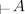
>
> mean the judgement “Opposite magnetic poles attract one another”, then
>
> 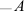
>
> will not express this judgement, but should merely arouse in the reader the idea of the mutual attraction of opposite magnetic poles, in order, say, to draw conclusions from it and by means of these to test the correctness of the thought. In this we *paraphrase* using the words “the circumstance that” or “the proposition that”. (1879a: §2)

In *Begriffsschrift* Frege makes it clear that not every conceptual content is a judgeable content, and hence not every expression (and definitely not every name of an object) is eligible to be the argument of the judgement stroke:

> Not every content can become a judgement by placing 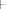 before its symbol; for example, the idea “house” cannot. We therefore distinguish *judgeable* and *unjudgeable* contents. (1879a: §2)

He concludes his discussion of the rejection of the subject-predicate analysis of propositions in favor of his function-argument approach, discussed above, with the following observation regarding the role of the judgement stroke:

> Imagine a language in which the proposition “Archimedes was killed at the capture of Syracuse” is expressed in the following way: “The violent death of Archimedes at the capture of Syracuse is a fact”. Even here, if one wants, subject and predicate can be distinguished, but the subject contains the whole content, and the predicate serves only to present it as a judgement. *Such a language would have only a single predicate for all judgements, namely “is a fact”.* It can be seen that there is no question here of subject and predicate in the usual sense. Our Begriffsschrift is such a language and the symbol  is its common predicate for all judgements. (1879a: §3)

Shortly after introducing the judgement stroke in *Begriffsschrift*, Frege makes the claim that it is composed of two parts, the horizontal stroke “ 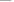 ” and the vertical stroke “$|$”, which is the judgement stroke proper, and he suggests that the horizontal unites the component parts of the judgeable content that follows into a whole:

> The *horizontal stroke*, from which the symbol  is formed, *binds the symbols that follow it into a whole, and assertion, which is expressed by means of the vertical stroke at the left end of the horizontal, relates to this whole*. The horizontal stroke may be called the *content stroke*, the vertical the *judgement stroke*. The content stroke serves generally to relate any symbol to the whole formed by the symbols that follow the stroke. *What follows the content stroke must always have a judgeable content*. (1879a: §2)

Note the fact that arguments of the judgement stroke are restricted to contents that are judgeable (loosely put, to sentences, in an informal sense of the term), hence “  $2$” is, in the logic of *Begriffsschrift*, not a falsehood but is merely not well-formed. We will return to the importance of this observation in understanding the differences between Frege’s two logics below. But the horizontal does little actual work in the logic of *Begriffsschrift*: it never occurs in isolation.

#### 2.1.2 The Conditional Stroke

Next up is the conditional stroke. In *Begriffsschrift* Frege explains the conditional stroke as follows:

> If $A$ and $B$ denote judgeable contents (§2), then there are the following four possibilities:
>
> 1. $A$ is affirmed and $B$ is affirmed;
> 2. $A$ is affirmed and $B$ is denied;
> 3. $A$ is denied and $B$ is affirmed;
> 4. $A$ is denied and $B$ is denied.
>
> 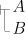
>
> now denotes the judgement that *the third of these possibilities does not obtain, but one of the other three does*. Accordingly, if
>
> 
>
> is denied, then this is to say that the third possibility does obtain; i.e., that $A$ is denied and $B$ is affirmed. (1879a: §5)

Simply put, the conditional stroke is Frege’s *Begriffsschrift* version of the material conditional: it combines two conceptual contents into a single complex conceptual content that denotes a fact if and only if it is not the case that the first denotes a fact yet the second does not. In modern terminology, the consequent of the conditional (what Frege will call the *supercomponent* in the logic of *Grundgesetze*) occurs above the antecedent (what Frege will call the *subcomponent* in the logic of *Grundgesetze*). Note the explicit restriction of the arguments of the conditional stroke to judgeable contents.

Although Frege does not discuss this as explicitly in *Begriffsschrift* as he does in *Grundgesetze*, it is worth noting that complex conditional stroke constructions can be parsed into antecedent and consequence in multiple ways. Consider:

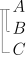

This expression is analogous (but of course not equivalent, in any reasonable sense of equivalent) to “$C \rightarrow (B \rightarrow A )$” in modern notation. But Frege often treats expressions of this form as instead expressing something more akin to the (classically) equivalent “$(C \land B) \rightarrow A$”. In short, Frege switches back and forth between reading the offset formula above as a (binary) conditional with “$C$” as antecedent and

as consequent, and as a (ternary) conditional with both “$C$” and “$B$” as antecedents and “$A$” as consequent (this will become relevant in our discussion of his rules of inference below).

#### 2.1.3 The Negation Stroke

The third notion introduced by Frege in *Begriffsschrift* is the negation stroke:

> If a small vertical stroke is attached to the underside of the content stroke, then this is intended to express the circumstance that *the content does not obtain*. Thus, for example,
>
> 
>
> means “$A$ does not obtain”. I call this small vertical stroke the *negation stroke*. The part of the horizontal stroke to the right of the negation stroke is the content stroke of $A$, the part to the left of the negation stroke, on the other hand, is the content stroke of the negation of $A$. (1879a: §7)

Although it is not obvious that Frege thought of propositional logic as an identifiable subsystem of the logic of *Begriffsschrift* (or of the logic of *Grundgesetze*), negation and the conditional stroke are the only (Fregean analogues) of propositional operators that Frege introduces into either logic (identity does play something like the role of the biconditional in both the logic of *Begriffsschrift* and the logic of *Grundgesetze*). Frege does not offer an expressive completeness result (and it is not likely that he was in a position, conceptually, to even state such a result at the time of writing *Begriffsschrift*). But he concludes §7 of *Begriffsschrift* by gesturing in this direction, noting that these two operators allow us to express what we now call inclusive disjunction, exclusive disjunction, and conjunction as:

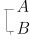

inclusive disjunction

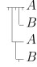

exclusive disjunction

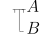

conjunction

respectively.

#### 2.1.4 The Identity Operator

Frege next introduces what has become perhaps the most notorious part of the logic of *Begriffsschrift*, his identity operator. Frege is clearly struggling with the puzzles that he would eventually solve in “Sense and Reference” via the titular distinction, but that notion is not yet available, and as a result he is faced with the following puzzle: Given two names “$a$” and “$b$”, if “$a = b$” is true, and, if the conceptual content of names are their referents, then “$a = a$” and “$a = b$” have the same conceptual content. But this cannot be the case: “$a = a$” and “$a = b$” clearly *do not* have the same conceptual content, since they imply different things.

As a result, Frege is forced to deny that “$a$” and “$b$” have the same conceptual content, at least in the context of identity claims. Hence, their conceptual content cannot be their referents. Frege concludes that the conceptual content of names within identity statements are the names themselves, defining identity as follows (it is worth noting that he uses “$\equiv$” here, but moves to the somewhat more standard notation “$=$” in *Grundgesetze* once he has solved these problems):

> 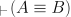
>
> is therefore to mean: *the symbol $A$ and the symbol $B$ have the same conceptual content, so that $A$ can always be replaced by $B$ and vice versa*. (1879a: §7)

This solves the problem, since in the context of a true identity claim like “$a = b$”, “$a$” and “$b$” do not pick out the same thing. Instead, “$a$” self-referentially picks out the symbol “$a$” (and similarly for “$b$”), and as a result the identity claim “$a = b$” does not express (loosely put):

> $a$ is the same as $b$

but instead something like (again, loosely put):

> The thing picked out by “$a$” is the same as the thing picked out by “$b$”.

which has a different conceptual content from:

> The thing picked out by “$a$” is the same as the thing picked out by “$a$”.

As a result, names within *Begriffsschrift* formulas such as:

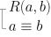

are forced to do double-duty: In the antecedent of the conditional above, the occurrences of “$a$” and “$b$” effectively denote themselves. In the consequent of this conditional, however, “$a$” and “$b$” denote more straightforwardly, to whatever objects these names actually name.

Frege is quite aware of the difficulties that arise as a result of this understanding of identity, beginning §8 of *Begriffsschrift* with the following observation:

> Identity of content differs from negation and conditionality by relating to names, not to contents. Whilst elsewhere symbols simply represent their contents, so that each combination into which they enter merely expresses a relation between their contents, they at once stand for themselves as soon as they are combined by the symbol for identity of content; for this signifies the circumstances that two names have the same content. Thus with the introduction of a symbol for identity of content a bifurcation in the meaning of every symbol is necessarily effected, the same symbols standing one moment for their content, the next for themselves. (1879a: §8)

A solution to this problem would have to wait until the introduction of the sense/reference distinction.

We have so far restricted our attention to the application of the identity symbol to names of objects. But Frege, in *Begriffsschrift*, never restricts the application of the identity symbol in this manner, requiring only that its application be restricted in such a way that only judgeable contents result. Thus, within the logic of *Begriffsschrift* the identity symbol can be applied to any two arguments, rather than merely between objects.

#### 2.1.5 The Concavity for Expressing Generality

Finally, we have Frege’s device for expressing generality within *Begriffsschrift*: the concavity:

> In the expression of a judgement, the complex of symbols to the right of  can always be regarded as a function of one of the symbols occurring in it. *If a Gothic letter is put in place of the argument, and a concavity containing this letter inserted in the content stroke, as in*
>
> 
>
> *then this signifies the judgement that the function is a fact whatever may be taken as its argument.* Since a letter used as a symbol for a function, such as $\Phi$ in $\Phi(A)$, can be regarded as the argument of a function, it can be replaced by a Gothic letter in the manner just specified. The meaning of the Gothic letter is subject only to the obvious restrictions that the complex of symbols following a content stroke must still remain judgeable (§2), and that, if the Gothic letter occurs as a symbol for a function, this circumstance must be taken into account. *All other conditions which must be imposed on what may replace a Gothic letter are to be included in the judgement.* (1879a: §11)

Thus, the concavity is the *Begriffsschrift* version of (something like) the universal quantifier, and a formula of the form:

is true (or, in the terminology Frege mobilizes in *Begriffsschrift*, *is a fact*) if and only if, for any *argument* whatsoever, applying the function denoted by $\Phi(\xi)$ to that argument is true (or, again, is a fact). Note that Frege explicitly restricts the formation of formulas in the logic of *Begriffsschrift* so that the concavity can only bind a function that outputs a judgeable content when an appropriate argument is filled in—hence, in the logic of *Begriffsschrift* “ 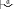 $\mathfrak{a}+1$” is not well-formed.

We can now add a bit more detail to the explication of the differences between Frege’s *Begriffsschrift* distinction between function and argument, and the more modern-looking hierarchy of objects, first-level functions, second-level functions, and third-level functions that will appear within the logic of *Grundgesetze*. Properly understood:

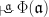

within *Begriffsschrift* does not assert that:

> For any object $\mathfrak{a}$, $\Phi(\mathfrak{a})$ is a fact.

but instead says something like;

> For any entity (of whatever “type” or “sort”) $\mathfrak{a}$ *such that the combination of $\Phi(\xi)$ with $\mathfrak{a}$ results in a judgeable content*, $\Phi(\mathfrak{a})$ is a fact.

In understanding the quantified statement in this manner, we are free to understand $\mathfrak{a}$ as the argument, and $\Phi(\xi)$ as the function, or $\Phi(\xi)$ as the argument, and $\mathfrak{a}$ as the function, subject only to the requirement that the combination of $\mathfrak{a}$ and $\Phi(\xi)$ result in a judgeable content. Of course, if $\Phi(\xi)$ is a function that only maps objects to judgeable contents, then the upshot is the same as standard first-order quantification. But Frege has, to emphasize this point once again, not yet introduced the conceptual machinery that allow him to identify such functions, nor has he ever claimed that a particular function must only take one type of entity (that is, take only objects, or only functions, etc.) as arguments.

One clear indication that the sort of hierarchy that is mobilized within the logic of *Grundgesetze* in order to clean all this up is not present—not even implicitly, in the background—within the logic of *Begriffsschrift* is that Frege does not introduce distinct quantifiers for distinct kinds of entity (not even for function and argument). Although Frege uses different styles of variable to suggest that some quantifications range over arguments, and others over functions, this is merely heuristic—and it must be, since, as we have already seen, within the logic of *Begriffsschrift* the function/argument distinction is not a metaphysical distinction found in the world, but instead merely reflects different ways that one might parse the same statement. Thus, the (single universal) quantifier in the logic of *Begriffsschrift* ranges over both objects and functions (albeit in a rather complicated manner), and modern first- and higher-order quantifiers do not actually appear within *Begriffsschrift* in the way that they clearly appear within the logic of *Grundgesetze*. Rather, there is a single quantifier that ranges over objects and functions (and concepts, and relations, etc.) alike, and the informal restrictions on what constructions are licit (i.e., that the result of applying function to argument must result in a judgeable content) constrain the potential range of each instance of this quantifier. Thus, the quantifiers of the logic of *Begriffsschrift* bear a rather limited resemblance to modern quantifiers (see Kemp 1995 and Heck & May 2013 for arguments that this construction in *Begriffsschrift* doesn’t even count as a genuine quantifier in the first place)[^heck-2013][^kemp-1995].

Frege has a second way of expressing generality—Roman letters. As we shall see, there is some controversy about how to understand the way in which this device is meant to be understood within the logic of *Grundgesetze*. But there is no mystery regarding how they are meant to be understood within the logic of *Begriffsschrift*, since within the earlier work Frege states explicitly that the Roman letter generality device is an abbreviation for a special, and especially important, instance of the German letter, concavity version of universal quantification:

> *Only within its scope does a Gothic letter retain its meaning*; the same Gothic letter can occur within various scopes in one judgement, without the meaning that may be ascribed to it in one scope carrying over to the others. The scope of a Gothic letter can include another, as the example:
>
> 
>
> shows. In this case *different* letters must be chosen; $\mathfrak{e}$ may not be replaced by $\mathfrak{a}$. It is, of course permitted to replace a Gothic letter everywhere in its scope by another particular one, provided that there are still different letters standing where different letters stood before. This has no effect on the content. *Other substitutions are only allowable if the concavity immediately follows the judgement stroke*, so that the content of the whole judgement makes up the scope of the Gothic letter. Accordingly, since this case is particularly important, I shall introduce the following abbreviation for it. *An italic letter always has as its scope the content of the whole judgement, without this needing to be signified by a concavity in the content stroke.* (1879a: §11)

Frege is quite explicit here: The occurrence of Roman (or italic) letters in a formula of the logic of *Begriffsschrift* is nothing more than an abbreviation of the corresponding formula with the Roman variables replaced by corresponding Gothic variables, and the concavities corresponding to those variables placed immediately after the judgement stroke. Thus, the formula appearing in the quotation above is, in the logic of *Begriffsschrift*, merely an abbreviation for:

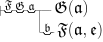

and the Roman letter generality device is meant to remind the reader that the restrictions on substitution (effectively protecting against a clash of variables) that govern substitutions of German variables in general *do not apply* to variables bound by concavities in what we would call prenex position.

While this is Frege’s official understanding of Roman letters, he often treats formulas containing Roman letters as if they were substitution instances of the corresponding concavity-bound universal formulas—that is, as cases where the Roman letters pick out particular functions and arguments. While this deserves more attention than can be given here, there is a practical reason that forces Frege to make some such move: Since he has not introduced any name-forming operators within *Begriffsschrift*, the language does not contain the resources to express any particular claims.

### 2.2 The Axioms and Rules of *Begriffsschrift*

The logic of *Begriffsschrift* officially contains nine axioms and one rule, although two additional rules, used repeatedly throughout the derivations, are explicated more informally “in passing” by Frege. Within the derivations of *Begriffsschrift*, Frege numbers formulas sequentially in terms of their occurrence within the sequence of derivations, and only introduces an axiom when it is needed—hence the axioms are formulas 1, 2, 8, 28, 31, 41, 52, 54, and 58 on his numbering. I have provided a more convenient, conventional 1 through 9 numbering in the discussion, and this numbering will be used in the comparison between this system and the collection of axioms and rules given in *Grundgesetze*.

#### 2.2.1 The Axioms

**Axiom 1** (Formula 1, 1879a: §14)

This is the *Begriffsschrift* analogue of:

$$A \rightarrow (B \rightarrow A)$$

although care should be taken, since Frege’s axiom, with its use of Roman letters, is a quantified formula, not a schema, and is perhaps better rendered as:

$$\forall A\; \forall B (A \rightarrow (B \rightarrow A))$$

where the quantifiers range over judgeable contents. Frege defends this axiom as follows:

> [this axiom]… says: “The case in which $a$ is denied, $b$ is affirmed and $a$ is affirmed is excluded”. This is obvious since $a$ cannot be denied and affirmed at the same time. We can also express the judgement in words this way: “If a proposition $a$ holds, it holds also in the case an arbitrary proposition $b$ holds”. (1879a: §14)

Axiom 2 (Formula 2) is equally straightforward, so long as we remember that it is an abbreviation for a formula quantifying over judgeable contents:

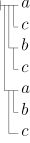

**Axiom 2** (Formula 2, 1879a: §15)

Frege’s argument that this axiom must be true stretches over four pages, and will not be reproduced here. The argument for Axiom 1 quoted above should give readers a feel for the flavor of Frege’s *Begriffsschrift* justifications for particular axioms (and similar comments apply to the later, even more complex axioms). The intuitive validity of this axiom should be clear, since it is a *Begriffsschrift* analogue of something like:

$$\forall C\; \forall B\; \forall A(C \rightarrow (B \rightarrow A)) \rightarrow ((C \rightarrow B) \rightarrow (C \rightarrow A))$$

where the quantifiers range over judgeable contents.

The next axiom, Axiom 3 (Formula 8), allows (in combination with Frege’s version of *modus ponens*, see below) for the re-arrangement of antecedents of a conditional:

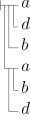

**Axiom 3** (Formula 8, 1879a: §16)

This axiom will be replaced by a (more general) rule in the logic of *Grundgesetze*.

Axiom 4 (Formula 28) (again, in combination with Frege’s version of *modus ponens*) provides a version of contraposition.

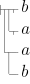

**Axiom 4** (Formula 28, 1879a: §17)

As with Axiom 3, this axiom will be replaced by a much more general rule in *Grundgesetze*.

Axiom 5 (Formula 31) and Axiom 6 (Formula 41) are a pair of sorts, providing us with Frege’s axiomatic versions of double negation introduction and double negation elimination:

**Axiom 5** (Formula 31, 1879a: §18)

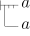

**Axiom 6** (Formula 41, 1879a: §19)

These axioms, plus Frege’s version of *modus ponens*, complete what we might think of as the propositional portion of the logic of *Begriffsschrift*. Łukasiewicz proves that a modern transcription of these axioms, plus a modern transcription of Frege’s version of *modus ponens*, are sound and complete with respect to classical logic with propositional quantifiers, and he also proves that (the modern transcription of) Axiom 3 is redundant in the context of (modern transcriptions of) the other axioms plus, again, *modus ponens* (Łukasiewicz 1934). Of course, the usual warnings regarding transcribing Frege’s notations into modern ones, and assuming that his notion of judgeable content (the range of the quantifiers that occur in Axioms 1 through 6) is the same as a more modern notion of proposition or sentence, apply to this result.

Frege’s discussion of Axioms 5 and 6 also provide a nice illustration of the sorts of changes that occur in Frege’s logical thinking between the composition of *Begriffsschrift* and the composition of *Grundgesetze*. In the preface to *Begriffsschrift* Frege notes that:

> I realized later that formulas (31) and (41) can be combined into the single one
>
> 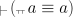
>
> which makes a few more simplifications possible. (1879a: Preface)

This principle, in combination with Axiom 7 and Frege’s version of *modus ponens*, does entail Axioms 5 and 6. Further, there is every reason to think that this principle is valid on the informal semantics Frege gives in *Begriffsschrift*, since (in *Begriffsschrift*) the variables are restricted to judgeable contents, and there seems little reason to doubt that the judgeable content denoted by  $a$ is identical to the judgeable content denoted by $a$.

All of this, however, is subject to an important caveat: the quantifiers within the logic of *Begriffsschrift* are constrained in a way that the quantifiers in *Grundgesetze* are not. Within the logic of *Begriffsschrift* Frege requires that the quantifiers be restricted so that the result of applying logical operators to entities in the range of the relevant quantifiers results in *judgeable contents*. As a result, formulas that are valid on the *Begriffsschrift* understanding of the logic are no longer valid on the *Grundgesetze* understanding. In particular, as we shall see:

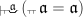

is true on the intended interpretation of (the consistent, value-range-free fragment of) the logic of *Grundgesetze*.

The next two axioms are relatively straightforward. Axiom 7 (Formula 52) provides an axiomatic version of the indiscernibility of identicals:

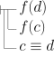

**Axiom 7** (Formula 52, 1879a: §20)

A much stronger version of this axiom will make an appearance in the logic of *Grundgesetze*.

And Axiom 8 (Formula 54) provides us with self-identity:

**Axiom 8** (Formula 54, 1879a: §21)

Again, this axiom applies to any argument $c$ (that is, to anything whatsoever), not just to objects.

Axiom 9 (Formula 58) is for our purposes a bit more interesting, not for what it says, but instead for what it leaves out. Axiom 9 allows us, in essence, to replace a German letter bound by a concavity in the antecedent of a conditional with a Roman letter:

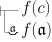

**Axiom 9** (Formula 58, 1879a: §22)

Note that Frege does not provide a corresponding second-order version of this axiom (as he does in *Grundgesetze*)—rather, this axiom should be read as covering both the first- and second-order case, thus expressing something along the lines of:

> For any function $f$ and for any argument $c$ such that $f(c)$ is a judgeable content: if, for any argument $\mathfrak{a}$ such that $f(\mathfrak{a})$ is a judgeable content, $f(\mathfrak{a})$ is a fact, then $f(c)$ is a fact.

rather than:

> For any (first-level) function $f$ and for any object $c$: if, for any object $\mathfrak{a}$, $f(\mathfrak{a})$ is a fact, then $f(c)$ is a fact.

#### 2.2.2 The Rules of Inference

On to the rules of inference. In the preface to *Begriffsschrift*, Frege claims that he only uses one mode of inference:

> The restriction, in §6, to a single mode of inference is justified by the fact that in *laying the foundations* of such a *Begriffsschrift* the primitive elements must be as simple as possible if perspicuity and order are to be achieved. (1879a: Preface)

The rule in question is a version of *modus ponens*, which Frege explains as follows:

> From the explanation given in §5 it is clear that from the two judgements
>
> 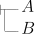
>
> and
>
> 
>
> the new judgement  $A$ follows. Of our four cases enumerated above, the third is excluded by
>
> 
>
> and the second and fourth by  $B$, so that only the first is left. (1879a: §6)

The four cases Frege is referring to are the four possible combinations of $A$ and $B$ being, or failing to be, facts given in the explanation of the conditional stroke, quoted above.

At first glance, this appears to be the familiar rule of *modus ponens*, but in fact it is a good bit more complicated. Frege routinely applies the rule to pairs of formulas that contain Roman letters. Remembering that in *Begriffsschrift* Roman letters are abbreviations for prenex concavity quantifiers, the simple case that Frege uses in his explication of this rule is really shorthand for the transition from:

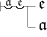

and

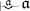

to:

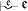

where the quantifiers range over judgeable contents. As a result, this rule, as he applies is throughout *Begriffsschrift*, is not the propositional rule *modus ponens* at all. Instead, it is an analogue of something like the following (in modern notation):

$$\begin{aligned} ~ & \forall a_1\forall a_2\dots \forall a_n\forall b_1\forall b_2\dots \forall b_m\forall c_1\forall c_2\dots \forall c_k\\ &(\Phi_1(a_1, a_2, \dots a_n, b_1, b_2, \dots b_m) \rightarrow \Phi_2(a_1, a_2, \dots a_n, c_1, c_2, \dots c_k))\\ [P_2]~ & \forall a_1\forall a_2\dots \forall a_n\forall b_1\forall b_2\dots \forall b_m (\Phi_1(a_1, a_2, \dots a_n, b_1, b_2, \dots b_m))\\ \hline\\ [C]~ & \forall a_1\forall a_2\dots \forall a_n\forall c_1\forall c_2\dots \forall c_k(\Phi_2(a_1, a_2, \dots a_n, c_1, c_2, \dots c_k)) \end{aligned}$$

There are two things to notice about the rule, understood in this way.

First off, once we recognize the role played by the (German-letter bound) quantifiers abbreviated by Roman letters in any instance of the rule, it is clear that Frege’s defense of the rule is utterly inadequate. Frege’s argument would be adequate for a particular substitution instance of the rule, where no Roman letters appeared. But it doesn’t address the much more general principle that codifies the manner in which he in fact applies the rule throughout *Begriffsschrift*.

Second, this is not, in fact, a single rule at all, but is instead a schema for infinitely many rules: one for each triple of sequences of variables $a_1, a_2, a_n$; $b_1, b_2,\dots b_m$; and $c_1, c_2,\dots c_k$, where not only the number of $a_i$s, $b_i$s, and $c_i$s in each instance can vary, but their type (where, remember, these are argument variables and function variables, not object variables and function variables) can vary as well. It does not seem unlikely that the strongly schematic flavor of this rule would have bothered Frege, given that his interest was in giving particular logical principles from which we could derive particular universal logical truths. As a result, it is perhaps unsurprising that Frege will give a completely different (albeit somewhat unclear) account of the role of Roman letters in *Grundgesetze*.

Although Frege claims that this version of *modus ponens* is his only rule of inference in the preface to *Begriffsschrift*, he modifies this claim later in the work, noting that:

> In logic, following Aristotle, a whole series of modes of inference are enumerated; I use just this one—at least in all cases where a new judgement is derived from more than one single judgement. (1879a: §6)

The two rules that Frege has in mind, which involve the transition from a single judgement to a single judgement, are rules that we shall call concavity-introduction and a rule of substitution (Frege does not give them names).

Frege explains the rule of concavity-introduction as follows:

> *An italic letter may always be replaced by a Gothic letter that does not yet occur in the judgement*, the concavity being inserted immediately after the judgement stroke. E.g. instead of:
>
> 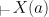
>
> one can put:
>
> 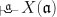

if $a$ occurs only in the argument-places of $X(a)$: *It is also clear that from*:

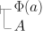

*one can derive:*

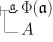

*if $A$ is an expression in which $a$ does not occur, and if $a$ stands only in the argument place of $\Phi(a)$*. (1879a: §11)

Frege then gives a second example that takes advantage of the fact that conditional stroke constructions can be parsed into antecedent(s) and consequent in more than one way:

> Similarly, from:
>
> 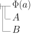
>
> we can deduce:
>
> 
>
> (1879a: §11)

Frege’s concavity-introduction rule operates as follows: Given any formula containing a Roman letter, we can infer any proposition that uniformly replaces the Roman letter with a German letter and inserts a concavity containing the same German letter immediately in front of *some* consequent that contains all occurrences of the new German letter (recalling that formulas can be parsed into consequent and antecedent in more than one way), or the concavity can be placed in front or the entire formula (after the judgement stroke). The new German letter must be chosen so that it does not “conflict” with other German letters already present in the original proposition. Looking at a more complex example, if “$A$” and “$B$” are any formulas not containing the Roman letter “$x$”, and “$\Phi(\xi)$” and “$\Psi(\xi)$” do not contain “$\mathfrak{a}$”, then from:

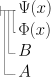

we can infer any of:

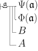

but not:

This rule does not really involve “introducing” a concavity within the logic of *Begriffsschrift*, since the Roman letter being replaced is, of course, an abbreviation of an instance of the concavity. Instead, this rule is a means for *moving* a concavity from one location to another. The name “concavity introduction” is thus used here to emphasize the connection between this rule and the syntactically similar rule found in the logic of *Grundgesetze* (where Roman letters are, as we shall see, not an abbreviation of corresponding initial concavities, but are a second, completely separate device for achieving universal generality, and hence the rule does involve introducing a concavity not present beforehand).

Frege’s final rule of inference in *Begriffsschrift* is a rule of substitution: Once one has proven a particular formula, one may, in later derivations, make use, not only of the proven formula itself, but also of the result of carrying out any uniform substitution of expressions for Roman letters occurring in the original—again, subject to the requirement that the formula and all relevant sub-formulas are judgeable contents. Jean van Heijenoort argues, in his introductory essay on *Begriffsschrift*, that Frege applies his rule of substitution in illicit ways—ways that will lead to contradictions. See the supplementary essay [The Supposed Contradiction in *Begriffsschrift*](frege-logic.supp-begriff.md) for discussion.

The third section of *Begriffsschrift* introduces definitions of what have become known as the weak and strong *ancestrals* of a relation, and proves a powerful induction theorem based on these notions. A careful examination of this construction is beyond the scope of this essay—the reader is encouraged to consult the entry on Frege’s theorem for more details.

The most important aspect of the third section of *Begriffsschrift*, for our purposes at least, is the new bit of notation that Frege introduces: the definition stroke “ 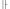 ”. The definition stroke occurs initially in a formula of the form:

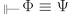

where “$\Psi$” is the *definiendum*, and “$\Phi$” is the *definiens*. After giving an example of the definition stroke in action (formula 69, the notion of $F$ being hereditary in the *f*-sequence), Frege explains the definition stroke in *Begriffsschrift* as follows:

> This sentence is different from those considered previously since symbols occur in it which have not been defined before; it itself gives the definition. It does not say, “The right side of the equation has the same content as the left side”; but, “They are to have the same content”. This sentence is therefore not a judgement; and consequently, to use the Kantian expression, also *not a synthetic judgement*. […]
>
> Although originally (69) is not a judgement, still it is readily converted into one; for once the meaning of the new symbols is specified, it remains fixed from then on; and therefore formula (69) holds also as a judgement, but as an analytic one, since we can only get out what was put into the new symbols. This dual role of the formula is indicated by the doubling of the judgement stroke. (1879a: §24)

The use of the notion of sameness of conceptual content (i.e., “$\equiv$”) in the definitions of *Begriffsschrift* automatically entails that the *definiens* and *definiendum* have the same content (that is, denote the same fact or circumstance), whereas the improved understanding of identity mobilized in *Grundgesetze* only entails, as a matter of logic, that the *definiendum* and *definiens* denote the same object. Hence, in his informal explications Frege explicitly stipulates that within *Grundgesetze* definitions the expressions occurring on both sides of the identity symbol have not only the same reference but also the same sense.

## 3. The Logic of *Grundgesetze*

The reader who is interested in the evolution of Frege’s logical ideas between the writing of *Begriffsschrift* and the writing of *Grundgesetze* should consult the short supplementary essay [The Period Between *Begriffsschrift* and *Grundgesetze*](frege-logic.supp-between.md). Here, we will jump directly into the formal system contained in the latter work.

One of the main, and most obvious, differences between the logic of *Begriffsschrift* and the logic of *Grundgesetze*, other than the addition of value-ranges, is the fact that Frege now has a fully worked out, rigorous type theory in place. The most fundamental distinction is that between objects, which are saturated, and functions (including concepts as a special case), which are not, and thus require being “completed” via application to one or more arguments.

Two particularly important types of function are concepts and relations. A *concept* is a unary function such that, for any argument (of the appropriate type), the value of the function applied to that argument is a truth-value. A *relation* is a function with two (or more) arguments such that, for any pair (or *n*-tuple) of arguments (again, of the appropriate type), the value of the function applied to that pair is a truth-value (Frege 1893/1903: §4, see also 1893/1903: §22).

Frege also subdivides functions in terms of the *kinds* of argument that they take. Thus, a function is a *first-level function* if and only if it takes an object or objects (and hence only takes an object or objects) as argument(s); a function is a *second-level function* if and only if it takes a first-level function or functions (and hence only takes a first-level function or functions) as argument(s); and a function is a *third-level function* if and only if it takes a second-level function or functions (and hence only takes a second-level function or functions) as argument(s) (Frege 1893/1903: §21 through §23, see also §26).

In what follows we will divide up our discussion of the logic of *Grundgesetze* into three sections, where the first considers those notations that occur in the earlier logic of *Begriffsschrift* (although often with rather different understandings), the second presents those notations that are novel to the logic of *Grundgesetze*, and the third presents the axioms (now called Basic Laws) and rules of inference of the logic of *Grundgesetze*.

### 3.1 The “Old” Operators of *Grundgesetze*

#### 3.1.1 The Judgement Stroke

As was the case in *Begriffsschrift*, the judgement stroke of *Grundgesetze* transforms expressions into judgements. Unlike the earlier system, however, in the logic of *Grundgesetze* the judgement stroke does not attach to expressions that name facts or circumstances, but instead attaches to expressions that name objects (that is, proper names):

> Above it is already stated that within a mere equation no assertion is yet to be found; with “$2 + 3 = 5$” only a truth-value is designated, without its being said which one of the two it is. Moreover, if I wrote “$(2 + 3 = 5) = (2 = 2)$” and presupposed that one knows that $2 = 2$ is the True, even then I would not thereby have asserted that the sum of 2 and 3 is 5; rather I would only have designated the truth-value of: that “$2 + 3 = 5$” refers to the same as “$2 = 2$”. We are therefore in need of another special sign in order to be able to assert something as true. To this end, I let the sign  precede the name of the truth value, in such a way that, e.g., in:
>
> 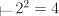
>
> it is asserted that the square of 2 is 4. I distinguish the *judgement* from the *thought* in such a way that that I understand by a *judgement* the acknowledgement of the truth of a *thought*. (Frege 1893/1903: §5)

Thus, the application of the judgement stroke to a *Grundgesetze* expression lacking the judgement stroke asserts that the expression in question is a name of the True, where *the True* is the object denoted by true sentences (and *the False* is the object denoted by false sentences). An expression of the form:

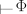

now no longer says that “$\Phi$ is a fact”, but instead says something like “$\Phi$ is (i.e., is identical to) the True”. It is worth noting that this simple account of the judgement stroke will be complicated somewhat in our discussion of Frege’s new *Grundgesetze* understanding of Roman letters.

In *Grundgesetze* Frege once again suggests that the judgement stroke proper (1893/1903: §5), as well as the negation stroke (1893/1903: §6), the conditional stroke (1893/1903: §12), and the concavity (1893/1903: §8), can be understood as consisting merely of the actual vertical “stroke” or line (or curve with variable, in the case of the concavity), with the attached horizontal portion(s) of the notation understood as separate occurrences of the horizontal. In actual practice within *Grundgesetze* the judgement stroke never appears without the attached horizontal. Unlike in the *Begriffsschrift*, however, the horizontal stroke *does* occur relatively frequently on its own, as an operator distinct from the judgement stroke, the conditional stroke, and the negation stroke.

In the logic of *Grundgesetze*, the *horizontal stroke* is a unary function symbol that attaches to names of objects, and it names a function that always outputs a truth-value, regardless of the kind of object input:

> I regard it as a function-name such that:
>
> 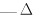
>
> is the True when $\Delta$ is the True, and is the False when $\Delta$ is not the True. Accordingly,
>
> 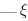
>
> is a function whose value is always a truth-value, or a concept according to our stipulation. (1893/1903: §5)

In other words, if the horizontal is prefixed to the name of a truth-value “$\Delta$”, then the resulting complex name:

names the same truth-value as is named by “$\Delta$”. If, however, “$\Delta$” does not name a truth-value, then “  $\Delta$” names the False.

Of particular importance here is the fact that, within the logic of *Grundgesetze*, the horizontal stroke is not limited in its application to judgeable contents: the horizontal stroke can be meaningfully applied to any name whatsoever. As a result of Frege’s insistence that all functions be defined on all arguments of the appropriate type, the function denoted by the horizontal stroke must be defined on all objects. Thus, when applied to an object that is not a truth-value, it outputs the False.

As a result, although Frege requires that the judgement stroke be attached to a truth-value name in the explication of the judgement stroke quoted above, we can, within the logic of Grundgesetze, achieve the effect of attaching the judgement stroke to any name $\Delta$ whatsoever by attaching the judgement stroke to “  $\Delta$”, obtaining:

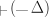

If the horizontal stroke is a part of the judgement stroke, and given that (as will be discussed below) multiple horizontals can be fused into a single horizontal, then the above judgement is equivalent to:

or would be, were the latter well-formed. Thus “  $2$” (or, at least, “  $($  $2)$” is a well-formed judgement in the logic of *Grundgesetze*, albeit an incorrect one.

#### 3.1.2 The Negation Stroke

Within the logic of *Grundgesetze*, the *negation stroke* is a unary function symbol that attaches to names of objects—in Frege’s terminology it names a first-level concept. Like the horizontal, the negation stroke transforms any proper name into a truth-value name:

> We do not need a specific sign to declare a truth-value to be the False, provided we have a sign by means of which every truth-value is transformed into its opposite, which in any case is indispensable. I now stipulate:
>
> The value of the function
>
> 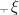
>
> is to be the false for every argument for which the value of the function
>
> 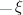
>
> is the True, and it is to be the True for all other arguments. (1893/1903: §6)

Thus, if the negation stroke is prefixed to the name of a truth-value “$\Delta$”, then “ 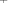 $\Delta$” names the True if “$\Delta$” names the False, and names the False if “$\Delta$” names the True. If, however, “$\Delta$” does not name a truth-value, then “  $\Delta$” names the True.

Frege’s treatment of the negation stroke as a total function has odd consequences. For example, if “$\Delta$” is the name of any object other than a truth value, then “  $\Delta$” names the True, and hence we have:

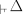

Frege explicitly notes that “ 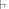 $2$” is a correct judgement (1893/1903: §6).

#### 3.1.3 The Conditional Stroke

Within the logic of *Grundgesetze*, Frege’s *conditional stroke* is a binary function symbol that attaches to names of objects—in Frege’s terms the conditional stroke names a first-level relation:

> Next, in order to be able to designate subordination of concepts and other important relations, I introduce the function with two arguments:
>
> 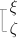
>
> by means of the specification that its value shall be the False if the True is taken as the $\zeta$-argument, while any object that is not the True be taken as the $\xi$-argument; that in all other cases the value of the function shall be the True. (1893/1903: §12)

The conditional stroke is a total function: Given any two proper names “$\Delta$” and “$\Gamma$”:

is a name of the True if either “$\Delta$” fails to name the True (i.e., either names the False or does not name a truth-value), or “$\Gamma$” names the True; and it names the False otherwise. Hence, for any name “$\Delta$” whatsoever:

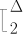

is a name of the true, and hence:

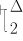

is a correct judgement in the logic of *Grundgesetze*

Frege calls the lower component of a conditional (what modern readers would term the antecedent) the *subcomponent* of the conditional, and the upper component (what modern readers would call the consequent) the *supercomponent*. As noted in our discussion of the logic of *Begriffsschrift*, however, conditional stroke constructions can be parsed into supercomponent and subcomponents(s) in multiple ways. For example, given proper names “$\Delta$”, “$\Gamma$”, “$\Theta$”, “$\Lambda$”, and “$\Xi$”, we can parse the complex expression:

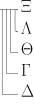

as having any of:

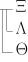

or “$\Xi$” as supercomponent (with one, two, three, or four subcomponents on each reading, respectively). Although Frege introduces the conditional stroke as if it is a simple binary first-level function from pairs of objects to truth-values, in his manipulation of the conditional stroke (and especially in the rules of inference for reasoning with the conditional stroke) he treats the conditional stroke much more like a kind of open-ended *n*-ary function name that takes a single argument as supercomponent, but which can take any (finite) number of arguments as its subcomponents. Since many of Frege’s rules of inference are formulated in terms of adding, eliminating, or repositioning supercomponents and subcomponents, this systematic ambiguity has profound implications for how proofs are constructed within *Grundgesetze*.

The multiple-subcomponent reading of complex conditional stroke constructions has two consequence worth mentioning at this point. First, Frege notes that, on the reading of:

where $\Delta$ and $\Lambda$ are the two subcomponents, each subcomponent plays exactly the same role as the other—the “ordering” of subcomponents does not matter (1893/1903: §12). Thus, this expression names the same truth-value as:

Frege introduces a rule of inference (one that can be applied within derivations without comment) that allows arbitrary re-ordering of subcomponents. This rule amounts to a *Grundgesetze* analogue of Axiom 3 from the logic of *Begriffsschrift*.

Along similar lines:

names the same truth-value as:

Frege introduces a rule of inference that allows one to move from the first formula to the second, and allows the “fusion” of identical subcomponents generally (which, likewise, can be applied within derivations without comment). Frege goes on to note that these rules of inference generalize to conditional stroke constructions with any number of subcomponents.

#### 3.1.4 Equivalences for the Judgement Stroke

Now that we have considered what we might naturally (although, as we have already noted, rather anachronistically) consider to be the propositional fragment of the logic of *Grundgesetze*, we need to return to the horizontal stroke. Frege suggests that the negation stroke, the conditional stroke, and the judgement stroke can be understood as consisting merely of the actual vertical “strokes” or lines involved in their formalization, with the attached horizontal portions of their notation understood as separate occurrences of the horizontal (see (1893/1903: §5, §6, and §12). As a result, for any name “$\Delta$”, all of:

1.  $\Delta$,
2.  (  $\Delta$),
3.  (  $\Delta$), and
4.  (  (  $\Delta$))

name the same truth-value (1893/1903: §6), and, for any names “$\Delta$” and “$\Gamma$”, all of:

(a)

(b)

(c)

(d)

(e)

(f)

(g)

(h)

name the same truth-value (1893/1903: §12). Frege’s calls these equivalences, and the transformations that result from replacing one of the expressions above with another, equivalent formulation, the *fusion of horizontals*. Like the permutation of subcomponents and the fusing of identical subcomponents, Frege allows one to fuse (and “un-fuse”) horizontals within *Grundgesetze* derivations (1893/1903: §48) without comment.

The careful reader might wonder why Frege chose the particular functions he in fact chose. Could he not have defined negation so that “  $\Delta$” named the True if “$\Delta$” was not the name of a truth-value? We are now in a position to provide an answer to this question: The fact that the negation stroke and the conditional stroke must fuse with the horizontal entails that the particular definitions of the negation stroke and the conditional stroke provided by Frege are the only ones possible, given the way in which he defines the horizontal stroke (Berg & Cook 2017)[^berg-2017].

#### 3.1.5 The Equality Sign

We now arrive at another dramatic difference between the logic of *Begriffsschrift* and the logic of *Grundgesetze*. Now that he has introduced the sense/reference distinction, Frege can explain the difference in content between “$a = a$” and “$a = b$” (where both are true) in terms of a difference in sense. Hence, in the logic of *Grundgesetze* Frege’s *equality sign* is defined as one would expect:

> We have already used the equality-sign rather casually to form examples but it is necessary to stipulate something more precise regarding it.
>
> $$\text{‘}\Gamma = \Delta\text{’}$$
>
> refers to the True, if $\Gamma$ is the same as $\Delta$; in all other cases it is to refer to the False. (1893/1903: §7)

Note that he has shifted to using the traditional identity symbol “$=$”, rather than the special symbol “$\equiv$” that he introduced for sameness of conceptual content in *Begriffsschrift*. A nice overview of the development of Frege’s sense/reference distinction, with particular attention paid to the role that the distinction plays in the later logic of *Grundgesetze*, can be found in Kremer (2010)[^kremer-2010].

While the definition of the equality-sign is now straightforward, Frege’s use of it is somewhat different from the way in which the equality symbol is used in modern predicate logic. Frege uses the equality-sign when making everyday equality claims such as “$2 + 2 = 4$”, but he also uses the same symbol flanked by truth-value names in order to express the claim that the truth-value names are names of the same truth-value—that is, that the expressions in question are equivalent. This explains an apparent oversight in Frege’s discussion of defined propositional operators. Frege does not explicitly provide a definition of the material biconditional within *Grundgesetze*, although he could have easily defined the material biconditional along standard lines as the conjunction of two conditionals:

If “$\Delta$” and “$\Gamma$” are both truth-value names, then this defined notion and the function named by Frege’s primitive equality-sign output the same value. If one or both of “$\Delta$” and “$\Gamma$” are proper names but not truth-value names, however, then the value of the complex material conditional applied to these arguments can differ from the value of the equality-sign applied to them. For example:

is a name of the True, while “1 = 2” is a name of the False.

Frege notes that the identity sign, in combination with the horizontal, allows us to construct a function that maps the truth-values to the True, and every other object to the False (1893/1903: §5):

This truth-value concept helps us to sort out a technical issue related to one of the deep differences between the logic of *Begriffsschrift* and the logic of *Grundgesetze*.

Recall that Frege noted in the preface to *Begriffsschrift* that he could have added:

to the logic, and this principle would have simplified the presentation, as it implies both Axiom 5 and Axiom 6. We also noted that this claim is correct with respect to the logic of *Begriffsschrift*, since the quantifiers in question are restricted to judgeable contents. Things stand differently, however, within the logic of *Grundgesetze*, since on the *Grundgesetze* interpretation this same formula (with “sameness” understood purely syntactically, subject to the replacement of “$\equiv$” with “$=$”) is false. Let “$\Delta$” be the name of any object that is not a truth value. Then “  $\Delta$” is a name of the True, hence “  $\Delta$” is a name of the False, and “$\Delta$” and “  $\Delta$” do not name the same object. So “  $\Delta= \Delta$” is a name of the False.

We can use the truth-value concept just discussed to construct a correct judgement within the logic of *Grundgesetze* that captures the intuitive import of the principle Frege considered adding to *Begriffsschrift*:

In short, if “$\Delta$” names a truth value, then “$\Delta$” and the double negation of “$\Delta$” name the same object.

#### 3.1.6 Two Forms of Universal Quantification

Next up are the quantifiers. In the logic of *Grundgesetze*, unlike (strictly speaking) in the logic of *Begriffsschrift*, Frege mobilizes two distinct forms of universal quantification. The first of these is the simplest: the concavity. The concavity (with associated German letter) is a unary second-level concept, mapping first-level functions to truth-values:

> […] let:
>
> 
>
> refer to the True if the value of the function $\Phi(\xi)$ is the True for every argument, and otherwise the False. (Frege 1893/1903: §8)

Frege includes no restriction that “$\Phi(\xi)$” must be the name of a concept, hence “  $\mathfrak{a} + 1$” is a well-formed judgement within the logic of *Grundgesetze*, albeit an incorrect one. In fact, he could not have coherently imposed any such restriction, since second-level functions must be defined for all first-level functions in exactly the same manner as first-level functions must be defined for all objects.

In the logic of *Grundgesetze*, the concavity, like the negation stroke and the conditional stroke, “fuses” with horizontals. In other words, all of the following name the same truth-value (i.e., are equivalent):

1.  ,
2.  ,
3.  , and
4. 

and Frege also allows the fusing or un-fusing of horizontals connected to the concavity to be carried out without comment within derivations (1893/1903: §8).

Frege explicitly introduces notation for second-order quantification via the concavity, using the now-familiar method: identifying which (in this case third-level) function such a quantifier names. If “$\mathcal{F}_\beta$” is a second-level function name (and where the subscripted occurrence of “$\beta$” binds object-level occurrences of “$\beta$” that occur in the argument to which “$\mathcal{F}_\beta$” is applied), then:

names the truth-value of the claim that, for every first-level function $\Phi(\xi)$, the result of applying the function named by “$\mathcal{F}_\beta$” to $\Phi(\xi)$ is the True (1893/1903: §24). Thus, unlike the logic of *Begriffsschrift*, the logic of *Grundgesetze* involves distinct quantifiers for first- and second-order quantification, rather then merely introducing a single quantifier that sometimes ranges over functions and at other times ranges over the arguments of those functions depending on context.

Frege does not introduce notation for third- or higher order concavity-quantification, since from a practical perspective he never needs it: instead, he uses his value-range operator to “reduce” the level of various constructions within *Grundgesetze* (as described below) so that they are in the range of his first- and second-order concavity.

Finally, we have the definition stroke. As in *Begriffsschrift*, Frege uses the *definition stroke* “  ” to indicate when a sentence is a definition:

> In order to introduce new signs by means of those already known, we now require the *double-stroke of definition* which appears as a double judgement-stroke combined with a horizontal:
>
> 
>
> and which is used instead of the judgement stroke where something is to be defined rather than judged. By means of a *definition* we introduce a new name by determining that it is to have the same sense and the same reference as a name composed of already known signs. The new sign thereby becomes co-referential with the explaining sign; the definition thus immediately turns into a proposition. Accordingly, we are allowed to cite a definition just like a proposition replacing the definition stroke by a judgement stroke. (1893/1903: §27)

There is little difference between this explanation of the definition stroke and the one given in *Begriffsschrift*, but it is worth noting that the judgements of equality entailed by *Grundgesetze* definitions only assert that “$a$” and “$b$” have the same referent, not that they have the sense. Thus, Frege explicitly stipulates that the *definiens* and *definiendum* of a *Grundgesetze* definition have the same *sense*.

### 3.2 The New Operators of *Grundgesetze*

#### 3.2.1 A Device for Generality: Roman Letters

##### 3.2.1.1 The Basics of Roman Letters

We begin our discussion of the new notions that did not occur within the logic of *Begriffsschrift* with the second means for expressing generality within *Grundgesetze*: the *Roman letter generality device*. At first glance, this might be surprising, since Roman letters were used as a device for expressing generality within *Begriffsschrift*, as discussed above. But in *Begriffsschrift* they were (officially, at least) merely an abbreviation for instances of the concavity that occurred initially in the formula in question. In the logic of *Grundgesetze*, however, Roman letters are a completely new, independent device of generalization.

Restricting our attention to the simplest case, where the lower-case Roman letter “$x$” “indicates” (in Frege’s terminology) an object, and where “$\Phi(\xi)$” is any first-level function name :

is a correct *Grundgesetze* proposition if and only if the function named by “$\Phi(\xi)$” outputs the True for every possible argument, and it is incorrect otherwise (1893/1903: §17).

The astute reader will have noticed that (following Frege) our explanation of the Roman letter generality device does not follow the general pattern utilized in our discussion of the horizontal, negation stroke, conditional stroke, or concavity. In short, we have not identified a function to which the *expression* “$\Phi(x)$” refers (where “$x$” is an occurrence of the Roman letter generality device), but instead have only explained when *judgements* involving the Roman letter generality device are correct.

Frege never gives a function-identifying definition of this sort for the Roman letter generality device—that is, he never identifies a particular second-level function which is denoted by this particular logical device. The reasons for this are simple: Were he to do so, (i) it would presumably be the same function as is picked out by instances of the concavity of the same “order”; (ii) it would be applicable to sub-expressions within a *Grundgesetze* formula, but it is not; and (iii) it would not have the *flexibility of scope* that it in fact has. As a result, expressions containing Roman letters are not names:

> I shall call *names* only those signs or combinations of signs that refer to something. Roman letters, and combinations of signs in which these occur, are thus not *names* as they merely *indicate*. A combination of signs which contains Roman letters, and which always results in a proper name when every Roman letter is replaced by a name, I will call a *Roman object-marker*. In addition, a combination of signs which contains Roman letters and which always results in a function-name when every Roman letter is replaced by a name, I will call a *Roman function-marker* or *Roman marker* of a function. (1893/1903: §17)

Given the fact that the Roman letter generality device seems to be of a very different character than the other logical notions found in *Grundgesetze*, the reader might wonder (a) why Frege included it at all, and (b) how, exactly, we should understand it. The answer to the first question is relatively simple, the answer to the second, less so. Frege explains the Roman letter generality device as follows:

> Let us now see how the inference called “Barbara” in logic fits in here. From the two propositions:
>
> > “All square roots of 1 are fourth roots of 1”
>
> and:
>
> > “All fourth roots of 1 are eighth roots of 1”
>
> we can infer:
>
> > “All square roots of 1 are eighth roots of 1”
>
> If we now write the premises thus:
>
> 
>
> 
>
> then we cannot apply our modes of inference; however, we can if we write the premises as follows:
>
> 
>
> 
>
> Here we have the case of §15. Above we attempted to express generality in this way using a *Roman letter*, but abandoned it because we observed that the scope of generality would not be adequately demarcated. We now address this concern by stipulating that the *scope* of a *Roman letter* is to include everything that occurs in the proposition apart from the judgement stroke. Accordingly, one can never express the negation of a generality by means of a Roman letter, although we can express the generality of a negation. An ambiguity is thus no longer present. Nevertheless, it is clear that the expression of generality with German letters and concavity is not rendered superfluous. Our stipulation regarding the scope of a *Roman letter* is only to demarcate its narrowest extent and not its widest. It thus remains permissible to let the scope extend to multiple propositions so that the Roman letters are suitable to serve in inferences in which the German letters, with their strict demarcation of scope, cannot serve. So, when our premisses are
>
> 
>
> and
>
> 
>
> then in order to make the inference to the conclusion
>
> 
>
> we temporarily expand the scope of “$x$” to include both premises and conclusion, although each of these propositions holds even without this extension. (1893/1903: §17)

There are a number of important things to note about this passage. The first is that this novel treatment of the Roman letter generality device (in comparison to the logic of *Begriffsschrift*) is motivated by exactly the puzzle regarding *modus ponens* that we raised earlier in this essay. Here the inference in question is a version of *hypothetical syllogism* (explicated in §15 of *Grundgesetze*, and about which more below), but the issue is the same. The rule in question allows us, for any expressions $\Delta$, $\Gamma$, and $\Theta$, to move from:

to:

But if, as was the case in the logic of *Begriffsschrift*, the Roman letter involving formulas:

are merely abbreviations of:

then we do not, strictly speaking, have an instance of the premises for this rule, and thus cannot advance to the desired (and correct) conclusion. Thus, we need an alternative understanding of the Roman letter generality device.

Frege suggests that, when we carry out the relevant instance of *hypothetical syllogism*, we temporarily extend the scope of the Roman letter “$x$” so that it includes both premises and the conclusion. As a result, the Roman letter “$x$” “indicates” the same object (whatever object this might be) uniformly throughout all three *Grundgesetze* propositions, and we can apply hypothetical syllogism.

##### 3.2.1.2 Higher Order Quantification and Roman Letters

Frege also allows both second- and third-order quantification to be expressed via the Roman letter generality device. Thus, if “$\Delta$” is the name of an object, then:

is a correct *Grundgesetze* proposition if and only if, for any first-level function $f$, the result of applying $f$ to the object named by “$\Delta$” is the True. Likewise, if “$\Phi(\zeta)$” is a first-level function name, then:

is a correct *Grundgesetze* proposition if and only if, for every second-level function $\mathcal{F}$, the result of applying $\mathcal{F}$ to the function named by “$\Phi(\xi)$” is the True (1893/1903: §25). Although Frege does explicitly provide treatment of third-order quantification via the Roman generality device (unlike his treatment of the concavity, which is limited to first- and second-order), he does not provide any notation for fourth- or higher-order quantification of either sort.

##### 3.2.1.3 How Roman Letters Work

We now move on to the second question: How, exactly, is the Roman letter device to work? How are we to understand Frege’s idea that expressions involving the Roman letter generality device “indicate” but do not “name” truth-values, and how are we to understand the idea that their scope must contain the entirety of the judgement in which they occur (other than, possibly, the judgement stroke), but could be expanded to include more than one formula at once? The right way to work out the answers to these questions is a matter of rather substantial controversy. Landini suggests that Frege is gesturing at the idea of variable assignments (Landini 2012)[^landini-2012], an idea that would not be developed fully until Tarski (1933)[^tarski-1933]; while Heck suggests instead that Frege intended the Roman letters to be understood substitutionally in terms of auxiliary names (that is, “extra” names not included in the object-language-level vocabulary), where, for example, an expression of the form:

(or multiple such expressions taken together in inference) indicates the True if and only if “$\Phi(n)$” is a name of the True, no matter what object the auxiliary name “$n$” denotes (Heck 2012)[^heck-2012]. For a modern version of this kind of treatment of quantifiers, see Mates (1972)[^mates-1972]. No attempt will be made here to settle this debate.

#### 3.2.2 The Value-Range Operator

The most notorious primitive notion in *Grundgesetze* is Frege’s value-range operator, given its central role in Russell’s paradox and the collapse of Frege’s logicist project. The value-range symbol, or “smooth breathing”, names a second-level function from first-level functions to objects. Given any first-level function name “$\Phi(\xi)$”, the object named by the application of the unary second-level “smooth-breathing” operator to “$\Phi(\xi)$”:

$$ἐ(Φ(\varepsilon))$$

is the value-range of the function named by “$\Phi(\xi)$”. Unlike the other primitive function symbols in the logic of *Grundgesetze*, Frege does not give an explicit definition of the function picked out by the value-range operator (for good reason, since there is, thanks to Cantor’s theorem, no such function!), instead explicating the notion in terms of an informal version of Basic Law V:

> I use the words:
>
> > “The function $\Phi(\xi)$ has the same *value-range* as the function $\Psi(\xi)$”
>
> always as co-referential with the words:
>
> > “the function $\Phi(\xi)$ and $\Psi(\xi)$ always have the same value for the same argument”.
>
> (1893/1903: §3)

One of the most important applications of the value-range operator is its application to first-level concepts, and the resulting objects, which Frege calls *extensions*, can be thought of, from a modern perspective and loosely speaking, as akin to the graphs of the characteristic functions of these concepts. Extensions do “behave” logically very similarly to (naive) sets, but the sensitive (or merely sensible) reader should be wary of attributing too much of our own modern views about sets onto *Grundgesetze* extensions. For an in-depth examination of the development of Frege’s thought regarding the nature of extensions, see Burge (1984)[^burge-1984].

Frege identifies another sub-class of objects that can be constructed using the value-range operator that do not correspond to anything widely used within modern mathematics: double value-ranges. Given any binary first-level function name “$\Phi(\xi, \zeta)$”, we form the double value-range of (the function named by)“$\Phi(\xi, \zeta)$” by applying the value-range operator to “$\Phi(\xi, \zeta)$” (binding the argument place marked by “$\xi$”), obtaining the unary first-level function name “$ἐ(\Phi(\varepsilon, \zeta))$”. We now obtain the double value-range of “$\Phi(\xi, \zeta)$” by applying the value-range function a second time, to “$ἐ(\Phi(\varepsilon, \zeta))$”, to obtain “$ἀἐ(\Phi(\varepsilon, \alpha))$”, which names the double value-range of the function named by “$\Phi(\xi, \zeta)$” (1893/1903: §36).

The need for double value-ranges provides one very practical explanation for the fact that the higher-order quantifiers of *Grundgesetze* range over functions generally rather than merely over concepts and relations as in modern systems. Given a binary relation symbol “$\Phi(\zeta, \xi)$”, the result of the first step—that is, the referent of “$ἐ(\Phi(\varepsilon, \xi))$”—is not a concept but a function that maps objects to value-ranges. Thus, the introduction of value-ranges requires that Frege accept not just concepts and relations, but functions more generally, into his higher-order ontology—see Landini (2012: ch. 4) for further discussion.

Frege only defines value-ranges for first-level functions. Of course, he could have extended the notion in order to obtain object-level analogues of second- and third-level functions directly. But there is no need, since we can “reduce” second- and higher-level functions to first-level functions via repeated applications of the value-range operator on first-level functions. For example, given a second-level concept name “$\mathcal{F}_\beta$” mapping first-level functions to truth-values, we can construct an object-level analogue by first constructing the name of the concept that holds of an object if and only if that object is the value-range of a first-level function that the concept named by “$\mathcal{F}_\beta$” maps to the True:

The object-level analogue of the second-level concept named by “$\mathcal{F}_\beta$” is then the value-range of this first-level concept:

This maneuver is quite general. Any time one might, within *Grundgesetze*, desire an object-level analogue of a second- or third-level function, one can use this trick to construct such an object.

#### 3.2.3 The Backslash Operator for Definite Descriptions

The final primitive notation of the logic of *Grundgesetze* is the *backslash*. The backslash is a unary first-level function mapping objects to objects:

> […] we can help ourselves by introducing the function:
>
> $$\backslash \xi$$
>
> with the specification to distinguish two cases:
>
> 1. if, for the argument, there is an object $\Delta$ such that $ἐ(\Delta = \varepsilon)$ is the argument, then the value of the function $\backslash\xi$ is to be $\Delta$ itself.
> 2. if, for the argument, there is no object $\Delta$ such that $ἐ(\Delta = \varepsilon)$ is the argument, then the argument itself is to be the value of the function $\backslash\xi$.
>
> (1893/1903: §11)

A bit of terminology is helpful: Given any proper name “$\Delta$”, let us call the object named by “$ἐ(\Delta = \varepsilon)$” the *singleton-extension* of the object named by “$\Delta$”. Then:

1. “$\backslash\Gamma$” is co-referential with “$\Delta$” if “$\Gamma$” names the singleton-extension of the object named by “$\Delta$”
2. “$\backslash\Gamma$” is co-referential with “$\Gamma$” otherwise.

Put even more simply, the backslash is a “singleton-stripping” device.

Frege utilizes the backslash as kind of a definite description operator. In modern treatments, a definite description operator “$\iota$” attaches to predicates and, given a predicate “$\Phi(x)$”,“$\iota x(\Phi(x))$” denotes the unique object that satisfies the predicate “$\Phi(\xi)$” (if there is such). Frege, however, in keeping with the strategy of reducing levels via successive applications of the value-range operator, defines his definite description operator as applying, not to concepts, but rather to their value-ranges. Thus, where “$\Phi(\xi)$” is a concept name “$\backslash\Gamma$” denotes the unique object that is mapped to the True by the concept named by “$\Phi(\xi)$”, if there is such, and denotes the object named by “$ἐ(\Phi(\varepsilon))$” otherwise.

### 3.3 The Axioms of *Grundgesetze*

A notable difference between the logic of *Begriffsschrift* and the logic of *Grundgesetze* is that the former depends on many axioms, but very few rules of inference, while the latter depends on fewer axioms but more rules. The logic of *Grundgesetze* contains a mere six axioms, now called *Basic Laws*, including the completely new axioms required to deal with value ranges and the backslash operator. This is not, however, mere reorganization. Instead, in the logic of *Grundgesetze* Frege replaces a number of the axioms found in *Begriffsschrift* with corresponding rules that are much more flexible, and hence much more powerful, in their application. For an insightful discussion of what the *Grundgesetze*-era Frege takes to be characteristics of a Basic Law (as opposed to any other logical truth derivable from the Basic Laws and rules of inference) and their relation to proof, see Pedriali (2019)[^pedriali-2019].

#### 3.3.1 Basic Law I

Frege’s Basic Law I looks familiar, since, syntactically at least, it is just Axiom 1 from the logic of *Begriffsschrift*:

Basic Law I (1893/1903: §18)

In *Grundgesetze* Frege justifies Basic Law I as follows:

> We will now set up some general laws for Roman letters which we will have to make use of later. According to §12:
>
> 
>
> would be the False only if $\Gamma$ and $\Delta$ were the True while $\Gamma$ was not the True. This is impossible; accordingly:
>
> 
>
> (1893/1903: §18)

Given the discussion above (and Frege’s careful use of “$\Gamma$ was not the True” rather than “$\Gamma$ was the False” in the justification of the Basic Law), it is no surprise that this expression is a name of the True even when the objects named by “$\Gamma$” and “$\Delta$” are not truth-values. The reader is encouraged to verify, for example, that:

is a name of the True. Frege notes that:

is a special instance of the formulation of Basic Law I above, obtained by replacing “$b$” with “$a$” and then fusing equal subcomponents (1893/1903: §18). Given its obvious utility, Frege lists this as a second version of Basic Law I, one that we can use as a primitive axiom without explicitly deriving it.

#### 3.3.2 Basic Law II

Basic Law II also looks familiar, as it is the *Grundgesetze* analogue of Axiom 9 from the logic of *Begriffsschrift*. Now that Frege has a clear conception of the hierarchy of object, first-level function, second-level function, and third-level function in place, and now that he has distinct quantifiers that range, respectively, over different “levels” of entity from within this hierarchy, he is careful to formulate both a “first-order” version and a “second-order” version of the Basic Law in question. The first version, Basic Law IIa is:

Basic Law IIa (1893/1903: §20)

Frege describes this Basic Law as expressing the thought that “what holds of all objects, also holds of any” (1893/1903: §20). Basic Law IIa, combined with the generalized version of *modus ponens* used in *Grundgesetze* (and discussed below) provides a means for inferring a Roman letter generality from a generality formulated using the concavity. Given a concavity proposition of the form “  $\Phi(\mathfrak{a})$”, we can invoke an instance of Basic Law IIa:

and combine these, using *modus ponens*, to conclude “  $\Phi(a)$”.

The second-order version of Basic Law II is called Basic Law IIb:

Basic Law IIb (1893/1903: §25)

Note that the occurrence of “$\mathfrak{f}$” in the subcomponent, and “$f$” in the supercomponent, are distinct variables (the former is a German letter, the latter a Roman letter).

#### 3.3.3 Basic Law III

Basic Law III, the *Grundgesetze* principle governing the equality-sign, appears at first glance to be a slight variant of the indiscernibility of identicals:

Basic Law III (1893/1903: §20)

If we replace the Roman letter “$g$” by the horizontal, and the apply fusion of horizontals, we do indeed obtain the *Grundgesetze* version of the indiscernibility of identicals:

Basic Law III is a good bit more powerful than this, however.

Basic Law III states that for any unary first-level function name “$\Phi(\xi)$” and any proper names “$\Delta$” and “$\Gamma$”, it is not the case that the application of the function named by “$\Phi(\xi)$” to the truth-value named by “$\Delta = \Gamma$” is the True, while application of the function named by “$\Phi(\xi)$” to the truth-value named by:

is something other than the True. Thus, this axiom amounts to the claim that one can always replace an equality with the corresponding universally quantified expression anywhere in a proposition (i.e., as the argument of any function $\Phi(\xi)$).

The negation stroke is, of course, one of the functions that can be substituted for “$g$”. Thus, the following is a substitution instance of Basic Law III:

which (although we have not yet discussed the generalized contraposition rule required) is equivalent to:

Thus, Basic Law III implies a *Grundgesetze* analogue of the identity of indiscernibles. As a result, Frege has no need for an analogue of *Begriffsschrift*’s Axiom 8 within the logic of *Grundgesetze*, since he proves:

by first proving:

and then applying Basic Law III (and his *Grundgesetze* version of *modus ponens*). He calls this principle of self-identity IIIe (1893/1903: §50).

#### 3.3.4 Basic Law IV

Basic Law IV is:

Basic Law IV (1893/1903: §18)

This principle might appear to be nothing more than a *Grundgesetze* analogue of a familiar principle of classical propositional logic:

$$(\neg (\Delta \leftrightarrow \neg \Gamma)) \rightarrow (\Delta \leftrightarrow \Gamma)$$

As usual, however, we should be careful not to read this axiom as only applying to truth-value names. Instead, instances of Basic Law IV name the True no matter what names are substituted in for “$a$” and “$b$”. Thus:

is a name of the True (recall that both “  $2$” and “  $3$” are names of the False, “  $3$” names the True, and hence both the supercomponent and the subcomponent of this instance of Basic Law IV are names of the True).

Unlike most of the (non-value-range involving) axioms and rules of the logic of *Grundgesetze*, Basic Law IV has no direct analogue within the logic of *Begriffsschrift* (but see the discussion of Axioms 5 and 6 below), and its purpose seem to be, in part, to enforce the intended interpretation of the horizontal and negation in cases where the arguments are not truth-values. Nevertheless, given that all occurrences of Roman letters within Basic Law IV are prefixed by the horizontal, the practical import of this principle is much the same as the classical analogue: Given any two truth-values, if the first is not equal to the negation of the second, then they are themselves equal.

Given that Basic Law IV, in effect, forces the logic of *Grundgesetze* to be bivalent, we might wonder what happened to the axioms that played this role in the logic of *Begriffsschrift*—Axioms 5 and 6. *Grundgesetze* analogues of both Axiom 5 and Axiom 6 are proven very early in the derivations of *Grundgesetze*, but, as was the case with Basic Law II, Frege in fact identifies and proves versions that are much more general. The theorems in question are:

IVc

IVd

which he calls IVc and IVd respectively (1893/1903: §51).

#### 3.3.5 Basic Law V

It is somewhat surprising how little fanfare accompanies Frege’s introduction of the now notorious Basic Law V. Frege merely notes that:

> […] a value-range equality can always be converted into the generality of an equality, and *vice versa*. (1893/1903: §20)

and then states the axiom:

Basic Law V (1893/1903: §20)

The *Grundgesetze* formulation of Basic Law V is a good bit more general than well-known modern “translations” of this law within higher-order logic such as:

$$\forall X\;\forall Y(\S(X) = \S(Y) \leftrightarrow \forall z(X(z) \leftrightarrow Y(z)))$$

where the quantifiers range over concepts or properties. The *Grundgesetze* formulation of Basic Law V entails not only that every concept has a corresponding extension, but in addition that any function whatever (concept or not) has a value-range. Thus, the *Grundgesetze* formulation of Basic Law V also captures something akin to:

$$ \forall f\;\forall g(\S(f) = \S(g) \leftrightarrow \forall z(f(z) = g(z))) $$

Since within modern treatments of higher-order logic concepts are a different sort from functions, however, rather than being a sub-class of the class of functions as in *Grundgesetze*, Frege’s Basic Law V is, strictly speaking, not equivalent to either of these modern formulations.

#### 3.3.6 Basic Law VI

The final axiom of *Grundgesetze*, Basic Law VI, governs the behavior of the backslash:

Basic Law VI (1893/1903: §18)

This axiom makes explicit one part of the informal definition of the backslash operator discussed earlier. If “$\Gamma$” is a name of the singleton extension of the object named by “$\Delta$”, then the result of applying the backslash to “$\Gamma$” names the same object as does “$\Delta$”. But Basic Law VI tells us nothing regarding what results when we apply the backslash to a name that is *not* the name of a singleton extension. We might wonder why Frege did not add a second axiom governing this case, such as:

The absence of this principle from the deductive system of *Grundgesetze* leads to a striking insight into Frege’s methodology. The question at issue is whether Frege would have taken his logic to be complete—that is, would he have taken it to prove every logical truth expressible in the language of *Grundgesetze*. Michael Dummett suggests that:

> No doubt Frege would have claimed his axioms, taken together with the additional informal stipulations not embodied in them, as yielding a complete theory: to impute to him an awareness of the incompleteness of higher-order theories would be an anachronism. (1981: 423)

The stipulations Dummett has in mind are the identification of the truth values with their singleton extensions at the conclusion of the “Permutation Argument” in §10 of *Grundgesetze*. What the lack of a second instance of Basic Law VI reveals, however, is that Frege would have been quite aware of the incompleteness of the logic of *Grundgesetze* (were it not inconsistent), since he has failed to include a principle that is clearly true on the intended interpretation. Imputing to him an awareness of an obvious gap in the logical principles he actually includes in his logic (given the informal semantic elucidations he provides regarding the intended interpretation of his logic) is far different from claiming that he was aware of the *in principle* incompleteness of second-order logic, of course.

Interestingly, Heck points out (2012: ch. 2) that Frege claims later in *Grundgesetze* that a proposition “is, it seems, unprovable” (Frege 1893/1903: §114). Frege is careful to claim only that the principle is unprovable, and hence that he will not claim that is *is* true (i.e., he will not write it as a judgement with “  ”, but he also refrains from claiming that it is false. Heck suggests that Frege was at this point recognizing the potential incompleteness of his system (or, at least, of the consistent sub-system relevant to the derivations at issue in §114). What prevents Frege from proving the claim in question, and what allows Dedekind to prove a similar principle in his own treatment of arithmetic (Dedekind 1888)[^dedekind-1888], is that the latter has an informal version of the axiom of choice at his disposal, while Frege has included no formal version of choice within the logic of *Grundgesetze* (Heck 2012: ch. 2)[^heck-2012]. This is an important observation, but nothing this sophisticated is needed in order to conclude that Frege would likely have thought that his system was incomplete.

Frege had no need for an axiom covering the application of the backslash to non-singleton extensions in his derivation of arithmetic within the formal system of *Grundgesetze* (and we can presume he also had no need of it in his envisioned derivation of real and complex analysis). Thus, he did not need to add it to his stock of Basic Laws. Frege’s formal system only needs to include those logical principles that are required for his reconstructions of arithmetic and analysis—his project did not require a logic that was proof-theoretically complete in the modern sense, and as a result we should not be surprised that the logic he did formulate would have appeared (to Frege, to his readers, and to us) to be rather obviously incomplete (had Basic Law V not rendered it inconsistent, and hence trivially complete).

### 3.4 The Rules of Inference of *Grundgesetze*

Despite frequent claims that Frege’s logic is unwieldy and difficult to use, the rules of inference that Frege formulates demonstrate the opposite: the resulting system, which takes advantage of the systematic ambiguity present in Frege’s way of reading conditionals, is in many ways more powerful and more elegant than modern deductive systems.

First, we remind the reader of the three rules of inference that have already been discussed, and which can be applied in derivations within the logic of *Grundgesetze* without any comment or label. These are the permutation of subcomponents, the fusion of identical subcomponents, and the fusion of horizontals. In addition to these, Frege introduces six rules of inference.

#### 3.4.1 Generalized Modus Ponens

The first is *Generalized Modus Ponens* (the term “Generalized Modus Ponens” is not Frege’s, he calls this inference “Inferring(a)”), which Frege describes thusly:

> *If a subcomponent of a proposition differs from a second proposition only in lacking the judgement-stroke, then one may infer a proposition which results from the first by suppressing that subcomponent.* (1893/1903: §14)

Simply put, if one has proven a *Grundgesetze* conditional, and one has also proven a subcomponent of that conditional, then one may infer the result of deleting that subcomponent from the conditional. Assume that we have proven the *Grundgesetze* proposition:

Then, if we also have “  $\Delta$”, then we can conclude:

On this application, we are parsing the conditional in question such that “$\Delta$” is the relevant subcomponent, and:

the supercomponent. If, on the other hand, we have “  $\Gamma$”, then we would instead conclude:

treating both “$\Delta$” and “$\Gamma$” as subcomponents, and “$\Theta$” as supercomponent. Applications of Generalized Modus Ponens are indicated by a solid horizontal line. This is the first instance of a *transition sign* (1893/1903: §14).

This rule is an incredibly powerful generalization of the simple version of *modus ponens* found in *Begriffsschrift*, or included in modern deductive systems that use linear notation. Consider how many steps would be needed to transition from:

$$A_1 \rightarrow (A_2 \rightarrow (A_3 \rightarrow (A_4 \rightarrow (A_5 \rightarrow (A_6 \rightarrow (A_7 \rightarrow (A_8 \rightarrow B)))))))$$

and $A_8$ to:

$$A_1 \rightarrow (A_2 \rightarrow (A_3 \rightarrow (A_4 \rightarrow (A_5 \rightarrow (A_6 \rightarrow (A_7 \rightarrow B))))))$$

in a typical natural deduction system. Within the logic of *Grundgesetze*, Frege can carry out the analogous deduction in one step. Similar comments regarding the power of Frege’s rules of inference apply to the other rules that take advantage of the fact that *Grundgesetze* formulas can be parsed into subcomponent(s) and supercomponent in more than one way (that is, to Generalized Hypothetical Syllogism, Generalized Contraposition, and Generalized Dilemma).

Frege allows for multiple, simultaneous applications of the generalized form of Generalized *Modus Ponens*. Thus, if we have proven:

and we then prove both “  $\Delta$”, and “  $\Gamma$”, we may eliminate both subcomponents simultaneously, marking the transition with a double horizontal line (1893/1903: §14).

#### 3.4.2 Generalized Hypothetical Syllogism

The next rule of inference is *Generalized Hypothetical Syllogism* (This is again novel terminology—Frege calls this rule “Inferring(b)”):

> *If the same combination of signs occurs in one proposition as supercomponent and in another as subcomponent, then a proposition may be inferred in which the supercomponent of the latter features as supercomponent and all subcomponents of both, save that mentioned, feature as subcomponents. However, subcomponents that occur in both need only be written once*. (1893/1903: §15)

This is a generalized, and more powerful, version of familiar rule *hypothetical syllogism* that takes advantage of the “equal” status of subcomponents: Given a *Grundgesetze* proposition, and a second proposition whose supercomponent is a subcomponent of the first, we can infer the proposition that results from replacing the relevant subcomponent in the first proposition with the subcomponents of the second proposition. For example, if we have derived both of:

and

then we can combine these to obtain:

Note that we have combined the two occurrences of “$\Gamma$” into a single occurrence. Applications of Generalized Hypothetical Syllogism are indicated by new type of transition sign, a dashed horizontal line “—– – –”, and multiple simultaneous applications of Generalized Hypothetical Syllogism are indicated by the double dashed horizontal line “= = = =”. Generalized Hypothetical Syllogism is a much more powerful rule-based form of Axiom 2 from the logic of *Begriffsschrift*.

#### 3.4.3 Generalized Contraposition

The third rule of inference is *Generalized Contraposition* (Frege calls this rule merely “contraposition”).

> One may permute a subcomponent with a supercomponent provided one simultaneously *reverses* the truth-value of each. (1893/1903: §15)

Generalized contraposition allows us to “switch” the supercomponent of a *Grundgesetze* proposition with *any* subcomponent of it, provided one “simultaneously *reverses* the truth-value of each”. Recalling the fact that Frege describes negation as “a sign by means of which every truth-value is transformed into its opposite” (1893/1903: §6), this amounts to either adding a single negation to, or removing a single negation from (if at least one negation is present), each of the formulas in question. Thus, if we have derived:

then Generalized Contraposition would allows us to obtain any of the following:

(a)

(b)

(c)

(d)

Applications of generalized contraposition are represented using the transition sign “$\Large \times$”. Generalized Contraposition is a much more powerful rule-based version of Axiom 4 from the logic of *Begriffsschrift*.

#### 3.4.4 Generalized Dilemma

The fourth rule of inference is *Generalized Dilemma* (Frege calls this “Inferring(c)”):

> *If two propositions agree in their supercomponents while a subcomponent of the one differs from a subcomponent of the other only by a prefixed negation stroke, then we can infer a proposition in which the common supercomponent features as supercomponent, and all subcomponents of both propositions with the exception of the two mentioned feature as subcomponents. In this, subcomponents which occur in both propositions need only be written down once.* (1893/1903: §16)

Thus, if we have derived *Grundgesetze* propositions of the form:

(a)

(b)

we can infer:

Generalized Dilemma is indicated by the dot-dashed line “$\cdot\!-\!\cdot\!-\!\cdot\!-\!\cdot$”.

Generalized Dilemma is the only official axiom or rule found in the logic of *Grundgesetze*, other than those that explicitly involve value-ranges, that does not have some clear (even if much weaker) analogue in the logic of *Begriffsschrift*, (assuming we count Axioms 5 and 6 as at least very loose analogues of Basic Law IV—see above), although an analogue of the rule is of course *derivable* in the earlier system (to put it in contemporary terms). After noting, in the Preface to *Begriffsschrift*, that he has limited himself to as few axioms and rules of inference as possible, Frege writes that:

> This does not rule out, *later*, transitions from several judgements to a new one, which are possible by this single mode of inference only in an indirect way, being converted into direct ones for the sake of abbreviation. In fact, this may be advisable for later applications. In this way, then, further modes of inference would arise. (1879a: Preface)

In the Foreword to *Grundgesetze*, however, Frege notes a rather notable shift in strategy:

> In order to attain more flexibility and to avoid excessive length, I have allowed myself tacit use of permutation of subcomponents (conditions) and fusion of equal subcomponents, and have not reduced the modes of inference and consequence to a minimum. Anyone acquainted with my little book *Begriffsschrift* will gather from it how here too one could satisfy the strictest demands, but also that this would result in a considerable increase in extent. (1893/1903: Foreword)

Presumably it is Generalized Dilemma, in particular, that Frege has in mind here.

#### 3.4.5 Concavity Introduction

Frege’s next rule of inference, which we will (following our discussion of the analogous rule in the logic of *Begriffsschrift*) call *Concavity Introduction* (Frege call this rule “Transformation of a Roman letter into a German letter”), governs the interactions between the two devices for expressing generality within *Grundgesetze*, the Roman letter generality device and the concavity:

> *A Roman letter may be replaced whenever it occurs in a proposition by one and the same German letter. At the same time, the latter has to be placed above a concavity in front of one such supercomponent outside of which the Roman letter does not occur. If in this supercomponent the scope of a German letter is contained and the Roman letter occurs within this scope, then the German letter that is to be introduced for the latter must be distinct from the former.* (1893/1903: §17)

Mechanically speaking, this is the same rule as the version of Concavity Introduction given in the logic of *Begriffsschrift*. The transition symbol used to label applications of concavity introduction is “$\raise 1ex{\underparen{\hspace{1.5em}}}$”.

#### 3.4.6 Roman Letter Elimination

While Concavity Introduction allows us to move from a generality expressed with Roman letters to a generality expressed with the concavity, and Basic Law II (combined with generalized *modus ponens*) allows us to move from a generality expressed with the concavity to a generalization expressed with Roman letters, as of yet we have no way to move from a proposition expressing a generality (of either sort) to an particular instance (the logic of *Begriffsschrift* contains no names, hence this lack was not a shortcoming in that earlier system). Frege rectifies this by introducing what we shall call the *Roman Letter Elimination* rule (Frege calls this rule “Citing Propositions”), which he describes as follows:

> When citing a proposition by its label, we may effect a simple inference by uniformly replacing a Roman letter within the proposition by the same proper name or the same Roman object-marker.
>
> Likewise, we may replace all occurrences in a proposition of a Roman function letter “$f$”, “$g$”, “$h$”, “$F$”, “$G$”, “$H$” by the same name or Roman marker of a first-level function with one or two arguments, depending on whether the Roman letter indicates a function with one or two arguments.
>
> When we cite law (IIb), we may replace both occurrences of “$M_\beta$” by the same name or Roman marker of a second-level function with one argument of the second kind. (1893/1903: §48)

Roman Letter Elimination allows for two sorts of application. The first, and simplest, involves uniformly replacing a particular Roman letter with a proper name. But the Roman letter elimination rule also allows us to replace a single Roman letter with a Roman object marker. Hence, using this rule we can also obtain “  $\Phi($  $y)$” from “  $\Phi(x)$” by replacing the Roman letter “$x$” with the Roman object marker “  $y$”. Likewise, given a *Grundgesetze* proposition of the form “  $f(\Delta)$” we can infer either “  $\Delta$” (by replacing the Roman letter “$f$” with the function name “  ” or “  $g($  $\Delta)$” (by replacing the Roman letter “$f$” with the Roman function marker “  $g$  ”). One of the most visible and most important applications of the Roman letter elimination rule is when introducing “instances” of axioms, since Frege does not require that we write the axiom explicitly. Instead, we can cite any “instance” of the axiom that results from applying the Roman letter elimination rule (one or more times) to the axiom itself.

There is no transition symbol for this inference, since it is applied when a previously derived formula is used as a premise in an application of one of the other rules listed above.

This concludes our survey of the logical systems found in Frege’s *Begriffsschrift* and *Grundgesetze*. But it is far from the conclusion of Frege’s thinking on logic. Although Frege eventually abandoned his logicist project, and those parts of his logical system that led to the contradiction (Basic Laws V and VI, and the notion of value ranges more generally) in light of the Russell paradox, he continued to teach courses on logic for many years. The reader interested in Frege’s later views should consult the supplementary essay [Frege’s Logic After the Paradox](frege-logic.supp-after.md).

## References（引用注释）

> 原文参考文献已转为脚注引用：文内“作者-年份”引用组后附 [^key] 标记，完整条目见本文末脚注定义。

### Frege’s Writings

### Translations

### Secondary Literature

## Academic Tools

> |   | [How to cite this entry](https://plato.stanford.edu/cgi-bin/encyclopedia/archinfo.cgi?entry=frege-logic). |
> | --- | --- |
> |   | [Preview the PDF version of this entry](https://leibniz.stanford.edu/friends/preview/frege-logic/) at the [Friends of the SEP Society](https://leibniz.stanford.edu/friends/). |
> |   | [Look up this entry topic](https://www.inphoproject.org/entity?sep=frege-logic&redirect=True) at the [Internet Philosophy Ontology Project](https://www.inphoproject.org/) (InPhO). |
> |   | [Enhanced bibliography for this entry](https://philpapers.org/sep/frege-logic/) at [PhilPapers](https://philpapers.org/), with links to its database. |

## Other Internet Resources

[Please contact the author with suggestions.]

## Related Entries

algebra of logic tradition | Carnap, Rudolf | Frege, Gottlob | Frege, Gottlob: controversy with Hilbert | Frege, Gottlob: theorem and foundations for arithmetic | logic: classical | logic: second-order and higher-order | logicism and neologicism | quantifiers and quantification | Russell’s paradox | truth values

[^be97-1997]: [Be97] *The Frege Reader*, Michael Beaney (ed.), Oxford ; Malden, MA: Blackwell Publishers, 1997.

[^bd84-1984]: [BD84] *Collected Papers on Mathematics, Logic, and Philosophy*, Brian McGuinness (ed.), Oxford/New York: B. Blackwell, 1984.

[^by72-1972]: [By72] *Conceptual Notation, and Related Articles*, Terrell Ward Bynum (ed./tran.), Oxford: Clarendon Press, 1972.

[^er13-2013]: [ER13] *Gottlob Frege: Basic Laws of Arithmetic: Derived Using Concept-Script. Volumes I & II*, Philip A. Ebert and Marcus Rossberg (eds/trans), Oxford: Oxford University Press, 2013.

[^lw79-1979]: [LW79] *Posthumous Writings*, Hans Hermes, Friedrich Kambartel, and Friedrich Kaulbach (eds.). Peter Long and Roger White (trans.), Chicago: University of Chicago Press, 1979.

[^ra04-1910]: [RA04] *Frege’s Lectures on Logic: Carnap’s Student Notes, 1910-1914*, Gottfried Gabriel (ed.). Erich H. Reck and Steve Awodey (trans/eds), Chicago, IL: Open Court, 2004.

[^van-1967a]: Van Heijenoort, Jean (ed.), 1967a, *From Frege to Gödel: A Source Book in Mathematical Logic, 1879–1931*, (Source Books in the History of the Sciences), Cambridge, MA: Harvard University Press.

[^beaney-1997]: Beaney, Michael, 1997, “Introduction”, in Be97, 1–46.

[^beaney-2013]: ––– (ed.), 2013, *The Oxford Handbook of the History of Analytic Philosophy*, Oxford: Oxford University Press. doi:10.1093/oxfordhb/9780199238842.001.0001

[^berg-2017]: Berg, Eric D. and Roy T. Cook, 2017, “The Propositional Logic of Frege’s *Grundgesetze*: Semantics and Expressiveness”, *Journal for the History of Analytical Philosophy*, 5: article 6. doi:10.15173/jhap.v5i6.2920

[^boolos-1994]: Boolos, George, 1994, “1879?”, in Clark and Hale (eds) 1994: 31–48 (ch. 2).

[^burge-1984]: Burge, Tyler, 1984, “Frege on Extensions of Concepts, from 1884 to 1903”, *The Philosophical Review*, 93(1): 3–34. doi:10.2307/2184411

[^clark-1994]: Clark, Peter and Bob Hale (eds.), 1994, *Reading Putnam*, Cambridge, MA: Blackwell Publishers.

[^cook-2013]: Cook, Roy T., 2013, “How to Read *Grundgesetze*”, appendix to ER13: A1–A42.

[^currie-1984]: Currie, Gregory, 1984, “Frege’s Metaphysical Argument”, *The Philosophical Quarterly*, 34(136): 329–342. Reprinted Wright 1984: 144–157. doi:10.2307/2218764

[^dedekind-1888]: Dedekind, Richard, 1888, *Was sind und was sollen die Zahlen?*, Braunschweig: Friedrich Vieweg.

[^dummett-1981]: Dummett, Michael A. E., 1981, *The Interpretation of Frege’s Philosophy*, London: Duckworth.

[^ebert-2019]: Ebert, Philip A. and Marcus Rossberg (eds.), 2019, *Essays on Frege’s: “Basic Laws of Arithmetic”*, Oxford: Oxford University Press.

[^gabbay-2004]: Gabbay, Dov M. and John Woods (eds.), 2004, *Handbook of the History of Logic, Volume 3, the Rise of Modern Logic: From Leibniz to Frege*, Amsterdam/Boston: Elsevier.

[^goldfarb-2010]: Goldfarb, Warren, 2010, “Frege’s Conception of Logic”, in Potter and Ricketts 2010: 63–85. doi:10.1017/CCOL9780521624282.003

[^heck-2012]: Heck, Richard Kimberly, 2012, *Reading Frege’s “Grundgesetze”*, Oxford: Clarendon Press. (originally published under Richard G. Heck)

[^heck-2019]: –––, 2019, “Formal Arithmetic Before *Grundgesetze*”, in Ebert and Rossberg 2019: 497–537 (ch. 18).

[^heck-2013]: Heck, Richard Kimberly and Robert May, 2013, “The Function Is Unsaturated”, in Beaney 2013: 825–850. (originally published under Richard Kimberley Heck and Robert May) doi:10.1093/oxfordhb/9780199238842.013.0028

[^heck-2020]: –––, 2020, “The Birth of Semantics”, *Journal for the History of Analytical Philosophy*, 8: article 6. doi:10.15173/jhap.v8i6.3970

[^jones-1890]: Jones, Emily Elizabeth Constance, 1890, *Elements of Logic as a Science of Propositions*, Edinburgh: T. & T. Clark.

[^jourdain-1912]: Jourdain, Philip, 1912, “The Development of Theories of Mathematic Logic and the Principles of Mathematics”, *The Quarterly Journal of Pure and Applied Mathematics*, 43: 219–314.

[^kemp-1995]: Kemp, Gary, 1995, “Truth in Frege’s ‘Law of Truth’”, *Synthese*, 105(1): 31–51. doi:10.1007/BF01064102

[^kremer-2010]: Kremer, Michael, 2010, “Sense and Reference: The Origins and Development of the Distinction”, in Potter and Ricketts 2010: 220–292. doi:10.1017/CCOL9780521624282.007

[^landini-2012]: Landini, Gregory, 2012, *Frege’s Notations: What They Are and How They Mean*, (History of Analytic Philosophy), Houndmills, UK/New York: Palgrave Macmillan.

[^jan-1934]: Łukasiewicz, Jan, 1934, “Z Historii Logiki Zdãn”, *Przeglad Filozoficzny*, 37: 369–377.

[^mates-1972]: Mates, Benson, 1972, *Elementary Logic*, second edition, New York: Oxford University Press.

[^mostowski-1957]: Mostowski, Andrzej, 1957, “On a Generalization of Quantifiers”, *Fundamenta Mathematics*, 44(1): 12–36.

[^pedriali-2019]: Pedriali, Walter B., 2019, “When Logic Gives Out: Frege on Basic Logical Laws”, in Ebert and Rossberg 2019: 57–89 (ch. 3).

[^potter-2010]: Potter, Michael D. and Tom Ricketts (eds.), 2010, *The Cambridge Companion to Frege*, Cambridge, UK/New York: Cambridge University Press. doi:10.1017/CCOL9780521624282

[^putnam-1982]: Putnam, Hilary, 1982, “Peirce the Logician”, *Historia Mathematica*, 9(3): 290–301. doi:10.1016/0315-0860(82)90123-9

[^russell-1902]: Russell, Bertrand, 1902, “Letter to Frege”, printed in van Heijenoort (ed.) 1967a: 124–125.

[^tarski-1933]: Tarski, Alfred, 1933, “The Concept of Truth in the Languages of the Deductive Sciences” (Polish), *Prace Towarzystwa Naukowego Warszawskiego, Wydzial III Nauk Matematyczno-Fizycznych* 34, Warsaw. Reprinted in Zygmunt (ed.), 1995, *Alfred Tarski, Pisma Logiczno-Filozoficzne, 1 Prawda*, Warsaw: Wydawnictwo Naukowe PWN, 13–172. English translation in Tarski’s *Logic, Semantics, Metamathematics: Papers from 1923 to 1938*, 2nd edition, John Corcoran (ed.), Indianapolis: Hackett Publishing Company, 1983, 152–278.

[^heijenoort-1967b]: van Heijenoort, Jean, 1967b, “Introduction to *Begriffsschrift*”, in van Heijenoort (ed.) 1967: 1–5.

[^wright-1984]: Wright, Crispin (ed.), 1984, *Frege: Tradition and Influence*, Oxford/New York: B. Blackwell.
