# Frege’s Theorem and Foundations for Arithmetic
**First published Wed Jun 10, 1998; substantive revision Sat Aug 5, 2023**

*Zalta, Edward N.*

Over the course of his life, Gottlob Frege formulated two logical systems in his attempts to define basic concepts of mathematics and to derive mathematical laws from the laws of logic. In his book of 1879, *Begriffsschrift: eine der arithmetischen nachgebildete Formelsprache des reinen Denkens*, he developed a second-order predicate calculus and used it both to define interesting mathematical concepts and to state and prove mathematically interesting propositions. However, in his two-volume work of 1893/1903, *Grundgesetze der Arithmetik*, Frege added (as an axiom) what he thought was a logical proposition (Basic Law V) and tried to derive the fundamental axioms and theorems of number theory from the resulting system. Unfortunately, not only did Basic Law V fail to be a logical proposition, but the resulting system proved to be inconsistent, for it was subject to Russell’s Paradox.

Until late in the 20th century, the inconsistency in Frege’s *Grundgesetze* overshadowed a deep theoretical accomplishment that can be extracted from his work. The *Grundgesetze* contains all the essential steps of a valid proof (in second-order logic) of the fundamental propositions of arithmetic from a single consistent principle. This consistent principle, known in the literature as “Hume’s Principle”, asserts that for any concepts $F$ and $G$, the number of $F$-things is equal to the number $G$-things if and only if there is a one-to-one correspondence between the $F$-things and the $G$-things. Though Frege derived Hume’s Principle from Basic Law V in the *Grundgesetze*, the subsequent derivations of the fundamental propositions of arithmetic from Hume’s Principle do not essentially require Basic Law V. So by setting aside the problematic Basic Law V and the derivation of Hume’s Principle, one can focus on Frege’s derivations of the basic propositions of arithmetic using Hume’s Principle as an axiom. His theoretical accomplishment then becomes clear: his work shows us how to prove, as theorems, the Dedekind (1888)[^dedekind-1888]/Peano (1889a)[^peano-1889a] axioms for number theory from Hume’s Principle in second-order logic. This achievement, which involves some remarkably subtle chains of definitions and logical reasoning, has become known as *Frege’s Theorem*.

The principal goal of this entry is to present Frege’s Theorem in the most logically perspicuous manner, *without* using Frege’s own notation. Of course, Frege’s own notation is fascinating and interesting in its own right, and one must come to grips with that notation when studying Frege’s original work. (See the entry on Frege’s logic for a precise and systematic study of the notation in Frege's formal system.) But one need not understand Frege’s notation to understand Frege’s Theorem, and so we will, for the most part, put aside Frege’s own notation and the many interpretative issues that arise in connection with it. We strive to present Frege’s Theorem by representing the ideas and claims involved in the proof in clear and well-established modern logical notation. With a clear understanding of what Frege accomplished, one will be better prepared to understand Frege’s own notation and derivations, as one reads Frege’s original work (whether in German or in translation). Moreover, our efforts below should prepare the reader to understand a number of scholarly books and articles in the secondary literature on Frege’s work, e.g., Wright 1983, Boolos 1990, and Heck 1993, 2011, and 2012.

To accomplish these goals, we presuppose only a familiarity with the first-order predicate calculus. We show how to extend this language and logic to the second-order predicate calculus, and show how to represent the ideas and claims involved in Frege’s Theorem in this calculus. These ideas and claims all appear in Frege 1893/1903, which we refer to as **Gg I**/**II**. But we sometimes also cite his book of 1879 and his book of 1884 (*Die Grundlagen der Arithmetik*), referring to these works as **Begr** and **Gl**, respectively.

## 1. The Second-Order Predicate Calculus and Theory of Concepts

In this section, we describe the language and logic of the second-order predicate calculus. We then extend this calculus with the classical comprehension principle for concepts and we introduce and explain *λ*-notation, which allows one to turn open formulas into complex names of concepts. Although Frege’s own logic is rather different from the modern second-order predicate calculus, the latter’s comprehension principle for concepts and *λ*-notation provide us with a logically perspicuous way of representing Frege’s Theorem. We shall sometimes remark on the differences between the calculus presented below and the calculus that Frege developed, but such remarks are not intended to be a scholarly guide to the many subtleties involved in understanding Frege’s original works.

### 1.1 The Language

The language of the second-order predicate calculus starts with the following lists of *simple terms*:

- object names: $a$, $b$, $\ldots$
- object variables: $x, y,\ldots$
- $n$-place relation names: $P^{n}, Q^{n}, \ldots \ \ \ (n\geq 1)$
- $n$-place relation variables: $F^{n}, G^{n}, \ldots \ \ \ (n\geq 1)$

The object names and variables denote, or take values in, a domain of *objects* and the $n$-place relation names and variables denote, or take values in, a domain of $n$-*place relations*. Objects and relations are to be regarded as mutually exclusive domains: no object is a relation and no relation is an object. When giving examples of $n$-place relation names or variables for $n\geq 2$, we often write $R, S,\ldots$ instead of writing $P^2,Q^2,\ldots$.

From these simple terms, one can define the *formulas* of the language as follows:

- If *Π* is any $n$-place relation term and $v_1,\ldots ,v_n$ are any object terms $( n\geq 1)$, then $\Pi v_1\ldots v_n$ is an (atomic) formula.
- If $\phi, \psi$ are any formulas, then $\neg\phi$ and $ (\phi\to\psi)$ are (molecular) formulas. (We drop the parenthesis around $(\phi\to\psi)$ when there is no potential for ambiguity.)
- Where *φ* is any formula and *α* any variable, then $\forall\alpha\phi$ is a (quantified) formula.

So, for example, $Pa$, $Rxy$, etc., are atomic formulas and these assert, respectively, that object $a$ exemplifies the 1-place relation $P$ and that $x$ and $y$ stand in the relation $R$. The formulas $\neg Pa$ and $Pa \to Rxy$ are molecular formulas, and these assert, respectively, that it is *not* the case that $a$ exemplifies $P$, and that *if* $a$ exemplifies $P$ *then* $x$ and $y$ stand in the relation $R$. Finally, here are some examples of quantified formulas:

| $\forall xRxa$ | Every $x$ stands in the relation $R$ to $a$. |
| --- | --- |
| $\forall x\forall y(Px \to Qy)$ | For all $x$, for all $y$, if $Px$ then $ Qy$ |
| $\forall F \, Fa$ | Every $F$ is such that $a$ falls under $F$ |
| $\forall F(Fx \to Fy)$ | For all $F$, if $Fx$ then $Fy$ |

The language we defined above is *second-order* because the last clause in the definition of the formulas sanctions both quantified formulas of the form $\forall x\phi$ and of the form $\forall F\phi$. In what follows, we employ the standard definitions of the following formulas:

$$\begin{align*} & \phi \amp \psi \eqdef \neg(\phi \to \neg\psi) \\ & \phi \lor \psi \eqdef \neg\phi \to \psi \\ & \phi\equiv\psi \eqdef (\phi\to\psi) \amp (\psi\to\phi) \\ & \exists\alpha\phi \eqdef \neg\forall\alpha\neg\phi \end{align*}$$

The first of the above defines the conjunction *φ* *and* *ψ*; the second defines the disjunction *φ* *or* *ψ*; the third defines the biconditional *φ* *if and only if* *ψ* (which we often abbreviate as *iff*); and the last defines the existentially quantified formula *there is an* *α* *such that* *φ*. It should be noted here that instead of using a linear string of symbols to express molecular and quantified formulas, Frege developed a two-dimensional notation for such formulas. Since we won’t be using Frege’s notation for complex formulas in what follows, we need not spend time describing it here.[^note-1]

But even if we put aside Frege’s notation for complex formulas, it is important to point out that Frege didn’t use atomic formulas of the form $Px$, $Rxy$, etc., as we have done. Instead of including $n$-place relation names and variables among his primitive terms, he included primitive function names and variables such as $f$, $g$, $h$, …, and used them to signify *functions*. That is, instead of distinguishing objects and *relations*, Frege distinguished objects from *functions*. Though some developments of the modern predicate calculus include function terms among the simple terms of the language, we have not included them because we shall not need them in the development of Frege’s Theorem.

It is also important to point out that Frege used functional application ‘$f(x)$’ to form complex names in his language and used these names to represent natural language statements. To see how, note that Frege would use the expression ‘$f(x)$’ to denote the value of the function $f$ for the argument $x$. Since he also recognized two special objects he called *truth-values* (The True and The False), he defined a *concept* to be any function that always maps its arguments to truth-values. For example, whereas ‘$x^{2} +3$’ and ‘father-of $x$’ signify ordinary functions, the expressions ‘$x$ is happy’ (which we might represent as ‘$Hx$’) and ‘$x \gt 5$’ signify concepts. The former signifies a concept which maps any object that is happy to The True and all other objects to The False; the latter signifies a concept that maps any object that is greater than 5 to The True and all other objects to The False. In this way, ordinary language predications like ‘$b$ is happy’ and ‘4 is greater than 5’, once represented in Frege’s language as ‘$Hb$’ and ‘$4 \gt 5$’, become *names* of truth-values.

For the purposes of understanding Frege’s Theorem, we can think of our 1-place relation terms as denoting, or ranging over, Fregean concepts. Once we do this, we can take the formula ‘$ Hb$’ to mean that $b$ *falls under* the concept *being happy*. But for the purposes of understanding Frege’s Theorem, it is not necessary to suppose, with Frege, that concepts like *being happy* are functions from objects to truth values. So, in what follows, one should remember that whereas we can interpret the atomic formula $Fx$ to mean either that $x$ *exemplifies* the 1-place relation (i.e., property) $F$ or that $x$ falls under the concept $F$, Frege would understand such formulas as instances of functional application. Nevertheless, we’ll henceforth call 1-place relations *concepts*. For all practical purposes then, we may use the symbols $F$, $G$, … as variables ranging over concepts and though we sometimes write ‘$F(x)$’ instead of ‘$Fx$’ for perspicuity in parsing an expression, we should still think of this as a predication.

Frege also supposed that when a *binary* function $f$ (i.e., a function of two arguments) always maps the arguments $x$ and $y$ to a truth value, $f$ is a *relation*. So it should be remembered that when we use the expression ‘$Rxy$’ (or sometimes ‘$R(x,y)$’) to assert that the objects $x$ and $y$ stand in the relation $R$, Frege would say that $R$ maps the pair of objects $x$ and $y$ (in that order) to The True. But again, this Fregean interpretation is not required for understanding Frege’s Theorem. In what follows, we shall sometimes write the symbol that denotes a mathematical relation in the usual ‘infix’ notation; for example, ‘$\gt$’ denotes the greater-than relation in the expression ‘$x \gt y$’.

Finally, it is important to mention that one can add the following clause to the definition of the *formulas* of our second-order language so as to include formulas that express identity claims:

- If $v_{1}$ and $v_{2}$ are any object terms, $v_{1} = v_{2}$ is a formula.

Thus, formulas such as ‘$x = y$’ are part of the second-order predicate calculus with identity. Frege, too, had primitive identity statements; for him, identity is a binary function that maps a pair of objects to The True whenever those objects are the same object. So whereas we shall suppose that statements like ‘$2^{2} = 4$’ are simply true assertions and statements like ‘$2^{2} = 3$’ are simply false ones, Frege took ‘$2^{2} = 4$’ to be a name of The True and took ‘$2^{2} = 3$’ to be a name of The False. The statement form ‘$f(x) = y$’ plays an important role in Frege’s axioms and definitions, but we shall not need to assert claims of this form in order to derive Frege’s Theorem. Instead, we shall assume (a) that identity is simply a 2-place relation and (b) that a unary function $f$ is really a relation $R$ that has the following property: $Rxy \amp Rxz \to y = z$ (i.e., that functions are relations that always relate their first argument to at most one second argument). We may call such relations *functional relations*. In other words, when Frege asserts $ f(x) = y$, we may represent this as asserting that $f$ is a functional relation $R$ such that $Rxy$. This generalizes to $ n$-place relations for $n\geq2$. For example, where $+$ is the binary addition function of arithmetic, we may represent the arithmetic statement $2+3 = 5$ in our language as a claim of the form $+(2,3,5)$, where $+$ is taken to be a 3-place functional relation that obeys the condition: $+(x,y,z) \amp +(x,y,w) \to z = w$.

### 1.2 The Logic

The basic axioms and rules of inference governing statements in our second-order language are similar to those of the first-order predicate calculus with identity, though they’ve been extended to apply to claims involving universal quantifiers binding relation variables. Where *φ*, *ψ*, and *χ* are any formulas, *α* any variable and *τ* any term of the same type as *α* (i.e., both are object terms or both are $n$-place relation terms), then the following are the basic axioms and rules of second-order logic:

- The axioms for propositional logic. E.g., $\phi \to (\psi \to \phi)$ $(\phi \to (\psi \to \chi)) \to ((\phi \to \psi) \to (\phi \to \chi))$ $(\neg\phi \to \neg\psi) \to ((\neg\phi \to \psi) \to \phi)$
- Universal Instantiation: $\forall\alpha\phi \to \phi^{\tau}_{\alpha}$, where both $\phi^{\tau}_{\alpha}$ is the result of uniformly substituting *τ* for the free occurrences of *α* in *φ*, and *τ* is substitutable for *α* (i.e., no variable free in *τ* becomes bound by any quantifier in $\phi^{\tau}_{\alpha}$). E.g., where ‘a’ is an object term and ‘P’ is a 1-place relation term, $\forall xPx \to Pa$ $\forall FFa \to Pa$ (The corresponding principle, Existential Introduction, for the existential quantifier, i.e., $\phi^{\tau}_{\alpha}\to \exists \alpha \phi$, is derivable.)
- Quantifier Distribution: $\forall\alpha(\phi \to \psi) \to (\phi \to \forall\alpha\psi),$ where *α* is any variable that isn’t free in *φ*
- Laws of Identity: $x\eqclose x$ $x\eqclose y \to (\phi \to \phi'),$ where $\phi'$ is the result of substituting one or more occurrences of $y$ for $x$ in *φ*.
- Modus Ponens (MP): from *φ* and $\phi\to\psi$, we may infer *ψ*.
- Rule of Generalization (GEN): from *φ*, we may infer $\forall\alpha\phi$.

In what follows, we shall assume familiarity with the above axioms and rules as we derive Frege’s Theorem. As noted, these are essentially the same as the axioms for the first-order predicate calculus, except for the addition of laws for the second-order quantifiers $\forall F$ and $\exists F$ that correspond to the laws governing the first-order quantifiers $\forall x$ and $\exists x$.

Some of the above laws are found explicitly in **Gg I**, though expressed in Frege’s notation. For example, in **Gg I**, §47, we find Frege’s versions of the following:

| I. | $\phi \to (\psi\to \phi)$ |
| --- | --- |
| IIa. | $\forall xPx \to Pa$ |
| IIb. | $\forall FFx \to Px$ |
| III. | $x = y \to \forall F (Fx \to Fy)$ |

These are first introduced, however, in **Gg I**, §§18, 20, 25, and 20, respectively.

Though Frege essentially had a second-order logic in **Gg**, his rules of inference don’t look as familiar, or as simple, as MP and GEN. The reason is that Frege’s rules of inference govern not only his graphical notation for molecular and quantified formulas, but also his special purpose symbols, such as certain lowercase letters used as placeholders, certain Gothic letters and letters used as bound variables, and various other signs of his system we have not yet mentioned. Since Frege’s notation for rules of inference will play no role in the discussion that follows, we shall again simplify our task by not describing it further.

### 1.3 The Theory of Concepts

The modern second-order predicate calculus includes a *comprehension* principle that effectively guarantees that there exists an $n$-place relation corresponding to every open formula with $n$ free object variables $x_1,\ldots,x_n$. We introduce this principle by considering the following 1-place case:

**Comprehension Principle for Concepts**: $\exists G \forall x(Gx \equiv \phi)$, where *φ* is any formula in which $G$ doesn’t occur free.

Similarly the following is a Comprehension Principle for 2-place Relations:

**Comprehension Principle for 2-place Relations**: $\exists R\forall x\forall y(Rxy \equiv \phi)$, where *φ* is any formula in which $R$ doesn’t occur free.

Although Frege didn’t explicitly formulate these comprehension principles, they are derivable in his system and constitute very important generalizations within his system that reveal its underlying theory of concepts and relations. We can see these principles at work by formulating the following instance of comprehension, where ‘$Ox$’ asserts that $x$ is *odd*:

$\exists G\forall x(Gx \equiv (Ox \amp x \gt 5))$

This asserts: there exists a concept $G$ such that for every object $x$, $x$ falls under $G$ if and only if $x$ is odd and greater than 5. If our second-order language were extended to include the primitive predicates ‘$O$’ and ‘$\gt$’ and the primitive object term ‘5’, then the above instance of the Comprehension Principle for Concepts would be an axiom (and hence, theorem) of second-order logic.

Similarly, the following is an instance of the Comprehension Principle for Relations:

$\exists R\forall x\forall y(Rxy \equiv (Ox \amp x \gt y))$

This asserts the existence of a relation that objects $x$ and $ y$ bear to one another just in case the complex condition $Ox \amp x \gt y$ holds.

Logicians nowadays typically distinguish the open formula *φ* in which the variable $x$ is free from the corresponding name of a concept. For example, they use the notation $[\lambda x \, Ox \amp x \gt 5]$ as the name of the complex concept *being an $x$ such that $x$ is odd and $x$ is greater than* 5 (or, more naturally, ‘being odd and greater than 5’). The term-forming operator $\lambda x$ (which we read as ‘being an $x$ such that’) combines with a formula *φ* in which $x$ is free to produce $[\lambda x\,\phi]$. The *λ*-expression is a name of the concept expressed by the formula *φ*. In what follows, the scope of the variable-binding operator $\lambda x$ in $[\lambda x\,\phi]$ applies to the entire formula *φ*, no matter how complex, so that instead of writing, for example, $[\lambda x\,(Ox \amp x \gt 5)]$, we shall simply write: $[\lambda x\, Ox \amp x \gt 5]$.

This notation can be extended for relations. The expression:

$[\lambda xy \, Ox \amp x \gt y]$

names the 2-place relation *being an* $x$ *and* $y$ *such that* $x$ *is odd and* $x$ *is greater than* $y$.

It is important to emphasize that Frege didn’t use *λ*-notation. By contrast, he thought that predicative expressions such as ‘($\, )$ is happy’ are incomplete expressions and that the concepts they denoted were *unsaturated*. We need not discuss Frege’s reasons for this in this entry, though interested readers may consult his 1892 essay “Concept and Object”.

For the purposes of understanding Frege’s Theorem, we only need to introduce one axiom that governs *λ*-notation, namely, the principle known as $\lambda $-Conversion. Let *φ* be any formula and let $\phi^y_x$ be the result of substituting the variable $y$ for free occurrences of $x$ everywhere in *φ*. Then the principle of *λ*-Conversion is:

*λ*-**Conversion**: $\forall y([\lambda x \, \phi]y \equiv \phi^y_x)$

This asserts: for any object $y$, $y$ falls under the concept $[\lambda x \, \phi]$ if and only if $y$ is such that $\phi^y_x$. So, using our example, the following is an instance of *λ*-conversion:

$\forall y([\lambda x \, Ox \amp x \gt 5]y \equiv Oy \amp y \gt 5)$

This asserts: for any object $y$, $y$ falls under the concept *being odd and greater than* 5 if and only if $y$ is odd and greater than 5. Note that when the quantified variable $y$ is instantiated to some object term, the resulting instance of *λ*-Conversion is a biconditional. Thus, among the many consequences of this axiom we find: 6 falls under the concept *being odd and greater than* 5 if and only if 6 is odd and greater than 5 (in this case, the biconditional remains true because both sides are false).

Some logicians call the rule of inference derived from the right-to-left direction of such biconditionals ‘*λ*-Abstraction’. For example, the inference from the premise:

$O6 \amp 6 \gt 5$

to the conclusion:

$[\lambda x \, Ox \amp x \gt 5]6$

is justified by *λ*-Abstraction. (Here we have a case of a valid inference in which the premise and the conclusion are both false.)

The principle of *λ*-Conversion can be generalized, so that it governs $n$-place *λ*-expressions as well. Here is the 2-place case:

$\forall z\forall w([\lambda xy\, \phi]zw \equiv \phi^{z,w}_{x,y})$

(In this formula $\phi^{z,w}_{x,y}$ is the result of simultaneously substituting $z$ for $x$ and $w$ for $y$ in *φ*.)

The reader should construct an instance of this principle using our example $[\lambda xy \, Ox \amp x \gt y].$

It should be noted at this point that instead of using comprehension principles, Frege had a distinguished rule in his system that is equivalent to such principles, namely, his Rule of Substitution. Though Frege’s Rule of Substitution appears to allow the substitution of formulas *φ* for free concept variables $F$ in theorems of logic, we can understand this rule in terms of the second-order logic we’ve defined as follows: in any theorem of logic with a free variable $F^{n}$, one may both substitute any $n$-place *λ*-expression $[\lambda x_{1}\ldots x_{n}\, \phi]$ for $F^{n}$ and then perform *λ*-conversion. For example, in the second-order system we now have, one can infer $\forall x(Ox \amp x \gt 5 \equiv Ox \amp x \gt 5)$ from $\forall y(Fy \equiv Fy)$ by first substituting $[\lambda x \, Ox \amp x \gt 5]$ for $F$ and then using *λ*-Conversion on all the resulting subformulas containing the *λ*-expression that flank the $\equiv$ sign. Frege’s Rule of Substitution allows one to do all this in one step. Readers interested in learning a bit more about the connection between the Rule of Substitution and Comprehension Principles described above can consult the following supplementary document:

[Frege’s Rule of Substitution](frege-theorem.rule-substitution.md)

Finally, it is important to point out that the system we have just described, i.e., second-order logic with identity and comprehension principles, extended with *λ*-expressions and *λ*-Conversion, is consistent. Its axioms are true even in very small interpretations, e.g., ones in which the domain of objects contains a single object and each domain of $n$-place relations $ (n\geq1)$ has just two relations. For example, if the domain of objects contains a single object, say **b**, and the domain of 1-place relations contains two concepts (i.e., one which **b** falls under and one which nothing falls under), then all of the above axioms are true, including the Comprehension Principle for Concepts and 1-place *λ*-Conversion. Even so, the system described above requires that every concept has a negation, every pair of concepts has a conjunction, every pair of concepts has a disjunction, etc. The reader should be able to write down instances of the comprehension principle which demonstrate these claims.

Readers whose main goal is to understand Frege’s Theorem can now skip directly to Section 3.

## 2. Frege’s Theory of Extensions: Basic Law V

Though the present section is not required for understanding the proof of Frege’s Theorem, we include it so that the reader can get some sense of how second-order logic (with comprehension) gives rise to Russell’s paradox when one adds Frege’s theory of courses-of-values and extensions. Though we shall briefly discuss Frege’s notation for courses-of-values, we’ll subsequently switch to simpler notation for naming the extensions of concepts. For the purposes of this section, let us suppose that we have primitive function terms $f$, $g$, $h$, … in our language and that functional applications such as $f(x)$, $g(y)$, etc., are allowed.

The principle that undermined Frege’s system, Basic Law V, was one that attempted to systematize the notions ‘course-of-values of a function’ and ‘extension of a concept’. The course-of-values of a function $f$ is something like a set of ordered pairs that records the value $f(x)$ for every argument $ x$. For example, the course-of-values of the function *father of x* records, among other things, that Bill Clinton is the value of the function when Chelsea Clinton is the argument. The course-of-values for the function $x^2$ records, among other things, that the number 4 is the value when the number 2 is the argument, that 9 is the value when 3 is the argument, etc. When a function $f$ is a concept, Frege called the course-of-values for that concept its *extension*. The extension of a concept is something like the set of all objects that fall under the concept, for the extension records all of the objects that the concept maps to The True. For example, the extension of the concept $x$ *is a positive even integer less than 8* is something like the set consisting of the numbers 2, 4, and 6.

### 2.1 Notation for Courses-of-Values of Functions

Frege introduces primitive notation for courses-of-values in **Gg I**, §9. He switched to the lower case Greek letters *ε* and *α* when writing the names of courses-of-values and extensions, and placed smooth breathing marks over them to indicate they were variable-binding operators. So:

$\stackrel{,}{\epsilon}\! f(\epsilon)$

and

$\stackrel{,}{\alpha}\! g(\alpha)$

designate the course-of-values of the functions $f$ and $g$, respectively. In this notation, the symbols $\stackrel{,}{\epsilon}$ and $\stackrel{,}{\alpha}$ bind the object variables *ε* and *α* in the expressions $f(\epsilon)$ and $g(\alpha)$, respectively, and the resulting expression denotes a course-of-values.

Here is a pair of examples of Frege’s notation for courses-of-values. This pair of examples comes from **Gg I**, §9. Frege uses the expression:

$\stackrel{,}{\epsilon}\! (\epsilon^{2}- \epsilon)$

to denote the course-of-values of the function represented by the open formula:

$x^{2} - x$

He also uses:

$\stackrel{,}{\alpha}\! (\alpha \cdot (\alpha - 1))$

to denote the course-of-values of the function represented by the open formula:

$x \cdot (x - 1)$

Frege then notes that if the functions $x^{2} - x$ and $x \cdot (x - 1)$ map the same arguments to the same values, then the extensions of those two functions are the same, and vice versa. That is, he notes that:

$\forall x[x^{2}-x = x \cdot (x - 1)]$

holds if and only if:

${\stackrel{,}{\epsilon}}(\epsilon^{2} - \epsilon) = {\stackrel{,}{\alpha}} (\alpha \cdot (\alpha - 1))$

This equivalence will become embodied in Basic Law V. Indeed, Frege’s formulation of Basic Law V in **Gg I**, §20 can now be represented in our language (temporarily extended with function terms and functional application) as follows:

**Basic Law V**: $\stackrel{,}{\epsilon}\! f(\epsilon) \eqclose \stackrel{,}{\alpha}\! g(\alpha) \equivwide \forall x[f(x) \eqclose g(x)]$

This principle asserts: the course-of-values of the function $f$ is identical to the course-of-values of the function $g$ if and only if $f$ and g map every object to the same value. [Actually, Frege uses an identity sign instead of the biconditional sign as the main connective of the principle. The reason he could do this is that, in his system, when two sentences are materially equivalent, they *name* the same truth value.] We shall soon see why this principle is inconsistent.

### 2.2 Notation for Extensions of Concepts

Since concepts, for Frege, are functions that always map their arguments to a truth value, we may introduce some new notation to help us represent Frege’s method of forming names of the extensions of concepts. This new notation takes advantage of our *λ*-notation for naming concepts, and so allows us to introduce a new kind of function term where Frege introduced a variable-binding operator.

Let us stipulate that where *Π* is any 1-place concept term (name or variable), the notation ‘$\epsilon\Pi$’ designates the extension of the concept *Π*. So, for example, $\epsilon F$ denotes the extension of the concept $F$. Note that 1-place *λ*-expressions of the form $[\lambda x\,\phi]$ are 1-place concept terms, and so $\epsilon[\lambda x\,\phi]$ is well-formed and designates the extension of the concept $[\lambda x\,\phi]$. Thus, whereas Frege used $\stackrel{,}{\epsilon}$ as a variable-binding operator that binds an object variable in a formula to produce the name of an extension, we are using *ε* as a term-forming function symbol that applies to 1-place concept terms to produce terms denoting, or ranging over, objects. Thus, when *ε* is prefixed to a concept name, the resulting expression is a name of an object, and in particular, a name of the extension of the concept denoted by the concept name. When the *ε* is prefixed to a concept variable, e.g., as in $\epsilon F$, the resulting expression is a kind of complex variable that ranges over extensions: for each value of the variable $F$, $\epsilon F$ denotes the extension of $F$.

Here is an example of our notation involving a pair of complex concepts. Consider the concept *that which when added to* 4 *equals* 5, or using *λ*-notation, the following concept:

$[\lambda x \, x+4 = 5]$

We use the following notation to denote the extension of this concept:

$\epsilon[\lambda x \, x+4 = 5]$

Now consider the concept *that which when added to* $2^{2}$ *equals* 5 (i.e., $[\lambda x~x+2^{2} = 5])$. We use the following notation to denote the extension of this concept:

$\epsilon[\lambda x \, x+2^{2} = 5]$

Note that it seems natural to identify these two extensions given that all and only the objects that fall under the first concept fall under the second. Those readers already familiar with the *λ*-calculus should remember that $\epsilon[\lambda x~\phi]$ denotes an object, that $[\lambda x~\phi]$ denotes a concept, and that Frege rigorously distinguished objects and concepts and supposed them to constitute mutually exclusive domains.

### 2.3 Membership in an Extension

If we remember that the extension of a concept is something like the set of objects that fall under the concept, then we could replace Frege’s talk of ‘extensions’ by talk of ‘sets’ and use the following ‘set notation’ to refer to the set of objects that when added to 4 yield 5 and the set of objects that when added to $2^{2}$ yield 5, respectively:

$$\begin{align*} &\{x\mid x + 4 = 5\} \\ &\{x\mid x + 2^{2} = 5\} \end{align*}$$

Frege took advantage of his second-order language to *define* what it is for an object to be a member of an extension or set. Although Frege used the notation $x \cap y$ to designate the membership relation, we shall follow the more usual practice of using $x\in y$. Thus, the following captures the main features of Frege’s definition of membership in **Gg I**, §34:[^note-2]

$x\in y \eqdef \exists G (y\eqclose \epsilon G \amp Gx)$

In other words, $x$ is an element of $y$ just in case $x$ falls under a concept of which $y$ is the extension. For example, given this definition, one can prove that John is a member of the extension of the concept *being happy* (formally: $j \in \epsilon H)$ from the premise that John falls under the concept *being happy* (‘$Hj$’). Here is a simple proof:

| 1. $~ Hj$ | Premise |
| --- | --- |
| 2. $~ \epsilon H = \epsilon H$ | Instance of axiom $x=x$ |
| 3. $~ \epsilon H\eqclose \epsilon H \amp Hj$ | from 1,2, by &-Introduction |
| 4. $\exists G (\epsilon H\eqclose \epsilon G \amp Gj)$ | from 3, by Existential Introduction |
| 5. $~ j \in \epsilon H$ | from 4, by definition of $\in$ |

Some readers may wish to examine a somewhat more complex example, in which the above definition of membership is used to prove that 1 $\in \epsilon[\lambda x \, x+2^2 = 5]$ given the premise that $ 1+2^{2} = 5$. ([A More Complex Example](frege-theorem.example.md))

Before we turn to Basic Law V, it is important to mention an important fact about our representation of Frege’s system, in which we’ve introduced the term-forming operator *ε* into second-order logic with identity. The resulting system has the following principle, which asserts that every concept has an extension, as a theorem:

**Existence of Extensions**: $\forall G\exists x(x = \epsilon G)$

To see that this is derivable given our work thus far, recall line 2 of the proof in the above example: the laws of identity allow us to assert that:

$\epsilon F = \epsilon F$

In second-order logic with identity, this is an instance of $x = x$ (strictly speaking, one first derives $\forall x(x = x)$ from the axiom $x = x$ by GEN, and then instantiates the universally quantified variable $x$ to $\epsilon F$). So, by existential generalization, it follows that:

$\exists x(x = \epsilon F)$

But now the Existence of Extensions principle follows by universal generalization on the concept variable $F$. Thus, simply by adding a term-forming operator such as *ε* to classical logic with identity, it is provable that every concept gets correlated with an extension. Basic Law V will not only imply, but also place a condition on, this correlation.

### 2.4 Basic Law V for Concepts

We can now represent the special case of Frege’s Basic Law V that applies to concepts, using our *ε* notation:

**Basic Law V** (Special Case): $\epsilon F\eqclose \epsilon G \equivwide \forall x(Fx \equiv Gx)$

In this special case, Basic Law V asserts: the extension of the concept $F$ is identical to the extension of the concept $G$ if and only if all and only the objects that fall under $F$ fall under $G$ (i.e., if and only if the concepts $F$ and $G$ are materially equivalent). In more modern guise, Frege’s Basic Law V asserts that the set of $F$s is identical to the set of $G$s if and only if $F$ and $G$ are materially equivalent:

$\{x\mid Fx\}\eqclose \{y\mid Gy\} \equivwide \forall z(Fz \equiv Gz)$

The example discussed above can now be seen as an instance of Basic Law V:

$$\begin{align*} &\epsilon[\lambda y \, y + 4 = 5] = \epsilon[\lambda y \, y+2^{2} = 5] \equiv\\ &\quad \forall x([\lambda y \, y+4 = 5]x\equiv [\lambda y \, y+2^{2} = 5]x) \end{align*}$$

This asserts that the extension of the concept *that which added to* 4 *yields* 5 is identical to the extension of the concept *that which added to* $2^{2}$ *yields* 5 if and only if all and only the objects that when added to 4 yield 5 are objects that when added to $2^{2}$ yield 5.

There are two important corollaries to Law V that play a role in what follows: the Law of Extensions and the Principle of Extensionality. The Law of Extensions (cf. **Gg I**, §55, Theorem 1) asserts that an object is a member of the extension of a concept if and only if it falls under that concept:

**Law of Extensions**: $\forall F \forall x(x \in\epsilon F \equiv Fx)$

([Derivation of the Law of Extensions](frege-theorem.proof2.md))

Basic Law V also correctly implies the Principle of Extensionality. This principle asserts that if two extensions have the same members, they are identical. Let us define ‘$x$ *is an extension*’ as follows:

$\mathit{Extension}(x) \eqdef \exists F (x = \epsilon F)$

Then we may formally represent and derive the principle of extensionality as follows:

**Principle of Extensionality**: $\mathit{Extension}(x) \amp \mathit{Extension}(y) \to [\forall z(z \in x\equiv z\in y) \to x\eqclose y]$

([Derivation of the Principle of Extensionality](frege-theorem.proof3.md))

The above facts about Basic Law V will be used in the next subsections to show why it may *not* be consistently added to second-order logic with comprehension. Frege was made aware of the inconsistency by Bertrand Russell, who sent him a letter formulating ‘Russell’s Paradox’ just as the second volume of **Gg** was going to press. Frege quickly added an Appendix to the second volume, describing two distinct ways of deriving a contradiction from Basic Law V. He also suggested a way of repairing Law V, but Quine (1995)[^quine-1995] later showed that such a repair was disastrous, since it would force the domain of objects to contain at most one object.

In the next subsections, we describe the two ways of deriving a contradiction from Basic Law V that Frege described in the Appendix to **Gg**. The first establishes the contradiction directly, without any special definitions. The second deploys the membership relation and more closely follows Russell’s Paradox. As we shall see, the following combination is a volatile mix: (a) the Comprehension Principle for concepts, which ensures that there is a concept corresponding to every formula with free variable $x$, (b) the Existence of Extensions principle, which ensures every concept is correlated with an extension, and (c) Basic Law V, which ensures that the correlation of concepts with extensions behaves in a certain way.

### 2.5 First Derivation of the Contradiction

In the Appendix to **Gg II**, Frege shows that a contradiction can be derived from Basic Law V once we formulate the concept *being an x that is the extension of some concept which x doesn’t fall under*. We may use the following *λ*-expression to represent this concept:

$[\lambda x \, \exists F (x\eqclose \epsilon F \amp \neg Fx)]$

We know that there exists such a concept, since the open formula in the scope of $\lambda x$ can be used in the Comprehension Principle for Concepts. Now by the Existence of Extensions principle, the following concept exists and is correlated with it:

$\epsilon[\lambda x \, \exists F(x\eqclose \epsilon F \amp \neg Fx)]$

It can now be proved that this extension falls under the concept $[\lambda x \, \exists F(x\eqclose \epsilon F \amp \neg Fx)]$ if and only if it does not.

([First Derivation of the Contradiction](frege-theorem.proof1.md).)

### 2.6 Second Derivation of the Contradiction

In the Appendix to **Gg II**, Frege also explains how Basic Law V implies the existence of the paradoxical Russell set. We can represent his reasoning as follows. From the Law of Extensions (which was derived from Basic Law V above), one can establish a Naive Comprehension Axiom for Extensions in three simple steps. First we instantiate the Law of Extensions to the free variable $F$, to yield:

$\forall x(x \in \epsilon F\equiv Fx)$

By existentially generalizing on $\epsilon F$, it follows that:

$\exists y\forall x(x \in y \equiv Fx)$

Now at this point, we may universally generalize on the variable $F$ to get the following second-order Naive Comprehension Axiom for extensions, which asserts that for every concept $F$, there is an extension which has as members all and only the objects that fall under $F$:

**Naive Comprehension Axiom for Extensions**: $\forall F\exists y\forall x(x\in y \equiv Fx)$

The Naive Comprehension Axiom gives rise to Russell’s Paradox once we instantiate the quantified variable $F$ to the concept $[\lambda z \, z\notinclose z]$, where $z \notinclose z$ simply abbreviates $\neg(z\in z)$, to yield the following claim labeled (A):

(A) $\exists y\forall x(x\inclose y \equiv [\lambda z \, z\notinclose z]x)$

The contradiction now goes as follows. Suppose $b$ is a witness to (A), so that we know:

$\forall x(x\inclose b \equiv [\lambda z \, z\notinclose z]x)$

But we can now instantiate the universally quantified variable to the object $b$ to yield the following contradiction:

$b\inclose b \equiv [\lambda z \, z\notinclose z]b $

But since $[\lambda z \, z\notinclose z]b \equiv b\notinclose b$ is an instance of *λ*-Conversion, it follows by a hypothetical syllogism that:

$b\inclose b \equiv b \notinclose b $

But, then, using Existential Introduction (EI) to discharge the assumption that $b$ is a witness to (A), we obtain:

$\exists x( x \inclose x \equiv x \notinclose x )$

The proof of this last conclusion (which asserts the existence of an extension that is a member of itself if and only if it is not) from the assumption $\forall x(x\inclose b \equiv [\lambda z \, z\notinclose z]x)$ establishes that the conclusion is derivable from (A), by Existential Elimination (EE).

(See the entry on Russell’s Paradox.)

### 2.7 How the Paradox is Engendered

We’ve now reconstructed the inconsistency in Frege’s system by representing his logic and Basic Law V in a modern system of second-order logic. Philosophers have diagnosed the inconsistency in various ways, and it is safe to say that the matter is still somewhat controversial. In this subsection, we discuss only the basic elements of the problem. Most philosophers and logicians agree that the reason second-order logic can’t be extended by Basic Law V is that the resulting system requires the impossible situation in which the domain of concepts has to be strictly larger than the domain of extensions while at the same time the domain of extensions has to be as large as the domain of concepts.

To analyze the inconsistency in more detail, consider an *extensional* model of concepts, in which the material equivalence of concepts $F$ and $G$ serves as both necessary and sufficient conditions for the identity of $F$ and $G$, i.e., in which $F = G \equiv \forall x(Fx \equiv Gx)$. So, given this understanding, if it is *not* the case that $F$ and $G$ are materially equivalent, then $F$ and $G$ are distinct concepts; and if $F$ and $G$ are distinct concepts, then they are not materially equivalent.

With this extensional view of concepts in mind, we can see how a paradox is engendered. Recall first that the Existence of Extensions principle correlates each concept $F$ with an extension $\epsilon F$. Each direction of Basic Law V requires that this correlation have certain properties. We shall see, for example, that the right-to-left direction of Basic Law V (i.e., Va) requires that no concept gets correlated with two distinct extensions. [Frege uses the label ‘Vb’ to designate the left-to-right direction of Basic Law V, and uses ‘Va’ for a variant of the right-to-left direction. See, for example, **Gg I**, §52. However, many commentators use ‘Va’ to designate the left-to-right direction. We shall follow Frege’s use, since that will make sense of his Appendix to **Gg II**, in which he discusses the paradoxes by discussing Vb and Va.] We may represent Frege’s Va as follows:

**Basic Law Va**: $\forall x(Fx \equiv Gx) \to\epsilon F = \epsilon G$

So the contrapositive asserts that if $\epsilon F \neq \epsilon G$, then $\neg \forall x(Fx \equiv Gx)$. But in the case where the material equivalence of $F$ and $G$ is a necessary condition for $F = G$, i.e., in the case where $\neg \forall x(Fx \equiv Gx)$ implies $F \neq G$, then Va implies that if $\epsilon F \neq \epsilon G$, then $F \neq G$, i.e., that whenever the extensions of $F$ and $G$ differ, the concepts with which they are correlated, namely $F$ and $G$, differ. This means that the correlation between concepts and extensions that Basic Law V sets up must be a function – no concept gets correlated with two distinct extensions (though for all Va tells us, distinct concepts might get correlated with the same extension). Frege noted (in the Appendix to **Gg II**) that this direction of Basic Law V doesn’t seem problematic.

However, the left-to-right direction of Basic Law V (i.e., Vb) is more serious. We may represent Vb as follows:

**Basic Law Vb**: $\epsilon F = \epsilon G \to\forall x(Fx \equiv Gx)$

So the contrapositive asserts that if $\neg \forall x(Fx \equiv Gx)$ then $\epsilon F \neq \epsilon G$. But in the case where the material equivalence of $F$ and $G$ is a sufficient condition for $F = G$, i.e., in the case where $F \neq G$ implies $\neg \forall x(Fx \equiv Gx)$, then Vb implies $F \neq G \to \epsilon F \neq \epsilon G$, i.e., that if concepts $F$ and $G$ differ, the extensions of $F$ and $G$ differ. So, the correlation that Basic Law V sets up between concepts and extensions will have to be one-to-one; i.e., it correlates distinct concepts with distinct extensions. Since every concept is correlated with some extension, there have to be at least as many extensions as there are concepts.

But the problem is that second-order logic with Basic Law V *as a whole* requires that there be *more* concepts than extensions. The requirement that there be more concepts than extensions is imposed jointly by the Comprehension Principle for Concepts *and* the new significance this principle takes on in the presence of Basic Law V. The Comprehension Principle for Concepts asserts the existence of a concept for every condition on objects expressible in the language. Now although it may seem that this principle, in and of itself, forces the domain of concepts to be larger than the domain of objects, it is a model-theoretic fact that there are models of second-order logic with the Comprehension Principle for Concepts (but without Basic Law V) in which the domain of concepts is not larger than the domain of objects.[^note-3] However, the addition of Basic Law V to Frege’s system forces the domain of concepts to be larger than the domain of objects (and so larger than the domain of extensions), due to the endless cycle of new concepts that arise in connection with the new extensions contributed by Basic Law V. However, as we saw in the last paragraph, Vb requires that there be at least as many extensions as there are concepts.

Thus, the addition of Basic Law V to second-order logic implies an impossible situation in which the domain of concepts has to be strictly larger than the domain of extensions while at the same time the domain of extensions has to be as large as the domain of concepts.

Recently, there has been a lot of interest in discovering ways of repairing the Fregean theory of extensions. The traditional view is that one must either restrict Basic Law V or restrict the Comprehension Principle for Concepts. Recently, Boolos (1986/87, 1993) developed one of the more interesting suggestions for revising Basic Law V without abandoning second-order logic and its comprehension principle for concepts. On the other hand, there have been many suggestions for restricting the Comprehension Principle for Concepts. The most severe of these is to abandon second-order logic (and the Comprehension Principle for Concepts) altogether. Schroeder-Heister (1987)[^schroeder-heister-1987] conjectured that the first-order portion of Frege’s system (i.e., the system which results by adding Basic Law V to the first-order predicate calculus) was consistent and this was proved by T. Parsons (1987)[^parsons-1987] and Burgess (1998)[^burgess-1998].[^note-4] Heck (1996)[^heck-1996], Wehmeier (1999)[^wehmeier-1999], Ferreira & Wehmeier (2002), and Ferreira (2005)[^ferreira-2005] consider less drastic moves. They investigate systems of second-order logic which have been extended by Basic Law V but in which the Comprehension Principle for Concepts is restricted in some way. See also Anderson & Zalta (2004) and Antonelli & May (2005) for different approaches to repairing Frege’s system. See Fine (2002)[^fine-2002] for a discussion of the limits of Frege’s method and see Burgess (2005)[^burgess-2005] for a good general overview.

We will not discuss the above research further in the present entry, for none of these alternatives have achieved a clear consensus. Instead, we focus on the theoretical accomplishment revealed by Frege’s work in **Gg**. As noted in the Introduction, Frege validly proved a rather deep fact about the natural numbers notwithstanding the inconsistency of Basic Law V. He derived the Dedekind/Peano axioms for number theory in second-order logic from Hume’s Principle (which was briefly mentioned above and which will be discussed in the next section). But this fact went unnoticed for many years. Though Geach (1955)[^geach-1955] claimed such a derivation was possible, C. Parsons (1965)[^parsons-1965] was the first to note that Hume’s Principle was powerful enough for the derivation of the Dedekind/Peano axioms. Though Wright (1983)[^wright-1983] actually carried out most of the derivation, Heck (1993)[^heck-1993] showed that although Frege did use Basic Law V to derive Hume’s principle, his (Frege’s) subsequent derivations of the Dedekind/Peano axioms of number theory from Hume’s Principle never made an *essential* appeal to Basic Law V. Since Hume’s Principle can be consistently added to second-order logic, we may conclude that Frege himself validly derived the basic laws of number theory. It will be the task of the next few sections to explain Frege’s accomplishments in this regard. We will do this in two stages. In §3 we study Frege’s attempt to derive Hume’s Principle from Basic Law V by analyzing cardinal numbers as extensions. Then, we put this aside in §4 and §5 to examine how Frege was able to derive the Dedekind/Peano axioms of number theory from Hume’s Principle alone.

## 3. Frege’s Analysis of Cardinal Numbers

Cardinal numbers are the numbers that can be used to answer the question ‘How many $\ldots$ are there?’, and Frege discovered that such numbers bear an interesting relationship to the natural numbers. Frege’s insights concerning this relationship trace back to his work in **Gl**, in which the notion of an extension played very little role. The seminal idea of **Gl** §46 was the observation that a statement of number (e.g., “There are eight planets”) is an assertion about a concept. To explain this idea, Frege noted that one and the same external phenomenon can be counted in different ways; for example, a certain external phenomenon could be counted as 1 army, 5 divisions, 25 regiments, 200 companies, 600 platoons, or 24,000 people. Each way of counting the external phenomenon corresponds to a manner of its conception. The question “How many are there?” is only properly formulated as the question “How many $F$s are there?” where a concept $F$ is supplied. On Frege’s view, the statements of number which answer such questions (e.g., “There are $n$ $F$s”) tell us something about the concept involved. For example, the statement “There are eight planets in the solar system” tells us that the ordinary concept *planet in the solar system* falls under the *second-level* numerical concept *being exemplified by eight objects*.

In **Gl**, Frege then moves from this realization, in which statements of numbers are analyzed as predicating second-level numerical concepts of first-level concepts, to develop an account of the cardinal and natural numbers as ‘self-subsistent’ objects. He introduces a ‘cardinality operator’ on concepts, namely, ‘the number belonging to the concept $ F$’, which designates the cardinal number which numbers the objects falling under $F$. In what follows, we say this more simply as ‘the number of $F$s’ and use the simple notation ‘$\#F$’. Note that the operator # behaves like the *ε* operator – when it is prefixed to a concept name like *planet* ($P$), then $\#P$ (“the number of planets”) denotes an object; when it is prefixed to a variable like $F$, then $\# F$ ranges over the domain of objects (for each concept that $F$ can take as a value, $\#F$ denotes an object relative to that concept). Frege offers both an implicit (i.e., contextual) and an explicit definition of this operator in **Gl**. Both of these definitions require a preliminary definition of when two concepts $F$ and $G$ are in one-to-one correspondence or ‘equinumerous’. The notion of equinumerosity plays an important and fundamental role in the development of Frege’s Theorem. After developing the definition of equinumerosity, we then discuss Frege’s implicit and explicit definition of the number of $F$s. Only the former is needed for the proof of Frege’s Theorem, however.

### 3.1 Equinumerosity

In order to state the definition of equinumerosity, we shall employ the well-known logical notion ‘there exists a unique $x$ such that *φ*’. To say that there exists a unique $x$ such that *φ* is to say: there is some $x$ such that *φ*, and anything $y$ which is such that *φ* is identical to $x$. In what follows, we use the notation ‘$\exists!x\phi$’ to abbreviate this notion of a formula being uniquely satisfied, and we define it formally as follows (where again, $\phi^y_x$ is the result of substituting $y$ for the free occurrences of $x$ in *φ*:

$\exists!x\phi \eqdef \exists x[\phi \amp\forall y(\phi^y_x \to y = x)]$

Now, in terms of this logical notion of unique existence, we can state a definition of equinumerosity that is weaker than the one Frege gives in **Gl** (§§71, 72) but which nevertheless does the job:[^note-5]

> $F$ and $G$ are *equinumerous* just in case there is a relation $R$ such that: (1) every object falling under $F$ is $R$-related to a unique object falling under $G$, and (2) every object falling under $G$ is such that there is a unique object falling under $F$ which is $R$-related to it.

In other words, $F$ and $G$ are equinumerous just in case there is a relation that establishes a one-to-one correspondence between the $F$s and the $G$s. If we let ‘$F \approx G$’ stand for equinumerosity, then the definition of this notion can be rendered formally as follows:

$$\begin{align*} &F \approx G \eqdef \\ &\quad \exists R[\forall x(Fx \to \exists !y(Gy \amp Rxy)) \;\amp\; \forall x(Gx \to \exists!y (Fy \amp Ryx))] \end{align*}$$

To see that Frege’s definition of equinumerosity works correctly, consider the following two examples. In the first example, we have two concepts, $F$ and $G$, that are equinumerous:

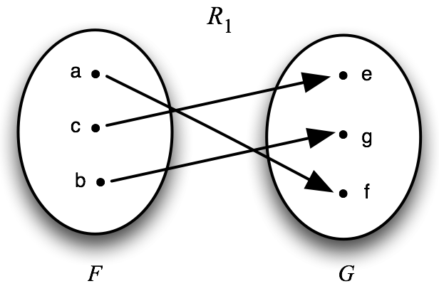

\*Figure 1\*

Although there are several different relations $R$ which demonstrate the equinumerosity of $F$ and $G$, the particular relation used in Figure 1 is:

$R_{1} = [\lambda xy \, (x\eqclose a\amp y\eqclose f) \lor (x\eqclose b \amp y\eqclose g) \lor (x\eqclose c\amp y\eqclose e)]$

It is a simple exercise to show that $R_{1}$, as defined, is a ‘witness’ to the equinumerosity of $F$ and $G$ (according to the definition).

In Figure 2, we have two concepts that are not equinumerous:

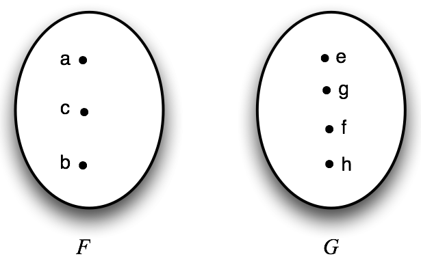

\*Figure 2\*

In this example, no relation $R$ can satisfy the definition of equinumerosity.

Given the discussion so far, it seems reasonable to suggest that concepts $F$ and $G$ will be equinumerous whenever the number of objects falling under $F$ is identical to the number of objects falling under $G$. This suggestion will be codified by Hume’s Principle. However, before discussing this principle, the reader should convince him- or herself of the following four facts: (1) that the material equivalence of two concepts implies their equinumerosity, (2) that equinumerosity is reflexive, (3) that equinumerosity is symmetric, and (4) that equinumerosity is transitive. In formal terms, the following facts are provable:

**Facts About Equinumerosity**: 1. $\forall x(Fx \equiv Gx) \to F\apprxclose G $ 2. $F \approx F$ 3. $F\apprxclose G \to G\apprxclose F$ 4. $F\apprxclose G \amp G\apprxclose H \to F\apprxclose H$

The proofs of these facts, in each case, require the identification of a relation that is a witness to the relevant equinumerosity claim. In some cases, it is easy to identify the relation in question. In other cases, the reader should be able to ‘construct’ such relations (using *λ*-notation) by considering the examples described above. Facts (2) – (4) establish that equinumerosity is an ‘equivalence relation’ which divides up the domain of concepts into ‘equivalence classes’ of equinumerous concepts.

### 3.2 Contextual Definition of ‘The Number of $F$s’: Hume’s Principle

In **Gl**, Frege contextually defined ‘the number of $F$s’ in terms of the principle now known as Hume’s Principle:[^note-6]

**Hume’s Principle**: The number of $F$s is identical to the number of $G$s if and only if $F$ and $G$ are equinumerous.

Using our notation ‘$\#F$’ to abbreviate ‘the number of $F$s’, we may formalize Hume’s Principle as follows:

**Hume’s Principle**: $\#F\eqclose \#G \equiv F \approx G$

Hume’s Principle is taken to be a contextual definition of $\#F$ when the latter is assumed as a primitive notion governed by the principle: the principle doesn’t explicitly define ‘$\#F$’, but contextually defines it by defining contexts (in this case, identity statements) in which it occurs.[^note-7] As we shall see, Hume’s Principle is the basic principle upon which Frege forged his development of the theory of natural numbers. In **Gl**, Frege sketched the derivations of the basic laws of number theory from Hume’s Principle; these sketches were developed into more rigorous proofs in **Gg I**. We will examine these derivations in the following sections.

Once Frege had a contextual definition of $\#F$, he then defined a cardinal number as any object which is the number of some concept:

$x \textit{ is a cardinal number} \eqdef \exists F(x = \#F)$

This represents the definition that appears in **Gl**, §72.

Notice that Hume’s Principle bears an obvious formal resemblance to Basic Law V. Both are biconditionals asserting the equivalence of an identity among singular terms (the left-side condition) with an equivalence relation on concepts (the right-side condition). Indeed, both correlate concepts with certain objects. In the case of Hume’s Principle, each concept $F$ is correlated with $\#F$. However, whereas Basic Law V problematically requires that the correlation between concepts and extensions be one-to-one, Hume’s Principle only requires that the correlation between concepts and numbers be many-to-one. Hume’s Principle often correlates distinct concepts with the same number. For example, the distinct concepts *author of Principia Mathematica* (‘$[\lambda x \, Axp]$’) and *positive integer between* 1 *and* 4 (‘$[\lambda x \, 1\lt x\lt 4]$’) are equinumerous (both have two objects falling under them). So $\#[\lambda x\, Axp]$ = $\#[\lambda x \, 1\lt x\lt 4]$. Thus, Hume’s Principle, unlike Basic Law V, does not require that the domain of numbers be as large as the domain of concepts. Indeed, several authors have developed models that show Hume’s Principle can be consistently added to second-order logic. See the independent work of Geach (1976, 446–7)[^geach-1976], Hodes (1984, 138)[^hodes-1984], Burgess (1984)[^burgess-1984] and Hazen (1985)[^hazen-1985].

### 3.3 Explicit Definition of ‘The Number of $F$s’

[Note: The remaining two subsections are not strictly necessary for understanding the proof of Frege’s Theorem. They are included here for those who wish to have a more complete understanding of what Frege in fact attempted to do. They presuppose the material in §2. Readers interested in just the positive aspects of Frege’s accomplishments should skip directly to §4.]

Before we examine the powerful consequences that Frege derived from Hume’s Principle, it is worth digressing to describe his attempt to define ‘$\#F$’ explicitly and to derive Hume’s Principle from Basic Law V. The idea behind this attempt was the realization that if given any concept $F$, the notion of equinumerosity can be used to define the second-level concept *being a concept G that is equinumerous to F*. Frege found a way to collect all of the concepts equinumerous to a given concept $F$ into a single extension. In **Gl** §68, he informally took this to be an extension consisting of first-order concepts by stipulating that the number of $F$s is the extension of the second-level concept: *being a first-level concept equinumerous to F*.

In terms of the example used at the end of the previous subsection, this informal definition identifies the number of the concept *author of Principia Mathematica* as the extension consisting of all and only those first-level concepts that are equinumerous to this concept; this extension has both $[\lambda x \, Axp]$ and $[\lambda x \, 1\lt x\lt 4]$ as members. Frege in fact identifies the cardinal number 2 with this extension, for it contains all and only those concepts under which two objects fall. Similarly, Frege identifies the cardinal number 0 with the extension consisting of all those first-level concepts under which no object falls; this extension would include such concepts as *unicorn*, *centaur*, *prime number between* 3 *and* 5, etc. Frege’s insight here inspired Russell to develop a somewhat similar definition in his work, and it is now common to see references to the so-called “Frege-Russell definition of the cardinal numbers” as classes of equinumerous concepts or sets.[^note-8] Of course, this explicit definition of ‘the number of $ F$s’ stands or falls with a coherent conception of ‘extension’. We know that Basic Law V does not offer such a coherent conception.

### 3.4 Derivation of Hume’s Principle

Frege’s derivations of Hume’s Principle were invalidated by the fact that it appeals to the inconsistent Basic Law V. Neverthelss, we briefly describe in this subsection, for interested readers, Frege’s derivations. In **Gl**, §73, Frege sketches an informal proof of the right-to-left direction of Hume’s Principle using the above informal definition of the number of $F$s. The derivation appeals to the fact that a concept $G$ is a member of the extension of the second-level concept *concept equinumerous to F* if and only if $G$ is equinumerous to $F$. In other words, the proof relies on a kind of higher-order version of the Law of Extensions (described above), the ordinary version of which we know to be a consequence of Basic Law V.[^note-9] Here is a reconstruction of Frege’s proof in **Gl**, §73, extended so as to cover both directions of Hume’s Principle.

[Reconstruction of the *Grundlagen* Derivation of Hume’s Principle](frege-theorem.Gl-Hume.md)

However, in the development of **Gg**, Frege didn’t formulate the extensions of second-level concepts. In **Gg**, extensions do *not* contain concepts as members but rather objects. So Frege had to find another way to express the explicit definition described in the previous subsection. His technique was to let extensions go proxy for their corresponding concepts. Since a full reconstruction of this technique and the proof of Hume’s Principle in **Gg** would constitute a digression for the present exposition, we shall describe the details for interested readers in a separate document:

[Reconstruction of the *Grundgesetze* ‘Derivation’ of Hume’s Principle](frege-theorem.Gg-Hume.md)

Interestingly, Tennant (2004)[^tennant-2004] and May & Wehmeier (2019) point out that in **Gg**, Frege does not, in actual fact, derive Hume’s Principle as a biconditional. Instead, he derives both directions separately without combining them or indicating that the two directions should be conceived as a biconditional. Finally, as noted on several occasions, the inconsistency in Basic Law V invalidated Frege’s derivation of Hume’s Principle. But Hume’s Principle, in and of itself, is a powerful and consistent principle.

## 4. Frege’s Analysis of Predecessor, Ancestrals, and the Natural Numbers

In what follows, we shall suppose that the second-order predicate calculus with which we began has been extended with (a) a primitive $\#$ operator, so that we can formulate terms such as $\#F$ to signify ‘the number of $F$s’, and (b) a new axiom, namely, Hume’s Principle, to govern the new terms. As previously mentioned, Frege’s Theorem is that the Dedekind/Peano axioms of number theory are derivable as theorems in a second-order predicate calculus extended in this way. In this section, we introduce the definitions required for the proof of Frege’s Theorem. In the next section, we go through the proof. In the final section, we conclude with a discussion of the philosophical questions that arise when we extend the predicate calculus in this way, and take Hume’s Principle as a replacement for Basic Law V.

Before we turn to the definitions required for the proof of Frege’s Theorem, it would serve well to discuss one other group of insights underlying Frege’s analysis of numbers. The first is that the following series of concepts has a rather interesting property:

$$\begin{align*} &C_0 = [\lambda x \, x\neqclose x] \\ &C_1 = [\lambda x \, x\eqclose \#C_0] \\ &C_2 = [\lambda x \, x\eqclose \#C_0 \lor x\eqclose \#C_1] \\ &C_3 = [\lambda x \, x\eqclose \#C_0 \lor x\eqclose \#C_1 \lor x\eqclose \#C_2] \\ &\text{etc.} \end{align*}$$

The interesting property of this series is that for each concept $ C_k$, all and only the *numbers* of the concepts preceding $C_k$ in the sequence fall under $C_k$. So, for example, the concepts preceding $C_3$ are $C_0$, $C_1$, and $ C_2$. Accordingly, all and only the following numbers fall under $ C_3:\#C_0, \#C_1$, and $\#C_2$.

Frege’ next insight was that these concepts can be used, respectively, to define the finite cardinal numbers, as follows:

$$\begin{align*} &0 = \#C_0 \\ &1 = \#C_1 \\ &2 = \#C_2 \\ &3 = \#C_3 \\ &\text{etc.} \end{align*}$$

This insight, however, led to another. Frege realized that though we may identify this sequence of numbers with the natural numbers, such a sequence is simply a list: it does not constitute a definition of a concept (e.g., *natural number*) that applies to all and only the numbers defined in the sequence. Such a concept is required if we are to prove *as theorems* the following axioms of Dedekind/Peano number theory:

**Dedekind/Peano Axioms for Number Theory**:

- 0 is a natural number.
- 0 is not the successor of any natural number.
- No two natural numbers have the same successor.
- If both (a) 0 falls under $F$, and (b) for any two natural numbers $n$ and $m$ such that $m$ is the successor of $n$, the fact that $n$ falls under $F$ implies that $m$ falls under $F$, then every natural number falls under $F$. (**Principle of Mathematical Induction**)
- Every natural number has a successor.

Moreover, Frege recognized the need to employ the Principle of Mathematical Induction in the proof that every number has a successor. One cannot prove the claim that *every number has a successor* simply by producing the sequence of expressions for cardinal numbers (e.g., the second of the two sequences described above). All such a sequence demonstrates is that for every expression listed in the sequence, one can define an expression of the appropriate form to follow it in the sequence. This is not the same as proving that *every natural number* has a successor.

### 4.1 Predecessor

To accomplish these further goals, Frege proceeded (**Gl**, §76, and **Gg I**, §43) by defining the concept $x$ (*immediately*) *precedes* $y$:

> $x$ (*immediately*) *precedes* $y$ if and only if there is a concept $F$ and an object $w$ such that: (a) $w$ falls under $F$, (b) $y$ is the number of $F$s, and (c) $ x$ is the number of the concept *object falling under $F$ other than w*.

We may represent Frege’s definition formally in our language as follows:

$$\begin{align*} &\mathit{Precedes}(x,y) \eqdef \\ &\quad \exists F\exists w(Fw\amp y\eqclose \#F \amp x\eqclose \#[\lambda z\, Fz \amp z\neqclose w]) \end{align*}$$

To illustrate this definition, let us temporarily assume that we know some facts about the natural numbers 1 and 2 to show that the definition properly predicts that $\mathit{Precedes}(1,2)$, even though we haven’t yet defined these natural numbers. Let the expression ‘$[\lambda z \, Azp]$’ denote the concept *author of Principia Mathematica*. Only Bertrand Russell (‘$r$’) and Alfred Whitehead fall under this concept. Let the expression ‘$[\lambda z \, Azp \amp z\neqclose r]$’ denote the concept *author of Principia Mathematica other than Russell*.[^note-10] Then the following may, for the purposes of this example, be taken as facts:

- Russell falls under the concept *author of Principia Mathematica*, i.e.,     $[\lambda z \, Azp]r$
- 2 is the number of the concept *author of Principia Mathematica*, i.e.,     $2 = \#[\lambda z \, Azp]$
- 1 is the number of the concept *author of Principia Mathematica other than Russell*, i.e.,     $1 = \#[\lambda z \, Azp \amp z\neqclose r] $

If we assemble these truths into a conjunction and apply existential generalization in the appropriate places, the result is the definiens of the definition of predecessor instantiated to the numbers 1 and 2. Thus, if given certain facts about the number of objects falling under the certain concepts, the definition of predecessor correctly predicts that $\mathit{Precedes}(1,2)$.

### 4.2 The Ancestral of a Relation $R$

Frege next defines the relation *x is an ancestor of y in the R-series*. This new relation is called ‘the ancestral of the relation $R$’ and we henceforth designate this relation as $R^*$. Frege first defined the ancestral of a relation $R$ in **Begr** (Part III, Proposition 76), though the term ‘ancestral relation’ comes to us from Whitehead and Russell 1910–1913 (I, \*90·01). Frege’s phrase for the ancestral is: “$x$ comes before $y$ in the $R$-series”; alternatively, “$y$ follows $x$ in the $R$-series”. (See also **Gl**, §79, and **Gg I**, §45.) The intuitive idea is easily grasped if we consider the relation $x$ *is the father of* $y$. Suppose that $a$ is the father of $b$, that $b$ is the father of $c$, and that $c$ is the father of $d$. Then ‘$x$ is an ancestor of $y$ in the fatherhood-series’ is defined so that $a$ is an ancestor of $b$, $c$, and $d$, that $b$ is an ancestor of $c$ and $d$, and that $c$ is an ancestor of $d$.

Frege’s definition of the ancestral of $R$ requires a preliminary definition:

*F is hereditary in the R-series* if and only if every pair of $R$-related objects $x$ and $y$ are such that $y$ falls under $F$ whenever $x$ falls under $F$

In formal terms:

$\mathit{Her}(F,R) \eqabbr \forall x\forall y(Rxy \to (Fx \to Fy))$

Intuitively, the idea is that $F$ is hereditary in the $R$-series if $F$ is always ‘passed along’ from $x$ to $y$ whenever $x$ and $y$ are a pair of $R$-related objects. (We warn the reader here that the notation ‘$\mathit{Her}(F,R)$’ is merely an abbreviation of a much longer statement. It is *not* a formula of our language having the form ‘$R(x,y)$’. In what follows, we sometimes introduce other such abbreviations.)

Frege’s definition of the ancestral of $R$ can now be stated as follows:

*x comes before y in the R-series* $\eqdef$ *y* falls under every $R$-hereditary concept *F* under which falls all the objects to which *x* bears $R$.

In other words, $y$ follows $x$ in the $R$-series whenever $y$ falls under every $R$-hereditary concept $F$ that is exemplified by everything immediately $R$-related to $x$. In formal terms:

$R^*(x,y) \eqdef \forall F[(\forall z(Rxz \to Fz) \amp \mathit{Her}(F,R)) \to Fy]$

For example, Clinton’s father stands in the relation *father\* of* (i.e., *forefather*) to Chelsea because she falls under every hereditary concept that Clinton and his brother inherited from Clinton’s father. However, Clinton’s brother is not one of Chelsea’s forefathers, since he fails to be her father, her grandfather, or any of the other links in the chain of fathers from which Chelsea descended.

It is important to grasp the differences between a relation $R$ and its ancestral $R^*$. *Rxy* implies $R^*(x,y)$ (e.g., if Clinton is a father of Chelsea, then Clinton is a forefather of Chelsea), but the converse doesn’t hold (Clinton’s father is a father\* of Chelsea, but he is not a father of Chelsea). Indeed, a grasp of the definition of $R^*$ should leave one able to prove the following easy consequences, many of which correspond to theorems in **Begr** and **Gg**:[^note-11]

**Facts About** $R^*$:

1. $Rxy \to R^*(x,y)$
2. $\neg\forall R\forall x\forall y(R^*(x,y)\to Rxy)$
3. $[R^*(x,y) \amp \forall z(Rxz \to Fz) \amp \mathit{Her}(F,R)] \to Fy$[^note-12]
4. $R^*(x,y) \to \exists z \, Rzy$
5. $[Fx \amp R^*(x,y) \amp \mathit{Her}(F,R)] \to Fy$
6. $Rxy \amp R^*(y,z) \to R^*(x,z)$
7. $R^*(x,y) \amp R^*(y,z) \to R^*(x,z)$

The reader should consider what happens when $R$ is taken to be the relation (*immediately*) *precedes*. Appealing to our intuitive grasp of the numbers, we can say that it is an instance of Fact (1) that if 10 precedes 11, then 10 precedes\* 11. Moreover, precedes is a witness to Fact 2: that 10 precedes\* 12 does not imply that 10 precedes 12. The transitivity of precedes\* is an instance of Fact (7). Below, when we restrict ourselves to the natural numbers, it becomes intuitive to think of the difference between precedes and precedes\* as the difference between *immediately precedes* and *less-than*.

### 4.3 The Weak Ancestral of $R$

Given the notion of the ancestral of relation $R$, Frege then defines its weak ancestral, which he termed “$y$ is a member of the $R$-series beginning with $x$” (cf. **Begr**, Part III, Proposition 99; **Gl**, §81, and **Gg I**, §46):

> *$y$ is a member of the $R$-series beginning with $x$* if and only if either $x$ bears the ancestral of $R$ to $y$ or $x = y$.

In formal terms:

$R^{+}(x,y) \eqdef R^*(x,y) \lor x\eqclose y$

Frege would also read $R^{+}(x,y)$ as: $x$ is a member of the $R$-series ending with $y$. Logicians call $R^{+}$ the ‘weak-ancestral’ of $R$ because it is a weakened version of $R^*$. When we define the natural numbers below, and take $R$ to be *precedes*, we can intuitively regard its weak ancestral, *precedes*$^{+}$, as the relation *less-than-or-equal-to* on the natural numbers.

The general definition of the weak ancestral of $R$ yields the following facts, many of which correspond to theorems in **Gg**:[^note-13]

**Facts About $R^{+}$**:

1. $R^*(x,y) \to R^{+}(x,y)$
2. $Rxy \to R^{+}(x,y)$
3. $Rxy \amp R^{+}(y,z) \to R^*(x,z)$
4. $R^{+}(x,y) \amp Ryz \to R^*(x,z)$
5. $R^*(x,y) \amp Ryz \to R^{+}(x,z)$
6. $R^{+}(x,x)$       (Reflexivity)
7. $R^*(x,y) \to \exists z[R^{+}(x,z) \amp Rzy]$ ([Proof of Fact 6 Concerning the Weak Ancestral](frege-theorem.WAfact6.md))
8. $[Fx \amp R^{+}(x,y) \amp \mathit{Her}(F,R)] \to Fy$
9. $R^*(x,y) \amp Rzy \amp R \text{ is 1-1} \to R^{+}(x,z)$[^note-14]

The proofs of these facts are left as exercises.

### 4.4 The Concept *Natural Number*

Frege’s definition of *natural number* requires one more preliminary definition. Frege identified the number 0 as the number of the concept *being non-self-identical*. That is:

$0 \eqdef \#[\lambda x \, x\neq x]$

Since the logic of identity guarantees that no object is non-self-identical, nothing falls under the concept *being non-self-identical*. Had Frege’s explicit definition of the $\#F$ worked as he had intended, the number 0 would, in effect, be identified with the extension consisting of all those extensions of concepts under which nothing falls. However, for the present purposes, we may note that 0 is defined in terms of (a) the primitive notion ‘the number of $F$s’ and (b) a concept $([\lambda x \, x\neq x])$ whose existence is guaranteed by our second-order logic with identity and comprehension. It is straightforward to prove the following Lemma Concerning Zero from this definition of 0:

**Lemma Concerning Zero**: $\#F\eqclose 0 \equivwide \neg\exists xFx$

([Proof of Lemma Concerning Zero](frege-theorem.proof4.md))

Note that the proof appeals to Hume’s Principle and facts about equinumerosity.

Frege’s definition of the concept *natural number* can now be stated in terms of the weak-ancestral of Predecessor:

*x is a natural number* if and only if $x$ is a member of the predecessor-series beginning with 0

This definition appears in **Gl**, §83, and **Gg I**, §46 as the definition of ‘finite number’. Indeed, the natural numbers are precisely the finite cardinals. In formal terms, Frege’s definition becomes:

$Nx ~ \eqdef ~ \mathit{Precedes}^{+}(0,x)$

In what follows, we shall sometimes use the variables $m$, $n$, and $o$ to range over the natural numbers. In other words, we’ll use formulas of the form $\forall n(\ldots n\ldots)$ to abbreviate formulas of the form $\forall x(Nx \to \ldots x\ldots)$, and use formulas of the form $\exists n(\ldots n\ldots)$ to abbreviate formulas of the form $\exists x(Nx \amp \ldots x\ldots)$.

## 5. Frege’s Theorem

Frege’s Theorem is that the five Dedekind/Peano axioms for number theory can be derived from Hume’s Principle in second-order logic. In this section, we reconstruct the proof of this theorem; it can be extracted from Frege’s work using the definitions and theorems assembled so far. Some of the steps in this proof can be found in **Gl**. (See the Appendix to Boolos 1990 for a reconstruction.)[^boolos-1990] Our reconstruction follows Frege’s **Gg** in spirit and in most details, but we have tried to simplify the presentation in several places. For a stricter description of Frege’s **Gg** proof, the reader is referred to Heck 1993. The following should help prepare the reader for Heck’s excellent essay.

### 5.1 Zero is a Natural Number

The statement that zero is a natural number is an immediate consequence of the definition of *natural number*:

**Theorem 1**: $N0$

*Proof*: It is a simple consequence of the definition of ‘weak ancestral’ that $R^{+}$ is reflexive (see Fact 4 about $R^{+}$ in our subsection on the Weak Ancestral in §4). So $\mathit{Precedes}^{+}(0,0)$. Hence, by the definition of natural number, $0$ is a natural number.

It seems that Frege never actually identified this fact explicitly in **Gl** or labeled this fact as a numbered Theorem in **Gg I**.

### 5.2 Zero Isn’t the Successor of Any Natural Number

It is also a simple consequence of the foregoing that 0 doesn’t succeed any natural number. This can be represented formally as follows:

**Theorem 2**: $\neg\exists x(Nx \amp \mathit{Precedes}(x,0))$

*Proof*: Assume, for *reductio*, that some number, say $n$, is such that $\mathit{Precedes}(n,0)$. Then, by the definition of predecessor, it follows that there is a concept, say $Q$ and an object, say $c$, such that $Qc \amp 0\eqclose \#Q \amp n\eqclose \#[\lambda z\, Qz \amp z\neq c]$. But by the Lemma Concerning Zero (above), $0 = \#Q$ implies $\neg\exists xQx$, which contradicts the fact that $Qc$.

See **Gl**, §78, Item (6); and **Gg I**, §109, Theorem 126.

### 5.3 No Two Natural Numbers Have the Same Successor

The fact that no two natural numbers have the same successor is somewhat more difficult to prove (cf. **Gl**, §78, Item (5); **Gg I**, §95, Theorem 89). We may formulate this theorem as follows, with $m$, $n$, and $o$ as restricted variables ranging over the natural numbers:

**Theorem 3**: $\forall m\forall n\forall o[\mathit{Precedes}(m,o)\amp \mathit{Precedes}(n,o) \to m = n]$

In other words, this theorem asserts that predecessor is a one-to-one relation on the natural numbers. To prove this theorem, it suffices to prove that predecessor is a one-to-one relation full stop. One can prove that predecessor is one-to-one from Hume’s Principle, with the help of the following Equinumerosity Lemma, the proof of which is rather long and involved. The Equinumerosity Lemma asserts that when $F$ and $G$ are equinumerous, $x$ falls under $F$, and $ y$ falls under $G$, then the concept *object falling under F other than x* is equinumerous to the concept *object falling under G other than $y$*. The picture is something like this:

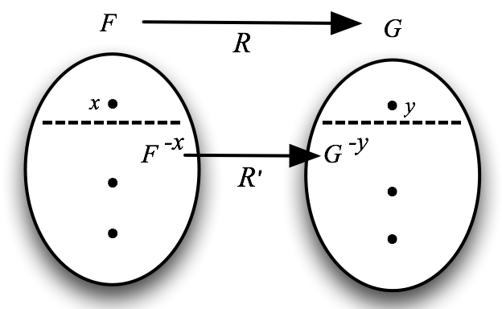

\*Figure 3\*

In terms of Figure 3, the Equinumerosity Lemma tells us that if there is a relation $R$ which is a witness to the equinumerosity of $ F$ and $G$, then there is a relation $R'$ which is a witness to the equinumerosity of the concepts that result when you restrict $ F$ and $G$ to the objects other than $x$ and $y$, respectively.

To help us formalize the Equinumerosity Lemma, let $F^{-x}$ abbreviate the concept $[\lambda z \, Fz \amp z\neq x]$ and let $G^{-y}$ abbreviate the concept $ [\lambda z \, Gz \amp z \neq y]$. Then we have:

**Equinumerosity Lemma**: $F\apprxclose G \amp Fx \amp Gy \to F^{-x}\apprxclose G^{-y}$

([Proof of Equinumerosity Lemma](frege-theorem.proof5.md))

Now we can prove that Predecessor is a one-to-one relation from this Lemma and Hume’s Principle (cf. **Gg I**, §108):

**Predecessor is One-to-One**: $\forall x\forall y\forall z[\mathit{Precedes}(x,z) \amp \mathit{Precedes}(y,z) \to x\eqclose y] $

*Proof*: Assume that both a and b are precedessors of $c$. By the definition of predecessor, we know that there are concepts and objects $P$, $Q$, $d$, and $e$, such that:

$$\begin{align*} & Pd \amp c\eqclose \#P \amp a\eqclose \#P^{-d} \\ & Qe \amp c\eqclose \#Q \amp b\eqclose \#Q^{-e} \end{align*}$$

But if both $c = \#P$ and $c = \#Q$, then $\#P = \#Q$. So, by Hume’s Principle, $P \approx Q$. So, by the Equinumerosity Lemma, it follows that $P^{-d} \approx Q^{-e}$. If so, then by Hume’s Principle, $\#P^{-d} = \#Q^{-e}$. But then, $a = b$.

So, if Predecessor is a one-to-one relation, it is a one-to-one relation on the natural numbers. Therefore, no two numbers have the same successor. This completes the proof of Theorem 3.

It is important to mention here that not only is Predecessor a one-to-one relation, it is also a functional relation:

**Predecessor is a Functional Relation**: $\forall x\forall y\forall z[\mathit{Precedes}(x,y)\amp \mathit{Precedes}(x,z)\to y\eqclose z]$

This fact can be proved with the help of a kind of converse to the Equinumerosity Lemma:

**Equinumerosity Lemma ‘Converse’**: $F^{-x}\apprxclose G^{-y} \amp Fx \amp Gy \towide F\apprxclose G$

We leave the proof of the Equinumerosity Lemma ‘Converse’ and the proof of Predecessor is a Functional Relation as exercises for the reader.

### 5.4 The Principle of Mathematical Induction

Let us say that a concept $F$ is *hereditary on the natural numbers* just in case every ‘adjacent’ pair of numbers $n$ and $m$ ($n$ preceding $m$) is such that $m$ falls under $F$ whenever $n$ falls under $F$, i.e.,

$\mathit{HerOn}(F,N) \eqabbr \forall n\forall m[\mathit{Precedes}(n,m)\to (Fn \to Fm)]$

Then we may state the Principle of Mathematical Induction as follows: if (a) $0$ falls under $F$ and (b) $F$ is hereditary on the natural numbers, then every natural number falls under $F$. In formal terms:

**Theorem 4**: **Principle of Mathematical Induction**: $F0 \amp \mathit{HerOn}(F,N) \to \forall n Fn$

Frege actually proves the Principle of Mathematical Induction from a more general principle that governs any $R$-series whatsoever. We will call the latter the General Principle of Induction. It asserts that whenever a falls under $F$, and $F$ is hereditary on the $R$-series beginning with $a$, then every member of that $R$-series falls under $F$. We can formalize the General Principle of Induction with the help of a strict understanding of ‘hereditary on the $R$-series beginning with $a$’. Here is a definition:

$$\begin{align*} &\mathit{HerOn}(F, {}^{a}R^{+}) \eqabbr \\ &\quad \forall x\forall y[R^{+}(a,x)\amp R^{+}(a,y) \amp Rxy \towide (Fx \to Fy)] \end{align*}$$

In other words, $F$ is hereditary on the members of the $R$-series beginning with $a$ just in case every adjacent pair $x$ and $y$ in this series (with $x$ bearing $R$ to $y$) is such that $y$ falls under $F$ whenever $x$ falls under $F$. Now given this definition, we can reformulate the General Principle of Induction more strictly as:

**General Principle of Induction**: $[Fa \amp \mathit{HerOn}(F, {}^{a}R^{+})] ~\to~ \forall x[R^{+}(a,x) \to Fx]$

This is a version of Frege’s Theorem 152 in **Gg I**, §117.

We may sketch the proof strategy as follows. Assume that the antecedent of the General Principle of Induction holds for an arbitrarily chosen concept, say $P$. That is, assume:

$Pa \amp \mathit{HerOn}(P, {}^{a}R^{+})$

Now to show $\forall x(R^{+}(a,x) \to Px)$, pick an arbitrary object, say $b$, and further assume $R^{+}(a,b)$. We then simply have to show $Pb$. We do this by invoking Fact (7) about $R^{+}$ (in our subsection on the Weak Ancestral in §4). Recall that Fact (7) is:

$[Fx \amp R^{+}(x,y) \amp \mathit{Her}(F,R)] \to Fy$

This is a theorem of logic containing the free variables $x$, $y$, and $F$. First, we instantiate $x$ and $y$ to $a$ and $b$, respectively. Then, we instantiate $F$ to the concept $[\lambda z \, R^{+}(a,z) \amp Pz]$ and apply *λ*-Conversion (though Frege could simply use his Rule of Substitution to achieve the same inference). The concept being instantiated for $F$ is the concept *member of the R-series beginning with a and which falls under P*. The result of instantiating the free variables in Fact (7) and then applying *λ*-Conversion yields a rather long conditional, with numerous conjuncts in the antecedent and the claim that $Pb$ in the consequent. Thus, if the antecedent can be established, the proof is done. For those following along with pencil and paper, all of the conjuncts in the antecedent are things we already know, with the exception of the claim that $[\lambda z \, R^{+}(a,z)\amp Pz]$ is hereditary on $R$. However, this claim can be established straightforwardly from things we know to be true (and, in particular, from facts contained in the antecedent of the Principle we are trying to prove, which we assumed as part of our conditional proof). The reader is encouraged to complete the proof as an exercise. For those who would like to check their work, we give the complete Proof of the General Principle of Induction here:

[Proof of the General Principle of Induction](frege-theorem.proof6.md)

Now to derive Principle of Mathematical Induction from the General Principle of Induction, we formulate an instance of the latter by setting $a$ to $0$ and $R$ to *Precedes*:

${[}F0 \amp \mathit{HerOn}(F, {}^{0}\mathit{Precedes}^{+}){]} \towide \forall x{[}\mathit{Precedes}^{+}(0,x) \to Fx{]}$

When we expand the defined notation for $\mathit{HerOn}$, substitute the notation $Nx$ and $Ny$ for $\mathit{Precedes}^{+}(0,x)$ and $\mathit{Precedes}^{+}(0,y)$, respectively, and then employ our restricted quantifiers $\forall n(\ldots n\ldots)$ and $\forall m(\ldots m\ldots)$ for the claims of the form $\forall y(Ny \to \ldots y\ldots)$ and $\forall x(Nx \to \ldots x\ldots)$, respectively, the result is the Principle of Mathematical Induction (in which the notation $\mathit{HerOn}(F,N)$ has been eliminated in terms of its definiens).

### 5.5 Every Natural Number Has a Successor

Frege uses the Principle of Mathematical Induction to prove that every natural number has a successor that’s a natural number. We may formulate the theorem as follows:

**Theorem 5**: $\forall x{[}Nx \to \exists y(Ny \amp \mathit{Precedes}(x,y)){]}$

To reconstruct Frege’s strategy for proving this theorem, recall that the weak ancestral of the Predecessor relation, i.e., $\mathit{Precedes}^{+}(x,y)$, can be read as: $x$ is a member of the predecessor-series ending with $y$. Frege then considers the concept *member of the predecessor-series ending with n*, i.e., $[\lambda z \, \mathit{Precedes}^{+}(z,n)]$, where $n$ is a natural number. Frege then shows, by induction, that every natural number $n$ precedes the number of the concept *member of the predecessor-series ending with n*. That is, Frege proves that every natural number has a successor by proving the following Lemma on Successors by induction:

**Lemma on Successors**: $\forall n \mathit{Precedes}(n,\#[\lambda z \, \mathit{Precedes}^{+}(z,n)])$

This asserts that every natural number $n$ precedes the number of numbers in the predecessor series ending with $n$. Frege can establish Theorem 5 by proving the Lemma on Successors and by showing that the successor of a natural number is itself a natural number.

To see an intuitive picture of why the Lemma on Successors gives us what we want, we may temporarily regard $\mathit{Precedes}^{+}$ as the relation ≤. (One can prove that $\mathit{Precedes}^{+}$ has the properties that ≤ has on the natural numbers.) Although we haven’t yet assigned any meaning to the numerals ‘1’ and ‘2’, the following intuitive sequence is driving Frege’s strategy:

$$\begin{align*} &0 \text{ precedes } \#[\lambda z \, z \leq 0] \\ &1 \text{ precedes } \#[\lambda z \, z \leq 1] \\ &2 \text{ precedes } \#[\lambda z \, z \leq 2] \\ &\text{etc.} \end{align*}$$

For example, the third member of this sequence is true because there are 3 natural numbers (0, 1, and 2) that are less than or equal to 2; so the number 2 precedes the number of numbers less than or equal to 2. Frege’s strategy is to show that the general claim, that $n$ precedes the number of numbers less than or equal to $n$, holds for every natural number. So, given this intuitive understanding of the Lemma on Successors, Frege has a good strategy for proving that every number has a successor. (For the remainder of this subsection, the reader may wish to continue to think of $\mathit{Precedes}^{+}$ in terms of $\leq$.)

Now to prove the Lemma on Successors by induction, we need to reconfigure this Lemma to a form which can be used as the consequent of the Principle of Mathematical Induction; i.e., we need something of the form $\forall n\, Fn$. We can get the Lemma on Successors into this form by ‘abstracting out’ a concept from the Lemma using the right-to-left direction of *λ*-Conversion (i.e., *λ*-Abstraction) to produce the following equivalent statement of the Lemma:

$\forall n [\lambda y \, \mathit{Precedes}(y, \#[\lambda z \, \mathit{Precedes}^{+}(z,y)])]n$

The concept ‘abstracted out’ is the following:

$[\lambda y\, \mathit{Precedes}(y,\#[\lambda z \, \mathit{Precedes}^{+}(z,y)])]$

This is the concept: *being an object* $y$ *which precedes the number of the concept: member of the predecessor series ending in* $y$. Let us abbreviate the *λ*-expression that denotes this concept as ‘$Q$’. Our strategy is to instantiate the variable $F$ in the Principle of Mathematical Induction to $Q$. The result is therefore something that has been proved and that we therefore know to be true:

$Q0 \amp \mathit{HerOn}(Q,N) \to \forall nQn$

Since the consequent is the reconfigured Lemma on Successors, Frege can prove this Lemma by proving both that $0$ falls under $Q$ (cf. **Gg I**, Theorem 154) and that $Q$ is hereditary on the natural numbers (cf. **Gg I**, Theorem 150):

[Proof that $0$ falls under $Q$](frege-theorem.Q0.md)

[Proof that $Q$ is hereditary on the natural numbers](frege-theorem.HerOnQN.md)

Given this proof of the Lemma on Successors, Theorem 5 is not far away. The Lemma on Successors shows that every number precedes some cardinal number of the form $\#F$. We still have to show that such successor cardinals are natural numbers. That is, it still remains to be shown that if a number $n$ precedes something $y$, then $y$ is a natural number:

**Successors of Natural Numbers are Natural Numbers**: $\forall n\forall y (\mathit{Precedes}(n,y) \to Ny)$

*Proof*: Suppose that $\mathit{Precedes}(n,a)$. Then, by definition, since $n$ is a natural number, $\mathit{Precedes}^{+}(0,n)$. So by Fact (3) about $R^{+}$ (in the subsection on the Weak Ancestral in §4), it follows that $\mathit{Precedes}^*(0,a)$, and so by the definition of $\mathit{Precedes}^{+}$, it follows that $\mathit{Precedes}^{+}(0,a)$; i.e., $a$ is a natural number.

Theorem 5 now follows from the Lemma on Successors and the fact that successors of natural numbers are natural numbers. With the proof of Theorem 5, we have completed the proof of Frege’s Theorem. Before we turn to the last section of this entry, it is worth mentioning the mathematical significance of this theorem.

### 5.6 Arithmetic

From Frege’s Theorem, one can derive arithmetic. It is an immediate consequence Theorem 5 and the fact that Predecessor is a functional relation that every number has a *unique* successor. That means we can define the successor function by adding definite descriptions of the form ‘the $x$ such that *φ*’ to our language:

$n' \eqdef$ the $x$ such that $\mathit{Precedes}(n,x)$

We may then define the sequence of natural numbers succeeding $0$ as follows:

$$\begin{align*} &1 = 0' \\ &2 = 1' \\ &3 = 2' \\ &\text{etc.} \end{align*}$$

Moreover, the recursive definition of addition can now be given:

$$\begin{align*} &n + 0 = n \\ &n + m' = (n + m)' \end{align*}$$

We may also officially define:

$$\begin{align*} &n \lt m \eqdef \mathit{Precedes}^*(n,m) \\ &n \le m \eqdef \mathit{Precedes}^{+}(n,m) \end{align*}$$

These definitions constitute the foundations of arithmetic. Frege has thus insightfully derived the basic laws of arithmetic from Hume’s Principle in second-order logic. (Readers interested in how these results are affected when Hume’s Principle is combined with *predicative* second-order logic should consult Linnebo 2004.)[^linnebo-2004]

## 6. Philosophical Questions Surrounding Frege’s Theorem

As we’ve now seen, the proof of Frege’s Theorem can be carried out independently of the portion of Frege’s system which led to inconsistency. Frege himself never identified “Frege’s Theorem” as a “result”. As previously noted, he attempted to derive Hume’s Principle from Basic Law V in **Gg**, but once the contradiction became known to him, he never officially retreated to the ‘fall-back’ position of claiming that the proof of the Dedekind-Peano axioms from Hume’s Principle alone constituted an important result. One of several reasons why he didn’t adopt this fall-back position is that he didn’t regard Hume’s Principle as a sufficiently general principle – he didn’t believe it was strong enough, from an epistemological point of view, to help us answer the question, “How are numbers given to us?”. We discuss the thinking behind this attitude, and other things, in what follows.

A discussion of the philosophical questions surrounding Frege’s Theorem should begin with some statement of how Frege conceived of his own project when writing **Begr**, **Gl**, and **Gg**. It seems clear that epistemological considerations in part motivated Frege’s work on the foundations of mathematics. It is well documented that Frege had the following goal, namely, to explain our knowledge of the basic laws of arithmetic by giving an answer to the question “How are numbers ‘given’ to us?” without making an appeal to the faculty of intuition. If Frege could show that the basic laws of number theory are derivable from analytic truths of logic, then he could argue that we need only appeal to the faculty of understanding (as opposed to some faculty of intuition) to explain our knowledge of the truths of arithmetic. Frege’s goal then stands in contrast to the Kantian view of the exact mathematical sciences, according to which general principles of reasoning must be supplemented by a faculty of intuition if we are to achieve mathematical knowledge. The Kantian model here is that of geometry; Kant thought that our intuitions of figures and constructions played an essential role in the demonstrations of geometrical theorems. (In Frege’s own time, the achievements of Frege’s contemporaries Pasch (1882)[^pasch-1882], Peano (1889b)[^peano-1889b], Pieri (1898)[^pieri-1898], and Hilbert (1899)[^hilbert-1899] showed that such intuitions were not essential.)

### 6.1 Frege’s Goals and Strategy in His Own Words

Frege’s strategy then was to show that no appeal to intuition is required for the derivation of the theorems of number theory. This in turn required that he show that the latter are derivable using only rules of inference, axioms, and definitions that are purely analytic principles of logic. This view has become known as ‘Logicism’. Here is what Frege says:

> [**Begr**, Preface, p. 5:]
> To prevent anything intuitive from penetrating here unnoticed, I had to bend every effort to keep the chain of inferences free of gaps. [from the Bauer-Mengelberg translation in van Heijenoort 1967][^heijenoort-1967]
>
> [**Begr**, Part III, §23:]
> Through the present example, moreover, we see how pure thought, irrespective of any content given by the senses or even by an intuition *a priori*, can, solely from the content that results from its own constitution, bring forth judgements that at first sight appear to be possible only on the basis of some intuition. $\ldots$ The propositions about sequences [$R$-series] in what follows far surpass in generality all those that can be derived from any intuition of sequences. [from the Bauer-Mengelberg translation in van Heijenoort 1967][^heijenoort-1967]
>
> [**Gl**, §62:]
> How, then, are numbers to be given to us, if we cannot have any ideas or intuitions of them? Since it is only in the context of a proposition that words have any meaning, our problem becomes this: To define the sense of a proposition in which a number word occurs. [from the Austin translation in Frege 1953][^frege-1953]
>
> [**Gl**, §87:]
> I hope I may claim in the present work to have made it probable that the laws of arithmetic are analytic judgements and consequently a priori. Arithmetic thus becomes simply a development of logic, and every proposition of arithmetic a law of logic, albeit a derivative one. [from the Austin translation in Frege 1953][^frege-1953]
>
> [**Gg I**, §0:]
> In my *Grundlagen der Arithmetik*, I sought to make it plausible that arithmetic is a branch of logic and need not borrow any ground of proof whatever from either experience or intuition. In the present book, this shall be confirmed, by the derivation of the simplest laws of Numbers by logical means alone. [from the Furth translation in Frege 1967][^frege-1967][^furth-1967]
>
> [**Gg II**, Appendix:]
> The prime problem of arithmetic is the question, In what way are we to conceive logical objects, in particular, numbers? By what means are we justified in recognizing numbers as objects? Even if this problem is not solved to the degree I thought it was when I wrote this volume, still I do not doubt that the way to the solution has been found. [from the Furth translation in Frege 1967][^frege-1967][^furth-1967]

### 6.2 The Basic Problem for Frege’s Strategy

The basic problem for Frege’s strategy, however, is that for his logicist project to succeed, his system must at some point include (either as an axiom or theorem) statements that explicitly assert the existence of certain kinds of abstract entities and it is not obvious how to justify the claim that we know such explicit existential statements. Given the above discussion, it should be clear that Frege at some point in **Gg** endorsed existence claims, either directly in his formalism or in his metalanguage, for the following entities:

- concepts (more generally, functions)
- extensions (more generally, courses-of-value or value-ranges)
- truth-values
- numbers

Although Frege attempted to reduce the latter two kinds of entities (truth-values and numbers) to extensions, the fact is that the existence of concepts and extensions are derivable from his Rule of Substitution and Basic Law V, respectively.

In light of these existence claims, a Kantian might well suggest not only that explicit existence claims are synthetic rather than analytic (i.e., aren’t true in virtue of the meanings of the words involved) but also that since the Rule of Substitution and Basic Law V imply existence claims, Frege cannot claim that such principles are purely analytic principles of logic. If the Kantian is right, then some other faculty (such as intuition) might still be needed to account for our knowledge of the existence claims of arithmetic.

### 6.3 The Existence of Concepts

Boolos (1985)[^boolos-1985] noted that the Rule of Substitution causes a problem of this kind for Frege’s program given that it is equivalent the Comprehension Principle for Concepts. Boolos suggests a defense for Frege with respect to this particular aspect of his logic, namely, to reinterpret (by paraphrasing) the second-order quantifiers so as to avoid commitment to concepts. (See Boolos 1985 for the details.)[^boolos-1985] Boolos’s suggestion, however, is one which would require Frege to abandon his realist theory of concepts. Moreover, although Boolos’s suggestion might lead us to an epistemological justification of the Comprehension Principle for Concepts, it doesn’t do the same for the Comprehension Principle for Relations, for his reinterpretation of the quantifiers works only for the ‘monadic’ quantifiers (i.e., those ranging over concepts having one argument) and thus doesn’t offer a paraphrase for quantification over relational concepts.

Another problem for a strategy of the type suggested by Boolos is that if the second-order quantifiers are interpreted so that they do not range over a separate domain of entities, then there is nothing appropriate to serve as the denotations of *λ*-expressions. Although Frege wouldn’t quite put it this way, our reconstruction suggests that Frege treats open formulas with free object variables as if they denoted concepts. And though Frege doesn’t use *λ*-notation, the use of such notation seems to be the most logically perspicuous way of reconstructing his work. The use of such notation faces the same epistemological puzzles that Frege’s Rule of Substitution faces.

To see why, note that the Principle of *λ*-Conversion:

$\forall y([\lambda x\, \phi ]y \equiv \phi^y_x)$

seems to be an analytic truth of logic. It says this:

An object $y$ exemplifies the complex property *being such that* *φ* if and only if $y$ is such that *φ*.

One might argue that this is true in virtue of the very meaning of the *λ*-expression, the meaning of $\equiv$, and the meaning of the statement $[\lambda x\, \phi]y$ (which has the form $ Fx)$. However, *λ*-Conversion also implies the Comprehension Principle for Concepts, for the latter follows from the former by existential generalization:

$\exists F\forall y(Fy \equiv \phi^y_x)$

The point here is that the fact that an existential claim is derivable casts at least some doubt on the purely analytic status of *λ*-Conversion. The question of how we obtain knowledge of such principles is still an open question in philosophy. It is an important question to address, since Frege’s most insightful definitions are cast using quantifiers ranging over concepts and relations (e.g., the ancestrals of a relation) and it would be useful to have a philosophical explanation of how such entities and the principles which govern them become known to us. In contemporary philosophy, this question is still poignant, since many philosophers do accept that *properties* and *relations* of various sorts exist. These entities are the contemporary analogues of Frege’s concepts.

### 6.4 The Existence of Extensions

Though the existence of extensions falls right out of the theory of identity (§2.3) once terms of the form $\epsilon F$ are added to second-order logic, the existence of extensions that are correlated one-to-one with concepts is a consequence of Basic Law V. The question for Frege’s project, then, is why should we accept as a law of logic a statement that implies the existence of individuals and a correlation of this kind? Frege recognized that Basic Law V’s status as a logical law could be doubted:

> [**Gg I**, Preface, p. 3:]
> A dispute can arise, so far as I can see, only with regard to my Basic Law concerning courses-of-values (V) $\ldots$ I hold that it is a law of pure logic. [from the Furth translation in Frege 1967][^frege-1967][^furth-1967]

Moreover, he thought that an appeal to extensions would answer one of the questions that motivated his work:

> [**Letter to Russell**, July 28, 1902:]
> I myself was long reluctant to recognize ranges of values and hence classes [sets]; but I saw no other possibility of placing arithmetic on a logical foundation. But the question is, How do we apprehend logical objects? And I have found no other answer to it than this, We apprehend them as extensions of concepts, or more generally, as ranges of values of functions. [from the Kaal translation in Frege 1980][^frege-1980]

Now it is unclear why Frege thought that he could answer the question posed here by saying that we apprehend numbers as the extensions of concepts. He seems to think we can answer the obvious next question “How do we apprehend extensions?” by saying “by way of Basic Law V”. His idea here seems to be that since Basic Law V is supposed to be purely analytic or true in virtue of the meanings of its terms, we apprehend a pair of extensions whenever we truly judge that concepts $F$ and $G$ are materially equivalent. Some philosophers do argue that certain *consistent* principles having the same logical form as Basic Law V are analytic, and that such principles justify *reference* to the entities described in the left-side condition by grounding such reference in the *truth* of the right-side condition.[^note-15]

Why did Frege think that Basic Law V is analytic and that the material equivalence of concepts $F$ and $G$ is analytically equivalent to an identity that implies the existence of extensions? To hold that Basic Law V is analytic, it seems that one must hold that the right-side condition implies the corresponding left-side condition as a matter of meaning.[^note-16] This view, however, can be questioned. Suppose the right hand condition implies the left-side condition as a matter of meaning. That is, suppose that (R) implies (L) as a matter of meaning:

$$\begin{align*} \tag{R} &\forall x(Fx \equiv Gx) \\ \tag{L} &\epsilon F = \epsilon G \end{align*}$$

Now note that (L) itself can be analyzed, from a logical point of view. The expression ‘$\epsilon F$’, though constructed from a term-forming operator, is really a definite description (‘*the extension of* $F$’) and so, using Russell’s theory of descriptions, (L) can be logically analyzed as the claim:

There is an object $x$ and an object $y$ such that: (1) $x$ is a unique extension of $F$, (2) $y$ is a unique extension of $G$, and (3) $x = y$.

That is, for some defined or primitive notion $\mathit{Extension}(x,F)$ (‘$x$ is an extension of $F$’), (L) implies the analysis (D) as a matter of meaning:

$$\begin{align*} \tag{D} &\exists x\exists y[\mathit{Extension}(x,F) \amp \forall z(\mathit{Extension}(z,F) \to z\eqclose x)\ \amp \\ &\quad \mathit{Extension}(y,G) \amp \forall z(\mathit{Extension}(z,G) \to z\eqclose y) \amp x\eqclose y] \end{align*}$$

But if (R) implies (L) as a matter of meaning, and (L) implies (D) as a matter of meaning, then (R) implies (D) as a matter of meaning. This conclusion can be questioned: why should the material equivalence of $F$ and $G$ imply the existence claim (D) as a matter of meaning? In other words, the suggestion that Va (i.e., the right-to-left direction of Basic Law V) is analytic leads to a question that has no obvious answer. Below, this line of reasoning will be adapted to question the analyticity of the right-to-left direction of Hume’s Principle. See Boolos 1997 (307–309), for reasons why $Vb$ (the left-to-right direction of Hume’s Principle) is not analytic.]

The moral to be drawn here is that, even if Basic Law V were consistent, it is not exactly clear how its right side analytically implies the existence of extensions. In the end, we may need some other way of justifying our knowledge of principles like Basic Law V, that imply the existence of abstract objects – the justification discussed so far seems to contain a gap. Even if we follow Frege in conceiving of extensions as ‘logical objects’, the question remains: how can the claims that such objects exist be true on logical or analytic grounds alone? We might agree that there must be logical objects of some sort if logic is to have a subject matter, but if Frege is to achieve his goal of showing that our knowledge of arithmetic is free of intuition, then at some point he has to address the question of how we can know that numbers exist. We’ll return to this issue in the final subsection.

### 6.5 The Existence of Numbers and Truth-Values: The Julius Caesar Problem

Given that the proof of Frege’s Theorem makes no appeal to Basic Law V, some philosophers have argued Frege’s best strategy for producing an epistemologically-justified foundation for arithmetic is to replace the primitive term $\epsilon F$ with the primitive term $\#F$, replace Basic Law V with Hume’s Principle, and argue that Hume’s Principle is an analytic principle of logic.[^note-17] However, we have just seen one reason why such a strategy does not suffice. The claim that Hume’s Principle is an analytic principle of logic is subject to the same problem just posed for Basic Law V. A reason must be given as to why the claim:

$F \approx G$

implies, as a matter of meaning, that:

$\#F = \#G$

After all, the statement “$\#F = \#G$” is analyzable in a manner analogous to the way we analyzed “$\epsilon F = \epsilon G$” in the previous section, where we used Russell’s theory of description to analyze the sentence (L) as the sentence (D). Following that pattern, we take the primitive notion $\mathit{Numbers}(x,F)$ and analyze $\#F = \#G$ as:

$$\begin{align*} &\exists x\exists y[\mathit{Numbers}(x,F) \amp \forall z(\mathit{Numbers}(z,F) \to z\eqclose x)\ \amp \\ &\quad \mathit{Numbers}(y,G) \amp \forall z (\mathit{Numbers}(z,G) \to z\eqclose y) \amp x\eqclose y] \end{align*}$$

It is not clear why we should think that this last claim is implied by $F \approx G$ as a matter of meaning. The right-to-left direction of Hume’s Principle is not obviously analytic.

Moreover, Frege had his own reasons for not replacing Basic Law V with Hume’s Principle. One reason was that he thought Hume’s Principle offered no answer to the epistemological question, ‘How do we grasp or apprehend logical objects, such as the numbers?’. A second reason is that Hume’s Principle is clearly subject to ‘the Julius Caesar problem’. Frege first raises this problem in connection with an inductive definition of ‘$n = \#F$’ that he tries out in **Gl**, §55. Concerning this definition, Frege says:

> [**Gl**, §56:]
> … but we can never – to take a crude example — decide by means of our definitions whether any concept has the number Julius Caesar belonging to it, or whether that conqueror of Gaul is a number or is not. [from the Austin translation in Frege 1953][^frege-1953]

Frege raises this same concern again for a contextual definition that gives a ‘criterion of identity’ for the objects being defined. In **Gl** §66, Frege considers the following contextual definition of ‘the direction of line $x$’:

> The direction of line $a$ = the direction of line $b$ if and only if $a$ is parallel to $b$.

With regard to this definition, Frege says:

> [**Gl**, §66:]
> It will not, for instance, decide for us whether England is the same as the direction of the Earth’s axis – if I may be forgiven an example which looks nonsensical. Naturally no one is going to confuse England with the direction of the Earth’s axis; but that is no thanks to our definition of direction. [from the Austin translation in Frege 1953][^frege-1953]

Now trouble for Hume’s Principle begins to arise when we recognize that it is a contextual definition that has the same logical form as this definition for directions. It is central to Frege’s view that the numbers are *objects*, and so he believes that it is incumbent upon him to say *which* objects they are. But the ‘Julius Caesar problem’ is that Hume’s Principle, if considered as the sole principle offering identity conditions for numbers, doesn’t describe the conditions under which an arbitrary object, say Julius Caesar, is or is not to be identified with the number of planets. That is, Hume’s Principle doesn’t define the condition ‘$\#F = x$’, for arbitrary $x$. It only offers identity conditions when $x$ is an object known to be a cardinal number (for then $x = \#G$, for some $G$, and Hume’s Principle tells us when $\#F = \#G$).

In **Gl**, Frege solves the problem by giving his explicit definition of numbers in terms of extensions. (We described this in §4 above.) Unfortunately, this is only a stopgap measure, for when Frege later systematizes extensions in **Gg**, Basic Law V has the same logical form as Hume’s Principle and the above contextual definition of directions. Frege is aware that the Julius Caesar problem affects Basic Law V, as the discussion in **Gg I**, §10 shows. In that section, he says (remembering that for Frege, *ε* binds object variables and is not a function term):

> [**Gg I**, §10:]
> $\ldots$ this by no means fixes completely the denotation of a name like ‘$\stackrel{,}{\epsilon}\!\Phi(\epsilon)$’. We have only a means of always recognizing a course-of-values if it is designated by a name like ‘$\stackrel{,}{\epsilon}\!\Phi (\epsilon)$’, by which it is already recognizable as a course-of-values. But, we can neither decide, so far, whether an object is a course-of-values that is not given us as such $\ldots$ [from the Furth translation in Frege 1967][^frege-1967][^furth-1967]

In other words, Basic Law V does not tell us the conditions under which an arbitrarily chosen object $x$ may be identified with some given extension, such as $\epsilon F$.

Until recently, it was thought that Frege solved this problem in §10 by restricting the universal quantifier $\forall x$ of his **Gg** system so that it ranges only over extensions. If Frege could have successfully restricted this quantifier to extensions, then when the question arises, whether (arbitrarily chosen) object $x$ is identical with $\epsilon F$, one could answer that $x$ has to be the extension of some concept, say $ G$, and that Basic Law V would then tell you the conditions under which $x$ is identical to $\epsilon F$. On this interpretation of §10, Frege is alleged to have restricted the quantifiers when he identified the two truth values (The True and The False) with the two extensions that contain just these objects as members, respectively. By doing this, it was thought that all of the objects in the range of his quantifier $\forall x$ in **Gg** become extensions which have been identified as such, for the truth values were the only two objects of his system that had not been introduced as extensions or courses of value.

However, recent work by Wehmeier (1999)[^wehmeier-1999] suggests that, in §10, Frege was not attempting to restrict the quantifiers of his system to extensions (nor, more generally, to courses-of-values). The extensive footnote to §10 indicates that Frege considered, but did not hold much hope of, identifying every object in the domain with the extension consisting of just that object.[^note-18] But, more importantly, Frege later considers cases (in **Gg**, Sections 34 and 35) which seem to presuppose that the domain contains objects which aren’t extensions. (In these sections, Frege considers what happens to the definition of ‘$ x$ is a member of $y$’ when $y$ is not an extension.)[^note-19]

Even if Frege somehow could have successfully restricted the quantifiers of **Gg** to avoid the Julius Caesar problem, he would no longer have been able to apply his system by extending it to include names of ordinary non-logical objects. For if he were to attempt to do so, the question, “Under what conditions is $\epsilon F$ identical with Julius Caesar?”, would then be legitimate but have no answer. That means his logical system could not be used for the analysis of ordinary language. But it was just the analysis of ordinary language that led Frege to his insight that a statement of number is an assertion about a concept.

### 6.6 Final Observations

Even when we replace the inconsistent Basic Law V with the powerful Hume’s Principle, Frege’s work still leaves two questions unanswered: (1) How do we know that numbers exist?, and (2) How do we precisely specify which objects they are? The first question arises because Hume’s Principle doesn’t seem to be a purely analytic truth of logic; if neither Hume’s Principle nor the existential claim that numbers exist is analytically true, by what faculty do we come to know (the truth of) the existential claim? The second question arises because the Julius Caesar problem applies to Hume’s Principle; without a solution to that problem, Frege can’t claim to have precisely specified which objects the numbers are, so as to delineate them within the domain of all logical and non-logical objects? So questions about the very existence and identity of numbers still affect Frege’s work.

These two questions arise because of a limitation in the logical form of these Fregean biconditional principles such as Hume’s Principle and Basic Law V. These contextual definitions combine two jobs which modern logicians now typically accomplish with separate principles. A properly reformulated theory of ‘logical’ objects should have separate principles: (1) one or more principles which assert the *existence* of logical objects, and (2) a separate identity principle which asserts the conditions under which logical objects are *identical*. The latter should specify identity conditions for logical objects in terms of their most salient characteristic, one which distinguishes them from other objects. Such an identity principle would then be more specific than the global identity principle for all objects (Leibniz’s Law) which asserts that if objects $x$ and $y$ fall under the same concepts, they are identical.

By way of example, consider modern set theory. Zermelo set theory $ (Z)$ has several distinctive set existence principles. For example, consider the well-known Subset (or Separation) Axiom:

**Subset (Separation) Axiom of Z**: $\forall x[\mathit{Set}(x) \to \exists y[\mathit{Set}(y) \amp \forall z(z \in y \equiv (z \in x \amp \phi))]]$, where *φ* is any formula in which $y$ isn’t free

The Subset Axiom and the other set existence axioms in Z are distinct from Z’s identity principle for sets:

**Identity Principle for Sets**: $\mathit{Set}(x) \amp \mathit{Set}(y) \to [\forall z(z \in x \equiv z \in y) \to x\eqclose y]$

Note that the second principle offers identity conditions in terms of the most salient features of sets, namely, the fact that they, unlike other objects, have members. The identity conditions for objects which *aren’t* sets, then, can be the standard principle that identifies objects whenever they fall under the same concepts. This leads us naturally to a very general principle of identity for any objects whatever:

**General Principle of Identity**: $$\begin{align*} &x = y \eqdef [\mathit{Set}(x) \amp \mathit{Set}(y) \amp \forall z(z \in x \equiv z \in y)]\ \lor \\ &\quad [\neg \mathit{Set}(x) \amp \neg \mathit{Set}(y) \amp \forall F(Fx \equiv Fy)] \end{align*}$$

Now, if something is given to us *as a set* and we ask whether it is identical with an arbitrarily chosen object $x$, this specifies a clear condition that settles the matter. The only questions that remain for the theory $Z$ concern its existence principle: Do we know that the Subset Axiom and other set existence principles are true, and if so, how? The question of existence is thus laid bare. We do not approach it by attempting to justify a principle that implies the existence of sets via definite descriptions which we don’t yet know to be well-defined.

In some classic essays (1987 and 1986/87), Boolos appears to recommend this very procedure of using separate existence and identity principles. In those essays, he eschews the primitive mathematical relation of set membership and suggests that Frege could formulate his theory of numbers (‘Frege Arithmetic’) by using a single *nonlogical* comprehension axiom which employs a special instantiation relation that holds between a concept $G$ and an object $x$ whenever, intuitively, $x$ is an extension consisting solely of concepts and $G$ is a concept ‘in’ $x$. He calls this nonlogical axiom ‘Numbers’ and uses the notation ‘$Gηx$’ to signify that $G$ is in $x$:

**Numbers**: $\forall F\exists !x\forall G(Gηx \equiv G\approx F)$

[See Boolos 1987 (5), 1986/87 (140).] This principle asserts that for any concept $F$, there is a unique object which contains in it all and only those concepts $G$ which are equinumerous to $F$. Boolos then makes two observations: (1) Frege can then define $\#F$ as “the unique object $x$ such that for all concepts $G$, $G$ is in $x$ iff $G$ is equinumerous to $F$”, and (2) Hume’s Principle is derivable from Numbers. [See Boolos 1986/87 (140).] Given these observations, we know from our work in §§4 and 5 above that Numbers suffices for the derivation of the basic laws of arithmetic.

Since Boolos calls this principle ‘Numbers’, it is no stretch to suppose that he would accept the following reformulation (in which ‘$\mathit{Number}(x)$’ is an undefined, primitive notion):

**Numbers**: $\forall F\exists !x [\mathit{Number}(x) \amp \forall G(Gηx \equiv G\approx F)]$

Though Boolos doesn’t explicitly formulate an identity principle to complement Numbers, it seems clear that the following principle would offer identity conditions in terms of the most distinctive feature of numbers:

**Identity Principle for Numbers**: $\mathit{Number}(x) \amp \mathit{Number}(y) \to [\forall G(Gηx \equiv Gηy) \to x\eqclose y]$

It is then straightforward to formulate a general principle of identity, as we did in the case of the set theory $Z$:

**General Principle of Identity**: $$\begin{align*} &x = y \eqdef [\mathit{Number}(x)\amp \mathit{Number}(y) \amp \forall F(Fηx \equiv Fηy)] \:\lor \\ &\quad [\neg \mathit{Number}(x) \amp \neg \mathit{Number}(y) \amp \forall F(Fx\equiv Fy)] \end{align*}$$

This formulation of Frege Arithmetic, in terms of Numbers and the General Principle of Identity, puts the Julius Caesar problem (described above) into better perspective; the condition ‘$\#F = x$’ is defined for arbitrary concepts $F$ and objects $x$. It openly faces the epistemological questions head-on: Do we know that Numbers is true, and if so, how? This is where philosophers need to concentrate their energies. [For a reconstruction of Frege Arithmetic with a more general version of the special instantiation relation η, see Zalta 1999.][^zalta-1999]

By replacing Fregean biconditionals such as Hume’s Principle with separate existence and identity principles, we reduce two problems to one and and isolate the real problem for Fregean foundations of arithmetic, namely, the problem of giving an epistemological justification for distinctive existence claims (e.g., Numbers) for abstract objects of a certain kind. For if anything like Frege’s program is to succeed, it must at some point assert (as an axiom or theorem) the existence of (logical) objects of some kind. Those separate existence claims should be the focus of attention.

## References（引用注释）

> 原文参考文献已转为脚注引用：文内“作者-年份”引用组后附 [^key] 标记，完整条目见本文末脚注定义。

### Primary Literature

#### Cited Works by Frege

#### Cited Primary Works by Others

### Secondary Literature

## Academic Tools

> |   | [How to cite this entry](https://plato.stanford.edu/cgi-bin/encyclopedia/archinfo.cgi?entry=frege-theorem). |
> | --- | --- |
> |   | [Preview the PDF version of this entry](https://leibniz.stanford.edu/friends/preview/frege-theorem/) at the [Friends of the SEP Society](https://leibniz.stanford.edu/friends/). |
> |   | [Look up topics and thinkers related to this entry](https://www.inphoproject.org/entity?sep=frege-theorem&redirect=True) at the Internet Philosophy Ontology Project (InPhO). |
> |   | [Enhanced bibliography for this entry](http://philpapers.org/sep/frege-theorem/) at [PhilPapers](http://philpapers.org/), with links to its database. |

## Other Internet Resources

- [Die Grundlagen der Arithmetik](https://books.google.com/books?id=Ajs6l1o2vdkC&printsec=frontcover), original German text, at Google Books.
- [Grundgesetze der Arithmetik](https://books.google.com/books?id=LZ5tAAAAMAAJ&printsec=frontcover), original German text, at Google Books.

## Related Entries

Frege, Gottlob | Frege, Gottlob: controversy with Hilbert | Frege, Gottlob: logic | *Principia Mathematica* | Russell, Bertrand | Russell’s paradox

### Acknowledgments

I was motivated to write the present entry after reading an early draft of an essay by William Demopoulos. (The draft was eventually published as Demopoulos and Clark 2005.)[^demopoulos-2005] Demopoulos kindly allowed me to quote certain passages from that early draft in the footnotes to the present entry. I am also indebted to Roberto Torretti, who carefully read this piece and identified numerous infelicities; to Franz Fritsche, who noticed a quantifier transposition error in Fact 2 about the strong ancestral; to Seyed N. Mousavian, who noticed some typographical errors in some formulas; to Xu Mingming, who noticed that Fact 8 about the Weak Ancestral (Section 4, subsection “The Weak Ancestral of $R$”) was missing an important condition (namely, that $R$ must be 1–1); to Evgeni Latinov, who noted that the discussion in Section 2.7 (of how the Russell paradox is engendered in Frege’s system) also requires that the material equivalence of $F$ and $G$ be a sufficient for the identity of $F$ and $G$; and to Paul Pietroski, who noticed an infelicity in the first statement of the principle of induction in Section 4. I am indebted to Kai Wehmeier, who (a) reminded me that, strictly speaking, the result of replacing Basic Law V by Hume’s Principle in Frege’s system does not result in a subsystem of the original until we replace the primitive notion “the course of values of the function $f$” with the primitive notion “the number of $F$s”, and (b) refereed the July 2013 update to this entry and developed numerous, insightful suggestions for improvement. Finally, I am indebted to Jerzy Hanusek for pointing out that Existence of Extensions principle can be derived more simply in Frege’s system directly from the classical logic of identity; to Rowena Conway for noticing some unnoticed corruption caused by our new MathJax rendering of the formulas; and to Chris Menzel for noting that the discussion of Frege's 2nd derivation of the contradiction left an undischarged assumption.

## Notes（原文脚注）

[^note-1]: For those who are curious, the following brief table will give one just a *hint* as to some of the differences between the modern notation and Frege’s:

| **Logical Notion** | **Modern Notation** | **Frege-style Notation** |
| --- | --- | --- |
| It is not the case that $Fx$ | $\neg Fx$ | 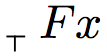 |
| If $Fx$ then $Gy$ | $Fx\rightarrow Gy$ | 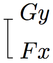 |
| Every $x$ is such that $Fx$ | $\forall x Fx$ | 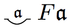 |
| Some $x$ is such that $Fx$ | $\neg\forall x\neg Fx$,   i.e.,   $\exists x Fx$ | 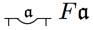 |
| Every $F$ is such that $Fa$ | $\forall F \, Fa$ | 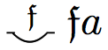 |
| Some $F$ is such that $Fa$ | $\neg\forall F\neg Fa,   i.e.,  \exists F \, Fa$ | 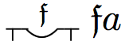 |

So, for example, whereas a modern logician would symbolize the claim ‘All $A$s are $B$s’ as:

$\forall x(Ax\rightarrow Bx)$

Frege would symbolize this claim as follows:

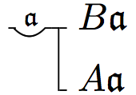

For a more complete description of Frege’s notation, see R. Cook’s Appendix (“How to Read *Grundgesetze*”) in the Ebert, Rossberg, and Wright translation of Frege 1893/1903, Reck & Awodey (2004, 26–34), Beaney (1997, Appendix 2), Furth (1967)[^furth-1967].

[^note-2]: For those who would like a strictly faithful understanding of Frege’s definition of membership in **Gg I**, §34, a more exact representation would be to use the definite description operator *ι* and to cast Frege’s definition as follows, where the symbol $\in$ replaces Frege’s symbol $\frown$ and where $G$ is any unary function symbol:

$x\in y \eqdef \iota\alpha\exists G (y\eqclose \epsilon G \, \amp\, G(x)\! =\! \alpha )$

What’s being defined here is the value of the function $x\in y$. And Frege defines it as: *the* object *α* such that there exists a function $G$ for which $y$ is the course-of-values for $G$ and *α* is the value of $G$ for the argument $x$. If we restrict this definition to those functions that are concepts, (a) the course of values $y$ becomes an extension of a concept, and (b) the object *α* in Frege’s definiens is a truth value and, indeed, signifies the truth-value The True when $x$ falls under the concept $G$. So the claim $G(x) = \alpha$ in Frege’s definition can be represented by the predication $Gx$. That means the variable *α* is no longer needed and so we can transform Frege’s term definition that identifies the value of the denoting term ‘$x\in y$’ to a formula definition that gives truth conditions for the formula ‘$x \in y$’. We eliminate the variable-binding description operator and the variable *α* from Frege’s definiens, so that the definiens in Frege’s definition now becomes:

$x\in y \eqdef \exists G (y\eqclose \epsilon G \amp G(x))$

In other words, $x$ is an element of $y$ if and only if $y$ is the extension of some concept $G$ such that $Gx$. And this is the definition we’ve used in the text.

[^note-3]: These models of second-order logic with a Comprehension Principle for Concepts are called ‘general models’ (as opposed to ‘standard’ models in which the domain of concepts is taken to be the power set of the domain of objects). These general models exploit the fact that there are only a denumerably infinite number of conditions on objects expressible in the language and hence, only a denumerably infinite number of instances of comprehension. These general models include in the domain of concepts only enough concepts to make these instances of comprehension true. Thus, only a denumerably infinite number of concepts are required, even if the domain of objects is denumerably infinite. So we emphasize that it is the interaction of the Comprehension Principle for Concepts with Vb that engenders the paradox.

[^note-4]: It is important to note here that Frege’s definitions of the membership relation and the notion of equinumerosity require a second-order language, since both definitions involve quantification over concepts.

[^note-5]: The reason this is weaker than Frege’s definition is that his definition of equinumerosity requires any witness $R$ to the equinumerosity of *F* and *G* to be (globally) functional and one-to-one, where:

- $R$ is *functional* $\eqdef$ $\forall x\forall y\forall z (Rxy \amp Rxz \to y=z)$
- $R$ is *one-to-one* $\eqdef$ $\forall x\forall y\forall z (Rxz \amp Ryz \to x=y)$

That is, in **Gl** (§§71, 72), Frege says that *F* and *G* are equinumerous just in case:

> *R* is functional & *R* is one-to-one &
> $\forall x(Fx \to \exists y(Gy \amp Rxy)) \amp \forall y(Gy \to \exists x(Fx \amp Rxy)) $

This is stronger than the definition of equinumerosity we’ve given in the text. The definition we’ve given doesn’t require $R$ to be functional generally; *R* might fail to be functional with respect to any non-$F$ objects it might relate to other things. For example, if *a* is a non-*F* object and *b* and *c* are distinct non-*G* objects, then *R* can witness the equinumerosity of *F* and *G* in the sense that we’ve defined in the text even though *R* relates the non-*F* object *a* to both the non-*G* objects *b* and *c*. But that is ruled out by Frege’s definition.

Similarly, the definition we’ve given doesn’t require $R$ to be one-to-one generally; *R* might fail to be one-to-one with respect to any non-$G$ objects to which other things are *R*-related. For example, if *a* and *b* are distinct non-*F* objects and *c* is a non-*G* object, then *R* can witness the equinumerosity of *F* and *G* in the sense that we’ve defined in the text even though *R* relates both the non-*F* objects *a* and *b* to the non-*G* object *c*. But that is ruled out by Frege’s definition.

It seems that neither Frege’s derivation of Hume’s Principle from Basic Law V nor his derivation of the Dedekind-Peano axioms from Hume’s Principle require *R* to be functional and one-to-one generally. A relation *R* does indeed correlate *F* and *G* one-to-one if it satisfies the definition of equinumerosity in the text while failing to be globally functional and one-to-one. So equinumerosity, as we’ve defined it, is sufficient to partition the domain of properties into equivalence classes, each of which contains all and only those properties with the same number of objects falling under them. That is essential to the proof of Frege’s Theorem and hence the exegesis here is simplified.

[^note-6]: Frege doesn’t call this principle ‘Hume’s Principle’ in his own writings. The label was instead introduced in Boolos (1987)[^boolos-1987]. Frege does cite Hume when he introduced this principle in **Gl**. In **Gl**, §63, he quotes Hume’s *Treatise* (I, iii, 1):

> When two numbers are so combined as that one has always an unite answering to every unite of the other, we pronounce them equal.

The idea in Hume does bear some resemblance to the principle Frege constructs, and so we shall continue to use Boolos’ label for this principle.

[^note-7]: We call this an implicit or contextual definition rather than an explicit definition because the notation $\#F$ can only be eliminated when it appears in a context of the form ‘$\#F = \#G$’. By contrast, an explicit definition would take the form:

$\#F \eqdef$ the object $x$ such that $\phi(x,F)$,

where $\phi (x,F)$ is some condition on $x$ and $F$. This would allow us to eliminate the $\#F$ no matter what context it appears in. We shall examine Frege’s attempt to give such a definition momentarily.

The reader might also find the following observation by W. Demopoulos useful (from an early draft of Demopoulos and Clark 2005)[^demopoulos-2005]:

> Frege’s contextual definition (i.e., Hume’s Principle) is not ‘conservative’ over the language $L = {0, S, N}$ of second order arithmetic. (It is not conservative because it allows one to prove statements that are otherwise unprovable using this language and second-order logic alone. A proper, explicit definition only introduces simplifying notation – the new theorems formulable with the new notation introduced by an explicit definition would still have been provable had the new notation been eliminated in terms of primitive notation. As such, explicit definitions are conservative.) Indeed, the contextual definition allows for the proof *both* of the infinity of the sequence of natural numbers *and* of the existence of an infinite cardinal (which Frege called ‘endlos’ in **Gl**).

[^note-8]: The reader might find the following observation in Demopoulos and Clark 2005 (135–135) useful:

> The characterization ‘Frege-Russell’ slurs over the fact that for Russell, the number associated with a set (concept of first level) is an entity of higher type than the set itself. Beginning with individuals – entities of lowest type – we proceed first to sets of individuals and then to classes of such sets (corresponding to Frege’s concepts of second level). For Russell, numbers, being classes, are of higher type than sets. But for Frege, extensions, and therefore numbers, belong to the totality of objects *whatever the level of concept with which they are associated*. Thus, while Russell and Frege both subscribe to *some* version of Hume’s Principle, their conceptions of the logical form of the cardinality operator, and therefore, that of the principle itself, are quite different: the operator is type *raising* for Russell [since it takes us from a set to a class], and type *lowering* for Frege [since it takes a concept (set) to an object (individual)]. This difference is fundamental, since it enables Frege to establish – on the basis of Hume’s principle – those of the Peano-Dedekind axioms of arithmetic which assert that the system of natural numbers is Dedekind infinite. By contrast, when the cardinality operator is type raising, Hume’s principle is rather weak, allowing for models of every finite power.

[^note-9]: The higher-order version of the Law of Extensions asserts that a concept G is a member of the extension of the second-order concept *concept equinumerous to F* iff $G$ is equinumerous to $F$. If we temporarily suppose that we can have higher-order *λ*-expressions of the form $[\lambda H \, H\apprxclose F]$, then we could represent the extension of the second-order concept just described as:

$\epsilon[\lambda H\, H\apprxclose F]$

Then, the higher-order law of extensions would be formalizable as follows:

$G \in \epsilon[\lambda H\, H\apprxclose F] \equivwide G\apprxclose F$

This principle is used implicitly on several occasions in the derivation of Hume’s Principle in **Gl**. Those readers who read the material on the derivation of Hume’s Principle in **Gg** will see that this principle gets reformulated as the Lemma to the Proof of Hume’s Principle.

[^note-10]: Strictly speaking, we should represent this concept as follows:

$[\lambda z \, [\lambda y \, Ayp]z \amp z\neq r]$

But we have applied the following instance of *λ*-Conversion to the first conjunct within the matrix of the *λ*-expression:

$[\lambda y \, Ayp]z\equiv Azp$

We thereby simplify the entire expression to:

$[\lambda z \, Azp\amp z\neq r]$

[^note-11]: The Facts numbered 3, 4, 5, and 6 correspond to Theorems 123, 124, 128, and 129, respectively, in **Gg I**. Facts 1, 5, and 7 correspond to Propositions 91, 84, and 98, respectively, in Part III of **Begr**.

[^note-12]: Readers interested in seeing how our theorems correspond to Frege’s will find it instructive to see how Fact 3 corresponds to Frege’s Theorem 123, which is (**Gg. I**, p. 138):

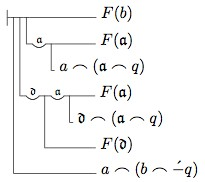

First, let’s simplify the notation for relations in Frege’s theorem 123. Since our notation $Rxy$ corresponds to his

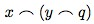

and our notation $R^{*}(x,y)$ corresponds to his:

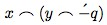

we may substitute them into Frege’s theorem, to get a formula that looks like this:

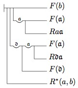

Now if we eliminate Frege’s notation for universally quantified conditional claims, we get:

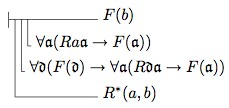

And if we use normal variables instead of the Fraktur variables and replace $F(x)$ by $Fx$, we get:

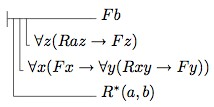

Consider the 3rd line from the top in the above. Since $\forall x(Fx\rightarrow\forall y(Rxy \rightarrow Fy))$ is equivalent to $\forall x\forall y(Fx\rightarrow (Rxy \rightarrow Fy))$, which is equivalent to $\forall x\forall y(Rxy\rightarrow (Fx \rightarrow Fy))$, we may use our abbreviation of the latter formula, namely $\mathit{Her}(F,R)$, to get:

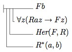

Translating the above conditional into modern notation yields:

$R^{*}(a,b)\rightarrow(\mathit{Her}(F,R)\rightarrow (\forall z(Raz\rightarrow Fz)\rightarrow (Fb)))$

Now if we gather the 3 antecedents of the conditionals into a conjunction, we get the equivalent formula:

$[R^{*}(a,b)\amp \mathit{Her}(F,R)\amp \forall z(Raz\rightarrow Fz)]\rightarrow Fb$

Finally, if we switch the 2nd and 3rd conjuncts in the antecedent, and replace ‘$a$’ by ‘$x$’ and replace ‘$b$’ by ‘$y$’, we get:

$[R^{*}(x,y)\amp \forall z(Rxz\rightarrow Fz)\amp \mathit{Her}(F,R)]\rightarrow Fy$

And this is our Fact 3.

[^note-13]: Facts 2, 3, 6, and 7 correspond to Theorems 132, 134, 141, and 144, respectively, in **Gg I**.

[^note-14]: A relation $R$ is one-to-one (‘*R* is 1-1’) just in case it satisfies the following condition:

$Rxz\amp Ryz\rightarrow x=y$

So Fact 8 in the text is a fact about the weak ancestral whenever the relation R in question is 1-1. We shall prove that the Predecessor relation is 1-1 in the third subsection of Section 5. Then Fact 8 and the fact that Predecessor is 1-1 will both play a crucial role in the proof that every number has a successor.

To prove Fact 8, assume that $R^{*}(a,b), Rcb$ and that $R$ is 1-1. We want to show $R^{+}(a,c)$. Now by Fact 5 concerning the weak ancestral, we know that it follows from $R^{*}(a,b)$ that $\exists z[R^{+}(a,z)\amp Rzb]$. So call an arbitrary such object ‘$d$’. So we know $R^{+}(a,d)\amp Rdb$. Now since $R$ is 1-1, it follows from $Rdb$ and $Rcb$, that $c=d$. So, $R^{+}(a,c)$, which is what we had to show.

[^note-15]: See the work by Wright cited in the Bibliography for a defense of something like this position. Wright justifies this position on Fregean grounds by appealing to Frege’s Context Principle, which asserts that a word has no meaning (reference) except in the context of a proposition (truth).

[^note-16]: See Rosen 1993 for a discussion of how someone might claim that the right-hand condition of an instance might imply its corresponding left-hand condition.

[^note-17]: Again, see the work by Wright cited in the Bibliography.

[^note-18]: In the long footnote to §10, Frege seems to suggest that the idea of replacing the truth values with their unit classes cannot be extended to the case of every object in the domain without conflicting with his earlier stipulations (in **Gg I**, §§3, 9 and 20), and in particular, with Basic Law V.

[^note-19]: Wehmeier (1999)[^wehmeier-1999] shows that Frege would not have had much luck attempting to restrict the quantifiers of **Gg** to extensions. He considers two consistent subsytems that Frege might have adopted to avoid the contradiction, namely, the system H described in Heck (1996)[^heck-1996] and the system Wehmeier himself developed and labels $T_{\Delta}$. Both of these systems retain Basic Law V but place restrictions on the Comprehension Principle for Concepts. However, both systems imply the existence of objects which are not extensions (or courses-of-values), and indeed, they imply an infinite number of such objects.

[^frege-1879]: 1879, *Begriffsschrift, eine der arithmetischen nachgebildete Formelsprache des reinen Denkens*, Halle a. S.: Louis Nebert; translation by S. Bauer Mengelberg as *Concept Notation: A formula language of pure thought, modelled upon that of arithmetic*, in J. van Heijenoort, *From Frege to Gödel: A Sourcebook in Mathematical Logic, 1879–1931*, Cambridge, MA: Harvard University Press

[^frege-1884]: 1884, *Die Grundlagen der Arithmetik: eine logisch-mathematische Untersuchung über den Begriff der Zahl*, Breslau: w. Koebner; translated by J. L. Austin as *The Foundations of Arithmetic: A Logic-Mathematical Enquiry into the Concept of Number*, Oxford: Blackwell, second revised edition, 1953.

[^frege-1892]: 1892, “Über Begriff und Gegenstand”, in *Vierteljahresschrift für wissenschaftliche Philosophie*, 16: 192–205; translated as ‘Concept and Object,’ by P. Geach in *Translations from the Philosophical Writings of Gottlob Frege*, P. Geach and M. Black (eds. and trans.), Oxford: Blackwell, third edition, 1980.

[^frege-1893]: 1893/1903, *Grundgesetze der Arithmetik*, Band I/II, Jena: Verlag Herman Pohle; translation by P. Ebert and M. Rossberg (with C. Wright) as *Basic Laws of Arithmetic*: *Derived using concept-script*, Oxford: Oxford University Press, 2013; partial translation of Volume I by M. Furth as *The Basic Laws of Arithmetic*, Berkeley: U. California Press, 1964.

[^frege-1953]: 1953, *The Foundations of Arithmetic*, J. L. Austin (trans.), Oxford: Basil Blackwell, 2nd revised edition.

[^frege-1967]: 1967, *The Basic Laws of Arithmetic*, M. Furth (trans.), Berkeley: University of California.

[^frege-1980]: 1980, *Philosophical and Mathematical Correspondence*, G. Gabriel, H. Hermes, F. Kambartel, C. Thiel, and A. Veraart (eds. of the German edition), abridged from the German edition by Brian McGuinness, translated by Hans Kaal, Chicago: University of Chicago Press.

[^dedekind-1888]: Dedekind, R., 1888, *Was sind und was sollen die Zahlen*, Braunschweig: Vieweg und Sohn; 2nd edition, 1893; 7th edition, 1939; translated as “The Nature and Meaning of Numbers”, in W.W. Beman (ed. and trans.), *Essays on the Theory of Numbers*, Chicago: Open Court, 1901; reprinted, New York: Dover, 1963; also translated as “What Are Numbers and What Should They Be?”, H. Pogorzelski, W. Ryan & W. Snyder (eds. and trans.), Orono, ME: Research Institute for Mathematics, 1995.

[^hilbert-1899]: Hilbert, D., 1899, “Grundlagen der Geometrie”, in *Festschrift zur Feier der Enthüllung des Gauss-Weber Denkmals in Göttingen*, Leipzig: Teubner; translated as *Foundations of Geometry*, Leo Unger (trans.), La Salle: Open Court, 1971 (ninth printing, 1997).

[^pasch-1882]: Pasch, M., 1882, *Vorlesungen über neuere Geometrie*, Leipzig: Teubner.

[^peano-1889a]: Peano, G., 1889a, *Arithmetices Principia: Nova Methodo Exposita*, Turin: Fratelli Bocca; translated as “The Principles of Arithmetic, Presented by a New Method”, in Jean van Heijenoort (ed.), *From Frege to Gödel: A Source Book in Mathematical Logic, 1879--1931*, Cambridge, MA: Harvard University Press, 1967, 83–97.

[^peano-1889b]: Peano, G., 1889b, *I principii di geometria logicamente esposti*, Turin: Fratelli Bocca.

[^pieri-1898]: Pieri, M., 1898, “I principii della geometria di posizione composti in sistema logico deduttivo”, *Memorie della Reale Accademia delle Scienze di Torino* (Series 2), 48: 1–62.

[^whitehead-1910]: Whitehead, A.N., and B. Russell, 1910--1913, *Principia Mathematica*, 3 volumes, Cambridge: Cambridge University Press; 2nd edition, Cambridge: Cambridge University Press, 1925--1927.

[^anderson-2004]: Anderson, D., and Zalta, E., 2004, “Frege, Boolos, and Logical Objects”, *J. Philosophical Logic*, 33 (1): 1–26.

[^antonelli-2005]: Antonelli, A., and May, R., 2005, “Frege’s Other Program”, *Notre Dame Journal of Formal Logic*, 46 (1): 1–17. [[Available online in PDF](http://projecteuclid.org/Dienst/Repository/1.0/Disseminate/euclid.ndjfl/1107220671/body/pdf).]

[^beaney-1997]: Beaney, M., 1997, *The Frege Reader*, Oxford: Blackwell.

[^bell-1995]: Bell, J. L., 1995, “Type-Reducing Correspondences and Well-Orderings: Frege’s and Zermelo’s Construction Re-examined”, *Journal of Symbolic Logic*, 60: 209–221.

[^bell-1999]: –––, 1999, “Frege’s Theorem in a Constructive Setting”, *Journal of Symbolic Logic*, 64 (2): 486–488.

[^bell-1994]: –––, 1994, “Fregean Extensions of First-Order Theories”, *Mathematical Logic Quarterly*, 40: 27–30; reprinted in Demopoulos 1995, 432–437.

[^boolos-1985]: Boolos, G., 1985, “Reading the *Begriffsschrift*”, *Mind*, 94: 331–344; reprinted in Boolos (1998): 155–170. [Page references are to the reprint.]

[^boolos-1986]: –––, 1986/87, “Saving Frege From Contradiction”, in *Proceedings of the Aristotelian Society*, 87(1): 137–151; reprinted in Boolos (1998): 171–182. [Page references are to the original.]

[^boolos-1987]: –––, 1987, “The Consistency of Frege’s *Foundations of Arithmetic*”, in *On Being and Saying*, J. J. Thomson (ed.), Cambridge, MA: MIT Press, pp. 3–20; reprinted in Boolos (1998): 183–201. [Page references are to the original.]

[^boolos-1990]: –––, 1990, “The Standard of Equality of Numbers”, in *Meaning and Method: Essays in Honor of Hilary Putnam*, G. Boolos (ed.), Cambridge: Cambridge University Press, pp. 261–277; reprinted in Boolos (1998): 202–219. [Page references are to the original.]

[^boolos-1993]: –––, 1993, “Whence the Contradiction?”, in *Aristotelian Society Supplementary Volume*, 67: 213–233; reprinted in Boolos (1998): 220–236.

[^boolos-1994]: –––, 1994, “The Advantages of Honest Toil Over Theft”, in *Mathematics and Mind*, Alexander George (ed.), Oxford: Oxford University Press, 27–44; reprinted in Boolos (1998): 255–274.

[^boolos-1997]: –––, 1997, “Is Hume’s Principle Analytic?”, in Heck (ed.) 1997, 245–262; reprinted in Boolos (1998): 301–314. [Page references are to the reprint.]

[^boolos-1998]: –––, 1998, *Logic, Logic, and Logic*, J. Burgess and R. Jeffrey (eds.), Cambridge, MA: Harvard University Press.

[^burgess-1984]: Burgess, J., 1984, “Review of Wright (1983)”, *The Philosophical Review*, 93: 638–40.

[^burgess-1998]: –––, 1998, “On a Consistent Subsystem of Frege’s *Grundgesetze*”, *Notre Dame Journal of Formal Logic*, 39: 274–278.

[^burgess-2005]: –––, 2005, *Fixing Frege*, Princeton: Princeton University Press.

[^demopoulos-1998]: Demopoulos, W., 1998, “The Philosophical Basis of Our Knowledge of Number”, *Noûs*, 32: 481–503.

[^demopoulos-1995]: Demopoulos, W., (ed.), 1995, *Frege’s Philosophy of Mathematics*, Cambridge: Harvard University Press.

[^demopoulos-2005]: Demopoulos, W., and Clark, P., 2005, “The Logicism of Frege, Dedekind and Russell”, in *Oxford Handbook of Philosophy of Mathematics and Logic*, S. Shapiro (ed.), Oxford: Oxford University Press, 129–165.

[^dummett-1991]: Dummett, M., 1991, *Frege: Philosophy of Mathematics*, Cambridge: Harvard University Press.

[^dummett-1997]: –––, 1997, “Neo-Fregeans: In Bad Company?”, in Schirn (1997).

[^ferreira-2005]: Ferreira, F., 2005, “Amending Frege’s *Grundgesetze der Arithmetik*”, *Synthese*, 147: 3–19.

[^ferreira-2002]: Ferreira, F., and K. Wehmeier, 2002, “On the Consistency of the $\Delta^1_1$-CA Fragment of Frege’s *Grundgesetze*”, *Journal of Philosophical Logic*, 31: 303–311.

[^field-1984]: Field, H., 1984, “Critical Notice of Crispin Wright: *Frege’s Conception of Numbers as Objects*”, *Canadian Journal of Philosophy*, 14: 637–632; reprinted under the title “Platonism for Cheap? Crispin Wright on Frege’s Context Principle” in H. Field, *Realism, Mathematics, and Modality*, Oxford: Blackwell, 1989, pp. 147–170.

[^fine-2002]: Fine, K., 2002, *The Limits of Abstraction*, Oxford: Clarendon Press.

[^furth-1967]: Furth, M., 1967, “Editor’s Introduction”, in G. Frege, *The Basic Laws of Arithmetic*, M. Furth (translator and editor), Berkeley: University of California Press, pp. v–lvii.

[^geach-1976]: Geach, P., 1976, “Critical Notice”, *Mind*, 85 (339): 436–449.

[^geach-1955]: –––, 1955, “Class and Concept”, *Philosophical Review*, 64: 561–570.

[^goldfarb-2001]: Goldfarb, W., 2001, “First-Order Frege Theory is Undecidable”, *Journal of Philosophical Logic*, 30: 613–616.

[^hale-1994]: Hale, B., 1994, “Dummett’s Critique of Wright’s Attempt to Resuscitate Frege”, *Philosophia Mathematica*, (Series III), 2: 122–147.

[^hazen-1985]: Hazen, A., 1985, “Review of Crispin Wright’s *Frege’s Conception of Numbers as Objects*”, *Australasian Journal of Philosophy*, 63 (2): 251–254.

[^heck-2012]: Heck, Jr., R., 2012, *Reading Frege’s* Grundgesetze, Oxford: Clarendon Press.

[^heck-2011]: –––, 2011, *Frege’s Theorem*, Oxford: Clarendon Press.

[^heck-1999]: –––, 1999, “Grundgesetze der Arithmetik I, §10”, *Philosophia Mathematica*, 7: 258–292.

[^heck-1997]: –––, 1997, “The Julius Caesar Objection”, in Heck (ed.) 1997, 273–308.

[^heck-1996]: –––, 1996, “The Consistency of Predicative Fragments of Frege’s *Grundgesetze der Arithmetik*”, *History and Philosophy of Logic*, 17: 209–220.

[^heck-1993]: –––, 1993, “The Development of Arithmetic in Frege’s *Grundgesetze der Arithmetik*”, *Journal of Symbolic Logic*, 58 (2): 579–600; reprinted in Demopoulos (1995).

[^heck-1997-2]: Heck, R. (ed.), 1997, *Language, Thought, and Logic: Essays in Honour of Michael Dummett*, Oxford: Oxford University Press, 1997.

[^hodes-1984]: Hodes, H., 1984, “Logicism and the Ontological Commitments of Arithmetic,” *Journal of Philosophy*, 81 (3): 123–149.

[^linnebo-2004]: Linnebo, Ø., 2004, “Predicative Fragments of Frege Arithmetic”, *The Bulletin of Symbolic Logic*, 10 (2): 153–174.

[^macbride-2003]: MacBride, F., 2003, “Speaking with Shadows: A Study of Neo-Logicism”, *British Journal for the Philosophy of Science*, 54: 103–163.

[^macfarlane-2002]: MacFarlane, J., 2002, “Frege, Kant, and the Logic in Logicism”, *The Philosophical Review*,111:25–65.

[^may-2019]: May, R., and K. Wehmeier, 2019, “The Proof of Hume’ Principle”, P. Ebert and M. Rossberg (eds.), *Essays on Frege’s* Basic Laws of Arithmetic, Oxford: Oxford University Press, pp. 182–206.

[^parsons-1965]: Parsons, C., 1965, “Frege’s Theory of Number”, *Philosophy in America*, M. Black (ed.), Ithaca: Cornell University Press, pp. 180–203; reprinted with Postscript in Demopoulos (1995), pp. 182–210.

[^parsons-1987]: Parsons, T., 1987, “The Consistency of the First-Order Portion of Frege’s Logical System”, *Notre Dame Journal of Formal Logic*, 28: 161–68.

[^pelletier-2001]: Pelletier, F.J., 2001, “Did Frege Believe Frege’s Principle”, *Journal of Logic, Language, and Information*, 10 (1): 87–114.

[^quine-1995]: Quine, W.V.O., 1995, “On Frege’s Way Out”, in *Selected Logical Papers* (enlarged edition), Cambridge, MA: Harvard University Press.

[^reck-2004]: Reck, E., and Awodey, S. (trans./eds.), 2004, *Frege’s Lectures on Logic: Carnap’s Student Notes, 1910–1914*, Chicago and La Salle, IL: Open Court.

[^resnik-1980]: Resnik, M., 1980, *Frege and the Philosophy of Mathematics*, Ithaca: Cornell University Press.

[^rosen-1993]: Rosen, G., 1993, “The Refutation of Nominalism(?)”, *Philosophical Topics*, 21 (2): 149–186

[^ruffino-2003]: Ruffino, M., 2003, “Why Frege Would Not Be A Neo-Fregean”, *Mind*, 112 (445): 51–78.

[^schirn-1997]: Schirn, M., (ed.), 1997, *Philosophy of Mathematics Today*, Oxford: Oxford University Press.

[^schroeder-heister-1987]: Schroeder-Heister, P., 1987, “A model-theoretic reconstruction of Frege’s Permutation Argument”, *Notre Dame Journal of Formal Logic*, 28 (1): 69–79.

[^sullivan-1997]: Sullivan, P. and Potter, M., 1997, “Hale on Caesar”, *Philosophia Mathematica* (Series III), 5: 135–152.

[^tabata-2000]: Tabata, H., 2000, “Frege’s Theorem and His Logicism”, *History and Philosophy of Logic*, 21 (4): 265–295.

[^tennant-2004]: Tennant, N., 2004, “A General Theory of Abstraction Operators”, *The Philosophical Quarterly*, 54(214): 105–133.

[^heijenoort-1967]: van Heijenoort, J., 1967, ed., *From Frege to Gödel: A Sourcebook in Mathematical Logic*, Cambridge: Harvard University Press.

[^wehmeier-1999]: Wehmeier, K., 1999, “Consistent Fragments of *Grundgesetze* and the Existence of Non-Logical Objects”, *Synthese*, 121: 309–328.

[^wright-1983]: Wright, C., 1983, *Frege’s Conception of Numbers as Objects*, Aberdeen: Aberdeen University Press.

[^wright-1997a]: –––, 1997a, “Response to Dummett”, in Schirn (1997).

[^wright-1997b]: –––, 1997b, “On the Philosophical Significance of Frege’s Theorem”, in Heck (ed.) 1997, 201–244.

[^zalta-1999]: Zalta, E., 1999, “Natural Numbers and Natural Cardinals as Abstract Objects: A Partial Reconstruction of Frege’s *Grundgesetze* in Object Theory”, *Journal of Philosophical Logic*, 28 (6): 619–660.
