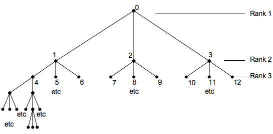
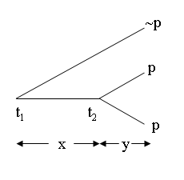
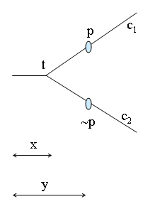
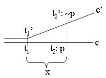
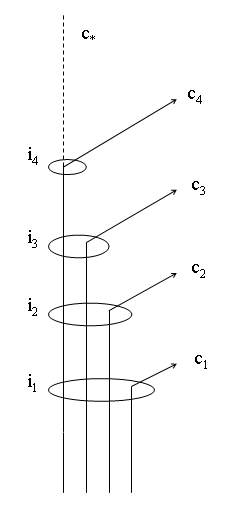
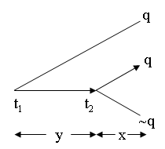
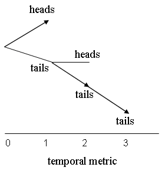
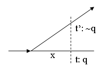
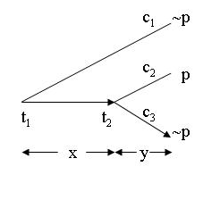

# Future Contingents
**First published Thu Jun 9, 2011; substantive revision Thu Jul 11, 2024**

*Øhrstrøm, Peter, Hasle, Per*

Future contingents are contingent statements about the future — such as future events, actions, states etc. To qualify as contingent the predicted event, state, action or whatever is at stake must neither be impossible nor inevitable. Statements such as “My mother shall go to London” or “There will be a sea-battle tomorrow” could serve as standard examples. What could be called the problem of future contingents concerns how to ascribe truth-values to such statements. If there are several possible decisions out of which one is going to be made freely tomorrow, can there be a truth now about which one will be made? If “yes”, on what grounds could something which is still open, nevertheless be true already now? If “no”, can we in fact hold that all logically exclusive possibilities must be untrue without denying that one of the possible outcomes must turn out to be the chosen one?[^note-1]

In point of fact, “future contingents” could also refer to future contingent objects. A statement like “The first astronaut to go to Mars will have a unique experience” could be analyzed as referring to an object not yet existing, supposing that one day in the distant future some person will indeed travel to Mars, but that person has not yet been born. The notion of ‘future contingent objects’ involves important philosophical questions, for instance the issue of ethical obligations towards future generations, quantification over “future contingent objects” etc. However, this entry is confined to the study of future contingent statements.

The problem of future contingents is interwoven with a number of issues in theology, philosophy, logic, semantics of natural language, computer science, and applied mathematics. The theological issue of how to reconcile the assumption of God’s foreknowledge with the freedom and moral accountability of human beings has been a main impetus to the discussion and a major inspiration to the development of various logical models of time and future contingents. This theological issue is connected with the general philosophical question of determinism versus indeterminism. Within logic, the relation between time and modality must be studied and various models satisfying various assumptions with respect to the structure of time must be developed and investigated. The project of formal semantics for natural languages also has to address the problem of how to ascribe a correct semantics to statements about the future. Finally, it should be mentioned that temporal logic has found remarkable applications in computer science and applied mathematics (see Hasle and Øhrstrøm 2004, Demri et al. 2016)[^demri-2016][^hasle-2004].

In the present context the issue of future contingents will be approached from the viewpoint of philosophical logic with due consideration to philosophical-theological origins.

## 1. The Discussion of Future Contingency and Its Background in Ancient and Medieval Logic

Future contingents appear to hold a strange quality when compared with present or past tense statements, such as “it is raining” or “Napoleon lost at Waterloo”, whose truth-value does not depend on future states or events. For it seems straightforward to claim that the latter two sentences are true if and only if the states or events in question correspond with reality. But can it make sense to claim that the truth or falsity of a contingent future statement, such as “The first human being to set foot on Mars will be a woman”, depends on the future reality in a similar manner? Clearly, this can only make sense if we can meaningfully refer to the future reality in the same way as we can refer to the past reality. However, if the future is open such a reference may be rather problematic.

The philosophical and logical challenge to which the future contingency discussion gives rise is two-fold. First of all, anyone who wants to maintain some kind of indeterminism regarding the future, may be confronted with some standard arguments in favor of logical determinism, i.e., arguments designed to demonstrate that there are no future contingents at all. In addition, anyone who holds that there are future contingents can be challenged to establish a reasonable truth-theory compatible with the idea of an open future. Such a theory should provide answers to questions like: Can one meaningfully regard future contingents as true or false now, if the future is open? And if so, how? Can assertions about the contingent future make any sense at all? And if so, how? Some logicians have held that no future contingent is true. However, other logicians have found that this is unacceptable. Instead, they have looked for a theoretical basis on which we might hold that a future contingent is true (or false).

Already Aristotle (384–322 B.C.E.) was aware of the problem of future contingents. Chapter IX of his work, *On Interpretation*, is without doubt the philosophical text which has had the greatest impact on the debate about the relations between time, truth, and possibility. The discussion in this text certainly bears witness to the fact that ancient philosophy was highly conscious of tense-logical problems. Central to the discussion in this famous Aristotelian text is the question of how to interpret the following two statements:

“Tomorrow there will be a sea-battle” “Tomorrow there will not be a sea-battle”

Aristotle considered questions like: Should we say that one of these statements is true today and the other false? How can we make a clear distinction between what is going to happen tomorrow and what must happen tomorrow? (See *On Interpretation*, 18 b 23 ff.).

The interpretative problems regarding Aristotle’s logical problem about the sea-battle tomorrow are by no means simple. Over the centuries, many philosophers and logicians have formulated their interpretations of the Aristotelian text (see Øhrstrøm and Hasle 1995, p. 10 ff.)[^øhrstrøm-1995]. In the following we shall present an interpretation of the text from the scholastic period and a modern interpretation based on a three-valued semantics.

In the generation after Aristotle, Diodorus Cronus (ca. 340–280 B.C.E.) analysed similar problems using his so-called Master Argument. This argument was a trilemma. According to Epictetus, Diodorus argued that the following three propositions cannot all be true:

**(D1)**

Every proposition true about the past is necessary.

**(D2)**

An impossible proposition cannot follow from a possible one.[^note-2]

**(D3)**

There is a proposition which is possible, but which neither is nor will be true.

Diodorus used this incompatibility combined with the plausibility of (D1) and (D2) to argue that (D3) is false. Assuming (D1) and (D2) he went on to define the possible as “that which either is or will be true” and the necessary as “that which, being true, will not be false”. In this way his argument seems to have been designed to demonstrate that there cannot be any future contingency at all. However, little is known about the way in which Diodorus used his premises in order to reach the conclusion. The reconstruction of the Master Argument certainly constitutes a genuine problem within the history of logic. Various philosophers and logicians have tried to reconstruct the argument as it might have been. It is very likely that the main structure of the argument was close to the argument presented in the next section. (See (Øhrstrøm and Hasle 1995, p. 15 ff.)[^øhrstrøm-1995] and (Gaskin 1995)[^gaskin-1995] for references to the literature on the Master Argument.)

The discussion took on a particularly interesting form in the Middle Ages. During the Middle Ages logicians related their discipline to theology. One of the most important theological questions was the problem of the contingent future in relation to Christian doctrine. According to Christian tradition, divine foreknowledge comprises knowledge of the future choices to be made by men and women. But this assumption apparently gives rise to a straightforward argument from divine foreknowledge to the necessity of the future: if God already now knows which decision I will make tomorrow, then a now-unpreventable truth about my choice tomorrow is already given. My choice, then, appears to be necessary, not free. Hence, there seems to be no basis for the claim that I have a free choice between genuine alternatives. This conclusion, however, violates the idea of human freedom and moral accountability presupposed in much theology (though not all).

The medieval discussion regarding the logic of divine foreknowledge is, from a formal point of view, very close to the classical discussion concerning future contingency. If we add the assumption that necessarily, something is true if and only if it is known to God, then it is easy to see how the discussion regarding the logic of divine foreknowledge is, from a formal point of view, essentially the same discussion as the classical discussion concerning future contingency. This was clearly realised by the medieval logicians.

In his treatise *De eventu futurorum*, Lavenham (c. 1380) gave a succinct overview over the basic approaches to the problem within scholasticism (see Øhrstrøm 1983, Tuggy 1999)[^øhrstrøm-1983][^tuggy-1999]. Lavenham considered a central argument leading from God’s foreknowledge to the necessity of the future and the lack of proper human freedom. In fact, the various positions on future contingency may be presented as possible reactions to this argument. The main structure of this argument is very close to what is believed to have been the Master Argument of Diodorus Cronus (see Gaskin 1995)[^gaskin-1995]. It is clear from Lavenham’s text that he had some knowledge of this old Stoic or Megaric argument, probably through his reading of Cicero’s *De Fato*. The main idea is to transfer the assumed necessity of the past to the future. In order to make things clearer one might state the argument in terms of yesterday and tomorrow, instead of past and future in general (as Lavenham tends to do). A non-theological version of the argument can be presented in the following way. In this sequence E is some event, which may or may not take place tomorrow (e.g. a sea-battle). Non-E is just a state of affairs without E occurring. E and non-E are supposed to be mutually exclusive.

1. Either E is going to take place tomorrow or non-E is going to take place tomorrow. (Assumption).
2. If a proposition about the past is true, then it is now necessary, i.e., inescapable or unpreventable. (Assumption).
3. If E is going to take place tomorrow, then it is true that yesterday it was the case that E would take place in two days. (Assumption).
4. If E is going to take place tomorrow, then it is now necessary that yesterday E would take place in two days. (Follows from 2. and 3.).
5. If it is now necessary that yesterday E would take place in two days, then it is now necessary that E is going to take place tomorrow. (Assumption).
6. If E is going to take place tomorrow, then E is necessarily going to take place tomorrow. (Follows from 4. and 5.).
7. If non-E is going to take place tomorrow, then non-E is necessarily going to take place tomorrow. (Follows by the same kind of reasoning as 6.).
8. Either E is necessarily going to take place tomorrow or non-E is necessarily going to take place tomorrow. (Follows from 1., 6. and 7.).
9. Therefore, what is going to happen tomorrow is going to happen with necessity. (Follows from 8.).

Lavenham accepted the validity of this argument, and he pointed out that one should consider four possible reactions to it. He presented this classification in a theological context, but it can be translated into non-theological language. Assuming that necessarily, something is true if and only if it is known to God, the four possible reactions in Lavenham’s analysis can be listed in the following way:

1. Accept the above argument (including its premises). Grant that there are no future contingents, i.e., statements about the future are either impossible or necessary.
2. Deny that if a certain event is going to occur, then it is true that it has always been the case that it would occur.
3. Deny the following: For any possible event, which might occur at a certain time in the future, either it will be that the event takes place at that future time, or it will be that the event does not take place at that time.
4. Deny that the past in general is necessary.

Clearly, if we don’t want to accept the deterministic conclusion of the above argument, and if the argument is accepted as valid, then we have to question at least one of the premises. Not taking premise 5 into consideration, this leaves us with the premises 1, 2, and 3. According to the reaction (b), premise 3 is rejected. Reaction (c) implies the rejection of premise 1 in the argument. Reaction (d) implies the rejection of premise 2.

Lavenham took option (a) to imply that there is no human freedom. In his understanding (b) would mean that God does not know future contingents. He rejected both (a) and (b) as contrary to the Christian faith.

It seems that Lavenham, like William of Ockham (c. 1287–1347), took Aristotle to hold that propositions about the contingent future are neither true nor false. A number of scholastic logicians favored this Aristotelian view (c), for instance Peter Aureole (c.1280–1322). Lavenham, however, rejected this view. He insisted that future contingents are either true or false now, and that God knows the truth-values of all future contingents. He preferred (d), and he argued that by rejecting the necessity of the past as a general principle the doctrines of free will and God’s foreknowledge of the contingent future can be united in a consistent manner. This solution was first formulated by Ockham, although some of its elements can already be found in Anselm of Canterbury (1033–1109). It is also interesting that Leibniz (1646–1711) much later worked with a similar idea as a part of his metaphysics. (See Øhrstrøm 1984.)[^øhrstrøm-1984]

The most characteristic feature of Lavenham’s solution is the concept of the true future. The view is that God possesses certain knowledge not only of the necessary future, but also of the contingent future. This means that among the possible contingent futures there must be one which has a special status, namely that it corresponds to the course of events which is going to happen or take place in the future. This line of thinking may be called the medieval solution, even though other approaches certainly existed. Its justification is partly the observation that the notion of the true future is the specifically medieval contribution to the discussion, and partly that leading medieval logicians regarded this solution as the best one. Lavenham himself called it “opinio modernorum”, i.e., the opinion of the modern people. Lavenham argued that the notion of the true future can be maintained together with indeterminism, if the assumption of the necessity of the past is rejected. This will be explained in more detail in sections 2 and 5.

A later contribution by the Jesuit Luis Molina (1535–1600) is relevant for a modern interpretation of the concept of the true future. Molina’s ideas have been thoroughly discussed in (Craig 1988)[^craig-1988]. Molina’s special contribution is the idea of (God’s) middle knowledge, “by which, in virtue of the most profound and inscrutable comprehension of each free will, He saw in His own essence what each such will would do with its innate freedom were it to be placed in this or that or indeed in infinitely many orders of things — even though it would really be able, if it so willed, to do the opposite” (quoted from Craig 1988, p. 175)[^craig-1988]. Craig goes on to explain it as follows: “… whereas by His natural knowledge God knows that, say, Peter when placed in a certain set of circumstances *could* either betray Christ or not betray Christ, being free to do either under identical circumstances, by His middle knowledge God knows what Peter *would* do if placed under those circumstances” (Craig 1988, p. 175)[^craig-1988].

As Lavenham knew, William of Ockham had discussed the problem of divine foreknowledge and human freedom in his work *Tractatus de praedestinatione et de futuris contingentibus*. (See William of Ockham 1983.)[^william-1983] Ockham asserted that God knows the truth or falsity of all future contingents, but he also maintained that human beings can choose between alternative possibilities. In his *Tractatus* he argued that the doctrines of divine foreknowledge and human freedom are compatible. Richard of Lavenham made a remarkable effort to capture and clearly present the logical features of Ockham’s system as opposed to (what was assumed to be) Aristotle’s solution, i.e., (c).

In the following section a formal version of the medieval argument for determinism will be presented without theological references. It will be demonstrated that at least two of the premises used in the argument may be questioned. In section 3 we shall present a particularly important framework for the discussion of future contingents known as branching time and its semantics. In sections 4 and 5 we shall see how these possible reactions to the classical argument may be turned into modern truth-theories corresponding to the medieval positions listed above.

## 2. A Formalisation of the Classical Argument

In order to handle the problem of future contingency in a formal manner, temporal logic has turned out to be very useful. In particular tense-logic offers a powerful formalism in terms of which the various aspects of the problem can be presented and discussed. A. N. Prior (1914–69) was the father of modern tense-logic. He presented formalism for the very first time as a part of his presidential address on the 27 August 1954 at The Second Philosophical Congress organized by New Zealand Section of the Australasian Association of Psychology and Philosophy, Wellington 27th – 30th August, 1954 (see Øhrstrøm 2023)[^øhrstrøm-2023]. He presented his tense-logic as an extension of propositional logic with propositional operators such *P* (“it has been the case that …”) and *F* (“it will be the case that …”). Prior published a number of papers and books during the period from 1954 to this death in 1969. Subsequently, several philosophers, logicians, mathematicians and computer scientist have contibuted with important books to the further development of Prior’s paradigm (see Rescher and Urquhart 1971, Lucas 1989, van Benthem 1991, Gabbay et al. 2000, Belnap et al. 2001, Correia and Iacona (eds.) 2013, Demri et al. 2016, Goranko 2023).

Among other things, the logic of the expressions “tomorrow” and “yesterday” used in section 1 has been formalized by Prior who suggested that the two terms should be treated as propositional operators, $T$ and $Y$ (1967, p. 67 ff.). This means that $T(p)$ and $Y(p)$ should stand for the propositions “tomorrow it will be the case that $p$” and “yesterday it was the case that $p$”, respectively. Prior even suggested some basic axioms for the two operators

1. $p \supset Y(T(p))$
2. $p \supset T(Y(p))$

By iterative uses of the $Y$- and $T$-operators we may define operators corresponding to the past and the future as $Y^n$ and $T^n$, respectively, where $n$ is an arbitrary natural number. Obviously, this may be done with an arbitrary choice of time unit, i.e., $T(p)$ and $Y(p)$ could simply stand for “at the next moment it will be the case that $p$” and “at the moment just before now it was the case that $p$”, respectively. A logic of this kind appears to be based on time conceived as a linear series of discrete moments, but Prior pointed out that we may find this sort of discrete tense-logic attractive without committing ourselves to a strong metaphysical stance regarding time as such:

> The usefulness of systems of this sort does not depend on any serious metaphysical assumption that time *is* discrete; they are applicable in limited fields of discourse in which we are concerned only with what happens next in a sequence of discrete states, e.g. in the workings of a digital computer. (Prior 1967, p. 67)[^prior-1967]

It should also be mentioned that it is generally assumed that all philosophical and logical aspects of the topic of future contingency can be satisfactory discussed in terms of discrete tense-logic. This means that regarding the topic of future contingency, we may choose to limit the discussion to the discrete case. On the other hand, in some discussions there is no reason to make a limitation of this kind. Prior based the metric version of his general tense-logical system on the operators:

$$\begin{align} F(x) \quad & \ldquo\text{in } x \text{ time units it will be the case that } \ldots\rdquo \\ P(x) \quad & \ldquo x \text{ time units ago it was the case that } \ldots\rdquo \\ \Box \quad & \ldquo\text{it is necessary that } \ldots\rdquo \end{align}$$

Here the $x$ in the tense operators, $F(x)$ and $P(x)$, does not have to be a natural number, but can take any positive value, allowing for the case that time is non-discrete. Prior showed how the argument from section 1 can be formalized in terms of this general tense-logic.

It should, however, be noted that Prior also often used tense-operators without any reference to time units. As mentioned above he used $F$ for “it will be the case that …” and $P$ for “it has been the case that …”. In terms of these non-metric tense-operators he defined the operators, $G$ and $H$, as ${\sim}F{\sim}$ and ${\sim}P{\sim}$ respectively. $G$ may be read “it will always be the case that …”, and $H$ may be read “it has always been the case that …”. Using these non-metric tense-operators Prior (1967, p. 32 ff.) even formulated a reconstruction of the Diodorean Master Argument which comes rather close to the classical argument which we shall present in the following.

It is essential to notice that the necessity at stake in the classical argument is a historical necessity. This means that what is not necessary at one moment may become necessary at another moment. Instead of speaking about what is necessary we might – as already hinted at – talk about what is now settled, inevitable, inescapable, or unpreventable.

The argument may be understood as based on the following five principles, where $p$ and $q$ represent arbitrary well-formed statements within the logic:

**(P1)**

$F(y)p \supset P(x)F(x)F(y)p$

**(P2)**

$\Box(P(x)F(x)p \supset p)$

**(P3)**

$P(x)p \supset \Box P(x)p$

**(P4)**

$(\Box(p \supset q) \wedge \Box p) \supset \Box q$

**(P5)**

$F(x)p \vee F(x){\sim}p$

(P1) and (P2) are basic tense-logical claims which can serve as crucial elements in a formalization of the argument mentioned in section 1. (P3) may be labeled the ‘necessity of the past’. (P4) is a theorem well-known from standard modal logic. (P5) may be read as a version of the principle of the excluded middle (“tertium non datur”), although it does not take the exact form of $p \vee{\sim}p$. In order to avoid confusion, we shall use the modified name, ‘future excluded middle’, for (P5).

Let $q$ stand for some atomic statement such that $F(y)q$ is a statement about the contingent future. Formally, then, the argument goes as follows:

| (1) | $F(y)q \supset P(x)F(x)F(y)q$ | (P1) |
| --- | --- | --- |
| (2) | $P(x)F(x)F(y)q \supset \Box P(x)F(x)F(y)q$ | (from (P3)) |
| (3) | $F(y)q \supset \Box P(x)F(x)F(y)q$ | (from (1) & (2)) |
| (4) | $\Box(P(x)F(x)F(y)q \supset F(y)q)$ | (from (P2)) |
| (5) | $F(y)q \supset \Box F(y)q$ | (from (3), (4), (P4)) |

Similarly, it is possible to prove

| (6) | $F(y){\sim}q \supset \Box F(y){\sim}q$ |   |
| --- | --- | --- |

The second part of the main proof is carried out in the following way:

| (7) | $F(y)q \vee F(y){\sim}q$ | (from (P5)) |
| --- | --- | --- |
| (8) | $\Box F(y)q \vee \Box F(y){\sim}q$ | (from (5), (6), (7)) |

Remember now that $q$ may stand for any atomic proposition, including statements about human actions. Therefore, (8) is equivalent to a claim of determinism, i.e., that there are no future contingents. So if one wants to preserve indeterminism, at least one of the above principles (P1–5) has to be rejected.

A.N. Prior constructed two systems showing how that can be done, namely the Peircean system (in which (P1) and (P5) are rejected) and the Ockhamist system (in which (P3) is rejected). Formally, each of these systems offers a basis for the rejection of the claim of determinism as expressed in (8). As we shall see in the next section the same can be said about Jan Łukasiewicz’s three-valued semantics, which Prior himself investigated further (see Prior 1953)[^prior-1953], and which also involves a rejection of (P5). Since Prior, several philosophers have discussed which one of these systems should be accepted, or whether other and more attractive systems dealing with the problem can be constructed. In sections 4 and 5 we shall see how the various solutions to the problem of future contingents can be grouped according to their consequences with respect to (P3) and (P5).

## 3. Branching Time Semantics

Since Prior’s time, it has become a standard to study tense-logical systems in terms of semantical models based on the idea of branching time. This idea was not realised in Prior’s early works on temporal logic. Indeed it had not yet been formulated in his *Time and Modality* (1957), which otherwise marked the major breakthrough of the new logic of time. As an explicit (or formalised) idea, branching time was first suggested to Prior in a letter from Saul Kripke in September 1958. This letter contains an initial version of the idea and a system of branching time, although it was not worked out in details. Kripke, who was then only 17 years old, suggested that we may consider the present as a point of Rank 1, and possible events or states at the next moment as points of Rank 2; for every such possible state in turn, there would be various possible future states at the next moment from Rank 3, the set of which could be labelled Rank 4, and so forth. Kripke wrote:

> Now in an indetermined system, we perhaps should not regard time as a linear series, as you have done. Given the present moment, there are several possibilities for what the next moment may be like – and for each possible next moment, there are several possibilities for the next moment after that. Thus the situation takes the form, not of a linear sequence, but of a “tree”… [Letter from Saul Kripke to A.N. Prior, dated September 3, 1958, kept in the Prior Collection at Bodleian Library, Oxford, Box 4. See also Ploug et al. 2012.][^ploug-2012]

In this way it is possible to form a tree structure representing the entire set of possible futures expanding from the present (Rank 1) – indeed a set of possible futures can be said to be identified for any state, or node in the tree. In this structure every point determines a subtree consisting of its own present and possible futures. Kripke illustrated this idea in the following way:

In the letter Kripke wrote:

> The point 0 (or origin) is the present, and the points 1, 2, and 3 (of rank 2) are the possibilities for the next moment. If the point 1 actually does come to pass, 4, 5, and 6 are its possible successors, and so on. The whole tree then represents the entire set of possibilities for present and future; and every point determines a *subtree* consisting of its own present and future.

Prior quickly accepted Kripke’s idea of representing time as a tree-like structure when he received Kripke’s letter in 1958. The reason was probably that Prior himself the year before had worked with a similar idea when a science fiction story gave him inspiration to write his paper “Opposite Number” (1957). In this paper time is represented as a structure like the “big Y,” i.e., a representation that can be conceived as a simple branching time diagram (see Øhrstrøm, P. and González 2022).

In Prior’s opinion the notion of branching time is certainly not unproblematic. After all it is a representation of time in terms of space. The notion seems to involve the idea that the “Now” is moving through the system. Several authors have argued that the picture of a moving point within the branching time system is rather problematic. In fact, this problem of the “Now” as a moving point goes back to Jack Smart (1949). Later it has been debated by Storrs McCall (1976, p. 348, 1995) and Graham Nerlich (1995). Recently MacFarlane has pointed out that there is nothing such a motion could represent, since we have already represented time as one of the spatial dimensions of the tree (MacFarlane 2008, p. 86)[^macfarlane-2008].

It seems that Prior right from the beginning was aware of the basic conceptual problems involved in the notion of branching time. However, he certainly found this notion useful as long as it is applied carefully. During the 1960s he substantially developed the idea. He worked out the formal details of several different systems, which constitute different and even competing interpretations of the idea of branching time, as we shall see below.

A tense-logical model (TIME,$\le$,C,$\TRUE$) based on a branching time system is a structure, where (TIME,$\le)$ is a partially ordered set of moments of time, and C is a set of so-called histories or chronicles i.e., maximally ordered linear subsets in (TIME,$\le)$. It is standard procedure how to define “=” and “$\lt$” in terms of “$\le$”. The before/after relation, $\lt$, is supposed to be irreflexive, asymmetric, transitive and backwards linear. Backwards linearity means “no backwards branching” i.e.

$$ (t_1 \lt t_0 \wedge t_2 \lt t_0) \supset (t_1 \lt t_2 \vee t_2 \lt t_1 \vee t_2 = t_1) $$

for all moments of time $t_0, t_1$, and $t_2$. This means that the past relative to $t_0$, PAST$(t_0)$, i.e., the set $\{t \mid t \lt t_0\}$, is linear. In consequence, PAST$(t_0)$ will be a subset of any chronicle through $t_0$. Much more on the mathematics of partially ordered sets and their use in temporal logic can be found in (van Benthem 1991, in particular in Part I)[^benthem-1991].

In addition, historical connectedness may be considered as an axiom, i.e., it may be assumed that $c_1 \cap c_2 \ne \varnothing,$ for any two chronicles $c_1$ and $c_2$ in the branching time system.

In many branching time models C will just be the set of all maximally ordered linear subsets in (TIME,$\le)$. In such cases C will not be an independent parameter of the model. In other cases, however, there will be some additional restrictions on C, i.e., it will be a proper subset of the set of all maximally ordered linear subsets in (TIME,$\le)$. In some branching time models there will also be introduced a relation of (counterfactually) co-temporaneous moments. Given that such a relation is an equivalence relation, it may give rise to the definition of instants as equivalence classes of co-temporaneous moments.

For any propositional constant, $p$, and any moment in TIME, $t$, there is a truth-value, $\TRUE(p,t)$. This means that the truth-value of a propositional constant does not vary with the chronicles. The truth-value of a propositional constant depends only on the moment. On this basis the truth-value of any well formed formula (wff) has to be defined recursively. In the following sections we shall see that this can be done in several different ways.

It may, however, be objected that it is problematic to operate with two different kinds of propositions: 1) propositional constants with truth-values that do not vary with the chronicles and 2) other wffs with truth-values that may vary with the chronicles. Thomason (1970, p. 280) has pointed out that this distinction means that substitution of propositions in the system will have to be restricted, since we will not be allowed to substitute a propositional constant with an arbitrary wff. Prior was aware of this, but he argued that it is in fact possible to handle a system with restrictions on the substitution-rules. (See Prior 1967, p. 122 ff.)[^prior-1967]

## 4. The Solutions Based on Rejection of the Principle of Future Excluded Middle

A truth-theory may involve the rejection of the principle of future excluded middle, (P5), for at least two different reasons:

1. The theory may imply that future contingents are neither true nor false, but undetermined (often conceived as a third truth-value).
2. The theory may be based on the idea that all future contingents are false.

A possible third position would be to maintain that all future contingents are true. Strictly speaking, such a claim does not contradict (P5) as mentioned in section 2, although it does in fact contradict a version of (P5) formulated in terms of an exclusive disjunction. However, from a philosophical point of view, such a claim has had no serious role to play in the debate, even though the assumption of all future contingents being true is in fact what holds in the early tense-logical systems, $\mathrm{K}_t$ and $\mathrm{K}_b$, introduced in (Prior 1967, p. 187)[^prior-1967] and in (Rescher and Urquhart, p. 68 ff.). The problem is that it is highly counter-intuitive to accept both “Tomorrow there will be a sea-battle” and “Tomorrow there will not be a sea-battle” as true now. It seems that if one of these propositions is true now, then the other has to be false. On these grounds, we shall not consider this possibility any further in this context.

In the two following subsections, we shall briefly consider some solutions corresponding to the possibilities 1 and 2 mentioned above.

### 4.1 Jan Łukasiewicz’s Three-valued Semantics

In a series of articles during the 1920s and 30s the Polish logician Jan Łukasiewicz (1878–1956) advocated a particular interpretation of Aristotle’s discussion of the status of sentences about the contingent future, as developed in his sea-battle example. Łukasiewicz’s interpretation crucially rests on a rejection of the principle of bivalence. In fact, this kind of interpretation was not new, but had been formulated already by the Epicureans. However, Łukasiewicz presented this position more clearly than had ever been done before, and developed it with the aid of modern symbolic logic. He used his interpretation of Aristotle and the status of sentences about the contingent future as an argument against logical determinism and in favor of logical indeterminism, for which he declared his wholehearted support. In order to avoid determinism, he found it necessary to restrict the validity of bivalence by introducing a third truth-value. This truth-value, “undetermined”, is applied to contingent propositions regarding the future (McCall 1967, p. 64)[^mccall-1967]. For instance, a proposition stating that there will be a sea-battle tomorrow can be assigned the truth-value undetermined today. This is because today it is not given or definitely determined whether the sea-battle is actually going to take place tomorrow or not.

It is an important property of Łukasiewicz’s three-valued logic that the truth-value of the disjunction of two undetermined propositions is undetermined, i.e., $(p \vee q)$ is undetermined for $p$ undetermined and $q$ undetermined. This may be based on the observation that since $p \equiv(p \vee p)$, a disjunction of two undetermined propositions has to be undetermined. If $p$ is undetermined, ${\sim}p$ is also undetermined. It follows that $(p \vee{\sim}p)$ is undetermined for $p$ undetermined. This problem also occurs for future contingents such as $F(x)q$ and $F(x){\sim}q$. According to Łukasiewicz’s trivalent logic: if $F(x)q$ and $F(x){\sim}q$ are two future contingents, i.e., if they are both undetermined, then the same will be the case for the disjunction of the two statements, $F(x)q \vee F(x){\sim}q$. This means that the theory leads to the rejection of the principle of (P5).

In general, it does not seem possible to solve the problem of future contingents in terms of three-valued semantics in a satisfactory manner if the logic is truth-functional, i.e., if the truth-value of any proposition used in the logic is determined by the truth-values of its parts. As argued by Prior (1953, p. 326) it will not help to change the truth-tables to something different from Łukasiewicz’s model. As long as the model or theory is truth-functional, it is obvious that the two disjunctions $(F(x)q \vee{\sim}F(x)q)$ and $(F(x)q \vee F(x)q)$ will have the same truth-value. From an intuitive and common sense point of view, this is not satisfactory, since $(F(x)q \vee{\sim}F(x)q)$ is clearly true, whereas $(F(x)q \vee F(x)q)$ is undetermined, given that $F(x)q$ is undetermined.

Łukasiewicz’s interpretation of the Aristotelian text was disputed by Prior (1962, p.240 ff.), who pointed out that there is a significant difference between Łukasiewicz’s trivalent logic and Aristotle’s text. Prior pointed out that according to Aristotle it is true already today, that *either* there will $or$ there will not be a sea-battle tomorrow, whereas this disjunction, as just mentioned, is undetermined according to Łukasiewicz’s trivalent logic.

### 4.2 The Peircean Solution

The solution Prior himself favored is based on so-called Peircean models. Prior demonstrated that the semantics of these models can be presented in two different ways. In the following we shall concentrate on the first of these possibilities, but also comment briefly on the other possible approach to the Peircean solution.

In order to define the Peircean models according to Prior’s first attempt, it is assumed that there is a valuation function, *TRUE*, which gives a truth-value (0 or 1) for any propositional constant at any moment in TIME. On this basis, the valuation function of a Peircean model, $\Peirce(t,c,p)$ can be defined recursively for any wff $p$, any moment of time $t$ and any chronicle $c$ with $t \in c$:

| (a) | $\Peirce(t,c, p)=1$ | iff | $\TRUE(p,t)=1$, where $p$ is any propositional constant. |
| --- | --- | --- | --- |
| (b) | $\Peirce(t,c, p\wedge q)=1$ | iff | both $\Peirce(t,c,p)=1$ and $\Peirce(t,c,q) =1$ |
| (c) | $\Peirce(t,c,{\sim}p)=1$ | iff | not $\Peirce(t,c,p)=1$ |
| (d) | $\Peirce(t,c,Fp) =1$ | iff | for all $c'$ with $t \in c'$ there is some $t' \in c'$ with $t \lt t'$ such that $\Peirce(t',c',p) = 1$ |
| (e) | $\Peirce(t,c,Pp)=1$ | iff | $\Peirce(t',c,p)=1$ for some $t' \in c$ with $t' \lt t$ |
| (f) | $\Peirce(t,c,\Diamond p)=1$ | iff | $\Peirce(t,c',p) =1$ for some $c'$ with $t \in c'$ |

Strictly speaking, (a)–(f) do not define the function $Peirce$. These conditions only explain when $Peirce$ has the value 1. However, here and in all models below we assume that the valuation function has the range $\{0,1\}$. The value is 0, if it does not follow from the recursive definition that it is 1.

In the Peircean system another future operator corresponding to the notion of “possible future” may also be defined, i.e.,

| (g) | $\Peirce(t,c,fp) = 1$ | iff | $\Peirce(t',c',p) = 1$ for some $c'$ with $t \in c'$ and some $t' \in c'$ with $t \lt t'$ |
| --- | --- | --- | --- |

In addition, $G$ may be defined as ${\sim}f{\sim}$ and $g$ as ${\sim}F{\sim}$. In this way the Peircean system comprises four different future-oriented operators $(f, g, F, G)$.

It should also be mentioned that we can define the necessity operator, $\Box$, in the usual manner, i.e., as ${\sim} \Diamond{\sim}$.

$\Peirce(t,c,q) = 1$ can be read ‘$q$ is true at $t$ in the chronicle $c$’. A formula $q$ is said to be Peirce-valid if and only if $\Peirce(t,c,q) = 1$ for any $t$ in any $c$ in any branching time structure (TIME,$\le$,C) and any valuation function *TRUE*.

To obtain a metric version of the Peircean system, a duration function has to be added. Let $\dur(t_1,t_2,x)$ stand for the statement ‘$t_1$ is $x$ time units before $t_2$’, where $t_1$ and $t_2$ belong to the same chronicle, and where $x$ is a positive number[^note-3]. Using this function (d) and (e) above are replaced by:

| $(\text{d}')$ | $\Peirce(t,c,F(x)p) = 1$ | iff | for all $c'$ with $t \in c'$ there is some $t' \in c'$ with $\dur(t,t',x)$ such that $\Peirce(t',c',p) = 1$ |
| --- | --- | --- | --- |
| $(\text{e}')$ | $\Peirce(t,c,P(x)p) = 1$ | iff | $\Peirce(t',c,p) = 1$ for some $t' \in c$ with $\dur(t',t,x)$ |

Given the truth clauses (a)–(e), the modality introduced in (f) is rather trivial. For instance it follows that

$$ F(x)q \supset \Box F(x)q $$

is a Peirce-valid formula. This means that a statement about the future is true in the Peircean sense only if it is true in all possible futures, i.e., only if it *has* to be the case. It follows that if $F(x)q$ is a future contingent, it will be false according to the theory. The same will be the case for $F(x){\sim}q$. For this reason

$$ F(x)q \vee F(x){\sim}q $$

will also be false. So the principle of future excluded middle, (P5), is not a thesis in the system.

It may be objected that the use of the parameter $c$ is not really needed in the definition of the Peirce-function. Clearly, it has no role to play neither in (a)–(e) nor in (g). The parameter is in fact used in (f), but this may be said to be rather unimportant, since as indicated above necessity is in fact incorporated in the Peircean notion of future. Based on such considerations Prior (1967, p. 132 ff.) showed that the Peircean models may in fact be defined in terms of a simpler Peirce-function without any reference to the parameter $c$ (i.e. the chronicles), if it is assumed that (f) can be left out of the Peircean system in question. The main advantage of keeping the extended formalism, is that it facilitates its comparison with the system to be presented in section 5.1.

According to the Peircean system the future should simply be identified with the necessary future. More precisely, to say something about the future is to say something about the necessary future. Although the identification of the future with the necessary future makes the position counter-intuitive, A.N. Prior and many of his followers favored this possibility. The reason is that Prior strongly believed in free choice and held that this freedom is essential for the understanding of the very notion of future. According to Prior nobody (not even God) can know what a person will freely choose, before the person has made his or her choice. So whatever could make a statement about a future choice by some free agent true now? From Prior’s point of view, nothing. Hence, such statements must be false. In his *Some Free Thinking about Time*, Prior maintained that “if something is the work of a free agent, then it wasn’t going to be the case until that agent decided that it was” (Copeland 1996, p.48)[^copeland-1996].

Consider the consequences of (d$')$ and (e$')$ when applied to the following model:

In this case the Peircean position implies that $F(y)p$ is true at $t_2$, whereas $F(x)F(y)p$ is false at $t_1$ and $P(x)F(x)F(y)p$ is consequently false at $t_2$. This means that (P1) must be rejected in this system.

In general the formula

$$ q \supset P(z)F(z)q $$

is not Peirce-valid.

It can be concluded that in the Peircean system both (P1) and (P5) must be rejected.

Many researchers have studied the formalities of the Peircean system. Axiomatizations of the non-metrical version of the system can be found in (Burgess 1980)[^burgess-1980] and in (Zanardo 1990)[^zanardo-1990].

## 5. The Solutions Based on the Rejection of the Necessity of the Past

As argued for instance in (Gabbay *et al*. 2000, p. 65)[^gabbay-2000], the Peircean system has some obvious weaknesses, which make the system problematic as a satisfactory candidate for a theory of future contingency. First of all, the system fails to represent many common-sense notions of time, which are arguably reasonable. This is due to the fact that the idea of a plain future as a ‘middle ground’ between possible future and necessary future cannot be expressed in the Peircean system. Suppose I say:

> “It will be sunny in London tomorrow”

I do not mean that tomorrow *perhaps* will be sunny in London, or maybe not; I mean that indeed it will be the case; but on the other hand I do not mean that there is no other option, or that it must be so. One should be aware that in adopting the Peircean system, one would have to consider this everyday intuition illusory — there really is only the “possibly”, or the “necessarily” (corresponding to $fp$ and $Fp$ mentioned in the (g) and (d) clauses in section 4.2). In fact, logically speaking, in this system “it will be sunny in London tomorrow” would have to be considered as equivalent to either

> “Possibly, it will be sunny in London tomorrow”

or

> “Necessarily, it will be sunny in London tomorrow”.

In addition, it should be noticed that it is a crucial feature of the Pericean system that the expressions $F(x){\sim}q$ and ${\sim}F(x)q$ are non-equivalent. This certainly gives rise to a serious challenge when confronted with everyday intuition. In fact, it is rather difficult to make a clear distinction between the two expressions in terms of natural language. E.g. it is doubtable whether a distinction between “tomorrow it will not be sunny in London” and “it is not the case that tomorrow will be sunny in London” will be accepted as sufficiently clear.

For such reasons many scholars have found it rather problematic to reject (P5). Instead they have focused on systems accepting (P5) but rejecting (P3). In the following we shall consider five such theories.

### 5.1 Prior’s Ockhamist Solution

In *Past, Present and Future* Prior presented his so-called Ockhamist system, which accepts (P5) but rejects (P3) (see Prior 1967, p. 126 ff.)[^prior-1967]. This system is inspired by some of the ideas formulated by William of Ockham.

As with the Peircean semantics, it is assumed that there is a truth-function, *TRUE*, which gives a truth-value (0 or 1) for any propositional constant at any moment in TIME. On this basis, the valuation function of an Ockhamist model, $\Ock(t,c,p)$ can be defined recursively for any wff $p$, any moment of time $t$, and any chronicle $c$ with $t \in c$:

| (a) | $\Ock(t,c,p)=1$ | iff | $\TRUE(p,t)=1$, where $p$ is any propositional constant. |
| --- | --- | --- | --- |
| (b) | $\Ock(t,c,p\wedge q)=1$ | iff | both $\Ock(t,c,p)=1$ and $\Ock(t,c,q)=1$ |
| (c) | $\Ock(t,c,{\sim}p)=1$ | iff | not $\Ock(t,c,p)=1$ |
| (d) | $\Ock(t,c,Fp)=1$ | iff | $\Ock(t',c,p)=1$ for some $t' \in c$ with $t \lt t'$ |
| (e) | $\Ock(t,c,Pp) = 1$ | iff | $\Ock(t',c,p)=1$ for some $t' \in c$ with $t' \lt t$ |
| (f) | $\Ock(t,c,\Diamond p) = 1$ | iff | $\Ock(t,c',p)=1$ for some $c' \in C(t)$ |

Here $C(t)$ is defined as the set of chronicles through $t$, i.e., $C(t) = \{c\mid t \in c\}$.

We define the dual operators, $H, G$, and $\Box$ in the usual manner as ${\sim}P{\sim}, {\sim}F{\sim}$, and ${\sim} \Diamond{\sim}$ respectively.

$\Ock(t,c,p) = 1$ can be read ‘$p$ is true at $t$ in the chronicle $c$’. A formula $p$ is said to be Ockham-valid if and only if $\Ock(t,c,p) = 1$ for any $t$ in any $c$ in any branching time structure, (TIME,$\le$,C) and any valuation function *TRUE*. Here C should not be taken as an independent parameter. In this case C is just the set of all maximally ordered linear subsets in (TIME,$\le)$. Furthermore, it should be noted that relative to a single chronicle, (a) – (e) are exactly the same definitions as those used in linear tense-logic (i.e. the tense-logic which follows if (TIME,$\le)$ is a linear structure).

Prior himself did not accept the view represented in the Ockhamist system, but as many later researchers he was interested in the exploration of the system. It should be mentioned that the basic views held by Belnap *et al*. (2001) are in fact rather close to Priorean Ockhamism, although there are certainly many further developments of the theory in Belnap’s philosophical writings on the subject (Belnap 1992, 2002, 2003, 2005)[^belnap-1992]. Belnap has strongly emphasized the distinction between what he calls ‘plain truth’ and “settled truth”. Whereas plain truth corresponds to the branch-dependent truth used in the Ockhamistic model, settled truth will be branch-independent, i.e., truth at a moment of time. It should also be pointed out that in the definition of $Ock$, only (d) differs from the corresponding Peircean definition. In fact, Prior (1967, p.130) has pointed out that the Peircean system may be seen as a fragment of the Ockhamistic system in which $F$ does not occur except as immediately preceded by an necessity operator.

To obtain a metric version of the Ockhamist system, a duration function has to be added. Let $\dur(t_1,t_2,x)$ stand for the statement ‘$t_1$ is $x$ time units before $t_2$’. Using this formalism, (d) and (e) are replaced by:

| $(\text{d}')$ | $\Ock(t,c,F(x)p) = 1$ | iff | $\Ock(t',c,p) = 1$ for some $t' \in c$ with $\dur(t,t',x)$ |
| --- | --- | --- | --- |
| $(\text{e}')$ | $\Ock(t,c,P(x)p) = 1$ | iff | $\Ock(t',c,p) = 1$ for some $t' \in c$ with $\dur(t',t,x)$ |

It can be verified that neither $P(x)q \supset \Box P(x)q$ nor $Pq \supset \Box Pq$ are Ockham-valid for all $q$. Let for instance $q$ stand for $F(y)p$. It is easy to verify that $P(x)F(y)p \supset \Box P(x)F(y)p$ will not in general hold in an Ockhamistic branching time model. This may be illustrated using the following diagram, in which it is easily seen that $\Ock(t, c_1, P(x)F(y)p) = 1$, whereas $\Ock(t, c_1, \Box P(x)F(y)p) = 0$ since $\Ock(t, c_2, P(x)F(y)p) = 0$.

This does away with (P3) in the formal version of the medieval argument discussed above. Still, both formulas, $P(x)q \supset \Box P(x)q$ and $Pq \supset \Box Pq$, will hold if the truth of $q$ does not depend on what the future brings.

If (P3) does not hold in general, one may reject (2) in the argument in section 2. According to Ockham, (P3) (that is, its verbal analogue as he could formulate it with the means then available) should only be accepted for statements which are genuinely about the past, i.e., which do not depend on the future. According to this view, (P3) may be denied precisely because the truth of statements like $P(x)F(x)F(y)q$ has not been settled yet — since they depend on the future.

In this way, one can make a distinction between “soft facts” and “hard facts” regarding the past (see Plantinga 1986; de Florio and Frigerio 2016)[^plantinga-1986]. Following the Ockhamist position, a statement like $P(x)q$ would correspond to a hard fact, if $q$ does not depend on the future, whereas statements like $P(x)F(x)F(y)q$ would represent soft facts. Critics of the Ockhamist position, however, may still say that if $F(x)F(y)q$ was true $x$ time units ago, then there must have been something making it true at that time, and that something must have been a hard fact. On the other hand, supporters of the position hold that it is fully conceivable and acceptable that what makes a statement true could also be a soft fact, i.e., something which depends on the future.

The rationality of Ockham’s suggestion according to which future happenings can (in a very limited sense) influence the past, has been defended by Alvin Plantinga (1986). It should also be mentioned that Ockham’s theory is relevant for the conceptual analysis of the idea of prophecy (see the entry on prophecy).

However, it may be disputed that Prior’s Ockhamist system fits the ideas formulated by William of Ockham completely. Although many of Ockham’s original ideas are satisfactorily modelled in Prior’s Ockhamist system, Prior’s system (1967) lacks a proper representation of the notion of ‘the true future’.[^note-4] This was in fact one of the most basic ideas in Ockham’s world view. Ockham believed that there is truth (or falsity) also of statements about the contingent future, which human beings cannot know, but which God knows. Prior’s Ockhamist system cannot be said to include more than the idea of a proposition being true relative to a moment of time and a chronicle. A proper theory in accordance with William of Ockham’s ideas would have to include the idea of a proposition being true relative to a moment of time (without any specification of a chronicle). Let us therefore investigate a truth-theory which includes the idea of a true future in this sense.

### 5.2 The Leibnizian Theory

An alternative approach to the semantics for future contingents is inspired by the works of Leibniz and has been called a Leibnizian semantics (see Øhrstrøm and Hasle 1995)[^øhrstrøm-1995]. According to this view the set of possible histories is not seen as a traditional tree structure, but as a system of “parallel lines”. On the set of “parallel lines” a relation corresponding to *qualitative identity up to a certain instant* is defined. In such a model it will be straightforward to introduce truth-values for future contingents.

The idea can be introduced in terms of Prior’s Ockhamistic model. As mentioned above any maximally ordered linear subset in (TIME,$\le)$ will be accepted as a chronicle in the Ockhamistic model. However, in the Leibnizian model only some of these subsets will be accepted as chronicles, although the union of all chronicles will still be the full set TIME, i.e., any moment will belong to at least one Leibnizian chronicle. The set of “parallel lines” in the system may just be a subset of the set of all chronicles considered in the Ockhamistic model. Formally, each temporal moment in the Leibnizian semantics corresponds to a pair of a moment of time, $m$, and a chronicle, $c$, with $m \in c$. This means that any Leibnizian time can be written as a structured formal object $\temp(m,c)$, where $m \in c$. The Leibnizian valuation function can be defined in terms of Prior’s Ockhamistic model in the following way:

$$ \textit{Leib}(\textit{temp}(m,c),p) = \Ock(m,c,p) $$

Formally, this means that in the Leibnizian semantics the truth-value of a proposition only depends on the Leibnizian time. According to this semantics (P3) is obviously not valid in general.

A semantics introduced in this manner also fits with models defined in terms of so-called bundled trees (see Zanardo 2003)[^zanardo-2003], and it is similar to the approach taken by David K. Lewis in his *On the Plurality of Worlds* (1986).

On the Leibnizian view $p \supset P(x)F(x)p$ holds, whereas $p \supset P(x)\Box F(x)p$ does not hold. This may be illustrated in the following way:

|  | （嵌套表：\| t$_1 ' =$ temp(m$_1$,c$')$ \| \| --- \| \| t$_1 =$ temp(m$_1$,c) \| \| t$_2 ' =$ temp(m$_2 '$,c$')$ \| \| t$_2 =$ temp(m$_2$,c) \|） |
| --- | --- |

This diagram illustrates that chronicles may be represented as parallel lines up to a certain temporal instant (containing both $t_1 = \temp(m_1,c)$ and $t_1 ' =\temp(m_1,c'))$, from where they diverge. Until the “branching point” the chronicles are indistinguishable.

According to a Leibnizian semantics propositions without modal operators, such as $p \supset P(x)F(x)p$, will have to be evaluated within the sub-model defined by the chronicle (i.e., in fact a linear model). The point is that to determine the truth-value of a formula without modals at a Leibnizian time defined as $t =\temp(m,c)$, one need not look at other chronicles than $c$ if the evaluation is going to take place on the basis of Leibnizian semantics. However, in the above model the proposition $p \supset P(x)\Box F(x)p$ will not be true at $t_2 =\temp(m_2,c)$ since even if $p$ is true at $t_2$ and $t_1 =\temp(m_1,c)$ is a time $x$ time units earlier earlier than $t_2$, the proposition $\Box F(x)p$ will be false at $t_1$, since there is a co-temporal moment $t_1 '$ at which $F(x)p$ is false.

From a formal point of view the semantics of the Leibnizian theory may be seen as an alternative interpretation of the semantics of the Ockhamist theory with the only difference that in the Leibnizian theory not all maximal linear subsets have to be accepted as proper chronicles in the model.

Some philosophers have argued that the Leibnizian theory at least in some cases seem to be more plausible from an intuitive point of view than the Ockhamistic theory. The reason is that there exist some rather intricate propositions which some hold to be intuitively invalid, which they are according to the Leibnizian theory, although they are valid according to the Ockhamist theory. One such example can be given in terms of these two statements:

| $p_1{:}$ | “Inevitably, if today there is life on earth, then either this is the last day (of life on earth), or the last day will come.” |
| --- | --- |
| $p_2{:}$ | “At any possible day on which there is life on earth, it is possible that there will be life on earth the following day.” |

Hirokazu Nishimura (1979) has argued that if time is assumed to be discrete, then an Ockhamist cannot consistently accept the conjunction of $p_1$ and $p_2$, whereas a Leibnizian can maintain such a view without contradicting himself. The purpose of the following figure is to clarify the difference between these two views.

As indicated in the above figure, an infinite number of ovals named i$_1$, i$_2$, i$_3$, i$_4,\ldots$ represent a series of instants i.e., equivalence classes of co-temporaneous moments, as mentioned in section 3. The cronicles are named c$_1$, c$_2$, c$_3$, c$_4,\ldots$. For $n\in \{1,2,3,4,\ldots \}$ the moment corresponding to i$_n$ on c$_n$ will be the last day of life on earth. The totality of this infinity of chronicles represents the acceptance of $p_1$. At the last day on each of these chronicles, c$_j$, it would in fact be possible that life on earth could have continued yet another day. This is evident because of the existence in the model of c$_{j+1}$. Taken together this means that the statement $p_2$ holds at any possible day in the model. This is what a Leibnizian would say. However, an Ockhamist would say, that given this model it would be possible to construct a chronicle c$_*$, as shown on the above figure for which the last day of life on earth would never come. According to the Leibnizian, this construction of c$_*$ may not be permitted at all, since c$_*$ may in fact be a maximal linear subset which does not belong to C.

The point is that in the Ockhamist semantics, any maximal linear subset of TIME is accepted as a chronicle. In the Leibnizian semantics, the set of chronicles is an independent parameter. In a Leibnizian model, any subset of the set of all maximal linear subsets could be accepted as the set of chronicles, C, as long as all moments in TIME belong to at least one chronicle.

Belnap *et al*. have argued that it is implausible to assume that there could be some property which could “justify treating some maximal chains as real possibilities and others as not” (Belnap *et al*. 2001, p. 205)[^belnap-2001]. On the other hand, Nishimura’s example is in fact a rather remarkable argument suggesting that not all maximal chains have to be accepted as chronicles in the semantics for future contingents. The example also speaks in favor of the view that the Leibnizian theory is more plausible than Prior’s Ockhamistic theory, see (Øhrstrøm and Hasle 1995, p. 268)[^øhrstrøm-1995].

The Leibnizian and Prior’s Ockhamistic views seem to be very similar, and most differences between them seem to be nuances of metaphysical interpretation. In fact, the Leibnizian way of introducing truth-values for future contingents seems somewhat tricky. It should also be mentioned that if the idea of chronicles as ‘parallel lines’ is taken seriously, then there is no proper branching in the Leibnizian model. For this reason, it can be argued that this model is incompatible with objective indeterminism, since the alternative lines should not be counted as proper possibilities, see e.g. (MacFarlane 2003, p. 325)[^macfarlane-2003]. On the other hand, it may be argued that all the conceivable chronicles in the Leibnizian model represent logical possibilities. Obviously, only some of them are chosen, but from a logical point of view any of them could in principle have been chosen. Still, it may be objected that the Leibnizian model is rather sophisticated and speculative, and that it may be more attractive to look for other ways of defining “truth at a moment of time”.

### 5.3 The True Futurist Theory: The Thin Red Line

The medieval assumption of the true future can in terms of modern logic and a branching time model be rendered as meaning that there is a privileged branch (i.e., a specific chronicle) in the model. If $b$ is this privileged branch, then the truth-value of a proposition, $p$, at a moment of time, $t$, may be defined in terms of the Ockhamistic valuation function as $\Ock(t,b,p)$. We may speak of “the actual future” (Lucas 1989)[^lucas-1989]. This solution has been studied in (Øhrstrøm 1981)[^øhrstrøm-1981]. Similar ideas are further elaborated and discussed in (Malpass et al. 2012)[^malpass-2012], (Borghini et al. 2013)[^borghini-2013], (Iacona 2013)[^iacona-2013] and (Iacone 2014). Consider, for instance, the following model, in which the arrows indicate the true future at any moment.

In this model, $F(x)q$ is true at $t_2$ and $F(x+y)q$ is true at $t_1$, although none of the propositions are necessary, since $F(x){\sim}q$ is possible at $t_2$. The reason why $F(x)q$ is true at $t_2$ is just that the evaluation of a proposition according to the true futurist theory should be based on the specified branch through $t_2$ representing “the future” at $t_2$ within the model. However, as we shall see in the following, it turns out that the idea of a specified branch at every moment can be integrated into the semantics in several ways. But first of all some comments on the very idea of a specified branch.

What makes the specified branch privileged? Is it just that it represents what is going to happen? Is there anything in the present situation, $t_2$, which makes one branch ontologically special as opposed to the other branches? It might be tempting to refer to some sort of a “wait-and-see” status of the privileged branch, since we have no way of knowing which branch is the specified one representing “the future” except by waiting.

Some authors have held that the idea of a privileged branch is incompatible with indeterminism. Hence Rich Thomason (1970, 1984) has argued that from an indeterministic point of view no special branch deserves to be called the true future. Of course, the problem is what exactly the idea of indeterminism implies. According to MacFarlane, it is problematic to give one future branch a special status, if we want to hang on to objective indeterminism regarding the future (MacFarlane 2003, p. 325)[^macfarlane-2003]. On the other hand, although the true futurist theory does contain some intricate notions, it has not been shown to be inconsistent, and a supporter of the theory may still hold that the theory correctly explains what reality is like. It should be borne in mind that true futurist theory was introduced exactly to avoid what many have held to be counter-intuitive tenets, e.g. that all future contingents are false now (the Peircean view), or that they have no chronicle-independent truth-values now (the Ockhamistic view). Therefore, it should be carefully considered which approach ultimately leads to the fewest problems.

According to Belnap and Green a true futurist theory should include the idea that at any moment of time – including any counterfactual moment – there is a true future, a so-called “thin red line” (Belnap and Green 1994)[^belnap-1994], passing through that moment. Formally, this means that there must be a function, $\TRL$, which gives the true future for any moment of time, $t$. More precisely, $\TRL(t)$ yields the linear past as well as the true future of $t$, extended to a maximal set.[^note-5]

In fact, the idea of adding a function like $\TRL$ to the semantical model had earlier been suggested by (McKim and Davis 1976)[^mckim-1976] and by (Thomason and Gupta 1980)[^thomason-1980]. But unlike Belnap and Green these authors did not name the function in any spectacular way.

It would of course be fatal for the true futurist theory if it could be demonstrated that it contradicts assumptions which we for other reasons should accept. Belnap and Green (1994) have argued that there are in fact such fundamental problems related to the true futurist picture. They have argued that it is not sufficient for the model to specify a preferred branch corresponding to the true history (past, present, and future): it must be assumed that there is a preferred branch at *every* counterfactual moment. They have illustrated their view using the following statement:

> “The coin will come up heads. It is possible, though that it will come up tails, and then later it will come up tails again (though at this moment it could come up heads), and then, inevitably, still later it will come up tails yet again.” (Belnap and Green 1994, p. 379)[^belnap-1994]

This statement may be represented in terms of tense logic with $\tau$ representing tails and $\eta$ heads, respectively:

$$ F(1)\eta \wedge \Diamond F(1)(\tau \wedge \Diamond F(1)\eta \wedge F(1)(\tau \wedge \Box F(1)\tau)) $$

and in terms of the following branching time structure:

The example shows that if we want to take this kind of everyday reasoning into account, we need to be able to speak not only about the future, but also about what would be the future at any counterfactual moment. As mentioned above this is formally done in terms of the TRL-function. But what are the constraints on this function? Belnap and Green have argued that:

**(TRL1)**

$t \in \TRL(t)$

should hold in general. Moreover, they have also maintained that:

**(TRL2)**

$t_1 \lt t_2 \supset \TRL(t_1) = \TRL(t_2)$

should hold for the TRL-function. On the other hand, they have argued that the combination of (TRL1) and (TRL2) is inconsistent with the very idea of branching time. The reason is that if (TRL1) and (TRL2) are both accepted, it follows from $t_1 \lt t_2$ that $t_2 \in \TRL(t_1)$ i.e., that all moments of time after $t_1$ would have to belong to the thin red line through $t_1$, which means that there will in fact be no branching at all. However, it is very hard to see why a true futurist would have to accept (TRL2), which seems to be too strong a requirement. Rather than (TRL2), the weaker condition (TRL2′) can be employed:

**(TRL2′)**

$(t_1 \lt t_2 \wedge t_2 \in \TRL(t_1)) \supset \TRL(t_1) = \TRL(t_2)$

This seems to be much more natural in relation to the notion of a true futurist branching time logic. Belnap has later accepted that (TRL2′) is a plausible alternative to (TRL2) (see Belnap et al. 2001, p. 169)[^belnap-2001].

(TRL1) and (TRL2′) are essential in a branching time structure with a TRL-function. This may be illustrated using a discrete tense-logic like the one mentioned in section 2. We shall assume that there are two functions, $\next$ and $back$, from TIME to TIME such that $\next(t)$ is the moment just after $t$ on $\TRL(t)$, and $back(t)$ is the moment just before $t$ on $\TRL(t)$. The similarity to the “tomorrow” $T(p)$ and “yesterday” $Y(p)$ of section 2 – and hence, to Prior’s considerations in (Prior 1967)[^prior-1967] – is worth noting, even though the functions ranged over propositions rather than times. Starting from an arbitrary moment $t_0$ we may define $t_n = \next^n(t_0)$ for $n = 1,2,3,\ldots.$ It follows from (TRL1) and (TRL2′) that $\TRL(t_0) = \TRL(t_1) = \TRL(t_2) =\TRL(t_3) = \ldots$ and that $t_n \in \TRL(t_0)$ for any $n$. In other words, we might have started from the functions $\next$ and $\back$ in order to define the function, $\TRL$. Taking $t_0$ as now the function $\next$ would by iterative use constitute the elements of the future part of $\TRL(t_0)$. Similarly, the past part of $\TRL(t_0)$, i.e., PAST$(t_0)$ could be established by iterative use of $back$, given that the branching time structure is backwards linear (as mentioned in section 3). In consequence, it turns out that there is a nice correspondence between a discrete branching time system defined in terms of $\TRL$ and $\lt$ on the one hand, and on the other hand the same system defined in terms of the functions, $\next$ and $\back$. In this way, a study of the discrete case leads to an interesting illustration of the idea of the thin red line as well as to an emphasis of the importance of (TRL1) and (TRL2′).

In general, we can inductively define a chronicle-independent valuation function, using *TRUE*, which as mentioned in section 4.2 gives a truth-value (0 or 1) for any propositional constant at any moment in TIME, and using the TRL-function. On this basis, the valuation function, $T(t,p)$ can be defined recursively for any wff $p$, and any moment of time $t$:

| (a) | $T(t, p) = 1$ | iff | $\TRUE(p,t) = 1$, where $p$ is any propositional constant. |
| --- | --- | --- | --- |
| (b) | $T(t, p\wedge q) = 1$ | iff | both $T(t,p) = 1$ and $T(t,q) = 1$ |
| (c) | $T(t,{\sim}p) = 1$ | iff | not $T(t,p) = 1$ |
| (d) | $T(t,Pq) = 1$ | iff | there is some $t'$ with $t'\lt t$ and $T(t',q) = 1$ |
| (e) | $T(t,Fq) = 1$ | iff | there is some $t' \in \TRL(t)$ with $t\lt t'$ and $T(t',q) = 1$ |

$T(t,q) = 1$ can be read ‘$q$ is true at $t$’. As in section 4.2 the valuation function has the range $\{0,1\}$. A formula $q$ is said to be T-valid if and only if $T(t,q) = 1$ for any $t$ in any branching time structure (TIME,$\le$,C), any valuation function *TRUE*, and any TRL-function defined on TIME.

This means that sentences only involving tenses are what Belnap (in honor of Carnap) has called “moment-determinate” (Belnap 1991, p. 163)[^belnap-1991], indicating that their truth-value doesn't vary with the chronicle. The advantage of this view is that it corresponds with everyday reasoning and natural language understanding as it is most commonly conceived.

As in sections 4.2 and 5.1, it is possible to extend the language in order to take metrical notions into consideration:

| $T(t,P(x)q) = 1$ | iff | $\exists t'{:} \dur(t',t,x) \amp T(t',q) = 1$ |
| --- | --- | --- |
| $T(t,F(x)q) = 1$ | iff | $\exists t'{:} \dur(t,t',x) \amp t' \in \TRL(t) \amp T(t',q) = 1$ |

Belnap and Green have argued that the constraints on the TRL-function should give rise to a logic in which the following theorems hold:

**(T1)**

$PPq \supset Pq$

**(T2)**

$FFq \supset Fq$

**(T3)**

$q \supset PFq$

If we accept the constraints (TRL1) and (TRL2′), and use the above recursive definition of the valuation function $T(t,p)$, we obtain a semantics according to which (T1) and (T2) are valid.

However, with the semantics presented above, (T3) will not be valid. To see why this is the case, consider a situation with a moment of time $t_1$ such that $t_1 \not\in \TRL(t_0)$ for any $t_0\lt t_1$. Assume that $t_1$ is the only moment at which $q$ is true. Then $PFq$, hence also $q \supset PFq$, will be false at $t_1$.

Even the formula

**(T3′)**

$q \supset P(x)F(x)q$

is false when evaluated with semantics of this kind.

The rejection of (T3′) can be illustrated by the following diagram, in which the arrow on the upper branch indicates the thin red line. (The vertical line in this diagram represents a set of co-temporaneous moments, i.e., what is sometimes called an instant.)

According to this diagram $q$ holds at the counterfactual moment of time, $t$. However, as indicated in the diagram $F(x)q$ was false $x$ time units earlier than $t$, since at that time $t'$ would be the true future $x$ time units later.

The rejection of (T3) and (T3′) is not the only problem related to a TRL-semantics defined in this way. It should also be pointed out that it is somewhat complicated to state the semantics of modal expressions if we follow this procedure, since it may involve the quantification over possible TRL-functions. This approach has been further investigated in (Braüner *et al*. 1998)[^braüner-1998].

There is, however, a simpler strategy which makes it possible to ensure the validity of (T3) and (T3′) even if one wants to insist on the assumption of the thin red line. This can be done by defining “true at time $t$” in terms of “true at time $t$ and chronicle $c$”, as it is defined in the Ockhamist semantics:

$$ T(t,p) = \Ock(t, \TRL(t),p) $$

where $p$ is an arbitrary propositional expression. $T(t,p) = 1$ can be read “$p$ is true at $t$”. This idea of obtaining a thin red line semantics by introducing a unique historical parameter has been discussed in (MacFarlane 2003, 330–331, cf. n. 10)[^macfarlane-2003].

As in Prior’s Ockhamistic model it is straightforward to introduce metrical tense operators in this system.

As in the Leibniz-theory we should not necessarily assume that all maximal linear subsets in the branching time structure should be taken into account as chronicles in the semantics. It may be reasonable to assume various restrictions regarding the set of chronicles and its use in the semantical model. In fact, it has turned out to be interesting to consider the possibilities of modifying the definition of $C(t)$ used in (f) of the $Ock$ definition in section 5.1.

The following validity definition may be suggested:

**(V)**

A formula $p$ is said to be TRL-valid if and only if $\Ock(t,\TRL(t),p) = 1$ for any $t$ in any branching time structure, (TIME,$\le$,C), any valuation function *TRUE*, any definition of $C(t)$ with $\TRL(t) \in C(t)$ and $C(t) \subseteq \{c \in C\mid t \in c\}$ for all $t$, and any TRL-function for which (TRL1) and (TRL2′) hold.

Given this definition it is easily seen that (T1–3) and (T3′) are all TRL-valid. Regarding the interplay between the tense operators and the modal operator, it is straightforward to verify that the following is TRL-valid:

**(T4)**

$F(x)p \supset \Diamond F(x)p$

whereas (P3) in section 2 will not be TRL-valid for propositions depending on the future. However, the notion of validity suggested above may also allow for the following definition of $C(t)$, which has been discussed in (Braüner *et al*. 2000)[^braüner-2000]:

$C(t) = \{c \mid t \in c \amp \TRL(t')=c$, for all $t' \in c$ with $t \lt t'\}$

Note that with this definition (TRL1) and (TRL2′) together say exactly that $\TRL(t) \in C(t)$. Also note that $C(t)$ may contain more branches than just $\TRL(t)$.

However, it should be mentioned that the possibility operator in this model is somewhat surprising. In the obvious metrical extension of the system the following formula is invalidated:

**(T5)**

$F(x)\Diamond F(y)p \supset \Diamond F(x)F(y)p$

According to the usual Ockhamist semantics (T5) is valid. The rejection of (T5) in the system presented in (Braüner et al. 2000)[^braüner-2000] may be illustrated with reference to the following model:

Here it is assumed that $\TRL(t)=c_2$ for all $t$ on $c_2$ after $t_2$ and that $\TRL(t)=c_3$ for all $t$ on $c_3$ after $t_2$. Clearly, this means that $C(t_2)=\{c_2,c_3\}$. In consequence, the proposition $\Diamond F(y)p$ holds at $t_2$. This means that $F(x)\Diamond F(y)p$ is true at $t_1$. However, the proposition $\Diamond F(x)F(y)p$ is false at $t_1$, since $c_2$ is not included in $C(t_1)$. According to the definition, $C(t_1)$ should include exactly the chronicles which pass through $t_1$ and which immediately after $t_1$ are specified by the TRL-function. This means that $C(t_1)=\{c_1,c_3\}$, and then (T5) turns out to be false at $t_1$.

This rejection of (T5) amounts to the following idea: a chronicle may not be available as a possibility now, although it may later become available. That is, new possibilities may show up.

This example illustrates that true futurist logics satisfying requirements which correspond to Belnap’s and Green’s semantical criteria may differ significantly from Prior’s Ockhamism. Even if we assume that (T1–4) should be valid and that (TRL1) and (TRL2′) should hold, we cannot be sure that (T5) is valid. On the other hand, some might of course intuitively find (T5) just as plausible as (T1–4), for which reason they would insist on a definition of $C(t)$ according to which (T5) is valid. This, of course, means that the validity notion in (V) should be modified introducing further restrictions on the acceptable definitions of $C(t)$. In order to ensure the validity of (T5) one might require that $C(t') \subseteq C(t)$ for all $t$ and $t'$ with $t \lt t'$. Another possibility is of course to insist on the Ockhamistic definition of $C(t)$, i.e., $C(t) = \{c \mid t \in c\}$, in which case TRL-validity would give the same result as Ockham-validity.

It is still an open question which definition of TRL-validity we should prefer, if we want it to include a semantical definition of what it means for a future contingent to be true, and if we want it to ensure the validity of (T3) and (T3′). In addition to the two solutions mentioned above, we may consider a use of a TRL-function that appears to bring us very close to Molina’s notion of middle knowledge mentioned in section 1 (see Øhrstrøm 2014)[^øhrstrøm-2014]. The idea is to let the evaluation of the truth-value of a proposition depend on two moments, $s$ and $t$, instead of just one (see MacFarlane 2003; MacFarlane 2014; De Florio and Frigerio 2020)[^macfarlane-2003][^macfarlane-2014]. We may speak of the truth-value of a proposition at the moment $t$ from the perspective of moment $s$. Whereas $t$ is the moment of evaluation, $s$ is the “context of utterance” or at least a moment at which the statement in question is imagined to be considered.

Given the TRL-function, $\TRL$, and a moment $s$, we introduce an adjusted thin red line function, $\TRL_s$, by defining that $\TRL_s$ and $TRL$ differ only for moments that belong to the past of $s$, in which case $\TRL_s$ gives the chronicle $TRL(s)$. In other words, $\TRL_s(t) = \TRL(s)$ for $t \lt s$, and otherwise $\TRL_s(t) = \TRL(t)$. Intuitively, using $\TRL_s$ means that $s$ is conceived as the perspective of the statement in question, and it is actual in the sense that at any moment before it would belong to the true future according to the evaluation currently used. It is easy to verify that $\TRL_s$, like $TRL$, satisfy the constraints (TRL1) and (TRL2′). This means that $\TRL_s$ formally qualifies as a thin red line function for an arbitrary moment, $s$, in the same sense as $\TRL$.

We may illustrate the idea using discrete time. Assuming that every chronicle in TIME is isomorphic with the set of integers, there will for each chronicle be a function, $back$, from TIME to TIME such that $back(t)$ is the moment on the chronicle that is just before the moment $t$. Furthermore, there is a function $\next_s$ such that $\next_s(t)$ is the moment following immediately after $t$ on $\TRL_s(t)$.

It should be noted that it follows from (TRL1–2) that $\TRL_s(t) = \TRL_s(\next_s(t)) = \TRL_s(\next_{s}^2(t)) = \ldots$ and in general that $\next_{s}^n(t) \in \TRL_s(t)$ for any natural number $n$. In addition, it should be mentioned that since the branching-time system is backwards linear, there is no need to specify the chronicle in $back(t)$.

Assuming that there is a basic assignment function giving a truth-value for each propositional letter at each instant, we may then introduce the following recursive definition of the truth-value of a tense-logical proposition at the moment $t$ seen from the perspective of the moment, $s$:

| $T(t,s,p)=1$ | iff | $p$ is a propositional letter assigned with the truth-value 1 at the moment $t$. |
| --- | --- | --- |
| $T(t,s,P(n)p)=1$ | iff | $T(\back^n(t),s,p)=1$ |
| $T(t,s,F(n)p)=1$ | iff | $T(\next_{s}^n(t),s,p)=1$ |
| $T(t,s,\Diamond p)=1$ | iff | $\exists t': t\lt t' \amp T(t,t',p)=1$ |

Negation and the propositional connectives are treated in the traditional manner. The necessity operator, $\Box$, is defined as $\sim \Diamond \sim$.

A tense-logical proposition, $p$, is said to be valid in general iff for any branching-time system with a valuation function, $T$, defined in this manner it holds that $T(t,t,p)=1$ at any instant $t$ in the branching-time system.

If we identify t and s in this way, it is obvious that we obtain:

**(O1)**

$\next_{t}^n(\back^n(t))=t$

**(O2)**

$\back^n(\next_{t}^n (t))=t$

It follows from (O1–2) that $P(n)F(n)p \equiv p$ and $F(n)P(n)p \equiv p$ are valid theses in the semantics. Furthermore, it is easily verified that (T3′), (T4), and (T5) are valid as well in the system. It is also obvious that $P(n)F(n+m)p \supset \Box P(n)F(n+m)p$ is not valid in general according to this semantics. In consequence, the crucial principle (P3) should be rejected on this view. It seems that the semantics sketched here will have all the properties, which one would expect in Ockhamistic (and Molinistic) semantics (see Øhrstrøm 2014; Øhrstrøm and Jakobsen 2018; De Florio and Frigerio 2019)[^øhrstrøm-2014][^øhrstrøm-2018].

### 5.4 The Supervaluationist Theory

Some logicians have argued that the notion of true future is unacceptable on philosophical grounds or that it is at least unnecessary, since it is possible to establish a semantic model accepting (P5) but rejecting (P3) without involving any idea of a true future. Richmond H. Thomason (1970, 1981, 1984) has formulated a theory based on so-called supervaluations. According to this theory a proposition $p$ is true at a moment $t$ if and only if it is true at $t$ for every chronicle $c$ passing through $t$, and a proposition $p$ is false if and only if it is false for every chronicle $c$ passing through $t$. Formally speaking, we may again use the Ock-function to recursively define truth at a moment $t$ and a chronicle $c$. Then we may define truth at a moment of time by supervaluating. This means that $p$ is true at $t$ if and only if $\Ock(t,c,p) = 1$ for all $c$ with $t \in c$. Future contingent propositions will not meet that condition, nor will their negations, so they are considered neither true nor false. They are “indeterminate” in the sense that they lack truth-values.

This theory allows the supervaluationist to reject (P3) and to accept future excluded middle, (P5), without accepting the idea of ‘the thin red line’ or “the true future”. It should be pointed out, however, that although this theory implies a rejection of (P3), it does in fact accept a related inference principle i.e., if $P(x)p$ is true at a certain moment of time, $t$, then $\Box P(x)p$ will also be true at $t$.

Thomason has shown that the supervaluation theory can in fact meet some of the basic challenges related to the future contingents. He has also shown that the theory can be extended in such a way that it may also incorporate deontic logic i.e., the logic of moral obligation (Thomason 1981, pp. 165 ff.)[^thomason-1981]. A crucial question for this approach is, however, whether the idea of truth-value gaps for future contingents is philosophically acceptable. In other words, is it acceptable that some well-formed propositions simply lack truth-values?

A distinctive feature of Thomason’s theory is that the usual truth-functional technique breaks down. For instance, if $F(1)p$ is a future contingent, then $F(1)p$ and $F(1){\sim}p$ are both “indeterminate”, but the conjunction $F(1)p \wedge F(1){\sim}p$ will be false and the disjunction $F(1)p \vee F(1){\sim}p$ will be true. It may be objected that it seems odd that a disjunction could be true when neither of the disjuncts is true, and a conjunction false when neither of the conjuncts is false.

### 5.5 Relativist Theory

Recently John MacFarlane (2003, 2008) has suggested a new approach to the problem of future contingents. Like Nuel Belnap *et al*. (2001), MacFarlane challenges the classical notion that the truth-value of a statement or proposition should be determined solely with respect to the context (including the moment) of utterance. He also agrees with Belnap and Green in rejecting the idea of the true future (i.e., the thin red line). But unlike Belnap, MacFarlane does not want to give up all talk of truth in a context. In this way MacFarlane accepts the same definition as Belnap, Green and Thomason of $\Ock(t,c,p)$, where $t$ is a moment of time and $c$ is a history (or a chronicle), but differs on “truth at a moment” or “truth at a context”.

According to MacFarlane’s theory the truth of a statement should be relativised to both a context of utterance and a context of assessment. The context of utterance is the context in which the speech act is made. The context of assessment is the context in which we assess the speech act. According to the theory, a statement $S$ is true as used in the context $C$ and assessed in the context $C'$, if and only if $S$ is true at $m$ for every chronicle $c$ passing through $m$ and $m'$, where $m$ and $m'$ are moments within the contexts $C$ and $C'$ with $m \le m'$. This means that a statement like “it will be sunny tomorrow” is true as uttered yesterday and assessed from today, given that it is in fact sunny today. But it will not be true assessed from yesterday, given that it was not settled yesterday that today would be sunny.

It turns out that MacFarlane’s theory implies an acceptance of the principle of future excluded middle, (P5), and a rejection of the principle of the necessity of the past, (P3). An advocate of the theory (i.e., a relativist) will clearly also agree with supervaluationism in allowing for truth-value gaps. However, in addition a relativist will accept the view that future contingents can be true as assessed from a future context. For criticism of MacFarlane’s position see Heck 2006.

## 6. Conclusion

As we have seen, Lavenham’s medieval attempt at systematising the various possible responses to the problem of future contingents gives rise to a classification. This classification is based on the observation that in order to reject the logical argument for determinism we have to reject at least one of the principles, (P3) (necessity of the past) and (P5) (the principle of future excluded middle). It is also clear from Lavenham’s analysis that he wanted to focus on the question whether future contingents have determinate truth-values. When formulated in terms of the modern debate, the question is whether future contingents have branch-independent truth-values. Or using Belnap’s vocabulary: Is there settled truth about future contingents? Using the reactions on the classical argument mentioned in section 2 and the views on truth-values of future contingents as two classification principles, we may group the solutions considered in the following diagram:

|   | *Some future contingents are neither true nor false* | *All future contingents are either true or false* |
| --- | --- | --- |
| *Rejection of the principle of the necessity of the past (P3)* | Priorean Ockhamism (Nuel Belnap) Supervaluationism (Richmond Thomason) Relativism (John MacFarlane) | Leibnizianism (Davis Lewis, Alberto Zanardo) True Futurism (classical Ockhamism, Molinism) |
| *Rejection of the principle of future excluded middle (P5)* | Three valued logic (Jan Łukasiewicz) | Priorean Peirceanism (A.N. Prior) |

The classification of Belnap’s view in the above diagram is based on the assumption that his “settled true” refers to “true” as it is used in the present context.

Regarding the classification represented in the diagram it should be noted that from a logical point of view the two rows are not mutually exclusive. However, although it would in principle be possible to reject both (P3) and (P5), we do not know any important theory of that kind.

It should also be noted that the theories in the first row all formally make use of the Ockhamist recursive semantics, although they differ in how or whether truth at a moment of time is defined in terms of $\Ock(t,c,p)$.

As we have seen, there are ongoing philosophical debates regarding future contingents. There is still a focus on the questions represented in the diagram, but other problems are also discussed. One problem which has attracted much attention is the study of future contingents as seen in relation to branching space-time and various ideas within physics. Here Belnap (1992, 2003, 2005), Müller (2007, Müller *et al*. 2008)[^müller-2008], and Placek (2000) have contributed significantly.

## References（引用注释）

> 原文参考文献已转为脚注引用：文内“作者-年份”引用组后附 [^key] 标记，完整条目见本文末脚注定义。

## Academic Tools

> |   | [How to cite this entry](https://plato.stanford.edu/cgi-bin/encyclopedia/archinfo.cgi?entry=future-contingents). |
> | --- | --- |
> |   | [Preview the PDF version of this entry](https://leibniz.stanford.edu/friends/preview/future-contingents/) at the [Friends of the SEP Society](https://leibniz.stanford.edu/friends/). |
> |   | [Look up topics and thinkers related to this entry](https://www.inphoproject.org/entity?sep=future-contingents&redirect=True) at the Internet Philosophy Ontology Project (InPhO). |
> |   | [Enhanced bibliography for this entry](https://philpapers.org/sep/future-contingents/) at [PhilPapers](https://philpapers.org/), with links to its database. |

## Other Internet Resources

- [Foundations of Temporal Logic – The WWW-site for Prior-studies](http://www.priorstudies.org)
- [Omniscience and Divine Foreknowledge](http://www.iep.utm.edu/o/omnisci.htm)
- [Middle Knowledge](http://www.iep.utm.edu/m/middlekn.htm)

## Related Entries

compatibilism | free will | free will: divine foreknowledge and | future contingents: medieval theories of | incompatibilism: (nondeterministic) theories of free will | incompatibilism: arguments for | logic: temporal | Prior, Arthur | prophecy

### Acknowledgments

Thanks to Saul Kripke, Nuel Belnap, Jørgen Albretsen, Torben Braüner, Martin Prior, Alex Malpass, Jacek Wawer, and the anonymous reviewers of the *Stanford Encyclopedia of Philosophy* for very helpful comments on earlier drafts.

## Notes（原文脚注）

## Notes to Future Contingents

[^note-1]: We use double quotes for quotations, direct or indirect, and example sentences and expressions, whereas we use single quotes for terms and names.

[^note-2]: Another possible translation is “An impossible proposition cannot follow after a possible one.” (See Rescher et al. 1971, p. 190.)[^rescher-1971]

[^note-3]: This definition might be extended for negative numbers as well, assuming that $dur(t_1,t_2,x)$ if and only if $dur(t_2,t_1 ,-x)$.

[^note-4]: In an earlier version of the Ockham model Prior did in fact include the idea of “the true future”. Speaking about the Ockham models he wrote: “In each … model there is a single designated route from left to right, taking one direction only at each fork. This represents the actual course of events.” (Prior 1966, p. 157)[^prior-1966]. However, this idea was dropped in Prior’s most famous presentation of the models which he published in his *Past, Present and Future* (Prior 1967)[^prior-1967].

[^note-5]: The term ‘the Thin Red Line’ was inspired by a report from the Crimean War in *The London Times*: “The Russians dashed on towards that thin red-line streak tipped with a line of steel.” It has even been suggested that the thin red line should in fact be conceived as infrared indicating “that the Thin Red Line does not imply that mortals are capable of seeing the future.” (Belnap et al. 2001, p. 139)[^belnap-2001]

At this point it is worth noting, that Prior when working with the draft for his book *Past, Present and Future* (1967) used a similar idea of a red line corresponding to the true future. He wrote the following on p. 6 in an undated draft titled “Postulate-sets for Tense-logic”, kept in the Prior Collection at Bodleian Library, Oxford, Box 1:

> In these models the course of time (in a rather broad sense of this phrase) is represented by a line which, as it moves from left to right (past to future), continually divides into branches, so that from any given point on the diagram there is a unique route backwards (to the left; to the past) but a variety of routes forwards (to the right; to the future). In each model there is a single designated point, representing the actual present moment; and in an Occamist model there is a single designated line (taking one only of the possible forward routes at each fork), which might be picked out in red, representing the actual course of events.

(We owe this information to Alex Malpass.)

[^aristotle-1963]: Aristotle, *Aristotle in twenty-three volumes*, The Loeb Classical Library, London: Heinemann, Harvard University Press, 1963.

[^belnap-1991]: Belnap, N., 1991, “Before Refraining: Concepts for Agency”, *Erkenntnis*, 34:137–169.

[^belnap-1992]: –––, 1992, “Branching space-time”, *Synthese*, 92:385–434.

[^belnap-2002]: –––, 2002, “Double Time References: Speech-act Reports as Modalities in an Indeterminist Setting”, *Advances in Modal Logic* (Volume 3), F. Wolter, H. Wansing, M. de Rijke, and M. Zakharyaschev (eds.), New Jersey – London – Singapore – Hong Kong: World Scientific Publishing Co. Pte.Ltd., 37–58.

[^belnap-2003]: –––, 2003, “Agents in branching space-times”, *Journal of Sun Yat-sen University* (*Social Science Edition*), 43: 147–166.

[^belnap-2005]: –––, 2005, “Branching Histories Approach to Indeterminism and Free Will”, *Truth and Probability Essays in Honour of Hugues Leblanc*, Bryson Brown and Francois Lepage (eds), London: College Publications, 197–211.

[^belnap-1994]: Belnap, N. and Green, M., 1994, “Indeterminism and the Thin Red Line”, *Philosophical Perspectives*, 8: 365–388.

[^belnap-2001]: Belnap, N., Perloff, M., and Xu, M., 2001, *Facing the Future. Agents and Choices in Our Indeterminist World*, Oxford: Oxford University Press.

[^beiby-2001]: Beiby, J.K. and Eddy, P.R., 2001, *Divine Foreknowledge. Four Views*, Downers Grove, Illinois: InterVarsity Press.

[^borghini-2013]: Borghini, A. and Torrengo, G., 2013, “The Metaphysics of the Thin Red Line”, in Correia and Iacona (eds.) 2013, 105–125.

[^braüner-1998]: Braüner, T., Hasle, P., and Øhrstrøm, P., 1998, “Ockhamistic Logics and True Futures of Counterfactual Moments”, *Proceedings of Fifth International Workshop on Temporal Representation and Reasoning*, Sanibel Island, Florida, USA, L. Khatib and R. Morris (eds.), Piscataway: IEEE, 132–139.

[^braüner-2000]: –––, 2000, “Determinism and the Origins of Temporal Logic”, *Advances in Temporal Logic*, Howard Barringer, Michael Fisher, Dov M. Gabbay, and Graham Gough (eds.), Dordrecht: Kluwer Academic Publishers, 185–206.

[^burgess-1980]: Burgess, John, 1980, “Decidability for Branching Time”, *Studia Logica*, 39: 203–218.

[^copeland-1996]: Copeland, Jack (ed.), 1996, *Logic and Reality. Essays on the Legacy of Arthur Prior*, Oxford: Clarendon Press.

[^correia-2013]: Correia, F. and Iacona, A. (eds.), 2013, *Around the Tree: Semantic and Metaphysicsl Issues Concerning Branching and the Open Future*, Berlin – Heidelberg: Springer-Verlag.

[^craig-1988]: Craig, W.L., 1988, *The Problem of Divine Foreknowledge and Future Contingents from Aristotle to Suarez*, New York: E.J. Brill.

[^de-2016]: De Florio, C. and Frigerio, A., 2016, “The Costs of Ockhamism”, *Axiomathes*, 26[4]:489–507.

[^de-2019]: –––, 2019, “The Thin Red Line, Molinism, and the Flow of Time”, *Journal of Logic, Language and Information*, [http://doi.org/10.1007/s10849-019-09304-4](http://doi.org/10.1007/s10849-019-09304-4) (article in press).

[^de-2020]: –––, 2020, “Perspectival Semantics and the Open Future”, *The Metaphysics of Time, Logic and Philosophy of Time*, David Jakobsen, Per Hasle, and Peter Øhrstrøm (eds.), Aalborg: Aalborg University Press, vol. 4.

[^demri-2016]: Demri, S., Goranko, V. and Lange, M., 2016, *Temporal Logics in Computer Science. Finite-State Systems*, Cambridge: Cambridge University

[^gabbay-2000]: Gabbay, D.M., Reynolds, M.A., and Finger, M., 2000, *Temporal Logic*: *Mathematical Foundations and Computational Aspects*, *Volume 2*, Oxford: Clarendon Press.

[^gaskin-1995]: Gaskin, Richard, 1995, *The Sea Battle and the Master Argument: Aristotle and Diodorus Cronus on the Metaphysics of the Future*, Berlin – New York: De Gruyter.

[^goranko-2023]: Goranko, V., 2023, *Temporal Logics,* published in Bradley Armour-Garb and Frederick Kroon (eds.), *Elements in Philosophy and Logic*, Cambridge: Cambridge University Press.

[^hasle-2004]: Hasle, P. and Øhrstrøm, P., 2004, “The Flow of Time into Logic — and Computer Science”, *Bulletin of the European Association for Theoretical Computer Science*, 82:191–226.

[^hasle-2012]: Hasle, P., 2012, “The problem of predestination: as a prelude to A.N. Prior’s tense logic”, *Synthese*, 188[3]:331–347.

[^heck-2006]: Heck, R.G., 2006, “MacFarlane on Relative Truth”, *Philosophical Issues*, 16[Philosophy of Language]:88–100.

[^iacona-2013]: Iacona, A. 2013, “Timeless Truth”, in Correia and Iacona (eds.) 2013, 29–45.

[^iacona-2014]: ––– 2014, “Ockhamism without Thin Red Lines”, *Synthese*, 191: 2633–2652.

[^jakobsen-2011]: Jakobsen, D., Øhrstrøm, P., and Schärfe, H., 2011, “A.N. Prior’s Ideas on Tensed Ontology”, *ICCS 2011*, S. Andrews et al. (eds.), *Lecture Notes in Computer Science* (*including subseries Lecture Notes in Artificial Intelligence and Lecture Notes in Bioinformatics*), Berlin – Heidelberg: Springer-Verlag, 6828:118–130.

[^lewis-1986]: Lewis, David K., 1986, *On the Plurality of Worlds*, Oxford: Blackwell Publishing.

[^lucas-1989]: Lucas, J.R., 1989, *The Future*, Oxford: Blackwell Publishing.

[^mccall-1967]: McCall, Storrs (ed.), 1967, *Polish Logic 1920–1939*, Oxford: Clarendon Press.

[^mccall-1976]: McCall, Storrs, 1976, “Objective Time Flow”, *Philosophy of Science*, 43:337–362.

[^mccall-1995]: –––, 1995, “Time Flow Does Not Require a Second Time Dimension”, *Australasian Journal of Philosophy*, 76:317–322.

[^macfarlane-2003]: MacFarlane, John, 2003, “Future Contingents and Relative Truth”, *The Philosophical Quarterly*, 53[212]:321–336.

[^macfarlane-2008]: –––, 2008, “Truth in the Garden of Forking Paths”, *Relative truth*, M. Garcia-Carpintero and M. Kölbel (eds.), Oxford: Oxford University Press, 81–102.

[^macfarlane-2014]: –––, 2014, *Assessment Sensitivity: Relative Truth and Its Applications*, Oxford: Oxford University Press.

[^mckim-1976]: McKim, V.R. and Davis, C.C., 1976, “Temporal modalities and the future”, *Notre Dame Journal of Formal Logic*, 17[2]:233–238.

[^malpass-2012]: Malpass, A. and Wawer, J., 2012, “A future for the thin red line”, *Synthese*, 188:117–142.

[^müller-2007]: Müller, T., 2007, “Branch dependence in the ‘consistent histories’ approach to quantum mechanics”, *Foundations of physics*, 37:253–276.

[^müller-2008]: Müller, T., Belnap N., and Kishida, K., 2008, “Funny business in branching space-times: infinite modal correlations”, *Synthese*, 164:141–159.

[^nerlich-1995]: Nerlich, Graham, 1995, “Falling Branches and the Flow of Time”, *Australasian Journal of Philosophy*, 76[2]:309–316.

[^nishimura-1979]: Nishimura, Hirokazu, 1979, “Is the Semantics of Branching Structures Adequate for Non-metric Ockhamist Tense Logics”, *Journal of Philosophical Logic*, 8[1]:477–478.

[^øhrstrøm-1981]: Øhrstrøm, P., 1981, “Problems Regarding the Future Operator in an Indeterministic Tense Logic”, *Danish Yearbook of Philosophy*, 18:81–95.

[^øhrstrøm-1983]: –––, 1983, “Richard Lavenham on Future Contingents”, *Cahiers de l’Institut du Moyen-Âge Grec et Latin*, 44:180–186.

[^øhrstrøm-1984]: –––, 1984, “Anselm, Ockham and Leibniz on Divine Foreknowledge and Human Freedom”, *Erkenntnis*, 21:209–222.

[^øhrstrøm-2014]: –––, 2014, “What William of Ockham and Luis de Molina Would have said to Nuel Belnap: A Discussion of Some Arguments Against ‘The Thin Red Line’”, *Nuel Belnap on Indeterminism and Free Action*, Thomas Müller (ed.), Outstanding Contributions to Logic 2, Springer eBooks, Berlin – Heidelberg: Springer-Verlag, 175–190.

[^øhrstrøm-2023]: –––, 2023, “Highlights in the Development of Tense-Logic”, *Organon F*, 30(1): 5–31.

[^øhrstrøm-2022]: Øhrstrøm, P. and González, M., 2022, “Prior’s big Y and the Idea of Branching Time”, *History and Philosophy of Logic*, first online 19 December 2022. doi:10.1080/01445340.2022.2147809

[^øhrstrøm-1995]: Øhrstrøm, P. and Hasle, P., 1995, *Temporal Logic — From Ancient Ideas to Artificial Intelligence*, (Studies in Linguistics and Philosophy 57), Dordrecht – Boston – London: Kluwer Academic Publishers.

[^øhrstrøm-2018]: Øhrstrøm, P. and Jakobsen, D., 2018, “William of Ockham on future contingency”, *Kronoscope*, 18:138–153.

[^placek-2000]: Placek, T., 2000, “Stochastic outcomes in branching space-time: analysis of Bell’s theorem”, *The British Journal for the Philosophy of Science*, 51:445–475.

[^plantinga-1986]: Plantinga, Alvin I., 1986, “On Ockham’s Way Out”, *Faith and Philosophy*, 3[3(July)]:235–269.

[^ploug-2012]: Ploug, T. and Øhrstrøm, P., 2012, “Branching time, indeterminism and tense logic”, *Synthese*, 188[3]:367–379.

[^prior-1953]: Prior, A.N., 1953, “On Three-Valued Logic and Future Contingents”, *The Philosophical Quarterly*, 3:317–326.

[^prior-1957]: –––, 1957, *Time and Modality*, Oxford: Clarendon Press.

[^prior-1957-2]: –––, 1957, “Opposite Number”, *The Review of Metaphysics*, 11(2): 196–201.

[^prior-1962]: –––, 1962, *Formal Logic*, Oxford: Clarendon Press.

[^prior-1966]: –––, 1966, “Postulates for Tense-Logic”, *American Philosophical Quarterly*, 3[2(April)]:153–161.

[^prior-1967]: –––, 1967, *Past, Present and Future*, Oxford: Clarendon Press.

[^rescher-1971]: Rescher, N. and Urquhart, A., 1971, *Temporal Logic*, Vienna – New York: Springer-Verlag.

[^smart-1949]: Smart, Jack, 1949, “The River of Time”, *Mind*, New Series, 58[232(Oct.)]:483–494.

[^thomason-1970]: Thomason, Richmond H., 1970, “Indeterminist time and truth value gaps”, *Theoria*, 36: 264–281.

[^thomason-1981]: –––, 1981, “Deontic Logic as Founded on Tense Logic”, *New Studies in Deontic Logic*, R. Hilpinen (ed.), Synthese Library, London: Reidel, 165–176.

[^thomason-1984]: –––, 1984, “Combinations of Tense and Modality”, *Handbook of Philosophical Logic*, vol. II, Dordrecht: D. Reidel.

[^thomason-1980]: Thomason, R. and Gupta, A., 1980, “A theory of conditionals in the context of branching time”, *The Philosophical Review*, 89[1]:65–90.

[^tuggy-1999]: Tuggy, D., 1999, “A Short Text of Lavenham”, *Time, Creation and World-Order*, M. Wegener (ed.), Aarhus: Aarhus University Press, 260–264.

[^benthem-1991]: van Benthem, Johan, 1991, *The Logic of Time. A Model-Theoretical Investigation into the Varieties of Temporal Ontology and Temporal Discourse*, Second Edition, Dordrecht – Boston – London: Kluwer Academic Publishers.

[^william-1983]: William of Ockham, 1983, *Predestination, God’s Foreknowledge, and Future Contingents*, translated by Marilyn McCord Adams and Norman Kretzmann, Second Edition, Indianapolis – Cambridge: Hackett Publishing Company.

[^zanardo-1990]: Zanardo, Alberto, 1990, “Axiomatization of ‘Peircean’ branching-time logic”, *Studia Logica*, 49:183–195.

[^zanardo-2003]: –––, 2003, “First-Order and Second-Order Aspects of Branching-Time Semantics”, preprint available at the Department of Mathematics, University of Padua Università di Padova (Number 03; 17 February 2003); presented at HPLMC-02, Second International Workshop of the History and Philosophy of Logic, Mathematics and Computation (Donostia–San Sebastian, Spain, 7–9 November, 2002).
