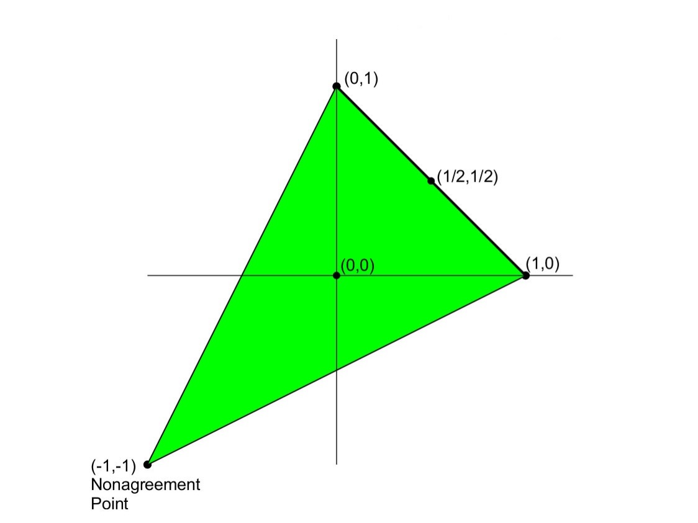
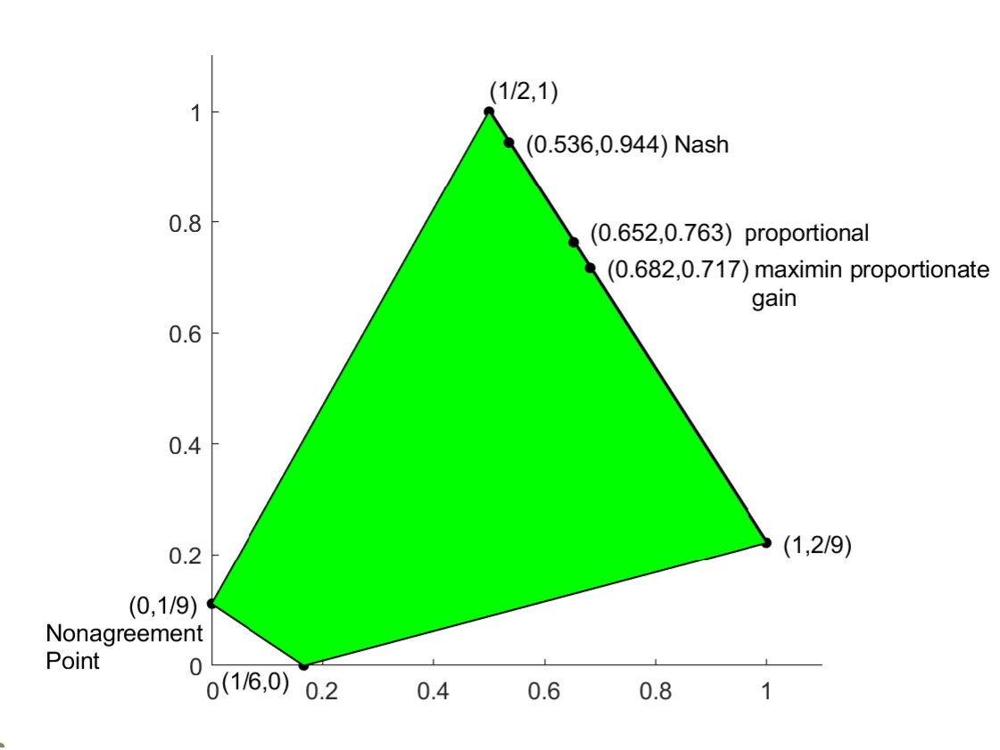
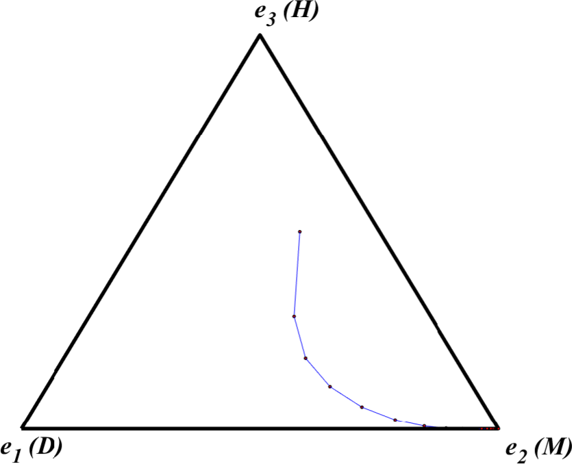
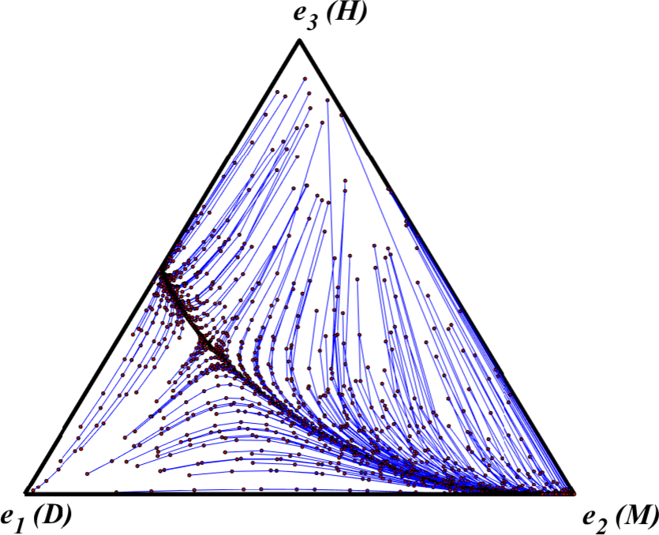
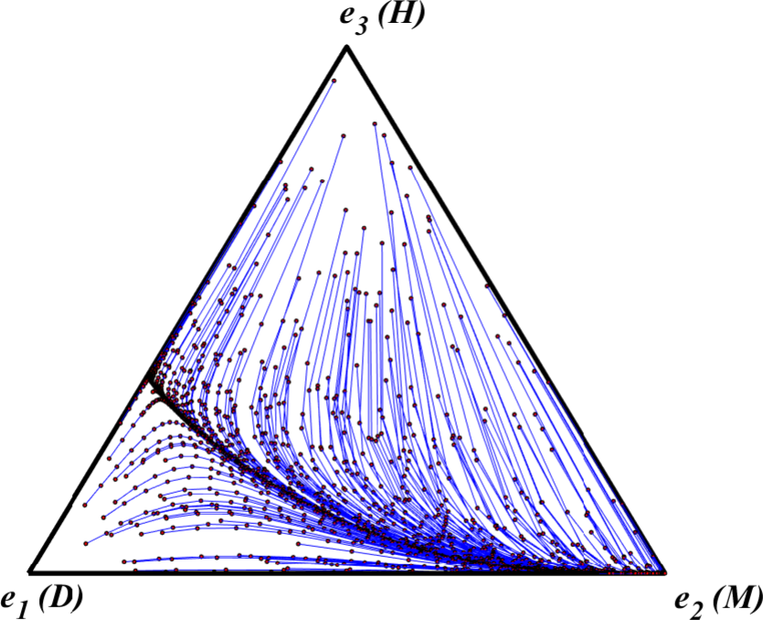
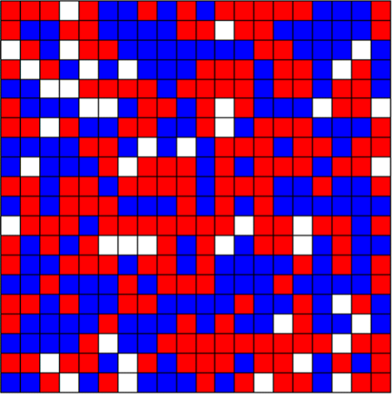
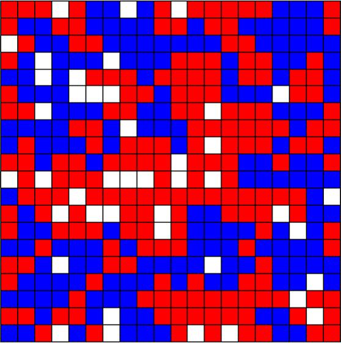

# Game Theory and Ethics
**First published Mon Sep 27, 2021**

*Hankins, Keith, Vanderschraaf, Peter*

Game theory is the study of *interdependent* choice and action. It includes the study of *strategic decision making*, the analysis of how the choices and decisions of a rational agent depend on (or should be influenced by) the choices of other agents, as well as the study of *group dynamics*, the analysis of how the distribution of strategies in a population evolves in various contexts and how these distributions impact the outcomes of individual interactions. It should be distinguished from *decision theory*, the study of individual choice in contexts where the agent is choosing independently of other agents, and from *social choice theory*, the study of collective decision making. Our focus will be on the relevance of game theory to ethics and political philosophy. For a thorough discussion of game theory and its relevance to other areas of philosophy see the entry on *game theory*.

We can distinguish between two ways in which game theory is relevant to ethics. The first is *explanatory*. Game theoretic tools can be used to explain things ranging from (i) the function of morality and (ii) general features of our moral practices, to (iii) the dynamics of morally or politically significant social issues and (iv) the emergence, existence, and stability of particular moral norms. The second way in which game theory is relevant to ethics is *justificatory*. Here game theoretic tools are used to justify things ranging from (i) particular norms or principles, to (ii) large scale social institutions, or (iii) general characteristics of our moral practices. In what follows, we shall consider each of these uses, including the ways in which the former complement the latter.

## 1. History

John von Neumann and Oskar Morgenstern laid the foundations of classical game theory in their treatise *Theory of Games and Economic Behavior* (von Neumann & Morgenstern 1944). Following a series of refinements published in the 1950s by numerous theorists, most notably John Nash, game theory then transformed social science over the course of the next several decades. *Noncooperative game theory*, the more fundamental branch of game theory, explores scenarios where the results of an agent’s actions depend upon what other agents do, and where agents lack external mechanisms for enforcing agreements. More precisely, it provides a model of how agents satisfying certain criteria of rationality interact in *games* characterized by the *actions* or *strategies* available to each of the agents and the *payoffs* they can achieve. Payoffs in such scenarios are a product of the *joint strategy profile* that is defined by the actions independently chosen by the respective agents and the *state* of the world that obtains which reflects aspects of the game that are variable and over which no agent has control. Many scenarios in noncooperative game theory can be fruitfully analyzed using *ordinal preferences* constructed from agents’ rankings of possible outcomes. However, von Neumann and Morgenstern also introduced a theory of *cardinal utility* that provides a more precise account of payoffs by using agents’ preferences over lotteries to reflect how much agents prefer one outcome to another. Utilizing this framework, a more varied set of solution concepts was developed to predict how games would be played, and to determine when individual agents are employing optimal strategies and what the consequences of this are for the set of all agents.

One of the most widely utilized solution concepts is the *Nash equilibrium*. Based upon the *Bayesian rationality* criterion according to which one chooses so as to maximize her expected utility, a Nash equilibrium is a profile of strategies adopted by a set of agents in which the strategy adopted by each agent maximizes her respective payoff given the probabilistically independent strategies adopted by other agents. In other words, at a Nash equilibrium each agent’s strategy is a best response to the others’ strategies, so that none can do better by acting differently given what others are doing. Although Nash was not the first to introduce this equilibrium concept, its broad applicability was recognized only after Nash refined the concept and proved that if a noncooperative game has finitely many pure strategy profiles, then at least one Nash equilibrium always exists. Prior to Nash’s proof it was widely known that many games lack a Nash equilibrium in *pure strategies* where each agent optimally responds to what every other agent does by adopting one of the actions available to her. This initially limited the class of problems to which the concept could be applied, but Nash showed that in such cases there will always be a Nash equilibrium in *mixed strategies* were each agent optimally responds to what other agents do by choosing among a subset of the strategies available to her with some probability. The usefulness of this concept would then be further extended by subsequent refinements, including most notably those made by John Harsanyi and Reinhard Selten (see, e.g., Harsanyi & Selten 1988)[^harsanyi-1988].

In addition to his work refining solution concepts in noncooperative game theory Nash also made important contributions to *cooperative game theory*, an approach to modeling strategic interactions that extends things by allowing for the possibility that agents can be constrained by binding agreements. Among other things, cooperative game theory provides a set of tools for analyzing questions related to coalition building, as well as problems that arise in contexts where agents can rely on external authorities to enforce agreements. Nash’s most important contribution here was to introduce two approaches to analyzing the *bargaining problem*. This problem has been important in contractarian approaches to justifying moral and political orders, a subject we’ll return to in section 4.

A third approach to using game theoretic tools to model social interactions explores how *boundedly rational* agents might achieve certain outcomes as a result of *inductive learning* or the presence of *focal points*. The inductive learning aspect of this approach is known as *evolutionary game theory*, so-called because much of the early work on inductive learning was applied to the question of why various biological traits or behavioral patterns emerge in particular populations. John Maynard Smith’s *Evolution and the Theory of Games* (1982) is an early classic in this tradition, while subsequent work by anthropologists, economists, and political scientists would apply this approach to problems of interest to social and political philosophers, including especially how cooperation can be sustained in large groups. Where much of the foundational work on inductive learning was done by biologists, much of the early work on focal points was done by economists, with Thomas Schelling’s book *The Strategy of Conflict* (1960) being particularly influential. Roughly speaking, focal points are actions or outcomes that are likely to be *salient* (Lewis 1969: 35–36)[^lewis-1969] in the sense that they “stand out” to the agents involved in a game. As Schelling showed, such points are especially important in games where the strategy space is large and/or there are many potential equilibria.

Richard Braithwaite was the first professional philosopher to formally employ game theory in the analysis of a problem of ethics. In his 1954 lecture *Theory of Games as a Tool for the Moral Philosopher* (published 1955), Braithwaite used Nash’s bargaining problem to argue for a particular resolution to the *fair division* problem. He also conjectured that game theory might transform moral philosophy, much as statistics had transformed the social sciences. Although this transformation has not taken place in philosophy in the way that it has for some of the other social sciences, game theory has made significant inroads into moral and political philosophy in the years since Braithwaite’s lecture. David Gauthier’s *Morals by Agreement* (1986) and Ken Binmore’s *Game Theory and the Social Contract* (2 volumes, 1994, 1998) are arguably the first two works to present systematic moral theories built from game-theoretic foundations. Gauthier’s theory is rooted in classical game theory, although he proposes revisions to the orthodox account of Bayesian rationality that classical theory typically assumes. Binmore’s theory, on the other hand, integrates elements of both evolutionary and classical game theory. Other significant uses of game theory in ethics include, but are not limited to:

1. analyses of social conventions as equilibria of games predicated upon common knowledge (Lewis 1969; Vanderschraaf 2019)[^lewis-1969][^vanderschraaf-2019];
2. analyses of social norms (Ullmann-Margalit 1977; Basu 2000; Bicchieri 2006, 2017; Brennan, Eriksson, Goodin & Southwood 2013)[^basu-2000][^bicchieri-2006][^bicchieri-2017][^brennan-2013][^ullmann-margalit-1977];
3. explanations of elements of social contracts in terms of evolutionary game theory (Sugden 1986; Skyrms 1996)[^skyrms-1996][^sugden-1986]; and
4. applications of Nash’s bargaining theory in alternative social contract theories (Gaus 2010; Muldoon 2016; Moehler 2018; Vanderschraaf 2019)[^gaus-2010][^moehler-2018][^muldoon-2016][^vanderschraaf-2019].

Furthermore, although the formal frameworks associated with game theory did not emerge until the mid-twentieth century, it’s now widely recognized that the work of many earlier philosophers are amenable to game theoretic analysis, and that, in many cases, these works clearly anticipated important developments in game theory. For instance, Barry (1965)[^barry-1965], Gauthier (1969)[^gauthier-1969], Hampton (1986)[^hampton-1986], Kavka (1986)[^kavka-1986], and Taylor (1987)[^taylor-1987] provide game-theoretic characterizations of Hobbes’ arguments for the inevitability of war in the State of Nature and for the benefit of establishing a sovereign. Indeed, this branch of Hobbes scholarship continues to develop, as evidenced by recent works by Vanderschraaf (2007 & 2010), Moehler (2009)[^moehler-2009], and Chung (2015)[^chung-2015]. And, while Hobbes’ arguments have attracted the most attention from game-theoretic minded scholars, Grotius (1625)[^grotius-1625], Pufendorf (1673)[^pufendorf-1673], Locke (1689)[^locke-1689], Hume (1740)[^hume-1740], and Rousseau (1755)[^rousseau-1755] also offer what can be interpreted as informal game-theoretic arguments in their discussions of morality, the State of Nature, and the natural law. Of these, Hume’s analysis of convention in the *Treatise* (Hume 1740: 3.2.2–10)[^hume-1740] is particularly noteworthy for its informal account of equilibria and analysis of the role that mutual knowledge plays in allowing agents to arrive at and sustain certain equilibria (Vanderschraaf 1998)[^vanderschraaf-1998]. Moreover, Hume’s discussion of how agents can settle into conventions as the result of gradual trial and error processes, and his suggestion that agents follow some conventions as a result of properties that make certain alternatives conspicuous, anticipates analyses of games based on both inductive learning and focal points (Skyrms 1996; Sugden 1986)[^skyrms-1996][^sugden-1986].

## 2. The Function of Morality

One of the most widespread uses of game theory in ethics has been to postulate various *functions* of morality and to identify some of its important features. An early example of this is Edna Ullmann-Margalit’s *The Emergence of Norms* which argues that morality can be understood as a system of norms that enable agents to coordinate their actions in order to achieve mutually advantageous outcomes in situations where the pursuit of self-interest would normally prevent this (Ullmann-Margalit 1977)[^ullmann-margalit-1977]. The now classic example she uses to illustrate this involves two soldiers who must choose whether to man their mortars in order to stem the advance of the enemy, or to flee. If both stay, it is certain that the enemy’s advance will be halted, but the soldiers will almost surely be injured. If both flee, the enemy will not only be able to take the mountain pass, it will also be able to overtake and capture the fleeing soldiers. And if just one of them stays while the other flees, the brave soldier will die trying to hold off the enemy, while the other will have just enough time to escape to safety.

The scenario Ullmann-Margalit presents is an example of a *prisoner’s dilemma* and is illustrated in Figure 1 below. In this *strategic form game*, each soldier acts without observing the other’s action. Each soldier has the choice between the strategies of *fleeing* (*F*) or *staying* (*S*). The cells in the matrix correspond to the outcome of each possible pair of choices, with the numbers in the cells representing the utilities of the outcomes for the soldiers. Specifically, higher numbers correspond to a more preferred outcome, and the first number represents the payoff of Soldier 1 who chooses between the actions corresponding to the rows, while the second number represents the payoff of Soldier 2 who chooses between the actions corresponding to the columns.

|   |   | Soldier 2 |   |
| --- | --- | --- | --- |
|   |   | *S* | *F* |
| Soldier 1 | *S* | (2,2) | (0,3) |
| *F* | (3,0) | (1,1) |   |

*S* = stay, *F* = flee

\*Figure 1.\* Ullmann-Margalit’s Mortarmen’s Dilemma

In this situation each soldier has a reason to flee. This is because fleeing provides the only chance of escaping unharmed, which is the outcome each most prefers. However, the situation is a dilemma, because if each soldier pursues this course of action, then they will both end up worse off than if neither had. Furthermore, the dilemma is magnified by the fact that for each soldier, *F* is his unique best response to any strategy the other soldier might choose. That is, *F* is each soldier’s *strictly dominant strategy*, and $(F,F)$ is the unique *Nash equilibrium* of this game even though both soldiers would fare better is they could somehow follow $(S,S).$

Ullmann-Margalit pointed out that if the soldiers understood the nature of their predicament they might want to do something to prevent themselves from both fleeing and subsequently being captured. More importantly, she argued that the prisoner’s dilemma that characterizes their predicament arises in innumerable interactions that we find ourselves in every day. At first glance, the obvious solution to these dilemmas might seem to be for the soldiers to simply pledge to remain at their posts. The problem, however, is that in scenarios like this promises are unlikely to be credible, and, even when they are, they are prone to being exploited. Instead, what the soldiers need is a way of literally or figuratively chaining themselves to their mortars. Drawing on this observation, Ullmann-Margalit’s suggestion was that it is moral norms that do this work. More specifically, it’s not the promises to remain at their posts that solves the soldiers’ predicament, so much as their commitment to keeping their promises and to sanctioning those who don’t.

One way of understanding views like this is that the function of morality is to prevent failures of rationality. In the next section we will discuss how game theory has been used to analyze the relationship between morality and prudential rationality. In the more recent literature, though, there is growing consensus that the role norms of social morality play is not necessarily to constrain our instrumental reasoning so that we can overcome failures of prudential rationality, but rather to transform mixed-motive games like the prisoner’s dilemma into coordination problems where mutually advantageous outcomes are more stable and easier to arrive at. A classic example of this approach is Bicchieri (2006)[^bicchieri-2006]. Like Ullmann-Margalit, Bicchieri characterizes norms in terms of our commitment to certain courses of action, and also emphasizes the importance of sanctions in this context. However, Bicchieri draws a distinction between social norms and other types of norm, and argues that what distinguishes the former from the latter is the conditional nature of our commitment to them. In particular, compliance with social norms is grounded in both an individual’s (i) *empirical expectation* that a sufficiently large percentage of the population conforms to the norm, and (ii) her *normative expectation* that a sufficiently large percentage of the population expects others to conform to the norm. Only when both of these expectations are satisfied will an individual comply with a social norm. Because some individuals will be more sensitive to the expectations of others, or more inclined to want to see a particular norm complied with, though, the relevant expectations may vary between individuals. Only when expectations are satisfied for a sufficiently large number of people, then, will the norm succeed in transforming a social dilemma where mutually advantageous outcomes are unstable into a more easily solved coordination problem. And while it might seem strange at first glance to suggest that norms we are only conditionally committed to are the lynchpin of social morality, given the significant role social dilemmas play in preventing us from living well together, this shouldn’t be surprising. For a more thorough discussion of these issues see the entry on *social norms*.

So far our discussion has focused on how game theory has been used to illustrate some ostensible functions of morality and the role social norms play in it. However, game theory has also been utilized to identify particular norms that might be important, as well as to identify important characteristics of norms. And, where the previous analysis relied primarily on the tools of non-cooperative game theory, here it is evolutionary game theory that has been especially illuminating. Particularly influential in this regard was the work of Robert Axelrod and colleagues in the early 1980s on the evolution of cooperation, along with the subsequent work of Robert Boyd, Peter Richerson, and various collaborators (see Axelrod 2006 and Boyd & Richerson 2005 for summaries of the relevant work)[^boyd-2005]. By analyzing the performance of various fixed strategies in repeated social dilemmas they were able to illustrate the important role that conditional strategies and the willingness to sanction bad behavior play in allowing cooperation and other prosocial behaviors to not only emerge, but become optimal from the standpoint of the individual. More specifically, they showed that in environments where individuals have a long-run interest in bringing about mutually advantageous outcomes but a short-term interest in exploiting others for maximum gain, it is essential that (i) individuals not leave themselves vulnerable to repeated exploitation, and (ii) at least some individuals be willing to punish exploitative behavior.

For Axelrod, who studied these issues primarily in the context of repeated prisoner’s dilemmas, the two requirements identified above amount to the same thing. A strategy of unconditional cooperation allows an individual to be repeatedly taken advantage of. To prevent this she should only cooperate with those who are similarly willing to cooperate. More precisely, she should be *nice* (that is she should initially be willing to cooperate with anyone), but she should also be *provocable* (that is she should be prepared to stop cooperating with anyone who takes advantage of her, at least for some amount of time). And, because sustained cooperation is in everybody’s long-run interest, in this context withdrawing future cooperation as a consequence for being taken advantage of is a form of punishment.

As Boyd and Richerson showed, though, in many contexts it’s not essential that everybody be willing to punish bad behavior. What is essential is that *enough* individuals are willing to do this. However, this generates a pair of puzzles. First, in many cases it’s costly to police norms. In order to sustain cooperation, then, groups often need some of their members to be prepared to engage in *altruistic punishment*. That is, some individuals need to be willing to incur individual costs associated with punishment for the benefit of others. Second, the willingness of some individuals to police norms does not just allow the evolution of cooperation and other prosocial norms. Instead it potentially allows any norm to emerge and become stable. So, although we’ve seen how game theory can help explain why a disposition to comply with and police certain norms may be important features of morality, important questions remain concerning whether this is necessarily rational *from the perspective of the individual*. We’ll turn to those questions now. And in section 5 we’ll return to the question of how to distinguish good from bad norms.

## 3. Reconciling Morality and Prudential Rationality

Kavka (1984)[^kavka-1984] dubs the body of attempts to establish that compliance with moral requirements is demanded by, or at least compatible with, prudential rationality the *Reconciliation Project*. At least since Plato philosophers have been grappling with this project, and game theory can help us to distinguish between three approaches they have taken.

The challenge presented by Hobbes’ Foole in *Leviathan* (Hobbes 1651: chapter 15)[^hobbes-1651] nicely characterizes the core issue at stake in the Reconciliation Project. The Foole maintains that under certain circumstances one’s “most reasonable” course of action is to commit an injustice. Specifically, the Foole claims one should sometimes break a promise she has made as part of a covenant if the other parties to the covenant have already kept (or will be compelled to keep) their promises (Hobbes 1651: 15:5)[^hobbes-1651]. This is because performing as a covenant requires can be costly and rationality plausibly requires that such costs should be avoided if one doesn’t stand to gain anything further by incurring them. This challenge is illustrated in the decision tree in Figure 2 below.

\*Figure 2.\* Foole’s Opportunity Game [An extended description of figure 2 is in the supplement.]

Here Claudia and Laura have created a bilateral covenant by exchanging promises. But because Claudia has already performed her part of the covenant, and Laura knows this, Laura stands in the position of the Foole and can either *perform* (*P*) as the covenant requires of her or *aggress* (*A*) by breaking her promise and exploiting Claudia’s earlier performance. As the Foole contends, given this payoff structure, *A* is Laura’s unique Bayesian rational choice.

Importantly, though, the Foole does not just present a challenge to those who endorse her reasoning. This is because in order to avoid being taken advantage of by individuals who reason like the Foole, individuals who might otherwise be inclined to keep their promises can sometimes find themselves with reason to break their promises. We see this in Figure 3 below which depicts the *sequential prisoner’s dilemma* that results from extending the decision tree from Figure 2 to include Claudia’s initial move.

\*Figure 3.\* Sequential Prisoner’s Dilemma [An extended description of figure 3 is in the supplement.]

In this *extensive form game*, which makes explicit the sequential order of the agents’ actions, the *i*ᵗʰ component of each payoff vector is the payoff of the *i*ᵗʰ agent who moves in the game (so Claudia’s payoff is depicted first, since she acts first). Here we can suppose that Claudia does not agree with the Foole that one should break her promise if one’s partner in a covenant has kept her promise, but a dilemma nevertheless arises if Claudia suspects that Laura might agree with the Foole. This is because Claudia might reason that if she performs, then Laura, having already benefited and not standing to gain anything further, will not reciprocate. Consequently, Claudia, *anticipating* (*A*) Laura’s aggression, decides not to perform, leading Laura, now understandably, not to perform either, so that each ultimately does worse than if they had both performed.

To take up the Reconciliation Project is to argue alongside Hobbes that the Foole is not right, and that we need not worry that for some among us rationality might counsel against acting as morality requires. And, as we indicated above, there are three main strategies for doing so.

### 3.1 The Inseparable Goods Strategy

The *inseparable goods strategy* appeals to certain benefits one can gain or preserve only by acting morally, that the Foole apparently fails to consider. Plato’s account of the benefits of justice in the *Gorgias* and *Republic* is one example of this approach. Plato maintains that if one commits an injustice, then one’s soul will consequently be corrupted, and he further maintains that to have a corrupt soul is the worst of all possible misfortunes (*Gorgias* 478c3–478e5, *Republic* 353d3–354a7). Alternatively, one might follow Aquinas in arguing that an injustice like stealing is a mortal sin which will bring about terrible consequences in the afterlife (Aquinas 1271: II.II Q. 66 A. 6). Or Sidgwick, who emphasizes the *internal sanctions* of duty one is likely to suffer on account of their immoral conduct (Sidgwick 1874 [2011: 164])[^sidgwick-1874]. Viewed through the lens of game theory, the inseparable goods approach recommends that those who doubt the prudential rationality of acting morally should reevaluate their preferences in light of the totality of goods at stake. For example, Figure 4 below illustrates how the scenario depicted in Figure 3 would change if Laura becomes persuaded that she would suffer a cost $\gamma > 1$ as a result of breaking her covenant with Claudia, perhaps owing to the guilt she might feel for committing an injustice.

\*Figure 4.\* Sequential Exchange Game with Revised Payoffs, [An extended description of figure 4 is in the supplement.]

This extensive form game depicts Laura’s true payoffs, including the cost of guilt that Sidgwick would call an internal sanction. In this game if Claudia performs as promised, then to follow *P* as justice requires is now Laura’s best response. However, this isn’t because we’ve simply assumed that one couldn’t ever stand to gain by breaking a promise. To see why, note that if Claudia breaks her promise first, then *A* continues to be Laura’s best response. As we saw in our discussion of the evolution of cooperation, morality can’t require us to be suckers. Or, to use Kavka’s helpful terminology, justice may forbid violating a covenant *offensively* by breaking one’s promise unexpectedly, while permitting *defensive* violations of covenants that others can no longer reasonably expect us to honor (Kavka 1986: 139)[^kavka-1986]. Accordingly, if Claudia offensively violates her covenant with Laura by following *A*, then if Laura responds in kind, Laura’s violation should not give rise to the internal sanctions associated with having committed an injustice. Furthermore, note that the presence of internal sanctions can change things even when these aren’t universally felt. For instance, even if Claudia herself would feel negligible guilt for offensively violating their covenant, if Claudia knows that Laura would suffer the internal sanction cost $\gamma > 1$ of offensive violation, then Claudia can expect Laura to perform when she does as well, and in this case she fares best by following *P* at the outset.

### 3.2 The Social Sanctions Strategy

Where the previous approach to the Reconciliation Project relied on sanctions that an agent imposes on herself, the *social sanctions strategy* relies on costs imposed by others. This strategy is exemplified by Hobbes’ response to the Foole and Hume’s discussion of the harvesting dilemma, the latter of which Skyrms (1998)[^skyrms-1998] and Sobel (2009)[^sobel-2009] identify with the game previously depicted in Figure 2. Hobbes maintains that to offensively violate a covenant is to make a choice that tends towards self-destruction, since others will be unwilling to enter into future covenants with one known to do so (Hobbes 1651: 15:5)[^hobbes-1651]. Similarly, Hume argues that we make promises in order to create expectations of our future conduct, and that we keep promises in order to preserve the trust of others that is needed if we hope to enter into and benefit from future covenants (Hume 1740: 3.3.5: 8–12)[^hume-1740]. As our earlier discussion of the evolution of cooperation anticipated, we can use the theory of *repeated games* to shed light on this strategy.

When agents engage in a sequence of interactions, each of which can be characterized as a single noncooperative game, then they can adopt *history-dependent strategies* where their actions in any particular iteration of the game depend upon actions taken in prior iterations. Early on, game theorists recognized that when agents engage in games that are repeated *indefinitely* they can use such strategies to arrive at equilibria that include acts that are never parts of an equilibrium of any of the constituent games that are being repeated. This insight led to a body of results known as the *folk theorem* that establishes conditions under which a profile of history-dependent strategies will be an equilibrium of an indefinitely repeated game. Sugden (1986)[^sugden-1986] and Skyrms (1998)[^skyrms-1998] were among the first to argue that Hobbes’s response to the Foole and Hume’s analysis of promises present proto-folk theorem arguments.

To illustrate how the folk theorem might support the social sanctions strategy, suppose that Laura and Claudia are interested in exchanging with one another and that their situation has the structure of the prisoner’s dilemma depicted in Figure 5 below.

|   |   | Party 2 (Laura) |   |
| --- | --- | --- | --- |
|   |   | *P* | *A* |
| Party 1 (Claudia) | *P* | (2,2) | (0,3) |
| *A* | (3,0) | (1,1) |   |

*P* = perform, *A* = anticipate

\*Figure 5.\* Prisoner’s Dilemma

This prisoner’s dilemma is structurally identical to the Mortarmen’s Dilemma of Figure 1, but here we interpret the parties’ strategies rather differently. (*A*, *A*) is the unique equilibrium of this game that characterizes Laura and Claudia’s particular interaction with one another. However, if we suppose that their interaction is one of an indefinite sequence of similar interactions that they will enter into with each other and other members of their community, then they can follow history-dependent strategies. One such strategy, formulated by Sugden (1986)[^sugden-1986], is the *Humean strategy*:

$h^{*}$: follow *P* if my current partner is innocent, and follow *A* if she is guilty,

where one is guilty if she has offensively violated a covenant by anticipating or aggressing against an innocent partner at some point in the past, otherwise she is innocent. If Claudia expects all of her partners in the indefinitely repeated prisoner’s dilemma to follow $h^{*}$, then $h^{*}$ can be Claudia’s best response. For example, if Claudia and Laura are both innocent when they meet in their prisoner’s dilemma, then if Claudia follows $h^{*}$, she will perform and remain innocent, and so she can expect her partners in future iterations to perform with her since they also follow $h^{*}$. If, on the other hand, Claudia anticipates against Laura, then Claudia becomes guilty and she should expect future partners to anticipate against her in future iterations as $h^{*}$ requires. In other words, if Claudia has sufficiently high expectation that the sequence of iterated prisoner’s dilemmas will continue, then the short-run benefit from offensively violating her covenant with Laura will be swamped by the long-run payoff from future mutually beneficial interactions that $h^{*}$ enables and anticipating precludes. Furthermore, the long-run benefit of keeping her reputation intact means that as long as Claudia’s discount rate isn’t too high, then this is likely to be true even if she misread things with Laura and gets exploited by her. Finally, because their situations are symmetrical, $h^{*}$ can be a best response for Laura and all the other community members, provided that they all expect most other community members to follow $h^{*}$.

The discussion above shows that obeying the requirement of justice to refrain from offensively violating covenants can be rational, even though it may not appear to be rational in any particular instance. Like the inseparable goods strategy, then, the social sanctions strategy implies that the mistake the Foole makes is to misconstrue the games that characterize social interactions where morality makes demands on us. However, where the inseparable goods strategy suggests that the Foole ignores some of the goods intrinsic to moral conduct, the social sanctions strategy warns the Foole that the game they should be concerned with is not any particular interaction, but rather the indefinitely repeated series of social interactions in which they are inevitably engaged. That said, the strategy profile where every agent adopts $h^{*}$ is not the only possible equilibrium of the indefinitely repeated prisoner’s dilemma. In fact, there are an immense number of possible equilibria of such a game, many of which do not involve any individuals employing the $h^{*}$ strategy, and not all of these lead to the cooperative outcome where all (or even most) agents keep their promises.

### 3.3 The Reformed Decision Theory Strategy

In contrast to the inseparable goods and social sanctions strategies that question the Foole’s characterization of the scenarios that give rise to a tension between morality and rationality, the *reformed decision theory strategy* recommends that agents like the Foole revisit their understanding of rational choice. In particular it proposes an account of rational choice that is more subtle than the orthodox Bayesian account according to which rational choice is a fairly straightforward matter of maximizing expected utility. David Gauthier (1986)[^gauthier-1986] and Edward McClennen (1990)[^mcclennen-1990] are the most prominent exemplars of this approach, with Gauthier proposing a principle of *constrained maximization* and McClennen a principle of *resolute choice*. For ease of exposition we focus on Gauthier.

In *Morals by Agreement* Gauthier distinguishes between *straightforward maximizers* and *constrained maximizers*. A straightforward maximizer is an orthodox Bayesian who, at any given moment in time, chooses so as to maximize her expected utility given her beliefs regarding the relevant states of affairs and the choices her counterparts might make. A constrained maximizer, on the other hand, departs from orthodox Bayesian reasoning by doing her part to bring about a fair and optimal outcome if (i) she expects her counterparts to do their part in bringing about this outcome, and (ii) she benefits as a result of all following it. A constrained maximizer thus constrains her pursuit of her interests some of the time, but reverts to straightforward maximization if she expects her counterparts to act as straightforward maximizers, or if she does not stand to benefit from constraining her behavior relative to the scenario where no one constrains their behavior.

For example, if Claudia is a constrained maximizer, then in the prisoner’s dilemma depicted in Figure 5 Claudia will perform if she believes Laura is also a constrained maximizer, but will anticipate if she believes Laura is a straightforward maximizer. One way to understand how constrained maximization modifies an agent’s behavior is to regard adopting one’s principle of rationality as a meta-strategy for engaging in prisoner’s dilemma-like games. If Claudia and Laura each adopt either the straightforward maximizer (*SM*) or the constrained maximizer (*CM*) meta-strategy, then the prisoner’s dilemma depicted in Figure 5 is transformed into the game depicted in Figure 6 below.

|   |   | Party 2 (Laura) |   |
| --- | --- | --- | --- |
|   |   | *CM* | *SM* |
| Party 1 (Claudia) | *CM* | (2,2) | (1,1) |
| *SM* | (1,1) | (1,1) |   |

*CM*= constrained maximization, *SM* = straightforward maximization

\*Figure 6.\* Meta-Strategy Game for Prisoner’s Dilemma

Here, whatever strategy the other party follows, one always does at least as well and sometimes better by following *CM* as opposed to *SM*. That is, *CM* is a *weakly dominant* strategy for both Claudia and Laura, and (*CM*, *CM*) is the unique Pareto-optimal Nash equilibrium. Gauthier argues that there are a wide variety of social dilemmas where constrained maximizers fare at least as well as straightforward maximizers, and can often fare strictly better, so long as agents’ dispositions towards constrained or straightforward maximization are sufficiently clear to each other. Accordingly, Gauthier concludes that agents should adopt the constrained maximization principle, and that, when they do, compliance with the requirements of morality coincides with rational choice.

### 3.4 Limitations of the Reconciliation Project

As we’ve seen, game theory has been incorporated into each of the main approaches to the Reconciliation Project. However, game-theoretic analysis can also show why each of these strategies may fall short of fully reconciling morality with prudential rationality. For instance, for the inseparable goods strategy to be effective, agents like the Foole must be persuaded that the goods intrinsic to just conduct are either of such great value, or that the costs associated with injustice are so substantial, that one would be foolish to risk acting unjustly. But it’s far from obvious that this is always (or even usually) true.

Similarly, although one can present social sanctions arguments for acting morally to agents like the Foole, these arguments depend on members of society being willing to sanction bad behavior and capable of doing so effectively, and this is by no means guaranteed. In fact this is a difficulty that the functional analysis of norms clearly anticipates. For example, in addition to highlighting the importance of conditional strategies and the willingness to sanction bad behavior Axelrod (1984)[^axelrod-1984] also emphasized the importance of employing strategies that are easy for others to interpret. While Bicchieri (2006)[^bicchieri-2006] emphasizes the problems that are prone to arise in circumstances where it’s not clear which norm applies, and Boyd & Richerson (2005) have drawn attention to the costs associated with policing norms. Accordingly, the Foole can object that, even if all the members of her community were committed to following something like the Humean strategy to the best of their abilities, it’s not obvious that they would be able to reliably follow it. In fact, the Humean strategy rests upon some rather demanding epistemic assumptions, including especially that community members can reliably distinguish between guilty and innocent partners, something that may become increasingly unlikely as the size of a community increases.

Furthermore, as the folk theorem implies, although it’s certainly possible that all of the members of a community could follow a strategy like $h^{*}$ in a situation like the Foole finds herself in, there are likely to be many other equilibria as well. Moreover, some of these equilibria may be hard to distinguish from one another, especially if agents like the Foole are sufficiently rare, and in some of these equilibria it may be in the Foole’s interest to offensively violate covenants. The effectiveness of the social sanctions strategy, then, is plainly dependent upon the ability of community members to build and maintain reliable reputations, and to rely on this information in their interactions with one another.

Finally, the revisionary principles at the heart of the reformed decision theory strategy proposed by Gauthier and McClennen rest upon an agent’s ability to adopt a disposition to conditionally follow certain pro-social strategies regardless of whether doing so is in an agent’s best interest at the moment of action. Critics of this strategy, however, have questioned what it means to bind oneself to her past commitments in this way, and they have also identified numerous cases where doing so would be in neither an agent’s short nor long-run interest. Furthermore, while Gauthier’s analysis of the benefits of constrained maximization is analogous in some ways to Bicchieri’s analysis of how social norms can transform mixed-motive social dilemmas into coordination games, the latter depend on sanctions (or expectations of sanctions) in a way that the former do not. As a result, even if agents could credibly adopt dispositions to constrain their future behavior, for a rule like constrained maximization to do its practical work, agents must be able to *recognize* who has and has not adopted the dispositions in question. However, some critics doubt that we can reliably recognize who adopts such dispositions. Of course, proponents of the reformed decision theory strategy are well aware of these criticisms and have developed careful responses in their works. So far, though, its critics have not been assuaged and the reformed decision theory strategy has been the least influential of the approaches described here.

## 4. Game Theory and Contractarianism

Arguably the most systematic use of game theory in moral and political philosophy has been in contractarian approaches to justifying moral or political orders. Philosophers have typically characterized the *social contract* as a set of rules for regulating the interactions of members of a community. By providing a formal model of interactive decision-making, game theory is clearly relevant to the analysis of such contracts. What has been particularly distinctive of game theoretic analysis of the social contract, though, is an emphasis on bargaining problems. As we will discuss below, the Nash bargaining problem provides a simple, yet flexible and conceptually powerful framework for identifying which of the rules that might comprise a contract can be said to be mutually beneficial (or acceptable) to each member of a community. In the main text of the two subsections that follow we try to present a relatively non-technical overview of this framework. Where formal characterizations of concepts are important, or where discussion of technical issues is likely to be illuminating for some readers, we’ve included such discussion in notes that appear at the end of the respective subsections. For a more thorough analysis of contractarian approaches to justifying moral and political orders, including further discussion of some of these technical issues, see the entry on contemporary approaches to the social contract.

### 4.1 The Bargaining Problem

As Gauthier (1986)[^gauthier-1986] argues, the bargaining problem provides a framework for a *contractarian* analysis of the social contract by modeling how parties with partially conflicting interests might arrive at a mutually acceptable set of rules they can each follow to their own advantage. This contrasts with the *contractualist* approach of Harsanyi (1953, 1955, 1977)[^harsanyi-1953][^harsanyi-1955][^harsanyi-1977], Rawls (1958, 1971)[^rawls-1958][^rawls-1971], and Scanlon (1982, 1998)[^scanlon-1982][^scanlon-1998] that characterizes the social contract as an object of rational choice made under constraints designed to ensure that the choice is appropriately unbiased, and which, in principle, could be made by a single agent. Braithwaite (1955)[^braithwaite-1955] was the first to use the Nash bargaining problem to derive a social contract, in his case a rule for fairly dividing a resource between two claimants. Later, Hampton (1986)[^hampton-1986] and Kavka (1986)[^kavka-1986] argued that the Hobbesian device of creating a *commonwealth by design* incorporates elements of a Nash bargaining problem. Gauthier (1986)[^gauthier-1986] and Binmore (1994, 1998)[^binmore-1994][^binmore-1998] used the Nash bargaining problem for developing standalone theories of distributive justice. More recently, Muldoon (2016)[^muldoon-2016] and Moehler (2018)[^moehler-2018] have used the Nash bargaining problem to model the problem of how members of deeply pluralistic societies can find rules for living together peacefully.

Nash characterized the bargaining problem as a combination of (i) a *feasible set* of payoffs that a group of agents might achieve each of which is associated with a respective set of actions the agents must jointly agree to follow, and (ii) a *nonagreement point* that specifies what each agent receives in case they fail to follow any of these joint action sets. An example of Nash’s bargaining problem is the 2-agent *Wine Problem* depicted in Figure 7 below.

|   |   | Agent 2 (Laura) |   |
| --- | --- | --- | --- |
|   |   | *D* | *H* |
| Agent 1 (Claudia) | *D* | (0,0) | (0,1) |
| *H* | (1,0) | (−1,−1) |   |

*D*= dove (claim none), *H* = hawk (claim all)

\*Figure 7.\* Wine Problem

In this game Claudia and Laura each have two pure strategies: *hawk* (*H*), which is to claim an available bottle of wine, or *dove* (*D*), which is to leave the bottle for the other. The game has two Nash equilibria in pure strategies: (*H*,*D*), the outcome most favorable to Claudia, and (*D*,*H*), the outcome most favorable to Laura. If both try to claim the bottle, at the resulting (*H*,*H*) outcome they fight and neither gets any wine, the worst outcome for them both. The Wine Problem is an example of a *conflictual coordination game* (Vanderschraaf & Richards 1997)[^vanderschraaf-1997], so-called because it has multiple equilibria, any of which the agents achieve only by coordinating their actions, and where coordination is complicated by the conflicting preferences of the agents over the different available equilibria.[^note-1]

One might think that a natural solution to the Wine Problem is for Claudia and Laura to each claim half of the bottle. Figure 8 below thus illustrates an extended version of the Wine Problem in which each agent now has a third pure strategy, *M*, in which she claims half the bottle.

|   |   | Agent 2 (Laura) |   |   |
| --- | --- | --- | --- | --- |
|   |   | *D* | *M* | *H* |
| Agent 1 (Claudia) | *D* | $(0,0)$ | $(0,\frac{1}{2})$ | $(0,1)$ |
| *M* | $(\frac{1}{2},0)$ | $(\frac{1}{2},\frac{1}{2})$ | $({-1},{-1})$ |   |
| *H* | $(1,0)$ | $({-1},{-1})$ | $({-1},{-1})$ |   |

*D* = dove (claim none), *M* = moderate (claim half), *H* = hawk (claim all)

\*Figure 8.\* Extended Wine Problem

In this game, Laura and Claudia each receives the amount of wine she claims if their claims are *compatible*, that is, if there is enough wine to satisfy each claim. However, if their claims are *incompatible*, they fight. There is now a new Nash equilibrium in pure strategies, $(M,M)$, where Laura and Claudia each receive half the bottle. It’s not a foregone conclusion that they will settle into $(M,M)$, though, for $(H,D)$ and $(D,H)$ remain equilibria, and the former continues to be most preferred by Claudia, and the latter most preferred by Laura.

Furthermore, if each can claim half the bottle why should they not be able to claim other shares? Figure 9 below summarizes the bargaining problem that arises when Claudia can claim any share $x_1$ of the wine and Laura can similarly claim any share $x_2$.

\*Figure 9.\* Wine Bargaining Problem [An extended description of figure 9 is in the supplement.]

Here Claudia’s payoffs are depicted on the horizontal axis, and Laura’s payoffs are depicted in the vertical axis. The green shaded region represents the feasible set of payoff vectors $\Lambda$ where Laura and Claudia make compatible claims, that is where $x_1 +x_2 \le 1.$ While the payoff vector $\bu_0 = ({-1},{-1})$ corresponding to the (*H*,*H*) outcome represents their nonagreement point.

In the social contract context we can think of the nonagreement point $\bu_0$ as representing the State of Nature, and the feasible set $\Lambda$ as representative of the various contracts parties might agree to. Each point $\bu \in \Lambda$ that is weakly Pareto superior to $\bu_0$ thus characterizes a social contract with a *cooperative surplus* (Gauthier 1986: 141)[^gauthier-1986].[^note-2] And, when a set of claims constitutes an equilibrium solution to the associated bargaining problem, this allows us to say that the parties to a contract all have good reason to comply with its terms. As we will see below, though, there are various approaches to identifying the most attractive equilibrium from a normative point of view. An advantage of using the Nash bargaining approach to modeling the social contract, then, is that this formalization helps to clarify the differences between these approaches.[^note-3]

The Basis Game that Braithwaite analyzed in his Cambridge lecture is ideal for illustrating the axiomatic approach to the bargaining problem. In this game two agents, Luke and Matthew, vie for shares of a limited resource. Like the Wine Problem, the Braithwaite Basis Game is a conflictual coordination game in which each agent has two pure strategies available, *H* in which the agent claims all of the good at stake, and *D* in which he claims none. Here (*H*,*D*) is the Nash equilibrium most favorable to Luke and (*D*,*H*) is the equilibrium most favorable to Matthew. As Figure 10 illustrates, though, this game has asymmetries not present in the Wine Problem.[^note-4]

|   |   | Agent 2 (Matthew) |   |
| --- | --- | --- | --- |
|   |   | *D* | *H* |
| Agent 1 (Luke) | *D* | $(\frac{1}{6},0)$ | $(\frac{1}{2},1)$ |
| *H* | $(1,\frac{2}{9})$ | $(0,\frac{1}{9})$ |   |

*D*= dove (claim none), *H* = hawk (claim all)

\*Figure 10.\* Braithwaite Basis Game

Again, as before, this game can be extended to accommodate the case where agents can claim shares of the good. And if the nonagreement point again results in the payoffs generated by the conflict outcome (*H*, *H*), as Braithwaite supposed, then Matthew and Luke are in a Nash bargaining problem with feasible set $\Lambda$ and nonagreement point $\bu_0 = \left(0,\frac{1}{9}\right)$. Figure 11 depicts the feasible set $\Lambda$ for such a game (again shaded in green). This time, though, the figure also identifies the payoff vectors associated with three solutions concepts that have been especially influential in in game theoretic analyses of the social contract (namely the *Nash*, *proportional*, and *maximin proportionate gain* solutions).

\*Figure 11.\* Braithwaite Bargaining Problem [An extended description of figure 11 is in the supplement.]

Here Luke’s payoffs are depicted on the horizontal axis, while Matthew’s are on the vertical axis. As we can see, although the solutions differ, each leaves Matthew with a higher payoff than Luke receives. This is because each solution allocates Matthew a larger share of the good,[^note-5] and is due to the asymmetry in the nonagreement point that characterizes the Braithwaite Problem. Specifically, (*H*, *H*) is Luke’s worst possible outcome, but not Matthew’s, so Matthew has a *threat advantage*. In less technical terms, because failing to agree is less bad for Matthew he can use the threat of nonagreement to press for an agreement that is more favorable to him. And this asymmetry distinguishes the Braithwaite Bargaining Problem from the Wine Division Problem depicted in Figure 9 where the three solutions coincide with the point $\bu^{*} = \left(\frac{1}{2}, \frac{1}{2}\right)$ in which the agents involved each receive equal shares.

In his own analysis Braithwaite favored the *proportional* solution to the bargaining problem that selects the point on the Pareto frontier where the payoffs for each agent relative to the nonagreement point are proportionate to some independently specified measure of fair gains.[^note-6] Gauthier (1986, 2013)[^gauthier-1986][^gauthier-2013], on the other hand, defends the *maximin proportionate gain* solution that also selects a point on the Pareto frontier by comparing the payoffs for agents relative to the nonagreement point, but which, in addition, takes into account how agents fare relative to their ideal payoffs.[^note-7] In the game theory literature, however, the *Nash* solution has remained the most widely utilized solution concept, and this has arguably been true among philosophers offering game-theoretic treatments of the social contract as well (see, e.g., Binmore 1994, 1998; Muldoon 2016)[^binmore-1994][^binmore-1998][^muldoon-2016]. Roughly speaking, this solution picks out the point that maximizes the cooperative surplus, although some philosophers have offered refinements on the concept that guarantee payoffs also meet a minimum threshold (Moehler 2018)[^moehler-2018].[^note-8]

At the heart of debates utilizing game-theoretic treatments of the social contract is the fact that each of the solution concepts mentioned above, and indeed any solution to the bargaining problem, might satisfy several *but not all* of the intuitively plausible constraints we might want a fair bargaining procedure to realize. For instance, Nash’s solution is the only solution concept that satisfies all four of:

1. *Pareto optimality*,
2. *symmetry*,
3. *scale (or utility) invariance*, and
4. *reapplication stability*.[^note-9]

But it fails to satisfy both:

1. *individual monotonicity*, and
2. *population monotonicity*.

In this context, an outcome (or its associated payoff vector) is Pareto optimal if there are no other outcomes that are better for some agents without being worse for others.[^note-10] A solution is symmetric if the payoffs that agents receive from identical shares of a good are equivalent when those agents have equivalent utility functions, nonagreement points, and strategies.[^note-11] It is scale invariant if the solution does not depend on how the payoffs are represented.[^note-12] And it is reapplication stable if the application of a solution concept to a bargaining problem does not generate downstream bargaining problems among subsets of agents over the relative shares of a good they can claim.[^note-13] While a solution is individually monotone if an agent is guaranteed to do at least as well when a bargaining problem is modified by expanding the feasible set to include new outcomes that are all more favorable to the agent. And it is population monotone if, for a given set of claimants, none lose while others gain merely because some members of the set depart and/or new claimants arrive.

The maximin proportionate gain solution, on the other hand, is both individually and population monotone, but is not reapplication stable. While the proportional solution is individually monotone, population monotone, and reapplication stable, but not scale invariant. Ultimately, then, much like Arrow’s Impossibility Theorem and related results have cast doubt on whether there exist uniquely best procedures for aggregating preferences or making collective decisions, there is not a single solution concept for bargaining problems that is clearly best. That said, the application of bargaining theory to philosophical analyses of the social contract has been useful insofar as it has provided a framework for illustrating what features of a social contract a theorist regards as valuable, and for identifying what the tradeoffs associated with these features might be. So, for example, one might conjecture that the reapplication stability properties associated with the Nash and proportional solution concepts would allow a social contract based upon one of them to be better suited to forestalling conflict in the face of social change. This is because such a contract would be renegotiation-proof with respect to changes in the benefits of cooperation that might arise in the future, e.g., as a result of an influx of new members in society or the discovery of new technologies for resource development. But this stability would have to come at the price of either using a privileged representation of agent’s payoffs, or accepting that the parties to the contract will not necessarily be made better off if they are given more to bargain over. And while this tradeoff may ultimately be justified, the important point is that any tradeoff the contract theorist makes commits her to a certain set of normative judgments, and game theory can help clarify what these are. For instance, many game theoretically minded philosophers have contended that any account that privileges certain representations of agents’ utilities cannot avoid incorporating certain moral judgments into these utilities (Sen 1980; Moehler 2018)[^moehler-2018][^sen-1980].

### 4.2 Evolutionary Approaches to the Social Contract

Having focused on the use of bargaining theory in philosophical analyses of the social contract, we will now briefly turn our attention to the relevance of evolutionary game theory to this task. Recall that evolutionary game theory is the formal approach to modeling how the distribution of traits in a population will evolve over time when those traits determine how the agents who possess them will interact. Gaus (2010)[^gaus-2010] and Muldoon (2016)[^muldoon-2016] are two recent works that draw on informal evolutionary models in order to show how and why the terms of a social contract might evolve over time to accommodate a diverse polity. While, taking a more formal approach, Alexander (2007)[^alexander-2007] explores how the equilibria that characterize prosocial norms in social networks evolve over time. It is the works of Brian Skyrms (1996 [2014], 2004), though, that have been the most influential in bringing evolutionary game theory to bear on the social contract.

One of Skyrms’ signature uses of evolutionary game theory is to explain the origins of various “fair” solutions to the Nash bargaining problem (1996 [2014]: Chapter 1). As we have seen above, different axiomatic solution concepts can recommend different solutions to the same bargaining problem. However, even if one endorses the arguments in favor of a particular solution concept, this doesn’t yet show that the actual claimants engaged in a bargaining problem would tend to follow this solution. This is because a typical bargaining problem will often have a large number of equilibria each of which is likely to be more favorable to some and less favorable to others. Accordingly, one might doubt that actual claimants could settle into any equilibrium, let alone an equilibrium that characterizes an outcome we would regard as fair.

To gain traction on this problem Skyrms considers a simple but nontrivial 3-piece *Nash Demand Game* that is structurally similar to the Extended Wine Problem of Figure 8. In this now familiar game a pair of agents vie for shares of a good. Each issues a claim and receives a payoff equivalent to her claim when the pair’s claims are compatible, and each receives nothing when their claims are incompatible. In Skyrms’ version a claimant can issue a minimal claim, *D*, to 1/3 of the good; a maximal claim, *H*, to 2/3 of the good; or a “middle” claim, *M*, to 1/2 of it. [^note-14] As Skyrms notes (1996 [2014: 4]), in games of this sort we tend to think there is one outcome claimants ought to follow, namely, the fair outcome where each claims half of the good at stake. This corresponds to each side following *M*, and, as we saw earlier, (*M*,*M*) is an equilibrium of the game. But the question remains, why would claimants opt for the fair outcome when there are other equilibria that might be preferable?

One answer to this question is that when agents repeatedly have to come to agreements with one another over the division of a good, but can only obtain a share of the good when they agree on a feasible division, agents who restrain themselves from pressing maximal claims are more likely to encounter other agents with whom feasible bargains are possible. In other words, as we saw in a slightly different context in section 2, in the long run the benefits from successfully coming to terms with like-minded agents outweigh the foregone gains that can occasionally be gotten by pressing for less equitable divisions. Skyrms tests this rationale by applying a dynamic model of evolution, the *replicator dynamic*, to his Nash Demand Game. Figure 12 illustrates a *simplex* that one can use to summarize this dynamic.

\*Figure 12.\* Strategy Simplex for Skyrms’s Nash Demand Game [An extended description of figure 12 is in the supplement.]

Each point in the simplex corresponds to a particular mix of types of agents in the population that can represented by an ordered triplet $(z_1,z_2,z_3),$ where $z_1$ is the fraction of the population that follows *D*, $z_2$ the fraction that follow *M*, and $z_3$ the fraction that follow *H*. Points closer to a vertex of the simplex thus represent mixes where more agents follow the strategy associated with that vertex. The replicator dynamic then summarizes the evolution of population states where the fractions of represented strategies change over time in proportion to their *average reproductive fitness*. Here a strategy’s average reproductive fitness corresponds to its average payoff relative to the average payoff of other strategies represented in the population at a given time.[^note-15] To illustrate, in Figure 12, the point $z_0 = \left(\frac{1}{6}, \frac{1}{3}, \frac{1}{2}\right)$ represents an initial state where $\frac{1}{6}$ of the population follow *D*, $\frac{1}{3}$ follow *M*, and $\frac{1}{2}$ follow *H*. Given this starting point, the replicator dynamic then traces an *orbit* starting at $z_0$ that converges to $\be_2 = (0,1,0),$ the vertex point where the entire population follows the pure strategy *M*.

By applying the replicator dynamic across a wide swath of initial states in the Figure 12 simplex, Skyrms then showed that the fair outcome, $\be_2,$ where everyone presses equal claims, is the most likely to evolve. We replicate Skyrms’ experiment here. Figure 13 depicts 200 orbits of the replicator dynamic starting from initial population states chosen at random from the Figure 12 simplex.

\*Figure 13.\* Replicator Dynamic Orbits of Skyrms’s Nash Demand Game [An extended description of figure 13 is in the supplement.]

As this figure illustrates most initial distributions of claimant types eventually converge to an equilibrium where all agents follow *M* and press claims of 1/2. To use a technical term, we can say that $\be_2$ has the largest *basin of attraction*.[^note-16] To see why this is the case, we can consider how different pure strategy types fare when agents of a population meet at random and engage in the Nash Demand Game. Agents who press claims of *D* always arrive at feasible bargains, but in particular interactions they never do as well as partners who press claims of *M* or *H*. On the other hand, agents who press claims of *H* only arrive at feasible bargains when matched with agents who press minimal claims of *D* and can thus be exploited. Meanwhile, agents who press claims of *M* arrive at feasible bargains when matched against either *D*-following partners or other *M*-following partners. On average, then, *M*-followers do better than both *D*-followers and *H*-followers unless there are so many *H*-followers and so few *M*-followers in the population that in an individual encounter an *M*-follower is more likely to meet an *H*-follower than either another *M*-follower or a *D*-follower.[^note-17] Indeed, *M* is an *evolutionarily stable strategy* (Maynard Smith 1982)[^maynard-1982] of this game. What this means is that, if $\be_2$ is the current population state so that *M* is the sole *incumbent strategy*, then $\be_2$ can repel any limited invasion of some different *mutant* strategy.[^note-18]

In some respects Skyrms’ observation shows how Gauthier’s argument for constrained maximization might have been strengthened by drawing on resources from outside the confines of rational choice theory. Indeed, Skyrms shows that the basin of attraction for the equitable equilibrium where all agents press claims of 1/2 expands when agents become more likely to interact with agents of their own strategy type, as they might if they are somewhat able to recognize agents like themselves. For example, Figure 14 depicts a series of orbits of a *correlated replicator dynamic* Skyrms uses to model such situations. In this dynamic, an agent meets a counterpart of the same pure strategy type with probability .2 greater than the random chance probability of the ordinary replicator dynamic.[^note-19] And, as we can see, even with this relatively minor increase in the likelihood of same type interactions, *all* of the modified replicator dynamic orbits now converge to $\be_2$ .[^note-20]

\*Figure 14.\* Correlated Replicator Dynamic Orbits of Skyrms’s Nash Demand Game [An extended description of figure 14 is in the supplement.]

Alternatively, Skyrms showed how evolved attachments to particular places or things, and more importantly the ability to *signal* these attachments can help solve conflictual coordination problems like the Nash Demand Game. In particular, Skyrms (1996 [2014]: chap. 4) showed that by developing a primitive notion of property rights, agents involved in such games could correlate their behavior by playing Hawk at home and Dove away from home, and thereby avoid the sorts of interactions that lead to conflict or to both agents abandoning a resource. At the end of the day, though, the evolutionary game theory utilized by Skyrms can only lend so much support to a view like Gauthier’s. For one thing, the game Skyrms models assumes that agents have fixed types and cannot revise their claims in light of the claims made by others. Furthermore, it is one thing to offer an explanation of why a trait like fair division or constrained maximization would evolve, or to show why this might be beneficial to both individual agents and groups, but to show either of these is not necessarily to show that constraining one’s behavior is the rational course of action.

## 5. Analyzing Morally Significant Social Issues

If contractarian approaches to justifying moral and political orders have been the area of ethics where the use of game theory has been most systematic, the area where its deployment is likely to be most impactful going forward is in the analysis of morally significant social issues. Examples range from global issues, like how to combat climate change; to issues that arise within states or communities, like tax policy or how to manage common pool resources; to issues that primarily concern individuals and groups, like how to elicit optimal levels of effort from individuals engaged in cooperative endeavors. Below we will discuss three examples in more detail.

### 5.1 Nuclear Conflict

Many of the early advances in game theory were made during World War II and the early stages of the Cold War by individuals working with organizations interested in advancing our understanding of nuclear conflict. John von Neumann, for instance, whose early contributions to game theory we described in section 1, did work for the Manhattan Project that was instrumental in the development of nuclear weapons, and he is often credited with having developed the strategy of mutually assured destruction (MAD) that played a prominent role in Cold War nuclear policy (Macrae 1992)[^macrae-1992]. MAD is a policy governing the use of nuclear weapons whereby nuclear powers avoid nuclear conflict by credibly threatening to retaliate against a nuclear first strike with a nuclear strike that would be destructive enough to negate any strategic or tactical advantage of a first strike.

Unsurprisingly, ethical issues associated with the use of nuclear weapons would eventually receive extensive attention in the philosophical literature. Much of this work focused on how nuclear ethics raises problems for utilitarian or deontological approaches to ethics, especially the question of whether it’s acceptable to threaten great evil so that it might be avoided. And, while most of the philosophers working in this area made little use of game theory, many of the questions they addressed were framed by the important work of Gregory Kavka, Russell Hardin, and a few others who made extensive use of both formal and informal game theoretic tools (see, e.g., Kavka 1987; R. Hardin 1983; Gauthier 1984; MacLean 1984)[^gauthier-1984][^hardin-1983][^kavka-1987][^maclean-1984]. In particular, this work helped identify a number of paradoxes associated with MAD and other theories of deterrence, clarified the case both for and against unilateral disarmament, and would have implications for more general debates about rationality (especially debates concerning the nature of intentions and whether modularity is a demand of rationality).

The analysis of nuclear conflict was also responsible for many of the early developments in cooperative game theory. Among the earliest examples of this kind of work was Lloyd Shapley and Martin Shubik’s effort to predict the behavior of members of the United Nations Security Council (Shapley & Shubik 1954)[^shapley-1954]. The Shapley-Shubik power index quantifies the likelihood that any given member of a voting body casts a deciding vote. This provides a measure of the influence of each member and helps us analyze how likely various coalitions are to form, how stable those coalitions will be, and how the gains secured by a winning coalition will be distributed.

Perhaps the most influential application of game theory to problems associated with nuclear conflict is found in Schelling’s seminal works *The Strategy of Conflict* (1960)and *Arms and Influence* (1966) which together reshaped the game-theoretic analysis of conflict. One of Schelling’s most important insights, which the prospect of nuclear war makes especially clear, was the observation that only in rare circumstances are the interests of parties engaged in conflict completely opposed. This led Schelling to emphasize the ways conflict creates and shapes opportunities for bargaining and cooperation. These were issues that had increasingly come to be studied using the tools of cooperative game theory, but Schelling would revitalize non-cooperative game theory by showing how such issues could be more productively analyzed through non-cooperative approaches. Arms races to develop more effective nuclear weapons, and the extensive efforts that governments make to guard nuclear secrets, are also emblematic of the importance of information and timing to the analysis of conflict, and the emphasis Schelling placed on these issues would lead game theorists to re-prioritize the extensive form analysis of games that is better able to capture the influence of incomplete information and the dynamic nature of conflict. Finally, tying together many of the issues sketched above is Schelling’s early work on commitment and threats. As Schelling showed, by pre-committing to a costly course of action (or by limiting one’s future options) an agent can influence the actions of other agents with whom she is engaged in conflict. In fact, Schelling showed that in some cases irrationality can even be an advantage, an argument that Kavka (1987)[^kavka-1987] would develop further in the context of deterrence.

### 5.2 Bad Norms

If nuclear conflict was the first morally significant social issue to be extensively analyzed using game theoretic tools, in the recent philosophical literature it has been the analysis of harmful, destructive, and wasteful norms where game theoretic tools have been most prevalent. Specifically game theoretic tools have been used to explain: 1) what bad norms are, 2) when and why they emerge, and 3) whether they can be changed, and, if so, how.

Of these topics, the question of what distinguishes good norms from bad norms has received by far the least attention (a notable exception is Thrasher 2018)[^thrasher-2018][^thrasher-2018-2]. One explanation for this is that it is often taken to be obvious that certain norms are bad. For instance, honor killings have received extensive attention in the norms literature, and, perhaps unsurprisingly, such killings are typically assumed to provide a clear instance of a harm that violates the rights of at least some of those subjected to the practice. Instead of focusing on what makes honor norms bad, then, the literature has tended to focus on why such norms emerge and how they might be changed.

To answer these questions game theoretic tools have been used to characterize the underlying social dynamics that give rise to the practice in question, and to then illustrate how the practice is responsive to these dynamics. A dynamic common to several of these practices is the role norms play in signaling a group’s commitment to certain values or courses of action. For example, in the case of honor killing, when these killings target members of an outgroup, they might deter future slights at the hands of the outgroup by signaling the ingroup’s commitment to seeking revenge for (real or perceived) slights (Boehm 1986; Nisbett & Cohen 1996; Skarbek 2014; Thrasher & Handfield 2018)[^boehm-1986][^nisbett-1996][^skarbek-2014][^thrasher-2018][^thrasher-2018-2]. This can be especially important in the absence of strong institutions that maintain public order. However, one thing that makes honor norms bad, is that a group’s commitment to seeking revenge for slights can risk setting off (or perpetuating) a cycle of violence.

Honor killings can also be directed towards members of one’s own group who violate certain norms. For instance, there are many places where it is not uncommon for members of a family to kill children (especially girls) who break norms of sexual morality or who otherwise fail to adhere to traditional gender norms. In these cases the desire of a group’s members to adhere to such norms is typically explained by the belief that doing so makes members of the group more attractive marriage partners, and the role honor killings play is to signal that the family (or group to which the family belongs) is committed to the norm(s) in question (United Nations Population Fund 2000; Chesler & Bloom 2012; Skarbek 2014; Thrasher & Handfield 2018)[^chesler-2012][^skarbek-2014][^thrasher-2018][^thrasher-2018-2][^united-2000]. In some circumstances, though, a group’s commitment to a norm may be driven by *pluralistic ignorance*. That is, there are cases where two (or more) groups may each be engaged in a practice like footbinding or female genital cutting that they themselves would prefer not to engage in, but where they remain committed to the norm on the basis of the mistaken belief that other groups are committed to the norm (Bicchieri & Fukui 1999; Bicchieri 2017)[^bicchieri-2017][^bicchieri-1999]. Here understanding the conditional nature of each group’s preferences is crucial to identifying the role played by pluralistic ignorance in sustaining the norm in question, while understanding the role of pluralistic ignorance in sustaining the norm helps explain why it is bad.

In addition to helping identify why a norm might be bad and what sustains it, game theoretic analysis can also help us identify when and how such norms might be changed. For example, in the case of practices sustained by pluralistic ignorance, the key to changing the practices lies in changing the beliefs of multiple groups. As game theoretic analysis illustrates, though, it may be that this is only possible if each group publicly and simultaneously signals to the other that they do not in fact have an unconditional preference for engaging in the practice in question. This is because, without knowing that their beliefs about the other group’s normative commitments are mistaken, if one group is asked to reveal their preferences unilaterally, whatever motivates their conditional preference is likely to give them reason to conceal their true preferences (Bicchieri 2017)[^bicchieri-2017].

Alternatively, game theoretic analysis can also help us understand practices like open defecation which seem to be sustained not by pluralistic ignorance, but by a strong commitment to norms that outweigh the concern of individuals or communities for things like public health. For instance, in rural India where open defecation is common, the practice tends to be sustained by purity norms that interact with caste systems in ways that make communities reluctant to utilize latrines even when they are made available. Combating the public health crises exacerbated by open defection is thus not only a matter of building the requisite infrastructure, but of undermining the prevailing norms that prevent the infrastructure from being utilized (Coffey & Spears 2017)[^coffey-2017], and of incentivizing individuals to police new norms that promote better sanitation practices (Bicchieri 2017)[^bicchieri-2017]. And, in such cases, game theoretic analysis allows us to see how the relevant behaviors might be incentivized.

The analysis of bad norms isn’t just limited to cases where the norms in question are clearly the culprit in bringing about bad outcomes, though. Game theory can also tell us about the ways in which seemingly innocent norms and preferences can give rise to bad outcomes. Perhaps the most famous example of this is Schelling’s (1971)[^schelling-1971] model of segregation which helps illustrate why segregation can be so difficult to combat. Schelling showed that even when agents don’t mind living alongside members of other groups, even very minimal preferences for having some neighbors like oneself can lead to individuals sorting themselves into relatively segregated communities over time. For example, Figure 15 below shows how a group of individual agents randomly distributed around a grid will segregate themselves over time when individual agents have preferences for being surrounded by certain thresholds of neighbors like them.[^note-21] Here Figure 15a depicts a random initial distribution on a $20\times 20$ grid, where 10% of squares are empty in order to facilitate movement, and there are two types of agent in equal proportion to one another. Figure 15b depicts the sorting that occurs if agents prefer to be surrounded by neighbors of whom at least 20% are like them. Figure 15c shows how things change when the threshold is increased to just 30%. And Figure 15d shows what things are like when the threshold is 50%.

a. Initial Distribution

b. 20% Threshold

c. 30% Threshold

d. 50% Threshold

\*Figure 15.\* Schelling Segregation Models [An extended description of figure 15 is in the supplement.]

If we compare Figures 15a and 15b we see that when agents have a preference to have at least 1 out of every 5 of their neighbors be like them, the distribution isn’t substantially impacted. However, if we compare Figures 15a and 15b to Figure 15c we see that when that threshold is increased from 20% to 30% the agents become significantly segregated. And by the time the threshold reaches 50% agents have been sorted into almost completely homogeneous neighborhoods. In other words, even when agents have no objection to the vast majority of their neighbors being different from them (in the case of Figure 15c, as many as 70%), a preference to have just some neighbors like oneself can have massive distributional consequences, and in addition to being unintended these may be undesirable. However, while we might criticize the underlying preferences in light of these consequences, and there may be thresholds for neighborhood composition that seem obviously discriminatory, when the preference in question is to have just 30% of one’s neighbors be like oneself (in a world with only two groups) it’s far from obvious that this preference is objectionable.

### 5.3 Climate Change and the Environment

Finally, at least for our purposes, game theory has been crucial to the analysis of many important problems in environmental ethics, the most famous probably being the *tragedy of the commons* (G. Hardin 1968)[^hardin-1968] where game theory has been used to show how resources can easily be depleted or degraded when they are held in common and use of the resource is not regulated. The idea of the tragedy of the commons is that when access to a scarce resource is not limited in some way there is a tendency for use of the resource to exceed the environment’s capacity to regenerate the resource. So, for example, we overgraze land, deplete fish and game stocks, run down the water level in aquifers, or emit too much pollution into the environment. Generally speaking, *common pool resource* problems arise in situations where (i) individuals stand to benefit from using the resource to the greatest extent possible and (ii) the actions of any one individual have a negligible impact on the resource, but (iii) the actions of every individual taken together have a large impact. In these cases it’s often easy for an individual to see that the actions of the community as a whole are problematic, but because any individual’s decision to refrain from exploiting a resource is unlikely to make a difference by itself, individuals reasonably infer that they might as well exploit a resource for themselves while they can. As such, common pool resource problems are a species of *collective action problem* and are analogous in some ways to problems we’ve discussed in previous sections (e.g., how to ensure that members of a community are willing to police norms even when doing so is costly).

Common pool resource problems are generally solved in one of two ways: (1) by taking the resource in question out of the commons, that is by creating property rights in it, or (2) by finding ways to collectively manage the resource, for instance by regulating who can access the commons at a given time. Which approach is best suited to solving a particular problem, and what form that approach should take, depends on many factors, e.g., how excludable the resource is, whether it is stationary, and how quickly the resource can be regenerated. By providing a framework for analyzing the strategic behavior of individuals in different contexts, game theory provides a useful tool for identifying the solutions most likely to work in a given case. Here Elinor Ostrom’s work on common pool resources, which won her the 2009 Nobel Prize in Economics, has been especially influential. Ostrom used game theoretic analysis complemented by extensive field work to show that, although there is a surprising amount of diversity in the ways that communities have managed to sustainably govern common resources, the success of these approaches tends to be a function of a number of underlying principles (Ostrom 1990)[^ostrom-1990]. Some of these principles reflect things we’ve already discussed in other contexts, e.g., the importance of monitoring and sanctions. While others are perhaps less obvious. For instance, the importance of accommodating nested or overlapping jurisdictions of responsibility. Because the ways in which these principles manifest themselves is highly dependent on context, though, rather than saying more about them here, we’ll instead turn to another problem that has received a lot of attention in environmental ethics: climate change.

Game theory has played an important role in the moral and political analysis of climate change. In particular, it has been crucial to the analysis of why addressing climate change is difficult. Here, the consensus in the literature is that states (and other entities) interested in addressing climate change confront a massive *free rider problem* stemming from that fact that many of the things that can be done to prevent further climate change or mitigate its effects are either *quasi-public goods* or things which generate substantial *positive externalities*. For example, drastic reductions of carbon emissions and increased investment in carbon sequestration or alternative energy technologies are things which benefit most countries regardless of who invests in them. And, because investing in these things is costly (at least in the short term), we tend to underinvest in them, a problem that is exacerbated by the fact that the most serious costs of climate change arguably fall on future generations.

Broadly speaking there are two schools of thought with respect to how we should confront the problem described above. One school exemplified by Garvey (2008)[^garvey-2008], Gardiner (2011)[^gardiner-2011], and Broome (2012)[^broome-2012] acknowledges the collective and political nature of the problem, but maintains that in addition to state action individuals have responsibilities to do things like reduce their carbon footprints to mitigate the effects of climate change. On the other hand, members of the other school of thought (e.g., Brennan 2009, Nordhaus 2014)[^brennan-2009][^nordhaus-2014] tend to be skeptical of how much unilateral action (at either the individual or state level) can do, and so argue that our efforts are best spent trying to find workable collective mechanisms to address climate change.

## 6. Conclusion

Many of the early applications of game theory to ethics were limited to contractarian theories and work exploring the relationship between morality and rationality. It has increasingly come to be an important tool in the study of applied problems in moral and political philosophy, though, and this promises to become even more true as the number of scholars working on issues at the intersection of philosophy, politics, and economics increases. That said, game theory remains an important tool for analyzing the function of morality and for identifying some of its necessary features. And new contributions to the social contract tradition continue to be made using ever more sophisticated applications of game theoretic tools.

However, even if the use of game theory in ethics has become more widespread, many moral and political philosophers remain skeptical of this trend. One worry voiced by skeptics is that game theoretic analyses often rely on simplifying assumptions that give us reason to doubt how relevant these analyses are to real world problems. For instance, individuals are rarely the selfish utility maximizers game theory so often assumes. This worry is misplaced for two reasons. First, most philosophers inclined to use formal methods in their work are acutely aware of the assumptions they rely on. This doesn’t mean that formal work never uses misguided models or assumptions, or that we shouldn’t look critically at the conclusions we draw from game theoretic analysis and other formal work like it. But when results are interpreted correctly they can be extremely helpful. For instance, when simplifying assumptions are made for the sake of computational tractability, they can provide a useful tool for narrowing down future lines of inquiry. And sometimes simplifying assumptions are made so that we might ask speculative questions such as whether rational utility maximizers could reason their way into morality, as is the case in the social contract tradition. Second, at the end of the day, formal models aren’t really so different from the thought experiments that are perhaps more familiar in philosophy. One advantage of game theory and other formal tools, though, is that they force the philosopher using them to be explicit about the assumptions they are making, and they often allow the adept practitioner to say something precise about where the action is and how various assumptions affect things.

## References（引用注释）

> 原文参考文献已转为脚注引用：文内“作者-年份”引用组后附 [^key] 标记，完整条目见本文末脚注定义。

## Academic Tools

> |   | [How to cite this entry](https://plato.stanford.edu/cgi-bin/encyclopedia/archinfo.cgi?entry=game-ethics). |
> | --- | --- |
> |   | [Preview the PDF version of this entry](https://leibniz.stanford.edu/friends/preview/game-ethics/) at the [Friends of the SEP Society](https://leibniz.stanford.edu/friends/). |
> |   | [Look up topics and thinkers related to this entry](https://www.inphoproject.org/entity?sep=game-ethics&redirect=True) at the Internet Philosophy Ontology Project (InPhO). |
> |   | [Enhanced bibliography for this entry](https://philpapers.org/sep/game-ethics/) at [PhilPapers](https://philpapers.org/), with links to its database. |

## Other Internet Resources

- [Game Theory 101](http://gametheory101.com/), a website managed by William Spaniel associated with his textbook of the same name that includes an extensive library of videos that explain most of the important ideas and topics in game theory.
- [Veconlab: Experimental Economics Laboratory](http://veconlab.econ.virginia.edu/), a website managed by Charlie Holt that provides a platform for running experiments that can be used in the classroom to illustrate numerous game theoretic scenarios.
- Verbeek, Bruno and Peter Vanderschraaf, “Game Theory and Ethics”, *Stanford Encyclopedia of Philosophy* (Fall 2021 Edition), Edward N. Zalta (ed.), URL = <[https://plato.stanford.edu/archives/fall2021/entries/game-ethics/](https://plato.stanford.edu/archives/fall2021/entries/game-ethics/)>. [This was the previous entry on this topic in the *Stanford Encyclopedia of Philosophy* — see the [version history](https://plato.stanford.edu/cgi-bin/encyclopedia/archinfo.cgi?entry=game-ethics).]

## Related Entries

Arrow’s theorem | decision theory | functionalism | game theory | game theory: evolutionary | prisoner’s dilemma | public reason | social choice theory | social contract: contemporary approaches to | social norms

### Acknowledgments

We would like to thank Bruno Verbeek and Christopher Morris whose earlier version of this entry helped shape some of our thinking on the issues discussed here. We would also like to thank the many colleagues with whom we’ve discussed our presentation of the material discussed here, including especially colleagues at Chapman University and the University of Arizona. Finally, we would like to thank the editors for their patience with us during the writing process, and, especially, the anonymous referee whose substantial feedback on earlier drafts improved the final product.

## Notes（原文脚注）

[^note-1]: Diana Richards first suggested the term *conflictual coordination game*. Such games are often referred to by the more colloquial names *Battle of the Sexes* (Luce & Raiffa 1957: 90–91)[^luce-1957] or *Hawk-Dove* (Maynard Smith 1982: 11–12)[^maynard-1982]. The “hawk” and “dove” labels we’ve utilized are borrowed from the Maynard Smith model which was developed to help explain behavioral strategies that animals might employ to protect or acquire resources. While the label for the Luce and Raiffa model is a reference to scenarios where both partners in a couple desire to do something together, but have conflicting preferences over what they would most prefer to do.

[^note-2]: A point $x=(x_1,\ldots,x_n)$ is weakly Pareto superior to a point $y=(y_1,\ldots,y_n)$ if $x_i \ge y_i$ for each $i \in \{1,\ldots,n\}$ and $x_i > y_i$ for at least one $i \in \{1,\ldots,n\}$. *x* is Pareto superior to *y* if $x_i > y_i$ for each $i \in \{1,\ldots,n\}$.

[^note-3]: In his original analysis Nash argued that bargaining problems can be analyzed either *axiomatically*, by considering which members of the feasible set satisfy certain formal desiderata, or *strategically*, by examining which outcomes could be arrived at by a set of agents engaged in a bargaining process. However, the *alternating offers models* introduced by Stähl (1972)[^stähl-1972] and Rubinstein (1982)[^rubinstein-1982] that have been the most influential models of strategic bargaining give determinate results only in 2-agent contexts with infinitely divisible goods. As a result, the axiomatic approach has been more influential, and it is for that reason that we focus on it here.

[^note-4]: Braithwaite presented his basis game in terms of the ratios of the utilities for each agent over the possible outcomes. To ease exposition Luce and Raiffa (1957: 146–147) translated these ratios into cardinal utilities. The payoffs depicted in Figure 10 follow the Luce and Raiffa presentation.

[^note-5]: Specifically, for the Braithwaite bargaining problem depicted in Figure 11, that extends the game depicted in Figure 10, at the Nash solution, Luke and Matthew are assigned the respective shares $x^{*}_{1} = \frac{1}{14}$ and $x^{*}_{2} = \frac{13}{14}$. At the maximin proportionate gain solution, they are assigned shares of $x'_{1} = \frac{4}{14}$ and $x'_{2} = \frac{7}{14}$. And at the proportional solution, they are assigned shares of $\tilde{x}_{1} = \frac{7}{23}$ and $\tilde{x}_{2} = \frac{16}{23}$.

[^note-6]: Formally, the proportional solution selects the payoff vector $\tilde{\bu} = (\tilde{u}_{1},\ldots,\tilde{u}_{n}) \in P_{\Lambda}$ at which the proportionate gain $\lambda_i(\tilde{u}_i - u_{i0})$ relative to the nonagreement point is equal for all the agents with respect to some scaling vector $\lambda = (\lambda,\ldots,\lambda_{n})$ where $\lambda > 0$ for each agent *i*. Here the scaling vector provides a way of weighting the claims of the respective agents. This solution concept was first proposed by Raiffa (1953)[^raiffa-1953] and later axiomatized by Kalai (1977)[^kalai-1977]. Binmore (1998: 396–401)[^binmore-1998] shows that this solution is equivalent to Aristotle’s principle of distributive justice developed in *Nicomachean Ethics* Book V. And, in the special case where $\lambda_i = 1$ for each agent *i*, then the solution corresponds with the intuitively egalitarian sense in which the surplus gains from agreement are equally divided.

[^note-7]: Gauthier refers to the *maximin proportionate gain* solution concept by the alternative term *minimax relative concession solution* (1986: 145). In the 2-agent case this approach is also equivalent to a solution first proposed by Raiffa (1953)[^raiffa-1953] and later axiomatized by Kalai and Smorodinsky (1975). To define the Gauthier and the Kalai-Smorodinsky solutions, one first identifies each agent *i*’s *ideal payoff* $\bar{u}_i - u_{0i}$, by taking the difference between the maximin payoff $\bar{u}_i$ for agent *i* in the feasible set and that same agent’s nonagreement point payoff $u_{0i}$. Then, for each point $\bu = (u_1,\ldots,u_n)$, one identifies the settlement payoff $u_i - u_{i0}$. The Kalai-Smorodinsky solution then selects the payoff vector $\bu' = (u'_{1},\ldots,u'_{n}) \in P_{\Lambda}$ such that

$$ \frac{u'_1-u_{10}}{\bar{u}_1 - u_{10}} = \ldots = \frac{u'_{n}-u_{n0}}{\bar{u}_{n} - u_{n0}}, $$

that is, where the ratio of each agent *i*’s settlement payoff to her ideal payoff is equal across all agents. While, the maximin proportionate gain solution selects the payoff vector $\bu'' = (u''_{1},\ldots,u''_{n})$ at which

$$ \text{min}_i \left(\frac{u''_i - u_{i0}}{\bar{u}_i - u_{i0}}\right) > \text{min}_j \left(\frac{u''_j - u_{j0}}{\bar{u}_j - u_{j0}}\right) $$

for each agent *j* and all $\bu \ne \bu'',$ that is, it selects the point where the smallest ratio of any agent *i*’s settlement payoff to her ideal payoff is maximized. Although the Kalai-Smorodinsky and maximin proportionate gain solutions are equivalent in the two agent case, Gauthier shows by example that they can differ in bargaining problems with three or more agents (Gauthier 1985)[^gauthier-1985].

[^note-8]: For the *n*-agent bargaining problem with feasible set $\Lambda$ and nonagreement point $\bu_0 = (u_{01},\ldots,u_{0n}),$ the Nash solution is the point $\bu^{*} = (u^{*}_{1},\ldots,u^{*}_{n}) \in \Lambda$ that maximizes the *Nash product* $(u_1 - u_{01})\ldots(u_n - u_{0n})$ for $\bu = (u_1,\ldots,u_n) \in \Lambda$.

[^note-9]: In his original analysis Nash (1950)[^nash-1950] proved that his solution concept is uniquely capable of satisfying Pareto optimality, symmetry, scale invariance, and independence of irrelevant alternatives. Lensberg proved that the Nash solution is the unique solution to satisfy Pareto optimality, symmetry, scale invariance, and reapplication stability (Lensberg 1988)[^lensberg-1988]. Nash’s paper is collected along with much of his other work in Nash (2002)[^nash-2002].

[^note-10]: A payoff vector *w* is Pareto optimal if it lies on the *Pareto frontier* of $\Lambda, P_{\Lambda} \subset \Lambda,$ where $(w_1,\ldots,w_n) \in P_{\Lambda}$ if there is no other payoff vector $(w'_1,\ldots,w'_n) \in \Lambda$ such that $w'_{i} \ge w_{i}$ for each agent *i*.

[^note-11]: A solution satisfies the symmetry condition when, if $\Lambda$ and $u_0$ are unchanged by interchanging the individual coordinates of the payoff vectors, the solution is also unchanged.

[^note-12]: More precisely, what scale invariance requires is that the shares that agents receive according to a solution are not changed by *affine rescalings* of their payoffs. That the condition is only concerned with affine rescalings, and not more radical ways of changing how payoffs are represented, reflects the fact that von Neumann-Morgenstern utilities are invariant only with respect to positive affine transformations. In other words, scale invariance requires that a solution not be impacted by different, but equivalent representations of agents’ von Neumann-Morgenstern utility functions.

[^note-13]: *Reapplication stability* is closely related to the *independence of irrelevant alternatives* property that von Neumann-Morgenstern utilities are required to satisfy. In the context of a bargaining problem this property requires that the payoff that each agent obtains from a given share of a good being divided does not depend on other agents’ shares of the good. The interpretation of this requirement in terms of reapplication of bargaining procedures, however, is more natural in the context of evaluating solutions to bargaining problems. What reapplication stability requires is that if a solution concept is initially applied to a bargaining problem and all the claimants are assigned their shares accordingly, then if that solution concept is reapplied to the subproblem characterized by the fraction of the good originally assigned to some proper subset of the claimants, the reapplication should leave none of the claimants in this subset worse off than they were in the initial allocation determined by applying the solution concept to the larger problem.

[^note-14]: The 3-Piece Nash Demand Game game is illustrated in Figure N1 below. It is equivalent to the game illustrated in Figure 8 because one obtains that game by applying the transformation $T(u_{ij}) = 3 \cdot u_{ij} - 1$ to each payoff $u_{ij}$ in the 3-piece Nash demand game depicted here.

|   |   | Agent 2 |   |   |
| --- | --- | --- | --- | --- |
|   |   | *D* | *M* | *H* |
| Agent 1 | *D* | $(\frac{1}{3}, \frac{1}{3})$ | $(\frac{1}{3},\frac{1}{2})$ | $(\frac{1}{3}, \frac{1}{3})$ |
| *M* | $(\frac{1}{2}, \frac{1}{2})$ | $(\frac{1}{2},\frac{1}{2})$ | $({0},{0})$ |   |
| *H* | $(\frac{2}{3}, \frac{1}{3})$ | $({0},{0})$ | $({0},{0})$ |   |

*D*= claim none, *M* = claim half, *H* = claim all

\*Figure N1.\* 3-Piece Nash Demand Game

[^note-15]: For an $n \times n$ game with a symmetric payoff structure the law of motion of the one-population discrete replicator dynamic is defined by the function:

$$ x_i (t+1) = x_i (t) \cdot \frac{\be^{T}_{i} A\bx(t)} {\bx(t)^{T} A\bx(t)} $$

where *A* is the payoff function, the *n* pure strategies $s_1,\ldots,s_n$ are respectively characterized by the vectors $\be_1 = (1,0,\ldots,0),$ …, $\be_n = (0,0,\ldots,1),$ and $\bx(t)^{T} = (x_1(t),\ldots,x_n(t))^{T}$ is the population state representing the fraction of the population following each of the respective strategies at time *t*. In this dynamic, at each period *t* the proportion $x_i(t)$ of $\be_i$-followers in the population varies in direct proportion to the current expected payoff $\be_{i}^{T} A \bx (t)$ of $\be_i$ divided by the current overall average payoff $\bx(t)^{T} A\bx(t)$ among the population.

[^note-16]: For a given replicator dynamic a basin of attraction $\Lambda_z$ of some point *z* is the set of points in the simplex where each orbit of the replicator dynamic starting from within $\Lambda_z$ converges to *z*. The size $m(\Delta_z)$ of a basin of attraction $\Delta_z$ is the fraction of all of the points in a simplex that lie within this basin. Skyrms reports that over 10,000 trials of the replicator dynamic each with an initial point chosen at random in the simplex, 62% of the orbits converged to the point of the fair division strategy (1996 [2014: 15]), so $m(\Delta_{e_w}) \approx 0.62.$

[^note-17]: As a point of comparison, the other notable equilibrium with a large basis of attraction in the Nash Demand Game whose replicator dynamics are depicted in Figure 13 is a polymorphic equilibrium consisting of some agents following *D* and a relatively larger number of agents following *H*. In this equilibrium the *H*-followers sometimes succeed in exploiting *D*-followers, but also incur the costs of conflict with one another, while the *D*-followers always receive positive payoffs and never incur the costs of conflicts, but are alternately exploited by *H*-followers, or leave possible claims on the table when paired with other *D*-followers.

[^note-18]: Basu (2000: 92)[^basu-2000] gives the following perspicuous definition of an evolutionarily stable strategy that is equivalent to Maynard Smith’s (1982) definition:

If $u(\sigma_1,\sigma_2)$ denotes the expected payoff for an agent who follows a strategy $\sigma_1$ that can be pure or mixed and meets an agent who follows the strategy $\sigma_{2}$, then a strategy $\sigma^{*}$ is *immune* against strategy $\sigma \ne \sigma^{*}$ if:

1. $u(\sigma^{*}, \sigma^{*}) > u(\sigma, \sigma^{*})$ or
2. $u(\sigma^{*}, \sigma^{*}) =; u(\sigma, \sigma^{*})$ and $u(\sigma^{*}, \sigma) = u(\sigma, \sigma)$

And $\sigma^{*}$ is *evolutionarily stable* if $\sigma^{*}$ is immune against every strategy $\sigma \ne \sigma^{*}$ .

[^note-19]: Eshel and Cavalli-Sforza (1982) first developed the correlated replicator dynamic. In this dynamic, if $p(s_j)$ is the probability of meeting strategy $s_j$ at random, and *α* is the correlation rate, then with correlation the probability of a strategy $s_i$ meeting itself $p(s_i \mid s_i)$ is augmented to become $p(s_i \mid s_i) = p(s_) + \alpha p (\text{not-}s_i),$ and the probability of $s_i$ meeting a different strategy $s_j,$ $p(s_i \mid s_j)$ is diminished so that $p(s_i \mid s_j) = p(s_j) + \alpha p(s_j).$

[^note-20]: Specifically, what we see in the correlated replicator dynamic depicted in Figure 14 is that initial population distributions that consisted of mostly *H*-followers and *D*-followers, and very few *M*-followers, now converge to $\be_2$ as opposed to converging to the polymorphic equilibrium we saw with the original replicator dynamics that lied along the $e_1 - e_2$ edge.

[^note-21]: These figures were created using a simulation created by Frank McCown hosted at: [http://nifty.stanford.edu/2014/mccown-schelling-model-segregation/](http://nifty.stanford.edu/2014/mccown-schelling-model-segregation/) Readers interested in these issues are encouraged to explore the interactive tool available there.

[^alexander-2007]: Alexander, J. McKenzie, 2007, *The Structural Evolution of Morality*, Cambridge: Cambridge University Press. doi:10.1017/CBO9780511550997

[^aquinas-1989]: Aquinas, Thomas, 1271 [1989], *Summa Theologiae:*, translated in *Summa Theologiae: A Concise Translation*, Timothy McDermott (ed.), Notre Dame, IN: Christian Classics.

[^axelrod-1984]: Axelrod, Robert, 1984 [2006], *The Evolution of Cooperation*, New York: Basic Books. Revised Edition, New York: Basic Boats, 2006.

[^barry-1965]: Barry, Brian, 1965 [1990], *Political Argument*, New York: Humanities Press. Reprinted as *Political Argument: A Reissue with New Introduction*, Berkeley: University of California Press, 1990.

[^basu-2000]: Basu, Kaushik, 2000, *Prelude to Political Economy: A Study of the Social and Political Foundations of Economics*, Oxford: Oxford University Press. doi:10.1093/0198296711.001.0001

[^bicchieri-2006]: Bicchieri, Cristina, 2006, *The Grammar of Society: The Nature and Dynamics of Social Norms*, Cambridge: Cambridge University Press. doi:10.1017/CBO9780511616037

[^bicchieri-2017]: –––, 2017, *Norms in the Wild: How to Diagnose, Measure, and Change Social Norms*, New York: Oxford University Press. doi:10.1093/acprof:oso/9780190622046.001.0001

[^bicchieri-1999]: Bicchieri, Cristina and Yoshitaka Fukui, 1999, “The Great Illusion: Ignorance, Informational Cascades, and the Persistence of Unpopular Norms”, in *Experience, Reality, and Scientific Explanation*, Maria Carla Galavotti and A. Pagnani (eds), Dordrecht: Springer, 89–121.

[^binmore-1994]: Binmore, Ken, 1994, *Game Theory and the Social Contract Volume I: Playing Fair*, Cambridge, MA: MIT Press.

[^binmore-1998]: –––, 1998, *Game Theory and the Social Contract Volume II: Just Playing*, Cambridge, MA: MIT Press.

[^boehm-1986]: Boehm, Christopher, 1986, *Blood Revenge: The Enactment and Management of Conflict in Montenegro and Other Tribal Societies*, Philadelphia, PA: University of Pennsylvania Press.

[^boyd-2005]: Boyd, Robert and Peter Richerson, 2005, *The Origin and Evolution of Cultures*, Oxford: Oxford University Press.

[^braithwaite-1955]: Braithwaite, Richard B., 1955 [2009], *Theory of Games as a Tool for the Moral Philosopher: An inaugural lecture delivered in Cambridge on 2 December 1954*, Cambridge: Cambridge University Press. Reprinted 2009.

[^brennan-2009]: Brennan, Geoffrey, 2009, “Climate Change: A Rational Choice Politics View”, *Australian Journal of Agricultural and Resource Economics*, 53(3): 309–326. doi:10.1111/j.1467-8489.2009.00457.x

[^brennan-2013]: Brennan, Geoffrey, Lina Eriksson, Robert E. Goodin, and Nicholas Southwood, 2013, *Explaining Norms*, Oxford University Press. doi:10.1093/acprof:oso/9780199654680.001.0001

[^broome-2012]: Broome, John, 2012, *Climate Matters: Ethics in a Warming World*, New York: W.W. Norton.

[^chesler-2012]: Chesler, Phyllis and Nathan Bloom, 2012, “Hindu vs. Muslim Honor Killings”, *Middle East Quarterly*, 19: 43–52. [[Chesler and Bloom 2012 available online](https://www.meforum.org/3287/hindu-muslim-honor-killings)]

[^chung-2015]: Chung, Hun, 2015, “Hobbes’s State of Nature: A Modern Bayesian Game-Theoretic Analysis”, *Journal of the American Philosophical Association*, 1(3): 485–508. doi:10.1017/apa.2015.12

[^coffey-2017]: Coffey, Diane and Dean Spears, 2017, *Where India Goes: Abandoned Toilets, Stunted Development and the Costs of Caste*, Noida, Uttar Pradesh: HarperCollins India.

[^eshel-1982]: Eshel, Ilan and L. L. Cavalli-Sforza, 1982, “Assortment of Encounters and Evolution of Cooperativeness”, *Proceedings of the National Academy of Sciences*, 79(4): 1331–1335. doi:10.1073/pnas.79.4.1331

[^gardiner-2011]: Gardiner, Stephen M., 2011, *A Perfect Moral Storm: The Ethical Tragedy of Climate Change*, Oxford: Oxford University Press. doi:10.1093/acprof:oso/9780195379440.001.0001

[^garvey-2008]: Garvey, James, 2008, *The Ethics of Climate Change: Right and Wrong in a Warming World*, London: Continuum.

[^gaus-2010]: Gaus, Gerald, 2010, *The Order of Public Reason: A Theory of Freedom and Morality in a Diverse and Bounded World*, Cambridge: Cambridge University Press. doi:10.1017/CBO9780511780844

[^gauthier-1969]: Gauthier, David P., 1969, *The Logic of Leviathan: The Moral and Political Theory of Thomas Hobbes*, Oxford: Clarendon Press. doi:10.1093/acprof:oso/9780198246169.001.0001

[^gauthier-1984]: –––, 1984, “Deterrence, Maximization, and Rationality”, *Ethics*, 94(3): 474–495. doi:10.1086/292561

[^gauthier-1985]: –––, 1985, “Bargaining and justice”, *Social Philosophy and Policy*, 2(2): 29–47.

[^gauthier-1986]: –––, 1986, *Morals By Agreement*, Oxford: Clarendon Press.

[^gauthier-2013]: –––, 2013, “Twenty-Five On”, *Ethics*, 123(4): 601–624. doi:10.1086/670246

[^grotius-1625]: Grotius, Hugo, 1625 [2005], *De iure belli ac pacis libri tres*, Paris: Buon. Translated as *The Rights of War and Peace*, Richard Tuck and Jean Barbeyrac (eds), Indianapolis, IN: Liberty Fund.

[^hampton-1986]: Hampton, Jean, 1986, *Hobbes and the Social Contract Tradition*, Cambridge: Cambridge University Press. doi:10.1017/CBO9780511625060

[^hardin-1968]: Hardin, Garrett, 1968, “The Tragedy of the Commons”, *Science*, 162(3859): 1243–1248. doi:10.1126/science.162.3859.1243

[^hardin-1983]: Hardin, Russell, 1983, “Unilateral Versus Mutual Disarmament”, *Philosophy & Public Affairs*, 12(3): 236–254.

[^harsanyi-1953]: Harsanyi, John C., 1953, “Cardinal Utility in Welfare Economics and in the Theory of Risk-Taking”, *Journal of Political Economy*, 61(5): 434–435. doi:10.1086/257416

[^harsanyi-1955]: –––, 1955, “Cardinal Welfare, Individualistic Ethics, and Interpersonal Comparisons of Utility”, *Journal of Political Economy*, 63(4): 309–321. doi:10.1086/257678

[^harsanyi-1977]: –––, 1977, *Rational Behaviour and Bargaining Equilibrium in Games and Social Situations*, Cambridge: Cambridge University Press. doi:10.1017/CBO9780511571756

[^harsanyi-1988]: Harsanyi, John and Reinhard Selten, 1988, *A General Theory of Equilibrium Selection in Games*, Cambridge, MA: MIT Press.

[^hobbes-1651]: Hobbes, Thomas, 1651 [1994], *Leviathan*, London. Reprinted Edwin Curley (ed.), Indianapolis, IN: Hackett, 1994.

[^hume-1740]: Hume, David, 1740 [2011], *A Treatise of Human Nature*, London. Reprinted David Fate Norton and Mary J. Norton (eds), Oxford: Clarendon Press, 2011.

[^kalai-1977]: Kalai, Ehud, 1977, “Proportional Solutions to Bargaining Situations: Interpersonal Utility Comparisons”, *Econometrica*, 45(7): 1623–1630. doi:10.2307/1913954

[^kalai-1975]: Kalai, Ehud and Meir Smorodinsky, 1975, “Other Solutions to Nash’s Bargaining Problem”, *Econometrica*, 43(3): 513–518. doi:10.2307/1914280

[^kavka-1984]: Kavka, Gregory S., 1984, “The Reconciliation Project”, in *Morality, Reason and Truth*, David Copp and David Zimmerman (eds), Totowa: Rowan and Allanheld, 297–319.

[^kavka-1986]: –––, 1986, *Hobbesian Moral and Political Theory*, Princeton, NJ: Princeton University Press.

[^kavka-1987]: –––, 1987, *Moral Paradoxes of Nuclear Deterrence*, Cambridge: Cambridge University Press.

[^lensberg-1988]: Lensberg, Terje, 1988, “Stability and the Nash Solution”, *Journal of Economic Theory*, 45(2): 330–341. doi:10.1016/0022-0531(88)90273-6

[^lewis-1969]: Lewis, David, 1969, *Convention: A Philosophical Study*, Cambridge, MA: Harvard University Press.

[^locke-1689]: Locke, John, 1689 [1960], *The Second Treatise of Government*, Reprinted in *Two Treatises of Government*, Peter Laslett (ed.), Cambridge: Cambridge University Press, 1960, 283–446.

[^luce-1957]: Luce, R. Duncan and Howard Raiffa, 1957, *Games and Decisions: Introduction and Critical Survey*, New York: John Wiley and Sons.

[^maclean-1984]: MacLean, Douglas (ed.), 1984, *The Security Gamble: Deterrence Dilemmas in the Nuclear Age*, Rowman & Allanheld.

[^macrae-1992]: Macrae, Norman, 1992, *John von Neumann: The Scientific Genius Who Pioneered the Modern Computer, Game Theory, Nuclear Deterrence, and Much More*, New York: Pantheon Press.

[^maynard-1982]: Maynard Smith, John, 1982, *Evolution and the Theory of Games*, Cambridge: Cambridge University Press. doi:10.1017/CBO9780511806292

[^mcclennen-1990]: McClennen, Edward F., 1990, *Rationality and Dynamic Choice: Foundational Explorations*, Cambridge: Cambridge University Press. doi:10.1017/CBO9780511983979

[^moehler-2009]: Moehler, Michael, 2009, “Why Hobbes’ State of Nature Is Best Modeled by an Assurance Game”, *Utilitas*, 21(3): 297–326. doi:10.1017/S0953820809990069

[^moehler-2018]: –––, 2018, *Minimal Morality: A Multilevel Social Contract Theory*, Oxford: Oxford University Press. doi:10.1093/oso/9780198785927.001.0001

[^muldoon-2016]: Muldoon, Ryan, 2016, *Social Contract Theory for a Diverse World*, New York: Routledge. doi:10.4324/9781315545882

[^nash-1950]: Nash, John, 1950, "The Bargaining Problem", *Econometrica*, 18(2): 155–162. doi:10.2307/1907266

[^nash-2002]: –––, 2002, *The Essential John Nash*, Harold W. Kuhn and Sylvia Nassar (eds), Princeton, NJ: Princeton University Press.

[^nisbett-1996]: Nisbett, Richard and Dov Cohen, 1996, *Culture of Honor: The Psychology of Violence in the South*, Boulder, CO: Westview Press.

[^nordhaus-2014]: Nordhaus, William, 2014, “The Ethics of Efficient Markets and Commons Tragedies: A Review of John Broome’s *Climate Matters: Ethics in a Warming World*”, *Journal of Economic Literature*, 52(4): 1135–1141. doi:10.1257/jel.52.4.1135

[^ostrom-1990]: Ostrom, Elinor, 1990, *Governing the Commons: The Evolution of Institutions for Collective Action*, Cambridge: Cambridge University Press. doi:10.1017/CBO9780511807763

[^plato-1997]: Plato, *Plato: Complete Works*, John Cooper (ed.), Indianapolis: Hackett, 1997.

[^pufendorf-1673]: Pufendorf, Samuel, 1673 [1991], *De officio hominis et civis juxta legem naturalem*, London: Sumtibus Adami Junghans. Translated as *On the Duty of Man and Citizen according to Natural Law*, James Tully (ed.) and Michael Silverthorne (trans.), Cambridge: Cambridge University Press. doi:10.1017/9781316160800

[^raiffa-1953]: Raiffa, Howard, 1953, “Arbitration Schemes for Generalized Two-Person Games”, in *Contributions to the Theory of Games, Volume II*, Harold William Kuhn and Albert William Tucker (eds.), (Annals of Mathematics Studies 28), Princeton, NJ: Princeton University Press, 361–388. doi:10.1515/9781400881970-022

[^rawls-1958]: Rawls, John, 1958, “Justice as Fairness”, *The Philosophical Review*, 67(2): 164–194. doi:10.2307/2182612

[^rawls-1971]: –––, 1971, *A Theory of Justice*, Cambridge, MA: Harvard University Press.

[^roth-1979]: Roth, Alvin E., 1979, *Axiomatic Models of Bargaining*, (Lecture Notes in Economics and Mathematical Systems 170), Berlin, Heidelberg: Springer Berlin Heidelberg. doi:10.1007/978-3-642-51570-5

[^rousseau-1755]: Rousseau, Jean-Jacques, 1755 [1997], *Discours sur l’origine et les fondements de l’inégalité parmi les hommes*, translated as “Discourse on the Origin and Nature of Inequality Among Men”, in *The Discourses and Other Early Political Writings*, Victor Gourevitch (ed.), Cambridge: Cambridge University Press.

[^rubinstein-1982]: Rubinstein, Ariel, 1982, “Perfect Equilibrium in a Bargaining Model”, *Econometrica*, 50(1): 97–109. doi:10.2307/1912531

[^scanlon-1982]: Scanlon, Thomas M., 1982, “Contractualism and Utilitarianism”, in *Utilitarianism and Beyond*, Amartya Sen and Bernard Williams (eds.), Cambridge: Cambridge University Press, 103–128. doi:10.1017/CBO9780511611964.007

[^scanlon-1998]: –––, 1998, *What We Owe to Each Other*, Cambridge, MA: Belknap Press.

[^schelling-1960]: Schelling, Thomas C., 1960, *The Strategy of Conflict*, Cambridge, MA: Harvard University Press.

[^schelling-1966]: –––, 1966, *Arms and Influence*, New Haven, CT: Yale University Press.

[^schelling-1971]: –––, 1971, “Dynamic Models of Segregation”, *The Journal of Mathematical Sociology*, 1(2): 143–186. doi:10.1080/0022250X.1971.9989794

[^sen-1980]: Sen, Amartya, 1980, “Equality of What?”, Tanner Lectures on Human Values delivered at Stanford University 22 May 1979, collected in *Tanner Lectures on Human Values*, Sterling M. McMurrin (ed.), Cambridge: Cambridge University Press, 1980, 197–220. [[Sen 1980 available online](https://tannerlectures.utah.edu/_resources/documents/a-to-z/s/sen80.pdf)]

[^shapley-1954]: Shapley, L. S. and Martin Shubik, 1954, “A Method for Evaluating the Distribution of Power in a Committee System”, *American Political Science Review*, 48(3): 787–792. doi:10.2307/1951053

[^skarbek-2014]: Skarbek, David, 2014, *The Social Order of the Underworld: How Prison Gangs Govern the American Penal System*, Oxford: Oxford University Press. doi:10.1093/acprof:oso/9780199328499.001.0001

[^sidgwick-1874]: Sidgwick, Henry, 1874 [2011], *The Methods of Ethics*, Cambridge: Cambridge University Press. doi:10.1017/CBO9781139136617

[^skyrms-1996]: Skyrms, Brian, 1996 [2014], *Evolution of the Social Contract*, Cambridge: Cambridge University Press; second edition, 2014. doi:10.1017/CBO9781139924825

[^skyrms-1998]: –––, 1998, “The Shadow of the Future”, in *Rational Commitment and Social Justice: Essays for Gregory Kavka*, Jules L. Coleman and Christopher W. Morris (eds.), Cambridge: Cambridge University Press, 12–21. doi:10.1017/CBO9780511527364.003

[^skyrms-2004]: –––, 2004, *The Stag Hunt and the Evolution of Social Structure*, Cambridge: Cambridge University Press. doi:10.1017/CBO9781139165228

[^sobel-2009]: Sobel, Jordan Howard, 2009, *Walls and Vaults: A Natural Science of Morals (Virtue Ethics According to David Hume)*, Hoboken, NJ: John Wiley & Sons, Inc. doi:10.1002/9781118031605

[^stähl-1972]: Stähl, Ingolf, 1972, *Bargaining Theory*, Stockholm: Economic Research Institute.

[^sugden-1986]: Sugden, Robert, 1986, *The Economics of Rights, Co-operation, and Welfare*, Oxford: Blackwell Press.

[^taylor-1987]: Taylor, Michael, 1987, *The Possibility of Cooperation*, Cambridge: Cambridge University Press.

[^thrasher-2018]: Thrasher, John, 2018, “Evaluating Bad Norms”, *Social Philosophy and Policy*, 35(1): 196–216. doi:10.1017/S0265052518000055

[^thrasher-2018-2]: Thrasher, John and Toby Handfield, 2018, “Honor and Violence: An Account of Feuds, Duels, and Honor Killings”, *Human Nature*, 29(4): 371–389. doi:10.1007/s12110-018-9324-4

[^thomson-1989]: Thomson, William and Terje Lensberg, 1989, *Axiomatic Theory of Bargaining with a Variable Number of Agents*, Cambridge: Cambridge University Press. doi:10.1017/CBO9780511664489

[^ullmann-margalit-1977]: Ullmann-Margalit, Edna, 1977, *The Emergence of Norms*, Oxford: Clarendon Press.

[^united-2000]: United Nations Population Fund (UNFPA), 2000, “Violence Against Women and Girls: A Human Rights and Health Priority”, in *The State of World Population, 2000*, United Nations Population Fund, 25–30. [[UNFPA 2000 available online](https://www.unfpa.org/publications/state-world-population-2000)]

[^vanderschraaf-1998]: Vanderschraaf, Peter, 1998, “The Informal Game Theory in Hume’s Account of Convention”, *Economics and Philosophy*, 14(2): 215–247. doi:10.1017/S0266267100003849

[^vanderschraaf-2007]: –––, 2007, “Covenants and Reputations”, *Synthese*, 157(2): 167–195. doi:10.1007/s11229-006-9147-4

[^vanderschraaf-2010]: –––, 2010, “The Invisible Foole”, *Philosophical Studies*, 147(1): 37–58. doi:10.1007/s11098-009-9449-8

[^vanderschraaf-2019]: –––, 2019, *Strategic Justice: Convention and Problems of Balancing Divergent Interests*, New York: Oxford University Press. doi:10.1093/oso/9780199832194.001.0001

[^vanderschraaf-1997]: Vanderschraaf, Peter and Diana Richards, 1997, “Joint Beliefs in Conflictual Coordination Games”, *Theory and Decision*, 42(3): 287–310. doi:10.1023/A:1004962809537

[^von-1944]: Von Neumann, John and Oskar Morgenstern, 1944 [2004]. *Theory of Games and Economic Behavior*, Princeton, NJ: Princeton University Press. Sixtieth-Anniversary Edition, Princeton and Oxford: Princeton University Press, 2004.
