# Evolutionary Game Theory
**First published Mon Jan 14, 2002; substantive revision Sat Apr 24, 2021**

*Alexander, J. McKenzie*

Evolutionary game theory originated as an application of the mathematical theory of games to biological contexts, arising from the realization that frequency dependent fitness introduces a strategic aspect to evolution. Recently, however, evolutionary game theory has become of increased interest to economists, sociologists, and anthropologists--and social scientists in general--as well as philosophers. The interest among social scientists in a theory with explicit biological roots derives from three facts. First, the ‘evolution’ treated by evolutionary game theory need not be biological evolution. ‘Evolution’ may, in this context, often be understood as *cultural* evolution, where this refers to changes in beliefs and norms over time. Second, the rationality assumptions underlying evolutionary game theory are, in many cases, more appropriate for the modelling of social systems than those assumptions underlying the traditional theory of games. Third, evolutionary game theory, as an explicitly dynamic theory, provides an important element missing from the traditional theory. In the preface to *Evolution and the Theory of Games*, Maynard Smith notes that “[p]aradoxically, it has turned out that game theory is more readily applied to biology than to the field of economic behaviour for which it was originally designed.” It is perhaps doubly paradoxical, then, that the subsequent development of *evolutionary* game theory has produced a theory which holds great promise for social scientists, and is as readily applied to the field of economic behaviour as that for which it was originally designed.

## 1. Historical Development

Evolutionary game theory was first developed by R. A. Fisher [see *The Genetic Theory of Natural Selection* (1930)] in his attempt to explain the approximate equality of the sex ratio in mammals. The puzzle Fisher faced was this: why is it that the sex ratio is approximately equal in many species where the majority of males never mate? (See, for example, the Northern elephant seal *Mirounga angustirostris*.) In these species, the non-mating males would seem to be excess baggage carried around by the rest of the population, having no real use. Fisher realized that if we measure individual fitness in terms of the expected number of *grandchildren*, then individual fitness depends on the distribution of males and females in the population. When there is a greater number of females in the population, males have a higher individual fitness; when there are more males in the population, females have a higher individual fitness. Fisher pointed out that, in such a situation, the evolutionary dynamics lead to the sex ratio becoming fixed at equal numbers of males and females. The fact that individual fitness depends upon the relative frequency of males and females in the population introduces a strategic element to evolution.

Fisher’s argument can be understood game theoretically, but he did not state it in those terms. In 1961, R. C. Lewontin made the first explicit application of game theory to evolutionary biology in “Evolution and the Theory of Games” (not to be confused with the Maynard Smith work of the same name). In 1972, Maynard Smith first introduced the concept of an *evolutionarily stable strategy* (hereafter ESS) in the chapter “Game Theory and the Evolution of Fighting.” However, it was the publication of “The Logic of Animal Conflict,” by Maynard Smith and Price in 1973 that introduced the concept of an ESS into widespread circulation. In 1982, Maynard Smith’s seminal text *Evolution and the Theory of Games* appeared, followed shortly thereafter by Robert Axelrod’s famous work *The Evolution of Cooperation* in 1984. Since then, there has been a veritable explosion of interest by economists and social scientists in evolutionary game theory (see the bibliography below).

Initially, it was thought that evolutionary game theory might provide an inroad into solving the *equilibrium selection problem* of traditional game theory. Although the fundamental solution concept of traditional game theory, the *Nash equilibrium*, had the desirable property of always existing for any game with a finite number of players and strategies, provided that mixed strategies were allowed, it had several deficencies. A Nash equilibrium was not guaranteed to be unique (sometimes even with uncountable many Nash equilibria existing), did not always seem to correspond to a reasonable outcome (see Hargreaves Heap and Varoufakis, 2004), and occasionally conflicted with people’s intuitions as to what ought to count as a *rational* outcome. In contrast, it could be shown that a completely mixed evolutionarily stable strategy was unique, that there were at most only a finite number of evolutionarily stable strategies, and that several intuitive definitions of evolutionarily stability were equivalent to the original definition of Maynard Smith and Price.

It was soon realised that evolutionary game theory itself had problems structurally similar to that of the equilibrium selection problem. Several competing definitions of evolutionary stability were put forward, each of which had certain intuitive merit. In addition, as the connection between the *static* and *dynamic* approaches to evolutionary game theory were explored in detail, it was found that there was, at best, an imperfect fit between static concepts of evolutionary stability and that of dynamic stability. Furthermore, dynamical models of evolutionary game theory led to outcomes which were expressely *irrational* from the point of view of traditional game theory, such as the preservation of *strictly dominated strategies*.

## 2. Two Approaches to Evolutionary Game Theory

There are two approaches to evolutionary game theory. The first approach derives from the work of Maynard Smith and Price and employs the concept of an evolutionarily stable strategy as the principal tool of analysis. The second approach constructs an explicit model of the process by which the frequency of strategies change in the population and studies properties of the evolutionary dynamics within that model.

The first approach can thus be thought of as providing a static conceptual analysis of evolutionary stability. “Static” because, although definitions of evolutionary stability are given, the definitions advanced do not typically refer to the underlying process by which behaviours (or strategies) change in the population. The second approach, in contrast, does not attempt to define a notion of evolutionary stability: once a model of the population dynamics has been specified, all of the standard stability concepts used in the analysis of dynamical systems can be brought to bear.

### 2.1 Definitions of evolutionary stability

In game theory, the main solution concept is the *Nash equilibrium*. A Nash equilibrium is a profile of strategies (that is, an assignment of strategies to each player) which is a mutual best response, meaning that no player has any incentive to deviate from their chosen strategy.

To see why the traditional game theoretic solution concept of a Nash equilibrium is too weak to capture the notion of evolutionary stability, consider the game of figure 1. There are two Nash equilibria in pure strategies: $ (S_1, S_1) $ and $ (S_2, S_2) $. Since a Nash equilibrium is a set of mutual best responses, no player can *improve* their payoff by adopting a different strategy, but a Nash equilibrium allows for the possibility that a player who deviates from their equilibrium strategy receives the *same* payoff. This is the case for the $(S_2, S_2)$ equilibrium. And that is why a Nash equilibrium does not suffice for evolutionary stability: it allows for the possibility of drift away from the equilibrium, eventually leading to the replacement of the incumbent strategy.

To see this, suppose that a population of individuals all followed the strategy $S_2$. If a mutant appeared who played the strategy $S_1$, the payoff of the $S_1$-mutant would be the same as the rest of population, and hence there would be no selection pressure against the mutant. If a second mutant appeared, the payoff earned by an $S_1-S_1$ interaction would yield a fitness to both greater than the average fitness of the population. This would allow the $S_1$ mutant to spread and eventually take over the rest of the population.

*Figure 1.*

|   | **$S_1$** | $S_2$ |
| --- | --- | --- |
| **$S_1$** | $ (2, 2) $ | $ (1, 1) $ |
| **$S_2$** | $ (1, 1) $ | $ (1, 1) $ |

Figure 1. A Nash equilibrium is insufficient to capture the notion of a Nash equilibrium

A *strict* Nash equilibrium is one where any unilateral deviation from a player’s equilibrium strategy leaves that player worse off. Although a strict Nash equilibrium does intuitively capture one sense of evolutionary stability (it can be thought of as a kind of “local optimum”), it can also be shown that a strict Nash equilibrium is too strong to capture the idea of evolutionary stability, in general.

To see this, consider the Hawk-Dove game, analyzed by Maynard Smith and Price in their 1973 paper “The Logic of Animal Conflict.” In this game, two individuals compete for a resource of a fixed value $V$. (In biological contexts, the value $V$ of the resource corresponds to an increase in the Darwinian fitness of the individual who obtains the resource; in a cultural context, the value $V$ of the resource would need to be given an alternate interpretation more appropriate to the specific model at hand.) Each individual follows exactly one of two strategies described below:

| **Hawk.** | Initiate aggressive behaviour, and do not stop until injured or until one’s opponent backs down. |
| --- | --- |
| **Dove.** | Retreat immediately if one’s opponent initiates aggressive behaviour. |

Now assume the following:

1. Whenever two players both initiate aggressive behaviour, conflict eventually results and both are equally likely to be injured.
2. The conflict reduces the individual fitness of the injured party by some constant value $C$.
3. When a Hawk meets a Dove, the Dove immediately retreats and the Hawk obtains the resource.
4. When two Doves meet the resource is shared equally between them.

Given this, the fitness payoffs for the Hawk-Dove game are summarized according to the following matrix:

*Figure 2.*

|   | **Hawk** | **Dove** |
| --- | --- | --- |
| **Hawk** | $ \left( \frac{V - C}{2}, \frac{V-C}{2} \right)$ | $ (V,0) $ |
| **Dove** | (0, V) | $ \left( \frac{V}{2}, \frac{V}{2} \right) $ |

Figure 2. The Hawk-Dove Game. (It is assumed that $ V\lt C $, as otherwise Hawk dominates Dove.)

The Hawk-Dove game has no Nash equilibria in pure strategies and exactly one Nash equilibrium in mixed strategies. The mixed strategy Nash equilibrium has both individuals playing Hawk with probability $\frac{V}{C}$ and Dove with probability $1-\frac{V}{C}$. Denote this strategy by $\sigma$. According to the fundamental theorem of mixed-strategy Nash equilibria (see Gintis, 2009), it is the case that $$ \pi(\text{Hawk} \mid \sigma) = \pi(\text{Dove} \mid \sigma) = \pi(\sigma \mid \sigma), $$ where “$\pi( x \mid y)$” denotes the payoff obtained when playing strategy $x$ against someone using the strategy $y$. From this, it follows that for *any* other mixed strategy $\mu$ it is the case that $\pi( \mu \mid \sigma ) = \pi(\sigma \mid \sigma)$, and so the Nash equilibrium is not strict. Yet a population where everyone follows the strategy $\sigma$ is still nevertheless able to resist invasion, for it can be shown that $\pi(\sigma \mid \mu) > \pi(\mu \mid \mu)$. That is, the incumbent strategy $\sigma$ receives a higher payoff when played against any mutant strategy $\mu$, than the mutant strategy receives when played against itself.

These considerations lead Maynard Smith (1982) to propose the following definition:[^note-1]

**Definition.** A strategy $\sigma$ is an *evolutionarily stable strategy* (ESS) if and only if for all other strategies $\mu \neq \sigma$ it is the case that *either* $\pi(\sigma \mid \sigma) \gt \pi(\mu \mid \sigma)$ *or* that $\pi(\sigma \mid \sigma) = \pi(\mu \mid \sigma)$ and $\pi(\sigma \mid \mu) \gt \pi(\mu \mid \mu)$.

Or alternatively:

**Definition.** A strategy $\sigma$ is an *evolutionarily stable strategy* (ESS) if and only if, for all other strategies $\mu \neq \sigma$,

1. $\pi(\sigma \mid \sigma) \geq \pi(\mu\mid\sigma)$
2. If $\pi(\sigma \mid \sigma) = \pi(\mu \mid \sigma)$, then $ \pi(\sigma \mid \mu) \gt \pi( \mu \mid \mu) $.

The second definition, while trivially logically equivalent to the first, has the advantage of making it clear that every evolutionarily stable strategy is also a Nash equilibrium. The first definition, from Maynard Smith, has the advantage of making it clear that every strict Nash equilibrium is also evolutionarily stable.

From this, we see that an evolutionarily stable strategy is a Nash equilibrium with an additional second-order stability criterion. It is a proper strengthening of the Nash equilibrium concept, because whereas every game with finitely many players and a finite number, of strategies has at least one Nash equilibrium (if mixed strategies are allowed), not every game has an evolutionarily stable strategy. It is easily shown that the game of Rock-Scissors-Paper, shown in figure 3, does not have an evolutionarily stable strategy. (The only potential candidate for being evolutionarily stable is the Nash equilibrium mixed strategy $\sigma$ which assigns equal probability to all three pure strategies. But since $ \pi( \sigma \mid \sigma) = \pi( \text{Rock} \mid \sigma) $ and $\pi(\sigma \mid \text{Rock}) = \pi( \text{Rock} \mid \text{Rock})$, it is not evolutionarily stable.)

*Figure 3.*

|   | **Rock** | **Scissors** | **Paper** |
| --- | --- | --- | --- |
| **Rock** | $ (0,0) $ | $ (1,-1) $ | $ ( -1, 1)$ |
| **Scissors** | $ (-1, 1) $ | $ (0,0) $ | $ (1, -1) $ |
| **Paper** | $ (1, -1$ | $ (-1, 1) $ | $ (0,0) $ |

Figure 3. The game of Rock-Scissors-Paper has no evolutionarily stable strategy.

Despite the fact that evolutionarily stable strategies do not always exist, one advantage of the Maynard Smith and Price definition of an evolutionarily stable strategy is that it can be shown to be equivalent to two other concepts of evolutionary stability which were defined. Since these three definitions of evolutionary stability are not obviously the same, the fact that they turn out to be logically equivalent is interesting. We briefly discuss these other concepts below, before stating the equivalence result.

To begin, recall how in the discussion above regarding the game of figure 1, we appealed informally to the idea of a mutant attempting to invade a population, all of which follow a single incumbent strategy. To make this idea precise, we need to introduce some notation: let $\mu, \sigma$ be two strategies and let $0 \lt \epsilon \lt 1$. Then $\epsilon \mu + (1-\epsilon) \sigma$ denotes the strategy which plays $\mu$ with probability $\epsilon$ and plays $\sigma$ with probability $1-\epsilon$. However, we may also interpret this as representing the strategy used by a *player chosen at random* from a large population in which the majority $(1-\epsilon)$ follow the strategy $\sigma$ and a minority ($\epsilon$) follow the strategy $\mu$ which is attempting to invade.

**Definition.** A strategy $\sigma$ has a *uniform invasion barrier* if there exists an $\bar\epsilon \gt 0$ such that for all $\mu \neq \sigma$ and $\epsilon \in (0,\bar\epsilon)$, $$ \pi( \sigma \mid \epsilon \mu + (1-\epsilon)\sigma) \gt \pi( \mu \mid \epsilon \mu + (1-\epsilon) \sigma). $$

A uniform invasion barrier is a natural concept of evolutionary stability. It says that, when a population all follows the same strategy $\sigma$, except for a small proportion of mutants, all of whom follow a *single* strategy $\mu$, the incumbent strategy $\sigma$ has a strictly higher expected fitness in the mixed population than the invading strategy $\mu$.[^note-2] Hence there would be selection against the invading strategy and, in a sufficiently large population with a sufficiently small number of mutants, $\sigma$ would be evolutionarily stable.

A second concept of evolutionary stability draws upon the intuition that a stable strategy should rule out the possibility of drift. That is, after all, what created problems for the second Nash equilibria in pure strategies for the game of figure 1. One way of characterising this is as follows.

**Definition.** A strategy $\sigma$ is said to be *locally superior* if there exists a neighbourhood $U$ around $\sigma$ such that for all strategies $\mu \in U$, where $\mu\neq \sigma$, it is the case that $\pi( \sigma \mid \mu) > \pi (\mu \mid \mu)$.

One can then prove the following:

**Theorem (Hofbauer et al., 1979)** The following are equivalent:

1. $\sigma$ is an evolutionarily stable strategy.
2. $\sigma$ has a uniform invasion barrier.
3. $\sigma$ is locally superior.

In the years following the original work of Maynard Smith and Price, alternate analytic solution concepts have been proposed for evolutionary game theory. One such alternative is the idea of an *evolutionarily stable set* (see Thomas 1984, 1985a,b)[^thomas-1984]. Consider, by way of motivation, the game shown in figure 4. In that game, there are no evolutionarily stable strategies, since both $S_1$ and $S_2$ receive the same payoff when played against each other. However, any population containing a *mix* of $S_1$ and $S_2$ is, in a sense, stable: although drift will certainly occur regarding the exact proportion of $S_1$ and $S_2$, regardless of the specific mix the population will still tend to drive out any $S_3$ or $S_4$ mutants due to the differences in expected fitness.

*Figure 4.*

|   | $S_1$ | $S_2$ | $S_3$ | $S_4$ |
| --- | --- | --- | --- | --- |
| $S_1$ | $ (1,1) $ | $ (1,1) $ | $ (1, \frac12)$ | $ (1, \frac12)$ |
| $S_2$ | $ (1, 1) $ | $ (1, 1) $ | $ (1, \frac12)$ | $ (1, \frac12)$ |
| $S_3$ | $ (\frac12, 1$ | $ (\frac12, 1) $ | $ (\frac12, \frac12) $ | $ (\frac12, \frac12) $ |
| $S_4$ | $ (\frac12, 1$ | $ (\frac12, 1) $ | $ (\frac12, \frac12) $ | $ (\frac12, \frac12) $ |

Figure 4. A game with no evolutionarily stable strategy, but one with an evolutionarily stable set.

Other analytic solution concepts exist, as well. Swinkels (1992) introduced the idea of an *equilibrium evolutionarily stable set*, providing a further refinement of the idea of an evolutionarily stable set. (Every evolutionarily stable set contained some equilibrium evolutionarily stable set, but not every equilibrium evolutionarily stable set was an evolutionarily stable set.) Hence we see that the search for static solution concepts which suffice for capturing the idea of evolutionary stability encounters a problem structurally similar to that of the equilibrium selection problem in traditional game theory: there are multiple competing concepts of evolutionary stability, all of which have some intuitive claim to plausibility.

### 2.2 Dynamic concepts of evolutionary stability

As an example of the second approach, consider the well-known Prisoner’s Dilemma. In this game, individuals choose one of two strategies, typically called “Cooperate” and “Defect.” Here is the general form of the payoff matrix for the prisoner’s dilemma:

*Figure 5.*

|   | **Cooperate** | **Defect** |
| --- | --- | --- |
| **Cooperate** | $(R,R)$ | $(S,T)$ |
| **Defect** | $(T,S)$ | $(P,P)$ |

Figure 5. Payoff Matrix for the Prisoner’s Dilemma.

In figure 5, the payoffs are assumed to satisfy the ordering $T \gt R \gt P \gt S$ and $\frac{T + S}2 \lt R$. The latter requirement, although often omitted in discussions of the Prisoner’s Dilemma, ensures that in the context of an indefinitely repeated game there is no net overall advantage in the players alternating between Cooperate-Defect and Defect-Cooperate.

How will a population of individuals that plays the Prisoner’s Dilemma evolve over time? We cannot answer that question without introducing a few assumptions concerning the nature of the population. First, assume that the population is quite large and that the probability of interacting with a Cooperator or Defector equals the proportion of the population following that strategy. This allows us to represent the state of the population by simply keeping track of what proportion follow the strategies Cooperate and Defect. Let $p_C$ and $p_D$ denote these proportions. Denote the expected fitness of cooperators and defectors by $W_C$ and $W_D$, respectively, and let $\overline{W}$ denote the average fitness of the entire population. (These quantities may vary over time; the time-dependency has been suppressed for clarity of notation.) Given these assumptions, the values of $W_C, W_D$, and $\overline{W}$ can be expressed in terms of the population proportions and payoff values as follows, where $F_0$ stands for the base fitness level of an individual prior to any interaction:

$$\begin{align*} W_C &= F_0 + p_c \pi(C \mid C) + p_d \pi(C \mid D) \\ W_D &= F_0 + p_c \pi(D \mid C) + p_d \pi(D \mid D) \\ \overline{W} &= p_c W_C + p_d W_D \end{align*}$$

Second, assume that the proportion of the population following the strategies Cooperate and Defect in the next generation is related to the proportion of the population following the strategies Cooperate and Defect in the current generation according to the following rule:

$$ p'_c = \frac{p_c W_C}{\overline{W}} \qquad p'_d = \frac{p_d W_D}{\overline{W}} $$

The justification for these transition rules is as follows: if $W_C \lt \overline{W}$, then the expected fitness of Cooperate is lower than the average fitness of the population. That means it is more advantageous to Defect than Cooperate, and so we would expect some proportion of the population to switch. The rate at which individuals switch is proportional to how much worse Cooperate does than the population average. (We are being deliberately ambiguous in terms of whether we are thinking in terms of biological or cultural evolution, but at this level of abstraction it makes little difference.) Since $\frac{W_C}{\overline{W}} \lt 1$, it follows that $p_c' \lt p_c$, as would be expected.

We can rewrite these expressions in the following form:

$$ p'_c - p_c = \frac{p_c(W_C - \overline{W})}{\overline{W}} \qquad p'_d - p_d = \frac{p_d(W_D - \overline{W})}{\overline{W}} $$

If we assume that the change in the strategy frequency from one generation to the next are small, these difference equations may be approximated by the differential equations:

$$ \frac{dp_c}{dt} = \frac{p_c(W_C - \overline{W})}{\overline{W}} \qquad \frac{dp_d}{dt} = \frac{p_d(W_D - \overline{W})}{\overline{W}} $$

These equations were offered by Taylor and Jonker (1978) and Zeeman (1979) to provide continuous dynamics for evolutionary game theory and are known as the *replicator dynamics*.

Since it is the case that, for any value of $p_c$ and $p_d$, $ W_C \lt \overline{W}$, future population states will always feature fewer cooperators than before. This is represented in the diagram of figure 6.

*Figure 6:*

Figure 6: The Replicator Dynamical Model of the Prisoner’s Dilemma

This diagram is interpreted as follows: the leftmost point represents the state of the population where everyone defects, the rightmost point represents the state where everyone cooperates, and intermediate points represent states containing a mix of both cooperators and defectors. (One maps states of the population onto points in the diagram by mapping the state when $N$% of the population defects onto the point of the line $N$% of the way to the leftmost point.) Arrows on the line indicate the evolutionary trajectory followed by the population over time. The open circle at the rightmost point represents the fact that the state where everybody cooperates is an unstable equilibrium, in that if a small portion (any amount $\epsilon > 0$) of the population deviates from the strategy Cooperate, then the evolutionary dynamics will lead the population away from the all-Cooperate state. The solid circle at the leftmost point indicates that the state where everybody Defects is a stable equilibrium, in the sense that if some portion of the population deviates from the strategy Defect, then the evolutionary dynamics will drive the population back to the all-Defect state.

Although the replicator dynamics were the first dynamics to be used in evolutionary game theory, many alternative dynamics have since been explored. In what follows, we shall talk about evolutionary dynamics entirely from the perspective of *cultural* evolution, which means nothing more than change in belief (e.g., strategy) over time.

In his comprehensive work *Population Games and Evolutionary Dynamics*,[^note-3] William Sandholm provides a useful framework which allows us to relate the particular learning rules used by individuals to the evolutionary dynamics at the population-level of description. This can be thought of as providing the “microfoundations” of evolutionary game theory, analogous to how the study of individual decision making provides the microfoundations of macroeconomics.

We begin with a sketch of the framework for modelling learning rules, and then give several examples of individual learning rules and the evolutionary dynamics which result at the population-level. For simplicity, all of the mathematical details are suppressed in the following discussion; for elaboration, see Sandholm (2010). (Sandholm’s framework, in general, allows for games featuring multiple nonoverlapping populations. One of the simplifying assumptions made here is that there is only one population.) Assume that we have a symmetric game $G$ with $n$ strategies $S_1,\dots, S_n$. (A symmetric game is one where the payoff for playing a particular strategy depends only on the strategies used by the other players, not on who is playing what strategy.) In addition, assume that the only possible information which could be taken into account by individuals is the following: (1) the current state of the population, represented as a distribution over the pure strategies of the game, and (2) the expected payoffs of each strategy, given the current state of the population.

An individual learning rule (or, to use Sandholm’s terminology, a *revision protocol*) can be represented as a function which takes these two pieces of information as arguments, mapping them to a matrix of the *conditional switch rates* between strategies. That is, the $ij^{th}$-entry of the matrix contains the rate at which followers of strategy $S_i$ will switch to the strategy $S_j$. It is called the *conditional* switch rate because the $S_i\to S_j$ switch rate will typically depend on — that is, be conditional on — both the state of the population and the vector of expected payoffs. Note that the function may not actually use all of the information contained in its arguments: some learning rules may be more sophisticated than others.

From this, the population-level evolutionary dynamics can be derived elegantly: the instantaneous rate of change for the proportion of the population following strategy $S_i$ simply equals the total rate at which players following *other* strategies switch *to* $S_i$, minus the total rate at which *current* followers of $S_i$ switch to *some other* strategy. Substituting an individual learning rule into the following equation schema, and then solving the resulting system of equations, gives the population-level dynamics.

$$\begin{align} \frac{dp_i}{dt} = &\ \left( \text{Rate at which people start using \(S_i\)}\right) \\ &- \left( \text{Rate at which people stop using \(S_i\)}\right) \end{align}$$

This general framework allows one to investigate the relationship between particular learning rules, at the individual level, and the evolutionary dynamics, at the population level. Here are three examples.

**The Replicator Dynamics.** Suppose each player selects someone else from the population at random (with all individuals equally likely to be selected), and compares their payoff in the last round of play with the payoff earned by the person selected. If the person selected received a higher payoff, then the player adopts the strategy used by the person selected with a probability proportional to the payoff difference. Schlag (1998) showed that this learning rule yields the replicator dynamics.

**The Brown-Nash-von Neumann dynamics.** One key assumption made by the learning rule which yields the replicator dynamics is that imitation is a reliable guide to future payoffs. This can be problematic for two reasons. First, the fact that a strategy has an expected payoff greater than the average payoff of the population may simply be indicative of peculiarities of the current population composition, and not of any particular strategic merit the strategy possesses. Such a learning rule may end up with much of the population shifting to adopt a strategy, only for its transient fitness benefits to disappear. Second, if a strategy is *not present* in the population at all, it has no chance of being adopted by imitation.

As an alternative, one might consider a learning rule where the rate players switch to strategy $S_i$ only depends on whether the expected payoff of $S_i$ exceeds the average payoff of the population at the current time. Notice that such a learning rule attributes a higher degree of rationality to the individual players than the learning rule which generates the replicator dynamics. Why? This learning rule requires people to know the entire set of possible strategies, as well as the associated payoff matrix, so that they can determine if a strategy presently absent from the population would be worth adopting. When this learning rule is plugged into the above schema, one obtains the Brown-Nash-von Neumann (BNN) dynamic (see Brown and von Neumann, 1950). Unlike the replicator dynamics, the BNN dynamic can introduce *new* strategies into the population which are not represented. When the population is started in the states where everyone plays Rock, Paper or Scissors, the BNN dynamic will eventually end up in a state where all strategies are represented.

**The Smith Dynamics.** One unusual feature of the learning rule which generates the BNN dynamic is that it compares the expected payoff of alternative possible strategies with the average payoff of the population. One might wonder why performing better than the population average is a sensible point of comparison, since the average payoff of the population is often not actually achievable by any *particular* strategy available to the players. Instead, consider the learning rule which compares the expected payoff of one’s *current* strategy, in the present population state, with the expected payoff of other possible strategies, in the present population state, but where only those alternative strategies which have a higher expected payoff have a nonzero probability of being adopted. When plugged into the Sandholm framework above, this learning rule generates an evolutionary dynamic first studied by Smith (1984) and is thus known as the *Smith dynamic*.

## 3. Dynamics, Stability, and Rational Outcomes

Given the number of different types of evolutionary dynamics, as seen in section 2.2, and the number of different concepts of evolutionary stability, as seen in section 2.1, a first question to ask is what relationships exist between the two? A second question to ask is what relationships exist between the various families of evolutionary dynamics and what one might consider to be the “rational” outcome of a game? Answers to these questions turn out to be more subtle and complex than one might first anticipate.

One complication, at the outset, is that an ESS is a *strategy*, possibly mixed, which satisfies certain properties. In contrast, all of the evolutionary dynamics described above model populations where individuals employ only pure strategies. How, then, are we to relate the two concepts?

One natural suggestion is to interpret the probabilities which appear in an evolutionarily stable strategy as *population frequencies*. When the probabilities are understood in this way, one speaks of an *evolutionarily stable state*, in order to stress the difference in interpretation. One can then ask under what conditions a particular evolutionary dynamic will converge to an evolutionarily stable state.

In the case of the replicator dynamics, it is immediately apparent that the replicator dynamics need not converge to an evolutionarily stable state. This is because, as noted previously, the replicator dynamics cannot introduce strategies into the population if they are initially absent. Hence, if an evolutionarily stable state requires certain pure strategies to be present, and those pure strategies do not appear in the initial population state, then the replicator dynamics will not converge to the evolutionarily stable state.

This can be seen in a particularly stark form in figure 6, above. In the case of the Prisoner’s Dilemma, if the population begins in the state where *everyone* cooperates, the replicator dynamics will remain in that state forever, because the strategy of Defect cannot be introduced. This shows that, under the replicator dynamics, there can be instances where even *strictly dominated* strategies will persist.

That said, it can also be seen in figure 6 that whenever there is a nonzero proportion of Defectors present in the population, that they will increase in number and eventually drive Cooperate to extinction. (In the limit, because another property of the replicator dynamics is that no strategy which appears can ever go extinct in a finite amount of time.) This motivates the following result:

**Theorem (Akin, 1980)** Let $G$ be a symmetric, two-player game, and let $\vec p(0)$ be an initial population state in which all pure strategies are represented (that is, appear with a frequency greater than zero). Then, under the replicator dynamics beginning at the initial state $\vec p(0)$, all strictly dominated strategies will disappear in the limit.

What the above theorem shows is that, although there are cases where strictly dominated strategies may persist under the replicator dynamics, such cases are rare. As long as all strategies are initially present, no matter to how small an extent, the replicator dynamics eliminates strictly dominated strategies.

However, the same does not hold for *weakly* dominated strategies. A strategy $A$ is said to weakly dominate the strategy $B$ if $A$ does at least as well as $B$ against all possible competitors, and there is at least one case where $A$ does strictly better. When this happens, the strategy $B$ is known as a weakly dominated strategy. Weakly dominated strategies *can* can appear in a Nash equilibrium, as figure 7 shows below. When both players adopt $S_2$, it is in neither player’s interest to switch because they continue to receive a payoff of 100 — and so we have a Nash equilibrium when both players adopt $S_2$. Yet it is also the case that $S_1$ weakly dominates $S_2$.

*Figure 7.*

|   | $S_1$ | $S_2$ |
| --- | --- | --- |
| $S_1$ | $(1,1)$ | $(100,0)$ |
| $S_2$ | $(0,100)$ | $(100,100)$ |

Figure 7. A game in which a weakly dominated strategy $(S_2)$ appears in a Nash equilibrium.

It can be shown (see Weibull, 1995) that a weakly dominated strategy can *never* be an ESS. In the case of the game shown in figure 7, this is surprising because the equilibrium generated by the weakly dominated strategy is Pareto optimal and has a much higher expected payoff than any other Nash equilibrium. However, it is also the case (see Skyrms, 1996) that the replicator dynamics need not eliminate weakly dominated strategies. In fact, in chapter 2 of *Evolution of the Social Contract*, Brian Skyrms shows that there are some games in which the replicator dynamics almost always yields outcomes containing a weakly dominated strategy! This shows that there can be considerable disagreement between the evolutionary outcomes of the replicator dynamics and what the static approach identifies as an evolutionarily stable strategy.

The potential disagreement between the outcomes of an evolutionary dynamic and what ordinary game theory would consider to be a “rational” outcome of play is not just limited to the replicator dynamics. For example, consider the BNN dynamic and the Smith dynamic, described in section 2.2. In both cases, the underlying learning rule which generates those dynamics has some intuitive plausibility. In particular, each of those learning rules can be seen as employing slightly more rational approaches to the problem of strategy revision than the imitative learning rule which generated the replicator dynamics. Yet Hofbauer and Sandholm (2011) show that both the BNN dynamic and the Smith dynamic are not guaranteed to eliminate strictly dominated strategies!

Consider the game of figure 8 below. This is known as the game of “Rock-Paper-Scissors with a feeble twin”. In this game, the Twin strategy is identical to Paper with the exception that all of its payoffs are decreased uniformly by some small amount $\varepsilon > 0$ (hence, the “feeble twin”). This means that the Twin strategy is strictly dominated by Paper, since there are absolutely no instances in which it is rationally preferable to play Twin instead of Paper. Yet, under the Smith dynamic, there are a nontrivial number of initial conditions which end up trapped in cycles where the Twin strategy is played by a nontrivial portion of the population.

*Figure 8.*

|   | **Rock** | **Scissors** | **Paper** | **Twin** |
| --- | --- | --- | --- | --- |
| **Rock** | $ (0,0) $ | $ (1,-1) $ | $ ( -1, 1)$ | $ ( -1, 1-\varepsilon)$ |
| **Scissors** | $ (-1, 1) $ | $ (0,0) $ | $ (1, -1) $ | $ (1, -1 - \varepsilon) $ |
| **Paper** | $ (1, -1) $ | $ (-1, 1) $ | $ (0,0) $ | $ (0, - \varepsilon) $ |
| **Twin** | $ (1-\varepsilon, -1) $ | $ (-1-\varepsilon, 1) $ | $ (-\varepsilon, 0) $ | $ (-\varepsilon, - \varepsilon) $ |

Figure 8. Rock-Scissors-Paper with a feeble twin.

The connection between ESSs and stable states under an evolutionary dynamical model is weakened further if we do not model the dynamics using a continuous population model. For example, suppose we use a local interaction model in which each individual plays the prisoner’s dilemma with his or her neighbors. Nowak and May (1992, 1993), using a spatial model in which local interactions occur between individuals occupying neighboring nodes on a square lattice, show that stable population states for the prisoner’s dilemma depend upon the specific form of the payoff matrix. [^note-4] (What is interesting about this finding is that, in all cases, it remains true that Defect strictly dominates Cooperate, so the fundamental underlying strategic problem described by the game has not changed.)

When the payoff matrix for the population has the values $T = 2.8$, $R = 1.1$, $P = 0.1$, and $S = 0$, the evolutionary dynamics of the local interaction model agree with those of the replicator dynamics, and lead to a state where each individual follows the strategy Defect—which is, as noted before, the only evolutionarily stable strategy in the prisoner’s dilemma. The figure below illustrates how rapidly one such population converges to a state where everyone defects.

*Figure 9:*

| 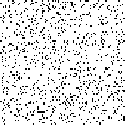 | 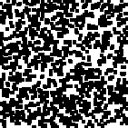 |  |   |
| --- | --- | --- | --- |
| Generation 1 | Generation 2 | Generation 3 |   |
|  | 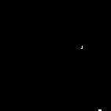 |  |   |
| Generation 4 | Generation 5 | Generation 6 |   |

Figure 9: Prisoner’s Dilemma: All Defect [[View a movie of this model]](../assets/game-evolutionary/pd-defect.gif)

However, when the payoff matrix has values of $T = 1.2, R = 1.1, P = 0$.1, and $S = 0$, the evolutionary dynamics carry the population to a stable cycle oscillating between two states. In this cycle cooperators and defectors coexist, with some regions containing “blinkers” oscillating between defectors and cooperators (as seen in generation 19 and 20).

*Figure 10:*

| 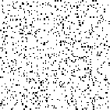 | 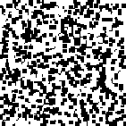 |
| --- | --- |
| Generation 1 | Generation 2 |
| 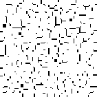 | 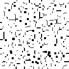 |
| Generation 19 | Generation 20 |

Figure 10: Prisoner’s Dilemma: Cooperate [[View a movie of this model]](../assets/game-evolutionary/pd-cooperate.gif)

Notice that with these particular settings of payoff values, the evolutionary dynamics of the local interaction model differ significantly from those of the replicator dynamics. Under these payoffs, the stable states have no corresponding analogue in either the replicator dynamics nor in the analysis of evolutionarily stable strategies.

A phenomenon of greater interest occurs when we choose payoff values of $T = 1.61, R = 1.01, P = 0$.01, and $S = 0$. Here, the dynamics of local interaction lead to a world constantly in flux: under these values regions occupied predominantly by Cooperators may be successfully invaded by Defectors, and regions occupied predominantly by Defectors may be successfully invaded by Cooperators. In this model, there is no “stable strategy” in the traditional dynamical sense. [^note-5]

*Figure 11:*

| 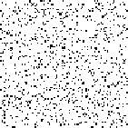 | 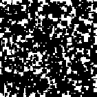 |  |
| --- | --- | --- |
| Generation 1 | Generation 3 | Generation 5 |
| 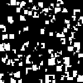 |  | 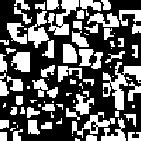 |
| Generation 7 | Generation 9 | Generation 11 |
| 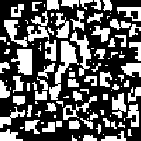 | 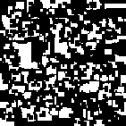 |   |
| Generation 13 | Generation 15 |   |

Figure 11: Prisoner’s Dilemma: Chaotic [[view a movie of this model]](../assets/game-evolutionary/pd-chaotic.gif)

These results demonstrate that, although there are cases where both the static and dynamic approaches to evolutionary game theory agree about the expected outcome of an evolutionary game, there are enough differences in the outcomes of the two modes of analysis to justify the development of each program independently.

## 4. Why Evolutionary Game Theory?

Although evolutionary game theory has provided numerous insights to particular evolutionary questions, a growing number of social scientists have become interested in evolutionary game theory in hopes that it will provide tools for addressing a number of deficiencies in the traditional theory of games, three of which are discussed below.

### 4.1 The equilibrium selection problem

The concept of a Nash equilibrium (see the entry on game theory) has been the most used solution concept in game theory since its introduction by John Nash (1950). A selection of strategies by a group of agents is said to be in a Nash equilibrium if each agent’s strategy is a best-response to the strategies chosen by the other players. By best-response, we mean that no individual can improve her payoff by switching strategies unless at least one other individual switches strategies as well. This need not mean that the payoffs to each individual are optimal in a Nash equilibrium: indeed, one of the disturbing facts of the prisoner’s dilemma is that the only Nash equilbrium of the game—when both agents defect—is suboptimal.[^note-6]

Yet a difficulty arises with the use of Nash equilibrium as a solution concept for games: if we restrict players to using pure strategies, not every game has a Nash equilbrium. The game “Matching Pennies” illustrates this problem.

*Figure 12:*

|   | **Heads** | **Tails** |
| --- | --- | --- |
| **Heads** | (0,1) | (1,0) |
| **Tails** | (1,0) | (0,1) |

Figure 12: Payoff matrix for the game of Matching Pennies. (Row wins if the two coins do not match, whereas Column wins if the two coins match).

While it is true that every noncooperative game in which players may use mixed strategies has a Nash equilibrium, some have questioned the significance of this for real agents. If it seems appropriate to require rational agents to adopt only pure strategies (perhaps because the cost of implementing a mixed strategy runs too high), then the game theorist must admit that certain games lack solutions.

A more significant problem with invoking the Nash equilibrium as the appropriate solution concept arises because some games have multiple Nash equilibria (see the section on Solution Concepts and Equilibria, in the entry on game theory). When there are several different Nash equilibria, how is a rational agent to decide which of the several equilibria is the “right one” to settle upon?[^note-7] Attempts to resolve this problem have produced a number of possible refinements to the concept of a Nash equilibrium, each refinement having some intuitive purchase. Unfortunately, so many refinements of the notion of a Nash equilibrium have been developed that, in many games which have multiple Nash equilibria, each equilibrium could be justified by some refinement present in the literature. The problem has thus shifted from choosing among multiple Nash equilibria to choosing among the various refinements.

Samuelson (1997), in his work *Evolutionary Games and Equilibrium Selection*) expressed hope that further development of evolutionary game theory could be of service in addressing the equilibrium selection problem. At present, this hope does not seem to have been realised. As section 2.1 showed, there are multiple competing concepts of evolutionary stability in play. Furthermore, as section 3 showed, there is an imperfect agreement between what is evolutionary stable, in the dynamic setting, and what is evolutionary stable, in the static setting.

### 4.2 The problem of hyperrational agents

The traditional theory of games imposes a very high rationality requirement upon agents. This requirement originates in the development of the theory of utility which provides game theory’s underpinnings (see Luce and Raiffa, 1957, for an introduction). For example, in order to be able to assign a cardinal utility function to individual agents, one typically assumes that each agent has a well-defined, consistent set of preferences over the set of “lotteries” over the outcomes which may result from individual choice. Since the number of different lotteries over outcomes is uncountably infinite, this requires each agent to have a well-defined, consistent set of uncountably infinitely many preferences.

Numerous results from experimental economics have shown that these strong rationality assumptions do not describe the behavior of real human subjects. Humans are rarely (if ever) the hyperrational agents described by traditional game theory. For example, it is not uncommon for people, in experimental situations, to indicate that they prefer $A$ to $B, B$ to $C$, and $C$ to $A$. These “failures of the transitivity of preference” would not occur if people had a well-defined consistent set of preferences. Furthermore, experiments with a class of games known as a “beauty pageant” show, quite dramatically, the failure of common knowledge assumptions typically invoked to solve games.[^note-8] Since evolutionary game theory successfully explains the predominance of certain behaviors of insects and animals, where strong rationality assumptions clearly fail, this suggests that rationality is not as central to game theoretic analyses as previously thought. The hope, then, is that evolutionary game theory may meet with greater success in describing and predicting the choices of human subjects, since it is better equipped to handle the appropriate weaker rationality assumptions. Indeed, one of the great strengths of the framework introduced by Sandholm (2010) is that it provides a general method for linking the learning rules used by individuals, at the micro level, with the dynamics describing changes in the population, at the macro level.

### 4.3 The lack of a dynamical theory in the traditional theory of games

At the end of the first chapter of *Theory of Games and Economic Behavior*, von Neumann and Morgenstern write:

> We repeat most emphatically that our theory is thoroughly static. A dynamic theory would unquestionably be more complete and therefore preferable. But there is ample evidence from other branches of science that it is futile to try to build one as long as the static side is not thoroughly understood. (Von Neumann and Morgenstern, 1953, p. 44)

The theory of evolution is a dynamical theory, and the second approach to evolutionary game theory sketched above explicitly models the dynamics present in interactions among individuals in the population. Since the traditional theory of games lacks an explicit treatment of the dynamics of rational deliberation, evolutionary game theory can be seen, in part, as filling an important lacuna of traditional game theory.

One may seek to capture some of the dynamics of the decision-making process in traditional game theory by modeling the game in its extensive form, rather than its normal form. However, for most games of reasonable complexity (and hence interest), the extensive form of the game quickly becomes unmanageable. Moreover, even in the extensive form of a game, traditional game theory represents an individual’s strategy as a specification of what choice that individual would make at each information set in the game. A selection of strategy, then, corresponds to a selection, prior to game play, of what that individual will do at any possible stage of the game. This representation of strategy selection clearly presupposes hyperrational players and fails to represent the process by which one player observes his opponent’s behavior, learns from these observations, and makes the best move in response to what he has learned (as one might expect, for there is no need to model learning in hyperrational individuals). The inability to model the dynamical element of game play in traditional game theory, and the extent to which evolutionary game theory naturally incorporates dynamical considerations, reveals an important virtue of evolutionary game theory.

## 5. Applications of Evolutionary Game Theory

Evolutionary game theory has been used to explain a number of aspects of human behavior. A small sampling of topics which have been analysed from the evolutionary perspective include: **altruism** (Fletcher and Zwick, 2007; Gintis *et al*., 2003; Sánchez and Cuesta, 2005; Trivers, 1971), **behavior in public goods game** (Clemens and Riechmann, 2006; Hauert, 2006; Hauert *et al*., 2002, 2006; Huberman and Glance, 1995), **empathy** (Page and Nowak, 2002; Fishman, 2006), **human culture** (Enquist and Ghirlanda, 2007; Enquist *et al*., 2008), **moral behaviour** (Alexander, 2007; Boehm, 1982; Harms and Skyrms, 2008; Skyrms 1996, 2004)[^skyrms-1996], **private property** (Gintis, 2007), **signaling systems and other proto-linguistic behaviour** (Barrett, 2007; Hausken and Hirshleirfer, 2008; Hurd, 1995; Jäger, 2008; Nowak *et al*., 1999; Pawlowitsch, 2007, 2008; Skyrms, 2010; Zollman, 2005), **social learning** (Kameda and Nakanishi, 2003; Nakahashi, 2007; Rogers, 1988; Wakano and Aoki, 2006; Wakano *et al*., 2004), and **social norms** (Axelrod, 1986; Bicchieri, 2006; Binmore and Samuelson, 1994; Chalub *et al*., 2006; Kendal *et al*., 2006; Ostrum, 2000).

The following subsections provide a brief illustration of the use of evolutionary game theoretic models to explain two areas of human behavior. The first concerns the tendency of people to share equally in perfectly symmetric situations. The second shows how populations of pre-linguistic individuals may coordinate on the use of a simple signaling system even though they lack the ability to communicate. These two models have been pointed to as preliminary explanations of our sense of fairness and language, respectively. They were selected for inclusion here for three reasons: (1) the relative simplicity of the model, (2) the apparent success at explaining the phenomenon in question, and (3) the importance of the phenomenon to be explained.

### 5.1 A sense of fairness

One natural game to use for investigating the evolution of fairness is *divide-the-cake* (this is the simplest version of the Nash bargaining game). In chapter 1 of *Evolution of the Social Contract*, Skyrms presents the problem as follows:

> Here we start with a very simple problem; we are to divide a chocolate cake between us. Neither of us has any special claim as against the other. Out positions are entirely symmetric. The cake is a windfall for us, and it is up to us to divide it. But if we cannot agree how to share it, the cake will spoil and we will get nothing. (Skyrms, 1996, pp. 3–4)

More formally, suppose that two individuals are presented with a resource of size $C$ by a third party. A *strategy* for a player, in this game, consists of an amount of cake that he would like. The set of possible strategies for a player is thus any amount between 0 and $C$. If the sum of strategies for each player is less than or equal to $C$, each player receives the amount he asked for. However, if the sum of strategies exceeds $C$, no player receives anything. Figure 13 illustrates the feasible set for this game.

*Figure 13:*

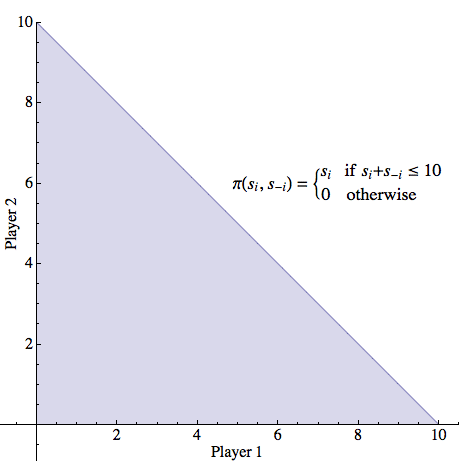

Figure 13: The feasible set for the game of Divide-the-Cake. In this figure, the cake is of size $C=10$ but all strategies between 0 and 10 inclusive are permitted for either player (including fractional demands).

We have a clear intuition that the “obvious” strategy for each player to select is *C/2*; the philosophical problem lies in explaining *why* agents would choose that strategy rather than some other one. Even in the perfectly symmetric situation, answering this question is more difficult than it first appears. To see this, first notice that there are an infinite number of Nash equilibria for this game. If player 1 asks for $p$ of the cake, where $0 \le p \le C$, and player 2 asks for $C - p$, then this strategy profile is a Nash equilibrium for any value of $p \in [0,C]$. (Each player’s strategy is a best response given what the other has chosen, in the sense that neither player can increase her payoff by changing her strategy.) Thus the equal split is only one of infinitely many Nash equilibria.

One might propose that both players should choose that strategy which maximizes their expected payoff on the assumption they are uncertain as to whether they will be assigned the role of Player 1 or Player 2. This proposal, Skyrms notes, is essentially that of Harsanyi (1953). The problem with this is that if players only care about their expected payoff, and they think that it is equally likely that they will be assigned the role of Player 1 or Player 2, then this, too, fails to select uniquely the equal split. Consider the strategy profile $\langle p, C - p\rangle$ which assigns Player 1 $p$ slices and Player 2 $C - p$ slices. If a player thinks it is equally likely that he will be assigned the role of Player 1 or Player 2, then his expected utility is $\frac{1}{2} p + \frac{1}{2}(C - p) = \frac{C}{2}$, for all values $p \in[0, C]$.

Now consider the following evolutionary model: suppose we have a population of individuals who pair up and repeatedly play the game of divide-the-cake, modifying their strategies over time in a way which is described by the replicator dynamics. For convenience, let us assume that the cake is divided into 10 equally sized slices and that each player’s strategy conforms to one of the following 11 possible types: Demand 0 slices, Demand 1 slice, … , Demand 10 slices. For the replicator dynamics, the state of the population is represented by a vector $\langle p_0, p_1 , \ldots ,p_{10}\rangle$ where each $p_i$ denotes the frequency of the strategy “Demand $i$ slices” in the population.

The replicator dynamics allows us to model how the distribution of strategies in the population changes over time, beginning from a particular initial condition. Figure 14 below shows two evolutionary outcomes under the continuous replicator dynamics. Notice that although fair division can evolve, as in Figure 14(a), it is not the only evolutionary stable outcome, as Figure 14(b) illustrates.

*Figure 14:*

|  |
| --- |
| (a) The evolution of fair division. |

|  |
| --- |
| (b) The evolution of an unequal division rule. |

Figure 14: Two evolutionary outcomes under the continuous replicator dynamics for the game of divide-the-cake. Of the eleven strategies present, only three are colour-coded so as to be identifiable in the plot, as noted in the legend.

Recall that the task at hand was to explain why we think the “obvious” strategy choice in a perfectly symmetric resource allocation problem is for both players to ask for half of the resource. What the above shows is that, in a population of boundedly rational agents who modify their behaviours in a manner described by the replicator dynamics, fair division is one, although not the only, evolutionary outcome. The tendency of fair division to emerge, assuming that any initial condition is equally likely, can be measured by determining the size of the [basin of attraction](http://mathworld.wolfram.com/BasinofAttraction.html) of the state where everyone in the population uses the strategy Demand 5 slices. Skyrms (1996) measures the size of the basin of attraction of fair division using [Monte Carlo methods](http://mathworld.wolfram.com/MonteCarloMethod.html), finding that fair division evolves roughly 62% of the time.

However, it is important to realise that the replicator dynamics assumes any pairwise interaction between individuals is equally likely. In reality, quite often interactions between individuals are *correlated* to some extent. Correlated interaction can occur as a result of spatial location (as shown above for the case of the spatial prisoner’s dilemma), the structuring effect of social relations, or ingroup/outgroup membership effects, to list a few causes.

When correlation is introduced, the frequency with which fair division emerges changes drastically. The amount of correlation in the model is represented by the *correlation coefficient* $\varepsilon$, which can range between 0 and 1. When $\varepsilon=0$, there is no correlation at all and the likelihood of pairwise interactions is determined simply by the proportion of agents in the population following a particular strategy. When $\varepsilon=1$, correlation is perfect and agents following a particular strategy only interact with their own kind. Intermediate levels of correlation introduce some tendency for agents to interact with their own kind, where the tendency increases with the value of $\varepsilon$. Figure 15 illustrates how the basin of attraction of All Demand 5 changes as the correlation coefficient $\varepsilon$ increases from 0 to 0.2.[^note-9] Once the amount of correlation present in the interactions reaches $\varepsilon = 0.2$, fair division is virtually an evolutionary certainty. Note that this does not depend on there only being three strategies present: allowing for some correlation between interactions increases the probability of fair division evolving even if the initial conditions contain individuals using any of the eleven possible strategies.

*Figure 15:*

| 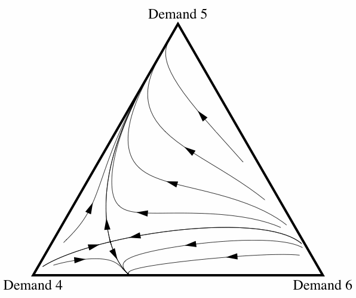 | 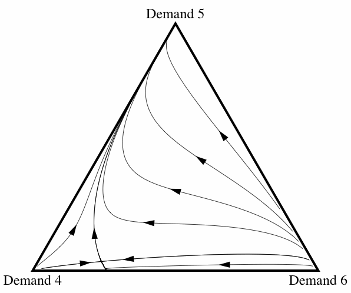 |
| --- | --- |
| (a) $\varepsilon = 0$ | (b) $\varepsilon = 0$.1 |
| 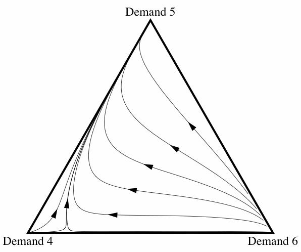 |   |
| (c) $\varepsilon = 0.2$ |   |

Figure 15: Three diagrams showing how, as the amount of correlation among interactions increases, fair division is more likely to evolve. In figures 15(a) and 15(b), there is an unstable fixed point in the interior of space where all three strategies are present in the population. (This is the point where the evolutionary trajectories appear to intersect.) This fixed point is what is known as a *saddle point* in dynamical systems theory: the smallest perturbation will cause the population to evolve away from that point to one of the other two attractors.

What, then, can we conclude from this model regarding the evolution of fair division? It all depends, of course, on how accurately the replicator dynamics models the primary evolutionary forces (cultural or biological) acting on human populations. Although the replicator dynamics are a “simple” mathematical model, it does suffice for modelling both a type of biological evolution (see Taylor and Jonker, 1978) and a type of cultural evolution (see Börgers and Sarin, 1996; Weibull, 1995). As Skyrms (1996) notes:

> In a finite population, in a finite time, where there is some random element in evolution, some reasonable amount of divisibility of the good and some correlation, we can say that it is likely that something close to share and share alike should evolve in dividing-the-cake situations. This is, perhaps, a beginning of an explanation of the origin of our concept of justice.

This claim, of course, has not gone without comment. For a selection of some discussion see, in particular, D’Arms (1996, 2000); D’Arms *et al*., 1998; Danielson (1998); Bicchieri (1999); Kitcher (1999); Gintis (2000); Harms (2000); Krebs (2000); Alexander and Skyrms (1999); and Alexander (2000, 2007).

### 5.2 The emergence of language.

In his seminal work *Convention*, David Lewis developed the idea of sender-receiver games. Such games have been used to explain how language, and semantic content, can emerge in a community which originally did not possess any language whatsoever.[^note-10] His original definition is as follows (with portions of extraneous commentary deleted for concision and points enumerated for clarity and later reference):

> A *two-sided signaling problem* is a situation $S$ involving an agent called the *communicator* and one or more other agents called the *audience*, such that it is true that, and it is common knowledge for the communicator and the audience that:
>
> 1. Exactly one of several alternative states of affairs $s_1 , \ldots ,s_m$ holds. The communicator, but not the audience, is in a good position to tell which one it is.
> 2. Each member of the audience can do any one of several alternative actions $r_1 , \ldots ,r_m$ called *responses*. Everyone involved wants the audience’s responses to depend in a certain way upon the state of affairs that holds. There is a certain one-to-one function $F$ from $\{s_i\}$ onto $\{r_j\}$ such that everyone prefers that each member of the audience do $F(s_i)$ on condition that $s_i$ holds, for each $s_i$.
> 3. The communicator can do any one of several alternative actions $\sigma_1 , \ldots ,\sigma_n (n \ge m)$ called *signals*. The audience is in a good position to tell which one he does. No one involved has any preference regarding these actions which is strong enough to outweigh his preference for the dependence $F$ of audience’s responses upon states of affairs. […]
> 4. A *communicator’s contingency plan* is any possible way in which the communicator’s signal may depend upon the state of affairs that he observes to hold. It is a function $Fc$ from $\{s_i\}$ into $\{\sigma_k \}$. […]
> 5. Similarly, an *audience’s contingency plan* is any possible way in which the response of a member of the audience may depend upon the signal he observes the communicator to give. It is a one-to-one function $Fa$ from part of $\{\sigma_k\}$ into $\{r_j\}$. […]
>
> Whenever $Fc$ and $Fa$ combine […] to give the preferred dependence of the audience’s response upon the state of affairs, we call $\langle Fc, Fa\rangle$ a *signaling system*. (Lewis, 1969, pp. 130–132)

Since the publication of *Convention*, it is more common to refer to the communicator as the *sender* and the members of the audience as *receivers*. The basic idea behind sender-receiver games is the following: Nature selects which state of the world obtains. The person in the role of Sender observes this state of the world (correctly identifying it), and sends a signal to the person in the role of Receiver. The Receiver, upon receipt of this signal, performs a response. If what the Receiver does is the correct response, given the state of the world, then both players receive a payoff of 1; if the Receiver performed an incorrect response, then both players receive a payoff of 0. Notice that, in this simplified model, no chance of error exists at any stage. The Sender always observes the true state of the world and always sends the signal he intended to send. Likewise, the Receiver always receives the signal sent by the Sender (i.e., the channel is not noisy), and the Receiver always performs the response he intended to.

Whereas Lewis allowed the “audience” to consist of more than one person, it is more common to consider sender-receiver games played between two people, so that there is only a single receiver (or, in Lewisian terms, a single member of the audience).[^note-11] For simplicity, in the following we will consider a two-player, sender-receiver game with two states of the world $\{S_1, S_2\}$, two signals $\{\sigma_1, \sigma_2\}$, and two responses $\{r_1, r_2\}$. (We shall see later why larger sender-receiver games are increasingly difficult to analyse.)

Notice that, in point (2) of his definition of sender-receiver games, Lewis requires two things: that there be a unique best response to the state of the world (this is what requiring $F$ to be one-to-one amounts to) and that everyone in the audience agrees that this is the case. Since we are considering the case where there is only a single responder, the second requirement is otiose. For the case of two states of the world and two responses, there are only two ways of assigning responses to states of the world which satisfy Lewis’s requirement. These are as follows (where $X \Rightarrow Y$ denotes “in state of the world $X$, the best response is to do $Y$”):

1. $S_1 \Rightarrow r_1, S_2 \Rightarrow r_2$.
2. $S_1 \Rightarrow r_2, S_2 \Rightarrow r_1$.

It makes no real difference for the model which one of these we choose, so pick the intuitive one: in state of the world $S_i$, the best response is $r_i$ (i.e., function 1).

A *strategy for the sender* (what Lewis called a “communicator’s contingency plan”) consists of a function specifying what signal he sends given the state of the world. It is, as Lewis notes, a function from the set of states of the world *into* the set of signals. This means that it is possible that a sender may send the *same* signal in two different states of the world. Such a strategy makes no sense, from a rational point of view, because the receiver would not get enough information to be able to identify the correct response for the state of the world. However, we do not exclude these strategies from consideration because they are logically possible strategies.

How many sender strategies are there? Because we allow for the possibility of the same signal to be sent for multiple states of the world, there are two choices for which signal to send given state $S_1$ and two choices for which signal to send given state $S_2$. This means there are four possible sender strategies. These strategies are as follows (where $\mathrm{`}X \rightarrow Y\text{'}$ means that when the state of the world is $X$ the sender will send signal $Y)$:

> **Sender 1:** $S_1 \rightarrow \sigma_1, S_2 \rightarrow \sigma_1$.
> **Sender 2:** $S_1 \rightarrow \sigma_1, S_2 \rightarrow \sigma_2$.
> **Sender 3:** $S_1 \rightarrow \sigma_2, S_2 \rightarrow \sigma_1$.
> **Sender 4:** $S_1 \rightarrow \sigma_2, S_2 \rightarrow \sigma_2$.

What is a strategy for a receiver? Here, it proves useful to deviate from Lewis’s original definition of the “audience’s contingency plan”. Instead, let us take a receiver’s strategy to be a function from the set of signals into the set of responses. As in the case of the sender, we allow the receiver to perform the same response for more than one signal. By symmetry, this means there are $\mathbf{4}$ possible receiver strategies. These receiver strategies are:

> **Receiver 1:** $\sigma_1 \rightarrow r_1, \sigma_2 \rightarrow r_1$.
> **Receiver 2:** $\sigma_1 \rightarrow r_1, \sigma_2 \rightarrow r_2$.
> **Receiver 3:** $\sigma_1 \rightarrow r_2, \sigma_2 \rightarrow r_1$.
> **Receiver 4:** $\sigma_1 \rightarrow r_2, \sigma_2 \rightarrow r_2$.

If the roles of Sender and Receiver are permanently assigned to individuals — as Lewis envisaged — then there are only two signaling systems: $\langle$Sender 2, Receiver 2$\rangle$ and $\langle$Sender 3, Receiver 3$\rangle$. All other possible combinations of strategies result in the players failing to coordinate. The coordination failure occurs because the Sender and Receiver only pair the appropriate action with the state of the world in one instance, as with $\langle$Sender 1, Receiver 1$\rangle$, or not at all, as with $\langle$Sender 2, Receiver 3$\rangle$.

What if the roles of Sender and Receiver are not permanently assigned to individuals? That is, what if nature flips a coin and assigns one player to the role of Sender and the other player to the role of Receiver, and then has them play the game? In this case, a player’s strategy needs to specify what he will do when assigned the role of Sender, as well as what he will do when assigned the role of Receiver. Since there are four possible strategies to use as Sender and four possible strategies to use as Receiver, this means that there are a total of $\mathbf{16}$ possible strategies for the sender-receiver game when roles are not permanently assigned to individuals. Here, a player’s strategy consists of an ordered pair (Sender $X$, Receiver $Y)$, where $X, Y \in \{1, 2, 3, 4\}$.

It makes a difference whether one considers the roles of Sender and Receiver to be permanently assigned or not. If the roles are assigned at random, there are four signaling systems amongst two players[^note-12]:

1. **Player 1:** (Sender 2, Receiver 2), **Player 2:** (Sender 2, Receiver 2)
2. **Player 1:** (Sender 3, Receiver 3), **Player 2:** (Sender 3, Receiver 3)
3. **Player 1:** (Sender 2, Receiver 3), **Player 2:** (Sender 3, Receiver 2)
4. **Player 1:** (Sender 3, Receiver 2), **Player 2:** (Sender 2, Receiver 3)

Signaling systems 3 and 4 are curious. System 3 is a case where, for example, I speak in French but listen in German, and you speak German but listen in French. (System 4 swaps French and German for both you and me.) Notice that in systems 3 and 4 the players are able to correctly coordinate the response with the state of the world *regardless* of who gets assigned the role of Sender or Receiver.

The problem, of course, with signaling systems 3 and 4 is that neither Player 1 nor Player 2 would do well when pitted against a clone of himself. They are cases where the signaling system would not work in a population of players who are pairwise randomly assigned to play the sender-receiver game. In fact, it is straightforward to show that the strategies (Sender 2, Receiver 2) and (Sender 3, Receiver 3) are the only evolutionarily stable strategies (see Skyrms 1996, 89–90)[^skyrms-1996].

As a first approach to the dynamics of sender-receiver games, let us restrict attention to the four strategies (Sender 1, Receiver 1), (Sender 2, Receiver 2), (Sender 3, Receiver 3), and (Sender 4, Receiver 4). Figure 16 illustrates the state space under the continuous replicator dynamics for the sender-receiver game consisting of two states of the world, two signals, and two responses, where players are restricted to using one of the previous four strategies. One can see that evolution leads the population in almost all cases[^note-13] to converge to one of the two signaling systems.[^note-14]

*Figure 16:*

| 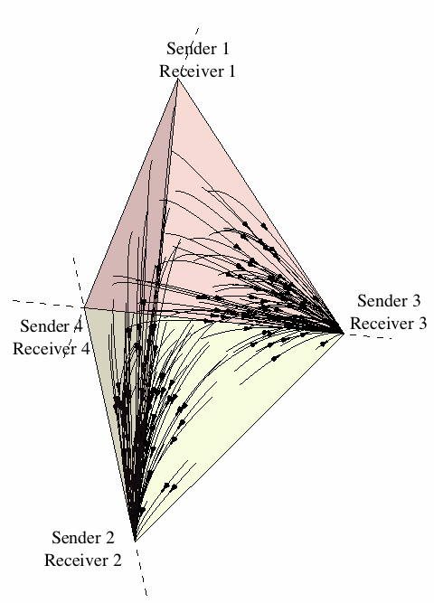 | 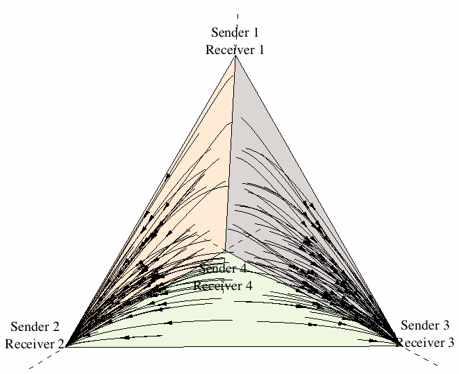 |
| --- | --- |
| 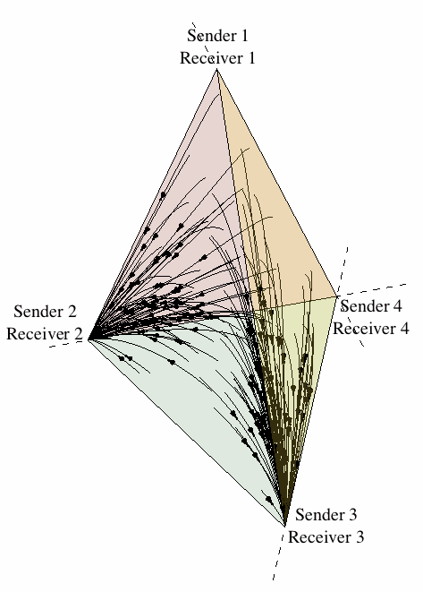 |   |

Figure 16: The evolution of signaling systems.

Figure 17 illustrates the outcome of one run of the replicator dynamics (for a single population model) where all sixteen possible strategies are represented. We see that eventually the population, for this particular set of initial conditions, converges to one of the pure Lewisian signalling systems identified above.

*Figure 17:*

Figure 17: The evolution of a signalling system under the replicator dynamics.

When the number of states of the world, the number of signals, and the number of actions increase from 2, the situation rapidly becomes much more complex. If there are $N$ states of the world, $N$ signals, and $N$ actions, the total number of possible strategies equals $N^{2N}$. For $N=2$, this means there are 16 possible strategies, as we have seen. For $N=3$, there are 729 possible strategies, and a signalling problem where $N=4$ has 65,536 possible strategies. Given this, one might think that it would prove difficult for evolution to settle upon an optimal signalling system.

Such an intuition is correct. Hofbauer and Hutteger (2008) show that, quite often, the replicator dynamics will converge to a suboptimal outcome in signalling games. In these suboptimal outcomes, a *pooling* or *partial pooling* equilibrium will emerge. A pooling equilibrium occurs when the Sender uses the same signal regardless of the state of the world. A partial pooling equilibrium occurs when the Sender is capable of differentiating between some states of the world but not others. As an example of a partial pooling equilibrium, consider the following strategies for the case where $N=3$: Suppose that the Sender sends signal 1 in state of the world 1, and signal 2 in states of the world 2 and 3. Furthermore, suppose that the Receiver performs action 1 upon receipt of signal 1, and action 2 upon receipt of signals 2 and 3. If all states of the world are equiprobable, this is a partial pooling equilibrium. Given that the Sender does not differentiate states of the world 2 and 3, the Receiver cannot improve his payoffs by responding differently to signal 2. Given the particular response behaviour of the Receiver, the Sender cannot improve her payoffs by attempting to differentiate states of the world 2 and 3.

## 6. Philosophical Problems of Evolutionary Game Theory

The growing interest among social scientists and philosophers in evolutionary game theory has raised several philosophical questions, primarily stemming from its application to human subjects.

### 6.1 The meaning of fitness in cultural evolutionary interpretations

As noted previously, evolutionary game theoretic models may often be given both a biological and a cultural evolutionary interpretation. In the biological interpretation, the numeric quantities which play a role analogous to “utility” in traditional game theory correspond to the fitness (typically Darwinian fitness) of individuals.[^note-15] How does one interpret “fitness” in the cultural evolutionary interpretation?

In many cases, fitness in cultural evolutionary interpretations of evolutionary game theoretic models directly measures some objective quantity of which it can be safely assumed that (1) individuals always want more rather than less and (2) interpersonal comparisons are meaningful. Depending on the particular problem modeled, money, slices of cake, or amount of land would be appropriate cultural evolutionary interpretations of fitness. Requiring that fitness in cultural evolutionary game theoretic models conform to this interpretative constraint severely limits the kinds of problems that one can address. A more useful cultural evolutionary framework would provide a more general theory which did not require that individual fitness be a linear (or strictly increasing) function of the amount of some real quantity, like amount of food.

In traditional game theory, a strategy’s fitness was measured by the expected utility it had for the individual in question. Yet evolutionary game theory seeks to describe individuals of limited rationality (commonly known as “boundedly rational” individuals), and the utility theory employed in traditional game theory assumes highly rational individuals. Consequently, the utility theory used in traditional game theory cannot simply be carried over to evolutionary game theory. One must develop an alternate theory of utility/fitness, one compatible with the bounded rationality of individuals, that is sufficient to define a utility measure adequate for the application of evolutionary game theory to cultural evolution.

### 6.2 The explanatory irrelevance of evolutionary game theory

Another question facing evolutionary game theoretic explanations of social phenomena concerns the kind of explanation it seeks to give. Depending on the type of explanation it seeks to provide, are evolutionary game theoretic explanations of social phenomena irrelevant or mere vehicles for the promulgation of pre-existing values and biases? To understand this question, recognize that one must ask whether evolutionary game theoretic explanations target the etiology of the phenomenon in question, the persistence of the phenomenon, or various aspects of the normativity attached to the phenomenon. The latter two questions seem deeply connected, for population members typically enforce social behaviors and rules having normative force by sanctions placed on those failing to comply with the relevant norm; and the presence of sanctions, if suitably strong, explains the persistence of the norm. The question regarding a phenomenon’s etiology, on the other hand, can be considered independent of the latter questions.

If one wishes to explain how some currently existing social phenomenon came to be, it is unclear why approaching it from the point of view of evolutionary game theory would be particularily illuminating. The etiology of any phenomenon is a unique historical event and, as such, can only be discovered empirically, relying on the work of sociologists, anthropologists, archaeologists, and the like. Although an evolutionary game theoretic model may exclude certain historical sequences as possible histories (since one may be able to show that the cultural evolutionary dynamics preclude one sequence from generating the phenomenon in question), it seems unlikely that an evolutionary game theoretic model would indicate a unique historical sequence suffices to bring about the phenomenon. An empirical inquiry would then still need to be conducted to rule out the extraneous historical sequences admitted by the model, which raises the question of what, if anything, was gained by the construction of an evolutionary game theoretic model in the intermediate stage. Moreover, even if an evolutionary game theoretic model indicated that a single historical sequence was capable of producing a given social phenomenon, there remains the important question of why we ought to take this result seriously. One may point out that since nearly any result can be produced by a model by suitable adjusting of the dynamics and initial conditions, all that the evolutionary game theorist has done is provide one such model. Additional work needs to be done to show that the underlying assumptions of the model (both the cultural evolutionary dynamics and the initial conditions) are empirically supported. Again, one may wonder what has been gained by the evolutionary model—would it not have been just as easy to determine the cultural dynamics and initial conditions beforehand, constructing the model afterwards? If so, it would seem that the contributions made by evolutionary game theory in this context simply are a proper part of the parent social science—sociology, anthropology, economics, and so on. If so, then there is nothing *particular* about evolutionary game theory employed in the explanation, and this means that, contrary to appearances, evolutionary game theory is really irrelevant to the given explanation.

If evolutionary game theoretic models do not explain the etiology of a social phenomenon, presumably they explain the persistence of the phenomenon or the normativity attached to it. Yet we rarely need an evolutionary game theoretic model to identify a particular social phenomenon as stable or persistent as that can be done by observation of present conditions and examination of the historical records; hence the charge of irrelevancy is raised again. Moreover, most of the evolutionary game theoretic models developed to date have provided the crudest approximations of the real cultural dynamics driving the social phenomenon in question. One may well wonder why, in these cases, we should take seriously the stability analysis given by the model; answering this question would require one engage in an empirical study as previously discussed, ultimately leading to the charge of irrelevance again.

It is sometimes argued that evolutionary game theoretic models answer “how possibly” questions. That is, an evolutionary game theoretic model shows how some phenomenon could possibly be generated by an underlying dynamical process of interacting, boundedly rational agents. Although this is certainly the case, one might wonder whether this subtly shifts the explanatory target. Answering a “how possibly” question is most interesting when we do not know whether something is possible at all. The challenge faced by some evolutionary game theoretic accounts of social phenomena is that they answer a “how possibly” question regarding something which we already knew was possible, because the phenomenon actually exists. What we would like to know is how the answer to the “how possibly” question connects to the actual real-world processes generating the phenomenon. This suggests that evolutionary game theoretic explanations of social phenomena are, even in the best cases, *incomplete*.

### 6.3 The value-ladenness of evolutionary game theoretic explanations

If one seeks to use an evolutionary game theoretic model to explain the normativity attached to a social rule, one must explain how such an approach avoids committing the so-called “naturalistic fallacy” of inferring an ought-statement from a conjunction of is-statements.[^note-16] Assuming that the explanation does not commit such a fallacy, one argument charges that it must then be the case that the evolutionary game theoretic explanation merely repackages certain key value claims tacitly assumed in the construction of the model. After all, since any argument whose conclusion is a normative statement must have at least one normative statement in the premises, any evolutionary game theoretic argument purporting to show how certain norms acquire normative force must contain—at least implicitly—a normative statement in the premises. Consequently, this application of evolutionary game theory does not provide a neutral analysis of the norm in question, but merely acts as a vehicle for advancing particular values, namely those smuggled in the premises.

This criticism seems less serious than the charge of irrelevancy. Cultural evolutionary game theoretic explanations of norms need not “smuggle in” normative claims in order to draw normative conclusions. The theory already contains, in its core, a proper subtheory having normative content—namely a theory of rational choice in which boundedly rational agents act in order to maximize, as best as they can, their own self-interest. One may challenge the suitability of this as a foundation for the normative content of certain claims, but this is a different criticism from the above charge. Although cultural evolutionary game theoretic models do act as vehicles for promulgating certain values, they wear those minimal value commitments on their sleeve. Evolutionary explanations of social norms have the virtue of making their value commitments explicit and also of showing how other normative commitments (such as fair division in certain bargaining situations, or cooperation in the prisoner’s dilemma) may be derived from the principled action of boundedly rational, self-interested agents.

## References（引用注释）

> 原文参考文献已转为脚注引用：文内“作者-年份”引用组后附 [^key] 标记，完整条目见本文末脚注定义。

## Academic Tools

> |   | [How to cite this entry](https://plato.stanford.edu/cgi-bin/encyclopedia/archinfo.cgi?entry=game-evolutionary). |
> | --- | --- |
> |   | [Preview the PDF version of this entry](https://leibniz.stanford.edu/friends/preview/game-evolutionary/) at the [Friends of the SEP Society](https://leibniz.stanford.edu/friends/). |
> |   | [Look up topics and thinkers related to this entry](https://www.inphoproject.org/entity?sep=game-evolutionary&redirect=True) at the Internet Philosophy Ontology Project (InPhO). |
> |   | [Enhanced bibliography for this entry](https://philpapers.org/sep/game-evolutionary/) at [PhilPapers](https://philpapers.org/), with links to its database. |

## Other Internet Resources

- [Evolving Artificial Moral Ecologies](http://www.ethics.ubc.ca/eame/), (with interactive simulators), by Peter Danielson (U. British Columbia) and William Harms (Bowling Green State).
- [Brookings Center on Social and Economic Dynamics](http://www.brookings.edu/dynamics.aspx).
- [Complexity of Cooperation](http://www-personal.umich.edu/~axe/ComplexCoop.html), website on Robert Axelrod's book.

## Related Entries

altruism | altruism: biological | evolution | evolution: cultural | game theory | prisoner’s dilemma

## Notes（原文脚注）

## Notes to Evolutionary Game Theory

[^note-1]: An earlier, logically equivalent, definition of an evolutionarily stable strategy can be found in the Maynard Smith and Price paper “The Logic of Animal Conflict”, *Nature*, vol. 246, pp. 15–18 (1973). In the introduction to his 1972 collection of essays entitled *On Evolution*, Maynard Smith gives credit to George Price for the idea: “I would probably not have had the idea for this essay if I had not seen an unpublished manuscript on the evolution of fighting by Dr George Price […] Unfortunately, Dr Price is better at having ideas than at publishing them. The best I can do therefore is acknowledge that if there is anything in the idea, the credit should go to Dr Price and not to me.”

[^note-2]: In a mixed strategy, a player assigns a probability to each pure strategy, and chooses which strategy to play using a randomization device. For the Hawk-Dove game, one mixed strategy would assign equal probabilities to playing Hawk or Dove, and decide which to play in a given case by flipping a fair coin.

[^note-3]: Sandholm's book is specifically entitled that in order to pay homage to Josef Hofbauer's influential book *Evolutionary Games and Population Dynamics*, first published in 1998. We bring this point to the reader's attention, as it creates the potential for accidental confusion.

[^note-4]: In Nowak and May’s model, each individual on the lattice plays the prisoner’s dilemma with their eight nearest neighbors. At the end of each game round, an individual compares her score with that of her neighbors. If one of her neighbors earned a higher score, that player will adopt the strategy used by her most successful neighbor (presumably using some kind of randomization process to break ties). If no neighbor earned a higher score, that player will continue using the same strategy for the next round of play. All individuals switch strategies at the same time, and all have the same payoff structure.

[^note-5]: Of course, Nowak and May were speaking somewhat loosely when they referred to this behavior as “chaotic.” Since there are only finitely many states of the population, it must be the case that this dynamical system will eventually settle into a cycle (although it may not repeat itself for a very long time). However, the point is clear enough: in this particular case we are incapable of predicting the state of the model after $N$ generations (for a large $N)$ without running the model for that length of time. In both of the previous cases, it is easy to predict the future state of the population given its current state.

[^note-6]: Both agents would clearly do better if both agents elected to cooperate, but the point where both individuals choose cooperate is not a Nash equilibrium: if both agents initially cooperate, the first individual can increase her payoff by choosing to defect (and vice versa).

[^note-7]: This is a problem only when we consider games other than two-person zero sum games, since all Nash equilibria in these sort of games have equivalent payoffs and are interchangable.

[^note-8]: One “beauty pageant” game is as follows: a group of subjects is told to choose any number in the interval [0,100]. The person whose choice is closest to half of the mean of the group wins the game. Assuming that the rules of the game and the rationality of the players are common knowledge, the predicted outcome of the game is that all members of the group choose 0. Since 50 is the largest possible winning choice (if each subject chose 100, half of the group mean would be 50), no rational individual would choose a number more than 50. However, since no rational individual would choose a number greater than 50, and all subjects know this, no subject will choose a number greater than 25. In the limit, all players will converge upon 0. Tests with real human subjects (other than game theorists or people who have been exposed to this game before) demonstrate that the modal offer is significantly greater than zero. If the game is repeated, though, subjects do approach the game theoretic prediction.

[^note-9]: The diagrams appearing in Figure 10 illustrate the basins of attraction for evolutionary dynamics when only three strategies are present. They take advantage of the fact that, with only three strategies, the vector $\mathbf{p} = \langle p_1, p_2, p_3\rangle$ listing the frequencies of strategies 1, 2, and 3 in the population can be interpreted as a point in three-dimensional Euclidean space. Because each of the $p_i$ are between 0 and 1, the corresponding point is in the first octant and lies on the plane described by the equation $x + y + z = 1$. The triangle is simply the portion of that plane confined to the first octant, looked at from a vantage point where one is staring straight at it.

Given an initial condition $\mathbf{p}$, a solution to the replicator dynamics is a trajectory confined to the first octant, lying on the surface of the plane, which starts at the point $\mathbf{p}$. If the trajectory converges to one of the vertices of the triangle, that means that the population converges to a state where everyone uses the same strategy. (If the trajectory converges to a point on the edge of the triangle, that means the population converged to a state where there is a stable mix of two strategies in the population. This can be seen in Figure 10(a).) Thus, looking at the overall pattern of flows in the triangle shows how often a particular outcome is likely to come about: the greater the area of the triangle occupied by flows which converge to the outcome All Demand 5, the more likely that the outcome All Demand 5 is a product of evolution.

[^note-10]: It is worth noting that Lewis appreciated that the type of language which could be explained as a product of sender-receiver games was only a “rudimentary language” (Lewis, 1969, pg. 160) for several reasons. The most important of these being: such languages have only a finite number of sentences, there was no possibility of “idle conversation” (*ibid.*), there were not enough moods, and, finally, there was no ambiguity or indexicality in the resulting signalling systems. It is interesting to note that Lewis thought that the absence of the possibility of idle conversation was a shortcoming worth noting, for some authors have recently argued that the possibility of idle conversation is the real reason evolution endowed us with language. This line of argument is advanced by Jean-Louis Dessalles in his book *Why We Talk: The Evolutionary Origins of Language*:

> If evolution endowed us with language and the cognitive means associated with it, it was not for the purpose of speculating about the world into which we have been brought, of collaborating on the building of bridges or rockets or even devising systems of mathematics. It was so that we could chat. (Dessalles, 2007, pg. 269)

[^note-11]: However, see Skyrms (forthcoming), for a discussion of sender-receiver games played by multiple senders and multiple receivers.

[^note-12]: It is important to remember that, in *Convention*, Lewis assumed that the roles of Sender and Receiver were permanently assigned to individuals, even though he did not explicitly state this. Some of the formal results he established are clearly false in the case where roles are not permanently assigned. For example, on page 133 he writes: “In a signaling problem with $m$ states of affairs and $n$ signals, there are $n! \frasl (n - m)!$ signaling systems.” In the problem considered here, there are two states of the world, so $m = 2$, and there are two signals, so $n = 2$. Lewis’s formula, in this case, says that there should be only 2 signaling systems, but as we have seen there are four.

[^note-13]: The exception occurs when there are exactly equal proportions of the strategies (Sender 2, Receiver 2) and (Sender 3, Receiver 3). These points lie on a plane dividing the state space in half. For initial conditions lying on this plane, the replicator dynamics does not lead the population to converge to a single signaling system.

[^note-14]: Note that these diagrams are interpreted very differently from the diagrams in Figure 10. Here, there are four possible strategies. Let $p_i$ denote the proportion of the population following strategy $i$. Because we know that $p_1 + p_2 + p_3 + p_4 = 1$, the number of degrees of freedom in selecting a population state is three (since fixing the proportion of the population that follow three strategies determines the proportion of the population following the remaining one). Thus, the set of possible population states corresponds exactly to the set of points in the region which satisfy the inequality $0 \le p_1 + p_2 + p_3 \le 1$. The vertices of the tetrahedron correspond to states where everyone in the population employs the same strategy. An initial state of the population corresponds to a point in that three-dimensional region, and a solution to the replicator dynamics for the sender-receiver game, using that point as the initial state, is almost always a trajectory leading away from that point. Figure 11 illustrates the trajectories for 125 randomly selected initial conditions.

[^note-15]: In the Hawk-Dove game discussed in section 2, the quantities in the payoff matrix represent the change in Darwinian fitness of the two individuals.

[^note-16]: A more appropriate name would be “Hume’s fallacy.” Moore’s “naturalistic fallacy” discussed in *Principia Ethica* differs significantly from the mistaken inference of an ought-statement from an is-statement. Using the same label for such different fallacies invites confusion.

[^akin-1980]: Akin, Ethan (1980). “Domination or equilibrium,” *Mathematical Biosciences*, vol. 50(3-4): 239–250.

[^alexander-2000]: Alexander, J. McKenzie (2000). “Evolutionary Explanations of Distributive Justice,” *Philosophy of Science*, 67: 490–516.

[^alexander-2007]: ––– (2007). *The Structural Evolution of Morality*, Cambridge: Cambridge University Press.

[^alexander-1999]: Alexander, Jason and Brian Skyrms (1999). “Bargaining with Neighbors: Is Justice Contagious?” *Journal of Philosophy*, 96 (11): 588–598.

[^axelrod-1984]: Axelrod, R. (1984). *The Evolution of Cooperation*. New York: Basic Books.

[^axelrod-1986]: ––– (1986). “An evolutionary approach to norms,” *American Political Science Review*, 80(4): 1095–1111.

[^barrett-2007]: Barrett, Jeffrey A. (2007). “Dynamic Partitioning and the Conventionality of Kinds,” *Philosophy of Science*, 74 (4): 527–546.

[^bicchieri-1999]: Bicchieri, Cristina (1999). “Local Fairness,” *Philosophy and Phenomenological Research*, 59(1): 229–236.

[^bicchieri-2006]: ––– (2006). *The Grammar of Society*, Cambridge: Cambridge University Press.

[^binmore-1994]: Binmore, Ken and Samuelson, Larry (1994). “An Economist’s Perspective on the Evolution of Norms,” *Journal of Institutional and Theoretical Economics*, 150 (1): 45–63.

[^boehm-1982]: Boehm, C. (1982). “The evolutionary development of morality as an effect of dominance behavior and conflict interference,” *Journal of Social and Biological Structures*, 5: 413–421.

[^bögers-1996]: Bögers, Tilman and Sarin, R. (1996). “Naive Reinforcement and Replicator Dynamics,” Working Paper, Centre for Economic Learning and Social Evolution, University College London.

[^brown-1950]: Brown, George W. and John von Neumann (1950). “Solutions of Games by Differential Equations,” in *Contributions to the Theory of Games*, Princeton University Press.

[^chalub-2006]: Chalub, F.A.C.C., Santos, F.C. and J.M. Pacheco (2006). “The evolution of norms,” *Journal of Theoretical Biology*, 241: 233–240.

[^clemens-2006]: Clemens, Christiane and Thomas Riechmann (2006). “Evolutionary Dynamics in Public Goods Games,” *Computational Economics*, 28: 399–420.

[^d’arms-1996]: D’Arms, Justin (1996). “Sex, Fairness, and the Theory of Games,” *Journal of Philosophy*, 93 (12): 615–627.

[^d’arms-2000]: ––– (2000). “When Evolutionary Game Theory Explains Morality, What Does It Explain?” *Journal of Consciousness Studies* 7(1–2): 296–299.

[^d’arms-1998]: D’Arms, Justin, Robert Batterman, and Krzyzstof Górny (1998). “Game Theoretic Explanations and the Evolution of Justice,” *Philosophy of Science*, 65: 76–102.

[^danielson-1998]: Danielson, P. (1998). “Critical Notice: *Evolution of the Social Contract*,” *Canadian Journal of Philosophy*, 28 (4): 627–652.

[^enquist-2007]: Enquist, Magnus and Stefano Ghirlanda (2007). “Evolution of Social Learning Does Not Explain the Origin of Human Cumulative Culture,” *Journal of Theoretical Biology*, 246: 129–135.

[^enquist-2008]: Enquist, M., Ghirlanda, S., Jarrick, A., and Wachtmeister, C. A. (2008). “Why Does Human Culture Increase Exponentially?” *Theoretical Population Biology*, 74: 46–55.

[^fishman-2006]: Fishman, Michael A. (2006). “Involuntary defection and the evolutionary origins of empathy,” *Journal of Theoretical Biology*, 242: 873–879.

[^fisher-1930]: Fisher, R. A. (1930). *The Genetic Theory of Natural Selection*, Oxford, Clarendon Press.

[^fletcher-2007]: Fletcher, Jeffrey A. and Martin Zwick (2007). “The evolution of altruism: Game theory in multilevel selection and inclusive fitness,” *Journal of Theoretical Biology*, 245: 26–36.

[^gintis-2000]: Gintis, Herbert (2000). “Classical Versus Evolutionary Game Theory,” *Journal of Consciousness Studies*, 7 (1–2): 300–304.

[^gintis-2007]: ––– (2007). “The evolution of private property,” *Journal of Economic Behavior & Organization*, 64: 1–16.

[^gintis-2009]: ––– (2009). *Game Theory Evolving*, Princeton University Press.

[^gintis-2003]: Gintis, Herbert, Samuel Bowles, Robert Boyd and Ernst Fehr (2003). “Explaining altruistic behavior in humans,” *Evolution and Human Behavior*, 24: 153–172.

[^hargreaves-2004]: Hargreaves Heap, Shaun P. and Varoufakis, Yanis (2004). *Game Theory: A Critical Text*, Routledge.

[^harms-2000]: Harms, William (2000). “The Evolution of Cooperation in Hostile Environments,” *Journal of Consciousness Studies*, 7 (1–2): 308–313.

[^harms-2008]: Harms, William and Brian Skyrms (2008). “Evolution of Moral Norms,” in *The Oxford Handbook of Philosophy of Biology*, Oxford: Oxford University Press.

[^harsanyi-1953]: Harsanyi, J. (1953). “Cardinal Utility in Welfare Economics and the Theory of Risk Taking,” *Journal of Political Economy*, 61: 434–435.

[^hauert-2006]: Hauert, Christoph (2006). “Spatial Effects in Social Dilemmas,” *Journal of Theoretical Biology*, 240: 627–636.

[^hauert-2006-2]: Hauert, Christoph, Franziska Michor, Martin A. Nowak, and Michael Doebeli (2006). “Synergy and discounting of cooperation in social dilemmas,” *Journal of Theoretical Biology*, 239: 195–202.

[^hauert-2002]: Hauert, Christoph, Silvia De Monte, Josef Hofbauer and Karl Sigmund (2002). “Replicator Dynamics for Optional Public Goods Games,” *Journal of Theoretical Biology*, 218: 187–194.

[^hausken-2008]: Hausken, Kjell, and Jack Hirshleifer (2008). “Truthful Signalling, the Heritability Paradox, and the Malthusian Equi-Marginal Principle,” *Theoretical Population Biology*, 73: 11–23.

[^hofbauer-2008]: Hofbauer, Josef and Simon Huttegger (2008). “Feasibility of Communication in Binary Signaling Games,” *Journal of Theoretical Biology*, 254: 843–849.

[^hofbauer-1979]: Hofbauer, Josef, P. Schuster and K. Sigmund (1979). “A note on evolutionary stable strategies and game dynamics”. *Journal of Theoretical Biology*, 81:609–12.

[^hofbauer-2011]: Hofbauer, Josef P. and William H. Sandholm (2011). “Survival of dominated strategies under evolutionary dynamics”. *Theoretical Economics*, 6:341–377.

[^huberman-1993]: Huberman, Bernardo A. and Glance, Natalie S. (1993). “Evolutionary Games and Computer Simulations,” *Proceedings of the National Academy of Sciences of the USA*, 90 (16): 7716–7718.

[^hurd-1995]: Hurd, Peter L. (1995). “Communication in Discrete Action-Response Games,” *Journal of Theoretical Biology*, 174: 217–222.

[^jäger-2008]: Jäger, Gerhard (2008). “Evolutionary Stability Conditions for Signaling Games with Costly Signals,” *Journal of Theoretical Biology*, 253: 131–141.

[^kameda-2003]: Kameda, Tatsuya and Daisuke Nakanishi (2003). “Does social/cultural learning increase human adaptability? Rogers’s question revisited,” *Evolution and Human Behavior*, 24: 242–260.

[^kendal-2006]: Kendal, Jeremy, Marcus W. Feldman, and Kenichi Aoki (2006). “Cultural coevolution of norm adoption and enforcement when punishers are rewarded or non-punishers are punished,” *Theoretical Population Biology*, 70: 10–25.

[^kitcher-1999]: Kitcher, Philip (1999). “Games Social Animals Play: Commentary on Brian Skyrms’ *Evolution of the Social Contract*,” *Philosophy and Phenomenological Research*, 59(1): 221–228.

[^krebs-2000]: Krebs, Dennis (2000). “Evolutionary Games and Morality,” *Journal of Consciousness Studies*, 7 (1–2): 313–321.

[^lewis-1969]: Lewis, David (1969). *Convention*, Blackwell Publishers.

[^lewontin-1961]: Lewontin, R. C. (1961). “Evolution and the Theory of Games” *Journal of Theoretical Biology*, 1: 382–403.

[^luce-1957]: Luce, R. Duncan and Howard Raiffa (1957). *Games and Decisions: Introduction and Critical Survey*, New York: John Wiley and Sons.

[^maynard-1972]: Maynard Smith, John (1972). “Game Theory and the Evolution of Fighting,” in *On Evolution*, Edinburgh University Press.

[^maynard-1976]: Maynard Smith, John (1976). “Evolution and the Theory of Games,” *American Scientist*, 64 (1): 41–45.

[^maynard-1982]: Maynard Smith, John (1982). *Evolution and the Theory of Games*, Cambridge: Cambridge University Press.

[^maynard-1973]: Maynard Smith, John and George Price (1973). “The Logic of Animal Conflict” *Nature*, 146: 15–18.

[^nakahashi-2007]: Nakahashi, Wataru (2007). “The Evolution of Conformist Transmission in Social Learning when the Environment Changes Periodically,” *Theoretical Population Biology*, 72: 52–66.

[^nash-1950]: Nash, John F. (1950). “Equilibrium points in n-person games,” *Proceedings of the National Academy of Sciences*, 36(1):48–49.

[^nowak-1992]: Nowak, Martin A. and May, Robert M. (1992). “Evolutionary Games and Spatial Chaos,” *Nature*, 359 (6398): 826–829.

[^nowak-1993]: ––– (1993). “The Spatial Dilemmas of Evolution,” *International Journal of Bifurcation and Chaos*, 3: 35–78.

[^nowak-1999]: Nowak, Martin A., Joshua B. Plotkin, and David C. Krakauer (1999). “The Evolutionary Language Game,” *Journal of Theoretical Biology*, 200: 147–162.

[^ostrom-2000]: Ostrom, Elinor (2000). “Collective Action and the Evolution of Social Norms,” *Journal of Economic Perspectives*, 14 (3): 137–158.

[^page-2002]: Page, K. M. and M. A. Nowak (2002). “Empathy leads to fairness,” *Bulletin of Mathematical Biology*, 64: 1101–1116.

[^pawlowitsch-2007]: Pawlowitsch, C. (2007). “Finite populations choose an optimal language,” *Journal of Theoretical Biology*, 249: 606–616.

[^pawlowitsch-2008]: ––– (2008). “Why evolution does not always lead to an optimal signaling system,” *Games and Economic Behavior*, 63: 203–226.

[^rogers-1988]: Rogers, A. R. (1988). “Does biology constrain culture?” *American Anthropologist*, 90: 819–831.

[^rogers-1997]: ––– (1997). *Evolutionary Games and Equilibrium Selection*. (Series: Economic Learning and Social Evolution), Cambridge, Massachusetts: MIT Press.

[^sánchez-2005]: Sánchez, Angel and José A. Cuesta (2005). “Altruism may arise from individual selection,” *Journal of Theoretical Biology*, 235: 233–240.

[^sandholm-2010]: Sandholm, William (2010). *Population Games and Evolutionary Dynamics*, MIT Press.

[^schlag-1998]: Schlag, Karl H. (1998). “Why Imitate, and If So, How? A Boundedly Rational Approach to Multi-armed Bandits,” *Journal of Economic Theory*, 78: 130–156.

[^skyrms-1996]: Skyrms, Brian (1996). *Evolution of the Social Contract*, Cambridge: Cambridge University Press.

[^skyrms-2004]: ––– (2004). *The Stag Hunt and the Evolution of Social Structure*, Cambridge: Cambridge University Press.

[^skyrms-2010]: ––– (2010). *Signals: Evolution, Learning, & Information*, Oxford University Press.

[^smith-1984]: Smith, M. J. (1984). “The stability of a dynamic model of traffic assignment: An application of a method of Lyapunov,” *Transportation Science* 18:245–252.

[^swinkels-1992]: Swinkels, J. (1992). “Evolutionary stability with equilibrium entrants,” *Journal of Economic Theory,* 57:306–332.

[^taylor-1978]: Taylor, Peter D. and Leo B. Jonker (1978). “Evolutionary Stable Strategies and Game Dynamics,” *Mathematical Biosciences*, 40: 145–156.

[^thomas-1984]: Thomas, B. (1984). “Evolutionary Stability: States and Strategies,” *Theoretical Population Biology*, 26: 49–67.

[^thomas-1985a]: ––– (1985a). “Evolutionary Stable Sets in Mixed-Strategist Models,” *Theoretical Population Biology*, 28: 332–341.

[^thomas-1985b]: ––– (1985b). “On Evolutionary Stable Sets,” *Journal of Mathematical Biology*, 22: 105–115.

[^trivers-1971]: Trivers, Robert L. (1971). “The evolution of reciprocal altruism,” *The Quarterly Review of Biology*, 46: 35–57.

[^neumann-1953]: von Neumann, John and Oskar Morgenstern (1953). *Theory of Games and Economic Behavior* (3rd ed.) Princeton: Princeton University Press.

[^wakano-2004]: Wakano, Joe Yuichiro, Kenichi Aoki and Marcus W. Feldman (2004). “Evolution of social learning: a mathematical analysis,” *Theoretical Population Biology*, 66: 249–258.

[^wakano-2006]: Wakano, Joe Yuichiro and Kenichi Aoki (2006). “A mixed strategy model for the emergence and intensification of social learning in a periodically changing natural environment,” *Theoretical Population Biology*, 70: 486–497.

[^weibull-1995]: Weibull, Juergen W. (1995). *Evolutionary Game Theory*, Cambridge, MA: The MIT Press.

[^zeeman-1979]: Zeeman, E.C. (1979). “Population dynamics from game theory,” in *Proc. Int. Conf. Global Theory of Dynamical Systems*, Northwestern: Evanston.

[^zollman-2005]: Zollman, Kevin (2005). “Talking to Neighbors: The Evolution of Regional Meaning,” *Philosophy of Science*, 72: 69–85.
