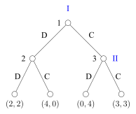
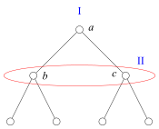
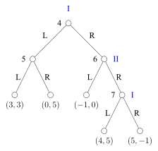
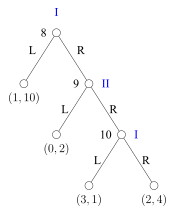
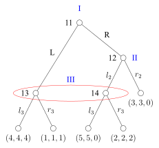
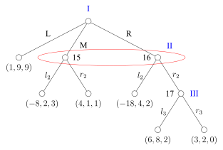
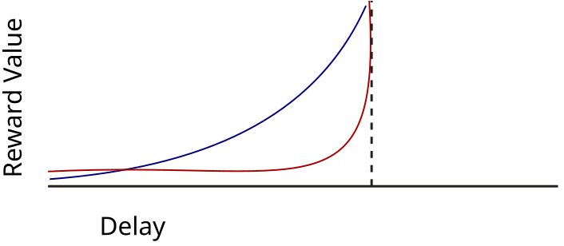
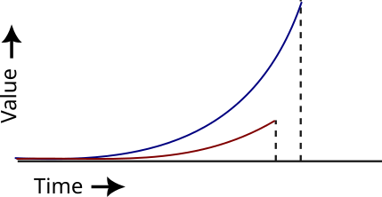
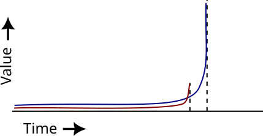

# Game Theory
**First published Sat Jan 25, 1997; substantive revision Sun Sep 3, 2023**

*Ross, Don*

Game theory is the study of the ways in which *interacting choices* of *economic agents* produce *outcomes* with respect to the *preferences* (or *utilities*) of those agents, where the outcomes in question might have been intended by none of the agents. The meaning of this statement will not be clear to the non-expert until each of the italicized words and phrases has been explained and featured in some examples. Doing this will be the main business of this article. First, however, we provide some historical and philosophical context in order to motivate the reader for the technical work ahead.

## 1. Philosophical and Historical Motivation

Game theory in the form known to economists, social scientists, and biologists, was given its first general mathematical formulation by John von Neumann and Oskar Morgenstern (1944). For reasons to be discussed later, limitations in their formal framework initially made the theory applicable only under special and limited conditions. This situation has dramatically changed, in ways we will examine as we go along, over the past seven decades, as the framework has been deepened and generalized. Refinements are still being made, and we will review a few outstanding problems that lie along the advancing front edge of these developments towards the end of the article. However, since at least the late 1970s it has been possible to say with confidence that game theory is the most important and useful tool in the analyst’s kit whenever she confronts situations in which what counts as one agent’s best action (for her) depends on expectations about what one or more other agents will do, and what counts as their best actions (for them) similarly depend on expectations about her.

Despite the fact that game theory has been rendered mathematically and logically systematic only since 1944, game-theoretic insights can be found among commentators going back to ancient times. For example, in two of Plato’s texts, the *Laches* and the *Symposium*, Socrates recalls an episode from the Battle of Delium that some commentators have interpreted (probably anachronistically) as involving the following situation. Consider a soldier at the front, waiting with his comrades to repulse an enemy attack. It may occur to him that if the defense is likely to be successful, then it isn’t very probable that his own personal contribution will be essential. But if he stays, he runs the risk of being killed or wounded—apparently for no point. On the other hand, if the enemy is going to win the battle, then his chances of death or injury are higher still, and now quite clearly to no point, since the line will be overwhelmed anyway. Based on this reasoning, it would appear that the soldier is better off running away regardless of who is going to win the battle. But if all of the soldiers reason this way—as they all apparently *should*, since they’re all in identical situations—then this will certainly *bring about* the outcome in which the battle is lost. Of course, this point, since it has occurred to us as analysts, can occur to the soldiers too. Does this give them a reason for staying at their posts? Just the contrary: the greater the soldiers’ fear that the battle will be lost, the greater their incentive to get themselves out of harm’s way. And the greater the soldiers’ belief that the battle will be won, without the need of any particular individual’s contributions, the less reason they have to stay and fight. If each soldier *anticipates* this sort of reasoning on the part of the others, all will quickly reason themselves into a panic, and their horrified commander will have a rout on his hands before the enemy has even engaged.

Long before game theory had come along to show analysts how to think about this sort of problem systematically, it had occurred to some actual military leaders and influenced their strategies. Thus the Spanish conqueror Cortez, when landing in Mexico with a small force who had good reason to fear their capacity to repel attack from the far more numerous Aztecs, removed the risk that his troops might think their way into a retreat by burning the ships on which they had landed. With retreat having thus been rendered physically impossible, the Spanish soldiers had no better course of action than to stand and fight—and, furthermore, to fight with as much determination as they could muster. Better still, from Cortez’s point of view, his action had a discouraging effect on the motivation of the Aztecs. He took care to burn his ships very visibly, so that the Aztecs would be sure to see what he had done. They then reasoned as follows: Any commander who could be so confident as to willfully destroy his own option to be prudent if the battle went badly for him must have good reasons for such extreme optimism. It cannot be wise to attack an opponent who has a good reason (whatever, exactly, it might be) for being sure that he can’t lose. The Aztecs therefore retreated into the surrounding hills, and Cortez had the easiest possible victory.

These two situations, at Delium and as manipulated by Cortez, have a common and interesting underlying logic. Notice that the soldiers are not motivated to retreat *just*, or even mainly, by their rational assessment of the dangers of battle and by their self-interest. Rather, they discover a sound reason to run away by realizing that what it makes sense for them to do depends on what it will make sense for others to do, and that all of the others can notice this too. Even a quite brave soldier may prefer to run rather than heroically, but pointlessly, die trying to stem the oncoming tide all by himself. Thus we could imagine, without contradiction, a circumstance in which an army, all of whose members are brave, flees at top speed before the enemy makes a move. If the soldiers really *are* brave, then this surely isn’t the outcome any of them wanted; each would have preferred that all stand and fight. What we have here, then, is a case in which the *interaction* of many individually rational decision-making processes—one process per soldier—produces an outcome intended by no one. (Many armies try to avoid this problem just as Cortez did. Since they can’t usually make retreat *physically* impossible, they make it *economically* irrational: for most of history, it was standard military practice to execute deserters. In that context standing and fighting is each soldier’s individually rational course of action after all, because the expected cost of running is at least as high as the cost of staying.)

Another classic source that invites this sequence of reasoning is found in Shakespeare’s *Henry V*. During the Battle of Agincourt Henry decided to slaughter his French prisoners, in full view of the enemy and to the surprise of his subordinates, who describe the action as being out of moral character. The reasons Henry gives allude to non-strategic considerations: he is afraid that the prisoners may free themselves and threaten his position. However, a game theorist might have furnished him with supplementary strategic (and similarly prudential, though perhaps not moral) justification. His own troops observe that the prisoners have been killed, and observe that the enemy has observed this. Therefore, they know what fate will await them at the enemy’s hand if they don’t win. Metaphorically, but very effectively, their boats have been burnt. The slaughter of the prisoners plausibly sent a signal to the soldiers of both sides, thereby changing their incentives in ways that favoured English prospects for victory.

These examples might seem to be relevant only for those who find themselves in situations of cut-throat competition. Perhaps, one might think, it is important for generals, politicians, mafiosi, sports coaches and others whose jobs involve strategic manipulation of others, but the philosopher should only deplore its amorality. Such a conclusion would be highly premature, however. The study of the *logic* that governs the interrelationships amongst incentives, strategic interactions and outcomes has been fundamental in modern political philosophy, since centuries before anyone had an explicit name for this sort of logic. Philosophers share with social scientists the need to be able to represent and systematically model not only what they think people normatively *ought to* do, but what they often *actually* do in interactive situations.

Hobbes’s *Leviathan* is often regarded as the founding work in modern political philosophy, the text that began the continuing round of analyses of the function and justification of the state and its restrictions on individual liberties. The core of Hobbes’s reasoning can be given straightforwardly as follows. The best situation for all people is one in which each is free to do as she pleases. (One may or may not agree with this as a matter of psychology or ideology, but it is Hobbes’s assumption.) Often, such free people will wish to cooperate with one another in order to carry out projects that would be impossible for an individual acting alone. But if there are any immoral or amoral agents around, they will notice that their interests might at least sometimes be best served by getting the benefits from cooperation and not returning them. Suppose, for example, that you agree to help me build my house in return for my promise to help you build yours. After my house is finished, I can make your labour free to me simply by reneging on my promise. I then realize, however, that if this leaves you with no house, you will have an incentive to take mine. This will put me in constant fear of you, and force me to spend valuable time and resources guarding myself against you. I can best minimize these costs by striking first and killing you at the first opportunity. Of course, you can anticipate all of this reasoning by me, and so have good reason to try to beat me to the punch. Since I can anticipate *this* reasoning by *you*, my original fear of you was not paranoid; nor was yours of me. In fact, neither of us actually needs to be immoral to get this chain of mutual reasoning going; we need only think that there is some *possibility* that the other might try to cheat on bargains. Once a small wedge of doubt enters any one mind, the incentive induced by fear of the consequences of being *preempted*—hit before hitting first—quickly becomes overwhelming on both sides. If either of us has any resources of our own that the other might want, this murderous logic can take hold long before we are so silly as to imagine that we could ever actually get as far as making deals to help one another build houses in the first place. Left to their own devices, agents who are at least sometimes narrowly self-interested can repeatedly fail to derive the benefits of cooperation, and instead be trapped in a state of ‘war of all against all’, in Hobbes’s words. In these circumstances, human life, as he vividly and famously put it, will be “solitary, poor, nasty, brutish and short.”

Hobbes’s proposed solution to this problem was tyranny. The people can hire an agent—a government—whose job is to punish anyone who breaks any promise. So long as the threatened punishment is sufficiently dire then the cost of reneging on promises will exceed the cost of keeping them. The logic here is identical to that used by an army when it threatens to shoot deserters. If all people know that these incentives hold for most others, then cooperation will not only be possible, but can be the expected norm, so that the war of all against all becomes a general peace.

Hobbes pushes the logic of this argument to a very strong conclusion, arguing that it implies not only a government with the right and the power to enforce cooperation, but an ‘undivided’ government in which the arbitrary will of a single ruler must impose absolute obligation on all. Few contemporary political theorists think that the particular steps by which Hobbes reasons his way to this conclusion are both sound and valid. Working through these issues here, however, would carry us away from our topic into details of contractarian political philosophy. What is important in the present context is that these details, as they are in fact pursued in contemporary debates, involve sophisticated interpretation of the issues using the resources of modern game theory (see, for example, Hampton 1986)[^hampton-1986]. Furthermore, Hobbes’s most basic point, that the fundamental justification for the coercive authority and practices of governments is peoples’ own need to protect themselves from what game theorists call ‘social dilemmas’, is accepted by many, if not most, political theorists. Notice that Hobbes has *not* argued that tyranny is a desirable thing in itself. The structure of his argument is that the logic of strategic interaction leaves only two general political outcomes possible: tyranny and anarchy. Sensible agents then choose tyranny as the lesser of two evils.

The reasoning of the Athenian soldiers, of Cortez, and of Hobbes’s political agents has a common logic, one derived from their situations. In each case, the aspect of the environment that is most important to the agents’ achievement of their preferred outcomes is the set of expectations and possible reactions to their strategies by other agents. The distinction between acting *parametrically* on a passive world and acting *non-parametrically* on a world that tries to act in anticipation of these actions is fundamental. If you want to kick a rock down a hill, you need only concern yourself with the rock’s mass relative to the force of your blow, the extent to which it is bonded with its supporting surface, the slope of the ground on the other side of the rock, and the expected impact of the collision on your foot. The values of all of these variables are independent of your plans and intentions, since the rock has no interests of its own and takes no actions to attempt to assist or thwart you. By contrast, if you wish to kick a person down the hill, then unless that person is unconscious, bound or otherwise incapacitated, you will likely not succeed unless you can disguise your plans until it’s too late for him to take either evasive or forestalling action. Furthermore, his probable responses should be expected to visit costs upon you, which you would be wise to consider. Finally, the relative probabilities of his responses will depend on his expectations about your probable responses to his responses. (Consider the difference it will make to both of your reasoning if one or both of you are armed, or one of you is bigger than the other, or one of you is the other’s boss.) The logical issues associated with the second sort of situation (kicking the person as opposed to the rock) are typically much more complicated, as a simple hypothetical example will illustrate.

Suppose first that you wish to cross a river that is spanned by three bridges. (Assume that swimming, wading or boating across are impossible.) The first bridge is known to be safe and free of obstacles; if you try to cross there, you will succeed. The second bridge lies beneath a cliff from which large rocks sometimes fall. The third is inhabited by deadly cobras. Now suppose you wish to rank-order the three bridges with respect to their preferability as crossing-points. Unless you get positive enjoyment from risking your life—which, without violating any economist’s conception of rationality, you might well (a complication we’ll take up later in this article)—then your decision problem here is straightforward. The first bridge is obviously best, since it is safest. To rank-order the other two bridges, you require information about their relative levels of danger. If you can study the frequency of rock-falls and the movements of the cobras for awhile, you might be able to calculate that the probability of your being crushed by a rock at the second bridge is 10% and of being struck by a cobra at the third bridge is 20%. Your reasoning here is strictly parametric because neither the rocks nor the cobras are trying to influence your actions, by, for example, concealing their typical patterns of behaviour because they know you are studying them. It is obvious what you should do here: cross at the safe bridge. Now let us complicate the situation a bit. Suppose that the bridge with the rocks is immediately before you, while the safe bridge is a day’s difficult hike upstream. Your decision-making situation here is slightly more complicated, but it is still strictly parametric. You have to decide whether the cost of the long hike is worth exchanging for the penalty of a 10% chance of being hit by a rock. However, this is all you must decide, and your probability of a successful crossing is entirely up to you; the environment is not interested in your plans.

However, if we now complicate the situation by adding a non-parametric element, it becomes more challenging. Suppose that you are a fugitive of some sort, and waiting on the other side of the river with a gun is your pursuer. She will catch and shoot you, let us suppose, only if she waits at the bridge you try to cross; otherwise, you will escape. As you reason through your choice of bridge, it occurs to you that she is over there trying to anticipate your reasoning. It will seem that, surely, choosing the safe bridge straight away would be a mistake, since that is just where she will expect you, and your chances of death rise to certainty. So perhaps you should risk the rocks, since these odds are much better. But wait … if you can reach this conclusion, your pursuer, who is just as well-informed as you are, can anticipate that you will reach it, and will be waiting for you if you evade the rocks. So perhaps you must take your chances with the cobras; that is what she must least expect. But, then, no … if she expects that you will expect that she will least expect this, then she will most expect it. This dilemma, you realize with dread, is general: you must do what your pursuer least expects; but whatever you most expect her to least expect is automatically what she will most expect. You appear to be trapped in indecision. But what should console you somewhat here is that, on the other side of the river, your pursuer is trapped in exactly the same quandary, unable to decide which bridge to wait at because as soon as she imagines committing to one, she will notice that if she can find a best reason to pick a bridge, you can anticipate that same reason and then avoid her.

We know from experience that, in situations such as this, people do not usually stand and dither in circles forever. As we’ll see later, there *is* a unique best solution available to each player. However, until the 1940s neither philosophers nor economists knew how to find it mathematically. As a result, economists were forced to treat non-parametric influences as if they were complications on parametric ones. This is likely to strike the reader as odd, since, as our example of the bridge-crossing problem was meant to show, non-parametric features are often fundamental features of decision-making problems. Part of the explanation for game theory’s relatively late entry into the field lies in the problems with which economists had historically been concerned. Classical economists, such as Adam Smith and David Ricardo, were mainly interested in the question of how agents in very large markets—whole nations—could interact so as to bring about maximum monetary wealth for themselves. Smith’s basic insight, that efficiency is best maximized by agents first differentiating their potential contributions and then freely seeking mutually advantageous bargains, was mathematically verified in the twentieth century. However, the demonstration of this fact applies only in conditions of ‘perfect competition,’ that is, when individuals or firms face no costs of entry or exit into markets, when there are no economies of scale, and when no agents’ actions have unintended side-effects on other agents’ well-being. Economists always recognized that this set of assumptions is purely an idealization for purposes of analysis, not a possible state of affairs anyone could try (or should want to try) to institutionally establish. But until the mathematics of game theory matured near the end of the 1970s, economists had to hope that the more closely a market *approximates* perfect competition, the more efficient it will be. No such hope, however, can be mathematically or logically justified in general; indeed, as a strict generalization the assumption was shown to be false as far back as the 1950s.

This article is not about the foundations of economics, but it is important for understanding the origins and scope of game theory to know that perfectly competitive markets have built into them a feature that renders them susceptible to parametric analysis. Because agents face no entry costs to markets, they will open shop in any given market until competition drives all profits to zero. This implies that if production costs are fixed and demand is exogenous, then agents have no options about how much to produce if they are trying to maximize the differences between their costs and their revenues. These production levels can be determined separately for each agent, so none need pay attention to what the others are doing; each agent treats her counterparts as passive features of the environment. The other kind of situation to which classical economic analysis can be applied without recourse to game theory is that of a monopoly facing many customers. Here, as long as no customer has a share of demand large enough to exert strategic leverage, non-parametric considerations drop out and the firm’s task is only to identify the combination of price and production quantity at which it maximizes profit. However, both perfect and monopolistic competition are very special and unusual market arrangements. Prior to the advent of game theory, therefore, economists were severely limited in the class of circumstances to which they could straightforwardly apply their models.

Philosophers share with economists a professional interest in the conditions and techniques for the maximization of welfare. In addition, philosophers have a special concern with the logical justification of actions, and often actions are justified by reference to their expected outcomes. (One tradition in moral philosophy, utilitarianism, is based on the idea that all morally significant actions are best justified in this way.) Without game theory, both of these problems resist analysis wherever non-parametric aspects are relevant. We will demonstrate this shortly by reference to the most famous (though not the most typical) game, the so-called *Prisoner’s Dilemma*, and to other, more typical, games. In doing this, we will need to introduce, define and illustrate the basic elements and techniques of game theory.

## 2. Basic Elements and Assumptions of Game Theory

### 2.1 Utility

An economic agent is, by definition, an entity with *preferences*. Game theorists, like economists and philosophers who study practical choice, describe these by means of an abstract concept called *utility*. This refers to some ranking, on some specified scale, of the subjective welfare or change in subjective welfare that an agent derives from an event. By ‘welfare’ we refer to some normative index of relative alignment between states of the world and agents’ valuations of the states in question, justified by reference to some background framework. For example, we might evaluate the relative welfare of countries (which we might model as agents for some purposes) by reference to their per capita incomes, and we might evaluate the relative welfare of an animal, in the context of predicting and explaining its behavioral dispositions, by reference to its expected evolutionary fitness. In the case of people, it is most typical in economics and applications of game theory to evaluate their relative welfare by reference to their own implicit or explicit judgments of it. This is why we referred above to *subjective* welfare. Consider a person who adores the taste of pickles but dislikes onions. She might be said to associate higher utility with states of the world in which, all else being equal, she consumes more pickles and fewer onions than with states in which she consumes more onions and fewer pickles. Examples of this kind suggest that ‘utility’ denotes a measure of subjective *psychological* fulfillment, and this is indeed how the concept was originally interpreted by economists and philosophers influenced by the utilitarianism of Jeremy Bentham. However, economists in the early 20th century recognized increasingly clearly that their main interest was in the market property of decreasing marginal demand, regardless of whether that was produced by satiated individual consumers or by some other factors. In the 1930s this motivation of economists fit comfortably with the dominance of behaviourism and radical empiricism in psychology and in the philosophy of science respectively. Behaviourists and radical empiricists objected to the theoretical use of such unobservable entities as ‘psychological fulfillment quotients.’ The intellectual climate was thus receptive to the efforts of the economist Paul Samuelson (1938) to redefine utility in such a way that it becomes a purely technical concept rather than one rooted in speculative psychology. Since Samuelson’s redefinition became standard in the 1950s, when we say that an agent acts so as to maximize her utility, we mean by ‘utility’ simply whatever it is that the agent’s behavior suggests her to consistently act so as to make more probable. If this looks circular to you, it should: theorists who follow Samuelson *intend* the statement ‘agents act so as to maximize their utility’ as a tautology, where an ‘(economic) agent’ is any entity that can be accurately described as acting to maximize a utility function, an ‘action’ is any utility-maximizing selection from a set of possible alternatives, and a‘utility function’ is what an economic agent maximizes. Like other tautologies occurring in the foundations of scientific theories, this interlocking (recursive) system of definitions is useful not in itself, but because it helps to fix our contexts of inquiry.

Though the behaviourism of the 1930s has since been displaced by widespread interest in cognitive processes, many theorists continue to follow Samuelson’s way of understanding utility because they think it important that game theory apply to *any* kind of agent—a person, a bear, a bee, a firm or a country—and not just to agents with human minds. When such theorists say that agents act so as to maximize their utility, they want this to be part of the *definition* of what it is to be an agent, not an empirical claim about possible inner states and motivations. Samuelson’s conception of utility, defined by way of *Revealed Preference Theory* (RPT) introduced in his classic paper (Samuelson (1938)) satisfies this demand.

Economists and others who interpret game theory in terms of RPT should not think of game theory as an empirical account of the motivations of some flesh-and-blood actors (such as actual people). Rather, they should regard game theory as part of the body of mathematics that is used to model those entities who consistently select elements from mutually exclusive action sets, resulting in patterns of choices, which, allowing for some stochasticity and noise, can be statistically modeled as maximization of utility functions. On this interpretation, game theory could not be refuted by any empirical observations, since it is not an empirical theory in the first place. Of course, observation and experience could lead someone favoring this interpretation to conclude that game theory is of little *help* in describing actual human behavior.

Some other theorists understand the point of game theory differently. They view game theory as providing an explanatory account of actual human strategic reasoning processes. For this idea to be applicable, we must suppose that agents at least sometimes do what they do in non-parametric settings *because* game-theoretic logic recommends certain actions as the ‘rational’ ones. Such an understanding of game theory incorporates a *normative* aspect, since ‘rationality’ is taken to denote a property that an agent should at least generally want to have. These two very general ways of thinking about the possible uses of game theory are compatible with the tautological interpretation of utility maximization. The philosophical difference is not idle from the perspective of the working game theorist, however. As we will see in a later section, those who hope to use game theory to explain strategic *reasoning*, as opposed to merely strategic *behavior*, face some special philosophical and practical problems.

Since game theory is a technology for formal modeling, we must have a device for thinking of utility maximization in mathematical terms. Such a device is called a *utility function*. We will introduce the general idea of a utility function through the special case of an *ordinal* utility function. (Later, we will encounter utility functions that incorporate more information.) The utility-map for an agent is called a ‘function’ because it maps *ordered preferences* onto the real numbers. Suppose that agent $x$ prefers bundle $a$ to bundle $b$ and bundle $b$ to bundle $c$. We then map these onto a list of numbers, where the function maps the highest-ranked bundle onto the largest number in the list, the second-highest-ranked bundle onto the next-largest number in the list, and so on, thus:

$$\begin{align} \text{bundle } a &\gg 3 \\ \text{bundle } b &\gg 2 \\ \text{bundle } c &\gg 1 \end{align}$$

The only property mapped by this function is *order*. The magnitudes of the numbers are irrelevant; that is, it must not be inferred that $x$ gets 3 times as much utility from bundle $a$ as she gets from bundle $c$. Thus we could represent *exactly the same* utility function as that above by

$$\begin{align} \text{bundle } a &\gg 7,326 \\ \text{bundle } b &\gg 12.6 \\ \text{bundle } c &\gg -1,000,000 \end{align}$$

The numbers featuring in an ordinal utility function are thus not measuring any *quantity* of anything. A utility-function in which magnitudes *do* matter is called ‘cardinal’. Whenever someone refers to a utility function without specifying which kind is meant, you should assume that it’s ordinal. These are the sorts we’ll need for the first set of games we’ll examine. Later, when we come to seeing how to solve games that involve (*ex ante*) uncertainty—our river-crossing game from Part 1 above, for example—we’ll need to build cardinal utility functions. The technique for doing this was given by von Neumann & Morgenstern (1944), and was an essential aspect of their invention of game theory. For the moment, however, we will need only ordinal functions.

### 2.2 Games and Rationality

All situations in which at least one agent can only act to maximize her utility through anticipating (either consciously, or just implicitly in his behavior) the responses to her actions by one or more other agents is called a *game*. Agents involved in games are referred to as *players*. If all agents have optimal actions regardless of what the others do, as in purely parametric situations or conditions of monopoly or perfect competition (see Section 1 above) we can model this without appeal to game theory; otherwise, we need it.

Game theorists assume that players have sets of capacities that are typically referred to in the literature of economics as comprising ‘rationality’. Usually this is formulated by simple statements such as ‘it is assumed that players are rational’. In literature critical of economics in general, or of the importation of game theory into humanistic disciplines, this kind of rhetoric has increasingly become a magnet for attack. There is a dense and intricate web of connections associated with ‘rationality’ in the Western cultural tradition, and historically the word was often used to normatively marginalize characteristics as normal and important as emotion, femininity and empathy. Game theorists’ use of the concept need not, and generally does not, implicate such ideology. For present purposes we will use ‘economic rationality’ as a strictly technical, not normative, term to refer to a narrow and specific set of restrictions on preferences that are shared by von Neumann and Morgenstern’s original version of game theory, and RPT. Economists use a second, equally important (to them) concept of rationality when they are modeling markets, which they call ‘rational expectations’. In this phrase, ‘rationality’ refers not to restrictions on preferences but to *non*-restrictions on information processing: rational expectations are idealized beliefs that reflect statistically accurately weighted use of all information available to an agent. The reader should note that these two uses of one word within the same discipline are technically unconnected. Furthermore, original RPT has been specified over the years by several different sets of axioms for different modeling purposes. Once we decide to treat rationality as a technical concept, each time we adjust the axioms we effectively modify the concept. Consequently, in any discussion involving economists and philosophers together, we can find ourselves in a situation where different participants use the same word to refer to something different. For readers new to economics, game theory, decision theory and the philosophy of action, this situation naturally presents a challenge.

In this article, ‘economic rationality’ will be used in the technical sense shared within game theory, microeconomics and formal decision theory, as follows. An economically rational player is one who can (i) assess outcomes, in the sense of rank-ordering them with respect to their contributions to her welfare; (ii) calculate paths to outcomes, in the sense of recognizing which sequences of actions are probabilistically associated with which outcomes; and (iii) select actions from sets of alternatives (which we’ll describe as ‘choosing’ actions) that yield her most-preferred outcomes, given the actions of the other players. We might summarize the intuition behind all this as follows: an entity is usefully modeled as an economically rational agent to the extent that it has alternatives, and chooses from amongst these in a way that is motivated, at least more often than not, by what seems best for its purposes. For readers who are antecedently familiar with the work of the philosopher Daniel Dennett, we could equate the idea of an economically rational agent with the kind of entity Dennett characterizes as *intentional*, and then say that we can usefully predict an economically rational agent’s behavior from ‘the intentional stance’. As will be discussed later, the intentional stance can be made precise for application to quantitatively specified choices by drawing, sometimes with special modifications, on the *subjective rationality* axioms of Savage (1954) (Harrison and Ross forthcoming).

Economic rationality might in some cases be satisfied by internal computations performed by an agent, and she might or might not be aware of computing or having computed its conditions and implications. In other cases, economic rationality might simply be embodied in behavioral dispositions built by natural, cultural or market selection. In particular, in calling an action ‘chosen’ we imply no necessary deliberation, conscious or otherwise. We mean merely that the action was taken when an alternative action was available, in some sense of ‘available’ normally established by the context of the particular analysis. (‘Available’, as used by game theorists and economists, should never be read as if it meant merely ‘metaphysically’ or ‘logically’ available; it is almost always pragmatic, contextual and revisable by more refined modeling.)

Each player in a game faces a choice among two or more possible *strategies*. A strategy is a predetermined ‘program of play’ that tells her what actions to take in response to *every possible strategy other players might use*. The significance of the italicized phrase here will become clear when we take up some sample games below.

A crucial aspect of the specification of a game involves the information that players have when they choose strategies. The simplest games (from the perspective of logical structure) are those in which agents have *perfect information*, meaning that at every point where each agent’s strategy tells her to take an action, she knows everything that has happened in the game up to that point. A board-game of sequential moves in which both players watch all the action (and know the rules in common), such as chess, is an instance of such a game. By contrast, the example of the bridge-crossing game from Section 1 above illustrates a game of *imperfect information*, since the fugitive must choose a bridge to cross without knowing the bridge at which the pursuer has chosen to wait, and the pursuer similarly makes her decision in ignorance of the choices of her quarry. Since game theory is about economically rational action given the strategically significant actions of others, it should not surprise you to be told that what agents in games believe, or fail to believe, about each others’ actions makes a considerable difference to the logic of our analyses, as we will see.

### 2.3 Trees and Matrices

The difference between games of perfect and of imperfect information is related to (though certainly not identical with!) a distinction between *ways of representing* games that is based on *order of play*. Let us begin by distinguishing between sequential-move and simultaneous-move games in terms of information. It is natural, as a first approximation, to think of sequential-move games as being ones in which players choose their strategies one after the other, and of simultaneous-move games as ones in which players choose their strategies at the same time. This isn’t quite right, however, because what is of strategic importance is not the temporal *order* of events per se, but whether and when players *know about* other players’ actions relative to having to choose their own. For example, if two competing businesses are both planning marketing campaigns, one might commit to its strategy months before the other does; but if neither knows what the other has committed to or will commit to when they make their decisions, this is a simultaneous-move game. Chess, by contrast, is normally played as a sequential-move game: you see what your opponent has done before choosing your own next action. (Chess *can* be turned into a simultaneous-move game if the players each call moves on a common board while isolated from one another; but this is a very different game from conventional chess.)

It was said above that the distinction between sequential-move and simultaneous-move games is not identical to the distinction between perfect-information and imperfect-information games. Explaining why this is so is a good way of establishing full understanding of both sets of concepts. As simultaneous-move games were characterized in the previous paragraph, it must be true that all simultaneous-move games are games of imperfect information. However, some games may contain mixes of sequential and simultaneous moves. For example, two firms might commit to their marketing strategies independently and in secrecy from one another, but thereafter engage in pricing competition in full view of one another. If the optimal marketing strategies were partially or wholly dependent on what was expected to happen in the subsequent pricing game, then the two stages would need to be analyzed as a single game, in which a stage of sequential play followed a stage of simultaneous play. Whole games that involve mixed stages of this sort are games of imperfect information, however temporally staged they might be. Games of perfect information (as the name implies) denote cases where *no* moves are simultaneous (and where no player ever forgets what has gone before).

As previously noted, games of perfect information are the (logically) simplest sorts of games. This is so because in such games (as long as the games are finite, that is, terminate after a known number of actions) players and analysts can use a straightforward procedure for predicting outcomes. A player in such a game chooses her first action by considering each series of responses and counter-responses that will result from each action open to her. She then asks herself which of the available final outcomes brings her the highest utility, and chooses the action that starts the chain leading to this outcome. This process is called *backward induction* (because the reasoning works backwards from eventual outcomes to present choice problems).

There will be much more to be said about backward induction and its properties in a later section (when we come to discuss equilibrium and equilibrium selection). For now, it has been described just so we can use it to introduce one of the two types of mathematical objects used to represent games: *game trees*. A game tree is an example of what mathematicians call a *directed graph*. That is, it is a set of connected nodes in which the overall graph has a direction. We can draw trees from the top of the page to the bottom, or from left to right. In the first case, nodes at the top of the page are interpreted as coming earlier in the sequence of actions. In the case of a tree drawn from left to right, leftward nodes are prior in the sequence to rightward ones. An unlabelled tree has a structure of the following sort:

*Figure 1*

Figure 1

The point of representing games using trees can best be grasped by visualizing the use of them in supporting backward-induction reasoning. Just imagine the player (or analyst) beginning at the end of the tree, where outcomes are displayed, and then working backwards from these, looking for sets of strategies that describe paths leading to them. Since a player’s utility function indicates which outcomes she prefers to which, we also know which paths she will prefer. Of course, not all paths will be possible because the other player has a role in selecting paths too, and won’t take actions that lead to less preferred outcomes for her. We will present some examples of this interactive path selection, and detailed techniques for reasoning through these examples, after we have described a situation we can use a tree to model.

Trees are used to represent *sequential* games, because they show the order in which actions are taken by the players. However, games are sometimes represented on *matrices* rather than trees. This is the second type of mathematical object used to represent games. Matrices, unlike trees, simply show the outcomes, represented in terms of the players’ utility functions, for every possible combination of strategies the players might use. For example, it makes sense to display the river-crossing game from Section 1 on a matrix, since in that game both the fugitive and the hunter have just one move each, and each chooses their move in ignorance of what the other has decided to do. Here, then, is *part of* the matrix:

*Figure 2*

|   | Hunter |   |   |   |
| --- | --- | --- | --- | --- |
| *Safe Bridge* | *Rocky Bridge* | *Cobra Bridge* |   |   |
| Fugitive | *Safe Bridge* | 0,1 | 1,0 | 1,0 |
| *Rocky Bridge* | ? | 0,1 | ? |   |
| *Cobra Bridge* | ? | ? | 0,1 |   |

Figure 2

The fugitive’s three possible strategies—cross at the safe bridge, risk the rocks, or risk the cobras—form the rows of the matrix. Similarly, the hunter’s three possible strategies—waiting at the safe bridge, waiting at the rocky bridge and waiting at the cobra bridge—form the columns of the matrix. Each cell of the matrix shows—or, rather *would* show if our matrix was complete—an *outcome* defined in terms of the players’ *payoffs*. A player’s payoff is simply the number assigned by her ordinal utility function to the state of affairs corresponding to the outcome in question. For each outcome, Row’s payoff is always listed first, followed by Column’s. Thus, for example, the upper left-hand corner above shows that when the fugitive crosses at the safe bridge and the hunter is waiting there, the fugitive gets a payoff of 0 and the hunter gets a payoff of 1. We interpret these by reference to the two players’ utility functions, which in this game are very simple. If the fugitive gets safely across the river he receives a payoff of 1; if he doesn’t he gets 0. If the fugitive doesn’t make it, either because he’s shot by the hunter or hit by a rock or bitten by a cobra, then the hunter gets a payoff of 1 and the fugitive gets a payoff of 0.

We’ll briefly explain the parts of the matrix that have been filled in, and then say why we can’t yet complete the rest. Whenever the hunter waits at the bridge chosen by the fugitive, the fugitive is shot. These outcomes all deliver the payoff vector (0, 1). You can find them descending diagonally across the matrix above from the upper left-hand corner. Whenever the fugitive chooses the safe bridge but the hunter waits at another, the fugitive gets safely across, yielding the payoff vector (1, 0). These two outcomes are shown in the second two cells of the top row. All of the other cells are marked, *for now*, with question marks. Why? The problem here is that if the fugitive crosses at either the rocky bridge or the cobra bridge, he introduces parametric factors into the game. In these cases, he takes on some risk of getting killed, and so producing the payoff vector (0, 1), that is independent of anything the hunter does. We don’t yet have enough concepts introduced to be able to show how to represent these outcomes in terms of utility functions—but by the time we’re finished we will, and this will provide the key to solving our puzzle from Section 1.

Matrix games are referred to as ‘normal-form’ or ‘strategic-form’ games, and games as trees are referred to as ‘extensive-form’ games. The two sorts of games are not equivalent, because extensive-form games contain information—about sequences of play and players’ levels of information about the game structure—that strategic-form games do not. In general, a strategic-form game could represent any one of several extensive-form games, so a strategic-form game is best thought of as being a *set* of extensive-form games. When order of play is irrelevant to a game’s outcome, then you should study its strategic form, since it’s the whole set you want to know about. Where order of play *is* relevant, the extensive form *must* be specified or your conclusions will be unreliable.

### 2.4 The Prisoner’s Dilemma as an Example of Strategic-Form vs. Extensive-Form Representation

The distinctions described above are difficult to fully grasp if all one has to go on are abstract descriptions. They’re best illustrated by means of an example. For this purpose, we’ll use the most famous of all games: the Prisoner’s Dilemma. It in fact gives the logic of the problem faced by Cortez’s and Henry V’s soldiers (see Section 1 above), and by Hobbes’s agents before they empower the tyrant. However, for reasons which will become clear a bit later, you should not take the PD as a *typical* game; it isn’t. We use it as an extended example here only because it’s particularly helpful for illustrating the *relationship* between strategic-form and extensive-form games (and later, for illustrating the relationships between one-shot and repeated games; see Section 4 below).

The name of the Prisoner’s Dilemma game is derived from the following situation typically used to exemplify it. Suppose that the police have arrested two people whom they know have committed an armed robbery together. Unfortunately, they lack enough admissible evidence to get a jury to convict. They *do*, however, have enough evidence to send each prisoner away for two years for theft of the getaway car. The chief inspector now makes the following offer to each prisoner: If you will confess to the robbery, implicating your partner, and she does not also confess, then you’ll go free and she’ll get ten years. If you both confess, you’ll each get 5 years. If neither of you confess, then you’ll each get two years for the auto theft.

Our first step in modeling the two prisoners’ situation as a game is to represent it in terms of utility functions. Following the usual convention, let us name the prisoners ‘Player I’ and ‘Player II’. Both Player I’s and Player II’s ordinal utility functions are identical:

$$\begin{align} \text{Go free } &\gg 4 \\ 2 \text{ years } &\gg 3 \\ 5 \text{ years } &\gg 2 \\ 10 \text{ years } &\gg 0 \end{align}$$

The numbers in the function above are now used to express each player’s *payoffs* in the various outcomes possible in the situation. We can represent the problem faced by both of them on a single matrix that captures the way in which their separate choices interact; this is the strategic form of their game:

*Figure 3*

|   | Player II |   |   |
| --- | --- | --- | --- |
| *Confess* | *Refuse* |   |   |
| Player I | *Confess* | 2,2 | 4,0 |
| *Refuse* | 0,4 | 3,3 |   |

Figure 3

Each cell of the matrix gives the payoffs to both players for each combination of actions. Player I’s payoff appears as the first number of each pair, Player II’s as the second. So, if both players confess then they each get a payoff of 2 (5 years in prison each). This appears in the upper-left cell. If neither of them confess, they each get a payoff of 3 (2 years in prison each). This appears as the lower-right cell. If Player I confesses and Player II doesn’t then Player I gets a payoff of 4 (going free) and Player II gets a payoff of 0 (ten years in prison). This appears in the upper-right cell. The reverse situation, in which Player II confesses and Player I refuses, appears in the lower-left cell.

Each player evaluates his or her two possible actions here by comparing their personal payoffs in each column, since this shows you which of their actions is preferable, just to themselves, for each possible action by their partner. So, observe: If Player II confesses then Player I gets a payoff of 2 by confessing and a payoff of 0 by refusing. If Player II refuses, then Player I gets a payoff of 4 by confessing and a payoff of 3 by refusing. Therefore, Player I is better off confessing regardless of what Player II does. Player II, meanwhile, evaluates her actions by comparing her payoffs down each row, and she comes to exactly the same conclusion that Player I does. Wherever one action for a player is superior to her other actions for each possible action by the opponent, we say that the first action *strictly dominates* the second one. In the PD, then, confessing strictly dominates refusing for both players. Both players know this about each other, thus entirely eliminating any temptation to depart from the strictly dominated path. Thus both players will confess, and both will go to prison for 5 years.

The players, and analysts, can predict this outcome using a mechanical procedure, known as iterated elimination of strictly dominated strategies. Player 1 can see by examining the matrix that his payoffs in each cell of the top row are higher than his payoffs in each corresponding cell of the bottom row. Therefore, it can never be utility-maximizing for him to play his bottom-row strategy, viz., refusing to confess, *regardless of what Player II does*. Since Player I’s bottom-row strategy will never be played, we can simply *delete* the bottom row from the matrix. Now it is obvious that Player II will not refuse to confess, since her payoff from confessing in the two cells that remain is higher than her payoff from refusing. So, once again, we can delete the one-cell column on the right from the game. We now have only one cell remaining, that corresponding to the outcome brought about by mutual confession. Since the reasoning that led us to delete all other possible outcomes depended at each step only on the premise that both players are economically rational—that is, will choose strategies that lead to higher payoffs over strategies that lead to lower ones—there are strong grounds for viewing joint confession as the *solution* to the game, the outcome on which its play *must* converge to the extent that economic rationality correctly models the behavior of the players. You should note that the order in which strictly dominated rows and columns are deleted doesn’t matter. Had we begun by deleting the right-hand column and then deleted the bottom row, we would have arrived at the same solution.

It’s been said a couple of times that the PD is not a typical game in many respects. One of these respects is that all its rows and columns are either strictly dominated or strictly dominant. In any strategic-form game where this is true, iterated elimination of strictly dominated strategies is guaranteed to yield a unique solution. Later, however, we will see that for many games this condition does not apply, and then our analytic task is less straightforward.

The reader will probably have noticed something disturbing about the outcome of the PD. Had both players refused to confess, they’d have arrived at the lower-right outcome in which they each go to prison for only 2 years, thereby *both* earning higher utility than either receives when both confess. This is the most important fact about the PD, and its significance for game theory is quite general. We’ll therefore return to it below when we discuss equilibrium concepts in game theory. For now, however, let us stay with our use of this particular game to illustrate the difference between strategic and extensive forms.

When people introduce the PD into popular discussions, one will often hear them say that the police inspector must lock his prisoners into separate rooms so that they can’t communicate with one another. The reasoning behind this idea seems obvious: if the players could communicate, they’d surely see that they’re each better off if both refuse, and could make an agreement to do so, no? This, one presumes, would remove each player’s conviction that he or she must confess because they’ll otherwise be sold up the river by their partner. In fact, however, this intuition is misleading and its conclusion is false.

When we represent the PD as a strategic-form game, we implicitly assume that the prisoners can’t attempt collusive agreement since they choose their actions simultaneously. In this case, agreement before the fact can’t help. If Player I is convinced that his partner will stick to the bargain then he can seize the opportunity to go scot-free by confessing. Of course, he realizes that the same temptation will occur to Player II; but in that case he again wants to make sure he confesses, as this is his only means of avoiding his worst outcome. The prisoners’ agreement comes to naught because they have no way of enforcing it; their promises to each other constitute what game theorists call ‘cheap talk’.

But now suppose that the prisoners do *not* move simultaneously. That is, suppose that Player II can choose *after* observing Player I’s action. This is the sort of situation that people who think non-communication important must have in mind. Now Player II will be able to see that Player I has remained steadfast when it comes to her choice, and she need not be concerned about being suckered. However, this doesn’t change anything, a point that is best made by re-representing the game in extensive form. This gives us our opportunity to introduce game-trees and the method of analysis appropriate to them.

First, however, here are definitions of some concepts that will be helpful in analyzing game-trees:

> *Node*: a point at which a player chooses an action.
>
> *Initial node*: the point at which the first action in the game occurs.
>
> *Terminal node*: any node which, if reached, ends the game. Each terminal node corresponds to an *outcome*.
>
> *Subgame*: any connected set of nodes and branches descending uniquely from one node.
>
> *Payoff*: an ordinal utility number assigned to a player at an outcome.
>
> *Outcome*: an assignment of a set of payoffs, one to each player in the game.
>
> *Strategy*: a program instructing a player which action to take at every node in the tree where she could possibly be called on to make a choice.

These quick definitions may not mean very much to you until you follow them being put to use in our analyses of trees below. It will probably be best if you scroll back and forth between them and the examples as we work through them. By the time you understand each example, you’ll find the concepts and their definitions natural and intuitive.

To make this exercise maximally instructive, let’s suppose that Players I and II have studied the matrix above and, seeing that they’re both better off in the outcome represented by the lower-right cell, have formed an agreement to cooperate. Player I is to commit to refusal first, after which Player II will reciprocate when the police ask for her choice. We will refer to a strategy of keeping the agreement as ‘cooperation’, and will denote it in the tree below with ‘C’. We will refer to a strategy of breaking the agreement as ‘defection’, and will denote it on the tree below with ‘D’. Each node is numbered 1, 2, 3, … , from top to bottom, for ease of reference in discussion. Here, then, is the tree:

*Figure 4*

Figure 4

Look first at each of the terminal nodes (those along the bottom). These represent possible outcomes. Each is identified with an assignment of payoffs, just as in the strategic-form game, with Player I’s payoff appearing first in each set and Player II’s appearing second. Each of the structures descending from the nodes 1, 2 and 3 respectively is a subgame. We begin our backward-induction analysis—using a technique called *Zermelo’s algorithm*—with the sub-games that arise last in the sequence of play. If the subgame descending from node 3 is played, then Player II will face a choice between a payoff of 4 and a payoff of 3. (Consult the second number, representing her payoff, in each set at a terminal node descending from node 3.) II earns her higher payoff by playing D. We may therefore replace the entire subgame with an assignment of the payoff (0,4) directly to node 3, since this is the outcome that will be realized if the game reaches that node. Now consider the subgame descending from node 2. Here, II faces a choice between a payoff of 2 and one of 0. She obtains her higher payoff, 2, by playing D. We may therefore assign the payoff (2,2) directly to node 2. Now we move to the subgame descending from node 1. (This subgame is, of course, identical to the whole game; all games are subgames of themselves.) Player I now faces a choice between outcomes (2,2) and (0,4). Consulting the first numbers in each of these sets, he sees that he gets his higher payoff—2—by playing D. D is, of course, the option of confessing. So Player I confesses, and then Player II also confesses, yielding the same outcome as in the strategic-form representation.

What has happened here intuitively is that Player I realizes that if he plays C (refuse to confess) at node 1, then Player II will be able to maximize her utility by suckering him and playing D. (On the tree, this happens at node 3.) This leaves Player I with a payoff of 0 (ten years in prison), which he can avoid only by playing D to begin with. He therefore defects from the agreement.

We have thus seen that in the case of the Prisoner’s Dilemma, the simultaneous and sequential versions yield the same outcome. This will often not be true of other games, however. Furthermore, only finite extensive-form (sequential) games of perfect information can be solved using Zermelo’s algorithm.

As noted earlier in this section, sometimes we must represent simultaneous moves *within* games that are otherwise sequential. (In all such cases the game as a whole will be one of imperfect information, so we won’t be able to solve it using Zermelo’s algorithm.) We represent such games using the device of *information sets*. Consider the following tree:

*Figure 5*

Figure 5

The oval drawn around nodes $b$ and $c$ indicates that they lie within a common information set. This means that at these nodes players cannot infer back up the path from whence they came; Player II does not know, in choosing her strategy, whether she is at $b$ or $c$. (For this reason, what properly bear numbers in extensive-form games are information sets, conceived as ‘action points’, rather than nodes themselves; this is why the nodes inside the oval are labelled with letters rather than numbers.) Put another way, Player II, when choosing, does not know what Player I has done at node $a$. But you will recall from earlier in this section that this is just what defines two moves as simultaneous. We can thus see that the method of representing games as trees is entirely general. If no node after the initial node is alone in an information set on its tree, so that the game has only one subgame (itself), then the whole game is one of simultaneous play. If at least one node shares its information set with another, while others are alone, the game involves both simultaneous and sequential play, and so is still a game of imperfect information. Only if all information sets are inhabited by just one node do we have a game of perfect information.

### 2.5 Solution Concepts and Equilibria

In the Prisoner’s Dilemma, the outcome we’ve represented as (2,2), indicating mutual defection, was said to be the ‘solution’ to the game. Following the general practice in economics, game theorists refer to the solutions of games as *equilibria.* Philosophically minded readers will want to pose a conceptual question right here: What is ‘equilibrated’ about some game outcomes such that we are motivated to call them ‘solutions’? When we say that a physical system is in equilibrium, we mean that it is in a *stable* state, one in which all the causal forces internal to the system balance each other out and so leave it ‘at rest’ until and unless it is perturbed by the intervention of some exogenous (that is, ‘external’) force. This is what economists have traditionally meant in talking about ‘equilibria’; they read economic systems as being networks of mutually constraining (often causal) relations, just like physical systems, and the equilibria of such systems are then their endogenously stable states. (Note that, in both physical and economic systems, endogenously stable states might never be directly observed because the systems in question are never isolated from exogenous influences that move and destabilize them. In both classical mechanics and in economics, equilibrium concepts are *tools for analysis*, not predictions of what we expect to observe.) As we will see in later sections, it is possible to maintain this understanding of equilibria in the case of game theory. However, as we noted in Section 2.1, some people interpret game theory as being an explanatory theory of strategic reasoning. For them, a solution to a game must be an outcome that a rational agent would predict *using the mechanisms of rational computation alone*. Such theorists face some puzzles about solution concepts that are less important to the theorist who isn’t trying to use game theory to under-write a general analysis of rationality. The interest of philosophers in game theory is more often motivated by this ambition than is that of the economist or other scientist.

It’s useful to start the discussion here from the case of the Prisoner’s Dilemma because it’s unusually simple from the perspective of the puzzles about solution concepts. What we referred to as its ‘solution’ is the unique *Nash equilibrium* of the game. (The ‘Nash’ here refers to John Nash, the Nobel Laureate mathematician who in Nash (1950) did most to extend and generalize von Neumann & Morgenstern’s pioneering work.) Nash equilibrium (henceforth ‘NE’) applies (or fails to apply, as the case may be) to whole *sets* of strategies, one for each player in a game. A set of strategies is a NE just in case no player could improve her payoff, given the strategies of all other players in the game, by changing her strategy. Notice how closely this idea is related to the idea of strict dominance: no strategy could be a NE strategy if it is strictly dominated. Therefore, if iterative elimination of strictly dominated strategies takes us to a unique outcome, we know that the vector of strategies that leads to it is the game’s unique NE. Now, almost all theorists agree that avoidance of strictly dominated strategies is a *minimum* requirement of economic rationality. A player who knowingly chooses a strictly dominated strategy directly violates clause (iii) of the definition of economic agency as given in Section 2.2. This implies that *if* a game has an outcome that is a unique NE, as in the case of joint confession in the PD, that must be its unique solution. This is one of the most important respects in which the PD is an ‘easy’ (and atypical) game.

We can specify one class of games in which NE is always not only necessary but *sufficient* as a solution concept. These are finite perfect-information games that are also *zero-sum*. A zero-sum game (in the case of a game involving just two players) is one in which one player can only be made better off by making the other player worse off. (Tic-tac-toe is a simple example of such a game: any move that brings one player closer to winning brings her opponent closer to losing, and vice-versa.) We can determine whether a game is zero-sum by examining players’ utility functions: in zero-sum games these will be mirror-images of each other, with one player’s highly ranked outcomes being low-ranked for the other and vice-versa. In such a game, if I am playing a strategy such that, given your strategy, I can’t do any better, and if you are *also* playing such a strategy, then, since any change of strategy by me would have to make you worse off and vice-versa, it follows that our game can have no solution compatible with our mutual economic rationality other than its unique NE. We can put this another way: in a zero-sum game, my playing a strategy that maximizes my minimum payoff if you play the best you can, and your simultaneously doing the same thing, is just *equivalent* to our both playing our best strategies, so this pair of so-called ‘maximin’ procedures is guaranteed to find the unique solution to the game, which is its unique NE. (In tic-tac-toe, this is a draw. You can’t do any better than drawing, and neither can I, if both of us are trying to win and trying not to lose.)

However, most games do not have this property. It won’t be possible, in this one article, to enumerate *all* of the ways in which games can be problematic from the perspective of their possible solutions. (For one thing, it is highly unlikely that theorists have yet discovered all of the possible problems.) However, we can try to generalize the issues a bit.

First, there is the problem that in most non-zero-sum games, there is more than one NE, but not all NE look equally plausible as the solutions upon which strategically alert players would hit. Consider the strategic-form game below (taken from (Kreps 1990, p. 403)[^kreps-1990] (and which we’ll encounter again later under the name ‘Hi-lo’):

*Figure 6*

|   | II |   |   |
| --- | --- | --- | --- |
| $t_1$ | $t_2$ |   |   |
| I | $s_1$ | 10,10 | 0,0 |
| $s_2$ | 0,0 | 1,1 |   |

Figure 6

This game has two NE: $s_1$-$t_1$ and $s_2$-$t_2$. (Note that no rows or columns are strictly dominated here. But if Player I is playing $s_1$ then Player II can do no better than $t_1,$ and vice-versa; and similarly for the $s_2$-$t_2$ pair.) If NE is our only solution concept, then we shall be forced to say that either of these outcomes is equally persuasive as a solution. However, if game theory is regarded as an explanatory and/or normative theory of strategic reasoning, this seems to be leaving something out: surely sensible players with perfect information would converge on $s_1$-$t_1$? (Note that this is *not* like the situation in the PD, where the socially superior situation is unachievable because it is not a NE. In the case of the game above, both players have every reason to try to converge on the NE in which they are better off.)

This illustrates the fact that NE is a relatively (logically) *weak* solution concept, often failing to predict intuitively sensible solutions because, if applied alone, it refuses to allow players to use principles of equilibrium selection that, if not *demanded* by economic rationality—or a more ambitious philosopher’s concept of rationality—at least seem both sensible and computationally accessible. Consider another example from Kreps (1990), p. 397:

*Figure 7*

|   | II |   |   |
| --- | --- | --- | --- |
| $t_1$ | $t_2$ |   |   |
| I | $s_1$ | 10,0 | 5,2 |
| $s_2$ | 10,1 | 2,0 |   |

Figure 7

Here, no strategy strictly dominates another. However, Player I’s top row, $s_1,$ *weakly* dominates $s_2,$ since I does *at least as well* using $s_1$ as $s_2$ for any reply by Player II, and on one reply by II ($t_2$), I does better. So should not the players (and the analyst) delete the weakly dominated row $s_2$? When they do so, column $t_1$ is then strictly dominated, and the NE $s_1$-$t_2$ is selected as the unique solution. However, as Kreps goes on to show using this example, the idea that weakly dominated strategies should be deleted just like strict ones has odd consequences. Suppose we change the payoffs of the game just a bit, as follows:

*Figure 8*

|   | II |   |   |
| --- | --- | --- | --- |
| $t_1$ | $t_2$ |   |   |
| I | $s_1$ | 10,10 | 5,2 |
| $s_2$ | 10,11 | 2,0 |   |

Figure 8

$s_2$ is still weakly dominated as before; but of our two NE, $s_2$-$t_1$ is now the most attractive for both players; so why should the analyst eliminate its possibility? (Note that this game, again, does *not* replicate the logic of the PD. There, it makes sense to eliminate the most attractive outcome, joint refusal to confess, because both players have incentives to unilaterally deviate from it, so it is not an NE. This is not true of $s_2$-$t_1$ in the present game. You should be starting to clearly see why we called the PD game ‘atypical’.) The argument *for* eliminating weakly dominated strategies is that Player 1 may be nervous, fearing that Player II is not completely *sure* to be economically rational (or that Player II fears that Player I isn’t completely reliably economically rational, or that Player II fears that Player I fears that Player II isn’t completely reliably economically rational, and so on ad infinitum) and so might play $t_2$ with some positive probability. If the possibility of departures from reliable economic rationality is taken seriously, then we have an argument for eliminating weakly dominated strategies: Player I thereby insures herself against her worst outcome, $s_2$-$t_2$. Of course, she pays a cost for this insurance, reducing her expected payoff from 10 to 5. On the other hand, we might imagine that the players could communicate before playing the game and agree to *coordinate* on $s_2$-$t_1$, thereby removing some, most or all of the uncertainty that encourages elimination of the weakly dominated row $s_1$, and eliminating $s_1$-$t_2$ as a viable solution instead!

Any proposed principle for solving games that may have the effect of eliminating one or more NE from consideration as solutions is referred to as a *refinement* of NE. In the case just discussed, elimination of weakly dominated strategies is one possible refinement, since it refines away the NE $s_2$-$t_1$, and correlation is another, since it refines away the other NE, $s_1$-$t_2$, instead. So which refinement is more appropriate as a solution concept? People who think of game theory as an explanatory and/or normative theory of strategic rationality have generated a substantial literature in which the merits and drawbacks of a large number of refinements are debated. In principle, there seems to be no limit on the number of refinements that could be considered, since there may also be no limits on the set of philosophical intuitions about what principles a rational agent might or might not see fit to follow or to fear or hope that other players are following.

We now digress briefly to make a point about terminology. Theorists who adopt the revealed preference interpretation of the utility functions in game theory are sometimes referred to in the philosophy of economics literature as ‘behaviorists’. This reflects the fact the revealed preference approaches equate choices with economically consistent actions, rather than being intended to refer to mental constructs. Historically, there was a relationship of comfortable alignment, though not direct theoretical co-construction, between revealed preference in economics and the methodological and ontological behaviorism that dominated scientific psychology during the middle decades of the twentieth century. However, this usage is increasingly likely to cause confusion due to the more recent rise of *behavioral game theory* (Camerer 2003)[^camerer-2003]. This program of research aims to directly incorporate into game-theoretic models generalizations, derived mainly from experiments with people, about ways in which people differ from purer economic agents in the inferences they draw from information (‘framing’). Applications also typically incorporate special assumptions about utility functions, also derived from experiments. For example, players may be taken to be willing to make trade-offs between the magnitudes of their own payoffs and inequalities in the distribution of payoffs among the players. We will turn to some discussion of behavioral game theory in Section 8.1, Section 8.2 and Section 8.3. For the moment, note that this use of game theory crucially rests on assumptions about psychological representations of value thought to be common among people. Thus it would be misleading to refer to behavioral game theory as ‘behaviorist’. But then it just would invite confusion to continue referring to conventional economic game theory that relies on revealed preference as ‘behaviorist’ game theory. We will therefore refer to it as ‘non-psychological’ game theory. We mean by this the kind of game theory used by most economists who are not *revisionist* behavioral economists. (We use the qualifier ‘revisionist’ to reflect the further complication that increasingly many economists who apply revealed preference concepts conduct experiments, and some of them call themselves ‘behavioral economists’! For a proposed new set of conventions to reduce this labeling chaos, see Ross (2014), pp. 200–201.) These ‘establishment’ economists treat game theory as the abstract mathematics of strategic interaction, rather than as an attempt to directly characterize special psychological dispositions that might be typical in humans.

Non-psychological game theorists tend to take a dim view of much of the refinement program. This is for the obvious reason that it relies on intuitions about which kinds of inferences people *should* find sensible. Like most scientists, non-psychological game theorists are suspicious of the force and basis of philosophical assumptions as guides to empirical and mathematical modeling.

Behavioral game theory, by contrast, can be understood as a refinement of game theory, though not necessarily of its solution concepts, in a different sense. It restricts the theory’s underlying axioms for application to a special class of agents, individual, psychologically typical humans. It motivates this restriction by reference to inferences, along with preferences, that people *do* find *natural*, regardless of whether these seem *rational*, which they frequently do not. Non-psychological and behavioral game theory have in common that neither is intended to be normative—though both are often used to try to *describe* norms that prevail in groups of players, as well to *explain* why norms might persist in groups of players even when they appear to be less than fully rational to philosophical intuitions. Both see the job of *applied* game theory as being to predict outcomes of empirical games *given* some distribution of strategic dispositions, and some distribution of expectations about the strategic dispositions of others, that are shaped by dynamics in players’ environments, including institutional pressures and structures and evolutionary selection. Let us therefore group non-psychological and behavioral game theorists together, just for purposes of contrast with normative game theorists, as *descriptive* game theorists.

Descriptive game theorists are often inclined to doubt that the goal of seeking a *general* theory of rationality makes sense as a project. Institutions and evolutionary processes build many environments, and what counts as rational procedure in one environment may not be favoured in another. On the other hand, an entity that does not at least stochastically (i.e., perhaps noisily but statistically more often than not) satisfy the minimal restrictions of economic rationality cannot, except by accident, be accurately characterized as aiming to maximize a utility function. To such entities game theory has no application in the first place.

This does not imply that non-psychological game theorists abjure all principled ways of restricting sets of NE to subsets based on their relative probabilities of arising. In particular, non-psychological game theorists tend to be sympathetic to approaches that shift emphasis from rationality onto considerations of the informational dynamics of games. We should perhaps not be surprised that NE analysis alone often fails to tell us much of applied, empirical interest about strategic-form games (e.g., Figure 6 above), in which informational structure is suppressed. Equilibrium selection issues are often more fruitfully addressed in the context of extensive-form games.

### 2.6 Subgame Perfection

In order to deepen our understanding of extensive-form games, we need an example with more interesting structure than the PD offers.

Consider the game described by this tree:

*Figure 9*

Figure 9

This game is not intended to fit any preconceived situation; it is simply a mathematical object in search of an application. (L and R here just denote ‘left’ and ‘right’ respectively.)

Now consider the strategic form of this game:

*Figure 10*

|   | II |   |   |   |   |
| --- | --- | --- | --- | --- | --- |
| LL | LR | RL | RR |   |   |
|   | LL | 3,3 | 3,3 | 0,5 | 0,5 |
| LR | 3,3 | 3,3 | 0,5 | 0,5 |   |
| RL | −1,0 | 4,5 | −1,0 | 4,5 |   |
| RR | −1,0 | 5,−1 | −1,0 | 5,−1 |   |

Figure 10

If you are confused by this, remember that a strategy must tell a player what to do at *every* information set where that player has an action. Since each player chooses between two actions at each of two information sets here, each player has four strategies in total. The first letter in each strategy designation tells each player what to do if he or she reaches their first information set, the second what to do if their second information set is reached. I.e., LR for Player II tells II to play L if information set 5 is reached and R if information set 6 is reached.

If you examine the matrix in Figure 10, you will discover that (LL, RL) is among the NE. This is a bit puzzling, since if Player I reaches her second information set (7) in the extensive-form game, she would hardly wish to play L there; she earns a higher payoff by playing R at node 7. Mere NE analysis doesn’t notice this because NE is insensitive to what happens *off the path of play*. Player I, in choosing L at node 4, ensures that node 7 will not be reached; this is what is meant by saying that it is ‘off the path of play’. In analyzing extensive-form games, however, we *should* care what happens off the path of play, because consideration of this is crucial to what happens *on* the path. For example, it is the fact that Player I *would* play R if node 7 were reached that *would* cause Player II to play L if node 6 were reached, and this is why Player I won’t choose R at node 4. We are throwing away information relevant to game solutions if we ignore off-path outcomes, as mere NE analysis does. Notice that this reason for doubting that NE is a wholly satisfactory equilibrium concept in itself has nothing to do with intuitions about rationality, as in the case of the refinement concepts discussed in Section 2.5.

Now apply Zermelo’s algorithm to the extensive form of our current example. Begin, again, with the last subgame, that descending from node 7. This is Player I’s move, and she would choose R because she prefers her payoff of 5 to the payoff of 4 she gets by playing L. Therefore, we assign the payoff $(5, -1)$ to node 7. Thus at node 6 II faces a choice between $(-1, 0)$ and $(5, -1)$. He chooses L. At node 5 II chooses R. At node 4 I is thus choosing between (0, 5) and $(-1, 0)$, and so plays L. Note that, as in the PD, an outcome appears at a terminal node—(4, 5) from node 7—that is Pareto superior to the NE. Again, however, the dynamics of the game prevent it from being reached.

The fact that Zermelo’s algorithm picks out the strategy vector (LR, RL) as the unique solution to the game shows that it’s yielding something other than just an NE. In fact, it is generating the game’s *subgame perfect equilibrium* (SPE). It gives an outcome that yields a NE not just in the *whole* game but in every subgame as well. This is a persuasive solution concept because, again unlike the refinements of Section 2.5, it does not demand ‘extra’ rationality of agents in the sense of expecting them to have and use philosophical intuitions about ‘what makes sense’. It does, however, assume that players not only know everything strategically relevant to their situation but also *use* all of that information. In arguments about the foundations of economics, this is often referred to as an aspect of rationality, as in the phrase ‘rational expectations’. But, as noted earlier, it is best to be careful not to confuse the general normative idea of rationality with computational power and the possession of budgets, in time and energy, to make the most of it.

An agent playing a subgame perfect strategy simply chooses, at every node she reaches, the path that brings her the highest payoff *in the subgame emanating from that node*. SPE predicts a game’s outcome just in case, in solving the game, the players foresee that they will all do that.

A main value of analyzing extensive-form games for SPE is that this can help us to locate structural barriers to social optimization. In our current example, Player I would be better off, and Player II no worse off, at the left-hand node emanating from node 7 than at the SPE outcome. But Player I’s economic rationality, and Player II’s awareness of this, blocks the socially efficient outcome. If our players wish to bring about the more socially efficient outcome (4, 5) here, they must do so by redesigning their institutions so as to change the structure of the game. The enterprise of changing institutional and informational structures so as to make efficient outcomes more likely in the games that agents (that is, people, corporations, governments, etc.) actually play is known as *mechanism design*, and is one of the leading areas of application of game theory. The main techniques are reviewed in Hurwicz and Reiter (2006), the first author of which was awarded the Nobel Prize for his pioneering work in the area.

### 2.7 On Interpreting Payoffs: Morality and Efficiency in Games

Many readers, but especially philosophers, might wonder why, in the case of the example taken up in the previous section, mechanism design should be necessary unless players are morbidly selfish sociopaths. Surely, the players might be able to just *see* that outcome (4, 5) is socially and morally superior; and since the whole problem also takes for granted that they can also see the path of actions that leads to this efficient outcome, who is the game theorist to announce that, unless their game is changed, it’s unattainable? This objection, which applies the distinctive idea of rationality urged by Immanuel Kant, indicates the leading way in which many philosophers mean more by ‘rationality’ than descriptive game theorists do. This theme is explored with great liveliness and polemical force in Binmore (1994, 1998).

This weighty philosophical controversy about rationality is sometimes confused by misinterpretation of the meaning of ‘utility’ in non-psychological game theory. To root out this mistake, consider the Prisoner’s Dilemma again. We have seen that in the unique NE of the PD, both players get less utility than they could have through mutual cooperation. This may strike you, even if you are not a Kantian (as it has struck many commentators) as perverse. Surely, you may think, it simply results from a combination of selfishness and paranoia on the part of the players. To begin with they have no regard for the social good, and then they shoot themselves in the feet by being too untrustworthy to respect agreements.

This way of thinking is very common in popular discussions, and badly mixed up. To dispel its influence, let us first introduce some terminology for talking about outcomes. Welfare economists typically measure social good in terms of *Pareto efficiency*. A distribution of utility $\beta$ is said to be *Pareto superior* over another distribution $\delta$ just in case from state $\delta$ there is a possible redistribution of utility to $\beta$ such that at least one player is better off in $\beta$ than in $\delta$ and no player is worse off. Failure to move from a Pareto-inferior to a Pareto-superior distribution is *inefficient* because the existence of $\beta$ as a possibility, at least in principle, shows that in $\delta$ some utility is being wasted. Now, the outcome (3,3) that represents mutual cooperation in our model of the PD is clearly Pareto superior to mutual defection; at (3,3) *both* players are better off than at (2,2). So it is true that PDs lead to inefficient outcomes. This was true of our example in Section 2.6 as well.

However, inefficiency should not be associated with immorality. A utility function for a player is supposed to represent *everything that player cares about*, which may be anything at all. As we have described the situation of our prisoners they do indeed care only about their own relative prison sentences, but there is nothing essential in this. What makes a game an instance of the PD is strictly and only its payoff structure. Thus we could have two Mother Theresa types here, both of whom care little for themselves and wish only to feed starving children. But suppose the original Mother Theresa wishes to feed the children of Calcutta while Mother Juanita wishes to feed the children of Bogota. And suppose that the international aid agency will maximize its donation if the two saints nominate the same city, will give the second-highest amount if they nominate each others’ cities, and the lowest amount if they each nominate their own city. Our saints are in a PD here, though hardly selfish or unconcerned with the social good.

To return to our prisoners, suppose that, contrary to our assumptions, they *do* value each other’s well-being as well as their own. In that case, this must be reflected in their utility functions, and hence in their payoffs. If their payoff structures are changed so that, for example, they would feel so badly about contributing to inefficiency that they’d rather spend extra years in prison than endure the shame, then they will no longer be in a PD. But all this shows is that not every possible situation is a PD; it does *not* show that selfishness is among the assumptions of game theory. It is the *logic* of the prisoners’ situation, not their psychology, that traps them in the inefficient outcome, and if that really *is* their situation then they are stuck in it (barring further complications to be discussed below). Agents who wish to avoid inefficient outcomes are best advised to prevent certain games from arising; the defender of the possibility of Kantian rationality is really proposing that they try to dig themselves out of such games by turning themselves into different agents.

In general, then, a game is partly *defined* by the payoffs assigned to the players. In any application, such assignments should be based on sound empirical evidence. If a proposed solution involves tacitly changing these payoffs, then this ‘solution’ is in fact a disguised way of changing the subject and evading the implications of best modeling practice.

### 2.8 Trembling Hands and Quantal Response Equilibria

Our last point above opens the way to a philosophical puzzle, one of several that still preoccupy those concerned with the logical foundations of game theory. It can be raised with respect to any number of examples, but we will borrow an elegant one from C. Bicchieri (1993). Consider the following game:

*Figure 11*

Figure 11

The NE outcome here is at the single leftmost node descending from node 8. To see this, backward induct again. At node 10, I would play L for a payoff of 3, giving II a payoff of 1. II can do better than this by playing L at node 9, giving I a payoff of 0. I can do better than this by playing L at node 8; so that is what I does, and the game terminates without II getting to move. A puzzle is then raised by Bicchieri (along with other authors, including Binmore (1987) and Pettit and Sugden (1989)) by way of the following reasoning. Player I plays L at node 8 because she knows that Player II is economically rational, and so would, at node 9, play L because Player II knows that Player I is economically rational and so would, at node 10, play L. But now we have the following paradox: Player I must suppose that Player II, at node 9, would predict Player I’s economically rational play at node 10 despite having arrived at a node (9) that could only be reached if Player I is not economically rational! If Player I is not economically rational then Player II is not justified in predicting that Player I will not play R at node 10, in which case it is not clear that Player II shouldn’t play R at 9; and if Player II plays R at 9, then Player I is guaranteed of a better payoff then she gets if she plays L at node 8. Both players use backward induction to solve the game; backward induction requires that Player I know that Player II knows that Player I is economically rational; but Player II can solve the game only by using a backward induction argument that takes as a premise the failure of Player I to behave in accordance with economic rationality. This is the *paradox of backward induction*.

A standard way around this paradox in the literature is to invoke the so-called ‘trembling hand’ due to Selten (1975). The idea here is that a decision and its consequent act may ‘come apart’ with some nonzero probability, however small. That is, a player might intend to take an action but then slip up in the execution and send the game down some other path instead. If there is even a remote possibility that a player may make a mistake—that her ‘hand may tremble’—then no contradiction is introduced by a player’s using a backward induction argument that requires the hypothetical assumption that another player has taken a path that an economically rational player could not choose. In our example, Player II could reason about what to do at node 9 conditional on the assumption that Player I chose L at node 8 but then slipped.

Gintis (2009a) points out that the apparent paradox does not arise merely from our supposing that both players are economically rational. It rests crucially on the additional premise that each player must know, and reasons on the basis of knowing, that the other player is economically rational. This is the premise with which each player’s conjectures about what would happen off the equilibrium path of play are inconsistent. A player has reason to consider out-of-equilibrium possibilities if she either believes that her opponent is economically rational but his hand may tremble *or* she attaches some nonzero probability to the possibility that he is not economically rational *or* she attaches some doubt to her conjecture about his utility function. As Gintis also stresses, this issue with solving extensive-form games for SEP by Zermelo’s algorithm generalizes: a player has no reason to play even a *Nash* equilibrium strategy unless she expects other players to also play Nash equilibrium strategies. We will return to this issue in Section 7 below.

The paradox of backward induction, like the puzzles raised by equilibrium refinement, is mainly a problem for those who view game theory as contributing to a normative theory of rationality (specifically, as contributing to that larger theory the theory of *strategic* rationality). The non-psychological game theorist can give a different sort of account of apparently “irrational” play and the prudence it encourages. This involves appeal to the empirical fact that actual agents, including people, must *learn* the equilibrium strategies of games they play, at least whenever the games are at all complicated. Research shows that even a game as simple as the Prisoner’s Dilemma requires learning by people (Ledyard 1995, Sally 1995, Camerer 2003, p. 265)[^camerer-2003][^ledyard-1995][^sally-1995]. What it means to say that people must learn equilibrium strategies is that we must be a bit more sophisticated than was indicated earlier in constructing utility functions from behavior in application of Revealed Preference Theory. Instead of constructing utility functions on the basis of single episodes, we must do so on the basis of observed runs of behavior *once it has stabilized*, signifying maturity of learning for the subjects in question and the game in question. Once again, the Prisoner’s Dilemma makes a good example. People encounter few one-shot Prisoner’s Dilemmas in everyday life, but they encounter many *repeated* PD’s with non-strangers. As a result, when set into what is intended to be a one-shot PD in the experimental laboratory, people tend to initially play as if the game were a single round of a repeated PD. The repeated PD has many Nash equilibria that involve cooperation rather than defection. Thus experimental subjects tend to cooperate at first in these circumstances, but learn after some number of rounds to defect. The experimenter cannot infer that she has successfully induced a one-shot PD with her experimental setup until she sees this behavior stabilize.

If players of games realize that other players may need to learn game structures and equilibria from experience, this gives them reason to take account of what happens off the equilibrium paths of extensive-form games. Of course, if a player fears that other players have not learned equilibrium, this may well remove her incentive to play an equilibrium strategy herself. This raises a set of deep problems about social learning (Fudenberg and Levine 1998)[^fudenberg-1998]. How can ignorant players learn to play equilibria if sophisticated players don’t show them, because the sophisticated are not incentivized to play equilibrium strategies until the ignorant have learned? The crucial answer in the case of applications of game theory to interactions among people is that young people are *socialized* by growing up in networks of *institutions*, including *cultural norms*. Most complex games that people play are already in progress among people who were socialized before them—that is, have learned game structures and equilibria (Ross 2008a)[^ross-2008a]. Novices must then only copy those whose play appears to be expected and understood by others. Institutions and norms are rich with reminders, including homilies and easily remembered rules of thumb, to help people remember what they are doing (Clark 1997)[^clark-1997].

As noted in Section 2.7 above, when observed behavior does *not* stabilize around equilibria in a game, and there is no evidence that learning is still in process, the analyst should infer that she has incorrectly modeled the situation she is studying. Chances are that she has either mis-specified players’ utility functions, the strategies available to the players, or the information that is available to them. Given the complexity of many of the situations that social scientists study, we should not be surprised that mis-specification of models happens frequently. Applied game theorists must do lots of learning, just like their subjects.

The paradox of backward induction is one of a family of paradoxes that arise if one builds possession and use of literally complete information into a concept of rationality. (Consider, by analogy, the stock market paradox that arises if we suppose that economically rational investment incorporates literally rational expectations: assume that no individual investor can beat the market in the long run because the market always knows everything the investor knows; then no one has incentive to gather knowledge about asset values; then no one will ever gather any such information and so from the assumption that the market knows everything it follows that the market cannot know anything!)As we will see in detail in various discussions below, most applications of game theory explicitly incorporate uncertainty and prospects for learning by players. The extensive-form games with SPE that we looked at above are really conceptual tools to help us prepare concepts for application to situations where complete and perfect information is unusual. We cannot avoid the paradox if we think, as some philosophers and normative game theorists do, that one of the conceptual tools we want to use game theory to sharpen is a fully general idea of rationality itself. But this is not a concern entertained by economists and other scientists who put game theory to use in empirical modeling. In real cases, unless players have experienced play at equilibrium with one another in the past, even if they are all economically rational and all believe this about one another, we should predict that they will attach some positive probability to the conjecture that understanding of game structures among some players is imperfect. This then explains why people, even if they are economically rational agents, may often, or even usually, play as if they believe in trembling hands.

Learning of equilibria may take various forms for different agents and for games of differing levels of complexity and risk. Incorporating it into game-theoretic models of interactions thus introduces an extensive new set of technicalities. For the most fully developed general theory, the reader is referred to Fudenberg and Levine (1998); the same authors provide a non-technical overview of the issues in Fudenberg and Levine (2016). A first important distinction is between learning specific parameters between rounds of a repeated game (see Section 4) with common players, and learning about general strategic expectations across different games. The latter can include learning about players if the learner is updating expectations based on her models of *types* of players she recurrently encounters. Then we can distinguish between *passive* learning, in which a player *merely* updates her subjective priors based on her observation of moves and outcomes, and strategic choices she infers from these, and *active* learning, in which she probes—in technical language *screens*—for information about other players’ strategies by choosing strategies that test her conjectures about what will occur off what she believes to be the game’s equilibrium path. A major difficulty for both players and modelers is that screening moves might be misinterpreted if players are also incentivized to make moves to *signal* information to one another (see Section 4). In other words: trying to learn about strategies can under some circumstances interfere with players’ abilities to learn equilibria. Finally, the discussion so far has assumed that all possible learning in a game is about the structure of the game itself. Wilcox (2008) shows that if players are learning new information about causal processes occurring outside a game while simultaneously trying to update expectations about other players’ strategies, the modeler can find herself reaching beyond the current limits of technical knowledge.

It was said above that people might *usually* play as if they believe in trembling hands. A very general reason for this is that when people interact, the world does not furnish them with cue-cards advising them about the structures of the games they’re playing. They must make and test conjectures about this from their social contexts. Sometimes, contexts are fixed by institutional rules. For example, when a person walks into a retail shop and sees a price tag on something she’d like to have, she knows without needing to conjecture or learn anything that she’s involved in a simple ‘take it or leave it’ game. In other markets, she might know she is expected to haggle, and know the rules for that too.

Given the unresolved complex relationship between learning theory and game theory, the reasoning above might seem to imply that game theory can never be applied to situations involving human players that are novel for them. Fortunately, however, we face no such impasse. In a pair of influential papers, McKelvey and Palfrey (1995, 1998) developed the solution concept of *quantal response equilibrium* (QRE). QRE is not a refinement of NE, in the sense of being a philosophically motivated effort to strengthen NE by reference to normative standards of rationality. It is, rather, a method for calculating the equilibrium properties of choices made by players whose conjectures about possible errors in the choices of other players are uncertain. QRE is thus standard equipment in the toolkit of experimental economists who seek to estimate the distribution of utility functions in populations of real people placed in situations modeled as games. QRE would not have been practically serviceable in this way before the development of econometrics packages such as Stata (TM) allowed computation of QRE given adequately powerful observation records from interestingly complex games. QRE is rarely utilized by behavioral economists, and is almost never used by psychologists, in analyzing laboratory data. In consequence, many studies by researchers of these types make dramatic rhetorical points by ‘discovering’ that real people often fail to converge on NE in experimental games. But NE, though it is a minimalist solution concept in one sense because it abstracts away from much informational structure, is simultaneously a demanding empirical expectation if it is imposed categorically (that is, if players are expected to play as if they are all certain that all others are playing NE strategies). Predicting play consistent with QRE is consistent with—indeed, is motivated by—the view that NE captures the core general concept of a strategic equilibrium. One way of framing the philosophical relationship between NE and QRE is as follows. NE defines a *logical* principle that is well adapted for disciplining thought and for conceiving new strategies for generic modeling of new classes of social phenomena. For purposes of estimating real empirical data one needs to be able to define equilibrium *statistically*. QRE represents one way of doing this, consistently with the logic of NE. The idea is sufficiently rich that its depths remain an open domain of investigation by game theorists. The current state of understanding of QRE is comprehensively reviewed in Goeree, Holt and Palfrey (2016).

## 3. Uncertainty, Risk and Sequential Equilibria

The games we’ve modeled to this point have all involved players choosing from amongst *pure strategies*, in which each seeks a single optimal course of action at each node that constitutes a best reply to the actions of others. Often, however, a player’s utility is optimized through use of a *mixed* strategy, in which she flips a weighted coin amongst several possible actions. (We will see later that there is an alternative interpretation of mixing, not involving randomization at a particular information set; but we will start here from the coin-flipping interpretation and then build on it in Section 3.1.) Mixing is called for whenever no pure strategy maximizes the player’s utility against all opponent strategies. Our river-crossing game from Section 1 exemplifies this. As we saw, the puzzle in that game consists in the fact that if the fugitive’s reasoning selects a particular bridge as optimal, his pursuer must be assumed to be able to duplicate that reasoning. The fugitive can escape only if his pursuer cannot reliably predict which bridge he’ll use. Symmetry of logical reasoning power on the part of the two players ensures that the fugitive can surprise the pursuer only if it is possible for him to surprise *himself*.

Suppose that we ignore rocks and cobras for a moment, and imagine that the bridges are equally safe. Suppose also that the fugitive has no special knowledge about his pursuer that might lead him to venture a specially conjectured probability distribution over the pursuer’s available strategies. In this case, the fugitive’s best course is to roll a three-sided die, in which each side represents a different bridge (or, more conventionally, a six-sided die in which each bridge is represented by two sides). He must then pre-commit himself to using whichever bridge is selected by this *randomizing device*. This fixes the odds of his survival regardless of what the pursuer does; but since the pursuer has no reason to prefer any available pure or mixed strategy, and since in any case we are presuming her epistemic situation to be symmetrical to that of the fugitive, we may suppose that she will roll a three-sided die of her own. The fugitive now has a 2/3 probability of escaping and the pursuer a 1/3 probability of catching him. Neither the fugitive nor the pursuer can improve their chances given the other’s randomizing mix, so the two randomizing strategies are in Nash equilibrium. Note that if *one* player is randomizing then the other does equally well on *any* mix of probabilities over bridges, so there are infinitely many combinations of best replies. However, each player should worry that anything other than a random strategy might be coordinated with some factor the other player can detect and exploit. Since any non-random strategy is exploitable by another non-random strategy, in a zero-sum game such as our example, only the vector of randomized strategies is a NE.

Now let us re-introduce the parametric factors, that is, the falling rocks at bridge #2 and the cobras at bridge #3. Again, suppose that the fugitive is sure to get safely across bridge #1, has a 90% chance of crossing bridge #2, and an 80% chance of crossing bridge #3. We can solve this new game if we make certain assumptions about the two players’ utility functions. Suppose that Player 1, the fugitive, cares only about living or dying (preferring life to death) while the pursuer simply wishes to be able to report that the fugitive is dead, preferring this to having to report that he got away. (In other words, neither player cares about *how* the fugitive lives or dies.) Suppose also for now that neither player gets any utility or disutility from taking more or less risk. In this case, the fugitive simply takes his original randomizing formula and weights it according to the different levels of parametric danger at the three bridges. Each bridge should be thought of as a *lottery* over the fugitive’s possible outcomes, in which each lottery has a different *expected payoff* in terms of the items in his utility function.

Consider matters from the pursuer’s point of view. She will be using her NE strategy when she chooses the mix of probabilities over the three bridges that makes the fugitive indifferent among his possible pure strategies. The bridge with rocks is 1.1 times more dangerous for him than the safe bridge. Therefore, he will be indifferent between the two when the pursuer is 1.1 times more likely to be waiting at the safe bridge than the rocky bridge. The cobra bridge is 1.2 times more dangerous for the fugitive than the safe bridge. Therefore, he will be indifferent between these two bridges when the pursuer’s probability of waiting at the safe bridge is 1.2 times higher than the probability that she is at the cobra bridge. Suppose we use $s_1$, $s_2$ and $s_3$ to represent the fugitive’s parametric survival rates at each bridge. Then the pursuer minimizes the net survival rate across any pair of bridges by adjusting the probabilities p1 and p2 that she will wait at them so that

$$ s_1 (1 - p_1) = s_2 (1 - p_2) $$

Since $p_1 + p_2 = 1$, we can rewrite this as

$$ s_1 \times p_2 = s_2 \times p_1 $$

so

$$ \frac{p_1}{s_1} = \frac{p_2}{s_2}. $$

Thus the pursuer finds her NE strategy by solving the following simultaneous equations:

$$\begin{align} 1(1-p_1) &= 0.9(1-p_2) \\ &=0.8(1-p_3) \end{align}$$ $$ p_1 + p_2 + p_3 = 1 $$

Then

$$\begin{align} p_1 &= \frac{49}{121} \\ p_2 &= \frac{41}{121} \\ p_3 &= \frac{31}{121} \end{align}$$

Now let $f_1$, $f_2$, $f_3$ represent the probabilities with which the fugitive chooses each respective bridge. Then the fugitive finds his NE strategy by solving

$$\begin{align} s_1 \times f_1 &= s_2 \times f_2 \\ &= s_3 \times f_3 \end{align}$$

so

$$\begin{align} 1 \times f_1 &= 0.9 \times f_2 \\ &= 0.8 \times f_3 \end{align}$$

simultaneously with

$$ f_1 + f_2 + f_3 = 1 $$

Then

$$\begin{align} f_1 &= \frac{36}{121} \\ f_2 &= \frac{40}{121} \\ f_3 &= \frac{45}{121} \end{align}$$

These two sets of NE probabilities tell each player how to weight his or her die before throwing it. Note the—perhaps surprising—result that the fugitive, though by hypothesis he gets no enjoyment from gambling, uses riskier bridges with *higher* probability. This is the only way of making the pursuer indifferent over which bridge she stakes out, which in turn is what maximizes the fugitive’s probability of survival.

We were able to solve this game straightforwardly because we set the utility functions in such a way as to make it *zero-sum*, or *strictly competitive*. That is, every gain in expected utility by one player represents a precisely symmetrical loss by the other. However, this condition may often not hold. Suppose now that the utility functions are more complicated. The pursuer most prefers an outcome in which she shoots the fugitive and so claims credit for his apprehension to one in which he dies of rockfall or snakebite; and she prefers this second outcome to his escape. The fugitive prefers a quick death by gunshot to the pain of being crushed or the terror of an encounter with a cobra. Most of all, of course, he prefers to escape. Suppose, plausibly, that the fugitive cares more *strongly* about surviving than he does about getting killed one way rather than another. We cannot solve this game, as before, simply on the basis of knowing the players’ ordinal utility functions, since the *intensities* of their respective preferences will now be relevant to their strategies.

Prior to the work of von Neumann & Morgenstern (1947), situations of this sort were inherently baffling to analysts. This is because utility does not denote a hidden psychological variable such as *pleasure*. As we discussed in Section 2.1, utility is merely a measure of relative behavioural dispositions given certain consistency assumptions about relations between preferences and choices. It therefore makes no sense to imagine comparing our players’ *cardinal*—that is, intensity-sensitive—preferences with one another’s, since there is no independent, interpersonally constant yardstick we could use. How, then, can we model games in which cardinal information is relevant? After all, modeling games requires that all players’ utilities be taken simultaneously into account, as we’ve seen.

A crucial aspect of von Neumann & Morgenstern’s (1947) work was the solution to this problem. Here, we will provide a brief outline of their ingenious technique for building cardinal utility functions out of ordinal ones. It is emphasized that what follows is merely an *outline*, so as to make cardinal utility non-mysterious to you as a student who is interested in knowing about the philosophical foundations of game theory, and about the range of problems to which it can be applied. Providing a manual you could follow in *building* your own cardinal utility functions would require many pages. Such manuals are available in many textbooks.

Suppose that we now assign the following ordinal utility function to the river-crossing fugitive:

$$\begin{align} \text{Escape} &\gg 4 \\ \text{Death by shooting} &\gg 3 \\ \text{Death by rockfall} &\gg 2 \\ \text{Death by snakebite} &\gg 1 \end{align}$$

We are supposing that his preference for escape over *any* form of death is stronger than his preferences between causes of death. This should be reflected in his choice behaviour in the following way. In a situation such as the river-crossing game, he should be willing to run greater risks to increase the relative probability of escape over shooting than he is to increase the relative probability of shooting over snakebite. This bit of logic is the crucial insight behind von Neumann & Morgenstern’s (1947) solution to the cardinalization problem.

Suppose we asked the fugitive to pick, from the available set of outcomes, a *best* one and a *worst* one. ‘Best’ and ‘worst’ are defined in terms of expected payoffs as illustrated in our current zero-sum game example: a player maximizes his expected payoff if, when choosing among lotteries that contain only two possible prizes, he always chooses so as to maximize the probability of the best outcome—call this $\mathbf{W}$—and to minimize the probability of the worst outcome—call this $\mathbf{L}$. Now imagine expanding the set of possible prizes so that it includes prizes that the agent values as intermediate between $\mathbf{W}$ and $\mathbf{L}$. We find, for a set of outcomes containing such prizes, a lottery over them such that our agent is indifferent between that lottery and a lottery including only $\mathbf{W}$ and $\mathbf{L}$. In our example, this is a lottery that includes being shot and being crushed by rocks. Call this lottery $\mathbf{T}$ . We define a utility function $q = u(\mathbf{T})$ from outcomes to the real (as opposed to ordinal) number line such that if $q$ is the expected prize in $\mathbf{T}$, the agent is indifferent between winning $\mathbf{T}$ and winning a lottery $\mathbf{T}^*$ in which $\mathbf{W}$ occurs with probability $u(\mathbf{T})$ and $\mathbf{L}$ occurs with probability $1-u(\mathbf{T})$. Assuming that the agent’s behaviour respects the principle of *reduction of compound lotteries* (ROCL)—that is, he does not gain or lose utility from considering more complex lotteries rather than simple ones—the set of mappings of outcomes in $\mathbf{T}$ to $u\mathbf{T}^*$ gives a von Neumann-Morgenstern utility function (vNMuf) with cardinal structure over all outcomes in $\mathbf{T}$.

What exactly have we done here? We’ve given our agent choices over lotteries, instead of directly over resolved outcomes, and observed how much extra risk of death he’s willing to run to change the odds of getting one form of death relative to an alternative form of death. Note that this cardinalizes the agent’s preference structure only relative to agent-specific reference points $\mathbf{W}$ and $\mathbf{L}$; the procedure reveals nothing about comparative extra-ordinal preferences *between* agents, which helps to make clear that constructing a vNMuf does not introduce a potentially objective psychological element. Furthermore, two agents in one game, or one agent under different sorts of circumstances, may display varying attitudes to risk. Perhaps in the river-crossing game the pursuer, whose life is not at stake, will enjoy gambling with her glory while our fugitive is cautious. In analyzing the river-crossing game, however, we don’t *have to* be able to compare the pursuer’s cardinal utilities with the fugitive’s. Both agents, after all, can find their NE strategies if they can estimate the probabilities each will assign to the actions of the other. This means that each must know both vNMufs; but neither need try to comparatively value the outcomes over which they’re choosing.

We can now fill in the rest of the matrix for the bridge-crossing game that we started to draw in Section 2. If both players are risk-neutral and their revealed preferences respect ROCL, then we have enough information to be able to assign expected utilities, expressed by multiplying the original payoffs by the relevant probabilities, as outcomes in the matrix. Suppose that the hunter waits at the cobra bridge with probability $x$ and at the rocky bridge with probability $y$. Since her probabilities across the three bridges must sum to 1, this implies that she must wait at the safe bridge with probability $1 - (x + y)$. Then, continuing to assign the fugitive a payoff of 0 if he dies and 1 if he escapes, and the hunter the reverse payoffs, our complete matrix is as follows:

*Figure 12*

|   | Hunter |   |   |   |
| --- | --- | --- | --- | --- |
| *Safe Bridge* | *Rocky Bridge* | *Cobra Bridge* |   |   |
| Fugitive | *Safe Bridge* | 0,1 | 1,0 | 1,0 |
| *Rocky Bridge* | 0.9,0.1 | 0,1 | 0.9,0.1 |   |
| *Cobra Bridge* | 0.8,0.2 | 0.8,0.2 | 0,1 |   |

Figure 12

We can now read the following facts about the game directly from the matrix. No pair of pure strategies is a pair of best replies to the other. Therefore, the game’s only NE require at least one player to use a mixed strategy.

### 3.1 Beliefs and Subjective Probabilities

In all of our examples and workings to this point, we have presupposed that players’ beliefs about probabilities in lotteries match objective probabilities. But in real interactive choice situations, agents must often rely on their subjective estimations or perceptions of probabilities. In one of the greatest contributions to twentieth-century behavioral and social science, Savage (1954) showed how to incorporate subjective probabilities, and their relationships to preferences over risk, within the framework of von Neumann-Morgenstern expected utility theory. Indeed, Savage’s achievement amounts to the formal completion of EUT. Then, just over a decade later, Harsanyi (1967) showed how to solve games involving maximizers of Savage expected utility. This is often taken to have marked the true maturity of game theory as a tool for application to behavioral and social science, and was recognized as such when Harsanyi joined Nash and Selten as a recipient of the first Nobel prize awarded to game theorists in 1994.

As we observed in considering the need for people playing games to learn trembling hand equilibria and QRE, when we model the strategic interactions of people we must allow for the fact that people are typically uncertain about their models of one another. This uncertainty is reflected in their choices of strategies. Furthermore, some actions might be taken specifically for the sake of learning about the accuracy of a player’s conjectures about other players. Harsanyi’s extension of game theory incorporates these crucial elements.

Consider the three-player imperfect-information game below known as ‘Selten’s horse’ (for its inventor, Nobel Laureate Reinhard Selten, and because of the shape of its tree; taken from Kreps (1990), p. 426):

*Figure 13*

Figure 13

This game has four NE: $(\mathrm{L}, l_2, l_3),$ $(\mathrm{L}, r_2, l_3),$ $(\mathrm{R}, r_2, l_3)$ and $(\mathrm{R}, r_2, r_3).$ Consider the fourth of these NE. It arises because when Player I plays R and Player II plays $r_2$, Player III’s entire information set is off the path of play, and it doesn’t matter to the outcome what Player III does. But Player I would not play R if Player III could tell the difference between being at node 13 and being at node 14. The structure of the game incentivizes efforts by Player I to supply Player III with information that would open up her closed information set. Player III should believe this information because the structure of the game shows that Player I has incentive to communicate it truthfully. The game’s solution would then be the SPE of the (now) perfect information game: $(\mathrm{L}, r_2, l_3).$

Theorists who think of game theory as part of a normative theory of general rationality, for example most philosophers, and refinement program enthusiasts among economists, have pursued a strategy that would identify this solution on general principles. Notice what Player III in Selten’s Horse might wonder about as he selects his strategy. “Given that I get a move, was my action node reached from node 11 or from node 12?” What, in other words, are the *conditional probabilities* that Player III is at node 13 or 14 given that he has a move? Now, if conditional probabilities are what Player III wonders about, then what Players I and II might make conjectures about when they select *their* strategies are Player III’s *beliefs* about these conditional probabilities. In that case, Player I must conjecture about Player II’s beliefs about Player III’s beliefs, and Player III’s beliefs about Player II’s beliefs and so on. The relevant beliefs here are not merely strategic, as before, since they are not just about what players will *do* given a set of payoffs and game structures, but about what understanding of conditional probability they should expect other players to operate with.

What beliefs about conditional probability is it reasonable for players to expect from each other? If we follow Savage (1954) we would suggest as a normative principle that they should reason and expect others to reason in accordance with *Bayes’s rule*. This tells them how to compute the probability of an event $F$ given information $E$ (written ‘$pr(F\mid E)$’):

$$ pr(F\mid E) = \frac{pr(E\mid F) \times pr(F)}{pr(E)} $$

We will put Bayes’s Rule to work on an example immediately below. But first some theoretical discussion of its general significance in game theory is in order. In Section 2.8 we saw that a range of complications are introduced into game theory when players have scope for *learning*. This is an understatement: the majority of the purely theoretical literature in game theory over the past four decades has concerned the complications in question. This is partly because the issues are deep and difficult, and partly because most actual strategic situations to which game theory is most usefully applied do in fact call upon players to learn. When people (or other animals) get embroiled in strategic interactions, the world doesn’t typically furnish unambiguous information about game structures. In particular, it doesn’t, so to speak, stamp players’ utility functions on their foreheads. When players are unsure of the structure of the games they play, which depends on the utility vectors of all players, we say that their information is *incomplete*.

In addition, players might not know some parametric probability distributions that are relevant to their strategy choices. In the example of the river-crossing game just discussed, we supposed that both players know *ex ante* (i.e., when they select their strategies) the probabilities with which rocks fall and cobras strike. In an actual situation of the kind imagined, this is unlikely. Both players might study both risk bridges for awhile to gather information about the probability distributions of the dangerous (to the fugitive) events. But estimates may be biased unless samples are very large and probabilities are stationary (e.g., rockfalls don’t become less frequent as more exposed rocks fall). When players are uncertain about parametric contingencies, we model this in an extensive-form game by adding an additional player, usually called ‘Nature’, that has no utility function, and hence no stake in the game’s outcome, and that draws actions randomly relative to some specified probability distribution. We can allow that strategic players (i.e., players other than Nature) might have to make choices without knowing what Nature has drawn for them by putting Nature’s range of moves within a single information set, just as we do for strategic choices in an extensive-form game where some moves are simultaneous, as in Figure 13 above. Then players’uncertainty about parametric factors is modelled as *imperfect* information.

Finally, if strategic players’estimates of uncertain parameters are independent, each player’s estimate is potentially informative to the other player. In a repeated game, players can acquire information about one anothers’estimates of the parametric probabilities by observing one anothers’choices. Suppose, for example, that in our river-crossing game there is a succession of fugitives, and successful escapees send reports back to those who follow them. Now imagine that the Pursuer is surprised to find Fugitives choosing the rocky bridge much less often than she expected. If she assumes that the Fugitives are economically rational, then she should *update* her estimate of the probability of rockfalls; evidently it was too low. Then, of course, she should adjust her strategy accordingly. This information is available to both the Pursuer and the Fugitives, so as updating is effected the equilibria of the game change. In particular, because the *extent* of prior uncertainty is reduced by updating, the range of outcomes compatible with equilibrium shrinks, and so an equilibrium is more likely to be found by real-life agents.

Because Bayes’s Rule is a principle to govern learning, it can be relevant to games where at least some players have information that is either imperfect or incomplete. Where only imperfect information is concerned, a theory of subjective expected utility that follows or modifies Savage’s axioms applies directly. This is the subject of the remainder of this section. Incomplete information raises deeper challenges, which we will consider in later sections. But our repeated-game example above allows for a particularly interesting and powerful application of Bayes’s Rule. If players know that other players follow Bayes’s Rule in updating their beliefs, *and* utility depends exclusively on information, then when players received shared signals they can jointly solve their strategic problems by identifying what Aumann (1974, 1987) called ‘correlated equilibrium’.

For now, to illustrate use of Bayes’s Rule in the most straightforward kind of case, imperfect information without Nature in extensive-form games, we’ll start with Selten’s Horse (i.e., Figure 13). If we assume that players’ beliefs are consistent with Bayes’s Rule, then we may define a *sequential equilibrium* as a solution to the game. A SE has two parts: (1) a strategy profile § for each player, as before, and (2) a *system of beliefs* $\mu$ for each player. $\mu$ assigns to each information set $h$ a probability distribution over the nodes in $h$, with the interpretation that these are the beliefs of player $i(h)$ about where in her information set she is, given that information set $h$ has been reached. Then a sequential equilibrium is a profile of strategies § and a system of beliefs $\mu$ consistent with Bayes’s rule such that starting from every information set $h$ in the tree player $i(h)$ plays optimally from then on, given that what she believes to have transpired previously is given by $\mu(h)$ and what will transpire at subsequent moves is given by §.

Consider again the NE that we previously identified for Selten’s Horse, $(\mathrm{R}, r_2, r_3).$ Suppose that Player III assigns pr(1) to her belief that if she gets a move she is at node 13. Then Player I, given a consistent $\mu(I),$ must believe that Player III will play $l_3$, in which case her only SE strategy is L. So although $(\mathrm{R}, r_2, l_3)$ is a NE, it is not a SE.

The use of the consistency requirement in this example is somewhat trivial, so consider now a second case (also taken from Kreps (1990), p. 429):

*Figure 14*

Figure 14

Suppose that Player I plays L, Player II plays $l_2$ and Player III plays $l_3$. Suppose also that $\mu$(II) assigns $pr(.3)$ to node 16. In that case, $l_2$ is not a SE strategy for Player II, since $l_2$ returns an expected payoff of $.3(4) + .7(2) = 2.6,$ while $r_2$ brings an expected payoff of 3.1. Notice that if we fiddle the strategy profile for player III while leaving everything else fixed, $l_2$ could *become* a SE strategy for Player II. If §(III) yielded a play of $l_3$ with $pr(.5)$ and $r_3$ with $pr(.5),$ then if Player II plays $r_2$ his expected payoff would now be 2.2, so $(\mathrm{L},l_2,l_3)$ would be a SE. Now imagine setting $\mu$(III) back as it was, but change $\mu$(II) so that Player II thinks the conditional probability of being at node 16 is greater than .5; in that case, $l_2$ is again not a SE strategy.

The idea of SE is hopefully now clear. We can apply it to the river-crossing game in a way that avoids the necessity for the pursuer to flip any coins if we modify the game a bit. Suppose now that the pursuer can change bridges twice during the fugitive’s passage, and will catch him just in case she meets him as he leaves the bridge. Then the pursuer’s SE strategy is to divide her time at the three bridges in accordance with the proportion given by the equation in the third paragraph of Section 3 above.

It must be noted that since Bayes’s rule cannot be applied to events with probability 0, its application to SE requires that players assign non-zero probabilities to all actions available in extensive form. This requirement is captured by supposing that all strategy profiles be *strictly mixed*, that is, that every action at every information set be taken with positive probability. You will see that this is just equivalent to supposing that all hands sometimes tremble, or alternatively that no expectations are quite certain. A SE is said to be *trembling-hand perfect* if all strategies played at equilibrium are best replies to strategies that are strictly mixed. You should also not be surprised to be told that no weakly dominated strategy can be trembling-hand perfect, since the possibility of trembling hands gives players the most persuasive reason for avoiding such strategies.

How can the non-psychological game theorist understand the concept of an NE that is an equilibrium in both actions and beliefs? Decades of experimental study have shown that when human subjects play games, especially games that ideally call for use of Bayes’s rule in making conjectures about other players’ beliefs, we should expect significant *heterogeneity* in strategic responses. Multiple kinds of informational channels typically link different agents with the incentive structures in their environments. Some agents may actually compute equilibria, with more or less error. Others may settle within error ranges that stochastically drift around equilibrium values through more or less myopic conditioned learning. Still others may select response patterns by copying the behavior of other agents, or by following rules of thumb that are embedded in cultural and institutional structures and represent historical collective learning. Note that the issue here is specific to game theory, rather than merely being a reiteration of a more general point, which would apply to any behavioral science, that people behave noisily from the perspective of ideal theory. In a given game, whether it would be rational for even a trained, self-aware, computationally well resourced agent to play NE would depend on the frequency with which he or she expected others to do likewise. If she expects some other players to stray from NE play, this may give her a reason to stray herself. Instead of predicting that human players will reveal strict NE strategies, the experienced experimenter or modeler anticipates that there will be a relationship between their play and the expected costs of departures from NE. Consequently, maximum likelihood estimation of observed actions typically identifies a QRE as providing a better fit than any NE.

An analyst handling empirical data in this way should not be interpreted as ‘testing the hypothesis’ that the agents under analysis are ‘rational’. Rather, she conjectures that they are agents, that is, that there is a systematic relationship between changes in statistical patterns in their behavior and some risk-weighted cardinal rankings of possible goal-states. If the agents are people or institutionally structured groups of people that monitor one another and are incentivized to attempt to act collectively, these conjectures will often be regarded as reasonable by critics, or even as pragmatically beyond question, even if always defeasible given the non-zero possibility of bizarre unknown circumstances of the kind philosophers sometimes consider (e.g., the apparent people are pre-programmed unintelligent mechanical simulacra that would be revealed as such if only the environment incentivized responses not written into their programs). The analyst might assume that all of the agents respond to incentive changes in accordance with Savage expected-utility theory, particularly if the agents are firms that have learned response contingencies under normatively demanding conditions of market competition with many players. If the analyst’s subjects are individual people, and especially if they are in a non-standard environment relative to their cultural and institutional experience, she might more wisely estimate a maximum likelihood mixture model that allows that a range of different utility structures govern different subsets of her choice data. The way to think about this is as follows. Each utility model that applies to some people in the sample describes a data-generating process (DGP). These various DGPs interact in the game to produce outcomes. When the data are used to estimate the mixture model, she learns which proportions of the data are best estimated by which of her hypothesised DGPs (provided she specified her models well enough given her data to identify them). All this is to say that use of game theory does not force a scientist to empirically apply a model that is likely to be too precise and narrow in its specifications to plausibly fit the messy complexities of real strategic interaction. A good applied game theorist should also be a well-schooled econometrician.

One crucial caveat, to which we will return in Section 8, is that when we apply game theory to a situation in which agents have opportunities to learn, because their information is imperfect or incomplete, then we must decide whether it is or is not reasonable to expect the agents to update their beliefs using Bayes’s Rule. If we do *not* think we are empirically justified in such an expectation, then we might expect agents to take actions that have no strategic purpose other than to directly probe the parametric or strategic environment. This presents all players with a special source of additional uncertainty: was the function of another player’s action’s to probe or to directly harvest utility? Handling applications that must allow for this kind of uncertainty requires considerable mathematical expertise, as reviewed in Fudenberg and Levine (1998) and updated in Fudenberg and Levine (2008). The consequent range of modelling discretion makes situations involving non-Bayesian learning treacherous for the applied game theorist to try to predict; often, the best she can expect to usefully do is explain what happened after the fact. (It should be added that such explanation is often essential for generalization to new cases, and, at least as importantly, to intervening if participants or regulators want to change outcomes.) The reader might suppose that this must be the standard case: how likely can it be that people, most of whom have never heard of Bayes’s Rule, let alone used it calculate predictions, will both learn according to the rule and anticipate that those with whom they interact will do so too? But there is a response to this basis for scepticism. Most animals, including people, have no explicit knowledge of why they behave as they do. Where Bayesian learning specifically is concerned, there is growing evidence from neuroscience that what distinguishes neuro-cortical learning from learning in older brain regions is that the former is fundamentally Bayesian (Clark 2016; Parr et al 2022)[^clark-2016][^parr-2022]. This makes explanatory sense: Bayesian learning is situationally flexible learning, and supplying capacity for such learning is almost certainly the function that caused neocortex to grow over time in a number of socially intelligent animals, and to acquire a significantly larger battery of cerebral cortical neurons in the case of modern humans (Godfrey-Smith 1996)[^godfrey-smith-1996]. It is a plausible conjecture that people are Bayesian learners whether they know it or not.

The game theorist can directly exploit Bayesian learning at the meta-level of her own modelling. Above it was suggested that applied game theorists should estimate maximum-likelihood mixture models to capture heterogeneous risk-preference structures in groups of people. In the existing literature this is the current state of the art. But it has a limitation: results are sensitive to the modeller’s discretion concerning which models she includes in her mixtures, and there is no settled typology of such models. The need for such unprincipled discretion is potentially eliminated if the theorist instead uses a Hierarchical Bayesian model (see Kruschke 2014; McElreath 2020)[^kruschke-2014][^mcelreath-2020]. Advice to take up this resource does not call upon the game theorist to become an expert coder, as a routine for such models is now included in the economist’s standard econometrics package, Stata (TM). This promises a substantial potential improvement in the power and accuracy of game-theoretic models of real strategic interactions, and is an attractive target for future research.

## 4. Repeated Games and Coordination

So far we’ve restricted our attention to *one-shot* games, that is, games in which players’ strategic concerns extend no further than the terminal nodes of their single interaction. However, games are often played with *future* games in mind, and this can significantly alter their outcomes and equilibrium strategies. Our topic in this section is *repeated games*, that is, games in which sets of players expect to face each other in similar situations on multiple occasions. We approach these first through the limited context of repeated prisoner’s dilemmas.

We’ve seen that in the one-shot PD the only NE is mutual defection. This may no longer hold, however, if the players expect to meet each other again in future PDs. Imagine that four firms, all making widgets, agree to maintain high prices by jointly restricting supply. (That is, they form a cartel.) This will only work if each firm maintains its agreed production quota. Typically, each firm can maximize its profit by departing from its quota while the others observe theirs, since it then sells more units at the higher market price brought about by the almost-intact cartel. In the one-shot case, all firms would share this incentive to defect and the cartel would immediately collapse. However, the firms expect to face each other in competition for a long period. In this case, each firm knows that if it breaks the cartel agreement, the others can punish it by underpricing it for a period long enough to more than eliminate its short-term gain. Of course, the punishing firms will take short-term losses too during their period of underpricing. But these losses may be worth taking if they serve to reestablish the cartel and bring about maximum long-term prices.

One simple, and famous (but *not*, contrary to widespread myth, necessarily optimal) strategy for preserving cooperation in repeated PDs is called *Tit-for-tat*. This strategy tells each player to behave as follows:

1. Always cooperate in the first round.
2. Thereafter, take whatever action your opponent took in the previous round.

A group of players *all* playing Tit-for-tat will never see any defections. Since, in a population where others play tit-for-tat, no tit-for-tat player could do (strictly) better by adopting an alternative strategy, everyone playing tit-for-tat is a NE. You may frequently hear people who know a *little* (but not enough) game theory talk as if this is the end of the story. It is not at all. There are three major complications.

First, and most fundamentally, everyone playing Tit-for-tat is not a *unique* NE. Many other strategies, such as Grim (cooperate until defected against by a player, then defect against that defector unconditionally forever) and Tit-for-two-tats (cooperate until defected against twice by a player, then defect once before reverting to cooperation) occur in various NE combinations. In general, it is not a requirement for equilibrium that all players use the same strategy. The more limited virtue that can be claimed for Tit-for-tat is that it is a *simple* strategy that does well on average against the strategies that people tend, based on evidence from actual tournaments with real people, to choose. But this can also be claimed for Grim. Whereas Tit-for-tat might be said to be ‘nice’ because it is forgiving of offence, the opposite is true of Grim. In general, there is an infinite set of combinations of strategies in a large population that are equilibria in repeated games *if* players don’t know which round of the game will be the final one until they get there.

This last point is the second complication I promised to indicate. To cooperate in a repeated PD players must be uncertain as to when their interaction ends. Suppose the players know when the last round comes. In that round, it will be utility-maximizing for players to defect, since no punishment will be possible. Now consider the second-last round. In this round, players also face no punishment for defection, since they expect to defect in the last round anyway. So they defect in the second-last round. But this means they face no threat of punishment in the third-last round, and defect there too. We can simply iterate this backwards through the game tree until we reach the first round. Since cooperation is not a NE strategy in that round, tit-for-tat is no longer a NE strategy in the repeated game, and we get the same outcome—mutual defection—as in the one-shot PD. Therefore, cooperation is only possible in repeated PDs where the expected number of repetitions is indeterminate. (Of course, this does apply to many real-life games.) Note that in this context any amount of uncertainty in expectations, or possibility of trembling hands, will be conducive to cooperation, at least for awhile. When people in experiments play repeated PDs with known end-points, they indeed tend to cooperate for awhile, but learn to defect earlier as they gain experience.

Now we introduce a third complication. Suppose that players’ ability to distinguish defection from cooperation is imperfect. Consider our case of the widget cartel. Suppose the players observe a fall in the market price of widgets. Perhaps this is because a cartel member cheated. Or perhaps it has resulted from an exogenous drop in demand. If Tit-for-tat players mistake the second case for the first, they will defect, thereby setting off a chain-reaction of mutual defections from which they can never recover, since every player will reply to the first encountered defection with defection, thereby begetting further defections, and so on.

If players know that such miscommunication is possible, they have incentive to resort to more sophisticated strategies. In particular, they may be prepared to sometimes risk following defections with cooperation in order to test their inferences. However, if they are *too* forgiving, then other players can exploit them through additional defections. In general, as strategies become more sophisticated, players of games in which they occur encounter more difficult learning challenges. Because more sophisticated strategies are more difficult for other players to infer (because they are compatible with more variable and complicated patterns of observable behavior), their use increases the probability of miscommunication. But miscommunication is what causes repeated-game cooperative equilibria to unravel in the first place. The complexities surrounding information signaling, screening and inference in repeated PDs help to intuitively explain the *folk theorem*, so called because no one is sure who first recognized it, that in repeated PDs, for *any* strategy $S$ there exists a possible distribution of strategies among other players such that the vector of $S$ and these other strategies is a NE. When critics of applications of game theory to behavioral and social science and business cases complain that the applications in question assume implausible levels of inferential capacity on the part of people, this is what they have in mind. In Section 5 we will consider a way of responding to this kind of concern.

Real, complex, social and political dramas are seldom straightforward instantiations of simple games such as PDs. Hardin (1995) offers an analysis of two tragically real political cases, the Yugoslavian civil war of 1991–95, and the 1994 Rwandan genocide, as PDs that were nested inside *coordination games*.

A coordination game occurs whenever the utility of two or more players is maximized by their doing the same thing as one another, and where such correspondence is more important to them than whatever it is, in particular, that they both do. A standard example arises with rules of the road: ‘All drive on the left’ and ‘All drive on the right’ are both outcomes that are NEs, and neither is more efficient than the other. In games of ‘pure’ coordination, it doesn’t even help to use more selective equilibrium criteria. For example, suppose that we require our players to reason in accordance with Bayes’s rule (see Section 3 above). In these circumstances, any strategy that is a best reply to any vector of mixed strategies available in NE is said to be *rationalizable*. That is, a player can find a set of systems of beliefs for the other players such that any history of the game along an equilibrium path is consistent with that set of systems. Pure coordination games are characterized by non-unique vectors of rationalizable strategies. The Nobel laureate Thomas Schelling (1978) conjectured, and empirically demonstrated, that in such situations, players may try to predict equilibria by searching for *focal points*, that is, features of some strategies that they believe will be salient to other players, and that they believe other players will believe to be salient to them. For example, if two people want to meet on a given day in a big city but can’t contact each other to arrange a specific time and place, both might sensibly go to the city’s most prominent downtown plaza at noon. In general, the better players know one another, or the more often they have been able to observe one another’s strategic behavior, the more likely they are to succeed in finding focal points on which to coordinate.

Coordination was, indeed, the first topic of game-theoretic application that came to the widespread attention of philosophers. In 1969, the philosopher David Lewis (1969) published *Convention*, in which the conceptual framework of game-theory was applied to one of the fundamental issues of twentieth-century epistemology, the nature and extent of conventions governing semantics and their relationship to the justification of propositional beliefs. The basic insight can be captured using a simple example. The word ‘chicken’ denotes chickens and ‘ostrich’ denotes ostriches. We would not be better or worse off if ‘chicken’ denoted ostriches and ‘ostrich’ denoted chickens; however, we *would* be worse off if half of us used the pair of words the first way and half the second, or if all of us randomized between them to refer to flightless birds generally. This insight, of course, well preceded Lewis; but what he recognized is that this situation has the logical form of a coordination game. Thus, while particular conventions may be arbitrary, the interactive structures that stabilize and maintain them are not. Furthermore, the equilibria involved in coordinating on noun meanings appear to have an arbitrary element only because we cannot Pareto-rank them; but Millikan (1984) shows implicitly that in this respect they are atypical of linguistic coordinations. They are certainly atypical of coordinating conventions in general, a point on which Lewis was misled by over-valuing ‘semantic intuitions’ about ‘the meaning’of ‘convention’ (Bacharach 2006, Ross 2008a)[^bacharach-2006][^ross-2008a].

Ross & LaCasse (1995) present the following example of a real-life coordination game in which the NE are not Pareto-indifferent, but the Pareto-inferior NE is more frequently observed. In a city, drivers must coordinate on one of two NE with respect to their behaviour at traffic lights. Either all must follow the strategy of rushing to try to race through lights that turn yellow (or amber) and pausing before proceeding when red lights shift to green, or all must follow the strategy of slowing down on yellows and jumping immediately off on shifts to green. Both patterns are NE, in that once a community has coordinated on one of them then no individual has an incentive to deviate: those who slow down on yellows while others are rushing them will get rear-ended, while those who rush yellows in the other equilibrium will risk collision with those who jump off straightaway on greens. Therefore, once a city’s traffic pattern settles on one of these equilibria it will tend to stay there. And, indeed, these are the two patterns that are observed in the world’s cities. However, the two equilibria are not Pareto-indifferent, since the second NE allows more cars to turn left on each cycle in a left-hand-drive jurisdiction, and right on each cycle in a right-hand jurisdiction, which reduces the main cause of bottlenecks in urban road networks and allows all drivers to expect greater efficiency in getting about. Unfortunately, for reasons about which we can only speculate pending further empirical work and analysis, far more cities are locked onto the Pareto-inferior NE than on the Pareto-superior one.

In cases such as this one, maintenance of coordination game equilibria likely must be supported by stable social *norms*, because players are anonymous and encounter regular opportunities to gain once-off advantages by defecting from supporting the prevailing equilibrium. As many authors have observed (but see particularly Bicchieri 2006 and Binmore 2005a)[^bicchieri-2006][^binmore-2005a], a stable norm must itself describe what players do in an equilibrium of the game, or at least one player would be incentivised to violate the norm. But, as Guala (2016) argues, to perform a special role in helping players jointly find equilibrium in a coordination game, a norm must be *more* than an equilibrium description; it must also function as a *rule*. What Guala means by this is that it must encode expectations, which players know, about which behaviors in the relevant society will be rewarded by social approval if followed, and punished by social sanctions (e.g. gossip, ostracism, prosecution, vigilante violence) if violated. The human biological inheritance causes most people to *internalize* some norms, that is, learn to experience unpleasant feelings of guilt or shame when they violate norms they endorse, and feelings of satisfaction when they follow norms in the face of temptations to break them for selfish gain. Thus norms can help people find equilibria in coordination games even when some individual choices in these games aren’t observed by any other people.

Of course, norms are far from perfectly reliable mechanisms. Every real society has many norms that some people don’t endorse, and therefore probably don’t internalize, and therefore might break whenever they think they can do so unobserved, or in return for a punishment they don’t consider too costly. This provides endless fuel for conflict in any social setting with much degree of complexity. In addition, if its norms don’t evolve with changing technology and other circumstances, a society will find itself trapped by conservatism in growing inefficiencies. But evolution of norms *over* time implies disagreements about norms *at* at time, unless everyone switches norms at the *same* time. But that would itself require solving a coordination game for which meta-norms are typically absent! As Kuran (1995) empirically reviews and models, normative change often works through cycles of preference falsification and discovery. That is, increasing numbers of people might privately come to dislike a norm but continue to publicly support and follow it because they assume that most others still support it, and that conforming with it, and even helping to enforce it, is their equilibrium strategy. At a given time, a majority might be behaving in this way, which prevents anyone from recognizing that a new equilibrium without the norm, or with an opposed norm, is available. Such concealed preferences tend to leak, however, and sooner or later publicly visible signals of widespread dissatisfaction with the norm will be publicly observable. This often has the effect of suggesting that a whole society changed its mind suddenly and dramatically as the equilibrium flips. For example, in North American business culture, executives went from norms favouring convivial ‘liquid lunches’ to strongly enforced norms against any drinking during working hours within about two years during the mid-1980s. We can infer from this that many executives had considered boozy mid-day meals a bad thing while still engaging in them, before realizing that this was the majority’s hidden opinion. (Such preference falsification should not be confused with the superficially similar phenomenon of ‘pluralistic ignorance’. These are cases where many people have false beliefs about the statistical frequency of a pattern of behavior, and are motivated to conform their own behavior to the norm suggested by this false belief. Pluralistic ignorance tends to erode only slowly and gradually, as errors of statistical perception are chipped away. not displaying the whipsaw instability of equilibria sustained by preference falsification. Preference falsification is a directly strategic phenomenon and therefore a topic for game theorists. Pluralistic ignorance has at best a derivative game-theoretic element in some instances.)

Conventions on standards of evidence and scientific rationality, the topics from philosophy of science that set up the context for Lewis’s analysis, are likely to be of the Pareto-rankable character. While various arrangements might be NE in the social game of science, as followers of Thomas Kuhn like to remind us, it is highly improbable that all of these lie on a single Pareto-indifference curve. These themes, strongly represented in contemporary epistemology, philosophy of science and philosophy of language, are all at least implicit applications of game theory. (The reader can find a broad sample of applications, and references to the large literature, in Nozick (1998).)

Most of the social and political coordination games played by people also have this feature. Unfortunately for us all, inefficiency traps represented by Pareto-inferior NE are extremely common in them. And sometimes dynamics of this kind give rise to the most terrible of all recurrent human collective behaviors. Hardin’s analysis of two recent genocidal episodes relies on the idea that the biologically shallow properties by which people sort themselves into racial and ethnic groups serve highly efficiently as focal points in coordination games, which in turn produce deadly PDs between them.

According to Hardin, neither the Yugoslavian nor the Rwandan disasters were PDs to begin with. That is, in neither situation, on either side, did most people begin by preferring their exclusive ethnic interests to general mutual cooperation and regulated competition among individuals and multi-ethnic associations. However, the deadly logic of coordination, deliberately abetted by self-serving politicians, dynamically *created* PDs. Some individual Serbs (Hutus) were encouraged to perceive their individual interests as best served through identification with Serbian (Hutu) group-interests. That is, they found that some of their circumstances, such as those involving competition for jobs, had the form of coordination games *within* their respective ethnic communities. This incentivised increasing numbers of people to put pressure on their ethnic compatriots to take up coordinating strategies. Eventually, once enough Serbs (Hutus) identified self-interest with group-interest, the identification became almost universally *correct*, because (1) the most important goal for each Serb (Hutu) was to do roughly what every other Serb (Hutu) would, and (2) the most distinctively *Serbian* thing to do, the doing of which signalled coordination, was to exclude Croats (Tutsi). That is, strategies involving such exclusionary behavior were selected as a result of having efficient focal points. This situation made it the case that an individual—and individually threatened—Croat’s (Tutsi’s) self-interest was best maximized by coordinating on assertive Croat (Tutsi) group-identity, which further increased pressures on Serbs (Hutus) to coordinate, and so on. Note that it is not an aspect of this analysis to suggest that Serbs or Hutus started things; the process could have been (even if it wasn’t in fact) perfectly reciprocal. But the outcome is ghastly: Serbs and Croats (Hutus and Tutsis) seem progressively more threatening to each other as they rally together for self-defense, until both see it as imperative to preempt their rivals and strike before being struck. If Hardin is right—and the point here is not to claim that he *is*, but rather to point out the worldly importance of determining which games agents are in fact playing—then the mere presence of an external enforcer (NATO?) would not have changed the game, pace the Hobbesian analysis, since the enforcer could not have threatened either side with anything worse than what each feared from the other. What was needed was recalibration of evaluations of interests, which (arguably) happened in Yugoslavia when the Croatian army began to decisively win, at which point Bosnian Serbs decided that their self/group interests were better served by the arrival of NATO peacekeepers. The Rwandan genocide likewise ended with a military solution, in this case a Tutsi victory. (But this became the seed for the most deadly international war on earth since 1945, the Congo War of 1998–2006.)

This dynamic of coordinating polarization is frequently invoked by political scientists to explain escalating conflict within countries. Its basis need not be ethnicity. For another example, the widely observed increase in polarization of party-political identities in the United States over the past three decades is often modelled using game-theoretic logic along Hardin’s lines. In a two-party system such as America’s, if supporters of one party come to believe that having their party in power is more important than its policies on particular issues, and so begin behaving overwhelmingly strategically and opportunistically, this behavior incentivises supporters of the other party to adopt the same attitude. The beliefs in question are thus self-ratifying, making it *true* that the highest interest stakes for both sets of supporters is in the victory of their own faction. Relentless zero-sum competition conditioned on party affiliation erodes cross-party associations, and in the US was observed as early as 2009 (Bishop 2009)[^bishop-2009] to be causing Americans to separate geographically and culturally into blocks that recognise and define themselves mainly by contrast with one another’s symbols and icons. Once people incorporate political preferences into their conceptions of their identities, it becomes extremely difficult to present anyone with effectively competing counter-incentives; as discussed in Ross (2005a), most people rank maintenance of their social identities near or at the top of their effective preference orderings, for reasons that game-theoretic models explain well: a person whose social identity appears as indeterminate or unsteady to others will have difficulty finding coordination partners. Forming teams to carry out group projects is the basic human survival strategy. Thus the game-theoretic lens helps us to see that the roots of our ecological success as a species are also the roots of our tendency to form mutually hostile ethnic *or* purely cultural tribes, which is in turn the most basic source of large-scale, generally destructive, human conflict.

Of course, it is not the case that most repeated games lead to disasters. The biological basis of friendship in people and other animals is partly a function of the logic of repeated games. The importance of payoffs achievable through cooperation in future games leads those who expect to interact in them to be less selfish than temptation would otherwise encourage in present games. The fact that such equilibria become more stable through learning gives friends the logical character of built-up investments, which most people take great pleasure in sentimentalizing. Furthermore, cultivating shared interests and sentiments provides networks of focal points around which coordination can be increasingly facilitated. Coordination is in turn the foundation of both cooperation and the *controlled* competition that drives material and cultural innovation.

A key sub-theme of coordination is specialization of labor within teams. Because the first extended commentary on this topic was given by Adam Smith, who is associated with the origin of rigorous economics, specialization of labor is strongly culturally associated, everywhere in the world, with commercial production. However, it has been a fundamental feature of human life since the dawn of our species. The paleoeconomist Haim Ofek (2001) argues persuasively that our immediate pre-*Sapiens* ancestors were able to control fire because they learned to divide labor between specialist fire-maintainers, and, on the other side of the market, those who gathered and hunted. Cooking, which vastly increased the efficiency of food consumption and freed proto-people to devote time to other things such as cultivation of tools and social enrichment, was in turn an essential triggering condition for the explosive growth of the human brain (Wrangham 2009)[^wrangham-2009], and subsequently, as argued by Planer and Sterelny (2009), for the emergence of language. Thus on Ofek’s account, coordinated specialisation of labor in the most narrowly and literally economic sense lay at the very foundation of the human career; the first people who maintained fire station services that they bartered for the kills and tools of their customers were the first business enterprises. Perhaps paleolithic fire station operators competed for customers and for accessible sites protected from rain by overhead rock ledges or cave ceilings; if so, the logic of industrial organization theory, the first sub-field of economics taken over by game theory, would have applied to their strategizing.

In the simplest models of specialization of labor, the different roles can be assigned by chance. If two of us are making pizza, who grates the cheese and who slices the mushrooms might be decided by who happens to be standing closer to which implement. But this kind of situation isn’t typical. More often, role assignments are a function of differential abilities. If two of us will row a boat, and one of us is right-handed while the other is left-handed, it’s obvious who should sit on which side. In this case there should be no call for strategic bargaining over who does what, because benefits arising from getting where we want to go as quickly as possible are symmetrically shared. But this is *also* an atypical kind of case. More frequently, some roles are less costly to perform than others, or attract greater expected rewards. Everyone who has formed a rock band knows that a disproportionate share of fame and fringe benefits tends to go to the lead guitarist rather than the drummer or the bass player. For decades after the birth of rock, there was a notable absence of female lead guitarists among successful bands, and much consequent commentary by female musicians and fans about pompous macho posturing in the common stage attitudes of ‘guitar heroes’. Bands like Sleater-Kinney and the Breeders have been notable for pushing back against this cultural trope. This example draws attention to a much more general and deeply important aspect of specialization of labor, on which game theory sheds crucial light.

As discussed above, specialization of labor was foundational for the evolution and rise to ecological dominance of the human species. And the most pervasive and significant basis for assigning differentiated roles, observed in every naturally arising human population, is sex. The original basis for this is almost certainly some asymmetries in relative performance advantages on different tasks, as in the case of the boat rowers. Hunting large game is more efficiently carried out by people with bigger muscles. Furthermore, hunting requires mobility and often silence, so is best not done while carrying babies. Thus a very common, though not universal, pattern of specialization in hunter-gatherer communities, including surviving contemporary ones, is for men to hunt while women gather and perform tasks, such as mending and food processing, that can be carried out at home base and combined with child-minding. The consequences of this are politically profound. Hunters become masters of weapons. Masters of weapons tend to exercise disproportionate power, especially if, as in later stages of human ecological history, the communities they belong to periodically engage in violent conflict with other groups. It has long been understood that the roots of male political and social dominance that is the predominant pattern across human history and cultures has its roots in this ancient division of productive roles.

In modern societies, hunting is fringe activity and the most powerful people are not those who are most adept at throwing spears. This has been so, in most cultural lines, for a very long time, so there has been plenty of scope for cultural evolution to wash away traditional sources of power imbalance. This makes the stubborn persistence of gendered inequality puzzling at first glance. It has often fostered speculation about possible innate male dispositions to be more effective, or at least more ruthless, executives and presidents. Or perhaps, it is sometimes suggested, the ultimate source of the power asymmetry is asymmetry of threats of physical violence in households. (This is certainly real, and a genuine basis for male tyranny in many domestic partnerships. But what is at issue is whether it suffices to explain *pervasive* patterns.) Recent work by the game theorist Cailin O’Connor (2019) suggests a deeper and much more powerful explanation. It is more scientifically powerful partly because it fits a range of evidence more closely than the reductive stories just mentioned, but also because it accounts for more specific side-effects of the general phenomenon. In particular, it explains the stabilization of culturally learned gender characteristics that help people signal awareness and acceptance of roles expected to be associated with their biological sexes. Of course, this cultural code, since it can be strategically manipulated, also allows some people to signal *rejection* of these roles, and to coordinate this rejection with other women, men, or non-binary people, who seek reformed equilibria.

O’Connor’s game-theoretic analysis comes in two parts. First, she uses evolutionary game theory, the topic of Section 7 below, to show how relatively functionally *minor* asymmetries in role effectiveness can foster extremely robust use of group difference markers that entrench unequal outcomes. Selecting equilibria for role specialization is, as we’ve seen earlier in this section, logically difficult in the absence of correlation signals. A society will tend to seize on any such signal that is frequently and reliably available, and following equilibrium strategies based on such signals is in each player’s marginal self-interest from game to game, even if, as in the PD, many or even all could be better off if the whole set of agents could flip to an alternative equilibrium. Then, as we have also discussed, the signals in question will tend to culturally evolve into the basis for norms, so that, as in the phenomenon under discussion, women who ‘walk like men’or ‘talk like men’or show interest in ‘male’activities or sexual partners are subject to sanctions, including by many other women. Thus does sex beget gender. (Notice that if women really *were* less competent leaders than men, then, given that leadership is typically earned through competition in functional settings, it is not clear why sexually differentiated roles would need to be sustained by *normative* genders in the first place.) In effect, O’Connor’s first application of game theory shows that women are assigned different social roles from men, which leads to inequality, simply because ‘sex’is a group assignment we can usually (not quite always) determine about a person at birth, before we embark on socializing them. (The reader will note that similar logic based on correlated equilibrium applies to the normative construct of race, which has no basis in expected functional capacities at all. This partly explains why discrimination against people whose ‘race’can be assigned at a glance, such as Black people in the US, has been vastly harder to overcome than earlier racist discrimination against Irish people in the same country.)

Sexual inequality arising as an equilibrium selection effect may (and should) be criticized on moral grounds, but at least we can recognize that it arose due to (partly) compensating efficiencies. Against this standard, the second part of O’Connor’s analysis suggests no such trade-off.

At the dawn of the development of game theory, Nash (1950b) modelled a general case of two agents bargaining over the division of a surplus they could obtain together. Obviously, this is as central a phenomenon for economists as anything else it is their job to think about, as important in a simple bartering society as in a capitalist one. The core of the so-called ‘Nash bargaining solution’ is that the equilibria for such negotiations are conditional on the relative values of their fall-back positions should they fail to reach agreement. You can get me to pay more for your house if you know that, should we not reach a deal, I’ll have nowhere to put my furniture when my my boat arrives in port. As discussed in depth by Ken Binmore (1994, 1998, 2005a), superior fall-backs in bargaining contexts are the basic source of power differentials in a society. Furthermore, as Binmore also argues, a society’s specific norms tend to evolve to accommodate these asymmetries, since failures of alignment in expectations about ‘fairness’in bargaining are every community’s most frequent cause of conflict and of investment failures. O’Connor applies this element of game theory to inequality of sex and gender.

She begins where the first part of her analysis leaves off: with normatively entrenched gendered roles that evolve as equilibrium selection devices but produce inequality. Note that this is a feature of the social macrostructure, the domain of application for *evolutionary* game theory. She then examines the micro-dynamics of a statistically typical household from the perspective of Nash bargaining theory (and also using tools from strategic network theory, as touched upon in Section 5). Evidence from wealthy countries shows that in the subset of households in which men’s and women’s levels of education and income have converged, women continue on average to do disproportionate shares of home maintenance work, and their leisure hours have declined. Nash bargaining theory can explain why. Suppose we interpret the meaning of a general bargaining breakdown in the case of a marriage as divorce. If men spend more time and energy outside the home than women, they thereby build larger flows and stocks of the social networking assets that make the inefficiencies of single life less costly, and are more likely to advance their earning power. Thus they enjoy stronger fall-back positions where bargaining over the division of household responsibilities is concerned. The unequal equilibrium is thus self-amplifying over time, as men’s networks progressively deepen and become more relatively valuable over the course of both partners’ careers. To accept the relevance of the model, we need not imagine husbands and wives literally haggling over explicit shares of time, with calculations of expected marginal contributions to household income cited as arguments. We need merely picture women repeatedly leaving their offices earlier to pick up children or receive home service calls because their husbands are continuously tied up in meetings or business trips with higher stakes on the immediate line. Unlike the games in the first part of O’Connor’s analysis, there are no social efficiencies achieved in exchange for this dynamic inequity, since there is no reason to suppose that women are intrinsically likely to have less economically productive careers than similarly educated men. And the pattern of falling female leisure time may *increase* with women’s educational advancement, as more demanding professional activities are piled atop stationary levels of household responsibility. (Past a certain level of a household’s wealth we might expect this effect to reverse, as women can hire in-home service. But this applies only to a small upper share of the income distribution.) This part of O’Connor’s model has direct policy implications. Efforts to improve women’s access to valuable credentials, and to encourage companies to increase female representation at executive levels, may have muted or even negative effects on welfare equality between the sexes. Societies might also need to devote more substantial resources to subsidising childcare provision outside of homes, and living assistance to ageing parents, as measures that increase women’s intra-household bargaining power.

The first part of O’Connor’s analysis also has important implications for policy. As she stresses, if inequalities between differentiable groups arise naturally through equilibrium dynamics in coordination games, then we should not expect to be able to find policies that eradicate them once and for all. Controlling inequality, O’Connor concludes, calls for persistent and recurrently applied political effort by egalitarians.

In general, coordination dynamics constitute the analytical core of the *majority* of human social patterns. Examples considered here are merely illustrative of a limitless array of such phenomena, which cannot be fully understood without empirically guided construction and application of game-theoretic models.

## 5. Team Reasoning and Conditional Games

Following Lewis’s (1969) introduction of coordination games into the philosophical literature, the philosopher Margaret Gilbert (1989) argued, as against Lewis, that game theory is the wrong kind of analytical technology for thinking about human conventions because, among other problems, it is too ‘individualistic’, whereas conventions are essentially social phenomena. More directly, her claim was that conventions are not merely the products of decisions of many individual people, as might be suggested by a theorist who modeled a convention as an equilibrium of an $n$-person game in which each player was a single person. Similar concerns about allegedly individualistic foundations of game theory have been echoed by another philosopher, Martin Hollis (1998) and economists Robert Sugden (1993, 2000, 2003) and Michael Bacharach (2006). In particular, it motivated Bacharach to propose a theory of *team reasoning*, which was completed by Sugden, along with Nathalie Gold, after Bacharach’s death. In this section we will review the idea of team reasoning, along with an alternative way of applying game theory to sociological topics, the theory of *conditional games* (Stirling (2012); Ross and Stirling 2021).

Consider again the one-shot Prisoner’s Dilemma as discussed in Section 2.4 and produced, with an inverted matrix for ease of subsequent discussion, as follows:

|   | II |   |   |
| --- | --- | --- | --- |
| $C$ | $D$ |   |   |
| I | $C$ | 2,2 | 0,3 |
| $D$ | 3,0 | 1,1 |   |

(C denotes the strategy of cooperating with one’s opponent (i.e., refusing to confess) and D denotes the strategy of defecting on a deal with one’s opponent (i.e., confessing).) Many people find it incredible when a game theorist tells them that players designated with the honorific ‘rational’ must choose in this game in such a way as to produce the outcome (D,D). The explanation seems to require appeal to very strong forms of both descriptive and normative individualism. After all, if the players attached higher value to the social good (for their 2-person society of thieves) than to their individual welfare, they could then do better individually too; obstinate individualism, it is objected, yields behavior that is perverse from the individually optimizing point of view, and so seems incoherent. The players undermine their own welfare, one might argue, because they obstinately refuse to pay any attention to the social context of their choices. Sugden (1993) seems to have been the first to suggest that even non-altruistic players in the one-shot PD might jointly see that they could reason *as a team*, that is, arrive at their choices of strategies by asking ‘What is best for *us*?’ instead of ’What is best for *me*?’.

Binmore (1994) forcefully argues that this line of criticism confuses game theory as mathematics with questions about which game theoretic models are most typically applicable to situations in which people find themselves. If players value the utility of a team they’re part of over and above their more narrowly individualistic interests, then this should be represented in the payoffs associated with a game theoretic model of their choices. In the situation modeled as a PD above, if the two players’ concern for ‘the team’ were strong enough to induce a switch in strategies from D to C, then the payoffs in the (cardinally interpreted) upper left cell would have to be raised to at least 3. (*At* 3, players would be indifferent between cooperating and defecting.) Then we get the following transformation of the game:

|   | II |   |   |
| --- | --- | --- | --- |
| $C$ | $D$ |   |   |
| I | $C$ | 4,4 | 0,3 |
| $D$ | 3,0 | 1,1 |   |

This is no longer a PD; it is an *Assurance game*, which has two NE at (C,C) and (D,D), with the former being Pareto superior to the latter. Thus if the players find this equilibrium, we should not say that they have played non-NE strategies in a PD. Rather, we should say that the PD was the wrong model of their situation.

The critic of individualism can acknowledge Binmore’s logical point but accommodate it by arguing that changing the game is exactly what people should try to do if they find themselves in situations that, when the relevant interpretation of economic agency is individualistic, have the structure of PDs. This is precisely Bacharach’s theoretical proposal. His scientific executors, Sugden and Gold, in Bacharach (2006), pp. 171–173), unlike Hollis and Sugden (1993), use the standard convention for payoff interpretation, under which players can only be modeled as cooperating in a one-shot PD if at least one player makes an error. Under this assumption, Bacharach, Sugden and Gold argue, human game players will often or usually avoid framing situations in such a way that a one-shot PD is the right model of their circumstances. A situation that ‘individualistic’ agents would frame as a PD might be framed by ‘team reasoning’ agents as the Assurance game transformation above. Note that the welfare of the team might make a difference to (cardinal) payoffs without making *enough* of a difference to trump the lure of unilateral defection. Suppose it bumped them up to 2.5 for each player; then the game would remain a PD. This point is important, since in experiments in which subjects play sequences of one-shot PDs (*not* repeated PDs, since opponents in the experiments change from round to round), majorities of subjects begin by cooperating but learn to defect as the experiments progress. On Bacharach’s account of this phenomenon, these subjects initially frame the game as team reasoners. However, a minority of subjects frame it as individualistic reasoners and defect, taking free riders’ profits. The team reasoners then re-frame the situation to defend themselves. This introduces a crucial aspect of Bacharach’s account. Individualistic reasoners and team reasoners are not claimed to be different types of people. People, Bacharach maintains, tend to flip back and forth between individualistic agency and participation in team agency.

Now consider the following Pure Coordination game:

|   | II |   |   |
| --- | --- | --- | --- |
| $C$ | $D$ |   |   |
| I | $C$ | 1,1 | 0,0 |
| $D$ | 0,0 | 1,1 |   |

We can interpret this as representing a situation in which players are narrowly individualistic, and thus each indifferent between the two NE of (U, L) and (D, R), or are team reasoners but haven’t recognized that their team is better off if they stabilize around one of the NE rather than the other. If they do come to such recognition, perhaps by finding a focal point, then the Pure Coordination game is transformed into the following game known as *Hi-Lo*:

|   | II |   |   |
| --- | --- | --- | --- |
| $t_1$ | $t_2$ |   |   |
| I | $s_1$ | 10,10 | 0,0 |
| $s_2$ | 0,0 | 1,1 |   |

Crucially, here the transformation requires more than *mere* team reasoning. The players also need focal points to know which of the two Pure Coordination equilibria offers the less risky prospect for social stabilization (Binmore 2008)[^binmore-2008]. In fact, Bacharach and his executors are interested in the relationship between Pure Coordination games and Hi-Lo games for a special reason. It does not seem to imply any criticism of NE as a solution concept that it doesn’t favor one strategy vector over another in a Pure Coordination game. However, NE *also* doesn’t favor the choice of (U, L) over (D, R) in the Hi-Lo game depicted, because (D, R) is also a NE. At this point Bacharach and his friends adopt the philosophical reasoning of the refinement program. Surely, they complain, ‘rationality’ recommends (U, L). Therefore, they conclude, axioms for team reasoning should be built into refined foundations of game theory.

We need not endorse the idea that game theoretic solution concepts should be refined to accommodate an intuitive general concept of rationality to motivate interest in Bacharach’s contribution. The non-psychological game theorist can propose a subtle shift of emphasis: instead of worrying about whether our models should respect a team-centred norm of rationality, we might simply point to empirical evidence that people, and perhaps other agents, seem to often make choices that reveal preferences that are conditional on the welfare of groups with which they are associated. To this extent their agency is partly or wholly—and perhaps stochastically—identified with these groups, and this will need to be reflected when we model their agency using utility functions. Then we could better describe the theory we want as a theory of team-centred choice rather than as a theory of team *reasoning*. Note that this philosophical interpretation is consistent with the idea that some of our evidence, perhaps even our best evidence, for the existence of team-centred choice is psychological. It is also consistent with the suggestion that the processes that flip people between individualized and team-centred agency are often not deliberative or consciously represented. The point is simply that we need not follow Bacharach in thinking of game theory as a model of reasoning or rationality in order to be persuaded that he has identified a gap we would like to have formal resources to fill.

So, *do* people’s choices seem to reveal team-centred preferences? Standard examples, including Bacharach’s own, are drawn from team sports. Members of such teams are under considerable social pressure to choose actions that maximize prospects for victory over actions that augment their personal statistics. The problem with these examples is that they embed difficult identification problems with respect to the estimation of utility functions; a narrowly self-interested player who wants to be popular with fans might behave identically to a team-centred player. Soldiers in battle conditions provide more persuasive examples. Though trying to convince soldiers to sacrifice their lives in the interests of their countries is often ineffective, most soldiers can be induced to take extraordinary risks in defense of their buddies, or when enemies directly menace their home towns and families. It is easy to think of other kinds of teams with which most people plausibly identify some or most of the time: project groups, small companies, political constituency committees, local labor unions, clans and households. Strongly individualistic social theory tries to construct such teams as equilibria in games amongst individual people, but no assumption built into game theory (or, for that matter, mainstream economic theory) forces this perspective (see Guala (2016) for a critical review of options). We can instead suppose that teams are often exogenously welded into being by complex interrelated psychological and institutional processes. This invites the game theorist to conceive of a mathematical mission that consists not in modeling team reasoning, but rather in modeling choice that is conditional on the existence of team dynamics.

Stirling (2012) formalizes such conditional interactions for use in a special application context: an AI system with a distributed-control architecture. Such systems achieve processing efficiencies by devolving aspects of problems to specialized sub-systems. The efficiencies in question are not achievable unless the sub-systems operate their own utility functions; otherwise the system is really just a standard computer with an executive control bottleneck that calls sub-routines. But if the sub-systems are, then, distinct economic agents, risk of incoherence arises at the level of the whole system. It might, that is, behave like a typical democratic political community, pursuing contradictory policies or falling into gridlock and paralysis. An engineer of such a system would include avoidance of such problems in her design specs. Is there a way in which the design could implement the advantages of genuine distributed control among sub-agents while also ensuring consistency at the whole-system level? This is the problem Stirling set out to solve. The resemblance to Bacharach’s conception emerges if we frame Stirling’s challenge as follows: we want the sub-agents to interact with—that is, play games amongst—one another as individuals, but then we want to allow only solutions that would be products of team reasoning.

One of Stirling’s two basic innovations is to have players condition their choices on one another’s action profiles rather than on outcomes. The motivation for this is that while the sub-agents are choosing as individuals, they cannot simultaneously know what utilities will be assigned to outcomes at the team level. (If they did, we would again assume away what makes the problem interesting, and the sub-agents would just be sub-routines.) Here Stirling considers an analogy from human social psychology, which will turn out to be the germ of a conceptual innovation when we shift the application context away from AI design and back to social science.

Stirling’s analogy to a human phenomenon draws on the point that people often encounter contexts of interaction with others in which their preferences are not fully formed in advance. Psychologists study this under the label of ‘preference construction’ (Lichtenstein and Slovic 2006)[^lichtenstein-2006], reflecting the intuition that people *build* their preferences *through* interaction. Stirling provides a simple (arguably too simple) example from Keeney and Raiffa (1976), in which a farmer forms a clear preference among different climate conditions for a land purchase only after, and partly in light of, learning the preferences of his wife. This little thought experiment is plausible, but not ideal as an illustration because it is easily conflated with vague notions we might entertain about *fusion* of agency in the ideal of marriage—and it is important to distinguish the dynamics of preference conditionalization in teams of distinct agents from the simple *collapse* of individual agency. So let us construct a better example, drawn from Hofmeyr and Ross (2019). Imagine a corporate Chairperson consulting her risk-averse Board about whether they should pursue a dangerous hostile takeover bid. Compare two possible procedures she might use: in process (i) she sends each Board member an individual e-mail about the idea a week prior to the meeting; in process (ii) she springs it on them collectively *at* the meeting. Most people will agree that the two processes might yield different outcomes, and that a main reason for this is that on process (i), but not (ii), some members might entrench personal opinions that they would not have time to settle into if they received information about one another’s willingness to challenge the Chair in public at the same time as they heard the proposal for the first time. In both imagined processes there are, at the point of voting, sets of individual preferences to be aggregated by the vote. But it is more likely that some preferences in the set generated by the second process were *conditional* on preferences of others. A conditional preference as Stirling defines it is a preference (over actions) that is influenced by information about the preferences (over actions) of (specified) others.

A second notion formalized in Stirling’s theory is *concordance*. This refers to the extent of controversy or discord to which a set of preferences, including a set of conditional preferences, would generate if equilibrium among them were implemented. Members or leaders of teams do not always want to maximize concordance by engineering all internal games as Assurance or Hi-lo (though they will always likely want to eliminate PDs). For example, a manager might want to encourage a degree of competition among profit centers in a firm, while wanting the cost centers to identify completely with the team as a whole.

Stirling formally defines representation theorems for three kinds of ordered utility functions: conditional utility, concordant utility and conditional concordant utility. These may be applied recursively, i.e. to individuals, to teams and to teams of teams. Then the core of the formal development is the theory that aggregates individuals’ conditional concordant preferences to build models of team choice that are not exogenously imposed on team members, but instead derive from their several preferences. In stating Stirling’s aggregation procedure in the present context, it is useful to change his terminology, and therefore paraphrase him rather than quote directly. This is because Stirling refers to “groups” rather than to “teams”. Stirling’s initial work on CGT was entirely independent of Bacharach’s work,so was not configured within the context of team reasoning (or what we might reinterpret as team-centred choice). But Bacharach’s ideas provide a natural setting in which to frame Stirling’s technical achievement as an enrichment of the applicability of game theory in social science (see Hofmeyr and Ross (2019)). We can then paraphrase his five constraints on aggregation as follows:

> (1) *Conditioning*: A team member’s preference ordering may be influenced by the preferences of other team members, i.e. may be conditional. (Influence may be set to zero, in which case the conditional preference ordering collapses to the categorical preference ordering to standard RPT.)
>
> (2) *Endogeny*: A concordant ordering for a team must be determined by the social interactions of its sub-teams. (This condition ensures that team preferences are not simply imposed on individual preferences.)
>
> (3) *Acyclicity*: Social influence relations are not reciprocal. (This will likely look at first glance to be a strange restriction: surely most social influence relationships, among people at any rate, *are* reciprocal. But, as noted earlier, we need to keep conditional preference distinct from agent fusion, and this condition helps to do that. More importantly, as a matter of mathematics it allows teams to be represented in directed graphs. The condition is not as restrictive, where modeling flexibility is concerned, as one might at first think, for two reasons. First, it only bars us from representing an agent $j$ influenced by another agent $i$ from *directly* influencing $i$. We are free to represent $j$ as influencing $k$ who in turn influences $i$.) Second, and more importantly, in light of the exchangeability constraint below, aggregation is insensitive to the ordering of pairs of players between whom there is a social influence relationship.)
>
> (4) *Exchangeability*: Concordant preference orderings are invariant under representational transformations that are equivalent with respect to information about conditional preferences.
>
> (5) *Monotonicity*: If one sub-team prefers choice alternative $A$ to $B$ and all other sub-teams are indifferent between $A$ and $B$, then the team does not prefer $B$ to $A$.

Under these restrictions, Stirling proves an aggregation theorem which follows a general result for updating utility in light of new information that was developed by Abbas (2003, Other Internet Resources). Individual team members each calculate the team preference by aggregating conditional concordant preferences. Then the analyst applies *marginalization*. Let $X^n$ be a team. Let $X^m=\{X_{j1},\ldots,X_{jm}\}$ and $X = \{X_{i1},\ldots, X_{ik}\}$ be disjoint sub-teams of $X^n$. Then the marginal concordant utility of $X^m$ with respect to the sub-team $\{X^m, X^k\}$ is obtained by summing over $\mathcal{A}^k$, yielding

$$ U_{x_m}(\alpha_m) = \sum_{\alpha_k} Ux_m x_k (\alpha_m, \alpha_k) $$

and the marginal utility of the individual team member $X_i$ is given by

$$ U_{x_m}(\alpha_m) = \sum_{\sim \mathbb{a}_i} Ux_n (\mathbb{a}_1, \ldots, \mathbb{a}_n) $$

where the notation $\sum_{\sim \mathbb{a}_i}$ means that the sum is taken over all arguments except $\mathbb{a}_i$ (Stirling (2012), p. 62). This operation produces the *non-conditional* preferences of individual $i$ ex post—that is, updated in light of her conditional concordant preferences and the information on which they are conditioned, namely, the conditional concordant preferences of the team. Once all ex post preferences of agents have been calculated, the resulting games in which they are involved can be solved by standard analysis.

Stirling’s construction is, as he says, a true generalization of standard utility theory so as to make non-conditioned (“categorical”) utility a special case. It provides a basis for formalization of team utility, which can be compared with any of the following: the pre-conditioned categorical utility of an individual or sub-team; the conditional utility of an individual or sub-team; or the conditional concordant utility of an individual or sub-team. Once every individual’s preferences in a team choice problem have been marginalized, NE, SPE or QRE analyses can be proposed as solutions to the problem given full information about social influences. Situations of incomplete information can be solved using Byes-Nash or sequential equilibrium.

In case the reader has struggled to follow the overall point of the technical constructions above, we can summarize the achievement of conditional game theory (CGT) in higher-level terms as follows. CGT models the propagation of influence flows by applying the formal syntax of probability theory (through the operation of marginalization) to game theory, and constructing graph theoretical representations. As social influence propagates through a group and players modulate their preferences on the basis of other players’ preferences, a group preference may emerge. Group preferences are not a direct basis for action, but encapsulate a social model incorporating the relationships and interdependencies among the agents. CGT shows us how to derive a coordination ordering for a group which combines the conditional and categorical preferences of its members, in much the same way as, in probability theory, the joint probability of an event is determined by conditional and marginal probabilities. So, just as the conventional application of the probability syntax is a means of expressing a cognizer’s epistemological uncertainty regarding belief, so extending this syntax to game theory allows us to represent an agent’s practical uncertainty regarding preference.

The key achievement of this initial interpretation of CGT lies in representing the influence of concordance considerations on equilibrium determination. The social model can be used to generate an operational definition of group preference, and to define truly coordinated choices. There is no assumption that groups necessarily optimize their preferences or that individual agents always coordinate their choices. The point is merely that we can formally represent conditions under which agents in games can do what actual people often seem to: adapt and *settle* their individual preferences in light both of what others prefer, and of what promotes a group’s stability and efficiency. Team agency is thus incorporated into game theory instead of being left as an exogenous psychological construct that the analyst must investigate in advance of building a game-theoretic model of socially embedded agents.

Because agents in a CGT analysis condition their preferences on actions rather than on outcomes, conditional games cannot be represented in extensive form. (An extensive-form model must derive utility indices at all non-terminal nodes from those assigned to the terminal nodes, i.e., to outcomes.) A game theorist should therefore conceive of team utility as resulting from a *pre-play* process, a concept extensively used in the literature on learning in games, as discussed in Section 3.1. In that literature, pre-play is used for generating commonly observed signals that are the basis for identification of correlated equilibria in ‘real’ play. This raises an interesting possibility: might we be able to use CGT for that same purpose?

There is a philosophical reason why we might want to. In a standard model of learning in a game, players are naturally interpreted as inferring private preferences and beliefs of others from observations of actions. This comports intuitively with the idea, which has been very popular in cognitive science, that humans achieve their special (by comparison with other animals) feats of complex coordination in part because we have capacities to ‘read’ one another’s minds (Nichols and Stich 2003)[^nichols-2003]. However, this hypothesis has recently come under strong critical challenge, from two closely related directions.

First, it incorporates the highly questionable idea that beliefs and preferences are ‘inner’ (brain?) states that can be known from the inside but only inferred from the outside. Cognitive scientists are increasingly coming around to the view, first developed in detail by Dennett (1987), and since extended by (among many others) Clark (1997) and Hutto (2008), that beliefs and preferences are socially constructed interpretations of people’s behavior conditioned on their circumstances and histories, which children are taught to apply automatically, first to others and then to themselves (McGeer 2001, 2002)[^mcgeer-2001]. Game-theoretic reasoning explains why this construction is universal practice among humans: it is the essential basis of coordination on what really matters for practical purposes, which are not people’s specific *thoughts* but *projects* into which they can mutually recruit one another (Ross 2005a)[^ross-2005a]. Second, Zawidzki (2013) argues persuasively that the kinds of rapid inferences presupposed by mindreading theory are not computationally feasible except among people who know one another very closely, or are interacting within tightly constrained institutional rules, such as playing a team sport or transacting in an established market (so, just the kinds of settings where team reasoning is most plausible). So how do people coordinate, at least much of the time, so smoothly? This apparently intractable problem dissolves once we take on board the point of the preceding paragraph, that people do not need to infer ‘hidden’ beliefs and preferences because there are no such things in the first place. Instead, they *co-construct* beliefs and preferences on the fly through ongoing micro-negotiations. A paradigm case is two people avoiding a collision on a crowded sidewalk. I don’t need to try to infer which way you intend to veer while you simultaneously attempt a similar inference about my intention; instead, we exchange quick signals that allow us to jointly create complementary plans. (In some cultures we may be aided by normative conventions, such as that if one person is a man and the other is a woman, the man is to step in the direction of the street. This norm, where it works, may have sexist origins, but it might not be abandoned among people who come to recognize that, because it is useful to have *some* convention, and this one, where it applies, can be used on the basis of quick glances. One can imagine gender-fluid people extending it to be cued by how they happen to be dressed, perhaps with some smiling and laughing to signal richer shared awareness.) Zawidzki refers to such processes as *mindshaping*, and shows that they are the basis of most quotidian coordination success. Mindreading, where it can occur, is parasitic on mindshaping.

Mindshaping clearly has a strategic dimension, as revealed by the fact that it frequently involves micro-scale power dimensions—if it is your boss you are at risk of bumping into, or a police officer, you might step backwards instead of to one side. Therefore, game theory should apply to it. But this is problematic in light of the fact that applications of standard game theory require that utilities be pre-specified. The reader should immediately see that CGT seems built to order for this challenge.

CGT as it is presented in Stirling (2012) needs some modification to serve as a game-theoretic model of mindshaping. In Stirling’s original intended setting for AI, control is hierarchical, and influence on preferences therefore can flow from an origin through a network to terminating values. Mindshaping processes, however, are typically multi-directional. Ross and Stirling (2021) therefore propose the application of so-called ‘Markov-chain modeling’, which exploits the mathematical isomorphism between CGT and the theory of Bayesian networks, to incorporate influence flows without fixed direction. Because this relaxes a property that an AI engineer would likely prefer to keep fixed, what is proposed is effectively a new theory. Ross and Stirling therefore refer to it as ‘CGT 2.0’. A first application of it, to analysis of experimental games for identifying norms used by laboratory subjects, and for estimating the influence of norms on subjects’ behavior, can be found in Ross, Stirling, and Tummolini (2023).

CGT 2.0, unlike CGT 1.0, is not best conceptualised as a way of formalizing team utility. Its reach is broader. In effect it is a general model of any pre-play that facilitates identification of utility functions by players with incomplete information. Therefore, as shown by Ross and Stirling (2023), it can be used to identify correlated equilibrium (see Section 3.1). In fact, it yields something stronger. The ‘Harsanyi Doctrine’is the name of the idea, from Harsanyi (1977), that any differences in subjective probability assignments by Bayesian players should result exclusively from different information. This depends only on observations of actions, not on observations of outcomes. Since CGT conditions on actions, the transition matrices that represent results of CGT pre-play also identify shared signals that constitute common priors for ‘real’ play. Therefore, insofar as CGT 2.0 successfully models mindshaping, we can say that the mindshaping hypothesis motivates confidence in the empirical relevance of the Harsanyi Doctrine to at least some behavioral games. This gives formal expression to Zawidzki’s contention that mindshaping can strongly support coordination, including in strategic settings. Finally, a limitation of correlated equilibrium for empirical purposes is that it relies on the assumption that all players conform with, and know that all conform with, the axioms of Expected Utility Theory. Aumann (1987) notes that this assumption breaks down if agents operate with subjective probability weightings on beliefs. But this is in fact how majorities of human laboratory subjects *do* behave (Harrison and Ross (2016)). CGT 2.0 allows this restriction to be defused by pre-play. It incorporates the theory of subjective probability weighting as developed by Quiggin (1982) and Prelec (1998) in its general model of utility. Such beliefs are therefore reflected in the transition matrices that represent the knowledge that licenses application of the Harsanyi Doctrine to ‘real’ play. The derivation of correlated equilibrium can therefore proceed as if players were expected utility maximizers.

## 6. Commitment

In some games, a player can improve her outcome by taking an action that makes it impossible for her to take what would be her best action in the corresponding simultaneous-move game. Such actions are referred to as *commitments*, and they can serve as alternatives to external enforcement in games which would otherwise settle on Pareto-inefficient equilibria.

Consider the following hypothetical example (which is *not* a PD). Suppose you own a piece of land adjacent to mine, and I’d like to buy it so as to expand my lot. Unfortunately, you don’t want to sell at the price I’m willing to pay. If we move simultaneously—you post a selling price and I independently give my agent an asking price—there will be no sale. So I might try to change your incentives by playing an opening move in which I announce that I’ll build a putrid-smelling sewage disposal plant on my land beside yours unless you sell, thereby inducing you to lower your price. I’ve now turned this into a sequential-move game. However, this move so far changes nothing. If you refuse to sell in the face of my threat, it is then not in my interest to carry it out, because in damaging you I also damage myself. Since you know this you should ignore my threat. My threat is *incredible*, a case of cheap talk.

However, I could make my threat credible by *committing* myself. For example, I could sign a contract with some farmers promising to supply them with treated sewage (fertilizer) from my plant, but including an escape clause in the contract releasing me from my obligation only if I can double my lot size and so put it to some other use. Now my threat is credible: if you don’t sell, I’m committed to building the sewage plant. Since you know this, you now have an incentive to sell me your land in order to escape its ruination.

This sort of case exposes one of many fundamental differences between the logic of non-parametric and parametric maximization. In parametric situations, an agent can never be made worse off by having more options. (Even if a new option is worse than the options with which she began, she can just ignore it.) But where circumstances are non-parametric, one agent’s strategy can be influenced in another’s favour if options are visibly restricted. Cortez’s burning of his boats (see Section 1) is, of course, an instance of this, one which serves to make the usual metaphor literal.

Another example will illustrate this, as well as the applicability of principles across game-types. Here we will build an imaginary situation that is not a PD—since only one player has an incentive to defect—but which is a social dilemma insofar as its NE in the absence of commitment is Pareto-inferior to an outcome that is achievable *with* a commitment device. Suppose that two of us wish to poach a rare antelope from a national park in order to sell the trophy. One of us must flush the animal down towards the second person, who waits in a blind to shoot it and load it onto a truck. You promise, of course, to share the proceeds with me. However, your promise is not credible. Once you’ve got the buck, you have no reason not to drive it away and pocket the full value from it. After all, I can’t very well complain to the police without getting myself arrested too. But now suppose I add the following opening move to the game. Before our hunt, I rig out the truck with an alarm that can be turned off only by punching in a code. Only I know the code. If you try to drive off without me, the alarm will sound and we’ll both get caught. You, knowing this, now have an incentive to wait for me. What is crucial to notice here is that you *prefer* that I rig up the alarm, since this makes your promise to give me my share credible. If I don’t do this, leaving your promise *in*credible, we’ll be unable to agree to try the crime in the first place, and both of us will lose our shot at the profit from selling the trophy. Thus, you benefit from my preventing you from doing what’s optimal for you in a subgame.

We may now combine our analysis of PDs and commitment devices in discussion of the application that first made game theory famous outside of the academic community. The nuclear stand-off between the superpowers during the Cold War was intensively studied by the first generation of game theorists, many of whom received direct or indirect funding support from the US military. Poundstone 1992 provides the relatively ‘sanitized’ history of this involvement that has long been available to the casual historian who relies on secondary sources in addition to theorists’ public reminiscences. Recently, a more skeptically alert and professional historical study has been produced by Amadae (2016), which provides scholarly context for the still more hair-raising memoir of a pioneer of applied game theory, participant in the development of Cold War nuclear strategy, and famous leaker of the Pentagon’s secret files on the Vietnam War, Daniel Ellsberg (Ellsberg 2017)[^ellsberg-2017]. History consistent with these accounts but stimulating less pupil dilation in the reader is Erickson (2015).

In the conventional telling of the tale, the nuclear stand-off between the USA and the USSR attributes the following policy to both parties. Each threatened to answer a first strike by the other with a devastating counter-strike. This pair of reciprocal strategies, which by the late 1960s would effectively have meant blowing up the world, was known as ‘Mutually Assured Destruction’, or ‘MAD’. Game theorists at the time objected that MAD was mad, because it set up a PD as a result of the fact that the reciprocal threats were incredible. The reasoning behind this diagnosis went as follows. Suppose the USSR launches a first strike against the USA. At that point, the American President finds his country already destroyed. He doesn’t bring it back to life by now blowing up the world, so he has no incentive to carry out his original threat to retaliate, which has now manifestly failed to achieve its point. Since the Russians can anticipate this, they should ignore the threat to retaliate and strike first. Of course, the Americans are in an exactly symmetric position, so they too should strike first. Each power recognizes this incentive on the part of the other, and so anticipates an attack if they don’t rush to preempt it. What we should therefore expect, because it is the only NE of the game, is a race between the two powers to be the first to attack. The clear implication is the destruction of the world.

This game-theoretic analysis caused genuine consternation and fear on both sides during the Cold War, and is reputed to have produced some striking attempts at setting up strategic commitment devices. Some anecdotes, for example, allege that President Nixon had the CIA try to convince the Russians that he was insane or frequently drunk, so that they’d believe that he’d launch a retaliatory strike even when it was no longer in his interest to do so. Similarly, the Soviet KGB is sometimes claimed, during Brezhnev’s later years, to to have fabricated medical reports exaggerating the extent of his senility with the same end in mind. Even if these stories aren’t true, their persistent circulation indicates understanding of the logic of strategic commitment. Ultimately, the strategic symmetry that concerned the Pentagon’s analysts was complicated and perhaps broken by changes in American missile deployment tactics. They equipped a worldwide fleet of submarines with enough missiles to launch a devastating counterattack by themselves. This made the reliability of the US military communications network less straightforward, and in so doing introduced an element of strategically relevant uncertainty. The President probably could be less sure to be able to reach the submarines and cancel their orders to attack if prospects of American survival had become hopeless. Of course, the value of this in breaking symmetry depended on the Russians being aware of the potential problem. In Stanley Kubrick’s classic film *Dr. Strangelove*, the world is destroyed by accident because the Soviets build a doomsday machine that will automatically trigger a retaliatory strike regardless of their leadership’s resolve to follow through on the implicit MAD threat *but then keep it a secret*. As a result, when an unequivocally mad American colonel launches missiles at Russia on his own accord, and the American President tries to convince his Soviet counterpart that the attack was unintended, the latter sheepishly tells him about the secret doomsday machine. Now the two leaders can do nothing but watch in dismay as the world is blown up due to a game-theoretic mistake.

This example of the Cold War standoff, while famous and of considerable importance in the history of game theory and its popular reception, relied at the time on analyses that weren’t very subtle. The military game theorists were almost certainly mistaken to the extent that they modeled the Cold War as a one-shot PD in the first place. For one thing, the nuclear balancing game was enmeshed in larger global power games of great complexity. For another, it is far from clear that, for either superpower, annihilating the other while avoiding self-annihilation was in fact the highest-ranked outcome. If it wasn’t, in either or both cases, then the game wasn’t a PD. A cynic might suggest that the operations researchers on both sides were playing a cunning strategy in a game over funding, one that involved them cooperating with one another in order to convince their politicians to allocate more resources to weapons.

In more mundane circumstances, most people exploit a ubiquitous commitment device that Adam Smith long ago made the centerpiece of his theory of social order: the value to people of their own *reputations*. Even if I am secretly stingy, I may wish to cause others to think me generous by tipping in restaurants, including restaurants in which I never intend to eat again. The more I do this sort of thing, the more I invest in a valuable reputation which I could badly damage through a single act of obvious, and observed, mean-ness. Thus my hard-earned reputation for generosity functions as a commitment mechanism in specific games, itself enforcing continued re-investment. In time, my benevolence may become habitual, and consequently insensitive to circumstantial variations, to the point where an analyst has no remaining empirical justification for continuing to model me as having a preference for stinginess. There is a good deal of evidence that the hyper-sociality of humans is supported by evolved biological dispositions (found in most but not all people) to suffer emotionally from negative gossip and the fear of it. People are also naturally disposed to *enjoy* gossiping, which means that punishing others by spreading the news when their commitment devices fail is a form of social policing they don’t find costly and happily take up. A nice feature of this form of punishment is that it can, unlike (say) hitting people with sticks, be withdrawn without leaving long-term damage to the punished. This is a happy property of a device that has as its point the maintenance of incentives to contribute to joint social projects; collaboration is generally more fruitful with team-mates whose bones aren’t broken. Thus forgiveness conventions also play a strategic role in this elegant commitment mechanism that natural selection built for us. A ‘forgiveness convention’ is itself an instance of a norm, as discussed in Section 4, and a community’s norms provide crucial social scaffolding for reputation management. As an approximate generalization, people as they move into adulthood choose between investments in one of three broad kinds of reputational profiles: (i) upholder of most majority norms (which may involve preference falsification), (ii) discriminating upholder of mixes of majority and novel, minority norms (a ‘trendsetter’, to use the terminology of Bicchieri (2017)), or (iii) individualistic rebel. People tend to find all three of these normative personality types decipherable, which is the crucial requirement for a useful reputation. The idea of a *useful* reputation should be distinguished from the idea of a generally approved reputation. Trendsetters and rebels are typically widely disapproved of, but this can itself help them to avoid games in which they would have to choose between undermining their reputations and earning low material payoffs; social disapprobation typically helps trendsetters and rebels coordinate with *one another*. Religious stories, or philosophical ones involving Kantian moral ‘rationality’, are especially likely to be told in explanation of norms because the underlying game-theoretic basis doesn’t occur to people; and the norms in question may function to support reputations more effectively for that very reason, because the religious or philosophical stories hide the extent to which reputations are under individuals’ strategic control. (Existentialist philosophers call this mechanism ‘bad faith’). The stories trigger sincere emotions, particularly anger, which are direct commitment mechanisms that mutually reinforce the investment value of reputations.

Though the so-called ‘moral emotions’are extremely useful for maintaining commitment, they are not necessary for it. Larger human institutions are, famously, highly morally obtuse; however, commitment is typically crucial to their functional logic. For example, a government tempted to negotiate with terrorists to secure the release of hostages on a particular occasion may commit to a ‘line in the sand’ strategy for the sake of maintaining a reputation for toughness intended to reduce terrorists’ incentives to launch future attacks. A different sort of example is provided by Qantas Airlines of Australia. Qantas has never suffered a fatal accident, and for a time (until it suffered some embarrassing non-fatal accidents to which it likely feared drawing attention) made much of this in its advertising. This means that its planes, at least during that period, probably *were* safer than average even if the initial advantage was merely a bit of statistical good fortune, because the value of its ability to claim a perfect record rose the longer it lasted, and so gave the airline continuous incentives to incur greater costs in safety assurance. It likely still has incentive to take extra care to prevent its record of fatalities from crossing the magic reputational line between 0 and 1.

Certain conditions must hold if reputation effects are to underwrite commitment. A person’s reputation can have a standing value across a range of games she plays, but in that case her concern for its value should be factored into payoffs in specifying each specific game into which she enters. Reputation can be built up *through* play of a game only in a case of a repeated game. Then the value of the reputation must be greater to its cultivator than the value to her of sacrificing it in *any* particular round of the repeated game. Thus players may establish commitment by reducing the value of each round so that the temptation to defect in any round never gets high enough to constitute a hard-to-resist temptation. For example, parties to a contract may exchange their obligations in small increments to reduce incentives on both sides to renege. Thus builders in construction projects may be paid in weekly or monthly installments. Similarly, the International Monetary Fund often dispenses loans to governments in small tranches, thereby reducing governments’ incentives to violate loan conditions once the money is in hand; and governments may actually prefer such arrangements in order to remove domestic political pressure for non-compliant use of the money. Of course, we are all familiar with cases in which the payoff from a defection in a current round becomes too great relative to the longer-run value of reputation to future cooperation, and we awake to find that the society treasurer has absconded overnight with the funds. Commitment through concern for reputation is the cement of society, but any such natural bonding agent will be far from perfectly effective.

## 7. Evolutionary Game Theory

Gintis (2009b, 2009b) feels justified in stating that “game theory is a universal language for the unification of the behavioral sciences.” There are good examples of such unifying work. Binmore (1998, 2005a) models history of increasing social complexity as a series of convergences on increasingly efficient equilibria in commonly encountered transaction games, interrupted by episodes in which some people try to shift to new equilibria by moving off stable equilibrium paths, resulting in periodic catastrophes. (Stalin, for example, tried to shift his society to a set of equilibria in which people cared more about the future industrial, military and political power of their state than they cared about their own lives. He was not successful in the long run; however, his efforts certainly created a situation in which, for a few decades, many Soviet people attached far less importance to *other people’s* lives than usual.) A game-theoretic perspective indeed seems pervasively useful in understanding phenomena across the full range of social sciences. In Section 4, for example, we considered Lewis’s recognition that each human language amounts to a network of Nash equilibria in coordination games around conveyance of information.

Given his work’s vintage, Lewis restricted his attention to static game theory, in which agents are modeled as deliberately *choosing* strategies given exogenously fixed utility-functions. As a result of this restriction, his account invited some philosophers to pursue a misguided quest for a general analytic theory of the rationality of conventions (as noted by Bickhard 2008)[^bickhard-2008]. Though Binmore has criticized this focus repeatedly through a career’s worth of contributions (see the references for a selection), Gintis (2009a) has recently isolated the underlying problem with particular clarity and tenacity. NE and SPE are *brittle* solution concepts when applied to naturally evolved computational mechanisms like animal (including human) brains. As we saw in Section 3 above, in coordination (and other) games with multiple NE, what it is economically rational for a player to do is highly sensitive to the learning states of other players. In general, when players find themselves in games where they do not have strictly dominant strategies, they only have uncomplicated incentives to play NE or SPE strategies to the extent that other players can be expected to find *their* NE or SPE strategies. Can a *general* theory of strategic rationality, of the sort that philosophers have sought, be reasonably expected to cover the resulting contingencies? Resort to Bayesian reasoning principles, as we reviewed in Section 3.1, is the standard way of trying to incorporate such uncertainty into theories of rational, strategic decision. However, as Binmore (2009) argues following the lead of Savage (1954), Bayesian principles are only plausible *as principles of rationality itself* in so-called ‘small worlds’, that is, environments in which distributions of risk are quantified in a set of known and enumerable parameters, as in the solution to our river crossing game from Section 3. In large worlds, where utility functions, strategy sets and informational structure are difficult to estimate and subject to change by contingent exogenous influences, the idea that Bayes’s rule tells players how to ‘be rational’ is quite implausible. But then why should we expect players to choose NE or SPE or sequential-equilibrium strategies in wide ranges of social interactions?

As Binmore (2009) and Gintis (2009a) both stress, if game theory is to be used to model actual, natural behavior and its history, outside of the small-world settings on which microeconomists (but not macroeconomists or political scientists or sociologists or philosophers of science) mainly traffic, then we need some account of what is attractive about equilibria in games even when no analysis can identify them by taming all uncertainty in such a way that it can be represented as pure risk. To make reference again to Lewis’s topic, when human language developed there was no external referee to care about and arrange for Pareto-efficiency by providing focal points for coordination. Yet somehow people agreed, within linguistic communities, to use roughly the same words and constructions to say similar things. It seems unlikely that any explicit, deliberate strategizing on anyone’s part played a role in these processes. Nevertheless, game theory has turned out to furnish the essential concepts for understanding stabilization of languages. This is a striking point of support for Gintis’s optimism about the reach of game theory. To understand it, we must extend our attention to *evolutionary* games.

Game theory has been fruitfully applied in evolutionary biology, where species and/or genes are treated as players, since pioneering work by Maynard Smith (1982) and his collaborators. Evolutionary (or *dynamic*) game theory subsequently developed into a significant mathematical extension, with several distinct sub-extensions, applicable to many settings apart from the biological. Skyrms (1996) uses evolutionary game theory to try to answer questions Lewis could not even ask, about the conditions under which language, concepts of justice, the notion of private property, and other non-designed, general phenomena of interest to philosophers would be likely to arise. What is novel about evolutionary game theory is that moves are not chosen through deliberation by the individual agents. Instead, agents are typically hard-wired with particular strategies, and success for a strategy is defined in terms of the number of copies of itself that it will leave to play in the games of succeeding generations, given a population in which other strategies with which it acts are distributed at particular frequencies. In this kind of problem setting, the strategies themselves are the players, and individuals who play these strategies are their relatively blind executors, who receive the immediate-run costs and benefits associated with outcomes not because they choose the outcomes in question, but because ancestors from whom they inherited their strategic dispositions recurrently benefited from the outcomes of *their* similar games.

The discussion here will closely follow Skyrms’s. This involves a restriction in generality. Reference was made above to evolutionary game theory as including ‘distinct sub-extensions’. What was meant by that is that, like classical game theory, it features a plurality of ‘solution’ concepts. Strictly speaking, these are different concepts of dynamic *stability*, which is a different idea of equilibrium from the economic equilibrium notion represented by classical game-theoretic *literal* solution concepts. An extensive literature (see immediately below) maps the stability concepts for evolutionary games onto the classical solution concepts. Reviewing the range of stability concepts would involve redundancy in the present context, because that is the main task of a sister entry in the *Stanford Encyclopedia of Philosophy* by J. McKenzie Alexander: [Game Theory, Evolutionary](https://plato.stanford.edu/entries/game-evolutionary/). This complements a fuller exposition with emphasis on philosophical issues in Alexander (2023), which in turn rests on formal foundations reviewed in classic texts by Weibull (1995) and Samuelson (1997). The Skyrms analysis summarized here relies on just one of the stability concepts, *the replicator dynamics*.

Consider how natural selection works to change lineages of animals, modifying, creating and destroying species. The basic mechanism is *differential reproduction*. Any animal with *heritable* features that increase its *expected relative frequency of offspring* in a population of organisms will tend to increase in prevalence so long as the environment remains relatively stable. These offspring will typically inherit the features in question (with some variation due to mutations, and some variation in frequencies due to statistical noise). Therefore, the proportion of these features in the population will gradually increase as generations pass. Some of these features may *go to fixation*, that is, eventually take over the entire population (until the environment changes).

How does game theory enter into this? Often, one of the most important aspects of an organism’s environment will be the behavioural tendencies of other organisms. We can think of each lineage as ‘trying’ to maximize its reproductive fitness (i.e., future frequencies of its distinctive genetic structures) through finding strategies that are optimal given the strategies of other lineages. So evolutionary theory is another domain of application for non-parametric analysis.

In evolutionary game theory, we no longer think of individuals as choosing strategies as they move from one game to another. This is because our interests are different. We’re now concerned less with finding the equilibria of single games than with discovering which equilibria are stable, and how they will change over time. So we now model *the strategies themselves* as playing against each other. One strategy is ‘better’ than another if it is likely to leave more copies of itself in the next generation, when the game will be played again. We study the changes in distribution of strategies in the population as the sequence of games unfolds.

For the replicator dynamics, we introduce a new dynamic stability (‘equilibrium’) concept, due to Maynard Smith (1982). A set of strategies, in some particular proportion (e.g., 1/3:2/3, 1/2:1/2, 1/9:8/9, 1/3:1/3:1/6:1/6—always summing to 1) is at an *ESS* (Evolutionary Stable Strategy) equilibrium just in case (1) no individual playing one strategy could improve its reproductive fitness by switching to one of the other strategies in the proportion, and (2) no mutant playing a different strategy altogether could establish itself (‘invade’) in the population.

The principles of evolutionary game theory are best explained through examples. Skyrms begins by investigating the conditions under which a sense of justice—understood for purposes of his specific analysis as a disposition to view equal divisions of resources as fair unless efficiency considerations suggest otherwise in special cases—might arise. He asks us to consider a population in which individuals regularly meet each other and must bargain over resources. Begin with three types of individuals:

1. *Fairmen* always demand exactly half the resource.
2. *Greedies* always demand more than half the resource. When a greedy encounters another greedy, they waste the resource in fighting over it.
3. *Modests* always demand less than half the resource. When a modest encounters another modest, they take less than all of the available resource and waste some.

Each *single* encounter where the total demands sum to 100% is a NE of that individual game. Similarly, there can be many dynamic equilibria. Suppose that Greedies demand 2/3 of the resource and Modests demand 1/3. Then, given random pairing for interaction, the following two proportions are ESSs:

1. Half the population is greedy and half is modest. We can calculate the average payoff here. Modest gets 1/3 of the resource in every encounter. Greedy gets 2/3 when she meets Modest, but nothing when she meets another Greedy. So her average payoff is also 1/3. This is an ESS because Fairman can’t invade. When Fairman meets Modest he gets 1/2. But when Fairman meets Greedy he gets nothing. So his average payoff is only 1/4. No Modest has an incentive to change strategies, and neither does any Greedy. A mutant Fairman arising in the population would do worst of all, and so selection will not encourage the propagation of any such mutants.
2. All players are Fairmen. Everyone always gets half the resource, and no one can do better by switching to another strategy. Greedies entering this population encounter Fairmen and get an average payoff of 0. Modests get 1/3 as before, but this is less than Fairman’s payoff of 1/2.

Notice that equilibrium (i) is inefficient, since the average payoff across the whole population is smaller. However, just as inefficient outcomes can be NE of static games, so they can be ESSs of evolutionary ones.

We refer to equilibria in which more than one strategy occurs as *polymorphisms*. In general, in Skyrms’s game, any polymorphism in which Greedy demands $x$ and Modest demands $1-x$ is an ESS. The question that interests the student of justice concerns the relative likelihood with which these different equilibria arise.

This depends on the proportions of strategies in the original population state. If the population begins with more than one Fairman, then there is some probability that Fairmen will encounter each other, and get the highest possible average payoff. Modests by themselves do not inhibit the spread of Fairmen; only Greedies do. But Greedies themselves depend on having Modests around in order to be viable. So the more Fairmen there are in the population relative to *pairs* of Greedies and Modests, the better Fairmen do on average. This implies a threshold effect. If the proportion of Fairmen drops below 33%, then the tendency will be for them to fall to extinction because they don’t meet each other often enough. If the population of Fairmen rises above 33%, then the tendency will be for them to rise to fixation because their extra gains when they meet each other compensates for their losses when they meet Greedies. You can see this by noticing that when each strategy is used by 33% of the population, all have an expected average payoff of 1/3. Therefore, any rise above this threshold on the part of Fairmen will tend to push them towards fixation.

This result shows that and how, given certain relatively general conditions, justice as we have defined it *can* arise dynamically. The news for the fans of justice gets more cheerful still if we introduce *correlated play* (not to be confused with the correlated equilibrium concept mentioned in Section 3.1 and elsewhere in this article).

The model we just considered assumes that strategies are not correlated, that is, that the probability with which every strategy meets every other strategy is a simple function of their relative frequencies in the population. We now examine what happens in our dynamic resource-division game when we introduce correlation. Suppose that Fairmen have a slight ability to distinguish and seek out other Fairmen as interaction partners. In that case, Fairmen on average do better, and this must have the effect of lowering their threshold for going to fixation.

An evolutionary game modeler studies the effects of correlation and other parametric constraints by means of running large computer simulations in which the strategies compete with one another, round after round, in the virtual environment. The starting proportions of strategies, and any chosen degree of correlation, can simply be set in the program. One can then watch its dynamics unfold over time, and measure the proportion of time it stays in any one equilibrium. These proportions are represented by the relative sizes of the *basins of attraction* for different possible equilibria. Equilibria are attractor points in a dynamic space; a basin of attraction for each such point is then the set of points in the space from which the population will converge to the equilibrium in question.

In introducing correlation into his model, Skyrms first sets the degree of correlation at a very small .1. This causes the basin of attraction for equilibrium (i) to shrink by half. When the degree of correlation is set to .2, the polymorphic basin reduces to the point at which the population starts in the polymorphism. Thus very small increases in correlation produce large proportionate increases in the stability of the equilibrium where everyone plays Fairman. A small amount of correlation is a reasonable assumption in most populations, given that neighbours tend to interact with one another and to mimic one another (either genetically or because of tendencies to deliberately copy each other), and because genetically and culturally similar animals are more likely to live in common environments. Thus if justice can arise at all it will tend to be dominant and stable.

Much of political philosophy consists in attempts to produce deductive normative arguments intended to convince an unjust agent that she has reasons to act justly. Skyrms’s analysis suggests a quite different approach. Fairman will do best of all in the dynamic game if he takes active steps to preserve correlation. Therefore, there is evolutionary pressure for both *moral approval of justice* and *just institutions* to arise. Most people may think that 50–50 splits are ‘fair’, and worth maintaining by moral and institutional reward and sanction, *because* we are the products of a dynamic game that promoted our tendency to think this way.

The topic that has received most attention from evolutionary game theorists is *altruism*, defined as any behaviour by an organism that decreases its own expected fitness in a single interaction but increases that of the other interactor. It is arguably common in nature. How can it arise, however, given Darwinian competition?

Skyrms studies this question using the dynamic Prisoner’s Dilemma as his example. This is simply a series of PD games played in a population, some of whose members are defectors and some of whom are cooperators. Payoffs, as always in evolutionary games, are measured in terms of expected numbers of copies of each strategy in future generations.

Let $\mathbf{U}(A)$ be the average fitness of strategy $A$ in the population. Let $\mathbf{U}$ be the average fitness of the whole population. Then the proportion of strategy $A$ in the next generation is just the ratio $\mathbf{U}(A)/\mathbf{U}$. So if $A$ has greater fitness than the population average $A$ increases. If $A$ has lower fitness than the population average then $A$ decreases.

In the dynamic PD where interaction is random (i.e., there’s no correlation), defectors do better than the population average as long as there are cooperators around. This follows from the fact that, as we saw in Section 2.4, defection is always the dominant strategy in a single game. 100% defection is therefore the ESS in the dynamic game without correlation, corresponding to the NE in the one-shot static PD.

However, introducing the possibility of correlation radically changes the picture. We now need to compute the average fitness of a strategy *given its probability of meeting each other possible strategy*. In the evolutionary PD, cooperators whose probability of meeting other cooperators is high do better than defectors whose probability of meeting other defectors is high. Correlation thus favours cooperation.

In order to be able to say something more precise about this relationship between correlation and cooperation (and in order to be able to relate evolutionary game theory to issues in decision theory, a matter falling outside the scope of this article), Skyrms introduces a new technical concept. He calls a strategy *adaptively ratifiable* if there is a region around its fixation point in the dynamic space such that from anywhere within that region it will go to fixation. In the evolutionary PD, both defection and cooperation are adaptively ratifiable. The relative sizes of basins of attraction are highly sensitive to the particular mechanisms by which correlation is achieved. To illustrate this point, Skyrms builds several examples.

One of Skyrms’s models introduces correlation by means of a *filter* on pairing for interaction. Suppose that in round 1 of a dynamic PD individuals inspect each other and interact, or not, depending on what they find. In the second and subsequent rounds, all individuals who didn’t pair in round 1 are randomly paired. In this game, the basin of attraction for defection is large *unless* there is a high proportion of cooperators in round one. In this case, defectors fail to pair in round 1, then get paired mostly with each other in round 2 and drive each other to extinction. A model which is more interesting, because its mechanism is less artificial, does not allow individuals to choose their partners, but requires them to interact with those closest to them. Because of genetic relatedness (or cultural learning by copying) individuals are more likely to resemble their neighbours than not. If this (finite) population is arrayed along one dimension (i.e., along a line), and both cooperators and defectors are introduced into positions along it at random, then we get the following dynamics. Isolated cooperators have lower expected fitness than the surrounding defectors and are driven locally to extinction. Members of groups of two cooperators have a 50% probability of interacting with each other, and a 50% probability of each interacting with a defector. As a result, their average expected fitness remains smaller than that of their neighbouring defectors, and they too face probable extinction. Groups of three cooperators form an unstable point from which both extinction and expansion are equally likely. However, in groups of four or more cooperators at least one encounter of a cooperator with a cooperator sufficient to at least replace the original group is guaranteed. Under this circumstance, the cooperators as a group do better than the surrounding defectors and increase at their expense. Eventually cooperators go *almost* to fixation—but nor quite. Single defectors on the periphery of the population prey on the cooperators at the ends and survive as little ‘criminal communities’. We thus see that altruism can not only be maintained by the dynamics of evolutionary games, but, with correlation, can even spread and colonize originally non-altruistic populations.

Darwinian dynamics thus offers qualified good news for cooperation. Notice, however, that this holds only so long as individuals are stuck with their natural or cultural programming and can’t re-evaluate their utilities for themselves. If our agents get too smart and flexible, they may notice that they’re in PDs and would each be best off defecting. In that case, they’ll eventually drive themselves to extinction—unless they develop stable, and effective, norms that work to reinforce cooperation. But, of course, these are just what we would expect to evolve in populations of animals whose average fitness levels are closely linked to their capacities for successful social cooperation. Even given this, these populations will go extinct unless they care about future generations for some reason. But there’s no non-sentimental reason that doesn’t already presuppose altruistic morality as to why agents *should* care about future generations if each new generation wholly replaces the preceding one at each change of cohorts. For this reason, economists use ‘overlapping generations’ models when modeling intertemporal distribution games. Individuals in generation 1 who will last until generation 5 save resources for the generation 3 individuals with whom they’ll want to cooperate; and by generation 3 the new individuals care about generation 6; and so on.

Gintis (2009a) argues that when we set out to use evolutionary game theory to unify the behavioral sciences, we should begin by using it to unify game theory itself. We have pointed out at several earlier points in the present article that NE and SPE are problematic solution concepts in many applications where stable norms or explicit institutional rules are missing because agents only have incentives to play NE or SPE to the extent that they are confident that other agents will do likewise. To the extent that agents do not have such confidence, what should be predicted is general disorder and social confusion. But now we can pull together a number of strands from earlier sections. From Aumann (1974), we have the result that correlated equilibrium can solve this problem for Bayesian learners under certain conditions. Gintis makes this concrete by imagining the presence of what he calls a ‘choreographer’. Evolutionary game theory shows how a Darwinian selection process can serve as such a choreographer.

But then where intelligent strategic agents, such as humans, are concerned, the natural choreographer can be usurped, because the agents might aim to optimize utility functions where the arguments do not correspond to the fitness criteria on which their selection history operated. Then the players need equilibrium selection mechanisms of some kind to avoid miscoordination. Cultural evolution, another Darwinian selection process, might provide them with norms that serve as focal points. This is not sufficient to ensure application of the Harsanyi Doctrine, which is needed to ensure identification of correlated equilibrium (Aumann 1987)[^aumann-1987]. A main problem is that norms can unravel if they depend on preference falsification. But people can negotiate new norms on the fly through mindshaping. Conditional game theory (2.0) provides one model of the strategic aspect of such mindshaping, which also allows players to learn about one another’s systematic departures from expected utility theory and thus recover the conditions for the Harsanyi Doctrine to apply.

But, of course, real humans often encounter one another as cultural strangers, who ‘play for real’ without prior opportunities for fully informative pre-play. When we wonder about the value of game-theoretic models in application to human behavior outside of well-structured markets or tightly regulated institutional settings, much hinges on what we take to be plausible and empirically validated sources of coordinated information and beliefs. When and how can we suppose that people have incentives to access such information and beliefs, which typically involves costs? This has been a subject of extensive recent debate, which we will review in Section 8.3 below.

## 8. Game Theory and Behavioral Evidence

In earlier sections, we reviewed some problems that arise from treating classical (non-evolutionary) game theory as a normative theory that tells people what they ought to do if they wish to be rational in strategic situations. The difficulty, as we saw, is that there seems to be no one solution concept we can unequivocally recommend for all situations, particularly where agents have private information. However, in the previous section we showed how appeal to evolutionary foundations sheds light on conditions under which utility functions that have been explicitly formulated by theorists can plausibly be applied to groups of people, leading to game-theoretic models with plausible and stable solutions. So far, however, we have not reviewed any actual empirical evidence from behavioral observations or experiments. Has game theory indeed helped empirical researchers make new discoveries about behavior (human or otherwise)? If so, what in general has the content of these discoveries been?

In addressing these questions, an immediate epistemological issue confronts us. There is no way of applying game theory ‘all by itself’, independently of other modelling technologies. Using terminology standard in the philosophy of science, one can test a game-theoretic model of a phenomenon only in tandem with ‘auxiliary assumptions’ about the phenomenon in question. At least, this follows if one is strict about treating game theory purely as mathematics, with no empirical content of its own. In one sense, a theory with no empirical content is never open to testing at all; one can only worry about whether the axioms on which the theory is based are mutually consistent. A mathematical theory can nevertheless be evaluated with respect to empirical *usefulness*. One kind of philosophical criticism that has sometimes been made of game theory, interpreted as a mathematical tool for modelling behavioral phenomena, is that its application always or usually requires resort to false, misleading or badly simplistic assumptions about those phenomena. We would expect this criticism to have different degrees of force in different contexts of application, as the auxiliary assumptions vary.

So matters turn out. There is no interesting domain in which applications of game theory have been completely uncontroversial. However, there has been generally easier consensus on how to use game theory (both classical and evolutionary) to understand non-human animal behavior than on how to deploy it for explanation and prediction of the strategic activities of people. Let us first briefly consider philosophical and methodological issues that have arisen around application of game theory in non-human biology, before devoting fuller attention to game-theoretic social science.

The least controversial game-theoretic modelling has applied the classical form of the theory to consideration of strategies by which non-human animals seek to acquire the basic resource relevant to their evolutionary tournament: opportunities to produce offspring that are themselves likely to reproduce. In order to thereby maximize their expected fitness, animals must find optimal trade-offs among various intermediate goods, such as nutrition, security from predation and ability to out-compete rivals for mates. Efficient trade-off points among these goods can often be estimated for particular species in particular environmental circumstances, and, on the basis of these estimations, both parametric and non-parametric equilibria can be derived. Models of this sort have an impressive track record in predicting and explaining independent empirical data on such strategic phenomena as competitive foraging, mate selection, nepotism, sibling rivalry, herding, collective anti-predator vigilance and signaling, reciprocal grooming, and interspecific mutuality (symbiosis). (For examples see Krebs and Davies 1984, Bell 1991, Dugatkin and Reeve 1998, Dukas 1998, and Noe, van Hoof and Hammerstein 2001.)[^bell-1991][^dugatkin-1998][^dukas-1998][^krebs-1984] On the other hand, as Hammerstein (2003) observes, reciprocity, and its exploitation and metaexploitation, are much more rarely seen in social non-human animals than game-theoretic modeling would lead us to anticipate. One explanation for this suggested by Hammerstein is that non-human animals typically have less ability to restrict their interaction partners than do people. Our discussion in the previous section of the importance of correlation for stabilizing game solutions lends theoretical support to this suggestion.

Why has classical game theory helped to predict non-human animal behavior more straightforwardly than it has done most human behavior? The answer is presumed to lie in different levels of complication amongst the relationships between auxiliary assumptions and phenomena. Ross (2005a) offers the following account. Utility optimization problems are the domain of economics. Economic theory identifies the optimizing units—economic agents—with unchanging preference fields. Identification of whole biological individuals with such agents is more plausible the less cognitively sophisticated the organism. Thus insects (for example) are tailor-made for easy application of Revealed Preference Theory (see Section 2.1). As nervous systems become more complex, however, we encounter animals that learn. Learning can cause a sufficient degree of permanent modification in an animal’s behavioral patterns that we can preserve the identification of the biological individual with a single agent across the modification only at the cost of explanatory emptiness (because assignments of utility functions become increasingly ad hoc). Furthermore, increasing complexity confounds simple modeling on a second dimension: cognitively sophisticated animals not only change their preferences over time, but are governed by distributed control processes that make them sites of competition among *internal* agents (Schelling 1980; Ainslie 1992, Ainslie 2001)[^ainslie-1992][^ainslie-2001][^schelling-1980]. Thus they are not straightforward economic agents even *at* a time. In setting out to model the behavior of people using any part of economic theory, including game theory, we must recognize that the relationship between any given person and an economic agent we construct for modeling purposes will always be more complicated than simple identity.

There is no sharp crossing point at which an animal becomes too cognitively sophisticated to be modeled as a single economic agent, and for all animals (including humans) there are contexts in which we can usefully ignore the synchronic dimension of complexity. However, we encounter a phase shift in modeling dynamics when we turn from asocial animals to non-eusocial social ones. (This refers to animals that are social but that don’t, like ants, bees, wasps, termites and naked mole rats, achieve cooperation thanks to fundamental changes in their population genetics that make individuals within groups into near clones. Some known instances are parrots, corvids, bats, rats, canines, hyenas, pigs, raccoons, otters, elephants, hyraxes, cetaceans, and primates.) In their cases stabilization of internal control dynamics is partly located *outside* the individuals, at the level of group dynamics. With these creatures, modeling an individual as an economic agent, with a single comprehensive utility function, is a drastic idealization, which can only be done with the greatest methodological caution and attention to specific contextual factors relevant to the particular modeling exercise. Applications of game theory here can only be empirically adequate to the extent that the economic modeling is empirically adequate.

*H. sapiens* is the extreme case in this respect. Individual humans are socially controlled to an extreme degree by comparison with most other non-eusocial species. At the same time, their great cognitive plasticity allows them to vary significantly between cultures. People are thus the least straightforward economic agents among all organisms. (It might thus be thought ironic that they were taken, originally and for many years, to be the exemplary instances of economic agency, on account of their allegedly superior ‘rationality’.) We will consider the implications of this for applications of game theory below.

First, however, comments are in order concerning the empirical adequacy of *evolutionary* game theory to explain and predict distributions of strategic dispositions in populations of agents. Such modeling is applied both to animals as products of natural selection (Hofbauer and Sigmund 1998)[^hofbauer-1998], and to non-eusocial social animals (but especially humans) as products of cultural selection (Boyd and Richerson 1985; Young 1998)[^boyd-1985][^young-1998]. There are two main kinds of auxiliary assumptions one must justify, relative to a particular instance at hand, in constructing such applications. First, one must have grounds for confidence that the dispositions one seeks to explain are (either biological or cultural, as the case may be) *adaptations*—that is, dispositions that were selected and are maintained because of the way in which they promote their own fitness or the fitness of the wider system, rather than being accidents or structurally inevitable byproducts of other adaptations. (See Dennett 1995 for a general discussion of this issue.)[^dennett-1995] Second, one must be able to set the modeling enterprise in the context of a justified set of assumptions about interrelationships among nested evolutionary processes on different time scales. (For example, in the case of a species with cultural dynamics, how does slow genetic evolution constrain fast cultural evolution? How does cultural evolution feed back into genetic evolution, if it feeds back at all? For a masterful discussion of these issues, see Sterelny 2003.)[^sterelny-2003] Conflicting views over which such assumptions should be made about human evolution are the basis for lively current disputes in the evolutionary game-theoretic modeling of human behavioral dispositions and institutions. This is where issues in evolutionary game theory meet issues in the booming field of *behavioral-experimental* game theory. We will therefore first consider the second field before giving a sense of the controversies just alluded to, which now constitute the liveliest domain of philosophical argument in the foundations of game theory and its applications.

### 8.1 Game Theory in the Laboratory

Economists have been testing theories by running laboratory experiments with human and other animal subjects since pioneering work by Thurstone (1931). In recent decades, the volume of such work has become gigantic. The vast majority of it sets subjects in microeconomic problem environments that are imperfectly competitive. Since this is precisely the condition in which microeconomics collapses into game theory, most experimental economics has been experimental game theory. It is thus difficult to distinguish between experimentally motivated questions about the empirical adequacy of microeconomic theory and questions about the empirical adequacy of game theory.

We can here give only a broad overview of an enormous and complicated literature. Readers are referred to critical surveys in Kagel and Roth (1995), Camerer (2003), Samuelson (2005), and the methodological review by Guala (2005). A useful high-level principle for sorting the literature indexes it to the different auxiliary assumptions with which game-theoretic axioms are applied. It is often said in popular presentations (e.g., Ormerod 1994)[^ormerod-1994] that the experimental data generally refute the hypothesis that people are rational economic agents. Such claims are too imprecise to be sustainable interpretations of the results. All data are consistent with the view that people are *approximate* economic agents, at least for stretches of time long enough to permit game-theoretic analysis of particular scenarios, in the minimal sense that their behavior can be modeled compatibly with Revealed Preference Theory (see Section 2.1). However, RPT makes so little in the way of empirical demands that this is not nearly as surprising as many non-economists suppose (Ross 2005a)[^ross-2005a]. What is really at issue in many of the debates around the general interpretation of experimental evidence is the extent to which people are maximizers of expected utility. As we saw in Section 3, expected utility theory (EUT) is generally applied in tandem with game theory in order to model situations involving uncertainty—which is to say, most situations of interest in behavioral science. However, a variety of alternative structural models of utility lend themselves to Von Neumann-Morgenstern cardinalization of preferences and are definable in terms of subsets of the Savage (1954) axioms of subjective utility. The empirical usefulness of game theory would be called into question only if we thought that people’s behavior is not generally describable by means of cardinal vNMufs.

What the experimental literature truly appears to show is a world of behavior that is usually noisy from the theorist’s point of view. The noise in question arises from substantial heterogeneity, both among people and among (person, situation) vectors. There is no single structural utility function such that all people act so as to maximize a function of that structure in all circumstances. Faced with well-learned problems in contexts that are not unduly demanding, or that are highly institutionally structured people often behave like expected utility maximizers. For general reviews of theoretical issues and evidence, see Smith (2008) and Binmore (2007). For an extended sequence of examples of empirical studies, see the so-called ‘continuous double auction’ experiments discussed in Plott and Smith 1978 and Smith 1962, 1964, 1965, 1976, 1982. As a result, classical game theory can be used in such domains with high reliability to predict behavior and implement public policy, as is demonstrated by the dozens of extremely successful government auctions of utilities and other assets designed by game theorists to increase public revenue (Binmore and Klemperer 2002)[^binmore-2002].

In other contexts, interpreting people’s behavior as *generally* expected-utility maximizing requires undue violence to the need for generality in theory construction. We get better prediction using fewer case-specific restrictions if we suppose that subjects are maximizing according to one or (typically) *more* of several alternatives (which will not be described here because they are not directly about game theory): rank-dependent utility theory (Quiggin 1982, Yaari 1987)[^quiggin-1982][^yaari-1987], or alpha-nu utility theory (Chew and MacCrimmon 1979)[^chew-1979]. The first alternative in fact denotes a family of alternative specifications. One of these, the specification of Prelec (1998), has emerged in an accumulating mass of empirical estimations as the statistically most useful model of observed human choice under risk and uncertainty. Harrison and Rutstrom (2008) show how to design and code *maximum likelihood mixture models*, which allow an empirical modeler to apply a range of these decision functions to a single set of choice data. The resulting analysis identifies the proportion of the total choice set best explained by each model in the mixture. Andersen *et al* (2014) take this approach to the current state of the art, demonstrating the empirical value of including a model of non-maximizing psychological processes in a mixture along with maximizing economic models. This effective flexibility with respect to the decision modeling that can be deployed in empirical applications of game theory relieves most pressure to seek adjustments in the game theoretic structures themselves. Thus it fits well with the interpretation of game theory as part of the behavioral scientist’s mathematical toolkit, rather than as a first-order empirical model of human psychology.

A more serious threat to the usefulness of game theory is evidence of systematic reversal of preferences, in both humans and other animals. This is more serious both because it extends beyond the human case, and because it challenges Revealed Preference Theory (RPT) rather than just unnecessarily rigid commitment to EUT. As explained in Section 2.1, RPT, unlike EUT, is among the axiomatic foundations of game theory interpreted non-psychologically. (Not all writers agree that apparent preference reversal phenomena threaten RPT rather than EUT; but see the discussions in Camerer (1995), pp. 660–665, and Ross (2005a), pp. 177–181.) A basis for preference reversals that seems to be common in animals with brains is *hyperbolic discounting of the future* (Strotz 1956, Ainslie 1992)[^ainslie-1992][^strotz-1956]. This is the phenomenon whereby agents discount future rewards more steeply in close temporal distances from the current reference point than at more remote temporal distances. This is best understood by contrast with the idea found in most traditional economic models of *exponential* discounting, in which there is a linear relationship between the rate of change in the distance to a payoff and the rate at which the value of the payoff from the reference point declines. The figure below shows exponential and hyperbolic curves for the same interval from a reference point to a future payoff. The bottom one graphs the hyperbolic function; the bowed shape results from the change in the rate of discounting.

*Figure 15*

Figure 15

A result of this is that, as later prospects come closer to the point of possible consumption, people and other animals will sometimes spend resources undoing the consequences of previous actions that also cost them resources. For example: deciding today whether to mark a pile of undergraduate essays or watch a baseball game, I procrastinate, despite knowing that by doing so I put out of reach some even more fun possibility that might come up for tomorrow (when there’s an equally attractive ball game on if the better option doesn’t arise). So far, this can be accounted for in a way that preserves consistency of preferences: if the world might end tonight, with a tiny but nonzero probability, then there’s some level of risk aversion at which I’d rather leave the essays unmarked. The figure below compares two exponential discount curves, the lower one for the value of the game I watch before finishing my marking, and the higher one for the more valuable game I enjoy after completing the job. Both have higher value from the reference point the closer they are to it; but the curves do not cross, so my revealed preferences are consistent over time no matter how impatient I might be.

*Figure 16*

Figure 16

However, if I bind myself against procrastination by buying a ticket for tomorrow’s game, when in the absence of the awful task I wouldn’t have done so, then I’ve violated intertemporal preference consistency. More vividly, had I been in a position to choose last week whether to procrastinate today, I’d have chosen not to. In this case, my discount curve drawn from the reference point of last week crosses the curve drawn from the perspective of today, and my preferences reverse. The figure below shows this situation.

*Figure 17*

Figure 17

This phenomenon complicates applications of classical game theory to intelligent animals. However, it clearly doesn’t vitiate it altogether, since people (and other animals) often *don’t* reverse their preferences. (If this weren’t true, the successful auction models and other s-called ‘mechanism designs’ would be mysterious.) Interestingly, the leading theories that aim to explain why hyperbolic discounters might often behave in accordance with RPT themselves appeal to game theoretic principles. Ainslie (1992, 2001) has produced an account of people as communities of internal bargaining interests, in which subunits based on short-term, medium-term and long-term interests face conflict that they must resolve because if they don’t, and instead generate an internal Hobbesian breakdown (Section 1), outside agents who avoid the Hobbesian outcome can ruin them all. The device of the Hobbesian tyrant is unavailable to the brain. Therefore, its behavior (when system-level insanity is avoided) is a sequence of self-enforcing equilibria of the sort studied by game-theoretic public choice literature on coalitional bargaining in democratic legislatures. That is, the internal politics of the brain consists in ‘logrolling’ (Stratmann 1997)[^stratmann-1997]. These internal dynamics are then partly regulated and stabilized by the wider social games in which coalitions (people as wholes over temporal subparts of their biographies) are embedded (Ross 2005a , pp. 334–353)[^ross-2005a]. (For example: social expectations about someone’s role as a salesperson set behavioral equilibrium targets for the logrolling processes in their brain.) This potentially adds further relevant elements to the explanation of why and how stable institutions with relatively transparent rules are key conditions that help people more closely resemble straightforward economic agents, such that classical game theory finds reliable application to them as entire units.

One important note of caution is in order here. Much of the recent behavioral literature takes for granted that temporally inconsistent discounting is the standard or default case for people. However, Andersen *et al* (2008) show empirically that this arises from (i) assuming that groups of people are homogenous with respect to which functional forms best describe their discounting behavior, and (ii) failure to independently elicit and control for people’s differing levels of risk aversion in estimating their discount functions. In a range of populations that have been studied with these two considerations in mind, data suggest that temporally consistent discounting describes substantially higher proportions of choices than does temporally inconsistent choices. Over-generalization of hyperbolic discounting models should thus be avoided.

### 8.2 Neuroeconomics and Game Theory

The idea that game theory can find novel application to the internal dynamics of brains, as suggested in the previous section, has been developed from independent motivations by the research program known as *neuroeconomics* (Montague and Berns 2002, Glimcher 2003, Ross 2005a, pp. 320–334, Camerer, Loewenstein and Prelec 2005)[^glimcher-2003][^montague-2002][^ross-2005a]. Thanks to new non-invasive scanning technologies, especially functional magnetic resonance imaging (fMRI), it has recently become possible to study synaptic activity in working brains while they respond to controlled cues. This has allowed a new path of access—though still a highly indirect one (Harrison and Ross 2010)[^harrison-2010]— to the brain’s computation of expected values of rewards, which are (naturally) taken to play a crucial role in determining behavior. Economic theory is used to frame the derivation of the functions maximized by synaptic-level computation of these expected values; hence the name ‘neuroeconomics’.

Game theory plays a leading role in neuroeconomics at two levels. First, game theory has been used to predict the computations that individual neurons and groups of neurons serving the reward system must perform. In the best publicized example, Glimcher (2003) and colleagues have fMRI-scanned monkeys they had trained to play so-called ‘inspection games’ against computers. In an inspection game, one player faces a series of choices either to work for a reward, in which case he is sure to receive it, or to perform another, easier action (“shirking”), in which case he will receive the reward only if the other player (the “inspector”) is not monitoring him. Assume that the first player’s (the “worker’s”) behavior reveals a utility function bounded on each end as follows: he will work on every occasion if the inspector always monitors and he will shirk on every occasion if the inspector never monitors. The inspector prefers to obtain the highest possible amount of work for the lowest possible monitoring rate. In this game, the only NE for both players are in mixed strategies, since any pattern in one player’s strategy that can be detected by the other can be exploited. For any given pair of specific utility functions for the two players meeting the constraints described above, any pair of strategies in which, on each trial, either the worker is indifferent between working and shirking or the inspector is indifferent between monitoring and not monitoring, is a NE.

Applying inspection game analyses to pairs or groups of agents requires us to have *either* independently justified their utility functions over all variables relevant to their play, in which case we can define NE and then test to see whether they successfully maximize expected utility; *or* to assume that they maximize expected utility, or obey some other rule such as a matching function, and then infer their utility functions from their behavior. Either such procedure can be sensible in different empirical contexts. But epistemological leverage increases greatly if the utility function of the inspector is exogenously determined, as it often is. (Police implementing random roadside inspections to catch drunk drivers, for example, typically have a maximum incidence of drunk driving assigned to them as a target by policy, and an exogenously set budget. These determine their utility function, given a distribution of preferences and attitudes to risk among the population of drivers.) In the case of Glimcher’s experiments the inspector is a computer, so its program is under experimental control and its side of the payoff matrix is known. Proxies for the subjects’ expected utility, in this case squirts of fruit juice for the monkeys, can be antecedently determined in parametric test settings. The computer is then programmed with the economic model of the monkeys, and can search the data in their behavior in game conditions for exploitable patterns, varying its strategy accordingly. With these variables fixed, expected-utility-maximizing NE behavior by the monkeys can be calculated and tested by manipulating the computer’s utility function in various runs of the game.

Monkey behavior after training tracks NE very robustly (as does the behavior of people playing similar games for monetary prizes; Glimcher 2003, pp. 307–308)[^glimcher-2003]. Working with trained monkeys, Glimcher and colleagues could then perform the experiments of significance here. Working and shirking behaviors for the monkeys had been associated by their training with staring either to the right or to the left on a visual display. In earlier experiments, Platt and Glimcher (1999) had established that, in parametric settings, as juice rewards varied from one block of trials to another, firing rates of each parietal neuron that controls eye movements could be trained to encode the expected utility to the monkey of each possible movement relative to the expected utility of the alternative movement. Thus “movements that were worth 0.4 ml of juice were represented twice as strongly [in neural firing probabilities] as movements worth 0.2 ml of juice” (p. 314). Unsurprisingly, when amounts of juice rewarded for each movement were varied from one block of trials to another, firing rates also varied.

Against this background, Glimcher and colleagues could investigate the way in which monkeys’ brains implemented the tracking of NE. When the monkeys played the inspection game against the computer, the target associated with shirking could be set at the optimal location, given the prior training, for a specific neuron under study, while the work target would appear at a null location. This permitted Glimcher to test the answer to the following question: did the monkeys maintain NE in the game by keeping the firing rate of the neuron constant while the actual and optimal behavior of the monkey as a whole varied? The data robustly gave the answer ‘yes’. Glimcher reasonably interprets these data as suggesting that neural firing rates, at least in this cortical region for this task, encode expected utility in both parametric and nonparametric settings. Here we have an apparent vindication of the empirical applicability of classical game theory in a context independent of institutions or social conventions.

Further analysis pushed the hypothesis deeper. The computer playing Inspector was presented with the same sequence of outcomes as its monkey opponent had received on the previous day’s play, and for each move was asked to assess the relative expected values of the shirking and working actions available on the next move. Glimcher reports a positive correlation between small fluctuations around the stable NE firing rates in the individual neuron and the expected values estimated by the computer trying to track the same NE. Glimcher comments on this finding as follows:

> The neurons seemed to be reflecting, on a play-by-play basis, a computation close to the one performed by our computer … [A]t a … [relatively] … microscopic scale, we were able to use game theory to begin to describe the decision-by-decision computations that the neurons in area LIP were performing. (Glimcher 2003, p. 317)[^glimcher-2003]

Thus we find game theory reaching beyond its traditional role as a technology for framing high-level constraints on evolutionary dynamics or on behavior by well-informed agents operating in institutional straitjackets. In Glimcher’s hands, it is used to directly model activity in a monkey’s brain. Ross (2005a) argues that groups of neurons thus modeled should not be identified with the sub-personal game-playing units found in Ainslie’s theory of intra-personal bargaining described earlier; that would involve a kind of straightforward reduction that experience in the behavioral and life sciences has taught us not to expect. This issue has since arisen in a direct dispute between neuroeconomists over rival interpretations of fMRI observations of intertemporal choice and discounting (McClure *et al*. 2004)[^mcclure-2004], Glimcher *et al*. 2007). The weight of evidence so far favors the view that if it is sometimes useful to analyze people’s choices as equilibria in games amongst sub-personal agents, the sub-personal agents in question should not be identified with separate brain areas. The opposite interpretation is unfortunately still most common in less specialized literature.

We have now seen the first level at which neuroeconomics applies game theory. A second level involves seeking conditioning variables in neural activity that might impact people’s choices of strategies when they play games. This has typically involved repeating protocols from the behavioral game theory literature with research subjects who are lying in fMRI scanners during play. Harrison (2008) and Ross (2008b) have argued for skepticism about the value of work of this kind, which involves various uncomfortably large leaps of inference in associating the observed behavior with specific imputed neural responses. It can also be questioned whether much generalizable new knowledge is gained to the extent that such associations *can* be successfully identified.

Let us provide an example of this kind of “game in a scanner”—that directly involves strategic interaction. King-Casas *et al*. (2005) took a standard protocol from behavioral game theory, the so-called ‘trust’ game, and implemented it with subjects whose brains were jointly scanned using a technology for linking the functional maps of their respective brains, known as ‘hyperscanning’). This game involves two players. In its repeated format as used in the King-Casas *et al*. experiment, the first player is designated the ‘investor’ and the second the ‘trustee’. The investor begins with $20, of which she can keep any portion of her choice while investing the remainder with the trustee. In the trustee’s hands the invested amount is tripled by the experimenter. The trustee may then return as much or as little of this profit to the investor as he deems fit. The procedure is run for ten rounds, with players’ identities kept anonymous from one another.

This game has an infinite number of NE. Previous data from behavioral economics are consistent with the claim that the modal NE in human play *approximates* both players using ‘Tit-for-tat’ strategies (see Section 4) modified by occasional defections to probe for information, and some post-defection cooperation that manifests (limited) toleration of such probes. This is a very weak result, since it is compatible with a wide range of hypotheses on exactly which variations of Tit-for-tat are used and sustained, and thus licenses no inferences about potential dynamics under different learning conditions, institutions, or cross-cultural transfers.

When they ran this game under hyperscanning, the researchers interpreted their observations as follows. Neurons in the trustee’s caudate nucleus (generally thought to implement computations or outputs of midbrain dopaminergic systems) were thought to show strong response when investors benevolently reciprocated trust—that is, responded to defection with increased generosity. As the game progressed, these responses were believed to have shifted from being reactionary to being anticipatory. Thus reputational profiles as predicted by classical game-theoretic models were inferred to have been constructed directly by the brain. A further aspect of the findings not predictable by theoretical modeling alone, and which purely behavioral observation had not been sufficient to discriminate, was taken to be that responses by the caudate neurons to malevolent reciprocity—that is, reduced generosity in response to cooperation—were significantly smaller in amplitude. This was hypothesized to be a mechanism by which the brain implements modification of Tit-for-tat so as to prevent occasional defections for informational probing from unraveling cooperation permanently.

The advance in understanding for which practitioners of this style of neuroeconomics hope consists not in what it tells us about particular types of games, but rather in comparative inferences it facilitates about the ways in which contextual framing influences people’s conjectures about which games they’re playing. fMRI or other kinds of probes of working brains might, it is conjectured, enable us to quantitatively estimate degrees of strategic *surprise*. Reciprocally interacting expectations about surprise may themselves be subject to strategic manipulation, but this is an idea that has barely begun to be theoretically explored by game theorists (see Ross and Dumouchel 2004)[^ross-2004]. The view of some neuroeconomists that we now have the prospect of empirically testing such new theories, as opposed to just hypothetically modeling them, has stimulated growth in this line of research.

### 8.3 Game Theoretic Models of Human Nature

The developments reviewed in the previous section bring us up to the moving frontier of experimental / behavioral applications of classical game theory. We can now return to the branch point left off several paragraphs back, where this stream of investigation meets that coming from evolutionary game theory. There is no serious doubt that, by comparison to other non-eusocial animals—including our nearest relatives, chimpanzees and bonobos—humans achieve prodigious feats of coordination (see Section 4) (Tomasello *et al*. 2004)[^tomasello-2004]. A lively controversy, with important philosophical implications and fought on both sides with game-theoretic arguments, went on for some time over whether this capacity can be wholly explained by cultural adaptation, or is better explained by inference to a genetic change early in the career of *H. sapiens*.

Henrich *et al*. (2004, 2005) have run a series of experimental games with populations drawn from fifteen small-scale human societies in South America, Africa, and Asia, including three groups of foragers, six groups of slash-and-burn horticulturists, four groups of nomadic herders, and two groups of small-scale agriculturists. The games (Ultimatum, Dictator, Public Goods) they implemented all place subjects in situations broadly resembling that of the Trust game discussed in the previous section. That is, Ultimatum and Public Goods games are scenarios in which both social welfare and each individual’s welfare are optimized (Pareto efficiency achieved) if and only if at least some players use strategies that are not sub-game perfect equilibrium strategies (see Section 2.6). In Dictator games, a narrowly selfish first mover would capture all available profits. Thus in each of the three game types, SPE players who cared only about their own monetary welfare would get outcomes that would involve highly inegalitarian payoffs. In none of the societies studied by Henrich *et al*. (or any other society in which games of this sort have been run) are such outcomes observed. The players whose roles are such that they would take away all but epsilon of the monetary profits if they and their partners played SPE always offered the partners substantially more than epsilon, and even then partners sometimes refused such offers at the cost of receiving no money. Furthermore, unlike the traditional subjects of experimental economics—university students in industrialized countries—Henrich *et al*.’s subjects did not even play *Nash* equilibrium strategies with respect to monetary payoffs. (That is, strategically advantaged players offered larger profit splits to strategically disadvantaged ones than was necessary to induce agreement to their offers.) Henrich *et al*. interpret these results by suggesting that all actual people, unlike ‘rational economic man’, value egalitarian outcomes to some extent. However, their experiments also show that this extent varies significantly with culture, and is correlated with variations in two specific cultural variables: typical payoffs to cooperation (the extent to which economic life in the society depends on cooperation with non-immediate kin) and aggregate market integration (a construct built out of independently measured degrees of social complexity, anonymity, privacy, and settlement size). As the values of these two variables increase, game behavior shifts (weakly) in the direction of Nash equilibrium play. Thus the researchers conclude that people are naturally endowed with preferences for egalitarianism, but that the relative weight of these preferences is programmable by social learning processes conditioned on local cultural cues.

In evaluating Henrich *et al*.’s interpretation of these data, we should first note that no axioms of RPT, or of the various models of decision mentioned in Section 8.1, which are applied jointly with game theoretic modeling to human choice data, specify or entail the property of narrow selfishness. (See Ross (2005a) ch. 4; Binmore (2005b) and (2009); and any economics or game theory text that lets the mathematics speak for itself.) Orthodox game theory thus does not predict that people will play SPE or NE strategies derived by treating their own monetary payoffs as equivalent to utility. Binmore (2005b) is therefore justified in criticizing Henrich *et al* for rhetoric suggesting that their empirical work embarrasses orthodox theory.

This is not to suggest that the anthropological interpretation of the empirical results should be taken as uncontroversial. Binmore (1994, 1998, 2005a, 2005b) has argued for many years, based on a wide range of behavioral data, that when people play games with non-relatives they tend to learn to play Nash equilibrium with respect to utility functions that approximately correspond to income functions. As he points out in Binmore (2005b), Henrich *et al*.’s data do not test this hypothesis for their small-scale societies, because their subjects were not exposed to the test games for the (quite long, in the case of the Ultimatum game) learning period that theoretical and computational models suggest are required for people to converge on NE. When people play unfamiliar games, they tend to model them by reference to games they are used to in everyday experience. In particular, they tend to play one-shot laboratory games as though they were familiar *repeated* games, since one-shot games are rare in normal social life outside of special institutional contexts. Many of the interpretive remarks made by Henrich *et al*. are consistent with this hypothesis concerning their subjects, though they nevertheless explicitly reject the hypothesis itself. What is controversial here—the issues of spin around ‘orthodox’ theory aside—is less about what the particular subjects in this experiment were doing than about what their behavior should lead us to infer about human evolution.

Gintis (2004), (2009a) argues that data of the sort we have been discussing support the following conjecture about human evolution. Our ancestors approximated maximizers of individual fitness. Somewhere along the evolutionary line these ancestors arrived in circumstances where enough of them optimized their individual fitness by acting so as to optimize the welfare of their group (Sober and Wilson 1998)[^sober-1998] that a genetic modification went to fixation in the species: we developed preferences not just over our own individual welfare, but over the relative welfare of all members of our communities, indexed to social norms *programmable* in each individual by cultural learning. Thus the contemporary researcher applying game theory to model a social situation is advised to unearth her subjects’ utility functions by (i) finding out what community (or communities) they are members of, and then (ii) inferring the utility function(s) programmed into members of that community (communities) by studying representatives of each relevant community in a range of games and assuming that the outcomes are correlated equilibria. Since the utility functions are the dependent variables here, the games must be independently determined. We can typically hold at least the strategic forms of the relevant games fixed, Gintis supposes, by virtue of (a) our confidence that people prefer egalitarian outcomes, all else being equal, to inegalitarian ones within the culturally evolved ‘insider groups’ to which they perceive themselves as belonging and (b) a requirement that game equilibria are drawn from stable attractors in plausible evolutionary game-theoretic models of the culture’s historical dynamics.

Requirement (b) as a constraint on game-theoretic modeling of general human strategic dispositions is no longer very controversial—or, at least, is no more controversial than the generic adaptationism in evolutionary anthropology of which it is one expression. However, many commentators are skeptical of Gintis’s suggestion that there was a genetic discontinuity in the evolution of human sociality. (For a cognitive-evolutionary anthropology that explicitly denies such discontinuity, see Sterelny 2003.)[^sterelny-2003] Based partly on such skepticism (but more directly on behavioral data) Binmore (2005a, 2005b) resists modeling people as having built-in preferences for egalitarianism. According to Binmore’s (1994, 1998, 2005a) model, the basic class of strategic problems facing non-eusocial social animals are coordination games. Human communities evolve cultural norms to select equilibria in these games, and many of these equilibria will be compatible with high levels of apparently altruistic behavior in some (but not all) games. Binmore argues that people adapt their conceptions of fairness to whatever happen to be their locally prevailing equilibrium selection rules. However, he maintains that the *dynamic* development of such norms must be compatible, in the long run, with bargaining equilibria among self-regarding individuals. Indeed, he argues that as societies evolve institutions that encourage what Henrich *et al*. call aggregate market integration (discussed above), their utility functions and social norms tend to converge on self-regarding economic rationality with respect to welfare. This does not mean that Binmore is pessimistic about the prospects for egalitarianism: he develops a model showing that societies of broadly self-interested bargainers can be pulled naturally along dynamically stable equilibrium paths towards norms of distribution corresponding to Rawlsian justice (Rawls 1971)[^rawls-1971]. The principal barriers to such evolution, according to Binmore, are precisely the kinds of other-regarding preferences that conservatives valorize as a way of discouraging examination of more egalitarian bargaining equilibria that are within reach along societies’ equilibrium paths.

Resolution of this debate between Gintis and Binmore fortunately need not wait upon discoveries about the deep human evolutionary past that we may never have. The models make rival empirical predictions of some testable phenomena. If Gintis is right then there are limits, imposed by the discontinuity in hominin evolution, on the extent to which people can learn to be self-regarding. This is the main significance of the controversy discussed above over Henrich *et al*.’s interpretation of their field data. Binmore’s model of social equilibrium selection also depends, unlike Gintis’s, on widespread dispositions among people to inflict second-order punishment on members of society who fail to sanction violators of social norms. Gintis (2005) shows using a game theory model that this is implausible if punishment costs are significant. However, Ross (2008a) argues that the widespread assumption in the literature that punishment of norm-violation must be costly results from failure to adequately distinguish between models of the original evolution of sociality, on the one hand, and models of the maintenance and development of norms and institutions once an initial set of them has stabilized. Finally, Ross also points out that Binmore’s objectives are as much normative as descriptive: he aims to show egalitarians how to diagnose the errors in conservative rationalisations of the status quo without calling for revolutions that put equilibrium path stability (and, therefore, social welfare) at risk. It is a sound principle in constructing reform proposals that they should be ‘knave-proof’ (as Hume put it), that is, should be compatible with less altruism than *might* prevail in people.

## 9. Looking Ahead: Areas of Current Innovation

In 2016 the *Journal of Economic Perspectives* published a symposium on “What is Happening in Game Theory?” Each of the participants noted independently that game theory has become so tightly entangled with microeconomic theory in general that the question becomes difficult to distinguish from inquiry into the moving frontier of that entire sub-discipline, which is in turn the largest part of economics as a whole. Thus the boundary between the *philosophy* of game theory and the philosophy of microeconomics is now similarly indistinct. Of course, as has been stressed, applications of game theory extend beyond the traditional domain of economics, into all of the behavioral and social sciences. But as the methods of game theory have fused with the methods of microeconomics, a commentator might equally view these extensions as being exported applications of microeconomics.

Following decades of development (incompletely) surveyed in the present article, the past few years have been relatively quiet ones where foundational innovations of the kind that invite contributions from philosophers are concerned. Some parts of the original foundations are being newly revisited, however.

von Neumann and Morgenstern’s (1944) introduction of game theory divided the inquiry into two parts. *Noncooperative* game theory analyzes cases built on the assumption that each player maximizes her own utility function while treating the expected strategic responses of other players as constraints. As discussed above, the specific game to which von Neumann and Morgenstern applied their modeling was poker, which is a zero-sum game. Most of the present article has focused on the many theoretical challenges and insights that arose from extending noncooperative game theory beyond the zero-sum domain. But this in fact develops only half of von Neumann and Morgenstern’s classic. The other half developed *cooperative* game theory, about which nothing has so far been said here. The reason for this silence is that for most game theorists cooperative game theory is a distraction at best and at worst a technology that *confuses* the point of game theory by bypassing the aspect of games that mainly makes them potentially interesting and insightful in application, namely, the requirement that equilibria be selected endogenously under the restrictions imposed by Nash (1950a). This, after all, is what makes equilibria self-enforcing, just in the way that prices in competitive markets are, and thus renders them stable unless shocked from outside. Nash (1953) argued that solutions to cooperative games should always be verified by showing that they are also solutions to formally equivalent noncooperative games. Nash’s accomplishment in the paper wa the analytical identification of the relevant equivalence. One way of interpreting this was as demonstrating the ultimate redundancy of cooperative game theory.

Cooperative game theory begins from the assumption that players have already, by some unspecified process, agreed on a vector of strategies, and thus on an outcome. Then the analyst deploys the theory to determine the minimal set of conditions under which the agreement remains stable. The idea is typically illustrated by the example of a parliamentary coalition. Suppose that there is one dominant party that must be a member of any coalition if it is to command a majority of parliamentary votes on legislation and confidence. There might then be a range of alternative possible groupings of other parties that could sustain it. Imagine, to make the example more structured and interesting, that some parties will not serve in a coalition that includes certain specific others; so the problem faced by the coalition organizers is not simply a matter of summing potential votes. The cooperative game theorist identifies the set of possible coalitions. There may be some other parties, in addition to the dominant party, that turn out to be needed in every possible coalition. Identifying these parties would, in this example, reveal the *core* of the game, the elements shared by all equilibria. The core is the key solution concept of cooperative game theory, for which Shapley shared the Nobel prize. (Shapley (1953) is the great paper.) Nash (1953) defined the “Nash program” as consisting of verifying a particular cooperative equilibrium by showing that noncooperative players *could* arrive at it through the sequential bargaining process specified in Nash (1950b), and that *all* outcomes of such bargaining would include the core.

In light of the example, it is no surprise that political scientists were the primary users of cooperative theory during the years while noncooperative game theory was still being fully developed. It has also been applied usefully by labor economists studying settlement negotiations between firms and unions, and by analysts of international trade negotiations. We might illustrate the value of such application by reference to the second example. Suppose that, given the weight of domestic lobbies in South Africa, the South African government will never agree to any trade agreement that does not allow it to protect its automative assembly sector. (This has in fact been the case so far.) Then allowance for such protection is part of the core of any trade treaty another country or bloc might conclude with South Africa. Knowing this can help the parties during negotiations avoid rhetoric or commitments to other lobbies, in any of the negotiating countries, that would put the core out of reach and thus guarantee negotiation failure. This example also helps us illustrate the limitations of cooperative game theory. South Africa will have to trade off the interests of some other lobbies to protect its automative industry. *Which* others will get traded off will be a function of the extensive-form play of non-cooperative sequential proposals and counter-proposals, and the South African bargainers, if they have done their due diligence, must be attentive to which paths through the tree throw which specific domestic interests under the proverbial bus. Thus carrying out the cooperative analysis does not relieve them of the need to also conduct the noncooperative analysis. Their game theory consultants might as well simply code the non-cooperative parameters into their Gambit software, which will output the core if asked.

But cooperative game theory did not die, or become confined to political science applications. There has turned out to be a range of policy problems, involving many players whose attributes vary but whose ordinal utility functions are symmetrical, for which noncooperative modeling, while possible in principle, is absurdly cumbersome and computationally demanding, but for which cooperative modeling is beautifully suited. That we be dealing with ordinal utility functions is important, because in the relevant markets there are often no prices. The classic example (Gale and Shapley 1962)[^gale-1962] is a marriage market. Abstracting from the scale of individual romantic dramas and comedies, society features, as it were, a vast set of people who want to form into pairs, but care very much who they end up paired with. Suppose we have a finite set of such people. Imagine that the match-maker, or app, first splits the set into two proper subsets, and announces a rule that everyone in subset $A$ will propose to someone in subset $B$. Each of those in $B$ who receive a proposal knows that she is the first choice of someone in $A$. She selects her first choice from the proposals she has received and throws the rest back into the pool. Those in $A$ whose initial proposals were not accepted now each propose to someone they did not propose to before, but possibly including people who are holding proposals from a previous round—Nkosi knows that Barbara preferred Amalia in round 1, but Nkosi wasn’t part of that choice set and so might displace Amalia in round 2). Provably there exists a terminal round after which no further proposals will be made, and the matchmaking app will have found the core of the cooperative game because no person $i$ in set $B$ will prefer to pair with someone from set $A$ who prefers $i$ to whoever is holding that $A$-set dreamboat’s proposal. Everyone from set B will now accept the proposal they are holding, and, if the two sets had the same cardinality and everyone would rather pair with someone than pair with no one, then nobody will go off alone.

This is not a directly applicable model of a marriage market, so there is no money to be made in selling the simple matchmaking app described above. The problem is that we have no guarantee that, in the example, Nkosi and Amalia aren’t one another’s partners of destiny, but cannot get paired because they both began in subset $A$. In game theory textbooks this problem is often finessed by assuming that Set $A$ contains men and Set $B$ contains women, and that everyone is so committed to heterosexuality that they’d rather pair with anyone of the opposite sex than anyone of their own sex. On the other hand, the model provides some insight, in the way that models typically do, if we don’t insist on applying it too literally. After working through it, one sees the logic of facts about society that someone designing a real matchmaking app had better understand: that the app will have to log proposals under consideration but not yet accepted, leave people holding proposals under consideration on the market, and remember who has previously rejected whom (without creating a generalised emotional catastrophe by publicly posting this information). The real app will not be able to reliably find the core of the cooperative game, unless the set of people in the market is small, restricted, and has self-sorted into subsets to at least some extent by providing such information as “$X$-type person seeks $Y$-type person” for $X$ and $Y$ properties that everyone prioritizes. (Are there such properties, at least as an approximation?) But the real matchmaking apps seem to work well enough to be transforming the way in which most young people now find mates in countries with generally available internet access. Relationships between theoretically idealized and real marriage markets are comprehensively reviewed in Chiappori (2017).

The revival of cooperative game theory as site of renewed interest has occurred because policy problems have been encountered that, unlike the original toy illustration using the all-straights marriage market, satisfy the model’s crucial assumptions. Leading instances are matching university applicants and universities, and matching people needing organ transplants with donors (see Roth 2015)[^roth-2015]. In these markets, there is no ambivalence about partitioning the sets to be matched. Ordinal preferences are the relevant ones: universities don’t auction off places to the highest bidder (or at least not in general), and organs are not for sale (or at least not legally). The models are really applied, and they demonstrably have improved efficiency and saved lives.

It is common in science for models that are practically clumsy fits to their original problems to turn out to furnish highly efficient solutions to new problems thrown up by technological change. The internet has created an environment for applications of matching algorithms—travellers and flat renters, diners and restaurants, students and tutors, and (regrettably) socially alienated people and purveyors of propaganda and fanaticism—that could have been designed by a theorist at any time since Shapley’s original innovations, but would previously have been practically impossible to implement. These applications of cooperative game theory are often applied conjointly with the noncooperative game theory of auctions (Klemperer 2004)[^klemperer-2004] to drive market designs for goods and services so efficient as to be annihilating the once mighty shopping mall in even the suburban USA. Why are hotels more profitable and easily available than was the case in all but the largest cities before about 2007? The answer is that dynamic pricing algorithms (Gershkov and Moldovanu 2014)[^gershkov-2014] blend matching theory and auction theory to allow hotels, combined with online travel service aggregators, to find customers willing to pay premium rates for their ideal locations and times, and then fill the remaining rooms with bargain hunters whose preferences are more flexible. Airlines operate similar technology. Game theory thus continues to be one of the 20th-century inventions that is driving social revolutions in the 21st, and Samuelson (2016) predicts a coming surge of renewed interest in the deeper mathematics of cooperative games and their relationships to noncooperative games.

A range of further applications of both classical and evolutionary game theory have been developed, but we have hopefully now provided enough to convince the reader of the tremendous, and constantly expanding, utility of this analytical tool. The reader whose appetite for more has been aroused should find that she now has sufficient grasp of fundamentals to be able to work through the large literature, of which some highlights are listed below.

## References（引用注释）

> 原文参考文献已转为脚注引用：文内“作者-年份”引用组后附 [^key] 标记，完整条目见本文末脚注定义。

### Annotations on General Sources

### References（引用注释）

> 原文参考文献已转为脚注引用：文内“作者-年份”引用组后附 [^key] 标记，完整条目见本文末脚注定义。

## Academic Tools

> |   | [How to cite this entry](https://plato.stanford.edu/cgi-bin/encyclopedia/archinfo.cgi?entry=game-theory). |
> | --- | --- |
> |   | [Preview the PDF version of this entry](https://leibniz.stanford.edu/friends/preview/game-theory/) at the [Friends of the SEP Society](https://leibniz.stanford.edu/friends/). |
> |   | [Look up topics and thinkers related to this entry](https://www.inphoproject.org/entity?sep=game-theory&redirect=True) at the Internet Philosophy Ontology Project (InPhO). |
> |   | [Enhanced bibliography for this entry](https://philpapers.org/sep/game-theory/) at [PhilPapers](https://philpapers.org/), with links to its database. |

## Other Internet Resources

- Abbas, A., 2003, “[The Algebra of Utility Inference](http://arxiv.org/abs/cs/0310044),” Cornell University working paper.
- [What is Game Theory?](http://www.dklevine.com/general/whatis.htm), David K. Levine, Economics, UCLA.
- [Game Theory, Experimental Economics, and Market Design](http://www.stanford.edu/~alroth/alroth.html), page maintained by Al Roth (Economics, Stanford).
- [ Mindshapring, Conditional Games, and the Harsanyi Doctrone, Don Ros and Wynn C. Stirling](https://cear.gsu.edu/files/2023/03/Mindshaping-Conditional-Games-and-the-Harsanyi-Doctrine-March-2.pdf). Center for the Economic Analysis of Risk (CEAR) Working Paper 2023–03.

## Related Entries

economics: philosophy of | game theory: and ethics | game theory: evolutionary | logic: and games | preferences | prisoner’s dilemma

### Acknowledgments

I would like to thank James Joyce and Edward Zalta for their comments on various versions of this entry. I would also like to thank Sam Lazell for not only catching a nasty patch of erroneous analysis in the second version, but going to the supererogatory trouble of actually providing fully corrected reasoning. If there were many such readers, all authors in this project would become increasingly collective over time. One of my MBA students, Anthony Boting, noticed that my solution to an example I used in the second version rested on equivocating between relative-frequency and objective-chance interpretations of probability. Two readers, Brian Ballsun-Stanton and George Mucalov, spotted this too and were kind enough to write to me about it. Many thanks to them. Joel Guttman pointed out that I’d illustrated a few principles with some historical anecdotes that circulate in the game theory community, but told them in a way that was too credulous with respect to their accuracy. Michel Benaim and Mathius Grasselli noted that I’d identified the wrong Plato text as the source of Socrates’s reflections on soldiers’ incentives. Ken Binmore picked up another factual error while the third revision was in preparation, as a result of which no one else ever saw it. Not so for a mistake found by Bob Galesloot that survived in the article all the way into the third edition. (That error was corrected in July 2010.) Chris Judge spotted a slip in the historical attribution of the dawn of the mathematical analysis of games, which was corrected in 2019. Some other readers helpfully spotted typos: thanks to Fabian Ottjes, Brad Colbourne, Nicholas Dozet and Gustavo Narez. Finally, thanks go to Colin Allen for technical support (in the effort to deal with bandwidth problems to South Africa) prior to publication of the second version of this entry, to Daniel McKenzie for procedural advice on preparation of the third version, and to Uri Nodelman for helping with code for math notation and formatting of figures for the fifth, version published in 2014.

[^dixit-2014]: The most accessible textbook that covers all of the main branches of game theory is Dixit, Skeath and Reiley (2014). A student entirely new to the field should work through this before moving on to anything else.

[^game-1991]: Game theory has countless applications, of which this article has been able to suggest only a few. Readers in search of more, but not wishing to immerse themselves in mathematics, can find a number of good sources. Dixit and Nalebuff (1991) and (2008) are especially strong on political and social examples. McMillan (1991) emphasizes business applications.

[^neumann-1944]: The great historical breakthrough that officially launched game theory is von Neumann and Morgenstern (1944), which those with scholarly interest in game theory should read with classic papers of John Nash (1950a, 1950b, 1951). A very useful collection of key foundational papers, all classics, is Kuhn (1997). For a contemporary mathematical treatment that is unusually philosophically sophisticated, Binmore (2005c) (**) is in a class by itself. The second half of Kreps (1990) (**) is the best available starting point for a tour of the philosophical worries surrounding equilibrium selection for normativists. Koons (1992) takes these issues further. Fudenberg and Tirole (1991) remains the most thorough and complete mathematical text available. Gintis (2009b) (**) provides a text crammed with terrific problem exercises, which is also unique in that it treats evolutionary game theory as providing the foundational basis for game theory in general. Recent developments in fundamental theory are well represented in Binmore, Kirman and Tani (1993). Anyone who wants to apply game theory to real human choices, which are generally related stochastically rather than deterministically to axioms of optimization, needs to understand quantal response theory (QRE) as a solution concept. The original development of this is found in McKelvey and Palfrey (1995) and McKelvey and Palfrey (1998). Goeree, Holt, and Palfrey (2016) provide a comprehensive and up-to-date review of QRE and its leading applications.

[^lacasse-1994]: The philosophical foundations of the basic game-theoretic concepts as economists understand them are presented in LaCasse and Ross (1994). Ross and LaCasse (1995) outline the relationships between games and the axiomatic assumptions of microeconomics and macroeconomics. Philosophical puzzles at this foundational level are critically discussed in Bicchieri (1993). Lewis (1969) puts game-theoretic equilibrium concepts to wider application in philosophy, though making some foundational assumptions that economists generally do not share. His program is carried a good deal further, and without the contested assumptions, by Skyrms (1996) (**) and (2004). (See also Nozick [1998].) Gauthier (1986) launches a literature not surveyed in this article, in which the possibility of game-theoretic foundations for contractarian ethics is investigated. This work is critically surveyed in Vallentyne (1991), and extended into a dynamic setting in Danielson (1992). Binmore (1994, 1998) (**), however, sharply criticizes this project as inconsistent with natural psychology. Philosophers will also find Hollis (1998) to be of interest.

[^nobel-1960]: In a class by themselves for insight, originality, readability and cross-disciplinary importance are the works of the Nobel laureate Thomas Schelling. He is the fountainhead of the huge literature that applies game theory to social and political issues of immediate relevance, and shows how lightly it is possible to wear one’s mathematics if the logic is sufficiently sure-footed. There are four volumes, all essential: Schelling (1960) (**), Schelling (1978 / 2006) (**), Schelling (1984) (**), Schelling (2006) (**).

[^hardin-1995]: Hardin (1995) is one of many examples of the application of game theory to problems in applied political theory. Baird, Gertner and Picker (1994) review uses of game theory in legal theory and jurisprudence. Mueller (1997) surveys applications in public choice. Ghemawat (1997) provides case studies intended to serve as a methodological template for practical application of game theory to business strategy problems. Poundstone (1992) provides a lively history of the Prisoner’s Dilemma and its use by Cold War strategists. Amadae (2016) tells the same story, based on original scholarly sleuthing, with less complacency concerning its implications. The memoir of Ellsberg (2017) largely confirms Amadae’s perspective. Durlauf and Young (2001) is a useful collection on applications to social structures and social change.

[^evolutionary-1982]: Evolutionary game theory owes its explicit genesis to Maynard Smith (1982) (**). For a text that integrates game theory directly with biology, see Hofbauer and Sigmund (1998) (**). Sigmund (1993) presents this material in a less technical and more accessible format. Some exciting applications of evolutionary game theory to a range of philosophical issues, on which this article has drawn heavily, is Skyrms (1996) (**). These issues and others are critically discussed from various angles in Danielson (1998). Mathematical foundations for evolutionary games are presented in Weibull (1995), and pursued further in Samuelson (1997). These foundations are examined with special attention to issues for philosophers by Alexander (2023). As noted above, Gintis (2009b) (**) now provides an introductory textbook that takes evolutionary modeling to be foundational to all of game theory. H.P. Young (1998) gives sophisticated models of the evolutionary dynamics of cultural norms through the game-theoretic interactions of agents with limited cognitive capacities but dispositions to imitate one another. Fudenberg and Levine (1998) gives the technical foundations for modeling of this kind.

[^many-1994]: Many philosophers will also be interested in Binmore (1994 1998, 2005a) (**), which shows that application of game-theoretic analysis can underwrite a Rawlsian conception of justice that does not require recourse to Kantian presuppositions about what rational agents would desire behind a veil of ignorance concerning their identities and social roles. (In addition, Binmore offers excursions into a range of other issues both central and peripheral to both the foundations and the frontiers of game theory; these books are particularly rich on problems that interest philosophers.) Almost everyone will be interested in Frank (1988) (**), where evolutionary game theory is used to illuminate basic features of human nature and emotion; though readers of this can find criticism of Frank’s model in Ross and Dumouchel (2004). O’Connor (2019) uses evolutionary game theory to understand the deep roots and persistence of human inequality, particularly between the sexes. Her book is an exemplary instance of the essential value of game theory to core questions in general social science and social philosophy.

[^behavioral-1995]: Behavioral and experimental applications of game theory are surveyed in Kagel and Roth (1995). Camerer (2003) (**) is a comprehensive and more recent study of this literature, and cannot be missed by anyone interested in these issues. A shorter survey that emphasizes philosophical and methodological criticism is Samuelson (2005). Philosophical foundations are also carefully examined in Guala (2005).

[^two-2009]: Two volumes from leading theorists that offer comprehensive views on the philosophical foundations of game theory were published in 2009. These are Binmore (2009) (**) and Gintis (2009a) (**). Both are indispensable to philosophers who aim to participate in critical discussions of foundational issues.

[^hendricks-2007]: A volume of interviews with nineteen leading game theorists, eliciting their views on motivations and foundational topics, is Hendricks and Hansen (2007).

[^game-theoretic-2001]: Game-theoretic dynamics of the sub-person receive deep but accessible reflection in Ainslie (2001). Seminal texts in neuroeconomics, with extensive use of and implications for behavioral game theory, are Montague and Berns (2002), Glimcher 2003 (**), and Camerer, Loewenstein and Prelec (2005). Ross (2005a) studies the game-theoretic foundations of microeconomics in general, but especially behavioral economics and neuroeconomics, from the perspective of cognitive science and in close alignment with Ainslie.

[^chakravarty-2015]: The theory of cooperative games is consolidated in Chakravarty, Mitra and Sarkar (2015). An accessible and non-technical review of applications of matching theory, by the economist whose work on it earned a Nobel Prize, is Roth (2015).

[^ainslie-1992]: Ainslie, G. (1992). *Picoeconomics*, Cambridge: Cambridge University Press.

[^ainslie-2001]: ––– (2001). *Breakdown of Will*, Cambridge: Cambridge University Press.

[^alexander-2023]: Alexander, J.M. (2023). *Evolutionary Game Theory*, Cambridge: Cambridge University Press.

[^amadae-2016]: Amadae, S. (2016). *Prisoners of Reason*, Cambridge: Cambridge University Press.

[^andersen-2008]: Andersen, S., Harrison, G., Lau, M., and Rutstrom, E. (2008). Eliciting risk and time preferences. *Econometrica*, 76: 583–618.

[^andersen-2014]: ––– (2014). Dual criteria decisions. *Journal of Economic Psychology*, forthcoming.

[^aumann-1974]: Aumann, R. (1974). Subjectivity and Correlation in Randomized Strategies. *Journal of Mathematical Economics*, 1: 67–96.

[^aumann-1987]: ––– (1987). Correlated Equilibrium as an Expression of Bayesian Rationality. *Econometrica*, 55: 1–18.

[^bacharach-2006]: Bacharach, M. (2006). *Beyond Individual Choice: Teams and Frames in Game Theory*, Princeton: Princeton University Press.

[^baird-1994]: Baird, D., Gertner, R., and Picker, R. (1994). *Game Theory and the Law*, Cambridge, MA: Harvard University Press.

[^bell-1991]: Bell, W., (1991). *Searching Behaviour*, London: Chapman and Hall.

[^bicchieri-1993]: Bicchieri, C. (1993). *Rationality and Coordination*, Cambridge: Cambridge University Press.

[^bicchieri-2006]: ––– (2006). *The Grammar of Society*, Cambridge: Cambridge University Press.

[^bicchieri-2017]: ––– (2017). *Norms in the Wild*. Oxford: Oxford University Press.

[^bickhard-2008]: Bickhard, M. (2008). Social Ontology as Convention. *Topoi*, 27: 139–149.

[^binmore-1987]: Binmore, K. (1987). Modeling Rational Players I. *Economics and Philosophy*, 3: 179–214.

[^binmore-1994]: ––– (1994). *Game Theory and the Social Contract* (v. 1): *Playing Fair*, Cambridge, MA: MIT Press.

[^binmore-1998]: ––– (1998). *Game Theory and the Social Contract* (v. 2): *Just Playing*, Cambridge, MA: MIT Press.

[^binmore-2005a]: ––– (2005a). *Natural Justice*, Oxford: Oxford University Press.

[^binmore-2005b]: ––– (2005b). Economic Man—or Straw Man? *Behavioral and Brain Sciences* 28: 817–818.

[^binmore-2005c]: ––– (2005c). *Playing For Real*, Oxford: Oxford University Press.

[^binmore-2007]: ––– (2007). *Does Game Theory Work? The Bargaining Challenge*, Cambridge, MA: MIT Press.

[^binmore-2008]: ––– (2008). Do Conventions Need to be Common Knowledge? *Topoi* 27: 17–27.

[^binmore-2009]: ––– (2009). *Rational Decisions*, Princeton: Princeton University Press.

[^binmore-1993]: Binmore, K., Kirman, A., and Tani, P. (eds.) (1993). *Frontiers of Game Theory*, Cambridge, MA: MIT Press

[^binmore-2002]: Binmore, K., and Klemperer, P. (2002). The Biggest Auction Ever: The Sale of British 3G Telcom Licenses. *Economic Journal*, 112: C74–C96.

[^bishop-2009]: Bishop, B.(2009). *The Big Sort*. New York: Mariner.

[^boyd-1985]: Boyd, R., and Richerson, P. (1985). *Culture and the Evolutionary Process*, Chicago: University of Chicago Press.

[^camerer-1995]: Camerer, C. (1995). Individual Decision Making. In J. Kagel and A. Roth, eds., *Handbook of Experimental Economics*, 587–703. Princeton: Princeton University Press.

[^camerer-2003]: ––– (2003). *Behavioral Game Theory: Experiments in Strategic Interaction*, Princeton: Princeton University Press.

[^camerer-2005]: Camerer, C., Loewenstein, G., and Prelec, D. (2005). Neuroeconomics: How Neuroscience Can Inform Economics. *Journal of Economic Literature*, 40: 9–64.

[^chakravarty-2015-2]: Chakravarty, S., Mitra, M., and Sarkar, P. (2015). *A Course on Cooperative Game Theory*, Cambridge: Cambridge University Press.

[^chew-1979]: Chew, S., and MacCrimmon, K. (1979). Alpha-nu Choice Theory: A Generalization of Expected Utility Theory. Working Paper No. 686, University of Columbia Faculty of Commerce and Business Administration.

[^chiappori-2017]: Chiappori, P.-A. (2017). *Matching With Transfers: The Economics of Love and Marriage*, Princeton: Princeton University Press.

[^clark-1997]: Clark, A. (1997). *Being There*, Cambridge, MA: MIT Press.

[^clark-2016]: ––– (2016).*Surfing Uncertainty*, Cambridge, MA: MIT Press.

[^danielson-1992]: Danielson, P. (1992). *Artificial Morality*, London: Routledge

[^danielson-1998]: ––– (ed.) (1998). *Modelling Rationality, Morality and Evolution*, Oxford: Oxford University Press.

[^dennett-1987]: Dennett, D. (1987). *The Intentional Stance*, Cambridge, MA: MIT Press.

[^dennett-1995]: ––– (1995). *Darwin’s Dangerous Idea*, New York: Simon and Schuster.

[^dixit-1991]: Dixit, A., and Nalebuff, B. (1991). *Thinking Strategically*, New York: Norton.

[^dixit-2008]: ––– (2008). *The Art of Strategy*, New York: Norton.

[^dixit-2014-2]: Dixit, A., Skeath, S., and Reiley, D. (2014). *Games of Strategy*, fourth edition. New York: W. W. Norton and Company.

[^dugatkin-1998]: Dugatkin, L., and Reeve, H., eds. (1998). *Game Theory and Animal Behavior*, Oxford: Oxford University Press.

[^dukas-1998]: Dukas, R., ed. (1998). *Cognitive Ecology.*, Chicago: University of Chicago Press.

[^durlauf-2001]: Durlauf, S., and Young, H.P., eds. (2001). *Social Dynamics*, Cambridge, MA: MIT Press.

[^ellsberg-2017]: Ellsberg, D. (2017). *The Doomsday Machine*, New York: Bloomsbury.

[^erickson-2015]: Erickson, P. (2015). *The World the Game Theorists Made*, Chicago: University of Chicago Press.

[^frank-1988]: Frank, R. (1988). *Passions Within Reason*, New York: Norton.

[^fudenberg-1998]: Fudenberg, D., and Levine, D. (1998). *The Theory of Learning in Games*, Cambridge, MA: MIT Press.

[^fudenberg-2008]: ––– (2008). *A Long-Run Collaboration on Long-Run Games*. Singapore: World Scientific.

[^fudenberg-2016]: ––– (2016). Whither Game Theory? Towards a Theory of Learning in Games. *Journal of Economic Perspectives*, 30(4): 151–170

[^fudenberg-1991]: Fudenberg, D., and Tirole, J. (1991). *Game Theory*, Cambridge, MA: MIT Press.

[^gale-1962]: Gale, D., and Shapley, L. (1962). College Admissions and the Stability of Marriage. *American Mathematical Monthly*, 69 :9–15.

[^gauthier-1986]: Gauthier, D. (1986). *Morals By Agreement*, Oxford: Oxford University Press.

[^gershkov-2014]: Gershkov, A., and Moldovanu, B. (2014). *Dynamic Allocation and Pricing: A Mechanism Design Approach*, Cambridge, MA: MIT Press.

[^ghemawat-1997]: Ghemawat, P. (1997). *Games Businesses Play*, Cambridge, MA: MIT Press.

[^gilbert-1989]: Gilbert, M. (1989). *On Social Facts*, Princeton: Princeton University Press.

[^gintis-2004]: Gintis, G.(2004). Towards the Unity of the Human Behavioral Sciences. *Philosophy, Politics and Economics*, 31: 37–57.

[^gintis-2005]: ––– (2005). Behavioral Ethics Meets Natural Justice. *Politics, Philosophy and Economics*, 5: 5–32.

[^gintis-2009a]: ––– (2009a). *The Bounds of Reason*, Princeton: Princeton University Press.

[^gintis-2009b]: ––– (2009b). *Game Theory Evolving.* Second edition. Princeton: Princeton University Press.

[^glimcher-2003]: Glimcher, P. (2003). *Decisions, Uncertainty and the Brain*, Cambridge, MA: MIT Press.

[^glimcher-2007]: Glimcher, P., Kable, J., and Louie, K. (2007). Neuroeconomic Studies of Impulsivity: Now or Just as Soon as Possible? *American Economic Review (Papers and Proceedings)*, 97: 142–147.

[^godfrey-smith-1996]: Godfrey-Smith, P. (1996). *Complexity and the Function of Mind in Nature*. Cambridge, UK: Cambridge University Press.

[^goeree-2016]: Goeree, J., Holt, C., and Palfrey, T. (2016). *Quantal Response Equilibrium*, Princeton: Princeton University Press.

[^guala-2005]: Guala, F. (2005). *The Methodology of Experimental Economics*, Cambridge: Cambridge University Press.

[^guala-2016]: ––– (2016). *Understanding Institutions*, Princeton: Princeton University Press.

[^hammerstein-2003]: Hammerstein, P. (2003). Why is Reciprocity so Rare in Social Animals? A Protestant Appeal. In P. Hammerstein, ed., *Genetic and Cultural Evolution of Cooperation*, 83–93. Cambridge, MA: MIT Press.

[^hampton-1986]: Hampton, J. (1986), *Hobbes and the Social Contract Tradition*. Cambridge: Cambridge University Press.

[^hardin-1995-2]: Hardin, R. (1995). *One For All*, Princeton: Princeton University Press.

[^harrison-2008]: Harrison, G.W. (2008). Neuroeconomics: A Critical Reconsideration. *Economics and Philosophy* 24: 303–344.

[^harrison-2008-2]: Harrison, G.W., and Rutstrom, E. (2008). Risk aversion in the laboratory. In *Risk Aversion in Experiments*, J. Cox and G. Harrison eds., Bingley, UK: Emerald, 41–196.

[^harrison-2010]: Harrison, G.W., and Ross, D. (2010). The Methodologies of Neuroeconomics. *Journal of Economic Methodology*, 17: 185–196.

[^harrison-2016]: ––– (2016). The Psychology of Human Risk Preferences and Vulnerability to Scare-mongers: Experimental Economic Tools for Hypothesis Formulation and Testing. *Journal of Cognition and Culture*, 16: 383–414.

[^harrison-nd]: ––– forthcoming. Behavioral Welfare Economics and the Quantitative Intentional Stance. In G.W. Harrison & D. Ross, eds., *Models of Risk Preferences: Descriptive and Normative Challenges*. Bingley, UK: Emerald.

[^harsanyi-1967]: Harsanyi, J. (1967). Games With Incomplete Information Played by ‘Bayesian’ Players, Parts I–III. *Management Science* 14: 159–182.

[^harsanyi-1977]: ––– (1977). *Rational Behavior and Bargaining Equilibrium in Games and Social Situations*, Cambridge: Cambridge University Press.

[^henrich-2004]: Henrich, J., Boyd, R., Bowles, S., Camerer, C., Fehr, E., and Gintis, H., eds. (2004). *Foundations of Human Sociality: Economic Experiments and Ethnographic Evidence From 15 Small-Scale Societies*, Oxford: Oxford University Press.

[^henrich-2005]: Henrich, J., Boyd, R., Bowles, S., Camerer, C., Fehr, E., Gintis, H., McElreath, R., Alvard, M., Barr, A., Ensminger, J., Henrich, N., Hill, K., Gil-White, F., Gurven, M., Marlowe, F., Patton, J., and Tracer, D. (2005). ‘Economic Man’ in Cross-Cultural Perspective. *Behavioral and Brain Sciences*, 28: 795–815.

[^hendricks-2007-2]: Hendricks, V., and Hansen, P., eds. (2007). *Game Theory: 5 Questions*, Copenhagen: Automatic Press.

[^hofbauer-1998]: Hofbauer, J., and Sigmund, K. (1998). *Evolutionary Games and Population Dynamics*, Cambridge: Cambridge University Press.

[^hofmeyr-2019]: Hofmeyr, A., and Ross, D. (2019). Team Agency and Conditional Games. In M. Nagatsu, ed., *Philosophy and Social Science: An Interdisciplinary Dialogue*, London: Bloomsbury, 67–92.

[^hollis-1998]: Hollis, M. (1998). *Trust Within Reason*, Cambridge: Cambridge University Press.

[^hollis-1993]: Hollis, M., and Sugden, R. (1993). Rationality in Action. *Mind*, 102: 1–35.

[^hurwicz-2006]: Hurwicz, L., and Reiter, S. (2006). *Designing Economic Mechanisms*, Cambridge: Cambridge University Press.

[^hutto-2008]: Hutto, D. (2008). *Folk Psychological Narratives*, Cambridge, MA: MIT Press.

[^kagel-1995]: Kagel, J., and Roth, A., eds. (1995). *Handbook of Experimental Economics*, Princeton: Princeton University Press.

[^keeney-1976]: Keeney, R., and Raiffa, H. (1976). *Decisions With Multiple Objectives*, New York: Wiley.

[^king-casas-2005]: King-Casas, B., Tomlin, D., Anen, C., Camerer, C., Quartz, S., and Montague, P.R. (2005). Getting to Know You: Reputation and Trust in a Two-Person Economic Exchange. *Science*, 308: 78–83.

[^klemperer-2004]: Klemperer, P. (2004). *Auctions: Theory and Practice*, Princeton: Princeton University Press.

[^koons-1992]: Koons, R. (1992). *Paradoxes of Belief and Strategic Rationality*, Cambridge: Cambridge University Press.

[^krebs-1984]: Krebs, J., and Davies, N. (1984). *Behavioral Ecology: An Evolutionary Approach*, Second edition. Sunderland: Sinauer.

[^kreps-1990]: Kreps, D. (1990). *A Course in Microeconomic Theory*, Princeton: Princeton University Press.

[^kruschke-2014]: Kruschke, J. (2014). *Doing Bayesian Data Analysis*, 2nd Edition. Cambridge, MA: Academic Press.

[^kuhn-1997]: Kuhn, H., ed., (1997). *Classics in Game Theory*, Princeton: Princeton University Press.

[^kuran-1995]: Kuran, T. (1995). *Private Truths, Public Lies*. Cambridge, MA: Harvard University Press.

[^lacasse-1994-2]: LaCasse, C., and Ross, D. (1994). ‘The Microeconomic Interpretation of Games’. *PSA 1994, Volume 1*, D. Hull, S. Forbes and R. Burien (eds.), East Lansing, MI: Philosophy of Science Association, pp. 479–387.

[^ledyard-1995]: Ledyard, J. (1995). Public Goods: A Survey of Experimental Research. In J. Kagel and A. Roth, eds., *Handbook of Experimental Economics*, Princeton: Princeton University Press.

[^lewis-1969]: Lewis, D. (1969). *Convention*, Cambridge, MA: Harvard University Press.

[^lichtenstein-2006]: Lichtenstein, S., and Slovic, P., eds. (2006). *The Construction of Preference*, Cambridge, UK: Cambridge University Press.

[^maynard-1982]: Maynard Smith, J. (1982). *Evolution and the Theory of Games*, Cambridge: Cambridge University Press.

[^mcclure-2004]: McClure, S., Laibson, D., Loewenstein, G., and Cohen, J. (2004). Separate Neural Systems Value Immediate and Delayed Monetary Rewards. *Science*, 306: 503–507.

[^mcelreath-2020]: McElreath, R. (2020). *Statistical Rethinking*, 2nd Edition. London: Chapman & Hall.

[^mcgeer-2001]: McGeer, V. (2001). Psycho-practice, Psycho-theory, and the Contrastive Case of Autism: How Processes of Mind Become Second Nature, *Journal of Consciousness Studies*, 8: 109–132.

[^mcgeer-2002]: –––(2002). Enculturating Folk-Psychologists, *Synthese*, 199: 1039–1063.

[^mckelvey-1995]: McKelvey, R., and Palfrey, T. (1995). Quantal Response Equilibria for Normal Form Games. *Games and Economic Behavior* 10: 6–38.

[^mckelvey-1998]: ––– (1998). Quantal Response Equilibria for Extensive Form Games. *Experimental Economics* 1: 9–41.

[^mcmillan-1991]: McMillan, J. (1991). *Games, Strategies and Managers*, Oxford: Oxford University Press.

[^millikan-1984]: Millikan, R. (1984). *Language, Thought and Other Biological Categories*, Cambridge, MA: MIT Press.

[^montague-2002]: Montague,P. R., and Berns, G. (2002). Neural Economics and the Biological Substrates of Valuation. *Neuron*, 36: 265–284.

[^mueller-1997]: Mueller, D. (1997). *Perspectives on Public Choice*, Cambridge: Cambridge University Press.

[^nash-1950a]: Nash, J. (1950a). ‘Equilibrium Points in $n$-Person Games.’ *Proceedings of the National Academy of Science*, 36: 48–49.

[^nash-1950b]: ––– (1950b). ‘The Bargaining Problem.’ *Econometrica*, 18: 155–162.

[^nash-1951]: ––– (1951). ‘Non-cooperative Games.’ *Annals of Mathematics Journal*, 54: 286–295.

[^nash-1953]: ––– (1953). Two-Person Cooperative Games. *Econometrica*, 21: 128–140.

[^nichols-2003]: Nichols, S., and Stich, S. (2003). *Mindreading*, Oxford: Oxford University Press.

[^noe-2001]: Noe, R., van Hoof, J., and Hammerstein, P., eds. (2001). *Economics in Nature*, Cambridge: Cambridge University Press.

[^nozick-1998]: Nozick, R. (1998). *Socratic Puzzles*, Cambridge, MA: Harvard University Press.

[^o’connor-2019]: O’Connor, C. (2019). *The Origins of Unfairness*, Oxford: Oxford University Press.

[^ofek-2001]: Ofek, H. (2001). *Second Nature*. Cambridge: Cambridge University Press.

[^ormerod-1994]: Ormerod, P. (1994). *The Death of Economics*, New York: Wiley.

[^parr-2022]: Parr, T., Pezzulo, G., & Friston, K. (2022). *Active Inference*. Cambridge, MA: MIT Press.

[^pettit-1989]: Pettit, P., and Sugden, R. (1989). The Backward Induction Paradox. *Journal of Philosophy*, 86: 169–182.

[^planer-2021]: Planer, R., & Sterelny, K. (2021). *From Signal to Symbol*. Cambridge, MA: MIT Press.

[^platt-1999]: Platt, M., and Glimcher, P. (1999). Neural Correlates of Decision Variables in Parietal Cortex. *Nature*, 400: 233–238.

[^plott-1978]: Plott, C., and Smith, V. (1978). An Experimental Examination of Two Exchange Institutions. *Review of Economic Studies*, 45: 133–153.

[^poundstone-1992]: Poundstone, W. (1992). *Prisoner’s Dilemma*, New York: Doubleday.

[^prelec-1998]: Prelec, D. (1998). The Probability Weighting Function. *Econometrica*, 66: 497–527.

[^quiggin-1982]: Quiggin,J. (1982). A Theory of Anticipated Utility. *Journal of Economic Behavior and Organization*, 3: 323–343.

[^rawls-1971]: Rawls, J. (1971). *A Theory of Justice*, Cambridge, MA: Harvard University Press.

[^robbins-1931]: Robbins, L. (1931). *An Essay on the Nature and Significance of Economic Science*, London: Macmillan.

[^ross-2005a]: Ross, D. (2005a). *Economic Theory and Cognitive Science: Microexplanation.*, Cambridge, MA: MIT Press.

[^ross-2006]: ––– (2006). Evolutionary Game Theory and the Normative Theory of Institutional Design: Binmore and Behavioral Economics. *Politics, Philosophy and Economics*, 5(1): 51–79.

[^ross-2008a]: ––– (2008a). Classical Game Theory, Socialization and the Rationalization of Conventions. *Topoi*, 27: 57–72.

[^ross-2008b]: ––– (2008b). Two Styles of Neuroeconomics. *Economics and Philosophy* 24: 473–483.

[^ross-2014]: ––– (2014). *Philosophy of Economics*, Houndmills, Basingstoke: Palgrave Macmillan.

[^ross-2004]: Ross, D., and Dumouchel, P. (2004). Emotions as Strategic Signals. *Rationality and Society*, 16: 251–286.

[^ross-1995]: Ross, D., and LaCasse, C. (1995). ‘Towards a New Philosophy of Positive Economics’. *Dialogue*, 34: 467–493.

[^ross-2021]: Ross, D., and Stirling, W. (2021). Economics, Social Neuroscience, and Mindshaping. In J. Harbeckeand C. Herrmann-Pillath, eds., *Social Neuroeconomics*, London: Routledge, 174–201.

[^ross-2023]: Ross, D., Stirling, W., and Tummolini, L. (2023). Strategic Theory of Norms for Empirical Applications in Political Science and Political Economy. In H. Kincaid and J. van Bouwel, eds., *The Oxford Handbook of Philosophy of Political Science*, Oxford: Oxford University Press, 86–121.

[^roth-2015]: Roth, A. (2015). *Who Gets What and Why?*, New York: Houghton Mifflin Harcourt.

[^sally-1995]: Sally, J. (1995). Conversation and Cooperation in Social Dilemmas: A Meta-analysis of Experiments From 1958 to 1992. *Rationality and Society*, 7: 58–92.

[^samuelson-1997]: Samuelson, L. (1997). *Evolutionary Games and Equilibrium Selection*, Cambridge, MA: MIT Press.

[^samuelson-2005]: ––– (2005). Economic Theory and Experimental Economics. *Journal of Economic Literature*, 43: 65–107.

[^samuelson-2016]: ––– (2016). Game Theory in Economics and Beyond. *Journal of Economic Perspectives*, 30(4): 107–130.

[^samuelson-1938]: Samuelson, P. (1938). ‘A Note on the Pure Theory of Consumers’ Behaviour.’ *Economica*, 5: 61–71.

[^savage-1954]: Savage, L. (1954). *The Foundations of Statistics*, New York: Wiley.

[^schelling-1960]: Schelling, T. (1960). Schelling, T (1960). *Strategy of Conflict*, Cambridge, MA: Harvard University Press.

[^schelling-1978]: ––– (1978). *Micromotives and Macrobehavior*, New York: Norton. Second edition 2006.

[^schelling-1980]: ––– (1980). The Intimate Contest for Self-Command. *Public Interest*, 60: 94–118.

[^schelling-1984]: ––– (1984). *Choice and Consequence*, Cambridge, MA: Harvard University Press.

[^schelling-2006]: ––– (2006). *Strategies of Commitment*, Cambridge, MA: Harvard University Press.

[^selten-1975]: Selten, R. (1975). ‘Re-examination of the Perfectness Concept for Equilibrium Points in Extensive Games.’ *International Journal of Game Theory*, 4: 22–55.

[^sigmund-1993]: Sigmund, K. (1993). *Games of Life*, Oxford: Oxford University Press.

[^shapley-1953]: Shapley, L. (1953). A Value of n-Person Games. In H, Kuhn and A. Tucker, eds., *Contributions to the Theory of Games II*, 307–317. Princeton: Princeton University Press.

[^skyrms-1996]: Skyrms, B. (1996). *Evolution of the Social Contract*, Cambridge: Cambridge University Press.

[^skyrms-2004]: ––– (2004). *The Stag Hunt and the Evolution of Social Structure*, Cambridge: Cambridge University Press.

[^smith-1962]: Smith, V. (1962). An Experimental Study of Competitive Market Behavior. *Journal of Political Economy*, 70: 111–137.

[^smith-1964]: ––– (1964). Effect of Market Organization on Competitive Equilibrium. *Quarterly Journal of Economics*, 78: 181–201.

[^smith-1965]: ––– (1965). Experimental Auction Markets and the Walrasian Hypothesis. *Journal of Political Economy*, 73: 387–393.

[^smith-1976]: ––– (1976). Bidding and Auctioning Institutions: Experimental Results. In Y. Amihud, ed., *Bidding and Auctioning for Procurement and Allocation*, 43–64. New York: New York University Press.

[^smith-1982]: ––– (1982). Microeconomic Systems as an Experimental Science. *American Economic Review*, 72: 923–955.

[^smith-2008]: ––– (2008). *Rationality in Economics*, Cambridge: Cambridge University Press.

[^sober-1998]: Sober, E., and Wilson, D.S. (1998). *Unto Others*, Cambridge, MA: Harvard University Press.

[^sterelny-2003]: Sterelny, K. (2003). *Thought in a Hostile World*, Oxford: Blackwell.

[^stirling-2012]: Stirling, W. (2012). *Theory of Conditional Games*, Cambridge: Cambridge University Press.

[^stratmann-1997]: Stratmann, T. (1997). Logrolling. In D. Mueller, ed., *Perspectives on Public Choice*, Cambridge: Cambridge University Press, 322–341.

[^strotz-1956]: Strotz, R. (1956). Myopia and Inconsistency in Dynamic Utility Maximization. *The Review of Economic Studies*, 23: 165–180.

[^sugden-1993]: Sugden, R. (1993). Thinking as a Team: Towards an Explanation of Nonselfish Behavior. *Social Philosophy and Policy* 10: 69–89.

[^sugden-2000]: ––– (2000). Team Preferences. *Economics and Philosophy* 16: 175–204.

[^sugden-2003]: ––– (2003). The Logic of Team Reasoning. *Philosophical Explorations* 6: 165–181.

[^sugden-2018]: ––– (2018). *The Community of Advantage*, Oxford: Oxford University Press.

[^thurstone-1931]: Thurstone, L. (1931). The Indifference Function. *Journal of Social Psychology*, 2: 139–167.

[^tomasello-2004]: Tomasello, M., M. Carpenter, J. Call, T. Behne and H. Moll (2004). Understanding and Sharing Intentions: The Origins of Cultural Cognition. *Behavioral and Brain Sciences*, 28: 675–691.

[^vallentyne-1991]: Vallentyne, P. (ed.). (1991). *Contractarianism and Rational Choice*, Cambridge: Cambridge University Press.

[^neumann-1944-2]: von Neumann, J., and Morgenstern, O., (1944). *The Theory of Games and Economic Behavior*, Princeton: Princeton University Press.

[^neumann-1947]: –––, (1947). *The Theory of Games and Economic Behavior*, second edition, Princeton: Princeton University Press.

[^weibull-1995]: Weibull, J. (1995). *Evolutionary Game Theory*, Cambridge, MA: MIT Press.

[^wilcox-2008]: Wilcox, N. (2008). Stochastic Models for Binary Discrete Choice Under Risk: A Critical Primer and Econometric Comparison. In J. Cox and G. Harrison, eds., *Risk Aversion and Experiments*, Bingley, UK: Emeraldn, 197–292.

[^wrangham-2009]: Wrangham, R. (2009). *Catching Fire*. London: Profile.

[^yaari-1987]: Yaari, M. (1987). The Dual Theory of Choice Under Risk. *Econometrica*, 55: 95–115.

[^young-1998]: Young, H.P. (1998). *Individual Strategy and Social Structure*, Princeton: Princeton University Press.

[^zawidzki-2013]: Zawidzki, T. (2013). *Mindshaping*, Cambridge, MA: MIT Press.
