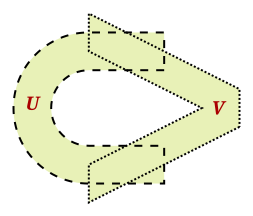

# Gauge Theories in Physics
**First published Mon Jul 28, 2025**

*Dougherty, John*

Many of the theories found in contemporary high-energy physics are gauge theories. The theory of the electromagnetic force is a gauge theory, as are the theories of the weak and strong nuclear forces. Philosophers disagree about which other theories are gauge theories, but they generally agree that gauge theories present distinctive puzzles concerning mathematical representation. Philosophical discussion of gauge theories has focused on these puzzles alongside the metaphysical and epistemological consequences of the fact that gauge theories feature centrally in theories of the fundamental physical forces.

## 1. Introduction

Philosophical debates over gauge theories primarily concern interpretation. In other words, they are disagreements over the theoretical content of these theories, which is to say they are disagreements over what these theories say about the world. On the one hand, general philosophical principles of interpretation imply that a gauge theory attributes to the world a certain quantitative feature called a *potential*, that the theory makes various claims about how the value of the potential is related to the values of other quantitative features of the world, and that the potential contributes to the theory’s account of its target phenomena. On the other hand, physicists and philosophers often argue that the gauge potential is a theoretically objectionable quantity, that gauge theories do not attribute such quantitative features to the world, or that the potential does not contribute to the theory’s account of its target phenomena. Therefore, one issue is whether a gauge potential is or is not part of a gauge theory’s content. If it is, then its putatively objectionable features present philosophical puzzles.

For an example of these puzzles, consider electrostatics, which is the theory concerned with phenomena involving stationary electric charges. In 1813, Siméon Denis Poisson introduced a potential into this theory (Poisson 1813)[^poisson-1813]. A value of the electrostatic potential is a function assigning to each point of some target system a quantity of energy per electric charge. This quantity is the electric potential energy per charge that a particle would have if it suddenly appeared at that point. Because force is equal to change in potential energy, the electric force per charge in some direction that the system would exert on a charged particle at a point is given by the change in the system’s electrostatic potential in that direction. And these forces are what the theory uses to explain why, for example, packing peanuts stick to clothing.

An interpretation of electrostatics would include a fuller story about the nature of the potential and its relationship to other parts of electrostatic theory. Poisson’s introduction of the electrostatic potential was inspired by work on Newtonian gravitation in which bodies exert gravitational forces on one another instantaneously at a distance and the gravitational potential is a convenient summary of this action; does the electrostatic potential also represent action at a distance? Under what conditions can the electrostatic potential be attributed a determinate value? How does the value of the electrostatic potential relate to observation? Do changes in the potential propagate at a finite speed or instantaneously, and how does this relate to metaphysical locality principles? These are some of the historically prominent issues concerning the interpretation of the electrostatic potential, and they recur in more complicated forms for potentials in gauge theories.

Interpretations of gauge potentials fall into roughly three camps. According to the first, the potential is a part of the theory that purports to describe a quantitative feature of the world, and removing these descriptions from the theory would be a loss of something important; call this an interpretation of the potential as *significant*. The claim that the potential is part of the theory’s content is supported by a “literal” reading of the theory—that is, a reading according to standard principles of philosophical interpretation. According to these principles, potentials are field quantities, and a value of a field quantity in some spacetime region is nothing over and above an assignment to each of the region’s points of a determinate value of the determinable associated with that field (Teller 1995: 95)[^teller-1995]. So, for example, the electrostatic potential is a field quantity assigning a value of energy per unit charge to each point, and the spatial variation of the electrostatic potential is related to the electric field, which is a field quantity assigning a value of force per unit charge to each point. These quantities are significant if removing them would hinder the theory in its descriptive and explanatory duties.

Despite following from standard philosophical principles of interpretation, significant interpretations of gauge theories face extensive difficulties: empirical inaccessibility (§3.2) suspicious indeterminism (§4.1), and others discussed below. Indeed, these difficulties are so extensive that much of the philosophical literature treats significant interpretations as presumptively incorrect. This motivates interpretations on which gauge potentials are either dispensable in principle or not even part of the theory’s content at all.

On *surplus* interpretations, the potential is part of the theory’s content, but it is a part that is otiose, unnecessary, or excess. This interpretation of the electrostatic potential is suggested by James Clerk Maxwell in his exposition of electrodynamic theory. Reflecting on an experiment discussed below (§2.1.1), Maxwell argued that the electrostatic potential is “a mere scientific concept” and that “[w]e have no reason to regard it as denoting a physical state” (1881: 53). That the electrostatic potential is a “scientific” concept in Maxwell’s view suggests that it is part of his theory of electrodynamics; that it is a “mere” scientific concept suggests some kind of second-class status—perhaps the potential purports to describe a quantitative feature of the world, but the world does not in fact exhibit that feature.[^note-1] The challenge for surplus interpretations is to give an account of the use of potentials in gauge theories that is consistent with their second-class status.

The third class of interpretations considers gauge potentials to be *scaffolding*: not part of the theory’s content at all, but sometimes used in articulating the content of the theory. On this interpretation, the fact that textbooks often mention the electrostatic potential is in the same box as the fact that these textbooks often use Latin letters for variable names and a base 10 number system. The construction metaphor is taken from Heinrich Hertz’s discussion of Maxwell electrodynamics (1890: 107). On Hertz’s interpretation, the potential appearing in Maxwell’s theory is a vestige of rudimentary action-at-a-distance theories that Maxwell’s theory superseded, and it makes no contribution to the actual content of Maxwell’s theory. The challenge for a scaffolding interpretation is to clearly articulate the distinction between scaffolding and theoretical content and to show that the former makes no contribution to the latter. The gold standard for answering such a challenge is the Heaviside–Hertz reformulation of Maxwell’s theory, discussed below (§2.1.2), which makes no mention of the potential.

Significant, surplus, and scaffolding interpretations are available in principle for any putative quantity in any physical theory. What makes gauge theories philosophically interesting—beyond their role in our current best theory high-energy physics—are the persistent difficulties faced by each of these three approaches when it comes to gauge potentials. It is often suggested that interpreting gauge potentials as significant is incompatible with their use in physics. And the lack of a generally accepted formulation of gauge theories that omits any problematic quantities has stymied scaffolding interpretations. But interpretations of the gauge potential as surplus seem to give a “mysterious, even mystical, Platonist–Pythagorean role for purely mathematical considerations in theoretical physics” (Redhead 2002: 299; see also Steiner 1989, 1998)[^redhead-2002][^steiner-1989]. So none of the three categories of interpretations is obviously most promising.

## 2. Historical and physical background

Philosophical interest in gauge theories is often motivated by the fact that gauge potentials appear in the Standard Model of particle physics, the current best theory of the strong, weak, and electromagnetic forces. Moreover, the very construction of the Standard Model was guided by a principle requiring the use of gauge potentials in modeling subatomic forces. This “gauge principle” was first proposed by Hermann Weyl in 1928 on empirical grounds, but it has its roots in *a priori* considerations arising from Weyl’s earlier work on gravitation and electrodynamics. From the perspective of this earlier work, the first gauge theory was Maxwell’s theory of electrodynamics, and many of the controversies arising in the reception of this theory are explicable as debates over significant, surplus, and scaffolding interpretations of the theory’s potentials. This section sketches the historical path from Maxwell to Weyl to the Standard Model as it is taken to bear on this philosophical discussion.[^note-2]

### 2.1 Electromagnetic potentials

The classical theory of electrodynamics had its inception in a 1864 paper delivered by James Clerk Maxwell to the Royal Society of London. This was the culmination of a series of papers in which Maxwell showed that the field-theoretic ideas of Michael Faraday could, when formalized, unify and extend an array of accepted phenomenological laws of electricity, magnetism, and galvanism (Maxwell 1855, 1861, 1864)[^maxwell-1855]. Maxwell’s theory was disseminated more widely in his two volume *Treatise on Electricity and Magnetism* of 1873, which is generally considered difficult and disorganized. Maxwell died in 1879, leaving the clarification and completion of his theory to later successors.

In Maxwell’s presentation, electrodynamics concerns twenty quantities related by twenty equations. Fourteen of these quantities are relevant to our discussion. In modern notation, anachronistically, they are grouped into families $A_{\mu}$, $F_{\mu\nu}$, and $j_{\mu}$ indexed by labels $0$ through $3$ that correspond to time and three conventionally chosen spatial directions, respectively.[^note-3] In this notation, they are related by the equations

$$\tag{1}\label{eq:maxwell} \begin{align*} F_{\mu\nu} & = \partial_{\mu}A_{\nu} - \partial_{\nu}A_{\mu}\\ \partial^{\mu}F_{\mu\nu} & = j_{\nu}\\ \partial^{\mu}j_{\mu} & = 0.\\ \end{align*} $$

where $\partial_{\mu}$ is the derivative in the indexed direction.[^note-4] The four quantities $j_{\mu}$ describe the distribution and motion of electric charges; for example, the value of the quantity $j_{3}$ at some point is the density of electric current flowing in the third spatial direction at that point. The quantities $F_{\mu\nu}$ are labeled by two indices under the assumption that $F_{\nu\mu} = -F_{\mu\nu}$, so the family $F_{\mu\nu}$ amounts to six quantities; the values of these at a point describe the strength of the electric and magnetic forces in the three spatial directions. The quantities $A_{\mu}$ are potentials, and they include the electrostatic potential $A_{0}$ introduced by Poisson and the *vector potential* $(A_{1}, A_{2}, A_{3})$ that Maxwell introduced to describe Faraday’s idea of the “electrotonic state” of matter. The first equation in \eqref{eq:maxwell} indicates that changes the potentials correspond to forces on charged bodies, and the second says that the electric current acts as a source for electromagnetic forces. The third says that the current $j^{\mu}$ is conserved.

In retrospect, the potentials $A_{\mu}$ have been interpreted as gauge potentials, and so they are the focus of the interpretative debates relevant to this entry. But there are two related points of philosophical interest that also apply to the field strength $F_{\mu\nu}$. The first is that the potentials and the field strength are both field quantities, and the interpretation of field theories is a philosophical controversy in its own right (Hesse 1961; Lange 2002; Stein 1970)[^hesse-1961][^lange-2002][^stein-1970]. In the field theories of eighteenth century hydrodynamics, field quantities were used to describe distributions of quantities throughout a body of fluid; for example, the internal motion of a fluid is described by a vector field whose value at some point in the fluid is the velocity of the bit of fluid at that point. In Maxwell’s theory, the quantities $A_{\mu}$ and $F_{\mu\nu}$ (in modern notation) are meant to describe distributions of quantities in a fluid-like substance whose mechanical properties are yet unknown. Later developments of the field concept divorced it from the concept of an underlying medium, and the standard philosophical understanding of field quantities today is something like that described in §1. The primary alternative to this standard interpretation is an action-at-a-distance interpretation, according to which the mathematical quantities $A_{\mu}$ and $F_{\mu\nu}$ are both merely convenient summaries of the direct action of charged particles on one another (Frisch 2005: Ch. 6; Hesse 1955; Mundy 1989; Pietsch 2010)[^frisch-2005][^hesse-1955][^mundy-1989][^pietsch-2010]. This was the interpretation Poisson gave to the electrostatic potential on its original introduction. Most surplus and scaffolding interpretations of the gauge potential contrast it with the significance of the field strength; on an action-at-a-distance interpretation of the field strength, a different contrast is required.

The second philosophically relevant aspect of field theories concerns their locality. A point offered in favor of field theories of electrodynamics is their conformity to intuitive metaphysical principles of locality and continuity of action. In Newtonian gravitation, one particle acts on a second particle instantaneously: the force impressed by the former on the latter at some time is a function of the first’s mass and position with respect to the latter at that time. In electrodynamics, by contrast, the force impressed by the first particle on the second is a function of the first’s charge and position at an earlier time, with a delay proportional to the distance between the particles. It is as though the influence from the first particle on the second must travel from the former to the latter at a constant speed. And according to field theories, this intuitive picture is indeed what happens: the first particle acts on the field, and the effects of this action ripple out continuously through the field, eventually reaching the second particle. Hertz’s detection of free electromagnetic waves in 1888 gave experimental support to the idea that electromagnetic effects propagate continuously at a constant speed, and it is often cited as a crucial experiment in favor of fields over action-at-a-distance theories (Harman 1982: 109; Hunt 1983; Whittaker 1951: 328)[^harman-1982][^hunt-1983][^whittaker-1951]. But this favor only extends to field-theoretic approaches in general, not to any specific field. In particular, Hertz’s experiment is not taken to be evidence for the significance of the potentials $A_{\mu}$.

#### 2.1.1 The scalar potential

The nineteenth century reception of the field quantities $A_{\mu}$ in Maxwell’s theory was controversial in a way that prefigures today’s philosophical discussion of gauge theories. The quantity $A_{0}$ is the electrostatic potential introduced by Poisson (§1). In Maxwell’s theory, it is defined such that its value at some point in an electrostatic system is the amount of work per charge that would be done by the system’s electric forces if they transported a charge from an infinite distance to its actual position.

By the time of Maxwell’s work, the scalar potential figured in an extensive system of quantitatively precise descriptions of disparate phenomena involving electricity, magnetism, and galvanism. This system exhibited mathematical similarities to theories of gravitation, hydrostatics, and thermodynamics, and Maxwell approached the problem of theoretically systematizing it through a method of “physical analogy”: investigating the extent to which these mathematical analogies could be extended to detailed physical analogies (Achinstein 1991; Hesse 1973; Nersessian 1984)[^achinstein-1991][^hesse-1973][^nersessian-1984]. So he took it as part of his task to account for the scalar potential as it had been used in electrostatics through consideration of its analogies and disanalogies with quantities in other theories.

Among the disanalogies Maxwell identifies, the case of Faraday’s cube is particularly salient. Mathematically speaking, the scalar potential plays the same role in electrostatics that pressure plays in hydrostatics and temperature plays in thermodynamics. But temperature has observable effects that the scalar potential does not:

> If a number of bodies are placed within a hollow metallic vessel which completely surrounds them, we may charge the outer surface of the vessel and discharge it as we please without producing any physical effect whatever on the bodies within. But we know that the electric potential of the enclosed bodies rises and falls with that of the vessel. This may be proved by passing a conductor connected to the earth through a hole in the vessel. The relation of the enclosed bodies to this conductor will be altered by charging and discharging the vessel. But if the conductor be removed, the simultaneous rise and fall of the potentials of the bodies in the vessel is not attended with any physical effect whatever. (Maxwell 1881: 53)[^maxwell-1881]

By contrast, raising the temperature inside the cube would burn its contents. Maxwell notes that Faraday carried out this experiment, with the result as described here, and he concludes that the scalar potential is “a mere scientific concept” and that there is “no reason to regard it as denoting a physical state” (1881: 53). Philosophers often cite this argument both as evidence against the reality of the scalar potential and as illustration of general epistemological principles concerning symmetry (Greaves & Wallace 2014; Healey 2007, 2009; Lange 2002; see also the entry on symmetry and symmetry breaking)[^greaves-2014][^healey-2007][^lange-2002][^wallace-2014].

#### 2.1.2 The vector potential

The remaining quantities $(A_{1}, A_{2}, A_{3})$ constitute the vector potential. Unlike the scalar potential, the vector potential did not appear in the mathematical descriptions of electromagnetic phenomena Maxwell sought to systematize. Rather, Maxwell introduced the vector potential as a mathematical expression of a hypothesized “electrotonic state”. Faraday first described this electrotonic state qualitatively as a novel kind of electrical stress or tension within matter whose changes could explain the production of electrical currents by magnetic fields exhibited in his experimental research (1832: 139). Maxwell argued that the electrotonic state could be defined quantitatively by taking the value of the vector potential at some point of the system to be the change in momentum per unit charge that would be required to instantaneously bring that part of the system from rest to its actual motion. And he used this hypothesis to predict new empirical phenomena: in particular, he argued that electromagnetic forces can propagate, wave-like, between bodies, and that light is an electromagnetic wave of this kind (1864: 497).

Despite the importance of the vector potential in Maxwell’s development of electrodynamic theory, by the beginning of the twentieth century it came to be regarded with the same suspicion that Maxwell had for the scalar potential. This suspicion is the default position in philosophical discussion of electromagnetism today. According to Maxwell, the electrotonic state “may even be called the fundamental quantity in the theory of electromagnetism” (1873: 173–174). But subsequent theorists regularly sought to “murder” the scalar potential along with “that wonderful three-legged monster with a scalar parasite on its back” the vector potential (Hunt 1991: 166)[^hunt-1991]. This animus was born of a mixture of practical, theoretical, and philosophical considerations.

Maxwell’s theory was found obscure in its content and application, which was a practical obstruction to investigating it. For example, although it was clear that Maxwell’s theory predicts the existence of electromagnetic waves, it was not clear whether or how these could experimentally generated or detected. It was often said that the potentials were responsible, in part, for this obscurity. Thus Oliver Heaviside called the potentials “powerful aids to obscuring and complicating the subject, and hiding from view useful and sometimes important relations” (1893: iv). And Hertz, who described the vector potential as “scaffolding”, argued that it made more difficult the application of Maxwell’s theory to special cases (1890: 107). More generally, it was thought to be a practical problem that Maxwell’s theory was cluttered by the false starts of predecessor theories. This included the scalar potential, which originated in action-at-a-distance theories of electromagnetism that analogized it to gravitation.

Heaviside and Hertz backed up their complaints about the practical inconvenience of the potentials with a reformulation of Maxwell’s theory omitting them. This reformulation retains the field strength $F_{\mu\nu}$ and current $j_{\mu}$, but it replaces the first of Maxwell’s equations \eqref{eq:maxwell} to give the equations

$$\tag{2}\label{eq:heaviside_hertz} \begin{align*} \partial_{\mu}\tilde{F}^{\mu\nu} & = 0\\ \partial^{\mu}F_{\mu\nu} & = j_{\nu}\\ \partial^{\mu}j_{\mu} & = 0. \end{align*} $$

where $\tilde{F}^{\mu\nu}$ is a particular re-indexing of $F_{\mu\nu}$ that exchanges the indices on the electric and magnetic forces. These equations are generally considered a reformulation of Maxwell’s theory, containing the same theoretical content but practically more manageable. From this perspective, the scalar and vector potentials are a roundabout way of representing the field strength: a given value of the potentials $A_{\mu}$ corresponds to a unique value of the field strength $F_{\mu\nu}$ under the first of Maxwell’s equations \eqref{eq:maxwell}, and two values of the potentials represent the same theoretical state when they are *equipollent*—that is, when they correspond to the same value of the field strength under this equation. That the potentials can be eliminated from the theory with practical gain and without theoretical loss might be taken as evidence in favor of a scaffolding interpretation.

By the end of the nineteenth century, the widely accepted position was that Maxwell’s theory and the Heaviside–Hertz theory were in some sense equivalent, despite the appearance of the potentials in the former but not the latter. One kind of argument for this position echoes the methodological argument just given: the Maxwell and Heaviside–Hertz theory have the same observable content, making them the same theory. Another kind of argument proceeds by degrees. Maxwell’s original presentation has inconsistencies, and fixing these surely results in a clearer presentation of the theory, not a new theory. Maxwell left open certain puzzles, like the generation and detection of electromagnetic waves, and solving these puzzles surely results in a more complete development of the theory, not a new one. And so, on this line of argument, the removal of the potentials is an improvement along these lines. A picture emerged on which the potentials are not part of the content of the theory but merely mathematical auxiliaries that can be introduced for convenience’s sake.

### 2.2 Gauge invariance

The term “gauge invariance” originated in an abortive attempt by Hermann Weyl to unify Einstein gravitation with Maxwell electrodynamics in 1918. Though this unification was unsuccessful, Weyl repurposed parts of the theory in 1928 for application to the theory of charged quantum matter, the quantum theory of charged matter. In both theories, Weyl observed that many features of Maxwell electrodynamics, such as the conservation of electric charge, could be derived from invariance of the theory under so-called “gauge transformations”.[^note-5]

Originally, gauge invariance was part of a speculative generalization of Einstein gravity based on Weyl’s philosophy of geometry (Weyl 1918)[^weyl-1918]. On Weyl’s interpretation, the mathematical structure of Einstein’s theory is most naturally formulated in terms of angle comparisons between infinitesimally separated points. That is, the fundamental geometric facts are of the form “the vector $u$ at point $p$ is at angle $\theta$ to the vector $v$ at point $q$”, where $p$ and $q$ are infinitesimally close together. These facts give rise to the notion of *parallel transport* along a curve $\gamma$: thinking of $\gamma$ as a string of infinitesimally close points, a vector may be transported point-to-point from one end to the other, at each point sending the vector to the vector at the next point with the same magnitude and direction. The resulting vector at the end of the curve will, in general, depend on the path taken to get from one end of the curve to the other. In particular, parallel transporting a vector in a loop that starts and ends at the same point will generally result in a vector at a nonzero angle with the vector you started with. In Einstein’s theory, changes in the angles of vectors transported around loops indicate spacetime curvature, hence gravitational effects.

Weyl’s theory extended the notion of parallel transport to also include length comparisons. He objected that Einstein’s theory was philosophically dissatisfying in its treatment of different geometric features of distant points. With respect to the direction of vectors, direct comparison is only possible between infinitesimally close points; the directions of vectors at distant points can only be compared with respect to a choice of curve connecting these points. By contrast, the magnitudes of vectors at distant points admit path-independent comparison. Finding this unacceptable on philosophical grounds, Weyl generalized Einstein gravity to a theory in which the basic facts about length comparisons are also restricted to infinitesimally neighboring points. In this generalized theory, length comparisons at distant points also require transport, making them path-dependent and introducing curvature in length comparisons as well as in parallelism comparisons.

The invariance properties of this extended theory make it analogous to Maxwell electrodynamics. A numerical representation of the angle and length facts on Weyl’s theory requires a choice of coordinates and a conventional choice of measurement scale, or gauge, at every point. With respect to this choice of coordinates and gauge, facts about angles between vectors at nearby points are represented by a set of quantities $g_{\mu\nu}$, the metric tensor, and facts about lengths of vectors at nearby points are represented by a set of quantities $A_{\mu}$, the length connection. Because the choice of gauge is conventional, the values of these quantities will depend on this convention. Specifically, changing from one gauge to an infinitesimally different gauge involves a transformation of the metric and length connection of the form

$$\tag{3}\label{eq:weyl_gauge} \begin{align*} g_{\mu\nu} & \mapsto (1 + \alpha)g_{\mu\nu}\\ A_{\mu} & \mapsto A_{\mu} + \partial_{\mu}\alpha \end{align*} $$

where $\alpha$ is a smooth, real-valued function on spacetime whose value at each point describes the difference of the two gauges at that point. If a quantity is invariant under the gauge transformations in equation \eqref{eq:weyl_gauge}, then it is independent of the conventional choice of gauge. Weyl observed that if we interpret $A_{\mu}$ as the potential of Maxwell’s theory, then the field strength $F_{\mu\nu}$ is gauge invariant. Moreover, Maxwell’s equations \eqref{eq:maxwell} are the simplest gauge-invariant dynamical equations. Further yet, if the length connection $A_{\mu}$ interacts with the electric current in a gauge-invariant way, then the electric current must be conserved. As Weyl puts it, “we can read off the whole structure of the Maxwellian theory from gauge invariance alone” (1919: 121).

This attempt to geometrically unify Maxwell electrodynamics with Einstein gravity was generally rejected for empirical reasons. But in 1928, Weyl resurrected the notion of gauge invariance in the theory of charged quantum matter. In this theory, the complex function $\psi$ describing the quantum state of a charged particle and the electromagnetic potential $A_{\mu}$ figure in the theory’s dynamical equations in a combination invariant under transformations of the form

$$\tag{4}\label{eq:qm_gauge} \begin{align*} \psi & \mapsto (1 - ig\alpha) \psi\\ A_{\mu} & \mapsto A_{\mu} + \partial_{\mu}\alpha \end{align*} $$

where $g$ is the charge of the particle and $\alpha$ is a smooth, real-valued function on spacetime. Weyl observed that these transformations are formally analogous to the gauge transformations of his 1918 theory, though the real-valued scale transformations of the metric in \eqref{eq:weyl_gauge} are here replaced by a complex-valued transformation of the quantum state.[^note-6] He proposed that invariance under the transformations in \eqref{eq:qm_gauge}—still termed “gauge transformations”, despite losing the connection to length—be taken as a principle of theory construction, one based on experience rather than *a priori* considerations (Scholz 2005)[^scholz-2005]. He argued that on this revised principle, the electromagnetic potential becomes a necessary side effect not of the gravitational field, but of the matter represented by $\psi$.

By drawing together his 1918 length theory and the 1928 theory of charged quantum matter, Weyl created a genus “gauge theory” with two species alongside a principle uniting these theories that had surprising success and natural generalizations. These gauge theories were marked by a distinguished set of transformations, the gauge transformations, with invariance under these transformations as a fundamental principle. In the 1918 gauge theory, gauge invariance is an *a priori* requirement that follows from the nature of conventions. In quantum mechanics, gauge invariance is a feature recognized in hindsight—but the fact that it can, surprisingly, be used to derive the Heaviside–Hertz equations \eqref{eq:heaviside_hertz} and electric charge conservation might suggest a deeper, more principled role. As for connections to other theories and generalizations, the relation of the 1918 length theory to Einstein gravity gives a geometric flavor to gauge transformations, a flavor also evidenced by the smooth function parametrizing gauge transformations. Weyl’s two examples of gauge theories suggest generalizations: gauge transformations in the 1918 theory are parametrized by real-valued functions and in quantum mechanics by certain complex-valued functions; these might be replaced by functions with more complicated values.

### 2.3 Yang–Mills theory

The first published generalization of Weyl’s gauge theories was due to Chen-Ning Yang and Robert Mills (1954), for whom this class of generalizations is now named. Yang–Mills theories realize Weyl’s principle of gauge invariance in the framework of quantum field theory, wherein the principle can serve as a systematic guide to constructing theories with desired symmetries. Today, Yang–Mills theories have a central role in the Standard Model of particle physics.

Yang–Mills theory generalizes the gauge transformations of electrodynamics to include transformations that swap particle types. Yang and Mills motivate this generalization with the observation that neutrons and protons seem to have nearly identical roles on the nuclear scale, so that the theory of the strong nuclear force should be invariant under a transformation swapping them. When generalized to include particle swapping of this kind, infinitesimal gauge transformations take the form

$$\tag{5}\label{eq:ym_gauge} \begin{align*} \psi_{i} & \mapsto (1 - ig\alpha^{a}T^{a}_{ij}) \psi_{j}\\ A^{a}_{\mu} & \mapsto A^{a}_{\mu} + \partial_{\mu}\alpha^{a} - g{f^{a}}_{bc}\alpha^{b}A^{c}_{\mu}\\ \end{align*} $$

where the Roman indices $i$ and $j$ label the particle types being interchanged; the Roman indices $a, b, c$ label the interchange transformations $T^{a}_{ij}$; and ${f^{a}}_{bc}$ is a family of numbers characterizing the structure of the particle exchange transformations. The field strength $F_{\mu\nu}$ of electrodynamics then generalizes to a field strength

$$F^{a}_{\mu\nu} = \partial_{\mu}A^{a}_{\nu} - \partial_{\nu}A^{a}_{\mu} + g{f^{a}}_{bc}A^{b}_{\mu}A^{c}_{\nu}$$

Quantum electrodynamics might therefore be interpreted as a Yang–Mills theory in which there is only one particle type, so that there are no particle interchanges and ${f^{a}}_{bc}$ vanishes.

Set within the framework of quantum field theory, the requirement of gauge invariance tightly constrains theory construction. This sort of constraint was particularly valuable in the 1950s and 1960s, as physicists discovered ever increasing types of subatomic particles and generated ever increasing theories to account for their interactions. Weyl observed that Maxwell’s equations \eqref{eq:maxwell} are the simplest gauge-invariant equations relating a gauge potential $A_{\mu}$ and a current $j_{\mu}$. By generalizing Maxwell electrodynamics to allow for various different sets of gauge transformations, Yang–Mills theory provided a framework turning Weyl’s principle into a systematic recipe for theory construction. In this framework, one begins with a set of matter particles whose interactions are invariant under some set of transformations, one then introduces a set of Yang–Mills gauge potentials on which these transformations act as gauge transformations, and then one postulates that the equations of the theory are the simplest equations allowed by gauge invariance (§4.2).

As a guide to constructing empirically adequate theories of known particle interactions, Weyl’s gauge principle was initially beset by conceptual and technical problems. It seemed that a gauge-invariant theory could only describe massless particles, but the particles in need of a theory were all massive. As discussed in further detail below (§4.3), this tension was eventually decided in favor of gauge invariance, as physicists discovered how a mass could arise in a gauge theory. The second problem concerned the extraction of appropriately finite predictions from the theory. Physically reasonable calculations in quantum field theory tend to produce physically unreasonable results, especially in the form of infinite magnitudes. Physicists developed techniques to treat this problem in the context of QED in the 1940s (Schweber 1994)[^schweber-1994]. But these techniques do not carry over to Yang–Mills theories in general: they lead to physical absurdities like the probabilities of outcomes for a given experiment adding up to less than 100% (Lee & Yang 1962; Feynman 1963)[^feynman-1963][^feynman-1963-2][^lee-1962]. This problem was resolved by Martinus Veltman (1968) and Gerardus ’t Hooft (1971a,b), who showed that gauge invariance could be used to give two presentations of each Yang–Mills theory: one free of divergences, and one with good probabilistic behavior (Koberinski 2021)[^koberinski-2021]. This gives another important role to gauge invariance, in addition to theory construction.

By the middle of the 1970s, a particular set of Yang–Mills theories had become known as the “Standard Model” of the three high-energy interactions: electromagnetism and the weak and strong nuclear forces.[^note-7] It remains the premier theory of these interactions. In light of this success, the Standard Model is of significant interest both to philosophers who look to physics for guidance on metaphysical matters and to philosophers with an epistemological interest in the development of successful scientific theories. And the particular role of gauge invariance in the development and structure of the Standard Model makes it of particular interest.

This sketched history from Maxwell to Weyl to the Standard Model serves as the background for most philosophical discussion of gauge theories. So, for example, Maxwell electrodynamics is taken as a paradigm gauge theory, and the general rejection of significant interpretations in the late nineteenth century is taken as a *prima facie* case against such interpretations of gauge theories in general. However, the origin of Weyl’s gauge principle in *a priori* considerations is sometimes taken to suggest a similarly *a priori* justification for the gauge principle in the development of quantum field theories. Combined with the success of this principle in guiding the construction of the Standard Model, this suggests that gauge potentials are not only part of the content of a gauge theory, but a significant part. Of course, as the metaphor suggests, a scaffolding interpretation is compatible with the gauge principle being useful in the construction of the theory, as long as the gauge potential is no part of the finished theory. But it seems that gauge invariance does have uses in the theory, like Veltman and ’t Hooft’s use of gauge invariance to deal with the theory’s divergences. Yet these uses rely on an interpretation of gauge transformations as changing between different descriptions of the same physical facts: one description that’s well-behaved probabilistically, another well-behaved with respect to divergences. And this is the kind of situation that motivates surplus interpretations. The philosophical literature on gauge theories seeks an interpretation of gauge potentials that reconciles these inchoate considerations with other features of gauge theories and broader philosophical concerns.

## 3. Kinematics

Philosophical debates over gauge theories tend to center on the nature of the gauge potentials. As such, they often focus on questions concerning the collection of physical quantities appearing in a gauge theory, the structure of these quantities, and the possible distributions of values for these quantities—that is, roughly speaking, on kinematic questions. The debates aim to understand what the potential must be like for a gauge theory to carry out its descriptive and explanatory work and what this says about metaphysical principles like locality.

### 3.1 The Aharonov–Bohm effect

One major challenge for scaffolding interpretations of gauge potentials arises from the Aharonov–Bohm effect. This effect was predicted by Aharonov and Bohm in 1959 as a demonstration that the gauge potential $A_{\mu}$ contains more information than the field strength $F_{\mu\nu}$, and it was ostensibly experimentally confirmed in a series of experiments beginning in 1960 (Tonomura 2010)[^tonomura-2010].

The Aharonov–Bohm experiment is a variation on the double-slit experiment exhibiting quantum interference. In the original double-slit experiment, a point source of particles is separated from a detector screen by a perfect shield in which is cut two infinitesimal slits. Particles emitted from the source and passing through the slits are registered on the screen, and the result is a banded pattern with the brightest band directly between the slits. Aharonov and Bohm consider a variation of this setup in which the particles are charged and there is an infinitely long, perfectly shielded solenoidal electromagnet between the slits (Figure 1).

*Figure 1:*

Figure 1: The Aharonov–Bohm experiment

Running a current through the solenoid creates an electromagnetic field configuration in which, outside the solenoid, the field strength $F_{\mu\nu}$ is zero but the potential $A_{\mu}$ is neither zero nor gauge equivalent to zero. That is, if we call the region outside the solenoid $U$, then $F_{\mu\nu} = 0$ on $U$, but there is no smooth function $\alpha$ on $U$ such that $A_{\mu} = \partial_{\mu}\alpha$. The standard treatment of charged particles in quantum mechanics predicts that the interference pattern on the detector screen will differ when different amounts of current are run through the solenoid; in particular, the position of the brightest band will shift. If this prediction is correct, it should be possible to vary the interference pattern in a controlled way by varying the amount of current set to run through the solenoid.

This prediction suggests the following argument for significant interpretations of the electrodynamic potential:

1. Different settings of the Aharonov–Bohm apparatus exhibit different interference fringes.
2. Differences in interference fringes are the result of different electromagnetic states of affairs outside the solenoid.
3. Different settings of the Aharonov–Bohm apparatus are represented outside the solenoid by potential values that are gauge inequivalent but equipollent (i.e., that correspond to the same field strength).
4. Therefore, gauge inequivalent but equipollent potential values can represent distinct electromagnetic states of affairs.

It follows from this conclusion that scaffolding interpretations of electrodynamics leave the theory unable to discriminate between observably distinct electromagnetic states of affairs. Since the electromagnetic potential differs in these states, significant and surplus interpretations are empirically adequate in a way that scaffolding interpretations are not.

Philosophers have questioned each premise of this argument and have considered different responses to its conclusion (R. Anderson 1991; Belot 1998; Drieschner et al. 2002; Healey 2007: Ch. 2; Lyre 2001)[^anderson-1991][^belot-1998][^drieschner-2002][^healey-2007][^lyre-2001]. Premise 1 is apparently an empirical matter, to be decided in the laboratory. But the apparatus described above included physically impossible things like an infinite solenoid and perfect shielding, so it’s not obvious what counts as an experimental realization of the effect. For example, “topological” interpretations of the effect take it to rely on the fact that the region exterior to the solenoid has a “hole” created by the shielding around the solenoid (Nounou 2003)[^nounou-2003]. But talking of this as a “hole” seems justified by the perfect shielding around the solenoid, and one might argue that when the perfection of the shielding is relaxed, the result is not an Aharonov–Bohm apparatus (Earman 2019; Shech 2018)[^earman-2019][^shech-2018].

Second, one might deny that electromagnetic states of affairs are located in particular regions; perhaps nonzero field strengths act on quantum charged matter at a distance (DeWitt 1962)[^dewitt-1962]. Though the field strength $F_{\mu\nu}$ always vanishes outside the solenoid, different settings of the apparatus will lead to different values for the field strength inside the solenoid. In classical electrodynamics, this means that electromagnetic forces will only be detectable within the solenoid. But if the electromagnetic field acts on quantum matter at a distance, then electromagnetic facts anywhere have an effect everywhere, and so electromagnetic states of affairs can only concern the entire universe, not particular regions. Premise 2 then fails because there is no meaning to the phrase “states of affairs outside the solenoid”.

One might question premise 3 by questioning the framework in which Aharonov and Bohm predicted the effect. Premise 3 is true on the usual analysis of the Aharonov–Bohm effect, but it’s not obvious that there is a concept of “potential” that makes the premise true and the argument successful (Belot 1998; Earman 2019)[^belot-1998][^earman-2019]. The usual analysis involves a classical electromagnetic field acting on charged quantum matter. So it can’t inform us about the interpretation of nineteenth century electrodynamics, because the theories of Maxwell, Heaviside, and Hertz do not concern quantum matter. Nor is it obvious that the Aharonov–Bohm effect tells us anything about our world, where the electromagnetic field is a quantum field, not a classical one. To have philosophical significance, the effect therefore requires some story about how it is related to past or current theories.

Finally, one might accept the conclusion. One way to do so is to adopt a significant interpretation of the potential. Richard Feynman seems to suggest this view:

> In our sense then, the [vector potential] is “real”. You may say: “But there was a magnetic field”. There was, but remember our original idea—that a field is “real” if it is what must be specified at the position of the particle in order to get the motion. The [field strength] in the [solenoid] acts at a distance. If we want to describe its influence not as action-at-a-distance, we must use the vector potential. (Feynman et al. 1964: 15-5)

On this interpretation, the shift in interference fringes reflects a difference in the electromagnetic state outside of the solenoid: specifically, a difference in the value of the field quantity $A_{\mu}$. Variations on this response propose other properties that ground the difference in the exterior region across different settings (Leeds 1999; Mattingly 2006; Maudlin 1998, 2018)[^leeds-1999][^mattingly-2006][^maudlin-1998].

Surplus interpretations are also compatible with the conclusion (Redhead 2002)[^redhead-2002]. One can argue that the theoretical content of Maxwell electrodynamics includes the potential as a field quantity but that gauge-equivalent values of the potential are “redundant” representations of the same physical state of affairs. Gauge-variant differences in the potential are therefore theoretical surplus, reflecting no worldly differences, and this explains their unobservability. And gauge invariance is then a necessity for making predictions that depend only on the physical states of affairs.

Lastly, the scaffolding interpreter can retrench by giving a new formulation of the theory that identifies gauge-equivalent values of the potential while retaining the distinction between merely equipollent values. There is no proposal as universally supported as the Heaviside–Hertz formulation was before recognition of the Aharonov–Bohm effect (Wallace 2014)[^wallace-2014]. But the most popular proposals are based on the observation that to each loop $\gamma$ in spacetime, each value of the potential assigns a complex number called the *phase factor*

$$\exp\left( i\int_{\gamma} A_{\mu} dx^{\mu} \right)$$

and that these phase factors are invariant under gauge transformations because $\gamma$ begins and ends at the same point (Anandan 1983; R. Anderson 1991; Batterman 2003; Belot 1998; Gambini & Pullin 1996; Healey 2007; Redhead 2002; Wu & Yang 1975)[^anandan-1983][^anderson-1991][^batterman-2003][^belot-1998][^gambini-1996][^healey-2007][^redhead-2002].[^note-8] Gauge-equivalent values of the potential induce the same phase factors on loops, and so one might take the gauge-invariant content of a potential value to be the collection of phase factors it assigns to all the loops in spacetime. The difference between solenoid settings in the Aharonov–Bohm apparatus is then reflected in the loops that enclose the solenoid.

It is sometimes said that the Aharonov–Bohm effect established the physical reality of the gauge potential. While this is one interpretation of the result—one suggested by Aharonov and Bohm themselves—philosophers have explored other interpretations. These interpretations serve not just as accounts of the Aharonov–Bohm effect, but also as a basis for interpreting Yang–Mills theories more generally. For each of the positions reviewed here, then, arises also the question concerning whether and how it generalizes.

### 3.2 Underdetermination

Significant interpretations of the gauge potential are faced with problems of underdetermination: they seem to posit facts for which we cannot have evidence and to make claims whose meanings cannot be pinned down. These problems arise from the symmetry of the theory under gauge transformations, a feature not impugned by the Aharonov–Bohm effect. These problems militate in favor of scaffolding interpretations on which the theory, properly construed, contains no gauge transformations and hence no problematic symmetries.

As an illustration of the underdetermination, return to the controversy over Maxwell’s treatment of electromagnetic waves (§2.1.2). Maxwell argued on physical grounds that the vector potential satisfies the equation

$$\tag{6} \partial_{1}A_{1} + \partial_{2}A_{2} + \partial_{3}A_{3} = 0$$

making it analogous to an incompressible fluid. This condition is today known as the *Coulomb gauge condition*. If the vector potential satisfies the Coulomb gauge condition at all times, then it follows from Maxwell’s equations that the value of the scalar potential at some time depends on the charge distribution everywhere in the universe at that time—in tension with the apparently local propagation of electromagnetic effects. FitzGerald proposed that the Coulomb gauge condition be replaced by a condition expressed in modern notation by

$$\tag{7}\partial^{\mu}A_{\mu} = 0$$

today known as the *Lorenz gauge condition* (Lorenz 1867; FitzGerald 1890; Lodge 1931: 133–137)[^lodge-1931][^lorenz-1867]. If the scalar and vector potentials satisfy the Lorenz gauge condition, then waves in the vector potential propagate at the speed of light, and so there are no problems with the locality of the theory.

On the standard analysis, it is impossible for these conditions to have any empirical signature, so one cannot know whether they hold. For if $A_{\mu}$ is some value of the potential that satisfies the Lorenz gauge condition, say, then applying a gauge transformation gives a value $A_{\mu} + \partial_{\mu}\alpha$ which generally will not satisfy the Lorenz gauge condition. But the gauge invariance of the theory’s empirical substructures and dynamics implies that the values $A_{\mu}$ and $A_{\mu} + \partial_{\mu}\alpha$ have exactly the same observable effects. This is straightforward in Heaviside–Hertz electrodynamics, because $A_{\mu}$ and $A_{\mu} + \partial_{\mu}\alpha$ are equipollent. It’s also true in quantum mechanics, including in the Aharonov–Bohm experiment. So each value of the potential that satisfies the Lorenz gauge condition will be empirically indistinguishable from infinitely many other values that do not.

Philosophers often take it that the complete empirical inaccessibility of properties like the Coulomb and Lorenz gauge conditions is a signal that they—and the distinctions that support them—are not part of the theory’s content. This is an instance of a general principle, part of conventional philosophical wisdom, according to which properties that vary under symmetry transformations are surplus. Sometimes this principle of interpretation is justified on broadly Ockhamist grounds: by the theory’s own lights, the satisfaction of the Coulomb gauge condition can make no difference to the description or explanation of the phenomena, so there is no fact of the matter about whether it is or is not satisfied. The precise form and justification of this principle is debated, and with it the application of this principle to the case of gauge potentials. Moreover, the concept of empirical accessibility is subtler than the previous paragraph acknowledges (Murgueitio Ramírez 2022; Murgueitio Ramírez & Teh forthcoming; Teh 2016a)[^murgueitio-2022][^teh-2016a]. See the entry on symmetry and symmetry breaking for further discussion.

Gauge invariance also leads to semantic underdetermination (Caulton 2015; Healey 2006)[^caulton-2015][^healey-2006]. On various approaches to the semantics of theoretical terms, the meaning of value ascriptions for theoretical quantities is given by the theory’s relating these values to antecedently meaningful value claims (see the entry on theoretical terms in science). So, for example, Newtonian mechanics says that there is a particular value of force that accelerates a mass of one kilogram at a rate of one meter per second squared; call this force value “one newton”. Maxwell electrodynamics says that there is a particular value of electric current that when run through parallel wires separated by one meter in a vacuum will result in an attraction of $2 \times 10^{-7}$ newtons between the wires; call this current value “one ampere”. Proceeding in this way, one can define reference values for quantities through a combination of ostension and definite description in a given theory’s terms. But it is not possible to define a values of the potential in this way, because each value of the potential plays the same theoretical role as each of its infinitely many gauge transforms. In particular, it is not clear that there is any physical meaning to the claim “the potential in this region is nonzero”. If a significant interpretation of the potential attributes different meanings to these claims, it requires an alternative story about the semantics of theoretical terms.

### 3.3 Separability

Much of the literature on the interpretation of the Aharonov–Bohm effect has focused on degrees of holism in various interpretations. Action-at-a-distance interpretations are *prima facie* holist, because the electromagnetic forces in some region of space at some time depend on the status of every particle in the universe at that time. This is sometimes taken to be a mark against action-at-a-distance theories. But other interpretations are holistic in subtler ways. Roughly speaking, scaffolding interpretations are taken to be holistic, while significant and surplus interpretations are not. Whether holism is a mark against an interpretation depends both on the particular sort of holism and on how it compares to the status of holism in relativity and quantum mechanics (Healey 1997, 1999, 2007; Maudlin 1998; Mulder 2021; see also the entry on holism and nonseparability in physics)[^healey-1997][^maudlin-1998][^mulder-2021].

The sort of holism at issue in the interpretation of the Aharonov–Bohm effect concerns the relationship between the physical state of a region and the physical states of its subregions. In this context, the contrast with holism is separability, which may be formulated as follows:[^note-9]

> A theory is *separable* if the physical state of each spatiotemporal region $X$ determines and is determined by an assignment of compatible states to any collection of subregions covering $X$.

In debates over gauge theories, it is taken for granted that the state of some region determines the state of each subregion. So a failure of separability means that an assignment of compatible states to subregions fails to uniquely determine a state for the entire region. In other words, there are some facts about the entire region that cannot be attributed to facts about any subregion in the collection, which is a form of holism. For example, this kind of holism holds for action-at-a-distance interpretations of the Aharonov–Bohm effect that deny there is such a thing as the state outside the solenoid.

On the standard philosophical interpretation of field theories described in §1, a theory containing only field quantities is usually separable. In the Heaviside–Hertz formulation of electrodynamics, for example, the electromagnetic state of a region is given by the value of the field $F_{\mu\nu}$ in that region. Consider the region $X$ in Figure 2,

*Figure 2:*

Figure 2: Two simply connected regions $U$ and $V$ whose union $X = U \cup V$ is not simply connected

which is the union of regions $U$ and $V$. A value of $F_{\mu\nu}$ in region $X$ is an assignment of a value of $F_{\mu\nu}$ to each point of $X$, which is *eo ipso* an assignment of a value of $F_{\mu\nu}$ to each point of $U$ and each point of $V$ such that these assignments agree on the overlap of $U$ and $V$. Similar reasoning shows that Maxwell electrodynamics is separable.

Scaffolding interpretations of electrodynamics based on phase factors assigned to loops violate separability (Healey 1997, 2001, 2007)[^healey-1997]. For suppose that the region $X$ of Figure 2 is part of the external region of the solenoid in the Aharonov–Bohm apparatus of Figure 1, with the solenoid in the “hole” made by $U$ and $V$. The phase factor assigned to some loop $\gamma$ is of the form $n\theta$, where $n$ is the number of times that $\gamma$ encircles the solenoid and $\theta$ is a complex number determined by the solenoid setting. So any loop that doesn’t encircle the solenoid will be assigned zero, and this includes any loop in $U$ or $V$. But a loop in $X$ can encircle the solenoid, and so may bear a nonzero phase factor that depends on the solenoid setting. In other words, the states in which every loop in $U$ and $V$ have a zero phase factor are compatible with each other, but do not determine the state of the region $X$. So separability fails.[^note-10]

Some significant and some surplus interpretations are also nonseparable. If the potential is interpreted as a field in the usual philosophical sense, then it is separable by the same reasoning as the field strength. However, it is sometimes suggested that the true physical state corresponds to a gauge-equivalence class of potentials, leading to non-separability (Drieschner et al. 2002: 309)[^drieschner-2002]. In each of the regions $U$ and $V$, the potential is gauge equivalent to zero for all solenoid settings, and so the states in each region are empirically indistinguishable for all settings. But different settings of the solenoid give values for the potential in region $X$ that are gauge inequivalent, and which give different observable effects. So even though a potential-based interpretation makes the physical state of the region $X$ separable, it exhibits a form of non-separability in the behavior of its observables.

But there are also interpretations on which the physical state is gauge invariant yet separable (Dougherty 2017; Nguyen et al. 2020)[^dougherty-2017][^nguyen-2020]. If the physical state is gauge invariant, then states in the regions $U$ and $V$ are compatible if they are gauge equivalent on the overlaps. If they are gauge equivalent, then there is generally more than one gauge transformation that relates them. And an assignment of states to regions $U$ and $V$ along with a choice of gauge transformation on the overlap does uniquely determine the state of region $X$. So if the theory says there is a fact of the matter about which gauge transformation relates the states on $U$ and $V$ on their overlap, then the theory is separable despite being gauge invariant. This might be seen as evidence in favor of a significant or surplus interpretation, on which gauge transformations are part of the theory’s content.

### 3.4 Quantization

Against significant interpretations it is often argued that the use of gauge theories in quantum field theory requires one to replace gauge-equivalent values of the gauge potential with a single representative. In particular, it is argued that this replacement must happen in the process of *quantization*, which is a recipe for constructing a quantum theory from classical data. If this were the case, then interpretations of the potential that distinguish between gauge-equivalent values of the potential would be not merely in tension with metaphysical principles about underdetermination or locality but in direct contradiction with the express theoretical content of gauge theories. Conversely, surplus and scaffolding interpretations could potentially explain the identification requirement. On this issue, the debate concerns the precise sense in which identification is required.

Identification of gauge-equivalent values of the potential is meant to solve a problem that arises in applying the standard formalism of quantum field theory to gauge theories. Calculations in quantum field theory can be organized around *path integrals*, which take the form

$$\tag{8}\label{eq:path_integral} \int d\phi_{1} \dotsb d\phi_{n}\, e^{i\int d^{4}x\, \mathcal{L}}\, \mathcal{O}$$

where the integral is taken over all possible values for the fields $\phi_{1}, \dotsc, \phi_{n}$ present in the theory, where $\mathcal{L}$ is a function of these fields called the *Lagrangian* of the theory, and where $\mathcal{O}$ is a quantity about which one would like to make a prediction.[^note-11] For example, quantum electrodynamics concerns a gauge field $A_{\mu}$ and an electron field $\psi$, and its Lagrangian is

$$\tag{9}\label{eq:qed} \mathcal{L}_{\text{QED}} = - \frac{1}{4} F_{\mu\nu}F^{\mu\nu} + \overline{\psi}(i\gamma^{\mu}\partial_{\mu} - m)\psi + gA_{\mu}\overline{\psi}\gamma^{\mu}\psi$$

Quantum chromodynamics (QCD), the theory of the strong nuclear force, concerns a Yang–Mills potential $A^{a}_{\mu}$ with eight components and six quark fields $\psi_{i}$, and its Lagrangian is

$$\tag{10}\label{eq:qcd} \mathcal{L}_{\text{QCD}} = - \frac{1}{4} F^{a}_{\mu\nu}F^{a\mu\nu} + \overline{\psi}_{i}(i\gamma^{\mu}\partial_{\mu} - m)\psi_{i} + gA^{a}_{\mu}\overline{\psi}_{i}\gamma^{\mu}T^{a}_{ij}\psi_{j}$$

where $T^{a}_{ij}$ are the infinitesimal Yang–Mills gauge transformations \eqref{eq:ym_gauge}.

Gauge theories lead to characteristic problems in evaluating the path integral \eqref{eq:path_integral}. Integrals of this form are familiar to physicists, who have developed a bevy of calculation techniques for evaluating them. The first step of the calculation averages $\mathcal{O}$ over the values of the fields for which the argument of the exponential varies slowly. In the case of QED, for example, these stationary values are precisely those for which Maxwell’s equations \eqref{eq:maxwell} are satisfied. However, in a gauge theory, the weight for each term of the average is infinite, making the average undefined.

Mathematically, this problem is usually ameliorated by an *ad hoc* modification of the Lagrangian with a so-called “gauge fixing” term. In the case of QED, two possible gauge fixing terms are

$$\tag{11}\label{eq:gf} \begin{align*} \mathcal{L}_{L} & = \frac{1}{2\xi}(\partial^{\mu}A_{\mu})^{2}\\ \mathcal{L}_{C} & = \frac{1}{2\xi}(\partial_{1}A_{1} + \partial_{2}A_{2} + \partial_{3}A_{3})^{2}\\ \end{align*} $$

Adding either of these terms to the QED Lagrangian gives an integral such that the average value of $\mathcal{O}$ no longer diverges and we obtain finite predictions. In fact, the two modified theories give the same observable predictions, so for practical purposes they serve equally well.

Advocates of surplus and scaffolding interpretations of the gauge potential take this divergence to be an instance of over-counting (Guay 2008: 361; Healey 2007: 145; Redhead 2002: 295)[^guay-2008][^healey-2007][^redhead-2002]. The integral is taken over all possible values of the gauge potential. But on surplus and scaffolding interpretations, gauge-equivalent values of the potential correspond to the same state. So on these interpretations, each state is counted infinitely many times, leading to divergence. On this story, the addition of a gauge-fixing term fixes this problem by picking out a smaller set of representatives for the physical states—those representatives satisfying the Lorenz or Coulomb gauge condition, using the first or second gauge-fixing term above, respectively. This eliminates the over-counting, resulting in finite predictions.

There are at least three difficulties with this story. First, on the usual philosophical meaning of “identify”, to identify gauge-equivalent values of the potential would be to replace the set of all values with the set of gauge-equivalence classes of values; this is also what scaffolding interpretations would advise (Belot 2003; Butterfield 2006; Caulton 2015)[^belot-2003][^butterfield-2006][^caulton-2015]. But this is not what is done in quantization. Indeed, the domain of integration remains the space of all values of the gauge potential. A philosophical interpretation of this alternate form of “identification” is needed. Second, it has been argued that surplus and scaffolding interpretations of gauge-fixing do not fit with the details of the procedure, especially in gauge theories other than QED (Dougherty 2021)[^dougherty-2021]. Finally, this story heightens the tension between the historical success of the gauge principle and the second-class status of gauge invariance on surplus and scaffolding interpretations. As noted in §3.2, the gauge-fixing terms in Equation \eqref{eq:gf} are not gauge invariant, so adding them to the Lagrangian violates the gauge principle.[^note-12] So the gauge principle is a guide not to the successful theory, but rather to a “near miss” theory that must be corrected precisely by removing the previously demanded invariance.

## 4. Dynamics

On the usual philosophical approach to interpreting field theories, an interpretation of a field quantity like the gauge potential is a matter of understanding the properties that a value of the quantity assigns to spacetime points. A description of the way the world could be, kinematically speaking, is exactly an assignment of a particular value to each point of spacetime. This space of kinematical possibilities is strictly larger than the space of physical possibilities, because not all kinematical possibilities satisfy the laws of the theory—that is, not all kinematical possibilities are *dynamically* possible. While the controversy between significant, surplus, and scaffolding interpretations tends to be most directly concerned with the space of kinematical possibilities, this space has downstream consequences for the subspace of dynamical possibilities. Reflection on these consequences can tell in favor or against the interpretive options for kinematical possibilities.

### 4.1 Determinism

On a significant interpretation of the gauge potential, it seems that Maxwell electrodynamics and classical Yang–Mills theories are indeterministic. The failure of determinism is extreme: for any value of the gauge potential at some time, there are infinitely many possible future values compatible with the theory’s laws. It is often argued that the nature of this failure indicates a mistaken interpretation, rather than a fact about the theory, making it evidence for a surplus or scaffolding interpretation. It is sometimes claimed, moreover, that this sort of indeterminism is characteristic of gauge theories, so that an interpretation of gauge theories in general should be guided by reflection on the failure of determinism and should apply to any theory in which determinism fails in this way.

The indeterminism of interest follows from combining the usual philosophical analyses of determinism and field quantities. The usual analysis of determinism makes it a modal issue: a theory is deterministic if for each kinematical possibility at some time there is a unique dynamically possible future (see the entry on causal determinism). In the context of a physical theory, the kinematical possibilities at a time are given by the possible values of the theory’s quantities at that time, and the futures possible according to the theory are those future values of the quantities that satisfy the equations expressing the theory’s laws. So, for example, Heaviside–Hertz electrodynamics is deterministic: for some specified values of the field strength and current at some specified time, there is a unique solution to the Heaviside–Hertz equations \eqref{eq:heaviside_hertz} with those values at that time.[^note-13]

There is no hope of Maxwell electrodynamics being deterministic in this sense. For suppose that $(A_{\mu}, F_{\mu\nu}, j_{\mu})$ is a set of values for the potential, field strength, and current that satisfy Maxwell’s equations \eqref{eq:maxwell}. By the gauge invariance of these equations, the triple $(A_{\mu} + \partial_{\mu}\alpha, F_{\mu\nu}, j_{\mu})$ will also be a solution to Maxwell’s equations, for any function $\alpha$ on spacetime. In particular, suppose that $U$ is some spacetime region and $\alpha$ some function such that $\partial_{\mu}\alpha$ vanishes outside but not inside $U$. Then $A_{\mu}$ and $A_{\mu} + \partial_{\mu}\alpha$ will agree outside $U$, and so in particular at all times before $U$. But relative to some such time before $U$, there are two ways for the future to go: either the value in the future region $U$ will be $A_{\mu}$, or it will be $A_{\mu} + \partial_{\mu}\alpha$. Since these values are different, the theory is indeterministic. Indeed, there are infinitely many smooth functions $\alpha$ that vanish outside $U$, so there are infinitely many ways of filling in the electromagnetic facts in $U$ in accordance with the laws, hence infinitely many possible futures. This argument generalizes directly to Yang–Mills theory, and indeed to any theory whose laws are invariant under transformations with compact support.

This situation is in many ways analogous to that of the hole argument in general relativity, and interpretations of these situations often proceed in tandem (Healey 2001, 2007; Liu 1996; Lyre 1999; see also the supplement to the entry on the hole argument concerning The Hole Argument as a Template for Analyzing Gauge Freedoms)[^healey-2001][^liu-1996][^lyre-1999]. As noted in §3.2, potentials related by a gauge transformation are empirically indistinguishable. So the dramatic indeterminism conspires to maintain determinism for the observable quantities like the electromagnetic field strength. It seems that this makes indeterminism a matter of interpretation: it occurs on significant interpretations and not on significant ones. So, insofar as the observable quantities are the physically relevant ones, this failure of determinism is also a purely philosophical matter. And philosophers often take such purely philosophical indeterminism to be a mark against an interpretation (Earman & Norton 1987: 524)[^earman-1987].

In fact, it is sometimes proposed that this argument be turned into a general characterization of gauge transformations beyond the paradigm cases of Maxwell electrodynamics and Yang–Mills theory (Belot 2008; Earman 2003; Wallace 2003)[^belot-2008][^earman-2003][^wallace-2003]. On the simplest such proposal, the gauge transformations of any given theory are those transformations that spoil the determinism of the theory in the way considered above. This criterion gives the intuitively correct verdict in many cases, but it runs the risk of overcorrection: imposing determinism by philosophical fiat is no better than introducing indeterminism. Subtler criteria lessen this risk of overcorrection by incorporating further features of Maxwell electrodynamics and Yang–Mills theory.

### 4.2 The gauge argument

Weyl’s gauge principle has been described as “the most fundamental cornerstone of modern theoretical physics” (Redhead 2002)[^redhead-2002]. This suggests a strong reason in favor of a significant interpretation: the most fundamental cornerstone of physics is significant if anything is. So it’s of some philosophical concern to identify the principle’s precise contribution. Reconstructions of this contribution usually take the form of a “gauge argument” by which the requirement of gauge invariance combines with other general symmetry principles to produce a particular Lagrangian to use in the path integral \eqref{eq:path_integral}. It has proven difficult to reconstruct a valid version of this argument with plausible premises and the desired conclusion.

Philosophical reconstructions of the gauge argument proceed by accretion of terms to a Lagrangian describing matter fields. The simplest case concerns a single matter field $\psi$. Spacetime symmetry considerations imply that the dynamics for a free matter field are given by the Dirac Lagrangian

$$\mathcal{L}_{\text{Dirac}} = \overline{\psi}(i\gamma^{\mu}\partial_{\mu} - m)\psi$$

and a calculation shows that this Lagrangian is invariant under the transformations of the form

$$\tag{12}\label{eq:global_phase} \psi \mapsto e^{-i\alpha}\psi$$

where $\alpha$ is a real number. The Lagrangian is not invariant under the larger class of transformations of this form in which $\alpha$ is a smooth function on spacetime. However, it is naturally made invariant under this larger class of transformations by adding a field $A_{\mu}$ that transforms as a gauge potential and extending the Lagrangian to give the invariant Lagrangian

$$\mathcal{L}_{\text{Dirac}} + gA_{\mu}\overline{\psi}\gamma^{\mu}\psi$$

Because we’ve added a field $A_{\mu}$, the Lagrangian must be extended to include terms describing the evolution of this new field. Requiring this term to be invariant under gauge transformations then leads to the QED Lagrangian \eqref{eq:qed}. This argument apparently gives the correct theory of quantum electrodynamics from symmetry considerations alone. Moreover, and more strikingly, generalizing the symmetry under consideration to include transformations that swap fields and running the analogous argument leads to the other Yang–Mills theories appearing in the Standard Model.

This argument does not meet philosophical standards of rigor, and philosophers have a correspondingly dim view of it—despite its apparent heuristic success as a matter of historical fact.[^note-14] No step is logically compelled, the motivations offered for each are suspect, and it’s not obvious that the conclusion is either correct or as strong as required. The three main moves in the argument are

1. the demand for invariance under transformations indexed by smooth functions on spacetime,
2. the introduction of a new field and interaction term, and
3. the introduction of a term corresponding to the free dynamics of the new field.

Attempts to justify the first of these usually appeal either to the thought that relativistic locality principles require any symmetry of the Lagrangian to be a symmetry at each spacetime point or to the thought that the transformation \eqref{eq:global_phase} is a change of convention—as in Weyl’s 1918 gauge theory—and so it must be possible to vary our conventions at every point, or by some combination of these two ideas. These are both non sequiturs. The transformation \eqref{eq:global_phase} is in no tension with relativity. Nor is it *a priori* a change of convention like the transformations of Weyl’s 1918 theory—and anyway, the presence of one conventional element in a representation doesn’t imply the presence of another. As for steps (ii) and (iii), in neither is the modification to the Lagrangian uniquely determined by the requirement for gauge invariance: in both steps, further or different terms could be added. Indeed, it seems that in some but not all Yang–Mills theories the Lagrangian should also include a term of the form $F_{\mu\nu}\tilde{F}^{\mu\nu}$, where $\tilde{F}^{\mu\nu}$ is the re-indexing of $F_{\mu\nu}$ appearing in the Heaviside–Hertz equations \eqref{eq:heaviside_hertz} (Dougherty 2020; Healey 2010)[^dougherty-2020][^healey-2010]. So a unique determination of the Lagrangian may not even be desirable.

The gauge argument occupies a dialectically strange place in the interpretation debate. On the one hand, it served as an extremely successful guide in the construction of the Standard Model of particle physics. This suggests that the principle is tracking some important feature of the world, which lends support to significant interpretations. On the other hand, appeals to the gauge principle are often based on the idea that gauge transformations are a mere change of description, as in the argument Yang and Mills gave when generalizing quantum electrodynamics. And this suggests that they are surplus or scaffolding. Attempts to adjudicate between these suggestions have been brought up short by the lack of a widely convincing reconstruction of the gauge principle’s contribution to the theory.

### 4.3 Noether’s theorem

Weyl’s original discussion of the gauge principle concerned not only the form of the Lagrangian but also the conservation of electric current. Because current conservation is an empirical issue, a connection between gauge invariance and current conservation suggests an empirically significant role for gauge invariance—against surplus and scaffolding interpretations. More generally, a set of theorems proven by Emmy Noether in 1918 gives a framework for systematically correlating symmetries with conserved quantities, and this connects the interpretation of gauge transformations with the broader philosophical literature on the role of symmetry in physical theories (see also the entry on symmetry and symmetry breaking, §2.1.2).[^note-15]

Strictly speaking, Noether’s theorem concerns Lagrangians in the framework of classical theories. In this context, the Lagrangian does not serve as the argument for an exponential; rather, in the classical framework a Lagrangian gives rise to a set of equations of motion that pick out which kinematical possibilities are dynamically possible. In the case of the QED Lagrangian \eqref{eq:qed}, for example, the induced equation of motion for the gauge potential is

$$\tag{13}\label{eq:qed_el} \partial^{\mu} F_{\mu\nu} = - g\overline{\psi}\gamma_{\nu}\psi$$

which is the second of Maxwell’s equations \eqref{eq:maxwell} for the electric current coming from an electron field.

In this classical context, Noether’s theorem sets up a correspondence between families of symmetries of the Lagrangian and conserved currents. More precisely, for any one-parameter family of transformations of the fields appearing in the Lagrangian, if the transformations are symmetries of the Lagrangian then there is a current that is conserved whenever the equations of motion are satisfied. In the case of the QED Lagrangian, for example, the transformation \eqref{eq:global_phase} contains one parameter—the real number $\alpha$—and the Lagrangian is invariant under this transformation for any value of $\alpha$. The current $j_{\nu}$ corresponding to this family under Noether’s theorem is the quantity on the right hand side of Eq. \eqref{eq:qed_el}, called the *vector current*. Since $F_{\mu\nu}$ is antisymmetric in its indices, applying $\partial^{\nu}$ to the left hand side of \eqref{eq:qed_el} gives zero. If Eq. \eqref{eq:qed_el} is satisfied, it follows that $\partial^{\nu}j_{\nu}$ is zero, which is to say that $j_{\nu}$ is conserved.

The immediate significance of this result for the interpretation of gauge theories is unclear. Noether’s theorem associates a certain family of gauge transformations with an empirically verifiable claim about the conservation of electric charge. This is not a general feature of gauge theories: in classical Yang–Mills theory, for example, transformations of the form \eqref{eq:ym_gauge} with a collection of real numbers $\alpha^{a}$ is a family that Noether’s theorem associates with a collection of conserved currents. But none of these currents is gauge-invariant, meaning that none is observable—and so, if scaffolding interpretations are correct, none is part of the theory’s content. So Noether’s theorem only suggests an empirical significance for gauge transformations in the case of classical electrodynamics, not classical Yang–Mills theories generally. Nevertheless, Weyl’s observation that electric current conservation seems to follow from gauge invariance seems both to need some account and also to be of some use in understanding the use of symmetries in physics more generally (Brading & Brown 2002)[^brading-2002].

Whatever one says about the classical case, Noether’s theorem forms an important informal part of the quantum field theory framework. Because Noether’s theorem is a result concerning Lagrangians in a classical framework, it has no direct consequences for a quantum field theory. However, one can try to mimic the argument of Noether’s theorem for symmetries of the Lagrangian appearing in the path integral \eqref{eq:path_integral}. When this mimicry is successful, the result is a quantum current that is conserved in the appropriate sense. So, in many cases, the general correlation between symmetries and conserved currents suggested by Noether’s theorem carries over to the quantum context.

Obstructions to a noetherian argument in the quantum case are known as *anomalies*. As a rule, physicists consider theories with anomalous gauge symmetries “sick” or even inconsistent. Forbidding gauge anomalies has a number of consequences. For example, consider the QED Lagrangian \eqref{eq:qed} and assume that the mass $m$ of the electron vanishes. In the classical context, this makes the Lagrangian invariant under a further set of *axial transformations*

$$\tag{14}\label{eq:axial} \psi \mapsto e^{i\alpha\gamma^{5}}\psi$$

where $\alpha$ is a real number, and by Noether’s theorem there is a corresponding conserved axial current. To carry this over to the quantum context, each piece of the path integral \eqref{eq:path_integral} must be invariant under axial transformations \eqref{eq:axial}: not just the Lagrangian, but also the integration measure $d\psi$. It turns out that one can define the integration measure to be invariant under gauge transformations \eqref{eq:global_phase} or axial transformations \eqref{eq:axial}, but not both. Correspondingly, one can require that the vector current be conserved or the axial current be conserved, but not both. If one enforces the ban on gauge anomalies, then the axial transformations must be anomalous and the axial current must not be conserved. And indeed, lack of conservation in the axial current has observed consequences in the decay rate of the neutral pion.[^note-16]

When there are no anomalies, the reasoning behind Noether’s theorem carries through and a symmetry of the path integral corresponds to a conserved current in the quantum theory. In particular, because gauge symmetries are by fiat never anomalous, they always give rise to quantum conserved currents. The conservation of these currents is expressed in a set of equations known as *Ward–Takahashi identities*. These identities were crucial in the work of Veltman and ’t Hooft on the perturbative renormalizability of Yang–Mills theory (§2.3). More generally, it is often argued that perturbative renormalizability is conceptually linked with Ward–Takahashi identities. While the latter are neither necessary nor sufficient for the former, it seems that general connections do exist between them.

Noether’s theorem is important for the interpretation of gauge theories because it is an organizing principle of quantum field theory. But its specific bearing on interpretative debates is unclear. The ban on gauge anomalies is analogous to Weyl’s gauge principle: on the one hand, prohibiting gauge anomalies has empirical consequences, suggesting a significant role for gauge potentials in quantum field theories; on the other, the prohibition is usually justified by the thought that gauge-equivalent values of the potentials correspond to the same physical state of affairs, and this is the thought that motivates surplus and scaffolding interpretations. So, as with Weyl’s gauge principle, considerations about anomalies could be used to support any sort of interpretation. In the non-anomalous setting, the connection between gauge invariance and perturbative renormalizability requires further philosophical investigation.

### 4.4 The Higgs mechanism

Noether’s theorem correlates symmetries of a classical Lagrangian with conserved classical currents. One possible quantum fate for these classical symmetries is anomaly. The anomaly-free symmetries become symmetries of the quantum dynamics. Among these, there are two possibilities. Some symmetries of the dynamics are also symmetries of the quantum vacuum, the lowest-energy state. Others are not. When a symmetry of the quantum dynamics is not a symmetry of the vacuum, the symmetry is said to be *spontaneously broken*.[^note-17] Spontaneously broken symmetries have various characteristic effects. In particular, the textbook story has it that spontaneously broken gauge symmetries in the presence of a so-called *Higgs field* can give rise to masses for gauge potentials via the *Higgs mechanism*.[^note-18] According to the Standard Model, the Higgs mechanism is responsible for the masses of the particles that mediate the weak nuclear force. Philosophers have generally been skeptical of the textbook treatment of the Higgs mechanism (Earman 2004a: 190; Healey 2007: §6.5; Lyre 2008, 2012; Wüthrich 2010)[^earman-2004a][^healey-2007][^lyre-2008], and a major task in the philosophy of gauge theories is to provide an understanding of the Higgs mechanism that is consistent with a plausible interpretation of the gauge potential.

As an illustration of the Higgs mechanism, consider the following example. The fields in this example are an electromagnetic gauge potential $A_{\mu}$ and a complex scalar field $\phi$. The Lagrangian is

$$\tag{15}\label{eq:Higgs} \mathcal{L}_{\text{h}} = - \frac{1}{4} F_{\mu\nu}F^{\mu\nu} + \lvert D_{\mu}\phi \rvert^{2} + \frac{m^{2}}{2}\lvert \phi \rvert^{2} - \frac{m^{2}}{2v^{2}} \lvert \phi \rvert^{4}$$

where $D_{\mu} = \partial_{\mu} + igA_{\mu}$ and $m$ and $v$ are two constants. This Lagrangian is invariant under the gauge transformations

$$\begin{align*} \phi & \mapsto e^{-i\alpha}\phi\\ A_{\mu} & \mapsto A_{\mu} + \partial_{\mu}\alpha\\ \end{align*} $$

where $\alpha$ is any smooth real-valued function on spacetime. Considered as a classical field, the scalar field will have minimum energy when it satisfies $\lvert \phi \rvert^{2} = v^{2}/2$. Using the gauge symmetry to assume that $\phi$ is everywhere real, and defining $h = \sqrt{2}\phi - v$, the Lagrangian takes the form

$$\tag{16}\label{eq:Higgs_broken} \begin{align} \mathcal{L}_{\text{h}} = - \frac{1}{4} &F_{\mu\nu} F^{\mu\nu} + \frac{1}{2} g^{2}v^{2} A_{\mu}A^{\mu} \\ &+ \frac{1}{2} (\partial^{\mu}h) (\partial_{\mu}h) - \frac{1}{2} m^{2} h^{2} + \dotsb \end{align}$$

The Lagrangian \eqref{eq:Higgs} has therefore been transmuted into a Lagrangian \eqref{eq:Higgs_broken} involving two fields: a vector field $A_{\mu}$ of mass $gv$ and a scalar field $h$ of mass $m$. The field $h$ is called the Higgs field, and the removal of the imaginary part of $\phi$ combined with the addition of a mass term for the potential in the move from \eqref{eq:Higgs} to \eqref{eq:Higgs_broken} is called the Higgs mechanism.

The usual textbook interpretation of the foregoing paragraph takes it to involve a spontaneously broken symmetry, an interpretation suggested by comparing the previous paragraph with other cases of spontaneous symmetry breaking. The minimal values for the $\phi$ field are those of the form $\phi = ve^{i\theta}/\sqrt{2}$, and applying a gauge transformation with parameter $\alpha$ to $\phi$ replaces $\theta$ with $\theta - \alpha$. If each value of $\theta$ corresponds to a distinct vacuum state, then because a gauge transformation changes the value of $\theta$ it changes the vacuum state. So the gauge symmetry is spontaneously broken. Taking the physical vacuum to be the one in which $\theta = 0$, the second Lagrangian \eqref{eq:Higgs_broken} involves a field $h$ describing perturbations of $\phi$ around its minimum value $v/\sqrt{2}$. On this picture, the Higgs mechanism can be interpreted as a physical process through which the value of the field $\phi$ rolls down to its minimum and the mass of the gauge potential correspondingly increases. The first Lagrangian \eqref{eq:Higgs} describes the system when the value of $\phi$ is small, and the second Lagrangian \eqref{eq:Higgs_broken} describes the system after $\phi$ has rolled down to its minimum value.

Most philosophers have been critical of this interpretation of the Higgs mechanism. On a surplus or scaffolding interpretation, gauge transformations are merely a change in “descriptive fluff”, and “neither mass nor any other genuine attribute can be gained by eating descriptive fluff” (Earman 2004a: 190)[^earman-2004a]. The move from the Lagrangian \eqref{eq:Higgs} to the Lagrangian \eqref{eq:Higgs_broken} is arguably just a re-shuffling of the variables used to describe the system: a change of description, rather than a physical process (Healey 2007: §6.5; Lyre 2008, 2012; Wüthrich 2010)[^healey-2007][^lyre-2008]. Nevertheless, the particles mediating the weak force indeed have mass, and the corresponding Higgs particle was detected at CERN in 2012, so there must be some physical content to the Higgs mechanism. This has motivated a search for gauge-invariant formulations of the Higgs mechanism (Berghofer et al. 2023; Earman 2004b; François 2019; Stöltzner 2012; Struyve 2011)[^berghofer-2023][^earman-2004b][^françois-2019][^stöltzner-2012][^struyve-2011]. Of particular concern has been to reconcile the apparent symmetry breaking involved in the Higgs mechanism with Elitzur’s theorem, according to which spacetime-dependent gauge symmetries cannot be spontaneously broken (Elitzur 1975; Friederich 2013; Smeenk 2006)[^elitzur-1975][^friederich-2013][^smeenk-2006].

## 5. Broader Philosophical Significance

The debate over significant, surplus, and scaffolding interpretations of gauge potentials concerns two questions. Is the gauge potential part of the theory’s content? If not, then it’s scaffolding. If so, does it contribute to the theory’s pursuit of its descriptive and explanatory goals? If not, then it’s surplus; if so, significant. The first-order debate over gauge theories in philosophy of physics considers these questions in the light of facts like those reviewed in §§2–4, and in the process it touches on various issues of broader philosophical interest: the meaning of theoretical terms and our knowledge of unobservables (§3.2), locality (§3.3), determinism (§4.1), and the role of symmetry in scientific theorizing (§4.3), to name a few. But the first-order debate also prompts reconsideration of its framing questions—especially the notions of “theoretical content” and of some content’s being “surplus”.

### 5.1 Theoretical content

Asking whether the gauge potential is part of the content of Maxwell electrodynamics (or quantum electrodynamics, Yang–Mills theory, or whatever) is usually taken to mean asking whether the gauge potential’s taking some value represents the world as having some quantitative feature. That is, it is asking whether the gauge potential contributes to what the theory says the world is like. In contemporary philosophy of physics, it is usually assumed both that a scientific theory makes determinate claims about the world and that these claims can be identified independently of philosophically contentious issues like scientific realism. These assumptions stand behind philosophical principles of interpretation like the claim that a field quantity represents an assignment of properties to spacetime points. Fitting gauge theories into this interpretive paradigm may require substantial revision of the latter.

For reasons that predate the philosophical literature on gauge theories, philosophers of physics often assume both that a mathematized physical theory can be profitably represented by a collection of mathematical objects associated with the theory and that these objects admit a natural, literal, or face-value meaning (see the entries on the structure of scientific theories, §3, and scientific realism, §1.2). Each of these interpretive components is relatively uncontroversial in cases like the Heaviside–Hertz theory, in which the relevant mathematical objects are fields like the electromagnetic field strength and the literal meaning of these objects involves the assignment of a property to each point of spacetime (§1). But when it comes to gauge theories more generally, questions about which mathematical objects are to be associated with the theory and which formulations of the theory are reformulations are less settled. As a result, philosophical positions on gauge theories are often categorized according to the mathematical objects which they take to provide the most perspicuous presentation of the theory’s ontology. Broadly, these formalisms fall into two categories: *fiber bundle* views, in which it properties are assigned to spacetime regions, and *parallel transport* views, in which properties are assigned to curves in spacetime (as in §2.2). For neither of these formalisms is there a widely accepted literal meaning. Fiber bundle views tend to be associated with significant or surplus interpretations of gauge theories (Catren 2008, 2022; Jacobs 2023; Leeds 1999; Nounou 2003)[^catren-2008][^jacobs-2023][^leeds-1999][^nounou-2003]. Parallel transport views tend to be associated with scaffolding interpretations (R. Anderson 1991; Healey 2007; Redhead 2002)[^anderson-1991][^healey-2007][^redhead-2002]. But the details vary, and the meaning of the fiber bundle and parallel transport formalisms is still debated.

The meanings of the fiber bundle and parallel transport formalisms have been of particular interest in formal philosophy of science, where they serve as a canonical example in debates over theoretical equivalence. There are various mathematical formulations of fiber bundle theories and parallel transport theories, and there various mathematical senses in which these formulations are equivalent and inequivalent. In one direction, these formal results might be applied to support the claim that the fiber bundle and parallel transport formalisms are equally good representations of the content of a gauge theory (Dougherty 2017; Rosenstock & Weatherall 2016)[^dougherty-2017][^rosenstock-2016]. If this were true, then the literal reading of the two formalisms must be the same, contradicting the usual associations between the fiber bundle formalisms and significant or surplus interpretations, on the one hand, and parallel transport formalisms and scaffolding interpretations, on the other. In the other direction, the idea that Maxwell electrodynamics and Heaviside–Hertz electrodynamics are equivalent theories was an important claim in the history of physics, and so one might take it as a guide to the proper mathematical formalization of equivalence of theories (Dewar 2022; Weatherall 2016b)[^dewar-2022][^weatherall-2016b].

More dramatically, it has been suggested that gauge theories should prompt deep revisions of philosophers’ conception of theoretical content (Arntzenius 2012; Belot 2018; French & McKenzie 2012; Maudlin 2007)[^arntzenius-2012][^belot-2018][^french-2012][^maudlin-2007]. The usual goal of interpretive projects in philosophy of physics is to determine what sorts of things exist and what sorts of properties they have, according to the theory. But it’s not obvious that gauge theories describe a world populated by independent objects bearing properties in the usual sense. For example, the value of the electromagnetic potential at any point can be set to any real number by an appropriate gauge transformation. So if gauge-equivalent values of the potential represent a single possible state of affairs, then different values of the potential cannot represent different property assignments. Whether considerations like this force deep metaphysical revisions depends on how much they in fact rule out, the availability of alternative formulations, and the precise way that physics should be a guide to metaphysics (Gilton 2021; Livanios 2012; Muntean 2012)[^gilton-2021][^livanios-2012][^muntean-2012].

### 5.2 Surplusage

The majority of philosophers favor a surplus or scaffolding interpretation of gauge theories. Between these, scaffolding interpretations are favored by general parsimony considerations and specific arguments involving underdetermination, while surplus interpretations are favored by arguments involving separability, the gauge argument, and the Higgs mechanism. If a scaffolding interpretation is correct, then there is nothing particularly interesting about gauge transformations: the development of Yang–Mills theories involved all sorts of extraneous factors, and gauge transformations are just one of these. By contrast, a surplus interpretation gives gauge transformations a special, second-class status, and this is philosophically curious. Something more specific needs to be said about this second-class status, and its philosophical significance assessed.

Philosophical interest in gauge theories arose as scientific realism was ascendant in the philosophy of physics. As such, surplus interpretations are almost invariably formulated in realist terms. One version has it that gauge transformations are surplus because they relate theoretical descriptions that differ only on facts with no actual physical correlate, and gauge potentials are theoretical surplus because different values of the potential can correspond to the same physical state of affairs (Redhead 1975, 2002)[^redhead-1975]. Alternatively, one might see gauge theories as vindicating a form of structural realism: it would be a miracle if Weyl’s gauge principle were successful without tracking any physical fact, but the problems of underdetermination militate against belief in the potentials, and so we ought to believe in only the structure of gauge invariance (Lyre 2004a,b)[^lyre-2004a]. The separation of a gauge theory’s content into significant and surplus might vary with different realisms, realism in general gives at least one way to make the notion of “surplus” precise (Bradley & Weatherall 2020; Nguyen et al. 2020)[^bradley-2020][^nguyen-2020].

When “surplus” is understood in this realist manner, surplus interpretations of Yang–Mills theory make it substantially similar to a common realist interpretation of general relativity. In combination with the nature of determinism in the two theories (§4.1), shared mathematical formalism, and the extensive philosophical literature on the interpretation of general relativity, this similarity has led philosophers to evaluate whether general relativity should also be counted as a gauge theory and be taken as a guide to the interpretation of gauge theories in general (Anandan 1993; Teh 2013, 2016b; Weatherall 2016a; see also the supplement to the entry on the hole argument concerning The Hole Argument as a Template for Analyzing Gauge Freedoms)[^anandan-1993][^teh-2013][^weatherall-2016a]. Interpretations of gauge theories that include general relativity in this class often emphasize the role of holism and relativity principles (Gomes 2021; Hetzroni 2021; Rovelli 2014)[^gomes-2021][^hetzroni-2021][^rovelli-2014].

The case of general relativity illustrates a general feature of the philosophical debate over gauge symmetries: the question of which theories count as gauge theories is bound up with what one takes to be the philosophical significance of Maxwell electrodynamics and Yang–Mills theory. Possibilities include the presence of spacetime-dependent symmetries, failure of determinism, being a generalization of Maxwell electrodynamics in an appropriate sense, or having surplus structure in the realist sense. In this broadest realist usage, a gauge theory is just a physical theory that contains some features that do not directly represent the world—which is to say, every theory is a gauge theory. But whatever one’s preferred classification scheme, Maxwell electrodynamics and Yang–Mills theory pose distinctive interpretive questions: what is the nature of a gauge potential, what is the significance of a gauge transformation, and what would a world correctly described by a gauge theory be like?

## References（引用注释）

> 原文参考文献已转为脚注引用：文内“作者-年份”引用组后附 [^key] 标记，完整条目见本文末脚注定义。

## Academic Tools

> |   | [How to cite this entry](https://plato.stanford.edu/cgi-bin/encyclopedia/archinfo.cgi?entry=gauge-theories). |
> | --- | --- |
> |   | [Preview the PDF version of this entry](https://leibniz.stanford.edu/friends/preview/gauge-theories/) at the [Friends of the SEP Society](https://leibniz.stanford.edu/friends/). |
> |   | [Look up topics and thinkers related to this entry](https://www.inphoproject.org/entity?sep=gauge-theories&redirect=True) at the Internet Philosophy Ontology Project (InPhO). |
> |   | [Enhanced bibliography for this entry](https://philpapers.org/sep/gauge-theories/) at [PhilPapers](https://philpapers.org/), with links to its database. |

## Other Internet Resources

[Please contact the author with suggestions.]

## Related Entries

physics: holism and nonseparability | physics: symmetry and symmetry breaking | quantum theory: quantum field theory | scientific realism | scientific theories: structure of | space and time: the hole argument | Weyl, Hermann

## Notes（原文脚注）

## Notes to Gauge Theories in Physics

[^note-1]: The word “suggests” is used here because the interpretation of Maxwell’s remarks is controversial. For example, shortly after remarking that we have no reason to regard the potential as denoting a physical state, he describes a procedure for measuring changes in the value of the potential. Surplus interpreters such as Lange (2002: 44) usually focus on the former remarks.

[^note-2]: R. Anderson (1991) and Cao (2019) examine this history in more detail.

[^note-3]: For notational uniformity and simplicity, this entry will use the notation of contemporary quantum field theory throughout. This notation is explained in further detail in textbooks on quantum field theory, such as Peskin & Schroeder (1995), Schwartz (2014), and Weinberg (1996).

[^note-4]: In this entry, Greek indices take values 0 through 3, and are raised and lowered with the Minkowski metric of signature $(+---)$. Equations are written using the Einstein summation convention, in which repeated indices are summed over after being raised or lowered to have different heights.

[^note-5]: For more detailed examination of this history, see Martin (2003), McCoy (2022), Ryckman (2003), Scholz, (2004, 2005), and the entry on Hermann Weyl, especially §§4.1.3 and 4.5.3.

[^note-6]: This observation was also made by Fock (1926) and London (1927).

[^note-7]: The term was first used by Pais and Treiman (1975) to refer to the electroweak theory with four quarks (Glashow 1959; Salam & Ward 1959; Weinberg 1967)[^glashow-1959][^salam-1959][^weinberg-1967]. Today it includes two more quarks, six leptons, the Higgs particle, and quantum chromodynamics (Fritzsch et al. 1973)[^fritzsch-1973].

[^note-8]: Phase factors of this kind generalize in various ways. Healey (2007: §3.1.2) discusses different generalizations to Yang–Mills theory, in which a group element or complex number is assigned to each loop. A significantly different generalization considers assignments of phase factors to all spacetime curves, not just loops. These open curve phase factors are known as “Wilson lines”, and were introduced by Wilson (1974) in his study of quark confinement on the lattice.

[^note-9]: See the entry on holism and nonseparability in physics for further discussion of and variations on this definition.

[^note-10]: As Myrvold (2011) notes, this failure of separability is controlled, and as such it’s not obvious that it is a threat to metaphysical pictures that rely on separability.

[^note-11]: For the sake of simplicity, this entry focuses on path integral quantization rather than canonical or constrained hamiltonian quantization. Rivat (forthcoming) discusses the status of gauge potentials in the former. Philosophers have especially focused on the latter in the comparison of gauge theories to general relativity (Castellani 2004; Earman 2002, 2003; Pitts 2014)[^castellani-2004][^earman-2002][^pitts-2014].

[^note-12]: There remains after gauge fixing a so-called BRST symmetry, named for Becchi et al. (1976) and Tyutin (1975). Catren (2008), Dougherty (2021), Fine and Fine (1997), Guay (2008), Redhead (2002), Rickles (2008), and Weingard (1988) discuss the quantization of gauge theories in more detail.

[^note-13]: This is an oversimplification (Earman 1986: Ch. IV)[^earman-1986]. Nevertheless, the blatant failure of determinism in Maxwell electrodynamics is of a quantitatively different sort than the subtleties involved in the determinism of the Heaviside–Hertz theory.

[^note-14]: The gauge argument is cited approvingly by Auyang (1995: Ch. 6) and criticized by H. Brown (1999), Healey (2007: §6.3), Lyre (2001), Martin (2002, 2003), and Teller (1997, 2000). Gomes et al. (2022) and Hetzroni (2021) attempt more defensible arguments in the neighborhood.

[^note-15]: This section focuses on Noether’s first theorem. The relevance of Noether’s second theorem for gauge theories is discussed by Brading (2002), Brading and Brown (2003), and Gomes et al. (2022).

[^note-16]: The ban on gauge anomalies also plays an important role in the derivation of the Einstein field equation in string theory (Huggett & Vistarini 2015)[^huggett-2015].

[^note-17]: This section focuses on spontaneous symmetry breaking in quantum field theories; for discussion of spontaneous symmetry breaking in general, see the entry on symmetry and symmetry breaking. Fraser (2012), Fraser and Koberinski (2016), Kosso (2000), and Morrison (2003) discuss the relation of the Higgs mechanism to spontaneous symmetry breaking in general.

[^note-18]: The Higgs mechanism is named after Higgs (1964), and the name of the mechanism is often expanded to include reference to some combination of Englert and Brout (1964), Guralnik et al. (1964), and P. W. Anderson (1963). Brown and Cao (1991), Cao (2019), and Karaca (2013, 2014) examine the historical and philosophical context of the Higgs mechanism in more detail.

[^achinstein-1991]: Achinstein, Peter, 1991, “Maxwell’s Analogies and Kinetic Theory”, in his *Particles And Waves*, New York: Oxford University Press, 207–232. doi:10.1093/oso/9780195065473.003.0008

[^aharonov-1959]: Aharonov, Y. and D. Bohm, 1959, “Significance of Electromagnetic Potentials in the Quantum Theory”, *Physical Review*, 115(3): 485–491. doi:10.1103/PhysRev.115.485

[^anandan-1983]: Anandan, Jeeva, 1983, “Holonomy Groups in Gravity and Gauge Fields”, in *Proceedings of the Conference on Differential Geometric Methods in Theoretical Physics: International Centre for Theoretical Physics, Trieste, 1981*, G. Denardo and H. D. Doebner (eds), Singapore: World Scientific, 211–216.

[^anandan-1993]: –––, 1993, “Remarks Concerning the Geometries of Gravity and Gauge Fields”, in *Directions in General Relativity*, B. L. Hu, M. P. Ryan, Jr, and C. V. Vishveshwara (eds), Cambridge: Cambridge University Press, 10–20. doi:10.1017/CBO9780511628863.005

[^anderson-1991]: Anderson, Ronald, 1991, *The Ontological Status of Potentials Within Classical Electromagnetism*, PhD Thesis, Boston University.

[^anderson-1963]: Anderson, P. W., 1963, “Plasmons, Gauge Invariance, and Mass”, *Physical Review*, 130(1): 439–442. doi:10.1103/PhysRev.130.439

[^arntzenius-2012]: Arntzenius, Frank, 2012, *Space, Time, and Stuff*, Oxford/New York: Oxford University Press. doi:10.1093/acprof:oso/9780199696604.001.0001

[^auyang-1995]: Auyang, Sunny Y., 1995, *How Is Quantum Field Theory Possible?*, New York/Oxford: Oxford University Press. doi:10.1093/oso/9780195093445.001.0001

[^batterman-2003]: Batterman, Robert W., 2003, “Falling Cats, Parallel Parking, and Polarized Light”, *Studies in History and Philosophy of Science Part B: Studies in History and Philosophy of Modern Physics*, 34(4): 527–557. doi:10.1016/S1355-2198(03)00062-5

[^becchi-1976]: Becchi, C., A. Rouet, and R. Stora, 1976, “Renormalization of Gauge Theories”, *Annals of Physics*, 98(2): 287–321. doi:10.1016/0003-4916(76)90156-1

[^belot-1998]: Belot, Gordon, 1998, “Understanding Electromagnetism”, *The British Journal for the Philosophy of Science*, 49(4): 531–555. doi:10.1093/bjps/49.4.531

[^belot-2003]: –––, 2003, “Symmetry and Gauge Freedom”, *Studies in History and Philosophy of Science Part B: Studies in History and Philosophy of Modern Physics*, 34(2): 189–225. doi:10.1016/S1355-2198(03)00004-2

[^belot-2008]: –––, 2008, “An Elementary Notion of Gauge Equivalence”, *General Relativity and Gravitation*, 40(1): 199–215. doi:10.1007/s10714-007-0530-3

[^belot-2018]: –––, 2018, “Fifty Million Elvis Fans Can’t Be Wrong”, *Noûs*, 52(4): 946–981. doi:10.1111/nous.12200

[^berghofer-2023]: Berghofer, Philipp, Jordan François, Simon Friederich, Henrique Gomes, Guy Hetzroni, Axel Maas, and René Sondenheimer, 2023, *Gauge Symmetries, Symmetry Breaking, and Gauge-Invariant Approaches* (Elements in the Foundations of Contemporary Physics), Cambridge/New York: Cambridge University Press. doi:10.1017/9781009197236

[^brading-2002]: Brading, Katherine A., 2002, “Which Symmetry? Noether, Weyl, and Conservation of Electric Charge”, *Studies in History and Philosophy of Science Part B: Studies in History and Philosophy of Modern Physics*, 33(1): 3–22. doi:10.1016/S1355-2198(01)00033-8

[^brading-2003]: Brading, Katherine and Harvey R. Brown, 2003, “Symmetries and Noether’s Theorems”, in Brading and Castellani 2003: 89–109 (ch. 5). doi:10.1017/CBO9780511535369.006

[^brading-2003-2]: Brading, Katherine and Elena Castellani (eds), 2003, *Symmetries in Physics: Philosophical Reflections*, Cambridge/New York: Cambridge University Press. doi:10.1017/CBO9780511535369

[^bradley-2020]: Bradley, Clara and James Owen Weatherall, 2020, “On Representational Redundancy, Surplus Structure, and the Hole Argument”, *Foundations of Physics*, 50(4): 270–293. doi:10.1007/s10701-020-00330-y

[^brown-1999]: Brown, Harvey, 1999, “Aspects of Objectivity in Quantum Mechanics”, in *From Physics to Philosophy*, Jeremy Butterfield and Constantine Pagonis (eds), Cambridge/New York: Cambridge University Press, 45–70 (ch. 3). doi:10.1017/CBO9780511597947.005

[^brown-1988]: Brown, Harvey R. and Rom Harré (eds), 1988, *Philosophical Foundations of Quantum Field Theory*, Oxford: Clarendon Press.

[^brown-1991]: Brown, Laurie M. and Tian Yu Cao, 1991, “Spontaneous Breakdown of Symmetry: Its Rediscovery and Integration into Quantum Field Theory”, *Historical Studies in the Physical and Biological Sciences*, 21(2): 211–235. doi:10.2307/27757663

[^butterfield-2006]: Butterfield, Jeremy, 2006, “On Symplectic Reduction in Classical Mechanics”, in *Philosophy of Physics* (Handbook of the Philosophy of Science), Jeremy Butterfield and Earman (eds), Amsterdam/Boston: Elsevier/North-Holland, 1–131. doi:10.1016/B978-044451560-5/50004-X

[^cao-1988]: Cao, Tien Yu, 1988, “Gauge Theory and the Geometrization of Fundamental Physics”, in Brown and Harré 1988: 117–133 (ch. 7).

[^cao-2019]: –––, 2019, *Conceptual Developments of 20th Century Field Theories*, second edition, Cambridge: Cambridge University Press. doi:10.1017/9781108566926

[^castellani-2003]: Castellani, Elena, 2003, “On the Meaning of Symmetry Breaking”, in Brading and Castellani 2003: 321–334 (ch. 19). doi:10.1017/CBO9780511535369.020

[^castellani-2004]: –––, 2004, “Dirac on Gauges and Constraints”, *International Journal of Theoretical Physics*, 43(6): 1503–1514. doi:10.1023/B:IJTP.0000048634.28339.24

[^catren-2008]: Catren, Gabriel, 2008, “Geometric Foundations of Classical Yang–Mills Theory”, *Studies in History and Philosophy of Science Part B: Studies in History and Philosophy of Modern Physics*, 39(3): 511–531. doi:10.1016/j.shpsb.2008.02.002

[^catren-2022]: –––, 2022, “On Gauge Symmetries, Indiscernibilities, and Groupoid-Theoretical Equalities”, *Studies in History and Philosophy of Science*, 91: 244–261. doi:10.1016/j.shpsa.2021.11.002

[^caulton-2015]: Caulton, Adam, 2015, “The Role of Symmetry in the Interpretation of Physical Theories”, *Studies in History and Philosophy of Science Part B: Studies in History and Philosophy of Modern Physics*, 52: 153–162. doi:10.1016/j.shpsb.2015.08.002

[^dewar-2022]: Dewar, Neil, 2022, *Structure and Equivalence* (Cambridge Elements. Elements in the Philosophy of Physics), Cambridge: Cambridge University Press. doi:10.1017/9781108914581

[^dewitt-1962]: DeWitt, Bryce S., 1962, “Quantum Theory without Electromagnetic Potentials”, *Physical Review*, 125(6): 2189–2191. doi:10.1103/PhysRev.125.2189

[^dougherty-2017]: Dougherty, John, 2017, “Sameness and Separability in Gauge Theories”, *Philosophy of Science*, 84(5): 1189–1201. doi:10.1086/694083

[^dougherty-2020]: –––, 2020, “Large Gauge Transformations and the Strong CP Problem”, *Studies in History and Philosophy of Science Part B: Studies in History and Philosophy of Modern Physics*, 69: 50–66. doi:10.1016/j.shpsb.2019.09.001

[^dougherty-2021]: –––, 2021, “I Ain’t Afraid of No Ghost”, *Studies in History and Philosophy of Science*, 88: 70–84. doi:10.1016/j.shpsa.2021.05.005

[^drieschner-2002]: Drieschner, Michael, Tim Oliver Eynck, and Holger Lyre, 2002, “Comment on Redhead: The Interpretation of Gauge Symmetry”, in Kuhlmann, Lyre, and Wayne 2002: 303–312 (ch. 15).

[^earman-1986]: Earman, John, 1986, *A Primer on Determinism* (University of Western Ontario Series in Philosophy of Science 32), Dordrecht/Boston: D. Reidel.

[^earman-2002]: –––, 2002, “Gauge Matters”, *Philosophy of Science*, 69(S3): S209–S220. doi:10.1086/341847

[^earman-2003]: –––, 2003, “Tracking down Gauge: An Ode to the Constrained Hamiltonian Formalism”, in Brading and Castellani 2003: 140–162 (ch. 8). doi:10.1017/CBO9780511535369.009

[^earman-2004a]: –––, 2004a, “Curie’s Principle and Spontaneous Symmetry Breaking”, *International Studies in the Philosophy of Science*, 18(2–3): 173–198. doi:10.1080/0269859042000311299

[^earman-2004b]: –––, 2004b, “Laws, Symmetry, and Symmetry Breaking: Invariance, Conservation Principles, and Objectivity”, *Philosophy of Science*, 71(5): 1227–1241. doi:10.1086/428016

[^earman-2019]: –––, 2019, “The Role of Idealizations in the Aharonov–Bohm Effect”, *Synthese*, 196(5): 1991–2019. doi:10.1007/s11229-017-1522-9

[^earman-1987]: Earman, John and John Norton, 1987, “What Price Spacetime Substantivalism? The Hole Story.”, *The British Journal for the Philosophy of Science*, 38(4): 515–525. doi:10.1093/bjps/38.4.515

[^elitzur-1975]: Elitzur, S., 1975, “Impossibility of Spontaneously Breaking Local Symmetries”, *Physical Review D*, 12(12): 3978–3982. doi:10.1103/PhysRevD.12.3978

[^englert-1964]: Englert, F. and R. Brout, 1964, “Broken Symmetry and the Mass of Gauge Vector Mesons”, *Physical Review Letters*, 13(9): 321–323. doi:10.1103/PhysRevLett.13.321

[^faraday-1832]: Faraday, Michael, 1832, “Experimental Researches in Electricity”, *Philosophical Transactions of the Royal Society of London*, 122: 125–162. doi:10.1098/rstl.1832.0006

[^feynman-1963]: Feynman, Richard P., 1963, “Quantum Theory of Gravitation”, *Acta Physica Polonica*, 24: 697–722.

[^feynman-1963-2]: Feynman, Richard P., Robert B. Leighton, and Matthew L. Sands, 1963, *The Feynman Lectures on Physics*, Volume 2, Redwood City, CA: Addison-Wesley.

[^fine-1997]: Fine, Dana and Arthur Fine, 1997, “Gauge Theory, Anomalies and Global Geometry: The Interplay of Physics and Mathematics”, *Studies in History and Philosophy of Science Part B: Studies in History and Philosophy of Modern Physics*, 28(3): 307–323. doi:10.1016/S1355-2198(97)00011-7

[^fock-1926]: Fock, V., 1926, “Über die invariante Form der Wellen- und der Bewegungsgleichungen für einen geladenen Massenpunkt”, *Zeitschrift für Physik*, 39(2–3): 226–232. doi:10.1007/BF01321989

[^françois-2019]: François, Jordan, 2019, “Artificial versus Substantial Gauge Symmetries: A Criterion and an Application to the Electroweak Model”, *Philosophy of Science*, 86(3): 472–496. doi:10.1086/703571

[^fraser-2012]: Fraser, Doreen, 2012, “Spontaneous Symmetry Breaking: Quantum Statistical Mechanics versus Quantum Field Theory”, *Philosophy of Science*, 79(5): 905–916. doi:10.1086/668044

[^fraser-2016]: Fraser, Doreen and Adam Koberinski, 2016, “The Higgs Mechanism and Superconductivity: A Case Study of Formal Analogies”, *Studies in History and Philosophy of Science Part B: Studies in History and Philosophy of Modern Physics*, 55: 72–91. doi:10.1016/j.shpsb.2016.08.003

[^french-2012]: French, Steven and Kerry McKenzie, 2012, “Thinking Outside the Toolbox: Towards a More Productive Engagement Between Metaphysics and Philosophy of Physics”, *European Journal of Analytic Philosophy*, 8(1): 42–59. [[French and McKenzie 2012 available online (pdf)](https://eujap.uniri.hr/casopis/abstracts/8_1_4.pdf)]

[^friederich-2013]: Friederich, Simon, 2013, “Gauge Symmetry Breaking in Gauge Theories—in Search of Clarification”, *European Journal for Philosophy of Science*, 3(2): 157–182. doi:10.1007/s13194-012-0061-y

[^frisch-2005]: Frisch, Mathias, 2005, *Inconsistency, Asymmetry, and Non-Locality: A Philosophical Investigation of Classical Electrodynamics* (Oxford Studies in the Philosophy of Science), Oxford/New York: Oxford University Press. doi:10.1093/0195172159.001.0001

[^fritzsch-1973]: Fritzsch, H., M. Gell-Mann, and H. Leutwyler, 1973, “Advantages of the Color Octet Gluon Picture”, *Physics Letters B*, 47(4): 365–368. doi:10.1016/0370-2693(73)90625-4

[^fitzgerald-1890]: Fitzgerald, G. F., 1890, “On an Episode in the Life of J. (Hertz’s Solution of Maxwell’s Equations)”, *Report of the British Association for the Advancement of Science*, 60: 755–757. [[Fitzgerald 1890 available online](https://www.biodiversitylibrary.org/item/93461#page/901/mode/1up)]

[^gambini-1996]: Gambini, Rodolfo and Jorge Pullin, 1996, *Loops, Knots, Gauge Theories and Quantum Gravity* (Cambridge Monographs on Mathematical Physics), Cambridge/New York: Cambridge University Press. doi:10.1017/CBO9780511524431

[^gilton-2021]: Gilton, Marian J. R., 2021, “Could Charge and Mass Be Universals?”, *Philosophy and Phenomenological Research*, 102(3): 624–644. doi:10.1111/phpr.12681

[^glashow-1959]: Glashow, Sheldon L., 1959, “The Renormalizability of Vector Meson Interactions”, *Nuclear Physics*, 10: 107–117. doi:10.1016/0029-5582(59)90196-8

[^gomes-2021]: Gomes, Henrique, 2021, “Holism as the Empirical Significance of Symmetries”, *European Journal for Philosophy of Science*, 11(3): 87. doi:10.1007/s13194-021-00397-y

[^gomes-2022]: Gomes, Henrique, Bryan W. Roberts, and Jeremy Butterfield, 2022, “The Gauge Argument: A Noether Reason”, in Read and Teh 2022: 354–376 (ch. 14). doi:10.1017/9781108665445.015

[^greaves-2014]: Greaves, Hilary and David Wallace, 2014, “Empirical Consequences of Symmetries”, *The British Journal for the Philosophy of Science*, 65(1): 59–89. doi:10.1093/bjps/axt005

[^guay-2008]: Guay, Alexandre, 2008, “A Partial Elucidation of the Gauge Principle”, *Studies in History and Philosophy of Science Part B: Studies in History and Philosophy of Modern Physics*, 39(2): 346–363. doi:10.1016/j.shpsb.2008.01.001

[^guralnik-1964]: Guralnik, G. S., C. R. Hagen, and T. W. B. Kibble, 1964, “Global Conservation Laws and Massless Particles”, *Physical Review Letters*, 13(20): 585–587. doi:10.1103/PhysRevLett.13.585

[^harman-1982]: Harman, Peter M., 1982, *Energy, Force, and Matter: The Conceptual Development of Nineteenth-Century Physics* (Cambridge History of Science), Cambridge/New York: Cambridge University Press. doi:10.1017/CBO9780511665394

[^healey-1997]: Healey, Richard, 1997, “Nonlocality and the Aharonov-Bohm Effect”, *Philosophy of Science*, 64(1): 18–41. doi:10.1086/392534

[^healey-1999]: –––, 1999, “Quantum Analogies: A Reply to Maudlin”, *Philosophy of Science*, 66(3): 440–447. doi:10.1086/392696

[^healey-2001]: –––, 2001, “On the Reality of Gauge Potentials”, *Philosophy of Science*, 68(4): 432–455. doi:10.1086/392936

[^healey-2006]: –––, 2006, “Symmetry and the Scope of Scientific Realism”, in *Physical Theory and Its Interpretation: Essays in Honor of Jeffrey Bub* (The Western Ontario Series in Philosophy of Science 72), William Demopoulos and Itamar Pitowsky (eds), Dordrecht: Springer, 143–160 (ch. 7). doi:10.1007/1-4020-4876-9_7

[^healey-2007]: –––, 2007, *Gauging What’s Real: The Conceptual Foundations of Gauge Theories*, Oxford/New York: Oxford University Press. doi:10.1093/acprof:oso/9780199287963.001.0001

[^healey-2009]: –––, 2009, “Perfect Symmetries”, *The British Journal for the Philosophy of Science*, 60(4): 697–720. doi:10.1093/bjps/axp033

[^healey-2010]: –––, 2010, “Gauge Symmetry and the Theta-Vacuum”, in *EPSA Philosophical Issues in the Sciences*, Mauricio Suárez, Mauro Dorato, and Miklós Rédei (eds), Dordrecht: Springer, 105–116 (ch. 11). doi:10.1007/978-90-481-3252-2_11

[^heaviside-1893]: Heaviside, Oliver, 1893, *Electromagnetic Theory, Volume 1*, London: “The Electrician” printing and publishing company. [[Heaviside 1893 available online](https://archive.org/details/electromagnetict01heavrich)]

[^hertz-1890]: Hertz, H., 1890, “Ueber die Grundgleichungen der Electrodynamik für ruhende Körper”, *Nachrichten von der Königl. Gesellschaft der Wissenschaften und der Georg-Augusts-Universität zu Göttingen*, 1890(4): 106–149.

[^hesse-1955]: Hesse, Mary B., 1955, “Action at a Distance in Classical Physics”, *Isis*, 46(4): 337–353. doi:10.1086/348429

[^hesse-1961]: –––, 1961, *Forces and Fields: The Concept of Action at a Distance in the History of Physics*, London, New York: Nelson.

[^hesse-1973]: –––, 1973, “Logic of Discovery in Maxwell’s Electromagnetic Theory”, in *Foundations of Scientific Method: The Nineteenth Century*, Ronald N. Giere and Richard S. Westfall (eds.), Bloomington, IN: Indiana University Press, 86–114 (ch. 4).

[^hetzroni-2021]: Hetzroni, Guy, 2021, “Gauge and Ghosts”, *The British Journal for the Philosophy of Science*, 72(3): 773–796. doi:10.1093/bjps/axz021

[^higgs-1966]: Higgs, Peter W., 1966, “Spontaneous Symmetry Breakdown without Massless Bosons”, *Physical Review*, 145(4): 1156–1163. doi:10.1103/PhysRev.145.1156

[^huggett-2015]: Huggett, Nick and Tiziana Vistarini, 2015, “Deriving General Relativity from String Theory”, *Philosophy of Science*, 82(5): 1163–1174. doi:10.1086/683448

[^hunt-1983]: Hunt, Bruce J., 1983, “‘Practice vs. Theory’: The British Electrical Debate, 1888–1891”, *Isis*, 74(3): 341–355. doi:10.1086/353303

[^hunt-1991]: –––, 1991, *The Maxwellians* (Cornell History of Science Series), Ithaca, NY: Cornell University Press.

[^jacobs-2023]: Jacobs, Caspar, 2023, “The Metaphysics of Fibre Bundles”, *Studies in History and Philosophy of Science*, 97: 34–43. doi:10.1016/j.shpsa.2022.11.010

[^karaca-2013]: Karaca, Koray, 2013, “The Construction of the Higgs Mechanism and the Emergence of the Electroweak Theory”, *Studies in History and Philosophy of Science Part B: Studies in History and Philosophy of Modern Physics*, 44(1): 1–16. doi:10.1016/j.shpsb.2012.05.003

[^karaca-2014]: –––, 2014, “Guest Editor’s Introduction: An Overview of the Epistemological Perspectives on the Higgs Mechanism”, *Journal for General Philosophy of Science*, 45(2): 329–333. doi:10.1007/s10838-014-9256-6

[^koberinski-2021]: Koberinski, Adam, 2021, “Mathematical Developments in the Rise of Yang–Mills Gauge Theories”, *Synthese*, 198(S16): 3747–3777. doi:10.1007/s11229-018-02070-z

[^kosso-2000]: Kosso, Peter, 2000, “The Epistemology of Spontaneously Broken Symmetries”, *Synthese*, 122(3): 359–376. doi:10.1023/A:1005213321366

[^kuhlmann-2002]: Kuhlmann, Meinard, Holger Lyre, and Andrew Wayne (eds.), 2002, *Ontological Aspects of Quantum Field Theory*, River Edge, NJ: World Scientific.

[^lange-2002]: Lange, Marc, 2002, *An Introduction to the Philosophy of Physics: Locality, Fields, Energy and Mass*, Oxford: Blackwell.

[^lee-1962]: Lee, T. D. and C. N. Yang, 1962, “Theory of Charged Vector Mesons Interacting with the Electromagnetic Field”, *Physical Review*, 128(2): 885–898. doi:10.1103/PhysRev.128.885

[^leeds-1999]: Leeds, Stephen, 1999, “Gauges: Aharonov, Bohm, Yang, Healey”, *Philosophy of Science*, 66(4): 606–627. doi:10.1086/392757

[^liu-1996]: Liu, Chuang, 1996, “Gauge Invariance, Cauchy Problem, Indeterminism, and Symmetry Breaking”, *Philosophy of Science*, 63(S3): S71–S79. doi:10.1086/289938

[^livanios-2012]: Livanios, Vassilios, 2012, “Is There a (Compelling) Gauge-Theoretic Argument Against the Intrinsicality of Fundamental Properties?”, *European Journal of Analytic Philosophy*, 8(2): 30–38. [[Livanios 2012 available online (pdf)](https://eujap.uniri.hr/casopis/abstracts/8_2_3.pdf)]

[^lodge-1931]: Lodge, Oliver, 1931, *Advancing Science: Being Personal Reminiscences of the British Association in the Nineteenth Century*, London: Ernest Benn.

[^london-1927]: London, F., 1927, “Quantenmechanische Deutung der Theorie von Weyl”, *Zeitschrift für Physik A Hadrons and nuclei*, 42(5–6): 375–389. doi:10.1007/BF01397316

[^lorenz-1867]: Lorenz, L., 1867, “Ueber die Identität der Schwingungen des Lichts mit den elektrischen Strömen”, *Annalen der Physik und Chemie*, 131/207(6): 243–263. doi:10.1002/andp.18672070606

[^lyre-1999]: Lyre, Holger, 1999, “Gauges, Holes, and Their ‘Connections’”, presented at the *Fifth International Conference on the History and Foundations of General Relativity, July 8–11, 1999*, University of Notre Dame. doi:10.48550/ARXIV.GR-QC/9904036

[^lyre-2001]: –––, 2001, “The Principles of Gauging”, *Philosophy of Science*, 68(S3): S371–S381. doi:10.1086/392922

[^lyre-2004a]: –––, 2004a, “Holism and Structuralism in *U*(1) Gauge Theory”, *Studies in History and Philosophy of Science Part B: Studies in History and Philosophy of Modern Physics*, 35(4): 643–670. doi:10.1016/j.shpsb.2004.07.004

[^lyre-2004b]: –––, 2004b, *Lokale Symmetrien und Wirklichkeit: eine naturphilosophische Studie über Eichtheorien und Strukturenrealismus*, Paderborn: Mentis.

[^lyre-2008]: –––, 2008, “Does the Higgs Mechanism Exist?”, *International Studies in the Philosophy of Science*, 22(2): 119–133. doi:10.1080/02698590802496664

[^lyre-2012]: –––, 2012, “The Just-So Higgs Story: A Response to Adrian Wüthrich”, *Journal for General Philosophy of Science*, 43(2): 289–294. doi:10.1007/s10838-012-9200-6

[^martin-2002]: Martin, Christopher A., 2002, “Gauge Principles, Gauge Arguments and the Logic of Nature”, *Philosophy of Science*, 69(S3): S221–S234. doi:10.1086/341848

[^martin-2003]: –––, 2003, “On Continuous Symmetries and the Foundations of Modern Physics”, in Brading and Castellani 2003: 29–60 (ch. 3). doi:10.1017/CBO9780511535369.004

[^mattingly-2006]: Mattingly, James, 2006, “Which Gauge Matters?”, *Studies in History and Philosophy of Science Part B: Studies in History and Philosophy of Modern Physics*, 37(2): 243–262. doi:10.1016/j.shpsb.2005.08.001

[^maudlin-1998]: Maudlin, Tim, 1998, “Discussion: Healey on the Aharonov-Bohm Effect”, *Philosophy of Science*, 65(2): 361–368. doi:10.1086/392644

[^maudlin-2007]: –––, 2007, “Suggestions from Physics for Deep Metaphysics”, in *The Metaphysics Within Physics*, Tim Maudlin (ed.), Oxford: Clarendon Press, 78–103 (ch. 3).

[^maudlin-2018]: –––, 2018, “Ontological Clarity via Canonical Presentation: Electromagnetism and the Aharonov–Bohm Effect”, *Entropy*, 20(6): article 465. doi:10.3390/e20060465

[^maxwell-1855]: Maxwell, James Clerk, 1855, “On Faraday’s Lines of Force”, *Transactions of the Cambridge Philosophical Society*, 10: 27–83. Read 1855, published 1856.

[^maxwell-1861]: –––, 1861, “On Physical Lines of Force”, *The London, Edinburgh and Dublin Philosophical Magazine and Journal of Science*, 21(139): 161–175.

[^maxwell-1864]: –––, 1864, “A Dynamical Theory of the Electromagnetic Field”, *Philosophical Transactions of the Royal Society of London*, 155: 459–512. Read 1864, published 1865. doi:10.1098/rstl.1865.0008

[^maxwell-1873]: –––, 1873, *A Treatise on Electricity and Magnetism*, 2 vols., Oxford: Clarendon Press.

[^maxwell-1881]: –––, 1881, *An Elementary Treatise on Electricity*, William Garnett (ed.), Oxford: Clarendon Press.

[^mccoy-2022]: McCoy, C. D., 2022, “The Constitution of Weyl’s Pure Infinitesimal World Geometry”, *HOPOS: The Journal of the International Society for the History of Philosophy of Science*, 12(1): 189–208. doi:10.1086/719018

[^morrison-2003]: Morrison, Margaret, 2003, “Spontaneous Symmetry Breaking: Theoretical Arguments and Philosophical Problems”, in Brading and Castellani 2003: 347–364 (ch. 21). doi:10.1017/CBO9780511535369.022

[^mulder-2021]: Mulder, Ruward A., 2021, “Gauge-Underdetermination and Shades of Locality in the Aharonov–Bohm Effect”, *Foundations of Physics*, 51(2): article 48. doi:10.1007/s10701-021-00446-9

[^mundy-1989]: Mundy, Brent, 1989, “Distant Action in Classical Electromagnetic Theory”, *The British Journal for the Philosophy of Science*, 40(1): 39–68. doi:10.1093/bjps/40.1.39

[^muntean-2012]: Muntean, Ioan, 2012, “The Fiber Bundle at the Gates of Metaphysics. Challenging Tim Maudlin’s Proposal”, in *EPSA Philosophy of Science: Amsterdam 2009*, Henk W. de Regt, Stephan Hartmann, and Samir Okasha (eds), Dordrecht: Springer Netherlands, 239–251. doi:10.1007/978-94-007-2404-4_21

[^murgueitio-2022]: Murgueitio Ramírez, Sebastián, 2022, “A Puzzle Concerning Local Symmetries and Their Empirical Significance”, *The British Journal for the Philosophy of Science*, 73(4): 1021–1044. doi:10.1086/714794

[^murgueitio-2025]: Murgueitio Ramírez, Sebastián and Nicholas J. Teh, forthcoming, “Abandoning Galileo’s Ship: The Quest for Non-Relational Empirical Significance”, *The British Journal for the Philosophy of Science*, first online:23 May 2025. doi:10.1086/718494

[^myrvold-2011]: Myrvold, Wayne C., 2011, “Nonseparability, Classical, and Quantum”, *The British Journal for the Philosophy of Science*, 62(2): 417–432. doi:10.1093/bjps/axq036

[^nersessian-1984]: Nersessian, Nancy J., 1984, *Faraday to Einstein: Constructing Meaning in Scientific Theories* (Science and Philosophy 1), Dordrecht: Kluwer. doi:10.1007/978-94-009-6187-6

[^nguyen-2020]: Nguyen, James, Nicholas J. Teh, and Laura Wells, 2020, “Why Surplus Structure Is Not Superfluous”, *The British Journal for the Philosophy of Science*, 71(2): 665–695. doi:10.1093/bjps/axy026

[^noether-1918]: Noether, Emmy, 1918, “Invariante Variationsprobleme”, *Nachrichten von der Gesellschaft der Wissenschaften zu Göttingen, Mathematisch-Physikalische Klasse*, 1918: 235–257.

[^nounou-2003]: Nounou, Antigone M., 2003, “A Fourth Way to the Aharonov–Bohm Effect”, in Brading and Castellani 2003: 174–200 (ch. 10). doi:10.1017/CBO9780511535369.011

[^pais-1975]: Pais, A. and S. B. Treiman, 1975, “How Many Charm Quantum Numbers Are There?”, *Physical Review Letters*, 35(23): 1556–1559. doi:10.1103/PhysRevLett.35.1556

[^peskin-1995]: Peskin, Michael Edward and Daniel V. Schroeder, 1995, *Introduction to Quantum Field Theory*, Reading, MA: Addison-Wesley.

[^pietsch-2010]: Pietsch, Wolfgang, 2010, “On Conceptual Issues in Classical Electrodynamics: Prospects and Problems of an Action-at-a-Distance Interpretation”, *Studies in History and Philosophy of Science Part B: Studies in History and Philosophy of Modern Physics*, 41(1): 67–77. doi:10.1016/j.shpsb.2009.12.002

[^pitts-2014]: Pitts, J. Brian, 2014, “A First Class Constraint Generates Not a Gauge Transformation, but a Bad Physical Change: The Case of Electromagnetism”, *Annals of Physics*, 351: 382–406. doi:10.1016/j.aop.2014.08.014

[^poisson-1813]: Poisson, Siméon-Denis, 1813, “Remarques sur une équation qui se présente dans la théorie des attractions des sphéroïdes”, *Nouveau Bulletin de la Société philomathique de Paris*, 3(75): 388–392.

[^read-2022]: Read, James and Nicholas J. Teh (eds), 2022, *The Philosophy and Physics of Noether’s Theorems: A Centenary Volume*, Cambridge/New York: Cambridge University Press. doi:10.1017/9781108665445

[^redhead-1975]: Redhead, Michael L. G., 1975, “Symmetry in Intertheory Relations”, *Synthese*, 32(1–2): 77–112. doi:10.1007/BF00485113

[^redhead-2002]: –––, 2002, “The Interpretation of Gauge Symmetry”, in Kuhlmann, Lyre, and Wayne 2002: 281–301 (ch. 14).

[^rickles-2008]: Rickles, Dean, 2008, *Symmetry, Structure, and Spacetime* (Philosophy and Foundations of Physics 3), Netherlands: Elsevier.

[^rivat-2023]: Rivat, Sébastien, forthcoming, “Wait, Why Gauge?”, *The British Journal for the Philosophy of Science*, accepted: 6 September 2023. doi:10.1086/727736

[^rosenstock-2016]: Rosenstock, Sarita and James Owen Weatherall, 2016, “A Categorical Equivalence between Generalized Holonomy Maps on a Connected Manifold and Principal Connections on Bundles over That Manifold”, *Journal of Mathematical Physics*, 57(10): 102902. “Erratum”, 2018, *Journal of Mathematical Physics*, 59(2): 029901. doi:10.1063/1.4965445 (paper) doi:10.1063/1.5019748 (erratum)

[^rovelli-2014]: Rovelli, Carlo, 2014, “Why Gauge?”, *Foundations of Physics*, 44(1): 91–104. doi:10.1007/s10701-013-9768-7

[^ruetsche-2011]: Ruetsche, Laura, 2011, *Interpreting Quantum Theories: The Art of the Possible*, Oxford/New York: Oxford University Press. doi:10.1093/acprof:oso/9780199535408.001.0001

[^ryckman-2003]: Ryckman, T. A., 2003, “The Philosophical Roots of the Gauge Principle: Weyl and Transcendental Phenomenological Idealism”, in Brading and Castellani 2003: 61–88 (ch. 4). doi:10.1017/CBO9780511535369.005

[^salam-1959]: Salam, Abdus and J. C. Ward, 1959, “Weak and Electromagnetic Interactions”, *Il Nuovo Cimento*, 11(4): 568–577. doi:10.1007/BF02726525

[^scholz-2004]: Scholz, Erhard, 2004, “Hermann Weyl’s Analysis of the ‘Problem of Space’ and the Origin of Gauge Structures”, *Science in Context*, 17(1–2): 165–197. doi:10.1017/S0269889704000080

[^scholz-2005]: –––, 2005, “Local spinor structures in V. Fock’s and H. Weyl’s work on the Dirac equation (1929)”, in *Géométrie au XXᵉ siècle, 1930–2000. Histoire et horizons*, Joseph Kouneiher, Dominique Flament, Philippe Nabonnand, and Jean-Jacques Szczeciniarz (eds), Montréal: Presses internationales Polytechnique, 284–301.

[^schwartz-2014]: Schwartz, Matthew Dean, 2014, *Quantum Field Theory and the Standard Model*, New York: Cambridge University Press. doi:10.1017/9781139540940

[^schweber-1994]: Schweber, Silvan S., 1994, *QED and the Men Who Made It: Dyson, Feynman, Schwinger, and Tomonaga* (Princeton Series in Physics), Princeton, NJ: Princeton University Press.

[^shech-2018]: Shech, Elay, 2018, “Idealizations, Essential Self-Adjointness, and Minimal Model Explanation in the Aharonov–Bohm Effect”, *Synthese*, 195(11): 4839–4863. doi:10.1007/s11229-017-1428-6

[^smeenk-2006]: Smeenk, Chris, 2006, “The Elusive Higgs Mechanism”, *Philosophy of Science*, 73(5): 487–499. doi:10.1086/518324

[^stein-1970]: Stein, Howard, 1970, “On the Notion of Field in Newton, Maxwell, and Beyond”, in *Historical and Philosophical Perspectives of Science* (Minnesota Studies in the Philosophy of Science 5), Roger H. Stuewer (ed.), Minneapolis, MN: University of Minnesota Press, 264–310.

[^steiner-1989]: Steiner, Mark, 1989, “The Application of Mathematics to Natural Science”, *The Journal of Philosophy*, 86(9): 449–480. doi:10.2307/2026759

[^steiner-1998]: –––, 1998, *The Applicability of Mathematics as a Philosophical Problem*, Cambridge, MA: Harvard University Press.

[^stöltzner-2012]: Stöltzner, Michael, 2012, “Constraining the Higgs Mechanism: Ontological Worries and the Prospects for an Algebraic Cure”, *Philosophy of Science*, 79(5): 930–941. doi:10.1086/667875

[^struyve-2011]: Struyve, Ward, 2011, “Gauge Invariant Accounts of the Higgs Mechanism”, *Studies in History and Philosophy of Science Part B: Studies in History and Philosophy of Modern Physics*, 42(4): 226–236. doi:10.1016/j.shpsb.2011.06.003

[^teh-2013]: Teh, Nicholas J., 2013, “Some Remarks on Rovelli’s ‘Why Gauge?’”, unpublished manuscript. [[Teh 2013 available online](https://philsci-archive.pitt.edu/10050/)]

[^teh-2016a]: –––, 2016a, “Galileo’s Gauge: Understanding the Empirical Significance of Gauge Symmetry”, *Philosophy of Science*, 83(1): 93–118. doi:10.1086/684196

[^teh-2016b]: –––, 2016b, “Gravity and Gauge”, *The British Journal for the Philosophy of Science*, 67(2): 497–530. doi:10.1093/bjps/axu029

[^teller-1995]: Teller, Paul, 1995, *An Interpretive Introduction to Quantum Field Theory*, Princeton, NJ: Princeton University Press.

[^teller-1997]: –––, 1997, “A Metaphysics for Contemporary Field Theories”, *Studies in History and Philosophy of Science Part B: Studies in History and Philosophy of Modern Physics*, 28(4): 507–522. doi:10.1016/S1355-2198(97)00015-4

[^teller-2000]: –––, 2000, “The Gauge Argument”, *Philosophy of Science*, 67(S3): S466–S481. doi:10.1086/392839

[^hooft-1971a]: ’t Hooft, G., 1971a, “Renormalization of Massless Yang-Mills Fields”, *Nuclear Physics B*, 33(1): 173–199. doi:10.1016/0550-3213(71)90395-6

[^hooft-1971b]: –––, 1971b, “Renormalizable Lagrangians for Massive Yang-Mills Fields”, *Nuclear Physics B*, 35(1): 167–188. doi:10.1016/0550-3213(71)90139-8

[^tomonaga-1946]: Tomonaga, Sin-ichiro, 1946, “On a Relativistically Invariant Formulation of the Quantum Theory of Wave Fields”, *Progress of Theoretical Physics*, 1(2): 27–42. Originally published in Japanese in 1943. doi:10.1143/PTP.1.27

[^tonomura-2010]: Tonomura, Akira, 2010, “The AB Effect and Its Expanding Applications”, *Journal of Physics A: Mathematical and Theoretical*, 43(35): 354021. doi:10.1088/1751-8113/43/35/354021

[^tyutin-1975]: Tyutin, I. V., 1975, “Gauge Invariance in Field Theory and Statistical Physics in Operator Formalism”, Technical Report LEBEDEV-75-39, Lebedev Physical Institute, Moscow. Stored arXiv 2008. doi:10.48550/ARXIV.0812.0580

[^veltman-1968]: Veltman, M., 1968, “Perturbation Theory of Massive Yang-Mills Fields”, *Nuclear Physics B*, 7(5): 637–650. doi:10.1016/0550-3213(68)90197-1

[^wallace-2003]: Wallace, David, 2003, “Time-Dependent Symmetries: The Link between Gauge Symmetries and Indeterminism”, in Brading and Castellani 2003: 163–173 (ch. 9). doi:10.1017/CBO9780511535369.010

[^wallace-2014]: –––, 2014, “Deflating the Aharonov-Bohm Effect”, unpublished manuscript. doi:10.48550/ARXIV.1407.5073

[^weatherall-2016a]: Weatherall, James Owen, 2016a, “Fiber Bundles, Yang–Mills Theory, and General Relativity”, *Synthese*, 193(8): 2389–2425. doi:10.1007/s11229-015-0849-3

[^weatherall-2016b]: –––, 2016b, “Understanding Gauge”, *Philosophy of Science*, 83(5): 1039–1049. doi:10.1086/687936

[^weinberg-1967]: Weinberg, Steven, 1967, “A Model of Leptons”, *Physical Review Letters*, 19(21): 1264–1266. doi:10.1103/PhysRevLett.19.1264

[^weinberg-1996]: –––, 1996, *The Quantum Theory of Fields. Volume 2: Modern Applications*, Cambridge: Cambridge University Press.

[^weingard-1988]: Weingard, Robert, 1988, “Virtual Particles and the Interpretation of Quantum Field Theory”, in Brown and Harré 1988: 43–58 (ch. 3).

[^weyl-1918]: Weyl, Hermann, 1918, “Gravitation und Elektrizität”, *Sitzungsberichte der Preußischen Akademie der Wissenschaften zu Berlin*, 1918: 465–480.

[^weyl-1919]: –––, 1919, “Eine neue Erweiterung der Relativitätstheorie”, *Annalen der Physik*, 59/364(10): 101–133. doi:10.1002/andp.19193641002

[^weyl-1928]: –––, 1928, *Gruppentheorie und Quantenmechanik*, Leipzig: S. Hirzel.

[^weyl-1929]: –––, 1929, “Elektron und Gravitation. I”, *Zeitschrift für Physik*, 56(5–6): 330–352. doi:10.1007/BF01339504

[^whittaker-1951]: Whittaker, E. T., 1951, *A History of the Theories of Aether and Electricity*, Revised and enlarged edition, 2 volumes, London/New York: T. Nelson.

[^wilson-1974]: Wilson, Kenneth G., 1974, “Confinement of Quarks”, *Physical Review D*, 10(8): 2445–2459. doi:10.1103/PhysRevD.10.2445

[^wu-1975]: Wu, Tai Tsun and Chen Ning Yang, 1975, “Concept of Nonintegrable Phase Factors and Global Formulation of Gauge Fields”, *Physical Review D*, 12(12): 3845–3857. doi:10.1103/PhysRevD.12.3845

[^wüthrich-2012]: Wüthrich, Adrian, 2012, “Eating Goldstone Bosons in a Phase Transition: A Critical Review of Lyre’s Analysis of the Higgs Mechanism”, *Journal for General Philosophy of Science*, 43(2): 281–287. doi:10.1007/s10838-012-9201-5

[^yang-1954]: Yang, C. N. and R. L. Mills, 1954, “Conservation of Isotopic Spin and Isotopic Gauge Invariance”, *Physical Review*, 96(1): 191–195. doi:10.1103/PhysRev.96.191
