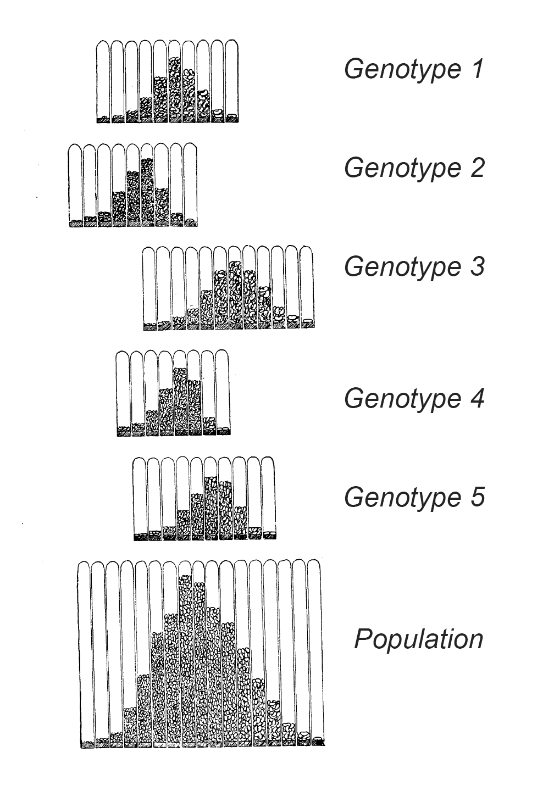
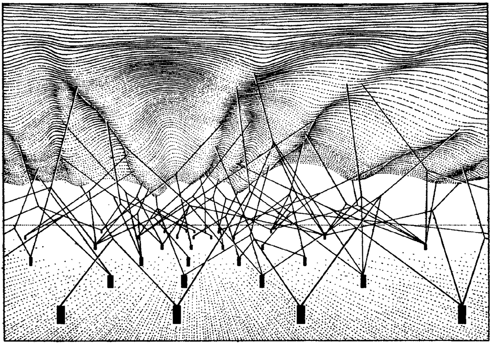

# The Genotype/Phenotype Distinction
**First published Fri Oct 2, 2026**

*Dietrich, Michael, DiMarco, Marina*

[*Editor’s Note: The following new entry by Michael Dietrich and Marina DiMarco replaces the [former entry](https://plato.stanford.edu/archives/fall2026/entries/genotype-phenotype/) on this topic by the previous authors.*]

The distinction between genotype and phenotype is fundamental to the understanding of the heredity, development, and evolution of organisms. As the word *genotype* suggests, this is a type that describes a set of hereditary constituents. For sexually reproducing animals, for instance, the hereditary material is usually understood to consist of the DNA contributed by the sperm and egg of its two parents. This can include nuclear and mitochondrial DNA as well as perhaps some patterns of epigenetic modification of that DNA. The *phenotype* is a set of characteristics; for example, an organism’s size and shape, its metabolic activities, or its pattern of movement. An individual organism’s specific characteristics or hereditary constituents could be tokens of those types.

The first part of this entry builds from the observation that the original meanings of genotype and phenotype and the distinction between them as given by Wilhelm Johannsen (1909) were quite different from the now predominant meanings (given above). To make sense of the history of the terms, we begin with an account of the distinction in Johannsen’s book with special reference to practices or assumptions regarding experimental conditions. We then turn to how the distinction functioned in relation to the chromosome theory of classical genetics, before considering the genotype-phenotype distinction in the light of more contemporary genomics and epigenetics. The second part of this entry addresses how different mappings between genotype and phenotype instantiate a complex, many-many relation. The complexity of the genotype-phenotype relationship has consequences for how idealized and simplified genotype-phenotype relations are deployed in science and society.

## 1. Distinguishing Genotype and Phenotype

From their survey of textbooks, dictionaries, articles and preceding SEP entries, Martin Mahner and Michael Kary extracted seven different meaning for the term “genotype”:

> (a) a class of organisms; (b) a set of symbols; (c) the set of *all* genes (hereditary material) of an organism; (d) the set of *chromosomal* genes of an organism; (e) the set of alleles of a *cell*; (f) a set of instructions (or a program); and (g) the genetic constitution of an organism. (Mahner & Kary 1997: 56, emphasis original)[^mahner-1997]

The same survey yielded five different meanings for the term “phenotype”:

> (a) a class of organisms; (b) the physical appearance (or form) of a *character* (or trait); (c) the observable properties (or traits) of an *organism*; (d) the collection of traits of a cell or organism (whether observable or not); and (e) the manifestation of the genotype. (Mahner & Kary 1997: 56, emphasis original)[^mahner-1997]

The list of meanings could be longer still (see below). But when Danish geneticist and plant physiologist Wilhelm Johannsen introduced the terms “genotype” and “phenotype” in 1909, many of these definitions would have made little sense at all, in part because the material basis of heredity was an open question. In this section we begin with Johannsen’s distinction in order to set up both the contrasts and continuities with contemporary meanings.

### 1.1 Johannsen’s Distinction in the Context of Classical Genetics

Johannsen introduced the genotype-phenotype distinction in his 1909 book, *Elemente der Exakten Erblichkeitslehre* (*Elements for the Exact Study of Heredity*). His view of that distinction changed substantially over the subsequent editions of his book, reflecting important developments in classical genetics (Churchill 1974)[^churchill-1974].

#### 1.1.1 Johannsen’s 1909 Interpretation

Johannsen’s 1909 book developed from a line of experiments with the brown princess bean, *Phaseolis vulgaris*, which established what he called the pure line method (Churchill 1974)[^churchill-1974]. Because this bean was largely self-fertilizing, it was easy to breed a plant with itself. The result was a pure line plant that consistently produced offspring with very similar characteristics. This kind of breeding program stood in contrast to mass selection, where a group was chosen from a population to reproduce and create the next generation. From a large population, for instance, you might select only plants with the largest beans to reproduce and form the next generation. Since you have selected large bean size from the parental population, you might expect large bean size in the progeny. Instead, the average bean size of the offspring might be a bit bigger than that of the parent generation, but with random mating in the offspring generations their average size will move back to that of the parental population. Francis Galton characterized this in terms of regression back to the parental mean and saw it as a way in which biological types were stabilized (Krashniak & Lamm 2021; Johannsen 1909: 106)[^johannsen-1909][^krashniak-2021]. For a breeder, however, this kind of regression back to the smaller parental bean size was not at all desirable. A breeder wanted a more permanent change in the selected character. Johannsen’s pure lines had the stability over subsequent generations that breeders desired. In *Elements for the Exact Study of Heredity*, Johannsen wanted to offer a theory of heredity grounded in “sharper definitions” that allowed him to explain these kinds of results (1909: iii).

An important part of Johannsen’s project was articulating an alternative to accounts of heredity advocated by biometricians, such as Francis Galton and Karl Pearson, and particle theorists, such as August Weismann and Charles Darwin. The analysis by biometricians of continuous variation (traits that have a continuous distribution of values within a population, such as bean length) in terms of the numerical correlation of offspring traits with those of their parents, grandparents, and so on, supported the possibility of speculative “ancestral influences” as enshrined in Francis Galton’s law of ancestral inheritance where all of an organism’s ancestors were understood as contributing to its traits (1909: 319). The particulate theories, such as those of August Weismann and the Darwinians, proposed various ways in which parental traits were transmitted to the zygote via material particles, such as Darwin’s pangenes or Weismann’s germ plasm. In Johannsen’s words,

> Weismann’s views are based partly on observations, but not on exact analytical experiments, and their main support is found in the author’s brilliant, dazzling art of exposition and his captivating dialectic. (1909: 319)

The theory Johannsen proposed needed to explain heredity and its experimental basis in quantitative terms without appeal to speculation, which he thought was inappropriate in an exact science.

In the chapter where Johannsen introduced the terms “genotype”, “phenotype”, and “gene”, he begins by first exploring the meaning of the term “type” as suggested by Adolphe Quetelet. When measuring some character which varies across individuals in a population, the type according to Johannsen refers to “the mean value or the center of variation” for the measured character (1909: 116). For variable traits that are binomially distributed, there is only one central tendency, so Johannsen calls these “simple types” (1909: 117). The problem of the effects of selection was then reframed as the ability to shift the simple type of a population. Johannsen is very clear that this kind of type is “merely a statistical idea” derived from “immediate observation” (1909: 121). This “statistically-derived type” is what Johannsen calls the phenotype (1909: 123). In his words, “phenotypes are in themselves measurable realities, as characteristic observations: the centers of datasets, around which variations are grouped” (1909: 123). Importantly, Johannsen asserts that phenotypes, as features of statistical distributions, generally are not “expressions of a biological unit” (1909: 123). Of course, what Johannsen was really interested in was when phenotypes were “expressions” of biological units.

Although he was infamously against the speculative postulation of material particles and plasms, Johannsen readily accepted that there was some material in the gametes that was combined in sexual reproduction. Among German-speaking biologists, including Mendel, this material was frequently referred to as *Anlagen*. In order to distance himself from particle theories, Johannsen suggested substituting the term “gene” for *Anlage* (1909: 124). In a famous passage, Johannsen explained that

> The word “gene” is completely free of any hypothesis, but instead expresses the sure fact that each of the many characters of the organism are attributable to specific, separable (therefore independent) “conditions”, “causes”, or “Anlagen” received through the gametes; briefly, what we want to name by “gene”. (1909: 124)

Genes allowed Johannsen to adopt Mendel’s results regarding separate genes associated with different characters. He could also explain differences between species in terms of the different genes that each carried.

*Figure 1.*

Figure 1. Johannsen’s diagram of the relationship between a mixed population and the genotypes that it contains. Johannsen recognized that a single observable phenotype (the population distribution of a trait like bean length in a population of beans at the bottom of the diagram) could be the result of multiple genotypes represented as smaller distributions above the population distribution. Each genotype corresponds to a distribution of beans, which constitute its specific phenotype. As a distribution, each phenotype exhibits a central tendency and variability around that central tendency. (Adapted from Johannsen 1911: 136)[^johannsen-1911].

Returning to his selection experiments with *Phaseolis* (see Figure 1), the mixed parental population displayed a statistical distribution and phenotype for bean length, but that population was composed of five “purebred series”. Each of these purebred lines also had a distinct phenotype, but Johannsen claimed that these phenotypes corresponded to “actual differences of genes” (1909: 127). Put another way, these phenotypes were distinct on a “more fundamental level”, because these pure lines were the products of different genes. These more fundamental differences in genes were called genotypical differences.

### 1.2 Genotypes and Genomes

In 1909, Johannsen’s terms, “gene” and “genotype”, helped provide a new vocabulary for a nascent field. Today, the term “genotype” is part of an array of terms biologists have at their disposal for talking about heredity. According to Mahner and Kary (1997), a key distinction is that between abstract terms and physical terms. They note that in contemporary biological usage the “physical totality” of all genes can be referred to as the genetic complement, the physical genome, or just the genome (1997: 57). Similarly, the physical totality of all traits can be referred to as the phenetic complement, physical phenome, or phenome (1997: 62). They contrast these physical (i.e., material) terms with terms such as genotype and phenotype, which are abstract terms referring to a set of gene types (1997: 58) or traits (1997: 61) respectively.

Mahner and Kary point out that “genome” is sometimes used in an abstract manner, as for instance when scientists refer to “the human genome” as a set of genes which does not perfectly correspond to any actual individual material genome, let alone capture the variation in genomes present among individuals in a species (see also Barnes & Dupré 2008)[^barnes-2008]. However, others equate the genome with the information contained in DNA sequence of the material genome (an abstract interpretation) or the material set of chromosomes (a physical interpretation) (see Barnes & Dupré 2008: 75-79 and discussion in Guttinger & Dupré 2016)[^barnes-2008][^guttinger-2016]. The trajectory of these arguments may partly reflect technological developments in sequencing and their impacts on scientific practice, such as the shift from sequencing reference genomes to the now-ubiquitous practice of whole-genome sequencing (Barnes & Dupré 2008)[^barnes-2008]. We prefer the material conception of genomes defended by Barnes and Dupré, as we agree with their argument that it avoids the problematic “blueprint” connotations of the informational model of the genome and the notoriously challenging problem of individuating genes (see Griffiths & Stotz 2006, 2013; Meunier 2022 [2025])[^griffiths-2006][^meunier-2022]. Nevertheless, this stance leaves open the question of exactly which material components of genomes are hereditarily active (The ENCODE Project Consortium 2012; cf. Doolittle 2013)[^doolittle-2013][^encode-2012].

A genotype, then, is a type of which genomes (and perhaps other components of inheritance systems) are tokens (Lewontin 1992; Barnes & Dupré 2008; Ricote & Maeso 2023)[^barnes-2008][^lewontin-1992][^ricote-2023]. David Ricote and Ignacio Maeso’s (2023) analysis of genotype and phenotype in terms of the type-token relationship exemplifies this approach to the distinction. Ricote and Maeso ground their distinction in the difference between informational and material concepts of the gene, drawing on Griesemer’s materialist understanding of the processes of heredity and reproduction (Griesemer 2005)[^griesemer-2005]. They link their account of material heredity to a genotoken concept that depends on “self-templated replication of the genotoken structure to be reproduced in the successive generations” (2023: 250). Like Barnes and Dupré, their analysis implies that genotokens need not be only DNA or RNA. Instead they could also include “genetic membranes, modified histones, centrosomes, and prions”, because they all have “structural identity relationships that depend on their copying processes rather than on the possibility of being translated as information” (Ricote & Maeso 2023: 250)[^ricote-2023]. The result is a much more expansive sense of what constitutes the materials of heredity with implications for a broader domain for related genotypes as well.

A genotype/genotoken framework offers helpful clarification because it allows two organisms to be part of the same genotype but have distinct physical genomes; i.e., physically distinct material nucleotides, chromosomes, etc. Ricote and Maeso’s material view is only one way such a framework could be articulated, however. For instance, though this particular view commits to roles for specific causal processes and material continuities in characterizing the relationships among genotokens (and thus genotypes), it is also possible to individuate genotokens as members of types in virtue of similarities among inheritance systems without relying on these processes (see Ricote & Maeso 2023: 254-5 and Wetzel 2006 [2018])[^ricote-2023][^wetzel-2006]. This could allow, for example, synthetic materials to count as genotokens of a genotype in virtue of the similarity of their material inheritance systems without invoking material continuity or resorting to an informational view of genes, genomes, or inheritance. It might also allow greater flexibility in the units of genotokens, since presumably for Ricote and Maeso, the unit of the genotoken is linked with the unit of self-templated replication and material continuity: on their view, cellular replication (2023: 247).

Appealing to similarity raises the question of which similarities are scientifically useful or justified as the basis for characterizing genotokens and genotypes (Barnes & Dupré 2008)[^barnes-2008]. Although this may result in “artificial” classifications which compromise the status of genotypes as “natural kinds” (Ricote & Maeso 2023; though see Bird & Tobin 2022 [2025] Section 1.4 and Chakravartty 2023)[^bird-2022][^chakravartty-2023][^ricote-2023], it would better track scientific practice. For instance, Lewontin (1992) and Mahner and Kary (1997) note that scientists can, and often do, think about “partial genotypes” by focusing on one or a few loci of interest. This allows organisms, for example, to share a particular partial genotype while having different genotypes and genomes overall. The idea of partial genotypes may also allow us to reconcile the material genome of Barnes and Dupré and the material genotokens of Ricote and Maeso with conceptions of the genotype as a set of genes, or a set of gene types, even though genes comprise only part of an inheritance system. After all, even Ricote and Maeso allow that “it is useful to define discrete genotypic identities by establishing artificial classifications and limits” (2023: 246). Particularly if genotokens are to include components of inheritance systems besides DNA, some deliberate practices of abstraction or idealization will likely be necessary to make genotypes tractable and useful for inquiry (see Potochnik 2017)[^potochnik-2017], so it becomes natural to think of such idealized characterizations in terms of their adequacy-for-purpose (see Parker 2009, 2020)[^parker-2009].

Generally speaking, if genotypes are types of genotokens, what counts as a genotype and how many genotypes there are will depend on how we individuate genotokens. Defining genotypes and genomes does not fully resolve how these should be characterized in practice. Regardless of whether there is a definition of the genotype that makes it a natural kind, scientists will likely focus on particular aspects or parts of genotokens in characterizing genotypes depending on their research interests (Barnes & Dupré 2008)[^barnes-2008].

#### 1.2.1 Hologenotypes

What biological units can properly be said to have genotypes? Just as the genotype and phenotype concepts have been applied to canonical units of organization for biological inquiry such as the organism, so too have they followed recent developments in the understanding of biological individuality (see Wilson & Barker 2019 [2024])[^wilson-2019]. In particular, the introduction of the holobiont has led to the notions of the hologenome and the hologenotype. Biologist Joan Roughgarden (2020: 2) offers the following useful characterizations:

> A *microbiome* is an “ecological community of commensal, symbiotic, and pathogenic microorganisms” that shares the “body space” of a host (Lederberg & McCray 2001)[^lederberg-2001]. A *holobiont* is a composite organism consisting of a host together with its microbiome (Margulis 1991)[^margulis-1991]. The *hologenome* is the union of all the host genes with all the genes in its microbiome (Zilber-Rosenberg & Rosenberg 2008)[^zilber-rosenberg-2008]. To these definitions I add the following: a *hologenotype* is the configuration of the hologenome in an individual holobiont. The hologene pool is the set of all hologenotypes in a population of holobionts.

The hologenotype concept captures the idea that a genotype can be a feature of a combination of organisms (specifically, a host and its microbial community). A key issue here is whether it is necessary for a hologenotype that the microbiome be inherited vertically from parents to offspring, or whether horizontal transmission of the microbiome, e.g., by infection, also counts, particularly given that one purpose of the hologenotype concept is to ask whether the holobiont is a unit of selection (Roughgarden 2020; on units of selection, see Lloyd 2005 [2024]; on vertical and horizontal inheritance, see Bright & Bulgheresi 2010)[^bright-2010][^lloyd-2005][^roughgarden-2020]. Some scholars who characterize the genomes present in the microbiome as “extending” the host genome argue that only vertically transmitted microbial genomes are properly part of such an “extended genotype” (Morimoto & Baltrus 2019)[^morimoto-2019]. However, Roughgarden (2020) argues that holobionts that result from both vertical and horizontal transmission can in principle be units of selection (for a pluralist take on this issue, see Hazelwood 2025)[^hazelwood-2025]. Roughgarden’s hologenotype concept allows that the genotype of a holobiont may be dynamic, and that different parts of a hologenotype can vary at different spatial and temporal scales.

#### 1.2.2 Epigenotypes

Developmental biologist Conrad “Hal” Waddington introduced the idea of the epigenotype to capture the complex causal processes linking genotypes with phenotypes (1939; 1942). Waddington (1939: 156) defines the epigenotype as “…the set of organizers and organizing relations to which a certain piece of tissue will be subject during development”, where “organizer” is understood in the context of transplantation experiments in embryos as a part of the embryo with a particular causal role in development (see Fagan & Maienschein 2022)[^fagan-2022]. Waddington’s later characterization referred to developmental processes rather than organizers, as he writes,

> between genotype and phenotype, and connecting them to each other, there lies a whole complex of developmental processes. It is convenient to have a name for this complex: “epigenotype” seems suitable. (1942 [2012: 10]; see discussion in Jablonka & Lamm 2012)[^jablonka-2012][^lamm-2012]

Waddington highlighted the relationships between these processes at different points in time:

> One general feature… is that it consists of concatenations of processes linked together in a network, so that a disturbance at an early stage may gradually cause more and more far reaching abnormalities in many different organs and tissues. (1942 [2012: 10])

Waddington eventually developed his theory of epigenetics with the concept of an “epigenetic landscape” whose topography is determined by genes and gene products (Waddington 1940; 1957; Fagan & Maienschein 2022)[^fagan-2022][^waddington-1940].

*Figure 2:*

Figure 2: Waddington’s epigenetic landscape anchored by genes. The contours of the epigenetic landscape were depicted by Waddington as produced by genes (black rectangles) in interaction with each other. The epigenetic landscape then was a kind of developmental phenotype that influenced the possibilities of organismal phenotypes. Used with permission of Routledge from *The Strategy of the Genes*, Conrad H. Waddington, 1957 [2014 edition, page 36]; permission conveyed through Copyright Clearance Center, Inc.).

Scott Gilbert (2012) contextualizes Waddington’s introduction and framing of the epigenotype as a deliberate attempt to bridge genetics and embryology in a moment where they were still largely separate. Gilbert (2012) thus explains that the “epi” in Waddington’s epigenotype is closer in meaning to “developmental” than the sense of “above” the gene in contemporary epigenetics. Since Waddington’s introduction of the term, a science of “epigenetics” has emerged focused on heritable, non-sequence changes to the genome such as DNA methylation and histone acetylation patterns (see Jablonka & Lamb 1995; Jablonka & Lamm 2012; Griffiths & Stotz 2013; Lamm 2012 [2021])[^griffiths-2013][^jablonka-1995][^jablonka-2012][^lamm-2012]. The epigenotype has made the transition into this new framework of epigenetics, as illustrated by Whitelaw and Whitelaw’s definition:

> The epigenotype refers to mitotically heritable patterns of DNA methylation at CpG dinucleotides and modifications to chromatin proteins (e.g. histone acetylation) that package DNA. (2006: R131)

As mentioned above, this raises the question of which types or mechanisms of inheritance count for the purposes of identifying the genotype and epigenotype. Epigenetic patterns are often distinguished from genes and genomes (though see Guttinger & Dupré 2016)[^guttinger-2016]. However, if the genotype is defined broadly in terms of inherited or heritable sources of phenotypic variation, epigenetic modifications may also count as part of a genotype itself, since such patterns are often inherited in cell lines and even transmitted intergenerationally (Ricote & Maeso 2023)[^ricote-2023]. If the epigenotype is properly considered part of the genotype qua inheritance system, this definition could be interpreted as yet another “partial genotype”, or abstraction from its full complexity.

Although Whitelaw and Whitelaw’s definition seems to focus on patterns of modification rather than their interactions per se, contemporary epigenetics nevertheless echo Waddington’s landscapes and networks of processes (Jablonka & Lamm 2012)[^jablonka-2012][^lamm-2012]. For instance, Bernstein, Meissner, and Lander write that

> [c]hemical modifications to DNA and histone proteins form a complex regulatory network that modulates chromatin structure and genome function. The epigenome refers to the complete description of these potentially heritable changes across the genome. (2007: 669)

If the epigenotype stands in a type-token relationship to epigenomes, a given epigenome (perhaps “epigenotokens” or partial genotokens) is merely a snapshot of a complex, dynamic set of processes.

### 1.3 Phenotypes

As introduced above, a phenotype is often described as any observable or measurable trait(s) or property (Mahner & Kary 1997)[^mahner-1997] or observable *difference* in a trait (de Vienne 2022)[^vienne-2022]. Mahner and Kary (1997: 61) write that “...all the different ways of distinguishing between types of traits are traditionally subsumed under the concept of phenotype”. Such a broad characterization leaves many important questions for biologists and philosophers of biology. Here we focus on the concepts and methods scientists use to characterize phenotypes and the relationships among them.

#### 1.3.1 Characterizing Phenotypes

Trait individuation is a key challenge for characterizing phenotypes. Traits or “characters” have long been used to distinguish and compare organisms and their parts (Wagner 2001)[^wagner-2001]. Sometimes scientists individuate traits by their genetic causes (Mahner & Kary 1997)[^mahner-1997], and so-called “complex phenotypes” are defined by their causes to the extent that they are distinguished as “the consequence of complex interactions of a large number of genetic and non-genetic determining factors” (Marian 2012: 65)[^marian-2012]. However, few phenotypes can be straightforwardly identified by genotype—for instance, recall Johannsen’s observation that the same phenotype can be caused by multiple different genotypes—and phenotypes are also untethered from genotypes as a synonym for “trait” (see, e.g., Meneganzin et al. 2024)[^meneganzin-2024]. Thus, phenotypes can be characterized by structure and/or function or other observable phenomena without direct reference to cause (though see discussion of justification for trait individuation below). For some purposes, trait (and function) individuation may be arbitrary (Ricote & Maeso 2023)[^ricote-2023]; for other purposes, trait individuation may be constrained by factors like shared evolutionary history (Allen 2002)[^allen-2002].

Andra Meneganzin, Grant Ramsey, and James DiFrisco (2024) offer a three-part framework of description, detection, and justification as three interacting processes of trait individuation, using the example of the human chin. On one description, the chin is a physical object (“bony prominence”) whereas on another description it is a quantitative relationship between two planes (“symphyseal angle”) (Meneganzin et al. 2024 cite Daegling 1993; DuBrul & Sicher 1954; Schwartz & Tattersall 2000, Pampush 2015, Pampush et al. 2018)[^daegling-1993][^dubrul-1954][^meneganzin-2024][^pampush-2015][^pampush-2018][^schwartz-2000]. They point out that detection or measurement practices can result in “new” traits, either by providing new descriptions (such as quantitative descriptions) or when operationalizations replace trait concepts (see also de Vienne 2022)[^vienne-2022]. This view allows measurement to play a key role in the conceptualization of phenotypes without committing to stronger forms of operationalism on which a phenotype concept just is its *method* of measurement, which would make it impossible to evaluate better and worse ways of measuring the same phenotype (Meneganzin et al. 2024: 70; see also Wagner 2001; on operationalism, see Chang 2009 [2021])[^chang-2009][^meneganzin-2024][^wagner-2001].

Meneganzin et al. note that standards of justification for considering observed traits to be biologically meaningful may vary. For instance, Gould and Lewontin (1979) argue that the chin is not a trait because it is not an adaptation, but rather a byproduct of development (see discussion in Meneganzin et al. 2024)[^meneganzin-2024]. The chin example highlights two enduring challenges for differentiating phenotypes. First, many observable features of organisms are not traits in the sense of sharing a single stable description, let alone a known genetic cause. This difficulty is compounded by the fact that some phenotypes change over time, e.g., as part of development (Lewontin 1992)[^lewontin-1992]. Second, there is no universal standard of justification for what counts as a good, or scientifically meaningful, phenotype.

Another example of a standard of biological meaningfulness for characterizing a phenotype is the *extended phenotype*. Although it is natural to think of phenotypes as properties of organisms, like wings or height, scientists also apply the concept of a phenotype to phenomena that are not properties of, or exclusively caused by, individual organisms and their genes. Richard Dawkins (1982 [1999]) introduced the term “extended phenotype” to describe effects of genes which may or may not be contained or manifested in an individual organism’s body. The basic idea is that genes can make a causal difference to phenomena such as behaviors and even extra-organismal physical structures, like beaver dams or termite mounds, which are considered adaptive. Importantly for Dawkins, not *all* downstream effects of a gene are worth considering part of an extended phenotype; for instance, if genes influence foot shape, that does not mean that corresponding changes in the shape of a footprint should be included as an extended phenotype, even if this would be “formally correct” (Dawkins 1982 [1999: 207])[^dawkins-1982]. Dawkins (1982 [1999]; 2004) insists that to count as part of the extended phenotype, the phenomenon (behavior, trait, beaver dam) should be adaptive. This serves to restrict the otherwise endless proliferation of extended phenotypes. However, it also indexes extended phenotypes to Dawkins’ preferred unit of selection, namely individual replicators (typically, genes).

The extended phenotype has several interesting consequences: because it attaches to genes, not organisms, extended phenotypes can be the products of genes in multiple organisms—either organisms of the same species working synchronously or asynchronously, such as when multiple generations of termites contribute to building a mound, or when organisms of one species manipulate the behavior of another, as in cases of parasitism (Dawkins 1982 [1999])[^dawkins-1982]. Extended phenotypes thus divorce the notion of a phenotype from the genotype of an organism, class of organisms, or species. Dawkins instead considers genotypes to be environments in which different genes are selected.

Characterizing phenotypes is no less challenging in inquiries outside evolutionary biology, such as behavior genetics and biomedicine. Discussions of trait description here have intersected with broader debates about causal selection. For example, Kenneth S. Kendler (2005) questions whether a genetic difference that causes a difference in pitch perception and thus, Mozart appreciation, should be considered a gene “for” Mozart appreciation. Kendler concludes that pitch perception, rather than Mozart appreciation, is the appropriate effect or “level of explanation” to pick out in such a case. Kendler’s level of explanation has since been theorized in relation to the proportionality of a causal relationship (Woodward 2010)[^woodward-2010], which can be understood in terms of describing causal variables in an explanation with an appropriate amount of detail (Yablo 1992; Woodward 2021; Kinney 2019)[^kinney-2019][^woodward-2021][^yablo-1992]. Here, individuating phenotypes might be seen as a special case of a broader challenge of appropriately selecting and describing causes and effects.

Characterizations of phenotypes can impact the social and political valence in addition to the empirical adequacy of inquiry. This is particularly relevant to the context of genome-wide association studies, or GWAS, which seek to identify statistical associations between single-nucleotide polymorphisms throughout the genome and some phenotype(s) of interest (Downes & Matthews 2024 [2025])[^downes-2024][^matthews-2024]. For example, attempts to identify genetic correlates of phenotypes such as same-sex attraction or sexual orientation have presumed that these are unified, cross-contextually stable phenomena, or that homosexuality and heterosexuality are “opposed parts of a whole” (Borsa et al. 2024: 128; see also Clare et al. 2023; Vázquez 2022)[^borsa-2024][^clare-2023][^vázquez-2022]. Despite their frequent causal complexity, phenotypes for which genetic associations are identified or popularized are susceptible to what Lucas Matthews (forthcoming) has termed “geneticization”, or coming to be thought of as “genetic”, with the attendant social and political implications of such an understanding. In light of this, trait individuation for socially salient phenotypes such as sexuality or educational attainment may be particularly sensitive to ethical and political considerations for their justification (see Brigandt 2022; Neto 2025)[^brigandt-2022][^neto-2025].

#### 1.3.2 Differentiating Phenotypes

In addition to characterizing phenotypes, scientists sometimes draw distinctions among them. Here we consider three such distinctions: phenocopies, phenologs, and endophenotypes.

1.3.2.1 Phenocopies

Geneticist Richard Goldschmidt (1949) described a pattern of phenomena he called *phenocopies*. Phenocopies were traits that resulted from specifically timed temperature shocks, leading the exposed organisms to develop traits which resembled those typical of other varieties under typical conditions. For instance, by exposing non-mutant *Drosophila* to heat shocks, Goldschmidt produced phenocopies that were visually indistinguishable from the phenotypes associated with known mutants (Goldschmidt 1949; Dietrich 1996)[^dietrich-1996][^goldschmidt-1949]. Although Goldschmidt contrasts phenocopies with typical phenotypes, he does not define a phenocopy as anything other than a phenotype. Rather, he uses this term to draw a distinction between the different conditions that produce the same appearance (i.e., the same phenotype) in the organism. As Susan Oyama (2000) points out, the decision to label one trait a phenocopy and another a phenotype does not mean that some phenotypes should be privileged as more “genetic” in virtue of being caused by a typical genotype under typical conditions (as opposed to, say, a typical genotype under atypical conditions, arguably an equally “genetic” cause). However, Goldschmidt found the concept of a phenocopy useful in investigating patterns such as commonalities between conditions under which mutants and environmental exposures produce phenotypes (1949). The phenocopy concept has persisted as a way of distinguishing among phenotypes: those that are acquired by typical and atypical means (see, e.g., Lescai & Franceschi 2010)[^lescai-2010].

1.3.2.2 Phenologs

Sometimes researchers seek to identify similar phenotypes in different taxa, such as when they are developing a model organism for the study of a disease or phenomenon of interest in humans (Robinson & Webber 2014)[^robinson-2014]. One way to do this is to attempt to identify *phenologs*, or “orthologous phenotypes” (McGary et al. 2010: 6544)[^mcgary-2010]. Kriston L. McGary et al. define phenologs as “…the phenotype-level equivalent of gene orthologs” (2010: 6544). Orthology is a property of the history of genes: two genes are orthologous if they are “derived from a single ancestral gene in the last common ancestor of the compared species” (Koonin 2005: 312)[^koonin-2005]. The idea behind the use of phenologs is that although orthologous genes in distinct species may contribute to very different phenotypes, especially when these are conceived as properties of the whole organism, they often have similar molecular functions (McGary et al. 2010: 6445; Koonin 2005)[^koonin-2005][^mcgary-2010]. Because of this, identifying phenotypes known to be influenced by orthologs may help identify causal processes and disease-relevant genes shared across taxa (McGary et al. 2010)[^mcgary-2010]. Like phenocopies, phenologs are phenotypes distinguished in virtue of a specific relationship (in this case, the historical relationships of associated genes) to other phenotypes.

1.3.2.3 Endophenotypes

Another way of distinguishing among phenotypes is by characterizing some of them as *endophenotypes*. Biologists Bernard John and Kenneth R. Lewis (1966: 714) focused on the role of chromosomes in evolution in their use of the term “endophenotype” to contrast the internal “component” of a phenotype with the external, or “exophenotype” and conceptualize its role in evolution. Today, however, the endophenotype concept enjoys a predominant meaning in the field of psychiatric genetics, where it is thought to have been imported by behavior geneticist Irving Gottesman and collaborators (McGue 2017 cites Gottesman & Shields 1973; see also Dick 2018)[^dick-2018][^gottesman-1973][^mcgue-2017]. In this usage, endophenotypes, sometimes known as “intermediate phenotypes”, are traits associated with outcomes like psychiatric disease (Kendler & Neale 2010; Robinson & Webber 2014)[^kendler-2010][^robinson-2014]. According to Kendler and Neale, endophenotypes may be intermediate causes along a causal pathway from a genotype to a phenotype, or they may be merely statistical predictors but not necessarily causes of this phenotype, perhaps due to a common cause relationship with the genotype (2010). However, other accounts, such as that of Glahn et al. (2014), are more stringent, requiring that the endophenotype “lies more proximal to the underlying genetics of a disorder than the clinical phenotype” and that it meet a number of other criteria:

> …an endophenotype must: (1) be heritable; (2) be associated with the illness; (3) be independent of clinical state…and (4) impairment must co-segregate with the illness within a family (family members that do not meet diagnostic criteria show impairment relative to the general population); and (5) represent reproducible measurements. (2014: 123)

This is meant to distinguish them from other biomarkers (Glahn et al. 2014)[^glahn-2014].

Endophenotypes are sometimes thought to be simpler or “closer” to genetic causes than the phenotype of interest, and thus more tractable (Gottesman & Gould 2003; Kendler & Neale 2010; Robinson & Webber 2014; McGue 2017)[^gottesman-2003][^kendler-2010][^mcgue-2017][^robinson-2014], although this is not necessarily always the case (Flint & Munafò 2007)[^flint-2007]. Like the phenocopy and the phenolog, the endophenotype is no less a phenotype than the trait for which it is causally intermediate to, predictive for, or part of. Some scholars suggest that endophenotypes may be helpful in revising the classification of psychiatric disorders, in keeping with the spirit of projects such as Research Domain Criteria (RDoC) which seek alternatives to existing clinical psychiatric kinds (Gottesman & Gould 2003; Glahn et al. 2014; Tabb 2019; Radden & Tsou 2024; Murphy 2010 [2025])[^glahn-2014][^gottesman-2003][^murphy-2010][^radden-2024][^tabb-2019].

### 1.4 Summary

The kinds of things that can count as (partial) genotypes and phenotypes today range from properties of parts of organisms and their behaviors to the effects of genes distributed in multiple organisms across time and taxa. For Lewontin (1992), even DNA sequence is itself a (partial) phenotype—a molecular property rendered observable, e.g., via sequencing (see also Mahner & Kary 1997)[^mahner-1997]. This emphasizes the enduring importance of observability to phenotype concepts: genotokens, in becoming measurable, have effectively “made it” as phenotokens. Indeed, this discussion has shown how the genotype and phenotype concepts, along with related concepts and distinctions, have survived considerable methodological and epistemological change.

Gaëlle Pontarotti, Matteo Mossio, and Arnaud Pocheville (2022) have recently argued that the genotype-phenotype distinction has not come through this change unscathed, and that we should reconsider or reconceptualize its use now that it no longer sharply distinguishes between observable and unobservable, transmissible and non-transmissible, causal and non-causal in many cases. Without directly answering this challenge, we would also amplify Peter Taylor’s (2018) call to investigate the genotype-phenotype distinction and the genotype and phenotype concepts precisely in virtue of their having survived so much change. One potentially fruitful frame for this analysis may be to ask about what Hasok Chang (2011) calls the “persistence of epistemic objects” when it comes to genotypes and phenotypes. As Chang points out, asking why concepts survive scientific change may be informative both from the perspective of the history of science and for promoting pluralism in the present (see also Chang 2012)[^chang-2012].

## 2. Relationships Between Genotype and Phenotype

If the mechanisms of development were such that every change in genotype resulted in a different phenotype and every different phenotype was the consequence of a difference in genotype, the study of the origin of organic variation would be greatly simplified. Given a knowledge of the phenotype, the underlying causal genotype could be unambiguously inferred and vice versa. The map between genotype and phenotype would be simple. The problem of understanding the manifest variation among organisms would then be reduced to providing a mechanical story of a chain of biochemical reactions, beginning with the reading of the genome by the cell and ending with the final state, much like the production of an automobile can be completely reconstructed from the blueprints, a description of the materials used, of the production machinery and of the order in which the materials pass through that machinery. Major biological and biomedical inquiries, such as the Human Genome Project, have been motivated by optimism that scientists would be able to straightforwardly identify and intervene on many genotype-phenotype relationships in this manner (Tabery 2023; Gannett 2008 [2025])[^gannett-2008][^tabery-2023]. However, the actual map between genotype and phenotype is a many-many relation in which any given genotype corresponds to many different phenotypes and there are different genotypes corresponding to a given phenotype (Hull 1974)[^hull-1974].

Developmental biologists are increasingly aware of the many-many relationship between genotype and phenotype and are actively trying to articulate the many maps between genotype and phenotype. In the past, pragmatic considerations dictated that scientific understanding of the mechanisms of development was easiest to achieve by concentrating on those developmental outcomes that had an unambiguous relationship between genotype and phenotype. An unintended side product of this strategic decision was that the language used to describe the problematic, and the results of the research, created and reinforced an overly simple view of the relationship between genes and characters (Gannett 2008 [2025])[^gannett-2008].

The many-many mapping between genotype and phenotype arises from four sources: (1) the relation between the DNA sequence and the chemical structure of proteins; (2) relations between the products of transcription and translation; (3) the dependence of development and physiology on both the genotype of the organism and the temporal sequence of environments in which the organism develops and functions; and (4) stochastic variations of molecular processes within cells.

### 2.1 DNA-Protein Relations

A protein consists of a string of amino acids, each one of which is coded for by a triplet of nucleic acids in the string of DNA constituting a gene. For a protein to have physiological activity, the identity of many of these amino acids is essential. Thus, a change in any part of the gene that causes a replacement of any one of these amino acids may alter the physiological activity of the protein. It is impossible to say from observing the resulting protein phenotype (a lack of physiological activity of the protein, for instance) what change in the genotype has occurred. Put another way, there are many ways to alter the genotype to produce a particular phenotype. This is a common form of many-to-one mappings of genotype onto phenotype.

### 2.2 Relations Between Genes

Mendel’s observations provide the classic example of an ambiguity in the relation between genotype and phenotype. He observed that plants that carried one member of a gene pair specifying red flowers and one member specifying white flowers were indistinguishable from plants carrying two copies of the red form of the gene. He observed similar dominance of one gene form and recessiveness of the alternative gene form in other characters as well, which led him to generalize the phenomenon as a general principle of dominance (Mendel 1865–66)[^mendel-1865]. While subsequent research has shown that dominance of one copy of a gene over another is far from universal, it is sufficiently common that a large fraction of genetic variation present in populations of organisms is hidden at the level of phenotype and requires special experimental techniques to reveal. This is especially true when one copy of the gene is defective so that protein with less than normal activity is produced from that copy, while the alternate normal copy codes for protein that is physiologically active enough to produce the normal phenotype (Fisher 1931; Haldane 1939; Wright 1934)[^fisher-1931][^haldane-1939][^wright-1934].

A second form of interaction that is extremely common is that which occurs between the products produced from different genes in the genome. If the products of different genes are all necessary to produce a physiological effect, then alterations in any one of the genes will alter or even block the effect. Such interactions occur when the physiological effect is the outcome of a chain of chemical steps, each step being mediated by a product of a different gene. For example, coat color in mammals is the result of the action of the products of three different genes. One determines the distribution of pigment in the hair, and another determines whether the color of the pigment is black or brown. Various combinations of different genotypes of these genes correspond to different coat colors. However, there is a third gene that codes for an enzyme that is necessary for any color at all to be expressed. If this gene is defective the coat will be white, irrespective of the genotype of the other genes (Wright 1925)[^wright-1925].

A third source of a many-to-one relation between genotype and phenotype is the phenomenon of developmental buffering whose mechanism is poorly understood. There are many phenotypic features of organisms that show no variation between individuals belonging to the same species or are even constant among many related species. For example, all individuals of all species of the fruit-fly genus *Drosophila* have exactly three simple light receptors, *ocelli*, arranged in a symmetrical triangle on the midline of the top of their heads. The simplest assumption is that there is no genetic variation for this trait and that its development is resistant to normal environmental disturbance. If the development of the fly is sufficiently disturbed, however, some flies with two or fewer ocelli are observed. If those with fewer than three ocelli are used as parents for the next generation they produce more abnormal flies than the parental generation. When the process of selective breeding from abnormal flies is continued over many generations a line of flies is produced that consistently has two ocelli, even in the absence of any external disturbance of development and these ocelli can be symmetrically or asymmetrically arranged (Maynard Smith & Sondhi 1960)[^maynard-1960]. The success of such a selection experiment proves that there was genotypic variation for ocellus number and arrangement in the original population of normal flies, but that all the different genotypes mapped onto the same phenotype. This is the phenomenon of *developmental canalization,* in which there is buffering of development against perturbing forces. There is genetic variation among individuals for genes that affect ocellus number, but the developmental effects of that variation are prevented by the system of buffering (Waddington 1953, 1957)[^waddington-1953]. If a sufficiently large perturbation is introduced, the developmental buffering capacity is overcome and the genetic variation for ocellus number is revealed. It is then possible to select genotypes that are so extreme in their effect on development that they are beyond the buffering capacity of the normal developing system and produce unusual phenotypes even under normal circumstances. Experiments with various other constant features of various animals have shown that developmental canalization is a common feature, so that phenotypic uniformity cannot be taken as a demonstration of relevant genotypic uniformity (Rendel 1967; De Visser et al. 2003)[^visser-2003][^rendel-1967].

### 2.3 Genes, Development, and Environments

The complete DNA sequence of an organism does not contain the information necessary to specify the organism. The outcome of developmental processes depends both on the genotype, the temporal sequence of environments in which the organism develops, and the processes that constitute development itself (Oyama, Griffiths, & Gray 2001).

Moreover, the mapping of different genotypes into phenotypes in one environment is often completely unpredictable from their mapping in another environment. The classic demonstration of the complexities of this mapping is the experiment on clones of the plant *Achillea* (Clausen, Keck, & Hiesey 1948). Individual immature plants were collected from nature and from each plant three clones were produced by the simple method of cutting them into three pieces. One piece of each plant was grown at low elevation in the Sierra Range, one at medium elevation and one at high elevation. The result of the growth at the three elevations was that the relative heights of the various plants was unpredictable from one environment to another (see Figure 3). For example, the genotype that grew tallest at low elevation was the shortest at medium elevation and the second tallest at high elevation. Moreover, whereas this genotype flowered at low and high elevation, it failed to flower at medium elevation, while other genotypes flowered at that elevation but not at high elevation. There was, in fact, no correlation among the plants in their growth in the different environments. Many experiments on many different organisms where it has been possible to produce multiple individuals of the same genotype show this same result (Lewontin & Goss 2005)[^lewontin-2005].

*Figure 3:*

Figure 3: Clausen, Keck, and Heisey’s diagram of different plant phenotypes in different geographical locations in Northern California. Genetically identical plants show phenotypic variation depending on local conditions, thereby exhibiting part of the norm of reaction for that genotype (Clausen, Keck, & Heisey 1948: 7. CC BY-NC-SA 4.0).

#### 2.3.1 Norms of Reaction and Phenotypic Plasticity

Alan Love defines phenotypic plasticity as

> …the capacity of a particular genotype to generate phenotypic variation, often in the guise of qualitatively distinct phenotypes, in response to differential environmental cues. (Love 2015: §5.2)[^love-2015]

A norm of reaction is a classic way of measuring this differential response.

In 1909, Johannsen claimed that his concept of genotypes was equivalent to Richard Woltereck’s concept of the norm of reaction (Johannsen 1909)[^johannsen-1909]. Woltereck introduced the norm of reaction to explain phenotypic differences among the water flea, *Daphnia*, as they grew in conditions with different food availability (Woltereck 1909; Harwood 1996)[^harwood-1996][^woltereck-1909]. Identical *Daphnia* constituting pure lines, as Johannsen would have called them, were grown in three different lakes, each of which had a characteristic level of algae that the *Daphnia* consumed. Differences in the form of the *Daphnia* were measured and plotted for each of the three different environments, and these differences constituted the norm of reaction. Johannsen conceptualized genotypes as the potential of genetic material to produce specific norms of reaction. This was supported by Herbert Spencer Jennings who claimed that when it comes to detecting genotypes, “what distinguishes the different genotypes, then is, mainly, *a different method of responding to the environment*” (Jennings 1911: 85, emphasis in the original)[^jennings-1911]. Put another way, “a difference in heredity means different response to the same environment” (Jennings 1911: 86)[^jennings-1911].

In his the final edition of his book, Johannsen put some distance between the genotype and the norm of reaction when he claimed that

> The distinction between the genetic constitution of an organism (genotype) and the physical or biochemical attributes of the organism (phenotype) is particularly important in cases in which the environment can affect the trait; in such cases, two organisms with the same genotype can nevertheless have different phenotypes because of differences in the environment. (Johannsen 1926)[^johannsen-1926]

With the material basis of the genotype better understood in 1926, the genotype was not equated with the potential to produce a range of phenotypic responses; it had its own material foundation and could be assessed independently of its norm of reaction. Interpreting norms of reaction as variability introduced by the environment was popularized in Ivan Schmalhausen’s *Factors of Evolution* (1946 [1949]). Lewontin, for instance, recounts that *Factors of Evolution* was the first book that he was assigned to read in graduate school at Columbia University (probably because his advisor, Theodosius Dobzhansky, had translated it and advocated for its relevance) (Lewontin et al. 2001: 26)[^lewontin-2001].

Today, the norm of reaction is understood as a measure of how an environment and genotype interact to produce phenotypes that vary across changing environments for the same genotype. Plotted as graphs, norms of reaction are often given a linear representation, although that is not necessary (see figure 4). Genotypes may show similar kinds of responses or strongly different responses, indicated by crossing lines in the graph (Griffiths & Linquist 2021 [2025: §3.2 Developmental invariance and the norm of reaction]; Downes & Matthews 2024 [2025])[^downes-2024][^griffiths-2021][^matthews-2024].

*Figure 4:*

Figure 4: Norm of reaction for three additive genotypes. Each genotype shows a phenotypic response (Y axis) to change in the environment (X axis).

Like most of classical genetics, norm of reaction plots tend to assume that the relevant developmental processes involved in the creation of a phenotype from a genotype are invariant and so can be black boxed relative to the changes in the environment. More sophisticated representations of gene-environment interactions in quantitative genetics often also assume a kind of developmental invariance (Tabery 2014; Taylor 2014; Downes & Matthews 2024 [2025])[^downes-2024][^matthews-2024][^tabery-2014][^taylor-2014]. In population genetics, the complexities of development in its ecological context are also collapsed into the parameters of the models, such as the parameters for surviving and leaving offspring. Taylor and Lewontin (2017 [2021]) talk about this kind of exclusion of development as a difference maker for phenotypes in terms of what biological practices using genotypes and phenotypes have “abstracted away”. There is no room for development in these models; development is black-boxed in the models of these practices. Reintegrating development into the genotype-phenotype relationship is one of the ongoing challenges for biologists seeking more complex models.

One example of this type of challenge is the fact that the estimation of the selection coefficients of genotypes (in the sense of pairs of genes) is more readily done when the populations are subject to artificial selection in the laboratory than when frequencies or changes over time are observed in the wild. Lewontin (1974) provides grounds for doubting the likelihood of someday restoring what is abstracted away in those selection coefficients. Measurements of selection coefficients and other parameters of the model are possible, Lewontin concludes, only when a single allelic substitution is associated with a large difference in the trait, not when the effects of gene substitutions make only small differences. This led him to remark that: “What we can measure is by definition uninteresting and what we are interested in is by definition unmeasurable” (1974: 23). The problem of relating population genetic models to observations becomes astronomically worse when there are multiple, linked loci (1974: 317). He suggests that population genetics should shift its attention to the selection coefficients for long segments of chromosomes. This program, like Johannsen’s wish that the genotype be seen as a whole, has scarcely been pursued. Even if it had been, ecological genetic analysis of variation in natural populations, with all its complexity (e.g., Clausen et al. 1948)[^clausen-1948], would still be needed to begin to reintegrate ecological context into population genetics.

More recently, Richard Prum’s performative conception of the genotype-phenotype relationship has also aimed to address the “abstraction away of the numerous, hierarchical agencies that intervene between the genotype and the phenotype” (2023: 296). Drawing on the work of Karen Barad and other feminist theorists, Prum regards the phenotype as “a performative enactment of the organism” (2023: 77), which involves “a hierarchy of biological agencies” (2023: 78) both inside and outside an organism (2023: 295). In contrast to the deterministic “blueprint” model of the genotype, Prum’s performative account positions the genotype as akin to the script of a play, contingently realized a particular way in a particular context when the play is performed (2023: 79).

Attempts to integrate evolution, development, and genetics are not new in biology. Johannsen’s emphasis on the whole of the genotype was a way of having the processes of development be an integral part of the relationship between genotype and phenotype. According to Mary Jane West-Eberhard, “the genotype-phenotype problem … is fundamentally a problem of development” (West-Eberhard 2003: 89)[^west-eberhard-2003]. From her perspective, the problem with attempts to integrate development and evolutionary genetics has not been its emphasis on genetics. Instead, she argues that more attention needs to be paid to

> the organized flexible phenotype that is the setting for gene action, the influence of higher levels of organization on how genes are expressed, and the external environment as a source of developmental building blocks as crucial as genetic mutation for the origins of evolutionary novelties. (2003: 90)

This developmental perspective includes the “organized phenotype inherited from previous generations” (2003: 90). A crucial feature of these and all phenotypes is that they exhibit plasticity, “the ability to react to stimuli with a change in form, state, movement, or rate of activity” (2003: 93). The ability of developmental systems to accommodate phenotypic change or buffer its effects can be crucial for organismal survival. In this way, sets of genes will become fixed as a result of fostering a canalized or stable developmental response in the face of environmental change (Flatt 2005)[^flatt-2005]. In this development-first or plasticity-first approach, the genes follow environmental and developmental changes (Baedke & Gilbert 2020 [2024]; Levis & Pfennig 2016)[^baedke-2020][^levis-2016].

This and other reconsiderations of the roles of development and the environment in phenotypic and genotypic change contribute to the many-to-many map between genotype and phenotype.

### 2.4 Stochastic Effects

Even a complete specification of both the genotype and the temporal order of the developmental environment is insufficient to predict the phenotype (Kærn et al. 2005)[^kærn-2005]. If the left and right sides of a bilaterally “symmetrical” organism are examined it will be discovered that, in general, it is asymmetrical, but that the direction and amount of asymmetry varies from individual to individual with no average difference between sides (Dongen 2006)[^dongen-2006]. So, flies have small sensory bristles on their left and right sides. One individual will have, say, six bristles on the right and eight on the left, while another will have five on the right and seven on the left. On the average over many individuals the number is the same on both sides but there is fluctuating asymmetry from fly to fly. Humans do not have the same fingerprints on their left and right hands and the differences in pattern can be so great that no similarity at all can be detected. Yet the genes of the left and right sides are the same and no usual meaning of environment will allow that the left and right hands of a fetus in its parent’s womb have different developmental environments.

### 2.5 Summary

Clearly, genotype-phenotype relationships are complex and dynamic. This has undermined naive optimism about genotype-phenotype mapping and raises important questions about science funding priorities (see, e.g., Tabery 2023)[^tabery-2023]. However, it also matters for our understanding of the distinction and the concepts themselves.

While the phenotype associated with a particular genotype depends on “the environment”, development, and perhaps stochastic factors, the best way to conceptualize these likely depends on the particular context of inquiry. Over the lifetimes of the genotype and phenotype concepts, scientists have done this in more and less abstract ways, influencing both the scope and relevance of their findings and the possibility and tractability of de-idealizing their models and integrating complex sources of phenotypic plasticity and variability. Unsurprisingly, these efforts have reflected researchers’ interests as well as what they could control and measure. Thus, it is not just scientists’ ability to observe the material genome or sequence DNA that has shaped our understanding of a genotype, and it is not only their ability to measure endophenotypes or quantify traits that have influenced what we think of as phenotypes. Biological practices aimed at characterizing the relationships between genotypes and phenotypes—at times defined in terms of these relationships, as Johannsen’s norm of reaction genotype illustrates—have also determined what conceptualizations are deployed in different domains.

Like many other scientific concepts, genotype and phenotype are adapted to a variety of research contexts in subtly different ways, likely influenced by researchers’ aims, methods of measurement, and production of new evidence (Potochnik 2015, 2017; Chang 2004, 2012; Haueis 2024; Makovec 2025)[^chang-2004][^haueis-2024][^makovec-2025][^potochnik-2015]. In this way, the genotype-phenotype distinction, relationship, and the genotype and phenotype concepts themselves might all be seen as plastic: best understood in the context of both their current environments and the series of their previous environments, i.e., their contingent historical development. This leaves many lines of inquiry and intervention open to philosophers of biology and biologists, including which forces constrain, canalize, or stabilize the concepts, which pull them in new directions, and how they might be fruitfully intervened upon for new and old biological purposes.

## References（引用注释）

> 原文参考文献已转为脚注引用：文内“作者-年份”引用组后附 [^key] 标记，完整条目见本文末脚注定义。

## Academic Tools

> |   | [How to cite this entry](https://plato.stanford.edu/cgi-bin/encyclopedia/archinfo.cgi?entry=genotype-phenotype). |
> | --- | --- |
> |   | [Preview the PDF version of this entry](https://leibniz.stanford.edu/friends/preview/genotype-phenotype/) at the [Friends of the SEP Society](https://leibniz.stanford.edu/friends/). |
> |   | [Look up topics and thinkers related to this entry](https://www.inphoproject.org/entity?sep=genotype-phenotype&redirect=True) at the Internet Philosophy Ontology Project (InPhO). |
> |   | [Enhanced bibliography for this entry](https://philpapers.org/sep/genotype-phenotype/) at [PhilPapers](https://philpapers.org/), with links to its database. |

## Other Internet Resources

- Previous major versions of the entry, for more complete information see the [the Genotype/Phenotype Distinction version history](https://plato.stanford.edu/cgi-bin/encyclopedia/archinfo.cgi?entry=genotype-phenotype).
- Taylor, Peter and Richard Lewontin, “The Genotype/Phenotype Distinction”, in *The Stanford Encyclopedia of Philosophy* (Fall 2026), Edward N. Zalta & Uri Nodelman (eds.), URL = [<https://plato.stanford.edu/archives/fall2026/entries/genotype-phenotype/](https://plato.stanford.edu/archives/fall2026/entries/genotype-phenotype/)>.
- Lewontin, Richard, “The Genotype/Phenotype Distinction”, *Stanford Encyclopedia of Philosophy* (Spring 2017 Edition), Edward N. Zalta (ed.), URL = <[https://plato.stanford.edu/archives/spr2017/entries/genotype-phenotype/](https://plato.stanford.edu/archives/spr2017/entries/genotype-phenotype/)>.
- [MendelWeb](http://www.mendelweb.org/).
- Peirson, Erick, 2012, [“Wilhelm Johannsen’s Genotype-Phenotype Distinction”](https://embryo.asu.edu/pages/wilhelm-johannsens-genotype-phenotype-distinction), [Embryo Project Encyclopedia](https://embryo.asu.edu/), 2012-12-07. [[Peirson 2012 pdf](https://hdl.handle.net/10776/4206)]

## Related Entries

biological development: theories of | biological individuals | biomedicine, philosophy of | developmental biology | developmental biology: evolution and development | evolution | gene | genetics | genetics: molecular | genetics: population | genomics and postgenomics | heritability | human genome project | inheritance systems | innate/acquired distinction | mental disorder | molecular biology | natural kinds | natural selection: units and levels of | operationalism | psychiatry, philosophy of | replication and reproduction | types and tokens

### Acknowledgments

Michael Dietrich and Marina DiMarco contributed equally to the new version of this entry published in 2026. Though the entry is almost entirely rewritten, a few phrases and sentences remain from the previous version of the entry by Peter Taylor and Richard Lewontin (particularly in the introduction, §2.2, and §2.3.1) and key themes and ideas from previous versions are considered here as well.

[^allen-2002]: Allen, Colin, 2002, “Real Traits, Real Functions?”, in *Functions: New Essays in the Philosophy of Psychology and Biology*, André Ariew, Robert Cummins, and Mark Perlman (eds), Oxford/New York: Oxford University Press, 373–389 (ch. 14). doi:10.1093/oso/9780199255801.003.0015

[^barnes-2008]: Barnes, Barry and John Dupré, 2008, *Genomes and What to Make of Them*, Chicago: University of Chicago Press.

[^baedke-2020]: Baedke, Jan and Scott F. Gilbert, 2020 [2024], “Evolution and Development”, *The Stanford Encyclopedia of Philosophy* (Winter 2024 Edition), Edward N. Zalta & Uri Nodelman (eds), URL = <[https://plato.stanford.edu/archives/win2024/entries/evolution-development/](https://plato.stanford.edu/archives/win2024/entries/evolution-development/)>.

[^bernstein-2007]: Bernstein, Bradley E., Alexander Meissner, and Eric S. Lander, 2007, “The Mammalian Epigenome”, *Cell*, 128(4): 669–681. doi:10.1016/j.cell.2007.01.033

[^bird-2022]: Bird, Alexander and Emma Tobin, 2022 [2025], “Natural Kinds”, in *The Stanford Encyclopedia of Philosophy* (Winter 2025), Edward N. Zalta and Uri Nodelman (eds), URL = <[https://plato.stanford.edu/archives/win2025/entries/natural-kinds/](https://plato.stanford.edu/archives/win2025/entries/natural-kinds/)>.

[^borsa-2024]: Borsa, Alexander, Miriam Miyagi, Kelsey Ichikawa, Kai De Jesus, Kai Jillson, Marion Boulicault, and Sarah S. Richardson, 2024, “The New Genetics of Sexuality”, *GLQ: A Journal of Lesbian and Gay Studies*, 30(1): 119–140. doi:10.1215/10642684-10938512

[^brigandt-2022]: Brigandt, Ingo, 2022, “How to Philosophically Tackle Kinds without Talking about ‘Natural Kinds’”, *Canadian Journal of Philosophy*, 52(3): 356–379. doi:10.1017/can.2020.29

[^bright-2010]: Bright, Monika and Silvia Bulgheresi, 2010, “A Complex Journey: Transmission of Microbial Symbionts”, *Nature Reviews Microbiology*, 8(3): 218–230. doi:10.1038/nrmicro2262

[^chakravartty-2023]: Chakravartty, Anjan, 2023, “Last Chance Saloons for Natural Kind Realism”, *American Philosophical Quarterly*, 60(1): 63–81. doi:10.5406/21521123.60.1.06

[^chang-2004]: Chang, Hasok, 2004, *Inventing Temperature: Measurement and Scientific Progress*, New York: Oxford University Press. doi:10.1093/0195171276.001.0001

[^chang-2011]: –––, 2011, “The Persistence of Epistemic Objects Through Scientific Change”, *Erkenntnis*, 75(3): 413–429. doi:10.1007/s10670-011-9340-9

[^chang-2012]: –––, 2012, *Is Water H₂O? Evidence, Realism and Pluralism* (Boston Studies in the Philosophy and History of Science 293), Dordrecht: Springer. doi:10.1007/978-94-007-3932-1

[^chang-2009]: –––, 2009 [2021], “Operationalism”, in *The Stanford Encyclopedia of Philosophy* (Fall 2021), Edward N. Zalta (ed.), URL = <[https://plato.stanford.edu/archives/fall2021/entries/operationalism/](https://plato.stanford.edu/archives/fall2021/entries/operationalism/)>.

[^churchill-1974]: Churchill, Frederick B., 1974, “William Johannsen and the Genotype Concept”, *Journal of the History of Biology*, 7(1): 5–30. doi:10.1007/BF00179291

[^clare-2023]: Clare, Stephanie D., Patrick R. Grzanka, and Joanna Wuest, 2023, “Gay Genes in the Postgenomic Era”, *GLQ: A Journal of Lesbian and Gay Studies*, 29(1): 109–128. doi:10.1215/10642684-10144449

[^clausen-1948]: Clausen, Jens, David D. Keck, and William M. Hiesey, 1948, *Experimental Studies in the Nature of Species: III. Environmental Responses of Climatic Races of Achillea* (Carnegie Institution of Washington Publication 581), Washington, DC: Carnegie Institution of Washington.

[^daegling-1993]: Daegling, David J., 1993, “Functional Morphology of the Human Chin”, *Evolutionary Anthropology: Issues, News, and Reviews*, 1(5): 170–177. doi:10.1002/evan.1360010506

[^dawkins-1982]: Dawkins, Richard, 1982 [1999], *The Extended Phenotype: The Gene as the Unit of Selection*, Oxford: Oxford University Press. Revised editon as *The Extended Phenotype: The Long Reach of the Gene*, 1999.

[^dawkins-2004]: –––, 2004, “Extended Phenotype – But Not *Too* Extended. A Reply to Laland, Turner and Jablonka”, *Biology and Philosophy*, 19(3): 377–396. doi:10.1023/B:BIPH.0000036180.14904.96

[^vienne-2022]: de Vienne, Dominique, 2022, “What Is a Phenotype? History and New Developments of the Concept”, *Genetica*, 150(3–4): 153–158. doi:10.1007/s10709-021-00134-6

[^visser-2003]: de Visser, J. Arjan G. M., Joachim Hermisson, Günter P. Wagner, Lauren Ancel Meyers, Homayoun Bagheri‐Chaichian, Jeffrey L. Blanchard, Lin Chao, James M. Cheverud, Santiago F. Elena, Walter Fontana, Greg Gibson, Thomas F. Hansen, David Krakauer, Richard C. Lewontin, Charles Ofria, Sean H. Rice, George Von Dassow, Andreas Wagner, and Michael C. Whitlock, 2003, “Perspective: Evolution and Detection of Genetic Robustness”, *Evolution*, 57(9): 1959–1972. doi:10.1111/j.0014-3820.2003.tb00377.x

[^dick-2018]: Dick, Danielle M., 2018, “Mapping Risk from Genes to Behavior: The Enduring and Evolving Influence of Irving Gottesman’s Endophenotype Concept”, *Twin Research and Human Genetics*, 21(4): 306–309. doi:10.1017/thg.2018.35

[^dietrich-1996]: Dietrich, Michael R., 1996, “On the Mutability of Genes and Geneticists: The ‘Americanization’ of Richard Goldschmidt and Victor Jollos”, *Perspectives on Science*, 4(3): 321–345. doi:10.1162/posc_a_00509

[^dongen-2006]: Dongen, S. V., 2006, “Fluctuating Asymmetry and Developmental Instability in Evolutionary Biology: Past, Present and Future”, *Journal of Evolutionary Biology*, 19(6): 1727–1743. doi:10.1111/j.1420-9101.2006.01175.x

[^doolittle-2013]: Doolittle, W. Ford, 2013, “Is Junk DNA Bunk? A Critique of ENCODE”, *Proceedings of the National Academy of Sciences*, 110(14): 5294–5300. doi:10.1073/pnas.1221376110

[^downes-2024]: Downes, Stephen M. and Lucas Matthews, 2024 [2025], “Heritability”, in *The Stanford Encyclopedia of Philosophy* (Summer 2025), Edward N. Zalta and Uri Nodelman (eds), URL = <[https://plato.stanford.edu/archives/sum2025/entries/heritability/](https://plato.stanford.edu/archives/sum2025/entries/heritability/)>.

[^dubrul-1954]: DuBrul, E. Lloyd and Harry Sicher, 1954, *The Adaptive Chin.*, (American Lectures in Anatomy), Springfield, IL: Charles C. Thomas.

[^fagan-2022]: Fagan, Melinda Bonnie and Jane Maienschein, 2022, “Theories of Biological Development”, in *The Stanford Encyclopedia of Philosophy* (Summer 2022), Edward N. Zalta (ed.), URL = <[https://plato.stanford.edu/archives/sum2022/entries/theories-biological-development/](https://plato.stanford.edu/archives/sum2022/entries/theories-biological-development/)>.

[^fisher-1931]: Fisher, R. A., 1931, “The Evolution of Dominance”, *Biological Reviews*, 6(4): 345–368. doi:10.1111/j.1469-185X.1931.tb01030.x

[^flatt-2005]: Flatt, Thomas, 2005, “The Evolutionary Genetics of Canalization”, *The Quarterly Review of Biology*, 80(3): 287–316. doi:10.1086/432265

[^flint-2007]: Flint, Jonathan and Marcus R. Munafò, 2007, “The Endophenotype Concept in Psychiatric Genetics”, *Psychological Medicine*, 37(2): 163–180. doi:10.1017/S0033291706008750

[^gannett-2008]: Gannett, Lisa, 2008 [2025], “The Human Genome Project”, in *The Stanford Encyclopedia of Philosophy* (Fall 2025), Edward N. Zalta and Uri Nodelman (eds), URL = <[https://plato.stanford.edu/archives/fall2025/entries/human-genome/](https://plato.stanford.edu/archives/fall2025/entries/human-genome/)>.

[^gilbert-2012]: Gilbert, Scott F, 2012, “Commentary: ‘The Epigenotype’ by C.H. Waddington”, *International Journal of Epidemiology*, 41(1): 20–23. doi:10.1093/ije/dyr186

[^glahn-2014]: Glahn, David C., Emma E.M. Knowles, D. Reese McKay, Emma Sprooten, Henriette Raventós, John Blangero, Irving I Gottesman, and Laura Almasy, 2014, “Arguments for the Sake of Endophenotypes: Examining Common Misconceptions about the Use of Endophenotypes in Psychiatric Genetics”, *American Journal of Medical Genetics Part B: Neuropsychiatric Genetics*, 165(2): 122–130. doi:10.1002/ajmg.b.32221

[^goldschmidt-1949]: Goldschmidt, Richard B., 1949, “Phenocopies”, *Scientific American*, 181(4): 46–49. doi:10.1038/scientificamerican1049-46

[^gottesman-2003]: Gottesman, Irving I. and Todd D. Gould, 2003, “The Endophenotype Concept in Psychiatry: Etymology and Strategic Intentions”, *American Journal of Psychiatry*, 160(4): 636–645. doi:10.1176/appi.ajp.160.4.636

[^gottesman-1973]: Gottesman, Irving I. and James Shields, 1973, “Genetic Theorizing and Schizophrenia”, *British Journal of Psychiatry*, 122(566): 15–30. doi:10.1192/bjp.122.1.15

[^gould-1979]: Gould, S. J. and R. C. Lewontin, 1979, “The Spandrels of San Marco and the Panglossian Paradigm: A Critique of the Adaptationist Programme”, *Proceedings of the Royal Society of London. Series B. Biological Sciences*, 205(1161): 581–598. doi:10.1098/rspb.1979.0086

[^griesemer-2005]: Griesemer, James R., 2005, “The Informational Gene and the Substantial Body: On the Generalization of Evolutionary Theory by Abstraction”, in *Idealization XII: Correcting the Model: Idealization and Abstraction in the Sciences* (Poznań Studies in the Philosophy of the Sciences and the Humanities 86), Martin R. Jones and Nancy Cartwright (eds), Leiden: Brill, 59–115.

[^griffiths-2021]: Griffiths, Paul E. and Stefan Linquist, 2021 [2025], “The Distinction between Innate and Acquired Characteristics”, in *The Stanford Encyclopedia of Philosophy* (Winter 2025), Edward N. Zalta and Uri Nodelman (eds), URL = <[https://plato.stanford.edu/archives/win2025/entries/innate-acquired/](https://plato.stanford.edu/archives/win2025/entries/innate-acquired/)>.

[^griffiths-2006]: Griffiths, Paul E. and Karola Stotz, 2006, “Genes in the Postgenomic Era”, *Theoretical Medicine and Bioethics*, 27(6): 499–521. doi:10.1007/s11017-006-9020-y

[^griffiths-2013]: –––, 2013, *Genetics and Philosophy: An Introduction* (Cambridge Introductions to Philosophy and Biology), Cambridge, UK/New York: Cambridge University Press. doi:10.1017/CBO9780511744082

[^guttinger-2016]: Guttinger, Stephan and John Dupré, 2016, “Genomics and Postgenomics”, in *The Stanford Encyclopedia of Philosophy* (Winter 2016), Edward N. Zalta (ed.), URL = <[https://plato.stanford.edu/archives/win2016/entries/genomics/](https://plato.stanford.edu/archives/win2016/entries/genomics/)>.

[^haldane-1939]: Haldane, J. B. S., 1939, “The Theory of the Evolution of Dominance”, *Journal of Genetics*, 37(2): 365–374. doi:10.1007/BF02982734

[^harwood-1996]: Harwood, Jonathan, 1996, “Weimar Culture and Biological Theory: A Study of Richard Woltereck (1877–1944)”, *History of Science*, 34(3): 347–377. doi:10.1177/007327539603400304

[^haueis-2024]: Haueis, Philipp, 2024, “A Generalized Patchwork Approach to Scientific Concepts”, *The British Journal for the Philosophy of Science*, 75(3): 741–768. doi:10.1086/716179

[^hazelwood-2025]: Hazelwood, Caleb, 2025, “Beanbag Holobionts”, *Philosophy of Science*, 92(5): 1140–1150. doi:10.1017/psa.2025.10117

[^hull-1974]: Hull, David L., 1974, *Philosophy of Biological Science* (Prentice-Hall Foundations of Philosophy Series), Englewood Cliffs, NJ: Prentice-Hall.

[^jennings-1911]: Jennings, Herbert Spencer, 1911, “Pure Lines in the Study of Genetics in Lower Organisms”, *The American Naturalist*, 45(530): 79–89. doi:10.1086/279196

[^jablonka-1995]: Jablonka, Eva, and Marion J. Lamb, 1995, *Epigenetic Inheritance and Evolution: The Lamarckian Dimension*, Oxford: Oxford University Press.

[^jablonka-2012]: Jablonka, Eva and Ehud Lamm, 2012, “Commentary: The Epigenotype—a Dynamic Network View of Development”, *International Journal of Epidemiology*, 41(1): 16–20. doi:10.1093/ije/dyr185

[^johannsen-1909]: Johannsen, Wilhelm, 1909, *Elemente der Exakten Erblichkeitslehre,* Jena: Gustav Fisher. (Translation by M. Dietrich.)

[^johannsen-1911]: –––, 1911, “The Genotype Conception of Heredity”, *The American Naturalist*, 45(531): 129–159. [[Johannsen 1911 available online](https://www.jstor.org/stable/2455747)]

[^johannsen-1926]: –––, 1926, *Elemente der Exakten Erblichkeitslehre, Third Edition,* Jena: Gustav Fisher.

[^john-1966]: John, Bernard and Kenneth R. Lewis, 1966, “Chromosome Variability and Geographic Distribution in Insects: Chromosome Rather than Gene Variations Provide the Key to Differences among Populations”, *Science*, 152(3723): 711–721. doi:10.1126/science.152.3723.711

[^kærn-2005]: Kærn, Mads, Timothy C. Elston, William J. Blake, and James J. Collins, 2005, “Stochasticity in Gene Expression: From Theories to Phenotypes”, *Nature Reviews Genetics*, 6(6): 451–464. doi:10.1038/nrg1615

[^kendler-2005]: Kendler, Kenneth S., 2005, “‘A Gene For…’: The Nature of Gene Action in Psychiatric Disorders”, *American Journal of Psychiatry*, 162(7): 1243–1252. doi:10.1176/appi.ajp.162.7.1243

[^kendler-2010]: Kendler, Kenneth S. and M. C. Neale, 2010, “Endophenotype: A Conceptual Analysis”, *Molecular Psychiatry*, 15(8): 789–797. doi:10.1038/mp.2010.8

[^kinney-2019]: Kinney, David, 2019, “On the Explanatory Depth and Pragmatic Value of Coarse-Grained, Probabilistic, Causal Explanations”, *Philosophy of Science*, 86(1): 145–167. doi:10.1086/701072

[^koonin-2005]: Koonin, Eugene V., 2005, “Orthologs, Paralogs, and Evolutionary Genomics”, *Annual Review of Genetics*, 39(1): 309–338. doi:10.1146/annurev.genet.39.073003.114725

[^krashniak-2021]: Krashniak, Adam and Ehud Lamm, 2021, “Francis Galton’s Regression towards Mediocrity and the Stability of Types”, *Studies in History and Philosophy of Science Part A*, 86: 6–19. doi:10.1016/j.shpsa.2020.12.008

[^lamm-2012]: Lamm, Ehud, 2012 [2021], “Inheritance Systems”, in *The Stanford Encyclopedia of Philosophy* (Spring 2021), Edward N. Zalta and Uri Nodelman (eds), URL = <[https://plato.stanford.edu/archives/spr2021/entries/inheritance-systems/](https://plato.stanford.edu/archives/spr2021/entries/inheritance-systems/)>.

[^lederberg-2001]: Lederberg, Joshua and Alexa T. McCray, 2001, “ ’Ome Sweet ’Omics—A Genealogical Treasury of Words”, *The Scientist*, 15(7): 8.

[^lescai-2010]: Lescai, Francesco and Claudio Franceschi, 2010, “The Impact of Phenocopy on the Genetic Analysis of Complex Traits”, *PLoS ONE*, 5(7): e11876. doi:10.1371/journal.pone.0011876

[^levis-2016]: Levis, Nicholas A. and David W. Pfennig, 2016, “Evaluating ‘Plasticity-First’ Evolution in Nature: Key Criteria and Empirical Approaches”, *Trends in Ecology & Evolution*, 31(7): 563–574. doi:10.1016/j.tree.2016.03.012

[^lewontin-1974]: Lewontin, Richard C., 1974, *The Genetic Basis of Evolutionary Change*, New York: Columbia University Press.

[^lewontin-1992]: –––, 1992, “Genotype and Phenotype”, in *Keywords in Evolutionary Biology*, Evelyn Fox Keller and Elisabeth Anne Lloyd (eds), Cambridge, MA: Harvard University Press, 137–144.

[^lewontin-2005]: Lewontin, Richard C. and Peter J. E. Goss, 2005, “Developmental Canalization, Stochasticity, and Robustness”, in *Robust Design: A Repertoire of Biological, Ecological, and Engineering Case Studies*, Erica Jen (ed.), New York: Oxford University Press, 21–45. doi:10.1093/oso/9780195165326.003.0003

[^lewontin-2001]: Lewontin, Richard C., Diane Paul, John Beatty, and Costas B. Krimbas, 2001, “Interview of R. C. Lewontin”, in *Thinking about Evolution: Historical, Philosophical, and Political Perspectives, Volume 2*, Rama S. Singh, Costas B. Krimbas, Diane B. Paul, and John Beatty (eds), Cambridge/New York: Cambridge University Press, 22–61 (ch. 2).

[^lloyd-2005]: Lloyd, Elisabeth, 2005 [2024], “Units and Levels of Selection”, in *The Stanford Encyclopedia of Philosophy* (Summer 2024), Edward N. Zalta and Uri Nodelman (eds.), URL = <[https://plato.stanford.edu/archives/sum2024/entries/selection-units/](https://plato.stanford.edu/archives/sum2024/entries/selection-units/)>.

[^love-2015]: Love, Alan, 2015, “Developmental Biology”, in *The Stanford Encyclopedia of Philosophy* (Summer 2015), Edward N. Zalta (ed.), URL = <[https://plato.stanford.edu/archives/win2025/entries/biology-developmental/](https://plato.stanford.edu/archives/sum2015/entries/biology-developmental/)>.

[^mahner-1997]: Mahner, Martin and Michael Kary, 1997, “What Exactly Are Genomes, Genotypes and Phenotypes? And What About Phenomes?”, *Journal of Theoretical Biology*, 186(1): 55–63. doi:10.1006/jtbi.1996.0335

[^makovec-2025]: Makovec, Dejan, 2025, “Open Texture in Science and Philosophy”, in *100 Years of ›Tractatus Logico-Philosophicus‹ – 70 Years after Wittgenstein’s Death: Proceedings of the 44th International Ludwig Wittgenstein Symposium*, Esther Heinrich-Ramharter, Alois Pichler, and Friedrich Stadler (eds), Berlin/Boston: De Gruyter, 335–346. doi:10.1515/9783111453040-024

[^margulis-1991]: Margulis, Lynn, 1991, “Symbiogenesis and Symbionticism”, in *Symbiosis as a Source of Evolutionary Innovation: Speciation and Morphogenesis*, Lynn Margulis and René Fester (eds), Cambridge, Mass: MIT Press, 1–14 (ch. 1).

[^marian-2012]: Marian, Ali J., 2012, “Molecular Genetic Studies of Complex Phenotypes”, *Translational Research*, 159(2): 64–79. doi:10.1016/j.trsl.2011.08.001

[^matthews-2024]: Matthews, Lucas J., forthcoming, “The Geneticization of Education and Its Bioethical Implications”, *Cambridge Quarterly of Healthcare Ethics*, first online: 7 November 2024, 1–17. doi:10.1017/S096318012400046X

[^maynard-1960]: Maynard Smith, J. and K. C. Sondhi, 1960, “The Genetics of a Pattern”, *Genetics*, 45(8): 1039–1050. doi:10.1093/genetics/45.8.1039

[^mcgary-2010]: McGary, Kriston L., Tae Joo Park, John O. Woods, Hye Ji Cha, John B. Wallingford, and Edward M. Marcotte, 2010, “Systematic Discovery of Nonobvious Human Disease Models through Orthologous Phenotypes”, *Proceedings of the National Academy of Sciences*, 107(14): 6544–6549. doi:10.1073/pnas.0910200107

[^mcgue-2017]: McGue, Matt, 2017, “Irving Gottesman and the Concept of Endophenotype”, *American Journal of Medical Genetics Part C: Seminars in Medical Genetics*, 175(3): 341–342. doi:10.1002/ajmg.c.31569

[^mendel-1865]: Mendel, Gregor, 1865–66, “Versuche über Pflanzen-Hybriden”, *Verhandlungen des naturforschenden Vereines in Brünn*, 4: 3–47. [[Mendel 1865–66 available online](https://www.biodiversitylibrary.org/part/175272)]

[^meneganzin-2024]: Meneganzin, Andra, Grant Ramsey, and James DiFrisco, 2024, “What Is a Trait? Lessons from the Human Chin”, *Journal of Experimental Zoology Part B: Molecular and Developmental Evolution*, 342(2): 65–75. doi:10.1002/jez.b.23249

[^meunier-2022]: Meunier, Robert, 2022 [2025], “Gene”, in *The Stanford Encyclopedia of Philosophy* (Spring 2025), Edward N. Zalta and Uri Nodelman (eds), URL = <[https://plato.stanford.edu/archives/spr2025/entries/gene/](https://plato.stanford.edu/archives/spr2025/entries/gene/)>.

[^morimoto-2019]: Morimoto, Juliano and David A. Baltrus, 2019, “The Extended Genotype: To What Extent? A Comment on Carthey et al.”, *Trends in Ecology & Evolution*, 34(3): 186–187. doi:10.1016/j.tree.2018.12.010

[^murphy-2010]: Murphy, Dominic, 2010 [2025], “Philosophy of Psychiatry”, in *The Stanford Encyclopedia of Philosophy* (Winter 2025), Edward N. Zalta and Uri Nodelman (eds), URL = <[https://plato.stanford.edu/archives/win2025/entries/psychiatry/](https://plato.stanford.edu/archives/win2025/entries/psychiatry/)>.

[^neto-2025]: Neto, Celso, 2025, “The Risk of Biological Race”, *History and Philosophy of the Life Sciences*, 47(3): article 39. doi:10.1007/s40656-025-00684-4

[^oyama-2000]: Oyama, Susan, 2000, “What Does the Phenocopy Copy? Originals and Fakes in Biology”, in *Evolution’s Eye: A Systems View of the Biology-Culture Divide*, by Susan Oyama, Durham, NC: Duke University Press, 32–43. doi:10.1215/9780822380658-003

[^oyama-2001]: Oyama, Susan, Paul E. Griffiths, and Russell D. Gray (eds), 2001, *Cycles of Contingency: Developmental Systems and Evolution* (Life and Mind: Philosophical Issues in Biology and Psychology), Cambridge, MA: MIT Press.

[^pampush-2015]: Pampush, James D., 2015, “Selection Played a Role in the Evolution of the Human Chin”, *Journal of Human Evolution*, 82: 127–136. doi:10.1016/j.jhevol.2015.02.005

[^pampush-2018]: Pampush, James D., Jill E. Scott, Chris A. Robinson, and Lucas K. Delezene, 2018, “Oblique Human Symphyseal Angle Is Associated with an Evolutionary Rate-Shift Early in the Hominin Clade”, *Journal of Human Evolution*, 123: 84–95. doi:10.1016/j.jhevol.2018.06.006

[^parker-2009]: Parker, Wendy S., 2009, “Confirmation and Adequacy-for-Purpose in Climate Modelling”, *Aristotelian Society Supplementary Volume*, 83: 233–249. doi:10.1111/j.1467-8349.2009.00180.x

[^parker-2020]: –––, 2020, “Model Evaluation: An Adequacy-for-Purpose View”, *Philosophy of Science*, 87(3): 457–477. doi:10.1086/708691

[^pontarotti-2022]: Pontarotti, Gaëlle, Matteo Mossio, and Arnaud Pocheville, 2022, “The Genotype–Phenotype Distinction: From Mendelian Genetics to 21st Century Biology”, *Genetica*, 150(3–4): 223–234. doi:10.1007/s10709-022-00159-5

[^potochnik-2015]: Potochnik, Angela, 2015, “The Diverse Aims of Science”, *Studies in History and Philosophy of Science Part A*, 53: 71–80. doi:10.1016/j.shpsa.2015.05.008

[^potochnik-2017]: –––, 2017, *Idealization and the Aims of Science*, Chicago: University of Chicago Press.

[^prum-2023]: Prum, Richard, 2023, *Performance All the Way Down: Genes, Development, and Sexual Difference*, Chicago: University of Chicago Press.

[^radden-2024]: Radden, Jennifer and Jonathan Y. Tsou, 2024, “Mental Disorder (Illness)”, in *The Stanford Encyclopedia of Philosophy* (Fall 2024), Edward N. Zalta and Uri Nodelman (eds.), URL = <[https://plato.stanford.edu/archives/fall2024/entries/mental-disorder/](https://plato.stanford.edu/archives/fall2024/entries/mental-disorder/)>.

[^rendel-1967]: Rendel, James Meadows, 1967, *Canalization and Gene Control*, New York: Academic Press.

[^ricote-2023]: Ricote, David and Ignacio Maeso, 2023, “A New Perspective on Type-Token Distinction in the Genotype and Phenotype Concepts”, in *Life and Mind: New Directions in the Philosophy of Biology and Cognitive Sciences* (Interdisciplinary Evolution Research 8), José Manuel Viejo and Mariano Sanjuán (eds), Cham: Springer, 235–258. doi:10.1007/978-3-031-30304-3_11

[^robinson-2014]: Robinson, Peter N. and Caleb Webber, 2014, “Phenotype Ontologies and Cross-Species Analysis for Translational Research”, *PLoS Genetics*, 10(4): e1004268. doi:10.1371/journal.pgen.1004268

[^roughgarden-2020]: Roughgarden, Joan, 2020, “Holobiont Evolution: Mathematical Model with Vertical vs. Horizontal Microbiome Transmission”, *Philosophy, Theory, and Practice in Biology*, 12: article 002. doi:10.3998/ptpbio.16039257.0012.002

[^schmalhausen-1946]: Schmalhausen, I. I., 1946 [1949], *Factors of Evolution: The Theory of Stabilizing Selection*, Theodosius Dobzhansky (ed.) Isadore Dordick (trans.), Philadelphia: Blakiston. Originally published in Russian in 1946.

[^schwartz-2000]: Schwartz, Jeffrey H. and Ian Tattersall, 2000, “The Human Chin Revisited: What Is It and Who Has It?”, *Journal of Human Evolution*, 38(3): 367–409. doi:10.1006/jhev.1999.0339

[^tabb-2019]: Tabb, Kathryn, 2019, “Philosophy of Psychiatry after Diagnostic Kinds”, *Synthese*, 196(6): 2177–2195. doi:10.1007/s11229-017-1659-6

[^tabery-2014]: Tabery, James, 2014, *Beyond versus: The Struggle to Understand the Interaction of Nature and Nurture* (Life and Mind: Philosophical Issues in Biology and Psychology), Cambridge, MA: MIT Press. doi:10.7551/mitpress/9780262027373.001.0001

[^tabery-2023]: –––, 2023, *Tyranny of the Gene: Personalized Medicine and Its Threat to Public Health*, New York: Alfred A. Knopf.

[^taylor-1987]: Taylor, Peter J., 1987, “Historical versus Selectionist Explanations in Evolutionary Biology”, *Cladistics*, 3(1): 1–13. doi:10.1111/j.1096-0031.1987.tb00493.x

[^taylor-2004]: –––, 2004, “Gene–Environment Complexities: What Is Interesting to Measure and to Model?”, in *The Evolution of Population Biology*, Rama S. Singh and Marcy K. Uyenoyama (eds), Cambridge: Cambridge University Press, 233–253 (ch. 12). doi:10.1017/CBO9780511542619.015

[^taylor-2012]: –––, 2012, “A Gene-Free Formulation of Classical Quantitative Genetics Used to Examine Results and Interpretations Under Three Standard Assumptions”, *Acta Biotheoretica*, 60(4): 357–378. doi:10.1007/s10441-012-9164-2

[^taylor-2014]: –––, 2014, *Nature-Nurture? No: Moving the Sciences of Variation and Heredity Beyond the Gaps*, Arlington, MA: The Pumping Station.

[^taylor-2015]: –––, 2015, “Distinctions That Make a Difference?”, *Studies in History and Philosophy of Science Part C: Studies in History and Philosophy of Biological and Biomedical Sciences*, 51: 70–76. doi:10.1016/j.shpsc.2015.03.002

[^taylor-2018]: –––, 2018, “An Invitation to Explore Unexamined Shifts and Variety in the Meanings of Genotype and Phenotype, and Their Distinction”, *Philosophy, Theory, and Practice in Biology*, 10: article 006. doi:10.3998/ptpbio.16039257.0010.006

[^taylor-2017]: Taylor, Peter and Richard Lewontin, 2017 [2021], “The Genotype/Phenotype Distinction”, in *The Stanford Encyclopedia of Philosophy* (Summer 2021), Edward N. Zalta (ed.), URL = [<https://plato.stanford.edu/archives/sum2021/entries/genotype-phenotype/](https://plato.stanford.edu/archives/sum2021/entries/genotype-phenotype/)>.

[^encode-2012]: The ENCODE Project Consortium, 2012, “An Integrated Encyclopedia of DNA Elements in the Human Genome”, *Nature*, 489 (7414): 57–74. doi:10.1038/nature11247.

[^vázquez-2022]: Vázquez, Iz González, 2022, “The Gay Gene(s)? Rethinking the Concept of Sexual Orientation in the Context of Science”, *Biology & Philosophy*, 37(5): article 45. doi:10.1007/s10539-022-09875-w

[^waddington-1939]: Waddington, Conrad Hal, 1939, *An Introduction to Modern Genetics*, New York: The Macmillan Company.

[^waddington-1940]: –––, 1940, *Organisers and Genes*, Cambridge: Cambridge University Press.

[^waddington-1942]: –––, 1942 [2012], “The Epigenotype”, *Endeavour*, 1: 18–20. Republished in *International Journal of Epidemiology*, 41(1): 10–13. doi:10.1093/ije/dyr184

[^waddington-1953]: –––, 1953, “Genetic Assimilation of an Acquired Character”, *Evolution*, 7(2): 118–126. doi:10.1111/j.1558-5646.1953.tb00070.x

[^waddington-1957]: –––, 1957 [2014], *The Strategy of the Genes; a Discussion of Some Aspects of Theoretical Biology*, New York: Macmillan. Republished London: Routledge, 2014. doi:10.4324/9781315765471

[^wagner-2001]: Wagner, Günter P., 2001, “Characters, Units and Natural Kinds: An Introduction”, in *The Character Concept in Evolutionary Biology*, Günter P. Wagner (ed.), San Diego: Academic Press, 1–10.

[^west-eberhard-2003]: West-Eberhard, Mary Jane, 2003, *Developmental Plasticity and Evolution*, Oxford/New York: Oxford University Press.

[^wetzel-2006]: Wetzel, Linda, 2006 [2018], “Types and Tokens”, in *The Stanford Encyclopedia of Philosophy* (Fall 2018), Edward N. Zalta and Uri Nodelman (eds.), URL = <[https://plato.stanford.edu/archives/fall2018/entries/types-tokens/](https://plato.stanford.edu/archives/fall2018/entries/types-tokens/)>.

[^whitelaw-2006]: Whitelaw, Nadia C. and Emma Whitelaw, 2006, “How Lifetimes Shape Epigenotype within and across Generations”, *Human Molecular Genetics*, 15(supplement 2): R131–R137. doi:10.1093/hmg/ddl200

[^wilson-2019]: Wilson, Robert A. and Matthew J. Barker, 2019 [2024], “Biological Individuals”, in *The Stanford Encyclopedia of Philosophy* (Spring 2024), Edward N. Zalta and Uri Nodelman (eds.), URL = <[https://plato.stanford.edu/archives/spr2024/entries/biology-individual/](https://plato.stanford.edu/archives/spr2024/entries/biology-individual/)>.

[^woltereck-1909]: Woltereck, R., 1909, “Weitere experimentelle Untersuchungen über Artveränderung, speziell über das Wesen quantitativer Artunderscheide bei Daphniden”, *Verhandlungen der Deutschen Zoologischen Gesellschaft*, 19(1909): 110–172.

[^woodward-2010]: Woodward, James, 2010, “Causation in Biology: Stability, Specificity, and the Choice of Levels of Explanation”, *Biology & Philosophy*, 25(3): 287–318. doi:10.1007/s10539-010-9200-z

[^woodward-2021]: –––, 2021, “Explanatory Autonomy: The Role of Proportionality, Stability, and Conditional Irrelevance”, *Synthese*, 198(1): 237–265. doi:10.1007/s11229-018-01998-6

[^wright-1925]: Wright, Sewall, 1925, “The Factors of the Albino Series of Guinea-Pigs and Their Effects on Black and Yellow Pigmentation”, *Genetics*, 10(3): 223–260. doi:10.1093/genetics/10.3.223

[^wright-1934]: –––, 1934, “Physiological and Evolutionary Theories of Dominance”, *The American Naturalist*, 68(714): 24–53. doi:10.1086/280521

[^yablo-1992]: Yablo, Stephen, 1992, “Mental Causation”, *The Philosophical Review*, 101(2): 245–280. doi:10.2307/2185535

[^zilber-rosenberg-2008]: Zilber-Rosenberg, Ilana and Eugene Rosenberg, 2008, “Role of Microorganisms in the Evolution of Animals and Plants: The Hologenome Theory of Evolution”, *FEMS Microbiology Reviews*, 32(5): 723–735. doi:10.1111/j.1574-6976.2008.00123.x
