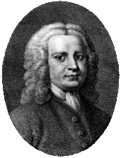

# David Hartley

*Allen, Richard*

 *Engraving by William Blake, 1791*
# David Hartley
**First published Mon Nov 25, 2002; substantive revision Thu Sep 4, 2025**

David Hartley (1705–57) is the author of *Observations on Man, his Frame, his Duty, and his Expectations* (1749)—a synthesis of neurology, psychology, and spirituality.

As science, the *Observations* grounds consciousness in neurophysiology, mind in brain. On this basis, the central concept of “association,” much discussed by other British philosophers and psychologists, receives distinctive treatment: the term first names the physiological processes that generate “ideas” and then the psychological processes by which perceptions, thoughts, and emotions either link and fuse or break apart. In keeping with this approach, Hartley offers a novel account of how we learn and perform skilled actions, a dimension of human nature often left unexplored in works of philosophy. Such actions include those involved in speech—and, by extension, the conduct of scientific inquiry.

Central to the moral psychology is a typology of six emotional schemas: Imagination, Ambition, Self-Interest, Sympathy, Theopathy, and the Moral Sense. Taken together, the six schemas form a picture of human beings driven, and guided, by what they experience as “intellectual” pleasures and pains. The six are generative, as, for example, Imagination “models” (in the sense of shapes or forms) Ambition, and also cybernetic, as Sympathy “new models” Self-Interest. The picture is dynamic and teleological. For example, a person whose “primary pursuit” is Ambition will find the pursuit itself inevitably leads to both satisfaction and discontent. The inability of Ambition to solve the problem it creates thus pushes the person onward to a hedonic economics, Self-Interest, and then, when the problems generated by the pursuit of Self-Interest also prove insoluble, potentially toward a further reorientation of one’s “primary pursuit” in a new sense of self grounded in Sympathy—which in turn leads the person to re-evaluate what truly counts as self-interest.

Regarding our “expectations,” Hartley imagines that in “the true system of things … the voice of nature is an universal chorus of joy and transport,” and that within it our “expectations” can rest upon the assurance of universal salvation: all people will eventually become “partakers of the divine nature, loving and lovely, holy and happy” (*OM* 2, prop. 56). In this regard, the *Observations* presents an original model of spiritual growth, which describes how the self both forms and transforms as the person gains in Sympathy and Theopathy—put simply, learns to love, both others and God.

Hartley’s synthesis rests on two core concepts: “philosophical necessity” and divine causality. Given the “previous circumstances of body and mind” that form the nexus of the present moment, “a person cannot do indifferently of the actions *A,* and its contrary *a*” (*OM* 1, Conclusion). Nonetheless, “since God is the cause of all things, … he must be the cause of all the motions in the material world” (*OM* 1, prop. 30). Together, the two provided assurance for people committed to religious and social reform. We live, as it were, as fish in a sea of physical, social, and cognitive events, but a sea radiant with light. Clear the water and the light will shine through.

The son of an Anglican clergyman, David Hartley was born in June 1705 in the vicinity of Halifax, Yorkshire. His mother died three months after his birth, and his father when David was fifteen. After receiving his B.A. and M.A. from Jesus College, Cambridge, Hartley practiced medicine in Bury St. Edmunds (1730–35), London (1735–42), and Bath, where he died on 28 August 1757. He married twice: in 1730, Alice Rowley, who died in 1731 giving birth to their son David (1731–1813); and in 1735, Elizabeth Packer (1713–78), despite the opposition of her wealthy family. The couple had two children, Mary (1736–1803) and Wincombe Henry (1740–94). Although severely afflicted with bladder stones, Hartley lived a full and active life: he practiced medicine, engaged in mathematical research, sought a cure for “the stone,” devoted himself to intellectual and philanthropic projects, and wrote the *Observations on Man.* Two days after the event, *London Evening Post* noted: “His Death is much lamented by the Poor.”

## 1. Reception of the *Observations on Man*

In the century after its publication, the *Observations* inspired people committed to religious, social, and political reform, for it provided grounding for their labors: changing people’s “circumstances” will change their lives for the better. Writing in 1774, Joseph Priestley, prominent Unitarian and experimental scientist, wrote that the *Observations* “contains a new and most extensive science” and promised that “the study of it … will be like entering upon a new world.” He added: “I think myself more indebted to this one treatise, than to all the books I ever read beside; the scriptures excepted” (1774, xix). Priestley’s comment on the “new science” refers to Part 1 of the *Observations,* “Containing Observations on the Frame of the Human Body and Mind, and on their Mutual Connections and Influences.” What he said about his debt to “this one treatise” encompasses the whole book, including the moral and spiritual counsel in Part 2, “Containing Observations on the Duty and Expectations of Mankind.” When Priestley and his wife fled England for America in 1794, Priestley turned to *Observations* for consolation during the long sea journey.

In her autobiography, written in 1877, Harriet Martineau recalled how in 1821, at age 19, she studied the *Observations*

> with a fervour and perservance which made it perhaps the most important book in the world to me, except the bible. … I cannot at this hour look at the portrait of Hartley prefixed to this work … without a strong revival of the old mood of earnest desire of self-discipline, and devotion to duty which I derived from them in my youth. … I owe to Hartley the strongest and best stimulus and discipline of the highest affections and most important habits that it is perhaps possible … to derive from any book. (Martineau 1877, 1:104–5)[^martineau-1877]

Martineau, the real-life sister of George Eliot’s Dorothea Brooke, could have had in mind the moral and spiritual counsel in the “The Rule of Life,” chapter 3 in part 2 of this, “the holy book for millennarian perfectionism” (Kramnick 1986, 15)[^kramnick-1986]. The portrait is the frontispiece to the 1791 quarto edition (shown above), printed by the radical publisher Joseph Johnson.

Priestley and his fellow Unitarians gave the *Observations* a central place in the curriculum in the dissenting academies. (For admission to Oxford and Cambridge Universities, students had to subscribe to the doctrines of the Church of England.) From one report, we learn that students studied it for two hours every morning. The poet Samuel Taylor Coleridge, converted to Priestleian Unitarianism at Cambridge, had his portrait painted holding his copy of the *Observations* (see Paley 1999, 18–23)[^paley-1999] and named his first son David Hartley Coleridge. Few works discussed in this encyclopedia have been the object of such deep personal involvement.

However, others thought differently. During the ‘Priestley Riots’ in July 1791, a ‘Church and King’ mob burned Priestley’s home and laboratory to the ground. To the mob’s organizers and sympathizers, any work “Gunpowder Joe” Priestley praised so highly would be anathema. Thus, while the *Observations* kept its status as a “holy book” for those committed to religious, social and political reform, these were an embattled minority in England, especially during and after the French Revolution. In addition, critics—including Thomas Reid (1785, 84–94) and the later Coleridge ([1817] 2014), no longer the youthful radical—considered Hartley’s *Observations* both conceptually wrong and morally hazardous. The Scottish philosopher Sir James Mackintosh, who sympathetically praised “the extraordinary value of Hartley’s system” in the *Encyclopedia Britannica,* 7th edition, nonetheless saw Hartley standing on the “threshold” of materialism and guilty of “the error … deeper and more fundamental than any other”—the one that “overlooks the primordial and perpetual distinction between *the being which thinks* and *the thing which is thought of* ;—not to be lost sight of, by the mind’s eye, even for a twinkling, without involving all nature in darkness and confusion” (1830, 362; also 1836, 252).

In the mid-nineteenth century, James Mill, John Stuart Mill, and William B. Carpenter (who all had studied the *Observations* in dissenting academies), along with Alexander Bain, founded the school of thought known as “association psychology” and credited Hartley with being the precursor of the science. However, John Stuart Mill wrote in the Preface to the 1869 edition of his father’s *Analysis of the Phenomena of the Human Mind*, that, compared to his father’s work, Hartley’s *Observations* “is little more than a sketch, though an eminently suggestive one” (Mill 1869, 1:xi–12). The last serious engagement with the *Observations* appears in William James’s *Principles of Psychology* (1890, 1:553), and there a casual reader could miss it.

In the past hundred years, a fair portion of the scholarly literature relating to Hartley concerns his influence on Wordsworth, Coleridge, and other Romantics (see. e.g., Beatty 1922, Pearsall 1970, and Ulmer 2013 on Wordsworth, Waples 1936 and Hatch 1974 on Coleridge, and Schopf 1981 on Mary Shelley’s *Frankenstein*)[^beatty-1922][^hatch-1974][^pearsall-1970][^schopf-1981][^ulmer-2013][^waples-1936]. Other articles about Hartley appear in journals of the behavioral and neurological sciences. However, there is less attention to Hartley’s *Observations* by academic philosophers. One reason might be the sheer volume of observations—Priestley cautioned that the book is not one “a man can read over in a few evenings, so to be ready to give a satisfactory account of it to any of his friends” (1774, xix), and R.K. Webb called the book “a vast haystack” (Webb 1998, 28)[^webb-1998]. Another may be that the “new and most extensive science” was ahead of its time. Leslie Stephen, in 1876 wrote that “it is plain that Hartley and Priestley could not get beyond the very first step. Their method, if properly carried out, would involve a complete study of the organisation and functions of the brain and nervous system; but, in the contemporary state of physiological knowledge, the very outlines of such a theory were not even dimly perceptible” (Stephen 1881, 68). A further reason may be, in the modern university, the division of knowledge among academic departments, professional societies, and scholarly journals. Basil Willey wrote:

> Throughout his *Observations on Man* (1749) there is to be found a characteristic blend—rare even in England after the eighteenth century, and by that time virtually extinct in France—of scientific ardour with religious certainty. Hartley was a man of unusual originality and penetration, and he writes with the zest of one who knows he is engaged in pioneering work, but who feels, at the same time, that he is building up morality and religion on unshakable foundations. … It is Hartley’s distinction that he evolves his religion, not from the starry heavens, but from a study of human psychology. (Willey 1940, 136–37)[^willey-1940]

Today, there are scientists who embody both scientific ardor and religious commitments. Nonetheless, it is hard to imagine a psychologist, philosopher, or theologian in good standing making a career of “building up morality and religion” on the “unshakable foundations” of human psychology. Those engaged in the neuroscience of “religious cognition”—or who, like Richard T. G. Walsh, encourage psychologists to “incorporate religious, spiritual, and moral aspects of the human condition in the discipline’s theory, practice, and curricula” (2017, 61)—refrain from claiming that their researches provide a such a foundation. To gain an appreciation of Hartley, and of what we can learn from him, we need to leave ‘our’ world and step into his.

## 2. Hartley’s *Observations*—At First Sight

Let us imagine how one of Hartley’s colleagues, a Fellow of the Royal Society (FRS), might have responded to the book on its appearance in 1749. A FRS would know that the author had emerged the victor in a public medical controversy ten years earlier. Hartley, working with Stephen Hales, researched the chemical basis for what they thought an effective folk remedy for bladder stones—a painful and hazardous condition that impaired the lives of Hartley himself and many others, including Benjamin Franklin. In the course of the controversy, Hartley had published a self-revealing account of the prolonged and intense suffering he had endured while undergoing the treatment (Hartley 1738).

The FRS would know that this orphaned son of a Yorkshire clergyman was now a successful physician, thanks in part to powerful patrons (including the Cornwallis family, and the Duke of Newcastle, who was in effect prime minister), had come into wealth thanks to his second marriage, and that he devoted himself to philanthropic projects. He promoted the shorthand system devised by his friend, John Byrom, and was the force behind the publication of the monumental *Elements of Algebra* (1740) by Nicholas Saunderson, who had become Lucasian Professor of Mathematics despite being blinded in infancy by smallpox. The FRS would also know that Hartley had a special interest in statistics. His first publication, on variola inoculation for smallpox (1733), relied on a statistical argument to show that, despite the risk of death, it was in a person’s individual interest to be inoculated. The FRS may have also have known that Hartley was in possession of a foundational paper on *inverse probability,* possibly sent to him by fellow FRS Thomas Bayes (see Stigler 1983)[^stigler-1983].

If the FRS knew Hartley as a friend, he would know him to be an amateur violinist, a vegetarian, and a husband and father (unlike Descartes, Locke, Hume, and Kant, all single men). He would know that Hartley was often in extreme pain, as he still suffered grievously from bladder stones.

In 1736, Hartley shared with friends two handwritten drafts: “The Progress of Happiness Derived from Reason” and “The Progress of Happiness Derived from Scripture.” If the FRS had read the first of these, upon opening the *Observations* he would have been familiar with key themes. One appears at the end of part 1 of *Observations*:

> It does indeed follow from this theory, that matter, if it could be endued with the most simple kinds of sensation, might also arrive at all that intelligence of which the human mind is possessed. (*OM* 1, Conclusion)

Despite the “if,” Hartley did think living organisms are “endued with … sensation,” and, in neurologically complex species, possessing their own kinds of intelligence. Their “near relation” to us obligates us “to be their guardians and benefactors” and thus to refrain from making them suffer for our sport or convenience, and from killing them for food (*OM* 1, prop. 93; cf. *OM* 2, prop. 52). Following this theme, Hartley’s project in the *Observations* is to start with the “most simple kinds of sensation” and “arrive at all that intelligence of which the human mind is possessed.” The project presents itself as properly scientific through the use of “Observations” in the title (cf. Franklin’s *Experiments and Observations on Electricity*, 1751, and Priestley’s *Experiments and Observations of Different Kinds of Air*, 1774), and through the geometrical format of propositions and corollaries that structures the text. The FRS would also see that the Hartley wrote for readers familiar with technical concepts in anatomy and physiology, and in Newton’s *Principia* and the speculative physics in the *Opticks.* The FRS would also know that Hartley was following in the footsteps of others, such as Descartes, in taking a scientific approach to “man.”

Were the reader to continue beyond the opening propositions of the *Observations*, he would encounter Hartley’s other great theme: “The great business and purport of the present life is the transformation of sensuality into spirituality” (*OM* 2, prop. 50; cf. Leslie 1974, 631). Along with being a scientific work, the FRS would also understand the *Observations* to be a moral treatise, one tracing the path by which this transformation can take effect. He would encounter affirmation of the “everlasting gospel” of universal salvation proclaimed by various writers in England, including the visionary Jane Lead and her follower Richard Roach (see Dixon 2023)[^dixon-2023]. Moreover, endorsements of “mental prayer … the aspiration of the heart to God without words” (*OM* 2, prop. 78) and “perfect self-annihilation, and the pure love of God” (*OM* 2, prop. 67) suggest an alignment with Quietists in Europe. On the shelves of Hartley’s library a friend would find Thomas à Kempis’s *L’ Imitation de Jesus Christ* (French translation, 1714), Madame Guyon’s *L’Âme Amante de son Dieu* (1717), and the works of John of the Cross in Latin (1639) and French (1694) translations (see Allen 1999, 331–56, esp. 347–48)[^allen-1999].

## 3. Vibrations and Associations—from Physics to Physiology to Psychology

In writing the *Observations*, Hartley meant to contribute to the science of “man.” Looking into the future, he also imagined a grand unified theory, to be achieved when people in “future ages may analyse all the actions of bodies upon each other, up to a few simple principles” (*OM* 1, prop. 15). Newton had taken giant steps in this direction, especially with the unification of celestial and terrestial mechanics in his law of universal gravitation. A century later, Darwin did the same with another simple principle, natural selection. Hartley provided names for another two such principles: first, “vibrations,” uniting world and brain, physics and neurophysiology, and second, “association,” the analogue to gravitation, as the foundational principle accounting for all psychological phenomena, from perception to personality.

By way of context, two figures stand out: Descartes and Newton. Hartley wrote:

> It may afford the reader some entertainment to compare my hypothesis with what Des Cartes and Leibniz have advanced, concerning animal motion, and the connexion between the soul and the body. My general plan bears a near relation to theirs. Des Cartes might have had success in the execution of his, as proposed at the beginning of his *Treatise on Man*, had he been furnished with a proper assemblage of facts from anatomy, physiology, pathology, and philosophy. (*OM* 1, prop. 21)

Descartes’ *Treatise on Man* begins with a thought experiment: he asks us to picture an inaminate “statue, an earthen machine” similar to “clocks, artificial fountains, mills, and similar machines” ([1662/64] 1972, 1–4). He then provides this machine with all the physiological functions of human bodies, including those of the brain.

Angélique Thébert situates Hartley “in the wake” of Descartes, Leibniz, and Malebranche and characterizes him as “more Cartesian than Descartes” (2014, 430). A fair point, as both take “body” as their starting point. But in what way did Hartley’s “general plan” bear a “near relation” to those of Descartes and Leibniz? Did the “near relation” primarily concern “animal motion,” or “the connexion between soul and body,” or both? In what way did Hartley think his *Observations* provided “a proper assemblange of facts” that Descartes’ *Treatise on Man* lacked? And did Hartley think the result was simply Descartes’ “Earthen Machine 2.0,” or something more?

How one models the relation between “world” and “brain” depends on what one takes “world” to be—that is, upon one’s understanding of physics. In Hartley’s day, there were two main models. Descartes’ position was that the universe consists of “vortices” of matter filling a cosmic ocean, that matter is infinitely divisible, and that all motion occurs through contact. Newton differed on all points: space is absolute, independent of matter; atoms represent the limit of divisibility; and changes in particles’ positions and momenta are attributable to forces other than contact mechanism. Within the Cartesian model, nerves are hollow tubes with a fluid of “animal spirits” running within them. The tubes function by hydraulic pressure. Note that the “machines” Descartes mentions—“clocks, artificial fountains, mills”—do, or can, run on water power. This was the position of both Descartes and Hermann Boerhaave (1668–1738), the renowned “father of physiology” at the University of Leiden. In contrast, to Newton and his followers nerves are not tubes; Hartley, using Newton’s term, calls them “solid capillaments” and notes that “the best injectors” have failed to force fluids through them (*OM* 1, prop. 5). Transmission of a signal along them cannot be a matter of hydraulic pressure. There has to be another mechanism accounting for reception of a stimulus by ears, eyes, nose, and skin and transmission of the signal to the brain. To put it simply, where Descartes saw plumbing, Newton saw electrical circuits.

Near the beginning of the *Observations* Hartley writes:

> Sir Isaac Newton supposes, that a very subtle fluid and elastic fluid, which he calls *aether*, for sake of treating upon it commodiously upon an appropriated name, is diffused through the pores of gross bodies. … To the action of this aether he ascribes the attractions and repulsions of electrical bodies, the mutual influences of bodies and light upon each other, the effects and communication of heat, and the performance of animal sensation and motion. My business in these observations is only with the last [of these]. (*OM* 1, prop. 5)

Hartley then refers the reader to the final paragraph of the General Scholium of the *Principia* (3d ed., 1726) and to the Queries added to the third book of Newton’s *Opticks.* At the end of the latter, in Query 31, Newton says that he is “leaving the Hints to be examined and improv’d by the farther Experiments and Observations. … And if Natural Philosophy in all its parts, by pursuing this Method, shall at length be perfected, the bounds of Moral Philosophy will also be enlarged” ([1717] 1730). Hartley receives his commission from Newton’s statement. Still, a commission is one thing, how to find the Grail of a “perfected” Natural Philosophy another. Hartley admitted: “I am not satisfied that I understand him perfectly on this subject” (*OM* 1, prop. 5). He was not alone.

In Query 31 of the *Opticks*, Newton stated that “Bodies are much more rare and porous than is commonly believed” (1730, 242), and offered a model of matter as a fractal lattice. To illustrate this, Henry Pemberton, one of Newton’s interpreters, suggested picturing a cube of salt crystals joined at their corners, and then a cube of these cubes, etc. The more generations, the less atomic matter there is in the whole: “all the known bodies in the universe together, may be compounded of no greater portion of solid matter, than might be reduced to a globe of one inch only in diameter” (Pemberton 1728, 291). Priestley later put it: “all the solid matter in the solar system might be contained in a nut-shell” (1777a, 17). Add to this a second line of speculation, following from Newton’s attribution of “the attractions and repulsions of electrical bodies” to the “aether.” Where Descartes imagined a cosmic ocean of matter, the knights of Newton’s round table imagined the opposite: a universe in which atoms are little more than virtually dimensionless point particles, set vibrating by the attractive/repulsive forces of the ‘aether’.

Speculative physics, but with a practical result: Hartley’s work with Stephen Hales on a remedy for bladder stones. Hales (1677–1761), remembered today as the father of plant physiology and for the measurement of blood pressure, developed his chemical theory in his *Statical Essays*—i.e., *Vegetable Staticks* (1727) and *Haemastaticks* (1733). Following Newton, Hales believed “forces of attraction and repulsion” to be the basis of physical nature. Thus he proposed that “air” is a component in many “animal, vegetable, and mineral substances”:

> If all the parts of matter were only endued with a strongly attracting power, whole nature would then immediately become one unactive cohering lump; wherefore it was absolutely necessary … that there should be every where intermixed with it a due proportion of strongly repelling elastick particles, … [and] that these particles should be endued with a property of resuming their elastick state, . . . that thereby this beautiful frame of things might be maintained in a continual round of the production and dissolution of animal and vegetable bodies. (Hales 1769, 1:314–15)[^hales-1769]

Through his chemical experiments Hales demonstrated that solid concretions, including bladder stones, locked within themselves large quantities of “air,” which normally manifests a strongly repelling force. Hales proposed that reaction with an agent that changed the pH of the urine could release the “air” within a bladder stone and thus cause the stone to disintegrate. Such chemicals were plentiful in the laboratory; Hales and Hartley were looking for one that a person could safely ingest. They thought they had found one in a remedy one Joanna Stephens had cooked up in her kitchen, and Hartley took the lead in convincing Parliament to pay Mrs Stephens £5,000 for her “secret.” In 1739 Parliament passed the act, and Hales won the Copely Medal of the Royal Society for his effort. Hartley took the medicine but was never cured (see Allen 1999, 53–72)[^allen-1999].]

Those following in the wake of Newton pictured the universe as mostly empty space: perhaps no more than Priestley’s “nut-shell” of atomic matter in the “aether,” the immaterial medium, or field, bearing forces of attraction and repulsion. What appear to be physical objects — stones, nutshells, nerves—are places where forces are in dynamic, and conditional, equilibrium. Any change in force will cause what Hartley, following Boerhaave, calls the “molecules” constituting them to “vibrate,” and if the vibrations are strong enough, to break apart. In physical objects concretions and dissolutions occur continuously; the materials within the bodies of living things form, dissolve, and form again—“that thereby this beautiful frame of things might be maintained.”

The first chapter of Hartley’s *Observations* is devoted to working out in detail how a “doctrine of vibrations” can be applied to the brain and nervous system (see Allen 1999, 83–129)[^allen-1999]. To do this, he turns to Newton’s accounts of harmonic motion and the analogy between the color spectrum and the musical octave. This is the best he can do. Today, we can describe “action potentials” in great detail, while Hartley, lacking even “neuron” and “voltage,” treats “vibration,” when applied to the nervous system, as an algebraic unknown. Like Newton’s “aether,” it enables us to treat a range of phenomena “commodiously upon an appropriated name.”

Imagine two “earthen men,” the first inhabiting a Cartesian world, the second in a Newtonian one —the nerves and brain of the first plumbing, of the second, aetherial circuits. How would they differ? Could it be said of either that they sense, feel, think? The answer, according to Malebranche, was no: lacking souls, even animals are automatons, unable to feel pain or pleasure. Over the centuries, many have attributed the same view to Descartes. What about a Hartleian “aetherial man”?

The *Observations* begins: “Man consists of two parts, body and mind. The first is subjected to our senses and inquiries, in the same manner as the other parts of the material world. The last is that substance, agent, principle, &c. to which we refer the sensations, ideas, pleasures, pains, and voluntary motions.” Although Hartley speaks of “two parts,” his definitions of the terms “body” and “mind” are nominal, not substantive; they point toward human activities of sensing, inquiring, and talking about experiences. In the “Scholium” to the first chapter of the *Observations*, Hartley writes:

> The quantity of matter in bodies is always found to be proportional to their gravity: we may therefore either make the quantity of matter the exponent of the gravity, or the gravity the exponent of it, … notwithstanding that we are entirely at a loss to determine, in what mechanical way each atom contributes to the gravity of the whole mass; and even though we should, with some, suppose this effect to be immechanical, and to arise from the immediate agency of God. And, by parity of reason, if that species of motions we term vibrations, can be shown to attend … upon all sensations, ideas, and motions, … then we are at liberty either to make vibrations the exponent of these sensations, ideas, and motions, or these the exponents of vibrations, as best suits the inquiry; however impossible it may be to discover in what way vibrations cause, or are connected with sensations, or ideas; … (*OM* 1, chap. 1, Scholium).

Hartley’s method here, as in much of the *Observations*, is to stay within the bounds of the observable. Just as he uses “vibrations” when talking about neural activity, he views “mind” as a placeholder for the unobservable something “to which we refer” when speaking of mental phenomena. It is another “appropriated name.” In other words, Hartley did not subscribe to either Descartes’ substance dualism or Malebranche’s occasionalism. For Hartley, words relating to physical and mental phenomena remain in a semantic ‘superposition’—until it “best suits the inquiry” to treat one as the reality and the other the exponent. Hartley was an advocate of what we today call neutral monism. On the one hand, he was firm advocate of the “doctrine of philosophical necessity” and critic of “philosophical liberty.” On the other, we are not deluded in experiencing ourselves “deliberating, suspending, choosing, &c., or of resisting the motives of sensuality, ambition, resentment, &c.,” so that free will, “under certain limitations, is not only consistent with the doctrine of mechanism, but even flows from it” (*OM* 1, Conclusion). What we need to recognize is that available to us are “two different methods of speaking, as it were, languages … the one popular, and, when applied to God, anthromorphical; the other philosophical”; it is only when “we mix these languages” that “insuperable difficulties arise” (*OM* 2, prop. 15). See section 7 below; compare Spinoza’s *Ethics*, part 2, prop. 7, and Jonathan Edward’s *Freedom on the Will.*

## 4. Perception and Action: The Role of “Joint Impression”

The “association of ideas” is the phrase primarily associated with “Hartley.” However, although “association” is central concept in the *Observations*, it is not a primarily a name for the process by which discrete “ideas” already present to the “mind” connect. Rather, Hartley’s starting point is the living organism, and specifically the physical “vibrations” present in brain and nervous system and in the “aetherial” universe with which the organism interacts. Using the language of “corporeal causes,” Hartley proposes:

> Since therefore sensations are conveyed to the mind, by the efficiency of corporeal causes … it seems to me, that the powers of generating ideas, and raising them by association, must also arise from corporeal causes, and consequently admit of an explication from the subtle influences of the small parts of matter on each other, as soon as these are sufficiently understood. But then (which is very remarkable) this power of forming ideas, and their corresponding miniature vibrations, does equally presuppose the power of association. For since all sensations and vibrations are infinitely divisible, in respect of time and place, they could not leave any traces or images of themselves, i.e. any ideas, or miniature vibrations, unless their infinitesimal parts did cohere together through joint impression, i.e. association. (*OM* 1, prop. 11)

Hartley starts with bodily, specifically neurological processes, and asks: how do such processes *generate* and *raise* our perceptions, emotions, thoughts, and actions? For Hartley, the foundation is simple: nerves “vibrate” (on a molecular level, not as violin strings), change their frequencies and amplitudes of vibration, and transmit those changes to other nerves. Thanks to the vast number of associative connections within the brain, this fundamental mechanism generates all the complexities of perception, cognition, action, motivation, and personality that we observe in living beings. Thus “the whole superstructure of ideas and associations observable in human life may … be built upon as small a foundation as we please” (*OM* 1, prop. 11).

In saying that the “infinitesimal parts” must “cohere together through joint impression,” Hartley is elaborating a point made by George Berkeley in his *Essay Towards a New Theory of Vision* ([1709] 1948), that a being born ‘blind’ to bodily feeling and possessing only sight would have no concept of space and would be unable to perceive a geometrically ordered world. To such a being, visual sensations would convey no information; they would be “infinitely”—i.e., arbitrarily—divisible. No stable, repeatable, memorable “ideas” could arise from them. Hartley also agrees with Berkeley’s solution to this problem: we perceive a coherent, intelligible world thanks to the generation of “ideas” (perceptual, cognitive, semantic, and pragmatic responses to the world) through the “joint impression” of sensations from distinct sensory modalities—sight, hearing, and especially touch—what psychologists today call intermodal perception. As does Berkeley, Hartley identifies feeling or touch as “the fundamental source of information in respect of the essential properties of matter” and “our first and principle key to the knowledge of the external world” (*OM* 1, prop. 30; think of a newborn). Thus, Hartley writes, “we call the touch the reality, light the representative.” The sense of sight “may be considered, agreeably to Bishop Berkeley’s remark, as a philosophical language for the ideas of feeling” (see Berkeley [1709] 1948, sections 6.4, 6.8, and 9.4).

A “philosophical language” is one “without any deficiency, superfluity, or equivocation” (*OM* 1, prop. 83), and what makes sight a “philosophical language” for feeling is that the two match each other: “The same qualities are made by means of light to impress vibrations on our eyes, which correspond in great measure to those made on the sense of feeling, so as to vary with their varieties” (*OM* 1, prop. 30). Feeling and vision flow in tandem, usually with no missing, extraneous, or equivocal moves. It is thus “joint impression,” the correlation of the flows of sensation through two or more sensory modalities, so that the sensations of one “vary with the varieties” of another, that accounts for the fact that we have “ideas” at all. The “ideas” formed from visual and tactile “traces or images” are what we could call video-tactile clips, not static snapshots. In contrast, a person whose visual inputs are dissociated from his other sensory modalities, and especially his own movement and feeling, would be unable to consistently identify any “visual ideas.” Such is the condition of a person suffering from a visual agnosia (see James 1890, 1:48–50; also the Molyneux problem)[^james-1890].

Thanks to “joint impression” and “association,” an “idea” will be a locus for information from multiple modalities. For example, linked to the word ‘apple’ are immediate visual perceptions, both of actual apples and photographs, prints, and paintings of them; smells; sounds, as of crunching; memories of picking, buying, or selling apples; hearing, saying, reading, writing the word; poems and metaphors (“the apple of one’s eye”); the “factitious sagacity” (Hartley’s term) of orchardmen; social interactions in which apples played some part; the meanings we assign to all of the above; and the apple-directed intentions we form. The “idea” is a copious container. And note that many of the linked elements relate, not to static visual images, but to doing, often in social contexts. A living being’s capacities for sensory discrimination, feature detection, perceptual categorization, motor memory are all involved with the repertoires of action that being performs, either innately or through learning.

At this point, let us take note of two things commonly said about Hartley, both problematic. They appear together in the entry on Hartley in the *Encyclopedia Britannica*, 11th edition (1911):

> With Locke he asserted that, prior to sensation, the human mind is a blank. By a growth from simple sensations those states of consciousness which appear most remote from sensation come into being. And the one law of growth of which Hartley took account was the law of contiguity, synchronous and successive. By this law he sought to explain, not only the phenomena of memory … but also the phenomena of emotion, of reasoning, and of voluntary and involuntary action.

First, nowhere does Hartley say the mind is a blank slate (Locke has “white paper”) at birth. His subject is the living, embodied being, a member of the human community. As noted above, he was a husband and the father of three; his book includes numerous observations of children. A newborn infant does not have any snapshots in its mental photo album, but experiences pleasure and discomfort, wakes and sleeps, and is quick to seek the mother’s nipple and nurse. Within a few weeks the newborn can identify its mother by scent and voice. To say an infant’s ‘mind’ is a blank slate is to detach ‘mind’ from body and body from membership in a human community. Second, the comment about “one law of growth” being “the law of contiguity, synchronous and successive” derives from Coleridge’s extended critique of Hartley in his *Biographia Literaria*, chapters 6 and 7 (1817] 2014; see, e.g., Hayden 1984, 96)[^hayden-1984]. Coleridge—by then much indebted to German philosophers, particularly Schelling—claims that the “one law of contiguity” must govern all instances of “association,” if synchronous or successive “vibrations” are their material cause. The conclusion he draws is that, in Hartley’s theory, the ‘mind’ would be wholly passive: “the consequence would have been, that our whole life would be divided between the despotism of outward impressions, and that of senseless and passive memory” ([1817] 2014, 80). This is an instance of question begging. The unstated assumption is that, if “association” depends upon underlying neural events, the events must be “contiguous”—‘near’ each other in space or time. This is plainly false. The “law of contiguity” is Coleridge’s invention. A person can hear an unfamiliar bird call one day, recognize it upon hearing it again two weeks later, and then learn the identity of the species while walking with a birder friend. The birds now become familiar, though never noticed before.

## 5. The Range of Actions: From “Automatic” to “Decomplex”

For many animals, the ways in which physical movements respond to visual cues are relatively fixed: cats pounce on mice (some of cloth), and swat at moths (or moving shadows on a sunlit wall). For human beings, thanks to the brain’s plasticity in forming “joint impressions,” there are abundantly many ways in which the “varieties” of one sensation “vary with the varieties” of another: at the sight of notes on a staff, a pianist’s fingers move easily upon a piano keyboard. Expert musicians, at the sight of the notes, hear the tune in the mind’s ear. But how to explain what it is that the expert musician (or any expert practitioner) does? And how does one learn to do this?

In the *Observations*, Hartley offers a novel treatment of physical action—a topic largely absent from other treatises, or inquiries, devoted to “human nature” or “human understanding.” Even in James Mill’s *Analysis of the Phenomena of the Human Mind*, a work with an acknowledged debt to Hartley, bodily action is touched on only in the last chapter of the book, on “The Will.” But to an attentive “observer of man,” it should be obvious that we live by doing, by performing tasks that depend on repertoires of perfected movement, some mastered in infancy, others later in life.

Hartley invented to two words to describe physical movements: “automatic” and “decomplex.”

It appears that Hartley invented the adjective “automatic,” deriving it from “automaton,” to describe movements such as “the motions of the heart, and the peristaltic motion of the bowels” (*OM* 1, Introduction). Such “originally automatic” motions are homeostatic: as a heart beats, the alternation of contraction and relaxation is maintained and modified in response to the needs and experiences of the organism (*OM* 1, prop. 19). Following the discussion of “originally automatic” motion is this theorem: “If any sensation A, idea B, or motion C, be associated … with any other sensation D, idea E, or muscular motion F, it will, at last, excite d, the simple idea belonging to sensation D, the very idea E, or the very muscular motion F” (*OM* 1, prop. 20). Any sensation, idea, or muscular motion can be the stimulus that excites a response in another idea or muscular motion. In some instances, the stimulus elicits an unlearned reflex: at the sight of a snake, one person’s heart beats faster. In others, both stimulus and response are contingent: at the sight of a snake, a second person identifies the species and takes a photo. In some instances responses are “voluntary,” and, often with repetition, become “secondarily automatic” (*OM* 1, prop. 21).

An action is voluntary when its stimulus is an “idea, or state of mind … which we term the will” (*OM* 1, prop. 21). (Note again how Hartley takes care to stay within the bounds of the observable.) To illustrate how ideas of the form “the will to …” derive from “originally automatic” motions, Hartley describes how a child gains motor control over parts and functions of her body. “Originally automatic” motions are brought under control through a series of substitutions of the initiating stimulus. An infant grasps the finger placed in her palm, and then the toy she sees, and then grasps at “the sound of the words grasp, take hold, &c., the sight of the nurse’s hand, in that state, the idea of a hand, and particularly the child’s own hand.” These and “innumerable other associated circumstances … will put the child upon grasping, till, at last, that idea, or state of mind which we may call the will to grasp, is generated and sufficiently associated with the action to produce it instantaneously.”

In Hartley’s account, the performance of a voluntary movement is not a dualistic, two-stage process, with an executive “faculty”— Mind, or Will, isolated from “corporeal causes” — issuing an instruction the body then carries out. Rather, a movement *becomes* voluntary through the living being’s interaction with the “innumerable … associated circumstances” of its environment. In this light, “will” does not name anything substantive: it is a word we use to describe an “idea, or state of mind.” And it is a word parents often use to express bafflement as to what this “state of mind” amounts to. Hartley notes that adults start calling a child willful at the time he learns to walk, because “the child, in some cases, does not walk when desired, whilst yet the circumstances are apparently the same as when he does. For here the unapparent cause of walking, or not walking, is *will*” (*OM* 1, prop. 77). But, he adds, “a careful observation … will always shew … that when children do different things, the real circumstances, natural or associated, are proportionally different, and that the state of mind called will depends on the difference.” One should probably take this to be something the parents of young David, Mary, and Winchcombe Hartley knew full well.

Sequences of substitutions transform originally automatic actions into voluntary ones. Hartley recognizes that the process continues, so that voluntary actions become “secondarily automatic”:

> After the actions, which are most perfectly voluntary, have been rendered so by one set of associations, they may, by another, be made to depend upon the most diminutive sensations, ideas, and motions, such as the mind scarce regards, or is conscious of; and which it can therefore scarce recollect the moment after the action is over. Hence it follows, that association not only converts automatic actions into voluntary, but voluntary ones into automatic. For these actions … are rather to be ascribed to the body than the mind, i.e. are to be referred to the head of automatic motions. I shall call them automatic motions of the secondary kind, to distinguish them from those which are originally automatic, and from the voluntary ones. (*OM* 1, prop. 21)

Think of learning to write with a pen or play the piano. At first one develops a repertoire of voluntary motions. But fluency requires that the motions be secondarily automatic.

Most human competencies, when voluntarily performed, rely upon extensive repertoires of secondarily automatic actions. Such performances are what Hartley calls “decomplex.” Contemporaneous readers of the *Observations* would have been familiar with Locke’s use of “complex” in his *Essay concerning Human Understanding* (Locke [1690] 1975, 2.12.1). They would also be familiar with “decompound” and “decomposite”—both from the late Latin *decompositus*, a rendering of the Greek *parasynthetos*—in which the “de-” prefix signifies “repeatedly” or “further.” On the analogy of “compound” to “decompound,” Hartley wrote of ideas and actions being either “complex” or “decomplex”: the associations in a complex action or idea are synchronic, while the associations in a decomplex action or idea are diachronic, taking place over time. In playing a piano, hitting the D key at the sight of the printed note D is a complex movement, while playing a composition is a decomplex action. The elements of a secondarily automatic movement are tightly fused. Those in a decomplex action or idea are more loosely associated (*OM* 1, prop. 12). This looseness makes it possible to include a repertoire of secondarily automatic movements in a variety of decomplex ones—the same notes in an endless number of tunes, including improvisations. Hartley also observes that people find it impossible to perform decomplex actions—play a tune, say a sentence—backward.

Decomplex “ideas” draw on different kinds of complex movements, involving the association of movements with perceptions in one or more sensory modalities: at the sight of the notes on the staff, or the sound of the tones, or a nod from another member of the jazz quartet, the pianist hits the keys. Moreover, as a person becomes proficient at a type of decomplex action, the guiding sensory modality can change. When learning to dance, Hartley observes, at first “the scholar desires to look at his feet and legs, in order to judge by seeing when they are in a proper position,” but “by degrees he learns to judge of this by feeling” (*OM* 1, prop. 77). Similarly, a practiced musician plays the harpsichord from “the connexion of the several complex parts of the decomplex motions” (*OM* 1, prop. 21). One’s hands know the tune.

To his critics, notably Reid and the later Coleridge, Hartley’s commitment to “mechanism” impeached the “freedom of the will” and hence moral responsibility. But where such critics were intent on affirming the adult self’s executive control over thought and action, Hartley’s concern is the opposite: he starts with the infant and asks, How does a child gain control of the originally automatic processes present in infancy? Gain motor control of her hands? Learn to walk, and dance? Play a musical instrument? When singing, improvise a harmony line to another’s melody? Transform spontaneous burbling and crying into articulate speech? Hartley’s critics accuse him of reducing the human being to a “mere mechanism.” But from a Hartleian perspective, “secondarily automatic” and “decomplex” actions are achievements, not givens—and necessary achievements, if one is to live a complete human life.

Hartley improvised with language in order to articulate a new understanding of human action. Use of the one word became … automatic. The other never made it into circulation. In a world in which “decompose” means “to rot,” it was doomed. Nonetheless, we lack a widely available word for the concept that “decomplex” names. Hartley’s account draws particular attention to the dependency of our capacities for intentionality, flexibility, and innovation in our decomplex actions upon the repertoires of actions we have made secondarily automatic. It thus centers upon a key insight: “All our voluntary powers are of the nature of memory” (*OM* 1, prop. 90).

## 6. Language and Thought

We enter the world at birth already humming with “originally automatic” motions. Thanks to the activity of our brain and nerves, these motions are self-regulating and homeostatic. Then, as we grow, we gain voluntary control over some of our movements, perfect those that become secondarily automatic, and learn to carry out decomplex actions that draw on repertoires of secondarily automatic components. Although the concept of the “association of ideas” plays a central role in Hartley’s account, the paradigmatic instances of “association” are, first, the “joint impressions” that generate “ideas” (including complex movements), and second, the flowing cascades of movement that are decomplex actions. Such decomplex actions are central to the lives we lead. And foremost among decomplex actions are the sentences we speak.

For Hartley, language is a highly “decomplex” motor activity that involves the cementing of associations between perceived and created sounds, and, for the literate, perceived and created marks: “impressions made on the ear,” “actions of the organs of speech,” “impressions made upon the eye,” and “actions of the hand in writing” (*OM* 1, prop. 79). Further connections must be made between perceived or created sounds and features of the world, especially the actions of oneself and of other people. Hartley’s approach is nearly the opposite of Locke’s, who writes as if language were a dictionary, in which each word marks an idea known prelinguistically to the speaker: “words being voluntary signs, they cannot be voluntary signs imposed by [the speaker] on things he knows not… . Till he has some ideas of his own, he cannot suppose them to correspond with the conceptions of another man; nor can he use any signs for them” (Locke [1690] 1975, 3.2.2).

While Locke seems to be saying that individuals first have ideas and then turn to language to communicate them to others, Hartley describes a process whereby, as children, we burble and cry and listen—and gradually gain motor control of our burbling and crying, associate it with what we hear and handle and do, and eventually utter “sentences” that, though sometimes short (*Mommy!*), are whole, complete, and meaningful. The meaning is a property of the whole—of the performance of a specific decomplex action in a social and pragmatic context. Once again, the process of association—here the activity of hearing and speaking, and later reading and writing—generates ideas: we have ideas because we use language, in concrete social interactions; we do not create language to express the ideas we, as lone individuals, already have.

In this regard, consider Hume’s assertion that, if we are unsure about the meaning of a word, “we need but enquire, *from what impression is that supposed idea derived?*” (Hume [1748] 1975, 22), and his recommendation that we abandon words that lack such derivations. If taken seriously, and not as a bit of fun on Hume’s part, from Hartley’s point of view this would be manifestly bad advice. For Hartley, complex and decomplex ideas are wholes that do not “bear any relation to [their] compounding parts.” Specifically, “the decomplex idea belonging to any sentence is not compounded merely of the complex ideas belonging to the words in it” (*OM* 1, prop. 12). Moreover, “both children and adults learn the ideas belonging to whole sentences many times in a summary way, and not by adding together the ideas of the several words in the sentence.” Consequently, children and illiterate adults find it hard to “separate sentences into the several words which compound them” (*OM* 1, prop. 80). Thus the meanings of sentences are not simply derivable from the meanings of the words in them, and the meanings of those words are not derivable from the “impressions” to which they refer. It is only when people learn to read that they realize sentences are composed of individual words. Over time, the sentences increase in decomplexity, as people participate in the varied activities of life. As adults, people speak a vast variety of highly decomplex expressions—including, for example, those involved in the practice of a science, or a religion.

## 7. Language as Algebra

Given that meaning is a property of complete expressions, Hartley is quick to point out that individual words often lack definite, shared meanings. Such indefiniteness is, in Hartley’s view, hardly a defect, but rather a valuable feature of language. Hartley writes that language is “one species of algebra,” and algebra “nothing more than the language … peculiarly fitted to explain quantity of all kinds” (*OM* 1, 80).

The algebraic quality of language is especially important in scientific practice. Like *x* and *y* in algebra, scientific terms, such as Hartley’s “vibrations” or contemporary physicists’ “particles” stand for unknowns, for which vibrating strings or grains of sand provide only misleading analogies. Their presence is necessary for the practice of scientific discovery. Scientists employ “algebraic” terms in order to discern correlations and patterns that might otherwise remain unobserved: “Bringing an unknown quantity into a relation answers, in philosophy, to the art of giving names, expressing nothing definite … and then inserting these names … in all the enunciations of the phenomena, to see whether, from a comparison of these terms with each other, something definite in manner, degree, or mutual relation might result” (*OM* 1, prop. 87). In such scientific practice, the more algebraic—i.e., free from association with sense “impressions”—words are the better. (Thus “quark” is an inspired choice.) Hume’s advice, to use only terms referring to clear “impressions,” if followed, would bring the practice of a science to a halt.

However, to turn this around, the utility of words for unknowns depends upon their proper use within ongoing practices. For examples of how to conduct scientific inquiry, Hartley turns to mathematical methods, and he includes an extensive discussion of these in proposition 87 of volume 1 of the *Observations*, which is titled: “To deduce Rules for the Ascertainment of Truth, and Advancement of Knowledge, from the Mathematical Methods of considering Quantity.” One deduction involves the comparison of scientific investigation to the use of the rule of the false position in arithmetic: “Here a first position is obtained, which, though not accurate, approaches, however, to the truth. From this, applied to the equations, a second position is deduced, which approaches nearer to the truth than the first; from the second a third, etc.” Hartley adds that “this is indeed the way, in which advances in science are carried on; and scientific persons are aware, that it is and must be so” (*OM* 1, prop. 87).

“I frame no hypotheses.” Thus had Newton famously written in the *Principia.* Hartley responds directly: “It is in vain,” he writes, “to bid an inquirer form no hypothesis” (*OM* 1, prop. 87). Remember that Hartley was a practicing physician; on the basis of ambiguous symptoms and fallible medical knowledge, he was every day “framing hypotheses,” making diagnoses. The question, for Hartley, concerns the degree of confidence we may place in our hypotheses. How do we measure how far our “first position” is from the truth, when we don’t know what the truth is? And how do we measure the degree to which the degree of error in our second and third positions has diminished?

In this regard, what is most interesting in proposition 87 is Hartley’s discussion of probability. Hartley appears to have been one of a small circle of mathematicians who read, and understood, papers making fundamental contributions to the theory of probability by Abraham De Moivre (1667–1754) and Thomas Bayes (1702–61). De Moivre developed a theorem that allows for the determination of the degree of convergence between the frequency of observed events and the underlying probability ratio, for any finite number of events. More important is “the solution to the inverse problem,” which Hartley says “an ingenious friend” communicated to him. This would be Bayes’s theorem—customarily attributed to Thomas Bayes (but see Stigler 1983)[^stigler-1983]—which deals with determining the probability with which probability ratios can be inferred from observed outcomes, and which provides (a still controversial) foundation for statistical inference. In his discussion of probability theory, and other mathematical topics, Hartley is primarily interested in methods for moving from observation to explanation, of assessing the likeliness—i.e, believability—of hypotheses. Something that physicians, like Hartley, regularly must do when offering a diagnosis.

Hartley, like Hume, thought that belief was largely a matter of sentiment. “Rational assent” is a matter of the strength of the association between a sentence (or even some of the words in it!) and the word “true” (*OM* 1, prop. 86) “Practical assent,” a person’s willingness to act, depends on the vividness the proposition—and such can even make “an interesting event, supposed doubtful, or even fictitious, … appear like a real one,” thereby pulling rational assent after it. (Hartley notes, dryly, “the foundation of assent is still the same. I here describe the fact only.”) But Hartley was not content to stop here, an exponent of an urbane skepticism. Belief and assent are matters of feeling, of sentiment, yes—but there are mathematical ways of thinking about the probabilities of belief. And people who think mathematically make better physicians and scientists. How many trials of an unproven treatment for bladder stones does one have to run, to reach a threshold degree of belief in the results? The answer depends on one’s “priors.” In this regard, it is fair to say that Hartley was one of the first Bayesians.

As discussed in section 3 above, another consequence of Hartley’s practice-oriented, “algebraic” approach to language concerns the validity of alternate languages. In the “popular” language we use every day, we talk of our choices, intentions, and resolutions, but in the “philosophical” language of the *Observations*, Hartley proposed we think in terms of “philosophical necessity”—in which every “voluntary” action is “excited by an associated circumstance” (*OM* 1, 70). Some people had, and have, no use for such talk: it denies the freedom (and indeed, the existence) of the “will.” Hartley argues that the use of two incommensurable languages, “popular” and “philosophical,” is not a problem, provided that we use them separately and consistently: “insuperable difficulties will arise” only “if we mix these languages” (OM 2, prop. 15). Both languages work in their own contexts of practice.

Hartley had a warrant for this affirmative approach to languages in his scientific and mathematical training: Newton wrote the *Principia* in the language of geometry, but the “mathematical principles of natural philosophy” could be equally (and better?) expressed in the “algebraic” language of the calculus—for which there were rival notations. Similarly, Hartley championed a new “notation” for the English language—his friend John Byrom’s shorthand, which he saw as a reform that would make our written language more closely approximate a “philosophical” one. When he began work on the *Observations*, he conceived of the project as demonstrating that language about “self-interest,” the “common good,” and the “will of God” were different ways of saying the same thing. The project was thus as much moral and religious as it was scientific.

## 8. Moral Psychology

“The great business and purport of the present life is the transformation of sensuality into spirituality” (*OM* 2, prop. 50). We encountered this, second theme, in section 2 above. In section 3, we also noted that Hartley mentions the “Hints” Newton left behind, “to be examined and improv’d by the farther Experiments and Observations. … And if Natural Philosophy shall at length be perfected, the bounds of Moral Philosophy will also be enlarged” ([Newton 1717] 1730). Hartley sought just this enlargement through an account of the transformation, through the association of ideas, of sensuality into spirituality.

In section 3 we also noted that, following a hint in Query 31, some followers of Newton imagined a “nut-shell” universe (Priestley 1777a, 17), in which infinitesimal atoms of matter are carried within an immaterial medium bearing forces of attraction and repulsion. Working from a chemical theory based on such forces, Hartley and Stephen Hales sought to dissolve bladder stones *in situ* by releasing the force of repulsion locked within them. Hartley extends the chemical concept to psychology. As an analogy to the forces of “attraction” and “repulsion,” he writes of both “associations” and “counter-associations” at work in generating the frame, or basic orientations, of a person’s self. The role of association is obvious; “counter-associations” are equally vital. Those in our dreams, for example, are “of singular use to us, by interrupting and breaking the course of our associations. For, if we were always awake, some accidental associations would be cemented by continuance, as that nothing could afterwards disjoin them, which would be madness” (*OM* 1, prop. 91). A sane mind, therefore, is one “maintained in a continual round of the production and dissolution” (Hales 1769, 1:314–15)[^hales-1769]—in, that is, a dynamic balance of connection and detachment, memory and forgetting, that holds out the possibility of change and transformation.

We noted in the discussion of action in section 4 that, in Hartley’s theory, children gain voluntary control over their bodies through a series of substitutions. A similar series of substitutions, or “transferences” of emotion, are at work in the formation of a person’s character. For example, Hartley offers a fascinating, detailed account of how the spontaneous gesture by which a frightened, abused child raises his hand to ward off a blow becomes, through a series of transferences, the blow the abusing adult directs in anger at a helpless child (*OM* 1, prop. 97; one wonders about the source of this observation). Here, the links by which fear is transferred, and transmuted into anger, include the situational, symbolic, and semantic: from, for example, being struck to the “signs and tokens” of an impending beating—e.g., the bottle of gin, or the words of abuse and affection, the curses and kisses, that attend drunkenness. One can also see that, for the child-grown-adult, freedom from the bondage of abusive behavior and self-loathing would require a therapy for breaking “associations cemented by continuance”—William Blake’s “mind-forged manacles.”

Hartley’s model of psychological development is based on seven classes of “pleasures and pains”—the only subject treated twice in the *Observations,* in part 1, chapter 4 and part 2, chapter 3 (“The Rule of Life”). Sensation is the first of these. Hitting one’s thumb with a hammer is painful. However, even at this base level experiences of pleasure and pain derive a coloring from their “associated circumstances”—who you are with, and why and where, and memories of times before, and the meaning you give to the activity. It is worth a sore thumb for the sake of being on a team building a house for Habitat for Humanity. Thus extending beyond Sensation are six classes of “intellectual pleasures and pains,” Imagination, Ambition, Self-interest, Sympathy, Theopathy, and the Moral Sense. We should think of these as a person’s orientations toward the world and especially other people, and also as traits of character—otherwise called dispositions, habits, *hexeis.*

1. Imagination, where pleasure and displeasure derive from perceptions of, representations of, and interactions with ‘objects’ of all kinds.
2. Ambition, where pleasure or pain derive from one’s desire for recognition and awareness of being an object of others’ attention and assessment.
3. Self-interest, in three forms, with “gross” managing the demands of Imagination and Ambition, “refined” linked to Sympathy, and “rational” to Theopathy. It represents the potential pivot from egoism to altruism.
4. Sympathy (inclusive of today’s “empathy”), where pleasure and pain derive from concern for the wellbeing of others.
5. Theopathy (apparently Hartley’s invention), which consists of feelings deriving from the person’s ideas of ‘God’ or ‘the gods’, including one’s sense of being an object of God’s attention, care or indifference, approval or disapproval.
6. The Moral Sense, the “monitor” of Sympathy and Theopathy, and a person’s conscience and capacity for moral judgment.

The six classes are capacious and expansive. For Imagination, picture a young child fascinated with the life in ponds and rockpools; then, as a student in school or university, awed by the vastness of life and dedicated to its study; then, as a biologist, absorbed in a career of research and writing. For Ambition, picture the child’s pleasure at receiving praise and encouragement for being able to name the rockpool’s forms of life; the student’s anxiety at taking a test, pleasure at doing well, and distress at not doing well enough; the biologist’s desire for recognition and the signs thereof.

The dynamic the six groups represent is epigenetic and transformative. A young child takes pleasure in looking at the life in pond and rockpool. With time, when studying a newly acquired Big Book of Pond Life matters more than looking at another pond, the pleasures of Imagination are now on the way to defining the child’s “primary pursuit.” The pleasures of Sensation thus “model” those of Imagination, and those of Imagination recursively “new model” those of Sensation. Put simply, the more one knows about pond life, the more one is able to see in a pond. Thus we should take “model” to mean “form by giving substance to” and “new-model” as “re-form by gaining a larger perspective through contextualization.” According to Koschorke, “Hartley turns the physiology of the senses into a kind of exercise in cybernetics *avant la lettre.* Increasing complexity generates entirely new qualities of mind. … [I]t is also feasible to encourage the process of association even further in order to widen the distance between the intellectual ideas and simple sensations. … This is due to the fact that the enhanced association of ideas contributes … to the spiritualization of ideas. … This is nothing less than an early model of entropy” (Koschorke 1999, 117)[^koschorke-1999].

As they are modeled in each person, the six can be well-formed or disfigured. Imagination can lead to expertise and skill in the practice of a discipline. It can also lead a person down into a narrow and isolating obsession. Ambition’s desire for respect and recognition is healthy—when new-modeled by Sympathy—since it contributes to self-awareness and moderation in one’s engagement with others. But if it becomes one’s primary pursuit, the effect is destructive. Hartley may have had in mind some fellow members of the Royal Society when he wrote that “the study of science, without a view to God and our duty, and from a vain desire for applause, will get possession of our hearts, … Nothing can easily exceed the vain glory, self-conceit, arrogance, emulation, and envy, that are found in the eminent professors of the sciences, mathematics, natural philosophy, and even divinity itself” (*OM* 2, prop. 60). Similarly, Theopathy may be only rudimentarily developed. In discussing the “associations [that] may be observed in fact to be heaped upon” the word ‘God’, Hartley observes that these begin with the “compound fictitious idea” children form when they “suppose [God] to stand for a man whom they have never seen” and that they end … when this idea “is quite obliterated, without anything of a stable precise nature succeeding in its room” (*OM* 1, prop. 98). He is especially conscious of the dangers facing those whose primary pursuit concerns being sympathetic, theopathic, and morally perceptive—or being thought so. Sympathy and Theopathy can be dark. Some take pleasure in the suffering of others. A person in imagining himself filled to the brim with Theopathy can become “a bitter persecuting spirit” (*OM* 1, prop. 97), a practitioner of “disinterested cruelty and malice.” Reading Hartley one encounters a vision of human nature in which, if we observe ourselves, we find not a unitary self but a community of passions, sometimes harmonious, at other times at odds.

“We do, and must, upon our entrance into the world, begin with idolatry to external things, and, as we advance in it, proceed to the idolatry of ourselves” (*OM* 2, prop. 4). Some thus remain, anxiously pouring their sacrifices over these concretions. In others the inevitable counter-associations act as solvents and cause the stony idols to disintegrate. Sympathy and Theopathy replace, and temper, Imagination and Ambition as “primary pursuits.” Hartley calls this reorienting transformation the “annihilation of self.” It is a reorientation toward, or discovery of, a higher self of sympathy, theopathy, and the moral sense. It involves what Koschorke calls “the spiritualization of ideas”—liberation from the “mind-forged manacles” of a self-created and self-regarding tyranny and an awakening to one’s true, and expansive, humanity.

To one imprisoned in a life led for self alone, a greater life is incomprehensible, even contemptible. “The human individual” Basil Willey writes, “may be regarded as a sort of refinery in which the loftiest spirituality is being mechanically distilled out of sense. But only, of course, as long as our days are indeed bound each to each by natural piety: only as long as our minds are in what Wordsworth has called ‘a healthy state of association’. … The development may be deflected or arrested, and the child may be father of a monster instead of a man” (Willey 1941, 144). Still, Hartley developed his psychology to show that no one is forever a disfigured monstrosity, condemned to hell, whether metaphysical or psychological. The persistent conflicts the six classes generate possess a telos, push a person onward:

> And thus we may perceive, that all the pleasures and pains of sensation, imagination, ambition, self-interest, sympathy, and theopathy, as far as they are consistent with one another, with the frame of our natures, and with the course of the world, beget in us a moral sense, and lead us to the love and approbation of virtue, and the fear, hatred, and abhorrence of vice. This moral sense therefore carries its own authority with it, inasmuch as it is the sum total of all the rest, and the ultimate result from them; and employs the force and authority of the whole nature of man against any particular part of it, that rebels against the determinations and commands of the conscience or moral judgment. (*OM* 1, prop. 94)

In the end, Hartley is profoundly optimistic about the ultimate future of human beings: association “has a tendency to reduce the state of those who have eaten of the tree of the knowledge of good and evil, back again to a paradisiacal one” (*OM* 1, prop. 14, cor. 9). He imagines people progressing into that state:

> [A]ll would become … new senses, and perceptive powers, to each other, so as to increase each other’s happiness without limits; they would all become *members of the mystical body of Christ;* all would have an equal care for each other; all increase in love, and come to their *full stature*, to perfect manhood, *by that which every joint supplieth:* happiness would circulate through this mystical body without end, so as that each particle would, in due time, arrive at each individual point, or sentient being, of the great whole, that each would *inheret all things.* (*OM* 2, prop. 68; cf. Ephesians 4.16).

## References（引用注释）

> 原文参考文献已转为脚注引用：文内“作者-年份”引用组后附 [^key] 标记，完整条目见本文末脚注定义。

### Primary Literature

### Selected Other Works by Hartley

### Works Cited

### Secondary Sources

## Academic Tools

> |   | [How to cite this entry](https://plato.stanford.edu/cgi-bin/encyclopedia/archinfo.cgi?entry=hartley). |
> | --- | --- |
> |   | [Preview the PDF version of this entry](https://leibniz.stanford.edu/friends/preview/hartley/) at the [Friends of the SEP Society](https://leibniz.stanford.edu/friends/). |
> |   | [Look up topics and thinkers related to this entry](https://www.inphoproject.org/entity?sep=hartley&redirect=True) at the Internet Philosophy Ontology Project (InPhO). |
> |   | [Enhanced bibliography for this entry](https://philpapers.org/sep/hartley/) at [PhilPapers](https://philpapers.org/), with links to its database. |

## Other Internet Resources

[Please contact the author with suggestions.]

## Related Entries

Berkeley, George | Descartes, René | emotion: 17th and 18th century theories of | Hume, David | Locke, John | Newton, Isaac | Reid, Thomas

[^listed-1791]: Listed are the two most commonly available editions of the *Observations on Man*, both of which have been reprinted in paperback and are available online. Because the text of all editions is the same, citations are to volume and proposition, rather than to page. Users of the one-volume 1791 edition should note that the propositions are numbered consecutively throughout. The 1749 edition has 99 propositions in volume 1; proposition 1 in volume 2 of that edition is proposition 100 in the 1791 edition. Readers referring to the 1775 abridgment should note that the propositions included in that volume are numbered consecutively in that volume, and hence do not correspond to the other editions.

[^listed-1749]: 1749. *Observations on Man, his Frame, his Duty, and his Expectations*, 2 vols., Bath and London: Samuel Richardson.

[^listed-1791-2]: 1791. *Observations on Man, his Frame, his Duty, and his Expectations* (with notes and additions to the second part), translated from the German of Herman Andrew Pistorius, 2d ed., London: J. Johnson.

[^listed-1733]: 1733. *Some Reasons why the Practice of Inoculation ought to be Introduced into the Town of Bury at Present*, Bury St. Edmunds. (Uses a statistical argument to advocate variola inoculation for smallpox.)

[^listed-1735]: 1735. *Observations on the Progress to Happiness* (a ‘first draft’ of material incorporated into the *Observations on Man*), manuscript, private possession.

[^listed-1738]: 1738. *Ten Cases of Persons who have taken Mrs. Stephens’s Medicines for the Stone. With an Abstract of Some of the Experiments, Tending to Illustrate these Cases*, London: S. Harding. (Contains Hartley*’*s account of his excruciating course of treatment, from July through November 1737.)

[^listed-1741]: 1741. *De Lithontriptico a Joanna Stephens nuper invento dissertatio epistolaris*, Basel: J. Christ; Leiden: J. et H. Verbeek.

[^listed-1746]: 1746. *De Lithontriptico a Joanna Stephens nuper invento dissertatio epistolaris. Cui Adjicitur methodus exhibendi Lithontripticum sub formâ commodiore. Accedunt etiam Conjecturae quaedam de Sensu, Motu, & Idearum Generatione*, 2d. ed., Bath: J. Leake and G. Frederick, and London: C. Hitch and S. Austen. (The *Conjecturae* is a Latin preview of the main themes in the *Observations*.)

[^listed-1772]: 1772. *Betrachtungen über den Menschen, seine Natur, seine Pflichten, seine Erwartungen.* Partial translation by Hermann Andreas Pistorius. Rostok and Leipzig: Koppe.

[^listed-1775]: 1775. *Hartley’s Theory of the Human Mind, on the Principle of the Association of Ideas; with Essays relating to the Subject of it*, London: J. Johnson. (An abridgement of the *Observations*, by Joseph Priestley.)

[^listed-1802]: 1802. *De l’homme: De ses facultés physiques et intellectuelles de ses devoirs et de ses espérances*, trans. with notes by Roch-Ambroise Sicard, Membre de l’Institut national, et Directeur de l’institutîon des Sourds-Muets, Paris: Ducaroy and Déterville.

[^listed-1833]: 1833. Richardson, Samuel, anon, and David Hartley, *The Doctrine of Eternal Hell Torments Overthrown: In Three Parts.* Reprints of three texts: Part 1, Richardson’s *A Discourse of the Torments of Hell* (1660); Part 2, “An Article from the Harlean Miscellany on Universalism”; Part 3, “Dr Hartley’s Defence of Universalism” (reprint of two chapters from the *Observations*). Boston: Published at the Trumpet Office, 1833.

[^listed-1959]: 1959. *Various Conjectures on the Perception, Motion, and Generation of Ideas*, a translation of *Conjecturae quaedam de Sensu, Motu, & Idearum Generatione*, translated by Robert E. A. Palmer, with Introduction and Notes by Martin Kallich, Augustan Reprint Society publication 77–78, Los Angeles: Williams Andrews Clark Memorial Library, University of California.

[^berkeley-1709]: Berkeley, George. [1709] 1948. *Essay towards a New Theory of Vision*, edited by A. A. Luce, *Works*, Vol. 1, London: Thomas Nelson & Sons.

[^coleridge-1817]: Coleridge, Samuel Taylor. [1817] 2014. *Biographia Literaria: or, Biographical Sketches of My Literary Life and Opinions*, edited by Adam Roberts. Edinburgh: Edinburgh University Press.

[^descartes-1662]: Descartes, René. [1662/64] 1972. *Treatise of Man*, French Text with Translation and Commentary by Thomas Steel Hall, Cambridge, Mass., Harvard University Press.

[^hales-1769]: Hales, Stephen. 1769. *Statical Essays: containing Haemastatics; Or, An Account of some Hydraulic and Hydrostatical Experiments made on the Blood and Blood-Vessels of Animals*, 3d ed., 2 vols., London: Wilson and Nichol, Keith, Robinson and Roberts.

[^james-1890]: James, William. 1890. *The Principles of Psychology*, 2 vols., New York: Henry Holt and Co.

[^hume-1748]: Hume, David. [1748] 1975. *Enquiry concerning Human Understanding, in Enquiries concerning Human Understanding and concerning the Principles of Morals*, edited by L. A. Selby-Bigge, 3d ed., revised by Peter H. Nidditch, Oxford: Clarendon Press.

[^locke-1690]: Locke, John. [1690] 1975. *An Essay concerning Human Understanding*, edited by Peter H. Nidditch, Oxford: Clarendon Press.

[^mackintosh-1836]: Mackintosh, Sir James. 1836. *Dissertation on the Progress of Ethical Philosophy, chiefly during the 17th and 18th Centuries*, Edinburgh: Adam and Charles Black.

[^martineau-1877]: Martineau, Harriet. 1877. *Harriet Martineau’s Autobiography, with Memorials by Maria Weston Chapman*, 3 vols., 3rd ed., London: Smith, Elder & Co.

[^mill-1829]: Mill, James. [1829] 1869. *Analysis of the Phenomena of the Human Mind*, a new edition with notes illustrative and critical by Alexander Bain, Andrew Findlater, and George Grote, edited with additional notes by John Stuart Mill, 2 vols., London: Longmans, Green, Reader, and Dyer.

[^priestley-1774]: Priestley, Joseph. 1774. *An Examination of Dr. Reid’s* “*Inquiry into the Human Mind on the Principles of Common Sense*,” *Dr. Beattie’s* “*Essay on the Nature and Immutability of Truth*,” *and Dr. Oswald’s* “*Appeal to Common Sense in Behalf of Religion*,” London: J. Johnson.

[^priestley-1786]: –––, 1786. “A General View of Hartley’s Doctrine of the Association of Ideas,” *The Philosophical Dictionary: Or, The Opinions of Modern Philosophers on Metaphysical, Moral, and Political Subjects.* Franz Swediaur, 4 vols., 1:41–48, London: G.G.J. and J. Robinson and Elliot

[^reid-1785]: Reid, Thomas. 1785. *Essays on the Intellectual Powers of Man*, Edinburgh: John Bell.

[^allen-1999]: Allen, Richard C., 1999. *David Hartley on Human Nature*, Albany, NY: SUNY Press.

[^allen-2001]: –––, 2001. “David Hartley’s New Words for Action: ‘Automatic’ and ‘Decomplex’,” *Enlightenment and Dissent*, 20: 1–22.

[^allen-2009]: –––, 2009. “David Hartley’s ‘Observations on the Progress to Happiness’ Discovered,” *Enlightenment and Dissent*, 25: 340–42.

[^beatty-1922]: Beatty, Arthur. 1922. *William Wordsworth: His Doctrine and Art in their Historical Relations*, University of Wisconsin Studies in Language and Literature, No. 17. Madison: University of Wisconsin.

[^berrios-2015]: Berrios, G. E., 2015. “David Hartley’s Views on Madness,” *History of Psychiatry*, 26: 105–16. doi: 10.1177/0957154X14562300

[^buckingham-1997]: Buckingham, Hugh W., and Stanley Finger, 1997. “David Hartley’s Psychological Associationism and the Legacy of Aristotle,” *Journal of the History of the Neurosciences*, 6(1): 21–37.

[^d’elia-1970]: D’Elia, Donald, 1970. “Benjamin Rush, David Hartley, and the Revolutionary Uses of Psychology,” *Proceedings of the American Philosophical Society*, 114: 109–18.

[^delkeskamp-1977]: Delkeskamp, Corinna, 1977. “Medicine, Science, and Moral Philosophy: David Hartley’s Attempt at Reconciliation,” *Journal of Medicine and Philosophy*, 2: 162–76.

[^dixon-2023]: Dixon, Tom. 2023. *Music, Nature and Divine Knowledge in England, 1650–1750*. Woodbridge, Sussex: The Boydell Press.

[^fairchild-1947]: Fairchild, Hoxie N., 1947. “Hartley, Pistorius, and Coleridge,” *PMLA*, 62: 1010–21.

[^giuntini-1980]: Giuntini, Chiara, 1980. “Attrazione e Associazione: Hartley e le legge della natura umana,” *Rivista di Filosophia*, 71: 198–229.

[^giuntini-1995]: –––, 1995. *La Chimica della mente: associazone della idee e sceinze della natura umana da Locke e Spencer*, Turin: Universita degli studi, Fondo di studi Parini-Chirio; Florence: Le Lettere.

[^glassman-2007]: Glassman, Robert B., and Hugh W. Buckingham, 2007. “David Hartley’s Neural Vibrations and Psychological Associations,” in *Brain, Mind and Medicine: Essays in Eighteenth-Century Neuroscience*, edited by Harry Whitaker, C.U.M. Smith, and Stanley Finger, 177–90, New York: Springer.

[^harris-2002]: Harris, James A., 2002. “David Hartley (1705–1757),” *British Philosophers, 1500–1799. Dictionary of Literary Biography*, 252: 164–74.

[^hatch-1974]: Hatch, R. B., 1974. “David Hartley: Freewill and Mystical Associations,” *Mosaic: An Interdisciplinary Critical Journal*, 7, no. 4: 29–39.

[^haven-1959]: Haven, Richard, 1959. “Coleridge, Hartley, and the Mystics,” *Journal of the History of Ideas*, 20: 477–89.

[^hayden-1984]: Hayden, John, 1984. “Wordsworth, Hartley, and the Revisionists,” *Studies in Philology*, 81: 94–118.

[^hollander-2019]: Hollander, Samuel, 2019. “C. A. Helvétius and David Hartley, Utilitarian Ethics, and the Moral Sense,” in S. Hollander, *A History of Utilitarian Ethics: Studies in Private Motivation and Distributive Justice, 1700–1875*, London: Routledge.

[^kingston-2010]: Kingston, Elizabeth Sarah, 2010. “‘The Language of Naked Facts’: Joseph Priestley on Language and Revealed Religion,” D. Phil. Dissertation, University of Sussex.

[^koschorke-1999]: Koschorke, Albrecht, 1999. “Clusters of Ideas: Social Interdependence and Emotional Complexity in David Hartley’s *Observations on Man* and Adam Smith’s *Theory of Moral Sentiments*,” in *Representations and Emotions*, edited by Jürgen Schlager and Gesa Stedman, Tübingen: Gunther Narr, 113–24.

[^knox-shaw-2011]: Knox-Shaw, Peter, 2011. “Coleridge, Hartley, and ‘The Nightingale’,” *Review of English Studies*, 62(255): 433–40.

[^kramnick-1986]: Kramnick, Isaac, 1986. “Eighteenth-Century Science and Radical Social Theory: The Case of Joseph Priestley’s Scientific Liberalism,” *Journal of British Studies*, 25(1): 1–30.

[^lamb-1980]: Lamb, Jonathan, 1980. “Language and Hartleian Associationism in *A Sentimental Journey*,” *Eighteenth-Century Studies*, 13 (3): 285–312.

[^lamb-1982]: –––, 1982.“Hartley and Wordsworth: Philosophical Language and Figures of the Sublime,” *Modern Language Notes*, 97(5): 1064–85.

[^langdon-brown-1941]: Langdon-Brown, Walter, 1941. “David Hartley: Physician and Philosopher,” *Proceedings of the Royal Society of Medicine* (Section of the History of Medicine), 34: 233–39.

[^leslie-1972]: Leslie, Margaret, 1972. “Mysticism Misunderstood: David Hartley and the Idea of Progress,” *Journal of the History of Ideas*, 33: 625–32.

[^marsh-1959a]: Marsh, Robert, 1959a. “The Second Part of Hartley’s System,” *Journal of the History of Ideas*, 20: 264–73.

[^marsh-1959b]: –––, 1959b. “Mechanism and Prescription in David Hartley’s Theory of Poetry,” *Journal of Aesthetics and Art Criticism*, 17: 473–85.

[^marsh-1965]: –––, 1965. *Four Dialectical Theories of Poetry: An Aspect of English Neoclassical Criticism*, Chicago: University of Chicago Press.

[^mischel-1966]: Mischel, Theodore, 1966. “‘Emotion’and ‘Motivation’ in the Development of English Psychology: D. Hartley, James Mill, A. Bain,” *Journal of the History of the Behavioral Sciences*, 2(2): 123–44.

[^nowka-2007]: Nowka, Scott, 2007. “Materialism and Feminism in Mary Hays’s *Memoirs of Emma Courtney*,” *European Romantic Review*, 18: 521–40.

[^oberg-1976]: Oberg, Barbara Bowen, 1976. “David Hartley and the Association of Ideas,” *Journal of the History of Ideas*, 37: 441–54.

[^paley-1999]: Paley, Morton L., 1999. *Portraits of Coleridge*, Oxford: Oxford University Press.

[^patey-1986]: Patey, Douglas Lane, 1986. “Johnson’s Refutation of Berkeley: Kicking the Stone Again,” *Journal of the History of Ideas*, 47(1): 139–45.

[^pearsall-1970]: Pearsall, Robert Brainard, 1970. “Wordsworth Reworks His Hartley,” *The Bulletin of the Rocky Mountain Modern Language Association*, 24(2): 75–83.

[^rogers-2018]: Rogers, Kathleen Béres, 2018. “The Monstrous Idea in Mary Shelley’s Frankenstein,” *Literature and Medicine*, 36(2): 356–71. doi:10.1353/lm.2018.0018.

[^smith-1987]: Smith, C. U. M., 1987. “David Hartley’s Newtonian Neuropsychology,” *Journal of the History of the Behavioral Sciences*, 23: 123–36.

[^schopf-1981]: Schopf, Sue Weaver, 1981. “‘Of what a strange nature is knowledge!’: Hartleian Psychology and the Creature’s Arrested Moral Sense in Mary Shelley’s *Frankenstein*,” *Romanticism Past and Present* 5: 33–52.

[^shelley-1983]: Shelley, Bryan Keith, 1983. “The Synthetic Imagination: Shelley and Associationism,” *The Wordsworth Circle*, 14(1): 68–73.

[^spadafora-1990]: Spadafora, David, 1990. *The Idea of Progress in Eighteenth Century Britain*, New Haven: Yale University Press.

[^stephen-1876]: Stephen, Leslie, [1876] 1881. *History of English Thought in the Eighteenth Century*, 2 vols., 2d ed., London: Smith, Elder, and Co.

[^stigler-1983]: Stigler, Stephen, 1983. “Who Discovered Bayes’s Theorem?” *American Statistician*, 37(4): 290–97.

[^sturm-2014]: Sturm, Thomas, 2014. “Analytic and Synthetic Method in the Human Sciences: A Hope that Failed,” in *Ideologies of Epistemology in Early Modern Europe*, T. Demeter, K. Murphy, and C. Zittel (eds.), Leiden: Brill, 275–305.

[^sutton-1998]: Sutton, John, 1998. *Philosophy and Memory Traces: Descartes to Connectionism*, Cambridge: Cambridge University Press, 1998.

[^thébert-2014]: Thébert, Angélique, 2014. “David Hartley: Vibrations, Associations, Actions,” *Dix-huitième siècle*, 46(1): 417–38. doi:10.3917/dhs.046.0417

[^ulmer-2013]: Ulmer, William A., 2013. “William Wordsworth and Philosophical Necessity,” *Studies in Philology*, 110(1): 168–98.

[^verhave-1973]: Verhave, Thom, 1973. “David Hartley: The Mind’s Road to God,” Introduction to David Hartley, *Hartley’s Theory of the Human Mind*, a reprint of Hartley 1775.

[^wade-2005]: Wade, N. J., 2005. “The Persisting Vision of David Hartley,” *Perception*, 34: 1–6.

[^walsh-2017]: Walsh, Richard T.G., 2017. “David Hartley’s Enlightenment Psychology: From Association to Sympathy, Theopathy, and Moral Sensibility,” *Journal of Theoretical and Philosophical Psychology*, 37(1): 48–63.

[^waples-1936]: Waples, Dorothy, 1936. “David Hartley in ‘The Ancient Mariner’,” *The Journal of English and Germanic Philology*, 35(3), 337–51.

[^warren-1921]: Warren, Howard C., 1921. *A History of the Association Psychology*, New York: Charles Scribner’s Sons.

[^webb-1988]: Webb, Martha Ellen, 1988. “A New History of David Hartley’s *Observations on Man*,” *Journal of the History of the Behavioral Sciences*, 24(2): 202–11.

[^webb-1989]: –––, 1989. “The Early Medical Studies and Practice of Dr. David Hartley,” *Bulletin of the History of Medicine*, 63: 618–36.

[^webb-1998]: Webb, R. K., 1998. “Perspectives on David Hartley,” *Enlightenment and Dissent*, 17: 17–47.

[^wells-1982]: Wells, Joan, 1982. “The Psychology of David Hartley and the Root Metaphor of Mechanism,” *Journal of Mind and Behavior*, 3(3–4): 259–74.

[^willey-1940]: Willey, Basil, 1940. *The Eighteenth Century Background: Studies on the Idea of Nature in the Thought of the Period*, London: Chatto and Windus, 1940.

[^wroe-2010]: Wroe, Ann, 2010. “Shelley’s Good Vibrations: His Marginal Notes to Hartley’s *Observations on Man*,” *The Wordsworth Circle*, 41(1): 36–41.
