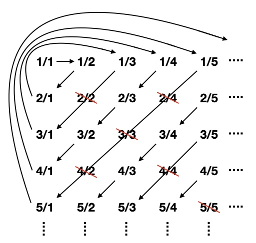
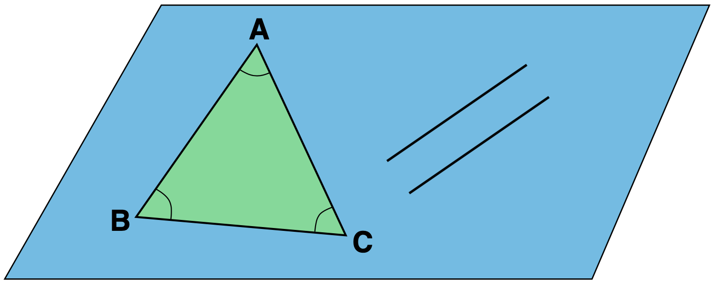
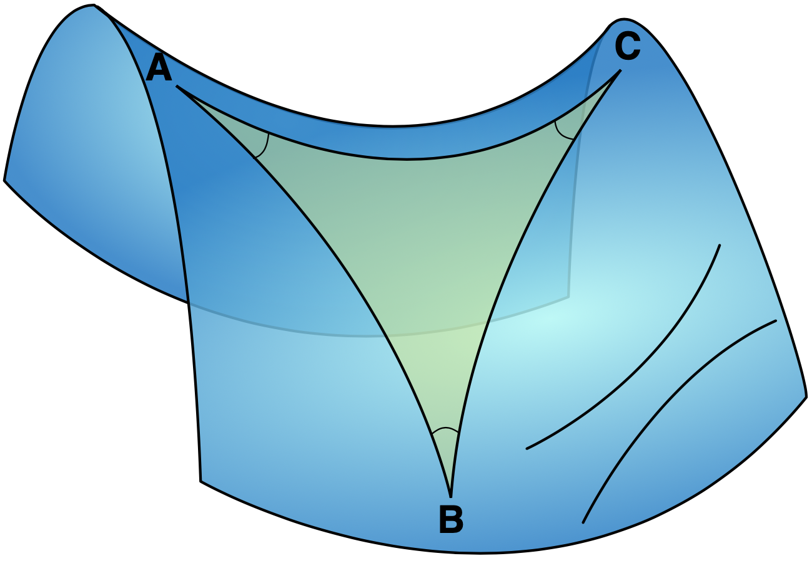

# Infinity
**First published Thu Apr 29, 2021; substantive revision Fri May 2, 2025**

*Easwaran, Kenny, Hájek, Alan, Mancosu, Paolo, Oppy, Graham*

*Infinity* is a big topic. Most people have some conception of things that have no bound, no boundary, no limit, no end. The rigorous study of infinity began in mathematics and philosophy, but the engagement with infinity traverses the history of cosmology, astronomy, physics, and theology. In the natural and social sciences, the infinite sometimes appears as a consequence of our theories themselves (Barrow 2006, Luminet and Lachièze-Rey 2005)[^barrow-2006][^luminet-2005] or in the modelling of the relevant phenomena (Fletcher et al. 2019)[^fletcher-2019]. Mathematics itself has appealed to some form of infinity from its beginning (infinitely many numbers, shapes, iterated addition or division of segments) and its contemporary practice requires infinitary foundations. Any field that employs mathematics at least flirts with infinity indirectly, and in many cases courts it directly.

Philosophy countenances infinity in myriad ways, either directly or indirectly, in most of its sub-fields—here is a tiny sample taken from the contemporary discussion (we shall discuss historical material in Section 1 and in Section 2, and many further examples in later sections). Some metaphysicians contend that there are infinitely many possibilities/possible worlds and canvas how big this infinity is (e.g. Lewis 1986)[^lewis-1986]. Philosophers of religion debate whether the divine is infinite, whether the divine creation is infinite, and whether the value of the afterlife is infinite. Epistemologists debate whether there can be an infinite regress of justification, and if so, whether it is problematic (Klein 2000, Peijnenburg 2007, Atkinson and Peijnenburg 2017)[^atkinson-2017][^klein-2000][^peijnenburg-2007]. Formal epistemologists traffic largely in an infinitary notion of ‘probability’ (more in Section 6). Population ethics for infinite populations is a lively topic, and they are thought to pose distinctive problems for consequentialism (Nelson 1991)[^nelson-1991]. Social and political philosophy appeal to the notion of convention, often thought to involve ‘common knowledge’, with a putative infinite hierarchy of mutual knowledge (Lewis 1969)[^lewis-1969]. Philosophers of language and mind grapple with problems that infinitary operations such as ‘plus’ create for meaning and rule-following (Kripke 1982)[^kripke-1982], and whether language itself, or minds themselves, can be infinite (Nefdt 2019)[^nefdt-2019]. Philosophers of mathematics debate whether stipulations that imply the existence of infinitely many objects can be said to be analytic (Boolos 1997, Wright 1999)[^boolos-1997][^wright-1999] and whether criteria of identity for infinite numbers must necessarily be Cantorian (Mancosu 2016)[^mancosu-2016]. See Section 4. Concerns about infinity (and human finitude) appear in continental philosophy, not only in its 19th century historical sources (e.g., among others, Fichte, Schelling, Hegel, Kierkegaard, and Nietzsche) but in contemporary developments as well (e.g., among others, Heidegger 1929, Levinas 1961, Adorno 1966, Foucault 1966, Deleuze 1969, Badiou 2019)[^adorno-1966][^badiou-2019][^deleuze-1969][^foucault-1966][^heidegger-1929][^levinas-1961]. This list can be continued, if not *ad infinitum*, then *ad nauseam*.

At this point, one may be tempted to shout three cheers—or perhaps infinitely many of them—for infinity. Indeed, one may get the impression that *we can’t live without it*. At the same time, there are various apparent problems with infinity, and it starts to look less congenial. As they pile up, one might get the impression that *we can’t live with it*. Infinity, as we shall see, gives rise to numerous paradoxes that have preoccupied philosophers for millennia. Any praise of infinity must be tempered with circumspection and caution.

So we have good reason to want to understand infinity better. Mathematicians and philosophers in particular have done much to enhance our understanding of it. This entry strives to give the reader a sense of some of the main lines of thought regarding infinity.

Our survey begins in section 1, which unpacks some meanings of ‘infinite’, and traces various philosophical conceptions of infinity from ancient times to the 19th Century. Section 2 turns to the historical development of the mathematics of infinity over a comparable period. This provides background to a presentation in section 3 of modern mathematics’ treatment of infinity—some infinite number systems, infinities of measure, of counting, of calculus, and infinitary operations on numbers. This in turn sets the stage for our discussion of mathematical ontology in section 4.

Up to this point, it appears that infinity has been domesticated. This appearance begins to be challenged in section 5, when we canvas some classic paradoxes and puzzles involving infinity. It reappears as both friend and foe in the following sections on some philosophically fecund applications of it. In sections 6 and 7, it is both central to the formulation of probability and decision theory, and the source of more conundrums; we discuss some putative solutions to them. Section 8 presents some problems concerning space and time, as well as some progress that has been made on them—Kant’s antinomies, a Zeno-style paradox concerning measure, developments in non-Euclidean geometries and relativistic cosmology, and in determining whether space is finite or infinite. We conclude in section 9, sanguine overall about our relationship with infinity.

Given the magnitude of our topic, we clearly cannot cover all aspects of it, or even a sizable proportion of them. For example, we do not engage much with the many roles infinitude plays in science and the social sciences (except in section 8), retaining our focus on its roles in philosophy. We limit our discussion to what can be understood without highly advanced mathematics, but provide links to a number of supplementary documents that discuss further issues: infinite idealizations, quadratures of the circle, overviews of two recent developments in mathematics that promise to make the infinite realm more tractable (numerosity theories and surreal numbers), further paradoxes (God’s lottery, two envelopes), and proofs of theorems. We ask for the forbearance of readers whose favorite topics have been left out. We hope to mitigate this somewhat with our large set of pointers to further topics, the references in our extensive bibliography, and other internet resources.

## 1. Infinity in philosophy: some historical remarks

In Greek, ‘to apeiron’ means ‘the infinite’: ‘a’ denotes privation and ‘peras’ the notion of ‘limit’ or ‘bound’. Etymologically, the English word ‘infinite’ comes from the Latin word ‘infinitas’: ‘in’ = ‘not’ and ‘finis’ = ‘end’, ‘boundary’, ‘limit’, ‘termination’, or ‘determining factor’. In contemporary English, there is a range of uses of the word ‘infinite’:

1. In a loose or hyperbolic sense, ‘infinite’ means ‘indefinitely or exceedingly great’, ‘exceeding measurement or calculation’, ‘immense’, or ‘vast’.
2. In a strict but non-mathematical sense that reflects its etymological history, ‘infinite’ means ‘having no limit or end’, ‘boundless’, ‘unlimited’, ‘endless’, ‘immeasurably great in extent (or duration, or some other respect)’. This strict, non-mathematical sense is often applied to God and divine attributes, and to space, time and the universe.
3. There is also a strict, mathematical sense, according to which ‘infinite’ quantities or magnitudes are those that are measurable but that have no finite measure; and ‘infinite’ lines or surfaces or volumes are measurable lines or surfaces or volumes that have no finite measure.

Related to the distinction between meanings (2) and (3) is a distinction between metaphysical and mathematical meanings of infinity. This has been usefully employed in some of the most encompassing accounts of infinity, such as Moore (1990/2019; for another recent treatment that includes extensive discussion of the history of infinity see Zellini (2005)). Moore sees the metaphysical notion as bound up with the notions of ‘totality’, ‘absoluteness’ and ‘perfection’. While our entry is focused on the strict mathematical sense of ‘infinity’, one cannot cleanly separate the various meanings in the historical development of the subject, especially in the first stages. In addition, treating infinity as a ‘perfection’ in theology from the outset does not mirror the complexity of the historical development; for instance, we find traces in the 13th century of thinkers who attributed finiteness to God or in any case denied God’s infinity even when not explicitly stating the finiteness of God (see Coté 2002, 127–144)[^coté-2002].

The infinite has been of central concern to Western thought since the very first pre-Socratic fragment. It concerned the philosopher Anaximander (who flourished in the 6th century BCE), who identified the principle and origin of existing things as *to apeiron*. In Anaximander, the principle has both an ontological and an ethical significance. The Pythagoreans (6th century BCE) saw the infinite negatively and emphasized the lack of definiteness associated with it; they also gave it spatial connotations. Indeed, in the 5th century BCE the Pythagorean Archytas of Tarentum (see Huffman 2005, 540–550)[^huffman-2005] gave the following argument for the spatial infinitude of the cosmos based on the contradiction that postulating a boundary to it would seem to entail. If the cosmos is bounded, then one could extend one’s hand or a stick beyond its boundary to find either empty space or matter. And this would be part of the world, which thus cannot be bounded on pain of contradiction. So the world is *unbounded*. Archytas identified this with the world being *infinite*. Kant similarly identified the unbounded and the infinite in his cosmological antinomy. In Section 8 we will see that these notions should be distinguished, but a mathematically precise articulation of the distinction had to wait until the development of new conceptions of space in the 19th century.

The Eleatics (Parmenides and Melissus, 5th century BCE) held a monist conception of reality, the One, and Melissus declared it to be infinite. Such a monistic conception of reality sees change (or becoming) as appearance, and Zeno’s famous paradoxes of infinity (see the entry on Zeno’s paradoxes) emerge in this context. Suffice here to say that Zeno’s paradoxes (the dichotomy, the Achilles, the arrow, and others) involved the infinitely small and were aimed at buttressing Parmenides’ monism. Working across the 5th and the 4th century BCE, Democritus defended an atomistic theory with an infinite void and infinitely many atoms. The infinite by this time had shown some of its major aspects, taken as substance by some and as plurality (of atoms, times, worlds, geometrical points, etc.) by others.

If the urgency of problems related to the infinite reached Greek consciousness with Zeno’s paradoxes, the most influential discussion was due to Aristotle. In order to put Aristotle’s discussion in perspective, we need to list a number of ways in which mathematical infinity had emerged not only in philosophy, as we have described, but also in mathematics. We have already seen with Archytas the notion of spatial infinitude of the cosmos. But in number theory, the natural numbers were considered infinite, at least in the sense that given any natural number a greater one could be found. In geometry, we find both the infinite by addition (any segment can be extended) and by division (any segment can be halved). Thus, mathematics presented processes of iteration without limit. The most sophisticated technique for dealing with iterated processes in the measurements of plane and solid figures was developed by Eudoxus (4th century BCE), and we discuss it in Section 2.1.

By the time Aristotle (4th century BCE) developed his discussion of the infinite, this concept had thus made its presence felt in philosophy, mathematics, and natural philosophy (including cosmology, astronomy, and physics). It would be hard to exaggerate the role played by Aristotle in the history of infinity. He articulated some essential conceptual distinctions that were to influence all subsequent discussions. He was a finitist in the sense that in his universe, everything is finite. The cosmos is finite, bodies are finite, geometrical segments are finite, each number is finite, etc. However, Rosen (2022) argues hat Aristotle can in principle allow actual infinite multiplicities. In any case, there are processes that can be iterated indefinitely, giving rise to what he called ‘potential infinity’. He claimed in fact that “in a sense [the infinite] is and in a sense it is not.” (*Phys.* 3.6, 206a13–14).

Any arbitrary segment can be extended in length (subject to cosmological restrictions mentioned below) or halved without limit, but at each stage we remain within the finite. Time is also potentially infinite in both directions and can be divided without limit but it is not a whole.

This conception stands in opposition to that of ‘actual infinity’, which would result if some infinite processes could be completed, carried out ‘all at once’, as it were. If actual infinity were real, then one could have infinitely long bodies, infinitely long or infinitely small segments, the totality of natural numbers, an infinite number, infinitely many instants of time, etc. Aristotle rejected the notion of the infinite as a primordial substance, as we have encountered in Anaximander, and most of his discussion of the infinite takes place within a physical context, namely one relating to spatio-temporal features of reality. As a consequence, Aristotle’s discussion of the infinite fell squarely in what we have characterized as the ‘mathematical’ notion of infinity, where infinity applies first of all to magnitudes (continuous or discrete) and what is quantifiable (time, extension, numbers etc.). His *Physics* discusses the infinitely large, excluded because the world is finite; and the infinitely small, excluded because the division of matter can only be potentially infinite and thus finite at each stage, never reaching an infinitesimal quantity—one that is less than any finite quantity, while being something. The exclusion of the infinitely large also has as a consequence that Aristotle cannot allow a potential infinity by addition in an unqualified manner (for otherwise any finite extension could be added to itself sufficiently many times to become larger than the size of the world). Infinity by addition, then, is to be conceptualized as a sort of inverse operation to infinity by division which gives us the primary evidence for the existence of the potential infinite. This is the implicit force of the contrastive “but” in the following quote. Aristotle writes (our emphasis):

> ‘To be’, then, may mean ‘to be **potentially’** or ‘to be **actually’**; and the infinite is either in **addition** or in **division**. It has been stated that magnitude is not in actual operation infinite; but it is infinite in division – it is not hard to refute indivisible lines – so that it remains for the infinite to be potentially. (*Physics* 3.6, 206a14–24)

The Aristotelian distinction between potential and actual infinity has had a major influence up to contemporary times. (For further discussion of Aristotle on infinity see Hintikka (1966), Lear (1980), Kouremenos (1995), Coope (2012), Nawar (2015), Cooper (2016), Ugaglia (2018), Rosen (2022), and Hussey’s commentary to Aristotle (1983).)

Aristotle’s conception had, in addition to issues related to the constitution of the physical continuum, important consequences in cosmology. While he considered the cosmos to be finite, he thought that the movement of the celestial spheres had no beginning and no end. The issue of the “eternity of the world” was to exercise some of the best theological and philosophical minds after Aristotle, especially in connection to theological issues. For instance, Johannes Philoponus (6th century CE; see Philoponus 2004)[^philoponus-2004] argued in favor of a beginning of the world by claiming that the contrary thesis would lead to a paradox of infinity (we discuss this in Section 2.4).

Philoponus presented another paradox of infinity concerning infinite time that we will discuss in the version formulated by al-Ghazālī (11th century CE)—see the

[Supplement on al-Ghazālī’s objection](infinity.al-ghazali.md)

Of even more pressing significance was the abandonment of Aristotle’s view on the finiteness of the cosmos and the Renaissance move from the finite to the infinite universe described in the classic text by Koyré (1957; see also Jammer 1993)[^jammer-1993]. While Copernicus (1473–1543) put the sun at the center of the universe, he still worked with a finite model of the universe. Foreshadowed by Epicurus (341–270), Hasdai Crescas (1340–1412), and Nicolaus Cusanus (1401–1464), Giordano Bruno (1548–1600) defended the idea of infinitely many worlds, each of infinite size, existing simultaneously. Bruno is a good example of how mathematical and theological notions of infinity were used simultaneously in the history of the concept. For instance, in *On the Infinite, the Universe, and Worlds* (1584) he argued from God’s infinite power to the infinitude of the universe.

By contrast, Kepler and Galileo did not think that the issue of whether the world was infinite in size could be settled either way. Kepler thought that the notion of an infinite universe was a metaphysical one and not founded on empirical evidence. Galileo claimed, in a famous letter to Francesco Ingoli written in 1624, that mankind would never be able to know whether the universe is finite or infinite. The progressive geometrization of space (see De Risi 2015)[^risi-2015] led to Newton’s gravitational theory in which the universe is infinitely extended spatially and temporally. Physical space became identified with the space of Euclid’s geometry and in this way physical space was geometrized.

Theological elements were still present when Newton identified space with the “sensorium Dei” (“God’s sensorium”). For the next two centuries cosmology was developed according to Newtonian theory: an infinite Euclidean space, flat and absolute, which provides the receptacle for all physical objects whose relations are structured by universal gravitation.

With Riemann in the mid-19th Century, and then with relativistic cosmology, one went back to a finite universe, but cosmologists are now fully aware that the issue of the finitude of the world is very much an open question that depends crucially on the curvature and the topology of space (see Section 8.2).

Our discussion above indicates a few essential aspects of the concept of infinity that will be useful in the later discussion. There are obviously many areas of contact and/or intersection between the more mathematical notion of infinity and the qualitative notion of infinity. Qualitative notions of infinity cannot be easily characterized directly but in general they appeal to features that do not seem to have a clear quantitative aspect. For instance, God might be defined as infinite because it has none of the limitations of finite creatures; this property was accounted for in some Scholastic philosophy by claiming that God, unlike finite creatures, is that unique entity in which essence and existence coincide. Often coupled with this was the claim that God’s infinity is incomprehensible, and this might be a good indicator that we cannot achieve a positive account of qualitative infinity. At the same time, claims concerning infinite divine power or goodness offer a possible connection to quantitative conceptions, and this explains why the boundary line between quantitative and qualitative conceptions is not so sharp.

Indeed, according to some authors the qualitative and mathematical conceptions are inextricably tied. Consider for instance Pascal’s use of infinite distance both in projective geometry and in his *Pensées* where he muses on the infinite distance (and disproportion) between finite human beings and the infinite God (see Cortese 2015 and 2023)[^cortese-2015][^cortese-2023]. The following passage is representative of the powerful and suggestive role that appeal to finiteness and infinity plays in Pascal’s apologetics:

> For in the end what is humanity [l’homme] in nature? A nothingness compared to the infinite, everything [un tout] compared to a nothingness, a mid-point between nothing and everything, infinitely far from understanding the extremes; the end of things and their beginning [principe] are insuperably hidden for him in an impenetrable secret. $\langle$What can he therefore imagine? He is$\rangle$ equally incapable of seeing the nothingness from where he came, and the infinite in which he is covered [englouti]. […] (Pascal 2008: 70; we have added the French original where the translation seems less than faithful)[^pascal-2008].

Moreover, Pascal’s *pari* (wager) is also intimately tied to the notion of infinity in the form of an infinite reward. (See Section 7.3 on Pascal’s wager) These topics are of great importance for philosophy of religion, decision theory, and philosophical anthropology.

However, this entry does not concern those conceptions of infinity that are connected to infinite divine power, infinite modes, and in general about those conceptions of infinity that are not of a mathematical kind. We do not intend to downplay the importance of those aspects of the history of infinity to which giants such as Plotinus, Cusanus, Descartes, Pascal, Spinoza, Fichte, Hegel, and Kierkegaard contributed, among others. Leibniz and Kant also belong to that list, but we will say more about them later on. But our entry would lose focus if we were to try to pursue all these developments even at a superficial level, and the treatment of qualitative infinity is worthy of an article in its own right. Thus, we content ourselves with a list of bibliographical references through which the reader can reconstruct the contributions to the topic.

For overviews of the history of infinity which include both mathematical and metaphysical aspects, see Moore (1990/2019) and Zellini (2005). For further discussion of Aristotle’s views on infinity see the entries on: Aristotle; Aristotle and mathematics; and Aristotle and metaphysics. For ancient and medieval conceptions of infinity see Sweeney (1972), Sweeney (1992), Kretzmann (1982), Coté (2002), Biard and Celeyrette (2005), Duhem (1987), Dewender (2002), Davenport (1999), Murdoch (1982), Uckelman (2015), Zarepour (2025); for the early modern period see Nachtomy and Winegar (2018); for infinity in Kant and the idealist period see Kreis (2015); Monnoyeur (1992) spans all periods.

For more on infinity in philosophy of religion, see the following references.

1. on divine infinity: Koetsier and Bergmans (2005), Göcke and Tapp (2018), the papers in the final section of Heller and Woodin (2011), and various entries including God and other ultimates, ontological arguments, Nicolaus Cusanus, Robert Grosseteste, John Duns Scotus, and Ibn Arabi;
2. on infinity in God’s creation, apart from our subsequent discussion of whether space and time are infinite: the entries cosmology and theology, cosmological argument, fine-tuning, infinite regress arguments, principle of sufficient reason, and being and becoming in modern physics; and
3. on ‘heavenly infinity’, apart from our subsequent discussion of Pascal’s Wager: the entries on Pascal’s wager, the meaning of life, and religion and morality.

It is worth noting that Cantor’s development of set theory was influenced by theological considerations: see, for example, Dauben (1990) and Tapp (2005).

As we have said, we are mostly excluding the topic of infinity in science and the social sciences from our purview, although see the

[Supplement on Infinite Idealizations](infinity.idealizations.md).

To the extent that we discuss infinity in science (notably in Section 8), our focus is primarily on the mathematical machinery involved, which has a venerable history. This brings us to the topic of the next section.

## 2. Infinity in mathematics: a brief historical overview

In this section we will begin by showing how Greek mathematics studiously avoided the use of infinity in the presentation of its results by making use of *the method of exhaustion* (3.1). Then we will look at the widespread use of infinitary objects and procedures in 17th-century mathematics (theory of indivisibles and points at infinity in geometry (3.2), infinitesimals in the calculus (3.3)) and Galileo’s problem of extending counting to infinite collections (3.4). By the early 18th-century mathematics had undergone its first “infinitistic revolution” (the second is associated with the name of Cantor, see section 3). Infinity had become a pressing foundational problem, and this will lead us to section 3.

### 2.1 The method of exhaustion

We have already mentioned that the potential infinite occurs in Greek mathematics from the outset, most obviously in the natural number series and in the geometrical operations of addition and division of segments and other geometrical magnitudes. The Greek mathematicians, starting with Eudoxus, developed a technique for measuring plane and solid figures that avoided recourse to the infinite even where an infinite “limit” process would seem to be forced by the situation. This technique, known today as *the method of exhaustion* (the expression was coined in the 17th century by Gregory of Saint Vincent), is found in Euclid’s *Elements*, book XII, and then in some of the most spectacular results by Archimedes (3rd century BCE). The idea is to replace an infinite approximation by a double reductio ad absurdum. That means that one shows the equality in area or volume of two figures, say a circle $C$ and an associated triangle $T$, by noting that $C \lt T, C \gt T$ or $C = T$ and then showing that the assumptions $C \lt T$ and $C \gt T$ both lead to a contradiction. (Here ‘$C$’ and ‘$T$’ refer with systematic ambiguity to the figures and their areas/volumes.) Further discussion can be found in the

[Supplement on Quadratures of the Circle by Exhaustion and by Indivisibles](infinity.quadratures.md).

Greek mathematics generally avoids any recourse to the actual infinite, and scholars have spoken of a “horror of infinity” typical of Greek mathematics. This is in general correct with respect to the way mathematical results are presented in their final and public presentation. However, one should keep in mind that no such “horror of infinity” is to be found when one looks at the heuristic strategies pursued by Greek mathematicians. In the case of Archimedes, this was made evident by the fortunate rediscovery of his method (found in 1906; see Netz and Noel 2007)[^netz-2007] where we see him using infinitary and mechanical considerations as tools he exploited for the discovery of geometrical theorems (see Knorr 1982, 1986 and Jullien 2015)[^jullien-2015][^knorr-1986]. For instance, in his description of the method for finding the proportion between the area of a parabolic segment and that of a related triangle, Archimedes thinks of geometric figures (the parabolic segment and the related triangle, in this case) as composed of infinitely many one-dimensional segments and then exploits the law of the lever to gain the determination of the relation between the areas in question. In a portion of the text of the method that has only recently become available (a section of proposition XIV, see Netz and Noel 2007)[^netz-2007], Archimedes explicitly operates with infinite collections.

### 2.2 The theory of indivisibles and points at infinity

Early modern mathematicians were impressed by the Euclidean and Archimedean rigor, but there was widespread suspicion (confirmed in 1906) that Archimedes must have had a less rigorous heuristic method that he used to discover his surprising results.

In the 17th century, infinitary considerations in geometry opened the way to new geometrical techniques in *quadratures* and *cubatures*—i.e. the determination of areas of plane figures and of volumes of solid figures, respectively. We owe to Cavalieri and Torricelli a geometrical theory of indivisibles that was later put in an arithmetico-algebraic setting by Wallis (1656). Cavalieri’s original idea (1635) was that the relation between the areas of two plane figures could be obtained by a systematic comparison of what he called the *indivisibles* of the figures. An indivisible of a figure is a geometrical entity of lower dimension than the figure itself. An indivisible of a line is a point; an indivisible of a plane figure is a line segment; an indivisible of a solid is a plane figure. Consider a square with top side AB and bottom side CD. An indivisible of the square is any arbitrary segment with the same length as AB that can be obtained by letting AB move parallel to itself until it reaches CD. See the

[Supplement on Quadratures of the Circle by Exhaustion and by Indivisibles](infinity.quadratures.md)

for an explanation of how to give the quadrature of the circle with the indivisibilist method, and how this courts infinite collections.

Cavalieri’s applications of the theory of indivisibles were limited to finite figures and thus did not go beyond the geometrical boundaries typical of Greek mathematics. However, Torricelli broke new ground with the determination of the volume of an infinitely long (*infinite longum*) solid (Torricelli 1644)[^torricelli-1644]. Up to then, all the results concerning finite figures obtained through indivisibles could easily be proved by finitary Archimedean techniques and by avoiding any mention of infinity—just as in the case of the quadrature of the circle presented in the

[Supplement on Quadratures of the Circle by Exhaustion and by Indivisibles](infinity.quadratures.md).

However, infinity figured explicitly in Torricelli’s result that an infinitely long solid (FEOBMDC in the diagram) had a finite volume (the volume of the cylinder ACIH in the diagram).

This was the first infinitary result in Western mathematics, for the infinite was not eliminable using some alternative finitary technique but rather showed up as a feature of the very object that had to be measured. Torricelli’s infinitary result put enormous pressure on empiricist conceptions of infinity. The heuristic fruitfulness of the indivisibilist method was also accompanied by paradoxes that threatened its foundations. Among them was Tacquet’s proof using indivisibles that all triangles have the same area. The indivisibilists were able to deal with such paradoxes in various ways, but the foundations of the system remained shaky (for a detailed discussion of the foundations of the theory of indivisibles and the mathematical and philosophical issues connected to Torricelli’s result see Mancosu (1996) and Jullien (2015)).

Another area in which the infinite made its appearance in 17th century geometry is in the work of Desargues (see Sakarovitch and Dhombres 1994 and Desargues 1639)[^desargues-1639][^dhombres-1994]. Whereas in Euclidean geometry parallel lines do *not* meet, Desargues entertained the idea of having parallel lines meet at a point at infinity. This was a very fruitful idea that led to the development of projective geometry. (See [section 2 of the entry on 19th century geometry](https://plato.stanford.edu/entries/geometry-19th/#ProGeo).)

### 2.3 The calculus

The most fruitful development in the use of infinity in 17th century mathematics was that of the calculus.

From a geometrical point of view, the calculus provides techniques for drawing tangents at an arbitrary point of a curve and for measuring the area under a portion of a curve. The differential calculus treats the first problem and the integral calculus the second. The fundamental theorem of the calculus states that these problems are inverses of each other. The calculus was developed independently by Newton and Leibniz, but its spread owed much to a significant number of mathematicians throughout Europe. The first textbook of the differential calculus was published in 1696 by the Marquis de l’Hôpital (1696; see Bradley et al. 2015 for a translation, which we follow below, with commentary)[^bradley-2015]. It is worthwhile to consider its axiomatized structure, for it will help us see immediately the infinitary foundations on which the new discipline presented itself to the international community. We first have two definitions:

**Definition I.** Those quantities are called variable which increase or decrease continually, as opposed to constant quantities that remain the same while others change.

**Definition II.** The infinitely small portion by which a variable quantity continually increases or decreases is called the Differential.

The two postulates are as follows.

**Postulate I.** We suppose that two quantities that differ by an infinitely small quantity may be used interchangeably, or (what amounts to the same thing) that a quantity which is increased or decreased by another quantity that is infinitely smaller than it is, may be considered as remaining the same.

**Postulate II.** We suppose that a curved line may be considered as an assemblage of infinitely many straight lines, each one being infinitely small, or (what amounts to the same thing) as a polygon with an infinite number of sides, each being infinitely small, which determine the curvature of the line by the angles formed amongst themselves.

We see in the above the explicit infinitary characterization of some of the basic entities appealed to in the new calculus. Both postulates require something that the Greeks had studiously avoided, namely the consideration of infinitely small quantities and the reduction of curves to infinilateral polygons. While l’Hôpital and a number of French mathematicians were enthusiastic about going “infinitary”, Leibniz himself developed a fictionalist account of the appeal to infinitely small quantities (foreshadowed already in his early *De Quadratura* which did not see the light of day until 1993; see Leibniz (1993)). Also note the use of geometrical and kinematic (i.e. based on movement, as implied by the notions of continual increase or decrease) concepts. Much of the 19th century work on the calculus was devoted to removing geometrical and kinematic notions from the foundations of the discipline.

The literature in this area is enormous and we refer to Goldenbaum and Jesseph (2008) for a recent collection of essays on Leibnizian infinitesimals. The debates on the foundations of the calculus led to some lively contributions, such as Berkeley’s *The Analyst* (1734) and more mathematical work. But even after infinitesimals were eliminated from the calculus through the combined work of Cauchy, Bolzano, Dedekind, and Weierstrass in the 19th century, they were widely employed in geometry. Moreover, contemporary alternative theories of analysis (non-standard analysis, smooth infinitesimal analysis etc.) have led to rigorous theories that, taken with a grain of salt, can be seen as vindicating some of the 17th century intuitions. We will come back to these developments below.

### 2.4 Counting infinite collections

There is one final aspect of 17th century discussions of infinity that is relevant for later considerations: the problem of extending the concept of counting from the finite to the infinite. This problem is related to the issue of whether there is only one infinity or whether there might be different sizes of infinity. As we have mentioned, Philoponus argued that the eternity of the world led to a contradiction. In particular, he claimed, if the world has no beginning in the past, then the number of individuals up to Socrates would be infinite; but then by adding the number of individuals from Socrates to now, one would obtain an infinity larger than the previous one, and this, he concluded, is “one of the most impossible things” (see Sorabji 1983)[^sorabji-1983]. It was typical of Greek thought to reject the idea that there can be different sizes of infinity.

The Islamic mathematician Ibn Qurrah (9th century CE) took a decidedly infinitistic attitude and argued, against the Aristotelian commentators, that there can be different sizes of infinity (see Rashed 2009)[^rashed-2009]. He claimed, for instance, that the odd and the even numbers have the same size, but that the multiples of three are 1/3 of the total number of natural numbers. Contrary to what has been claimed in the literature, his intuition was not that the even numbers and the odd numbers have the same size because there is a one-to-one correspondence between them. Rather we have a “frequentist” intuition: every even number is followed by an odd number; multiples of three appear every three numbers, etc. But it is only in Grosseteste’s treatise *De Luce* that we witness for the first time the postulation of infinite numbers with some basic arithmetic on them. In his *Commentary on the Physics*, Grosseteste claims that these infinite numbers are God’s way to count the number of points in finite segments thereby connecting the measure of segments and the multiplicity of their points.

Galileo Galilei epitomized the paradoxical situation we run into when trying to generalize counting from the finite to the infinite. In *Two New Sciences* (1638; Galilei 1974)[^galilei-1974], he presented a paradox of infinity. On the one hand, there is an intuition that there are *fewer* square numbers than natural numbers, since the first collection is properly contained in the second (the former has some but not all of the latter’s members). On the other hand, there is an intuition that there are *the same number* of squares and natural numbers, since there is a one-to-one correspondence—a *bijection—*between the natural numbers and their squares. Galileo’s own conclusion, following Oresme and Albert of Saxony who had discussed similar issues in the 14th century, was to claim that one cannot apply the relations of *equality*, *greater than*, and *smaller than* to infinite collections. Much subsequent theorizing about infinity can be regarded as respecting one intuition at the expense of the other (see Mancosu 2009, 2016 for an overview of the historical developments and further references)[^mancosu-2009][^mancosu-2016].

The intuition that if one set is a proper subset of another, the former is smaller than the latter, traces back to Euclid—call this the *part-whole* intuition. Bolzano (1851) was sympathetic to it, and he tried to develop a theory of infinite sets that preserved it. He was not successful, but he warned his readers not to conflate one property of an infinite set—that it can be put in one-to-one correspondence with a proper subset of itself—with a criterion of ‘size’ (what he called the “multiplicity” of a collection). Cantor (see Hallett 1986)[^hallett-1986], by contrast, later used one-to-one correspondence as the defining characteristic of *cardinal numbers*: the numbers that answer ‘how many?’ questions, and that generalize counting from the finite to the infinite in his set theory. He thus sided with the intuition that if there is a bijection between two sets, they have the same size—call this the *bijection* intuition. The intuition is clearly correct for finite sets. For example, the set of fingers on a normal human hand can be paired up with the set of toes on a normal human foot, and vice versa: there is a bijection between these two sets. And of course, the two sets have the same size (five). A central question is whether the intuition is correct also for infinite sets. We will discuss Cantor’s theory and, by contrast, some recent implementations of counting, known as theories of *numerosities*, that preserve the part-whole intuition also for infinite sets—see the

[Supplement on Theories of Numerosities](infinity.numerosities.md).

In conclusion, the “infinitistic revolution” in the 17th and the early 18th century left an important legacy for philosophy and mathematics. The theory of indivisibles introduced new magnitudes characterized infinitarily (the collection of all the indivisibles of a figure), and new infinitary geometrical objects extended the classical geometrical universe. Moreover, the debates on the calculus were focused on the nature of the infinitely small and the infinitely large. Finally, the issues emerging from Galileo’s paradox were a prelude to the problem of extending counting from finite to infinite collections.

These problems were gradually addressed in the 19th and 20th centuries, and out of these discussions there emerged different mathematical notions of infinity. We will work our way in stages to these conceptions, via a discussion of some landmarks in the contemporary mathematics of infinity.

Among the numerous general treatments of the use of infinity in mathematics we recommend Lévy (1987), Zellini (2005), Moore (1990/2019), Vilenkin (1995), Barrow (2006). For more detailed accounts of the history of the calculus, see Kline (1990), Boyer (1959), Edwards (1979), and Grattan-Guinness (1980). The most recent scholarship on the theory of indivisibles is to be found in Jullien (2015). For recent collections on Leibnizian infinitesimals see Goldenbaum and Jesseph (2008) and Goethe, Beeley and Rabouin (2015). On concepts of mathematical infinity in the 19th century see König (1990).

## 3. Mathematics: number systems, Cantor’s paradise, and beyond

To deal with some of the issues concerning the infinite raised in Section 2, mathematicians have developed various different structures that explicitly include infinities. These structures ascribe different properties to infinities that are appropriate for different applications. In some cases, there are multiple kinds of structure that can be developed for an application. Explicitly countenancing infinities has opened up an enormous range of choices and possibilities, which has been a wellspring of development in modern mathematics.

We now give a very quick tour of infinity in modern mathematics. Section 3.1 reminds the reader of several familiar number systems: the natural numbers, integers, rational numbers, and real numbers. Section 3.2 discusses the infinite operations of limits and sums that underlie calculus, and introduces the “extended real numbers” $+\infty$ and $-\infty$. The material in these two sections is covered in most textbooks on real analysis, and even many calculus textbooks, so some readers might already be familiar with it, while others might benefit from having such a textbook on hand to expand on some of the points.

Sections 3.3 and 3.4 are more mathematically advanced. Section 3.3 introduces Cantor’s more mathematically sophisticated “cardinals and ordinals”, which are probably the mathematical developments that have done the most to untangle many of the conceptual confusions around infinity. This material is covered in greater detail in most textbooks on set theory, and parts of it are discussed in many logic textbooks as well. It can be read largely independently of the other sections.

Section 3.4 discusses a more recent mathematical theory of infinitely large and infinitesimal numbers that provides an alternate setting for calculus. This theory of “non-standard analysis” has not become as central a part of the mathematics curriculum as real analysis and set theory. It may thus be unfamiliar to most readers, and it is harder to find accessible introductions elsewhere. Although non-standard analysis is not as central a part of the cultural understanding of infinity in mathematics as cardinals are, we include it both because it is a topic of growing interest in mathematics research, and because it can help make mathematically rigorous sense of both many intuitive thoughts about infinity and some of the early work on calculus in the 17th and 18th centuries.

Up to a point, various philosophical applications and puzzles involving infinity can be understood without much understanding of the mathematics of infinity. However, the mathematics helps us formulate and tackle them rigorously. Mathematics-shy readers could skip parts of our tour (particularly section 3.4) and still benefit from the later sections, but we encourage them to make the effort and read on. The mathematical understanding of infinity is a great achievement in its own right.

### 3.1 Some number systems

The *natural numbers* form the most elementary number system. (Some mathematicians count $0$ as a natural number as well, but some others do not.) $1$ is a natural number. For any natural number $n$, $n+1$—the *successor* of $n$—is also a natural number. The natural numbers—$1, 2, 3, \dots$—are closed under addition: if $n_1$ and $n_2$ are natural numbers, then so is $n_1+n_2$. And they are closed under multiplication: if $n_1$ and $n_2$ are natural numbers, then so is $n_1 \cdot n_2$. We use the natural numbers for counting ‘how many’ of something there are, though they clearly fail when applied to infinite sets, for instance the set of squares of natural numbers or the set of natural numbers themselves. This is what ‘infinities of counting’ will extend, in section 3.3.

The *integers* consist of the natural numbers, their additive inverses (a number and its additive inverse sum to $0$), and $0$:

$$\dots , -3, -2, -1, 0, 1, 2, 3, \dots.$$

They form the most elementary number system that is also closed under subtraction: If $j_1$ and $j_2$ are integers, then so is $j_1-j_2$.

The *rational numbers* can be expressed in the form $j_1/j_2$, where $j_1$ and $j_2$ are integers, $j_2\neq 0$. They form the most elementary number system that includes the integers and that is closed under division, except by 0. If $q_1$ and $q_2$ are rational numbers, $q_1/q_2$ is also a rational number if $q_2\neq 0$.

The rational numbers are *dense*: for any two rational numbers $q_1$ and $q_2$ such that $q_1 < q_2$, there is at least one rational number $q_3$ such that $q_1 < q_3 < q_2$—for example, the arithmetic mean of $q_1$ and $q_2$, $(q_1+ q_2)/2$, lies between them. Indeed, for any two rational numbers $q_1$ and $q_2$ such that $q_1$ is strictly less than $q_2$, for any natural number $n$, there are more than $n$ distinct rational numbers that lie between $q_1$ and $q_2$. Where the integers spread infinitely ‘outward’ in both directions, the rationals also divide infinitely ‘inward’.

However, the rational numbers still have “gaps”. For instance, if we consider the equation, $y=x^3-2$, we can verify that there are values of $x$ where $y$ is negative, and values of $x$ where $y$ is positive. However, there is no rational number $x$ for which $y$ is exactly equal to 0. To fill these gaps, we construct the “real numbers”.

The real numbers can be constructed out of the rational numbers by defining each real number to be a *Dedekind cut* of the rationals. A Dedekind cut of the rationals is a pair of sets $L$ and $R$ such that:

1. every rational number belongs to exactly one of $L$ and $R$;
2. every member of $L$ is less than each member of $R$; and
3. $L$ has no largest element.

We refer to $L$ as the ‘left set’ of the cut and $R$ as the ‘right set’.

For any rational number $q$, there is a Dedekind cut corresponding to it, where $L$ consists of the numbers strictly less than $q$, while $R$ consists of $q$ and all larger numbers. However, there are also other partitions, where $R$ does not contain a smallest element. For instance, we can let $L$ include all the rational numbers whose cube is less than 2, while $R$ includes all the rational numbers whose cube is greater than 2. Since there is no rational number whose cube is exactly equal to 2, this pair of sets forms a partition, representing the real number we think of as the cube root of 2.

If $x$ and $y$ are two real numbers, represented by Dedekind cuts with left sets $x_L$ and $y_L$, and right sets $x_R$ and $y_R$, we can define operations of addition and multiplication of real numbers in terms of operations on the members of these sets. The left set of $x+y$ is the set of all rational numbers that result from adding a member of $x_L$ and a member of $y_L$, while the right set is the set of all rational numbers that result from adding a member of $x_R$ and a member of $y_R$. (It takes a little work to check that every rational number is in fact in one of these two sets, but the other conditions for being a Dedekind cut are straightforward to check.) If $x$ and $y$ are both positive, then we can define the right set of $x\cdot y$ as the set of all rational numbers that result from multiplying a member of $x_R$ by a member of $y_R$, with the left set defined as the set of all other rational numbers. (Some modifications of this definition are needed if either $x$ or $y$ is negative.) Subtraction and division can then be defined as the inverses of these operations, just as for the rationals.

The real numbers are closed under addition, subtraction, multiplication, and division by all real numbers except 0. They have the further feature that there are no “gaps”: for any bounded set of real numbers, there is a least upper bound, and for any continuous function from real numbers to real numbers, if the function is negative at one point and positive at another, there must be some point at which it is exactly equal to 0. For further discussion, see the entry on Dedekind’s contributions to the foundations of mathematics.

There are several uses for which we want a number system with no gaps, and thus we use the real numbers. If you try to measure the amount of water in a large vessel by counting out a specific number of small cups, there’s no guarantee the number of cups will be an integer. If you try to measure a long distance by counting out the length of your foot, there’s no guarantee the number of feet will be an integer. We might know that something is more than 4 of the units and less than 5. By moving to fractions of these units, we can get more precise—4 cups and 5 to 6 ounces, or 4 feet and 5 to 6 inches—but there’s still no guarantee that a specific rational number will give the precise amount. But we can generate a sequence of approximations that get closer and closer by using smaller and smaller fractions of these units. So in measuring ‘how much’ of something there is, or giving coordinates to describe the location of a point in geometric space, we use the real numbers, to guarantee, as we show in the next section, that there is some precise value the sequence of approximations converges to.

### 3.2 Limits, infinite sums, and the extended real numbers; $+\infty$ and $-\infty$

The mathematical property of ‘lacking gaps’ is referred to as ‘completeness’ — the formal statement is that an ordered set is *complete* if every bounded, increasing sequence of elements has a ‘limit’. These limits are the first infinite operation that we define on numbers.

#### 3.2.1 Limits of sequences

A *sequence* of numbers is an ordered list of numbers, which we may symbolize:

$$a_1, a_2, \dots$$

or

$$\langle a_n\rangle.$$

The members of a sequence are indexed by the natural numbers, $n=1, 2, \dots$.

The formal definition of a limit says the sequence $\langle a_n\rangle$ *converges to $l$*, or *has limit $l$* if and only if the terms of the sequence eventually stay arbitrarily close to $l$. Formally:

$$\lim_{n\to\infty} a_n=l$$

iff

> for each real number $\epsilon>0$, there exists a natural number $N$, such that for every natural number $n>N$, $|a_n-l|<\epsilon$.

We will say a bit more about the symbol ‘$\infty$’ that appears in this definition later, but for now it just indicates the behavior of the sequence beyond any particular finite point.

As we will demonstrate shortly, not every sequence has a limit, but we can define an important class of sequences that do. A sequence is *increasing* if each term in the sequence is at least as large as the previous term. A sequence is *bounded* if there is some real number that is larger than every term in the sequence. It turns out that every bounded, increasing sequence has a limit. The successive approximations to the measurement of some physical quantity with a finer and finer measuring unit will amount to a bounded, increasing sequence of numbers, and thus this definition of a limit allows us to give a numerical representation of any physical quantity.

To show that every bounded, increasing sequence has a limit, consider the Dedekind cuts defining the individual real numbers in the sequence. Let us define a new Dedekind cut by taking its left set to contain every rational in the left set of at least one of these terms of the sequence, and taking its right set to contain every rational that is in *all* of the right sets of these terms. Because the sequence is bounded, we know that the right set is non-empty, and the rest of the properties of a Dedekind cut are not hard to check.

It is not hard to check that the real number constructed in this way is the limit of the sequence. To see how this works in a specific case, we can consider the sequence $1/2, 3/4, 7/8, \dots, 1-1/2^n, \dots$ This sequence is increasing, since each term is greater than the one that came before, and it is bounded, since 2 is a number that is strictly greater than every term in the sequence. The Dedekind cut constructed as above will correspond to the number 1. To see this, note that for any rational number q less than 1, we can let $\epsilon=1-q$. Then there is some $N$ such that $1/2^N<\epsilon$. The $N$th term in the sequence will then be greater than $q$, so $q$ will be in its left set, and thus in the left set we constructed above. But 1 itself, and every rational number greater than it, are all in the right set constructed above. This reasoning also shows that the sequence converges to 1 according to the definition of a limit. For any $\epsilon$, and an $N$ such that $1/2^N<\epsilon$, the $N$th term in the sequence is within $\epsilon$ of 1, and all later terms of the sequence are greater than the $N$th term, but still less than 1, so they must also all be within $\epsilon$ of 1.

This fact about bounded, increasing sequences also underlies the use of infinite decimal notation for real numbers. When we say that the number $\pi=3.1415926\dots$, we just mean that $\pi$ is the limit of the sequence $3, 3.1, 3.14, 3.141, \dots$. One fact about this notation that many people find surprising is that the decimal notation $0.99999\dots$ is the limit of the sequence $.9, .99, .999, \dots$, and thus is precisely 1. Some people feel the intuition that $0.9999\dots$ should somehow denote a number ‘infinitely close’ to 1, but not equal to it. We will be able to make sense of an idea like this in section 3.4, but it turns out that decimal notation is not the way to do it. For a useful demonstration of this point, see Vi Hart’s video [9.999... reasons that .999... = 1](https://www.youtube.com/watch?v=TINfzxSnnIE&ab_channel=Vihart).

Many sequences that are not increasing have limits as well. For instance, the sequence $1, -1/2, 1/3, -1/4, \dots, (-1)^n/n, \dots$ can be seen to converge to the value 0, even though it is not increasing. However, if a sequence is not bounded, like the sequence $1, 2, 3, \dots$, it does not have a limit—if it had a limit, there would have to be some values $l$, $\epsilon$, and $N$, such that all terms in the sequence beyond the first $N$ are within $\epsilon$ of $l$. But then any number that is larger than the first $N$ terms of the sequence, and also larger than $l+\epsilon$, would be a bound for the sequence. And some sequences that are not increasing also fail to have a limit—for instance, the sequence $1, 0, 1, 0, 1, 0, \dots$ does not have a limit, because there is no value such that all terms of the sequence are eventually within $1/3$ of that value.

#### 3.2.2 Infinite sums and products

With the definition of the limit of a sequence, we can now also often define infinitary versions of the operations of addition and multiplication. For a finite number of terms, we define the ‘partial sum’ $\sum_{i=1}^n a_i=a_1+\dots+a_n$ and ‘partial product’ $\prod_{i=1}^{n} a_i=a_1\cdot\dots\cdot a_n$. For an *infinite* sequence of numbers $a_n$, their infinite sum or product (when it is defined) is the limit of the partial sums or products:

$$\sum_{i=1}^\infty a_i=\lim_{n\to\infty}\sum_{i=1}^n a_i$$

and

$$\prod_{i=1}^\infty a_i=\lim_{n\to\infty}\prod_{i=1}^n a_i.$$

Thus, $\sum_{i=1}^\infty\frac{1}{2^i}=\lim_{n\to\infty}\sum_{i=1}^n\frac{1}{2^i}=\lim_{n\to\infty}(1-\frac{1}{2^n})=1$. We can show that if an infinite sequence of terms has a sum that converges, then the terms themselves must converge to 0. That’s because the terms $\sum_{i=1}^n a_i$ must converge, so that for any $\epsilon$, there must be $N$, such that every one of the $\sum_{i=1}^n a_i$ is within $\epsilon$ of the limit whenever $n>N$. Thus, every such $a_n$ must have absolute value less than $2\epsilon$, so that both successive partial sums can be within $\epsilon$ of this limit. (A similar condition holds also for infinite products, but from now on we will focus only on infinite sums.)

However, just having the terms $a_n$ converge to 0 is not sufficient for the sum to converge. A deep and important fact about infinite sums is that $\sum_{i=1}^\infty\frac{1}{i}$ fails to converge, because the partial sums eventually exceed any finite bound. To see this, note that the first term is greater than $1/2$, the next two terms are both greater than $1/4$, the next four terms are all greater than $1/8$, and in general there are $2^{n-1}$ terms that are each greater than $1/2^n$. So to get a partial sum greater than $n$, it is sufficient to add the first $2^{2n}$ terms.

But if the terms $a_n$ converge to 0, and each one is smaller in absolute value and has the opposite sign as the previous term, then the infinite sum must converge. If the first term in the sequence is positive, this is because the even numbered partial sums form a bounded, increasing sequence, and the odd numbered partial sums form a bounded, decreasing sequence, and the difference between successive terms of these two sequences is a term of the original sequence and thus converges to 0. Thus, the sum $\sum_{i=1}^\infty\frac{(-1)^{i+1}}{i}$ converges (in particular, to the natural logarithm of 2). But a somewhat surprising fact, known as the Riemann rearrangement theorem, states that if the positive terms of a sequence have no finite sum, and the negative terms of the sequence have no finite sum, but the individual terms themselves converge to 0, then for any real number $x$, the terms of the sequence can be put into some order so that $x$ is the sum of the sequence in that order! To prove this, just rearrange the terms by beginning with enough positive terms to bring a partial sum above $x$, then enough negative terms to bring a partial sum below $x$, then enough partial sums to bring a partial sum above $x$ again, and so on. This process must be able to be carried out, because the partial sum of the positive terms eventually exceeds any finite bound, and similarly with the partial sum of the negative terms. Since the individual terms of the sequence are all eventually within $\epsilon$ of 0, these partial sums must eventually never differ from $x$ by more than $\epsilon$, and so the sum of this arrangement of the terms must converge to $x$.

Thus, infinite summation has some importantly different features from finite summation. For any finite set of real numbers, the sum of those numbers is well-defined, and doesn’t depend on the order you add them. But with an infinite sequence of real numbers, there may be no number that is the sum of that sequence in that order. And even if there is, it may be possible to rearrange the terms of the sequence so that they sum to another value.

But there are some cases in which the sum can be known to behave nicely. If all the terms in the sequence are positive, and there is *some* order in which their sum converges, then their sum must converge to this value in *any* order. This is because the partial sums form an increasing sequence, and for any two orderings of the terms, and any partial sum of one of those orderings, there must be some partial sum of the other ordering that includes all of the terms in that partial sum, and vice versa. Similarly, the value of the sum doesn’t depend on the order of summation if all the terms are negative. And if the positive terms have a convergent sum, and the negative terms of a series also do, then the sum of the series taken in any order must be equal to the sum of these two sums. Such a sequence is said to be *absolutely convergent*, as the sum of the absolute values of the terms converges.

#### 3.2.3 Limits of functions and the extended real numbers $\pm\infty$

Infinite sequences and sums aren’t the only ways that limits appear in mathematics. Functions of a real value can also have limits. The limit of a function of a real value $x$ as $x$ goes to infinity is defined in a similar way to the limit of a sequence indexed by natural numbers. To say

$$\lim_{x\to+\infty} f(x)=l$$

is to say that for every $\epsilon$, there is an $N$, such that whenever $x>N$, $f(x)$ is within $\epsilon$ of $l$. For example, $\lim_{x\to+\infty}e^{-x}=0$, because $e^{-x}$ can be made as small as one likes by choosing large enough $x$. (Note that the inputs to a function can be positive or negative, so we need to specify that $x$ approaches *positive* infinity to distinguish this from the limit at the other end of the axis.)

But it is also often useful to be able to define the limit of a function at some particular finite real-valued input. For instance, we might be interested in the function $f(x)=\frac{x^2-9}{x-3}$ as $x$ approaches 3. (As we will see in section 3.4, this sort of calculation is particularly important in defining the concept of ‘derivative’ of a function, giving the slope of a continuous curve at a point.) This particular function is defined for all real numbers *other* than 3, and at any such input $x$ it takes the value $x+3$. We would like to be able to say that the limit of this function as $x$ approaches 3 is 6. The way we make this precise is to say that

$$\lim_{x\to a} f(x)=l$$

iff

> for each real number $\epsilon>0$, there exists a $\delta$, such that for every $x$ with $0<|x-a|<\delta$, $|f(x)-l|<\epsilon.$

That is, for any degree of approximation to the limit that we want, there is some degree of approximation for the input that suffices to guarantee that the function is that close. In the initial definition of a limit as $x$ goes to $+\infty$, we required $x$ to ‘approximate’ $+\infty$ by being sufficiently large, but now we require it to approximate $a$ by having a difference from $a$ that is sufficiently small, just as the values of the sequence or function approximate the limit $l$.

We can do the reverse to put $\infty$ on the right side of the limit as well. That is, we say

$$\lim_{x\to a} f(x)=+\infty$$

iff

> for every $M$, there exists a $\delta$, such that for every $x$ with $0<|x-a|<\delta$, $f(x)>M$,

and similarly

$$\lim_{x\to+\infty} f(x)=+\infty$$

iff

> for every $M$, there exists an $N$, such that for every $x>N$, $f(x)>M$.

Since $\infty$ (or more precisely ‘$+\infty$’—similar methods work for ‘$-\infty$’) can appear in each place where a real number can appear in this limit notation, it is natural to see if we can extend the definition of real numbers so that it can be included.

And in fact, if we take the definition of a Dedekind cut, and relax the requirement that the left and right sets be non-empty, we get two new elements—the one with an empty right set is greater than every rational number, and called ‘$+\infty$’, while the one with an empty left set is less than every rational number, and called ‘$-\infty$’. Within these ‘extended real numbers’, not only does every *bounded* increasing sequence have a limit, but *every* increasing sequence has a limit.

Just as the real numbers emerge naturally as the tools to measure finite quantities, as the limits of rational approximations, the extended real numbers emerge naturally as the tools to measure potentially infinite quantities that can be approximated by finite quantities. $+\infty$ can be taken to be the area of an infinite region, the length of an infinite line, the limit of $1/x^2$ as $x$ goes to 0, and so on. Although we are used to thinking of lengths and areas as positive numbers, it is sometimes useful to consider them as negative as well, when we care about the direction that they are pointing, and in this sort of situation $-\infty$ is useful as well. Just as the real number operations of addition, multiplication, subtraction, and division correspond to certain operations on the quantities they measure, these operations can often be extended to these extended real numbers, as long as we are careful about a few cases.

Adding or subtracting a finite area from an infinite area leaves it infinite. Adding a shape with infinite area to another shape of the same infinite area leaves the total area unchanged, and subtracting a negative infinite one from a positive one or vice versa is similar. But $(+\infty) + (-\infty)$ cannot be meaningfully evaluated; nor can $(+\infty) - (+\infty)$. If you take one infinitely large region, and remove an infinitely large region, you might be left with nothing, or a positive region, but you might still be left with an infinitely large region; or if the region you subtracted was larger than the original region, you might be left with a negative region—even an infinite negative region.

These restrictions also apply to the use of these extended real numbers as the limits of sequences or functions. Whenever two sequences or functions both have a finite limit, their sum or difference will have a limit that is the sum or difference of their limits. When one has a finite limit and the other is infinite, then their sum or difference will be determined by the one that is infinite. But when both are infinite, there are problems. We can see that $1/x^2$, $2+1/x^2$, and $1/x^4$ are all functions that go to $+\infty$ as $x$ goes to 0. If we add or subtract any of these functions from a function with a finite limit, the resulting function still has limit of $+\infty$. If we add them to each other in any combination, the result still has limit $+\infty$. But if we consider their differences, we see that $1/x^2 - 1/x^2$ has 0 as its limit, $1/x^2 - 1/x^4$ has $-\infty$ as its limit, and $1/x^2 -(2+1/x^2)$ has $-2$ as its limit. So “$\infty - \infty$” is said to be an “indeterminate form” that can’t be evaluated.

Multiplying or dividing an infinite number by a finite positive number leaves it unchanged, and multiplying or dividing by a finite negative number reverses its sign. Similarly for multiplying the infinite numbers by themselves or each other. But an infinite number divided by an infinite number, or an infinite number multiplied by 0, are also indeterminate forms. As $x$ approaches 0, the function $\frac{1/x^2}{1/x^2}$ has limit 1, while the function $\frac{1/x^2}{1/x^4}$ has limit $+\infty$. If we take the function $1/x^2$ whose limit is $+\infty$ and multiply it by the function $x$ whose limit is 0, we get the function $1/x$, that has no limit as $x$ approaches 0 (since it takes on both large positive and large negative values in any small interval around 0—this is why we have used $1/x^2$ and $1/x^4$ as the paradigms of functions with limit $+\infty$, rather than $1/x$ or $1/x^3$). For similar reasons, these extended real numbers don’t provide a way to divide by 0. So although the extended real numbers have some nice properties, and can be used for measurement in various cases, arithmetic involving them is not as nice as the standard real numbers.

#### 3.2.4 Related infinities

The Dedekind cut construction was done as a way to make sense of limits of the rational numbers. This first created the real numbers, which can be thought of as the limits of bounded infinite sequences of rational numbers. We then considered *all* limits that made sense, including towards the ends of the real line, yielding the extended reals, including the standard reals as well as $+\infty$ and $-\infty$.

Versions of this process can be carried out with other mathematical entities as well. Projective geometry adds additional points ‘at infinity’ to the Euclidean plane, one for each family of parallel lines, to help explain features of visual geometry, like the way that parallel railroad tracks appear to meet at the horizon, infinitely far away. Riemannian geometry extends the complex numbers by adding just a *single* number $\infty$ that one can approach simultaneously ‘in all directions’ in the complex plane. These alternate geometries provide foundations for material discussed in section 2.2, and also section 8.2. Several of these are discussed in the entry on nineteenth century geometry, and others are discussed in topology textbooks under the topic of ‘compactification’.

Because these infinities are inherently considered as limits of finite approximations, there is no way for one infinite element to lie “beyond” another—at most it can lie in a “different direction”, the way that the points of convergence of different families of parallel lines do, or the way $+\infty$ and $-\infty$ do in the extended reals.

But as we will shortly see, there are other notions of infinity for which one infinity can lie “beyond” another. In section 3.3, we will discuss the ideas of infinity that we get from generalizing the use of the natural numbers for counting, rather than generalizing the use of the real numbers for measuring. And in section 3.4, we will discuss yet another mathematical theory of infinity, which arises from an alternate formulation of calculus, where the $\epsilon$’s and $\delta$’s are treated as actually being infinitely small, rather than just being arbitrary finite measures of smallness.

### 3.3 Infinities of counting

#### 3.3.1 Preliminaries

As mentioned above, this section is more mathematically dense than the previous two. However, we need this level of mathematical rigor to develop Cantor’s theory of ordinals and cardinals, which are widely regarded as the most significant mathematical advance in our understanding of the infinite.

An insomniac, counting imaginary sheep to try to get to sleep, will never run out of natural numbers to do the job: 1, 2, 3, …. There is no bound on the set of natural numbers. This is our first infinite set. It is perhaps a natural thought that there is just one infinity for counting infinite sets, which we might symbolise ‘$\infty$’. The thought may seem even more natural when we *define* an infinite set as one that has the same size (in a sense to be made precise shortly) as a proper subset of it. In fact, the thought could hardly be more mistaken: as we will soon see, according to mathematical orthodoxy—namely contemporary set theory and the attendant notion of cardinality of a set—there are *infinitely many infinities*. This prompts a series of questions: Is there a smallest one? Yes, as we will see. Is there a largest one? No, as we will see. What can be said about the spacing between the infinities and how far infinities extend? Well, we will see. We can also ask parallel questions about the infinitely small.

Recall Galileo’s paradox of infinity, based on the collision of the part-whole intuition and the bijection intuition, and his conclusion that one cannot apply the relations of ‘less than’, ‘equality’, and ‘greater than’ to infinite collections. Modern mathematical orthodoxy, embodied in contemporary set theory, rejects Galileo’s conclusion. That orthodoxy is grounded in the bijection intuition, following Cantor rather than Euclid and Bolzano. When there is a bijection between two sets, we say that they have the same *cardinality*. The notion of cardinality does not respect the part-whole intuition. For example, the squares of natural numbers are a proper subset of the natural numbers, but they have the same cardinality since they can be put in one-to-one correspondence.

Foundational programs such as neo-logicism also start from a notion of “equinumerosity” based on the Cantorian bijection intuition. It was not until the early 2000s that a group of mathematicians working on non-standard analysis (Benci, di Nasso, and Forti) developed a theory of “numerosities” that agrees on finite sets with Cantorian cardinality but that also upholds the part-whole intuition for infinite sets, and thus diverges from Cantorian cardinalities. (See Benci and Di Nasso 2003, 2019; Benci, Di Nasso and Forti 2006, 2007, Benci and Luperi Baglini 2024)[^benci-2003][^benci-2019][^benci-2006][^benci-2007][^benci-2024]. One can consider numerosities as a refinement of Cantorian cardinalities. Every two sets that have the same numerosity have the same cardinality, but the converse does not hold. For instance, in this approach the set of squares has numerosity strictly less than the set of natural numbers. See the

[Supplement on Theories of Numerosities](infinity.numerosities.md).

#### 3.3.2 Set theory: $\omega$ and $\aleph$

The sort of infinities that are most familiar to philosophers are infinities used for counting. In the early 1820s, Bolzano arrived at the idea that an infinite set is one for which there is a bijection between the set and a proper subset of it. (Recall Galileo’s paradox.) Dedekind (1884) gave this as a *definition* of being infinite. It is easy to prove that a Dedekind-infinite set must contain a set that is just as large as the natural numbers. See the

[Supplement on Proofs of Theorems](infinity.proofs.md).

Dedekind’s definition is only one among several alternative definitions of infinite set (and correspondingly of finite set) that have been proposed by him and after him. If one assumes the Axiom of Choice, these alternative definitions turn out to be equivalent. (This axiom says that for every set $A$ of pairwise-disjoint non-empty sets, there exists a function that selects exactly one element from each set in $A$.) But without the Axiom of Choice, the definitions can be shown not to be equivalent and the foundational situation is rather delicate but well understood (see Moore 1982)[^moore-1982].

The modern theory of infinities of counting derives from Cantor (1932). He observed that a natural way to set up a bijection between finite sets is to order the elements of each set, and pair the first element of one set with the first of the other, the second of one set with the second of the other, and so on. This sometimes works with infinite sets—for example, it gives the one-to-one correspondence between the natural numbers and the squares (considered under their standard ordering). When there is a one-to-one correspondence between two sets, such that every pair of elements of one set bears the same ordering as the corresponding pair of elements of the other set, the two ordered sets are said to have the same *order type*.

But for some infinite sets (notably the set of *all* integers, including the negative numbers, and also the set of rational numbers) there is no first element under their standard ordering. In this case, it is possible to re-order the elements of the set so that every non-empty subset has a first element, so that this process works. Such an ordering is called a *well-ordering*. (That *every* set can be well-ordered is, as Zermelo famously proved in 1904, equivalent to the Axiom of Choice.)

We can reorder the integers, alternating between positive and negative: 0, -1, 1, -2, 2, -3, 3, …. This ordering has the same order type as the natural numbers, and thus enables a one-to-one correspondence between the natural numbers and the integers. One of Cantor’s most striking early observations is that the same is possible with the positive rational numbers. Every positive rational number can be written uniquely in lowest terms as some fraction $p/q$, where $p$ and $q$ are positive integers with no common factor. We can then order these fractions by first comparing the sum $p+q$ of numerator and denominator, and then if the sum is equal for two fractions, put the one with lower numerator $p$ first. This ordering begins 1, 1/2, 2, 1/3, 3, 1/4, 2/3, 3/2, 4, 1/5, 5, 1/6, 2/5, 3/4, 4/3, 5/2, 6, …. (Note that fractions like 2/2, 2/4, 3/3, 4/2, are missing from this list, because they are not written in lowest terms.) Every positive rational number must appear in this list (because it can be written in lowest terms with some particular finite sum of numerator and denominator), and only has finitely many predecessors (because there are at most $n+1$ fractions whose sum of numerator and denominator is $n$).

The ordering (with duplicates deleted): 1, 1/2, 2, 1/3, 3, 1/4, 2/3, 3/2, 4, …. Every rational number is eventually included.

However, Cantor also observed that different well-orderings of the same infinite sets will produce a different order type. For instance, we can define an ordering on the integers where every non-negative integer comes before every negative integer, with any two integers of the same sign being ordered by their absolute value. To approximately represent this ordering we could write it as $0, 1, 2, 3, \dots, -1, -2, -3, \dots$. (Note that even though this notation with ellipses is vague, the verbal definition in the previous sentence precisely determines the relation between any two natural numbers.) In this ordering, every non-empty subset still has a first element (the non-negative element of lowest absolute value if it contains any non-negative elements, and the negative element of lowest absolute value if it only contains negative elements). If we pair up the first element of this ordering with the first of the standard ordering on the natural numbers, and the second with the second, and the third with the third, and so on, then the negative integers would not be paired with any natural number. But we can put the natural numbers into the same order type by declaring the odd numbers to be before the even numbers, and ordering them by size within these two sets: $1, 3, 5, \dots, 0, 2, 4, \dots$. A single infinite set can be given orderings of many different order types, and also different orderings of the same order type (for instance if we put the even numbers first and the odd numbers second).

Cantor noted that for any two well-ordered sets, the initial positions in one ordering (the first, the second, the third, etc.) correspond to the initial positions in the other, the way that they do for finite sets. In fact, he showed that *all* of the positions of one well-ordering must correspond to initial positions in the other. (If this weren’t true, then the set of positions in one that don’t correspond to positions in the other would be non-empty for each set, and the first elements of these sets would correspond, which would contradict the claim that these positions don’t correspond.) Thus, there is a single list of all the possible positions in well-ordered sets, beginning with the first, second, third, and so on, and these positions are called the *ordinal numbers*. A well-ordered set can be said to have its own ordinal number, which is the first ordinal number that does not correspond to a position in that set.

A *cardinal number* (like “one”, “two”, “three”)—also called a *cardinality*—represents how many elements a set has. Two sets have the same cardinal number if it is possible to come up with any correspondence at all between the members of one and the members of the other, even if this correspondence fails to respect the ordering or any other structure of the sets. Two *finite* sets have the same cardinal number if and only if they have the same ordinal number. For infinite sets, if they are well-ordered and have the same ordinal number, then they have the same cardinal number (because two sets well-ordered with the same order type have a unique correspondence between elements in corresponding positions of the ordering). But they may have the same cardinal number without having the same ordinal number: we have seen that sets of one cardinality can be represented with many different order types.

Cantor used lowercase Greek letters to represent infinite ordinal numbers, with $\omega$ representing the order type of the standard ordering of the natural numbers. Addition of ordinal numbers corresponds to the order type that results from taking an ordering of the first type, followed by an ordering of the second type. Thus, $\omega+\omega$ represents the order type of the integers with the non-negative numbers first and the negative numbers afterwards, while $\omega+1$ represents the order type of the natural numbers with just one element put at the end. Note that $1+\omega$ is the order type of a single element, followed by a copy of the natural numbers, which is in fact the same as the order type of the natural numbers! Thus, $1+\omega=\omega$, which is not equal to $\omega+1$. So ordinal addition is not commutative.

Von Neumann (1923) defined a canonical representation of ordinal numbers, using the fact that the ordinals are themselves well-ordered. Each ordinal is represented by the set consisting of all smaller ordinals. Thus 0 is represented by the empty set $\emptyset$, 1 by the set containing the empty set $\{\emptyset\}$, 2 by the set containing both of those $\{\emptyset,\{\emptyset\}\}$, and so on. $\omega$ is then the set containing all of these finite ordinals $\{\emptyset,\{\emptyset\},\{\emptyset,\{\emptyset\}\},\dots\}$, $\omega+1$ is the set containing it as well $\{\emptyset,\{\emptyset\},\{\emptyset,\{\emptyset\}\},\dots,\omega\}$, and so on.

Multiplication of ordinal numbers corresponds to replacing each element of the second ordering by an entire ordering of the first type. $\omega\cdot\omega$ represents the order type of an $\omega$-sequence of $\omega$-sequences, which we can have by taking the positive rational numbers and sorting them first by denominator, and then by numerator: 1, 2, 3, … 1/2, 3/2, 5/2, …, 1/3, 2/3, 4/3, 5/3, …, 1/4, 3/4, 5/4, …. Note that $\omega\cdot 2$ is 2 copies of $\omega$, while $2\cdot\omega$ is $\omega$ copies of 2. $\omega\cdot 2$ is thus $\omega+\omega$, while $2\cdot\omega$ is $2+2+2+\dots$, which is $\omega$. (This is the difference between the orderings 1, 2, 3, …, −1, −2, −3, … and 1, −1, 2, −2, 3, −3, ….) So again, ordinal multiplication is not commutative.

But for any ordinal, one can generate another ordinal by putting one more element at the end. And for any increasing sequence of ordinals, there is a limit of that sequence. Cantor also defined a notion of exponentiation for ordinals, and this gives many different ordinal numbers: 0, 1, 2, 3, … ,$\omega,$ $\omega+1,$ $\omega+2,$ …, $\omega+\omega(=\omega\cdot 2),$ $\omega\cdot 2+1,$ $\omega\cdot 2+2, \dots,$ $\omega\cdot 3,$ $\omega\cdot 4,$ …, $\omega\cdot \omega(=\omega^2),$ …, $\omega^3,$ …, $\omega^4,$ …, $\omega^\omega,$ $\omega^{\omega+1},$ $\omega^{\omega+2},$ …, $\omega^{\omega\cdot\omega}=\omega^{\omega^2},$ …, $\omega^{\omega^3},$ …, $\omega^{\omega^\omega},$ $\epsilon_0$ (defined as the limit ordinal for the sequence $\omega,$ $\omega^\omega,$ $\omega^{\omega^\omega},$ …). But these ordinal numbers all correspond to the same cardinal number, which is that of the natural numbers.

 

At this point, one might be forgiven for thinking that there is no cardinal number greater than that of the natural numbers, just as there is no extended real number larger than $+\infty$. However, Cantor’s second striking result is that the cardinality of the positive real numbers is in fact greater than the cardinality of the positive integers, and his third striking result is that for every set, the set of all its subsets—its power set—has an even greater cardinality. Although many different infinite sets of different order types can all be put into one-to-one correspondence with each other, there are some infinite sets that cannot. Sets whose cardinality is equal to that of the natural numbers (like the integers and the rationals) are said to be *countably infinite* or *denumerable*, while infinite sets that are not countable (like the reals, and the power set of the naturals) are said to be *uncountable*. See proofs of the results in the

[Supplement on Proofs of Theorems](infinity.proofs.md).

Thus, just as there is an infinite hierarchy of infinite ordinal numbers, which Cantor represented with lowercase Greek letters, there is also an infinite hierarchy of infinite cardinal numbers, which Cantor represented with Hebrew letters, and in particular aleph, “$\aleph$”. The finite cardinals are 0, 1, 2, 3, …. The first infinite cardinal, that of the natural numbers (and all countable sets), is $\aleph_0$. Cantor’s “well-ordering principle”, stating that every set can be put into some well-ordered form (and equivalent to the Axiom of Choice), implies that every cardinal number can be represented by an ordinal number, and the definition of ordinal numbers ensures that for any non-empty set of ordinal numbers there is always a first. So the cardinals must in fact be well-ordered. So Cantor used ordinal numbers to designate each cardinal’s position in their ordering. $\aleph_1$ is the first cardinal beyond $\aleph_0$, $\aleph_2$ is the next beyond that, and after $\aleph_3$, $\aleph_4$, and so on, we eventually reach $\aleph_\omega$, $\aleph_{\omega+1}$, $\aleph_{\omega+2}$, and so on with one cardinal for every ordinal.

Because we have this one-to-one correspondence between the cardinals and the ordinals, one might be tempted to say that the set of cardinals and the set of ordinals have the same order type, and then ask what the ordinal of this order type (and its cardinality) is. However, if there were such an ordinal, there would be a paradox—it would have to contain, and thus be larger than, all ordinals, including itself! This is the *Burali-Forti paradox* (see entry paradoxes and contemporary logic).

Relatedly, since every set has a cardinality less than that of its power set, there can be no set that contains everything (since such a set would already include all its subsets, and thus be at least as large as its power set). The two results imply that there cannot be a set of all ordinals or a set of all sets. In a similar way one argues that there cannot be a set of all cardinals. As a consequence of the above results we can also answer some of the questions we raised at the beginning: there are infinitely many cardinal numbers and infinitely many ordinal numbers. However, there is neither a set of all cardinal numbers nor a set of all ordinal numbers. Thus, the infinity of the cardinals and of the ordinals cannot be measured by a cardinal or an ordinal, for otherwise a paradox would ensue. (See also entry on Russell’s paradox.)

Although it took several decades from Cantor’s work to find a system of axioms for set theory that avoids these paradoxes (see the entries on the early development of set theory and set theory), Cantor already saw, in this unreachability of the totality of all ordinals or cardinals, a notion of “absolute infinity”. Although in his system, there are many infinite sets that are tractable and graspable at many different levels, starting with the natural numbers (which Aristotle had thought was merely potential rather than actual), he discovered an even greater Aristotelian potential infinity. This led to the distinction between a “set” as a totality that can be grasped in the relevant sense, and a “proper class”, which is too large even for a system that encompasses each of Cantor’s many infinities.

We can define addition for cardinal numbers as the cardinality of a set that is the union of two disjoint sets of those cardinalities. We can define multiplication for a pair of cardinal numbers as the cardinality of the set of all ordered pairs whose first elements are drawn from a set of the first cardinality and whose second elements are drawn from a set of the second cardinality. But it turns out that these operations are relatively trivial once we get beyond the finite cardinals—just as we saw that the sum or product of two countable ordinals was still countable, the sum or product of two infinite cardinals is equal to whichever of the two is larger! (At least this operation is commutative.) Thus, one can’t get to $\aleph_1$ from $\aleph_0$ by means of addition or multiplication (as we saw when we considered order types achieved by addition and multiplication).

However, cardinal exponentiation is more powerful. It turns out to be natural to define $2^\kappa$ as the cardinality of the power set of a set whose cardinality is $\kappa$. (Greek letters $\kappa$ and $\lambda$ are traditionally used as variables to represent infinite cardinals, with letters $\alpha$ and $\beta$ used for ordinals. It is important to note that even though we conventionally identify each cardinal with an ordinal, the operations of cardinal addition, multiplication, and exponentiation yield different results than the operations of ordinal addition, multiplication, and exponentiation applied to these ordinals.) It turns out that the cardinality of the set of real numbers (otherwise called the “continuum” for its role in representing continuous space) is the same as that of the power set of the natural numbers, $2^{\aleph_0}$, and Cantor showed that $2^{\aleph_0}>\aleph_0$. Cantor conjectured that $2^{\aleph_0}$ was in fact equal to $\aleph_1$, and this conjecture was called the “Continuum hypothesis”. (See the entry on the continuum hypothesis for more on this conjecture and why it hasn’t been settled.)

Just as $\aleph_1$ is a cardinality that can’t be reached by the operations of ordinal addition, multiplication, or exponentiation, even in the limit, one might conjecture that even before one reaches the Cantorian absolute infinity, there are further cardinalities that can still be grasped in some sense, but can’t be reached even by the stronger operation of cardinal exponentiation, even in the limit. Such conjectures have turned out to be surprisingly fruitful for the study of set theory and mathematical logic generally. (See the entry on large cardinals and determinacy.)

Although we have defined addition and multiplication for both ordinals and cardinals, their features make it hard to make sense of subtraction or division. First, the non-commutativity of the ordinal operations, and the triviality of the cardinal operations, makes it hard to define meaningful inverses of these operations. (If it’s possible to find an ordinal or cardinal that can be added or multiplied to a first one to get a second one, then it is usually possible to find infinitely many that can.) But more importantly, the conceptual ideas of counting (whether by order type or by bijection) don’t really allow for negatives or fractions, the way that the conceptual ideas of measuring and geometry do (considered in section 3.2). Counting involves treating each element as discrete and unique, and there is no way for multiple elements to combine to yield nothing (as subtraction requires) or to yield a unit (as division does). However, measurement (e.g., of distance) involves a sort of structure on the thing being measured so that some measurements can be fractions of others, or can point in the opposite direction, which yields meaningful notions of division and subtraction.

This section has given just an introductory taste of the mathematics of ordinal and cardinal numbers—it has come to be called *Cantor’s Paradise*. But we have already seen many characteristic features of these notions of infinity that differentiate them starkly from those discussed in the previous section. Just as the differences between the natural numbers and the real numbers demonstrate the differences between counting elements of sets, and measuring lengths, areas, and so on, the differences between Cantor’s cardinals and the extended reals further demonstrate differences between counting and measuring.

For further discussion of the kind of material presented in this section, see the SEP entries on: set theory, the early development of set theory, and the axiom of choice. An excellent introduction to basic set theory is Enderton (1977); an informal but still rigorous introduction is Sheppard (2014); more advanced texts include Devlin (1993), Kunen (1983), and Jech (2006). For the higher reaches, to which we will come back in section 4, see Kanamori (2003).

Set theory provides a theory of cardinality that implements the idea that “sameness of size” upholds the bijection intuition. The recent theory of numerosities, developed by Benci, Di Nasso, and Forti, by contrast, upholds the part-whole intuition. See the

[Supplement on Theories of Numerosities](infinity.numerosities.md).

### 3.4 Infinitesimals and hyperreals

We have already discussed a notion of $+\infty$ and of $-\infty$ that is designed to provide values for real-valued functions to take as limits at special points. But the understanding of limits themselves was originally thought to require a notion of “infinitesimally small” distances. While these quantities were considered problematic for several centuries, in recent decades some mathematical entities with their properties have been rigorously studied.

#### 3.4.1 Newton and Leibniz

An infinitesimal is a number smaller in absolute magnitude than any positive finite number, and yet not zero. Infinitesimals have had a chequered history. Early work in the calculus, as we have seen when presenting the structure of L’Hôpital’s 1696 treatise, was mostly based on a geometrical or kinematic (i.e. based on motion) understanding of infinitesimals. Here we treat infinitesimals arithmetically, i.e. within the context of the real number system, while conveying the key features of how the early analysts made use of them. To figure out the slope of the function $f(x)=x^2$ precisely at one point, one considered an “infinitesimally small number” $\epsilon$ and considered the slope of the straight line through $f(x)$ and $f(x+\epsilon)$.

To find the slope of a function, one considers the slope of a straight line that intersects it at two “infinitesmally close” points.

This slope is equal to $\frac{(x+\epsilon)^2-x^2}{\epsilon}$. In order for this fraction to make sense, $\epsilon$ must be non-zero. However, we can calculate that this value is $\frac{2x\epsilon+\epsilon^2}{\epsilon}$, or $2x+\epsilon$. At this point, we no longer need $\epsilon$ to be non-zero, so the slope can be said to be just $2x$. This sort of slippage between non-zero and zero for these infinitesimals is what made Berkeley refer to them as “the ghosts of departed quantities”. However, engineers, scientists and mathematicians who actually made use of the calculus rested content in the knowledge that the calculus delivered the goods.

In the 19th century, Cauchy, Bolzano, Weierstrass, Dedekind and Cantor sought to establish foundations for real analysis that gave no role to infinitesimals: in what became the canonical account of the calculus, Cantorian set theory and the $\epsilon$-$\delta$ formalization of the notion of a limit described in section 3.2 allowed for a fully rigorous development of real analysis.

Instead of taking *particular infinitesimal* values, one *quantifies* over values of *real-valued variables* $\epsilon$ and $\delta$. For example, the claim that the slope of the squaring function at $x$ is $2x$ is interpreted as saying that *for any* desired degree $\epsilon$ of approximation, *there is* some finite $\delta$ such that for any $x'$ within $\delta$ of $x$, the slope of the line from $(x,x^2)$ to $(x', x'^2)$ approximates $2x$ to within $\epsilon$. A single infinitesimal is replaced by a relation involving two nested quantifiers. The process of elimination of infinitesimal quantities from the calculus was a central part of a larger process known as the “arithmetization of analysis”, which aimed at removing kinematical and geometrical notions from the calculus in favour of purely arithmetical notions. (These are broadly construed to include the arithmetic of real and complex numbers. For a recent account of the history of real and complex analysis in the 19th century that also pays attention to foundational issues see Gray (2015).)

This infinitesimal-free program accomplished its goals successfully—among its major accomplishments were the rigorous definition of a continuous function at a point and the definition of the Riemann integral. However, one should keep in mind that other areas of mathematics, such as geometry, continued exploiting infinitesimal considerations and studied extensively *non-Archimedean* number systems. Archimedes’ axiom states:

> given any two areas, or two distances, or any two quantities of the same sort, say $A$ and $B$, it is possible to add $A$ to itself finitely many times so that the quantity obtained is greater than $B$.

Non-Archimedean systems are ones in which this axiom does not hold. If the 17th century engagement with infinity, and Cantor’s work in set theory, can be seen as revolutions, the study of non-Archimedean mathematics in the second half of the 19th century can be likened to an infinitary uprising.

Many of the quantities considered in 17th century calculus, such as Leibnizian infinitesimals, do not obey the Archimedean axiom. An infinitesimal can be added to itself any finite number of times but the outcome of that process will never be greater than any finite quantity, however small. A pervasive historiographical tradition has argued that with the elimination of infinitely small quantities from the calculus, non-Archimedean quantities were relegated to engineering practice for a long time. According to the standard account, it was only in the 1960s that infinitesimals came back when Abraham Robinson presented his theory of non-standard analysis, which has received a lot of attention from philosophers and mathematicians (see section 3.4.2). Robinson’s theory gave a legitimate mathematical status to infinitely small and infinitely large quantities in the reconstruction of the infinitesimal calculus, now developed accordingly to rigorous model-theoretic techniques. For a long time, Robinson’s work was hailed as the first successful effort to develop a system of non-Archimedean quantities. But Philip Ehrlich, in a series of fundamental papers (including 1994, 2012), has argued that this widespread perception needs serious questioning. Indeed, he has shown convincingly that interest in non-Archimedean mathematics emerged in the 1870s and continued to grow in the hands of mathematicians such as Veronese, du Bois-Reymond, Levi-Civita, Hahn, Stolz, Hardy, and others.

It would be out of place in this entry to attempt even a small survey of the developments mentioned above. We simply refer to the reader to Ehrlich (1994) and (2005). The interconnection with many important related issues such as Conway’s surreal numbers (see section 3.4.3) and other alternative approaches to the construction of the real numbers, such as smooth infinitesimal analysis mentioned at the end of section 3.4.2, cannot be properly addressed here. See Salanskis and Sinaceur (1992), Ehrlich (1994), Berger, Osswald, and Schuster (2001), and Ehrlich (2012).

#### 3.4.2 Non-standard analysis and smooth infinitesimal analysis

As a result of the rigorous definitions in the calculus mentioned above, from the mid-19th century most mathematicians working in analysis abandoned infinitesimals. However, in the mid-20th century, Robinson (1966) showed that it is possible to give a rigorous definition of infinitesimals, and that infinitesimals can be used in a non-standard development of real analysis (D. Laugwitz also did similar work around the same time, but Robinson’s system has been more widely discussed). While he developed his non-standard analysis using model theory, subsequent developments have also been grounded in algebra and topology. Robinson’s approach supplies an extended number system—the *hyperreal* number system—that contains the standard real number system, plus further ‘infinitesimal’ numbers whose absolute values are greater than 0, but less than any positive standard real number. Robinson’s construction of the hyperreals provides a set with the same cardinality as the standard reals. Simple modifications of the construction can create sets of hyperreals of larger cardinality.

Importantly, due to the logical techniques used in its construction, Robinson’s system behaves exactly like the standard finite real numbers for any sentence expressible within the algebraic language of addition and multiplication. Thus, every number other than 0 has a multiplicative inverse, and if $x > y$, then $1/y > 1/x$. In particular, this means that if $\epsilon$ is a positive infinitesimal number, then $1/\epsilon$ is an infinitely large number! Unlike Cantorian infinities of counting from section 3.3 these infinitely large numbers are subject to subtraction and division as well as addition and multiplication, and unlike the infinities of the extended real line from section 3.2, they behave just as nicely as the finite numbers with respect to them. For instance, statements such as these hold of standard real numbers as well as of the new infinitely small and infinitely large numbers:

$x+y=y+x$ (commutativity of addition); $x\cdot y=y\cdot x$ (commutativity of multiplication); $x(y+z)=xy+xz$ (distributivity of multiplication over addition).

In fact, Robinson’s hyperreals satisfy a “transfer principle”—if statements are formulated entirely within a first-order language for the reals, then they are true of the standard reals if and only if they are true for the hyperreals. So any proof of such a theorem in one system can be transferred to the other. This sometimes greatly simplifies calculations and proofs of theorems.

Consider the limit of the quantity $((x+h)^3-x^3)/h$ as $h$ approaches 0. In the standard reals, to show that this is $3x^2$, we need to show that for every $\epsilon$ there is a $\delta$ such that for any value of $h$ less than $\delta$, the corresponding value of this function is less than $\epsilon$ away from $3x^2$. In this case, it turns out that choosing $\delta < \epsilon/4x$ works when $x$ is sufficiently large, and choosing $\delta < \epsilon$ works when $x$ is sufficiently small, but figuring out these choices is difficult.

For the hyperreals though, it is sufficient to show that this value is infinitesimally close to $3x^2$ whenever h is infinitesimal.

$$\begin{align} \frac{(x+h)^3-x^3}{h} &= \frac{x^3+3x^2h+3xh^2+h^3-x^3}{h} \\ &= 3x^2+3xh+h^2, \end{align}$$

and for any real $x$, $3xh+h^2$ is infinitesimal whenever $h$ is infinitesimal.) For any particular real $\epsilon$, this shows that there is some *hyperreal* $\delta$ that works (namely, any infinitesimal), and by the transfer principle we can conclude that for this real $\epsilon$ there is some *real* $\delta$ that works, and we no longer need to worry about the details of how to find it. Thus, we can validate the reasoning of Newton and Leibniz that allows them to treat infinitesimals as non-zero for calculations until we get to the final result, and then treat them as zero at the end. They really work like the “ghosts of departed quantities” that Berkeley satirized! (The extent to which Robinson’s system is a vindication of Leibniz and Newton was the subject of extended discussion in articles by Robinson and others. See Bos (1974) for a classic source of this debate.)

For results stated in a first-order logical language, the hyperreals and the standard reals satisfy the transfer principle. But for results about *sets*, they behave differently. Every bounded set of standard reals has a least upper bound. However, for instance, the set of infinitesimal hyperreals is bounded (every member is less than .00001, among other bounds), but there is no *least* upper bound (no infinitesimal is an upper bound for all of the others, and every finitely large upper bound can be decreased by some infinitesimal amount to give a smaller one). Edward Nelson (1977) pioneered an alternative approach—Internal Set Theory—on which the basic language of mathematics is enriched in order to allow us to distinguish between standard and non-standard real numbers, as well as “internal” and “external” sets. On Nelson’s approach, infinitesimals are non-standard real numbers that are smaller in absolute value than any positive standard real numbers. “Internal sets” are those that can be defined in the basic language, and they behave just the same as standard sets of standard reals—for instance, bounded internal sets always have a least upper bound. But the set of all infinitesimals, just like the set of all standard real numbers, is an “external set” of the theory that can’t be defined within the language, and thus doesn’t necessarily have a least upper bound.

The approaches pioneered by Robinson and Nelson do not allow us to prove results about the standard real numbers that *cannot* be proved using standard real analysis. However, these approaches do provide simpler—and, in some sense, more intuitive—proofs of many theorems of standard real analysis. (On the pedagogical benefits of non-standard analysis, see, for example, Keisler (1976)). And there are cases of results in real analysis that were first proven using non-standard real analysis (see, for example, Bernstein and Robinson (1966).) Moreover, these approaches clearly show that we do not *need* to adopt the $\epsilon$-$\delta$ formalization of the notion of a limit in order to have access to a fully rigorous development of real analysis.

The literature on non-standard analysis is very rich. See Dauben (1995) for a biography of Robinson with special emphasis on non-standard analysis. See also Goldblatt (1998) for a recent formal introduction and Cutland, di Nasso, and Ross (2006) for recent mathematical developments. The reader is referred to the extensive bibliographies contained in those volumes for further references.

An interesting alternative to nonstandard analysis, which allows for a development of substantive parts of mathematics, goes under the name of *(smooth) infinitesimal analysis*. This differs from both ordinary and nonstandard analysis by allowing *nilpotent infinitesimals*, namely ‘linelets’ $dx$ such that $dx\neq 0$ but $dx\cdot dx = 0$. The consistency of such a theory is proved using toposes in category theory. The best exposition of the topic is Bell (1998b) (see also Bell 1988a, 2019)[^bell-1988a][^bell-2019]; philosophical aspects of the theory are discussed in Hellman and Shapiro (2018). Arthur (2013) discusses infinitesimal analysis in connection to Leibniz and makes points similar to those made by Bos (1974) on Leibniz and non-standard analysis. Constructive interpretations of non-standard analysis are developed in Salanskis (1999), which includes discussions of Nelson’s approach as well as the French school of non-standard analysis (Reeb, Harthong). For further discussion of infinitesimals, see Davis (1977), Thomason (1982), Bell (2005), and the entry on continuity and infinitesimals.

#### 3.4.3 Surreal numbers

Dedekind showed how to fill the gaps *between* rational numbers; Cantor showed how to extend (ordinal and cardinal) numbers *beyond* the existing finite numbers. John Conway (1976) integrated both ideas. He developed a very different system that generalizes von Neumann’s representation of Cantor’s ordinals, as well as Dedekind’s representation of the real numbers, to generate a much larger field that has become known as the “surreal numbers”. It contains a copy of each ordinal and cardinal number, while defining operations that work just like addition, subtraction, multiplication, division, exponentiation, and the taking of roots, on the standard reals. In particular, even the infinite and infinitesimal surreal numbers are amenable to these operations. Thus, as well as familiar numbers, we now have numbers such as $\sqrt\omega, \omega/2, -\omega, 1/\omega, -\omega^\omega,$ and so on. Indeed, as Ehrlich (2001, 2012) observes, the surreal numbers may plausibly be regarded as including “all numbers great and small”! The surreal numbers can apparently be applied in cases where there is no straightforward way to use hyperreals, as for example in the treatment of Pascal’s Wager, discussed in section 7.3—see Hájek (2003a).

Because the field of surreal numbers contains copies of all the ordinals, it is too big to form a set. But because the operations behave like the operations on the standard reals, these copies of the ordinals don’t represent counting. See the

[Supplement on the Construction of Surreal Numbers](infinity.surreal-numbers.md)

for a summary of Conway’s construction of them. Other constructions of this same structure have been carried out by Knuth (1974) and Gonshor (1986) in more introductory texts.

### 3.5 Wrapup

Let us take stock. In response to worries that infinities in mathematics are suspect (section 2), rigorous mathematical theories of infinity have been developed (this section). But one might worry that, even if we can talk with mathematical rigor about infinities, they do not correspond to or apply to anything in the real world (as we think finite quantities do, however they do). Infinities might just be castles in the sky. Furthermore, one might suspect that we can, by some further mathematical developments, remove any reference to infinities in any practically important mathematics. The following section places this dialectic in the context of general questions about mathematical ontology, canvassing some important historical attempts to expunge the infinite from mathematics. It then explains the very difficult—perhaps insurmountable—challenges that any such attempt faces.

## 4. Mathematical ontology

Various questions about infinity naturally arise in the course of theorizing about ontology. If mathematical objects exist, are there infinitely many of them? Do individual infinite objects like the ones mentioned above exist, in addition to the infinitely many individual finite numbers? This article will not directly discuss the question of whether and in what sense mathematical objects exist. Instead, we will focus on the question of whether the infinities discussed above exist in the same sense as the finite integers. For more on the general questions of mathematical existence, see the entries on: logic and ontology, philosophy of mathematics, platonism in the philosophy of mathematics, nominalism in the philosophy of mathematics, fictionalism in the philosophy of mathematics, naturalism in the philosophy of mathematics, and logicism and neologicism.

Most viewpoints in the philosophy of mathematics accept the existence of all of the finite and infinite objects mentioned so far in exactly the same way that they accept the existence of finite integers. (Platonists might accept that this is literal existence, while fictionalists accept this as some sort of fictional existence, and others might have a different idea of what this means.) Standard set theories can prove the existence of all these objects, and for most mathematicians and philosophers, this is all that is needed. Logicist and neologicist accounts of mathematics may obtain the existence of infinite sets or infinitely many numbers by explicit postulation (as in the case of the axiom of infinity in Whitehead and Russell’s *Principia Mathematica*) or as the outcome of an implicit postulation (such as Hume’s Principle in Scottish neologicism, see Hale and Wright 2001, Heck 1997, 2011)[^hale-2001][^heck-1997][^heck-2011]. While the axiom of infinity is easily stated and understood, Hume’s Principle has a peculiar form, for it postulates the existence of a function $\#$ that sends concepts into objects while respecting an equivalence relation $\approx$ among concepts. Formally it is stated as follows:

$$\tag{HP} \forall B\forall C\, \# B = \# C \text{ iff } B \approx C $$

where $B \approx C$ is short-hand for one of the many equivalent formulas of pure second order logic expressing the equivalence relation “there is a one to one correlation between the objects falling under $B$ and those falling under $C$”. Informally, it can be read as saying that two concepts $B$ and $C$ have the same ‘number’ if and only if there is a one to one correspondence among the objects that fall under $B$ and those that fall under $C$. Principles like HP that define a function from an equivalence relation are called *abstraction* principles. By presupposing the existence of a function that sends concepts into objects, Hume’s Principle exploits the possibility of defining infinitely many concepts that do not stand in the equivalence relation mentioned in its right-hand side to generate infinitely many natural numbers. There are other varieties of neologicism that do not postulate Hume’s Principle or an axiom of infinity at the outset but yield infinitely many natural numbers by means of other logical principles (see for instance Nodelman and Zalta 2024)[^nodelman-2024]. In addition, all these varieties of neologicism generate at least an infinite cardinal numbers and what is of philosophical relevance here is the different resources they use to establish these results.

Incidentally, Frege’s logicism and the neologicist program use one-to-one correspondence to state identity criteria for “concepts” even when infinitely many objects fall under the concepts. For alternative criteria for assigning numbers to infinite concepts see Mancosu (2015) and (2016).

In light of the paradoxes for early set theories (Russell’s paradox, the Burali-Forti paradox, and others), some mathematicians and philosophers worried that standard set theory might be inconsistent as well. One alternative viewpoint on mathematics is *intuitionism*, which only accepts the existence of mathematical objects whose construction can be carried out in some sense by the human mind. Intuitionism requires a revision of logic, since this limitation invalidates the Law of Excluded Middle—there are cases in which we can prove that the *non*-existence of a certain type of object would lead to a contradiction, but don’t have any method of constructing such an object, so that there might be a truth-value gap. Intuitionists often accept the Aristotelian limitation to “potential infinities”, rather than “actual infinities”, but there is also sophisticated intuitionistic reasoning about what types of infinite entities might exist. (For more, see the entries on intuitionistic logic and intuitionism in the philosophy of mathematics.)

Another viewpoint, associated with David Hilbert, is called *finitism* (see Hilbert 1926)[^hilbert-1926]. Most finitists accept classical logic, but worry about the consistency of theories of infinite objects. Hilbert’s worries about consistency were fueled by the paradoxes that the new infinitary set-theoretic mathematics was giving rise to (Cantor’s inconsistent sets; Burali-Forti Paradox; Russell’s paradox etc.) Hilbert was convinced that quantification over such infinite totalities was at the root of the troubles. Finite objects, like configurations of strokes corresponding to the natural numbers, and finite sentences of a formal language, are taken by the Hilbertian finitist to be unproblematic, since these objects can in some sense be grasped individually and thus in their (potential) totality. But infinite objects are taken to be problematic: this includes Cantor’s higher ordinals and cardinals, and all the geometric, algebraic, and topological objects of which mathematicians were starting to develop detailed theories at the turn of the 20th century.

Hilbert’s proposed project (sometimes taken to be the starting point for *formalism in the philosophy of mathematics*) was to replace talk of these infinitary entities themselves with talk of the finitely long sentences that we ordinarily interpret as being about the entities. His goal was to axiomatize the theories of these infinite objects, and then to prove, using finitary means of syntactic reasoning about the language, that these theories are consistent. While this idea doesn’t *deny* the existence of the infinite objects, it suggests a methodological approach of only literally accepting the finitary objects, whether strokes standing for the integers or sentences. (See the entry on Hilbert’s program.)

Some mathematicians and philosophers have adopted finitism not merely as a methodological viewpoint, but also as a metaphysical one. Finite objects, like numbers and sentences, exist (in whatever sense mathematical objects exist), but infinite objects (like the completed set of all the natural numbers, or even arbitrary irrational numbers represented by Dedekind cuts) don’t. Versions of this view are often attributed to the 19th century number theorist and algebraist, Leopold Kronecker, who is quoted as saying “The dear God created the whole numbers; everything else is the work of man.” Kronecker criticized Cantor’s work as theology rather than mathematics. Hilbert started his program with the intent of defending Cantor while working within a framework dialectically acceptable to Kronecker’s allies. But when Kurt Gödel proved that no finitary theory for arithmetic and syntax can even prove its *own* consistency, let alone prove the consistency of a stronger theory for talking about completed infinities, Hilbert’s program was taken to have failed at disabusing the metaphysical finitists. Gödel’s incompleteness theorems apply most notably to Peano Arithmetic. The language of Peano Arithmetic is given by $\{0,\,',\, +,\,\times\}$, where ′ is the successor function (it adds 1 to each number). Within it one can express ordinary arithmetical claims such as the commutativity of addition and the infinitude of prime numbers. The axioms of Peano Arithmetic tell us that the function ′ is one-one; that 0 is not the successor of any number; that $+$ and $\times$ satisfy the usual recursive definitions; and finally we have a schema of induction for every formula $A(x)$ expressible in the language, i.e. if $A(0)$ and for all $x, A(x) \rightarrow A(x')$, then for all $x, A(x)$.

The detailed foundational work carried out in set theory and other foundational areas has in many ways dispelled the fear of impending doom that characterized the reaction to the paradoxes at the beginning of the twentieth century. As a consequence, most mathematicians today are perfectly happy to work with completed infinities. But there are still some finitists and intuitionists.

An intermediate position is that defended by classical “predicativists” such as Poincaré and Weyl. The theory, presented in a satisfactory logical way by Feferman and others, accepts the excluded middle on the natural numbers (and as such it is arguably committed to the existence of the set of natural numbers and in any case to accepting bivalence on the natural numbers) but does not accept the existence of the power set of the natural numbers. According to *predicativism* (see Feferman 2005)[^feferman-2005], sets exist only if they are definable in some non-circular linguistic way. In accepting the excluded middle on the natural numbers and in making the existence of sets depend on our definitional abilities, this position is a sort of a compromise between a classical and a constructive viewpoint. In 1918, Hermann Weyl (Weyl 1918; see Kaufmann 1930 for a related program)[^kaufmann-1930][^weyl-1918] presented the foundations of analysis within this framework and showed that a great part of classical analysis can be carried out within the framework by replacing talk of arbitrary sets of real numbers with arithmetical sequences of real numbers. Feferman 1988 gave a detailed formal presentation of the theory and proved that, on a certain reconstruction, the theory is a conservative extension of Peano Arithmetic. In addition, he also used the theory to state an important conjecture concerning how much mathematics is needed in physics. In Feferman 1984 and 1987, he proposed that all of mathematics used in physical theory can be recaptured in a predicative system of analysis. Using the metatheoretical result of conservativity mentioned above, he also exploited the argument to claim that Quine and Putnam’s indispensability arguments (see the entry on indispensability arguments in philosophy of mathematics) at best commit us to what Peano Arithmetic commits us to.

In contrast to the possibility of eliminating infinity as just described stand a number of results that show that some finitary statements can only be proved through infinitary considerations. These results originally emerge with Gödel’s incompleteness theorems (Gödel 1931)[^gödel-1931] but have been recently refined by displaying statements of mathematical interest (whereas Gödel’s statements are of metamathematical interest but have no obvious mathematical interest). In order to understand the conceptual distinctions required, let us grant —as most logicians do—that all finitistic modes of reasoning are included in first-order Peano Arithmetic (henceforth PA).

A consequence of Gödel’s incompleteness theorems is that under the assumption that PA is consistent one can find a finitistic statement such that neither it nor its negation is provable from Peano Arithmetic. Gödel showed, through subtle coding of metamathematical notions in the language of arithmetic, how to express in the language of arithmetic a formula $G$ that “says” of itself that it is not provable. One can also ascertain that the formula is true on the natural numbers. Since all the finitary reasoning is assumed to be included in PA, establishing the truth of the Gödel sentence and of the new incompleteness results requires appeal to some “infinitary” principles (when the truth of the Gödel sentence $G$ is established through appeal to the statement expressing the consistency of PA, it is establishing the latter that requires some portion of infinitary reasoning, such as induction up to an infinite ordinal called $\varepsilon_0)$.

The situation is the same for the statement Con(PA) expressing the consistency of PA. Gödel’s second incompleteness theorem shows that neither it nor its negation can be proved from PA but an appeal to some infinitary reasoning shows it to hold in the natural numbers. While perfectly fine for the logician’s need and central to the evaluation of Hilbert’s program, Gödel’s sentences appear concocted from the point of view of the practicing mathematician. Within Hilbert’s program statements of PA expressible either without quantifiers or with a string of universal quantifiers followed by a non-quantificational formula count as finitistic statements. The statements $G$ and Con(PA) mentioned above also belong to this class. Finitistic statements with obvious mathematical relevance include basic properties such as the commutativity of addition as well as the statement of Fermat’s last theorem (whose proof has been established using higher mathematics but logicians are convinced that it can also be carried out in PA). Logicians have not been able to find finitistic statements with obvious mathematical significance that require a detour through the infinite, but they have been able to do the next best thing. They have found statements that have the form $(\forall x) (\exists y) A(x, y),$ which express a certain functional connection between numbers and have shown that such statements, although true, cannot be proved using only the resources of PA. Among the most famous such results are a modification of Ramsey’s finite theorem provided by Paris and Harrington (1977), and the proof that a theorem by Goodstein (1944) cannot be proved in PA (Kirby and Paris 1982)[^kirby-1982]. There are stronger results that are independent of even stronger systems that are studied within the context of reverse mathematics (e.g., Kruskal’s theorem is independent of predicative analysis—see Simpson 1985, 2002)[^simpson-1985][^simpson-2002].

Such results show that even an arithmetical theory such as PA can express statements of mathematical significance (as opposed to statements concocted for logical purposes) that require some detour through the infinite to be proved, even though they can be stated purely arithmetically. In contrast to arithmetic, the mathematical incompleteness of set theory was shown by Gödel and Cohen for important statements such as the Axiom of Choice, the continuum hypothesis, etc. It is important to emphasize here that logicians working in set theory, recursion theory and proof theory probe the mysterious role of the infinite in proving results about the finite. It could be said that set theorists are mainly concerned with understanding how the demonstrable mathematical incompletability of Zermelo-Fraenkel (with Choice, i.e. ZFC) set theory, which is a consequence of results by Gödel and Cohen, can be addressed by finding new principles that will allow us to solve some of the most pressing questions concerned with the structure of the real numbers. In other words, since ZFC cannot be taken as a sufficient basis for the mathematics of infinity much of contemporary set theory is trying to solve the problem by finding new principles, which often take the form of assuming the existence of very large cardinals (see the entry on independence and large cardinals). The hope is that this work will lead to settling the Continuum Hypothesis and other major problems about the projective sets (on projective sets see entry on set theory).

Recursion theorists are also trying to understand the role that infinitary principles or compactness arguments play in our determination of results about the finite. And proof theorists would like to know when certain infinitistic theories can be justified through finitary means. Obviously, a more precise description of these developments goes well beyond the technical knowledge that we can presuppose here.

Most working mathematicians don’t worry about the existence of infinitely large sets and other objects. There are some other ontological worries about particular infinite sets, related to the Axiom of Choice, and some of the larger cardinalities mentioned above in the section on Cantor. But bigger worries arise in the context of whether there can be physical infinities.

For collections of sources on the classical foundational positions (finitism, intuitionism, predicativism) see van Heijenoort (1967), Ewald (1996), and Mancosu (1998). On finitism and intuitionism see the entries Hilbert’s program and intuitionism in mathematics. On predicativity see Feferman (2005). On Paris-Harrington see Katz and Reimann 2018; on Goodstein’s theorem see the friendly presentation in Stillwell (2010). Stillwell (2010) also has a chapter on large cardinals; for recent directions see Woodin (2011) and Steel (2015). On the interplay between finite and infinite in recursion theory see Hirschfeldt (2015).

## 5. Paradise lost? Paradoxes and puzzles involving infinity

The latter part of this entry will explore selected applications of mathematical concepts of infinity in theories of probability, decision, and spacetime, and some associated paradoxes. Before we turn to those theories, we warm up with some paradoxes and puzzles that link mathematics, metaphysical possibility, and physical possibility. There are many different paradoxes and puzzles that we might have included in this section. We consider a small sample of paradoxes and puzzles that some—e.g. Pruss (2018a)—have thought might motivate a return to Aristotle’s views on the impossibility of actual infinites.

In the

[Supplement on al-Ghazālī’s objection](infinity.al-ghazali.md),

we discuss a puzzle due to al-Ghazālī that is of historical interest. For more see, for example, Rucker (1982), Moore (1990/2019), Oppy (2006), and Huemer (2016).

### 5.1 Hilbert’s Hotel

Hilbert’s Hotel has infinitely many rooms, labelled 1, 2, 3, …, each of which is currently occupied by a guest. Despite the fact that the hotel is already full, a new guest who turns up at reception is readily accommodated: for each n, the guest in room $n$ is moved to room $n+1$, and the new guest is installed in room 1. Indeed, despite the fact that the hotel is already full, it can accommodate infinitely many new guests: for each $n$, the guest in room $n$ is moved to room $2n$, and the new guests are installed in the odd-numbered rooms. Of course, if the infinitely many people in the odd-numbered rooms check out, there are infinitely many people left in Hilbert’s Hotel; but if infinitely many people check out from all but the first three rooms, only three people remain.

Some philosophers have thought that Hilbert’s Hotel supports an argument against the possibility of physically realized infinities:

1. If there could be physically realized infinities, then there could be a hotel with infinitely many rooms.
2. But if there could be a hotel with infinitely many rooms, then the events described in the preceding paragraph could occur.
3. But it is absurd to suppose that the events described in the preceding paragraph could occur.

So there cannot be physically realized infinities. (See, e.g., Craig (1979).)

This argument faces various challenges, depending on one’s views about what physical possibility amounts to. The first premise may be challenged: perhaps some kinds of physical infinities can be realized even though other kinds of physical infinities cannot: for example, perhaps there can be infinitely many stars even though there cannot be a hotel with infinitely many rooms. The second premise may also be challenged: even if there could be a hotel with infinitely many rooms, perhaps the events described in the story could not occur—the story was told at a high level of abstraction, and the details may matter. And the third premise is also questionable: it is not clearly absurd to suppose that there could be an infinite hotel in which guests come and go in the manner described.

The first public discussion of Hilbert’s Hotel is Gamow (1946), who cites earlier unpublished lectures by Hilbert and Courant. Gamow’s discussion of the aleph numbers (see Section 3.3) erroneously assumes that the Continuum Hypothesis has been established. For further discussion of Hilbert’s Hotel, see Huby (1971), Rucker (1982), Moore (1990/2019), Oppy (2006), Kragh (2014), Huemer (2016), and the entries on supertasks and cosmology and theology.

### 5.2 Thomson’s Lamp

Suppose that we have a lamp and a means of turning the lamp off and on. Suppose that the lamp is initially off. In the first minute, we change the state of the lamp from off to on. In the next half minute, we change the state of the lamp from on to off. … In the next $1/2^n$ minute we change the state of the lamp to the other state … . The question that we are invited to answer is: what is the state of the lamp at the end of the second minute?

The scenario is under-described. We can imagine that the means of turning the lamp off and on requires a spacetime location at which at least one physical quantity is infinite. If so, it is plausible to say that the case is impossible: there could not be such a lamp, and so there is no question to answer. Suppose, for example, that there is a switch that moves the same distance back and forth to turn the lamp on and off. Consider the speed at which the tip of the switch is travelling at the end of the second minute.

We can also imagine that the means of turning the lamp off and on does not involve any spacetime location at which at least one physical quantity is infinite; Grünbaum (1968) describes a scenario that fits this specification. In that case, the means of turning the lamp off and on converges to a specified state at the end of the two minutes, and there is an answer to the question that lies in the details of the specified state. But that answer is underdetermined by the brief description that we were initially given, as Benacerraf (1962) argues: we can have the lamp on at the end of the two minutes, or off at the end of the two minutes, depending upon the details of the implementation of Grünbaum’s proposal. Huemer (2016: 198–201) points out that if we hold fixed enough physics, then, before the end of the two minutes, the activation of the mechanism will stop changing the state of the lamp. So, depending upon your views about the range of what is possible, you may regard as impossible even cases in which there is no spacetime location at which at least one physical quantity is infinite.

Thomson’s lamp is an example of a *supertask* (Thomson coined this term): a process that involves infinitely many steps completed in a finite amount of time. The trick is that the steps are completed in shorter and shorter periods of time, corresponding to a convergent series. The lamp is one of many examples of supertasks that various authors have found paradoxical, while other authors have been less troubled by them. See the entry on supertasks.

For further discussion of Thomson’s lamp, see: Thomson (1954, 1967), Benacerraf (1962), Chihara (1965), Grünbaum (1968, 1973), Craig (1979), Berresford (1981), Moore (1990/2019), Earman and Norton (1996), McLaughlin (1998), Oppy (2006), Huemer (2016), and Pruss (2018a).

### 5.3 Paralysis

Suppose that Achilles wants to run from $A$ to $B$ but there are infinitely many gods who—unbeknownst to one another and to Achilles—each have reason to stop him from getting to $B$. God 1 resolves to instantaneously paralyse Achilles if and when he reaches halfway between $A$ and $B$. God 2 resolves to instantaneously paralyse Achilles if and when he reaches one quarter of the way from $A$ to $B$. … God $n$ resolves to instantaneously paralyse Achilles if and when he reaches $1/2^n$ of the way from $A$ to $B$. … Since all of the Gods are able to act on their resolve, Achilles is unable to move: for, if he moved, he would violate the intentions of infinitely many Gods. But, until he does move, none of the Gods act on their intentions. So what actually stops him from moving? Isn’t it absurd to suppose that someone can be rendered immobile by a nested sequence of conditional intentions upon which no one acts?

Suppose instead that each of the Gods erects a force field, placed in a parallel manner to the previous case, that it is impossible for Achilles to cross. Then Achilles is completely immobilized. On the assumption that it is possible for an infinite number of Gods to collectively create such a force field in the manner described, there is a straightforward explanation for Achilles’ inability to move. Of course, granted this assumption, there is no single God whose force field immobilizes Achilles; indeed, there is no finite collection of Gods whose collective force field does so; indeed, no force field touches him at all. Is this possible? Presumably one should come to the same verdict regarding the conditional intentions case as in this case.

Depending on your views about the range of possibility, there is much in this story that you may think is impossible. You may think that it is impossible for there to be Gods who can act as required; for example, depending on your conception of the Gods and their actions, you might think that the story requires instantaneous action at a distance. You may think that it is impossible for force fields to be positioned with unbounded degrees of accuracy. And so on. However, if there is nothing in the set-up that makes you baulk, and if further elaboration of the set-up does not introduce any singularities, then it seems that you should just accept the conclusions with equanimity: Achilles is rendered immobile by conditional intentions on which no one acts, or by a set of force fields none of which he is in direct contact with. Bizarrely counterfactual circumstances have bizarre consequences.

For further discussion of this case, see: Benardete (1964, which introduces it), Moore (1990/2019), Priest (1999), Hawthorne (2000), Perez-Laraudogoitia (2000, 2003), Yablo (2000), Oppy (2006), Koons (2014), and Huemer (2016), Caie (2018).

We have started to see that infinity seems to be both friend and foe—it features in powerful mathematics, but also in some vexing conundrums. We will see more of its Manichean nature in the following sections on probability, decision theory, and space and time. We will also see how sophisticated methods for reclaiming it have been developed.

## 6. Probability

Probability theory runs relatively smoothly in the finite realm, but puzzles emerge when infinities are afoot. There are multiple sources of infinitude, arising both in the mathematics and the interpretation of probability. We will firstly discuss more informally these sources, and then progress to more advanced issues.

### 6.1 Infinitude in the mathematics of probability: basics

Let us begin with the mathematics. Probability theory assumes that we have a set of “possibilities” or “outcomes”, called a *sample space*, regarded as ways the world could be, or the possible outcomes of a random experiment. For many purposes, an infinite set is assumed. For example, we may toss a coin repeatedly and be interested in how many tosses it takes until we see the first heads. The number could be 1, or 2, or 3, or … Here, the sample space is denumerable. Or we might consider picking a point at random from the [0, 1] interval of the real line—e.g., we might imagine throwing an idealized dart at a representation of that interval, and consider the point on which it lands. Here, the sample space is uncountable, because it is infinitely divisible and has limits of sequences, but bounded. Or we might consider sampling a quantity that is governed by a normal distribution, the bell-shaped distribution that is used to model various quantities in the real world. Here, infinitude enters twice over: the sample space is both uncountable and unbounded, being the entire real line.

Orthodox probability theory assigns *real numbers* between 0 and 1 (inclusive) to subsets of the sample space, and again we encounter infinitude: there are uncountably many possible probability values. We will soon see how we encounter it again in the way that these values are additive.

### 6.2 Infinitude in the interpretations of probability

Infinitary considerations also enter into certain *interpretations* of probability—attempts to explain what probabilities are and what probability statements mean. (See the entry on interpretations of probability for more details on what follows.) *Hypothetical frequentism* regards probabilities as limiting relative frequencies in hypothetical infinite sequences of trials. For example, we may toss a coin repeatedly, generating a sequence of outcomes—e.g.

heads, tails, heads, heads, tails, tails, tails, heads, …

We can keep track after each trial of the relative frequency of heads so far: the ratio of the number of heads to the total number of tosses. In our example, the sequence of relative frequencies is

$$ \frac{1}{1}, \frac{1}{2}, \frac{2}{3}, \frac{3}{4}, \frac{3}{5}, \frac{3}{6}, \frac{3}{7}, \frac{4}{8}, \ldots $$

We may then imagine this sequence extended indefinitely, and identify the probability of heads with the limit of this sequence. However, the very same results may be reordered, one way or another, to generate any limiting relative frequency in [0, 1] whatsoever, if there are infinitely many heads and infinitely many tails. (See Hájek 2009.)[^hájek-2009] Infinitude rears its ugly head here—for a finite sequence, reordering can make no difference to the relative frequencies of its outcomes.

According to Popper’s *propensity* interpretation, a probability $p$ of an outcome of a certain type is a propensity of a repeatable experiment to produce outcomes of that type with limiting relative frequency $p$. Again, infinitude is central to this interpretation, and its ugly head rears as it did for hypothetical frequentism. The *best-system* interpretation of probability, associated with Lewis (1994) and others, is also prey to problems if there are infinitely many events of a particular kind in the universe—for example, infinitely many coin tosses. As Elga (2004) shows, the interpretation’s central notion of *fit* is compromised. And even the subjective probabilities of idealized rational agents have tacit infinitary assumptions underlying them—for example, that the agents are logically omniscient, and their probability assignments are infinitely sharp (single real numbers). These assumptions have also been regarded as problematic, especially when modeling agents who are anything like us.

### 6.3 Infinitude in the mathematics of probability: more advanced issues

To state some of the thornier puzzles generated by the mathematics of probability, we need a more formal presentation. Kolmogorov’s (1933/1950) axiomatization begins with a finite set $\Omega$ and an algebra $F$ of subsets of $\Omega$: a set closed under complementation and union. The members of $\Omega$ are known as *states* while the members of $F$ are known as *events*. A probability function is a function from $F$ to the real numbers. It is non-negative, assigns 1 to $\Omega$, and it is (finitely) additive—the probability that one of two mutually exclusive events occurs is the sum of their individual probabilities:

**Finite additivity** If $A$ and $B$ are disjoint sets in $F$, then $P(A \cup B) = P(A) + P(B)$.

Kolmogorov goes on to generalize this to an *infinite* $\Omega$, and to a *sigma-algebra* $F$ of subsets of $\Omega$: a set closed under complementation and *countable* union. Additivity is strengthened to hold also in infinite cases:

**Countable additivity** If $\{A_i\}$ is a countably infinite collection of (pairwise) disjoint sets, each in $F$, then $$ P(\bigcup_{n=1}^{\infty} A_n) = \sum_{n=1}^{\infty} P(A_n) $$

Some have felt that restricting additivity to merely countable sums is arbitrary, and is merely an artifact of the summation technique introduced in section 3.2. An alternate technique for summing infinite sets of non-negative numbers takes advantage of the fact that a sum of nonnegative numbers as defined earlier doesn’t depend on the order of the terms. We consider the set of all partial sums of arbitrary finite subsets of the set, and take the least upper bound of this set to represent the sum of the set as a whole. If this sum is some positive finite value $k$, then we can see that at most $nk$ of the terms in the set being summed can be greater than 1/$n$. Since every positive real number is greater than 1/$n$ for some $n$, this means that the set of positive elements of the set is a countable union of finite sets, and thus must be countable. That is, if a set being summed in this way has uncountably many non-zero elements, the sum must be infinite.

So if we require full (unrestricted) additivity, rather than merely countable additivity, then we can see that at most countably many events have positive probability, and their probabilities sum to 1. A probability distribution with these features, where events of probability 0 have been removed, is known as a *discrete* distribution (such as the Poisson, geometric, or negative binomial distributions). For such a distribution, the probabilities of the individual states determine the probabilities of all events through the use of additivity.

However, many applications of probability require what are known as *continuous* distributions (such as the uniform/rectangular, normal, and beta distributions), and thus require a restriction to countable additivity. In a continuous distribution, there are uncountably many states, usually named by real numbers. Each individual state has probability 0, even though events containing uncountably many states often have non-zero probability. (This violates full additivity.) However, in the common continuous distributions, there is usually a way to define a probability *density* for each state, such that the probability of any event is the integral of the density over the states that make it up. In finite and discrete distributions, it is standard to treat events of probability 0 as if they do not happen, while in continuous distributions there is always some event of probability 0 that occurs.

For finite and discrete distributions, there is a straightforward definition of a concept of conditional probability. For any two events $A$ and $B$, the probability of $A$ conditional on $B$, notated as $P(A\mid B)$, is defined as $P(A \amp B)/P(B)$, if the probability of B is non-zero, and undefined otherwise. For any fixed $B$, the function $P(\_ \mid B)$ is another probability function on the same space. We can prove the Law of Total Probability. If $B_1, B_2, B_3,\ldots$ form a partition (that is, every outcome is in exactly one of the $B_i)$ then:

$$ P(A) = \sum_i P(B_i)P(A \mid B_i). $$

This tells us that the unconditional probability $P(A)$ is a weighted average of the conditional probabilities $P(A\mid B_i)$.

However, for distributions that are not discrete, so that the set of states is uncountable in an essential way, and events of probability 0 often occur, we can’t use this ratio definition of conditional probability, since it would involve dividing by 0. However, Kolmogorov notes (1933/1950, Ch. 5) that for any suitably nice partition, it is still possible to come up with a definition of conditional probability conditional on events in this partition, satisfying a generalization of the Law of Total Probability, replacing the sum with an integral:

$$ P(A) = \int P(A \mid B)dP(B) $$

(The possibility of finding a conditional probability satisfying this integral formula is known as ‘disintegrability’, and it is equivalent to a principle known as “conglomerability”. For philosophical arguments in favor of this, see Easwaran (2013b, 2019), Rescorla (2018).) For more on determining when conditional probabilities that satisfy this rule exist, see Hoffmann-Jørgensen (1971), and for more on how to use probability densities to calculate these conditional probabilities, see Chang and Pollard (1997).

However, there are some difficulties with this account of conditional probability. Kolmogorov notes that if the original probability space is the uniform distribution of points on a sphere, and if $B$ ranges over the set of longitudes (great circles through the poles), then probability conditional on a line of longitude will not be uniform, but instead will be concentrated near the equator. (This fact is known as the “Borel paradox”, because Emile Borel investigated it even before Kolmogorov’s work.) Since every great circle on a sphere can be viewed as a line of longitude with an appropriate choice of pole, this makes the probability conditional on an event depend not only on which event was chosen, but also which family of alternatives it is contrasted with. (We can view each great circle as a longitudinal line through multiple different poles, each of which disagrees about where the equator is.)

Some have found this consequence troubling enough that they have endorsed an alternative account of conditional probability that gives up the Law of Total Probability, and instead insists that $P(A|B)$ has a unique value regardless of which alternatives to $B$ are under consideration. However, this also has some unpalatable consequences. Since $P(A)$ is no longer the average of $P(A|B)$ where $B$ ranges over the elements of a partition, this means that there are some partitions such that every element of the partition is positively correlated with $A$. Furthermore, the conditional probability functions generated in this way no longer satisfy countable additivity (Kadane, Schervish, and Seidenfeld 1996, Seidenfeld, Schervish, and Kadane 2001, 2013, Easwaran 2019)[^easwaran-2019][^kadane-1996][^kadane-2001][^seidenfeld-2001][^seidenfeld-2001-2].

But some, starting with de Finetti (1937, 1972, 1974) have argued on other grounds that we should give up even countable additivity and only accept finite additivity, with a correspondingly broader class of probability distributions. One of de Finetti’s chief arguments involves an infinite lottery with each natural number appearing on exactly one ticket. We would like to assign each ticket the same probability of being drawn. Under countable additivity, this is not possible. For if we assign probability 0 to each number’s being picked, then the sum of all these probabilities is again 0; yet the union of all of these events has probability 1 (since it is guaranteed that some number will be picked), and $1 \ne 0$. On the other hand, if we assign some (real-valued) probability $\varepsilon \gt 0$ to each number being picked, then the sum of these probabilities diverges to $\infty$, and $1 \ne \infty$. If we drop countable additivity, however, then we may assign 0 to each event and 1 to their union without contradiction. In the

[Supplement on God’s Lottery,](infinity.gods-lottery.md)

we explore how an alternative approach to Kolmogorov’s, a non-Archimedean probability theory (NAP), can account for de Finetti’s lottery by assigning an infinitesimal probability to each ticket.

However, a probability function that satisfies finite additivity without satisfying countable additivity is mathematically much more complicated than one that satisfies countable additivity. To even prove the existence of such a function over the algebra of subsets of a countable set of states requires the Axiom of Choice. With countable additivity, it is possible to specify a discrete probability function by enumerating the probabilities of the countably many states, and it is possible to specify a continuous probability function by enumerating the probabilities of the countably many rational open sets. But if merely finite additivity is assumed, specifying a probability function even on a countable state space may require specifying the probabilities of uncountably many events, rather than calculating the probabilities of these events from the countably many probabilities of the states. Furthermore, with such probability functions, many standard convergence results like the Strong Law of Large Numbers fail.

For more on infinite probability spaces where only finitely additive probability holds, see Bartha (2004), Bingham (2010), de Finetti (1937/1989), Dubins (1975), Easwaran (2013b), Hill and Lane (1985), Howson (2008), Kadane, Schervish, and Seidenfeld (1986), Schervish, Seidenfeld, and Kadane (1984), Seidenfeld (2001), Seidenfeld, Schervish, and Kadane, (2014).

A lively debate concerns a further constraint on probabilities that may be regarded as desirable: anything that is possible should be assigned positive probability. This is known as *regularity*:

**Regularity** If $X$ is a non-empty subset of $\Omega$, then $P(X) \gt 0$.

Folk thinking about probability seems to be committed to regularity—“if it has probability zero, it can’t happen!”, as one might say.

We have seen a striking violation of regularity in de Finetti’s lottery: his assignment of 0 to *each* ticket. Regularity may be preserved here by countably additive probabilities, but at the expense of a uniform distribution—for example, $\frac{1}{2}$ to ticket 1, $\frac{1}{4}$, to ticket 2, $\frac{1}{8}$ to ticket 3, and so on. It may be shown that if $F$ is uncountable, a Kolmogorovian (real-valued) probability distribution must violate regularity. (See e.g. Hájek 2003b.)[^hájek-2003b] This has led to a cottage industry of exploring whether regularity can be preserved by allowing the ranges of probability functions to be richer fields than the real numbers. For example, Bernstein and Wattenberg (1969) show that there exists a regular *hyperreal-valued* probability function for the dart throw at [0, 1] that we imagined earlier. Each landing point receives *infinitesimal* probability. Williamson (2007) argues that an infinite sequence of tosses of a fair coin all landing heads must receive probability 0 rather than some infinitesimal probability; Howson (2019) challenges the argument. The debate for and against preserving regularity continues, with Easwaran (2014) and Pruss (2012, 2013b, 2014) against, Benci, Horsten and Wenmackers (2012, 2016) for—offering NAP as a way of doing so, again assigning infinitesimal probabilities where Kolmogorov’s theory would assign 0’s.

For several further puzzles involving probability in infinite spaces, see Arntzenius, Elga, and Hawthorne (2004) and Bartha and Hitchcock (1999). For more on infinitesimal probabilities in philosophical applications, see Benci, Horsten and Wenmackers (2012, 2018), Easwaran (2014), Halpern (2010), Hofweber (2014a, 2014b), Howson (2018), Kremer (2014), Lauvers (2017), Pruss (2012, 2013, 2014, 2018a, 2018b), van Fraassen (1976), and Wenmackers and Horsten (2013). We may regard enrichments of probability function’ ranges as generalized probability measures. Mancosu and Massas (2024) give necessary and sufficient conditions for the existence of such probability measures defined on the power set of any sample space.

Infinitesimal probabilities are also appealed to in game theory. For example, the concept of *trembling hand perfect equilibrium* assumes that each player in a game may make a mistake with positive but negligible probability, which may be regarded as infinitesimal—see Halpern and Moses (2017). We will see further use of infinitesimal probabilities in decision theory, to which we now turn.

## 7. Decision

When you make a decision, what you choose and the way the world turns out together determine an outcome, to which you assign a *utility* that measures how desirable it is for you. In a decision under certainty, each action that you may perform has exactly one possible outcome. In that case, it seems that you should simply perform an action that has maximal utility. (Read on, however!) In a decision under risk, you assign probabilities to the various ways the world could turn out—the possible *states*. Suppose that there are various actions $A_i$ that you could perform, and various states $S_j$ to which you assign probabilities $p_j$. Together they determine outcomes to which you assign utilities $u_{ij}$. Classic decision theory says that you should *maximize expected utility*: you should perform an action that maximizes the weighted average of the utilities associated with that action, the weights given by your probabilities. Formally, you should maximize

$$ \text{EU}(A_i) = \sum_j p_j u_{ij} $$

(We ignore complications and variations that are irrelevant here—see the entries on normative theories of rational choice: expected utility and decision theory.)

In standard cases, it is assumed that

1. there are finitely many possible actions,
2. finitely many states of the world,

and that

1. the utilities are finite.

However, we may drop each of these assumptions, yielding three different sources of infinitude in a decision problem. Accordingly, we will present some well-known problems that arise when one or more of these assumptions are violated. We begin with a decision under certainty.

### 7.1 Infinitely many possible actions: Ever-better wine

Pollock (1983) offers the following puzzle. You have a bottle of Ever-better wine, which keeps improving as it ages: the later you open it, the better it will be. When should you open it? There’s a good sense in which any time is too soon: opening it slightly later would be better. But the worst option is never to open it, and to avoid this it must be opened at some time. This decision problem has uncountably many possible actions, but we could easily make them denumerable by adding that the bottle can only be opened at discrete times—e.g. on the hour. You would gladly perform an action that has maximal utility, but here there is no such action! This problem displays an intriguing feature that Bartha, Barker and Hájek (2013) call *discontinuity at infinity*: “an infinite sequence of choices, each apparently sanctioned by plausible principles, converges … to a ‘limit choice’ whose utility is distinct from, and typically much lower than, the limit approached by the utilities of the choices in the sequence” (630). Their paper discusses other decision problems with this feature. For more discussion of this kind of phenomenon, see Chow, Robbins, and Siegmund (1971) and Seidenfeld (1981).

### 7.2 Infinitely many states: the St. Petersburg paradox

A fair coin is tossed. If it comes up heads, you receive $2. If it comes up tails, the coin is tossed for a second time. If it then comes up heads, you receive $4. If it comes up tails, the coin is tossed for a third time. If it then comes up heads, you receive $8. If it comes up tails, the coin is tossed for a fourth time. And so on. We continue until the coin comes up heads. If this takes n tosses, then you win $$2^n$.

How much should you be prepared to pay to play this game? You have a 1/2 chance of winning $2; and a 1/4 chance of winning $4; and a 1/8 chance of winning $8; ….; and a $1/2^n$ chance of winning $$2^n$; and … . Hence, your expected payoff from playing the St. Petersburg game is infinite:

$$\begin{align} (\frac{1}{2}\times 2) &+ (\frac{1}{4} \times 4) + (\frac{1}{8} \times 8) + \cdots + (\frac{1}{2^n} \times 2^n) + \cdots \\ &= 1 + 1 + 1 + \cdots \end{align}$$

If we identify dollars won with utilities, the game has infinite expected utility.

Decision theory seems to say that you should be prepared to pay any finite amount to play this game. But most people think this is crazy; indeed, most would only pay a few dollars to play (Neugebauer 2010)[^neugebauer-2010]. And decision theory seems to say that you should be prepared to pay any finite amount for a ticket in any finite lottery whose payoff is a single play of this game. That may seem really crazy.

You might object that the utility of money decreases as you obtain more of it: if the rate of this decrease is sufficiently large, then the expected value of playing the game is finite. Daniel Bernoulli argued that utility goes by the logarithm of the amount of money, and indeed replacing the dollar amounts with their logarithms yields a finite expected utility. However, we can retell the story in terms of utilities themselves. And we can retell it with super-exponential escalation of the value of the payoffs: taking logarithms then gives us exactly the original expected utility. (See Menger 1967/1934.)[^menger-1967] In fact, as long as utilities are unbounded, we can fashion a version of the game that has infinite expected utility.

So you might object that the utilities are bounded. (See e.g., Hardin 1982.)[^hardin-1982] However, unbounded quantities abound—length, volume, mass, curvature, temperature, and so on. Why is utility unlike them in this regard? Moreover, one might imagine a case in which utilities are intimately linked to another such quantity—e.g., the further away you get from some undesirable place, the better—and an unbounded function might link them. Moreover, as we have noted, probability theory is already shot through with infinitude; we need a principled reason why *this* kind of infinitude should be shunned. (See Nover and Hájek 2004 for further discussion.)[^nover-2004] And perhaps it is not crazy after all to value the St. Petersburg game infinitely. After all, it dominates each truncation of the game, which pays nothing if heads has not come up after $n$ trials (for each $n$): the St. Petersburg game’s outcome is equally good in finitely many states, and strictly better in infinitely many. Plausibly, then, it should be preferred to all these truncations of the game (Hájek and Nover 2006, 2008)[^hájek-2006][^hájek-2008]—its desirability is greater than $n$, for each $n$.

For further discussion of the St. Petersburg game, see, for example: Samuelson (1977), Jeffrey (1983), Weirich (1984), Cowen and High (1988), Jordan (1994), Chalmers (2002), Peters (2011) and the entry on the St. Petersburg paradox.

Related but different problems arise in the *Pasadena game*, a St. Petersburg-like game in which the expected payoff is apparently *undefined* (rather than infinite). Then, it seems that decision theory goes silent regarding the value of the game. And yet various choices regarding the game seem to be rationally required—e.g. preferring the game plus a $1 to the game itself. For further discussion, see e.g. Nover and Hájek (2004), Hájek and Nover (2006, 2008), Hájek (2014), Easwaran (2008), Bartha (2016) and Colyvan and Hájek (2016).

### 7.3 Infinite utility: Pascal’s Wager

In the St. Petersburg game, each possible payoff is finite; it is the way in which they are averaged by the expected utility formula that yields the infinitude. We now turn to a classic decision problem in which a possible payoff itself is infinite.

Pascal maintains that we cannot know whether God exists or not, but he argues that we can solve the decision problem of whether or not to ‘wager for God’—roughly, to cultivate belief in God. There are two available courses of action: wager for God, or fail to wager for God. There are two relevant conceivable states of the world: God exists, or God does not exist. The probability that God exists is $p$, whence the probability assigned that God does not exist is $1 - p$. The utility of wagering for God, if God exists—salvation forever—is infinite. All of the other utilities—of an earthly life of some finite duration—are finite. We may formulate the resulting decision table as follows:

|   | *God exists* | *God does not exist* |
| --- | --- | --- |
| Probabilities: | $p$ | $1-p$ |
| *Wager for God* | $\infty$ | $f_1$ |
| *Wager against God* | $f_2$ | $f_3$ |

We may now do the expected utility calculations:

The expected utility of wagering for God is

$$ p\cdot \infty + (1 - p)\cdot f_1 = \infty. $$

The expected utility of failing to wager for God is

$$ p \cdot f_2 + (1 - p)\cdot f_3 = \text{ a finite value}. $$

In order to maximize expected utility, one ought to wager for God.

Among the many objections that have been levelled at Pascal’s Wager, several focus on the role that ‘$\infty$’ plays in the argument. Can a utility be infinite? McClennen (1994) argues that it cannot. If it can, Duff (1986) and Hájek (2003a) observe that all options that have some positive probability of realizing it will have infinite expected utility, and hence will be regarded indifferently—indeed, arguably this includes all of our options. This renders Pascal’s Wager invalid. Moreover, once infinite utilities are countenanced, it seems that we should be open to infinitesimal probabilities also. But then there is the prospect that when an infinite utility and an infinitesimal probability are multiplied in the expected utility formula, the product may be a finite number. Will wagering for God still maximize expected utility? In response to such problems with infinite utility, there is a considerable literature that considers possible extensions of our decision rule, and possible modifications to the framework within which the decision problem is framed. For example, Bartha (2007) offers *relative utility theory*, which is based on ratios of utility differences, to model Pascal’s Wager. These issues and more are discussed in the entry on Pascal’s wager.

For further discussions of the treatment of infinity in Pascal’s Wager, see, for example: Oppy (1991, 2018), Hájek (2018), Bartha (2007, 2018), Bartha and Pasternack (2018), Monton (2011), and Wenmackers (2018).

Examples of Pascal’s Wager-like reasoning involving infinite utilities or negative infinite utilities have been influential in theoretical and applied ethics. Colyvan, Cox, and Steele (2010) discuss Pascal’s Wager-like problems for certain deontological moral theories, in which violations of duties are modeled as having negative infinite utility. Some ethicists and economists argue that we have an absolute obligation to protect the environment, which we may model as its being infinitely valuable. Broome (2008) and Colyvan, Justus, and Regan (2010) raise objections to this view. Bartha and DesRoches (2017) use relative utility theory to model the overriding priority of the environment while avoiding such objections.

Across a diverse range of discussions concerning practical ethics, existential risk, and decision analysis, various authors claim that there are infinite or negative infinite utilities that swamp our moral reasoning or risk calculations. Kenny (1985) contends that worldwide nuclear war would have negative infinite utility. More recently, Bostrom’s “Infinite Ethics” (2011) argues that the mere possibility of infinite payoffs—whether for unimaginable good or unspeakable harm—demands a radical rethinking of how we assess long‐term risks. This theme is also explored by Arntzenius (2009), who highlights the difficulties Bayesian decision theory faces when confronted with eternal outcomes, and by McCarthy (2014), who surveys utilitarian responses to the challenge of infinite utility. Ord (2020) suggests that the vast, potentially unbounded future value of humanity forces us to consider risks that have effectively infinite disvalue. Tarsney (2020) argues that cases involving extremely large finite or infinite payoffs challenge decision theory based on expected utilities, and he offers an alternative based on stochastic dominance reasoning. Leben (2020) proposes that there that there is a chance of artificial intelligence technology resulting in infinite loss, and by Pascal’s Wager-style reasoning he concludes that AI advancement carries risks that outweigh its benefits.

### 7.4 Infinite utility streams

So far we have been considering decisions in which one’s payoff comes in a single ‘hit’: a reward (or punishment) comes all at once. However, we can also consider cases in which one is to choose between different infinite utility *streams*—e.g., streams of finite daily utility that accumulate over an infinite future. There is an obvious candidate for evaluating the utility of a finite stream: add the utilities along the stream. But this method is not available when we have an infinite stream; we require additional principles to help us evaluate such streams, and it is not obvious what those principles should be.

Suppose that a day spent in Heaven has utility 1 and a day spent in Hell has utility $-1$. Suppose further that, for all $n$, $n$ days in Heaven have utility $n$, and $n$ days in Hell have utility $-n$. Suppose, finally, that, for all $m$ and $n$, any combination of $m$ days in Heaven and $n$ days in Hell has utility $m - n$.

Here are some candidate principles for the comparison of alternative possible future utility streams:

1. One should prefer the possible future utility stream that has maximal total utility (if there is one).
2. If more than one possible future utility stream has divergent utility—i.e. is such that there is no finite value to which the total utility of the stream converges as the number of days increases—one should prefer the divergent utility stream whose partial sum is *dominant* (if there is one). This means that on some days, the sum of utility to that day is greater than for any other stream, and on no days, the sum of utility to that day is less than for some other stream.
3. If more than one possible future utility stream has divergent utility, one should be indifferent between divergent future utility streams that are permutations of one another.

Consider the choice between the following two infinite utility streams:

1. An infinite number of days in Heaven.
2. An infinite number of days in Heaven preceded by a finite number of days in Hell.

Principle 2 says correctly that we should prefer (a) to (b).

However, consider the choice between the following two options:

1. An infinite number of alternating days, first in Heaven, and then in Hell.
2. An infinite number of alternating days, first in Hell, and then in Heaven.

Principle 2 says, incorrectly presumably, that we should prefer (c) to (d).

Now consider the choice between the following two options:

1. An infinite number of alternating days, first in Heaven, and then in Hell.
2. An infinite number of alternating days, first one in Heaven and one in Hell, then two in Heaven and one in Hell, then three in Heaven and one in Hell, and so on.

While Principle 3 says, (perhaps) correctly that we should be indifferent between (c) and (d), it also says, (surely) incorrectly, that we should be indifferent between (e) and (f).

In the face of these difficulties, you might consider weakening the principles:

1. If more than one possible future utility stream has divergent utility, prefer the divergent possible future utility stream that is step-by-step dominant (if there is one).
2. If more than one possible future utility stream has divergent utility, maintain indifference between divergent possible future utility streams that are finite permutations of one another (i.e. that can be derived from one another by finitely many exchanges at neighbouring steps).

But this pair of principles yields no verdict in the case of (e) and (f), and so does not yield a complete set of principles.

More generally, it is hard to codify rules for choosing among infinite utility streams. Indeed, there are some impossibility results in the economics literature which suggest that there is no fully satisfactory theory that countenances them.

Work on infinite utility streams is usually regarded as beginning with Ramsey (1926), where the stream is interpreted as the rate of consumption of successive generations in a society. Other work since then has touched on different interpretations, where these infinitely many utilities might represent the stream of utility for an individual (as described above), or the well-being of infinitely many distinct individuals scattered throughout the universe, or the infinitely many successive slices of infinitely many distinct individuals, or other interpretations. For further discussion of these infinite issues in economics, ethics, and decision theory, see, for example: Segerberg (1976), Jeffrey (1983), Nelson (1991), Vallentyne (1993, 1994, 1995), Cain (1995), Ng (1995), Van Liedekerke (1995), Lauwers (1997a, 1997b, 1997c, 1997d), Vallentyne and Kagan (1997), Basu and Mitra (2003), Crespo, Nuñez, and Rincou-Zapatero (2009), Bostrom (2011), Bartha, Barker and Hájek (2014), Arntzenius (2014), Jonsson and Voorneveld (2015), Askell (2018), Meacham (2019), Easwaran (2021), Wilkinson (2022), Pivato (2023), Goodsell (2024), and Tarsney and Thomas (2024).

Each of these decisions problems wears its infinitude on its sleeve: it is obvious that there are infinitely many possible actions, or infinitely many states, or infinite utility, or infinite streams of utility. However, in some problems, such infinitude is not foregrounded, but it is tacitly there nonetheless. The *two-envelope paradox* is such a problem. See the

[Supplement on Tacitly Infinite Decision Problems: Two Envelopes](infinity.decision-problems.md).

There are various other paradoxes of infinity in decision theory—the interested reader may follow these references:

- “An Infinite Decision Puzzle”: Barrett and Arntzenius (1999)
- “Trumped”: Arntzenius and McCarthy (1997)
- “Rouble Trouble”: Arntzenius and Barrett (1999)
- “The Airtight Dutch Book”: McGee (1999)
- Several paradoxes in Arntzenius, Elga and Hawthorne (2004)
- “The Cable Guy”: Hájek (2005).

## 8. Space and time

Considering whether space and time are infinite in extent and divisibility has led to many famous puzzles, paradoxes and antimonies. It was on account of such paradoxes that Kant was led to the claim that whether space is finite or infinite escapes any possible empirical determination. Kant’s presentation of the antinomies rested on a number of assumptions (such as the distinction between infinite and unbounded) that were undermined by later results in mathematics or were simply found to be philosophically questionable. Another interesting paradox relates to divisibility. In this section we discuss Kant on the antinomies of space and time and a measure-theoretic solution to this paradox of divisibility. This is followed by a quick overview of some developments in non-Euclidean geometries and relativistic cosmology. In the final part, we mention some recent developments in cosmic topology, an area of cosmology that attempts to determine whether space is finite or infinite by a combination of empirical observation and mathematical theorizing. The emphasis will be on the latter aspect.

### 8.1 Antinomies of space and time

Many philosophers have devised paradoxes and even putative ‘antinomies’ that exploit the structural features of space and time in a way that essentially involves the infinite. Among the ancients, Zeno is renowned for his paradoxes of space, time and motion. They involve infinitely many spatial or temporal subdivisions or processes that are putatively impossible—see the entry on Zeno’s paradoxes. Among the moderns, Kant is particularly notable for his treatment of the extent of space and time in his ‘First Antinomy of Pure Reason’. We turn to it now.

#### 8.1.1 Kant

In the *Critique of Pure Reason*, A426–A434, B454–B462—Kant gives ‘proofs’ of conflicting theses—‘thesis’ and ‘antithesis’—about the extent of space and time. The ‘thesis’ says that:

1. the world has a beginning in time; and
2. the world has a finite extension.

The ‘antithesis’ says:

1. the world has no beginning in time; and
2. the world has infinite extension.

To a reasonable approximation, the ‘proofs’ run as follows:

1. If the world has no beginning in time, then, up to any given moment, an eternity has elapsed: there has passed away an infinite series of successive states of things. But the infinity of a series consists in the fact that it can never be completed through successive synthesis. So it is impossible for an infinite series of successive states of things to have passed away: the world has a beginning in time.
2. Since infinite extension cannot be thought in a single completed act of thought, the world can only be thought to have infinite extension through an act of synthesis in which completion is achieved via the addition of units. But an act of synthesis that achieved completion via the addition of units requires the lapse of an infinite amount of time—and we have already seen, in (a), that this is impossible. Consequently, it cannot be thought that the world has infinite extension. So the world does not have infinite extension.
3. Something begins to exist only if there is a prior time at which it does not exist. Hence, if the world has a beginning in time, there must be an earlier time at which it does not exist: an empty time. But nothing can come into existence in an empty time, since there is no sufficient reason for the thing to come into existence in one rather than another part of empty time. So the world does not have a beginning in time.
4. If the world has finite extension, then the world is contained in an unlimited empty space. Consequently, the objects in the world are not only related *in* space but also related *to* space. In particular, the relation of the world to empty space is a relation of the world to no object, i.e. to nothing. But there can be no such relation. So the world has infinite extension.

Much in Kant’s discussion of the antinomies of space and time is marred by his conflation of the modern definition of infinity as lack of finitude with the Aristotelian conception of the impossibility of completion. In addition, at A487/B515 we have confirmation that Kant uses “infinite” and “unbounded”, as well as “finite” and “bounded”, synonymously: “For if it [the magnitude of the world in space] is infinite and unbounded, then it is too big for every possible empirical concept. If it is finite and bounded, then you can rightfully ask: What determines this boundary?” It was only with the work of Bernhard Riemann in the nineteenth century that geometrical concepts of space were introduced that allowed the decoupling of unboundedness and infinity (and correspondingly of bounded and finite). See section 8.2.

You can find further—sometimes sympathetic—discussion of these arguments in Bennett (1966), Huby (1971), Whitrow (1978), Craig (1979), Moore (1990/2019), Oppy (2006), Huemer (2016), and the entry on Kant’s Critique of Metaphysics.

#### 8.1.2 Measure

Here is a Zeno-style argument:

Suppose for *reductio* that a finite line segment of non-zero length is composed of infinitely many disjoint parts of equal, real-valued length.

1. Either the parts all have zero length or they all have the same non-zero length.
2. The length of the whole line segment is the sum of the lengths of the parts.
3. If the parts all have zero length, then the line segment has zero length, contradicting our assumption that it has non-zero length.
4. If the parts all have non-zero length, then the line segment has infinite length contradicting our assumption that it is finite.

Conclusion 1: A finite line segment cannot be composed of infinitely many disjoint parts of equal real-valued length.

Therefore,

Conclusion 2: It cannot be composed of points.

Premise 1 is beyond reproach. However, premises 2, 3, and 4 require us to be careful about how lengths add. Recall that in section 3.2 we discussed how to add a countable sequence of numbers – but the method described there depends on the order, and requires a countable, well-ordered sequence. Although there are techniques for summing uncountable sets of non-negative numbers, most mathematicians deny that lengths or other measures can be added in these ways. This is parallel to what Kolmogorov said about probability (see section 6.3). Probability and length are two paradigms of the more general mathematical field of “measure theory”, which includes all such countably additive real-valued functions. For a more detailed discussion of this problem, including approaches involving infinitesimal length, see Skyrms (1983).

For more about measure theory, see Bartle (1995) and Tao (2011).

### 8.2. Non-Euclidean geometries, relativistic space-time, and cosmic topology

#### 8.2.1 Non-Euclidean geometries

In section 1 we anticipated that Archytas’ argument for the infinitude of the cosmos, and Kant’s treatment of the antinomies, conflated the notions of *finiteness* and *boundedness*.

We now need to introduce another aspect of 19th century mathematics that brought that crucial distinction into focus. The distinction between finiteness and boundedness (and consequently that between infinitude and unboundedness) greatly improved our understanding of issues concerning the structure of space, and what shape a finite, or an infinite space, might take. Recall that for two centuries after Newton, cosmology was developed within the framework of Euclidean infinite space. Such a space is infinite in all directions, it is homogeneous and isotropic—that is, it is the same at all locations and in all directions.

In the middle of the 19th century, alternative conceptions of geometrical space were developed, so-called *non-Euclidean geometries*. Gauss, Bolyai, Lobachevski and Riemann, showed that one can develop geometries that falsify Euclid’s parallel axiom while preserving all the other Euclidean axioms. The axiom states (in a later but equivalent version to the one given by Euclid) that for any line and a point external to that line, there is one and only one parallel to the given line passing through the point. The statement contains a claim of existence and a claim of uniqueness. It can be thus falsified by denying existence or by accepting the existence but denying the uniqueness. Both alternatives have been developed, with some of the earliest interpretations using surfaces. The first alternative, where no parallels exist to any given line that pass through a given point external to the given line, is known as *elliptic geometry*. An instance of elliptic geometry is *spherical geometry*, so called because it can be modeled on the surface of a sphere. The second alternative is known as *hyperbolic* geometry and in it for every line in the model and any point outside of the line there are infinitely many parallels to that line passing through the point. A portion of the surface of a horse saddle can be used to model hyperbolic geometry. (The pictures below are based on those in Luminet 2008: 49.)[^luminet-2008]

![Illustration showing one of three different surfaces (a sphere, a plane, and a saddle) representing the notion of curvature of a surface at a point p of the surface. The illustration displays how the three surfaces can be used to to model various geometries (elliptic, euclidean, and hyperbolic) each of which is characterized by a different curvature of the surface, positive for elliptic, null for Euclidean, and negative for hyperbolic geometry. Here, a triangle is shown on a sphere surface and the sum of the interior angles of the triangle is larger than 180 degrees.](../assets/infinity/spherical.png)  

The curvature of a surface at a point $p$ on the surface measures how much the surface bends away from its tangent plane at $p$. The curvature of a surface is constant if at every point $p$ of the surface the surface bends away from the tangent plane by the same quantity. Examples of surfaces which can be used to model various geometries are the surface of the cylinder (Euclidean; constant curvature 0), the sphere (spherical; positive curvature), and the horse saddle (hyperbolic; negative curvature). They are all homogenous and isotropic but they have different constant curvature.

Such geometries on surfaces spurred the development of three-dimensional and higher dimensional spaces with different curvatures: positive, null, and negative. An example of a space of positive constant curvature is the *3-sphere* (also called hypersphere) used by Bernhard Riemann in his 1854 dissertation (see Riemann 1868; for an English translation see Riemann 2016)[^riemann-1868][^riemann-2016]. A *3-sphere* is a surface in a four-dimensional space that is obtained as a generalization of the 2-*sphere* as visualized in three dimensions: in both cases we define the relevant notion as a locus of points that have a constant distance from a point (its center). For instance, the unit 2-sphere centered at the origin is the set of triples of real numbers $(x, y, z)$ that are one unit away from (0, 0, 0), i.e. that satisfy $x^2 +y^2 +z^2 =1$, and the 3-sphere with distance 1 from the origin (0, 0, 0, 0) is the set of quadruples $(x, y, z, w)$ of real numbers satisfying $x^2 +y^2 +z^2 +w^2 =1$. It is a model of physical space that is *finite but unbounded*, in explicit opposition to Newton’s conception of space.

Archytas’s argument (in section 1 above), which conflated unboundedness with infinitude, could finally be put to rest. Riemann’s model allows for the universe to be finite and unbounded at the same time. In 1854 he wrote: “The unboundedness of space possesses in this way a greater empirical certainty than any external experience. But its infinite extent by no means follows from this; on the other hand if we assume independence of bodies from position, and therefore ascribe to space constant curvature, it must necessarily be finite provided this curvature has ever so small a positive value. If we prolong all the geodesics starting in a given surface-element, we should obtain an unbounded surface of constant curvature, i.e., a surface which in a flat manifoldness of three dimensions would take the form of a sphere, and consequently be finite.” (Riemann 2016: 39)[^riemann-2016]

The distinction between infinite and unbounded is an integral part of the conceptual leap that leads to the idea that physical space need not be Euclidean. In the following section we will briefly describe how issues of curvature and topology play a role in addressing the question of whether the world is spatially finite or infinite in cosmology.

On non-Euclidean geometries the reader will find useful Greenberg (2007) and Gray (2010). On the philosophical relevance of curvature and Riemannian geometry see the classic Torretti (1984).

#### 8.2.2 Relativistic space-time and cosmic topology

In 1915 Einstein introduced general relativity, and our conception of the universe is based on it. General relativity rests on a conception of space and time—or better, space-time matter—that stands in opposition to the Newtonian one we have described above. In Einstein’s theory, space-time is deformable and its shape depends on the presence of matter. Space-time is, in technical terms, a four-dimensional manifold. We may think of an $n$-dimensional manifold as a set of $n$-tuples of real numbers. The spatial section of a four-dimensional manifold of space-time is a three-dimensional manifold (one can think of it as a set of triples of real numbers), and when cosmologists ask about the shape of the universe they try to characterize this three-dimensional manifold. The curvature of space-time corresponds to gravitation, and light rays and other material particles follow the geodesics (shortest paths) in the manifold. In general, the geodesics differ depending on the matter-energy content of the space being considered. The geodesics of the surface of the sphere (i.e. a two-dimensional surface) are portions of great circles. In the Euclidean plane, they are segments of straight lines. There are analogous notions for four-dimensional manifolds. Einstein’s equations for general relativity describe how the matter-energy content of the universe determines the geometry of space-time. The equations also yield cosmological models, which must be tested by empirical observation. The equations allow for multiple solutions and, as Alexander Friedmann (1924) observed, “in the absence of additional hypotheses, Einstein’s equations for the universe do not allow to definitely answer the question of the finiteness of the universe”. Let us briefly explain what is at stake in this comment, by pointing out the role of curvature and topology with respect to the issue of finiteness vs. infiniteness of our universe in relativistic cosmology. Topology is the branch of geometry that classifies spaces according to whether they can be transformed into one another “continuously”, that is with transformations that do not lead to cuts or tears.

In 1917, Einstein posited a static finite universe. The finiteness was given by the choice of the 3-sphere (see section 8.2.1) and the static nature of the universe by the fact that the radius of the hypersphere did not change with time. With Friedmann (1922–24) and Lemaître (1927), Einstein’s static model would be replaced by dynamical models (to account for the empirical evidence that by 1930 led to the postulation that the universe is expanding, i.e., most galaxies, galaxy clusters, etc. are growing further apart, just as spots on an uninflated balloon grow further apart when the balloon is blown up). Such models are also among the possible solutions for Einstein’s equations and they were the source for the so-called “Big Bang” theories. But what about finiteness? The finiteness or infiniteness of the universe are not determined by Einstein’s equations, which allow for both possibilities. In his choice of the 3-sphere, Einstein was motivated by considerations that had to do with preserving a hypothesis by Mach on inertial mass and inertial motion. Friedmann and Lemaître also opted for the finiteness of the universe (we need not get into why they did so). Their dynamical models assumed a uniform distribution of matter in the universe and that space is homogeneous and isotropic. But the Friedmann-Lemaître dynamical solutions still allow for a great variety of mathematical solutions and do not settle the issue of finiteness. Our observations in what follows are restricted to such models.

Space, in this context, is characterized by its curvature (taken to be constant) and its topology. Let us consider curvature first. In these models, there are three possible types of spaces depending on whether the curvature of the space is negative, null, or positive. The spaces corresponding to such curvatures are called *hyperbolic*, *Euclidean*, and *elliptical*. A spherical space (constant positive curvature) is always of finite extension, no matter what its topology is. This explains, at least in part, why many early cosmologists (including Einstein, de Sitter, Friedmann, Lemaître and others) opted for this solution. Indeed, for a long time issues concerning the topology of space were not brought to the fore due to the implicit assumption that the topology of space was a simply connected topology (in a simply connected topology every loop on the surface can be continuously contracted to a point). Under that assumption, spaces of positive constant curvature are finite and those of null and negative constant curvature are infinite. The issue then of the finiteness vs. infiniteness of the universe rests on the mean density of matter and energy and on the value of a parameter $\lambda$ introduced by Einstein in 1917, called the *cosmological constant* (measuring a sort of anti-gravitational force). With most cosmologists (but not Einstein in 1917) assuming $\lambda = 0$, and with the assumption that space is simply connected, determining curvature (and hence resolving the finiteness vs infinity issue) depends only on a critical value for the mean density of matter—equivalently, on a density parameter $\Omega$. Thus, under those assumptions, it would be in principle possible to determine the curvature of space experimentally.

Different values of $\lambda$ lead to different scenarios for the evolution of the universe. With $\lambda = 0$, if the curvature of space is negative or null we end up with a constantly expanding universe; if the curvature of space is positive, a phase of expansion would be followed by a contraction leading to a “big crunch”. Other values of the cosmological constant are possible and if $\lambda \lt 0$ a “big crunch” will occur no matter what the curvature of space is. By contrast, if $\lambda \gt 0$, no “big crunch” will occur. New experimental evidence (coming from type 1A supernovae and fossil radiation) seems to indicate a positive mean density of matter and a value of $\lambda \gt 0$. In this case the universe would be finite while still remaining in perpetual accelerated expansion.

Moreover, recent work has pointed out the importance of considering *multiply connected* topologies. Unlike what happens for simply connected topologies, curvature does not immediately determine the finiteness or infinity of the space. Indeed, there are spaces of null or negative curvature that can be finite or infinite depending on the multiply connected topology associated to them. This leads into *cosmic topology*, which investigates the global shape of space and how it can be determined experimentally. If space has positive curvature, then the universe is finite independently of the specific topology associated with it. But if the curvature is negative or null, whether the universe is finite or not will depend on the topology. Thus, determining whether the universe is finite or infinite requires not only determining the mean density of matter (which determines the curvature of space) but also the topology of space. Two major techniques that are employed experimentally to determine the topology of space are cosmic crystallography and the circles in the sky method (based on the cosmic microwave background).

For further information on cosmic topology see Luminet, Starkmann, and Weeks, (1999), Luminet and Lachièze-Rey (2005), Luminet (2005) (English 2008). See also Aguirre (2011) and Luminet (2015). For more technical treatment see Thurston (1997), Weeks (2001), and Hitchmann 2018.

## 9. Conclusion

We are well aware that our discussion of infinity is incomplete—but then, so is any such discussion. We take some comfort from the fact that it is impossible to give balanced coverage to a boundless set of issues in finite space.

There are many more philosophically significant paradoxes and puzzles that involve infinity in one way or another; we have only given a small sample. And new paradoxes involving infinity seem to appear at an ever-increasing rate (doubtless yet another one can be fashioned out of this very fact!). However, so too are our tools for understanding infinity. Of course, we cannot give a definitive assessment of the state of play, but the theoretical developments that we have sketched and references that we have cited make us sanguine that overall, the prospects for our relationship with infinity are good: we can indeed live with it.

## References（引用注释）

> 原文参考文献已转为脚注引用：文内“作者-年份”引用组后附 [^key] 标记，完整条目见本文末脚注定义。

## Academic Tools

> |   | [How to cite this entry](https://plato.stanford.edu/cgi-bin/encyclopedia/archinfo.cgi?entry=infinity). |
> | --- | --- |
> |   | [Preview the PDF version of this entry](https://leibniz.stanford.edu/friends/preview/infinity/) at the [Friends of the SEP Society](https://leibniz.stanford.edu/friends/). |
> |   | [Look up topics and thinkers related to this entry](https://www.inphoproject.org/entity?sep=infinity&redirect=True) at the Internet Philosophy Ontology Project (InPhO). |
> |   | [Enhanced bibliography for this entry](https://philpapers.org/sep/infinity/) at [PhilPapers](https://philpapers.org/), with links to its database. |

## Other Internet Resources

- Buckner, E., “[Philosophy and the Infinite](http://www.logicmuseum.com/cantor/Phil-Infinity.htm)”.
- Dowden, B., “[The Infinite](https://iep.utm.edu/infinite/)”, *Internet Encyclopedia of Philosophy*.
- Grime, J. and Haran, B., “[Infinity is Bigger than you Think](https://www.youtube.com/watch?v=elvOZm0d4H0)”.
- Hart, V., “[How many kinds of infinity are there?](https://web.archive.org/web/20220403234135/http://vihart.com/how-many-kinds-of-infinity-are-there/)”, webpage archived at archive.org.
- Kragh, H., 2014, “[The True (?) Story of Hilbert’s Infinite Hotel](https://arxiv.org/abs/1403.0059),” manuscript at arXiv.org.
- Lotter, J., “[Compact Dictionary of the Infinite](http://unendliches.net/english/)”.

## Related Entries

Aristotle, Special Topics: mathematics | continuity and infinitesimals | cosmology: and theology | Dedekind, Richard: contributions to the foundations of mathematics | geometry: finitism in | Hilbert, David: program in the foundations of mathematics | paradox: Skolem’s | Pascal’s wager | Quine, Willard Van Orman: New Foundations | set theory | set theory: alternative axiomatic theories | set theory: constructive and intuitionistic ZF | set theory: continuum hypothesis | set theory: early development | set theory: independence and large cardinals | set theory: large cardinals and determinacy | space and time: supertasks | St. Petersburg paradox | time machines | Zeno of Elea | Zeno of Elea: Zeno’s paradoxes

### Acknowledgments

We thank especially Christopher Bottomley, Eddy Chen, Nicholas DiBella, Michael Nielsen, Tom Ryckman, Jeremy Strasser, Timothy L. Williamson, and four anonymous referees for the *Stanford Encyclopedia of Philosophy* for their helpful discussion and comments, which led to many improvements.

[^abrams-2016]: Abrams, M., 2016, “Infinite Populations and Counterfactual Frequencies in Evolutionary Theory”, *Studies in History and Philosophy of Biological and Biomedical Sciences*, 37: 256–268.

[^adorno-1966]: Adorno, T. W., 1966, *Negative Dialektik*, Frankfurt: Suhrkamp. English edition: Adorno, T. W., 1973, *Negative Dialectics*, E. B. Ashton (trans.), London: Routledge.

[^aguirre-2011]: Aguirre, A., 2011, “Cosmological Intimations of Infinity”, in *Infinity: New Research Frontiers*, M. Heller and W. H. Woodin (eds.), Cambridge University Press, 176–192.

[^albert-2017]: Albert, M. and Kliemt, H., 2017, “Infinite Idealizations and Approximate Explanations in Economics”, *Joint Discussion Paper Series in Economics 26*, Marburg: Philipps-University Marburg.

[^allis-1991]: Allis, V. and Koetsier, T., 1991, “On Some Paradoxes of the Infinite”, *The British Journal for the Philosophy of Science*, 42(2): 187–194.

[^allis-1995]: –––, 1995, “On Some Paradoxes of the Infinite II”, *The British Journal for the Philosophy of Science*, 46(2): 235–247.

[^aristotle-1983]: Aristotle, 1983, *Physics: Books III and IV*, E. Hussey (ed.), Oxford: Clarendon Press.

[^arntzenius-2009]: Arntzenius, F., 2009, “Utilitarianism, Decision Theory, and Eternity”, *Philosophical Perspectives*, 23(1): 199–221.

[^arntzenius-2011]: –––, 2011, “Gunk, Topology and Measure”, in *Logic, Mathematics, Philosophy, Vintage Enthusiasms. The Western Ontario Series in Philosophy of Science*, vol 75, D. DeVidi, M. Hallett, and P. Clarke (eds.), Springer, Dordrecht, 327–343.

[^arntzenius-2014]: –––, 2014, “Utilitarianism, Decision Theory and Eternity”, *Philosophical Perspectives*, 28(1): 31–58.

[^arntzenius-2004]: Arntzenius, F., Elga, A., and Hawthorne, J., 2004, “Bayesianism, Infinite Decisions, and Binding”, *Mind*, 113(450): 251–283.

[^arntzenius-1997]: Arntzenius, F. and McCarthy, D., 1997, “The Two Envelope Paradox and Infinite Expectations”, *Analysis*, 57(1): 42–50.

[^arsenijević-1989]: Arsenijević, M., 1989, “How Many Physically Distinguished Parts Can a Limited Body Contain?”, *Analysis*, 49(1): 36–42.

[^askell-2018]: Askell, A., 2018, *Pareto Principles in Infinite Ethics*, Ph.D. Dissertation, New York University.

[^arthur-2013]: Arthur, R. T. W., 2013, “Leibniz’s Syncategorematic Infinitesimals”, *Archive for History of Exact Sciences*, 67(5): 553–593.

[^atkinson-2017]: Atkinson, D. and Peijnenburg, J., 2017, *Fading Foundations: Probability and the Regress Problem*, Springer Nature.

[^aumann-1964]: Aumann, R. J., 1964, “Markets with a Continuum of Traders”, *Econometrica*, 32(1/2): 39–50.

[^badiou-2019]: Badiou, A., 2019, *L’Immanence des vérités. L’être et l’événement*, vol. 3, Paris: Fayard.

[^barrett-1999]: Barrett, J. A. and Arntzenius, F., 1999, “An Infinite Decision Puzzle”, *Theory and Decision*, 46(1): 101–103.

[^barrow-2006]: Barrow, J., 2006, *The Infinite Book: A Short Guide to the Boundless, Timeless and Endless*, New York: Vintage.

[^bartha-2004]: Bartha, P., 2004, “Countable Additivity and the de Finetti Lottery”, *The British Journal for the Philosophy of Science*, 55(2): 301–321.

[^bartha-2007]: –––, 2007, “Taking Stock of Infinite Value: Pascal’s Wager and Relative Utilities”, *Synthese*, 154(1): 5–52.

[^bartha-2016]: –––, 2016, “Making Do Without Expectations”, *Mind*, 125(499): 799–827.

[^bartha-2018]: –––, 2018, “Pascal’s Wager and the Dynamics of Rational Deliberation”, in *Classic Philosophical Arguments Series: Pascal’s Wager*, P. Bartha and L. Pasternack (eds.), Cambridge University Press, 236–259.

[^bartha-2013]: Bartha, P., Barker, J., and Hájek, A., 2013, “Satan, Saint Peter and Saint Petersburg”, *Synthese*, 191(4): 629–660.

[^bartha-2017]: Bartha, P. and DesRoches, C. T., 2017, “The Relatively Infinite Value of the Environment”, *Australasian Journal of Philosophy*, 95(2): 328–353.

[^bartha-1999]: Bartha, P. and Hitchcock, C., 1999, “The Shooting-Room Paradox and Conditionalizing on Measurably Challenged Sets”, *Synthese*, 118(3): 403–437.

[^bartha-2018-2]: Bartha, P. and Pasternack, L., 2018, “Introduction”, in *Classic Philosophical Arguments Series: Pascal’s Wager*, P. Bartha and L. Pasternack (eds.), Cambridge University Press, 1–24.

[^bartle-1995]: Bartle, R. G., 1995, *The Elements of Integration and Lebesgue Measure*, John Wiley & Sons, Inc.

[^basu-2003]: Basu, K. and Mitra, T., 2003, “Aggregating Infinite Utility Streams with InterGenerational Equity: The Impossibility of Being Paretian”, *Econometrica*, 71(5): 1557–1563.

[^batterman-2002]: Batterman, R. W., 2002, *The Devil in the Details: Asymptotic Reasoning in Explanation, Reduction, and Emergence*, Oxford: Oxford University Press.

[^bell-1988a]: Bell, J., 1988a, “Infinitesimals”, *Synthese*, 75(3): 285–315.

[^bell-1998b]: –––, 1998b, *A Primer of Infinitesimal Analysis*, New York/Cambridge: Cambridge University Press.

[^bell-2005]: –––, 2005, *The Continuous and the Infinitesimal in Mathematics and Philosophy*, Milan: Polimetrica.

[^bell-2019]: –––, 2019, *The Continuous the Discrete and the Infinitesimal in Philosophy and Mathematics*, Cham: Springer.

[^benacerraf-1962]: Benacerraf, P., 1962, “Tasks, Super-Tasks, and the Modern Eleatics”, *Journal of Philosophy*, 59(24): 765–784.

[^benardete-1964]: Benardete, J., 1964, *Infinity: An Essay in Metaphysics*, Oxford: Clarendon.

[^benci-2003]: Benci, V. and Di Nasso, M., 2003, “Numerosities of Labelled Sets: A New Way of Counting”, *Advances in Mathematics*, 173(1): 50–67.

[^benci-2019]: –––, 2019, *How to Measure the Infinite. Mathematics With Infinite and Infinitesimal Numbers*, Singapore: World Scientific.

[^benci-2006]: Benci, V., Di Nasso, M., and Forti, M., 2006, “An Aristotelian Notion of Size”, *Annals of Pure and Applied Logic*, 143(1–3): 43–53.

[^benci-2007]: –––, 2007, “An Euclidean Measure of Size for Mathematical Universes”, *Logique et Analyse*, 50: 43–62.

[^benci-2012]: Benci, V., Horsten, L., and Wenmackers, S., 2012, “Non-Archimedean Probability”, *Milan Journal of Mathematics*, 81(1): 121–151.

[^benci-2018]: –––, 2018, “Infinitesimal Probabilities”, *The British Journal for the Philosophy of Science*, 69(2): 509–552.

[^benci-2024]: Benci, V. and Luperi Baglini, L., 2024, “Euclidean Numbers and Numerosities”, *The Journal of Symbolic Logic*, 89: 112–146.

[^bennett-1966]: Bennett, J., 1966, *Kant’s Dialectic*, Cambridge: Cambridge University Press.

[^bennett-1971]: –––, 1971, “The Age and Size of the World”, *Synthese*, 23(1): 127–146.

[^berkeley-1734]: Berkeley, G., 1734, *The Analyst: A Discourse Addressed to an Infidel Mathematician*, London.

[^bernstein-1969]: Bernstein, A. and Wattenberg, F., 1969, “Non-standard Measure Theory”, in *Applications to Model Theory of Algebra, Analysis, and Probability*, W. A. J. Luxemburg (ed.), New York: Holt, Rinehard and Winston.

[^bernstein-1966]: Bernstein, A. and Robinson, A., 1966, “Solution of an Invariant Subspace Oroblem of K. T. Smith and P. R. Halmos”, *Pacific Journal of Mathematics*, 16(3): 421–431.

[^berresford-1981]: Berresford, G. C., 1981, “A Note on Thomson’s Lamp ‘Paradox’”, *Analysis*, 41(1): 1–3.

[^biard-2005]: Biard, J. and Celeyrette, J., 2005, *De la Théologie aux Mathématiques. L’Infini au XIVeme Siécle*, Paris: Les Belles Lettres.

[^bingham-2010]: Bingham, N. H., 2010, “Finite Additivity Versus Countable Additivity: de Finetti and Savage”, *Electronic Journal of the History of Probability and Statistics*, 6(1): 1–33.

[^black-1951]: Black, M., 1951, “Achilles and the Tortoise”, *Analysis*, 11(5): 91–101.

[^bolzano-1851]: Bolzano, B., 1851, *Paradoxien des Unendlichen*, Leipzig: C. H. Reclam.

[^boolos-1997]: Boolos, G., 1997, “Is Hume’s Principle Analytic?”, in *Language, Thought, and Logic: Essays in Honour of Michael Dummett*, R. G. Heck Jr. (ed.), Oxford: Oxford University Press, 245–61. Reprinted in R. T. Cook (ed.), 2007 *The Arché Papers on Mathematical Abstraction*, Springer Netherlands, 3–15.

[^boolos-1998]: –––, 1998, *Logic, Logic, and Logic*, Cambridge MA: Harvard University Press.

[^borel-1909]: Borel, E., 1909, *Éléments de la Théorie des Probabilités*, Librairie scientifiques A, Hermann & fils.

[^bos-1974]: Bos, H. J. M., 1974, “Differentials, Higher-order Differentials and the Derivative in the Leibnizian Calculus”, *Archive for History of Exact Sciences*, 14(1): 1–90.

[^bostock-1973]: Bostock, D., 1973, “Aristotle, Zeno, and the Potential Infinite”, *Proceedings of the Aristotelian Society*, 73(1): 37–52.

[^bostrom-2011]: Bostrom, N., 2011, “Infinite Ethics”, *Analysis and Metaphysics*, 10: 9–59.

[^bowin-2007]: Bowin, J., 2007, “Aristotelian Infinity”, *Oxford Studies in Ancient Philosophy*, 32: 233–50.

[^boyer-1959]: Boyer, C., 1959, *The History of the Calculus and its Conceptual Development*, New York: Dover.

[^bradley-2015]: Bradley, R. E., Petrilli, S. J., and Sandifer, C. E., 2015, *L’Hôpital’s Analyse des infiniments petits*, Springer International Publishing.

[^briggs-2019]: Briggs, R. A., 2019, “Normative Theories of Rational Choice: Expected Utility”, in *The Stanford Encyclopedia of Philosophy (Fall 2019 Edition)*, E. N. Zalta (ed.). URL = <https://plato.stanford.edu/archives/fall2019/entries/rationality-normative-utility/>.

[^brook-1965]: Brook, D., 1965, “White at the Shooting Gallery”, *Mind*, 74(294): 256–256.

[^broome-1995]: Broome, J., 1995, “The Two-Envelope Paradox”, *Analysis*, 55(1): 6–11.

[^broome-2008]: –––, 2008, “What is Your Life Worth?”, *Daedalus*, 137(1): 49–56.

[^burkill-1954]: Burkill, J. C. and Littlewood, J. E., 1954, “A Mathematician’s Miscellany”, *The Mathematical Gazette*, 38(323): 47.

[^caie-2018]: Caie, M., 2018, “Benardete’s Paradox and the Logic of Counterfactuals”, *Analysis*, 78(1): 22–34.

[^cain-1995]: Cain, J., 1995, “Infinite Utility”, *Australasian Journal of Philosophy*, 73(3): 401–404.

[^cajori-1915]: Cajori, F., 1915, “The History of Zeno’s Arguments on Motion”, *The American Mathematical Monthly*, 22: 1–7, 39–47, 77–83, 109–15, 143–9, 179–86, 215–21, 253–8, 292–7.

[^cameron-2007]: Cameron, R. P., 2007, “Turtles All the Way Down: Regress, Priority, and Fundamentality”, *The Philosophical Quarterly*, 58(230): 1–14.

[^cantor-1932]: Cantor, G., 1932, *Gesammelte Abhandlungen*, Springer Berlin Heidelberg.

[^cargile-1992]: Cargile, J., 1992, “On a Problem about Probability and Decision”, *Analysis*, 52(4): 211.

[^castell-1994]: Castell, P. and Batens, D., 1994, “The Two Envelope Paradox: The Infinite Case”, *Analysis*, 54(1): 46.

[^cavalieri-1635]: Cavalieri, B., 1635, *Geometria indivisibilibus continuorum nova quadam ratione promota*, Bononiae.

[^chalmers-2002]: Chalmers, D. J., 2002, “The St. Petersburg Two-Envelope Paradox”, *Analysis*, 62(274): 155–157.

[^chang-1997]: Chang, J. T. and Pollard, D., 1997, “Conditioning as Disintegration”, *Statistica Neerlandica*, 51(3): 287–317.

[^chase-2002]: Chase, J., 2002, “The non-Probabilistic Two Envelope Paradox”, *Analysis*, 62(2): 157–160.

[^chihara-1965]: Chihara, C. S., 1965, “On the Possibility of Completing an Infinite Process”, *The Philosophical Review*, 74(1): 74.

[^chow-1971]: Chow, Y. S., Robbins, H. E., and Siegmund, D., 1971, *Great Expectations: The Theory of Optimal Stopping*, Boston MA: Houghton Mifflin.

[^christensen-1992]: Christensen, R. and Utts, J., 1992, “Bayesian Resolution of the ‘Exchange Paradox’”, *The American Statistician*, 46(4): 274–276.

[^clark-2002]: Clark, M., 2002, “The St. Petersburg Paradox”, in *Paradoxes from A to Z*, London: Routledge.

[^clark-2000]: Clark, M. and Schackel, N., 2000, “The Two-Envelope Paradox”, *Mind*, 109(435): 415–442.

[^clark-1984]: Clark, P. and Read, S., 1984, “Hypertasks”, *Synthese*, 61(3): 387–390.

[^clark-1988]: Clark, R., 1988, “Vicious Infinite Regress Arguments”, *Philosophical Perspectives*, 2: 369–380.

[^colyvan-2008]: Colyvan, M., 2008, “Relative Expectation Theory”, *Journal of Philosophy*, 105(1): 37–44.

[^colyvan-2016]: Colyvan, M. and Hájek, A., 2016, “Making Ado Without Expectations”, *Mind*, 125(499): 829–857.

[^conway-1976]: Conway, J. H., 1976, *On Numbers and Games*, London: Academic.

[^coope-2012]: Coope, U., 2012, “Aristotle on the Infinite”, in *The Oxford Handbook of Aristotle*, C. Shield (ed.), Oxford: Oxford University Press, 267–286.

[^cooper-2016]: Cooper, J., 2016, “Aristotelian Infinites”, *Oxford Studies in Ancient Philosophy*, 51: 161–206.

[^cortese-2015]: Cortese, J., 2015, “Infinity between Mathematics and Apologetics: Pascal’s Notion of Infinite Distance”, *Synthese*, 192: 2379–2393.

[^cortese-2023]: –––, 2023, *Infini et disproportion chez Pascal*, Paris: Champion.

[^coté-2002]: Coté, A., 2002, *L’infinité divine dans la théologie médiéval (1220–1255)*, Paris: Vrin.

[^cowen-1988]: Cowen, T. and High, J., 1988, “Time, Bounded Utility, and the St. Petersburg Paradox”, *Theory and Decision*, 25(3): 219–223.

[^craig-1979]: Craig, W. L., 1979, *The Kalām Cosmological Argument*, London: Palgrave Macmillan UK.

[^crespo-2008]: Crespo, J. A., Nuñez, C., and Rincón-Zapatero, J. P., 2008, “On the Impossibility of Representing Infinite Utility Streams”, *Economic Theory*, 40(1): 47–56.

[^cutland-2006]: Cutland, N. J., Nasso, M. D., and Ross, D. A. (eds.), 2006, *Nonstandard Methods and Applications in Mathematics*, Cambridge University Press.

[^dauben-1990]: Dauben, J., 1990, *Georg Cantor: His Mathematics and Philosophy of the Infinite*, Princeton: Princeton University Press.

[^dauben-2014]: –––, 2014, *Abraham Robinson. The Creation of Nonstandard Analysis. A Personal and Mathematical Odyssey*, Princeton University Press.

[^davenport-1999]: Davenport, A., 1999, *Measure of a Different Greatness. The Intensive Infinite (1250–1650)*, Leiden/Boston/Köln: Brill.

[^davey-2007]: Davey, K., 2007, “Aristotle, Zeno, and the Stadium Paradox”, *History of Philosophy Quarterly*, 24: 127–46.

[^davis-1977]: Davis, M., 1977, *Applied non-Standard Analysis*, New York: John Wiley.

[^finetti-1937]: de Finetti, B., 1937, “La Prévision: Ses Lois Logiques, Ses Sources Subjectives”, *Annales de l’Institut Henri Poincaré*, 7: 1–68. Translated as “Foresight. Its Logical Laws, Its Subjective Sources”, in *Studies in Subjective Probability*, H. E. Kyburg, Jr. and H. E. Smokler (eds.), New York: Robert E. Krieger Publishing Co., 1980.

[^finetti-1972]: –––, 1972, *Probability, Induction and Statistics*, New York: John Wiley.

[^finetti-1974]: –––, 1974, *Theory of Probability*, vol. 1 & 2, New York: Wiley. Reprinted 1990.

[^finetti-1989]: –––, 1989, “Probabilism”, *Erkenntnis*, 31(2–3): 169–223.

[^dedekind-1888]: Dedekind, R., 1888, *Was sind und was sollen die Zahlen?*, Braunschweig: Vieweg.

[^deleuze-1969]: Deleuze, G., 1969, *Logique du sens*, Paris: Editions de Minuit.

[^risi-2015]: de Risi, V. (ed.), 2015, *Mathematizing Space*, Springer International Publishing.

[^desargues-1639]: Desargues, G., 1639, *Brouillon project d’une atteinte aux evenemens des rencontres du Cone avec un Plan*. Paris. Gray, J. J., & Field, J. (trans.), 1987, 69–143.

[^devlin-1993]: Devlin, K., 1993, *The Joy of Sets, Fundamentals of Contemporary Set Theory*, Berlin: Springer-Verlag, second ed.

[^dewender-2002]: Dewender, T., 2002, *Das Problem des Unendlichen im ausgehenden 14. Jahrhundert*, Amsterdam: B.R. Grüner Publishing Company.

[^dhombres-1994]: Dhombres, J. and Sakarovitch, J. (eds.), 1994, *Desargues en son Temps*, Paris: Blanchard.

[^diamond-1965]: Diamond, P. A., 1965, “The Evaluation of Infinite Utility Streams”, *Econometrica*, 33(1): 170–177.

[^diamond-1964]: Diamond, R. J., 1964, “Resolution of the Paradox of Tristram Shandy”, *Philosophy of Science*, 31(1): 55–58.

[^dornbusch-1977]: Dornbusch, R., Fischer, S., and Samuelson, P. A., 1977, “Comparative Advantage, Trade, and Payments in a Ricardian Model with a Continuum of Goods”, *The American Economic Review*, 67(5): 823–839.

[^drake-1974]: Drake, F. R., 1974, *Set Theory: An Introduction to Large Cardinals*, Amsterdam: North-Holland.

[^dretske-1965]: Dretske, F. I., 1965, “Counting to Infinity”, *Analysis*, 25(Suppl-3): 99–101.

[^dubins-1975]: Dubins, L. E., 1975, “Finitely Additive Conditional Probabilities, Conglomerability and Disintegrations”, *The Annals of Probability*, 3(1): 89–99.

[^duff-1986]: Duff, A., 1986, “Pascal’s Wager and Infinite Utilities”, *Analysis*, 46(2): 107.

[^duhem-1987]: Duhem, P. and Ariew, R., 1987, *Medieval Cosmology*, University of Chicago Press.

[^earman-1993]: Earman, J. and Norton, J., 1993, “Forever Is a Day: Supertasks in Pitowsky and Malament-Hogarth Spacetimes”, *Philosophy of Science*, 60(1): 22–42.

[^earman-1996]: –––, 1996, “Infinite Pains: The Trouble with Supertasks”, in *Benacerraf and his Critics*, A. Morton and S. Stich (eds.), Oxford: Blackwell, 231–261.

[^east-2013]: East, J., 2013, “Infinity Minus Infinity”, *Faith and Philosophy*, 30(4): 429–433.

[^easwaran-2008]: Easwaran, K., 2008, “Strong and Weak Expectations”, *Mind*, 117(467): 633–641.

[^easwaran-2013a]: –––, 2013a, “Expected Accuracy Supports Conditionalization and Conglomerability and Reflection”, *Philosophy of Science*, 80(1): 119–142.

[^easwaran-2013b]: –––, 2013b, “Why Countable Additivity?”, *Thought: A Journal of Philosophy*, 2(1): 53–61.

[^easwaran-2014]: –––, 2014, “Regularity and Hyperreal Credences”, *The Philosophical Review*, 123(1): 1–41.

[^easwaran-2019]: –––, 2019, “Conditional Probability”, in *Open Handbook of Formal Epistemology*, J. Weisberg and R. Pettigrew (eds.), PhilPapers, 131–198.

[^easwaran-2021]: –––, 2021, “A New Method for Value Aggregation”, *Proceedings of the Aristotelian Society*, 121(3): 299–326.

[^edwards-1979]: Edwards, C., 1979, *The Historical Development of the Calculus*, Springer.

[^ehrlich-1982]: Ehrlich, P., 1982, “Negative, Infinite, and Hotter than Infinite Temperatures”, *Synthese*, 50(2): 233–277.

[^ehrlich-1994]: ––– (ed.), 1994, *Real Numbers, Generalizations of the Reals, and Theories of Continua*, Springer Netherlands.

[^ehrlich-2001]: –––, 2001, “Number Systems with Simplicity Hierarchies: A Generalization of Conway’s Theory of Surreal Numbers”, *The Journal of Symbolic Logic*, 66(3): 1231–1258.

[^ehrlich-2005]: –––, 2005, “The Rise of non-Archimedean Mathematics and the Roots of a Misconception I: The Emergence of non-Archimedean Systems of Magnitudes”, *Archive for History of Exact Sciences*, 60(1): 1–121.

[^ehrlich-2012]: –––, 2012, “The Absolute Arithmetic Continuum and the Unification Of all Numbers Great and Small”, *The Bulletin of Symbolic Logic*, 18(1): 1–45.

[^elga-2004]: Elga, A., 2004, “Infinitesimal Chances and the Laws of Nature”, *Australasian Journal of Philosophy*, 82(1): 67–76.

[^enderton-1977]: Enderton, H., 1977, *Elements of Set Theory*, New York: Academic Press.

[^erasmus-2018]: Erasmus, J., 2018, *The Kalām Cosmological Argument: A Reassessment*, Springer International Publishing.

[^etesi-2002]: Etesi, G. and Németi, I., 2002, “Non-Turing Computations via Malament-Hogarth Space-Times”, *International Journal of Theoretical Physics*, 41(2): 341–370.

[^ewald-1996]: Ewald, W., 1996, *From Kant to Hilbert: A Source Book in the Foundations of Mathematics*, vol. I, II, New York: The Clarendon Press Oxford University Press.

[^faden-1985]: Faden, A. M., 1985, “The Existence of Regular Conditional Probabilities: Necessary and Sufficient Conditions”, *The Annals of Probability*, 13(1): 288–298.

[^feferman-1984]: Feferman, S., 1984, “Toward Useful Type-Free Theories. I”, *The Journal of Symbolic Logic*, 49(1): 75–111.

[^feferman-1987]: –––, 1987, “Infinity in Mathematics: Is Cantor Necessary?”, in *L’infinito nella scienza (Infinity in Science)*, G. T. d. Francia (ed.), Rome: Istituto della Enciclopedia Italiana, 151–209.

[^feferman-1988]: –––, 1988, “Weyl Vindicated: ‘Das Kontinuum’ 70 Years Later”, in *Atti del Congresso Temi e prospettive della logica e della filosofia della scienza contemporanee Cesena 7–10 gennaio 1987 , vol. I*, Bologna: CLUEB, 59–93.

[^feferman-1992]: –––, 1992, “Why a Little Bit Goes a Long Way: Logical Foundations of Scientifically Applicable Mathematics”, *PSA: Proceedings of the Biennial Meeting of the Philosophy of Science Association*, 1992(2): 442–455.

[^feferman-1998]: –––, 1998, *In The Light of Logic*, New York and Oxford: Oxford University Press.

[^feferman-2005]: –––, 2005, “Predicativity”, in *The Oxford Handbook of Philosophy of Mathematics and Logic*, S. Shapiro (ed.) Oxford University Press, 590–624.

[^ferreiros-2007]: Ferreiros, J., 2007, *Labyrinth of Thought: A History of Set Theory and Its Role in Modern Mathematics*, Basel: Birkheuser, second ed.

[^field-1997]: Field, J. V., 1997, *The Invention of Infinity: Mathematics and Art in the Renaissance*, Oxford: Oxford University Press.

[^field-1987]: Field, J. V. and Gray, J. J., 1987, *The Geometrical Work of Girard Desargues*, Springer New York.

[^fletcher-2019]: Fletcher, S. C., Palacios, P., Ruetsche, L., and Shech, E., 2019, “Infinite Idealizations in Science: An Introduction”, *Synthese*, 196(5): 1657–1669.

[^forrest-1996]: Forrest, P., 1996, “How Innocent is Mereology?”, *Analysis*, 56(3): 127–131.

[^foucault-1966]: Foucault, M., 1966, *Les Mots et les Choses*, Paris: Gallimard.

[^friedman-1924]: Friedman, A. (1924). “Über die Möglichkeit einer Welt mit konstanter negativer Krümmung des Raumes”. Zeitschrift für Physik. 21 (1): 326–332. English translation in: Friedmann, A. (1999). “On the Possibility of a World with Constant Negative Curvature of Space”. General Relativity and Gravitation. 31 (12): 2001–2008.

[^galilei-1974]: Galilei, G., 1974, *Two New Sciences*, Madison: University of Wisconsin Press.

[^gamow-1946]: Gamow, G., 1946, *1, 2, 3, Infinity*, London: Macmillan.

[^göcke-2018]: Göcke, P. and Tapp, C. (eds.), 2018, *The Infinity of God. New Prespectives in Theology and Philosophy*, Notre Dame: University of Notre Dame Press.

[^gödel-1931]: Gödel, K., 1931, “Über formal unentscheidbare Sätze der Principia Mathematica und verwandter Systeme I”, *Monatshefte für Mathematik und Physik*, 38(1): 173–198.

[^gödel-1986]: –––, 1986, *Collected Works*, vol. 1, Oxford: Oxford University Press.

[^george-1991]: George, A., 1991, “Discussions: ‘Goldbach’s Conjecture Can Be Decided in One Minute’: On an Alleged Problem for Intuitionism”, *Proceedings of the Aristotelian Society*, 91(1): 187–190.

[^goethe-2015]: Goethe, N., Beeley, P., and Rabouin, D., 2015, *G.W. Leibniz, Interrelations between Mathematics and Philosophy*, Dordrecht: Springer.

[^goldblatt-1998]: Goldblatt, R., 1998, *Lectures on the Hyperreals: An Introduction to Nonstandard Analysis*, vol. 188, Springer Science & Business Media.

[^goldenbaum-2008]: Goldenbaum, U. and Jesseph, D. (eds.), 2008, *Infinitesimal Differences: Controversies Between Leibniz and His Contemporaries*, Berlin: De Gruyter.

[^gonshor-1986]: Gonshor, H., 1986, *An Introduction to the Theory of Surreal Numbers*, Cambridge University Press.

[^goodsell-2024]: Goodsell, Z., 2024, “Decision Theory Unbound”, *Noûs*, 58(3): 669–695.

[^goodstein-1944]: Goodstein, R. L., 1944, “On the Restricted Ordinal Theorem”, *Journal of Symbolic Logic*, 9(2): 33–41.

[^grattan-guinness-1980]: Grattan-Guinness, I. (ed.), 1980, *From the Calculus to Set Theory, 1630–1910: An Introductory History*, London: Duckworth.

[^gray-2010]: Gray, J., 2010, *Worlds Out of Nothing*, Springer London.

[^gray-2015]: –––, 2015, *The Real and the Complex: A History of Analysis in the 19th Century*, Springer International Publishing.

[^greenberg-2007]: Greenberg, M., 2007, *Euclidean and non-Euclidean Geometries: Development and History*, San Francisco: Freeman.

[^grünbaum-1952]: Grünbaum, A., 1952, “A Consistent Conception of the Extended Linear Continuum as an Aggregate of Unextended Elements”, *Philosophy of Science*, 19(4): 288–306.

[^grünbaum-1967]: –––, 1967, *Modern Science and Zeno’s Paradoxes*, Middleton: Wesleyan University Press.

[^grünbaum-1968]: –––, 1968, “Are ‘Infinity Machines’ Paradoxical?: Can Processes Involving an Infinite Sequence of Operations or ‘acts’ be completed in a finite time?”, *Science*, 159(3813): 396–406.

[^grünbaum-nd]: –––, “Reply to JQ Adams’ ‘Grünbaum’s solution to Zeno’s paradoxes’”, *Philosophia*, 3(1): 51–57.

[^hájek-2003a]: Hájek, A., 2003a, “Waging War on Pascal’s Wager”, *Philosophical Review*, 113: 27–56. Reprinted in The Philosopher’s Annual 2004, ed. Patrick Grim, www.philosophersannual.org.

[^hájek-2003b]: –––, 2003b, “What Conditional Probability Could Not Be”, *Synthese*, 137(3): 273–323.

[^hájek-2005]: –––, 2005, “The Cable Guy Paradox”, *Analysis*, 65(2): 112–119.

[^hájek-2009]: –––, 2009, “Fifteen Arguments Against Hypothetical Frequentism”, *Erkenntnis*, 70(2): 211–235.

[^hájek-2014]: –––, 2014, “Unexpected Expectations”, *Mind*, 123(490): 533–567.

[^hájek-2018]: –––, 2018, “The (In)validity of Pascal’s Wager”, in *Classic Philosophical Arguments Series: Pascal’s Wager*, P. Bartha and L. Pasternack (eds.), Cambridge University Press, 123–147.

[^hájek-2006]: Hájek, A. and Nover, H., 2006, “Perplexing Expectations”, *Mind*, 115: 703–720.

[^hájek-2008]: –––, 2008, “Complex Expectations”, *Mind*, 117: 643–664.

[^hale-2001]: Hale, B. and Wright, C., 2001, *The Reason’s Proper Study: Essays Towards a neo-Fregean Philosophy of Mathematics*, Oxford University Press.

[^hallett-1986]: Hallett, M., 1986, *Cantorian Set Theory and Limitation of Size*, Oxford University Press.

[^halpern-2010]: Halpern, J., 2010, “Lexicographic Probability, Conditional Probability, and Nonstandard Probability”, *Games and Economic Behavior*, 68(1): 155–179.

[^halpern-2017]: Halpern, J. and Moses, Y., 2017, “Characterizing solution concepts in terms of common knowledge of rationality”, *International Journal of Game Theory*, 46(7): 457–473.

[^hardin-1982]: Hardin, R., 1982, *Collective Action*, Baltimore: The Johns Hopkins University Press.

[^hauser-2014]: Hauser, K. and Woodin, W. H., 2014, “Strong Axioms of Infinity and the Debate About Realism”, *Journal of Philosophy*, 111(8): 397–419.

[^hawthorne-2000]: Hawthorne, J., 2000, “Before-Effect and Zeno Causality”, *Noûs*, 34(4): 622–633.

[^hawthorne-2004]: Hawthorne, J. and Weatherson, B., 2004, “Chopping Up Gunk”, *Monist*, 87(3): 339–350.

[^hazen-1993]: Hazen, A. P., 1993, “Slicing It Thin”, *Analysis*, 53(3): 189–192.

[^heck-1997]: Heck, R. G., 1997, “Finitude and Hume’s Principle”, *Journal of Philosophical Logic*, 26(6): 589–617.

[^heck-2011]: –––, 2011, *Frege’s Theorem*, Oxford: OUP.

[^heidegger-1929]: Heidegger, M., 1929, *Kant and the Problem of Metaphysics*, Indiana University Press.

[^heller-2011]: Heller, M. and Woodin, W. H. (eds.), 2011, *Infinity: New Research Frontiers*, Cambridge University Press.

[^hellman-2018]: Hellman, G. and Shapiro, S., 2018, *Varieties of Continua: From Regions to Points and Back*, Oxford University Press.

[^hilbert-1926]: Hilbert, D., 1926, “Über das Unendliche”, *Mathematische Annalen*, 95(1): 161–190.

[^hill-1985]: Hill, B. M. and Lane, D., 1985, “Conglomerability and Countable Additivity”, *Sankhya: The Indian Journal of Statistics, Series A*, 47(3): 366–379.

[^hintikka-1966]: Hintikka, J., 1966, “Aristotelian Infinity”, *The Philosophical Review*, 75: 197–218.

[^hinton-1954]: Hinton, J. M. and Martin, C. B., 1954, “Achilles and the Tortoise”, *Analysis*, 14(3): 56–68.

[^hirschfeldt-2015]: Hirschfeldt, D. R., 2015, *Slicing the Truth: On The Computable And Reverse Mathematics Of Combinatorial Principles*, Wspc, Singapore.

[^hitchman-2017]: Hitchman, M. P., 2017, *Geometry with an Introduction to Cosmic topology*.

[^hoffmann-jørgensen-1971]: Hoffmann-Jørgensen, J., 1971, “Existence of Conditional Probabilities.”, *Mathematica Scandinavica*, 28(2): 257–264.

[^hofweber-2014a]: Hofweber, T., 2014a, “Cardinality Arguments Against Regular Probability Measures”, *Thought*, 3: 166–175.

[^hofweber-2014b]: –––, 2014b, “Infinitesimal Chances”, *Philosophers’ Imprint*, 14(2): 1–34.

[^hogarth-2004]: Hogarth, M., 2004, “Deciding Arithmetic Using SAD Computers”, *The British Journal for the Philosophy of Science*, 55(4): 681–691.

[^holgate-1994]: Holgate, P., 1994, “Mathematical Notes on Ross’s Paradox”, *The British Journal for the Philosophy of Science*, 45(1): 302–304.

[^horgan-2000]: Horgan, T., 2000, “The Two-Envelope Paradox, Nonstandard Expected Utility, and the Intensionality of Probability”, *Noûs*, 34(4): 578–603.

[^howson-2008]: Howson, C., 2008, “De Finetti, Countable Additivity, Consistency and Coherence”, *The British Journal for the Philosophy of Science*, 59(1): 1–23.

[^howson-2018]: ––– , 2018, “Repelling a Prussian Charge with a Solution to a Paradox of Dubins”, *Synthese*, 195(1): 225–233.

[^howson-2019]: ––– , 2019, “Timothy Williamson’s Coin-Flipping Argument: Refuted prior to Publication?”, *Erkenntnis*, 1–9.

[^huby-1971]: Huby, P. H., 1971, “Kant or Cantor? that the Universe, if Real, Must be Finite in Both Space and Time”, *Philosophy*, 46(176): 121–132.

[^huemer-2016]: Huemer, M., 2016, *Approaching Infinity*, New York: Palgrave Macmillan.

[^huffman-2005]: Huffman, C., 2005, *Archytas of Tarentum. Pythagorean, Philosopher and Mathematician King*, Cambridge: Cambridge University Press.

[^hughes-1975]: Hughes, P. and Brecht, G., 1975, *Vicious Circles and Infinity*, New York: Doubleday.

[^jackson-1994]: Jackson, F., Menzies, P., and Oppy, G., 1994, “The Two Envelope ‘Paradox’”, *Analysis*, 54(1): 43–45.

[^jammer-1993]: Jammer, M., 1993, *Concepts of Space. The History of Theories of Space in Physics*, New York: Dover Publications, 3rd enlarged ed.

[^jech-2006]: Jech, T. J., 2006, *Lectures in Set Theory: With Particular Emphasis on the Method of Forcing*, vol. 217, Springer.

[^jeffrey-1983]: Jeffrey, R., 1983, *The Logic of Decision*, Chicago: University of Chicago Press, 2nd ed.

[^jonsson-2014]: Jonsson, A. and Voorneveld, M., 2014, “Utilitarianism on Infinite Utility Streams: Summable Differences and Finite Averages”, *Economic Theory Bulletin*, 3(1): 19–31.

[^jordan-1994]: Jordan, J., 1994, “The St. Petersburg Paradox and Pascal’s Wager”, *Philosophia*, 23: 207–222.

[^jullien-2015]: Jullien, V. (ed.), 2015, *Seventeenth-Century Indivisibles Revisited*, Springer International Publishing.

[^kadane-1986]: Kadane, J. B., Schervish, M. J., and Seidenfeild, T., 1986, “Statistical Implications of Finitely Additive Probability”, in *Bayesian Inference and Decision Techniques: Essays in Honor of Bruno de Finetti*, P. K. Goel and A. Zellner (eds.), North-Holland, 211–231.

[^kadane-1996]: ––– , 1996, “Reasoning to a Foregone Conclusion”, *Journal of the American Statistical Association*, 91(435): 1228–1235.

[^kadane-2001]: ––– , 2001, “Improper Regular Conditional Distributions”, *The Annals of Probability*, 29(4): 1612–1624.

[^kanamori-2003]: Kanamori, A., 2003, *The Higher Infinite*, Berlin: Springer-Verlag.

[^kanigel-1991]: Kanigel, R., 1991, *The Man Who Knew Infinity: A Life of the Genius Ramanujan*, New York: Macmillan.

[^katz-2018]: Katz, M. and Reimann, J., 2018, *An Introduction to Ramsey Theory*, American Mathematical Society.

[^kaufmann-1930]: Kaufmann, F., 1930, *Das Unendliche in der Mathematik und seine Ausschaltung. Eine Untersuchung über die Grundlagen der Mathematik*.

[^keisler-1976]: Keisler, J., 1976, *Elementary Calculus: An Infinitesimal Approach*, Boston: Prindle, Weber & Schmidt.

[^kirby-1982]: Kirby, L. and Paris, J., 1982, “Accessible Independence Results for Peano Arithmetic”, *Bulletin of the London Mathematical Society*, 14(4): 285–293.

[^kitcher-2000]: Kitcher, P. and Varzi, A., 2000, “Some Pictures are Worth $2^{\aleph_0}$ Sentences”, *Philosophy*, 75(3): 377–381.

[^klein-2000]: Klein, P. D., 2000, “Why Not Infinitism?”, in *Proceedings of the Twentieth World Congress of Philosophy*, Philosophy Documentation Center, 199–208.

[^kline-1990]: Kline, M., 1990, *Mathematical Thought From Ancient to Modern Times*, vol. 3, OUP USA.

[^könig-1990]: König, G. (ed.), 1990, *Konzepte des mathematischen Unendlichen im 19. Jahrhundert*, Göttingen: Vandenhoeck & Ruprecht.

[^knorr-1986]: Knorr, W., 1986, “Before and after Cavalieri: The Method of Indivisibles in Ancient Geometry”, Unpublished.

[^knuth-1974]: Knuth, D., 1974, *Surreal Numbers*, London: Addison-Wesley.

[^koetsier-1997]: Koetsier, T. and Allis, V., 1997, “Assaying Supertasks”, *Logique et Analyse*, 159: 291–313.

[^koetsier-2005]: Koetsier, T. and Bergmans, L., 2005, *Mathematics and the Divine: A Historical Study*, Elsevier.

[^kolmogorov-1933]: Kolmogorov, A., 1933, *Grundbegriffe der Wahrscheinlichkeitsrechnung*, Berlin: Julius Springer. English translation: *Foundations of the Theory of Probability*, New York: Chelsea 1950.

[^koons-2014]: Koons, R. C., 2014, “A New Kalam Argument: Revenge of the Grim Reaper”, *Noûs*, 48(2): 256–267.

[^kouremenos-1995]: Kouremenos, T., 1995, *Aristotle on Mathematical Infinity*, Stuttgart: Franz Steiner Verlag.

[^koyré-1957]: Koyré, A., 1957, *From the Closed World to the Infinite Universe*, Baltimore: The Johns Hopkins University Press.

[^kragh-2014]: Kragh, H., 2014, “The True (?) Story of Hilbert’s Infinite Hotel”, http://arxiv.org/abs/1403.0059.

[^kraitchik-1942]: Kraitchik, M., 1942, “The Saint Petersburg Paradox”, in *Mathematical Recreations*, New York: Norton, 138–9.

[^kreis-2015]: Kreis, G., 2015, *Negative Dialektik des Unendlichen: Kant, Hegel, Cantor*, Frankfurt: Suhrkamp Verlag.

[^kremer-2014]: Kremer, P., 2014, “Indeterminacy of Fair Infinite Lotteries”, *Synthese*, 191: 1757–1760.

[^kretzmann-1982]: Kretzmann, N. (ed.), 1982, *Infinity and Continuity in Ancient and Medieval Thought*, Ithaca, N.Y.: Cornell University Press.

[^kripke-1982]: Kripke, S., 1982, *Wittgenstein on Rules and Private Language*, Cambridge MA: Harvard University Press.

[^kunen-1983]: Kunen, K., 1983, *Set Theory. An Introduction to Independence Proofs*, Amsterdam: North Holland.

[^laraudogoitia-1998]: Laraudogoitia, J. P., 1998, “Infinity Machines and Creation Ex Nihilo”, *Synthese*, 115(2): 259–265.

[^laraudogoitia-2000]: ––– , 2000, “Priest on the Paradox of the Gods”, *Analysis*, 60(266): 152–155.

[^laraudogoitia-2002a]: ––– , 2002a, “Just as Beautiful but not (Necessarily) a Supertask”, *Mind*, 111(442): 281–288.

[^laraudogoitia-2002b]: ––– , 2002b, “On the Dynamics of Alper and Bridger”, *Synthese*, 131(2): 157–171.

[^laraudogoitia-2003]: ––– , 2003, “A Variant of Benardete’s Paradox”, *Analysis*, 63(2): 124–131.

[^laraudogoitia-2009]: ––– , 2009, “The Inverse Spaceship Paradox”, *Synthese*, 178(3): 429–435.

[^laraudogoitia-2010]: ––– , 2010, “A Flawed Argument Against Actual Infinity in Physics”, *Foundations of Physics*, 40(12): 1902–1910.

[^laraudogoitia-2002]: Laraudogoitia, J. P., Bridger, M., and Alper, J. S., 2002, “Two Ways of Looking at Newtonian Supertasks”, *Synthese*, 131(2): 173–89.

[^lauvers-2017]: Lauvers, L., 2017, “Infinite Lotteries, Large and Small Sets”, *Synthese*, 194: 2203–2209.

[^lauwers-1997a]: Lauwers, L., 1997a, “Infinite Utility: Insisting on Strong Monotonicity”, *Australasian Journal of Philosophy*, 75: 222–233.

[^lauwers-1997b]: –––, 1997b, “Sacrificing the Patrol: Utilitarianism, Future Generations and Infinity”, *Economics and Philosophy*, 13(2): 159–174.

[^lauwers-1997c]: –––, 1997c, “Topological Aggregation, the Case of an Infinite Population”, *Social Choice and Welfare*, 14(2): 319–332.

[^lauwers-1997d]: –––, 1997d, “Continuity and Equity with Infinite Horizons”, in *Topological Social Choice*, G. Heal (ed.), Springer, 199–210.

[^lear-1980]: Lear, J., 1980, “Aristotelian Infinity”, in *Proceedings of the Aristotelian Society*, 187–210. New series 80.

[^lear-1981]: –––, 1981, “A Note on Zeno’s Arrow”, *Phronesis*, 26(2): 91–104.

[^leben-2020]: Leben, Derek, 2020, “Pascal’s Artificial Intelligence Wager”, *Philosophy Now*, 138: 6–9.

[^leibniz-1993]: Leibniz, G., 1993, *De Quadratura Arithmetica Circuli Ellipseos et Hyperbolae cujus Corollarium est Trigonometria sine Tabulis*, Gottingen: Vandenhoeck & Ruprecht.

[^levinas-1961]: Levinas, E., 1961, *Totalité et Infini : Essai sur L’extériorité*, The Hague: Martinus Nijoff.

[^lewis-1969]: Lewis, D., 1969, *Convention: A Philosophical Study*, Cambridge MA: Harvard University Press.

[^lewis-1986]: –––, 1986, *On the Plurality of Worlds*, Oxford: Blackwell.

[^lewis-1994]: –––, 1994, “Humean Supervenience Debugged”, *Mind*, 103: 473–490.

[^l’hôpital-1696]: L’Hôpital, G. F. d., 1696, *Analyse des infiniment petits pour l’intelligence des lignes courbes*, Paris.

[^littlewood-1953]: Littlewood, J., 1953, *A Mathematician’s Miscellany*, London: Methuen.

[^luminet-2001]: Luminet, J.-P., 2001, *L’Univers Chifonné*, Paris: Fayard. Translated into English, with revisions, as Luminet 2008.

[^luminet-2008]: –––, 2008, *The Wraparound Universe*, Wellesley: AK Peters.

[^luminet-2015]: –––, 2015, “Cosmic Topology”, *Scholarpedia*, 10(8): 31544. URL = <http://www.scholarpedia.org/article/Cosmic_Topology>.

[^luminet-2005]: Luminet, J.-P. and Lachièze-Rey, M., 2005, *De l’infini*, Paris: Dunod.

[^luminet-1999]: Luminet, J.-P., Starkmann, G. D., and Weeks, J. R., 1999, “Is Space Finite?”, *Scientific American*, 280(4): 90–97.

[^lévy-1987]: Lévy, T., 1987, *Figures de l’infini: Les mathématiques au miroir des cultures*, Paris: Éditions du Seuil.

[^mancosu-1996]: Mancosu, P., 1996, *Philosophy of Mathematics and Mathematical Practice in the Seventeenth Century*, New York: Oxford University Press.

[^mancosu-1998]: –––, (ed.), 1998, *From Brouwer to Hilbert. The Debate on the Foundations of Mathematics in the 1920s*, New York: Oxford University Press.

[^mancosu-2009]: –––, 2009, “Measuring the Size of Infinite Collections of Natural Numbers: Was Cantor’s Theory of Infinite Number Inevitable?”, *The Review of Symbolic Logic*, 2(4): 612–646.

[^mancosu-2015]: –––, 2015, “In Good Company? On Hume’s Principle and the Assignment of Numbers to Infinite Concepts”, *The Review of Symbolic Logic*, 8(2): 370–410.

[^mancosu-2016]: –––, 2016, *Abstraction and Infinity*, Oxford University Press.

[^mancosu-2024]: Mancosu, P. and Massas, G., 2024, “Totality, Regularity and Cardinality in Probability Theory”, *Philosophy of Science*, 91: 721–740.

[^maor-1987]: Maor, E., 1987, *To Infinity and Beyond*, Boston: Birkhäuser.

[^markosian-2011]: Markosian, N., 2011, “A Simple Solution to the Two Envelope Problem”, *Logos & Episteme*, 2(3): 347–357.

[^mccall-1989]: McCall, S. and Armstrong, D. M., 1989, “God’s Lottery”, *Analysis*, 49(4): 223–224.

[^mccarthy-2014]: McCarthy, D., 2014, “Utilitarianism and Infinite Utility”, in *The Cambridge Companion to Utilitarianism*, B. Eggleston and D. E. Miller (eds.), Cambridge: Cambridge University Press.

[^mcclennen-1994]: McClennen, E., 1994, “Pascal’s Wager and Finite Decision Theory”, in *Gambling on God: Essays on Pascal’s Wager*, J. Jordan (ed.), Lanham, MD: Rowman & Littlefield, 115–137.

[^mcdonnell-2009]: McDonnell, M. D. and Abbott, D., 2009, “Randomized Switching in the Two-Envelope Problem”, *Proceedings of the Royal Society A: Mathematical, Physical and Engineering Sciences*, 465(2111): 3309–3322.

[^mcgee-1999]: McGee, V., 1999, “An Airtight Dutch Book”, *Analysis*, 59(264): 257–265.

[^mcginnis-2010]: McGinnis, J., 2010, “Avicennan Infinity: A Select History of the Infinite through Avicenna”, in *Documenti e Studi sulla Tradizione Filosofica Medievale, 21*, Firenze: Sismel, Edizioni del Galluzzo, 199–222.

[^mcgrew-1997]: McGrew, T. J., Shier, D., and Silverstein, H. S., 1997, “The Two-Envelope Paradox Resolved”, *Analysis*, 57(1): 28–33.

[^mclaughlin-1998]: McLaughlin, W. I., 1998, “Thomson’s Lamp is Dysfunctional”, *Synthese*, 116(3): 281–301.

[^mclaughlin-1992]: McLaughlin, W. I. and Miller, S. L., 1992, “An Epistemological Use of Nonstandard Analysis to Answer Zeno’s Objections against Motion”, *Synthese*, 92(3): 371–384.

[^meacham-2019]: Meacham, C., 2019, “Difference Minimizing Theory”, *Ergo*, 6 (35). doi:10.3998/ergo.12405314.0006.035

[^menger-1967]: Menger, K., 1967/1934, “The Role of Uncertainty in Economics”, in *Essays in Mathematical Economics in Honor of Oskar Morgenstern*, M. Shubik (ed.), Princeton: Princeton University Press, 211–231.

[^monnoyeur-1992]: Monnoyeur, R., 1992, *Infini des Mathématiciens — Infini des Philosophes*, Paris: Belin.

[^monton-2011]: Monton, B., 2011, “Mixed Strategies Can’t Evade Pascal’s Wager”, *Analysis*, 71(4): 642–645.

[^moore-1990]: Moore, A., 1990/2019, *The Infinite*, London: Routledge.

[^moore-1982]: Moore, G. H., 1982, *Zermelo’s Axiom of Choice. Its Origins, Development and Influence*, New York and Heidelberg: Springer.

[^moore-2002]: Moore, M. E., 2002, “A Cantorian Argument against Infinitesimals”, *Synthese*, 133(3): 305–330.

[^morriston-2002]: Morriston, W., 2002, “Craig on the Actual Infinite”, *Religious Studies*, 38(2): 147–166.

[^murdoch-1982]: Murdoch, J. E., 1982, “Infinity and Continuity”, in *The Cambridge History of Later Medieval Philosophy*, N. Kretzmann, A. Kenny, J. Pinborg, and E. Stump (eds.), Cambridge University Press, 564–592.

[^mycielski-1981]: Mycielski, J., 1981, “Analysis without Actual Infinity”, *Journal of Symbolic Logic*, 46(3): 625–633.

[^nachtomy-2018]: Nachtomy, O. and Winegar, R. (eds.), 2018, *Infinity in Early Modern Philosophy*, Springer International Publishing.

[^nalebuff-1989]: Nalebuff, B., 1989, “Puzzles: The Other Person’s Envelope is Always Greener”, *Journal of Economic Perspectives*, 3(1): 171–181.

[^nasso-2010]: Nasso, M. D., 2010, “Fine Asymptotic Densities for Sets of Natural Numbers”, *Proceedings of the American Mathematical Society*, 138(08): 2657–2657.

[^nawar-2015]: Nawar, T., 2015, “Aristotelian Finitism”, *Synthese*, 192(8): 2345–2360.

[^nefdt-2019]: Nefdt, R., 2019, “Infinity and the Foundations of Linguistics”, *Synthese*, 196: 1671–1711.

[^nelson-1977]: Nelson, E., 1977, “Internal Set Theory: A New Approach to Nonstandard Analysis”, *Bulletin of the American Mathematical Society*, 83(6): 1165–1199.

[^nelson-1991]: Nelson, M., 1991, “Utilitarian Eschatology”, *American Philosophical Quarterly*, 28: 339–47.

[^netz-2007]: Netz, R. and Noel, W., 2007, *The Archimedes Codex: How a Medieval Prayer Book is Revealing the True Genius of Antiquity’s Greatest Scientist*, London: Weidenfeld and Nicholson.

[^neugebauer-2010]: Neugebauer, T., 2010, “Moral Impossibility in the Petersburg Paradox: A Literature Survey and Experimental Evidence”, Tech. Rep. 10-174, LSF Research Working Paper Series.

[^newstead-2008]: Newstead, A. and Franklin, J., 2008, “On the Reality of the Continuum Discussion Note: A Reply to Ormell, ‘Russell’s Moment of Candour’, Philosophy”, *Philosophy*, 83(1): 117–127.

[^ng-1995]: Ng, Y., 1995, “Infinite Utility and Van Liedekerke’s Impossibility: A Solution”, *Australasian Journal of Philosophy*, 73(3): 408–412.

[^nodelman-2024]: Nodelman, U. and Zalta, E., 2024, “Number Theory and Infinity Without Mathematics”, *The Journal of Philosophical Logic*, 53: 1161–1197.

[^nolan-2001]: Nolan, D., 2001, “What’s Wrong With Infinite Regresses?”, *Metaphilosophy*, 32(5): 523–538.

[^norton-2012]: Norton, J. D., 2012, “Approximation and Idealization: Why the Difference Matters”, *Philosophy of Science*, 79(2): 207–232.

[^nover-2004]: Nover, H. and Hájek, A., 2004, “Vexing Expectations”, *Mind*, 113(450): 237–249.

[^oderberg-2002]: Oderberg, D. S., 2002, “Traversal of the Infinite, the ‘Big Bang’, and the Kalam Cosmological Argument”, *Philosophia Christi*, 4(2): 303–334.

[^o’neill-1983]: O’Neill, B., 1983, *Semi-Riemannian Geometry with Applications to Relativity*, New York: Academic Press.

[^oppy-1991]: Oppy, G., 1991, “On Rescher on Pascal’s Wager”, *International Journal for Philosophy of Religion*, 30(3): 159–168.

[^oppy-1995]: –––, 1995, “Inverse Operations with Transfinite Numbers and the Kalām Cosmological Argument”, *International Philosophical Quarterly*, 35(2): 219–221.

[^oppy-2006]: –––, 2006, *Philosophical Perspectives on Infinity*, Cambridge University Press.

[^oppy-2018]: –––, 2018, “Infinity in Pascal’s Wager”, in *Classic Philosophical Arguments Series: Pascal’s Wager*, P. Bartha and L. Pasternack (eds.), Cambridge University Press, 260–277.

[^ord-2020]: Ord, T., 2020, *The Precipice: Existential Risk and the Future of Humanity*, London: Bloomsbury.

[^owen-1958]: Owen, G. E. L., 1958, “Zeno and the Mathematicians”, *Proceedings of the Aristotelian Society*, 58(1): 199–222.

[^owen-1967]: Owen, H., 1967, “Infinity in Theology and Metaphysics”, in *The Encyclopedia of Philosophy*, P. Edwards (ed.), Volume 4, 190–3.

[^paris-1977]: Paris, J., 1977, “A Mathematical Incompleteness in Peano Arithmetic”, in *Handbook of Mathematical Logic*, J. Barwise (ed.), Elsevier, 1133–1142.

[^pascal-2008]: Pascal, B., 2008, *Pensées and Other Writings*, Oxford: Oxford University Press. Honor Levi (trans.).

[^peijnenburg-2007]: Peijnenburg, J., 2007, “Infinitism Regained”, *Mind*, 116(463): 597–602.

[^peters-2011]: Peters, O., 2011, “The Time Resolution of the St Petersburg Paradox”, *Philosophical Transactions of the Royal Society A: Mathematical, Physical and Engineering Sciences*, 369(1956): 4913–4931.

[^philoponus-2004]: Philoponus, 2004, *Against Proclus On the Eternity of the World 1–5*, London: Bloomsbury.

[^pivato-2023]: Pivato, M., 2023, “Population Ethics in an Infinite Universe”, *Philosophical Studies*, 180(12): 3383–3414.

[^powers-2015]: Powers, M., 2015, “Paradox-Proof Utility Functions for Heavy-Tailed Payoffs: Two Instructive Two-Envelope Problems”, *Risks*, 3(1): 26–34.

[^priest-1999]: Priest, G., 1999, “On a Version of one of Zeno’s Paradoxes”, *Analysis*, 59(1): 1–2.

[^pruss-2012]: Pruss, A. R., 2012, “Infinite Lotteries, Perfectly Thin Darts and Infinitesimals”, *Thought*, 1: 81–89.

[^pruss-2013a]: –––, 2013a, “Infinitesimals Are too Small for Countably Infinite Fair Lotteries”, *Synthese*, 191(6): 1051–1057.

[^pruss-2013b]: –––, 2013b, “Probability, Regularity, and Cardinality”, *Philosophy of Science*, 80(2): 231–40.

[^pruss-2014]: –––, 2014, “Regular Probability Comparisons Imply the Banach-Tarski Paradox”, *Synthese*, 191: 3525–3540.

[^pruss-2018a]: –––, 2018a, *Infinity, Causation, and Paradox*, Oxford University Press.

[^pruss-2018b]: –––, 2018b, “Underdetermination of Infinitesimal Probabilities”, *Synthese*, 1–23. Online.

[^fiasco-1980]: qFiasco, F., 1980, “Another Look at Some of Zeno’s Paradoxes”, *Canadian Journal of Philosophy*, 10(1): 119–130.

[^parker-2013]: Parker, Matthew W., 2013, “Set Size and the Part–whole Principle”, *The Review of Symbolic Logic*, 6(4): 589–612.

[^ramsey-1926]: Ramsey, F., 1926, “A Mathematical Theory of Saving”, *Economic Journal*, 38(152): 543–559.

[^rashed-2009]: Rashed, M., 2009, “Thabit ibn Qurra sur l’existence et l’infini : les Réponses aux questions posées par Ibn Usayyid”, in *Thabit ibn Qurra, Science and Philosophy in Ninth-Century Baghdad*, R. Rashed (ed.), Berlin/New York: Walter de Gruyter, 619–673.

[^rescorla-2018]: Rescorla, M., 2018, “A Dutch Book Theorem and Converse Dutch Book Theorem for Kolmogorov Conditionalization”, *The Review of Symbolic Logic*, 11(4): 705–735.

[^riemann-1868]: Riemann, B., 1868, “Über die Hypothesen, welche der Geometrie zu Grunde liegen. (Aus dem Nachlaß des Verfassers mitgetheilt durch R. Dedekind)”. *Abh. Ges. Gött., Math. Kl.*, 13: 133–152

[^riemann-2016]: –––, 2016, “On the Hypotheses Which Lie at the Bases of Geometry”, in *Bernhard Riemann. On the Hypotheses Which Lie at the Bases of Geometry*, J. Jost (ed.), Birkhäuser, 31–41.

[^robinson-1966]: Robinson, A., 1966, *Non-Standard Analysis*, Amsterdam: North Holland.

[^rosen-2009]: Rosen, J., 2009, “Aristotle’s Actual Infinities”, in *Oxford Studies in Ancient Philosophy* (Volume LIX), V. Caston (ed.), Oxford: Oxford University Press, 133–185.

[^ross-1976]: Ross, S., 1976, *A First Course in Probability*, New York: Macmillan.

[^rucker-1982]: Rucker, R., 1982, *Infinity and the Mind: The Science and Philosophy of the Infinite*, Basel: Birkhäuser.

[^salanskis-1999]: Salanskis, J. M., 1999, *Le Constructivisme Non Standard*, Villeneuve d’Ascq: Presses Universitaire du Septentrion.

[^salanskis-1992]: Salanskis, J. M. and Sinaceur, H. (eds.), 1992, *Le Labyrinthe du Continu*, Paris: Springer.

[^salmon-1970]: Salmon, W. (ed.), 1970, *Zeno’s Paradoxes*, Indianapolis: Bobbs-Merrill.

[^samuelson-1977]: Samuelson, P., 1977, “St Petersburg Paradoxes: Defanged, Dissected and Historically Described”, *Journal of Economic Literature*, 15: 24–55.

[^sanford-1975]: Sanford, D. H., 1975, “Infinity and Vagueness”, *The Philosophical Review*, 84(4): 520–535.

[^schechtman-2019]: Schechtman, A., 2019, “Three Infinities in Early Modern Philosophy”, *Mind*, 128(512): 1117–1147.

[^schervish-1984]: Schervish, M. J., Seidenfeld, T., and Kadane, J. B., 1984, “The Extent of non-Conglomerability of Finitely Additive Probabilities”, *Zeitschrift für Wahrscheinlichkeitstheorie und Verwandte Gebiete*, 66(2): 205–226.

[^schock-1982]: Schock, R., 1982, “Dividing by Zero”, *Logique et Analyse 25*, 25: 213–215.

[^schurz-2008]: Schurz, G. and Leitgeb, H., 2008, “Finitistic and Frequentistic Approximation of Probability Measures with or without σ-Additivity”, *Studia Logica*, 89(2): 257–283.

[^schuster-2001]: Schuster, P., Berger, U., and Osswald, H., 2001, *Reuniting the Antipodes. Constructive and Nonstandard Views of the Continuum*, Dordrecht: Kluwer.

[^scott-1997]: Scott, A. D. and Scott, M., 1997, “What’s in the Two Envelope Paradox?”, *Analysis*, 57(1): 34–41.

[^segel-1991]: Segel, L. A., 1991, “The Infinite and the Infinitesimal in Models for Natural Phenomena”, *Reviews of Modern Physics*, 63(2): 225–238.

[^segerberg-1976]: Segerberg, K., 1976, “A Neglected Family of Aggregation Problems in Ethics”, *Noûs*, 10(2): 221.

[^seidenfeld-1981]: Seidenfeld, T., 1981, “Remarks on Sequential Designs in Risk Assessment”, in *Measurement of Risks*, G. G. Berg and H. D. Maillie (eds.), Boston: Springer, 29–47.

[^seidenfeld-2001]: –––, 2001, “Remarks on the Theory of Conditional Probability: Some Issues of Finite Versus Countable Additivity”, in V. F. Hendricks, S. A. Pederson, and K. F. Jørgensen (Eds.), *Probability Theory: Philosophy, Recent History and Relations to Science*, Amsterdam: Kluwer, 167–178.

[^seidenfeld-2001-2]: Seidenfeld, T., Schervish, M. J., and Kadane, J. B., 2001, “Improper Regular Conditional Distributions”, *The Annals of Probability*, 29(4): 1612–1624.

[^seidenfeld-2014]: –––, 2014, “Non-Conglomerability for Countably Additive Measures that Are Not $\kappa$-additive”, Technical report, Carnegie Mellon University.

[^shearman-1908]: Shearman, J. N., 1908, “Infinite Divisibility”, *Mind*, 17(3): 394–396.

[^shech-2018a]: Shech, E., 2018a, “Infinite Idealization in Physics”, *Philosophy Compass*, 13(9): e12514.

[^shech-2018b]: –––, 2018b, “Teaching and Learning Guide for: Infinite Idealizations in Physics”, *Philosophy Compass*, 13(9): e12519.

[^sheppard-2014]: Sheppard, B., 2014, *The Logic of Infinity*, Cambridge: Cambridge University Press.

[^sherry-1988]: Sherry, D. M., 1988, “Zeno’s Metrical Paradox Revisited”, *Philosophy of Science*, 55(1): 58–73.

[^simpson-1985]: Simpson, S. G., 1985, “Nonprovability of Certain Combinatorial Properties of Finite Trees”, in *Harvey Friedman’s Research on the Foundations of Mathematics*, L. Harrington (ed.), Amsterdam: North Holland, 87–117.

[^simpson-2002]: –––, 2002, “Predicativity: The Outer Limits”, in *Reflections on the Foundations of Mathematics*, W. Sieg, R. Sommer, and C. Talcott (eds.), Cambridge: Cambridge University Press, 130–136.

[^skyrms-1983]: Skyrms, B., 1983, “Zeno’s Paradox of Measure”, in *Physics, Philosophy and Psychoanalysis*, R. Cohen and L. Lauden (eds.), Dordrecht: Springer, 223–254.

[^small-1986]: Small, R., 1986, “Tristram Shandy’s Last Page”, *The British Journal for the Philosophy of Science*, 37(2): 213–216.

[^sorabji-1983]: Sorabji, R., 1983, *Time Creation and the Continuum*, London: Duckworth.

[^sorensen-1994]: Sorensen, R., 1994, “Infinite Decision Theory”, in *Gambling on God*, J. Jordan (ed.), Lanham: Rowman and Littlefield, 139–159.

[^steel-2015]: Steel, J. R., 2015, “Gödel’s program”, in *Interpreting Gödel*, J. Kennedy (ed.), Cambridge University Press, 153–179.

[^steele-2016]: Steele, K. and Stefánsson, H. O., 2016, “Decision Theory”, in *The Stanford Encyclopedia of Philosophy (Winter 2016 Edition)*, E. N. Zalta (ed.), URL = <https://plato.stanford.edu/archives/win2016/entries/decision-theory/>.

[^stillwell-2010]: Stillwell, J., 2010, *Roads to Infinity*, A K Peters/CRC Press.

[^strevens-2019]: Strevens, M., 2019, “The Structure of Asymptotic Idealization”, *Synthese*, 196: 1713–1731.

[^sweeney-1972]: Sweeney, L., 1972, *Infinity in the Presocratics*, Springer Netherlands.

[^sweeney-1992]: –––, 1992, *Divine Infinity in Greek and Medieval Thought*, Bern: Peter Lang.

[^tarsney-2020]: Tarsney, C., 2020, “Exceeding Expectations: Stochastic Dominance as a General Decision Theory”, GPI Working Paper No. 3-2020, Global Priorities Institute. [[Tarsney 2020 available online](https://globalprioritiesinstitute.org/wp-content/uploads/Christian-Tarsney_Exceeding-expectations-stochastic-dominance-as-a-general-decision-theory.pdf)]

[^tarsney-2024]: Tarsney, C., and Thomas, T., 2024, “Non-Additive Axiologies in Large Worlds”, *Ergo*, 11(9). doi:10.3998/ergo.5714

[^tao-2011]: Tao, T., 2011, *An Introduction to Measure Theory*, American Mathematical Society.

[^tapp-2005]: Tapp, C., 2005, *Kardinalität und Kardinale. Wissenschaftshistorische Aufarbeitung der Korrespondenz zwischen Georg Cantor und katholischen Theologen seiner Zeit*, Wiesbaden: Franz Steiner Verlag.

[^teller-1989]: Teller, P., 1989, “Infinite Renormalization”, *Philosophy of Science*, 56(2): 238–257.

[^tenenbaum-2015]: Tenenbaum, G., 2015, *Introduction to Analytic and Probabilistic Number Theory*, American Mathematical Society.

[^thomason-1982]: Thomason, S. K., 1982, “Euclidean Infinitesimals”, *Pacific Philosophical Quarterly*, 63(2): 168–185.

[^thomson-1954]: Thomson, J., 1954, “Tasks and Super-Tasks”, *Analysis*, 15(1): 1–13.

[^thomson-1967]: –––, 1967, “Infinity in Mathematics and Logic”, in *The Encyclopedia of Philosophy*, P. Edwards (ed.), London: Macmillan.

[^thurston-1997]: Thurston, W., 1997, *Three-Dimensional Geometry and Topology*, Princeton, NJ: Princeton University Press.

[^torretti-1984]: Torretti, R., 1984, *Philosophy of Geometry from Riemann to Poincarè*, Dordrecht: Reidel, 67–107.

[^torricelli-1644]: Torricelli, E., 1644, “De solido hyperbolico acuto”, in *Opera Geometrica*, Florentiae.

[^uckelman-2015]: Uckelman, S. L., 2015, “The Logic of Categorematic and Syncategorematic Infinity”, *Synthese*, 192(8): 2361–2377.

[^ugaglia-2018]: Ugaglia, M., 2018, “Existence vs Conceivability in Aristotle: Are straight lines infinitely extendible?”, in *Truth, Existence and Explanation, Boston Studies in the Philosophy and History of Science*, G. P. M. Piazza (ed.), Cham: Springer, 249–272.

[^ushenko-1946]: Ushenko, A., 1946, “Zeno’s Paradoxes”, *Mind*, 55(219): 151–165.

[^vallentyne-1993]: Vallentyne, P., 1993, “Utilitarianism and Infinite Utility”, *Australasian Journal of Philosophy*, 71(2): 212–217.

[^vallentyne-1994]: –––, 1994, “Infinite Utility and Temporal Neutrality”, *Utilitas*, 6: 193–99.

[^vallentyne-1995]: –––, 1995, “Infinite Utility: Anonymity and Person-Centeredness”, *Australasian Journal of Philosophy*, 73: 413–420.

[^vallentyne-1997]: Vallentyne, P. and Kagan, S., 1997, “Infinite Value and Finitely Additive Value Theory”, *The Journal of Philosophy*, 94(1): 5–26.

[^bendegem-1987]: van Bendegem, J. P., 1987, “Zeno’s Paradoxes and the Tile Argument”, *Philosophy of Science*, 54(2): 295–302.

[^bendegem-1994]: –––, 1994, “Ross’ Paradox is an Impossible Super-task”, *The British Journal for the Philosophy of Science*, 45(2): 743–748.

[^fraassen-1976]: van Fraassen, B. C., 1976, “Representation of Conditional Probabilities”, *Journal of Philosophical Logic*, 5: 417–430.

[^heijenoort-1967]: van Heijenoort, J. (ed.), 1967, *From Frege to Gödel. A Source Book in Mathematical Logic, 1897–1931*, Cambridge, MA: Harvard University Press.

[^liedekerke-1995]: van Liedekerke, L., 1995, “Should Utilitarians be Cautious about an Infinite Future?”, *Australasian Journal of Philosophy*, 73(3): 405–407.

[^vilenkin-1995]: Vilenkin, N. Y., 1995, *In Search of Infinity*, Birkhäuser Boston.

[^vlastos-1966a]: Vlastos, G., 1966a, “A Note on Zeno’s Arrow”, *Phronesis*, 11(1): 3–18.

[^vlastos-1966b]: –––, 1966b, “Zeno’s Race Course”, *Journal of the History of Philosophy*, 4(2): 95–108.

[^neumann-1923]: von Neumann, J., 1923, “Zur Einführung der transfiniten Zahlen”, *Acta litterarum ac scientiarum Regiae Universitatis Hungaricae Francisco-Josephinae, Sectio scientiarum mathematicarum*, 1: 199–208.

[^von-1998]: Von Plato, J., 1998, *Creating Modern Probability: Its Mathematics, Physics and Philosophy in Historical Perspective*, Cambridge: Cambridge University Press.

[^wagner-1999]: Wagner, C. G., 1999, “Misadventures in Conditional Expectation: The Two Envelope Paradox”, *Erkenntnis*, 51(2/3): 233–241.

[^wallis-1656]: Wallis, J., 1656, *Arithmetica Infinitorum*, Oxford: Lichfield. English translation in J. Stedall, The Arithmetic of Infinitesimals. John Wallis 1656, Springer, New York, 2004.

[^watling-1952]: Watling, J., 1952, “The Sum of an Infinite Series”, *Analysis*, 13(2): 39–46.

[^weeks-2001]: Weeks, J., 2001, *The Shape of Space*, New York: Marcel Dekker, 2nd ed.

[^weirich-1984]: Weirich, P., 1984, “The St. Petersburg Gamble and Risk”, *Theory and Decision*, 17(2): 193–202.

[^wenmackers-2013]: Wenmackers, S., 2013, “Ultralarge Lotteries: Analyzing the Lottery Paradox Using non-Standard Analysis”, *Journal of Applied Logic*, 11(4): 452–467.

[^wenmackers-2018]: –––, 2018, “Do Infinitesimal Probabilities Neutralize the Infinite Utility in Pascal’s Wager?”, in *Classic Philosophical Arguments Series: Pascal’s Wager*, P. Bartha and L. Pasternack (eds.), Cambridge University Press, 293–314.

[^wenmackers-2019]: –––, 2019, Infinitesimal Probabilities, in *Open Handbook of Formal Epistemology*, R. Pettigrew and J. Weisberg (eds.), 199–265.

[^wenmackers-2013-2]: Wenmackers, S. and Horsten, L., 2013, “Fair Infinite Lotteries”, *Synthese*, 190(1): 37–61.

[^weyl-1918]: Weyl, H., 1918, *Das Kontinuum*, Leipzig: Veit.

[^white-1963]: White, A. R., 1963, “Achilles at the Shooting Gallery”, *Mind*, 72(285): 141–142.

[^white-1987]: White, M. J., 1987, “The Spatial Arrow Paradox”, *Pacific Philosophical Quarterly*, 68(1): 71–77.

[^whitrow-1978]: Whitrow, G. J., 1978, “On the Impossibility of an Infinite Past”, *The British Journal for the Philosophy of Science*, 29(1): 39–46.

[^wilkinson-2022]: Wilkinson, H., 2022, “In Defense of Fanaticism”, *Ethics*, 132(2): 445–477.

[^williamson-2007]: Williamson, T., 2007, “How Probable is an Infinite Sequence of Heads?”, *Analysis*, 67(3): 173–180.

[^wisdom-1941]: Wisdom, J. O., 1941, “Why Achilles does not Fail to Catch the Tortoise”, *Mind*, 50(197): 58–73.

[^wisdom-1952]: –––, 1952, “Achilles on a Physical Racecourse”, *Analysis*, 12(3): 67–72.

[^woodin-2011]: Woodin, H., 2011, “The Realm of the Infinite”, in *Infinity: New Research Frontiers*, M. Heller and H. Woodin (eds.), Cambridge: Cambridge University Press, 89–118.

[^wright-1999]: Wright, C., 1999, “Is Hume’s Principle Analytic?”, *Notre Dame Journal of Formal Logic*, 40(1): 6–30.

[^yablo-2000]: Yablo, S., 2000, “A Reply to New Zeno”, *Analysis*, 60(2): 148–151.

[^yablo-1993]: –––, 1993, “Paradox without Self-Reference”, *Analysis*, 53(4): 251–252.

[^zangari-1994]: Zangari, M., 1994, “Zeno, Zero and Indeterminate Forms: Instants in the Logic of Motion”, *Australasian Journal of Philosophy*, 72(2): 187–204.

[^zarepour-2025]: Zarepour, M. S., 2025, *Medieval Finitism*, Cambridge: Cambridge University Press.

[^zellini-2005]: Zellini, P., 2005, *A Brief History of Infinity*, London: Penguin Global.

[^zuckero-2001]: Zuckero, M., 2001, “A Dissolution of Zeno’s Paradoxes of the Dichotomy and the Flight of the Arrow”, *Dialogue*, 43: 46–51.
