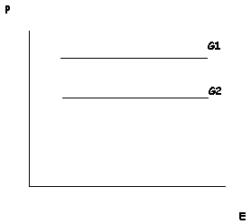
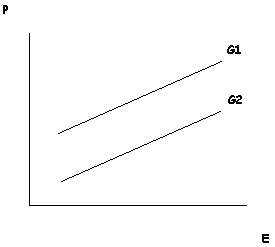
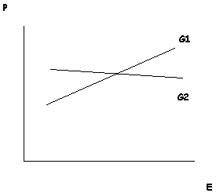
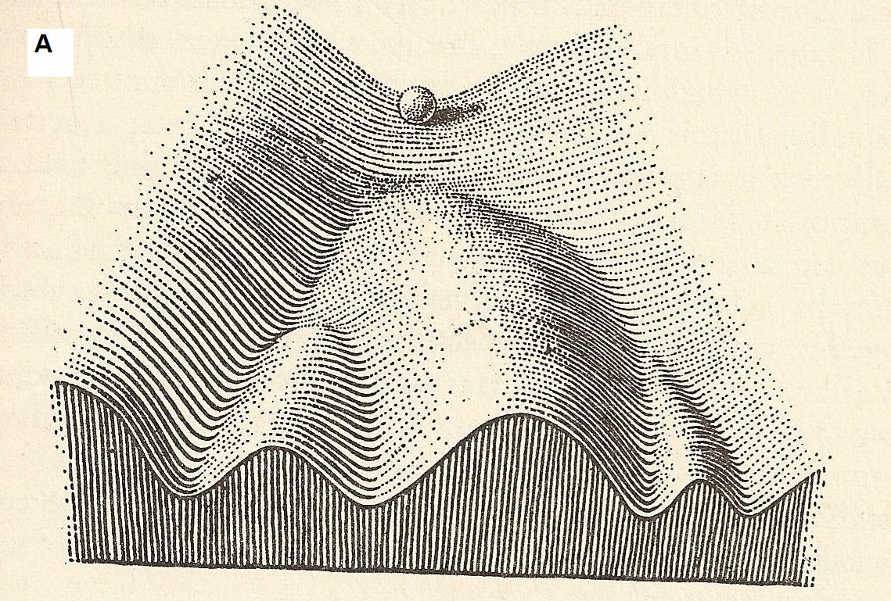
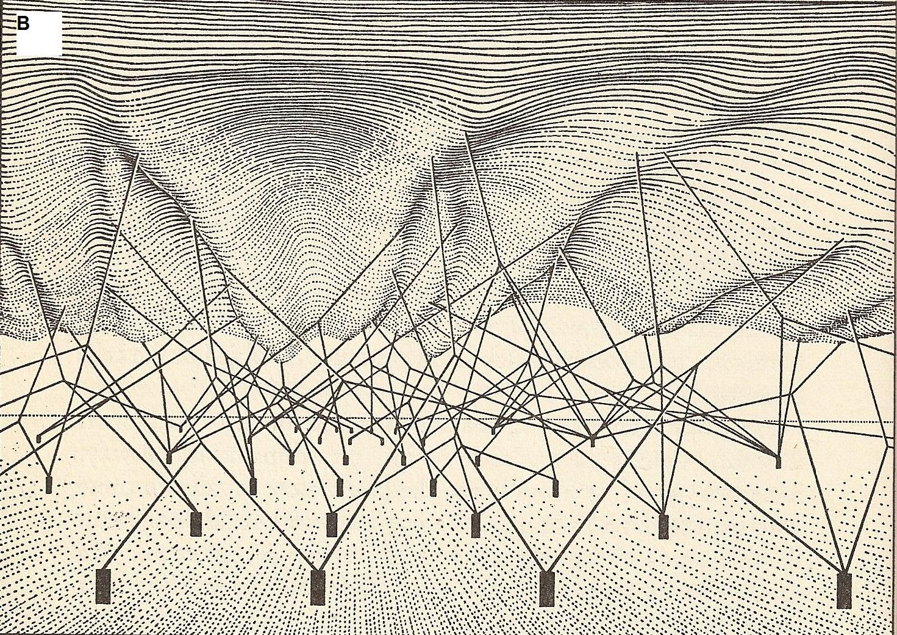

# The Distinction Between Innate and Acquired Characteristics
**First published Tue Aug 4, 2009; substantive revision Thu Mar 17, 2022**

*Griffiths, Paul, Linquist, Stefan*

The idea that some characteristics of an organism are explained by its intrinsic nature, whilst others reflect the influence of the environment is an ancient one. It has even been argued that this distinction is itself part of the evolved psychology of the human species. The distinction played an important role in the history of philosophy as the locus of the dispute between Rationalism and Empiricism discussed in another entry in this encyclopedia. This entry focuses on accounts of the innate/acquired distinction from the mid 19ᵗʰ century to the present. These accounts have for the most part been inspired by the sciences of mind and behavior. Hence, Section 1 focuses on key scientific controversies about the innate/acquired distinction in the behavioral sciences since Darwin. We choose this starting point because the theory of evolution is the inevitable background to any modern discussion of innate behavior. Moreover, Darwin himself pioneered an approach to the study of innate behavior that remains influential even today.

Having outlined these key scientific debates, we then turn to attempts by philosophers to understand those debates. Section 2 considers five alternative diagnoses of why nativism is the subject of so many scientific controversies. The first diagnosis is that scientists simply fail to appreciate the legitimate differences in explanatory emphasis across different sciences. The second diagnosis is that scientists disagree about whether certain cognitive traits are acquired by special (as opposed to general) purpose learning mechanisms. The third diagnosis sees the innateness concept as a disciplinary boundary marker between psychological and biological sciences. The fourth diagnosis claims that scientific debates are the result of a deeply muddled concept which conflates various properties that ought to be distinguished. The fifth diagnosis claims that scientific conceptions of innateness are easily conflated with a deeply unscientific vernacular conception that is grounded in folk essentialism.

Although philosophers disagree about which (if any) of these diagnoses are correct, there is almost universal agreement that our vernacular or “folk” concept of innateness is out of step with recent advances in biology and psychology. Section 3 considers several attempts to revise the vernacular concept of innateness to avoid some of its more obvious scientific pitfalls. One proposal recommends defining a trait as innate insofar is it genetically specified or encoded. Another proposal defines innateness as developmental invariance. A third defines innateness in terms of the biological property of developmental canalization. A fourth revisionist proposal defines innateness as a psychological disposition that is environmentally triggered. Each of these proposals faces shortcomings that are outlined in this entry and which suggest, to some, a very different strategy for the behavioral sciences. Instead of revising the concept of innateness to render it more scientifically accurate, another option is to eliminate the innate/acquired distinction from scientific discourse. Section 3 concludes with a review of of this eliminativist proposal.

Finally, in our conclusion we reflect on how philosophy can hope to advance our understanding of innateness and related concepts, and how this philosophical work relates to the sciences of the mind in which these concepts remain vital and contested.

## 1. Outline of scientific debates over nativism

In human and animal psychology since Darwin there have been a number of periods when the innate/acquired distinction was the subject of heated scientific controversy. This section reviews some of these debates. It provides a sense of how different scientists have conceptualized instinct or innateness, the kinds of evidence marshalled to support nativist hypotheses, and some of the recurring objections that nativist proposals have encountered. In scientific psychology the words “innate” and “instinctive” have been used to refer to the same cluster of properties, “instinct” being a now somewhat antiquated term for an innate psychological trait. Hence, in this section we take older debates over instinct to be about the same set of issues as more recent debates over innateness.

### 1.1 Darwin versus Wallace

Charles Darwin pioneered an approach to the study of instinct that aimed to show, above all, that instincts evolve gradually as adaptations to a species’ environment. Darwin’s theory of instinct was developed in opposition to William Paley, William Kirby, and other influential Natural Theologians (Grinnell 1985; Richards 1981; 1987; Rochowiak 1988)[^grinnell-1985][^richards-1981][^rochowiak-1988]. Paley defined an instinct as “a [behavioral] propensity prior to experience and independent of instruction” (Richards 1981)[^richards-1981]. Examples such as bird migration, nest building, and mating preference seemed, to Paley, not possibly acquired by experience. The best explanation for these instincts was that they are Divinely implanted. Likewise, Kirby viewed animal instincts as a means by which God animates the material world: “if animals lost their instincts, birds would no longer build their nests, or migrate, or learn to fly. Bears would not know when to hibernate, nor salmon when to be driven upstream to spawn; the entire animal kingdom would be thrown into disarray” (Grinnell 1985, 57)[^grinnell-1985]. Like many theologically inspired naturalists at the time, Paley and Kirby drew a sharp distinction between instinctive vs acquired behavior. Since instincts were thought to be designed by God, and thus perfect, there would be no need to supplement or modify them through individual learning.

Darwin offered a naturalistic alternative to the theological account. Marshalling anecdotes from zookeepers, breeders, and his own observations, Darwin presented evidence that instincts adapt to a changing environment. One process by which they evolve is unguided variation and natural selection. However, like many of his contemporaries, Darwin also accepted an alternative “inherited habits” model of instinct evolution. Habits are behaviors that originate as intelligent acts and become increasingly automatic over repeated performances. Although historians disagree about which mechanism Darwin took to be the more significant, it appears that he took both natural selection and inherited habits to be involved in the evolution of instinct. As he explained in *The Origin*, “If we suppose any habitual action to become inherited – and I think that this does sometimes happen – then the resemblance between what originally was a habit and an instinct becomes so close as not to be distinguished” (1859, 187). Darwin’s dual-mechanism view inspired other researchers to explore the relationship between intelligence, habit, and instinct. Of particular note is George Romanes, a protege of Darwin who sought to clarify and elaborate his mentor’s theory of instinct. In his books on animal intelligence, Romanes (1882; 1883) distinguished two types of instinct: *primary instincts* that evolve by a process of natural selection, and *secondary instincts* that evolve by the inheritance of acquired habits.

A noteworthy critic of Darwin’s account of instinct was none other than Alfred Russel Wallace, co-founder of the principle of natural selection. Wallace was notoriously hostile to Darwin’s view of the human mind as the product of selection (Gould 1980)[^gould-1980]. As he asserted in a letter to Charles Lyell,

> Unless Darwin can show me how this rudimentary or latent musical ability in the lowest races can have been developed by survival of the fittest – can have been of use to the individual or race so as to cause those who possessed it in a fractional greater degree than others to win the *struggle for life*, I must believe that some other power caused that development – and so on with every other especially human characteristic. (1869, quoted in (Richards 1987, 183)[^richards-1987] italics in original)

Wallace was critical of Darwin’s claim, defended extensively in *The Descent of Man* (1871) that many human behaviors are grounded in instincts that are shared with other species. In his essay, “On instinct in man and animals,” (1891) Wallace presented alternative explanations for how allegedly instinctive human behaviors might be acquired by learning (Gross 2010)[^gross-2010]. In a paper entitled “The philosophy of birds’ nests”, Wallace argued that Darwin was wrong even about the instinctive basis of animal behavior:

> If instinct means anything, it means the capacity to perform some complex act without teaching or experience. It implies not only innate ideas but innate knowledge of a very definite kind… but in the particular instance of birds’ nests which is usually considered its stronghold, I cannot find a particle of evidence of anything beyond those lower reason and imitative powers which animals are universally permitted to possess. (1891, quoted in Gross 2010, 503)[^gross-2010]

Notice that Wallace understood instincts to involve knowledge “of a very definite kind” that arises without teaching or experience. By contrast, he allowed that animals inherit certain general (i.e. non-specific) cognitive capacities, such as “lower reason” and learning by imitation, but these were not classified as instincts. Instead, Wallace described such general capacities as emanating from the “organization of the nervous system” (Gross 2010)[^gross-2010]. He thought that these mechanisms provide a more plausible explanation for the acquisition of most animal and human behavior than Darwin’s appeal to instinct.

### 1.2 The rise of instinct psychology at the turn of the 20th century

Wallace’s criticisms were overshadowed by Darwin’s popularity and influence. The final decade of the 19ᵗʰ century saw growing scientific interest in the study of instincts, much of it in a Darwinian vein. This was also a period of intense dispute about the nature of instincts. A key point of disagreement concerned the relationship between instinct and habit during development. William James outlined a list of roughly forty human instincts in his *Principles of Psychology*, and famously proclaimed that humans possess more (not fewer) instincts compared to other animals. His list included such eyebrow-raising candidates as “a native impulse in everyone to conceal love affairs”, a “genuine instinct of cleanliness”, and an “instinct of personal isolation, which in women is called coyness” (1890, 393). It is important to understand what James meant when classifying such behaviors as instinctive. For James, the influence of instinct on behavior takes place during early stages of development. As he explained in *Principles of Psychology*, “Most instincts are implanted for the sake of giving rise to habits and… this purpose, once accomplished, the instincts themselves, as such, have no raison d’être in the psychical economy, and consequently fade away” (1890, 398). Thus, to call a behavior “instinctive” meant, for James, that it has a developmental origin in some more basic behavior which itself required no prior experience. After first performance, however, the original behavior is modified by reason, learning, and habit. This developmental model stood in contrast to the more static view of instinct defended by Romanes and others, wherein instincts often remain unmodified by experience into maturity.

A second point of scientific disagreement concerned the evolutionary origin of instincts. The prevailing view, held by Romanes and others, involved the inheritance of acquired habits. “Late-19ᵗʰ century psychologists and intellectuals in general assumed that heredity and environment could not be separated functionally or treated as independent factors, because change induced by the environment would sooner or later (depending on the author) become a part of the organism’s racial heritage” (Cravens and Burnham 1971, 637–38)[^cravens-1971]. This model was fiercely criticized by August Weismann (1891 (1888)), who drew a sharp distinction between germ plasm and soma. On Weismann’s model, the germ plasm (i.e. hereditary material) is sequestered early in development placing it beyond the influence of somatic modifications, including habits or other traits acquired over the life of an organism. In addition, Weismann maintained that selection acts only on traits that emanate directly from the germline (Johnston 1987)[^johnston-1987]. He allowed that some traits are the product of environmental modifications during development. But these, Weismann held, could never become adaptations. Thus, Weismann distinguished hereditary traits, which were under direct control of the germline and could become adapted to the environment, from acquired traits, which were due to arbitrary environmental influences on the soma.

It is noteworthy that Weismann’s views became popular at a time when many behavioral scientists rejected the distinction between innate vs acquired characteristics. Not only James, but also Conwy Lloyd Morgan (1896), Henry Fairfield Osborn (Kemp 1896)[^kemp-1896] and James Mark Baldwin (1896) were developing models of behavioral evolution and development that emphasized an interaction between learned and hereditary factors (Boakes 1984)[^boakes-1984]. These authors followed Weismann in accepting that habits did not become incorporated into heredity as instincts, but sought to explain how it could *appear* that acquired behavior became hereditary through mechanisms later, and dismissively, labelled ‘Baldwin effects’. According to historian Timothy Johnston, Weismann’s popularity explains, “why the dichotomy [between innate vs acquired traits] has been so influential and so long-lived in the twentieth century, despite repeated and quite cogent arguments against it” (1995, 115).

We have just considered two points of disagreement over the nature of instinct that arose in the late 19th century as this concept was gaining in scientific currency. In fact, Morgan (1895) identified a total of seven “definitional” issues surrounding the instinct concept in his day. It is noteworthy, given how fecund the concept of instinct was in motivating scientific research between 1880–1900, that instinct was already being criticised for its ambiguity. Morgan expressed his frustration with this situation in the following, frequently cited passage:

> Instinctive activities are unconscious (Claus), non-mental (Calderwood), incipiently conscious (Spencer), distinguished by the presence of consciousness (Romanes), accompanied by emotions in the mind (Wundt), involve connate ideas and inherited knowledge (Spalding); synonymous with impulsive activities (James), to be distinguished from those involving impulse proper (Hoffding, Marshall); not yet voluntary (Spencer), no longer voluntary (Lewes), never involuntary (Wundt); due to natural selection only (Weismann), to lapsed intelligence (Lewes, Schneider, Wundt), to both (Darwin, Romanes); to be distinguished from individually-acquired habits (Darwin, Romanes, Sully, and others), inclusive thereof (Wundt); at a minimum in man (Darwin, Romanes), at a maximum in man (James); essentially congenital (Romanes), inclusive of individually-acquired modifications through intelligence (Darwin, Romanes, Wallace). (Lloyd Morgan 1895, quoted in Herrnstein 1972, 26)[^herrnstein-1972][^lloyd-1895]

The next two decades saw no decline in psychologists’ interest in instincts. Between 1900 and 1920 over 600 articles and books were published on this topic in the USA and England alone (Cravens 1978)[^cravens-1978]. Many of these publications emulated William James’ work, presenting lists of candidate human and animal instincts. However, these authors often departed from James’ developmental account, viewing instincts instead as emerging fully formed and insensitive to experience. Lists of candidate instincts also varied dramatically, with some authors positing as few as two human instincts and others identifying as many as 110 (L. L. Bernard 1921)[^bernard-1921]. William McDougall’s *Introduction to Social Psychology* (1908) was an attempt to impose rigor to this branch of psychology. McDougall was critical of his fellow instinct theorists, complaining that “[h]undreds of passages might be quoted from contemporary authors, even some of considerable philosophical culture, to illustrate how these two words [‘instinct’ and ‘instinctive’] are used with a minimum of meaning, generally with the effect of disguising from the writer the obscurity and incoherence of his thought” (1908, cited in Herrnstein 1972)[^herrnstein-1972]. McDougall’s solution was to define instincts more precisely as motivational or ‘hormic’ internal states. Specifically, he proposed that instincts are:

> an inherited or innate psycho-physical disposition which determines its possessor to perceive, and to pay attention to, objects of a certain class, to experience an emotional excitement of a particular quality upon perceiving such an object, and to act in regard to it in a particular manner, or, at least, to experience an impulse to such action. (1908, 25)

McDougall went on to posit various learning rules describing how both the perceptual inputs and the behavioral outputs associated with an instinct are modified by experience (Herrnstein 1972)[^herrnstein-1972]. Thus, much like James, McDougall downplayed the distinction between instinctive vs acquired behavior, focusing instead on the developmental interaction between instincts (viewed as motivational states) and other factors such as perception and action. Dewsbury (1993) further notes that, for McDougall, instincts were psychological processes that interacted with perceptions, emotions, and behavioral impulses.

McDougall’s effort to reform the scientific concept of instinct was perhaps too little too late, as his work primarily served as fodder for a group of anti-hereditarian psychologists who emerged in the early 1920s. Three of the most outspoken critics of instinct were Knight Dunlap, Luther Lee Bernard, and Zing-Yang Kuo (Guō Rènyuǎn). Their arguments are worth considering, especially since many of the same objections would be revived two decades later in opposition to the ethological concept of innateness.

### 1.3 Critiques of instinct psychology in the 1920s

One of the first frontal attacks on the concept of instinct was that of social psychologist Knight Dunlap (1919). He contrasted two general approaches to the study of instinct. The “physiological” approach identified each instinct with a distinct neuro-physiological mechanism. Dunlap was in principle supportive of this approach, claiming that it could potentially generate useful definitions of particular instincts. However, Dunlap lamented that, “I am very strongly convinced that it is not at present possible to secure agreement to confine the term to this meaning” (1919, 308). The problem, he thought, stemmed from the prevalence of “teleological” approaches to instinct, of which McDougall was a prime example. On the teleological approach, components of behavior are grouped together as members of a class according to their tendency to generate some functional outcome. Dunlap cited the “moral instinct” and “the instinct for pugnacity” as examples. Dunlap was willing to tolerate this approach provided that “[t]he grouping of activities into ‘instincts’ [is] … clearly understood to be a device of convenience only, similar to the arrangement of documents in a well ordered filing system” (1919, 309). Problems emerge, he thought, when psychologists reified those groupings, regarding them as natural (as opposed to instrumental) categories. Dunlap argued that this tendency encouraged psychologists to draw faulty inferences. For example, “Having posited a ‘pugnacious instinct,’ … one writer proceeds gravely to infer that war is forever a necessity, as the expression of this instinct.” (Dunlap 1919, 309)[^dunlap-1919]. From identifying pugnacity as a natural teleological category, psychologists inferred that it is developmentally fixed. Dunlap recognized that this inference was empirically unwarranted.

Social psychologist Luther Lee Bernard (1921; 1924) also thought that ambiguity in psychologists’ use of “instinct” promoted faulty inferences. As he explained, the typical instinct theorist, “often confuses both himself and the reader by such vagueness of speaking, for he may at one time mean only to emphasize the automatic character of the act and at another he may fall back upon the recognized or approved meaning of the term, implying that automatism is an inherited phenomenon” (1921, 101). In other places, Bernard observed, instinct theorists would take developmental fixity as a sufficient condition for instinct, with “any relatively fixed or definite action pattern being pronounced an instinct whether it is acquired or inherited” (1921, 101). In addition to such inconsistencies, Bernard accused instinct theorists of remaining “untouched by the biological foundations of these sciences… [since] they have failed to grasp the true significance of Mendelian theory for the social and mental sciences” (1921, 103). To illustrate, Bernard cited examples in which instinct theorists would posit the evolution of a species-typical instinct in just a few generations. Such rapid fixation violated basic principles of Mendelian inheritance as Bernard understood them. Bernard envisioned a future for social psychology “the practitioners of which fully recognized that nature and culture could not be separated” (Cravens and Burnham 1971, 654–55)[^cravens-1971].

Perhaps the fiercest critic of the concept of instinct was the Berkeley-educated Chinese psychologist Zing-Yang Kuo (Guō Rènyuǎn) who was dedicated to a Watsonian vision of psychology as an experimental science grounded on behaviorist principles (Honeycutt 2011)[^honeycutt-2011]. Kuo pejoratively referred to instinct theory as “finished psychology” because it discouraged researchers from exploring the potential influences of learning early in an organism’s life. As he explained, “[t]he preconception of instinct has often betrayed the psychologist into overlooking the new environmental factors which are chiefly responsible for the supposedly unlearned acts” (Kuo 1921, 653)[^kuo-1921]. In his earlier writings, Kuo (1921) admitted that certain “hereditary action units” appear early in development and could be classified as instincts, provided that they are viewed merely as developmental resources and not as functional behaviors (Honeycutt 2011)[^honeycutt-2011]. However, this admission inspired critics, such as Geiger (1922), to object that Kuo was implicitly relying on the very concept of instinct which he purported to reject. This prompted Kuo (1924; 1929) to revise his position, ultimately questioning the very distinction between heredity vs acquired traits (Honeycutt 2011)[^honeycutt-2011]. His main argument assumed that in order to identify some behavior as hereditary (as opposed to acquired), it would be necessary to identify three things: (1) some fixed behavioral pattern, (2) the neuro-physiological mechanisms generating that pattern, and (3) a link to specific germ cells responsible for producing that mechanism. Kuo maintained that there simply were no fixed behaviors, let alone ones that could be associated with definite neuromuscular patterns (Honeycutt 2011)[^honeycutt-2011]. At the same time, available embryological evidence (e.g. Carmichael 1925)[^carmichael-1925] revealed that germ cells do not act independently of environmental influences during development. Thus, Kuo concluded that the very idea of a hereditary trait is, ‘‘beyond any experimental approach, and will always remain as an unverifiable abstraction which serves no scientific purpose whatever’’ (Kuo 1929, 195)[^kuo-1929]. A true scientist, Kuo argued, would not be satisfied with *labelling* behavior ‘instinctive’ but would demand a causal analysis of its origin in the embryo, asking ‘How are our Instincts Acquired?’ (Kuo 1922, 344)[^kuo-1922]

Few psychologists went as far as Kuo in rejecting the concept of heredity in psychology (e.g. Tolman 1922)[^tolman-1922]. However, the criticisms of Dunlap, Bernard, Kuo and others led to a rejection of instinct as a legitimate topic of investigation, at least in North America. This occurred in conjunction with the rise of behaviorism and its focus on learning theory as a framework for explaining animal and human behavior.

### 1.4 Ethology and the revival of instinct psychology

Despite its eclipse by behaviorism in North America, the study of instinct was rehabilitated in Europe on either side of World War Two by the founders of ethology, Konrad Lorenz and Niko Tinbergen (Tinbergen 1942; 1951; Lorenz 1957 (1937); Lorenz and Tinbergen 1957 (1938)). Ethology was a Darwinian approach to behavior and the direct ancestor of today’s behavioral ecology and sociobiology. It treated an organism’s behavior as simply one more evolved characteristic alongside its skeleton and its digestive system. Innate behavior was thought to be composed of identifiable units – ‘fixed action patterns’ – whose evolution could be studied like that of a bone by comparing the different form taken by the same (homologous) behavior in different species. The evolutionary relationships of birds, for example, were thought by the early ethologists to be reflected in similarities and differences in their courtship rituals as reliably as in similarities and differences in their bones.

In their early work, Lorenz and Tinbergen drew a sharp distinction between innate vs acquired behavior. An innate behavior was thought to be, (1) stereotyped or constant in form, (2) species-typical, (3) capable of developing in socially isolated animals, and (4) capable of developing “fully formed” in animals which had been deprived of opportunities to practice it (Lehrman 1953)[^lehrman-1953]. Early ethologists placed considerable emphasis on the ‘deprivation experiment’ as a method for distinguishing innate from acquired behaviors. These experiments involved raising an animal without the opportunity to learn a behavior and then testing to see if it can perform the behavior when provided with an appropriate stimulus. A songbird, for example, can be raised from egg to adult without hearing a member of its own species sing, and tested to see which song it produces the following spring. If it produces the typical song of its own species, then the song was deemed innate. For more on Lorenz and Tinbergen’s ideas about instinct, see (Richards 1974; Griffiths 2004; Brigandt 2005; Browne 2005; Burkhardt 2005)[^brigandt-2005][^browne-2005][^burkhardt-2005][^griffiths-2004][^richards-1974].

The idea of instinct in classical ethology was strongly criticized by several North American psychologists including Theodore C. Schneirla (1952; 1963; 1966), Howard Moltz (1960; 1965), and most famously by Schneirla’s student Daniel S. Lehrman in ‘A critique of Konrad Lorenz’s theory of instinctive behavior’ (1953). Lehrman objected to ethologists’ resurrection of the innateness concept on both empirical and theoretical grounds. Empirically, Lehrman documented the role of environmental factors in the development of species-typical behavior patterns, drawing on many existing studies, including some by Kuo. These experiments revealed that certain prototypical fixed action patterns depend on environmental feedback for their development. This is true despite the fact that such behaviors are species-typical and present in animals that were raised in isolation. For Lehrman, such evidence undermined the attempt to distinguish innate from acquired behavior:

> in each case, analysis of the developmental process involved shows that the behavior patterns concerned are not unitary, autonomously developing things, but rather that they emerge ontogenetically in complex ways from the previously developed organization of the organism in a given setting. (Lehrman 1953, 343)[^lehrman-1953]

Lehrman was particularly critical of the use of the deprivation experiment to infer that a certain trait is innate *simpliciter*, rather than merely that the factors controlled for in the experiment are not needed for the development of that trait.

Many of Lehrman’s ideas were incorporated into mainstream ethological theory. By the 1960s Tinbergen regarded the use of the term ‘innate’ to characterize behaviors as “heuristically harmful” (Tinbergen 1963, 425)[^tinbergen-1963] and endorsed Lehrman’s critique of the deprivation experiment: “The conclusion can only be formulated correctly in negative terms, in describing which environmental aspect was shown *not* to be influential” (Tinbergen 1963, 424)[^tinbergen-1963]. In the same period Tinbergen and his students shifted the focus of their research from behaviors as stable taxonomic characters to behaviors as adaptations shaped by the ecological demands of the environment (Burkhardt 2005)[^burkhardt-2005]. Determining the extent to which behavior develops independently of the environment ceased to be important to the Tinbergen school, or to the new discipline of behavioral ecology in which students of Tinbergen like Richard Dawkins played such a prominent role. Interest turned instead to testing population genetic and game theoretic models of behavioral evolution.

Lorenz responded to his critics with a revised account of the innate/acquired distinction (Lorenz 1965; see also Browne 2005)[^browne-2005][^lorenz-1965]. No trait is innate in itself, but “certain parts of the information which underly the adaptedness of the whole, and which can be ascertained by the deprivation experiment, are indeed innate” (Lorenz 1965, 40)[^lorenz-1965]. A trait is innate insofar as its development is guided by ‘inherited information’ rather than ‘environmental information.’ Lorenz defined ‘information’ in terms of adaptation. An adaptive trait ‘fits’ its environment and hence can be said to contain information about that environment just as a key can be said to contain information about the lock it will open. The question is where that information comes from – how does the organism ‘know’ about its environment? If a woman has calluses on her palms rather than on the backs of her hands, this represents information about where her skin gets rubbed most. If she were *born* with calluses on her palms, as ostriches are born with calluses that match pressure points on their legs, this would imply advance ‘knowledge’ of where her skin is going to be rubbed most. Such anticipatory information, Lorenz argued, must be in the genome. It is in the genome as a result of natural selection, which can be seen as a form of trial-and-error learning.

Lorenz’s analysis can readily be expressed in information-theoretic terms, with the environment as the signal source and the organism as the receiver. Organisms need to reduce their uncertainty about what demands the environment will place on them and to develop in a way that meets those demands. There are two ways to do this. The first way is to gather information about the environment during development. The water flea *Daphnia pulex* monitors chemical traces of predators as it develops. If an individual flea detects evidence that predators are present, then that flea grows defensive armor. Thus, a flea’s possession or lack of defensive armour reflects environmental information. The alternative is to inherit information from your ancestors. The human sickle cell allele has harmful effects in homozygotes and survives in a population only because it confers resistance to malaria in heterozygotes. Hence the fact that an individual carries the allele provides information about the prevalence of malaria in the ancestral environment and thus, probably, in the environment of the organism which inherits the allele. The sickle cell allele can thus be seen as passing on information about the environment which was ‘learnt’ by ancestors through natural selection. To the extent that the functional adjustment of a trait to its environment is explained by ‘inherited information’ of this kind, Lorenz argued, the trait is innate. Hence, albeit in a very different way from Tinbergen, Lorenz also came to see whether a behavior is an adaptation as the key issue.

### 1.5 Nativism and the study of language acquisition

Classical ethology flourished in the years immediately following World War Two (Burkhardt 2005)[^burkhardt-2005]. At the same time others started to question the emphasis on environmental factors in behavioral development which had developed between the wars in the wake of the behaviorist revolution in psychology. Numerous lines of evidence suggested that psychology would have to take account of species-specific biological endowments if it was to understand how different species interact with their environment and the distinctive things each species is able to learn from these interactions (e.g. Harlow 1953; Tomkins 1962; Seligman 1970)[^harlow-1953][^seligman-1970][^tomkins-1962]. By far the most influential criticism of behaviorism, however, came from linguistics. The linguist Noam Chomsky argued that existing behaviorist accounts of the development of language were unworkable and offered a general argument for the conclusion that the ability to acquire language is innate (Chomsky 1957; 1959; 1966)[^chomsky-1957]. According to this ‘poverty of the stimulus’ argument, the examples of speech to which children are exposed do not contain enough evidence to settle which utterances are grammatical in the language they are trying to acquire. Nevertheless, children reliably acquire the grammar of their native language. Therefore, Chomsky and his followers concluded, children must have innate knowledge about grammar which supplements the evidence to which they are exposed during development. If this argument is sound, every normal childhood is a deprivation experiment that confirms the innateness of grammar. The details of the original poverty of the stimulus argument, its elaboration by Chomsky’s followers, and the current state of the evidence for linguistic nativism are discussed in detail in the entry Innateness and Language. What matters for current purposes is that Chomsky’s work produced a very broad consensus in psychology that language acquisition is explained by a complex, evolved mechanism that is present at birth and which can produce normal linguistic development in a wide range of environments, including those which are ‘impoverished’ with respect to language.

The ‘language acquisition device’ has served as an exemplar for research on whether other psychological and behavioral traits are innate. Like the language acquisition device these putatively innate traits are supposed to explain patterns in the development of the child’s mind. These patterns can be seen as representing innate ‘knowledge’ or innate ‘theories’ about various cognitive domains. For example, the eminent cognitive developmental psychologists Susan Carey and Elizabeth Spelke argue that children possess four domains of innate ‘core knowledge’ which underlie much of their later cognitive development. These domains are ‘objects, agents, numbers and space’ (Carey and Spelke 1996, 517)[^carey-1996]. Children think about each of these four domains in distinctive ways that do not seem to depend on the details of the child’s environment. The distinctive way in which children think about living, as opposed to inanimate, entities has also been proposed as a domain of innate knowledge (e.g. Medin and Atran 2004)[^medin-2004]. The recent philosophical literature on the concept of innateness which is outlined in later sections of this entry is mostly intended to analyse innateness as it is understood in this extensive body of ‘neo-nativist’ psychology. The topic of innateness in language is covered separately. For a thorough introduction to this field and the controversies arising from it, also see (Carruthers, et al. 2005; 2007a; 2007b)[^carruthers-2005].

### 1.6 Historical patterns

This historical overview of scientific debates over nativism reveals a few general patterns. One is that there has never been an agreed scientific definition of an “instinctive” or “innate” trait. During the late 19ᵗʰ century C.L. Morgan noted the proliferation of different definitions of instinct and criticized his contemporaries for their sloppy use of language. The same criticisms are echoed in the work of Dunlap, Bernard, and Kuo, who all complained that imprecision in the definition of “instinct” led researchers to draw faulty inferences. Lehrman and other critics of the ethological revival of instinct likewise complained that this concept lacked scientific precision.

A second general pattern is that such ambiguity was no barrier to the sheer volume of studies claiming to identify instincts. Indeed, it might even be the case that lack of precision in the meaning of this term fostered the growth of the instinct industry in late 19ᵗʰ and early 20ᵗʰ century. A third general pattern is the persistent complaint that instinct theorists ignore early or subtle opportunities for learning. Wallace criticized Darwin for failing to consider the influence of experience in early development. The same objection can be found in Kuo’s criticism of instinct theory. Lehrman and his fellow critics likewise noted the failure of ethologists to consider possible influences of experience on development.

Despite this troubled scientific history, versions of nativism continue to appear in psychology. In this century, Evolutionary Psychology has resuscitated a brand of nativism that is strikingly reminiscent of the instinct psychology that prevailed in the wake of Darwin and James (Hampton 2004)[^hampton-2004]. Part of what makes the recurrence of nativism philosophically interesting is that many scientists have noted that the innate/acquired distinction is ultimately a false dichotomy (Kitcher 2001)[^kitcher-2001]. All traits are influenced in their development by both environmental and genetic factors. Weismann’s insistence on the distinction aside, it is a mistake to classify traits as emanating either from the germ line or the environment. Moreover, ever since Baldwin (1896) it has been thought that complex behavioral adaptations can conceivably become fixed in a population by a process that relies heavily on experience. What then explains the persistence of the innate/acquired distinction in psychology? The following section reviews recent attempts by philosophers to identify what is at issue in disagreements over the meaning and utility of nativism in psychology and biology.

## 2. Philosophical diagnoses of the scientific debates

The previous section reviewed some of the arguments raised by scientists about the nature of instinct or innateness and the questionable scientific utility of this concept. In this section, we consider some recent proposals by philosophers to capture what is at issue in these debates. These philosophical diagnoses vary considerably, not only in their understanding of what is at issue, but also in their methods. As we will see, this is one of the topics on which an ‘experimental philosophy’ (X-phi) approach has been put to productive use (see SEP entry on this topic). What follows is a review of five different philosophical hypotheses about what is at issue in scientific debates over nativism.

### 2.1 A matter of explanatory emphasis

One possible reason for the persistence of scientific debates over nativism is that researchers approach psychological development with different explanatory interests. This idea was defended by Peter Godfrey-Smith (1996), who distinguished between “externalist” and “internalist” modes of explanation in biology generally. Externalists “explain properties of organic systems in terms of properties of their environments”; whereas internalists explain, “one set of organic properties in terms of the other internal or intrinsic properties of the organic system” (1996, 30 quoted in Cowie 1998, 16)[^cowie-1998]. Nativism can be viewed as an internalist mode of explanation in that it focuses on internal (e.g. genetic) contributions to development while setting aside environmental influences. Conversely, anti-nativists like Kuo or Lehrman focus on certain “external” (e.g. environmental) factors. On this view, the two approaches are not in conflict. Ultimately, it comes down to the interests of an investigator where to place explanatory emphasis.

If this analysis is correct, then the resolution of debates over nativism should be straightforward. It should be sufficient to point out that the two perspectives are complementary: that both “internal” and “external” factors contribute to development. The problem with this analysis, however, is that it threatens to trivialize the debate. Could it really be the case that such intellectual heavyweights as Lorenz and Lehrman were engaged in nothing more than a verbal dispute? Fiona Cowie (1998), for one, sees this as a red flag. Although verbal disputes are not unheard of in science and philosophy it is uncharitable to assume that all historical debates over nativism can be understood so simplistically. As Cowie puts it, “[v]iewing nativists and empiricists as quarreling merely over how ‘important’ the various factors in belief and concept acquisition are can incline us to see their dispute as insubstantial” (1998, 22). We are well advised, she argues, to search for more substantial stakes in these debates.

More recently, James Tabery (2014) has developed an account of the “interaction debates” (as he calls them) which also places explanatory interests at the center of the disagreement. Tabery identifies two general scientific approaches to the interaction between nature and nurture. So called “variation partitioners” understand interaction in statistical terms. Their explanatory aim is to identify the amount of actual variation exhibited by some phenotype that can be attributed to additive genetic variance and environmental factors, respectively. A sharp distinction between innate versus acquired traits is central to this approach. By contrast, Tabery’s “mechanism elucidators” are primarily interested in describing the developmental mechanisms generating particular phenotypes. These researchers understand “interaction” in causal terms and tend to see little value in a sharp innate/acquired distinction.

Philosophers Slobodan Perovic and Ljiljana Radenovic (2011) have also suggested that nativism/empiricism controversies might be dissolved by identifying the different explanatory interests of the disputants. They focus on the dispute between neo-nativist psychologists who see themselves as heirs to Chomsky’s linguistic nativism (Section 1.5) and the intellectual descendants of anti-nativist developmental psychologists (Section 2.4) who believe that the distinction between innate and acquired behavior is meaningless and that explaining outcomes of development by calling them ‘innate’ is scientifically vacuous (e.g. Oyama 1985; Ford and Lerner 1992; Michel and Moore 1995)[^ford-1992][^michel-1995][^oyama-1985]. According to Perovic & Radenovic these anti-nativists or ‘developmental systems theorists’ target neo-nativist claims about the pattern of gene-environment interaction in the development of cognition and behavior. Neo-nativists claim that the pattern is maturational, with genes as specific causes and environmental factors as merely “permissive” causes (Holtzer 1968)[^holtzer-1968]. This is a fundamentally internalist form of explanation, with external, environmental factors as mere background conditions and internal, genetic factors doing the real explanatory work. However, while neo-nativist psychologists do make such claims, they do not typically examine the developmental genetics of the traits which they claim are ‘innate’ (Gary Marcus (2004) is one important exception). Instead, their research examines specific stages in psychological development, often well into the life of the individual, and specific environmental factors which might be thought to influence development at those stages. Their experiments aim to show that the developmental outcome at such a stage is not specifically influenced by the details of the environment, but instead follows a pathway determined by internal cognitive structures. In one famous body of research, children make an ‘intellectual breakthrough’ at around age four when they come to properly understand the whole body of kinship terms in their local language, rather than treating categories like ‘uncle’ as defined by the pattern of resemblance between uncles (Keil 1989)[^keil-1989]. The fact that this happens all at once, at around the same age, and despite a great deal of variation in the specific kinship systems that children are learning, supports the view that this transition is the result of an internal, maturational change. While an environment of kinship structures and kinship terms is needed, it functions as a merely permissive or background condition. The explanatory work is done by the internal factors.

Perovic & Radenovic (2011) point out that this claim about the causal structure of development in a particular, late developmental stage is entirely compatible with the strongly interactionist view of how genes and environment build the brain favoured by developmental systems theorists. They suggest that neo-nativism is primarily concerned to show that how organisms respond to their environments depends strongly on cognitive structure that is in place before the organism encounters that environment. Conversely, anti-nativists are primarily concerned to show that environments often play a specific, instructive role in the development of cognitive structures. Since the two schools do such different research, the latter primarily focused on human development post-partum and well into childhood, and the former on early development, often in animal models for reasons of ethical and experimental tractability, there is considerable scope for accounts of psychological development that draw on both perspectives at different stages of development. So, once again, on this account disputes about nativism are fundamentally a reflection of scientists different explanatory interests.

### 2.2 Special-purpose faculties and the limits of empiricist science

The question, “what are nativism debates about?” has been carefully analyzed by Fiona Cowie (1998), who distinguishes two arguments historically deployed in defense of nativism. *Poverty of the stimulus arguments* claim that the environment lacks sufficient information for an organism to learn some belief, cognitive disposition, or behavior. If an individual nonetheless acquires that cognitive trait, then the process must have involved some amount of “innate” information. A second type of argument, which Cowie (1998) calls *impossibility arguments*, claim that certain traits must be innate not because the environment is impoverished, but rather because scientific accounts of the acquisition process are doomed to failure. This distinction leads Cowie (1998) to propose two fundamental disagreements underlying debates over nativism. The “special faculties” debate concerns the basic architecture of the mind. Nativists posit special-purpose learning faculties to explain acquisition, whereas anti-nativists explain acquisition in terms of domain general learning. The “mystery” debate, however, turns on a skeptical claim about the limits of scientific explanation. As Cowie explains:

> Impossibility arguments… work to undermine the empiricist assumption that the processes underpinning our acquisition of ideas and beliefs are simply a species of natural phenomena, amenable at least in principle to natural scientific explanation. (1998, 50)

Cowie is describing an extremely strong form of anti-empiricist skepticism. When directed at the explanatory prospects of science in general it is unlikely that this brand of nativism will be appealing to naturalistic philosophers or scientists. However, skepticism of this kind may be directed at specific scientific theories or explanatory frameworks. Cowie (1998) discusses Jerry Fodor’s (1975; 1981) peculiar-sounding hypothesis that most concepts – e.g. our concept of a doorknob – are innate. On Cowie’s reading, Fodor is offering an impossibility argument: concept acquisition cannot *in principle* be explained by an empiricist model of associative learning. The following section (2.3) looks more closely at psychological primitivism, a more developed version of Cowie’s mystery hypothesis. The remainder of this section focuses on the special-faculties hypothesis.

Cowie (1998; 2009) acknowledges a limitation of the special-faculties hypothesis. It applies only to debates in *psychology* over the kinds of learning process underlying the acquisition of beliefs or behaviors. This is a problem because disputes about nativism are not confined to psychology. For instance, we saw in the previous section that Weismann (1891 (1888)) drew a sharp distinction between hereditary versus acquired traits generally. The special faculties hypothesis apparently cannot explain such non-psychological disputes.

One potential way of rescuing the special-faculties hypothesis is to underscore the difference between nativism in psychology compared to innateness hypotheses in other disciplines, such as biology. Richard Samuels (2002), who does not defend the special-faculties hypothesis, nonetheless maintains that innateness is a distinctively psychological concept. According to Samuels, to identify some trait as innate means above all that it is unlearned, and to identify some trait as learned implies that it is not innate. Samuels (2002) calls this the *fundamental conceptual constraint* on any analysis of innateness. If Samuels is correct on this point, such that questions about nativism are ultimately about the presence/absence of learning, then it is no shortcoming of the special-faculties hypothesis that it focuses on psychological traits. One noteworthy difference between Cowie’s special-faculties hypothesis and Samuels’ fundamental constraint is that the former distinguishes among learning “mechanisms” (general vs special purpose), whereas the latter distinguishes more broadly between learned versus unlearned traits.

### 2.3 Innateness as a psychological primitive

Richard Samuels (1998; 2002; 2004; 2007) has developed a version of Cowie’s mystery hypothesis called psychological primitivism. On this view, that a belief or behavior is ‘innate’ means that it serves as an explanatory primitive for psychological science. An explanatory primitive is a concept that is deployed by a discipline to explain certain phenomena, but which cannot in principle be explained by that discipline. Samuels maintains that there is a sharp explanatory boundary between psychology and other fields. A necessary condition for any psychological explanation, he claims, is that it apply to the whole organism and not to a specific (sub-personal) component (Samuels 1998)[^samuels-1998]. This condition excludes many explanations couched in neurobiological terms, because they apply to sub-personal components and not to the organism as a whole. However, there are other predicates that apply to the whole organism and yet do not qualify as psychological (e.g being a carnivore). So, the personal/sub-personal distinction is not sufficient for marking the boundary that Samuels wants to draw. As a result it is not entirely clear how to draw the line between psychological and non-psychological phenomena. Samuels examples of psychological explanations feature processes such as conditioning, perception, and inference; whereas neurological and hormonal explanations purportedly fall outside psychology (Samuels 1998; 2002; 2004)[^samuels-1998]. Some authors criticize Samuels’ primitivism on the grounds that this sharp distinction between psychology and other sciences does not exist (Gross and Rey 2012; Linquist 2018)[^gross-2012][^linquist-2018]. For example, psychological explanations of depression and anxiety cite both intentional states and sub-personal processes as components of the same mechanism. The issue of how psychological explanations are related to biological explanations is one of the most pressing questions in the philosophy of cognitive science and has recently been explored in the context of debates over mechanistic explanation (see Gaj 2016; Milkowski, et al. 2019 for reviews)[^gaj-2016][^milkowski-2019].

A further problem with Samuels’s primitivism is that some “biological” (i.e. not psychologically explainable) events can have pronounced psychological effects over an individual’s lifetime. For example, someone who undergoes brain trauma or suffers from the overuse of pharmaceuticals might thereby acquire certain beliefs or behaviors. Phineas Gage, the 19ᵗʰ century railroad worker who became famous for surviving a massive brain injury, is reported to have acquired several new personality traits after an iron rod pierced his prefrontal cortex (Twomey 2010)[^twomey-2010]. Samuels worries that according to primitivism such traits would be innate since they cannot, by hypothesis, be explained in psychological terms. He worries that this would be highly counterintuitive.

To avoid such implications, Samuels shores up his proposal with a proviso: a psychological structure is innate just in case it is psychologically primitive and it *would develop under normal conditions for a member of the species*. This move has prompted some philosophers to generate further counterexamples of acquired traits that are psychologically unexplainable but nonetheless emerge under “normal” conditions (e.g. Khalidi 2007)[^khalidi-2007]. A deeper question, however, concerns the very notion of a “normal” developmental environment. Spelling out this idea is no easy matter. Presumably, a necessary condition for some environment to qualify as normal for a species is that it was encountered ancestrally. But this raises the twin problems of how far back in time is relevant, and how can we classify environments as types. Samuels argues that these problems plague any discipline that appeals to the notion of a normal environment and are thus not unique to psychology. However, it remains an open question whether the concept of normal environment can made coherent. We return to this issue in Section 3.4 (below).

### 2.4 I-properties and the clutter hypothesis

As we discussed in Section 1, for more than 150 years there has been disagreement over how to define instinctive (or innate) traits in a way that is useful to scientific psychology. Shortly after instinct had become a topic of scientific study, C.L. Morgan (1896) identified seven “definitional” issues surrounding this term. Two decades later, criticisms by Knight Dunlap (1919) and L.L. Bernard (1921) reveal that those ambiguities had not been resolved. It is also telling that Lorenz continued to modify his definition of innateness in response to critics over the course of his career, while Tinbergen eventually abandoned this term altogether. More recently, behavioral biologist Patrick Bateson has observed that, “[a]t least six meanings are attached to the term [innate]: present at birth; a behavioral difference caused by a genetic difference; adapted over the course of evolution; unchanging throughout development; shared by all members of a species; and not learned” (1991, 21). His objection is not merely that the term “innate” is ambiguous. Like Dunlap (1919) and Bernard (1921), his complaint is that ambiguity promotes equivocation, encouraging researchers to draw faulty inferences as they slide between different senses of innateness. For example, if a trait is deemed “innate” because there is evidence that it is present at birth, psychologists will sometimes infer (without further evidence) that it is therefore “innate” in the sense of being insensitive to environmental influence. Developmental biologists since Kuo (1921) have provided evidence against this easy inference. Bateson’s own work on the phenomenon of parental imprinting in birds (Bateson, 1966)[^bateson-1966] showed that traits which appear early in life are often highly sensitive to specific environmental factors. The tendency for nativism to promote such unwarranted inferences has been one of the main reasons why many scientists have called for dramatic revision or even an elimination of this concept from scientific discourse (see Section 4.5 of this entry).

Paul Griffiths (2002) has clarified what is ontologically at stake in this objection to nativism. Researchers who draw questionable inferences about the properties associated with innateness are assuming (implicitly, if not explicitly) that innateness is a natural kind. More specifically, they assume that innate traits form what Richard Boyd (1989) called a *homeostatic property cluster*. Such property clusters require the existence of some causal process that “holds together” the relevant properties in a coherent bundle, so to speak. For example, Weismann assumed that the only way for a trait to be modified by natural selection is if it develops “directly” from germline cells. He also assumed that germline cells were the only possible source of developmental stability since environmental factors were seen exclusively as a source of developmental noise (Johnston 1995)[^johnston-1995]. Thus, on Weismann’s picture, the properties of being an adaptation and being developmentally stable were a part of the same homeostatic cluster. It turns out that Weismann’s picture of development was too narrow. The environment is much more than just a source of noise. Certain environmental factors are a source of developmental stability (West-Eberhard 2003)[^west-eberhard-2003], acting as a “scaffold” for the development of particular traits (Sterelny 2003)[^sterelny-2003]. The environment can also store information that organisms rely on during development to generate adaptive phenotypes (Mameli 2004)[^mameli-2004]. So, contra Weismann, there is no distinct causal process associated with germline cells that accounts for developmental stability and adaptation. Without a known process to unify the various properties associated with innateness, Griffiths (2002) argues, the assumption that they form a homeostatic cluster is unwarranted.

This position was developed in Bateson’s later work with philosopher Matteo Mameli (Mameli and Bateson 2006; 2011; Bateson and Mameli 2007)[^bateson-2007][^mameli-2006]. Expanding on Bateson’s (1991) original list, they identify a total of twenty-six candidate definitions of innateness in the scientific and philosophical literature (Mameli and Bateson 2006)[^mameli-2006]. Many of these proposals are deemed unsatisfactory because “they appeal to unclear, unexplained, or controversial notions such as ‘genetic information’, ‘learning’, ‘developmental induction’, and ‘normal development’” (2006, 176). Other candidate definitions are rejected by Mameli and Bateson because they fail to pick out any trait whatsoever. For instance, no trait is (strictly speaking) genetically determined or unacquired. Other candidates are rejected because they apply to all possible traits. For example, every trait is (to some degree) genetically influenced or insensitive to the environment. By the end of their analysis, Mameli and Bateson arrive at a shortlist of just eight candidates. These “i-properties” (as they call them) are relatively promising definitions in that they suffer from no obvious conceptual or empirical shortcoming. Their shortlist of candidate definitions for “innate” are as follows:

1. It appears reliably at a particular stage of the lifecycle.
2. It develops abnormally in response to environmental manipulations which were not encountered in the organism’s evolutionary history.
3. It is not produced by a developmental mechanism that evolved to generate different phenotypes in response to particular environmental conditions (i.e., adaptive phenotypic plasticity), and it is also not the result of exposure to abnormal environmental conditions.
4. Any modification to the trait would have a negative impact on the development of other traits (the ‘generatively entrenchment’ of Schank and Wimsatt 1986)[^schank-1986].
5. It is insensitive to certain environmental changes during development.
6. It is insensitive to certain environmental changes after development.
7. The trait is species typical.
8. The trait is a standard Darwinian adaptation.

Mameli and Bateson maintain that it is an empirical question whether any of these properties cluster together. Moreover, they propose that in the absence of a known unifying causal process, we should not assume that they do cluster. Mameli (2008) has dubbed this the “clutter hypothesis” (in contrast to “cluster hypothesis”). Their work has inspired some recent philosophical discussion over which hypothesis (clutter or cluster) is best supported by available evidence and theory. For instance, Nicholas Shea (2012) argues that recent developments in evolutionary and developmental biology suggest that i-properties do not cluster. In contrast, Muhammad Ali Khalidi (2016) argues that innateness properties *do* cluster provided that we focus strictly on psychology and not biology (assuming that such a distinction can be drawn). This question remains an important area for future research.

Although the clutter hypothesis captures what is ontologically at stake in debates over nativism, it does not explain why the associated conceptual confusion has been so difficult to resolve. Admittedly, ambiguities are by no means unknown to science (Cowie 2009; Samuels 2007)[^cowie-2009][^samuels-2007]. However, the tenacity of nativism debates in psychology seems unusual. One might reasonably expect that psychologists would have, by now, disambiguated this concept and developed experimental criteria for detecting specific i-properties. Such questions as whether a trait is present at birth, a functional adaptation, developmentally sensitive to some environmental factor, and so on should be regarded by psychologists as independent research hypotheses (Griffiths 2002)[^griffiths-2002]. On the contrary, there is a stubborn tendency to conflate these issues by simply asking whether some trait is “innate.” Even among researchers who acknowledge on the one hand that “innate” is a multiply ambiguous term will, in other contexts, slide between different i-properties apparently without realizing it (Linquist et al. 2011)[^linquist-2011]. Such observations have prompted a number of recent questionnaire experiments, conducted largely by philosophers, analyzing the “folk” concept of innateness and comparing it to scientific conceptions.

### 2.5 Folk essentialism and the psychological attraction of nativism

Griffiths (2002) offered a testable psychological hypothesis to explain the recalcitrance of nativism in psychology and potentially other disciplines. The basic idea is that the concept of innateness is a cornerstone of “folk biology” (Medin and Atran 1999; 2004)[^medin-1999], the pre-theoretical beliefs that people intuitively use to understand biological systems. Part of folk biology involves the classification of organisms into species-like groupings. These classifications sometimes overlap with scientific classifications, but often they diverge. For example, a folk biological classification might identify horses, roses, and octopuses as species-like groupings, when in fact each of these biological categories contain numerous species, some of which are morphologically and phylogenetically disparate.

Folk biology also departs from scientific classification in its essentialist commitments. Across a wide range of cultures, people tend to assume that members of each species possess a common essence or causal nature that determines their appearance, behavior, and ecological roles (Medin and Atran 2004)[^medin-2004]. Psychologists have found that even when people have no specific ideas about the nature of a particular species, they nonetheless assume that it must have an essence (i.e. they operate with what Medin and Ortony (1989) call an “essence placeholder”). It is plausible that folk essentialism has served our species well for most of its history. Medin and Atran (2004) propose that the existence of an essence placeholder might have motivated people to explore their environments, leading them to discover and share information about edible or medicinal plants, about dangerous plants and animals, and other salient aspects of the environment. The idea of an essence might also have assisted humans in tasks associated with agriculture and animal husbandry. Despite its utility, however, essentialism is scientifically inaccurate. No internal essence explains why members of a species share certain traits. Although genetic similarities account for some of the traits that are typical of a species, it is misleading to think of a species’ genome as its essence. Elliott Sober (1980) provides a detailed account of what is wrong with this idea. Essentialism, he notes, employs a Natural State Model of explanation which views every member of a species as directed toward a single developmental outcome (natural state). Essentialists recognize that individuals vary in the characteristics they actually express. However, such variability is explained according to essentialism by positing the effects of intervening forces that interrupt development and prevent the full realization of its goal. The reason that individuals of the same sex differ in their sexual preference, on this view, is because of slightly different environmental factors impinging on the development of these individuals. By contrast, on a neo-Darwinian model there is no natural state. Individual variability is partly explained in terms of genetic variation passed on from one generation to the next. Moreover, even given a specific genetic starting point, development is not aiming at some specific, natural state, but simply goes wherever local causes push it. The interaction between genetic and environmental factors is most accurately represented as a norm of reaction (see Section 3.2 below), where a spectrum of developmental outcomes is associated with each unique genotype in a population of genetically variable individuals. This neo-Darwinian perspective requires a fairly dramatic shift in conventional thinking about species. As Atran et al. (2002, 32) put it, “to understand modern biological science, people must *unlearn* universal dispositions to view species essentialistically”.

Griffiths (2002) hypothesized that folk essentialism might be exerting an influence even on scientists’ and philosophers’ professional judgments about innateness. More precisely, the hypothesis states that (1) there is a “folk” or vernacular concept of innateness that most people operate with in non-technical contexts, (2) this vernacular concept is incompatible with scientific developments in such fields as evolutionary and developmental biology, and (3) that researchers working in psychology and perhaps other disciplines will employ the vernacular concept of innateness (often inadvertently) even when reasoning in a scientific context. Machery et al. (2019) have more recently dubbed this the “attractor hypothesis” of innateness, because of its similarity to the idea of a psychological attractor in cultural evolution (Sperber 1996; Claidière and Sperber 2007)[^claidière-2007][^sperber-1996]. An implication of the attractor hypothesis of innateness is that the concept of an innate trait will be highly resistant to scientific revision. Despite attempts to refine the concept, researchers will continue to default to the vernacular concept, the theory goes, and draw faulty inferences despite their efforts to avoid equivocation. Griffiths (2002) draws the normative conclusion that the concept of innateness should be self-consciously eliminated from scientific discourse. This proposal will be discussed below (Section 3.5). The remainder of this subsection discusses recent experimental evidence surrounding the attractor hypothesis of innateness.

Philosophers have devised a number of questionnaire studies exploring the structure of the vernacular concept of innateness (Griffiths, et al. 2009; Linquist et al. 2011; Knobe and Samuels 2013)[^griffiths-2009][^knobe-2013][^linquist-2011] and whether the vernacular concept features in scientists’ judgments about innateness (Knobe and Samuels 2013; Machery et al. 2019)[^knobe-2013][^machery-2019]. Drawing again from the psychological literature on folk biology, Griffiths et al. (2009) identified three features that are thought to be central to the vernacular concept of innateness:

- Fixity: Innate traits are insensitive to environmental influences during development.
- Typicality: Innate traits are shared by most adult members of the same species or sex.
- Function: Innate traits serve some purpose or end for the organism.

The authors tested this “three feature theory” (as they call it) using a questionnaire describing examples of birdsong that differed in Fixity, Typicality, and Function. The aim was to determine the extent to which each factor *independently* contributes to folk judgments about innateness. This experiment was first conducted on naïve or non-expert subjects with the aim of first determining the structure of the vernacular concept before examining its potential role in expert (scientific) judgments. As predicted, evidence of Fixity was enough for naïve subjects to agree that a trait is innate, even if the trait lacks Typicality and Function. Evidence of Typicality also independently drove innateness judgments, as did Functionality (though to a lesser degree). The authors take these results to provide a fine-grained analysis of the vernacular concept of innateness, revealing just how easily people are prompted to classify a given trait as “innate.” In a later study, Linquist et al. (2011) expanded the survey to test whether Fixity, Typicality, and Function also influence naive subjects’ judgments about whether a trait is “in the DNA.” They found that the two phrases (“innate” and “in the DNA”) draw upon the same underlying folk concept. Linquist et al. (2011) also cite examples where researchers in psychology and biology employ the folk concept in drawing unjustified inferences among i-properties. It is important to note that although these x-phi experiments are quite limited, their findings are confirmed by a much larger body of experimental work in social psychology on the ‘genetic essentialist framework’ in folk cognition (Dar-Nimrod and Heine 2006; 2011; Cheung, et al. 2014)[^cheung-2014][^dar-nimrod-2006]. For a side by side-comparison of the two models see Stotz and Griffiths (2018).

Linquist and collaborators (2011) predicted that scientists would continue rely on the vernacular concept of innateness when reasoning in a professional context. This prediction was confirmed by Knobe and Samuels (2013) who compared naïve subjects’ responses to the same birdsong questionnaire that was developed by Griffiths et al. (2009). As the attractor hypothesis predicts, they found that scientific training had no effect on a person’s judgments about innateness. Scientists were just as likely as lay people to classify a trait as innate it if exhibits one of Typicality, Fixity or Function. This result went against Knobe and Samuels (2013) own expectations that professional scientists would exhibit a different response pattern from laypersons. A subsequent analysis of Knobe and Samuels’ (2013) data by Machery et al. (2019) took a finer-grained look at how different categories of scientist responded to questions about innateness. They found no significant difference among psychologists, linguists, and biologists in their responses to the birdsong questionnaire. This finding supports the attractor hypothesis and goes against the rival expectation that the concept of innateness functions differently in psychology or linguistics than it does in biology. Interestingly, however, Knobe and Samuels (2013) also asked researchers how “important” the concept of innateness is in their discipline. In this case, there was a significant difference among disciplines, with biologists ranking it less important than psychologist or linguists.

One must be cautious before reading too much significance into these results since the sample size of scientists was fairly small (Machery et al. 2019)[^machery-2019], the questionnaire offered only a limited glimpse into the folk concept of innateness (Samuels 2016)[^samuels-2016], and the questions presented (on birdsong) might have been more familiar to certain disciplines (e.g. to biologists) than they were to others. This topic is ripe for future research. That said, a few additional results reported by Knobe and Samuels (2013) are worth mentioning.

In one of their experiments the authors manipulated the way in which birdsong was described. In one condition, birds were described as “learning” their song. In another condition, the same acquisition process was described in neurological terms: birds were described not as learning their songs, but rather as acquiring songs through specific neurological interactions with the environment. Recall that primitivism (Section 2.3) predicts that a trait described as “unlearned” should be less likely to be seen as innate than one which is described as the result of a sub-personal, neurological process. The fact that subjects responded no differently to the “learned” versus “neurological” versions of the questionnaire (regardless of whether they were scientists or lay persons) contradicts this prediction of primitivism. It is also interesting to note that Knobe and Samuels (2013) found an effect of moral “valence” on innateness judgments. If a behavior was morally unacceptable, subjects were less likely to judge it as innate than if it was morally good. This result ties in with a broader literature on the influence of moral valence on all manner of folk judgments (Knobe and Mendlow 2004; Cushman, et al. 2008; Petit and Knobe 2009)[^cushman-2008][^knobe-2004][^petit-2009]. Finally, Knobe and Samuels (2013) included another version of the birdsong questionnaire in which subjects were told how different vignettes varied from one another, while also prompting subjects to justify their responses. This was interpreted by the authors as a “reflective” condition, with the aim of prompting subjects to answer more systematically. Knobe and Samuels (2013) report that subjects responded more systematically under the “reflective” condition than they did under the unreflective one, suggesting that even naïve subjects will be less likely to equivocate in their judgments if they are prompted to do so (see Linquist 2018 for a discussion of this result)[^linquist-2018]. All of the experiments reported in this section are suggestive and offer an interesting example of how empirical methods can be used to analyze both folk and scientific concepts. Hopefully other researchers will be inspired to carry this work forward.

## 3. Revisionist and Eliminativist Proposals

Philosophers have suggested three ways to avoid future iterations of the nature versus nurture debate. First, revisionist proposals aim to restrict the definition of “innate” to a subset of the i-properties outlined by Mameli and Bateson (see Section 2.4).  Perhaps if scientists converge on a single meaning, problems associated with equivocation will decrease, and psychology generally will undergo conceptual progress. Second, eliminativist proposals argue that while conceptual revision sounds like a nice idea it is unlikely to succeed. A more practical approach, eliminitivists suggest, is to discard innatness as a serious scientific construct. A third strategy, outlined by Cowie (2009) is to do nothing. Vagueness around the innate acquired distinction has caused, on her view, no inhibition to scientific progress. In this section we review some recent revisionist proposals, attempts to establish a single, clear definition. Eliminativism and the “do nothing” proposals are considered in Section 3.5.

### 3.1 Innateness as genetic specification

According to our intuitive or “folk” conception of innateness, a trait qualifies as innate if it is either typical of most members of the species, or if it is developmentally buffered against certain environmental factors, or if it is an evolutionary adaptation (Griffiths, et al. 2009)[^griffiths-2009]. It might be argued that all three of these properties are coextensive with traits that are genetically specified: 1. Species-typicality is explained, on this view, by the fact that members of each species share a common pool of genes. 2. Some genes are developmentally buffered against certain environmental factors, such that within some range of variation those factors do not impact the expression of those genes. 3. Finally, many biologists see the gradual accumulation of genetic mutations as the primary mechanism allowing phenotypes to undergo evolutionary adaptation. Putting these ideas together, it might seem plausible to cash out the folk conception of innateness in terms of genetic information. More precisely, a trait could be described as more or less innate depending on the extent to which its development is guided by genetic information. One potential advantage of this analysis is that it can make sense of the dispositional nature of certain “innate” traits. Many traits have a late developmental onset, such as those associated with puberty in humans. Their developmental fixity, their species typicality, and their functionality can lead people to judge these traits as “innate” despite not being present early in life. This judgment makes sense if innate traits are those which are genetically specified, since the genetic predisposition to develop certain characters is present in the organism from conception.

Despite these apparent advantages, most philosophers reject this proposal. As Elliott Sober (1988; 2000) points out, when speaking about a particular trait in a particular organism – such as the reader’s own height – it makes no sense to ask how much of that individual trait was determined by genes and how much by the environment. All traits require both genetic and environmental factors for their development. Thus, one cannot isolate these causal factors in a way that would allow for the comparison of their relative phenotypic contributions. We cannot ask, for example, how an organism would develop in an “environmental vacuum” because it would not develop at all. Sober further notes that genetic and environmental contributions are incommensurable. If you are six feet tall, we cannot sensibly ask how much of your height came from your genes and how much came from your environment. There are no “height particles” produced by both genes and environments that add up to determine your height (Sober 1988)[^sober-1988]. Genes and environment both make contributions, but not contributions that can be taken apart and then weighed separately. Yet the folk concept of innateness clearly applies to particular traits in particular individuals: Donald Trump’s eyes are innately grey-blue but his skin is not innately orange. Such statements cannot be meaningfully translated into statements about the relative contributions of genes end environment to Trump’s eyes or Trump’s skin.

The scientific discipline that does meaningfully address questions of the relative contributions of genes and environment is quantitative genetics. It does so by shifting its focus from the individual to the population. Instead of investigating individuals, quantitative geneticists focus on *populations* comprised of genetically variable individuals. Instead of asking how genetic and environmental factors influence the development of an individual, this discipline focuses on how each factor influences *phenotypic differences* in a population. It is important to understand how this focus on population-level phenotypic differences impacts judgments about whether a given trait is “genetic.” An obvious limitation of this approach is that it can be applied only to traits that exhibit phenotypic variation. Take some trait that is invariant, such as all humans having one head. Without variation in this trait, it is not possible to conduct a population-level analysis to determine the extent to which this trait is genetically encoded. There are no phenotypic differences at the population level, and so no distinguishable genetic contribution to those differences (see the entry on heritability). This is, again, at odds with our vernacular notion of innateness, which would surely judge the human head to be an innate trait. Indeed, typicality (or invariance) is one of the driving factors in folk judgments of innateness (Griffiths, et al. 2009)[^griffiths-2009], so the conventional scientific method for evaluating genetic contributions to trait development is at odds with our folk intuitions for this reason alone.

Another implication of this approach is that judgments about the magnitudes of genetic vs environmental contributions are relative to a specific population and to a particular environment. Changing either one of these contextual factors can alter the extent to which some trait is deemed genetic. For example, suppose that a quantitative geneticist is interested in growing large corn plants. She sets out to compare two different corn genotypes (G1 and G2) across two different fertilizer treatments (E1 and E2). Suppose that G2 grows larger than G1 by exactly 5 units in both E1 and E2. This would lead our researcher to conclude that the observed variation in corn height is due entirely to genetic differences. We might further infer that the trait of height in corn plants is more strongly influenced by genetic than by environmental factors. However, this judgment is contingent on the comparison class that our researcher has chosen. Imagine another scenario in which G2 is compared to yet another genotype (G3). This time, our researcher compares E2 to E3, a third fertilizer treatment distinct from E1. Further suppose that G2 and G3 grow to the same height in E2, but that G3 is five units larger than G2 in E3. In this case, a comparison based on population differences suggests that the focal trait is more strongly influenced by environmental than by genetic factors. Let us now focus just on G2 in E2, and ask whether height in these corn plants is more strongly influenced by genetic or environmental factors? Sober (1988) uses a similar example to illustrate that any answer to this question is contingent on the comparison class one chooses. If we compare G2/E2 to G1/E1, then height differences come out as genetically influenced; but if we compare G2/E2 to G3/E3, then height differences come out as environmentally influenced. Hence, judgments about the relative magnitudes of genetic versus environmental contributions are inherently “non-local” or context sensitive.

Some philosophers take this as sufficient grounds for rejecting any analysis of innateness in terms of genetic contributions (e.g. Khalidi 2007)[^khalidi-2007]. The worry is that there is no canonical comparison class for evaluating the relative contributions of genetic and environmental influences. Different researchers will select different alleles and different environments for investigating a given trait and there is no non-arbitrary way to determine which is the “correct” comparison class. Insofar as innateness is not a context sensitive concept, but the magnitude of genetic contribution is highly context sensitive, innateness cannot be defined as magnitude of genetic contribution. One way to potentially avoid this implication is by specifying a canonical or “normal” range of environments. In this view, a trait is relatively innate to the extent that genetic (as opposed to environmental) factors explain phenotypic differences across the normal range of environments. This proposal will be considered more carefully in the following section (Section 3.2) Interested readers might refer to entries on Gene and Biological Information).

Another way to potentially avoid the context-sensitivity objection is to develop some other method of quantifying genetic vs environmental contributions to phenotypes. We saw earlier (Section 1) that Lorenz attempted to define innate traits in terms of the extent to which they are encoded by genetic *information*. This proposal places emphasis on the concept of information and whether it is possible to compare traits according to the relative amounts to which they are structured by genetic information. A general problem with this approach is that genes do not contain information about traits, strictly speaking. As Peter Godfrey-Smith has noted, ‘All the genes can code for, if they code for anything, is the primary structure (amino acid sequence) of a protein’ (Godfrey-Smith 1999, 328)[^godfrey-smith-1999]. Considered as a language, the genetic code can only refer to the twenty-three standard amino acids and can only say which order to put them in. The only exceptions to this are the ‘start’ and ‘stop’ codons which affect where DNA transcription begins and ends. Many other things happen as a downstream causal consequence of the order of amino acids, but to paraphrase Godfrey Smith’s argument, genes do not ‘code for’ these downstream causal consequences for the same reason that President Nixon’s order to cover up the Watergate scandal was not an ‘order’ to get himself impeached by Congress. ‘Coding for’, like ‘ordering’ and other semantic locutions, is not merely another name for ‘causing’. The idea that the ‘genetic program’ or ‘genetic instructions’ for phenotypes are literally written in the genetic code is a continuing barrier to the public understanding of genetics, one that is reinforced every time a journalist reports that scientists have ‘decoded’ the gene for something. In reality there are no tiny ‘traitunculi’ hidden in the genome awaiting a sufficiently powerful genetic microscope to read them (Schaffner 1998, 2016)[^schaffner-1998][^schaffner-2016].

But although the sequences of nucleotides in the genome do not literally ‘code for’ phenotypic traits, they are, of course, amongst the causes of phenotypic traits. Several philosophers and scientists have introduced technical definitions of ‘genetic information’ based on these causal relationships in order to explicate the intuitive idea that genes carry information about phenotypes. These proposals are discussed in more detail in the entry Biological information. Here we will simply make two points about these proposals. The first point is that there are some very straightforward senses in which genes ‘carry information’ about phenotypes. The human Y chromosome carries information about sex in the same way that ‘smoke means fire’: one can be predicted from the other. In addition, the SRY region on the Y-chromosome is an adaptation for making organisms into males, so we can apply a version of ‘teleosemantics’, an approach which defines information in terms of adaptation, to this piece of DNA (Sterelny, et al. 1996; Shea 2007 and see the entry on Teleological Theories of Mental Content)[^shea-2007][^sterelny-1996]. The second point is that these straightforward senses of ‘information’ also seem to be applicable to environmental causes in development (Oyama 1985; Griffiths and Gray 2005)[^griffiths-2005][^oyama-1985]. Mammals have a chromosomal system of sex-determination. But many reptiles use temperature, an environmental signal, to switch genetically identical eggs between male or female developmental pathways. Other reptiles have a genetic system which can be overridden by an environmental signal. Some fish even switch sex in adulthood in response to environmental cues. These environmental signals carry information about sex in the same unproblematic ‘smoke means fire’ sense as the SRY gene. Moreover, the behaviors that parents use to give appropriate cues to their eggs, and some of the products of those behaviors, such as nests of rotting vegetation which maintain a suitable temperature range, are designed by natural selection to ensure the correct sex-ratio in offspring, so the teleosemantic program can be applied to them too. The idea that genes ‘carry information’ about phenotypes in a special sense which distinguishes them from other causes is not the piece of common-sense it is often taken to be, but rather a highly contested idea that is the focus of much work in the philosophy of biology. See the entry on Biological Information.

### 3.2 Developmental invariance and the norm of reaction

The previous section touched on the fact that judgments about the relative contributions of genetic vs environmental factors to trait differences are context sensitive. They are sensitive to both the allelic combinations that a researcher studies and also to range of environments that a researcher includes in her analysis. Quantitative geneticists recognize that a given genetic variant (allele) will have variable phenotypic effects across different environments. These responses are often nonlinear, such that gradual increases in an environmental parameter do not have correspondingly gradual phenotypic effects. At the same time, different genetic variants (alleles) compared against a single environment will often produce a range of phenotypic effects. Quantitative geneticists typically represent these interactions with a graphical tool called the norm of reaction. These diagrams were introduced at around the same time as the idea of the gene and the distinction between genotype and phenotype (Sarkar 1999)[^sarkar-1999] and have long been advocated as the clearest way to think about the role of genes in development (Hogben 1933; Lewontin 1974; Gottlieb 1995; Kitcher 2001)[^gottlieb-1995][^hogben-1933][^kitcher-2001][^lewontin-1974]. Suppose, for example, that with respect to some environmental variable (E) an organism with a given genotype (G1) will develop the same phenotype (P) way no matter what value the environmental variable takes (Figure 1).

*Figure 1*. A norm of reaction in which the phenotype P is ‘genetically determined’

If a norm of reaction has this shape, we can say that P is ‘genetically determined’ even though it has an environmental factor as one of its causes. Philip Kitcher suggests that some norms of reaction may have this form, but only in some limited, but perhaps contextually important, range of environments (Kitcher 2001)[^kitcher-2001]. For example, a disease caused by the loss of one or both normal copies of a gene might develop in *every* environment except those specifically structured as clinical interventions to cure the disease.

Another norm of reaction is one in which genetic and environmental factors interact ‘additively’ (Figure 2). Genotype makes a *constant difference* across some range of environments. While the genetic variable does not determine the actual value of the trait in each individual, it does determine the differences between individuals. Moreover, when the norms of reaction have this form, heritability scores become relevant to the question of whether and how much a phenotype can be altered by environmental intervention, as discussed in the previous section. A famous diagram in the early days of behavior genetics depicted the relationship between IQ (P), genotype (G) and the ‘enrichment’ of the environment (E) as having roughly this form (Gottesman 1963a). If correct, this would mean that educational enrichment would cause every individual to get a higher test score, but would not change the ordering of their scores.

*Figure 2*. Purely additive interaction between genotype and environment

In perhaps the most famous paper on this topic the geneticist Richard Lewontin (1974) argued that actual norms of reaction are likely to be non-additive (Figure 3). In that case, it makes no sense to talk of a particular genotype ‘determining’ a phenotypic difference. Genotype and environment *jointly* determine the outcome in the straightforward sense that the effect of each factor on the outcome is a function of the particular value taken by the other factor. Whether norms of reaction are typically non-additive and exactly what this implies is the subject of an extensive scientific and philosophical literature on ‘gene-environment interaction’, as discussed in the previous section.

*Figure 3*. Non-additive interaction between genotype and environment

Kitcher (2001) argues that ‘genetic determinism’ should be understood as the claim that many norms of reaction have roughly the ‘determinist’ shapes depicted in Figures 1 and 2.

In recent philosophical literature on innateness, Sober (1998) is often credited with the proposal that innateness might be defined as a flat norm of reaction (but see Cassidy (1979) for an earlier exposition of this idea). According to Sober:

> …it is a reasonable hypothesis that the most that can be salvaged from the ancient concept of innateness is this: *a phenotypic trait is innate for a given genotype if and only if that phenotype will emerge in all of a range of developmental environments*. What counts as the appropriate range of environments is left open in this proposal. Perhaps there is a uniquely correct answer to this question; then again, maybe the range is determined pragmatically. It is difficult to see how the latter conclusion can be evaded. (1998, author’s emphasis)

So if the ‘ancient’ concept of innateness is to be salvaged in this way, the problem of context sensitivity looms large. Any given trait is bound to develop in some environmental contexts and be absent in others. Sober’s hope is that this issue can be solved “pragmatically”. This is reminiscent of Samuels’ (2002) suggestion that the question of what counts as a “normal” environment should be left to scientists and is not something for philosophers to resolve. Of course, this agnostic attitude does not make the problem go away. The fact remains that anyone proposing to define innateness in terms of developmental stability will have to justify their choice of relevant environments. The fact that scientists can and do manage to perform quantitative genetic analyses does not allay the concern that their choice of which environmental conditions to consider may be arbitrary or inappropriate.

In his seminal paper ‘The idea of innateness’ (1975) Stephen Stich made a similar suggestion, that an innate trait might be defined as one which an organism will manifest in the “normal” course of development. But Stich himself offered a counterexample to this analysis: universally held beliefs, such as the belief that water quenches thirst, will count as innate on this analysis, which seems counterintuitive (Stich 1975, 9)[^stich-1975]. André Ariew has offered another counterexample: humans acquire a typical gut flora during development, but these bacteria are intuitively an acquired trait rather than an innate trait (Ariew 1999, 133)[^ariew-1999]. Ariew suggests that Stich’s analysis confuses evidence for innateness with innateness itself. Universality is evidence for the existence of a particular kind of developmental mechanism which Ariew explicates in terms of Waddington’s concept of environmental canalization (Ariew 2007, 10, and see Section 3.4 below)[^ariew-2007].

Khalidi (2002) identifies a further objection to the proposal that innateness can be defined as invariance across some “normal” range of environments. Sometimes, he notes, the strongest evidenced that a trait is innate is its capacity to develop in highly *abnormal* conditions. Consider the deprivation experiments deployed by early ethologists, where animals were raised in social isolation or other impoverished circumstances. The tendency for a trait to develop even under these (abnormal) conditions was regarded as strong evidence of its innateness. From this perspective it seems utterly wrong-headed to define innateness in terms of some normal range, so long as “normal” is defined as the environments which a species typically encounters.

Cowie (1998) pushes on this idea from another direction. Drawing on Socrates’ famous interaction with the slave boy in Plato’s Meno, Cowie notes that the boy’s knowledge of geometry is regarded as innate simply because it developed in an (arguably) informationally impoverished environment. It makes no difference whether the slave boy’s interaction with Socrates qualifies as a normal environment or not. Hence, environmental invariance is not connected, she argues, to intuitive judgments of innateness (see Khalidi 2002 for a discussion of this argument)[^khalidi-2002].

### 3.3 Innateness as environmental canalization

André Ariew (1996; 1999; 2007) has developed a more specific version of the environmental invariance account of innateness. Following Stich (1975) and Sober (1988), Ariew maintains that the primary job for the concept of innateness – not just in psychology, but in the life sciences generally – is to explain environmental invariance. The problem with the norm of reaction account, Ariew objects, is that it merely redescribes this pattern rather than explaining the processes that generate it. In an effort to explain invariance, Ariew invokes C. H. Waddington’s idea of environmental canalization. An environmentally canalized trait is buffered against certain types and amounts of environmental variation over stages of its development. Waddington described this phenomenon using the metaphor of an “epigenetic landscape” which consists of a ball rolling down a contoured surface (Figure 4). The surface is sloped like a pinball machine. The path traced by a ball as it rolls through a particular valley represents the trajectory of a developing trait. The amount of “shaking” required to make the ball jump out of one valley and into another depends on the overall shape of the landscape. The deeper (more canalized) the valley, the more buffered the trait is against environmental changes (or genetic changes, but Ariew focuses on environmental canalization rather than its complement, genetic canalization). His proposal is simply that a trait should be considered innate to the extent that it is environmentally canalized in Waddington’s sense. One advantage of this definition, he adds, is that it represents innateness as a matter of degree rather than as an all-or-nothing property.

 

*Figure 4.* Waddington’s developmental landscape (A). Figure B shows the underside of the landscape with points on the surface anchored to loci in the genome, representing the idea that genetic mutations will affect the shape of the landscape. (Waddington 1957, 29 & 36, reproduced with permission)[^waddington-1957]

Notice that Ariew’s proposal hinges on a particular view of Waddington’s metaphor and its cognitive status. Ariew takes this metaphor to provide a mechanistic explanation of developmental invariance. This is the purported benefit of Ariew’s canalization account over the invariance proposal. As he explains, “It is this sense of [environmental] canalization that accounts for the invariance effect that is central to Sober’s account of biological innateness. But better than a mere invariance account, the effect is grounded in a real developmental pathway” (Ariew 2007, 579)[^ariew-2007]. Linquist (2018) raises doubts about this claim. When we think carefully about Waddington’s landscape metaphor, he argues, it is difficult to see how it could be regarded as an actual causal mechanism or even an idealized a model of a mechanism. Instead, most molecular biologists view canalization as a phenomenon to be explained rather than as a mechanism that does any explaining. As Greg Gibson and Günter Wagner note, “There are likely to be many molecular mechanisms involved [in canalization], including genetic redundancy, feedback regulation, and cooperative biochemical interactions” (2000, 373–74). They go on to state that “[t]hese are more phenomenological descriptions, however, than quantitative explanations of buffering.” If these more specific proposals are regarded by developmental biologists as “merely phenomenological descriptions” and thus fall short of explaining canalization, where does this leave Waddington’s broader and less specific landscape metaphor? Linquist’s (2018) contention is that any explanatory insight provided by Waddington’s metaphor is merely apparent. Much like the norm of reaction, this metaphor merely describes the phenomenon of environmental invariance without explaining it.

Ariew (2007) has proposed a second, very different way in which canalization might offer an advantage over the invariance account. Ariew suggests that the concept of canalization provides a framework for comparing species in their sensitivity to environmental factors. For example, Sober 1998 introduces three different types of learning exhibited by different species of songbird. Type 1 songbirds produce species-typical song even if the bird is reared in silence. Type 2 birds produce species-typical song only after sessions of call and response with a “tutor” from their own species. Type 3 songbirds produce their species-typical song after encountering any song at all. These cases are presented by Ariew (2007) as if they vary along a continuum of sensitivity to environmental cues. Type 1 learning seems the least sensitive. Type 3 learning is only slightly more sensitive that Type 1, since the trait is “triggered” by exposure to a wide range of songs. Type 2 learning is the most sensitive to the specific songs that a bird encounters. Hence, Ariew’s suggestion is that Type 1 is “more innate” than Type 3, which is in turn “more innate” than Type 2. By suggesting that birdsong can be organized along a single axis of innate/triggered/acquired, Ariew seems to be proposing a form of explanatory unification in the sense developed by Kitcher (1989) (see the entry on 20th century theories of scientific explanation). An important feature of explanatory unification is the capacity to show how disparate phenomena, previously thought to be unrelated, can be derived using a single, limited vocabulary for describing them. We can apply this to Ariew’s birdsong example. Upon first encountering the three types of learning (Types 1, 2, and 3), one might assume that they are entirely distinct phenomena. However, to further discover that they vary along a single parameter – i.e., the “innateness/triggering/acquired” dimension – would seem to unify them, in Kitcher’s sense.

In response to Ariew’s proposal, however, Griffiths and Machery (2008) argue that canalization is actually a multi-dimensional phenomenon. There is no such thing as “the” degree to which a trait is buffered against “the” environment. Rather, for each trait there are many different environmental factors capable of influencing its development, each to varying degrees. Ariew’s example with the songbirds seems to work only because it is oversimplified. With examples of real birds it proves unworkable. For example, the songs of the much-studied Brown-headed Cowbird are relatively insensitive to the songs of other male cowbirds. This is in contrast to the equally well-studied Song Sparrow, whose songs are highly sensitive to conspecific male songs. So, when we focus on just this factor – male conspecific song – the cowbirds seem relatively canalized or “innate” compared to the sparrows. However, other researchers focus on the ways that courtship interactions (with females) influence song development. When it comes to this environmental factor, the song of male cowbirds is much more sensitive (less canalized) than most sparrows. Hence, song development will appear more or less canalized or “innate” in these taxa depending on which environmental factor we focus. Hence, Griffiths and Machery conclude:

> The strategy of placing traits along a continuum of independence of the environment founders on the fact that there is no continuum, but rather a high-dimensional space whose axes are often specific to one or a few species. Even when the same axes can be applied to different species, so that canalization of a character in two species can be meaningfully compared, there is no systematic tendency for traits that are at the “innate” end of one axis to be at the “innate” end of the other. (2008, 402)

This situation threatens Ariew’s suggestion that canalization might serve as a unifying concept in biology and psychology. In order to effectively unify disparate phenomena, such as the development of song in different species of birds, a concept must provide some relatively simple organizing framework. Ariew painted a simplistic picture of birdsong, giving the impression that different species could be arranged along a single environmental axis. Griffiths and Machery object that there are indefinitely many environmental axes along which a group of species might be compared. Moreover, the arrangement of species as more or less canalized will vary from one environmental axis to the next. Such complexity and lack of coherence makes canalization a bad candidate for conceptual unification.

Griffiths and Machery (2008) mention another consideration that makes the prospects for conceptual unification seem even less promising. They note that the kinds of environmental factors that influence trait development are often highly surprising. For instance, there is a link between maternal licking of male rat pups and their ability to perform sexually as adults (Moore 1992)[^moore-1992]. From these examples, one gets the impression that cryptic environmental influences abound and that the only obstacle to their discovery is researchers’ ability to anticipate them. However, if researchers are often unaware of which environmental factors influence a trait, they then are unlikely to test for those factors experimentally. This means that traits will be deemed “innate” or environmentally canalized, not because they are buffered against many environmental factors, but rather because researchers have not thought to look at the factors to which they are sensitive.

One way to potentially render scientific statements more accurate is by demanding that any innateness claim is explicit about the precise environmental contexts being taken into account. Elizabeth O’Neil (2014) proposes this as a strategy for revising the scientific concept of innateness. She proposes that scientists studying innateness should always explicitly identify the environmental contexts in which a given trait is (or is not) developmentally invariant. O’Neill argues that such a shift in scientific discourse would reduce the amount of confusion produced by innateness claims. However, even if this new scientific convention could be established, what further benefit would there be in adding the term ‘innate’ after specifying the actual dimensions and degrees of environmental canalization? Scientists could simply follow Bateson’s call to: “Say what you mean (even if it uses a bit more space) rather than unintentionally confuse your readers by employing a word such as innate that carries so many different connotations” (Bateson 1991, 22)[^bateson-1991].

### 3.4 Other revisionary proposals

We have described three revisionary proposals in detail because they reflect major themes in the century long controversy about the innate acquired distinction. But there are many other proposals to redefine innateness in the philosophical literature.

Ron Mallon and Jonathan Weinberg (2006, 2008) argue that an innate phenotype is “properly understood” (2008, 415) as one that is invariant in normal environments (Section 3.2), but also produced by a ‘closed developmental process.’ Mallon and Weinberg’s distinction between ‘open’ and ‘closed’ processes appears to be the same as that that drawn by Ernst Mayr (1961) between open and closed genetic programs. An open developmental process can respond to different environments by producing a range of different phenotypes, while a closed developmental process can only produce one or a small number of outcomes and changing the environment either has no effect or simply terminates the process, perhaps killing or severely impairing the organism.

Gualtiero Piccinini and Robert Northcott propose that “traits are innate to the degree that they are caused by factors intrinsic to the organism at the time of its origin” (2018, 1). This is the correct definition of innateness and judgments that disagree with it should be revised, although they suggest that only those “untutored” in biology will make such divergent judgments (2018, 1). Their proposal relies on three key ideas, intrinsic factors, the organism’s moment of origin, and degree of causal explanation. The idea of intrinsic factors is meant as a superior alternative to the idea that innate phenotypes depend on genes or on inherited factors. Those two ideas are replaced by the idea of “properties that organisms have in virtue of what’s within their boundaries” (2018, 2).  Some of these intrinsic factors are present at the moment when an organism becomes a new individual (which they note may not be well-defined for all organisms). The degree to which these factors explain a phenotype is to be measured using Northcott’s (2013) theory of degrees of causal explanation.

Nathan Cofnas (2017) has attempted to revive Lorenz’s 1965 theory  (See Section 1.4). Lorenz was basically correct that innate phenotypes are those which are adaptive because of information contained in the genome, although the details of Lorenz’s theory need revision in light of recent work on epigenetic and cultural evolution. Cofnas’s main addition to Lorenz is to propose that genes contain adaptive information in the ‘teleosemantic’ sense that they have evolved by natural selection to create a particular adaptive match between phenotype and environment.

Muhammad Ali Khalidi (2002; 2007; 2016) has developed an account of innateness that builds on the older idea of ‘poverty of the stimulus’ (Section 1.5). He restricts his account to psychological traits, where the problems of assessing the relative weight of genetic and environmental causes can be avoided, “by focusing on the informational content of the stimulus relative to the resultant cognitive capacity” (2002, 263). In Khalidi’s view, it is possible to judge the informational complexity of certain representational states, such as a belief or cognitive skill. It is also possible, according to Khalidi, to assess the amount of environmental information available to the organism during development. The discrepancy between the amount of available information and the complexity of the belief or skill determines its degree of innateness. A complex belief that develops in an informationally impoverished environment is highly innate on this view. Such beliefs are sometimes described as being “triggered” by the environment, as opposed to being learned (Fodor 1981)[^fodor-1981]. Hence, Khalidi dubs this the ‘triggering’ account of innateness: “An innate cognitive capacity is one that has a disposition or tendency to be triggered on the basis of an environmental input that is impoverished by comparison to the resultant cognitive capacity” (Khalidi 2009, 506)[^khalidi-2009]. Because of its limited range of application this is not intended as a general  definition of innateness. Rather, the triggering account is intended as an explication of how cognitive scientists currently use the term.

It should be clear that the success of this account depends on our ability to make sense of this notion of informational relevance. Khalidi admits that a quantitative measure is difficult, but argues that there are robust non-quantitative ways to document the informational poverty of the environment relative to the phenotype (Khalidi 2007)[^khalidi-2007].

A consistent theme in recent revisionist proposals is the authors’ conviction that they have correctly diagnosed how working scientists understand innateness. Cofnas, for example, suggests that it is primarily philosophers who have criticised the idea of innateness and that amongst real scientists only “a few philosophically minded ones” have any reservations about the concept. To nearly all scientists it is “a valid, useful concept with an obvious one-sentence definition.” (2017, 560) But as we have described in Section 1, the innate/acquired distinction has been scientifically controversial ever since Darwin.

There is little cross-citation amongst these recent proposals to redefine innateness, raising two important issues for future research. First, are all these analyses extensionally equivalent, classifying traits as innate or acquired to similar degree? In particular, do they agree on cases where there has been actual scientific disagreement about whether the trait is innate, and cases which critics have used to agree that the distinction is not helpful? Second, and relatedly, although Khalidi is the only proposal explicitly restricted to one scientific field, do other analyses implicitly focus on how innateness is understood in some fields and neglect others?

### 3.5 Eliminativism about the innate/acquired distinction

The previous subsections described attempts to revise the scientific concept of innateness in order to avoid the semantic confusion that has obscured the real issues in nearly a century and a half of controversy about the innate/acquired distinction. To briefly recap, there are three general problems that critics associate with this concept. One problem is that the concept is deeply muddled. Mameli and Bateson (2006) identified as many as 26 distinct ‘i-properties’ associated with innateness. This alone is a source of confusion, potentially leading scientists to misunderstand one another, especially when it comes to communication across different disciplines. A related worry is that researchers will be inclined to draw fallacious inferences, where evidence for the presence of one i-property is taken as sufficient grounds for inferring the existence of other i-properties. The fact that psychologists since C.L. Morgan (1896) have warned against this tendency (see also Dunlap 1919; Bernard 1924; Lehrman 1953; Bateson 1991)[^bateson-1991][^bernard-1924][^dunlap-1919][^lehrman-1953] indicates that it is a genuine concern among practitioners, and not merely hypothetical (see Section 2). A second recurring complaint is that innateness claims draw scientific attention away from the multifarious and often subtle ways in which environmental factors contribute to development. Again, this objection has a long history that extends back to A.R. Wallace (1892) and has been raised on numerous occasions by psychologists (e.g. Kuo 1921; Lehrman 1970)[^kuo-1921][^lehrman-1970], biologists (e.g. Hinde 1968; Bateson 1991)[^bateson-1991][^hinde-1968] and philosophers (e.g. Cowie 1998; Griffiths 2002)[^cowie-1998][^griffiths-2002]. A third objection is that the scientific concept of innateness is psychologically anchored in an essentialist folk biology that is scientifically untenable.

Instead of asking scientists to agree to use a revised conception of innateness, which would then have to be consistently distinguished from the vernacular conception, a simpler and potentially more effective strategy is to eliminate the innate/acquired distinction from scientific discourse. This recommendation has been advocated by a number of philosophers and some scientists (Mameli and Bateson 2006; Bateson and Mameli 2007; Griffiths 2002; Griffiths, et al. 2009; Griffiths and Machery 2008; Linquist et al. 2011; Linquist 2018; Machery 2017; Machery et al. 2019)[^bateson-2007][^griffiths-2002][^griffiths-2008][^griffiths-2009][^linquist-2018][^linquist-2011][^machery-2017][^machery-2019][^mameli-2006]. This does not mean forbidding the use of the word ‘innate’, even if such a thing were possible or ethical. It merely means reducing its status to that of phrases like ‘in the blood’ which are no longer seen as the names of serious scientific constructs worthy of detailed investigation.

Cowie (2009) offers a helpful distinction between three types of eliminativist argument. The first, argues that some type of object or property fails to exist. She claims that this type of argument cannot be applied to the concept of innateness because the concept is too unclear to even specify what it refers to. A second style of argument claims that a concept should be eliminated because “it doesn’t work.” That is, because it is associated with a failing or degenerate research program. Cowie argues that the concept of innateness has in fact been highly productive. This is a question we return to momentarily. The third style of argument claims that the target concept is so muddled that it should be eliminated for this reason alone. Cowie (2009) suggests that vagueness and ambiguity can potentially lead to fruitful research programs. Philosophers should be cautious about demanding conceptual clarity from scientists when unclear concepts are leading to productive outcomes.

In support of the suggestion that the concept of innateness has been scientifically productive, Cowie relies on examples from cognitive science such as that of Chomsky and his followers on language acquisition. Although one cannot deny that this concept has been productive, it is a further question whether certain sciences would have advanced more rapidly if they had not framed their hypotheses in terms of the innate/acquired distinction. Another lesson to be drawn from the history of psychology is that the sheer volume of research papers on a subject is not always a good indication of a healthy discipline. The study of instinct was a productive cottage industry at the beginning of the 20th century (see Section 1.2). Little of this work is cited today, except as an historical example of a failed research program. More recently, the discipline of Evolutionary Psychology has revived a similar approach to nativism as the early instinct theorists (Hampton 2004)[^hampton-2004]. It is controversial whether this program qualifies as an advance in our understanding of the human mind (Buller 2006; Laland and Brown 2002)[^buller-2006][^laland-2002]. Ultimately, it is an empirical question whether adherence to an innate/acquired distinction is conducive to scientific progress. It is notoriously difficult to say whether a given research program is on the whole more or less productive than some rival (Laudan 1977)[^laudan-1977]. Yet this is an area where, we think, careful historical and philosophical analysis would pay valuable dividends.

## 4. Conclusion

The innate/acquired distinction is not only interesting in its own right, but also serves as an example of how the discipline of philosophy can and should interact with the scientific fields it investigates. In this entry we have explored some of the historical debates over nativism as they have played out within the disciplines of psychology and biology. Philosophical diagnoses of these debates tend to focus on particular historical episodes or on the work of individual historical figures (e.g. Konrad Lorenz and his debate with Lehrman). This raises an important consideration when evaluating the generality of a given philosophical diagnosis: to what extent is it shaped by the particular details of the scientific debate on which it is based? Our view is that an adequate philosophical diagnosis of what is at issue in scientific debates over nativism should sample from a broad range of historical periods and figures.

As we have seen, the word “innate” is used as a technical term in scientific biology and psychology. It also has a long history of usage in the vernacular. This dual existence gives rise to two distinct sets of issues when philosophically analyzing the concept. In scientific contexts, the core issue is whether some prevailing concept of innateness adequately serves the epistemic goals of the fields in which it is employed. It is important to note that epistemic goals can vary across disciplines, among research programs within a discipline, and potentially over time. This raises a methodological challenge for philosophers attempting to evaluate a candidate scientific definition of innateness. To do the job well, the philosopher must assume the role of an anthropologist (Dennett 1986)[^dennett-1986] paying careful attention to the specific ways that scientists are using the term. Some philosophers have employed the tools of experimental philosophy to aid in this task. (Griffiths, et al. 2009; Linquist et al. 2011; Knobe and Samuels 2013; Machery et al. 2019)[^griffiths-2009][^knobe-2013][^linquist-2011][^machery-2019]

An analysis of the vernacular concept raises a distinct set of issues. The innate/acquired distinction features in socially and ethically important discussions, for example in disputes about whether human sexual diversity is ‘innate’. Experimental work (Section 3.5) strongly suggests that the vernacular concept of innateness projects a scientifically discredited essentialism about species onto nature. This does not seem a sound basis on which to discuss such issues (Lewens 2020)[^lewens-2020]. Arguably, one reason that people continue to have confidence in the distinction is that they believe there are scientific experts who are capable of definitively classifying traits as innate or acquired. But as we have shown in this entry, such classifications are in reality highly problematic and there is little agreement either about whether they have scientific value or about how they should be drawn.

## References（引用注释）

> 原文参考文献已转为脚注引用：文内“作者-年份”引用组后附 [^key] 标记，完整条目见本文末脚注定义。

## Academic Tools

> |   | [How to cite this entry](https://plato.stanford.edu/cgi-bin/encyclopedia/archinfo.cgi?entry=innate-acquired). |
> | --- | --- |
> |   | [Preview the PDF version of this entry](https://leibniz.stanford.edu/friends/preview/innate-acquired/) at the [Friends of the SEP Society](https://leibniz.stanford.edu/friends/). |
> |   | [Look up topics and thinkers related to this entry](https://www.inphoproject.org/entity?sep=innate-acquired&redirect=True) at the Internet Philosophy Ontology Project (InPhO). |
> |   | [Enhanced bibliography for this entry](https://philpapers.org/sep/innate-acquired/) at [PhilPapers](https://philpapers.org/), with links to its database. |

## Other Internet Resources

- [Online Mendelian Inheritance in Man](https://www.ncbi.nlm.nih.gov/omim) (OMIM), National Center for Biotechnology Information.

## Related Entries

behaviorism | biology: philosophy of | concepts | Darwinism | evolution | evolution: from the *Origin of Species* to the *Descent of Man* | experimental philosophy | fitness | folk psychology: as a theory | gene | genetics | genetics: ecological | genetics: genotype/phenotype distinction | genetics: population | heritability | human nature | information: biological | innateness: and contemporary theories of cognition | innateness: and language | innateness: historical controversies | James, William | natural selection | psychology: evolutionary | rationalism vs. empiricism

### Acknowledgments

The authors and editors would like to thank Taylor & Francis for granting permission to reproduce Figures 4A and 4B from C.H. Waddington’s, *The Strategy of the Genes*, London: Ruskin House/George Allen & Unwin, 1957, pp. 29 and 36.

[^ariew-1996]: Ariew, André, 1996, “Innateness and Canalization,” *Philosophy of Science* (Supplement), 63(3): S19–27.

[^ariew-1999]: –––, 1999, “Innateness Is Canalization: In Defense of a Developmental Account of Innateness”, in *Where Biology Meets Psychology: Philosophical Essays*, Valerie Gray Hardcastle (ed.), Cambridge, Mass.: MIT Press, 117–38.

[^ariew-2007]: –––, 2007, “Innateness,” in *Philosophy of Biology*, M. Matthen and C. Stephens (eds.), Amsterdam: Elsevier, 567–84.

[^atran-2002]: Atran, Scott, Douglas I. Medin, and Norbert Ross, 2002, “Thinking about Biology. Modular Constraints on Categorization and Reasoning in the Everyday Life of Americans, Maya, and Scientists,” *Mind and Society*: *Cognitive Studies in Economics and Social Sciences*, 3(2): 31–63.

[^baldwin-1896]: Baldwin, J. M., 1896, “A New Factor in Evolution,” *American Naturalist*, 30 (June and July): 441–451, 536–553.

[^bateson-1966]: Bateson, Patrick P. G., 1966, “The Characteristics and Context of Imprinting,” *Biological Reviews of the Cambridge Philosophical Society*, 41(2): 177–217.

[^bateson-1991]: –––, 1991, “Are There Principles of Behavioural Development?” in *The Development and Integration of Behaviour: Essays in Honour of Robert Hinde*, Patrick P. G. Bateson (ed.), Cambridge: Cambridge University Press, 19–39.

[^bateson-2007]: Bateson, Patrick, and Matteo Mameli, 2007, “The Innate and the Acquired: Useful Clusters or a Residual Distinction from Folk Biology?” *Developmental Psychobiology*, 49: 818–31.

[^bernard-1921]: Bernard, Luther Lee, 1921, “The Misuse of Instinct in the Social Sciences,” *Psychological Review*, 28(2): 96–119.

[^bernard-1924]: –––, 1924, *Instinct: A Study in Social Psychology*, New York: Henry Holt and Company.

[^boakes-1984]: Boakes, Robert, 1984, *From Darwin to Behaviourism: Psychology and the Minds of Animals*, Cambridge: Cambridge University Press.

[^boyd-1989]: Boyd, R., 1989, “What Realism Implies and What It Does Not,” *Dialectica*, 43(1–2): 5–29.

[^brigandt-2005]: Brigandt, Ingo, 2005, “The Instinct Concept of the Early Konrad Lorenz,” *Journal of the History of Biology*, 38: 571–608.

[^browne-2005]: Browne, Derek, 2005, “Konrad Lorenz on Instinct and Phylogenetic Information,” from *The Rutherford Journal*, 1 [[Browne 2005 available online](http://www.rutherfordjournal.org/article010104.html)].

[^buller-2006]: Buller, Mark, 2006, *Adapting Minds: Evolutionary Psychology and the Persisting Quest for Human Nature*, Cambridge, MA: MIT Press.

[^burkhardt-2005]: Burkhardt Jr., Richard W., 2005, *Patterns of Behavior: Konrad Lorenz, Niko Tinbergen and the Founding of Ethology*, Chicago: University of Chicago Press.

[^carey-1996]: Carey, Susan, and Elizabeth Spelke, 1996, “Science and Core Knowledge,” *Philosophy of Science*, 63(4): 515–33.

[^carmichael-1925]: Carmichael, L., 1925, “Heredity and Environment: Are They Antithetical?” *Journal of Abnormal and Social Psychology*, 20: 245–60.

[^carruthers-2005]: Carruthers, Peter, Stephen Laurence, and Stephen P. Stich, 2005, *The Innate Mind* (Volume 1: *Structure and Contents*), New York: Oxford University Press.

[^carruthers-2007a]: –––, 2007a, *The Innate Mind* (Volume 2: *Culture and Cognition*), New York: Oxford University Press.

[^carruthers-2007b]: –––, 2007b, *The Innate Mind* (Volume 3: *Foundations and the Future*), New York: Oxford University Press.

[^cassidy-1979]: Cassidy, John, 1979, “Half a Century on the Concepts of Innateness and Instinct: Survey, Synthesis and Philosophical Implications,” *Zeitschrift Für Tierpsychologie*, 50: 364–86.

[^cheung-2014]: Cheung, Benjamin Y., Ilan Dar-Nimrod, and Karen Gonsalkorale, 2014, “Am I My Genes? Perceived Genetic Etiology, Intrapersonal Processes, and Health,” *Social and Personality Psychology Compass*, 8(11): 626–37.

[^chomsky-1957]: Chomsky, Noam, 1957, *Syntactic Structures*, The Hague: Morton.

[^chomsky-1959]: –––, 1959, “Review of B.F. Skinner’s ‘Verbal Behaviour’,” *Language*, 35: 26–58.

[^chomsky-1966]: –––, 1966, *Cartesian Linguistics: A Chapter in the History of Rationalist Thought*, New York: Harper & Row.

[^claidière-2007]: Claidière, Nicolas, and Daniel Sperber, 2007, “The Role of Attraction in Cultural Evolution,” *Journal of Cognition and Culture*, 7: 89–111.

[^cofnas-2017]: Cofnas, Nathan, 2017, “Innateness as Genetic Adaptation: Lorenz Redivivus (and Revised),” *Biology & Philosophy*, 32: 559–80.

[^cowie-1998]: Cowie, Fiona, 1998, *What’s Within? Nativism Reconsidered*, Oxford: Oxford University Press.

[^cowie-2009]: Cowie, Fiona, 2009, “Why Isn’t Stich an Eliminativist?” in D. Murphy and M. A. Bishop (eds.), *Stich and His Critics*, Oxford: Wiley-Blackwell, 74–100.

[^cravens-1978]: Cravens, Hamilton, 1978, *The Triumph of Evolution: American Scientists and the Heredity-Environment Controversy, 1900–1941*, University of Pennsylvania Press.

[^cravens-1971]: Cravens, Hamilton, and John C. Burnham, 1971, “Psychology and Evolutionary Naturalism in American Thought, 1890–1940,” *American Quarterly*, 23(5): 635–657.

[^cushman-2008]: Cushman, Fiery, Joshua Knobe, and Walter Sinnott-Armstrong, 2008, “Moral Appraisals Affect Doing/Allowing Judgments,” *Cognition*, 108: 281–289.

[^dar-nimrod-2006]: Dar-Nimrod, Ilan, and Steven J. Heine, 2006, “Exposure to Scientific Theories Affects Women’s Math Performance,” *Science*, 314(5798): 435–435.

[^dar-nimrod-2011]: Dar-Nimrod, Ilan, and Steven J. Heine, 2011, “Genetic Essentialism: On the Deceptive Determinism of DNA,” *Psychological Bulletin*, 137(5): 800–818.

[^darwin-1859]: Darwin, Charles, 1859, *On the Origin of Species or the Preservation of Favoured Races in the Struggle for Life*, New York: D. Appleton and Co.

[^darwin-1871]: –––, 1871, *The Descent of Man, and Selection in Relation to Sex*, New York: D. Appleton and Co.

[^dennett-1986]: Dennett, Daniel, 1986, “Philosophy as Mathematics or as Anthropology,” *Mind & Language*, 1(1): 18–19.

[^dewsbury-1993]: Dewsbury, Donald A, 1993, “William James and Instinct Theory Revisited,” in M. E. Donnelly (ed.), *Reinterpreting the Legacy of William James*, New York: American Psychological Association.

[^dunlap-1919]: Dunlap, K., 1919, “Are There Any Instincts?” *Journal of Abnormal Psychology*, 14:307–311.

[^fodor-1975]: Fodor, Jerry, 1975, *The Language of Thought*, Cambridge, MA: Harvard University Press.

[^fodor-1981]: –––, 1981, *Representations: Philosophical Essays on the Foundations of Cognitive Science*, Cambridge, MA: MIT Press.

[^ford-1992]: Ford, Donald H, and Richard M Lerner, 1992, *Developmental Systems Theory: An Integrative Approach*, Newbury Park, CA: Sage.

[^gaj-2016]: Gaj, Nicolò, 2016, *Unity and Fragmentation in Psychology: The Philosophical and Methodological Roots of the Discipline*, Basingstoke: Taylor & Francis.

[^geiger-1922]: Geiger, J. R., 1922, “Must We Give up Instincts in Psychology?” *Journal of Philosophy*, 19: 94–98.

[^gibson-2000]: Gibson, Gregory, and Günter Wagner, 2000, “Canalization in Evolutionary Genetics: A Stabilizing Theory?” *BioEssays*, 22: 372–80.

[^godfrey-smith-1996]: Godfrey-Smith, Peter, 1996, *Complexity and the Function of Mind in Nature*, Cambridge: Cambridge University Press.

[^godfrey-smith-1999]: –––, 1999, “Genes and Codes: Lessons from the Philosophy of Mind?” in Valerie G Hardcastle (ed.), *Biology Meets Psychology: Constraints, Conjectures, Connections*, 305–331, Cambridge, MA: MIT Press.

[^gottesman-1963]: Gottesman, Irving I., 1963, “Genetic Aspects of Intelligent Behavior,” in N. R. Ellis (ed.), *Handbook of Mental Deficiency*, New York: McGraw-Hill Book Company, Inc., 253–296.

[^gottlieb-1995]: Gottlieb, Gilbert, 1995, “Some Conceptual Deficiencies in ‘Developmental’ Behavior Genetics,” *Human Development*, 38(3): 131–141.

[^gould-1980]: Gould, Stephen Jay, 1980, “Wallace’s Fatal Flaw,” *Natural History (Pre-1988)*, 89(1): 26–40.

[^griffiths-2002]: Griffiths, Paul E., 2002, “What Is Innateness?” *The Monist*, 85(1): 70–85.

[^griffiths-2004]: –––, 2004, “Instinct in the ’50s: The British Reception of Konrad Lorenz’s Theory of Instinctive Behaviour,” *Biology and Philosophy*, 19(4): 609–631.

[^griffiths-2005]: Griffiths, Paul E., and Russell D. Gray, 2005, “Three Ways to Misunderstand Developmental Systems Theory,” *Biology & Philosophy*, 20(2): 417–425.

[^griffiths-2008]: Griffiths, Paul E., and Edouard Machery, 2008, “Innateness, Canalisation and ‘Biologicizing the Mind,’” *Philosophical Psychology*, 21(3): 397–414.

[^griffiths-2009]: Griffiths, Paul E., Edouard Machery, and Stefan Linquist, 2009, “The Vernacular Concept of Innateness,” *Mind and Language*, 24(5): 605–630.

[^grinnell-1985]: Grinnell, George James, 1985, “The Rise and Fall of Darwin’s Second Theory,” *Journal of the History of Biology*, 18(1): 51–70.

[^gross-2010]: Gross, Charles, 2010, “Alfred Russell Wallace and the Evolution of the Human Mind,” *The Neuroscientist*, 16(5): 496–507.

[^gross-2012]: Gross, Steven, and Georges Rey, 2012, “Innateness,” in Eric Margolis, Richard Samuels, and Stephen Stich (eds.), *Oxford Handbook of Philosophy of Cognitive Science*, Oxford: Oxford University Press.

[^hampton-2004]: Hampton, Simon J., 2004, “The Instinct Debate and the Standard Social Sciences Model,” *Sexualities, Evolution & Gender*, 6: 15–44.

[^harlow-1953]: Harlow, H.F., 1953, “Mice, Monkeys, Men and Motives,” *Psychological Review*, 60: 23–32.

[^herrnstein-1972]: Herrnstein, R J., 1972, “Nature as Nurture: Behaviorism and the Instinct Doctrine,” *Behaviorism*, 1(1): 23–52.

[^hinde-1968]: Hinde, R. A., 1968, “Dichotomies in the Study of Development,” in J. M. Thoday and A. S. Parkes (eds.), *Genetic and Environmental Influences on Behaviour*, New York: Plenum, 3–14.

[^hogben-1933]: Hogben, L., 1933, *Nature and Nurture, Being the William Withering Memorial Lectures*, London: George Allen and Unwin Ltd.

[^holtzer-1968]: Holtzer, H., 1968, “Induction of Chondrogenesis. A Concept in Terms of Mechanisms,” in R. Glieschmajer and R. Billingham (eds.), *Epithelial-Mesenchymal Interactions*, Baltimore: William and Wilkins.

[^honeycutt-2011]: Honeycutt, Hunter, 2011, “The ‘Enduring Mission’ of Zing-Yang Kuo to Eliminate the Nature-Nurture Dichotomy in Psychology,” *Developmental Psychobiology*, 53(4): 331–342.

[^james-1890]: James, William, 1890, *The Principles of Psychology*, New York: Holt and Company.

[^johnston-1987]: Johnston, Timothy D., 1987, “The Persistence of Dichotomies in the Study of Behavioral Development,” *Developmental Review*, 7(2): 149–182.

[^johnston-1995]: –––, 1995, “The Influence of Weismann’s Germ-Plasm Theory on the Distinction between Learned and Innate Behavior,” *Journal of the History of the Behavioral Sciences*, 31(2): 115–128.

[^keil-1989]: Keil, F.C., 1989, *Concepts, Kinds and Cognitive Development*, Cambridge, MA: Bradford Books/MIT Press.

[^kemp-1896]: Kemp, J. F., 1896, “New York Academy of Sciences,” *Science*, 3(66): 530.

[^khalidi-2002]: Khalidi, Muhammad Ali, 2002, “Nature and Nurture in Cognition,” *British Journal for the Philosophy of Science*, 53: 251–272.

[^khalidi-2007]: –––, 2007, “Innate Cognitive Capacities,” *Mind & Language*, 22(1): 92–115.

[^khalidi-2009]: –––, 2009, “Should We Eliminate the Innate? Reply to Griffiths and Machery,” *Philosophical Psychology*, 22(4): 505–19.

[^khalidi-2016]: –––, 2016, “Innateness as a Natural Cognitive Kind,” *Philosophical Psychology*, 29(3): 319–33.

[^kitcher-2001]: Kitcher, Philip, 2001, “Battling the Undead: How (and How Not) to Resist Genetic Determinism,” in R. Singh, K. Krimbas, D. Paul, and J. Beatty (eds.), *Thinking about Evolution: Historical, Philosophical and Political Perspectives (Festchrifft for Richard Lewontin)*, Cambridge: Cambridge University Press, 396–414.

[^kitcher-1989]: –––, 1989, “Explanatory Unification and the Causal Structure of the World,” in Philip Kitcher and Wesley Salmon (eds.), *Scientific Explanation*, Minneapolis: University of Minnesota Press, 410–505.

[^knobe-2004]: Knobe, Joshua, and Gabriel S. Mendlow, 2004, “The Good, the Bad and the Blameworthy: Understanding the Role of Evaluative Reasoning in Folk Psychology,” *Journal of Theoretical and Philosophical Psychology*, 24: 252–258.

[^knobe-2013]: Knobe, Joshua, and Richard Samuels, 2013, “Thinking like a Scientist: Innateness as a Case Study,” *Cognition*, 126(1): 72–86.

[^kuo-1921]: Kuo, Zing Yang, 1921, “Giving up Instincts in Psychology,” *The Journal of Philosophy*, 18(24): 645–664. https://doi.org/10.2307/2939656.

[^kuo-1922]: –––, 1922, “How Are Our Instincts Acquired?” *Psychological Review*, 29: 344–365.

[^kuo-1924]: –––, 1924, “A Psychology without Heredity,” *Psychological Review*, 31: 427–448.

[^kuo-1929]: –––, 1929, “The Net Result of the Anti-Heredity Movement in Psychiatry,” *Psychological Review*, 36: 181–199.

[^laland-2002]: Laland, Kevin N, and Gillian R Brown, 2002, *Sense and Nonsense: Evolutionary Perspectives on Human Behaviour*, Oxford, New York: Oxford University Press.

[^laudan-1977]: Laudan, Larry, 1977, *Progress and Its Problems: Towards a Theory of Scientific Growth*, Berkeley: University of California Press.

[^lehrman-1953]: Lehrman, Daniel S., 1953, “Critique of Konrad Lorenz’s Theory of Instinctive Behavior,” *Quarterly Review of Biology*, 28(4): 337–363.

[^lehrman-1970]: –––, 1970, “Semantic & Conceptual Issues in the Nature-Nurture Problem,” in D. S. Lehrman (ed.), *Development & Evolution of Behaviour*, San Francisco: W. H. Freeman and Co., 17–52.

[^lewens-2020]: Lewens, Tim, 2020, “Species Natures: A Critique of Neo-Aristotelian Ethics,” *The Philosophical Quarterly*, 70(280): 480–501.

[^lewontin-1974]: Lewontin, R., 1974, “The Analysis of Variance & the Analysis of Causes,” *American Journal of Human Genetics*, 26: 400–411.

[^linquist-2018]: Linquist, Stefan, 2018, “The Conceptual Critique of Innateness,” *Philosophy Compass*, 13(5): e12492.

[^linquist-2011]: Linquist, Stefan, Edouard Machery, Paul E. Griffiths, and Karola Stotz, 2011, “Exploring the Folkbiological Conception of Human Nature,” *Philosophical Transactions of the Royal Society B*, 366: 444–453.

[^lloyd-1895]: Lloyd Morgan, Conwy, 1895, “Some Definitions of Instinct,” *Natural Sciences*, 7: 321–329.

[^lloyd-1896]: –––, 1896, *Habit and Instinct*, New York: Edward Arnold.

[^lorenz-1957]: Lorenz, Konrad Z., 1957, “The Nature of Instinct,” in Claire H Schiller (ed.), *Instinctive Behavior: The Development of a Modern Concept*, New York: International Universities Press, 129–175.

[^lorenz-1965]: –––, 1965, *Evolution & the Modification of Behaviour*, Chicago: University of Chicago Press.

[^lorenz-1957-2]: Lorenz, Konrad Z., and Nikolaas Tinbergen, 1957, “Taxis and Instinct: Taxis and Instinctive Action in the Egg-Retrieving Behavior of the Graylag Goose,” in Claire H Schiller (ed.), *Instinctive Behavior: The Development of a Modern Concept*, New York: International Universities Press.

[^machery-2017]: Machery, Edouard, 2017, *Philosophy Within Its Proper Bounds*, Oxford: Oxford University Press.

[^machery-2019]: Machery, Edouard, Paul E Griffiths, Stefan Linquist, and Karola Stotz, 2019, “Scientists’ Conception of Innateness: Evolution or Attraction?” in D. A. Wilkenfeld and R. Samuels (eds.), *Advances in Experimental Philosophy of Science*, 172–204, New York: Blumsbury Academic.

[^mallon-2006]: Mallon, Ron, and Jonathon Weinberg, 2006, “Innateness as Closed-Process Invariantism,” *Philosophy of Science*, 73(3): 323–44.

[^mameli-2004]: Mameli, Matteo, 2004, “Nongenetic Selection and Nongenetic Inheritance,” *The British Journal For The Philosophy Of Science*, 55: 35–71.

[^mameli-2008]: –––, 2008, “On Innateness: The Clutter Hypothesis,” *Journal of Philosophy*, 105(12): 719–736.

[^mameli-2011]: Mameli, Matteo, and Patrick Bateson, 2011, “An Evaluation of the Concept of Innateness,” *Philosophical Transactions of the Royal Society B*, 366: 436–443.

[^mameli-2006]: –––, 2006, “Innateness and the Sciences,” *Biology and Philosophy*, 21(2): 155–188.

[^marcus-2004]: Marcus, Gary F., 2004, *The Birth of the Mind: How a Tiny Number of Genes Creates the Complexities of Human Thought*, New York: Basic Books.

[^mayr-1961]: Mayr, Ernst, 1961, “Cause and Effect in Biology,” *Science*, 134(3489): 1501–6.

[^mcdougall-1908]: McDougall, W., 1908, *Introduction to Social Psychology*, London: Methuen.

[^medin-1999]: Medin, Douglas L., and Scott Atran, (eds.), 1999, *Folkbiology*, Cambridge, MA: MIT Press.

[^medin-2004]: Medin, Douglas L., and Scott Atran, 2004, “The Native Mind: Biological Categorization and Reasoning in Development and Across Cultures,” *Psychological Review*, 111(4): 960–983.

[^medin-1989]: Medin, Douglas, and Anthony Ortony, 1989, “Psychological Essentialism,” in Stella Vosniadou and Andrew Ortony (eds.), *Similarity and Analogical Reasoning*, Cambridge: Cambridge University Press, 175–195.

[^michel-1995]: Michel, George F., and Celia L. Moore, 1995, *Developmental Psychobiology: An Interdisciplinary Science*, Cambridge, MA: MIT Press.

[^milkowski-2019]: Milkowski, Marcin, Mateusz Hohol, and Przemyslaw Nowakowski, 2019, “Mechanisms in Psychology: The Road towards Unity,” *Theory & Psychology*, 29: 567–578.

[^moltz-1960]: Moltz, Howard, 1960, “Imprinting: Empirical Basis and Theoretical Significance,” *Psychological Bulletin*, 57(4): 291–314.

[^moltz-1965]: –––, 1965, “Contemporary Instinct Theory and the Fixed Action Pattern,” *Psychological Review*, 72(27–47).

[^moore-1992]: Moore, Celia L., 1992, “The Role of Maternal Stimulation in the Development of Sexual Behavior and Its Neural Basis,” *Annals of the New York Academy of Sciences*, 662: 160–177.

[^northcott-2013]: Northcott, Robert, 2013, “Degree of Explanation,” *Synthese*, 190(15): 3087–3105.

[^northcott-2018]: Northcott, Robert, and Gualtiero Piccinini, 2018, “Conceived This Way: Innateness Defended,” *Philosophers’ Imprint*, 18: 1–16.

[^o’neill-2014]: O’Neill, Elizabeth R. H., 2014, “Relativizing Innateness: Innateness as the Insensitivity of the Appearance of a Trait with Respect to Specified Environmental Variation,” *Biology & Philosophy*, 30(2): 211–225.

[^oyama-1985]: Oyama, Susan, 1985, *The Ontogeny of Information: Developmental Systems and Evolution*, Cambridge: Cambridge University Press.

[^perovic-2011]: Perovic, Slobodan, and Ljiljana Radenovic, 2011, “Fine-Tuning Nativism: The ‘Nurtured Nature’ and Innate Cognitive Structures,” *Phenomenology and the Cognitive Sciences*, 10(3): 399–417.

[^petit-2009]: Petit, Dean, and Joshua Knobe, 2009, “The Pervasive Impact of Moral Judgment,” *Mind & Language*, 24: 586–604.

[^richards-1974]: Richards, Robert J., 1974, “The Innate and the Learned: The Evolution of Konrad Lorenz’s Theory of Instinct,” *Philosophy of the Social Sciences*, 4: 111–133.

[^richards-1981]: –––, 1981, “Instinct and Intelligence in British Natural Theology: Some Contributions to Darwin’s Theory of the Evolution of Behavior,” *Journal of the History of Biology*, 14(2): 193–230.

[^richards-1987]: –––, 1987, *Darwin and the Emergence of Evolutionary Theories of Mind and Behavior*, Chicago: University of Chicago Press.

[^rochowiak-1988]: Rochowiak, Daniel, 1988, “Darwin’s Psychological Theorizing: Triangulating on Habit,” *Studies in History & Philosophy of Science*, 19: 215–241.

[^romanes-1882]: Romanes, George John, 1882, *Animal Intelligence*, London: Kegan Paul, Trench, and Co.

[^romanes-1883]: –––, 1883, *Mental Evolution in Animals, with a Posthumous Essay on Instinct by Charles Darwin*, London: Kegan Paul, Trench & Co.

[^samuels-1998]: Samuels, Richard, 1998, “What Brains Won’t Tell Us about the Mind: A Critique of the Neurobiological Argument against Representational Nativism,” *Mind & Language*, 13: 548–570.

[^samuels-2002]: –––, 2002, “Nativism in Cognitive Science,” *Mind and Language*, 17(3): 233–265.

[^samuels-2004]: –––, 2004, “Innateness and Cognitive Science,” *Trends in Cognitive Sciences*, 8: 136–141.

[^samuels-2007]: –––, 2007, “Is Innateness a Confused Notion?” in Peter Carruthers, Stephen Laurence, and Stephen Stich (eds.), *The Innate Mind: Foundations and the Future*, Oxford: Oxford University Press.

[^samuels-2016]: –––, 2016, “The Concept of Innateness as an Object of Empirical Enquiry,” in J. Sytsma and W. Buckwalter (eds.), *A Companion to Experimental Philosophy*, New York: John Wiley & Sons.

[^schaffner-1998]: Schaffner, Kenneth F., 1998, “Genes, Behavior and Developmental Emergentism: One Process, Indivisible?” *Philosophy of Science*, 65(2): 209–252.

[^schaffner-2016]: –––, 2016, *Behaving: What’s genetic, what’s not, and why should we care?*, Oxford: Oxford University Press.

[^sarkar-1999]: Sarkar, Sahotra, 1999, “From the Reaktionsnorm to the Adaptive Norm: The Norm of Reaction, 1909–1960,” *Biology & Philosophy*, 14(2): 235–252.

[^schank-1986]: Schank, J. C, and W. C. Wimsatt, 1986, “Generative Entrenchment and Evolution,” *Philosophy of Science Association*, 2: 33–60.

[^schneirla-1952]: Schneirla, Theodore C., 1952, “A Consideration of Some Conceptual Trends in Comparative Psychology,” *Psychological Bulletin*, 49: 559–597.

[^schneirla-1966]: –––, 1966, “Behavioral Development and Comparative Psychology,” *The Quarterly Review of Biology*, 41: 283–302.

[^schneirla-1963]: Schneirla, Theodore C., and Jay S. Rosenblatt, 1963, “‘Critical Periods’ in the Development of Behavior,” *Science*, 139: 1110–1115.

[^seligman-1970]: Seligman, M. E. P., 1970, “On the Generality of the Laws of Learning,” *Psychological Review*, 77: 406–418.

[^shea-2007]: Shea, Nicholas, 2007, “Representation in the Genome and in Other Inheritance Systems,” *Biology and Philosophy*, 22: 313–331.

[^shea-2012]: –––, 2012, “Genetic Representation Explains the Cluster of Innateness-Related Properties,” *Mind & Language*, 27: 466–493.

[^sober-1980]: Sober, Elliott, 1980, “Evolution, Population Thinking and Essentialism,” *Philosophy of Science*, 47(3): 350–383.

[^sober-1988]: –––, 1988, “Apportioning Causal Responsibility,” *Journal of Philosophy*, 85: 303–318.

[^sober-1998]: –––, 1998, “Innate Knowledge,” in E. Craig and L. Floridi (eds.), *Routledge Encyclopedia of Philosophy*, London: Routledge, 794–797.

[^sober-2000]: –––, 2000, “Appendix One: The Meaning of Genetic Causation,” in A. Buchanan (ed.), *From Chance to Choice*, Cambridge: Cambridge University Press, 347–370.

[^sperber-1996]: Sperber, Daniel, 1996, *Explaining Culture: A Naturalistic Approach*, Cambridge, MA: MIT Press.

[^sterelny-2003]: Sterelny, Kim, 2003, *Thought in a Hostile World*, Malden, MA: Blackwell.

[^sterelny-1996]: Sterelny, Kim, Michael Dickison, and Kelly Smith, 1996, “The Extended Replicator,” *Biology and Philosophy*, 11(3): 377–403.

[^stich-1975]: Stich, Stephen P., 1975, “The Idea of Innateness,” in S. P Stich (ed.), *Innate Ideas*, Berkeley: University of California Press.

[^stotz-2018]: Stotz, Karola, and Paul E. Griffiths, 2018, “A Developmental Systems Account of Human Nature,” in Timothy Lewens and Elizabeth Hannon (eds.), *Why We Disagree About Human Nature*, 58–75, Oxford: Oxford University Press.

[^tabery-2014]: Tabery, James G., 2014, *Beyond Versus: The Struggle to Understand the Interaction of Nature and Nurture*, Cambridge, MA: MIT Press.

[^tinbergen-1942]: Tinbergen, Nikolaas, 1942, “An Objectivist Study of the Innate Behaviour of Animals,” *Bibliotheca Biotheoretica D*, 1(2): 39–98.

[^tinbergen-1951]: –––, 1951, *The Study of Instinct*, Oxford: Oxford University Press.

[^tinbergen-1963]: –––, 1963, “On the Aims and Methods of Ethology,” *Zietschrift Für Tierpsychologie*, 20: 410–433.

[^tolman-1922]: Tolman, Edward Chase, 1922, “Can Instincts Be Given Up In Psychology?” *Journal of Abnormal and Social Psychology*, 17: 139–152.

[^tomkins-1962]: Tomkins, Silvan S., 1962, *Affect, Imagery and Consciousness*, New York: Springer.

[^twomey-2010]: Twomey, Steve, 2010, “Phineas Gage: Neuroscience’s Most Famous Patient,” *Smithsonian Magazine*, January 2010.

[^waddington-1957]: Waddington, C.H., 1957, *The Strategy of the Genes: A Discussion of Some Aspects of Theoretical Biology*, London: Routledge.

[^wallace-1891]: Wallace, Alfred Russel, 1891, *Natural Selection and Tropical Nature*, London: Macmillan.

[^weinberg-2008]: Weinberg, Jonathon, and Ron Mallon, 2008, “Living with Innateness (and Environmental Dependence Too),” *Philosophical Psychology*, 21(3): 415–24.

[^weismann-1891]: Weismann, August, 1891, “On the Supposed Botanical Proofs of the Transmission of Acquired Characters,” in Edward B. Poulton, Selmar Schonland, and Arthur E. Shipley (eds.), *Essays Upon Heredity and Kindred Biological Problems*, Oxford: Clarendon Press, 397–430.

[^west-eberhard-2003]: West-Eberhard, Mary Jane, 2003, *Developmental Plasticity and Evolution*, Oxford University Press.
