# Japanese Aesthetics
**First published Mon Dec 12, 2005; substantive revision Wed Dec 6, 2023**

*Parkes, Graham, Loughnane, Adam*

Although the Japanese have been producing great art and writing about it for many centuries, including a rich tradition of poetics going back a millennium, the philosophical discipline in Japan corresponding to Western “aesthetics” did not get underway until the nineteenth century. A good way to survey the broader field is to examine the most important aesthetic ideas that have arisen in the course of the tradition, all of them before aesthetics was formally established as a discipline: namely, *mono no aware* (the pathos of things), *wabi* (subdued, austere beauty), *sabi* (rustic patina), *yūgen* (mysterious profundity), *iki* (refined style), and *kire* (cutting). (This last term is pronounced as two evenly accented syllables, *kee-reh.* The macrons over some vowels signify a vowel sound of double length. When a person name is used, the order is the conventional Japanese one: family name, then given name.)

## 1. Introduction

Two preliminary observations about the Japanese cultural tradition are relevant to the arts. First, classical Japanese philosophy understands reality as constant *change*, or (to use a Buddhist expression) *impermanence*. The world of flux that presents itself to our senses is the only reality: there is no conception of some stable “Platonic” realm above or behind it. The arts in Japan have traditionally reflected this fundamental impermanence—sometimes lamenting but more often celebrating it. The idea of *mujō* (impermanence) is perhaps most forcefully expressed in the writings and sayings of the thirteenth-century Zen master Dōgen, who is arguably Japan’s profoundest philosopher, but there is a fine expression of it by a later Buddhist priest, Yoshida Kenkō, whose *Essays in Idleness* (*Tsurezuregusa*, 1332) sparkles with aesthetic insights:

> It does not matter how young or strong you may be, the hour of death comes sooner than you expect. It is an extraordinary miracle that you should have escaped to this day; do you suppose you have even the briefest respite in which to relax? (Keene, 120)

In the Japanese Buddhist tradition, awareness of the fundamental condition of existence is no cause for nihilistic despair, but rather a call to vital activity in the present moment and to gratitude for another moment’s being granted to us.

The second observation is that the arts in Japan have tended to be closely connected with Confucian practices of self-cultivation, as evidenced in the fact that they are often referred to as “ways [of living]”: *chadō*, the way of tea (tea ceremony), *shodō*, the way of writing (calligraphy), and so forth. And since the scholar official in China was expected to be skilled in the “Six Arts”—ceremonial ritual, music, calligraphy, mathematics, archery, and charioteering—culture and the arts tend to be more closely connected with intellect and the life of the mind than in the western traditions.

To this day it is not unusual in Japan for the scholar to be a fine calligrapher and an accomplished poet in addition to possessing the pertinent intellectual abilities.

## 2. *Mono no aware*: the Pathos of Things

The meaning of the phrase *mono no aware* is complex and has changed over time, but it basically refers to a “pathos” (*aware*) of “things” (*mono*), deriving from their transience. In the classic anthology of Japanese poetry from the eighth century, *Manyōshū*, the feeling of *aware* is typically triggered by the plaintive calls of birds or other animals. It also plays a major role in the world’s first novel, Murasaki Shikibu’s *Genji monogatari* (The Tale of Genji), from the early eleventh century. The somewhat later *Heike monogatari* (The Tale of the Heike Clan) begins with these famous lines, which clearly show impermanence as the basis for the feeling of *mono no aware*:

> The sound of the Gion *shōja* bells echoes the impermanence of all things; the color of the *sōla* flowers reveals the truth that the prosperous must decline. The proud do not endure, they are like a dream on a spring night; the mighty fall at last, they are as dust before the wind. (McCullough 1988)[^mccullough-1988]

And here is Kenkō on the link between impermanence and beauty: “If man were never to fade away like the dews of Adashino, never to vanish like the smoke over Toribeyama, how things would lose their power to move us! The most precious thing in life is its uncertainty” (Keene, 7). The acceptance and celebration of impermanence goes beyond all morbidity, and enables full enjoyment of life:

> How is it possible for men not to rejoice each day over the pleasure of being alive? Foolish men, forgetting this pleasure, laboriously seek others; forgetting the wealth they possess, they risk their lives in their greed for new wealth. But their desires are never satisfied. While they live they do not rejoice in life, but, when faced with death, they fear it—what could be more illogical? (Keene, 79)

Insofar as we don’t rejoice in life we fail to appreciate the pathos of the things with which we share our lives. For most of us, some of these things, impermanent as they are, will outlast us—and especially if they have been loved they will become sad things: “It is sad to think that a man’s familiar possessions, indifferent to his death, should remain long after he is gone” (Keene, 30).

The well-known literary theorist Motoori Norinaga brought the idea of *mono no aware* to the forefront of literary theory with a study of *The Tale of Genji* that showed this phenomenon to be its central theme. He argues for a broader understanding of it as concerning a profound sensitivity to the emotional and affective dimensions of existence in general. The greatness of Lady Murasaki’s achievement consists in her ability to portray characters with a profound sense of *mono no aware* in her writing, such that the reader is able to empathize with them in this feeling.

The films of Ozu Yasujirō, who is often thought to be the most “Japanese” of Japanese film directors, are a series of exercises in conveying *mono no aware*. Stanley Cavell’s observation that “film returns to us and extends our first fascination with objects, with their inner and fixed lives” applies consummately to Ozu, who often expresses feelings through presenting the faces of things rather than of actors. A vase standing in the corner of a tatami-matted room where a father and daughter are asleep; two fathers contemplating the rocks in a “dry landscape” garden, their postures echoing the shapes of the stone; a mirror reflecting the absence of the daughter who has just left home after getting married—all images that express the pathos of things as powerfully as the expression on the greatest actor’s face.

The most frequently cited example of *mono no aware* in contemporary Japan is the traditional love of cherry blossoms, as manifested by the huge crowds of people that go out every year to view (and picnic under) the cherry trees. The blossoms of the Japanese cherry trees are intrinsically no more beautiful than those of, say, the pear or the apple tree: they are more highly valued because of their transience, since they usually begin to fall within a week of their first appearing. It is precisely the evanescence of their beauty that evokes the wistful feeling of *mono no aware* in the viewer.

## 3. *Wabi*: Simple, Austere Beauty

In the aforementioned *Essays in Idleness* Kenkō asks, “Are we to look at cherry blossoms only in full bloom, at the moon only when it is cloudless?” (Keene, 115). If for the Buddhists the basic condition is impermanence, to privilege as consummate only certain moments in the eternal flux may signify a refusal to accept that basic condition. Kenkō continues: “To long for the moon while looking on the rain, to lower the blinds and be unaware of the passing of the spring—these are even more deeply moving. Branches about to blossom or gardens strewn with faded flowers are worthier of our admiration.” This is an example of the idea of *wabi*, understated beauty, which was first distinguished and praised when expressed in poetry. But it is in the art of tea, and the context of Zen, that the notion of *wabi* is most fully developed.

In the *Nampōroku* (1690), a record of sayings by the tea master Sen no Rikyū, we read: “In the small [tea] room, it is desirable for every utensil to be less than adequate. There are those who dislike a piece when it is even slightly damaged; such an attitude shows a complete lack of comprehension” (Hirota, 226). Implements with minor imperfections are often valued more highly, on the *wabi* aesthetic, than ones that are ostensibly perfect; and broken or cracked utensils, as long as they have been well repaired, more highly than the intact. The *wabi* aesthetic does not imply asceticism but rather moderation, as this passage from the *Nampōroku* demonstrates: “The meal for a gathering in a small room should be but a single soup and two or three dishes; sakè should also be served in moderation. Elaborate preparation of food for the *wabi* gathering is inappropriate” (Hirota, 227).

The *Zencharoku* (Zen Tea Record, 1828) contains a well-known section on the topic of *wabi*, which begins by saying that it is simply a matter of “upholding the [Buddhist] precepts” (Hirota, 274). The author continues:

> *Wabi* means that even in straitened circumstances no thought of hardship arises. Even amid insufficiency, one is moved by no feeling of want. Even when faced with failure, one does not brood over injustice. If you find being in straitened circumstances to be confining, if you lament insufficiency as privation, if you complain that things have been ill-disposed—this is not *wabi*. (Hirota, 275)

The way of tea exemplifies this attitude toward life in the elegant simplicity of the tea house and the utensils, which contradicts any notion that beauty must entail magnificence and opulence.

*Wabi* reaches its peak of austerity in emptiness—which is a central and pervasive idea in Buddhism. In an essay “In Praise of Shadows” (1933) the great novelist Tanizaki Jun’ichirō (1886–1965) has this to say about the beauty of the alcove (*tokonoma*) in the traditional Japanese teahouse:

> An empty space is marked off with plain wood and plain walls, so that the light drawn into it forms dim shadows within emptiness. There is nothing more. And yet, when we gaze into the darkness that gathers behind the crossbeam, around the flower vase, beneath the shelves, though we know perfectly well it is mere shadow, we are overcome with the feeling that in this small corner of the atmosphere there reigns complete and utter silence; that here in the darkness immutable tranquility holds sway. (Tanizaki, 20)

A simple structure, but a special and evocative one, a place of deeply philosophical depths. A space cut out of the room, which cuts off direct light and thereby opens up a new world: these techniques developed distinctively in the Japanese tradition of architecture. (See section 7, below, on cutting.)

> This was the genius of our ancestors, that by cutting off the light from this empty space they imparted to the world of shadows that formed there a quality of mystery or depth superior to that of any wall painting or ornament. The technique seems simple, but was by no means so simply achieved.

Instead of adding something artistic to the wall one subtracts the wall itself and sets it back into an alcove. Then one lets the emptiness fill with a play of light and shadows.

One place with a claim to be where the Japanese tea ceremony originated is Ginkakuji, The Temple of the Silver Pavilion, in Kyoto. Whereas the pavilion (late 15th century) is a modest monument to the joys of *sabi*, the Moon-Viewing Platform and Sea of Silver Sand beside it (from some 200 years later) are paradigms of *Wabi*. These latter two constitute an unusual version of the distinctively Japanese “dry landscape” style of garden (see section 7, below). These strikingly abstract formations (for the 17th century!) are optimally viewed from the second floor of the pavilion on a night of the full moon, when the sand glistens silver in the moonlight and the stripes appear as waves on the surface of a motionless ocean.

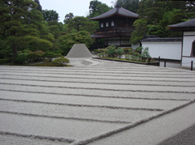 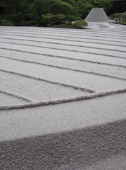 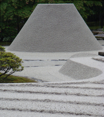

[Larger Photographs of the Sea of Silver Sand and Moon-Viewing Platform at Ginkakuji](japanese-aesthetics.ginkakuji.md)

## 4. Rikyū’s Tea and the Equalizing Aesthetic of *Wabi*

Few figures in Japanese history emerge as more formidable artists than Sen no Rikyū (千利休, 1522–1591), and few aesthetic movements are more transformative than his rendition of the tea ceremony, *Wabicha* (侘茶). While Rikyū is recognized as the preeminent Japanese tea master, his role as an aesthete extends much farther. A consummate painter and poet, a practitioner of *ikebana*, an accomplished calligrapher and landscape artist, Rikyū in time became an influential government dignitary advising the Shogunate on cultural and artistic matters. Through countless inventions and innovations, the impact of the aesthetic world he created, and some say perfected, stretches far beyond the boundaries of the tea ceremony itself, unearthing novel prospects for Japanese identity and citizenship, pioneering new social virtues, original visions of human existence and religious salvation, and ultimately, opening new possibilities for equality (Suzuki 278–9), all rooted in the *wabi* aesthetic.

While Rikyū’s reputation has come to eclipse that of his predecessors, his aesthetic innovations were part of a lineage born in the port city of Sakai, comprising the tea master Murata Shukō (村田珠光, 1423–1502) and his student Takeno Jōō (武野 紹鴎, 1502–1555), both Zen adherents, the latter of whom would later mentor Rikyū. Both of his forerunners began pioneering tea aesthetics, which laid the groundwork for Rikyū’s eventual refinement, and both harnessed fresh aesthetic stratagems aimed at incorporating the *wabi* aesthetic into the tea ceremony (Ludwig, 387–390. Sen Sōshitsu, 123–157).

What distinguished Rikyū’s *Wabicha* from his mentors’ ceremonies was its resolution of the tensions between competing aesthetic undercurrents coursing through the 16th-century practice of tea and broader Japanese cultural worlds (Slusser 55–57). Before the advent of *Wabicha*, medieval tea was becoming increasingly polarized in two directions. The *Shoin* (書院) style orchestrated ostentatious displays of wealth carried out in opulent domiciles of the powerful aristocracy. Within this milieu, the most cherished tea utensils (*meibutsu* 名物) were rare and precious wares imported from China, their aesthetic value predominantly gauged by how well they displayed the host’s affluence and power, rendering *Shoin* tea an intentionally non-egalitarian ceremony.

The ostentation of the *Shoin* style found further reinforcement in what was called the “*basara*” attitude (婆娑羅), characterized by tasting contests (*tōcha* 闘茶) and lavish tea parties (*chayoriai* 茶寄合) orchestrated for grandiose demonstrations of wealth. As the *Shoin* style was in ascendency, the tea world was simultaneously evolving in the opposite direction, in a version of the ceremony known as the *Sōan* (草庵) style, an aesthetic that extolled austerity and poverty rather than opulence and affluence. In place of grand halls of the aristocracy and gatherings with dozens or even hundreds of guests, the so called “grass-hut” *Sōan* style aestheticized the world of the farmer and hermit and sought the intimacy of a gathering in a tiny unadorned hut, typically attended by a mere handful of guests. Shukō and Jōō were some of the progenitors of this style and it was tea as the “grass hut” ideal that Rikyū inherited and eventually honed to perfection.

A second polarizing cultural tendency in 16ᵗʰ century Japan, which cut across the *Shoin* and *Sōan* divide, was a tension between warrior and religious aesthetic sensitivities. Rikyū’s *Wabicha* dissolved this tension by melding elements of Samurai gatherings with those cultivated in Zen monasteries. His ceremony avoided exclusive alignment with religiosity or militarism and employed the *wabi* aesthetic to infuse an egalitarianism counterbalancing hierarchical divisions entrenched within both spheres, re-casting *wabi* as a “non-hierarchical awareness of the real” (Hirota 95).

Beyond the realm of the martial and the monastic, the populace of 16th-century Japan was deeply stratified, from Samurai at the top all the way down to farmers, peasants, and merchants at the bottommost social rung. These divisions were absolute, and upward mobility to higher social strata was virtually inconceivable. Nevertheless, Rikyū deployed the *wabi* aesthetic to challenge social stratification (Sen Sōshitsu 182–183). In his *Wabicha*, all patrons of tea were considered equal, and his aesthetic innovations concretized this principle, ensuring this was not simply a lofty ideal. In the text attributed to him, the *Nampōroku* (1690), he claims that “worldly rank is ignored” in the tea room.

Rikyū’s aesthetic decisions were guided by a veneration of the meagre existence of the agrarian lifestyle, the strict economy of the mountain hermit, and the austere lack of adornment of the poor farmer. He thus had a predilection for rough un-hewn materials, which meant walls and timber within the tea hut were left raw and unfinished, with straw and cob visibly protruding. Costly Chinese porcelain, ivory flower vases and tea scoops were replaced by locally produced bamboo versions. Colorful flowers were almost entirely excluded, while an “aniconic” ceremony emerged, characterized by the absence of imagery within the hut and surrounding garden.

Among the numerous architectural innovations Rikyū deployed, the most egalitarian were several features of the tearoom, which rendered it physically impossible for tea guests to express their social position or power. The *nijiriguchi* (躙口), roughly translated as “crawl in space” was the only entry way for guests (previous instances of the *sukiya* had another larger entryway for nobility and aristocracy). The tiny aperture measuring only around 60cm x 60cm (2ft x 2ft) achieved two equalizing aims of *Wabicha* (Sōshitsu Sen 182–183). Firstly, samurai were prevented from entering with their two *Katana* swords, which normally were the most visible signs of their position atop the social hierarchy. (Rikyū introduced a sword rack (*katanakake* 刀掛け) next to the *nijiriguchi* under the tea hut’s eaves.) Further, the size of the opening meant that wealthy aristocrats and courtiers could not make it through the small opening with their oversized top hats. Thus, once inside Rikyū’s tiny *sukiya*, no appearance endured of the markings normally employed to exhibit and maintain the rigid social hierarchy. Even conversation or figures of speech invoking social status, references to employment, objects exhibiting one’s wealth, or associations legitimating one’s power were all strictly prohibited.

An additional dimension of the *Wabicha* aesthetic, which reinforces egalitarian ideals is Rikyū’s embrace of the local. He opposed the trend of importing expensive Chinese tea ware and instead championed locally crafted articles reflecting the agrarian lifestyle outside the bustling urban city centre. Amidst Rikyū’s manifold innovations, the most famous—renowned for epitomizing the very quintessence of *wabi*—was the inception of an entirely novel pottery style known as *Raku* (楽焼, *raku-yaki*). Rikyū enlisted a local potter Sasaki “Raku” Chōjirō (長次郎) to give form to tea ware embodying the *wabi* aesthetic. As opposed to highly sophisticated Chinese porcelain, *Raku* was rustic earthenware, utilitarian, un-adorned, often asymmetrical and imperfect in form and finish – celebrating the grace of a humble existence, an ode to local hermit and farmer. Firing and drying techniques were developed to grant leeway to the atmosphere, nature, and gravity to express themselves in the clay body as it heated then cooled. The aesthetic evoked the monk or farmer in the vicinity working with what was at hand rather than the worldly aristocrat importing treasures from foreign shores. Aligned with the ethos of *wabi*, *Raku* ware was valued for its exposition of the simple beauty of meagre existence, accentuating the aesthetics of paucity over opulence. Thus, *Raku* played a levelling role that made a previously exclusive material culture surrounding the tea ceremony more egalitarian.

Another important innovation that curtailed signs of wealth involved transformations in design and emphasis of the hanging scroll (*Kakemono* 掛物). Once a peripheral piece, Rikyū elevates the scroll, recalibrates its aesthetics toward egalitarian ideals, and installs it as the centrepiece of the tea hut and the ceremony as a whole (Hirota, 217–218). Rikyū not only elevated the scroll to the aesthetic forefront of the ceremony, (a role previously occupied by the tea caddy in the *Shoin* style) but also shifted scroll aesthetics away from costly and exclusive Chinese versions. Under Rikyū’s patronage, scrolls were for the first time commissioned from local Zen Buddhist calligraphers and painters.

While his interventions may have succeeded in challenging the rigid societal stratification beyond the confines of the tea world, they might have also set the stage for his own tragic downfall. The markers of social hierarchy he sought to dismantle were crucial for justifying and maintaining the Shogunate’s power. As a governmental official, Rikyū had little latitude to deny Hideyoshi’s wishes, which often diverged drastically from the austerities of *Wabicha* (for instance, building the golden Tai-an (待庵) tearoom). His egalitarianism was undermining a vital symbol the Shogun relied on to showcase his supremacy, and threatened to subvert power structures that maintained his position atop the social-political hierarchy (Slusser, 56-57). Rikyū’s *Wabicha* and the hierarchy-nullifying symbols and structures he shaped countered the power politics embraced by the Shogunate and challenged the militaristic interests of the elite he served. Rikyū would be ordered to commit ritual suicide (*seppuku* 切腹), and following his last tea ceremony in 1591, he wrote his death poem before taking his own life.

While Rikyū’s impact on the subsequent history of Japanese tea and culture at large is irrefutable, his legacy is complicated. His ritual suicide was appropriated for a subsequent aestheticization of hyper-nationalistic tendencies, thereby setting an early standard for an “aesthetic” death as sacrifice to one’s nation at time of war (Cross, 163–166). Thus, his tragic moment was promoted as a means to rationalize some of the empire’s most egregious brutalities. A memory that should have remained untarnished became attached to Japan’s calamitous aestheticization of imperialism, warfare, and self-sacrifice—values fundamentally at odds to those that Rikyū introduced to Japanese culture through the *wabi* aesthetic in the tea ceremony.

## 5. *Sabi:* Rustic Patina

The term *sabi* occurs often in the *Manyōshū*, where it has a connotation of desolateness (*sabireru* means “to become desolate”), and later it seems to acquire the meaning of something that has aged well, grown rusty (another word pronounced *sabi* means “rust”), or has acquired a patina that makes it beautiful.

The importance of *sabi* for the way of tea was affirmed by the great fifteenth-century tea master Shukō, founder of one of the first schools of tea ceremony. As a distinguished commentator puts it: “The concept *sabi* carries not only the meaning ‘aged’—in the sense of ‘ripe with experience and insight’ as well as ‘infused with the patina that lends old things their beauty’—but also that of tranquility, aloneness, deep solitude” (Hammitzsch, 46).

The feeling of *sabi* is also evoked in the haiku of the famous seventeenth-century poet Matsuo Bashō, where its connection with the word *sabishii* (solitary, lonely) is emphasized. The following haiku typifies *sabi(shii)* in conveying an atmosphere of solitude or loneliness that undercuts, as Japanese poetry usually does, the distinction between subjective and objective:

> Solitary now —
> Standing amidst the blossoms
> Is a cypress tree.

Contrasting with the colorful beauty of the blossoms, the more subdued gracefulness of the cypress—no doubt older than the person seeing it but no less solitary—typifies the poetic mood of *sabi*.

Tanizaki’s “In Praise of Shadows” frequently celebrates *sabi*. By contrast with Western taste, he writes of the Japanese sensibility:

> We do not dislike everything that shines, but we do prefer a pensive lustre to a shallow brilliance, a murky light that, whether in a stone or an artifact, bespeaks a sheen of antiquity. . . . We love things that bear the marks of grime, soot, and weather, and we love the colors and the sheen that call to mind the past that made them. (Tanizaki, 11–12)

This is a significant existential consideration: the sheen of older things connects us with the past in ways that shiny products of modern technology simply cannot. And since older things tend to be made from natural materials, to deal with them helps us to realize our closest connections with the natural environment.

*Sabi* figures prominently, for Tanizaki, in the aesthetics of the traditional Japanese toilet, which “stands apart from the main building at the end of a corridor, in a grove fragrant with leaves and moss.” He wrestles with the vexations that modern technology imposes on the question of fixtures, as the traditional ones are superseded by “white porcelain and handles of sparkling metal” (Tanizaki, 3, 6).

> Wood finished in glistening black lacquer is the very best, but even unfinished wood, as it darkens and the grain grows more subtle with the years, acquires an inexplicable power to calm and soothe. The ultimate, of course, is a wooden “morning glory” urinal filled with boughs of cedar: this is a delight to look at and allows not the slightest sound. (Tanizaki, 6)

But the primary delights of the traditional Japanese toilet are its closeness to nature: in that special place, “surrounded by tranquil walls and finely grained wood, one looks out upon blue skies and green leaves” (Tanizaki, 4). Among the achievements of traditional Japanese architecture Tanizaki praises the toilet as “the most aesthetic.”

> Our forebears, making poetry of everything in their lives, transformed what by rights should be the most unsanitary room in the house into a place of unsurpassed elegance, replete with fond association with the beauties of nature.

It is surely fitting that one should perform those most natural functions of urinating and defecating, returning to the earth the remains of its bounties, in natural rather than high-tech surroundings.

A more exalted exemplification of *sabi* is the exquisite Silver Pavilion at Ginkakuji in Kyoto. Even though the tea ceremony is said to have originated here, in a small *sabi*-saturated teahouse, the exterior of the pavilion was originally going to be covered in silver foil, in emulation of the Golden Pavilion (14th century) at Kinkakuji. Without ever having enjoyed a coating of silver, the Silver Pavilion is the epitome of *sabi* and one of the most graceful structures ever built. The contrast with the larger, and flashier Golden Pavilion, whose coating of gold leaf lends it a quite different (and distinctly un-*sabi*) kind of beauty, is instructive.

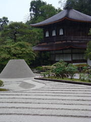 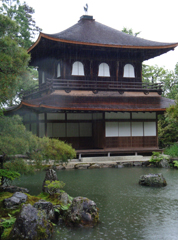 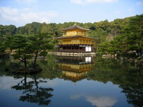 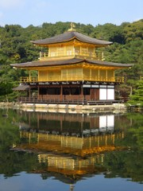

[Larger Photographs of the Silver Pavilion at Ginkakuji and the Golden Pavilion at Kinkakuji](japanese-aesthetics.ginkakuji-kinkakuji.md)

In 1950 a deranged Buddhist acolyte, deeply disturbed by the beauty of the Golden Pavilion, set fire to it and burned it to the ground. An exact replica was built on the original site in 1955. The aesthetic qualities of the original structure are celebrated in Mishima Yukio’s fine novel *The Temple of the Golden Pavilion* (1956), as well as in Ichikawa Kon’s classic film *Enjo* (Conflagration, 1958). In 1987, the burgeoning Japanese economy made it possible for the first time in the building’s history to cover the structure with gold leaf, according to the creator’s original intention. The result is breathtakingly spectacular—but totally un-Japanese. Old-time residents of Kyoto famously complained that it would take a long time for the building to acquire sufficient *sabi* to be worth looking at again. At the rate the patina seems to be progressing, probably several centuries.

In 2011, after the tsunami in Tōhoku and the explosions and nuclear meltdown in Fukushima caused an acute energy shortage in Japan, one of many responses was a dramatic reduction of lighting in public places, and especially in subway stations with extensive underground restaurant and shopping precincts. Tanizaki cites a prescient remark from the late 1920s to the effect that “perhaps no two countries waste more electricity than America and Japan” (Tanizaki, 35). He would be delighted now to see Japanese cities reducing the ubiquitous glare of neon lighting and all-night electric illumination, in a dimming of unnecessary lights which thereby reintroduces some of the shadows he so eloquently praises.

## 6. *Yūgen*: Mysterious Grace

*Yūgen* may be, among generally recondite Japanese aesthetic ideas, the most ineffable. The term is first found in Chinese philosophical texts, where it has the meaning of “dark,” or “mysterious.”

Kamo no Chōmei, the author of the well-known *Hōjōki* (An Account of my Hut, 1212), also wrote about poetry and considered *yūgen* to be a primary concern of the poetry of his time. He offers the following as a characterization of *yūgen*: “It is like an autumn evening under a colorless expanse of silent sky. Somehow, as if for some reason that we should be able to recall, tears well uncontrollably.” Another characterization helpfully mentions the importance of the imagination: “When looking at autumn mountains through mist, the view may be indistinct yet have great depth. Although few autumn leaves may be visible through the mist, the view is alluring. The limitless vista created in imagination far surpasses anything one can see more clearly” (Hume, 253–54).

This passage instantiates a general feature of East-Asian culture, which favors allusiveness over explicitness and completeness. *Yūgen* does not, as has sometimes been supposed, have to do with some other world beyond this one, but rather with the depth of the world we live in, as experienced with the aid of a cultivated imagination.

The art in which the notion of *yūgen* has played the most important role is the Nō drama, one of the world’s great theater traditions, which attained its highest flourishing through the artistry of Zeami Motokiyo (1363–1443). Zeami wrote a number of treatises on Nō drama, in which *yūgen* (“Grace”) figures as “the highest principle” (Rimer, 92). He associates it with the highly refined culture of the Japanese nobility, and with their speech in particular, though there is also in Nō a “Grace of music,” a “Grace of performance [of different roles],” and a “Grace of the dance” (Rimer, 93). It is something rare, that is attained only by the greatest actors in the tradition, and only after decades of dedicated practice of the art. It is impossible to conceptualize, so that Zeami often resorts to imagery in trying to explain it: “Cannot the beauty of Grace be compared to the image of a swan holding a flower in its bill, I wonder?” (Rimer, 73).

The most famous formulation comes at the beginning of Zeami’s “Notes on the Nine Levels [of artistic attainment in Nō],” where the highest level is referred to as “the art of the flower[ing] of peerless charm”:

> The meaning of the phrase Peerless Charm surpasses any explanation in words and lies beyond the workings of consciousness. It can surely be said that the phrase “in the dead of night, the sun shines brightly” exists in a realm beyond logical explanation. Indeed, concerning the Grace of the greatest performers in our art [it gives rise to] the moment of Feeling that Transcends Cognition, and to an art that lies beyond any level that the artist may consciously have attained. (Rimer, 120)

This passage alludes to the results of a pattern of rigorous discipline that informs many “performing arts” (which would include the tea ceremony and calligraphy as well as theater) in Japan, as well as East-Asian martial arts. Nō is exemplary in this respect, since its forms of diction, gestures, gaits, and dance movements are all highly stylized and extremely unnatural. The idea is that one practices for years a “form” (*kata*) that goes counter to the movements of the body and thus requires tremendous discipline—to the point of a breakthrough to a “higher naturalness” that is exhibited when the form has been consummately incorporated. This kind of spontaneity gives the impression, as in the case of Grace, of something “supernatural.”

## 7. *Yūgen* and Landscape Painting

Intriguing features of Japanese aesthetics are revealed through the artistic practices of Sesshū Tōyō and his most celebrated work, the so-called “Splashed ink landscape” of 1495 (*Haboku* *Sansui*, literally, “Broken Ink Landscape”). Taking the first steps towards reading his art calls on us to recognize a distinctive feature of Japanese landscape paintings, that is, as art objects they have a considerably expanded aesthetic status relative to similar works as interpreted within Western philosophical and art historical traditions. Of course, the painting object itself is important, but key aesthetic value also lies in the bodily performance the work attests to. Properly estimating the beauty of Sesshū’s “Splashed ink landscape”—similar to how one should appreciate Japanese calligraphy—involves more than simply making judgments regarding the marks on paper, but also calls for an appreciation of the bodily movements that created the work. Because Sesshū’s spontaneous movements were cultivated according to highly disciplined Zen Buddhist practices, interpreting his landscape art demands an aesthetics expanded to embrace the philosophic and religious.

Sesshū Tōyō (雪舟等楊, 1420–1506) was a towering figure of the Japanese art world who helped initiate an indigenous artistic tradition at a time when philosophic-religious practices were going beyond their Chinese influence, as Chan Buddhism gave rise to Zen Buddhism in Japan. Sesshū was part of a trajectory of many centuries to establish Japanese forms of Buddhism as an enduring feature of the country’s religious, philosophic, and aesthetic identity. During his life, Zen was reaching prominence as a religious discipline, as were the related arts under Ashikaga patronage. The Muromachi Period was the time of Zen aesthetics: not only monochrome ink painting, but all Japanese aesthetic practices (*geidō*) including calligraphy, tea ceremony, Nō drama, and dry landscape gardening flourished as expressions of the Zen, especially Rinzai Zen, spirit of the time. During this period, a shift was underway in the painting world from *kara-e* (唐絵 “Chinese painting”) to *yamato-e* (大和絵 “Japanese painting”). Representations of deities for devotional purposes, and paintings of Daoist and Buddhist themes (*dōshakuga*) were being supplanted as the heart of art practice as Japan saw its first movements towards initiating an art tradition seeking purely aesthetic ideals. Landscape painting was central to that movement.

Sesshū was a celebrated painter, poet, calligrapher, and gardener, who mastered all of the major Chinese styles and genres, from bird and flower paintings, to portraiture, hanging scrolls, screens, and fans. It was his landscapes, however, particularly his famed “Splashed Ink Landscape” for which he has been immortalized. This painting offers insight into a central concept of Japanese aesthetics discussed above, that is, *yūgen*.

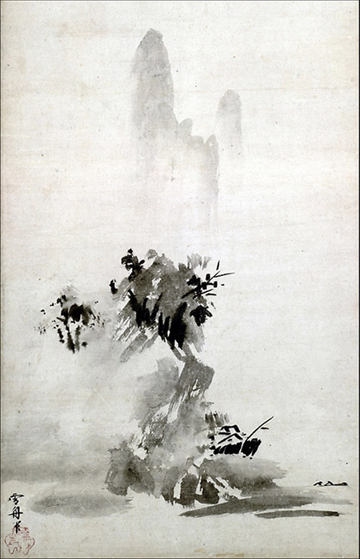

[Splashed Ink Landscape by Sesshū](japanese-aesthetics.splashed-ink.md)

The mysterious grace of his most celebrated landscape painting derives as much from the space that is left un-touched, the invisible and absent (often referred to as the “dragon’s veins” of a painting) as from what is painted and visible. The work appears incomplete, still in the act of formation, and the dramatic negative spaces created by the mists allow the various forms to dissolve and blend into one another, but more decisively, according to the yūgen dynamic, this negativity invites the viewer into the painting to actively complete it. As artists employing yūgen principles in other genres have shown, the incompleteness and allusiveness of the artwork summons the viewer into the scene. In Ghilardi’s words, “the onlooker must merge in the image, completing the empty spaces, making it a lively element of nature itself, ‘between’ visible and invisible” (Ghilardi, 2015, 99).

Sesshū does not seek to render every detail of the landscape to achieve representational verisimilitude, to depict an object that would be discernible for a subject. The aim is to give only a suggestion or a trace of trees, mountains, or waters, which appear to negate themselves as objects. Accordingly, Sesshū does not circumscribe forms but offers the impression of poetic immediacy by breaking them down. Extreme abbreviation and abstraction are employed such that any form, if even discernible, is pushed as far as possible from objectivity without disappearing completely into formlessness. As Jullien writes regarding Chinese painters who influenced Sesshū, they paint the “landscape in the tonality of *as if*, in the mode of appearing-disappearing, at once ‘as if there were’ and ‘as if there were not.’”(Jullien, 2009. 8) The central grouping of trees, the inn blending into their trunks, and the tiny oarsman all appear but feel as though they are about to be lost, maybe already transitioning into a vague memory, only a brushstroke away from dissolving completely. A sensitive viewer does not simply perceive a representation of this event but can sense the sweeping and spontaneous gestures that gave rise to the ephemerality of the scene. To appreciate this aesthetic feature of the painting invokes Buddhist principles Sesshū would have cultivated as a Zen monk.

Sesshū’s life and work are exemplary for Japanese aesthetics given that his practice was not aesthetic in a restricted sense, but also encompassed the religious and philosophical principles of Daoist-inspired Zen Buddhism. “Splashed ink landscape” was composed in Sesshū’s 76ᵗʰ year, a time when he claimed that his eyes “were growing misty” and Daoism was increasingly influential for his painting. As a painter-priest, both his meditative as well as his artistic practice would have aimed at self-negation, at achieving “non-self” as per the goal of Zen training. As Yukio Lippit writes, “Splashed Ink Landscape thus showcases a mode of ink painting that projects both cultivated artistic agency and a state of subjectlessness. This condition of the permeable subject would prove pitch-perfect for the Japanese monk painter of the late medieval period” (Lippit 2012, 71)[^lippit-2012]. To disclose how this aesthetic-religious goal was approached in painting practice reveals the Daoist roots of Zen Buddhism.

Painting was among the Japanese aesthetic practices referred to as *geidō* 芸道. One of the sinographs shared among the compounds for archery (*kyudō* 弓道), martial arts (*jūdō* 柔道), calligraphy (*shodō* 書道), flower arranging (*kadō* 華道), tea ceremony (*sadō* 茶道) is the sinograph *dao* (道), (*dō* or *michi* in Japanese) indicating the philosophic-religious orientation of the practices. To move according to the *dao* is to move with a natural spontaneity as an embodiment of the well-known concept “non-action” (*wuwei* 無爲). Acting spontaneously involves moving beyond the binary of activity or passivity; that is, the world moves the body as much as the body moves in the world. Accordingly, as Nishida comments, we can say that “Sesshū painted nature or that nature painted itself through Sesshū” (Nishida 1990, 135). The graceful naturalness of the swordsman, the calligrapher, or the Nō actor is also characteristic of the painter’s gestures. All are bodily practices that seek to harmonize with the spontaneous motions of the *dao* through non-action. Thus, to estimate the aesthetic value of Sesshū’s brushwork is to appreciate its religious source in Daoist-informed Buddhist practice. Because observers can harmonize their own bodies with the movements animating the painting, the work elicits more than aesthetic judgments, it is itself a site for cultivating religious-philosophic discipline.

The “splashed ink” technique Sesshū employed is particularly exemplary of the expanded frame of Japanese aesthetics. “Splashed Ink” (*hatsuboku*) was one of several “broken ink” (*haboku*) spontaneous techniques originating in China, which Sesshū learned while travelling to study with painters and conduct religious practice at its monasteries. The techniques ranged from spontaneous washes and splashes to actual ink-flinging and dripping. While these methods sound reckless and were associated with an “aesthetics of inebriation” and “aesthetics of accident,” the splashed ink idiom is in fact the most demanding style, regarded as the highest form of expression and the supreme test of the artist’s skill. Likewise, it was thought to test the observer’s sensitivity like no other genre. The style originated with the “literati” artists of the Southern Song School of Chinese landscape painting who favored *yūgen*-style abbreviated poetic suggestion, rather than the detailed and descriptive “academic” approach of the Northern School. Thus, following this tradition, painters such as Sesshū did not aim to develop virtuoso skill to create a fully formed art image, but in negating the self and becoming continuous with the motions of nature, they follow the Daoist precept that “the great image has no form.”

## 8. *Iki*: Refined Style

*The Structure of “Iki”* (“Iki” no kōzō) by Kuki Shūzō (1888–1941) is arguably the most significant work in Japanese aesthetics from the twentieth century—and certainly one of the shortest. Kuki wrote the first draft in 1926 while living in Paris, toward the end of a seven-year stay in Europe, and published the book shortly after returning to Japan in 1929. It’s a phenomenological and hermeneutic study of a phenomenon, *iki*, that was central to Japanese aesthetic life during the previous two or three hundred years and derived from forms of erotic relations between men and geisha in the pleasure quarters of the big cities. Kuki remarks that although the French terms *chic*, *coquet*, and *raffiné* share connotations with the term *iki*, no European word is capable of translating the richness of its meanings—unsurprisingly, since it emerged from a particular cultural context and Kuki is concerned to grasp the “living form” of the phenomenon as experienced. Kuki mentions the French *esprit* and the German *Sehnsucht* as terms that are similarly untranslatable, for similar reasons of cultural embeddedness (Nara, 15–16).

Kuki distinguishes two further “moments” of *iki* in addition to its basis in seductiveness or coquetry (*bitai*): “brave composure” (*ikiji*) and “resignation” (*akirame*). Insofar as *iki* as seductiveness is concerned “to maintain a dualistic relationship, protecting the possibility as possibility”—an allusion to Heidegger’s existential conception of death as ultimate possibility—it already embraces impermanence and mortality. The first sense in which iki preserves the possibility as possibility, and thus maintains a dualistic relationship, is that the act of sexual union is not consummated (or at least postponed). This preservation of possibility is further enhanced by brave composure, which for Kuki is exemplified in the attitude toward death (his own and others’) on the part of the samurai warrior and his way of living (*bushidō*). It is enhanced too by the moment of resignation, which Kuki understands as the Buddhist attitude of non-attachment to a world of impermanence. All together they enable a kind of aesthetic “play”, thanks to a (phenomenological) “bracketing” of the concerns of everyday life (Nara, 18–23).

After positioning the phenomenon of *iki* among a variety of other aesthetic feelings such as sweet (*amami*) versus astringent (*shibumi*), flashy (*hade*) versus quiet (*jimi*), and crude (*gehin*) versus refined (*jōhin*), Kuki goes on to examine the objective expressions of the phenomenon, which are either “natural” or “artistic” (Nara, 24–34). In nature, willow trees and slow, steady rain exemplify *iki*; in the human body a slight relaxation, a voice of medium rather than high pitch, a face that is long rather than round, a certain tension and relaxation together of the eyes, mouth, and cheeks, the hand curved or slightly bent back. Also *iki* is the wearing of thin fabric, makeup thinly applied, hair styled not too formally, with the aid of water rather than oil, and a *décolletage* designed to call attention to the nape of the neck laid bare (Nara, 35–39).

In the “free art” of design, parallel lines, and especially vertical stripes, are expressive of *iki*: almost all the other beautiful patterns developed by Japanese fabric arts, since they often involve curved lines, are un-*iki*. The only colors that embody *iki* are certain grays, browns, and blues. In architecture the small (four-and-a-half mat) Zen teahouse is a paradigm of *iki*, especially insofar as it initiates an interplay between wood and bamboo. Lighting must be subdued: indirect daylight or else the kind of illumination provided by a paper lantern. The scales, melodies, and rhythms of various kinds of music are correspondingly *iki*, insofar as (alluding to Goethe, Schelling, and Schopenhauer) “[a]rchitecture is frozen music, and music is flowing architecture” (Nara, 41–51).

In his conclusion, Kuki asks whether various nineteenth-century and contemporary European arts might exemplify *iki* and decides probably not exactly, though he allows that various aspects of Baudelaire’s poetry and aesthetics come very close (with the difference that dandyism is a male prerogative whereas *iki* is associated with both sexes). During his seven years in Germany and France he listened to lectures and seminars by, and conversed with, such figures as Heinrich Rickert, Edmund Husserl, Martin Heidegger, Henri Bergson, and Jean-Paul Sartre. Kuki thereby developed a sophisticated understanding of European philosophy and aesthetics, and was concerned after his return to Japan to apply methods he had learned to a Japanese aesthetic phenomenon. He didn’t therefore aspire to any kind of universal aesthetics—since *iki* is rooted in the culture of a particular ethnic group. Yet because the Japanese at that time, under geopolitical pressure to modernise more efficiently, were losing touch with their own traditions, Kuki took it as one of his tasks to celebrate the aesthetic values of the past (Nara, 58–60).

He has unfortunately been excoriated on these grounds as an ultranationalist and even a fascist, notably by Leslie Pincus in her book *Authenticating Culture in Imperial Japan: Kuki Shūzō and the Rise of National Aesthetics*, and this deters some people from reading him. But while Pincus’s book provides a good deal of helpful historical background of the milieu in which Kuki was working in Japan, her claims that he was a fascist are groundless (see Parkes 1997, 2007)[^parkes-1997]. An unprejudiced reading of *The Structure of Iki* reveals no fascist tendencies whatsoever, and the nationalist themes are innocuous, simply calling for a remembering of what is valuable in the Japanese tradition and likely to be lost beneath the waves of modernization—in a world where connections with the past were withering and Japan was warding off the colonization of East and South Asia by the Western powers.

Kuki is a fascinating thinker, and *The Structure of Iki*, while occasionally tortuous because of its commitment to a strictly European methodology, illuminates some fascinating aspects of the Japanese aesthetic tradition while at the same time engaging the deepest levels of experience anywhere.

## 9. *Kire*: Cutting

A distinctive notion in Japanese aesthetic discourse is that of the “cut” (*kire*) or “cut-continuity” (*kire-tsuzuki*). The “cut” is a basic trope in the Rinzai School of Zen Buddhism, especially as exemplified in the teachings of the Zen master Hakuin (1686–1769). For Hakuin the aim of “seeing into one’s own nature” can only be realized if one has “cut off the root of life”: “You must be prepared to let go your hold when hanging from a sheer precipice, to die and return again to life” (Hakuin, 133–35). The cut appears as a fundamental feature in the distinctively Japanese art of flower arrangement called *ikebana*. The term means literally “making flowers live”—a strange name, on first impression at least, for an art that begins by initiating their death. There is an exquisite essay by Nishitani Keiji on this marvelous art, in which organic life is cut off precisely in order to let the true nature of the flower to come to the fore (Nishitani, 23–7). There is something curiously deceptive, from the Buddhist viewpoint of the impermanence of all things, about plants, which, lacking locomotion and by sinking roots into the earth, assume an appearance of being especially “at home” wherever they are. In severing the flowers from their roots, Nishitani suggests, and placing them in an alcove (itself cut off from direct light, as Tanizaki remarks), one is letting them show themselves as they truly are, namely, as absolutely rootless as every other being in this world of radical impermanence.

The notion of cut-continuation is exemplified in the highly stylized gait of the actors in the Nō drama. The actor slides the foot along the floor with the toes raised, and then “cuts” off the movement by quickly lowering the toes to the floor—and beginning at that precise moment the sliding movement along the floor with the other foot. This stylization of the natural human walk draws attention to the episodic nature of life, which is also reflected in the pause between every exhalation of air from the lungs and the next inhalation. Through attending to the breath in zen meditation one becomes aware that the pause between exhalation and inhalation is different—more of a cut—from that between inhalation and exhalation. This reflects the possibility of life’s being cut off at any moment: the one exhalation that isn’t followed by an inhalation, known as “breathing one’s last.”

Cutting also appears in the “cut-syllable” (*kireji*) in the art of *haiku* poetry, which cuts off one image from—at the same time as it links it to—the next. There is a famous cut-syllable, *ya*, at the end of the first line of the best-known haiku by Bashō, the most famous haiku poet:

> | *Furuike ya* *Kawazu tobikomu* *Mizu no oto*. | Ah, an ancient pond— Suddenly a frog jumps in! The sound of water. |
> | --- | --- |

The most distinctively Japanese style of garden, the “dry landscape” (*karesansui*) garden, owes its existence to the landscape’s being “cut off” from the natural world beyond its borders. The epitome of this style is the rock garden at Ryōanji in Kyoto, where fifteen “mountain”-shaped rocks are set in beds of moss in a rectangular “sea” of white gravel.

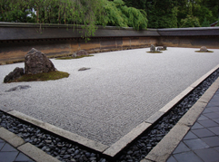 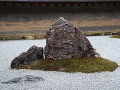 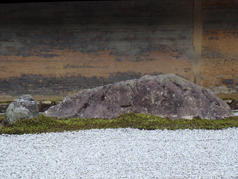 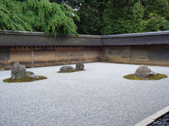 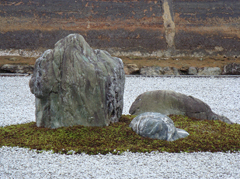 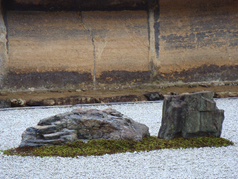 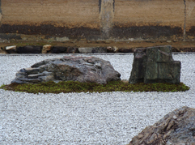 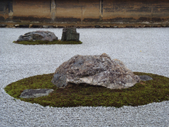 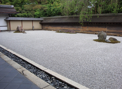 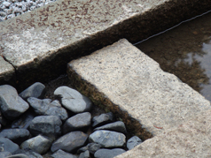

[Larger Photographs of the Dry Landscape Garden at Ryōanji](japanese-aesthetics.ryoanji.md)

(The Japanese word for landscape, *sansui*, means literally “mountains waters”: see Berthier 2000.)[^berthier-2000] At Ryōanji the rock garden is cut off from the outside by a splendid wall that is nevertheless low enough to permit a view of the natural surroundings. This cut, which is in a way doubled by the angled roof that runs along the top of the wall and seems to cut it off, is most evident in the contrast between movement and stillness. Above and beyond the wall there is nature in movement: branches wave and sway, clouds float by, and the occasional bird flies past. But unless rain or snow is falling, or a stray leaf is blown across, the only movement visible within the garden is shadowed or illusory, as the sun or moon casts slow-moving shadows of tree branches on the motionless gravel.

The garden is cut off on the near side too, by a border of pebbles (larger, darker, and more rounded than the pieces of gravel) that runs along the east and north edges. There is a striking contrast between the severe rectangularity of the garden’s borders and the irregular natural forms of the rocks within them. The expanse of gravel is also cut through by the upthrust of the rocks from below: earth energies mounting and peaking in irruptions of stone. Each group of rocks is cut off from the others by the expanse of gravel, and the separation is enhanced by the “ripple” patterns in the raking that surrounds each group (and some individual rocks). And yet the overall effect of these cuttings is actually to intensify the invisible lines of connection among the rocks, whose interrelations exemplify the fundamental Buddhist insight of “dependent co-arising” (*engi*).

The rock garden also embodies the central Buddhist insight of impermanence. Insofar as its being cut off from the surrounding nature has the effect of drying up its organic life, which then no longer decays in the usual manner. Being dried up (the *kare* of *karesansui* means “withered”), the mountains and waters of the garden at Ryōanji at first appear less temporary than their counterparts outside, which manifest the cyclical changes that organic life is heir to. But just as plants look deceptively permanent thanks to their being rooted in the earth, so the rocks of the dry landscape garden give a misleading impression of permanence, especially when one revisits them over a period of years. As participants in (what Thoreau called) “the great central life” of the earth, rocks have a life that unfolds in time sequences that are quite different from ours—and yet also subject to the impermanence that conditions all things.

## 10. Ozu Yasujirō: Cinematic Cuts

The garden at Ryōanji makes a brief but significant appearance in one of the classics of Japanese cinema, Ozu Yasujirō’s *Late Spring* (1949). It comes right after one of the film’s most famous images: a vase standing on a tatami mat in front of a window on which silhouettes of bamboo are projected. The scene in question consists of eight shots, seven of which show the Ryōanji rocks (of which there are fifteen in total), and which are separated and joined by seven cuts. (Ozu hardly ever uses any other transition than the cut, such as the wipe.) After two shots of rocks in the garden, the camera angle reverses, and we see the main protagonist with his friend—they are both fathers of daughters—sitting on the wooden platform with the tops of two rocks occupying the lower part of the frame. Two rocks and two fathers. Cut to a close-up of the fathers from their left side, with no rocks in view. In their dark suits, seated in the classic Ozu “overlapping triangles” configuration, and leaning forward toward the garden with their arms around knees drawn up toward their chins, they resemble two rocks. They talk about how they raise children who then go off to live their own lives. As they invoke such manifestations of impermanence, they remain motionless except for the occasional nod or turn of the head.

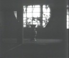 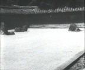 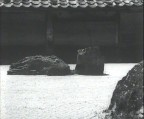 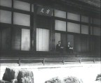 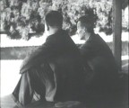 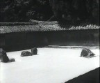 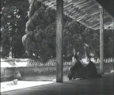 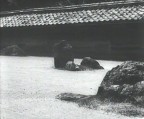 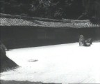

[Enlarged Sequence of Stills from *Late Spring*](japanese-aesthetics.late-spring.md)

In their brief conversation by the edge of the garden, the two fathers do little more than exchange platitudes about family life—and yet the scene is a profoundly moving expression of the human condition. It gains this effect from the assimilation of the figures of the two men to rocks, which seems to affirm the persistence of cycles of impermanence. These images of assimilation capture one of the central ideas behind the dry landscape garden: that of the continuum between human consciousness and stone, which is also understandable as the kinship of awareness with its original basis.

The opening shots of *Tokyo Story* (1953), which some consider Ozu’s greatest film, are also exemplary with respect to the cutting. The first shot shows a shrine sculpture to the left of center and behind it an estuary with a boat chugging along to the right, in the direction of a gradual rise of hills on the horizon. After ten seconds, just as the boat is about to disappear beyond the frame—there is a cut to the pavement on the side of a street. A cart now occupies the left foreground of the frame, and beside it stand two large bottles (Ozu’s signature shapes). Eight small children in school uniform walk away from the camera to the right. Continuity is provided by a parallel between the river and horizon of the first scene and the horizontal lines of the pavement and houses in the second, as well as by the movement toward the right. Continuity is also provided aurally by the continuing sound of the boat’s putt-putting. A ninth child appears and as he passes the bottles and reaches the center of the frame—there is a cut to a shot over the roofs of houses of a train traveling to the right, with behind it the buildings of a shrine or temple, and then hills behind those. The putting sound of the boat continues before being drowned out by the sound of the train, and the almost horizontal line of the train’s passage continue to be congruent with those of the street, descending gradually to the right. Smoke issues from two chimneys at left and center, the scene lasting fifteen seconds.

As the end of the train reaches the center of the frame—the sound continues but there is a cut to a closer shot of the train from the hill side, so that it is now moving up along a diagonal to the left. Behind the houses on the other side of the train is the estuary again. As the train’s whistle blows—there is a cut to a shrine surrounded by pine trees and statuary standing on an embankment with the estuary in the background on the far left. Continuity is provided by a chimney in the foreground that spouts smoke as the train’s steam whistle continues. The main line has reverted to a horizontal line rising toward the right. After six seconds, the shortest scene so far—there is a cut to a grandfather and grandmother sitting on the tatami matting of their home in the village, facing toward the right. The grandfather, consulting a timetable, says, “We’ll pass Osaka at around 6:00 this evening,” referring to a train trip they are just about to take to Tokyo, which will initiate the film’s main action.

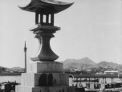 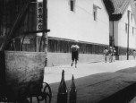 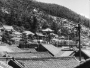 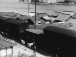 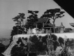 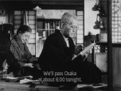

[Enlarged Sequence of Stills from *Tokyo Story*](japanese-aesthetics.tokyo-story.md)

For each cut Ozu has arranged for at least one formal element to provide continuity (*kire-tsuzuki*) between the adjacent scenes. Ozu’s inconspicuous switches remain among the most stylish cuts in world cinema, and his work continues to be a source of inspiration.

## References（引用注释）

> 原文参考文献已转为脚注引用：文内“作者-年份”引用组后附 [^key] 标记，完整条目见本文末脚注定义。

## Academic Tools

> |   | [How to cite this entry](https://plato.stanford.edu/cgi-bin/encyclopedia/archinfo.cgi?entry=japanese-aesthetics). |
> | --- | --- |
> |   | [Preview the PDF version of this entry](https://leibniz.stanford.edu/friends/preview/japanese-aesthetics/) at the [Friends of the SEP Society](https://leibniz.stanford.edu/friends/). |
> |   | [Look up topics and thinkers related to this entry](https://www.inphoproject.org/entity?sep=japanese-aesthetics&redirect=True) at the Internet Philosophy Ontology Project (InPhO). |
> |   | [Enhanced bibliography for this entry](https://philpapers.org/sep/japanese-aesthetics/) at [PhilPapers](https://philpapers.org/), with links to its database. |

## Other Internet Resources

- [Japanese Aesthetics, Wabi-Sabi, and the Tea Ceremony](http://www.art.unt.edu/ntieva/download/teaching/Curr_resources/mutli_culture/Japan/Aesthetics/Japanese%20Aesthetics_Wabi-Sabi_Tea%20Ceremony.pdf), web page hosted by the North Texas Institute for Educators on the Visual Arts (University of North Texas).

## Related Entries

film, philosophy of

### Acknowledgments

The photographs of the Silver Pavilion etc. at Ginkakuji, and of the Dry Landscape Garden at Ryōanji, are by Graham Parkes. The photographs of the Golden Pavilion at Kinkakuji are by Susanne Z. Riehemann, and are reproduced here with her permission. The acknowledgements for the still images from the films discussed in Section 7 are: *Late Spring*, directed by Ozu Yasujirō, 1949, copyright by Shochiku Co., Ltd.; and *Tokyo Story*, directed by Ozu Yasujirō, 1953, copyright by Shochiku Co., Ltd. The image of Splashed Ink Landscape is [in the public domain](https://en.wikipedia.org/wiki/Haboku_sansui#/media/File:Sesshu-Haboku-Sansui.jpg).

[^berthier-2000]: Berthier, François, 2000, *Reading Zen in the Rocks: The Japanese Dry Landscape Garden*, Graham Parkes (trans.), Chicago and London: University of Chicago Press.

[^bordwell-1988]: Bordwell, David, 1988, *Ozu and the Poetics of Cinema*, Princeton: Princeton University Press.

[^carter-2008]: Carter, Robert E., 2008, *The Japanese Arts and Self-Cultivation*, Albany: State University of New York Press.

[^clarke-1997]: Clarke, John (trans), 1997, *Reflections on Japanese Taste: The Structure of Iki*, Sydney: Power Institute Publications.

[^covell-1975]: Covell, Jon Carter, 1975, *Under the Seal of Sesshū*, New York: Hacker Art Books.

[^cross-2003]: Cross, Tim, 2003, “Rikyū has left the Tea Room” in Morgan Pitelka (ed.), *Japanese Tea Culture: Art, History and Practice*, London and New York: Routledge, 151–183.

[^bary-2001]: deBary, William Theodore, et al. (eds.), 2001, *Sources of Japanese Tradition* (Volume I), New York: Columbia University Press, chapters 9 and 16.

[^bary-2005]: –––, 2005, *Sources of Japanese Tradition* (Volume II), New York: Columbia University Press, chapter 27.

[^ghilardi-2015]: Ghilardi, M., 2015, *The Line of the Arch: Intercultural Issues between Aesthetics and Ethics*, Milan: Mimesis International.

[^hakuin-1971]: Hakuin, Ekaku, 1971, *The Zen Master Hakuin: Selected Writings*, Philip Yampolsky (trans.), New York: Columbia University Press.

[^hammitzsch-1980]: Hammitzsch, Horst, 1980, *Zen in the Art of the Tea Ceremony: A Guide to the Tea Way*, New York: St. Martin’s Press.

[^hirota-1995]: Hirota, Dennis (ed.), 1995, *Wind in the Pines: Classic Writings of the Way of Tea as a Buddhist Path*, Fremont: Asian Humanities Press.

[^hume-1995]: Hume, Nancy G. (ed.), 1995, *Japanese Aesthetics and Culture: A Reader*, Albany: State University of New York Press.

[^izutsu-1981]: Izutsu, Toshihiko and Toyo, 1981, *The Theory of Beauty in the Classical Aesthetics of Japan*, The Hague, Boston, London: Nijhoff.

[^jullien-2009]: Jullien, Francois, 2009, *The Great Image Has No Form, or on the Nonobject through Painting*, Chicago: University of Chicago Press.

[^keene-1967]: Keene, Donald, 1967, *Essays in Idleness: The* Tsurezuregusa *of Kenkō*, New York: Columbia University Press.

[^lippit-2012]: Lippit, Yukio, 2012, “Of Modes and Manners in Japanese Ink Painting: Sesshū’s ‘Splashed Ink Landscape’ of 1495,” *The Art Bulletin*, 94(1): 50–77.

[^ludwig-1981]: Ludwig, Theodore, 1981, “Before Rikyū. Religious and Aesthetic Influences in the Early History of the Tea Ceremony,” *Monumenta Nipponica*, 36(4): 367–390.

[^marra-2001]: Marra, Michael F. (trans. and ed.), 2001, *A History of Modern Japanese Aesthetics*, Honolulu: University of Hawai‘i Press.

[^marra-2004]: –––, 2004, *Kuki Shūzō A Philosopher’s Poetry and Aesthetics*, Honolulu: University of Hawai‘i Press.

[^marra-2011]: ––– (ed.), 2011, “Aesthetics” (translations of excerpts from seventeen authors), in James W. Heisig, Thomas P. Kasulis, John C. Maraldo, eds, *Japanese Philosophy: A Sourcebook*, Honolulu: University of Hawai‘i Press, pp. 1167–1227.

[^marra-1999]: Marra, Michele, 1999, *Modern Japanese Aesthetics: A Reader*, Honolulu: University of Hawai‘i Press.

[^miller-2011]: Miller, Mara, 2011, “Japanese Aesthetics and Philosophy of Art,” in J.L. Garfield and W. Edelglass (eds.), *The Oxford Handbook of World Philosophy*, New York: Oxford University Press, pp. 317–333.

[^miller-2020]: Miller, Mara and Yamasaki Kōji, 2020, “Japanese (and Ainu) Aesthetics and Philosophy of Art,” in B.W. Davis (ed.), *The Oxford Handbook of Japanese Philosophy*, New York: Oxford University Press, pp. 735–754.

[^mccullough-1988]: McCullough, Helen C. (trans.), 1988, *The Tale of the Heike*, Stanford: Stanford University Press.

[^nara-2004]: Nara, Hiroshi, 2004, *The Structure of Detachment: The Aesthetic Vision of Kuki Shūzō* (with a translation of *Iki no kōzō*), Honolulu: University of Hawai‘i Press.

[^nguyen-2018]: Nguyen, A. Minh (ed.), 2018, *New Essays in Japanese Aesthetics*, Lanham & London: Lexington Books.

[^nishida-1992]: Nishida, Kitarō, 1992, *An Inquiry into the Good*, New Haven: Yale University Press.

[^nishitani-1995]: Nishitani, Keiji, 1995, “The Japanese Art of Arranged Flowers,” Jeff Shore (trans.), in Robert C. Solomon and Kathleen M. Higgins (eds.), *World Philosophy: A Text with Readings*, New York: McGraw Hill.

[^odin-2001]: Odin, Steve, 2001, *Artistic Detachment in Japan and the West: Psychic Distance in Comparative Aesthetics*, Honolulu: University of Hawai‘i Press.

[^ohashi-1986]: Ohashi, Ryōsuke, 1986, 「切れ」の構造：日本美と現代世界 (*“Kire” no Kōzō: Nihonbi to Gendai Sekai*), Tōkyō: Chūō Kōronsha.

[^ohashi-1998]: –––, 1998, “Kire and Iki,” Graham Parkes (trans.), in Michael Kelly (ed.), *The Encyclopedia of Aesthetics*, New York: Oxford University Press, 2: 553–55.

[^ohashi-2014]: –––, 2014, *Kire: Das Schöne in Japan*, Paderborn: Fink.

[^ryōsuke-2022]: Ōhashi, Ryōsuke, Rolf Elberfeld, and Leon Krings, 2022, *Blumenspiegel*: *Ein Grundlagentext Zur Praxis Und Ästhetik Des Japanischen Nō-Theaters*, Paderborn: Brill.

[^parkes-1995]: Parkes, Graham, 1995, “Ways of Japanese Thinking,” in Hume (1995), 77–108.

[^parkes-1997]: –––, 1997, review of Leslie Pincus, *Authenticating Culture in Imperial Japan: Kuki Shūzō and the Rise of National Aesthetics*, in *Chanoyu Quarterly*, 86: 63–70.

[^parkes-2000]: –––, 2000, “The Role of Rock in the Japanese Dry Landscape Garden: A Philosophical Essay,” in Berthier (2000), 85–155.

[^parkes-2007]: –––, 2007, “The Definite Internationalism of the Kyoto School,” in Christopher Goto-Jones (ed.), *The Political Philosophy of the Kyoto School*, London and New York: Routledge, 161–182.

[^rimer-1984]: Rimer, J. Thomas and Yamazaki Masakazu (trans.), 1984, *On the Art of the Nō Drama: The Major Treatises of Zeami*, Princeton: Princeton University Press.

[^saito-2007]: Saito, Yuriko, 2007, *Everyday Aesthetics*, Oxford, New York: Oxford University Press.

[^sen-1998]: Sen Sōshitsu, 1998, *The Japanese Way of Tea: From its Origins in China to Sen Rikyū*, Honolulu: University of Hawai’i Press.

[^slusser-2003]: Slusser, Dale, 2003, “The Transformation of Tea Practice in Sixteenth-Century Japan,” in Morgan Pitelka (ed.), *Japanese Tea Culture: Art, History and Practice*, London and New York: Routledge, 39–60.

[^suzuki-2019]: Suzuki, D.T., 2019, *Zen and Japanese Culture*, R.M. Jaffe (trans.), New Jersey: Princeton University Press.

[^tanizaki-1977]: Tanizaki, Jun’ichirō, 1977, *In Praise of Shadows*, Thomas J. Harper and Edward G. Seidensticker (trans.), New Haven: Leete’s Island Books.
