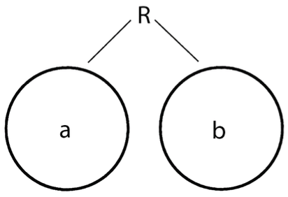
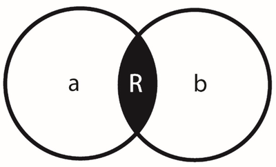

# Japanese Philosophy
**First published Fri Apr 5, 2019; substantive revision Sun Jan 11, 2026**

*Kasulis, Thomas, Bouso, Raquel*

Japanese philosophers have historically interacted with a multitude of philosophies outside their native boundaries—most prominently Chinese, Indian, Korean, and Western. As a result. they have been attuned to the intimate relations among culture, ways of thinking, and philosophical world views. An island chain twice as distant from its continental neighbors as Britain is to its own, Japan escaped successful foreign invasion until 1945. Accordingly, it largely negotiated its own cultural, including philosophical, development without an alien power forcibly imposing on the archipelago its own religious world view or philosophical theories.

Free of foreign coercion, Japanese thinkers had alternatives outside the simple binary of wholehearted acceptance or utter rejection. New theories from abroad could be tried and, if need be, experimentally modified before making a final decision about endorsement. Because of those circumstances, Japanese philosophers became skillful in analyzing the cultural assumptions behind foreign ideas before adopting, adapting, or rejecting them for their own culture.

Against that backdrop, this article explains Japanese philosophy in five sections. Section 1 considers how Japanese have traditionally understood philosophy to be a Way (*michi*) of engaging reality rather than a detached method for studying it. The next section lists some patterns of analysis that are hallmarks of that Way. Section 3 identifies five distinguishable traditions having had a major impact on Japanese philosophy, explaining a few central ideas from each. Section 4 surveys how those five traditions have developed and interacted over four major periods of Japanese history from ancient times to the present. Section 5 concludes with a few themes given special emphasis in Japanese philosophy that might be provocative to philosophy at large, including those emphasized in recent scholarship on Japanese philosophy in a comparative context.

## 1. Philosophy as Engaged Knowing

The Japanese philosopher is more likely to understand reality by working within it rather than by standing apart from it. In other words, it more often involves personal engagement than impersonal detachment. That difference in emphasis between traditional Japanese philosophy and modern Western philosophy became clear to the Japanese when the latter was first introduced into their country in full force in the mid-nineteenth century. A crucial question was how to identify in Japanese what the Westerners called *philosophy*. Hoping to assimilate Western philosophy along with other aspects of Western culture, the intellectuals behind Japan’s modernization wanted to give the field its own Japanese name, rather than treating it as a foreign term pronounced phonetically.

To capture the philosophical sense of *wisdom* (-*sophy*), they picked a likely candidate from the classical East Asian tradition, namely, *tetsu*. More provocative, though, was their choice for the second part of the neologism, namely, *gaku*. That word also had a classical pedigree: it signified *learning*, especially in the sense of modeling oneself after a textual or human model (that is, a master text or a personal master). Probably more significantly, though, the term *gaku* at the time was prominent in neologisms for disciplines in the newly established Western-style universities, functioning as an equivalent for the German *Wissenschaft*. Hence, it rendered the English -*ology* suffix of fields like biology or geology as well as the humanistic “sciences” (*Wissenschaften*) like history or literary studies. By this protocol of nomenclature, the Western discipline of *philosophy* came to be known in Japan by the compound word *tetsugaku* and academic philosophers were (and still are) called *tetsugakusha*, that is, “scholars who specialize in the *Wissenschaft* of wisdom” or “wisdomologists.”

The salient point is that the label chosen was not a more traditional term like *tetsujin*, “wise people,” a word more closely approximating the original Greek meaning of the philosopher as a “lover of wisdom.” So, we might say *tetsujin* better refers to the premodern Japanese sense of the philosopher, that is, a sage who has mastery in one of the traditional *Ways* of wisdom (*dō* or *michi*) such as the Way of the buddhas, the Way of the Confucian scholarly sages, the Way of the (Shintō) *kami*, or even one of the Ways of the traditional arts such as calligraphy, tea ceremony, pottery, painting, flower arranging, or any of the various martial arts. (Traditional Japan used a variety of terms for the sagely master; for convenience in this article *tetsujin* will appear throughout.)

In effect, by creating the new term *tetsugakusha* instead of drawing on an already existing term from their own tradition, the Japanese were distinguishing two species of understanding and two forms of philosophizing. One species of knowers aspires to a scholarly (“scientific”) detachment that mutes personal affect with the aim of reflecting external affairs as they exist independently of human ideation. That kind of understanding is the goal of the *Wissenschaften*—the empirical sciences, literary criticism, studies of history, and social sciences—that define most departments in the academy alongside philosophy.

The other species of understanding typifies those who personally engage reality, transforming themselves and reality together into a coherent and harmonious whole. That more traditional Japanese sense of understanding transcends mere skill or know-how. To be a Confucian sage or a master calligrapher is not simply to be proficient in technique (any more than being a logician in the West is simply knowing how to construct a syllogism). Although rigorously disciplined in their early training, the members of the engaged knowing family of philosophers eventually go beyond fixed templates and regimens to respond creatively to what-is.

When engaged understanding prevails, the knower and known collaborate in an act of innovation rather than simple discovery. From the Japanese standpoint, in their praxis as philosophers, the *tetsugakusha* are akin to how geologists understand clay, whereas the *tetsujin* are more akin to how master potters understand clay. The geologist acquires scientific knowledge (geology) to forge an external relation between the knower and the clay, each of which preexists the knowledge and basically remains unchanged by the knowledge (a *Wissenschaft* is typically grounded in the descriptive). By contrast, the knowledge of the potter is expressed in, by, and with the clay as an interactive project (the masterwork of pottery). Both the clay and the “bodymind” of the potter are transformed in the act of engaged wisdom.

For the *tetsugakusha,* philosophy creates a link between the self and the independently existing world; for the *tetsujin,* philosophy arises from the mutual engagement between self and world, transforming both in the process. The distinction parallels what Henri Bergson characterized in the opening pages of *Introduction to Metaphysics* as two ways of knowing: “moving around” an object as contrasted with “entering it” (Bergson 1955, 21)[^bergson-1955].

## 2. Hallmarks of Japanese Philosophical Analysis

### 2.1 Internal Relations

When Japanese thinkers assume two items are related (whatever the items be: physical entities, ideas, persons, social structures, etc.), they usually begin by examining how the items internally overlap (how they *inter*relate) rather than by looking for something additional (a third item, whether it be another thing, idea, force, or whatever) that externally *connects* or *bonds* them. The simple diagrams below indicate the chief difference.

Figure 1: External Relation

Figure 2: Internal Relation

Figure 1 shows *a* and *b* as discrete entities in an external relation represented by the extrinsic linking agency of *R*. Figure 2, by contrast, shows *a* and *b* as internally related entities such that *R* denotes what they share, what intrinsically conjoins them. In the case of the external relation, if the relation dissolves (or is omitted from the analysis), *a* and *b* each retains its own integrity without loss. Only the context of their connection disappears. In the case of an internal relation, on the other hand, if the relation dissolves (or is omitted from the analysis), *a* loses part of itself, as does *b*.

For instance, as a legal arrangement, marriage is an external, contractual relation into which two individuals enter. Should that arrangement end, each of the pair returns to his or her originally discrete individuality and attendant rights. As a loving arrangement, however, marriage is an internal relation in which two people each share part of themselves. Should the love connection dissolve, each person loses part of what one had formerly been, the part that had been invested in the other. As Emily Dickinson (1884) wrote after losing a beloved friend, she became a “crescent” of her former self. (See the entry on relations for further discussion of the external/internal distinction.)

When Japanese philosophers emphasize engaged over detached knowing, their treatment of standard philosophical themes assumes distinctive nuances. One example will illustrate. (For a detailed discussion of the cultural and philosophical ramifications in emphasizing one kind of relation over the other, see Kasulis 2002.) Because of its roots in praxis, Japanese philosophy approaches mind-body issues differently from how they have typically been addressed in the West, especially the modern West. As the postwar philosopher, Yuasa Yasuo (1925–2005) analyzed in detail (Yuasa 1987)[^yuasa-1987], the preference in modern Western philosophy has been to think about the mind and body as discrete (that is, as external to each other) and the issue then becomes *what* connects the two. If no third external connection can be found, the only obvious alternative is to eliminate the dualism by reducing one of the polarities to the other, for example, by making the mind an epiphenomenon of the body. Yuasa found such formulations of the mind-body problem alien to the Japanese philosophical tradition, both ancient and modern.

Japanese philosophers have customarily taken the view that the body and mind may be distinguished, but they have assumed from the outset that their relation is internal rather than external. Suppose we envision body and mind as a single complex of two intersecting circles (call it *bodymind* to capture the sense of the Japanese compound term *shinjin*). Then without the somatic conjunction, the mind is not fully the mind and without the mental conjunction, the body is not fully the body. Accordingly, Yuasa argued, Japanese philosophers have throughout history typically searched not for *what* constant connects the discrete mind and discrete body, but instead, *how* the bodymind functions such that the interrelationship between the somatic and mental aspects may increase. Generally, the greater the overlap between the aspects, the more optimally the holistic bodymind functions.

In learning to play the piano, for example, Yuasa says the novice begins by having “the mind lead the body” to memorize the keys, but as the pianist becomes proficient, “the body leads the mind” so that it seems the “fingers know where the keys are” without the intrusion of conscious thinking. The mind can then concentrate more fully on the music itself. As the two circles more fully merge, the music, the mind, and the fingers touching the keyboard become a single act. That pathway to increasing bodymind unity explains how praxis and discipline are prerequisite to attaining creativity and fully free expression.

Yuasa also demonstrated how that integrative bodymind phenomenon has been recognized in various Western as well as Eastern theories including neuropsychology, the study of the conditioned response system, psychosomatic medicine, depth psychology, phenomenologies of the body, Indian Ayurvedic medicine, kundalini yogic praxis, Japanese theories of artistry, and East Asian models of *ki* (*qi* in Chinese) within both medicine and the martial arts. In short: Yuasa’s philosophy exemplifies how contemporary Japanese thinkers may constructively engage Western thought while drawing on strands of their own premodern traditions. For other examples of how Japanese philosophy may suggest new perspectives on Western philosophical issues, see Section 5 below.

### 2.2 Holographic Relation between Whole and Part

Models of reality built on external relations often resemble a mosaic in which individual entities are like tiles whose meaning in relation to the whole can only be determined by applying an extrinsic blueprint or template representing the external relations linking them. Each individual tile gives little or no information about how it relates to other tiles. By contrast, models of reality built on internal relations are typically more like jigsaw puzzles in which we discover the relation of one piece to another by looking more closely at the information already within each individual piece: its protuberances, indentations, and coloration. Each piece has within it the information about how it links with its adjacent pieces.

In some instances, the configuration within the internal relation is even more revealing such that each piece has information not only about adjacent pieces, but also about *all* the other pieces in the whole. That paradigm can be called *holographic* in the etymological sense that the whole (*holo*-) is found to be inscribed (*-graph*) in each of its parts. The whole is not simply made of its parts, but also, each part contains the pattern or configuration of the whole of which it is a part. Such holographic relations between whole and part are common in Japanese philosophical systems.

In the West, the holographic paradigm permeated animistic cultures tracing back to prehistoric times. It persisted in the later magical arts wherein a fingernail or hair could give a wizard or witch power over the whole person from which the part was pilfered. It continued in the cult of relics throughout the Middle Ages. But the Enlightenment’s rationalism stripped the holographic paradigm of its ontological connections, restricting it to being no more than a figure of speech (such as a metonym) or other form of conventionalized symbol such as William Blake’s universe in a grain of sand or a fractured image in a psychoanalytic dream analysis.

More recently, however, in a scientific world increasingly attracted to models of recursiveness, fractals, the multiple expressions of stem cells, and so forth, the holographic paradigm has once again begun to assume ontological and not just figurative relevance in the West. To a forensic scientist, a drop of blood or a single hair from a crime scene is not only part of a person’s anatomy, but is also an item inscribed with the dna pattern of the person’s entire anatomy. In the history of Japanese thought, by contrast, the holographical paradigm of the whole-inscribed-in-each-of-its-parts never went out of philosophical fashion as having potentially ontological significance and often figures prominently in many Japanese philosophical theories. Two examples will help clarify: the imperialist concept of *kokutai* and the aesthetic value of minimalism.

The holographic relation applies to the theory of the Japanese imperialist state. Every Japanese is a member of the imperial state and, as a holographic part, contains a pattern for the whole. Originally established through history, myth, and ritual, the role of the emperor is ideologically represented as *kokutai* (*koku*: the country, nation, or its people; *tai*: body, formation, essence). The term refers equally to the emperor and the Japanese nation because the emperor is quintessentially a part of the state that embodies the pattern of the whole state including every Japanese person and the land of Japan itself. Such a holographic explanation of imperialist philosophy is more authentic to the Japanese way of thinking than Western interpretations of the emperor as “god” or, more recently, as an ideologically manipulated metonym for the state (e.g., as in Harootunian 1984).

The stress on holographic relations also helps explain the so-called Japanese aesthetic of minimalism. The assumption that the part contains the pattern of the whole sheds light on the sparseness of the ink painting, the brevity of the haiku, the silences between the musical notes, or the stillness between the movements of the Noh actor. All such artistic expressions focus on a particular to open the audience or spectator to the pattern of the holographic whole. What at first may seem a technique of exclusion or omission turns out to be the most all-inclusive expressive technique of all.

### 2.3 Forms of Assimilation

One response to encountering an opposing philosophical position or theory, a response common in the Western tradition from the time of the ancient Sophists, is to reaffirm one’s own position by refuting the other, revealing its inconsistencies or weaknesses. (This adversarial form of argumentation, including its rarefied form known as the *reductio ad absurdum*, is common in Indian philosophy as well and was introduced to Japan via Buddhism more than a millennium prior to any Western influence.) In Japan, though, a more common response to philosophical opposition has been to reaffirm one’s original view by assimilating into it what is central in the opposing viewpoint through a process of allocation, relegation, or hybridization. Very often in Japanese philosophical debates, the contenders compete in trying to absorb rather than refute the opposition. Cultural comparatists have noted that the Western game of chess is won by attacking the opponent’s pieces and capturing the king, whereas the Japanese game of *go* is won by encircling the opponent’s stones until all are captured and none remain. To the surprise of the uninitiated Western philosophical reader, therefore, the skilled use of agreement and concession, rather than direct attack, may sometimes be the sharpest tools in the Japanese philosopher’s argumentative arsenal. It is important, therefore, to notice how allocation, relegation, and hybridization can help a philosophical theory gain dominance in the Japanese milieu.

#### 2.3.1 Allocation

Allocation is the most compromising form of philosophical assimilation. Two opposing views are accepted without major alteration, but conflict is avoided by restricting each to its own clearly defined disjunctive domain. A détente is negotiated such that each philosophy can function without opposition within its own discrete set of philosophical problems as long as it refrains from universal claims that its methods, assumptions, and conclusions apply to every possible kind of philosophical enterprise. For example, at times Japanese Confucian, Buddhist, and Shintō philosophies resolved potential conflicts by allocating social and political issues to Confucianism, psychological and epistemological theories to Buddhism, and naturalistic emotivism to Shintō. The *Seventeen-article Constitution* of Prince Shōtoku in the early seventh century displays such assimilation (see Section 4.1 below.)

#### 2.3.2 Relegation

Relegation assimilates an opposing view by conceding its truth even while subordinating it to being only a partial component of the original, now more inclusive, position. The rhetoric is usually that the apparently opposing view is not really something new at all, but has been a previously under-emphasized part of the original theory. As in allocation, the position of the other is fully accepted but, in this case, only as an incomplete part of the already held theory. Of course, the rhetoric aside, a close analysis often reveals that the original theory actually expands its comprehensiveness to incorporate the competing one, but the result is the same: the rival ideas are assimilated by being relegated to a subordinated place within the whole, thereby losing their force as an independent theory that can oppose the winning position.

For example, Japanese esoteric Buddhism assimilated proto-Shintō ideas, values, and practices by relegating Shintō *kami* to being “surface manifestations” of Buddhist reality. By that process, Shintō cosmology and rituals could be assimilated without change. Yet, that could happen only as long as their Shintō significance was considered a superficial understanding of deeper Buddhist metaphysical truths.

#### 2.3.3 Hybridization

Hybridization is a third form of assimilation that leaves neither the original theory nor its opposing rival theory intact. Instead, through their cross-pollination something completely new is born. A hybrid presents us with a new species of philosophy. Although we can do a genealogy of its parentage, it cannot (unlike the cases of allocation or relegation) ever return to its earlier opposing forms. If we consider a biological hybrid like a boysenberry, which has a genetic parentage traceable to a loganberry and a raspberry, we cannot find the loganberry or the raspberry intact in the boysenberry. Once the hybrid is created, we cannot undo the crossbreeding; there are now three distinct species of berries.

Analogously, in the process of philosophical assimilation, when true philosophical hybrids emerge, historians of philosophy may be able to reveal their genealogies, but the theories themselves can no longer be deconstructed back into their parental origins. Japanese *bushidō*, the Way of the warrior, is such a philosophical hybrid born of Confucianism, Buddhism, and Shintō. Yet, it became an independent philosophy of its own that in many ways served as a rival to its antecedents. (See Section 3.5 below.)

Next let us examine how Japanese philosophers use those forms of analysis in developing five originally distinct sources of philosophical ideas.

## 3. Five Fountainheads of Japanese Philosophy

### 3.1 Shintō

Three major philosophical sources have fed into Japanese thought since ancient times up through the present, two additional ones being added in modern times (that is, post-1868). First has been Shintō. In its archaic form, especially before its contact with the literary philosophical heritage of continental Asia, it is better termed *proto-Shintō* or even simply “ancient *kami* worship” because it only loosely resembles what we now know as Shintō. Institutional Shintō thought did not really begin until the medieval period and today’s Shintō philosophy mostly originates in the Native Japan Studies tradition beginning in the eighteenth century. (See the entry on The Kokugaku School.)

*Proto-Shintō* lacked philosophical reflection and even self-conscious articulation, but it can be so named because today’s Shintō has often claimed (sometimes disingenuously) a resonance with its main values, ritual forms, and world view. Dating back to preliterate times, proto-Shintō was more an amalgam of beliefs and practices lending cohesion to early Japanese communities. As such it largely resembled religions in ancient animistic and shamanistic cultures found elsewhere in the world.

Specifically, the material and spiritual were internally related in a continuous field wherein the human and the natural, both animate and inanimate, were in an interactional, even communicative relation. *Kami* (often too restrictively translated into English as “gods”) manifested the power (*tama*) to inspire awe. They could refer to anything ranging from a celestial deity to a ghost to a possessed human being to a spirit within a natural object to a wondrous natural object itself (such as Mt Fuji) to even a special manufactured object such as a legendary sword. Although human interactions with *kami* might be either beneficial or harmful, there was no duality or conflict between good and evil forces. Even within human affairs, wrongdoing was generally a violation or transgression of a taboo, regardless of whether the acts were accidental or intentional. Since criminality or sin was not a major consideration, the proper response was not so much guilt, repentance, or rehabilitation, but instead ritual purification. Spiritual and political leadership shared a common charisma allowing the political leader to serve sacerdotal roles in rituals that brought the community benefits and warded off danger. The rituals, often shamanistic in character, mediated the fluid boundaries between the heavens, this world, and the underworld as well as the realms of the animate, inanimate, human, and natural.

Although, as far as we know, there was no self-reflective philosophizing per se in the preliterate world of proto-Shintō, philosophical ideas introduced from abroad often took root most deeply when they drew support from some of its basic ideas and values. For example, proto-Shintō animism generally assumed we live in a world of internal relations where various forces and things can be distinguished, but in the end, they are never discrete but inherently interrelated. Indeed because of that reciprocity, one might say the world is not simply what we engage, but also something that engages us. As we define it, it also defines us.

The ancient proto-Shintō creation myths recount how many parts of the physical world came into being through involuntary divine parthenogenesis. For example, the sun and the moon—both the physical objects and the celestial *kami* associated with each—came into being as the effluent of Izanagi *kami*’s eyes when he purified himself in a river. This type of genesis narrative supports an understanding that every part of the physical world holographically reflects the pattern of spiritual creativity on a cosmic level.

In the final analysis, Shintō’s reality is not a world of discrete things connected to each other, but more a field of which we are part (a field often expressed by the indigenous word *kokoro*). This connectedness applies to the word-reality relation as well. *Koto* was a term for both *word* and *thing* suggesting that words had the spiritual power (*tama*) to evoke, and not simply refer to, a preexisting reality. Thus, the term “spirit of words” *kotodama* (*koto + tama*) suggested an onto-phonetic resonance reflecting internal relations among language, sound, and reality.

Although many such characteristics of proto-Shintō are found in other archaic animistic cultures throughout the world, unlike in many of those other locations, in Japan those ancient sensitivities were not suppressed by rationalistic philosophies imposed from outside. For example, Christianity's Greco-Roman philosophical analyses drove underground many older animistic cultures (such as the Druids in the British Isles). When the major philosophical traditions from continental Asia entered Japan, by contrast, they did not take an oppositional stance toward the world view already in place within the archipelago. Therefore, much of proto-Shintō’s organicism, vitalism, and the sensitivity to the field of inter-responsive, internal, and holographic relations could survive within the mainstream of Japanese thinking.

### 3.2 Confucianism

The impulse to philosophize in an organized fashion came to Japan in waves from continental Asia: China, Korea, and indirectly India. Previously illiterate, in the fifth century or so, the Japanese started developing a writing system, using at first the Chinese language for its base. Because Japanese and Chinese are linguistically unrelated and differ both syntactically and phonetically, it took centuries for a Japanese writing system to evolve out of the Chinese sinographs, in the meantime making Chinese the *de facto* written language. As such, Chinese philosophical works served as textbooks for Japan’s study centers, eventually transforming the culture beyond the parameters envisioned by the proto-Shintō world view and forms of life.

Of the three classical “Ways” of traditional Chinese philosophy, namely, Daoism, Confucianism, and Buddhism, only the latter two achieved independent philosophical prominence in Japan. Daoism contributed to the proto-Shintō base a more sophisticated understanding of the processes of natural change and a conceptual vocabulary for creative, responsive engagement with reality through agenda-less activity (what the Chinese Daoists called *wuwei*). For the most part, however, its influence was most obvious in the alchemical arts, prognostication, and as a resource for literary allusions.

Admittedly, in the medieval period some Daoist philosophical references appear in the language of the arts, especially in theories of creativity, but they occur mainly within a Zen Buddhist context. That is likely because before coming to Japan, Chinese Zen (Chan) had already assimilated many Daoist ideas. In contrast with Daoism, however, Confucianism and Buddhism maintained a presence throughout Japanese history as independent philosophical currents of philosophy. Of the two, we consider Confucianism first. (See also the entry on Japanese Confucian Philosophy.)

As the second fountainhead of Japanese philosophy, Confucianism entered the country as a literary tradition from China and Korea beginning around the sixth and seventh centuries. By then it already enjoyed a sophisticated continental philosophical heritage for well over a millennium. Confucian philosophy in Japan changed little until its second wave in the fifteenth and sixteenth centuries when it experienced major transformations. It then became Japan’s dominant philosophical movement until the radical changes brought by the modern period. With the Meiji Restoration of 1868, that is, with the overthrow of the shogunate and the return of imperial rule, Confucianism receded somewhat in its philosophical dominance. Philosophical focus turned to the rise of Western academic philosophy, State Shintō ideology, and the secularized version of *bushidō* (Way of the warrior) as promulgated in the National Morality education program. That is not to say, however, that Confucianism does not continue to remain influential in its emphasis on scholarship, its definition of hierarchical social roles, its attention to concrete patterns and laws of change, and its stress on cultivating virtue.

#### 3.2.1 The Confucian Social and Moral Order

From the time of their introduction into Japan, Confucian political, social, and ethical ideals quickly transformed the structure of Japanese society. From the seventh century, texts traditionally associated with Confucianism served as the core curriculum in the imperial academy for the education of courtiers and bureaucratic officials. Politically, Confucian ideology gave a sophisticated justification for an imperial state. Like proto-Shintō, it recognized the charisma of the political ruler as both a chief ritual priest and mediator with the celestial realm in addition to being the pinnacle of political authority. But Confucianism added to the Japanese context a rich description of political and social roles that organized the society into a harmonious network of interdependent offices and groups. Confucianism defined a place for each person, including a set of shifting roles and contexts to be performed with ritual decorum.

So, the proto-Shintō taboo structure was enhanced with a Confucian set of socially appropriate behaviors. Once again, it was not a matter of moral mandates about good vs. evil, however. Instead it described role-based behaviors stressing rightness as contrasted against inappropriateness or impropriety. That social vision elaborated on and improved the proto-Shinto world view, enabling the growth of a Japanese state that expanded beyond family and regional clan regimes. Japan became a centralized imperial state spanning the archipelago. Furthermore, as Japan became aware of the high cultural achievements of its Korean and Chinese neighbors, it used Confucianism to participate in the East Asian cultural sphere defined by China and the prestige accompanying that membership.

A striking exception to the standard Chinese Confucian political philosophy was that the Japanese ignored the principle of the mandate of heaven (*tianming* in Chinese) that was central to the Chinese state ideology. In China, the authority of the emperor flowed from a celestial entitlement or command, a mandate that could be withdrawn if the emperor no longer acted in accord with the Way (*dao*) or cosmic pattern (*tianli*). By contrast, following their proto-Shintō sensitivities, the Japanese considered their emperor to be a direct descendant of the celestial *kami,* eventually specifically of the sun *kami*, Amaterasu. Like a blood connection, all Japanese and the *kami* were, through the emperor, internally related with each other such that their connections could not be nullified. The Shinto holographic emphasis remained primary: the emperor was the part of Japan that contained the template for the whole set of internal connections among the kami, the Japanese people, and the physical land of Japan. No external mandate was needed to justify imperial rule.

For the most part, Confucianism brought to ancient Japan detailed innovations about how to organize a harmonious hierarchical society in which roles of respect directed to those above were reciprocated by roles of care directed to those below. The analysis was that society can be construed as constructed out of five binary relations: ruler-subject, parent-child, husband-wife, senior-junior, and friend-friend. If people could enact those five relations with ritualized propriety, attentive to fulfilling the roles they name (a praxis called in Japanese *seimei* “trueing up the terms” or “the rectification of names”), harmony would prevail not only in those relations but in the whole society constructed out of those relations.

An implication of the Confucian view of role-based ideals is that the sharp separation between the descriptive and the prescriptive collapses. There is theoretically no gap between knowing what a parent (or a ruler, or a husband …) *is* and the role that person *should* perform. Thus, Confucianism can be understood as a type of ethico-political utopianism, but it insists its basis is neither speculation nor rationalistic theory, but fidelity to historical paradigm. The prototype is found in the harmonious society depicted in the ancient Chinese classics: the histories, the odes, and the rites that inspired Confucius’s insights. It follows that the Way to become ethically and politically accomplished is to study the classics and to model oneself after the ancient paradigms of the roles exemplified by the sages of the past.

### 3.3 Buddhism

The third major fountainhead feeding into Japanese philosophy from ancient to contemporary times has been Buddhism. With origins in India going back to the fifth century bce, Buddhism, like Confucianism, entered Japan via Korea and China in the sixth and seventh centuries. In contrast with Confucianism, however, by the end of the eighth century, Buddhism became the major focus of Japanese creative philosophical development as imported Chinese Buddhist schools of thought were modified and new Japanese schools developed. Buddhism continued its intellectual dominance until the seventeenth century, then making way for the second wave of Confucian ideas that better suited the newly risen urbanized, secular society under the control of the Tokugawa shoguns. Meanwhile, Buddhist intellectuals tended to focus more on institutional development, textual studies, and sectarian histories.

When Western philosophy surged into modern Japan and its newly established secular universities, some influential Japanese philosophers saw Buddhist ideas as the best premodern resource for synthesis with Western thought. Yet, under the ideology of State Shintō, as both a religion and a philosophy Buddhism often suffered persecution. Not until 1945 was it once again completely free to develop its theories openly without government surveillance and censorship.

#### 3.3.1 Buddhism and the Self-World Interrelation

With a millennium of philosophical roots going back to India and further cultivated in China and Korea, Buddhism brought to proto-Shintō’s vague intuitions and inchoate belief systems some sophisticated analyses and competing theories representing a multitude of different schools of thought. In addition, it offered a rich new vocabulary redolent with allusions to ideas and terms from Sanskrit, Pali, and Chinese. There were, however, a few nearly universally accepted Buddhist themes that resonated well with the Japanese preliterate context and have continued to influence major lines of Japanese thinking.

First is the Buddhist claim that reality consists of a flow of interdependent, conditioned events rather than independent, substantially existent things. Nothing exists in and of itself and there is no unchanging reality behind the world of flux. Thus, more than a millennium after its origins in India, Buddhism came to Japan with sophisticated analyses supporting a world view that was essentially consistent with proto-Shintō’s unreflective emphasis on internal relations, fluid boundaries, and a field of shifting events rather than fixed things. For example, the Japanese Kegon (Chinese: Huayan) school contributed a complex philosophy of holographic interdependence that went far beyond the simply magical modality it had been in the proto-Shintō consciousness.

A second fundamental Buddhist premise is that reality presents itself without illusion in its so-called as-ness or thusness (*nyoze;* Sanskrit: *tathatā*). That contrasted with a widespread orthodox Indian view of the Buddha’s time (found in the *Upaniśads* and later *Vedas*, for example) that reality continuously hides its true nature through illusion (Sanskrit: *māyā*). Buddhism agrees that we ordinarily seldom access reality as it is, but that is not because of ontological illusion. Rather, we project psychological delusions on to reality. Those delusions are fueled by habituated stimulus-response systems based in ignorance, repulsion, and desire. As a result, a major theme in Buddhist philosophy is to understand the bodymind mechanisms of the inner self or consciousness, to recognize how our emotions, ideas, mental states, and even philosophical assumptions color our perceptions of reality. The problem is not illusions within reality, but the self-delusions we mistake for reality.

Buddhism not only made the Japanese more aware of the inner dynamics of experience, but also conveyed a collection of epistemological, psychological, ethical, hermeneutic, and metaphysical bodymind theories and practices aimed at understanding and eradicating those self-generated delusions. Freed of delusions, our bodymind would be in accord with the way things are. Then we could live without the anguish created by trying to live in a concocted reality we desire instead of reality as it is.

A third general Buddhist contribution to Japanese thought since ancient times is its theory of volitional action or karma (*gō*). Every volitional thought, word, or deed has an impact on the bodymind system such that present actions lead to propensities for future actions. Furthermore, karma is Janus-headed in its causality such that those present actions are also in part conditioned by previous volitional actions as well. The result is that I affect my surrounding conditions even as those surrounding conditions are affecting me. Thus, the Buddhist theory of karmic action implies a field of interresponsive agency that is paradoxically both individuated and systemic, both volitional and conditioned. That paradigm has raised a number of issues and generated multiple theories by Japanese Buddhist ethical and social philosophers through the centuries.

### 3.4 Western Academic Philosophy

The fourth major source of Japanese philosophy, the first of the two additional ones to enter modern (post-1868) Japan, has been the influx of Western philosophy into the universities as *tetsugaku*. The philosophy courses, like most other subjects of Western origin, were initially taught by Westerners, mainly professors from Germany and the United States who came to Japan to teach the discipline in their native languages. To groom students to benefit from that instruction, the government established a comprehensive system of preparatory academies (“higher schools”) scattered throughout the country in which the highly qualified were trained not only in the basic academic disciplines of arts and sciences (both Western and East Asian) but also in the Western languages required for university instruction. After completing training in philosophy at the Imperial University (Tokyo Imperial University was the first), the most promising students often studied abroad in the West for further training, after which time they could assume professorships back home. Their philosophical education was truly global in scope.

#### 3.4.1 Western Academic Philosophy and Modernization

Although Roman Catholic Christian thought was introduced by missionaries in the fifteenth century, it had a short-lived influence of about a century before it was banned as part of the closure of Japan to almost all foreign contact. Hence, the first strong and lasting impact of Western philosophy did not come until the late nineteenth century. Although its impact has been broad and difficult to summarize, a few key points are especially noteworthy.

First, in accord with Confucianism’s stress on mastering classic historical texts, it is not surprising that the Japanese philosophy curriculum emphasized readings from the history of Western thought as foundational. With Japan’s new openness to Western ideas, modernization, and the democracy promised in the Meiji Constitution of 1889, however, there was also initially an attraction to the liberal political ideas of Rousseau and J. S. Mill, for example.

Second, the stress on urgent technological and scientific development as well as the chance to break free from the canonicity of Confucianism (and to a lesser extent Buddhism) led to an almost immediate interest in Comte’s positivism and Mill’s utilitarianism. With the new emphasis on mathematics and science, there was also an interest in the new (still “philosophical”) field of experimental psychology represented by Wilhelm Wundt and William James.

In the long run, however, German philosophy, especially German idealism had the most lasting and deep influence. This was partly a fortuitous connection brought about by the close association formed in the late nineteenth century between Tokyo Imperial University and Germany. Not only were some key early foreign professors at Tokyo from Germany, but also Germany became the favored location for sending Japanese philosophy students for foreign study. In that context Kant, even more than Plato or Descartes, was considered the key figure for the founding of *tetsugaku.* He had settled the challenge of Hume’s skeptical stance toward science, saved us from scholastic theological metaphysics by establishing critical philosophy and the antinomies, as well as given direction––either positive or negative—to the development of Fichte’s philosophical anthropology, Hegel’s dialectical thinking, Schopenhauer’s and Nietzsche’s Will, Kierkegaard’s subjectivism, and the later school of neo-Kantianism. At least that became the mainstream view among the majority of Japan’s early twentieth-century philosophers.

### 3.5 Bushidō (The Way of the Warrior)

The fifth fountainhead of Japanese philosophy did not originate from abroad but bubbled up from within Japan in the modern period: *bushidō,* the Way of the warrior. There were locally-produced martial codes and edifying handbooks in Japan for centuries preceding *the Meiji restoration. Yet,* *bushidō* was formalized only in the modern period as a school of thought with a political, ethical, and ethnic ideology in service to the entire nation.

Loyalty was originally a generalized lower-order Confucian virtue, but *bushidō* gave it a special meaning by linking it directly to the emperor and the holographic paradigm supporting the imperial system in State Shintō. The emphasis on self-sacrificial dying as the fullest expression of loyalty seems to have been most foregrounded in 1701 with the famous Akō Incident of the forty-seven masterless samurai, later lionized in popular literature and dramatic performances. The cult of death may also have been enhanced by the rhetoric of Japanese Zen Buddhism’s designation of the “death of the ego” as a sign of enlightenment. Rinzai Zen masters sometimes used that locution in training unemployed samurai who joined the monastery during the centuries of the Tokugawa peace. In addition, *bushidō* emphasized the value of *makoto* (genuineness or trustworthiness), a term with originally Shintō associations. Added to those native influences was the imported nineteenth-century European ideologies of ethnic virtue, the power of archaic words or symbols, and the purity of race as constituting the basis for a nation state.

*Bushidō* philosophy is, therefore, a true hybrid of Confucian, Buddhist, Shintō, and even European parentage. Ideologically, it claimed to have been a philosophy of the Japanese people harking back to ancient times, but its philosophical birthdate is clearly nineteenth century. Its hybridity occluded that history, however, and its tenets were couched in terms deemed traditional but often conveying newly acquired nuances. As the purported “soul of Japan,” *bushidō* was almost impervious to philosophical critique, especially once it was protected by government censorship and institutionalized in the mandatory national educational curriculum for school children called National Morality (see Section 4.4.1 below).

In an important sense *bushidō* is not at all a philosophical stream comparable to the others, but its impact should not be overlooked because it did affect the flow (and the stagnation) of the other streams for the first half of the twentieth century. That brings us to an overview of the eddies and cross-currents of the five streams as they flowed through Japanese history. The interactions among the five streams in different periods of Japanese history is as important as the independence of the streams themselves.

## Historical Periods of Philosophical Development and Interaction

### 4.1 Ancient and Classical Philosophy (up to 12ᵗʰ century)

The ancient and classical periods of Japanese philosophy span the years 604 (the traditional date of Shōtoku’s *Seventeen-article Constitution*) to 1185 (the fall of aristocratic rule and the installation of the first military shogunate). In the usual Japanese reckoning, it covers the Late Kofun (or Asuka), Nara, and Heian periods. During that time Buddhism came to dominate the philosophical landscape by allocating social and legal considerations to Confucianism and by relegating proto-Shintō sensitivities to a subordinate place within its expanded, all-inclusive system. Prince Regent Shōtoku’s hope, as expressed in the *Constitution* attributed to him (JPS, 2–9), was to establish Buddhism as a state religion. Yet, he also wished to continue state rituals venerating the proto-Shintō kami, all the while strictly adhering to Confucian ideals (along with some Chinese Legalist ideas) in regulating behavior within a centralized state government. (Kasulis 2020)[^kasulis-2020]

When Nara became the first permanent imperialist capital in the eighth century, the city plan included Buddhist temples, Shintō shrines, and Buddhist institutes or study centers, including those of the so-called Six Nara Schools (all based on Chinese Buddhist schools with roots traceable to India). Innovative philosophical thinking was limited, but that would change with the establishment of two new schools at the close of the eighth century, concurrent with the relocation of the capital to Kyoto, namely, Tendai (founded by Saichō, 767–822) and Shingon (founded by Kūkai, 774–835). Although both traditions originated in China, they assumed distinctively comprehensive Japanese forms that would set the trajectory of Buddhist philosophy in Japan for centuries to come. The major factor behind their success was their focus on “esoteric (or intimate) teachings” (*mikkyō*). In establishing that core orientation, Kūkai was the pioneering figure and the more sophisticated philosopher, indeed often considered Japan’s greatest premodern systematic thinker. (See the entry on Kūkai.)

#### 4.1.1 Kūkai’s Esoteric Foundation for Japanese Philosophizing

The linchpin in Kūkai’s philosophy was his distinction between engaged and detached knowing, which he formulated in terms of the “difference between esoteric teachings (*mikkyō*) and exoteric teachings (*kengyō*).” (See the entry on Kūkai, Section 3.2.) The esoteric involves an interpersonal engagement between the cosmos (the activity of patterned, self-structuring resonances called Dainichi Buddha) and the Shingon practitioner (who is a bodymind holographically inscribed with the same pattern as the cosmos). Wisdom occurs when the theory-praxis of the Shingon Buddhist enables the cosmic functions and the person’s actions to resonate harmoniously.

By contrast, detached or exoteric understanding, according to Kūkai, occurs when there is a separation between knower and known, a gap that can only be bridged with the external application of linguistic categories or heuristic expressions (*hōben*; Sanskrit: *upāya*). So, an exoteric or detached philosophy, even if it knows of the internal relations linking realities, necessarily depends on external relations to express itself in words or concepts that assume a detachment between knower and known. That led Kūkai to evaluate philosophical theories not simply in terms of their positions, but also, more importantly, in light of the ten mindsets (*jūshin*) that produced each of them. (See the entry on Kūkai, section 3.12.)

Kūkai argued the “mind” of the Shingon mindset, the most profound of the ten and the one which relegates all others, is more like “bodymind” because it is a knowing inseparable from psychophysical praxis. In Kūkai’s terminology, “one achieves buddha in, with, and through this very body” (*sokushinjōbutsu*). (See the entry on Kūkai, section 3.9.) For the Shingon Buddhist philosophy of engaged knowing, there is no detachment between self and reality. The truth is presented as a unified bodymind performance of thought, word, and deed.

Although Kūkai’s philosophy itself did not become dominant in the Japanese tradition, he set a pattern for philosophizing that (often without acknowledgment) continued to influence many later philosophers even into modern times. First, he firmly entrenched a preference for internal and holographic relations. Second, he demonstrated that a strong philosophical position should not only be able to show weaknesses in other positions, but also should be able to explain how such an error or misunderstanding could occur. In other words, assimilation through relegation is a stronger position than simple refutation because it takes opposing views as *real* theories (part of the as-ness of reality), albeit mistaken. Third, we can best evaluate a new philosophical position by first trying to understand the mindset that produced it. That methodological strategy would continue to serve Japanese philosophers well as they encountered new theories from other cultures in future centuries.

At first borrowing from Shingon, Tendai soon evolved its own form of esotericism with additional input from emissaries sent to China for further training. Since Tendai was already the most comprehensive form of exoteric teaching in Japan, when mated with esotericism, it became the most inclusive and comprehensive system of philosophy and praxis in the country. As a result, by the end of the classical period, the monastic center on Mt Hiei emerged as the premier site of monastic education and philosophical training.

#### 4.1.2 Aesthetics in the Heian Court

For the lay aristocrats, the Heian court of Kyoto was the hub for the classical study of both Chinese and Japanese arts and letters, becoming a fertile ground for aesthetic theories. Some ideals derived from China, others from more native sensitivities. The notion of reality as a self-expressive field was variously expressed. It could be addressed in terms of the native idea of *kokoro* or of the cosmic Buddha’s activity; it could be described as permeated with the spiritual power of *kami* or of buddhas; it could inspire a sensitivity to the poignancy of fleeting beauty (as in the aesthetic of *aware* in Lady Murasaki’s *Tale of Genji*); or it could even appear as detached object for amusement (as in the aesthetic of *okashi* in Sei no Shonagon’s *Pillow Book*).

In any case, the idea of the self-expressive field became a focal point for the cloistered world of the Heian court, a court which generated an artistic sensitivity and vocabulary that became a cornerstone for future Japanese aesthetics. As the classical period drew to a close, however, the cloistered worlds of the monastery and the Heian court would come under attack and philosophical expression would need to find new contexts.

### 4.2 Medieval Philosophy (late 12ᵗʰ through 16ᵗʰ centuries)

The medieval period witnessed the destabilization of the social, political, and religious order. Many aristocrats abandoned their far-flung estates, entrusting their wealth-generating domains to the hands of their stewards, the *samurai* (“those who serve”). Eventually, the samurai took control of the domains for themselves. They then fought each other for national dominance until the Minamoto were victorious in 1185, establishing Japan’s first military government or shogunate in 1192. To protect its vulnerable position, it centered its operations in Kamakura, leaving the court and the emperor in Kyoto. The political instability and the attendant economic upheaval were exacerbated by an unusually devastating period of natural disasters, pestilence, and famine.

With personal survival at stake, the complex theories and practices of Shingon and Tendai Buddhism were of little solace to most people. A popular meme was that Buddhism had entered its final Degenerate Age (*mappō*) in which teachings were lost, could no longer be understood, and enlightenment no longer attained. Tendai’s Mt Hiei, which had been a magnet for many of Japan’s brightest and most gifted thinkers, lost many talented monks who in desperation abandoned the mountain and eventually advanced new Buddhist philosophies for the populace, resulting in new religious sects, most notably Pure Land, Zen, and Nichiren.

#### 4.2.1 The Buddhist Strategy of Selection

Among the founders of the so-called Kamakura New Religions, the Pure Land philosopher Hōnen (1133–1212) expressed a seminal idea that keynoted the greater movement. (See the entry on Japanese Pure Land Philosophy, Section 3.) A noted Mt Hiei Tendai master, Honen found the daunting array of Tendai texts and practices, both esoteric and exoteric, to be overwhelming and frustrating. In despair, he realized that the holographic paradigm of the whole-in-every-part opened a door to a new strategy. The key would not be to set out to embrace the whole, but instead to select *one* thing––one teaching, one practice, one text—and to focus on that, realizing that by the holographic paradigm ultimately nothing would be lost. That philosophical modus operandi of selection (*senchaku* or *senjaku*) became the guiding principle for all three major tributaries of Kamakura-period Buddhist philosophy: Pure Land, Zen, and Nichiren.

With some variation, Pure Land thinkers like Hōnen and Shinran (1173–1263) concentrated on the mythos of the Vow of Amida Buddha. The event of “entrusting faith” (*shinjin*) as embodied in voicing the expression of the *nenbutsu* (“I take refuge in Amida Buddha”) dissolves the ego-self into the power of Amida Buddha’s Vow (see the entry on Japanese Pure Land Philosophy). That surrender of ego allows one to “naturally” escape the limitations of the Degenerate Age and be born into the sphere of influence made possible by Amida Buddha’s practice (the “Pure Land”). From there, free of mappō’s restrictions, one can attain enlightenment.

Dōgen (1200–1253), the founder of the Japanese Sōtō Zen tradition, also displayed the single-minded focus typical of the medieval philosophers, even though he did not accept the theory of the Degenerate Age itself. Dōgen selected what he considered central to all Buddhist traditions from the outset: the nondichotomous state of bodymind achieved in seated meditation (*zazen*) under the guidance of a master. (See the entry on Japanese Zen Buddhist Philosophy.) He advocated a single practice of full engagement with as-ness or suchness (*inmo* or *nyoze*, how phenomena are before they are structured by concepts). It is a prereflective point that is in itself without meaning, but is the basis from which meaning is generated in any context. (Kasulis 2018, 218–34)

For Nichiren (1222–1282), the founder of the Nichiren School, the despair of the Degenerate Age was again the critical point of departure, but in his interpretation, the second half of the *Lotus Sutra* was written specifically for those times and should be the sole focus of selection. He refined that focus down even further to a vocalized expression of entrusting faith in the title of the *Lotus Sutra* itself, expressed in a meditative recitation. That selective practice activated the power of the wondrous teachings in the sutra designed to offset the negative effects of the Degenerate Age, not only spiritual, but material as well. Thus, Nichiren called for a political and social transformation of the nation as intrinsic to his religious message, a call that motivates some sectors of Japanese politics even today.

The Kamakura single-focused practices were readily accessible to anyone, even the uneducated. Over the centuries, the Kamakura New Religions became the most popular forms of Buddhism in Japan. At the same time, the philosophical *justifications* for those minimalized practices, the metapraxes, were often highly sophisticated and have continued to attract the further reflection of some of the best philosophical minds in Japan over the centuries. For example, some modern Japanese philosophers found points of contact between Western existential philosophers’ responses to *Angst* and the medieval Buddhist philosophers’ responses to the anguish of the Degenerate Age.

#### 4.2.2 Muromachi Aesthetics

With the decline of the cloistered Heian court, the nature of Japanese aesthetics underwent a change as dramatic as that of religious philosophies. After the fall of the Minamoto’s shogunate in Kamakura and the takeover by the Ashikaga, the new shogunate moved its headquarters to Muromachi in Kyoto in 1338. The reestablishment of relations with China precipitated an economic boom and revival of the Chinese-influenced arts in the capital, but the prosperity was short-lived. Triggered by a dispute over shogunal succession, open warfare broke out in Kyoto, ultimately involving most of the major regional military lords from around the country. The capital was leveled and the Ōnin War (1467–1477) ended in stalemate but not before the coffers of the shogunate and the court were almost completely depleted.

Upon returning to their home regions, local wars continued and the entire country entered the Period of Warring Domains, lasting for over a century. Without the isolation of a cloistered community of aristocratic courtiers, the former aesthetic categories were superseded by new ones suggestive of retreat or withdrawal: withdrawal from the cultured and elegant to the plainness of the rustic (*wabi*), withdrawal from the outward glitter to the lonely, neglected, and isolated (*sabi*), and withdrawal from the surface to the quiet, mysterious depths (*yūgen*). These became central categories in the new art forms of tea ceremony, poetry, nō drama, and landscape gardens. (See the entry on Japanese Aesthetics, sections 3–5.)

### 4.3 Edo-period Philosophy (1600–1868)

The Edo period brought relative peace and stability under the Tokugawa shogunate, making Edo (present-day Tokyo) the new center of administration. National unification was the achievement of three hegemons: Oda Nobunaga (1534–1582), then Toyotomi Hideyoshi (1537–1598), and finally Tokugawa Ieyasu (1543–1616). Most unification occurred at the hands of Nobunaga with Hideyoshi as his chief general. A major factor in Nobunaga’s success was his cunning use of the new technologies of warfare (cannons and muskets) introduced by Portuguese traders in 1543.

With the Portuguese and Spanish ships came Roman Catholic missionaries. The hegemons at times welcomed the Christians as informants about the West and as foils against Buddhism. At other times, though, they viciously persecuted Christians as potential threats that might turn the people against the new political order in favor a foreign God. In the end, Christianity was banned from the country entirely (with most finality after the closure of Japan to almost all Western contact after 1637).

Despite some initial success in its number of conversions, Christianity's initial impact was limited. It is true that polemical debates with Buddhists did introduce some new lines of argument and analysis to Japan, especially concerning creation, afterlife, and teleology. Snippets reappeared in later Shintō theories, most notably those by Hirata Atsutane (1777–1843), for example. In general, as a philosophical tradition, Christianity’s impact would be minimal until its reintroduction to Japan in the modern period. The major philosophical import of the Edo period would not be Christianity but a new form of Confucianism, however.

#### 4.3.1 Edo-period Confucianism

Confucianism had been part of Japan’s intellectual tradition since ancient times, but events in the fifteenth and sixteenth centuries breathed into it new life. With their skills in Chinese language, their general knowledge of Chinese culture, and their intermittent personal contacts in China, Rinzai Zen Buddhist monks often served as advisers about China to the medieval shoguns. Yet, they had lost touch with Confucian movements in China through much of the medieval era. So, they were startled to discover in the late fifteenth century that, since the eleventh century, totally new forms of Chinese Confucianism had flourished on the mainland, what Western scholarship calls *neo-Confucianism*.

Neo-Confucianism consisted of comprehensive philosophical systems that had incorporated ideas and practices from Buddhism and Daoism, relegating them into subordinate places within its own philosophy. The Confucianism in Japan that was a legacy from the ancient period barely touched on metaphysical, epistemological, and psychological issues and had hardly mentioned themes related to nature, art, and creativity. It had allocated such concerns to the Buddhist philosophers (who, in turn, had relegated within their system some Daoist ideas to help address such issues). The newly imported neo-Confucianism, however, had assimilated enough Buddhist and Daoist ideas that it could address a full complement of philosophical problems in a single comprehensive system. When the second hegemon, Toyotomi Hideyoshi, brought prisoners of war to Japan from his failed attempt to conquer Korea in the late sixteenth century, the group included Korean officials who were also scholars of Chinese neo-Confucianism. Some Rinzai Zen monks became disciples and soon Japan had its own emergent schools of neo-Confucianism, a phenomenon the ensuing Tokugawa shogunate would welcome.

The Tokugawa regime distrusted the Buddhist armies of monks on Mt Hiei and Mt Kōya and was alarmed at Buddhism’s popularity among peasants who rebelled (for good reason) over high taxes and the mismanagement of agricultural resources. Hoping to centralize the government by building up large urban centers, the shogunate believed Confucianism could support its aims. First, compared with Buddhism and Christianity, Confucianism in Japan was basically secular and, unlike Buddhism, had no extensive preexisting institutional networks to conciliate. Second, as a philosophy, Confucianism stresses communal harmony grounded in hierarchical social relations, an ideal that had served the state well in building Japan’s first permanent capital in eighth-century Nara. Perhaps it could work again. Lastly, Confucian academies could serve the new urban, literate, and mercantile culture the shogunate was envisioning.

By the end of the seventeenth century, the home of the Tokugawa shogunate in Edo (present-day Tokyo) had grown from a fishing village to a metropolis larger than any city in Europe, while Kyoto and Osaka were each close to the size of Paris. A nationwide economy flourished by means of a network of roads and waterways supported by a system of mercantile laws with a unified monetary system. Literacy soared as the publication industry boomed. The effect on philosophy was profound as its center of activity shifted from the Buddhist temples to secular urban academies supported by student tuition. This commodification of knowledge led to sharp competition among schools of thought, fueling an array of new philosophies, each purporting to be an improvement on what was available elsewhere. See the entry on (Japanese Confucian Philosophy, Section 3.)

Besides schools directly imported from China, the Edo-period Confucians developed their own variations, occasionally assimilating aspects of Shintō or Buddhism. Even more syncretic were teachers of practical philosophy who directed their lessons to ordinary townspeople, mixing various levels of teaching and praxis according to the needs and talents of the students. They even built different wings in their academies dedicated to different levels and kinds of teaching for different audiences.

A major theme across many varieties of Edo-period Confucianism was language. As mentioned above (Section 3.2), a fundamental idea in general Confucian philosophy is the principle of “trueing up terms,” or the “rectification of names” (*seimei*). Before the Edo period, that meant that to know the meaning of a term referring to a human relation implied a mandate for how one should act in that relation. With the expanded range of issues addressed in the new forms of Confucianism, however, the question was whether that same standard could be applied beyond the five binary human relations to terms like “human nature,” “mind,” “harmony,” “principle/pattern,” “generative force” (*ki*), or “learning (*gaku*).” Do their essential definitions also imply normative mandates? Can a philosophy of education or a hermeneutics of textual study, for example, be generated out of a close analysis of the meaning of the ancient word for “learning” in the classic Chinese texts? Such queries raised a plethora of philosophical questions about the nature of language and how to study it.

Inspired by detailed Chinese glossaries of key terms, Japanese Confucian scholars argued among themselves about the correct understanding of central ideas by doing their own exegeses of texts, including etymological or philological discussions. (See the entry on Japanese Confucianism, Section 4.) How should we best understand the language of a text: as a fixed artifact studied with the detachment of a philologist or as a living form of expression to be studied with the engagement of a poet? The Japanese Confucian philosophers of language in the Edo-period debated such issues.

#### 4.3.2 Kokugaku (Native Studies)

The emphasis on ancient texts, language, and meanings inspired another group of scholars to pursue an entirely different direction. The blatant sinophilia of some of the Japanese Confucians vexed those Japanese who wanted to deepen the appreciation of their own ancient language and texts. The oldest Japanese texts such as *Kojiki* had been written in the eighth century, before an effective orthography for Japanese had been consistently standardized. As a result, many parts of those most ancient texts were nearly unintelligible to later readers. Philologists and literary critics in a movement called Native Studies (*kokugaku*) took up the task of breaking the code. (See the entry on The Kokugaku School.) Philological and etymological discoveries inspired some thinkers, most notably Motoori Norinaga (1730–1801), to take Native Studies in a new direction: the quest for developing a Shintō philosophy grounded in an understanding of the most ancient Japanese texts and their language. In essence, Norinaga hoped to do for Shintō what Edo-period Confucians were doing for their tradition in going back to ancient texts and analyzing their original language.

As already explained, in ancient Japan, proto-Shintō had the sketch of a basic world view and set of values, but it had lacked philosophical explanation or argumentative justification. In the early ninth century, esoteric Buddhism supplied the philosophical underpinnings for what was, in effect, a quite similar view of reality as a field of interdependent, internally related events that are always in flux. Esoteric Buddhist philosophy had relegated Shintō to being a surface manifestation of what, on a deeper level, could be explained as a Buddhist reality. That is roughly how the situation stood for much of the medieval period. But there were a few exceptions.

Most notably, in the fourteenth and fifteenth centuries, Shintō philosophers in the Watarai lineage began asserting a new argument: historical priority entails ontological priority or importance. For a creation or cosmogonic theory formulated along a diachronic timeline, the point is clear enough: what comes first creates what comes next and hence the latter is ontologically dependent on the former. The remarkable point is that this claim, so common in Abrahamic theories of genesis as well as most classical Greco-Roman cosmogonies, seems to have been mostly unargued in Japan before the medieval period. That is probably because Buddhist and Confucian philosophies do not strongly highlight their traditions’ creation myths. Buddhism in particular favors a cyclical rather than linear theory of cosmic time and, therefore, in claiming the ontological superiority of buddhas over their manifestations as *kami,* for example, the argument was based on a metaphysical or logical argument, not an appeal to which came first chronologically.

Shintō philosophy, however, in the centuries following the Watarai formulations, undertook a quest for the primordial––the primal energy of creation, the primal source of language, the primal origin of the Japanese land and its people. Certainly, we find that emphasis in Native Studies, in both its early philological and literary project as well as in its focus on *Kojiki*. Because of Norinaga’s influence, *Kojiki* became not only the central canon for Shintō, but it was also revered as the oldest text with substantial portions written in the “original” language of the Japanese people (*yamato no kotoba*). That language was understood to consist of word-things (*koto*) imbued with the creative spirit of ancient Japan (*yamato no damashii*). (See the entry on The Kokugaku School, Section 3.2.) That claim continued into the nineteenth-century ethnocentric and militarist ideology of State Shintō that argued for the restoration of the original purity of the Japanese people and their appropriate role in the “new moment of world history.”

#### 4.3.3 Edo-period Buddhism

Although the Buddhists of the Edo period produced a large corpus of critical and sectarian studies, their philosophical creativity did not match that of their Confucian or Native Studies contemporaries. There were exceptions, of course. For example, Jiun Sonja (1718–1804) was a Shingon monk whose career reversed the typical pattern of the times in that he was first a Confucian and then converted to Buddhism. As a student enrolled in the Confucian academy of Itō Jinsai (1627–1705), he learned the rigors of Confucian philology as a way of unearthing the original meaning of early Chinese texts. That inspired Jiun to investigate the roots of Buddhism, but its relevant ancient texts were in Sanskrit, a language then little studied in Japan. Undaunted, he undertook a rigorous program of self-study until he eventually became Japan’s premier premodern authority on Sanskrit. Based on his research, Jiun argued for what he believed to be the initial form of Buddhism that preceded and transcended the various sectarian forms known to the Japanese.

As a philosopher, Jiun’s acumen was best displayed in his arguments in favor of Buddhist over Confucian ethics. Against the Confucian charge that Buddhism was antinomian, Jiun pointed to the ten Buddhist precepts, the prohibitions against “killing, stealing, adultery, lying, frivolous language, slander, equivocation, greed, anger, and wrong views.” In comparison with the Confucian virtues, Jiun argued, they were more specific (and therefore more practical). More importantly, they could be metaphysically justified and confirmed by the Buddhist experiences of as-ness and universal buddha-nature. In other words, he asserted that Buddhist ethics emerge from an analysis based in the engagement with immanent reality, whereas Confucian ethics derived from the detached study of texts assumed to be authoritative. (Watt 1984)[^watt-1984]

As Sinophilia increased among Rinzai Zen monks in the later medieval and Edo periods, many Rinzai monasteries became centers for practicing the arts and letters, much in the tradition of the Chinese literati and often to the neglect of established Zen disciplines. Occasionally, Rinzai masters like Hakuin Ekaku (1685–1768) reacted against this development and urged a revival of intense and rigorous forms of praxis. Rinzai masters such as Takuan Sōhō (1573–1645), Suzuki Shōsan (1579–1655), and Shidō Bunan (or Munan 1603–1676) tried to find points of contact between Zen and the martial experience of their former samurai students. One strategy was to compare the warrior’s fearlessness in the face of death with the Zen monk’s fearlessness in the face of losing the ego-self. Of course, the former is restricted to the battlefield whereas the latter should be an attitude of egoless engagement within all the events of everyday life.

### 4.4 Modern (post-1868) Philosophy

By convention the *Modern Period* in Japan is said to have begun with the formal restoration of the emperor to power in 1868, replacing what had become an economically and politically ineffectual Tokugawa shogunate. U.S. gunships entered Tokyo harbor in 1854, forcing Japan to open its doors to mercantile exchange with the West and to accept severely unfavorable trade agreements, first with the United States, and then Britain and Russia. Japan's intelligentsia realized they must modernize quickly or fall victim to Western imperialism. Their hope was that somehow Japan could achieve that modernization by allocating a balance between “Japanese spirit and Western ingenuity” (*wakon yōsai*), that is, by finding a way to maintain its fundamental cultural values while adopting Western education, science, and technology. That challenge inspired much of the philosophical thinking in the late nineteenth and early twentieth centuries.

Edo-period Confucianism’s reliance on ancient texts seemed out of touch with the demands for modernization. In response, increasing emphasis was placed on the acceptance of Western philosophical theories along with Western technologies and social institutions. The Japanese particularly gravitated toward positivism’s rejection of religious metaphysics in favor of empiricism. They also admired utilitarianism for its consequentialist ethics that used an empirically derived calculus for determining what would bring maximum happiness or pleasure to society as a whole. Lastly, Rousseau’s romantic version of freedom and Mill’s *On* *Liberty* enthused a generation about the prospect for a Japanese democracy in the form of a constitutional monarchy. The intellectuals proudly referred to their time as the “Meiji Enlightenment.” Powerful intellectual forces inhibited this aspiration for liberal democracy, however. Ironically, they were the very same ideologies that had led to the Imperial Restoration of 1868 in the first place.

#### 4.4.1 Ideologies of Imperial Restoration

Three philosophical ideologies had coalesced to support the overthrow of the shogunate and restoration of the emperor. First, the Mito School, a think tank of intellectual historians who for centuries were writing a comprehensive history of Japan, had developed a holographic political interpretation of the imperial system as *kokutai*. (See section 2.2 above.) That helped define the ideological centrality of the emperor for Japanese national identity and established a firm basis for absolute loyalty to the imperial system.

The second philosophical ideology to support the Imperial Restoration was Native Studies. It went beyond its original philological and textual interests to construct a Shintō theory of racial purity based in a world view purported to be implicit in the ancient Japanese language, mythic narratives, and a primordial view of the land and country. According to those mythic narratives, the celestial *kami* had appointed the imperial family to rule over the domain. Supposedly predating influences from the Asian continent including Buddhism and Confucianism, so-called Restoration Shinto served as a major resource for the ideology of State Shintō’s vision of a pure Japanese ethnicity and spirituality. That served as a nucleus of the first half of the “Japanese spirituality and Western ingenuity” formula of allocation.

Third, during the Edo period, a warrior code that included the willingness to die in loyal service to one’s lord grew in popularity among the samurai houses throughout Japan. Because of their long-standing grudges against the Tokugawa, as the shogunate weakened, the samurai domains in the far western provinces of Satsuma and Chōshū transferred their loyalties from the shogunate to the emperor. That lent a militarist and ethical rationale to the Imperial Restoration movement and became a basis for the Way of the warrior movement (*bushidō*) in the early 20th century.

The practical exigencies had become so dire that the shogunate might have crumbled without the support of the three philosophical ideologies. Yet, the ideologies mirrored developments in European nation-building at the time. Like the models from Germany and Italy, for example, the new Japanese state honed its own identity as a nation-state by basing itself in ancient myths of racial uniformity, warrior heroism, ethnic purity, and a claim to a primordial linguistic homogeneity.

#### 4.4.2 Modern Academic Philosophies

As *tetsugaku,* the philosophy within university departments better fit the “Western ingenuity” side of the *wakon yōsai* allocation formula, especially as it restricted itself to the subfields of epistemology, logic, philosophy of science, and metaphysics. The more the academic philosophers ventured into ethics, political philosophy, the philosophy of religion, and even philosophical anthropology, however, the more likely they were to deviate from the official state ideology. Censorship or even imprisonment was the punishment.

Still, philosophers like Inoue Tetsujirō (1855–1944), Japan’s first native born professor of philosophy and head of the department at Tokyo Imperial University used his considerable prestige to lend philosophical support to the *kokutai* theory against liberal democracy and to develop *bushidō* from a code of samurai warriors into a National Morality to be taught in the public school system. He based his full-bodied theory of *bushidō* in Japanese ethnicity, loyalty to the *kokutai,* moral discipline, and the study of virtue. For Inoue, it seems, ethics was mainly morality and, as such, belonged on the spirituality side of the *wakon yōsai* allocation. In fact, he criticized utilitarian ethics for its overly scientific approach.

Others, perhaps in response to Inoue’s collaboration with the state ideology, stayed more squarely within the mode of Western philosophy but tried to develop a more expansive version of *tetsugaku* that would allow for Japanese ethical, spiritual, and aesthetic sensitivities. Nishida Kitarō (1870–1945), the founder of what became known as the Kyoto School, tried to assimilate Western empiricism and Western idealism by relegating them into a subordinate position within his more comprehensive system of experience and judgments, a system that grounded itself in the Buddhist notion of nothingness. (See entries on Nishida Kitarō; The Kyoto School.) In general, although still under the sway of German philosophy, many important philosophers of the first half of the twentieth century including Tanabe Hajime (1865–1962), Kuki Shūzō (1888–1941), and Watsuji Tetsurō (1889–1960) developed philosophies that stressed culture as a crucial dimension of thought, being critical of what seemed to them the overly simplistic dualities of either the individual vs. the universal or individualism vs. collectivism that seemed to dominate most Western logical and social theories. Yet, in stressing the importance of the cultural and ethnic dimension of human existence, they sometimes found themselves either wittingly or unwittingly considered allies of the imperial state ideology. (See the entry on Watsuji Tetsurō; for Tanabe, see the entry on The Kyoto School, Section 3.4.)

For the most part, Confucianism in the Edo period often functioned more as a secular philosophy than a religious tradition. With its hierarchical social ethic, it posed no threat to State Shintō ideology. Edifying narratives of virtuous (often samurai) Confucians from the Edo period made their way into the National Morality curriculum and the Confucian emphasis on academic study, including Chinese medicine, was a model for the modern student. Yet, it still seemed to many Westernized intellectuals embarrassingly unmodern. Not fitting comfortably into either side of the *wakon-yōsai* allocation, it did not acquire the creative ideological fervor of some other movements.

Buddhism was in a different situation because it had been both a religion and a philosophy in premodern Japan. As a “foreign” religion, it was suspect as a pollutant to the pure Japanese spirituality of State Shintō and it suffered various forms of persecution. Mobs even desecrated Buddhist cemeteries and altars within private homes. The major Buddhist reaction was to be institutionally accommodating, encouraging monks to marry and to serve the national population-growth mandate by having families, for example.

Buddhism also formulated a philosophical response of assimilation, though. Buddhist philosophy already included a wide variety of schools of thought with their own versions of experiential verification, theories of consciousness, forms of dialectical logic, alternative forms of knowing, and so forth. Even in the turn-of-the-century West, it was fashionable in some quarters to consider Early Buddhism as an empirical philosophy. Consequently, some of the brightest young Buddhist seminarians enrolled in philosophy programs at the Imperial Universities, creating a synergy between Western and Buddhist philosophy in Japan that continues until the present. In addition, intrigued by the manner in which Christian theology was drawing on nineteeth- and twentieth-century European philosophies, seeds of so-called Buddhist-Christian dialogue began to germinate and fully blossomed in the post-censorship era after 1945.

#### 4.4.3 Postwar Philosophies

The postwar period has witnessed three general developments. First, finally freed of censorship, liberal and leftist thinkers scorned the very idea of “Japanese” philosophy as smacking of nativism, ethnocentrism, jingoism, and State Shintō ideology. Even assimilative traditions like the Kyoto School (either fairly or unfairly) came under attack. In response, the immediate postwar generations in most Japanese philosophy departments escaped into Western philosophy, sometimes carried out with a sense of now anti-nativist purity that rivaled the earlier ethnocentric movement. Consequently, the large majority of Japanese academic philosophers trained in the latter half of the twentieth century have pursued philosophy according to methods and themes hardly distinguishable from those of the West.

The second postwar response has been for traditions like the Kyoto School, conceived in the period 1910–1945, to evolve without the old state ideology’s casting a shadow on the enterprise. This movement has generated increasing interest among philosophers in Europe and the United States, especially those from the more Continental-influenced traditions. The Kyoto School is beginning to assume its place in global philosophical forums alongside European schools of thought such as the Marburg or Frankfurt Schools.

Lastly, with the greater availability of translations into European languages and the sprouting of learned societies for Japanese philosophy in Asia, the United States, and Europe, there is increasing evidence of cross-influence and hybridization. Even Western philosophers who do not consider themselves Japan specialists are participating in the cross-pollination of ideas. As a philosopher does not need to know Danish to be influenced by Kierkegaard, a philosopher no longer needs to know Japanese to be influenced by, or even contribute to, Japanese philosophy. The last section of this entry outlines some themes in Japanese philosophy that may in the future stimulate philosophers of various backgrounds and national origins.

## 5. Possible Contributions to Philosophy at Large

### 5.1 Metaphilosophy: Philosophy as *Wissenschaft* or Way?

Japanese philosophy presents alternative models to today’s common paradigm of philosophy as a *Wissenschaft,* a form of detached knowing that functions as a “scientific” discipline within the modern academy. When Japanese philosophy considers itself a Way rather than a *Wissenschaft*, it stresses engagement over detachment. As an enterprise that may transform both knower and known through a bodymind theory-praxis, that Japanese version of philosophy seems to parallel some aspects of Western philosophy in its original, ancient Greek form which also emphasized loving wisdom rather than detached knowledge as well as knowing oneself rather than impersonal analysis. The geographical restrictiveness of much of today’s Western philosophy is what Bret Davis calls its “Euromonopolism.” (Davis 2022, 18–23)[^davis-2022], a prejudice that limits not only its understanding of the world today, but also of philosophy itself. Thus, the study of Japanese philosophy raises not only philosophical questions, but also opens into metaphilosophical questions about what philosophy is, whether there are different kinds of philosophy, and how different models of philosophy may interrelate.

### 5.2 Reality as Field

Philosophers often think of reality as consisting of elements discovered, engineered, combined, and adapted to meet the needs of their particular systems. In thinking about those elements of reality, Western philosophy has often depended on primary concepts like *things*, *facts*, *stuff*, *sensations*, *subject*, *object*, *being*, *substance*, *essence*, *attribute*, *quality*, and so forth. As that list of elemental concepts has become standardized, it has served as a glossary for future thinking and further philosophical initiatives. Philosophers may discover or even craft new elements, but they do so against that preexisting background, like filling gaps within the periodic table. Commonly, those elements are thought to be fixed entities that are connected or acted upon by relational forces such as causes or agents. Change may also be understood as occurring through the interaction of forces in dynamic opposition, including dialectical opposition.

By contrast, Japanese philosophers typically view reality in terms of a complex, organic system of interdependent processes, a system that includes themselves as the knowers. Thus, the point of departure for the analysis is not a separation between knower and known. Instead, to know reality is to work with it, not as a discrete agent, but as part of a common field, designated by such terms as *kokoro* or the “midst” (*aidagara*). The field consists not of things as much as events or processes such as *event-words* (koto), *interpenetration*, *generative force* (ki), *performative intuition*, *pure experience*, *naturalness* (jinen), and so forth. In most Japanese philosophies, oppositional polarities do not create dynamism, but rather, dynamism is the primary event out of which the polarities can be abstracted after the fact. Each polarity has no independent existence of its own and so cannot cause anything. The polarities only have explanatory value for *how* the dynamism flows, showing its vectors of activity.

How might a field model of reality—especially one that explicitly places the thinker within the field being analyzed—challenge the way classical Western philosophical problems have been posed and addressed? For one, philosophizing would seem to emanate not from the thinking thing (*res cogitans*) but, as suggested by Yuasa Yasuo, from the field of bodymind praxis. (See Section 2.1 above.)

### 5.3 The Agency of No-I vs. Autonomous Self

Most Western philosophies, as well as Abrahamic religious theologies, think of personal identity as a discrete, independently existing, autonomous agency. That view in turn generates certain assumptions about creative authorship, ethical responsibility, and religious faith in a transcendent reality. Such a view of personal identity is seldom found in Japanese philosophy, however. Instead, the self is defined by a field of interdependent relationships. Confucianism sees the defining relations as a set of interpersonal roles, Buddhism as a broader set of interdependent events or conditions. (Shintō has multiple theories, including sometimes an idea of an individual soul, but even that is often considered holographically inscribed with a collective soul.) If there is generally no independent “I” in Japanese philosophy, then how might we understand agency in such areas as artistic creativity, ethics, and religious faith?

#### 5.3.1 Artistic Agency

Although there is an abundance of aesthetic theories in the Japanese tradition, artistic creativity is generally thought to originate not in the artist but in the artist’s engagement within a field that includes the medium, the auto-expressive character of reality, and the audience. All that together—artist, medium, reality, and audience—comprises *kokoro* in its fullest sense. The creativity within art originates not in the individual’s self-expression but in *kokoro’s* auto-expression. (Kasulis 2008)[^kasulis-2008]

Hence, in creating the work of art, the rock gardener may speak of “listening to the rocks,” the *ikebana* master of “working *with* the flowers.” In his theory of poetics, Motoori Norinaga stressed the importance of the audience as part of the field of *kokoro,* claiming that an unread poem is not yet a poem. In the classical Western tradition, creativity was sometimes construed as the artist’s being inspired by a muse, in effect a double agency. Yet, both agencies—artist and muse—were discrete individuals. How would a philosophy of artistic creativity be different if it is one with no discrete individuals, but instead a complex process of an auto-generative field? That would seem to be a provocative question for comparative aesthetics. (See the entry on Japanese Aesthetics.)

#### 5.3.2 Ethics without Discrete Agents

As many Japanese theories of creativity recognize the agency arising within a field of engagement without the need for a discrete, independently existing “I,” the same can be said for many ethical theories. With their tenet of no-I, Japanese Buddhist philosophers typically stress egoless responsiveness within a situation rather than the individual’s responsibility to follow fixed rules, principles, or divine mandates. Yet, from a Western philosophical standpoint, it may seem paradoxical to speak of an ethics without either principles or a sense of responsibility.

One way to open a dialogue with the West on this issue is to consider the critique posed by the aforementioned medieval Pure Land philosopher, Shinran, who argued against making rationality the basis for ethics. Basically, he insisted that to try to rationally determine what is right is to distance oneself from the field of events, to make the self an ego detached from the flow of reality by the very act of trying to “figure it out” (*hakarai*). Engagement with the events as they occur, by contrast, enables a form of knowing that allows a compassionate response, the true basis of ethics. Detachment from events not only feeds the ego (*I* know what is right) but also thwarts the internal relationships that make compassion possible. So, Shinran argues, the attempt to know what is right and to apply rational principles undermines rather than enables true moral behavior. (See the entry on Japanese Pure Land Philosophy, section 4.4.)

In light of that analysis, on what grounds can we prefer an ethics of responsibility over one of responsiveness or vice versa? The modern philosopher Watsuji Tetsurō claimed that ethics is the manifestation of a philosophical anthropology (Watsuji 1996)[^watsuji-1996]. That is, our ethical theories reflect our understanding of what it means to be human. Presumably, the same philosophical anthropology informing our ethics would also underlie, for example, our theories of knowledge, aesthetics, and politics. If that is correct, ethics cannot be a subfield of philosophical inquiry separate from other subfields. For Watsuji, ethics is inseparable from the cultural milieu (*fūdo*) from which we derive meaning as human beings in all aspects of our lives. As Watsuji put it, “the study of ethics is the study of human being.” (See the entry on Watsuji Tetsurō, Sections 2–3.) Japanese philosophies challenge the sharp bifurcation between the prescriptive and descriptive that has been assumed by much Western philosophy since David Hume.

#### 5.3.3 Faith without Self-Other

The Japanese notion of agency without an independent agent has ramifications within religious philosophy as well, especially in relation to faith. If there is no discrete self and no discrete transcendent being, how can Shin Buddhism explain its central idea of “entrusting faith” (*shinjin*)? Again, Shinran has the most philosophically sophisticated explanation.

First, it is crucial to underscore that entrusting faith is directed not to Amida Buddha (as we might expect in a theistic religion) but rather to Amida’s Vow to help bring to enlightenment those who cannot make it on their own. In fact, Amida Buddha as a person is only a heuristic device allowing me a focal point for my entrusting faith so that I can surrender all senses of ego and self-agency to it. Once I do so, I as a discrete entity disappear into the field of as-ness, which is Amida in its true, impersonal form as infinite light. In other words as long as there is a subject having the entrusting faith, that faith directs itself to depend on the power of the object (the Vow of the personal Amida). But as the dependence on that objectified other-power becomes complete, the subject (the “I” who has the entrusting faith) dissolves. Yet, if there is no subject, the object must simultaneously disappear as well. The result is just the spontaneous naturalness of the agentless field, what Shinran calls the “working of nonworking” (*mugi no gi*).

Shinran’s account is certainly a powerful description for understanding “faith” in a nontheistic religion. Yet, even some theistic religions on the mystical end of the spectrum may speak of a God that disappears when engaged fully in a faith that overcomes dualism. The aforementioned Kyoto School includes thinkers like Ueda Shizuteru and Nishitani Keiji who have pursued comparisons with Meister Eckhart on precisely those grounds (Ueda 2004)[^ueda-2004].

### 5.4 Language and Meaning

At least since Aristotle (see his *Metaphysics* 1011), Western philosophers have commonly assumed that the primary meaning (or truth) of words lies in their ability to refer to already existing realities. Often implicit in that assumption is that (1) reality is fixed, or at least stable enough to be pinned down by linguistic expression; (2) context is not necessarily determinative in meaning; (3) the audience is irrelevant or at least externally, not internally, related to the meaning of the expression; (4) the semantic and syntactic, but not phonetic, aspects of the language carry the meaning; and (5) language defines and restricts the possible meanings of things or events. Every one of those assumptions has been challenged by major Japanese philosophers, both classical and modern. In fact, some important thinkers have in one way or another denied or at least qualified *all* of them.

From the Buddhist standpoint of reality as a field of interdependent events in continuous flux, if words stand in external relation to that reality, they are perpetually trying to hit a moving target. If instead language arises from engagement with the field itself, then the words, reality, and speaker will express the moment together as part of the flux. As the contexts change, so also will the forms of expression. Thus, starting with the sound of words as his foundation, Kūkai spoke of the internal relations among sound-word-reality. We could say Kūkai’s view is that the truth of words arises from their ability to confer with, rather than refer to, reality. (See the entry on Kūkai, Section 3.7.)

The medieval Zen master Dōgen distinguished the raw phenomenal presence (*genjō*) that precedes meaning from how it acquires meanings through its dependence within a contextual field. Thus, the same presence may shift its meaning as the field shifts. “If we inquire into the manner and style of the totality of phenomena…, we should bear in mind there are many worlds everywhere.” (JPS 146) That is, language and phenomena are parts of single field that is in flux and can auto-generate multiple contexts and meanings. A “book” may become a “paperweight” as I smack it down when a puff of wind begins to blow away the papers on my desk, for example.

The audience is part of the field shared by words, speakers, and things. Different expressions are used in addressing different people. For most Japanese Buddhist philosophies, ordinary language is always heuristic expression (*hōben*; Sankrit: *upāya*) in that words are directed to someone to lead them to some insight. So words are always being adjusted. Mori Arimasa (1911–1976) noted that Japanese syntax demands multiple levels of formality and politeness indicating the social space shared by speaker and listener. That characteristic, he claims, gives the language an inherently second-person, rather than impersonal, third-person feel (JPS 1047–52).

Another way Japanese philosophers of language analyze how words can address the fluidity of the field of impermanent, interdependent events is to develop theories that focus on the predicate rather than subject of the sentence as the nucleus of meaning. The sentential subject is usually a noun that refers to a substance and the predicate its attribute. To capture a world of events rather than things, on the other hand, one can focus on the meaning as emerging from predicate, the subject becoming in effect a modifier rather than a cause or agent of the event. Such predicate-based analyses of language were developed by Sakabe Megumi (1936–2009), Nishida Kitarō (1870–1945), and the linguist Tokieda Motoki (1900–1967). (JPS 979–92)

A final strategy for approaching the word-thing relation is to turn the usual Western assumption upside down and claim that there are no things (*mono*) at all until language fixates events (*koto*) by imposing names on them. That is, words do not refer to pre-existing things, but rather, words create things. The psychiatrist-philosopher Kimura Bin (1931–2021) has analyzed the human compulsion to stabilize and reify the flow of events as an effort to reinforce our sense of a discrete ego (JPS 958–72).

Ueda Shizuteru (1926–2019), a member of the Kyoto School, developed a detailed theory of language along similar lines (JPS 766–84). Like Zen Master Dōgen, Ueda argues language translates the empty, not-yet-meaningful “pre-thing” (*Vor-sache*) into a *thing* with meaning. Having evoked that meaning, the word recedes back into the hollow void and the thing takes its place in the totality we call “world.” If we need to subsequently point to those things, we can again call up the word that originally conjured up the thing since the word-thing link has already been established and the word can simply refer back to that link without creating anything new. That is not the whole story, however. There are other words (fictional, metaphorical, poetic expressions) that do not point to such things in the world at all but are “hollow words.” Such words are not about things as much as they are about words themselves or, better stated, about *how* words work. Ueda claims, therefore, that through poetic and religious language, we do not learn about things, but about the origin of things, about how the “world” came into being and how meaning is generated.

### 5.5 Philosophies of Gender and Race; Queer and Feminist Philosophies

In recent decades, there has been a marked shift in Japanese philosophical studies, with increasing attention on a previously understudied facet of the field: the contributions of women thinkers throughout history. Combined with the dominance of the Western philosophical canon, Asian women have been doubly invisible (Arisaka 2000)[^arisaka-2000]. New research has sought to redress this imbalance by expanding the scope of the history of philosophy to encompass non-Western philosophies and to reintegrate women into the historical continuum of human thought. For instance, in Japan’s case, the classical figure, Murasaki Shikibu, is now recognized as the country’s first known female philosopher (Wawrytko 2023), while modern authors such as Yosano Akiko, Hiratsuka Raichō, and Yamakawa Kikue (JPS 2011) have been acknowledged as philosophers as well.

These recent studies have implications extending far beyond the Japanese cultural realm. They can be a valuable resource for comparative philosophy, particularly in fields such as ethics, critical theory, or feminist and gender studies. For instance, a number of studies have been published that focus on the female perspective in Buddhism (Yusa 2019)[^yusa-2019], Confucian moral education (Racel 2022)[^racel-2022], and bioethics (Morioka 2015)[^morioka-2015]. In addition, some researchers have addressed other masculinities (Morioka 2013)[^morioka-2013] and non-gendered sexuality (Kimura 2019)[^kimura-2019].

The historical progression of feminisms has also undergone reinterpretation, providing us a more comprehensive and nuanced understanding of the subject (see Buckley 1997, Bullock et al. 2017, Kano 2016, Fujimura-Fanselow and Kameda 1995, McCarthy 2017)[^buckley-1997][^bullock-2017][^fujimura-fanselow-1995][^kano-2016][^mccarthy-2017]. As demonstrated by recent theorists of intersectionality, this line of research has further contributed to an increasing awareness how differences among individuals, such as sexual orientation, class, race, and age may overlap. That, in turn, may lead to overlapping ways of oppressing individual women, altering the experience of living as a woman in society. Consequently, beyond the controversial ethical and social issues that typically, but not exclusively, affect women (*e.g.*, prostitution, pornography, reproductive rights, and motherhood), these studies offer more complex and alternative pictures of the relationships among the individual, family, labor, and state in a national and transnational perspective.

These five broad themes and approaches suggest just a few of the riches in Japanese philosophy that might intrigue a philosopher from any culture. As Japanese philosophy becomes better known and increasingly accessible through translation and Western-language commentaries, it seems likely it may engage an ever-wider circle of philosophers worldwide, becoming a resource for Western philosophy as Western philosophy has historically been a resource for it.

## References（引用注释）

> 原文参考文献已转为脚注引用：文内“作者-年份”引用组后附 [^key] 标记，完整条目见本文末脚注定义。

### Works Cited

#### General Sourcebook and Linked Analysis

**[JPS]**

Heisig, James W., Thomas P. Kasulis, and John C. Maraldo (eds.), 2011, *Japanese Philosophy: A Sourcebook,* Honolulu: University of Hawai‘i. [Comprehensive coverage of the whole Japanese philosophical tradition; Contains relevant selections from all philosophers mentioned in this article and references to original sources in Japanese or Chinese]

**[EJP]**

Kasulis, Thomas P., 2018, *Engaging Japanese Philosophy: A Short History*, Honolulu: University of Hawai‘i. [A comprehensive history that has cross-references to the sources in JPS listed above]

#### Other Works Cited

### Anthologies of Japanese philosophy in translation

### General studies of Japanese philosophy in Western languages

### Tetsugaku Companions to Japanese Philosophy (6 vols) (Anthologies of Critical Essays)

### Relevant Philosophical Journals in Western Languages

## Academic Tools

> |   | [How to cite this entry](https://plato.stanford.edu/cgi-bin/encyclopedia/archinfo.cgi?entry=japanese-philosophy). |
> | --- | --- |
> |   | [Preview the PDF version of this entry](https://leibniz.stanford.edu/friends/preview/japanese-philosophy/) at the [Friends of the SEP Society](https://leibniz.stanford.edu/friends/). |
> |   | [Look up topics and thinkers related to this entry](https://www.inphoproject.org/entity?sep=japanese-philosophy&redirect=True) at the Internet Philosophy Ontology Project (InPhO). |
> |   | [Enhanced bibliography for this entry](https://philpapers.org/sep/japanese-philosophy/) at [PhilPapers](https://philpapers.org/), with links to its database. |

## Other Internet Resources

- [The Department of the History of Japanese Philosophy](https://www.bun.kyoto-u.ac.jp/japanese-philosophy/english/), at Kyoto University
- [Center for Philosophy](https://utcp.c.u-tokyo.ac.jp/index_en.php) at The University of Tokyo
- [The International Association of Japanese Philosophy](https://iajp.weebly.com/)
- [Nanzan Institute for Religion and Culture](https://nirc.nanzan-u.ac.jp/en/publications/ejp/), Essays from Frontiers of Japanese Philosophy Project
- [European Network of Japanese Philosophy](https://enojp.org/)

## Related Entries

Japanese Philosophy: aesthetics | Japanese Philosophy: Confucian | Japanese Philosophy: Kokugaku School [Native Japan Studies School] | Japanese Philosophy: Kūkai | Japanese Philosophy: Kyoto School | Japanese Philosophy: Pure Land | Japanese Philosophy: Zen Buddhism | Nishida Kitarō | Watsuji Tetsurō

[^arisaka-2000]: Arisaka, Yoko, 2000, “Asian Women: Invisibility, Locations, and Claims to Philosophy,” in Naomi Zack, ed., *Women of Color in Philosophy. A Critical Reader*, New York: Blackwell, pp. 209–234.

[^bergson-1955]: Bergson, Henri, 1955, *An Introduction to Metaphysics*, trans. by T. E. Hulme, Indianapolis: Bobbs-Merrill.

[^buckley-1997]: Buckley Sandra (ed.), 1997, *Broken Silence: Voices of Japanese Feminism*, Berkeley: University of California Press.

[^bullock-2017]: Bullock, Julia C., Ayako Kano, and James Welker, 2017, *Rethinking Japanese Feminisms.* Honolulu: University of Hawai‘i Press.

[^davis-2022]: Davis, Bret W. (ed), 2022, *The Oxford Handbook of Japanese Philosophy*, New York: Oxford University Press. [Comprehensive collection of essays by leading scholars in the field]

[^dickinson-1884]: Dickinson, Emily, 1884 [1986], “Letter To Louise and Frances Norcross, late March 1884”, in *Emily Dickinson Selected Letters*, T.H. Johnson (ed.), p. 303, Cambridge, MA: Belknap Press.

[^fujimura-fanselow-1995]: Fujimura-Fanselow, Kumiko and Atsuko Kameda (eds.), 1995, *Japanese Women: New Feminist Perspectives on the Past, Present, and Future.* New York: The Feminist Press.

[^harootunian-1978]: Harootunian, H. D., 1978, “The Consciousness of Archaic Form in the New Realism of Kokugaku”, in *Japanese Thought in the Tokugawa Period: Methods and Metaphors*, Tetsuo Najita and Irwin Scheiner (eds.), Chicago: University of Chicago, pp. 63–104.

[^kano-2016]: Kano, Ayako, 2016, *Japanese Feminist Debates: A Century of Contention on Sex, Love, and Labor,* Honolulu: University of Hawai‘i, Press.

[^kasulis-2008]: Kasulis, Thomas P., 2008, “Cultivating the Mindful Heart: What We May Learn from the Japanese Philosophy of *Kokoro*.” in *Educations and Their Purposes: A Conversation among Cultures*, Roger T. Ames and Peter D. Hershock, (eds.), Honolulu: University of Hawai‘i, pp. 142–156.

[^kasulis-2020]: Kasulis, Thomas P., 2020, “Prince Shōtoku’s Constitution and the Synthetic Nature of Japanese Thought” in Bret W. Davis (ed.), *The Oxford Handbook of Japanese Philosophy*, NY: Oxford Univ. Press, pp. 85–96.

[^kimura-2019]: Kimura, Saeko, 2019, “Hiratsuka Raichō: Feminism and Androgynous Sexuality,” in Gereon Kopf (ed.), *The Dao Companion to Japanese Buddhist Philosophy*. Dordrecht: Springer, pp. 617–633.

[^mccarthy-2017]: McCarthy, Erin, 2017, “Japanese and Western Feminist Philosophies: A Dialogue,” in Michiko Yusa (ed.), *The Bloomsbury Research Handbook of Contemporary Japanese Philosophy*, London: Bloomsbury, pp. 309–331.

[^morioka-2013]: Morioka, Masahiro, 2013, “A Phenomenological Study of “Herbivore Men,” *The Review of Life Studies* Vol.4: 1–20.

[^morioka-2015]: Morioka, Masahiro, 2015, “Feminism, Disability, and Brain Death: Alternative Voices from Japanese Bioethics.” *Journal of Philosophy of Life*, 5(1): 19–41.

[^racel-2022]: Racel, Masako N., 2022, “Kokumin Dōtoku for Women: Shimoda Utako in the Taishō Era,” *Handbook of Confucianism in Modern Japan*. Amsterdam: Amsterdam University Press, pp. 77–92.

[^ueda-2004]: Ueda Shizuteru, 2004, “‘Nothingness’ in Meister Eckhart and Zen Buddhism”, *The Buddha Eye: An Anthology of the Kyoto School*, Fredrick Frank (ed.), Bloomington: World Wisdom, pp. 157–69.

[^wawrytko-2003]: Wawrytko, Sandra A., 2003, “Murasaki Shikibu of Japan Circa 978–Circa 1000,” in Mary Ellen Waithe, Therese Boos Dykeman (eds), *Women Philosophers from Non-western Traditions. The First Four Thousand Years*. Cham, Switzerland: Springer, pp. 245–269.

[^watsuji-1996]: Watsuji Tetsurō, 1996, *Watsuji Tetsuro’s Rinrigaku: Ethics in Japan*, trans. by Yamamoto Seisaku and Robert E. Carter, Albany: SUNY.

[^watt-1984]: Watt, Paul, 1984, “Jiun Sonja (1718–1804): A Response to Confucianism within the Context of Buddhist Reform”, in Peter Nosco (ed.), *Confucianism and Tokugawa Culture,* Princeton, NJ: Princeton, pp. 188–214.

[^yuasa-1987]: Yuasa Yasuo, 1987, *The Body: Toward an Eastern Mind-Body Theory*, Thomas P. Kasulis (ed.), trans. by Shigenori Nagatomo and Thomas P. Kasulis, Albany: SUNY.

[^yusa-2019]: Yusa, Michiko, 2019, “Japanese Buddhism and Women: The Lotus, Amida, and Awakening,” in Gereon Kopf (ed.), *The Dao Companion to Japanese Buddhist Philosophy*. Dordrecht: Springer, pp. 83–133.

[^calichman-2005]: Calichman, Richard F. (ed.), 2005, *Contemporary Japanese Thought,* New York: Columbia University Press.

[^cerda-2024]: Cerda, Sova P.K. and James W. Heisig (eds.), 2024, *Nishitani Keiji. Essays and Reflections*, 2 vols., Nagoya: Chisokudō Publications.

[^bary-2001]: deBary, Wm. Theodore, et al. (eds.), *Sources of Japanese Tradition,* 2001, New York: Columbia University, 2ⁿᵈ ed., 2 vols. [Anthology of the overall Japanese literary tradition, including many philosophical works]

[^dalissier-2013]: Dalissier, Michel, Nagai Shin, and Sugimura Yasuhiko (eds.), 2013, *Textes clés de philosophie japonaise – Le néant, le monde, le corps,* Paris: Vrin.

[^dilworth-1998]: Dilworth, David A. and Valdo H. Viglielmo with Agustin Jacinto Zavala (eds.), 1998, *Sourcebook for Modern Japanese Philosophy: Selected Documents,* Westport, CT: Greenwood Press.

[^franck-2004]: Franck, Fredrick (ed.), 2004, *The Buddha Eye: An Anthology of the Kyoto School,* Bloomington, IN: World Wisdom. [Collection of modern philosophy essays]

[^fujita-2018]: Fujita, Masakatsu (ed.), 2018, *The Philosophy of the Kyoto School*, trans. by Robert Chapeskie. Cham: Springer.

[^izutsu-1981]: Izutsu Toshihiko and Izutsu Toyo(ko), 1981, *The Theory of Beauty in the Classical Aesthetics of Japan*, Boston: Martinus Nijhoff. [Anthology of aesthetic works; a combination of translated classical works from Japanese aesthetics, paired with interpretative essays of related seminal concepts]

[^jacinto-1995]: Jacinto Zavala, Augustín (ed.), 1995, *Textos de la filosofía japonesa*, Michoacán: El Colegio de Michoacán. [Collection of modern philosophy essays]

[^krummel-2019]: Krummel, John W. M. (ed.), 2019, *Contemporary Japanese Philosophy: A Reader*. Danvers, MA: Rowman & Littlefield Publishers.

[^marra-1999]: Marra, Michele, 1999, *Modern Japanese Aesthetics: A Reader*, Honolulu: University of Hawai‘i.

[^ryōsuke-2012]: Ōhashi, Ryōsuke (ed.), 2012, *Die Philosophie der Kyōto-Schule*, Freiburg: Karl Alber, rev. ed. [Collection of modern philosophy essays]

[^picken-2004]: Picken, Stuart D. B., 2004, *Sourcebook in Shinto: Selected Documents*, Westport, CT: Praeger. [Anthology of Shintō writings, some of philosophical nature]

[^bellah-2003]: Bellah, Robert N., 2003, *Imagining Japan: The Japanese Tradition and Its Modern Interpretation*, Berkeley: University of California. (Collection of essays)

[^blocker-2001]: Blocker, H. Gene, and Christopher L. Starling, 2001, *Japanese Philosophy,* Albany: SUNY.

[^brink-2021]: Brink, Dean Anthony, 2021, *Philosophy of Science and The Kyoto School. An Introduction to Nishida Kitaro, Tanabe Hajime and Tosaka Jun*, London: Bloomsbury.

[^brüll-1993]: Brüll, Lydia, 1993, *Die Japanische Philosophie: Eine Einführung*, Darmstadt: Wissenschaftliche Buchgesellschaft, 2nd ed.

[^ching-yuen-2017]: Ching-yuen Cheung and Wing-keung Lam (eds.), 2017, *Globalizing Japanese Philosophy as an Academic Discipline,* Goettingen: V&R Unipress - National Taiwan University Press.

[^collins-1998]: Collins, Randall, 1998, *The Sociology of Philosophies: A Global Theory of Intellectual Change*, Cambridge, MA: Belknap Press of Harvard University. [Sections on Japan explain intellectual climate in terms of the personal networks instead of schools of thought.]

[^crespín-2023]: Crespín, Montserrat and Wirtz, Fernando (eds.), 2023, *Después de la nada. Dialéctica e ideología en la filosofía japonesa contemporánea*, Barcelona: Herder.

[^davis-2011]: Davis, Bret W., Brian Schroeder, and Jason M. Wirth (eds.), 2011, *Japanese and Continental Philosophy: Conversations with the Kyoto School*, Bloomington: Indiana University. (Sampling of Western philosophers’ engaging modern Japanese philosophy)

[^ghilardi-2018]: Ghilardi, Marcello, 2018, *La filosofia giapponese*, Brescia: Morcelliana.

[^gonzález-2000]: González Valles, Jesús, 2000, *Historia de la filosofía japonesa,* Madrid: Tecnos.

[^hamada-1994]: Hamada Junko, 1994, *Japanische Philosophie nach 1868,* Leiden: E. J. Brill.

[^heisig-2004]: Heisig, James (ed.), 2004, *Japanese Philosophy Abroad,* Nagoya: Nanzan Institute for Religion and Culture. (Essays discussing reception of Japanese philosophy outside Japan)

[^hiromatsu-2022]: Hiromatsu, Wataru, 2022, *The Schema of the Theory of Reification*, trans. John Hocking. Leiden: Brill.

[^huang-2014]: Huang Chun-chieh and John Allen Tucker (eds.), 2014, *Dao Companion to Japanese Confucian Philosophy.* Dao Companions to Chinese Philosophy, 5, Cham: Springer.

[^jannel-2023]: Jannel, Romaric, 2023, Yamauchi Tokuryū (1890–1982). *Philosophie occidentale et pensée bouddhique*. Paris: Éditions Kimé.

[^johnson-2019]: Johnson, David W., 2019, *Watsuji on Nature. Japanese Philosophy in the Wake of Heidegger,* Evanston, Ill.: Northwestern University Press.

[^kawashima-2014]: Kawashima, Ken C., Fabian Schaefer, and Robert Stolz (eds.), 2014, *Tosaka Jun: A Critical Reader*, Ithaca, NY: Cornell.

[^kopf-2019]: Kopf, Gereon (ed.), 2019, *The Dao Companion to Japanese Buddhist Philosophy*. Dao Companions to Chinese Philosophy 8, Cham: Springer.

[^kōsaka-1958]: Kōsaka Masaaki, 1958, *Japanese Thought in the Meiji Era,* trans. by David Abosch, Tokyo: Pan-Pacific Press.

[^krummel-2024]: Krummel, John W., 2024, *Miki Kiyoshi's The Logic of Imagination: A Critical Introduction and Translation,* London: Bloomsbury.

[^lofts-2024]: Lofts, Steve, Nakamura Norihito and Fernando Wirtz (eds.), 2024, *Miki Kiyoshi and the Crisis of Thought*, Nagoya: Chisokudō Publications.

[^loughnane-2019]: Loughnane, Adam, 2019, *Merleau-Ponty and Nishida. Artistic Expression as Motor-Perceptual Faith,* Albany: SUNY Press.

[^lucken-2015]: Lucken, Michael, 2015, Nakai Masakazu. *Naissance de la théorie critique au Japon*. Dijon: Les Presses du reel.

[^maraldo-2017]: Maraldo, John C., 2017, *Japanese Philosophy in the Making 1: Crossing Paths with Nishida,* Nagoya: Chisokudō Publications. [Essays not only on Nishida, but also more generally on metaphilosophy, cross-cultural philosophical translation, modern Japanese intellectual history]

[^maruyama-1974]: Maruyama Masao, 1974, *Studies in the Intellectual History of Tokugawa Japan*, trans. by Mikiso Hane, Princeton: Princeton University.

[^mayeda-2020]: Mayeda, Graham, 2020, *Japanese Philosophers on Society and Culture. Nishida Kitarō, Watsuji Tetsurō, and Kuki Shūzō,* Lanham, Maryland: Lexington Books.

[^monnet-2001]: Monnet, Livia (ed.), 2001, *Approaches critiques de la pensée japonaise du XXe siècle*, Montreal: Les Presses de l’Université de Montréal.

[^morisato-2021]: Morisato, Takeshi, 2021, *Tanabe Hajime and the Kyoto School: Self, World, and Knowledge,* London: Bloomsbury.

[^moss-2025]: Moss, Gregory S. and Morisato, Takeshi (eds.), 2025, *The Dialectics of Absolute Nothingness: The Legacies of German Philosophy in the Kyoto School,* Ithaca: Cornell University Press.

[^müller-2023]: Müller, Ralf and George Wrisley (eds.), 2023, *Dōgen’s texts. Manifesting Religion and/as Philosophy?* Cham: Springer.

[^nakamura-2002]: Nakamura Hajime, 2002, *History of Japanese Thought 592–1868: Japanese Philosophy before Western Culture Entered Japan,* London: Kegan Paul. (Collection of essays)

[^nguyen-2018]: Nguyen, Minh A. (ed.), 2018, *New Essays in Japanese Aesthetics*, Lanham, Maryland: Lexington Books.

[^paul-1986]: Paul, Gregor, 1986, *Zur Geschichte der Philosophie in Japan und zu ihrer Darstellung,* Tokyo: Deutsche Gesellschaft für Natur– und Völkerkunde Ostasiens.

[^piovesana-1997]: Piovesana, Gino K. and Naoshi Yamawaki, 1997, *Recent Japanese Philosophical Thought, 1862–1996: A Survey, Including a New Survey by Naoshi Yamawaki, “The Philosophical Thought of Japan from 1963 to 1996,”* Richmond, Surrey: Japan Library, rev. ed.

[^steineck-2014]: Steineck, Raji C., Elena Louisa Lange, and Paulus Kaufmann (eds.), 2014, *Begriff und Bild der Moderne Japanischen Philosophie*, Stuttgard: fromman-holzboog.

[^steineck-2018]: Steineck, Raji C. et al (eds.), 2018, *Concepts of Philosophy in Asia and the Islamic world: Vol. 1: China and Japan,* Boston: Brill/ Rodopi.

[^stevens-2023]: Stevens, Bernard, 2023, *Kyoto School Philosophy in Comparative Perspective*, Lanham, Maryland: Lexington Books.

[^stone-2024]: Stone, Richard, 2024, *The Origins of Modern Japanese Philosophy*: *Nishida Kitarō and the Meiji Period*, London: Bloomsbury.

[^townsed-2009]: Townsed, Susan C., 2009, *Miki Kiyoshi 1897–1945: Japan’s Itinerant Philosopher,* Leiden: Brill.

[^yamauchi-2020]: Yamauchi, Tokuryū, 2020, *Logos et lemme. Pensée occidentale, pensée orientale*, trans. by Agustin Berque and Romaric Jannel. Paris: CRNS Éditions. (originally published in Japan in 1974).

[^yusa-2017]: Yusa, Michiko (ed.), 2017, *The Bloomsbury Research Handbook of Contemporary Japanese Philosophy,* London: Bloomsbury.

[^lennerfors-2019]: Lennerfors, T., Murata, K. (eds), 2019, *Tetsugaku Companion to Japanese Ethics and Technology*. Tetsugaku Companions to Japanese Philosophy, vol 1. Cham: Springer.

[^boot-2019]: Boot, W., Takayama, D. (eds), 2019, *Tetsugaku Companion to Ogyu Sorai,* Tetsugaku Companions to Japanese Philosophy, vol 2. Cham: Springer.

[^aguchi-2019]: Aguchi, S., Altobrando, A. (eds), 2019, *Tetsugaku Companion to Phenomenology and Japanese Philosophy.* Tetsugaku Companions to Japanese Philosophy, vol 3, Cham: Springer.

[^matsumaru-2022]: Matsumaru, H., Arisaka, Y., Schultz, L.C. (eds), 2022, *Tetsugaku Companion to Nishida Kitarō.* Tetsugaku Companions to Japanese Philosophy, vol 4, Cham: Springer.

[^müller-2022]: Müller, R., Bouso, R., Loughnane, A. (eds), 2022, *Tetsugaku Companion to Ueda Shizuteru*. Tetsugaku Companions to Japanese Philosophy, vol 5, Cham: Springer.

[^atsushi-2024]: Atsushi, K., Keiichi, N., Wing Keung, L. (eds), 2024, *Tetsugaku Companion to Feeling*. Tetsugaku Companions to Japanese Philosophy, vol 6, Cham: Springer.

[^asian-nd]: *Asian Philosophy*

[^asiatische-nd]: *Asiatische Studien - Études Asiatiques*

[^european-nd]: *European Journal of Japanese Philosophy*

[^eastern-nd]: *The Eastern Buddhist*

[^journal-nd]: *The Journal of East Asian Cultures*

[^journal-nd-2]: *The Journal of Japanese Philosophy*

[^journal-nd-3]: *Journal of World Philosophies*

[^comparative-nd]: Comparative and Continental Philosophy*Philosophy East and West*

[^tetsugaku-nd]: *Tetsugaku. International Journal of the Philosophical Association of Japan*
